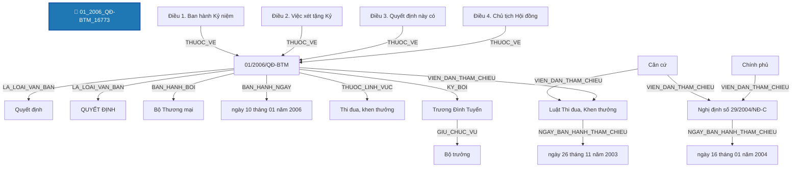

# Báo Cáo Trích Xuất Thực Thể & Quan Hệ Pháp Luật (Joint NER & RE)
> **Tệp nguồn thử nghiệm từ Google Drive**: `01_2006_QĐ-BTM_16773`
> **Thời gian thực hiện**: 2026-10-20 20:02:51

---

## 1. Thông Tin Văn Bản & Môi Trường Thử Nghiệm

- **Mã văn bản**: `01_2006_QĐ-BTM_16773`
- **Google Drive Folder ID**: `raw_local`
- **Số hiệu**: `01/2006/QĐ-BTM`
- **Tiêu đề văn bản**: Quyết định số 01/2006/QĐ-BTM Về việc ban hành Kỷ niệm chương "Vì sự nghiệp thương mại"
- **Cơ quan ban hành**: Bộ Thương mại
- **Lĩnh vực pháp lý**: Công Thương, Thi đua, khen thưởng
- **Người ký**: Trương Đình Tuyển (Bộ trưởng)
- **Mô hình suy luận**: `PhoBERT-SpERT` (Boundary + Union Context + Biaffine + BCEWithLogitsLoss)
- **Thời gian xử lý toàn bộ**: **1.37 giây** (12 đoạn văn bản)

---

## 2. Bảng Tổng Quan Kết Quả Trích Xuất

| Chỉ Số Tổng Hợp | Số Lượng Đạt Được | Ghi Chú |
| :--- | :---: | :--- |
| **Tổng số đoạn phân tích** | **12** | Tự động đọc từ file `noi_dung.docx` |
| **Tổng số thực thể phát hiện** | **30** | Đã áp dụng Nested-Aware NMS (Hỗ trợ thực thể lồng nhau) |
| **Tổng số quan hệ liên kết** | **17** | Bao gồm cả quan hệ cấu trúc và quan hệ nội câu lấy Hub làm tâm |

### Phân Bố Thực Thể Theo Nhãn Loại

| Nhãn Thực Thể | Ý Nghĩa Pháp Lý | Số Lượng Phát Hiện | Tỷ Lệ (%) |
| :--- | :--- | :---: | :---: |
| **CO_QUAN_THAM_QUYEN** | Cơ quan / Chức danh có thẩm quyền | 7 | 23.3% |
| **GIAY_TO_HO_SO** | Hồ sơ / Giấy tờ hành chính / Bằng cấp | 4 | 13.3% |
| **DIEU** | Điều trong văn bản | 4 | 13.3% |
| **LOAI_VAN_BAN** | Loại văn bản | 2 | 6.7% |
| **TU_KHOA_PHAP_LY** | Từ khóa pháp lý / Động từ lập pháp neo tham chiếu | 2 | 6.7% |
| **THAM_CHIEU_PHAP_LY** | Điều khoản đối chiếu / Viện dẫn pháp lý | 2 | 6.7% |
| **NGAY_THAM_CHIEU** | Ngày ban hành của văn bản tham chiếu | 2 | 6.7% |
| **SO_HIEU** | Số hiệu văn bản | 1 | 3.3% |
| **CO_QUAN_BAN_HANH** | Cơ quan ban hành | 1 | 3.3% |
| **NGAY_BAN_HANH** | Ngày ban hành (văn bản hiện hành) | 1 | 3.3% |
| **LINH_VUC** | Lĩnh vực pháp lý / Ngành, lĩnh vực điều chỉnh | 1 | 3.3% |
| **CHUC_DANH_NGUOI_KY** | Chức danh người ký | 1 | 3.3% |
| **NGUOI_KY** | Người ký | 1 | 3.3% |
| **THOI_HAN** | Thời hạn / Khoảng thời gian | 1 | 3.3% |

### Phân Bố Quan Hệ Theo Nhãn Loại

| Loại Quan Hệ | Ý Nghĩa Pháp Lý | Số Lượng Phát Hiện | Tỷ Lệ (%) |
| :--- | :--- | :---: | :---: |
| **VIEN_DAN_THAM_CHIEU** | [Nội câu] Đối chiếu / Viện dẫn đến điều khoản khác | 4 | 23.5% |
| **THUOC_VE** | Thuộc về cấu trúc phân cấp (DIEM -> KHOAN -> DIEU -> CHUONG -> SO_HIEU) | 4 | 23.5% |
| **LA_LOAI_VAN_BAN** | Là loại văn bản (SO_HIEU -> LOAI_VAN_BAN) | 2 | 11.8% |
| **NGAY_BAN_HANH_THAM_CHIEU** | [Nội câu] Ngày ban hành của văn bản tham chiếu | 2 | 11.8% |
| **BAN_HANH_BOI** | Được ban hành bởi cơ quan (SO_HIEU -> CO_QUAN_BAN_HANH) | 1 | 5.9% |
| **BAN_HANH_NGAY** | Được ban hành vào ngày (SO_HIEU -> NGAY_BAN_HANH) | 1 | 5.9% |
| **THUOC_LINH_VUC** | [Nội câu / Thuộc tính] Thuộc lĩnh vực pháp lý điều chỉnh | 1 | 5.9% |
| **KY_BOI** | Được ký bởi người ký (SO_HIEU -> NGUOI_KY) | 1 | 5.9% |
| **GIU_CHUC_VU** | Giữ chức vụ người ký (NGUOI_KY -> CHUC_DANH_NGUOI_KY) | 1 | 5.9% |

---

## 3. Sơ Đồ Cấu Trúc Quan Hệ Trích Xuất (Mermaid Graph)

---

## 4. Chi Tiết Danh Sách Thực Thể Được Trích Xuất (Toàn Bộ 100% Nội Dung)

| STT | Loại Thực Thể | Tên / Trích Đoạn Thực Thể | Vị Trí (Span) | Độ Tin Cậy (Conf) | Ngữ Cảnh Đầy Đủ (Không Cắt Chữ) |
| :---: | :--- | :--- | :---: | :---: | :--- |
| 1 | `LOAI_VAN_BAN` | **Quyết định** | `(0, 1)` | `100.00%` | **[Quyết định]** số 01/2006/QĐ-BTM Về việc ban hành Kỷ niệm chương "Vì sự nghiệp thương mại" |
| 2 | `SO_HIEU` | **01/2006/QĐ-BTM** | `(2, 3)` | `100.00%` | Quyết định số **[01/2006/QĐ-BTM]** Về việc ban hành Kỷ niệm chương "Vì sự nghiệp thương mại" |
| 3 | `LOAI_VAN_BAN` | **QUYẾT ĐỊNH** | `(4, 5)` | `98.91%` | **[QUYẾT ĐỊNH]** |
| 4 | `CO_QUAN_BAN_HANH` | **Bộ Thương mại** | `(0, 0)` | `99.00%` | [Bổ sung từ thuộc tính văn bản]: **[Bộ Thương mại]** |
| 5 | `NGAY_BAN_HANH` | **ngày 10 tháng 01 năm 2006** | `(0, 0)` | `99.00%` | [Bổ sung từ thuộc tính văn bản]: **[ngày 10 tháng 01 năm 2006]** |
| 6 | `LINH_VUC` | **Thi đua, khen thưởng** | `(0, 0)` | `99.00%` | [Bổ sung từ thuộc tính văn bản]: **[Thi đua, khen thưởng]** |
| 7 | `CHUC_DANH_NGUOI_KY` | **Bộ trưởng** | `(0, 0)` | `99.00%` | [Bổ sung từ thuộc tính văn bản]: **[Bộ trưởng]** |
| 8 | `NGUOI_KY` | **Trương Đình Tuyển** | `(0, 0)` | `99.00%` | [Bổ sung từ thuộc tính văn bản]: **[Trương Đình Tuyển]** |
| 9 | `GIAY_TO_HO_SO` | **Kỷ niệm chương "Vì sự nghiệp thương mại"** | `(3, 10)` | `99.70%` | Về việc ban hành **[Kỷ niệm chương "Vì sự nghiệp thương mại"]** |
| 10 | `CO_QUAN_THAM_QUYEN` | **BỘ TRƯỞNG BỘ THƯƠNG MẠI** | `(0, 3)` | `100.00%` | **[BỘ TRƯỞNG BỘ THƯƠNG MẠI]** |
| 11 | `TU_KHOA_PHAP_LY` | **Căn cứ** | `(0, 1)` | `100.00%` | **[Căn cứ]** Nghị định số 29/2004/NĐ-CP ngày 16 tháng 01 năm 2004 của Chính phủ quy định chức năng, nhiệm vụ, quyền hạn và cơ cấu tổ chức của Bộ Thương mại; |
| 12 | `THAM_CHIEU_PHAP_LY` | **Nghị định số 29/2004/NĐ-CP** | `(1, 4)` | `100.00%` | Căn cứ **[Nghị định số 29/2004/NĐ-CP]** ngày 16 tháng 01 năm 2004 của Chính phủ quy định chức năng, nhiệm vụ, quyền hạn và cơ cấu tổ chức của Bộ Thương mại; |
| 13 | `NGAY_THAM_CHIEU` | **ngày 16 tháng 01 năm 2004** | `(4, 10)` | `100.00%` | Căn cứ Nghị định số 29/2004/NĐ-CP **[ngày 16 tháng 01 năm 2004]** của Chính phủ quy định chức năng, nhiệm vụ, quyền hạn và cơ cấu tổ chức của Bộ Thương mại; |
| 14 | `CO_QUAN_THAM_QUYEN` | **Chính phủ** | `(11, 12)` | `100.00%` | Căn cứ Nghị định số 29/2004/NĐ-CP ngày 16 tháng 01 năm 2004 của **[Chính phủ]** quy định chức năng, nhiệm vụ, quyền hạn và cơ cấu tổ chức của Bộ Thương mại; |
| 15 | `CO_QUAN_THAM_QUYEN` | **Bộ Thương mại** | `(22, 24)` | `100.00%` | Căn cứ Nghị định số 29/2004/NĐ-CP ngày 16 tháng 01 năm 2004 của Chính phủ quy định chức năng, nhiệm vụ, quyền hạn và cơ cấu tổ chức của **[Bộ Thương mại]**; |
| 16 | `TU_KHOA_PHAP_LY` | **Căn cứ** | `(0, 1)` | `100.00%` | **[Căn cứ]** Luật Thi đua, Khen thưởng số 15/2003/QH11, ngày 26 tháng 11 năm 2003; |
| 17 | `THAM_CHIEU_PHAP_LY` | **Luật Thi đua, Khen thưởng số 15/2003/QH11** | `(1, 7)` | `100.00%` | Căn cứ **[Luật Thi đua, Khen thưởng số 15/2003/QH11]**, ngày 26 tháng 11 năm 2003; |
| 18 | `NGAY_THAM_CHIEU` | **ngày 26 tháng 11 năm 2003** | `(8, 14)` | `99.99%` | Căn cứ Luật Thi đua, Khen thưởng số 15/2003/QH11, **[ngày 26 tháng 11 năm 2003]**; |
| 19 | `DIEU` | **Điều 1. Ban hành Kỷ niệm chương “Vì sự nghiệp thương mại” để ghi nhận công lao của các cá nhân đã có nhiều đóng góp cho sự nghiệp thương mại của nước Cộng hòa xã hội chủ nghĩa Việt Nam.** | `(0, 31)` | `100.00%` | **[Điều 1. Ban hành Kỷ niệm chương “Vì sự nghiệp thương mại” để ghi nhận công lao của các cá nhân đã có nhiều đóng góp cho sự nghiệp thương mại của nước Cộng hòa xã hội chủ nghĩa Việt Nam.]** |
| 20 | `GIAY_TO_HO_SO` | **Kỷ niệm chương “Vì sự nghiệp thương mại”** | `(4, 11)` | `99.97%` | Điều 1. Ban hành **[Kỷ niệm chương “Vì sự nghiệp thương mại”]** để ghi nhận công lao của các cá nhân đã có nhiều đóng góp cho sự nghiệp thương mại của nước Cộng hòa xã hội chủ nghĩa Việt Nam. |
| 21 | `DIEU` | **Điều 2. Việc xét tặng Kỷ niệm chương “Vì sự nghiệp thương mại” được thực hiện theo Quy chế xét tặng Kỷ niệm chương “Vì sự nghiệp thương mại” do Bộ trưởng Bộ Thương mại ban hành.** | `(0, 32)` | `100.00%` | **[Điều 2. Việc xét tặng Kỷ niệm chương “Vì sự nghiệp thương mại” được thực hiện theo Quy chế xét tặng Kỷ niệm chương “Vì sự nghiệp thương mại” do Bộ trưởng Bộ Thương mại ban hành.]** |
| 22 | `CO_QUAN_THAM_QUYEN` | **Bộ trưởng Bộ Thương mại** | `(27, 30)` | `100.00%` | Điều 2. Việc xét tặng Kỷ niệm chương “Vì sự nghiệp thương mại” được thực hiện theo Quy chế xét tặng Kỷ niệm chương “Vì sự nghiệp thương mại” do **[Bộ trưởng Bộ Thương mại]** ban hành. |
| 23 | `GIAY_TO_HO_SO` | **Kỷ niệm chương “Vì sự nghiệp thương mại”** | `(6, 13)` | `99.35%` | Điều 2. Việc xét tặng **[Kỷ niệm chương “Vì sự nghiệp thương mại”]** được thực hiện theo Quy chế xét tặng Kỷ niệm chương “Vì sự nghiệp thương mại” do Bộ trưởng Bộ Thương mại ban hành. |
| 24 | `GIAY_TO_HO_SO` | **Quy chế xét tặng Kỷ niệm chương “Vì sự nghiệp thương mại”** | `(16, 26)` | `99.12%` | Điều 2. Việc xét tặng Kỷ niệm chương “Vì sự nghiệp thương mại” được thực hiện theo **[Quy chế xét tặng Kỷ niệm chương “Vì sự nghiệp thương mại”]** do Bộ trưởng Bộ Thương mại ban hành. |
| 25 | `DIEU` | **Điều 3. Quyết định này có hiệu lực sau 15 ngày kể từ ngày đăng Công báo.** | `(0, 16)` | `100.00%` | **[Điều 3. Quyết định này có hiệu lực sau 15 ngày kể từ ngày đăng Công báo.]** |
| 26 | `THOI_HAN` | **sau 15 ngày** | `(7, 10)` | `100.00%` | Điều 3. Quyết định này có hiệu lực **[sau 15 ngày]** kể từ ngày đăng Công báo. |
| 27 | `DIEU` | **Điều 4. Chủ tịch Hội đồng Thi đua, Khen thưởng Bộ, Chánh văn phòng Bộ, Thủ trưởng các cơ quan, đơn vị thuộc Bộ, Giám đốc Sở Thương mại, Sở Thương mại - Du lịch các tỉnh thành phố trực thuộc Trung ương và Thường trực Thi đua, Khen thưởng Bộ chịu trách nhiệm thi hành Quyết định này./.** | `(0, 48)` | `100.00%` | **[Điều 4. Chủ tịch Hội đồng Thi đua, Khen thưởng Bộ, Chánh văn phòng Bộ, Thủ trưởng các cơ quan, đơn vị thuộc Bộ, Giám đốc Sở Thương mại, Sở Thương mại - Du lịch các tỉnh thành phố trực thuộc Trung ương và Thường trực Thi đua, Khen thưởng Bộ chịu trách nhiệm thi hành Quyết định này./.]** |
| 28 | `CO_QUAN_THAM_QUYEN` | **Chủ tịch Hội đồng Thi đua, Khen thưởng Bộ** | `(3, 9)` | `95.00%` | Điều 4. **[Chủ tịch Hội đồng Thi đua, Khen thưởng Bộ]**, Chánh văn phòng Bộ, Thủ trưởng các cơ quan, đơn vị thuộc Bộ, Giám đốc Sở Thương mại, Sở Thương mại - Du lịch các tỉnh thành phố trực thuộc Trung ương và Thường trực Thi đua, Khen thưởng Bộ chịu trách nhiệm thi hành Quyết định này./. |
| 29 | `CO_QUAN_THAM_QUYEN` | **Giám đốc Sở Thương mại** | `(22, 25)` | `100.00%` | Điều 4. Chủ tịch Hội đồng Thi đua, Khen thưởng Bộ, Chánh văn phòng Bộ, Thủ trưởng các cơ quan, đơn vị thuộc Bộ, **[Giám đốc Sở Thương mại]**, Sở Thương mại - Du lịch các tỉnh thành phố trực thuộc Trung ương và Thường trực Thi đua, Khen thưởng Bộ chịu trách nhiệm thi hành Quyết định này./. |
| 30 | `CO_QUAN_THAM_QUYEN` | **Sở Thương mại - Du lịch** | `(26, 30)` | `98.44%` | Điều 4. Chủ tịch Hội đồng Thi đua, Khen thưởng Bộ, Chánh văn phòng Bộ, Thủ trưởng các cơ quan, đơn vị thuộc Bộ, Giám đốc Sở Thương mại, **[Sở Thương mại - Du lịch]** các tỉnh thành phố trực thuộc Trung ương và Thường trực Thi đua, Khen thưởng Bộ chịu trách nhiệm thi hành Quyết định này./. |

---

## 5. Chi Tiết Danh Sách Quan Hệ Được Trích Xuất

| STT | Thực Thể Nguồn (Head) | Loại Head | Quan Hệ (Relation) | Thực Thể Đích (Tail) | Loại Tail | Độ Tin Cậy |
| :---: | :--- | :---: | :---: | :--- | :---: | :---: |
| 1 | **01/2006/QĐ-BTM** | `SO_HIEU` | ➔ **`LA_LOAI_VAN_BAN`** ➔ | **Quyết định** | `LOAI_VAN_BAN` | `100.00%` |
| 2 | **01/2006/QĐ-BTM** | `SO_HIEU` | ➔ **`LA_LOAI_VAN_BAN`** ➔ | **QUYẾT ĐỊNH** | `LOAI_VAN_BAN` | `100.00%` |
| 3 | **01/2006/QĐ-BTM** | `SO_HIEU` | ➔ **`BAN_HANH_BOI`** ➔ | **Bộ Thương mại** | `CO_QUAN_BAN_HANH` | `99.00%` |
| 4 | **01/2006/QĐ-BTM** | `SO_HIEU` | ➔ **`BAN_HANH_NGAY`** ➔ | **ngày 10 tháng 01 năm 2006** | `NGAY_BAN_HANH` | `99.00%` |
| 5 | **01/2006/QĐ-BTM** | `SO_HIEU` | ➔ **`THUOC_LINH_VUC`** ➔ | **Thi đua, khen thưởng** | `LINH_VUC` | `99.00%` |
| 6 | **01/2006/QĐ-BTM** | `SO_HIEU` | ➔ **`KY_BOI`** ➔ | **Trương Đình Tuyển** | `NGUOI_KY` | `99.00%` |
| 7 | **Trương Đình Tuyển** | `NGUOI_KY` | ➔ **`GIU_CHUC_VU`** ➔ | **Bộ trưởng** | `CHUC_DANH_NGUOI_KY` | `99.00%` |
| 8 | **Căn cứ** | `TU_KHOA_PHAP_LY` | ➔ **`VIEN_DAN_THAM_CHIEU`** ➔ | **Nghị định số 29/2004/NĐ-CP** | `THAM_CHIEU_PHAP_LY` | `100.00%` |
| 9 | **Nghị định số 29/2004/NĐ-CP** | `THAM_CHIEU_PHAP_LY` | ➔ **`NGAY_BAN_HANH_THAM_CHIEU`** ➔ | **ngày 16 tháng 01 năm 2004** | `NGAY_THAM_CHIEU` | `100.00%` |
| 10 | **Chính phủ** | `CO_QUAN_THAM_QUYEN` | ➔ **`VIEN_DAN_THAM_CHIEU`** ➔ | **Nghị định số 29/2004/NĐ-CP** | `THAM_CHIEU_PHAP_LY` | `100.00%` |
| 11 | **Căn cứ** | `TU_KHOA_PHAP_LY` | ➔ **`VIEN_DAN_THAM_CHIEU`** ➔ | **Luật Thi đua, Khen thưởng số 15/2003/QH11** | `THAM_CHIEU_PHAP_LY` | `100.00%` |
| 12 | **Luật Thi đua, Khen thưởng số 15/2003/QH11** | `THAM_CHIEU_PHAP_LY` | ➔ **`NGAY_BAN_HANH_THAM_CHIEU`** ➔ | **ngày 26 tháng 11 năm 2003** | `NGAY_THAM_CHIEU` | `85.64%` |
| 13 | **01/2006/QĐ-BTM** | `SO_HIEU` | ➔ **`VIEN_DAN_THAM_CHIEU`** ➔ | **Luật Thi đua, Khen thưởng số 15/2003/QH11** | `THAM_CHIEU_PHAP_LY` | `100.00%` |
| 14 | **Điều 1. Ban hành Kỷ niệm chương “Vì sự nghiệp thương mại” để ghi nhận công lao của các cá nhân đã có nhiều đóng góp cho sự nghiệp thương mại của nước Cộng hòa xã hội chủ nghĩa Việt Nam.** | `DIEU` | ➔ **`THUOC_VE`** ➔ | **01/2006/QĐ-BTM** | `SO_HIEU` | `100.00%` |
| 15 | **Điều 2. Việc xét tặng Kỷ niệm chương “Vì sự nghiệp thương mại” được thực hiện theo Quy chế xét tặng Kỷ niệm chương “Vì sự nghiệp thương mại” do Bộ trưởng Bộ Thương mại ban hành.** | `DIEU` | ➔ **`THUOC_VE`** ➔ | **01/2006/QĐ-BTM** | `SO_HIEU` | `100.00%` |
| 16 | **Điều 3. Quyết định này có hiệu lực sau 15 ngày kể từ ngày đăng Công báo.** | `DIEU` | ➔ **`THUOC_VE`** ➔ | **01/2006/QĐ-BTM** | `SO_HIEU` | `100.00%` |
| 17 | **Điều 4. Chủ tịch Hội đồng Thi đua, Khen thưởng Bộ, Chánh văn phòng Bộ, Thủ trưởng các cơ quan, đơn vị thuộc Bộ, Giám đốc Sở Thương mại, Sở Thương mại - Du lịch các tỉnh thành phố trực thuộc Trung ương và Thường trực Thi đua, Khen thưởng Bộ chịu trách nhiệm thi hành Quyết định này./.** | `DIEU` | ➔ **`THUOC_VE`** ➔ | **01/2006/QĐ-BTM** | `SO_HIEU` | `100.00%` |

---

## 6. Đọc Toàn Văn Văn Bản Gốc Kèm Gán Nhãn Thực Thể (In-line Annotation)

> Dưới đây là toàn bộ văn bản gốc 100% không cắt bớt chữ. Các thực thể nhận dạng được đánh dấu nổi bật `**[Tên thực thể]**{LOAI}` để bạn đối chiếu kiểm tra chính xác.

- **[Đoạn 1]**: **[Quyết định]**`{LOAI_VAN_BAN}` số **[01/2006/QĐ-BTM]**`{SO_HIEU}` Về việc ban hành Kỷ niệm chương "Vì sự nghiệp thương mại" **[Bộ Thương mại]**`{CO_QUAN_BAN_HANH}` **[ngày 10 tháng 01 năm 2006]**`{NGAY_BAN_HANH}` **[Thi đua, khen thưởng]**`{LINH_VUC}`

- **[Đoạn 2]**: **[QUYẾT ĐỊNH]**`{LOAI_VAN_BAN}`

- **[Đoạn 3]**: Về việc ban hành **[Kỷ niệm chương "Vì sự nghiệp thương mại"]**`{GIAY_TO_HO_SO}`

- **[Đoạn 4]**: **[BỘ TRƯỞNG BỘ THƯƠNG MẠI]**`{CO_QUAN_THAM_QUYEN}`

- **[Đoạn 5]**: **[Căn cứ]**`{TU_KHOA_PHAP_LY}` **[Nghị định số 29/2004/NĐ-CP]**`{THAM_CHIEU_PHAP_LY}` **[ngày 16 tháng 01 năm 2004]**`{NGAY_THAM_CHIEU}` của **[Chính phủ]**`{CO_QUAN_THAM_QUYEN}` quy định chức năng, nhiệm vụ, quyền hạn và cơ cấu tổ chức của **[Bộ Thương mại]**`{CO_QUAN_THAM_QUYEN}`;

- **[Đoạn 6]**: **[Căn cứ]**`{TU_KHOA_PHAP_LY}` **[Luật Thi đua, Khen thưởng số 15/2003/QH11]**`{THAM_CHIEU_PHAP_LY}`, **[ngày 26 tháng 11 năm 2003]**`{NGAY_THAM_CHIEU}`;

- [Đoạn 7]: Theo đề nghị của Thường trực Thi đua, Khen thưởng Bộ,

- [Đoạn 8]: QUYẾT ĐỊNH:

- **[Đoạn 9]**: **[Điều 1. Ban hành **[Kỷ niệm chương “Vì sự nghiệp thương mại”]**`{GIAY_TO_HO_SO}` để ghi nhận công lao của các cá nhân đã có nhiều đóng góp cho sự nghiệp thương mại của nước Cộng hòa xã hội chủ nghĩa Việt Nam.]**`{DIEU}`

- **[Đoạn 10]**: **[Điều 2. Việc xét tặng **[Kỷ niệm chương “Vì sự nghiệp thương mại”]**`{GIAY_TO_HO_SO}` được thực hiện theo **[Quy chế xét tặng Kỷ niệm chương “Vì sự nghiệp thương mại”]**`{GIAY_TO_HO_SO}` do **[Bộ trưởng Bộ Thương mại]**`{CO_QUAN_THAM_QUYEN}` ban hành.]**`{DIEU}`

- **[Đoạn 11]**: **[Điều 3. Quyết định này có hiệu lực **[sau 15 ngày]**`{THOI_HAN}` kể từ ngày đăng Công báo.]**`{DIEU}`

- **[Đoạn 12]**: **[Điều 4. **[Chủ tịch Hội đồng Thi đua, Khen thưởng Bộ]**`{CO_QUAN_THAM_QUYEN}`, Chánh văn phòng Bộ, Thủ trưởng các cơ quan, đơn vị thuộc Bộ, **[Giám đốc Sở Thương mại]**`{CO_QUAN_THAM_QUYEN}`, **[Sở Thương mại - Du lịch]**`{CO_QUAN_THAM_QUYEN}` các tỉnh thành phố trực thuộc Trung ương và Thường trực Thi đua, Khen thưởng Bộ chịu trách nhiệm thi hành Quyết định này./.]**`{DIEU}` **[Bộ trưởng]**`{CHUC_DANH_NGUOI_KY}` **[Trương Đình Tuyển]**`{NGUOI_KY}`

---

*Báo cáo được khởi tạo tự động bởi mô hình PhoBERT-SpERT của đề tài NCKH.*