# Báo Cáo Trích Xuất Thực Thể & Quan Hệ Pháp Luật (Joint NER & RE)
> **Tệp nguồn thử nghiệm từ Google Drive**: `01_2009_TT-BNV_12219`
> **Thời gian thực hiện**: 2026-10-20 20:03:05

---

## 1. Thông Tin Văn Bản & Môi Trường Thử Nghiệm

- **Mã văn bản**: `01_2009_TT-BNV_12219`
- **Google Drive Folder ID**: `raw_local`
- **Số hiệu**: `01/2009/TT-BNV`
- **Tiêu đề văn bản**: Thông tư số 01/2009/TT-BNV Hướng dẫn trình tự, thủ tục bổ nhiệm, miễn nhiệm, cách chức Chủ tịch, Phó Chủ tịch, Ủy viên Ủy ban nhân dân huyện, quận, phường nơi không tổ chức Hội đồng nhân dân
- **Cơ quan ban hành**: Bộ Nội vụ
- **Lĩnh vực pháp lý**: Nội vụ
- **Người ký**: Trần Văn Tuấn (Bộ trưởng)
- **Mô hình suy luận**: `PhoBERT-SpERT` (Boundary + Union Context + Biaffine + BCEWithLogitsLoss)
- **Thời gian xử lý toàn bộ**: **6.27 giây** (65 đoạn văn bản)

---

## 2. Bảng Tổng Quan Kết Quả Trích Xuất

| Chỉ Số Tổng Hợp | Số Lượng Đạt Được | Ghi Chú |
| :--- | :---: | :--- |
| **Tổng số đoạn phân tích** | **65** | Tự động đọc từ file `noi_dung.docx` |
| **Tổng số thực thể phát hiện** | **298** | Đã áp dụng Nested-Aware NMS (Hỗ trợ thực thể lồng nhau) |
| **Tổng số quan hệ liên kết** | **150** | Bao gồm cả quan hệ cấu trúc và quan hệ nội câu lấy Hub làm tâm |

### Phân Bố Thực Thể Theo Nhãn Loại

| Nhãn Thực Thể | Ý Nghĩa Pháp Lý | Số Lượng Phát Hiện | Tỷ Lệ (%) |
| :--- | :--- | :---: | :---: |
| **CO_QUAN_THAM_QUYEN** | Cơ quan / Chức danh có thẩm quyền | 115 | 38.6% |
| **CHU_THE_CA_NHAN** | Chủ thể cá nhân / Vai trò pháp lý | 40 | 13.4% |
| **DIEM** | Điểm trong văn bản | 26 | 8.7% |
| **GIAY_TO_HO_SO** | Hồ sơ / Giấy tờ hành chính / Bằng cấp | 25 | 8.4% |
| **TU_KHOA_PHAP_LY** | Từ khóa pháp lý / Động từ lập pháp neo tham chiếu | 19 | 6.4% |
| **THAM_CHIEU_PHAP_LY** | Điều khoản đối chiếu / Viện dẫn pháp lý | 18 | 6.0% |
| **KHOAN** | Khoản trong văn bản | 17 | 5.7% |
| **NGAY_THAM_CHIEU** | Ngày ban hành của văn bản tham chiếu | 15 | 5.0% |
| **NGHIA_VU_QUYEN** | [Hub] Nghĩa vụ / Quyền / Thủ tục pháp lý | 8 | 2.7% |
| **DIEU** | Điều trong văn bản | 5 | 1.7% |
| **LOAI_VAN_BAN** | Loại văn bản | 2 | 0.7% |
| **SO_HIEU** | Số hiệu văn bản | 1 | 0.3% |
| **CO_QUAN_BAN_HANH** | Cơ quan ban hành | 1 | 0.3% |
| **NGAY_BAN_HANH** | Ngày ban hành (văn bản hiện hành) | 1 | 0.3% |
| **LINH_VUC** | Lĩnh vực pháp lý / Ngành, lĩnh vực điều chỉnh | 1 | 0.3% |
| **CHUC_DANH_NGUOI_KY** | Chức danh người ký | 1 | 0.3% |
| **NGUOI_KY** | Người ký | 1 | 0.3% |
| **HANH_VI_VI_PHAM** | [Hub] Hành vi vi phạm pháp luật | 1 | 0.3% |
| **HINH_PHAT_CHE_TAI** | [Hub] Chế tài xử phạt | 1 | 0.3% |

### Phân Bố Quan Hệ Theo Nhãn Loại

| Loại Quan Hệ | Ý Nghĩa Pháp Lý | Số Lượng Phát Hiện | Tỷ Lệ (%) |
| :--- | :--- | :---: | :---: |
| **THUOC_VE** | Thuộc về cấu trúc phân cấp (DIEM -> KHOAN -> DIEU -> CHUONG -> SO_HIEU) | 48 | 32.0% |
| **VIEN_DAN_THAM_CHIEU** | [Nội câu] Đối chiếu / Viện dẫn đến điều khoản khác | 36 | 24.0% |
| **TAC_DONG_CHU_THE** | [Nội câu] Hành vi tác động đến chủ thể khác | 25 | 16.7% |
| **NGAY_BAN_HANH_THAM_CHIEU** | [Nội câu] Ngày ban hành của văn bản tham chiếu | 13 | 8.7% |
| **CO_THAM_QUYEN** | [Nội câu] Cơ quan / Chức danh có thẩm quyền xử lý | 12 | 8.0% |
| **TAC_DONG_DOI_TUONG** | [Nội câu] Hành vi / Biện pháp tác động lên tài sản / giấy tờ | 8 | 5.3% |
| **LA_LOAI_VAN_BAN** | Là loại văn bản (SO_HIEU -> LOAI_VAN_BAN) | 2 | 1.3% |
| **BAN_HANH_BOI** | Được ban hành bởi cơ quan (SO_HIEU -> CO_QUAN_BAN_HANH) | 1 | 0.7% |
| **BAN_HANH_NGAY** | Được ban hành vào ngày (SO_HIEU -> NGAY_BAN_HANH) | 1 | 0.7% |
| **THUOC_LINH_VUC** | [Nội câu / Thuộc tính] Thuộc lĩnh vực pháp lý điều chỉnh | 1 | 0.7% |
| **KY_BOI** | Được ký bởi người ký (SO_HIEU -> NGUOI_KY) | 1 | 0.7% |
| **GIU_CHUC_VU** | Giữ chức vụ người ký (NGUOI_KY -> CHUC_DANH_NGUOI_KY) | 1 | 0.7% |
| **DAN_DEN_CHE_TAI** | [Nội câu] Hành vi vi phạm dẫn đến chế tài xử phạt / khắc phục | 1 | 0.7% |

---

## 3. Sơ Đồ Cấu Trúc Quan Hệ Trích Xuất (Mermaid Graph)

```mermaid
graph TD
    Doc["📄 01_2009_TT-BNV_12219"]:::docClass
    N_3621["01/2009/TT-BNV"]
    N_1832["Thông tư"]
    N_3621 -->|"LA_LOAI_VAN_BAN"| N_1832
    N_3926["THÔNG TƯ"]
    N_3621 -->|"LA_LOAI_VAN_BAN"| N_3926
    N_7947["Bộ Nội vụ"]
    N_3621 -->|"BAN_HANH_BOI"| N_7947
    N_7501["ngày 19 tháng 03 năm 2009"]
    N_3621 -->|"BAN_HANH_NGAY"| N_7501
    N_6555["Nội vụ"]
    N_3621 -->|"THUOC_LINH_VUC"| N_6555
    N_8333["Trần Văn Tuấn"]
    N_3621 -->|"KY_BOI"| N_8333
    N_7604["Bộ trưởng"]
    N_8333 -->|"GIU_CHUC_VU"| N_7604
    N_5212["Căn cứ"]
    N_4392["Nghị quyết số 26/2008/QH1"]
    N_5212 -->|"VIEN_DAN_THAM_CHIEU"| N_4392
    N_2882["ngày 15 tháng 11 năm 2008"]
    N_4392 -->|"NGAY_BAN_HANH_THAM_CHIEU"| N_2882
    N_7159["Quốc hội"]
    N_7159 -->|"VIEN_DAN_THAM_CHIEU"| N_4392
    N_2596["Nghị quyết số 724/2009/UB"]
    N_5212 -->|"VIEN_DAN_THAM_CHIEU"| N_2596
    N_8671["ngày 16 tháng 01 năm 2009"]
    N_2596 -->|"NGAY_BAN_HANH_THAM_CHIEU"| N_8671
    N_535["Ủy ban thường vụ Quốc hội"]
    N_535 -->|"VIEN_DAN_THAM_CHIEU"| N_2596
    N_4402["Nghị quyết số 725/2009/UB"]
    N_5212 -->|"VIEN_DAN_THAM_CHIEU"| N_4402
    N_4402 -->|"NGAY_BAN_HANH_THAM_CHIEU"| N_8671
    N_535 -->|"VIEN_DAN_THAM_CHIEU"| N_4402
    N_3293["Nghị định số 107/2004/NĐ-"]
    N_5212 -->|"VIEN_DAN_THAM_CHIEU"| N_3293
    N_8986["Nghị định số 27/2009/NĐ-C"]
    N_5212 -->|"VIEN_DAN_THAM_CHIEU"| N_8986
    N_1942["ngày 01 tháng 04 năm 2004"]
    N_3293 -->|"NGAY_BAN_HANH_THAM_CHIEU"| N_1942
    N_1429["Chính phủ"]
    N_1429 -->|"VIEN_DAN_THAM_CHIEU"| N_3293
    N_1429 -->|"VIEN_DAN_THAM_CHIEU"| N_8986
    N_9323["ngày 19 tháng 3 năm 2009"]
    N_8986 -->|"NGAY_BAN_HANH_THAM_CHIEU"| N_9323
    N_7317["sửa đổi, bổ sung"]
    N_7317 -->|"VIEN_DAN_THAM_CHIEU"| N_3293
    N_5482["Nghị định số 48/2008/NĐ-C"]
    N_5212 -->|"VIEN_DAN_THAM_CHIEU"| N_5482
    N_635["ngày 17 tháng 4 năm 2008"]
    N_5482 -->|"NGAY_BAN_HANH_THAM_CHIEU"| N_635
    classDef docClass fill:#1f77b4,stroke:#0d47a1,stroke-width:2px,color:#fff;
```

---

## 4. Chi Tiết Danh Sách Thực Thể Được Trích Xuất (Toàn Bộ 100% Nội Dung)

| STT | Loại Thực Thể | Tên / Trích Đoạn Thực Thể | Vị Trí (Span) | Độ Tin Cậy (Conf) | Ngữ Cảnh Đầy Đủ (Không Cắt Chữ) |
| :---: | :--- | :--- | :---: | :---: | :--- |
| 1 | `LOAI_VAN_BAN` | **Thông tư** | `(0, 1)` | `100.00%` | **[Thông tư]** số 01/2009/TT-BNV Hướng dẫn trình tự, thủ tục bổ nhiệm, miễn nhiệm, cách chức Chủ tịch, Phó Chủ tịch, Ủy viên Ủy ban nhân dân huyện, quận, phường nơi không tổ chức Hội đồng nhân dân |
| 2 | `SO_HIEU` | **01/2009/TT-BNV** | `(2, 3)` | `100.00%` | Thông tư số **[01/2009/TT-BNV]** Hướng dẫn trình tự, thủ tục bổ nhiệm, miễn nhiệm, cách chức Chủ tịch, Phó Chủ tịch, Ủy viên Ủy ban nhân dân huyện, quận, phường nơi không tổ chức Hội đồng nhân dân |
| 3 | `LOAI_VAN_BAN` | **THÔNG TƯ** | `(4, 5)` | `99.87%` | **[THÔNG TƯ]** |
| 4 | `CO_QUAN_BAN_HANH` | **Bộ Nội vụ** | `(0, 0)` | `99.00%` | [Bổ sung từ thuộc tính văn bản]: **[Bộ Nội vụ]** |
| 5 | `NGAY_BAN_HANH` | **ngày 19 tháng 03 năm 2009** | `(0, 0)` | `99.00%` | [Bổ sung từ thuộc tính văn bản]: **[ngày 19 tháng 03 năm 2009]** |
| 6 | `LINH_VUC` | **Nội vụ** | `(0, 0)` | `99.00%` | [Bổ sung từ thuộc tính văn bản]: **[Nội vụ]** |
| 7 | `CHUC_DANH_NGUOI_KY` | **Bộ trưởng** | `(0, 0)` | `99.00%` | [Bổ sung từ thuộc tính văn bản]: **[Bộ trưởng]** |
| 8 | `NGUOI_KY` | **Trần Văn Tuấn** | `(0, 0)` | `99.00%` | [Bổ sung từ thuộc tính văn bản]: **[Trần Văn Tuấn]** |
| 9 | `CHU_THE_CA_NHAN` | **Chủ tịch** | `(9, 10)` | `94.50%` | Hướng dẫn trình tự, thủ tục bổ nhiệm, miễn nhiệm, cách chức **[Chủ tịch]**, Phó Chủ tịch, Ủy viên Ủy ban nhân dân huyện, quận, phường nơi không tổ chức Hội đồng nhân dân |
| 10 | `CO_QUAN_THAM_QUYEN` | **Ủy viên Ủy ban nhân dân huyện, quận, phường** | `(13, 21)` | `46.78%` | Hướng dẫn trình tự, thủ tục bổ nhiệm, miễn nhiệm, cách chức Chủ tịch, Phó Chủ tịch, **[Ủy viên Ủy ban nhân dân huyện, quận, phường]** nơi không tổ chức Hội đồng nhân dân |
| 11 | `CO_QUAN_THAM_QUYEN` | **Hội đồng nhân dân** | `(24, 26)` | `99.61%` | Hướng dẫn trình tự, thủ tục bổ nhiệm, miễn nhiệm, cách chức Chủ tịch, Phó Chủ tịch, Ủy viên Ủy ban nhân dân huyện, quận, phường nơi không tổ chức **[Hội đồng nhân dân]** |
| 12 | `TU_KHOA_PHAP_LY` | **Căn cứ** | `(0, 1)` | `100.00%` | **[Căn cứ]** Nghị quyết số 26/2008/QH12 ngày 15 tháng 11 năm 2008 của Quốc hội khóa XII về thực hiện thí điểm không tổ chức Hội đồng nhân dân huyện, quận, phường; |
| 13 | `THAM_CHIEU_PHAP_LY` | **Nghị quyết số 26/2008/QH12** | `(1, 4)` | `100.00%` | Căn cứ **[Nghị quyết số 26/2008/QH12]** ngày 15 tháng 11 năm 2008 của Quốc hội khóa XII về thực hiện thí điểm không tổ chức Hội đồng nhân dân huyện, quận, phường; |
| 14 | `NGAY_THAM_CHIEU` | **ngày 15 tháng 11 năm 2008** | `(4, 10)` | `100.00%` | Căn cứ Nghị quyết số 26/2008/QH12 **[ngày 15 tháng 11 năm 2008]** của Quốc hội khóa XII về thực hiện thí điểm không tổ chức Hội đồng nhân dân huyện, quận, phường; |
| 15 | `CO_QUAN_THAM_QUYEN` | **Quốc hội** | `(11, 12)` | `100.00%` | Căn cứ Nghị quyết số 26/2008/QH12 ngày 15 tháng 11 năm 2008 của **[Quốc hội]** khóa XII về thực hiện thí điểm không tổ chức Hội đồng nhân dân huyện, quận, phường; |
| 16 | `CO_QUAN_THAM_QUYEN` | **Hội đồng nhân dân huyện, quận, phường** | `(19, 26)` | `95.00%` | Căn cứ Nghị quyết số 26/2008/QH12 ngày 15 tháng 11 năm 2008 của Quốc hội khóa XII về thực hiện thí điểm không tổ chức **[Hội đồng nhân dân huyện, quận, phường]**; |
| 17 | `TU_KHOA_PHAP_LY` | **Căn cứ** | `(0, 1)` | `100.00%` | **[Căn cứ]** Nghị quyết số 724/2009/UBTVQH12 ngày 16 tháng 01 năm 2009 của Ủy ban thường vụ Quốc hội về danh sách huyện, quận, phường của các tỉnh, thành phố trực thuộc trung ương thực hiện thí điểm không tổ chức Hội đồng nhân dân huyện, quận, phường; |
| 18 | `THAM_CHIEU_PHAP_LY` | **Nghị quyết số 724/2009/UBTVQH12** | `(1, 4)` | `100.00%` | Căn cứ **[Nghị quyết số 724/2009/UBTVQH12]** ngày 16 tháng 01 năm 2009 của Ủy ban thường vụ Quốc hội về danh sách huyện, quận, phường của các tỉnh, thành phố trực thuộc trung ương thực hiện thí điểm không tổ chức Hội đồng nhân dân huyện, quận, phường; |
| 19 | `NGAY_THAM_CHIEU` | **ngày 16 tháng 01 năm 2009** | `(4, 10)` | `100.00%` | Căn cứ Nghị quyết số 724/2009/UBTVQH12 **[ngày 16 tháng 01 năm 2009]** của Ủy ban thường vụ Quốc hội về danh sách huyện, quận, phường của các tỉnh, thành phố trực thuộc trung ương thực hiện thí điểm không tổ chức Hội đồng nhân dân huyện, quận, phường; |
| 20 | `CO_QUAN_THAM_QUYEN` | **Ủy ban thường vụ Quốc hội** | `(11, 14)` | `100.00%` | Căn cứ Nghị quyết số 724/2009/UBTVQH12 ngày 16 tháng 01 năm 2009 của **[Ủy ban thường vụ Quốc hội]** về danh sách huyện, quận, phường của các tỉnh, thành phố trực thuộc trung ương thực hiện thí điểm không tổ chức Hội đồng nhân dân huyện, quận, phường; |
| 21 | `CO_QUAN_THAM_QUYEN` | **Hội đồng nhân dân huyện, quận, phường** | `(32, 39)` | `95.00%` | Căn cứ Nghị quyết số 724/2009/UBTVQH12 ngày 16 tháng 01 năm 2009 của Ủy ban thường vụ Quốc hội về danh sách huyện, quận, phường của các tỉnh, thành phố trực thuộc trung ương thực hiện thí điểm không tổ chức **[Hội đồng nhân dân huyện, quận, phường]**; |
| 22 | `TU_KHOA_PHAP_LY` | **Căn cứ** | `(0, 1)` | `100.00%` | **[Căn cứ]** Nghị quyết số 725/2009/UBTVQH12 ngày 16 tháng 01 năm 2009 của Ủy ban thường vụ Quốc hội về điều chỉnh nhiệm vụ, quyền hạn của Hội đồng nhân dân, Ủy ban nhân dân tỉnh, thành phố trực thuộc trung ương và quy định nhiệm vụ, quyền hạn, tổ chức bộ máy của Ủy ban nhân dân huyện, quận, phường nơi không tổ chức Hội đồng nhân dân huyện, quận, phường; |
| 23 | `THAM_CHIEU_PHAP_LY` | **Nghị quyết số 725/2009/UBTVQH12** | `(1, 4)` | `100.00%` | Căn cứ **[Nghị quyết số 725/2009/UBTVQH12]** ngày 16 tháng 01 năm 2009 của Ủy ban thường vụ Quốc hội về điều chỉnh nhiệm vụ, quyền hạn của Hội đồng nhân dân, Ủy ban nhân dân tỉnh, thành phố trực thuộc trung ương và quy định nhiệm vụ, quyền hạn, tổ chức bộ máy của Ủy ban nhân dân huyện, quận, phường nơi không tổ chức Hội đồng nhân dân huyện, quận, phường; |
| 24 | `NGAY_THAM_CHIEU` | **ngày 16 tháng 01 năm 2009** | `(4, 10)` | `100.00%` | Căn cứ Nghị quyết số 725/2009/UBTVQH12 **[ngày 16 tháng 01 năm 2009]** của Ủy ban thường vụ Quốc hội về điều chỉnh nhiệm vụ, quyền hạn của Hội đồng nhân dân, Ủy ban nhân dân tỉnh, thành phố trực thuộc trung ương và quy định nhiệm vụ, quyền hạn, tổ chức bộ máy của Ủy ban nhân dân huyện, quận, phường nơi không tổ chức Hội đồng nhân dân huyện, quận, phường; |
| 25 | `CO_QUAN_THAM_QUYEN` | **Hội đồng nhân dân** | `(20, 22)` | `99.99%` | Căn cứ Nghị quyết số 725/2009/UBTVQH12 ngày 16 tháng 01 năm 2009 của Ủy ban thường vụ Quốc hội về điều chỉnh nhiệm vụ, quyền hạn của **[Hội đồng nhân dân]**, Ủy ban nhân dân tỉnh, thành phố trực thuộc trung ương và quy định nhiệm vụ, quyền hạn, tổ chức bộ máy của Ủy ban nhân dân huyện, quận, phường nơi không tổ chức Hội đồng nhân dân huyện, quận, phường; |
| 26 | `CO_QUAN_THAM_QUYEN` | **Ủy ban nhân dân tỉnh, thành phố trực thuộc trung ương** | `(23, 30)` | `99.94%` | Căn cứ Nghị quyết số 725/2009/UBTVQH12 ngày 16 tháng 01 năm 2009 của Ủy ban thường vụ Quốc hội về điều chỉnh nhiệm vụ, quyền hạn của Hội đồng nhân dân, **[Ủy ban nhân dân tỉnh, thành phố trực thuộc trung ương]** và quy định nhiệm vụ, quyền hạn, tổ chức bộ máy của Ủy ban nhân dân huyện, quận, phường nơi không tổ chức Hội đồng nhân dân huyện, quận, phường; |
| 27 | `CO_QUAN_THAM_QUYEN` | **Ủy ban nhân dân huyện, quận, phường** | `(39, 46)` | `98.44%` | Căn cứ Nghị quyết số 725/2009/UBTVQH12 ngày 16 tháng 01 năm 2009 của Ủy ban thường vụ Quốc hội về điều chỉnh nhiệm vụ, quyền hạn của Hội đồng nhân dân, Ủy ban nhân dân tỉnh, thành phố trực thuộc trung ương và quy định nhiệm vụ, quyền hạn, tổ chức bộ máy của **[Ủy ban nhân dân huyện, quận, phường]** nơi không tổ chức Hội đồng nhân dân huyện, quận, phường; |
| 28 | `CO_QUAN_THAM_QUYEN` | **Ủy ban thường vụ Quốc hội** | `(11, 14)` | `100.00%` | Căn cứ Nghị quyết số 725/2009/UBTVQH12 ngày 16 tháng 01 năm 2009 của **[Ủy ban thường vụ Quốc hội]** về điều chỉnh nhiệm vụ, quyền hạn của Hội đồng nhân dân, Ủy ban nhân dân tỉnh, thành phố trực thuộc trung ương và quy định nhiệm vụ, quyền hạn, tổ chức bộ máy của Ủy ban nhân dân huyện, quận, phường nơi không tổ chức Hội đồng nhân dân huyện, quận, phường; |
| 29 | `CO_QUAN_THAM_QUYEN` | **Hội đồng nhân dân huyện, quận, phường** | `(49, 56)` | `95.00%` | Căn cứ Nghị quyết số 725/2009/UBTVQH12 ngày 16 tháng 01 năm 2009 của Ủy ban thường vụ Quốc hội về điều chỉnh nhiệm vụ, quyền hạn của Hội đồng nhân dân, Ủy ban nhân dân tỉnh, thành phố trực thuộc trung ương và quy định nhiệm vụ, quyền hạn, tổ chức bộ máy của Ủy ban nhân dân huyện, quận, phường nơi không tổ chức **[Hội đồng nhân dân huyện, quận, phường]**; |
| 30 | `TU_KHOA_PHAP_LY` | **Căn cứ** | `(0, 1)` | `100.00%` | **[Căn cứ]** Nghị định số 107/2004/NĐ-CP ngày 01 tháng 04 năm 2004 của Chính phủ quy định số lượng Phó Chủ tịch và cơ cấu thành viên Ủy ban nhân dân các cấp; Nghị định số 27/2009/NĐ-CP ngày 19 tháng 3 năm 2009 của Chính phủ sửa đổi, bổ sung Nghị định số 107/2004/NĐ-CP ngày 01 tháng 4 năm 2004 của Chính phủ quy định số lượng Phó Chủ tịch và cơ cấu thành viên Ủy ban nhân dân các cấp; |
| 31 | `THAM_CHIEU_PHAP_LY` | **Nghị định số 107/2004/NĐ-CP** | `(1, 4)` | `100.00%` | Căn cứ **[Nghị định số 107/2004/NĐ-CP]** ngày 01 tháng 04 năm 2004 của Chính phủ quy định số lượng Phó Chủ tịch và cơ cấu thành viên Ủy ban nhân dân các cấp; Nghị định số 27/2009/NĐ-CP ngày 19 tháng 3 năm 2009 của Chính phủ sửa đổi, bổ sung Nghị định số 107/2004/NĐ-CP ngày 01 tháng 4 năm 2004 của Chính phủ quy định số lượng Phó Chủ tịch và cơ cấu thành viên Ủy ban nhân dân các cấp; |
| 32 | `NGAY_THAM_CHIEU` | **ngày 01 tháng 04 năm 2004** | `(4, 10)` | `100.00%` | Căn cứ Nghị định số 107/2004/NĐ-CP **[ngày 01 tháng 04 năm 2004]** của Chính phủ quy định số lượng Phó Chủ tịch và cơ cấu thành viên Ủy ban nhân dân các cấp; Nghị định số 27/2009/NĐ-CP ngày 19 tháng 3 năm 2009 của Chính phủ sửa đổi, bổ sung Nghị định số 107/2004/NĐ-CP ngày 01 tháng 4 năm 2004 của Chính phủ quy định số lượng Phó Chủ tịch và cơ cấu thành viên Ủy ban nhân dân các cấp; |
| 33 | `CO_QUAN_THAM_QUYEN` | **Chính phủ** | `(11, 12)` | `100.00%` | Căn cứ Nghị định số 107/2004/NĐ-CP ngày 01 tháng 04 năm 2004 của **[Chính phủ]** quy định số lượng Phó Chủ tịch và cơ cấu thành viên Ủy ban nhân dân các cấp; Nghị định số 27/2009/NĐ-CP ngày 19 tháng 3 năm 2009 của Chính phủ sửa đổi, bổ sung Nghị định số 107/2004/NĐ-CP ngày 01 tháng 4 năm 2004 của Chính phủ quy định số lượng Phó Chủ tịch và cơ cấu thành viên Ủy ban nhân dân các cấp; |
| 34 | `CO_QUAN_THAM_QUYEN` | **Ủy ban nhân dân các cấp** | `(17, 21)` | `99.99%` | Căn cứ Nghị định số 107/2004/NĐ-CP ngày 01 tháng 04 năm 2004 của Chính phủ quy định số lượng Phó Chủ tịch và cơ cấu thành viên **[Ủy ban nhân dân các cấp]**; Nghị định số 27/2009/NĐ-CP ngày 19 tháng 3 năm 2009 của Chính phủ sửa đổi, bổ sung Nghị định số 107/2004/NĐ-CP ngày 01 tháng 4 năm 2004 của Chính phủ quy định số lượng Phó Chủ tịch và cơ cấu thành viên Ủy ban nhân dân các cấp; |
| 35 | `THAM_CHIEU_PHAP_LY` | **Nghị định số 27/2009/NĐ-CP** | `(22, 25)` | `100.00%` | Căn cứ Nghị định số 107/2004/NĐ-CP ngày 01 tháng 04 năm 2004 của Chính phủ quy định số lượng Phó Chủ tịch và cơ cấu thành viên Ủy ban nhân dân các cấp; **[Nghị định số 27/2009/NĐ-CP]** ngày 19 tháng 3 năm 2009 của Chính phủ sửa đổi, bổ sung Nghị định số 107/2004/NĐ-CP ngày 01 tháng 4 năm 2004 của Chính phủ quy định số lượng Phó Chủ tịch và cơ cấu thành viên Ủy ban nhân dân các cấp; |
| 36 | `NGAY_THAM_CHIEU` | **ngày 19 tháng 3 năm 2009** | `(25, 31)` | `100.00%` | Căn cứ Nghị định số 107/2004/NĐ-CP ngày 01 tháng 04 năm 2004 của Chính phủ quy định số lượng Phó Chủ tịch và cơ cấu thành viên Ủy ban nhân dân các cấp; Nghị định số 27/2009/NĐ-CP **[ngày 19 tháng 3 năm 2009]** của Chính phủ sửa đổi, bổ sung Nghị định số 107/2004/NĐ-CP ngày 01 tháng 4 năm 2004 của Chính phủ quy định số lượng Phó Chủ tịch và cơ cấu thành viên Ủy ban nhân dân các cấp; |
| 37 | `CO_QUAN_THAM_QUYEN` | **Chính phủ** | `(32, 33)` | `100.00%` | Căn cứ Nghị định số 107/2004/NĐ-CP ngày 01 tháng 04 năm 2004 của **[Chính phủ]** quy định số lượng Phó Chủ tịch và cơ cấu thành viên Ủy ban nhân dân các cấp; Nghị định số 27/2009/NĐ-CP ngày 19 tháng 3 năm 2009 của Chính phủ sửa đổi, bổ sung Nghị định số 107/2004/NĐ-CP ngày 01 tháng 4 năm 2004 của Chính phủ quy định số lượng Phó Chủ tịch và cơ cấu thành viên Ủy ban nhân dân các cấp; |
| 38 | `TU_KHOA_PHAP_LY` | **sửa đổi, bổ sung** | `(33, 36)` | `100.00%` | Căn cứ Nghị định số 107/2004/NĐ-CP ngày 01 tháng 04 năm 2004 của Chính phủ quy định số lượng Phó Chủ tịch và cơ cấu thành viên Ủy ban nhân dân các cấp; Nghị định số 27/2009/NĐ-CP ngày 19 tháng 3 năm 2009 của Chính phủ **[sửa đổi, bổ sung]** Nghị định số 107/2004/NĐ-CP ngày 01 tháng 4 năm 2004 của Chính phủ quy định số lượng Phó Chủ tịch và cơ cấu thành viên Ủy ban nhân dân các cấp; |
| 39 | `THAM_CHIEU_PHAP_LY` | **Nghị định số 107/2004/NĐ-CP** | `(36, 39)` | `100.00%` | Căn cứ **[Nghị định số 107/2004/NĐ-CP]** ngày 01 tháng 04 năm 2004 của Chính phủ quy định số lượng Phó Chủ tịch và cơ cấu thành viên Ủy ban nhân dân các cấp; Nghị định số 27/2009/NĐ-CP ngày 19 tháng 3 năm 2009 của Chính phủ sửa đổi, bổ sung Nghị định số 107/2004/NĐ-CP ngày 01 tháng 4 năm 2004 của Chính phủ quy định số lượng Phó Chủ tịch và cơ cấu thành viên Ủy ban nhân dân các cấp; |
| 40 | `CO_QUAN_THAM_QUYEN` | **Chính phủ** | `(46, 47)` | `100.00%` | Căn cứ Nghị định số 107/2004/NĐ-CP ngày 01 tháng 04 năm 2004 của **[Chính phủ]** quy định số lượng Phó Chủ tịch và cơ cấu thành viên Ủy ban nhân dân các cấp; Nghị định số 27/2009/NĐ-CP ngày 19 tháng 3 năm 2009 của Chính phủ sửa đổi, bổ sung Nghị định số 107/2004/NĐ-CP ngày 01 tháng 4 năm 2004 của Chính phủ quy định số lượng Phó Chủ tịch và cơ cấu thành viên Ủy ban nhân dân các cấp; |
| 41 | `CO_QUAN_THAM_QUYEN` | **Ủy ban nhân dân các cấp** | `(52, 56)` | `99.99%` | Căn cứ Nghị định số 107/2004/NĐ-CP ngày 01 tháng 04 năm 2004 của Chính phủ quy định số lượng Phó Chủ tịch và cơ cấu thành viên **[Ủy ban nhân dân các cấp]**; Nghị định số 27/2009/NĐ-CP ngày 19 tháng 3 năm 2009 của Chính phủ sửa đổi, bổ sung Nghị định số 107/2004/NĐ-CP ngày 01 tháng 4 năm 2004 của Chính phủ quy định số lượng Phó Chủ tịch và cơ cấu thành viên Ủy ban nhân dân các cấp; |
| 42 | `TU_KHOA_PHAP_LY` | **Căn cứ** | `(0, 1)` | `100.00%` | **[Căn cứ]** Nghị định số 48/2008/NĐ-CP ngày 17 tháng 4 năm 2008 của Chính phủ quy định chức năng, nhiệm vụ, quyền hạn và cơ cấu tổ chức của Bộ Nội vụ; |
| 43 | `THAM_CHIEU_PHAP_LY` | **Nghị định số 48/2008/NĐ-CP** | `(1, 4)` | `100.00%` | Căn cứ **[Nghị định số 48/2008/NĐ-CP]** ngày 17 tháng 4 năm 2008 của Chính phủ quy định chức năng, nhiệm vụ, quyền hạn và cơ cấu tổ chức của Bộ Nội vụ; |
| 44 | `NGAY_THAM_CHIEU` | **ngày 17 tháng 4 năm 2008** | `(4, 10)` | `100.00%` | Căn cứ Nghị định số 48/2008/NĐ-CP **[ngày 17 tháng 4 năm 2008]** của Chính phủ quy định chức năng, nhiệm vụ, quyền hạn và cơ cấu tổ chức của Bộ Nội vụ; |
| 45 | `CO_QUAN_THAM_QUYEN` | **Chính phủ** | `(11, 12)` | `100.00%` | Căn cứ Nghị định số 48/2008/NĐ-CP ngày 17 tháng 4 năm 2008 của **[Chính phủ]** quy định chức năng, nhiệm vụ, quyền hạn và cơ cấu tổ chức của Bộ Nội vụ; |
| 46 | `CO_QUAN_THAM_QUYEN` | **Bộ Nội vụ** | `(22, 24)` | `100.00%` | Căn cứ Nghị định số 48/2008/NĐ-CP ngày 17 tháng 4 năm 2008 của Chính phủ quy định chức năng, nhiệm vụ, quyền hạn và cơ cấu tổ chức của **[Bộ Nội vụ]**; |
| 47 | `TU_KHOA_PHAP_LY` | **Căn cứ** | `(0, 1)` | `100.00%` | **[Căn cứ]** Quyết định số 241/QĐ-TTg ngày 23 tháng 02 năm 2009 của Thủ tướng Chính phủ phê duyệt Kế hoạch thực hiện Nghị quyết số 26/2008/QH12 ngày 15 tháng 11 năm 2008 của Quốc hội khóa XII về thực hiện thí điểm không tổ chức Hội đồng nhân dân huyện, quận, phường. |
| 48 | `THAM_CHIEU_PHAP_LY` | **Quyết định số 241/QĐ-TTg** | `(1, 4)` | `100.00%` | Căn cứ **[Quyết định số 241/QĐ-TTg]** ngày 23 tháng 02 năm 2009 của Thủ tướng Chính phủ phê duyệt Kế hoạch thực hiện Nghị quyết số 26/2008/QH12 ngày 15 tháng 11 năm 2008 của Quốc hội khóa XII về thực hiện thí điểm không tổ chức Hội đồng nhân dân huyện, quận, phường. |
| 49 | `NGAY_THAM_CHIEU` | **ngày 23 tháng 02 năm 2009** | `(4, 10)` | `100.00%` | Căn cứ Quyết định số 241/QĐ-TTg **[ngày 23 tháng 02 năm 2009]** của Thủ tướng Chính phủ phê duyệt Kế hoạch thực hiện Nghị quyết số 26/2008/QH12 ngày 15 tháng 11 năm 2008 của Quốc hội khóa XII về thực hiện thí điểm không tổ chức Hội đồng nhân dân huyện, quận, phường. |
| 50 | `THAM_CHIEU_PHAP_LY` | **Nghị quyết số 26/2008/QH12** | `(15, 18)` | `99.99%` | Căn cứ Quyết định số 241/QĐ-TTg ngày 23 tháng 02 năm 2009 của Thủ tướng Chính phủ phê duyệt Kế hoạch thực hiện **[Nghị quyết số 26/2008/QH12]** ngày 15 tháng 11 năm 2008 của Quốc hội khóa XII về thực hiện thí điểm không tổ chức Hội đồng nhân dân huyện, quận, phường. |
| 51 | `NGAY_THAM_CHIEU` | **ngày 15 tháng 11 năm 2008** | `(18, 24)` | `100.00%` | Căn cứ Quyết định số 241/QĐ-TTg ngày 23 tháng 02 năm 2009 của Thủ tướng Chính phủ phê duyệt Kế hoạch thực hiện Nghị quyết số 26/2008/QH12 **[ngày 15 tháng 11 năm 2008]** của Quốc hội khóa XII về thực hiện thí điểm không tổ chức Hội đồng nhân dân huyện, quận, phường. |
| 52 | `CO_QUAN_THAM_QUYEN` | **Quốc hội** | `(25, 26)` | `100.00%` | Căn cứ Quyết định số 241/QĐ-TTg ngày 23 tháng 02 năm 2009 của Thủ tướng Chính phủ phê duyệt Kế hoạch thực hiện Nghị quyết số 26/2008/QH12 ngày 15 tháng 11 năm 2008 của **[Quốc hội]** khóa XII về thực hiện thí điểm không tổ chức Hội đồng nhân dân huyện, quận, phường. |
| 53 | `CO_QUAN_THAM_QUYEN` | **Thủ tướng Chính phủ** | `(11, 13)` | `95.00%` | Căn cứ Quyết định số 241/QĐ-TTg ngày 23 tháng 02 năm 2009 của **[Thủ tướng Chính phủ]** phê duyệt Kế hoạch thực hiện Nghị quyết số 26/2008/QH12 ngày 15 tháng 11 năm 2008 của Quốc hội khóa XII về thực hiện thí điểm không tổ chức Hội đồng nhân dân huyện, quận, phường. |
| 54 | `CO_QUAN_THAM_QUYEN` | **Hội đồng nhân dân huyện, quận, phường** | `(33, 40)` | `95.00%` | Căn cứ Quyết định số 241/QĐ-TTg ngày 23 tháng 02 năm 2009 của Thủ tướng Chính phủ phê duyệt Kế hoạch thực hiện Nghị quyết số 26/2008/QH12 ngày 15 tháng 11 năm 2008 của Quốc hội khóa XII về thực hiện thí điểm không tổ chức **[Hội đồng nhân dân huyện, quận, phường]**. |
| 55 | `CO_QUAN_THAM_QUYEN` | **Bộ Nội vụ** | `(9, 11)` | `100.00%` | Sau khi thống nhất với Ban Tổ chức Trung ương Đảng, **[Bộ Nội vụ]** hướng dẫn trình tự, thủ tục bổ nhiệm, miễn nhiệm, cách chức Chủ tịch, Phó Chủ tịch, Ủy viên Ủy ban nhân dân huyện, quận, phường nơi thực hiện thí điểm không tổ chức Hội đồng nhân dân (sau đây gọi chung là nơi thực hiện thí điểm) như sau: |
| 56 | `CHU_THE_CA_NHAN` | **Chủ tịch** | `(20, 21)` | `93.72%` | Sau khi thống nhất với Ban Tổ chức Trung ương Đảng, Bộ Nội vụ hướng dẫn trình tự, thủ tục bổ nhiệm, miễn nhiệm, cách chức **[Chủ tịch]**, Phó Chủ tịch, Ủy viên Ủy ban nhân dân huyện, quận, phường nơi thực hiện thí điểm không tổ chức Hội đồng nhân dân (sau đây gọi chung là nơi thực hiện thí điểm) như sau: |
| 57 | `CHU_THE_CA_NHAN` | **Phó Chủ tịch** | `(22, 23)` | `45.04%` | Sau khi thống nhất với Ban Tổ chức Trung ương Đảng, Bộ Nội vụ hướng dẫn trình tự, thủ tục bổ nhiệm, miễn nhiệm, cách chức Chủ tịch, **[Phó Chủ tịch]**, Ủy viên Ủy ban nhân dân huyện, quận, phường nơi thực hiện thí điểm không tổ chức Hội đồng nhân dân (sau đây gọi chung là nơi thực hiện thí điểm) như sau: |
| 58 | `CO_QUAN_THAM_QUYEN` | **Ủy ban nhân dân huyện, quận, phường** | `(25, 32)` | `60.77%` | Sau khi thống nhất với Ban Tổ chức Trung ương Đảng, Bộ Nội vụ hướng dẫn trình tự, thủ tục bổ nhiệm, miễn nhiệm, cách chức Chủ tịch, Phó Chủ tịch, Ủy viên **[Ủy ban nhân dân huyện, quận, phường]** nơi thực hiện thí điểm không tổ chức Hội đồng nhân dân (sau đây gọi chung là nơi thực hiện thí điểm) như sau: |
| 59 | `CO_QUAN_THAM_QUYEN` | **Hội đồng nhân dân** | `(37, 39)` | `99.63%` | Sau khi thống nhất với Ban Tổ chức Trung ương Đảng, Bộ Nội vụ hướng dẫn trình tự, thủ tục bổ nhiệm, miễn nhiệm, cách chức Chủ tịch, Phó Chủ tịch, Ủy viên Ủy ban nhân dân huyện, quận, phường nơi thực hiện thí điểm không tổ chức **[Hội đồng nhân dân]** (sau đây gọi chung là nơi thực hiện thí điểm) như sau: |
| 60 | `CO_QUAN_THAM_QUYEN` | **Ban Tổ chức Trung ương Đảng** | `(4, 8)` | `95.00%` | Sau khi thống nhất với **[Ban Tổ chức Trung ương Đảng]**, Bộ Nội vụ hướng dẫn trình tự, thủ tục bổ nhiệm, miễn nhiệm, cách chức Chủ tịch, Phó Chủ tịch, Ủy viên Ủy ban nhân dân huyện, quận, phường nơi thực hiện thí điểm không tổ chức Hội đồng nhân dân (sau đây gọi chung là nơi thực hiện thí điểm) như sau: |
| 61 | `DIEU` | **Điều 1. Quy định chung** | `(0, 5)` | `100.00%` | **[Điều 1. Quy định chung]** |
| 62 | `KHOAN` | **1. Đảm bảo nguyên tắc Đảng thống nhất lãnh đạo công tác bổ nhiệm, miễn nhiệm, cách chức Chủ tịch, Phó Chủ tịch, Ủy viên Ủy ban nhân dân huyện, quận, phường nơi thực hiện thí điểm.** | `(3, 32)` | `100.00%` | **[1. Đảm bảo nguyên tắc Đảng thống nhất lãnh đạo công tác bổ nhiệm, miễn nhiệm, cách chức Chủ tịch, Phó Chủ tịch, Ủy viên Ủy ban nhân dân huyện, quận, phường nơi thực hiện thí điểm.]** |
| 63 | `CHU_THE_CA_NHAN` | **Chủ tịch** | `(16, 17)` | `66.19%` | 1. Đảm bảo nguyên tắc Đảng thống nhất lãnh đạo công tác bổ nhiệm, miễn nhiệm, cách chức **[Chủ tịch]**, Phó Chủ tịch, Ủy viên Ủy ban nhân dân huyện, quận, phường nơi thực hiện thí điểm. |
| 64 | `CO_QUAN_THAM_QUYEN` | **Ủy ban nhân dân huyện, quận, phường** | `(21, 28)` | `95.00%` | 1. Đảm bảo nguyên tắc Đảng thống nhất lãnh đạo công tác bổ nhiệm, miễn nhiệm, cách chức Chủ tịch, Phó Chủ tịch, Ủy viên **[Ủy ban nhân dân huyện, quận, phường]** nơi thực hiện thí điểm. |
| 65 | `KHOAN` | **2. Người được bổ nhiệm phải đạt tiêu chuẩn chung của cán bộ, công chức và tiêu chuẩn cụ thể của từng chức danh bổ nhiệm theo quy định của Đảng và Nhà nước.** | `(3, 30)` | `100.00%` | **[2. Người được bổ nhiệm phải đạt tiêu chuẩn chung của cán bộ, công chức và tiêu chuẩn cụ thể của từng chức danh bổ nhiệm theo quy định của Đảng và Nhà nước.]** |
| 66 | `CHU_THE_CA_NHAN` | **Người được bổ nhiệm** | `(5, 8)` | `95.00%` | 2. **[Người được bổ nhiệm]** phải đạt tiêu chuẩn chung của cán bộ, công chức và tiêu chuẩn cụ thể của từng chức danh bổ nhiệm theo quy định của Đảng và Nhà nước. |
| 67 | `CHU_THE_CA_NHAN` | **cán bộ, công chức** | `(13, 16)` | `99.29%` | 2. Người được bổ nhiệm phải đạt tiêu chuẩn chung của **[cán bộ, công chức]** và tiêu chuẩn cụ thể của từng chức danh bổ nhiệm theo quy định của Đảng và Nhà nước. |
| 68 | `KHOAN` | **3. Chủ tịch Ủy ban nhân dân tỉnh, thành phố trực thuộc trung ương bổ nhiệm, miễn nhiệm, cách chức Chủ tịch, Phó Chủ tịch, Ủy viên Ủy ban nhân dân huyện, quận; Chủ tịch Ủy ban nhân dân quận, thị xã, thành phố thuộc tỉnh bổ nhiệm, miễn nhiệm, cách chức Chủ tịch, Phó Chủ tịch, Ủy viên Ủy ban nhân dân phường.** | `(3, 53)` | `100.00%` | **[3. Chủ tịch Ủy ban nhân dân tỉnh, thành phố trực thuộc trung ương bổ nhiệm, miễn nhiệm, cách chức Chủ tịch, Phó Chủ tịch, Ủy viên Ủy ban nhân dân huyện, quận; Chủ tịch Ủy ban nhân dân quận, thị xã, thành phố thuộc tỉnh bổ nhiệm, miễn nhiệm, cách chức Chủ tịch, Phó Chủ tịch, Ủy viên Ủy ban nhân dân phường.]** |
| 69 | `CO_QUAN_THAM_QUYEN` | **Chủ tịch Ủy ban nhân dân tỉnh, thành phố trực thuộc trung ương** | `(5, 13)` | `99.94%` | 3. **[Chủ tịch Ủy ban nhân dân tỉnh, thành phố trực thuộc trung ương]** bổ nhiệm, miễn nhiệm, cách chức Chủ tịch, Phó Chủ tịch, Ủy viên Ủy ban nhân dân huyện, quận; Chủ tịch Ủy ban nhân dân quận, thị xã, thành phố thuộc tỉnh bổ nhiệm, miễn nhiệm, cách chức Chủ tịch, Phó Chủ tịch, Ủy viên Ủy ban nhân dân phường. |
| 70 | `CHU_THE_CA_NHAN` | **Chủ tịch** | `(18, 19)` | `77.92%` | 3. **[Chủ tịch]** Ủy ban nhân dân tỉnh, thành phố trực thuộc trung ương bổ nhiệm, miễn nhiệm, cách chức Chủ tịch, Phó Chủ tịch, Ủy viên Ủy ban nhân dân huyện, quận; Chủ tịch Ủy ban nhân dân quận, thị xã, thành phố thuộc tỉnh bổ nhiệm, miễn nhiệm, cách chức Chủ tịch, Phó Chủ tịch, Ủy viên Ủy ban nhân dân phường. |
| 71 | `CO_QUAN_THAM_QUYEN` | **Chủ tịch Ủy ban nhân dân quận, thị xã, thành phố thuộc tỉnh** | `(29, 39)` | `96.43%` | 3. Chủ tịch Ủy ban nhân dân tỉnh, thành phố trực thuộc trung ương bổ nhiệm, miễn nhiệm, cách chức Chủ tịch, Phó Chủ tịch, Ủy viên Ủy ban nhân dân huyện, quận; **[Chủ tịch Ủy ban nhân dân quận, thị xã, thành phố thuộc tỉnh]** bổ nhiệm, miễn nhiệm, cách chức Chủ tịch, Phó Chủ tịch, Ủy viên Ủy ban nhân dân phường. |
| 72 | `CHU_THE_CA_NHAN` | **Chủ tịch** | `(44, 45)` | `83.63%` | 3. **[Chủ tịch]** Ủy ban nhân dân tỉnh, thành phố trực thuộc trung ương bổ nhiệm, miễn nhiệm, cách chức Chủ tịch, Phó Chủ tịch, Ủy viên Ủy ban nhân dân huyện, quận; Chủ tịch Ủy ban nhân dân quận, thị xã, thành phố thuộc tỉnh bổ nhiệm, miễn nhiệm, cách chức Chủ tịch, Phó Chủ tịch, Ủy viên Ủy ban nhân dân phường. |
| 73 | `CO_QUAN_THAM_QUYEN` | **Ủy ban nhân dân huyện, quận** | `(23, 28)` | `95.00%` | 3. Chủ tịch Ủy ban nhân dân tỉnh, thành phố trực thuộc trung ương bổ nhiệm, miễn nhiệm, cách chức Chủ tịch, Phó Chủ tịch, Ủy viên **[Ủy ban nhân dân huyện, quận]**; Chủ tịch Ủy ban nhân dân quận, thị xã, thành phố thuộc tỉnh bổ nhiệm, miễn nhiệm, cách chức Chủ tịch, Phó Chủ tịch, Ủy viên Ủy ban nhân dân phường. |
| 74 | `CO_QUAN_THAM_QUYEN` | **Ủy ban nhân dân phường** | `(49, 52)` | `95.00%` | 3. Chủ tịch Ủy ban nhân dân tỉnh, thành phố trực thuộc trung ương bổ nhiệm, miễn nhiệm, cách chức Chủ tịch, Phó Chủ tịch, Ủy viên Ủy ban nhân dân huyện, quận; Chủ tịch Ủy ban nhân dân quận, thị xã, thành phố thuộc tỉnh bổ nhiệm, miễn nhiệm, cách chức Chủ tịch, Phó Chủ tịch, Ủy viên **[Ủy ban nhân dân phường]**. |
| 75 | `KHOAN` | **4. Việc bổ nhiệm Chủ tịch, Phó Chủ tịch, Ủy viên Ủy ban nhân dân huyện, quận, phường nơi thực hiện thí điểm, về thời hạn bổ nhiệm được áp dụng theo quy định hiện hành.** | `(3, 32)` | `100.00%` | **[4. Việc bổ nhiệm Chủ tịch, Phó Chủ tịch, Ủy viên Ủy ban nhân dân huyện, quận, phường nơi thực hiện thí điểm, về thời hạn bổ nhiệm được áp dụng theo quy định hiện hành.]** |
| 76 | `CHU_THE_CA_NHAN` | **Chủ tịch** | `(7, 8)` | `64.69%` | 4. Việc bổ nhiệm **[Chủ tịch]**, Phó Chủ tịch, Ủy viên Ủy ban nhân dân huyện, quận, phường nơi thực hiện thí điểm, về thời hạn bổ nhiệm được áp dụng theo quy định hiện hành. |
| 77 | `CHU_THE_CA_NHAN` | **Phó Chủ tịch** | `(9, 10)` | `60.22%` | 4. Việc bổ nhiệm Chủ tịch, **[Phó Chủ tịch]**, Ủy viên Ủy ban nhân dân huyện, quận, phường nơi thực hiện thí điểm, về thời hạn bổ nhiệm được áp dụng theo quy định hiện hành. |
| 78 | `CO_QUAN_THAM_QUYEN` | **Ủy viên Ủy ban nhân dân huyện, quận, phường** | `(11, 19)` | `45.04%` | 4. Việc bổ nhiệm Chủ tịch, Phó Chủ tịch, **[Ủy viên Ủy ban nhân dân huyện, quận, phường]** nơi thực hiện thí điểm, về thời hạn bổ nhiệm được áp dụng theo quy định hiện hành. |
| 79 | `CO_QUAN_THAM_QUYEN` | **Quốc hội** | `(2, 3)` | `100.00%` | Trong trường hợp **[Quốc hội]** quyết định chấm dứt việc thực hiện thí điểm, thì quyết định bổ nhiệm Chủ tịch, Phó Chủ tịch, Ủy viên Ủy ban nhân dân huyện, quận, phường nơi thực hiện thí điểm cũng chấm dứt hiệu lực. |
| 80 | `GIAY_TO_HO_SO` | **quyết định bổ nhiệm** | `(10, 12)` | `99.34%` | Trong trường hợp Quốc hội quyết định chấm dứt việc thực hiện thí điểm, thì **[quyết định bổ nhiệm]** Chủ tịch, Phó Chủ tịch, Ủy viên Ủy ban nhân dân huyện, quận, phường nơi thực hiện thí điểm cũng chấm dứt hiệu lực. |
| 81 | `CHU_THE_CA_NHAN` | **Chủ tịch** | `(12, 13)` | `51.37%` | Trong trường hợp Quốc hội quyết định chấm dứt việc thực hiện thí điểm, thì quyết định bổ nhiệm **[Chủ tịch]**, Phó Chủ tịch, Ủy viên Ủy ban nhân dân huyện, quận, phường nơi thực hiện thí điểm cũng chấm dứt hiệu lực. |
| 82 | `CHU_THE_CA_NHAN` | **Phó Chủ tịch** | `(14, 15)` | `41.06%` | Trong trường hợp Quốc hội quyết định chấm dứt việc thực hiện thí điểm, thì quyết định bổ nhiệm Chủ tịch, **[Phó Chủ tịch]**, Ủy viên Ủy ban nhân dân huyện, quận, phường nơi thực hiện thí điểm cũng chấm dứt hiệu lực. |
| 83 | `CO_QUAN_THAM_QUYEN` | **Ủy viên Ủy ban nhân dân huyện, quận, phường** | `(16, 24)` | `80.10%` | Trong trường hợp Quốc hội quyết định chấm dứt việc thực hiện thí điểm, thì quyết định bổ nhiệm Chủ tịch, Phó Chủ tịch, **[Ủy viên Ủy ban nhân dân huyện, quận, phường]** nơi thực hiện thí điểm cũng chấm dứt hiệu lực. |
| 84 | `KHOAN` | **5. Trường hợp Bí thư cấp ủy nơi thí điểm Bí thư đồng thời là Chủ tịch Ủy ban nhân dân huyện, quận, phường cũng thực hiện trình tự, thủ tục bổ nhiệm Chủ tịch Ủy ban nhân dân theo hướng dẫn tại Thông tư này.** | `(3, 37)` | `100.00%` | **[5. Trường hợp Bí thư cấp ủy nơi thí điểm Bí thư đồng thời là Chủ tịch Ủy ban nhân dân huyện, quận, phường cũng thực hiện trình tự, thủ tục bổ nhiệm Chủ tịch Ủy ban nhân dân theo hướng dẫn tại Thông tư này.]** |
| 85 | `CO_QUAN_THAM_QUYEN` | **Chủ tịch Ủy ban nhân dân huyện, quận, phường** | `(14, 22)` | `97.09%` | 5. Trường hợp Bí thư cấp ủy nơi thí điểm Bí thư đồng thời là **[Chủ tịch Ủy ban nhân dân huyện, quận, phường]** cũng thực hiện trình tự, thủ tục bổ nhiệm Chủ tịch Ủy ban nhân dân theo hướng dẫn tại Thông tư này. |
| 86 | `CO_QUAN_THAM_QUYEN` | **Chủ tịch Ủy ban nhân dân** | `(28, 31)` | `99.50%` | 5. Trường hợp Bí thư cấp ủy nơi thí điểm Bí thư đồng thời là **[Chủ tịch Ủy ban nhân dân]** huyện, quận, phường cũng thực hiện trình tự, thủ tục bổ nhiệm Chủ tịch Ủy ban nhân dân theo hướng dẫn tại Thông tư này. |
| 87 | `TU_KHOA_PHAP_LY` | **theo hướng dẫn tại** | `(31, 34)` | `99.97%` | 5. Trường hợp Bí thư cấp ủy nơi thí điểm Bí thư đồng thời là Chủ tịch Ủy ban nhân dân huyện, quận, phường cũng thực hiện trình tự, thủ tục bổ nhiệm Chủ tịch Ủy ban nhân dân **[theo hướng dẫn tại]** Thông tư này. |
| 88 | `THAM_CHIEU_PHAP_LY` | **Thông tư này** | `(34, 36)` | `99.99%` | 5. Trường hợp Bí thư cấp ủy nơi thí điểm Bí thư đồng thời là Chủ tịch Ủy ban nhân dân huyện, quận, phường cũng thực hiện trình tự, thủ tục bổ nhiệm Chủ tịch Ủy ban nhân dân theo hướng dẫn tại **[Thông tư này]**. |
| 89 | `DIEU` | **Điều 2. Trình tự, thủ tục bổ nhiệm** | `(0, 7)` | `100.00%` | **[Điều 2. Trình tự, thủ tục bổ nhiệm]** |
| 90 | `KHOAN` | **1. Bổ nhiệm Chủ tịch Ủy ban nhân dân huyện, quận, phường** | `(3, 14)` | `99.98%` | **[1. Bổ nhiệm Chủ tịch Ủy ban nhân dân huyện, quận, phường]** |
| 91 | `CO_QUAN_THAM_QUYEN` | **Chủ tịch Ủy ban nhân dân huyện, quận, phường** | `(6, 14)` | `97.25%` | 1. Bổ nhiệm **[Chủ tịch Ủy ban nhân dân huyện, quận, phường]** |
| 92 | `DIEM` | **a) Căn cứ thông báo bằng văn bản về chủ trương của cấp có thẩm quyền quản lý cán bộ, Ủy ban nhân dân huyện, quận, phường đương nhiệm giới thiệu nhân sự Chủ tịch Ủy ban nhân dân cùng cấp;** | `(6, 37)` | `100.00%` | **[a) Căn cứ thông báo bằng văn bản về chủ trương của cấp có thẩm quyền quản lý cán bộ, Ủy ban nhân dân huyện, quận, phường đương nhiệm giới thiệu nhân sự Chủ tịch Ủy ban nhân dân cùng cấp;]** |
| 93 | `TU_KHOA_PHAP_LY` | **Căn cứ** | `(8, 9)` | `99.90%` | a) **[Căn cứ]** thông báo bằng văn bản về chủ trương của cấp có thẩm quyền quản lý cán bộ, Ủy ban nhân dân huyện, quận, phường đương nhiệm giới thiệu nhân sự Chủ tịch Ủy ban nhân dân cùng cấp; |
| 94 | `GIAY_TO_HO_SO` | **thông báo bằng văn bản** | `(9, 12)` | `99.94%` | a) Căn cứ **[thông báo bằng văn bản]** về chủ trương của cấp có thẩm quyền quản lý cán bộ, Ủy ban nhân dân huyện, quận, phường đương nhiệm giới thiệu nhân sự Chủ tịch Ủy ban nhân dân cùng cấp; |
| 95 | `CO_QUAN_THAM_QUYEN` | **Ủy ban nhân dân huyện, quận, phường** | `(21, 28)` | `98.71%` | a) Căn cứ thông báo bằng văn bản về chủ trương của cấp có thẩm quyền quản lý cán bộ, **[Ủy ban nhân dân huyện, quận, phường]** đương nhiệm giới thiệu nhân sự Chủ tịch Ủy ban nhân dân cùng cấp; |
| 96 | `CO_QUAN_THAM_QUYEN` | **cấp có thẩm quyền quản lý cán bộ** | `(15, 20)` | `100.00%` | a) Căn cứ thông báo bằng văn bản về chủ trương của **[cấp có thẩm quyền quản lý cán bộ]**, Ủy ban nhân dân huyện, quận, phường đương nhiệm giới thiệu nhân sự Chủ tịch Ủy ban nhân dân cùng cấp; |
| 97 | `CO_QUAN_THAM_QUYEN` | **Chủ tịch Ủy ban nhân dân cùng cấp** | `(31, 36)` | `99.63%` | a) Căn cứ thông báo bằng văn bản về chủ trương của cấp có thẩm quyền quản lý cán bộ, Ủy ban nhân dân huyện, quận, phường đương nhiệm giới thiệu nhân sự **[Chủ tịch Ủy ban nhân dân cùng cấp]**; |
| 98 | `DIEM` | **b) Các cơ quan chức năng làm công tác tổ chức cán bộ tham mưu giúp cấp có thẩm quyền quản lý cán bộ tiến hành quy trình nhân sự theo quy định hiện hành;** | `(6, 28)` | `100.00%` | **[b) Các cơ quan chức năng làm công tác tổ chức cán bộ tham mưu giúp cấp có thẩm quyền quản lý cán bộ tiến hành quy trình nhân sự theo quy định hiện hành;]** |
| 99 | `CHU_THE_CA_NHAN` | **cán bộ** | `(13, 14)` | `99.98%` | b) Các cơ quan chức năng làm công tác tổ chức **[cán bộ]** tham mưu giúp cấp có thẩm quyền quản lý cán bộ tiến hành quy trình nhân sự theo quy định hiện hành; |
| 100 | `CO_QUAN_THAM_QUYEN` | **cấp có thẩm quyền quản lý cán bộ** | `(16, 21)` | `100.00%` | b) Các cơ quan chức năng làm công tác tổ chức cán bộ tham mưu giúp **[cấp có thẩm quyền quản lý cán bộ]** tiến hành quy trình nhân sự theo quy định hiện hành; |
| 101 | `DIEM` | **c) Cấp có thẩm quyền quản lý cán bộ xem xét, kết luận và có ý kiến đồng ý bằng văn bản;** | `(6, 23)` | `100.00%` | **[c) Cấp có thẩm quyền quản lý cán bộ xem xét, kết luận và có ý kiến đồng ý bằng văn bản;]** |
| 102 | `CO_QUAN_THAM_QUYEN` | **Cấp có thẩm quyền quản lý cán bộ** | `(8, 13)` | `100.00%` | c) **[Cấp có thẩm quyền quản lý cán bộ]** xem xét, kết luận và có ý kiến đồng ý bằng văn bản; |
| 103 | `DIEM` | **d) Căn cứ thông báo bằng văn bản của cấp có thẩm quyền quản lý cán bộ, Sở Nội vụ hoàn chỉnh hồ sơ trình Chủ tịch Ủy ban nhân dân tỉnh, thành phố trực thuộc trung ương bổ nhiệm Chủ tịch Ủy ban nhân dân huyện, quận; Phòng Nội vụ hoàn chỉnh hồ sơ trình Chủ tịch Ủy ban nhân dân quận, thị xã, thành phố thuộc tỉnh bổ nhiệm Chủ tịch Ủy ban nhân dân phường.** | `(6, 61)` | `100.00%` | **[d) Căn cứ thông báo bằng văn bản của cấp có thẩm quyền quản lý cán bộ, Sở Nội vụ hoàn chỉnh hồ sơ trình Chủ tịch Ủy ban nhân dân tỉnh, thành phố trực thuộc trung ương bổ nhiệm Chủ tịch Ủy ban nhân dân huyện, quận; Phòng Nội vụ hoàn chỉnh hồ sơ trình Chủ tịch Ủy ban nhân dân quận, thị xã, thành phố thuộc tỉnh bổ nhiệm Chủ tịch Ủy ban nhân dân phường.]** |
| 104 | `TU_KHOA_PHAP_LY` | **Căn cứ** | `(8, 9)` | `99.85%` | d) **[Căn cứ]** thông báo bằng văn bản của cấp có thẩm quyền quản lý cán bộ, Sở Nội vụ hoàn chỉnh hồ sơ trình Chủ tịch Ủy ban nhân dân tỉnh, thành phố trực thuộc trung ương bổ nhiệm Chủ tịch Ủy ban nhân dân huyện, quận; Phòng Nội vụ hoàn chỉnh hồ sơ trình Chủ tịch Ủy ban nhân dân quận, thị xã, thành phố thuộc tỉnh bổ nhiệm Chủ tịch Ủy ban nhân dân phường. |
| 105 | `GIAY_TO_HO_SO` | **thông báo bằng văn bản** | `(9, 12)` | `99.95%` | d) Căn cứ **[thông báo bằng văn bản]** của cấp có thẩm quyền quản lý cán bộ, Sở Nội vụ hoàn chỉnh hồ sơ trình Chủ tịch Ủy ban nhân dân tỉnh, thành phố trực thuộc trung ương bổ nhiệm Chủ tịch Ủy ban nhân dân huyện, quận; Phòng Nội vụ hoàn chỉnh hồ sơ trình Chủ tịch Ủy ban nhân dân quận, thị xã, thành phố thuộc tỉnh bổ nhiệm Chủ tịch Ủy ban nhân dân phường. |
| 106 | `CO_QUAN_THAM_QUYEN` | **Sở Nội vụ** | `(19, 21)` | `99.99%` | d) Căn cứ thông báo bằng văn bản của cấp có thẩm quyền quản lý cán bộ, **[Sở Nội vụ]** hoàn chỉnh hồ sơ trình Chủ tịch Ủy ban nhân dân tỉnh, thành phố trực thuộc trung ương bổ nhiệm Chủ tịch Ủy ban nhân dân huyện, quận; Phòng Nội vụ hoàn chỉnh hồ sơ trình Chủ tịch Ủy ban nhân dân quận, thị xã, thành phố thuộc tỉnh bổ nhiệm Chủ tịch Ủy ban nhân dân phường. |
| 107 | `NGHIA_VU_QUYEN` | **hoàn chỉnh hồ sơ** | `(21, 23)` | `88.02%` | d) Căn cứ thông báo bằng văn bản của cấp có thẩm quyền quản lý cán bộ, Sở Nội vụ **[hoàn chỉnh hồ sơ]** trình Chủ tịch Ủy ban nhân dân tỉnh, thành phố trực thuộc trung ương bổ nhiệm Chủ tịch Ủy ban nhân dân huyện, quận; Phòng Nội vụ hoàn chỉnh hồ sơ trình Chủ tịch Ủy ban nhân dân quận, thị xã, thành phố thuộc tỉnh bổ nhiệm Chủ tịch Ủy ban nhân dân phường. |
| 108 | `CO_QUAN_THAM_QUYEN` | **Chủ tịch Ủy ban nhân dân tỉnh, thành phố trực thuộc trung ương** | `(24, 32)` | `99.99%` | d) Căn cứ thông báo bằng văn bản của cấp có thẩm quyền quản lý cán bộ, Sở Nội vụ hoàn chỉnh hồ sơ trình **[Chủ tịch Ủy ban nhân dân tỉnh, thành phố trực thuộc trung ương]** bổ nhiệm Chủ tịch Ủy ban nhân dân huyện, quận; Phòng Nội vụ hoàn chỉnh hồ sơ trình Chủ tịch Ủy ban nhân dân quận, thị xã, thành phố thuộc tỉnh bổ nhiệm Chủ tịch Ủy ban nhân dân phường. |
| 109 | `CO_QUAN_THAM_QUYEN` | **Chủ tịch Ủy ban nhân dân huyện, quận** | `(33, 39)` | `99.64%` | d) Căn cứ thông báo bằng văn bản của cấp có thẩm quyền quản lý cán bộ, Sở Nội vụ hoàn chỉnh hồ sơ trình Chủ tịch Ủy ban nhân dân tỉnh, thành phố trực thuộc trung ương bổ nhiệm **[Chủ tịch Ủy ban nhân dân huyện, quận]**; Phòng Nội vụ hoàn chỉnh hồ sơ trình Chủ tịch Ủy ban nhân dân quận, thị xã, thành phố thuộc tỉnh bổ nhiệm Chủ tịch Ủy ban nhân dân phường. |
| 110 | `CO_QUAN_THAM_QUYEN` | **Phòng Nội vụ** | `(40, 42)` | `98.14%` | d) Căn cứ thông báo bằng văn bản của cấp có thẩm quyền quản lý cán bộ, Sở Nội vụ hoàn chỉnh hồ sơ trình Chủ tịch Ủy ban nhân dân tỉnh, thành phố trực thuộc trung ương bổ nhiệm Chủ tịch Ủy ban nhân dân huyện, quận; **[Phòng Nội vụ]** hoàn chỉnh hồ sơ trình Chủ tịch Ủy ban nhân dân quận, thị xã, thành phố thuộc tỉnh bổ nhiệm Chủ tịch Ủy ban nhân dân phường. |
| 111 | `NGHIA_VU_QUYEN` | **hoàn chỉnh hồ sơ** | `(42, 44)` | `88.38%` | d) Căn cứ thông báo bằng văn bản của cấp có thẩm quyền quản lý cán bộ, Sở Nội vụ **[hoàn chỉnh hồ sơ]** trình Chủ tịch Ủy ban nhân dân tỉnh, thành phố trực thuộc trung ương bổ nhiệm Chủ tịch Ủy ban nhân dân huyện, quận; Phòng Nội vụ hoàn chỉnh hồ sơ trình Chủ tịch Ủy ban nhân dân quận, thị xã, thành phố thuộc tỉnh bổ nhiệm Chủ tịch Ủy ban nhân dân phường. |
| 112 | `CO_QUAN_THAM_QUYEN` | **Chủ tịch Ủy ban nhân dân quận, thị xã, thành phố thuộc tỉnh** | `(45, 55)` | `99.91%` | d) Căn cứ thông báo bằng văn bản của cấp có thẩm quyền quản lý cán bộ, Sở Nội vụ hoàn chỉnh hồ sơ trình Chủ tịch Ủy ban nhân dân tỉnh, thành phố trực thuộc trung ương bổ nhiệm Chủ tịch Ủy ban nhân dân huyện, quận; Phòng Nội vụ hoàn chỉnh hồ sơ trình **[Chủ tịch Ủy ban nhân dân quận, thị xã, thành phố thuộc tỉnh]** bổ nhiệm Chủ tịch Ủy ban nhân dân phường. |
| 113 | `CO_QUAN_THAM_QUYEN` | **Chủ tịch Ủy ban nhân dân phường** | `(56, 60)` | `89.43%` | d) Căn cứ thông báo bằng văn bản của cấp có thẩm quyền quản lý cán bộ, Sở Nội vụ hoàn chỉnh hồ sơ trình Chủ tịch Ủy ban nhân dân tỉnh, thành phố trực thuộc trung ương bổ nhiệm Chủ tịch Ủy ban nhân dân huyện, quận; Phòng Nội vụ hoàn chỉnh hồ sơ trình Chủ tịch Ủy ban nhân dân quận, thị xã, thành phố thuộc tỉnh bổ nhiệm **[Chủ tịch Ủy ban nhân dân phường]**. |
| 114 | `CO_QUAN_THAM_QUYEN` | **cấp có thẩm quyền quản lý cán bộ** | `(13, 18)` | `100.00%` | d) Căn cứ thông báo bằng văn bản của **[cấp có thẩm quyền quản lý cán bộ]**, Sở Nội vụ hoàn chỉnh hồ sơ trình Chủ tịch Ủy ban nhân dân tỉnh, thành phố trực thuộc trung ương bổ nhiệm Chủ tịch Ủy ban nhân dân huyện, quận; Phòng Nội vụ hoàn chỉnh hồ sơ trình Chủ tịch Ủy ban nhân dân quận, thị xã, thành phố thuộc tỉnh bổ nhiệm Chủ tịch Ủy ban nhân dân phường. |
| 115 | `GIAY_TO_HO_SO` | **hồ sơ trình** | `(22, 23)` | `95.00%` | d) Căn cứ thông báo bằng văn bản của cấp có thẩm quyền quản lý cán bộ, Sở Nội vụ hoàn chỉnh **[hồ sơ trình]** Chủ tịch Ủy ban nhân dân tỉnh, thành phố trực thuộc trung ương bổ nhiệm Chủ tịch Ủy ban nhân dân huyện, quận; Phòng Nội vụ hoàn chỉnh hồ sơ trình Chủ tịch Ủy ban nhân dân quận, thị xã, thành phố thuộc tỉnh bổ nhiệm Chủ tịch Ủy ban nhân dân phường. |
| 116 | `GIAY_TO_HO_SO` | **hồ sơ trình** | `(43, 44)` | `95.00%` | d) Căn cứ thông báo bằng văn bản của cấp có thẩm quyền quản lý cán bộ, Sở Nội vụ hoàn chỉnh **[hồ sơ trình]** Chủ tịch Ủy ban nhân dân tỉnh, thành phố trực thuộc trung ương bổ nhiệm Chủ tịch Ủy ban nhân dân huyện, quận; Phòng Nội vụ hoàn chỉnh hồ sơ trình Chủ tịch Ủy ban nhân dân quận, thị xã, thành phố thuộc tỉnh bổ nhiệm Chủ tịch Ủy ban nhân dân phường. |
| 117 | `KHOAN` | **2. Bổ nhiệm Phó Chủ tịch Ủy ban nhân dân huyện, quận, phường** | `(3, 14)` | `99.98%` | **[2. Bổ nhiệm Phó Chủ tịch Ủy ban nhân dân huyện, quận, phường]** |
| 118 | `CO_QUAN_THAM_QUYEN` | **Chủ tịch Ủy ban nhân dân huyện, quận, phường** | `(7, 15)` | `95.00%` | 2. Bổ nhiệm Phó **[Chủ tịch Ủy ban nhân dân huyện, quận, phường]** |
| 119 | `DIEM` | **a) Căn cứ Nghị định số 107/2004/NĐ-CP ngày 01 tháng 4 năm 2004 của Chính phủ quy định số lượng Phó Chủ tịch và cơ cấu thành viên Ủy ban nhân dân các cấp; Nghị định số 27/2009/NĐ-CP ngày 19 tháng 3 năm 2009 của Chính phủ sửa đổi, bổ sung Nghị định số 107/2004/NĐ-CP ngày 01 tháng 4 năm 2004 của Chính phủ quy định số lượng Phó Chủ tịch và cơ cấu thành viên Ủy ban nhân dân các cấp và thông báo bằng văn bản về chủ trương của cấp có thẩm quyền quản lý cán bộ, Chủ tịch Ủy ban nhân dân huyện, quận, phường xem xét giới thiệu nhân sự Phó Chủ tịch Ủy ban nhân dân cùng cấp;** | `(6, 94)` | `98.00%` | **[a) Căn cứ Nghị định số 107/2004/NĐ-CP ngày 01 tháng 4 năm 2004 của Chính phủ quy định số lượng Phó Chủ tịch và cơ cấu thành viên Ủy ban nhân dân các cấp; Nghị định số 27/2009/NĐ-CP ngày 19 tháng 3 năm 2009 của Chính phủ sửa đổi, bổ sung Nghị định số 107/2004/NĐ-CP ngày 01 tháng 4 năm 2004 của Chính phủ quy định số lượng Phó Chủ tịch và cơ cấu thành viên Ủy ban nhân dân các cấp và thông báo bằng văn bản về chủ trương của cấp có thẩm quyền quản lý cán bộ, Chủ tịch Ủy ban nhân dân huyện, quận, phường xem xét giới thiệu nhân sự Phó Chủ tịch Ủy ban nhân dân cùng cấp;]** |
| 120 | `TU_KHOA_PHAP_LY` | **Căn cứ** | `(8, 9)` | `99.99%` | a) **[Căn cứ]** Nghị định số 107/2004/NĐ-CP ngày 01 tháng 4 năm 2004 của Chính phủ quy định số lượng Phó Chủ tịch và cơ cấu thành viên Ủy ban nhân dân các cấp; Nghị định số 27/2009/NĐ-CP ngày 19 tháng 3 năm 2009 của Chính phủ sửa đổi, bổ sung Nghị định số 107/2004/NĐ-CP ngày 01 tháng 4 năm 2004 của Chính phủ quy định số lượng Phó Chủ tịch và cơ cấu thành viên Ủy ban nhân dân các cấp và thông báo bằng văn bản về chủ trương của cấp có thẩm quyền quản lý cán bộ, Chủ tịch Ủy ban nhân dân huyện, quận, phường xem xét giới thiệu nhân sự Phó Chủ tịch Ủy ban nhân dân cùng cấp; |
| 121 | `THAM_CHIEU_PHAP_LY` | **Nghị định số 107/2004/NĐ-CP** | `(9, 12)` | `100.00%` | a) Căn cứ **[Nghị định số 107/2004/NĐ-CP]** ngày 01 tháng 4 năm 2004 của Chính phủ quy định số lượng Phó Chủ tịch và cơ cấu thành viên Ủy ban nhân dân các cấp; Nghị định số 27/2009/NĐ-CP ngày 19 tháng 3 năm 2009 của Chính phủ sửa đổi, bổ sung Nghị định số 107/2004/NĐ-CP ngày 01 tháng 4 năm 2004 của Chính phủ quy định số lượng Phó Chủ tịch và cơ cấu thành viên Ủy ban nhân dân các cấp và thông báo bằng văn bản về chủ trương của cấp có thẩm quyền quản lý cán bộ, Chủ tịch Ủy ban nhân dân huyện, quận, phường xem xét giới thiệu nhân sự Phó Chủ tịch Ủy ban nhân dân cùng cấp; |
| 122 | `NGAY_THAM_CHIEU` | **ngày 01 tháng 4 năm 2004** | `(12, 18)` | `100.00%` | a) Căn cứ Nghị định số 107/2004/NĐ-CP **[ngày 01 tháng 4 năm 2004]** của Chính phủ quy định số lượng Phó Chủ tịch và cơ cấu thành viên Ủy ban nhân dân các cấp; Nghị định số 27/2009/NĐ-CP ngày 19 tháng 3 năm 2009 của Chính phủ sửa đổi, bổ sung Nghị định số 107/2004/NĐ-CP ngày 01 tháng 4 năm 2004 của Chính phủ quy định số lượng Phó Chủ tịch và cơ cấu thành viên Ủy ban nhân dân các cấp và thông báo bằng văn bản về chủ trương của cấp có thẩm quyền quản lý cán bộ, Chủ tịch Ủy ban nhân dân huyện, quận, phường xem xét giới thiệu nhân sự Phó Chủ tịch Ủy ban nhân dân cùng cấp; |
| 123 | `CO_QUAN_THAM_QUYEN` | **Chính phủ** | `(19, 20)` | `100.00%` | a) Căn cứ Nghị định số 107/2004/NĐ-CP ngày 01 tháng 4 năm 2004 của **[Chính phủ]** quy định số lượng Phó Chủ tịch và cơ cấu thành viên Ủy ban nhân dân các cấp; Nghị định số 27/2009/NĐ-CP ngày 19 tháng 3 năm 2009 của Chính phủ sửa đổi, bổ sung Nghị định số 107/2004/NĐ-CP ngày 01 tháng 4 năm 2004 của Chính phủ quy định số lượng Phó Chủ tịch và cơ cấu thành viên Ủy ban nhân dân các cấp và thông báo bằng văn bản về chủ trương của cấp có thẩm quyền quản lý cán bộ, Chủ tịch Ủy ban nhân dân huyện, quận, phường xem xét giới thiệu nhân sự Phó Chủ tịch Ủy ban nhân dân cùng cấp; |
| 124 | `CHU_THE_CA_NHAN` | **Phó Chủ tịch** | `(22, 23)` | `75.53%` | a) Căn cứ Nghị định số 107/2004/NĐ-CP ngày 01 tháng 4 năm 2004 của Chính phủ quy định số lượng **[Phó Chủ tịch]** và cơ cấu thành viên Ủy ban nhân dân các cấp; Nghị định số 27/2009/NĐ-CP ngày 19 tháng 3 năm 2009 của Chính phủ sửa đổi, bổ sung Nghị định số 107/2004/NĐ-CP ngày 01 tháng 4 năm 2004 của Chính phủ quy định số lượng Phó Chủ tịch và cơ cấu thành viên Ủy ban nhân dân các cấp và thông báo bằng văn bản về chủ trương của cấp có thẩm quyền quản lý cán bộ, Chủ tịch Ủy ban nhân dân huyện, quận, phường xem xét giới thiệu nhân sự Phó Chủ tịch Ủy ban nhân dân cùng cấp; |
| 125 | `CO_QUAN_THAM_QUYEN` | **Ủy ban nhân dân các cấp** | `(25, 29)` | `99.99%` | a) Căn cứ Nghị định số 107/2004/NĐ-CP ngày 01 tháng 4 năm 2004 của Chính phủ quy định số lượng Phó Chủ tịch và cơ cấu thành viên **[Ủy ban nhân dân các cấp]**; Nghị định số 27/2009/NĐ-CP ngày 19 tháng 3 năm 2009 của Chính phủ sửa đổi, bổ sung Nghị định số 107/2004/NĐ-CP ngày 01 tháng 4 năm 2004 của Chính phủ quy định số lượng Phó Chủ tịch và cơ cấu thành viên Ủy ban nhân dân các cấp và thông báo bằng văn bản về chủ trương của cấp có thẩm quyền quản lý cán bộ, Chủ tịch Ủy ban nhân dân huyện, quận, phường xem xét giới thiệu nhân sự Phó Chủ tịch Ủy ban nhân dân cùng cấp; |
| 126 | `THAM_CHIEU_PHAP_LY` | **Nghị định số 27/2009/NĐ-CP** | `(30, 33)` | `100.00%` | a) Căn cứ Nghị định số 107/2004/NĐ-CP ngày 01 tháng 4 năm 2004 của Chính phủ quy định số lượng Phó Chủ tịch và cơ cấu thành viên Ủy ban nhân dân các cấp; **[Nghị định số 27/2009/NĐ-CP]** ngày 19 tháng 3 năm 2009 của Chính phủ sửa đổi, bổ sung Nghị định số 107/2004/NĐ-CP ngày 01 tháng 4 năm 2004 của Chính phủ quy định số lượng Phó Chủ tịch và cơ cấu thành viên Ủy ban nhân dân các cấp và thông báo bằng văn bản về chủ trương của cấp có thẩm quyền quản lý cán bộ, Chủ tịch Ủy ban nhân dân huyện, quận, phường xem xét giới thiệu nhân sự Phó Chủ tịch Ủy ban nhân dân cùng cấp; |
| 127 | `NGAY_THAM_CHIEU` | **ngày 19 tháng 3 năm 2009** | `(33, 39)` | `100.00%` | a) Căn cứ Nghị định số 107/2004/NĐ-CP ngày 01 tháng 4 năm 2004 của Chính phủ quy định số lượng Phó Chủ tịch và cơ cấu thành viên Ủy ban nhân dân các cấp; Nghị định số 27/2009/NĐ-CP **[ngày 19 tháng 3 năm 2009]** của Chính phủ sửa đổi, bổ sung Nghị định số 107/2004/NĐ-CP ngày 01 tháng 4 năm 2004 của Chính phủ quy định số lượng Phó Chủ tịch và cơ cấu thành viên Ủy ban nhân dân các cấp và thông báo bằng văn bản về chủ trương của cấp có thẩm quyền quản lý cán bộ, Chủ tịch Ủy ban nhân dân huyện, quận, phường xem xét giới thiệu nhân sự Phó Chủ tịch Ủy ban nhân dân cùng cấp; |
| 128 | `CO_QUAN_THAM_QUYEN` | **Chính phủ** | `(40, 41)` | `100.00%` | a) Căn cứ Nghị định số 107/2004/NĐ-CP ngày 01 tháng 4 năm 2004 của **[Chính phủ]** quy định số lượng Phó Chủ tịch và cơ cấu thành viên Ủy ban nhân dân các cấp; Nghị định số 27/2009/NĐ-CP ngày 19 tháng 3 năm 2009 của Chính phủ sửa đổi, bổ sung Nghị định số 107/2004/NĐ-CP ngày 01 tháng 4 năm 2004 của Chính phủ quy định số lượng Phó Chủ tịch và cơ cấu thành viên Ủy ban nhân dân các cấp và thông báo bằng văn bản về chủ trương của cấp có thẩm quyền quản lý cán bộ, Chủ tịch Ủy ban nhân dân huyện, quận, phường xem xét giới thiệu nhân sự Phó Chủ tịch Ủy ban nhân dân cùng cấp; |
| 129 | `TU_KHOA_PHAP_LY` | **sửa đổi, bổ sung** | `(41, 44)` | `100.00%` | a) Căn cứ Nghị định số 107/2004/NĐ-CP ngày 01 tháng 4 năm 2004 của Chính phủ quy định số lượng Phó Chủ tịch và cơ cấu thành viên Ủy ban nhân dân các cấp; Nghị định số 27/2009/NĐ-CP ngày 19 tháng 3 năm 2009 của Chính phủ **[sửa đổi, bổ sung]** Nghị định số 107/2004/NĐ-CP ngày 01 tháng 4 năm 2004 của Chính phủ quy định số lượng Phó Chủ tịch và cơ cấu thành viên Ủy ban nhân dân các cấp và thông báo bằng văn bản về chủ trương của cấp có thẩm quyền quản lý cán bộ, Chủ tịch Ủy ban nhân dân huyện, quận, phường xem xét giới thiệu nhân sự Phó Chủ tịch Ủy ban nhân dân cùng cấp; |
| 130 | `THAM_CHIEU_PHAP_LY` | **Nghị định số 107/2004/NĐ-CP** | `(44, 47)` | `100.00%` | a) Căn cứ **[Nghị định số 107/2004/NĐ-CP]** ngày 01 tháng 4 năm 2004 của Chính phủ quy định số lượng Phó Chủ tịch và cơ cấu thành viên Ủy ban nhân dân các cấp; Nghị định số 27/2009/NĐ-CP ngày 19 tháng 3 năm 2009 của Chính phủ sửa đổi, bổ sung Nghị định số 107/2004/NĐ-CP ngày 01 tháng 4 năm 2004 của Chính phủ quy định số lượng Phó Chủ tịch và cơ cấu thành viên Ủy ban nhân dân các cấp và thông báo bằng văn bản về chủ trương của cấp có thẩm quyền quản lý cán bộ, Chủ tịch Ủy ban nhân dân huyện, quận, phường xem xét giới thiệu nhân sự Phó Chủ tịch Ủy ban nhân dân cùng cấp; |
| 131 | `NGAY_THAM_CHIEU` | **ngày 01 tháng 4 năm 2004** | `(47, 53)` | `100.00%` | a) Căn cứ Nghị định số 107/2004/NĐ-CP **[ngày 01 tháng 4 năm 2004]** của Chính phủ quy định số lượng Phó Chủ tịch và cơ cấu thành viên Ủy ban nhân dân các cấp; Nghị định số 27/2009/NĐ-CP ngày 19 tháng 3 năm 2009 của Chính phủ sửa đổi, bổ sung Nghị định số 107/2004/NĐ-CP ngày 01 tháng 4 năm 2004 của Chính phủ quy định số lượng Phó Chủ tịch và cơ cấu thành viên Ủy ban nhân dân các cấp và thông báo bằng văn bản về chủ trương của cấp có thẩm quyền quản lý cán bộ, Chủ tịch Ủy ban nhân dân huyện, quận, phường xem xét giới thiệu nhân sự Phó Chủ tịch Ủy ban nhân dân cùng cấp; |
| 132 | `CO_QUAN_THAM_QUYEN` | **Chính phủ** | `(54, 55)` | `100.00%` | a) Căn cứ Nghị định số 107/2004/NĐ-CP ngày 01 tháng 4 năm 2004 của **[Chính phủ]** quy định số lượng Phó Chủ tịch và cơ cấu thành viên Ủy ban nhân dân các cấp; Nghị định số 27/2009/NĐ-CP ngày 19 tháng 3 năm 2009 của Chính phủ sửa đổi, bổ sung Nghị định số 107/2004/NĐ-CP ngày 01 tháng 4 năm 2004 của Chính phủ quy định số lượng Phó Chủ tịch và cơ cấu thành viên Ủy ban nhân dân các cấp và thông báo bằng văn bản về chủ trương của cấp có thẩm quyền quản lý cán bộ, Chủ tịch Ủy ban nhân dân huyện, quận, phường xem xét giới thiệu nhân sự Phó Chủ tịch Ủy ban nhân dân cùng cấp; |
| 133 | `CHU_THE_CA_NHAN` | **Phó Chủ tịch** | `(57, 58)` | `83.22%` | a) Căn cứ Nghị định số 107/2004/NĐ-CP ngày 01 tháng 4 năm 2004 của Chính phủ quy định số lượng **[Phó Chủ tịch]** và cơ cấu thành viên Ủy ban nhân dân các cấp; Nghị định số 27/2009/NĐ-CP ngày 19 tháng 3 năm 2009 của Chính phủ sửa đổi, bổ sung Nghị định số 107/2004/NĐ-CP ngày 01 tháng 4 năm 2004 của Chính phủ quy định số lượng Phó Chủ tịch và cơ cấu thành viên Ủy ban nhân dân các cấp và thông báo bằng văn bản về chủ trương của cấp có thẩm quyền quản lý cán bộ, Chủ tịch Ủy ban nhân dân huyện, quận, phường xem xét giới thiệu nhân sự Phó Chủ tịch Ủy ban nhân dân cùng cấp; |
| 134 | `CO_QUAN_THAM_QUYEN` | **Ủy ban nhân dân các cấp** | `(60, 64)` | `100.00%` | a) Căn cứ Nghị định số 107/2004/NĐ-CP ngày 01 tháng 4 năm 2004 của Chính phủ quy định số lượng Phó Chủ tịch và cơ cấu thành viên **[Ủy ban nhân dân các cấp]**; Nghị định số 27/2009/NĐ-CP ngày 19 tháng 3 năm 2009 của Chính phủ sửa đổi, bổ sung Nghị định số 107/2004/NĐ-CP ngày 01 tháng 4 năm 2004 của Chính phủ quy định số lượng Phó Chủ tịch và cơ cấu thành viên Ủy ban nhân dân các cấp và thông báo bằng văn bản về chủ trương của cấp có thẩm quyền quản lý cán bộ, Chủ tịch Ủy ban nhân dân huyện, quận, phường xem xét giới thiệu nhân sự Phó Chủ tịch Ủy ban nhân dân cùng cấp; |
| 135 | `GIAY_TO_HO_SO` | **thông báo bằng văn bản** | `(65, 68)` | `99.99%` | a) Căn cứ Nghị định số 107/2004/NĐ-CP ngày 01 tháng 4 năm 2004 của Chính phủ quy định số lượng Phó Chủ tịch và cơ cấu thành viên Ủy ban nhân dân các cấp; Nghị định số 27/2009/NĐ-CP ngày 19 tháng 3 năm 2009 của Chính phủ sửa đổi, bổ sung Nghị định số 107/2004/NĐ-CP ngày 01 tháng 4 năm 2004 của Chính phủ quy định số lượng Phó Chủ tịch và cơ cấu thành viên Ủy ban nhân dân các cấp và **[thông báo bằng văn bản]** về chủ trương của cấp có thẩm quyền quản lý cán bộ, Chủ tịch Ủy ban nhân dân huyện, quận, phường xem xét giới thiệu nhân sự Phó Chủ tịch Ủy ban nhân dân cùng cấp; |
| 136 | `CO_QUAN_THAM_QUYEN` | **Chủ tịch Ủy ban nhân dân huyện, quận, phường** | `(77, 85)` | `96.79%` | a) Căn cứ Nghị định số 107/2004/NĐ-CP ngày 01 tháng 4 năm 2004 của Chính phủ quy định số lượng Phó Chủ tịch và cơ cấu thành viên Ủy ban nhân dân các cấp; Nghị định số 27/2009/NĐ-CP ngày 19 tháng 3 năm 2009 của Chính phủ sửa đổi, bổ sung Nghị định số 107/2004/NĐ-CP ngày 01 tháng 4 năm 2004 của Chính phủ quy định số lượng Phó Chủ tịch và cơ cấu thành viên Ủy ban nhân dân các cấp và thông báo bằng văn bản về chủ trương của cấp có thẩm quyền quản lý cán bộ, **[Chủ tịch Ủy ban nhân dân huyện, quận, phường]** xem xét giới thiệu nhân sự Phó Chủ tịch Ủy ban nhân dân cùng cấp; |
| 137 | `CHU_THE_CA_NHAN` | **Phó Chủ tịch** | `(88, 89)` | `93.60%` | a) Căn cứ Nghị định số 107/2004/NĐ-CP ngày 01 tháng 4 năm 2004 của Chính phủ quy định số lượng **[Phó Chủ tịch]** và cơ cấu thành viên Ủy ban nhân dân các cấp; Nghị định số 27/2009/NĐ-CP ngày 19 tháng 3 năm 2009 của Chính phủ sửa đổi, bổ sung Nghị định số 107/2004/NĐ-CP ngày 01 tháng 4 năm 2004 của Chính phủ quy định số lượng Phó Chủ tịch và cơ cấu thành viên Ủy ban nhân dân các cấp và thông báo bằng văn bản về chủ trương của cấp có thẩm quyền quản lý cán bộ, Chủ tịch Ủy ban nhân dân huyện, quận, phường xem xét giới thiệu nhân sự Phó Chủ tịch Ủy ban nhân dân cùng cấp; |
| 138 | `CO_QUAN_THAM_QUYEN` | **cấp có thẩm quyền quản lý cán bộ** | `(71, 76)` | `100.00%` | a) Căn cứ Nghị định số 107/2004/NĐ-CP ngày 01 tháng 4 năm 2004 của Chính phủ quy định số lượng Phó Chủ tịch và cơ cấu thành viên Ủy ban nhân dân các cấp; Nghị định số 27/2009/NĐ-CP ngày 19 tháng 3 năm 2009 của Chính phủ sửa đổi, bổ sung Nghị định số 107/2004/NĐ-CP ngày 01 tháng 4 năm 2004 của Chính phủ quy định số lượng Phó Chủ tịch và cơ cấu thành viên Ủy ban nhân dân các cấp và thông báo bằng văn bản về chủ trương của **[cấp có thẩm quyền quản lý cán bộ]**, Chủ tịch Ủy ban nhân dân huyện, quận, phường xem xét giới thiệu nhân sự Phó Chủ tịch Ủy ban nhân dân cùng cấp; |
| 139 | `CO_QUAN_THAM_QUYEN` | **Chủ tịch Ủy ban nhân dân cùng cấp** | `(89, 94)` | `99.95%` | a) Căn cứ Nghị định số 107/2004/NĐ-CP ngày 01 tháng 4 năm 2004 của Chính phủ quy định số lượng Phó Chủ tịch và cơ cấu thành viên Ủy ban nhân dân các cấp; Nghị định số 27/2009/NĐ-CP ngày 19 tháng 3 năm 2009 của Chính phủ sửa đổi, bổ sung Nghị định số 107/2004/NĐ-CP ngày 01 tháng 4 năm 2004 của Chính phủ quy định số lượng Phó Chủ tịch và cơ cấu thành viên Ủy ban nhân dân các cấp và thông báo bằng văn bản về chủ trương của cấp có thẩm quyền quản lý cán bộ, Chủ tịch Ủy ban nhân dân huyện, quận, phường xem xét giới thiệu nhân sự Phó **[Chủ tịch Ủy ban nhân dân cùng cấp]**; |
| 140 | `DIEM` | **b) Các cơ quan chức năng làm công tác tổ chức cán bộ tham mưu giúp cấp có thẩm quyền quản lý cán bộ tiến hành quy trình nhân sự theo quy định hiện hành;** | `(6, 28)` | `100.00%` | **[b) Các cơ quan chức năng làm công tác tổ chức cán bộ tham mưu giúp cấp có thẩm quyền quản lý cán bộ tiến hành quy trình nhân sự theo quy định hiện hành;]** |
| 141 | `CHU_THE_CA_NHAN` | **cán bộ** | `(13, 14)` | `99.98%` | b) Các cơ quan chức năng làm công tác tổ chức **[cán bộ]** tham mưu giúp cấp có thẩm quyền quản lý cán bộ tiến hành quy trình nhân sự theo quy định hiện hành; |
| 142 | `CO_QUAN_THAM_QUYEN` | **cấp có thẩm quyền quản lý cán bộ** | `(16, 21)` | `100.00%` | b) Các cơ quan chức năng làm công tác tổ chức cán bộ tham mưu giúp **[cấp có thẩm quyền quản lý cán bộ]** tiến hành quy trình nhân sự theo quy định hiện hành; |
| 143 | `DIEM` | **c) Cấp có thẩm quyền quản lý cán bộ xem xét, kết luận và có ý kiến đồng ý bằng văn bản;** | `(6, 23)` | `100.00%` | **[c) Cấp có thẩm quyền quản lý cán bộ xem xét, kết luận và có ý kiến đồng ý bằng văn bản;]** |
| 144 | `CO_QUAN_THAM_QUYEN` | **Cấp có thẩm quyền quản lý cán bộ** | `(8, 13)` | `100.00%` | c) **[Cấp có thẩm quyền quản lý cán bộ]** xem xét, kết luận và có ý kiến đồng ý bằng văn bản; |
| 145 | `DIEM` | **d) Căn cứ thông báo bằng văn bản của cấp có thẩm quyền quản lý cán bộ, Sở Nội vụ hoàn chỉnh hồ sơ trình Chủ tịch Ủy ban nhân dân tỉnh, thành phố trực thuộc trung ương bổ nhiệm Phó Chủ tịch Ủy ban nhân dân huyện, quận; Phòng Nội vụ hoàn chỉnh hồ sơ trình Chủ tịch Ủy ban nhân dân quận, thị xã, thành phố thuộc tỉnh bổ nhiệm Phó Chủ tịch Ủy ban nhân dân phường.** | `(6, 61)` | `100.00%` | **[d) Căn cứ thông báo bằng văn bản của cấp có thẩm quyền quản lý cán bộ, Sở Nội vụ hoàn chỉnh hồ sơ trình Chủ tịch Ủy ban nhân dân tỉnh, thành phố trực thuộc trung ương bổ nhiệm Phó Chủ tịch Ủy ban nhân dân huyện, quận; Phòng Nội vụ hoàn chỉnh hồ sơ trình Chủ tịch Ủy ban nhân dân quận, thị xã, thành phố thuộc tỉnh bổ nhiệm Phó Chủ tịch Ủy ban nhân dân phường.]** |
| 146 | `TU_KHOA_PHAP_LY` | **Căn cứ** | `(8, 9)` | `99.84%` | d) **[Căn cứ]** thông báo bằng văn bản của cấp có thẩm quyền quản lý cán bộ, Sở Nội vụ hoàn chỉnh hồ sơ trình Chủ tịch Ủy ban nhân dân tỉnh, thành phố trực thuộc trung ương bổ nhiệm Phó Chủ tịch Ủy ban nhân dân huyện, quận; Phòng Nội vụ hoàn chỉnh hồ sơ trình Chủ tịch Ủy ban nhân dân quận, thị xã, thành phố thuộc tỉnh bổ nhiệm Phó Chủ tịch Ủy ban nhân dân phường. |
| 147 | `GIAY_TO_HO_SO` | **thông báo bằng văn bản** | `(9, 12)` | `99.95%` | d) Căn cứ **[thông báo bằng văn bản]** của cấp có thẩm quyền quản lý cán bộ, Sở Nội vụ hoàn chỉnh hồ sơ trình Chủ tịch Ủy ban nhân dân tỉnh, thành phố trực thuộc trung ương bổ nhiệm Phó Chủ tịch Ủy ban nhân dân huyện, quận; Phòng Nội vụ hoàn chỉnh hồ sơ trình Chủ tịch Ủy ban nhân dân quận, thị xã, thành phố thuộc tỉnh bổ nhiệm Phó Chủ tịch Ủy ban nhân dân phường. |
| 148 | `CO_QUAN_THAM_QUYEN` | **Sở Nội vụ** | `(19, 21)` | `99.99%` | d) Căn cứ thông báo bằng văn bản của cấp có thẩm quyền quản lý cán bộ, **[Sở Nội vụ]** hoàn chỉnh hồ sơ trình Chủ tịch Ủy ban nhân dân tỉnh, thành phố trực thuộc trung ương bổ nhiệm Phó Chủ tịch Ủy ban nhân dân huyện, quận; Phòng Nội vụ hoàn chỉnh hồ sơ trình Chủ tịch Ủy ban nhân dân quận, thị xã, thành phố thuộc tỉnh bổ nhiệm Phó Chủ tịch Ủy ban nhân dân phường. |
| 149 | `NGHIA_VU_QUYEN` | **hoàn chỉnh hồ sơ** | `(21, 23)` | `88.41%` | d) Căn cứ thông báo bằng văn bản của cấp có thẩm quyền quản lý cán bộ, Sở Nội vụ **[hoàn chỉnh hồ sơ]** trình Chủ tịch Ủy ban nhân dân tỉnh, thành phố trực thuộc trung ương bổ nhiệm Phó Chủ tịch Ủy ban nhân dân huyện, quận; Phòng Nội vụ hoàn chỉnh hồ sơ trình Chủ tịch Ủy ban nhân dân quận, thị xã, thành phố thuộc tỉnh bổ nhiệm Phó Chủ tịch Ủy ban nhân dân phường. |
| 150 | `CO_QUAN_THAM_QUYEN` | **Chủ tịch Ủy ban nhân dân tỉnh, thành phố trực thuộc trung ương** | `(24, 32)` | `99.99%` | d) Căn cứ thông báo bằng văn bản của cấp có thẩm quyền quản lý cán bộ, Sở Nội vụ hoàn chỉnh hồ sơ trình **[Chủ tịch Ủy ban nhân dân tỉnh, thành phố trực thuộc trung ương]** bổ nhiệm Phó Chủ tịch Ủy ban nhân dân huyện, quận; Phòng Nội vụ hoàn chỉnh hồ sơ trình Chủ tịch Ủy ban nhân dân quận, thị xã, thành phố thuộc tỉnh bổ nhiệm Phó Chủ tịch Ủy ban nhân dân phường. |
| 151 | `CO_QUAN_THAM_QUYEN` | **Phòng Nội vụ** | `(40, 42)` | `98.67%` | d) Căn cứ thông báo bằng văn bản của cấp có thẩm quyền quản lý cán bộ, Sở Nội vụ hoàn chỉnh hồ sơ trình Chủ tịch Ủy ban nhân dân tỉnh, thành phố trực thuộc trung ương bổ nhiệm Phó Chủ tịch Ủy ban nhân dân huyện, quận; **[Phòng Nội vụ]** hoàn chỉnh hồ sơ trình Chủ tịch Ủy ban nhân dân quận, thị xã, thành phố thuộc tỉnh bổ nhiệm Phó Chủ tịch Ủy ban nhân dân phường. |
| 152 | `NGHIA_VU_QUYEN` | **hoàn chỉnh hồ sơ** | `(42, 44)` | `81.36%` | d) Căn cứ thông báo bằng văn bản của cấp có thẩm quyền quản lý cán bộ, Sở Nội vụ **[hoàn chỉnh hồ sơ]** trình Chủ tịch Ủy ban nhân dân tỉnh, thành phố trực thuộc trung ương bổ nhiệm Phó Chủ tịch Ủy ban nhân dân huyện, quận; Phòng Nội vụ hoàn chỉnh hồ sơ trình Chủ tịch Ủy ban nhân dân quận, thị xã, thành phố thuộc tỉnh bổ nhiệm Phó Chủ tịch Ủy ban nhân dân phường. |
| 153 | `CO_QUAN_THAM_QUYEN` | **Chủ tịch Ủy ban nhân dân quận, thị xã, thành phố thuộc tỉnh** | `(45, 55)` | `99.92%` | d) Căn cứ thông báo bằng văn bản của cấp có thẩm quyền quản lý cán bộ, Sở Nội vụ hoàn chỉnh hồ sơ trình Chủ tịch Ủy ban nhân dân tỉnh, thành phố trực thuộc trung ương bổ nhiệm Phó Chủ tịch Ủy ban nhân dân huyện, quận; Phòng Nội vụ hoàn chỉnh hồ sơ trình **[Chủ tịch Ủy ban nhân dân quận, thị xã, thành phố thuộc tỉnh]** bổ nhiệm Phó Chủ tịch Ủy ban nhân dân phường. |
| 154 | `CO_QUAN_THAM_QUYEN` | **cấp có thẩm quyền quản lý cán bộ** | `(13, 18)` | `100.00%` | d) Căn cứ thông báo bằng văn bản của **[cấp có thẩm quyền quản lý cán bộ]**, Sở Nội vụ hoàn chỉnh hồ sơ trình Chủ tịch Ủy ban nhân dân tỉnh, thành phố trực thuộc trung ương bổ nhiệm Phó Chủ tịch Ủy ban nhân dân huyện, quận; Phòng Nội vụ hoàn chỉnh hồ sơ trình Chủ tịch Ủy ban nhân dân quận, thị xã, thành phố thuộc tỉnh bổ nhiệm Phó Chủ tịch Ủy ban nhân dân phường. |
| 155 | `CO_QUAN_THAM_QUYEN` | **Chủ tịch Ủy ban nhân dân huyện, quận** | `(34, 40)` | `95.00%` | d) Căn cứ thông báo bằng văn bản của cấp có thẩm quyền quản lý cán bộ, Sở Nội vụ hoàn chỉnh hồ sơ trình Chủ tịch Ủy ban nhân dân tỉnh, thành phố trực thuộc trung ương bổ nhiệm Phó **[Chủ tịch Ủy ban nhân dân huyện, quận]**; Phòng Nội vụ hoàn chỉnh hồ sơ trình Chủ tịch Ủy ban nhân dân quận, thị xã, thành phố thuộc tỉnh bổ nhiệm Phó Chủ tịch Ủy ban nhân dân phường. |
| 156 | `CO_QUAN_THAM_QUYEN` | **Chủ tịch Ủy ban nhân dân phường** | `(57, 61)` | `95.00%` | d) Căn cứ thông báo bằng văn bản của cấp có thẩm quyền quản lý cán bộ, Sở Nội vụ hoàn chỉnh hồ sơ trình Chủ tịch Ủy ban nhân dân tỉnh, thành phố trực thuộc trung ương bổ nhiệm Phó Chủ tịch Ủy ban nhân dân huyện, quận; Phòng Nội vụ hoàn chỉnh hồ sơ trình Chủ tịch Ủy ban nhân dân quận, thị xã, thành phố thuộc tỉnh bổ nhiệm Phó **[Chủ tịch Ủy ban nhân dân phường]**. |
| 157 | `GIAY_TO_HO_SO` | **hồ sơ trình** | `(22, 23)` | `95.00%` | d) Căn cứ thông báo bằng văn bản của cấp có thẩm quyền quản lý cán bộ, Sở Nội vụ hoàn chỉnh **[hồ sơ trình]** Chủ tịch Ủy ban nhân dân tỉnh, thành phố trực thuộc trung ương bổ nhiệm Phó Chủ tịch Ủy ban nhân dân huyện, quận; Phòng Nội vụ hoàn chỉnh hồ sơ trình Chủ tịch Ủy ban nhân dân quận, thị xã, thành phố thuộc tỉnh bổ nhiệm Phó Chủ tịch Ủy ban nhân dân phường. |
| 158 | `GIAY_TO_HO_SO` | **hồ sơ trình** | `(43, 44)` | `95.00%` | d) Căn cứ thông báo bằng văn bản của cấp có thẩm quyền quản lý cán bộ, Sở Nội vụ hoàn chỉnh **[hồ sơ trình]** Chủ tịch Ủy ban nhân dân tỉnh, thành phố trực thuộc trung ương bổ nhiệm Phó Chủ tịch Ủy ban nhân dân huyện, quận; Phòng Nội vụ hoàn chỉnh hồ sơ trình Chủ tịch Ủy ban nhân dân quận, thị xã, thành phố thuộc tỉnh bổ nhiệm Phó Chủ tịch Ủy ban nhân dân phường. |
| 159 | `KHOAN` | **3. Bổ nhiệm Ủy viên Ủy ban nhân dân huyện, quận, phường.** | `(3, 15)` | `100.00%` | **[3. Bổ nhiệm Ủy viên Ủy ban nhân dân huyện, quận, phường.]** |
| 160 | `CO_QUAN_THAM_QUYEN` | **Ủy ban nhân dân huyện, quận, phường** | `(7, 14)` | `95.00%` | 3. Bổ nhiệm Ủy viên **[Ủy ban nhân dân huyện, quận, phường]**. |
| 161 | `DIEM` | **a) Căn cứ Nghị định số 107/2004/NĐ-CP ngày 01 tháng 4 năm 2004 của Chính phủ quy định số lượng Phó Chủ tịch và cơ cấu thành viên Ủy ban nhân dân các cấp; Nghị định số 27/2009/NĐ-CP ngày 19 tháng 3 năm 2009 của Chính phủ sửa đổi, bổ sung Nghị định số 107/2004/NĐ-CP ngày 01 tháng 4 năm 2004 của Chính phủ quy định số lượng Phó Chủ tịch và cơ cấu thành viên Ủy ban nhân dân các cấp, Chủ tịch Ủy ban nhân dân huyện, quận, phường giới thiệu nhân sự Ủy viên Ủy ban nhân dân huyện, quận, phường;** | `(6, 84)` | `98.00%` | **[a) Căn cứ Nghị định số 107/2004/NĐ-CP ngày 01 tháng 4 năm 2004 của Chính phủ quy định số lượng Phó Chủ tịch và cơ cấu thành viên Ủy ban nhân dân các cấp; Nghị định số 27/2009/NĐ-CP ngày 19 tháng 3 năm 2009 của Chính phủ sửa đổi, bổ sung Nghị định số 107/2004/NĐ-CP ngày 01 tháng 4 năm 2004 của Chính phủ quy định số lượng Phó Chủ tịch và cơ cấu thành viên Ủy ban nhân dân các cấp, Chủ tịch Ủy ban nhân dân huyện, quận, phường giới thiệu nhân sự Ủy viên Ủy ban nhân dân huyện, quận, phường;]** |
| 162 | `TU_KHOA_PHAP_LY` | **Căn cứ** | `(8, 9)` | `99.99%` | a) **[Căn cứ]** Nghị định số 107/2004/NĐ-CP ngày 01 tháng 4 năm 2004 của Chính phủ quy định số lượng Phó Chủ tịch và cơ cấu thành viên Ủy ban nhân dân các cấp; Nghị định số 27/2009/NĐ-CP ngày 19 tháng 3 năm 2009 của Chính phủ sửa đổi, bổ sung Nghị định số 107/2004/NĐ-CP ngày 01 tháng 4 năm 2004 của Chính phủ quy định số lượng Phó Chủ tịch và cơ cấu thành viên Ủy ban nhân dân các cấp, Chủ tịch Ủy ban nhân dân huyện, quận, phường giới thiệu nhân sự Ủy viên Ủy ban nhân dân huyện, quận, phường; |
| 163 | `THAM_CHIEU_PHAP_LY` | **Nghị định số 107/2004/NĐ-CP** | `(9, 12)` | `100.00%` | a) Căn cứ **[Nghị định số 107/2004/NĐ-CP]** ngày 01 tháng 4 năm 2004 của Chính phủ quy định số lượng Phó Chủ tịch và cơ cấu thành viên Ủy ban nhân dân các cấp; Nghị định số 27/2009/NĐ-CP ngày 19 tháng 3 năm 2009 của Chính phủ sửa đổi, bổ sung Nghị định số 107/2004/NĐ-CP ngày 01 tháng 4 năm 2004 của Chính phủ quy định số lượng Phó Chủ tịch và cơ cấu thành viên Ủy ban nhân dân các cấp, Chủ tịch Ủy ban nhân dân huyện, quận, phường giới thiệu nhân sự Ủy viên Ủy ban nhân dân huyện, quận, phường; |
| 164 | `NGAY_THAM_CHIEU` | **ngày 01 tháng 4 năm 2004** | `(12, 18)` | `100.00%` | a) Căn cứ Nghị định số 107/2004/NĐ-CP **[ngày 01 tháng 4 năm 2004]** của Chính phủ quy định số lượng Phó Chủ tịch và cơ cấu thành viên Ủy ban nhân dân các cấp; Nghị định số 27/2009/NĐ-CP ngày 19 tháng 3 năm 2009 của Chính phủ sửa đổi, bổ sung Nghị định số 107/2004/NĐ-CP ngày 01 tháng 4 năm 2004 của Chính phủ quy định số lượng Phó Chủ tịch và cơ cấu thành viên Ủy ban nhân dân các cấp, Chủ tịch Ủy ban nhân dân huyện, quận, phường giới thiệu nhân sự Ủy viên Ủy ban nhân dân huyện, quận, phường; |
| 165 | `CO_QUAN_THAM_QUYEN` | **Chính phủ** | `(19, 20)` | `100.00%` | a) Căn cứ Nghị định số 107/2004/NĐ-CP ngày 01 tháng 4 năm 2004 của **[Chính phủ]** quy định số lượng Phó Chủ tịch và cơ cấu thành viên Ủy ban nhân dân các cấp; Nghị định số 27/2009/NĐ-CP ngày 19 tháng 3 năm 2009 của Chính phủ sửa đổi, bổ sung Nghị định số 107/2004/NĐ-CP ngày 01 tháng 4 năm 2004 của Chính phủ quy định số lượng Phó Chủ tịch và cơ cấu thành viên Ủy ban nhân dân các cấp, Chủ tịch Ủy ban nhân dân huyện, quận, phường giới thiệu nhân sự Ủy viên Ủy ban nhân dân huyện, quận, phường; |
| 166 | `CHU_THE_CA_NHAN` | **Phó Chủ tịch** | `(22, 23)` | `65.62%` | a) Căn cứ Nghị định số 107/2004/NĐ-CP ngày 01 tháng 4 năm 2004 của Chính phủ quy định số lượng **[Phó Chủ tịch]** và cơ cấu thành viên Ủy ban nhân dân các cấp; Nghị định số 27/2009/NĐ-CP ngày 19 tháng 3 năm 2009 của Chính phủ sửa đổi, bổ sung Nghị định số 107/2004/NĐ-CP ngày 01 tháng 4 năm 2004 của Chính phủ quy định số lượng Phó Chủ tịch và cơ cấu thành viên Ủy ban nhân dân các cấp, Chủ tịch Ủy ban nhân dân huyện, quận, phường giới thiệu nhân sự Ủy viên Ủy ban nhân dân huyện, quận, phường; |
| 167 | `CO_QUAN_THAM_QUYEN` | **Ủy ban nhân dân các cấp** | `(25, 29)` | `99.99%` | a) Căn cứ Nghị định số 107/2004/NĐ-CP ngày 01 tháng 4 năm 2004 của Chính phủ quy định số lượng Phó Chủ tịch và cơ cấu thành viên **[Ủy ban nhân dân các cấp]**; Nghị định số 27/2009/NĐ-CP ngày 19 tháng 3 năm 2009 của Chính phủ sửa đổi, bổ sung Nghị định số 107/2004/NĐ-CP ngày 01 tháng 4 năm 2004 của Chính phủ quy định số lượng Phó Chủ tịch và cơ cấu thành viên Ủy ban nhân dân các cấp, Chủ tịch Ủy ban nhân dân huyện, quận, phường giới thiệu nhân sự Ủy viên Ủy ban nhân dân huyện, quận, phường; |
| 168 | `THAM_CHIEU_PHAP_LY` | **Nghị định số 27/2009/NĐ-CP** | `(30, 33)` | `100.00%` | a) Căn cứ Nghị định số 107/2004/NĐ-CP ngày 01 tháng 4 năm 2004 của Chính phủ quy định số lượng Phó Chủ tịch và cơ cấu thành viên Ủy ban nhân dân các cấp; **[Nghị định số 27/2009/NĐ-CP]** ngày 19 tháng 3 năm 2009 của Chính phủ sửa đổi, bổ sung Nghị định số 107/2004/NĐ-CP ngày 01 tháng 4 năm 2004 của Chính phủ quy định số lượng Phó Chủ tịch và cơ cấu thành viên Ủy ban nhân dân các cấp, Chủ tịch Ủy ban nhân dân huyện, quận, phường giới thiệu nhân sự Ủy viên Ủy ban nhân dân huyện, quận, phường; |
| 169 | `NGAY_THAM_CHIEU` | **ngày 19 tháng 3 năm 2009** | `(33, 39)` | `100.00%` | a) Căn cứ Nghị định số 107/2004/NĐ-CP ngày 01 tháng 4 năm 2004 của Chính phủ quy định số lượng Phó Chủ tịch và cơ cấu thành viên Ủy ban nhân dân các cấp; Nghị định số 27/2009/NĐ-CP **[ngày 19 tháng 3 năm 2009]** của Chính phủ sửa đổi, bổ sung Nghị định số 107/2004/NĐ-CP ngày 01 tháng 4 năm 2004 của Chính phủ quy định số lượng Phó Chủ tịch và cơ cấu thành viên Ủy ban nhân dân các cấp, Chủ tịch Ủy ban nhân dân huyện, quận, phường giới thiệu nhân sự Ủy viên Ủy ban nhân dân huyện, quận, phường; |
| 170 | `CO_QUAN_THAM_QUYEN` | **Chính phủ** | `(40, 41)` | `100.00%` | a) Căn cứ Nghị định số 107/2004/NĐ-CP ngày 01 tháng 4 năm 2004 của **[Chính phủ]** quy định số lượng Phó Chủ tịch và cơ cấu thành viên Ủy ban nhân dân các cấp; Nghị định số 27/2009/NĐ-CP ngày 19 tháng 3 năm 2009 của Chính phủ sửa đổi, bổ sung Nghị định số 107/2004/NĐ-CP ngày 01 tháng 4 năm 2004 của Chính phủ quy định số lượng Phó Chủ tịch và cơ cấu thành viên Ủy ban nhân dân các cấp, Chủ tịch Ủy ban nhân dân huyện, quận, phường giới thiệu nhân sự Ủy viên Ủy ban nhân dân huyện, quận, phường; |
| 171 | `TU_KHOA_PHAP_LY` | **sửa đổi, bổ sung** | `(41, 44)` | `100.00%` | a) Căn cứ Nghị định số 107/2004/NĐ-CP ngày 01 tháng 4 năm 2004 của Chính phủ quy định số lượng Phó Chủ tịch và cơ cấu thành viên Ủy ban nhân dân các cấp; Nghị định số 27/2009/NĐ-CP ngày 19 tháng 3 năm 2009 của Chính phủ **[sửa đổi, bổ sung]** Nghị định số 107/2004/NĐ-CP ngày 01 tháng 4 năm 2004 của Chính phủ quy định số lượng Phó Chủ tịch và cơ cấu thành viên Ủy ban nhân dân các cấp, Chủ tịch Ủy ban nhân dân huyện, quận, phường giới thiệu nhân sự Ủy viên Ủy ban nhân dân huyện, quận, phường; |
| 172 | `THAM_CHIEU_PHAP_LY` | **Nghị định số 107/2004/NĐ-CP** | `(44, 47)` | `100.00%` | a) Căn cứ **[Nghị định số 107/2004/NĐ-CP]** ngày 01 tháng 4 năm 2004 của Chính phủ quy định số lượng Phó Chủ tịch và cơ cấu thành viên Ủy ban nhân dân các cấp; Nghị định số 27/2009/NĐ-CP ngày 19 tháng 3 năm 2009 của Chính phủ sửa đổi, bổ sung Nghị định số 107/2004/NĐ-CP ngày 01 tháng 4 năm 2004 của Chính phủ quy định số lượng Phó Chủ tịch và cơ cấu thành viên Ủy ban nhân dân các cấp, Chủ tịch Ủy ban nhân dân huyện, quận, phường giới thiệu nhân sự Ủy viên Ủy ban nhân dân huyện, quận, phường; |
| 173 | `NGAY_THAM_CHIEU` | **ngày 01 tháng 4 năm 2004** | `(47, 53)` | `100.00%` | a) Căn cứ Nghị định số 107/2004/NĐ-CP **[ngày 01 tháng 4 năm 2004]** của Chính phủ quy định số lượng Phó Chủ tịch và cơ cấu thành viên Ủy ban nhân dân các cấp; Nghị định số 27/2009/NĐ-CP ngày 19 tháng 3 năm 2009 của Chính phủ sửa đổi, bổ sung Nghị định số 107/2004/NĐ-CP ngày 01 tháng 4 năm 2004 của Chính phủ quy định số lượng Phó Chủ tịch và cơ cấu thành viên Ủy ban nhân dân các cấp, Chủ tịch Ủy ban nhân dân huyện, quận, phường giới thiệu nhân sự Ủy viên Ủy ban nhân dân huyện, quận, phường; |
| 174 | `CO_QUAN_THAM_QUYEN` | **Chính phủ** | `(54, 55)` | `100.00%` | a) Căn cứ Nghị định số 107/2004/NĐ-CP ngày 01 tháng 4 năm 2004 của **[Chính phủ]** quy định số lượng Phó Chủ tịch và cơ cấu thành viên Ủy ban nhân dân các cấp; Nghị định số 27/2009/NĐ-CP ngày 19 tháng 3 năm 2009 của Chính phủ sửa đổi, bổ sung Nghị định số 107/2004/NĐ-CP ngày 01 tháng 4 năm 2004 của Chính phủ quy định số lượng Phó Chủ tịch và cơ cấu thành viên Ủy ban nhân dân các cấp, Chủ tịch Ủy ban nhân dân huyện, quận, phường giới thiệu nhân sự Ủy viên Ủy ban nhân dân huyện, quận, phường; |
| 175 | `CHU_THE_CA_NHAN` | **Phó Chủ tịch** | `(57, 58)` | `65.05%` | a) Căn cứ Nghị định số 107/2004/NĐ-CP ngày 01 tháng 4 năm 2004 của Chính phủ quy định số lượng **[Phó Chủ tịch]** và cơ cấu thành viên Ủy ban nhân dân các cấp; Nghị định số 27/2009/NĐ-CP ngày 19 tháng 3 năm 2009 của Chính phủ sửa đổi, bổ sung Nghị định số 107/2004/NĐ-CP ngày 01 tháng 4 năm 2004 của Chính phủ quy định số lượng Phó Chủ tịch và cơ cấu thành viên Ủy ban nhân dân các cấp, Chủ tịch Ủy ban nhân dân huyện, quận, phường giới thiệu nhân sự Ủy viên Ủy ban nhân dân huyện, quận, phường; |
| 176 | `CO_QUAN_THAM_QUYEN` | **Ủy ban nhân dân các cấp** | `(60, 64)` | `99.99%` | a) Căn cứ Nghị định số 107/2004/NĐ-CP ngày 01 tháng 4 năm 2004 của Chính phủ quy định số lượng Phó Chủ tịch và cơ cấu thành viên **[Ủy ban nhân dân các cấp]**; Nghị định số 27/2009/NĐ-CP ngày 19 tháng 3 năm 2009 của Chính phủ sửa đổi, bổ sung Nghị định số 107/2004/NĐ-CP ngày 01 tháng 4 năm 2004 của Chính phủ quy định số lượng Phó Chủ tịch và cơ cấu thành viên Ủy ban nhân dân các cấp, Chủ tịch Ủy ban nhân dân huyện, quận, phường giới thiệu nhân sự Ủy viên Ủy ban nhân dân huyện, quận, phường; |
| 177 | `CO_QUAN_THAM_QUYEN` | **Chủ tịch Ủy ban nhân dân huyện, quận, phường** | `(65, 73)` | `97.25%` | a) Căn cứ Nghị định số 107/2004/NĐ-CP ngày 01 tháng 4 năm 2004 của Chính phủ quy định số lượng Phó Chủ tịch và cơ cấu thành viên Ủy ban nhân dân các cấp; Nghị định số 27/2009/NĐ-CP ngày 19 tháng 3 năm 2009 của Chính phủ sửa đổi, bổ sung Nghị định số 107/2004/NĐ-CP ngày 01 tháng 4 năm 2004 của Chính phủ quy định số lượng Phó Chủ tịch và cơ cấu thành viên Ủy ban nhân dân các cấp, **[Chủ tịch Ủy ban nhân dân huyện, quận, phường]** giới thiệu nhân sự Ủy viên Ủy ban nhân dân huyện, quận, phường; |
| 178 | `CO_QUAN_THAM_QUYEN` | **Ủy ban nhân dân huyện, quận, phường** | `(76, 83)` | `85.46%` | a) Căn cứ Nghị định số 107/2004/NĐ-CP ngày 01 tháng 4 năm 2004 của Chính phủ quy định số lượng Phó Chủ tịch và cơ cấu thành viên Ủy ban nhân dân các cấp; Nghị định số 27/2009/NĐ-CP ngày 19 tháng 3 năm 2009 của Chính phủ sửa đổi, bổ sung Nghị định số 107/2004/NĐ-CP ngày 01 tháng 4 năm 2004 của Chính phủ quy định số lượng Phó Chủ tịch và cơ cấu thành viên Ủy ban nhân dân các cấp, Chủ tịch **[Ủy ban nhân dân huyện, quận, phường]** giới thiệu nhân sự Ủy viên Ủy ban nhân dân huyện, quận, phường; |
| 179 | `DIEM` | **b) Cấp có thẩm quyền quản lý cán bộ xem xét, kết luận và có ý kiến đồng ý bằng văn bản;** | `(6, 23)` | `100.00%` | **[b) Cấp có thẩm quyền quản lý cán bộ xem xét, kết luận và có ý kiến đồng ý bằng văn bản;]** |
| 180 | `CO_QUAN_THAM_QUYEN` | **Cấp có thẩm quyền quản lý cán bộ** | `(8, 13)` | `100.00%` | b) **[Cấp có thẩm quyền quản lý cán bộ]** xem xét, kết luận và có ý kiến đồng ý bằng văn bản; |
| 181 | `DIEM` | **c) Căn cứ thông báo bằng văn bản của cơ quan có thẩm quyền quản lý cán bộ, Sở Nội vụ hoàn chỉnh hồ sơ trình Chủ tịch Ủy ban nhân dân tỉnh, thành phố trực thuộc trung ương bổ nhiệm Ủy viên Ủy ban nhân dân huyện, quận; Phòng Nội vụ hoàn chỉnh hồ sơ trình Chủ tịch Ủy ban nhân dân quận, thị xã, thành phố thuộc tỉnh bổ nhiệm Ủy viên Ủy ban nhân dân phường.** | `(6, 61)` | `100.00%` | **[c) Căn cứ thông báo bằng văn bản của cơ quan có thẩm quyền quản lý cán bộ, Sở Nội vụ hoàn chỉnh hồ sơ trình Chủ tịch Ủy ban nhân dân tỉnh, thành phố trực thuộc trung ương bổ nhiệm Ủy viên Ủy ban nhân dân huyện, quận; Phòng Nội vụ hoàn chỉnh hồ sơ trình Chủ tịch Ủy ban nhân dân quận, thị xã, thành phố thuộc tỉnh bổ nhiệm Ủy viên Ủy ban nhân dân phường.]** |
| 182 | `TU_KHOA_PHAP_LY` | **Căn cứ** | `(8, 9)` | `99.88%` | c) **[Căn cứ]** thông báo bằng văn bản của cơ quan có thẩm quyền quản lý cán bộ, Sở Nội vụ hoàn chỉnh hồ sơ trình Chủ tịch Ủy ban nhân dân tỉnh, thành phố trực thuộc trung ương bổ nhiệm Ủy viên Ủy ban nhân dân huyện, quận; Phòng Nội vụ hoàn chỉnh hồ sơ trình Chủ tịch Ủy ban nhân dân quận, thị xã, thành phố thuộc tỉnh bổ nhiệm Ủy viên Ủy ban nhân dân phường. |
| 183 | `GIAY_TO_HO_SO` | **thông báo bằng văn bản** | `(9, 12)` | `99.95%` | c) Căn cứ **[thông báo bằng văn bản]** của cơ quan có thẩm quyền quản lý cán bộ, Sở Nội vụ hoàn chỉnh hồ sơ trình Chủ tịch Ủy ban nhân dân tỉnh, thành phố trực thuộc trung ương bổ nhiệm Ủy viên Ủy ban nhân dân huyện, quận; Phòng Nội vụ hoàn chỉnh hồ sơ trình Chủ tịch Ủy ban nhân dân quận, thị xã, thành phố thuộc tỉnh bổ nhiệm Ủy viên Ủy ban nhân dân phường. |
| 184 | `CO_QUAN_THAM_QUYEN` | **cơ quan có thẩm quyền** | `(13, 16)` | `100.00%` | c) Căn cứ thông báo bằng văn bản của **[cơ quan có thẩm quyền]** quản lý cán bộ, Sở Nội vụ hoàn chỉnh hồ sơ trình Chủ tịch Ủy ban nhân dân tỉnh, thành phố trực thuộc trung ương bổ nhiệm Ủy viên Ủy ban nhân dân huyện, quận; Phòng Nội vụ hoàn chỉnh hồ sơ trình Chủ tịch Ủy ban nhân dân quận, thị xã, thành phố thuộc tỉnh bổ nhiệm Ủy viên Ủy ban nhân dân phường. |
| 185 | `CHU_THE_CA_NHAN` | **cán bộ** | `(17, 18)` | `100.00%` | c) Căn cứ thông báo bằng văn bản của cơ quan có thẩm quyền quản lý **[cán bộ]**, Sở Nội vụ hoàn chỉnh hồ sơ trình Chủ tịch Ủy ban nhân dân tỉnh, thành phố trực thuộc trung ương bổ nhiệm Ủy viên Ủy ban nhân dân huyện, quận; Phòng Nội vụ hoàn chỉnh hồ sơ trình Chủ tịch Ủy ban nhân dân quận, thị xã, thành phố thuộc tỉnh bổ nhiệm Ủy viên Ủy ban nhân dân phường. |
| 186 | `CO_QUAN_THAM_QUYEN` | **Sở Nội vụ** | `(19, 21)` | `99.99%` | c) Căn cứ thông báo bằng văn bản của cơ quan có thẩm quyền quản lý cán bộ, **[Sở Nội vụ]** hoàn chỉnh hồ sơ trình Chủ tịch Ủy ban nhân dân tỉnh, thành phố trực thuộc trung ương bổ nhiệm Ủy viên Ủy ban nhân dân huyện, quận; Phòng Nội vụ hoàn chỉnh hồ sơ trình Chủ tịch Ủy ban nhân dân quận, thị xã, thành phố thuộc tỉnh bổ nhiệm Ủy viên Ủy ban nhân dân phường. |
| 187 | `NGHIA_VU_QUYEN` | **hoàn chỉnh hồ sơ** | `(21, 23)` | `90.97%` | c) Căn cứ thông báo bằng văn bản của cơ quan có thẩm quyền quản lý cán bộ, Sở Nội vụ **[hoàn chỉnh hồ sơ]** trình Chủ tịch Ủy ban nhân dân tỉnh, thành phố trực thuộc trung ương bổ nhiệm Ủy viên Ủy ban nhân dân huyện, quận; Phòng Nội vụ hoàn chỉnh hồ sơ trình Chủ tịch Ủy ban nhân dân quận, thị xã, thành phố thuộc tỉnh bổ nhiệm Ủy viên Ủy ban nhân dân phường. |
| 188 | `CO_QUAN_THAM_QUYEN` | **Chủ tịch Ủy ban nhân dân tỉnh, thành phố trực thuộc trung ương** | `(24, 32)` | `99.99%` | c) Căn cứ thông báo bằng văn bản của cơ quan có thẩm quyền quản lý cán bộ, Sở Nội vụ hoàn chỉnh hồ sơ trình **[Chủ tịch Ủy ban nhân dân tỉnh, thành phố trực thuộc trung ương]** bổ nhiệm Ủy viên Ủy ban nhân dân huyện, quận; Phòng Nội vụ hoàn chỉnh hồ sơ trình Chủ tịch Ủy ban nhân dân quận, thị xã, thành phố thuộc tỉnh bổ nhiệm Ủy viên Ủy ban nhân dân phường. |
| 189 | `CO_QUAN_THAM_QUYEN` | **Ủy viên Ủy ban nhân dân huyện, quận** | `(33, 39)` | `84.23%` | c) Căn cứ thông báo bằng văn bản của cơ quan có thẩm quyền quản lý cán bộ, Sở Nội vụ hoàn chỉnh hồ sơ trình Chủ tịch Ủy ban nhân dân tỉnh, thành phố trực thuộc trung ương bổ nhiệm **[Ủy viên Ủy ban nhân dân huyện, quận]**; Phòng Nội vụ hoàn chỉnh hồ sơ trình Chủ tịch Ủy ban nhân dân quận, thị xã, thành phố thuộc tỉnh bổ nhiệm Ủy viên Ủy ban nhân dân phường. |
| 190 | `CO_QUAN_THAM_QUYEN` | **Phòng Nội vụ** | `(40, 42)` | `98.87%` | c) Căn cứ thông báo bằng văn bản của cơ quan có thẩm quyền quản lý cán bộ, Sở Nội vụ hoàn chỉnh hồ sơ trình Chủ tịch Ủy ban nhân dân tỉnh, thành phố trực thuộc trung ương bổ nhiệm Ủy viên Ủy ban nhân dân huyện, quận; **[Phòng Nội vụ]** hoàn chỉnh hồ sơ trình Chủ tịch Ủy ban nhân dân quận, thị xã, thành phố thuộc tỉnh bổ nhiệm Ủy viên Ủy ban nhân dân phường. |
| 191 | `NGHIA_VU_QUYEN` | **hoàn chỉnh hồ sơ** | `(42, 44)` | `84.35%` | c) Căn cứ thông báo bằng văn bản của cơ quan có thẩm quyền quản lý cán bộ, Sở Nội vụ **[hoàn chỉnh hồ sơ]** trình Chủ tịch Ủy ban nhân dân tỉnh, thành phố trực thuộc trung ương bổ nhiệm Ủy viên Ủy ban nhân dân huyện, quận; Phòng Nội vụ hoàn chỉnh hồ sơ trình Chủ tịch Ủy ban nhân dân quận, thị xã, thành phố thuộc tỉnh bổ nhiệm Ủy viên Ủy ban nhân dân phường. |
| 192 | `CO_QUAN_THAM_QUYEN` | **Chủ tịch Ủy ban nhân dân quận, thị xã, thành phố thuộc tỉnh** | `(45, 55)` | `99.93%` | c) Căn cứ thông báo bằng văn bản của cơ quan có thẩm quyền quản lý cán bộ, Sở Nội vụ hoàn chỉnh hồ sơ trình Chủ tịch Ủy ban nhân dân tỉnh, thành phố trực thuộc trung ương bổ nhiệm Ủy viên Ủy ban nhân dân huyện, quận; Phòng Nội vụ hoàn chỉnh hồ sơ trình **[Chủ tịch Ủy ban nhân dân quận, thị xã, thành phố thuộc tỉnh]** bổ nhiệm Ủy viên Ủy ban nhân dân phường. |
| 193 | `CO_QUAN_THAM_QUYEN` | **Ủy ban nhân dân phường** | `(57, 60)` | `39.75%` | c) Căn cứ thông báo bằng văn bản của cơ quan có thẩm quyền quản lý cán bộ, Sở Nội vụ hoàn chỉnh hồ sơ trình Chủ tịch Ủy ban nhân dân tỉnh, thành phố trực thuộc trung ương bổ nhiệm Ủy viên Ủy ban nhân dân huyện, quận; Phòng Nội vụ hoàn chỉnh hồ sơ trình Chủ tịch Ủy ban nhân dân quận, thị xã, thành phố thuộc tỉnh bổ nhiệm Ủy viên **[Ủy ban nhân dân phường]**. |
| 194 | `GIAY_TO_HO_SO` | **hồ sơ trình** | `(22, 23)` | `95.00%` | c) Căn cứ thông báo bằng văn bản của cơ quan có thẩm quyền quản lý cán bộ, Sở Nội vụ hoàn chỉnh **[hồ sơ trình]** Chủ tịch Ủy ban nhân dân tỉnh, thành phố trực thuộc trung ương bổ nhiệm Ủy viên Ủy ban nhân dân huyện, quận; Phòng Nội vụ hoàn chỉnh hồ sơ trình Chủ tịch Ủy ban nhân dân quận, thị xã, thành phố thuộc tỉnh bổ nhiệm Ủy viên Ủy ban nhân dân phường. |
| 195 | `GIAY_TO_HO_SO` | **hồ sơ trình** | `(43, 44)` | `95.00%` | c) Căn cứ thông báo bằng văn bản của cơ quan có thẩm quyền quản lý cán bộ, Sở Nội vụ hoàn chỉnh **[hồ sơ trình]** Chủ tịch Ủy ban nhân dân tỉnh, thành phố trực thuộc trung ương bổ nhiệm Ủy viên Ủy ban nhân dân huyện, quận; Phòng Nội vụ hoàn chỉnh hồ sơ trình Chủ tịch Ủy ban nhân dân quận, thị xã, thành phố thuộc tỉnh bổ nhiệm Ủy viên Ủy ban nhân dân phường. |
| 196 | `KHOAN` | **4. Hồ sơ trình đề nghị bổ nhiệm** | `(3, 9)` | `99.99%` | **[4. Hồ sơ trình đề nghị bổ nhiệm]** |
| 197 | `GIAY_TO_HO_SO` | **Hồ sơ trình đề nghị bổ nhiệm** | `(5, 9)` | `99.32%` | 4. **[Hồ sơ trình đề nghị bổ nhiệm]** |
| 198 | `GIAY_TO_HO_SO` | **Hồ sơ trình đề nghị bổ nhiệm Chủ tịch** | `(0, 5)` | `87.72%` | **[Hồ sơ trình đề nghị bổ nhiệm Chủ tịch]**, Phó Chủ tịch và Ủy viên Ủy ban nhân dân huyện, quận, phường gửi Chủ tịch Ủy ban nhân dân cấp trên trực tiếp, đồng thời gửi Sở Nội vụ (đối với huyện, quận), Phòng Nội vụ (đối với phường). Hồ sơ bao gồm: |
| 199 | `CO_QUAN_THAM_QUYEN` | **Chủ tịch Ủy ban nhân dân cấp trên** | `(17, 22)` | `44.94%` | Hồ sơ trình đề nghị bổ nhiệm Chủ tịch, Phó Chủ tịch và Ủy viên Ủy ban nhân dân huyện, quận, phường gửi **[Chủ tịch Ủy ban nhân dân cấp trên]** trực tiếp, đồng thời gửi Sở Nội vụ (đối với huyện, quận), Phòng Nội vụ (đối với phường). Hồ sơ bao gồm: |
| 200 | `CO_QUAN_THAM_QUYEN` | **Sở Nội vụ** | `(26, 28)` | `100.00%` | Hồ sơ trình đề nghị bổ nhiệm Chủ tịch, Phó Chủ tịch và Ủy viên Ủy ban nhân dân huyện, quận, phường gửi Chủ tịch Ủy ban nhân dân cấp trên trực tiếp, đồng thời gửi **[Sở Nội vụ]** (đối với huyện, quận), Phòng Nội vụ (đối với phường). Hồ sơ bao gồm: |
| 201 | `CO_QUAN_THAM_QUYEN` | **Phòng Nội vụ** | `(35, 37)` | `98.49%` | Hồ sơ trình đề nghị bổ nhiệm Chủ tịch, Phó Chủ tịch và Ủy viên Ủy ban nhân dân huyện, quận, phường gửi Chủ tịch Ủy ban nhân dân cấp trên trực tiếp, đồng thời gửi Sở Nội vụ (đối với huyện, quận), **[Phòng Nội vụ]** (đối với phường). Hồ sơ bao gồm: |
| 202 | `CO_QUAN_THAM_QUYEN` | **Ủy ban nhân dân huyện, quận, phường** | `(9, 16)` | `95.00%` | Hồ sơ trình đề nghị bổ nhiệm Chủ tịch, Phó Chủ tịch và Ủy viên **[Ủy ban nhân dân huyện, quận, phường]** gửi Chủ tịch Ủy ban nhân dân cấp trên trực tiếp, đồng thời gửi Sở Nội vụ (đối với huyện, quận), Phòng Nội vụ (đối với phường). Hồ sơ bao gồm: |
| 203 | `DIEM` | **a) Tờ trình của Ủy ban nhân dân cấp có cán bộ được bổ nhiệm;** | `(6, 18)` | `100.00%` | **[a) Tờ trình của Ủy ban nhân dân cấp có cán bộ được bổ nhiệm;]** |
| 204 | `CO_QUAN_THAM_QUYEN` | **Ủy ban nhân dân cấp** | `(10, 13)` | `58.51%` | a) Tờ trình của **[Ủy ban nhân dân cấp]** có cán bộ được bổ nhiệm; |
| 205 | `CHU_THE_CA_NHAN` | **cán bộ** | `(14, 15)` | `99.97%` | a) Tờ trình của Ủy ban nhân dân cấp có **[cán bộ]** được bổ nhiệm; |
| 206 | `DIEM` | **b) Văn bản thông báo ý kiến đồng ý của cấp có thẩm quyền quản lý cán bộ;** | `(6, 19)` | `100.00%` | **[b) Văn bản thông báo ý kiến đồng ý của cấp có thẩm quyền quản lý cán bộ;]** |
| 207 | `GIAY_TO_HO_SO` | **Văn bản thông báo** | `(8, 10)` | `99.12%` | b) **[Văn bản thông báo]** ý kiến đồng ý của cấp có thẩm quyền quản lý cán bộ; |
| 208 | `CO_QUAN_THAM_QUYEN` | **cấp có thẩm quyền quản lý cán bộ** | `(13, 18)` | `100.00%` | b) Văn bản thông báo ý kiến đồng ý của **[cấp có thẩm quyền quản lý cán bộ]**; |
| 209 | `DIEM` | **c) Lý lịch cán bộ (Mẫu 2C – TCTW);** | `(6, 17)` | `100.00%` | **[c) Lý lịch cán bộ (Mẫu 2C – TCTW);]** |
| 210 | `CHU_THE_CA_NHAN` | **cán bộ** | `(9, 10)` | `100.00%` | c) Lý lịch **[cán bộ]** (Mẫu 2C – TCTW); |
| 211 | `THAM_CHIEU_PHAP_LY` | **Mẫu 2C** | `(11, 13)` | `99.03%` | c) Lý lịch cán bộ (**[Mẫu 2C]** – TCTW); |
| 212 | `DIEM` | **d) Bản kê khai tài sản theo quy định của Chính phủ.** | `(6, 16)` | `100.00%` | **[d) Bản kê khai tài sản theo quy định của Chính phủ.]** |
| 213 | `CO_QUAN_THAM_QUYEN` | **Chính phủ** | `(14, 15)` | `100.00%` | d) Bản kê khai tài sản theo quy định của **[Chính phủ]**. |
| 214 | `GIAY_TO_HO_SO` | **Bản kê khai tài sản** | `(8, 11)` | `99.90%` | d) **[Bản kê khai tài sản]** theo quy định của Chính phủ. |
| 215 | `DIEU` | **Điều 3. Trình tự, thủ tục miễn nhiệm** | `(0, 7)` | `100.00%` | **[Điều 3. Trình tự, thủ tục miễn nhiệm]** |
| 216 | `KHOAN` | **1. Các trường hợp miễn nhiệm** | `(3, 8)` | `100.00%` | **[1. Các trường hợp miễn nhiệm]** |
| 217 | `CO_QUAN_THAM_QUYEN` | **Ủy ban nhân dân huyện, quận, phường** | `(6, 13)` | `95.00%` | Miễn nhiệm Chủ tịch, Phó Chủ tịch và Ủy viên **[Ủy ban nhân dân huyện, quận, phường]** nơi thực hiện thí điểm trong các trường hợp sau đây: |
| 218 | `DIEM` | **a) Không đủ sức khỏe;** | `(6, 12)` | `100.00%` | **[a) Không đủ sức khỏe;]** |
| 219 | `DIEM` | **b) Không đủ năng lực và uy tín để hoàn thành nhiệm vụ được giao;** | `(6, 19)` | `100.00%` | **[b) Không đủ năng lực và uy tín để hoàn thành nhiệm vụ được giao;]** |
| 220 | `DIEM` | **c) Theo yêu cầu nhiệm vụ của cơ quan quản lý cán bộ có thẩm quyền;** | `(6, 18)` | `100.00%` | **[c) Theo yêu cầu nhiệm vụ của cơ quan quản lý cán bộ có thẩm quyền;]** |
| 221 | `CHU_THE_CA_NHAN` | **cán bộ** | `(14, 15)` | `99.98%` | c) Theo yêu cầu nhiệm vụ của cơ quan quản lý **[cán bộ]** có thẩm quyền; |
| 222 | `DIEM` | **d) Vì lý do cá nhân khác.** | `(6, 13)` | `100.00%` | **[d) Vì lý do cá nhân khác.]** |
| 223 | `KHOAN` | **2. Trình tự, thủ tục miễn nhiệm** | `(3, 9)` | `100.00%` | **[2. Trình tự, thủ tục miễn nhiệm]** |
| 224 | `DIEM` | **a) Căn cứ thông báo bằng văn bản về chủ trương của cấp có thẩm quyền quản lý cán bộ, Ủy ban nhân dân huyện, quận, phường đề xuất việc miễn nhiệm Chủ tịch Ủy ban nhân dân cùng cấp; Chủ tịch Ủy ban nhân dân huyện, quận, phường đề xuất việc miễn nhiệm Phó Chủ tịch và Ủy viên Ủy ban nhân dân cùng cấp.** | `(6, 56)` | `100.00%` | **[a) Căn cứ thông báo bằng văn bản về chủ trương của cấp có thẩm quyền quản lý cán bộ, Ủy ban nhân dân huyện, quận, phường đề xuất việc miễn nhiệm Chủ tịch Ủy ban nhân dân cùng cấp; Chủ tịch Ủy ban nhân dân huyện, quận, phường đề xuất việc miễn nhiệm Phó Chủ tịch và Ủy viên Ủy ban nhân dân cùng cấp.]** |
| 225 | `TU_KHOA_PHAP_LY` | **Căn cứ** | `(8, 9)` | `99.95%` | a) **[Căn cứ]** thông báo bằng văn bản về chủ trương của cấp có thẩm quyền quản lý cán bộ, Ủy ban nhân dân huyện, quận, phường đề xuất việc miễn nhiệm Chủ tịch Ủy ban nhân dân cùng cấp; Chủ tịch Ủy ban nhân dân huyện, quận, phường đề xuất việc miễn nhiệm Phó Chủ tịch và Ủy viên Ủy ban nhân dân cùng cấp. |
| 226 | `GIAY_TO_HO_SO` | **thông báo bằng văn bản** | `(9, 12)` | `99.96%` | a) Căn cứ **[thông báo bằng văn bản]** về chủ trương của cấp có thẩm quyền quản lý cán bộ, Ủy ban nhân dân huyện, quận, phường đề xuất việc miễn nhiệm Chủ tịch Ủy ban nhân dân cùng cấp; Chủ tịch Ủy ban nhân dân huyện, quận, phường đề xuất việc miễn nhiệm Phó Chủ tịch và Ủy viên Ủy ban nhân dân cùng cấp. |
| 227 | `CO_QUAN_THAM_QUYEN` | **Ủy ban nhân dân huyện, quận, phường** | `(21, 28)` | `99.38%` | a) Căn cứ thông báo bằng văn bản về chủ trương của cấp có thẩm quyền quản lý cán bộ, **[Ủy ban nhân dân huyện, quận, phường]** đề xuất việc miễn nhiệm Chủ tịch Ủy ban nhân dân cùng cấp; Chủ tịch Ủy ban nhân dân huyện, quận, phường đề xuất việc miễn nhiệm Phó Chủ tịch và Ủy viên Ủy ban nhân dân cùng cấp. |
| 228 | `CO_QUAN_THAM_QUYEN` | **Chủ tịch Ủy ban nhân dân huyện, quận, phường** | `(37, 45)` | `98.97%` | a) Căn cứ thông báo bằng văn bản về chủ trương của cấp có thẩm quyền quản lý cán bộ, Ủy ban nhân dân huyện, quận, phường đề xuất việc miễn nhiệm Chủ tịch Ủy ban nhân dân cùng cấp; **[Chủ tịch Ủy ban nhân dân huyện, quận, phường]** đề xuất việc miễn nhiệm Phó Chủ tịch và Ủy viên Ủy ban nhân dân cùng cấp. |
| 229 | `CO_QUAN_THAM_QUYEN` | **Ủy ban nhân dân cùng cấp** | `(51, 55)` | `99.40%` | a) Căn cứ thông báo bằng văn bản về chủ trương của cấp có thẩm quyền quản lý cán bộ, Ủy ban nhân dân huyện, quận, phường đề xuất việc miễn nhiệm Chủ tịch **[Ủy ban nhân dân cùng cấp]**; Chủ tịch Ủy ban nhân dân huyện, quận, phường đề xuất việc miễn nhiệm Phó Chủ tịch và Ủy viên Ủy ban nhân dân cùng cấp. |
| 230 | `CO_QUAN_THAM_QUYEN` | **cấp có thẩm quyền quản lý cán bộ** | `(15, 20)` | `100.00%` | a) Căn cứ thông báo bằng văn bản về chủ trương của **[cấp có thẩm quyền quản lý cán bộ]**, Ủy ban nhân dân huyện, quận, phường đề xuất việc miễn nhiệm Chủ tịch Ủy ban nhân dân cùng cấp; Chủ tịch Ủy ban nhân dân huyện, quận, phường đề xuất việc miễn nhiệm Phó Chủ tịch và Ủy viên Ủy ban nhân dân cùng cấp. |
| 231 | `CO_QUAN_THAM_QUYEN` | **Chủ tịch Ủy ban nhân dân cùng cấp** | `(31, 36)` | `99.62%` | a) Căn cứ thông báo bằng văn bản về chủ trương của cấp có thẩm quyền quản lý cán bộ, Ủy ban nhân dân huyện, quận, phường đề xuất việc miễn nhiệm **[Chủ tịch Ủy ban nhân dân cùng cấp]**; Chủ tịch Ủy ban nhân dân huyện, quận, phường đề xuất việc miễn nhiệm Phó Chủ tịch và Ủy viên Ủy ban nhân dân cùng cấp. |
| 232 | `DIEM` | **b) Sở Nội vụ (đối với miễn nhiệm Chủ tịch, Phó Chủ tịch và Ủy viên Ủy ban nhân dân huyện, quận), Phòng Nội vụ (đối với miễn nhiệm Chủ tịch, Phó Chủ tịch và Ủy viên Ủy ban nhân dân phường) phối hợp với các cơ quan chức năng làm công tác tổ chức cán bộ, tiến hành:** | `(6, 50)` | `100.00%` | **[b) Sở Nội vụ (đối với miễn nhiệm Chủ tịch, Phó Chủ tịch và Ủy viên Ủy ban nhân dân huyện, quận), Phòng Nội vụ (đối với miễn nhiệm Chủ tịch, Phó Chủ tịch và Ủy viên Ủy ban nhân dân phường) phối hợp với các cơ quan chức năng làm công tác tổ chức cán bộ, tiến hành:]** |
| 233 | `CO_QUAN_THAM_QUYEN` | **Sở Nội vụ** | `(8, 10)` | `100.00%` | b) **[Sở Nội vụ]** (đối với miễn nhiệm Chủ tịch, Phó Chủ tịch và Ủy viên Ủy ban nhân dân huyện, quận), Phòng Nội vụ (đối với miễn nhiệm Chủ tịch, Phó Chủ tịch và Ủy viên Ủy ban nhân dân phường) phối hợp với các cơ quan chức năng làm công tác tổ chức cán bộ, tiến hành: |
| 234 | `CHU_THE_CA_NHAN` | **Chủ tịch** | `(13, 14)` | `78.98%` | b) Sở Nội vụ (đối với miễn nhiệm **[Chủ tịch]**, Phó Chủ tịch và Ủy viên Ủy ban nhân dân huyện, quận), Phòng Nội vụ (đối với miễn nhiệm Chủ tịch, Phó Chủ tịch và Ủy viên Ủy ban nhân dân phường) phối hợp với các cơ quan chức năng làm công tác tổ chức cán bộ, tiến hành: |
| 235 | `CHU_THE_CA_NHAN` | **Phó Chủ tịch** | `(15, 16)` | `42.30%` | b) Sở Nội vụ (đối với miễn nhiệm Chủ tịch, **[Phó Chủ tịch]** và Ủy viên Ủy ban nhân dân huyện, quận), Phòng Nội vụ (đối với miễn nhiệm Chủ tịch, Phó Chủ tịch và Ủy viên Ủy ban nhân dân phường) phối hợp với các cơ quan chức năng làm công tác tổ chức cán bộ, tiến hành: |
| 236 | `CO_QUAN_THAM_QUYEN` | **Phòng Nội vụ** | `(25, 27)` | `98.22%` | b) Sở Nội vụ (đối với miễn nhiệm Chủ tịch, Phó Chủ tịch và Ủy viên Ủy ban nhân dân huyện, quận), **[Phòng Nội vụ]** (đối với miễn nhiệm Chủ tịch, Phó Chủ tịch và Ủy viên Ủy ban nhân dân phường) phối hợp với các cơ quan chức năng làm công tác tổ chức cán bộ, tiến hành: |
| 237 | `CHU_THE_CA_NHAN` | **Chủ tịch** | `(30, 31)` | `88.24%` | b) Sở Nội vụ (đối với miễn nhiệm **[Chủ tịch]**, Phó Chủ tịch và Ủy viên Ủy ban nhân dân huyện, quận), Phòng Nội vụ (đối với miễn nhiệm Chủ tịch, Phó Chủ tịch và Ủy viên Ủy ban nhân dân phường) phối hợp với các cơ quan chức năng làm công tác tổ chức cán bộ, tiến hành: |
| 238 | `CHU_THE_CA_NHAN` | **Phó Chủ tịch** | `(32, 33)` | `45.62%` | b) Sở Nội vụ (đối với miễn nhiệm Chủ tịch, **[Phó Chủ tịch]** và Ủy viên Ủy ban nhân dân huyện, quận), Phòng Nội vụ (đối với miễn nhiệm Chủ tịch, Phó Chủ tịch và Ủy viên Ủy ban nhân dân phường) phối hợp với các cơ quan chức năng làm công tác tổ chức cán bộ, tiến hành: |
| 239 | `CO_QUAN_THAM_QUYEN` | **Ủy ban nhân dân phường** | `(35, 38)` | `37.94%` | b) Sở Nội vụ (đối với miễn nhiệm Chủ tịch, Phó Chủ tịch và Ủy viên Ủy ban nhân dân huyện, quận), Phòng Nội vụ (đối với miễn nhiệm Chủ tịch, Phó Chủ tịch và Ủy viên **[Ủy ban nhân dân phường]**) phối hợp với các cơ quan chức năng làm công tác tổ chức cán bộ, tiến hành: |
| 240 | `CHU_THE_CA_NHAN` | **cán bộ** | `(46, 47)` | `99.99%` | b) Sở Nội vụ (đối với miễn nhiệm Chủ tịch, Phó Chủ tịch và Ủy viên Ủy ban nhân dân huyện, quận), Phòng Nội vụ (đối với miễn nhiệm Chủ tịch, Phó Chủ tịch và Ủy viên Ủy ban nhân dân phường) phối hợp với các cơ quan chức năng làm công tác tổ chức **[cán bộ]**, tiến hành: |
| 241 | `CO_QUAN_THAM_QUYEN` | **Ủy ban nhân dân huyện, quận** | `(18, 23)` | `95.00%` | b) Sở Nội vụ (đối với miễn nhiệm Chủ tịch, Phó Chủ tịch và Ủy viên **[Ủy ban nhân dân huyện, quận]**), Phòng Nội vụ (đối với miễn nhiệm Chủ tịch, Phó Chủ tịch và Ủy viên Ủy ban nhân dân phường) phối hợp với các cơ quan chức năng làm công tác tổ chức cán bộ, tiến hành: |
| 242 | `CHU_THE_CA_NHAN` | **cán bộ** | `(3, 4)` | `100.00%` | - Tiếp xúc với **[cán bộ]** miễn nhiệm; |
| 243 | `CHU_THE_CA_NHAN` | **cán bộ** | `(8, 9)` | `100.00%` | - Hoàn chỉnh hồ sơ trình cấp có thẩm quyền quản lý **[cán bộ]**. |
| 244 | `CO_QUAN_THAM_QUYEN` | **cấp có thẩm quyền quản lý cán bộ** | `(3, 8)` | `100.00%` | - Hoàn chỉnh hồ sơ trình **[cấp có thẩm quyền quản lý cán bộ]**. |
| 245 | `GIAY_TO_HO_SO` | **hồ sơ trình** | `(2, 3)` | `95.00%` | - Hoàn chỉnh **[hồ sơ trình]** cấp có thẩm quyền quản lý cán bộ. |
| 246 | `DIEM` | **c) Cấp có thẩm quyền quản lý cán bộ xem xét, kết luận và có ý kiến đồng ý bằng văn bản.** | `(6, 23)` | `100.00%` | **[c) Cấp có thẩm quyền quản lý cán bộ xem xét, kết luận và có ý kiến đồng ý bằng văn bản.]** |
| 247 | `CO_QUAN_THAM_QUYEN` | **Cấp có thẩm quyền quản lý cán bộ** | `(8, 13)` | `100.00%` | c) **[Cấp có thẩm quyền quản lý cán bộ]** xem xét, kết luận và có ý kiến đồng ý bằng văn bản. |
| 248 | `DIEM` | **d) Căn cứ thông báo bằng văn bản của cấp có thẩm quyền quản lý cán bộ, Sở Nội vụ hoàn chỉnh hồ sơ trình Chủ tịch Ủy ban nhân dân tỉnh, thành phố trực thuộc trung ương miễn nhiệm Chủ tịch, Phó Chủ tịch và Ủy viên Ủy ban nhân dân huyện, quận; Phòng Nội vụ hoàn chỉnh hồ sơ trình Chủ tịch Ủy ban nhân dân quận, thị xã, thành phố thuộc tỉnh miễn nhiệm Chủ tịch, Phó Chủ tịch và Ủy viên Ủy ban nhân dân phường.** | `(6, 69)` | `98.00%` | **[d) Căn cứ thông báo bằng văn bản của cấp có thẩm quyền quản lý cán bộ, Sở Nội vụ hoàn chỉnh hồ sơ trình Chủ tịch Ủy ban nhân dân tỉnh, thành phố trực thuộc trung ương miễn nhiệm Chủ tịch, Phó Chủ tịch và Ủy viên Ủy ban nhân dân huyện, quận; Phòng Nội vụ hoàn chỉnh hồ sơ trình Chủ tịch Ủy ban nhân dân quận, thị xã, thành phố thuộc tỉnh miễn nhiệm Chủ tịch, Phó Chủ tịch và Ủy viên Ủy ban nhân dân phường.]** |
| 249 | `TU_KHOA_PHAP_LY` | **Căn cứ** | `(8, 9)` | `99.86%` | d) **[Căn cứ]** thông báo bằng văn bản của cấp có thẩm quyền quản lý cán bộ, Sở Nội vụ hoàn chỉnh hồ sơ trình Chủ tịch Ủy ban nhân dân tỉnh, thành phố trực thuộc trung ương miễn nhiệm Chủ tịch, Phó Chủ tịch và Ủy viên Ủy ban nhân dân huyện, quận; Phòng Nội vụ hoàn chỉnh hồ sơ trình Chủ tịch Ủy ban nhân dân quận, thị xã, thành phố thuộc tỉnh miễn nhiệm Chủ tịch, Phó Chủ tịch và Ủy viên Ủy ban nhân dân phường. |
| 250 | `GIAY_TO_HO_SO` | **thông báo bằng văn bản** | `(9, 12)` | `99.95%` | d) Căn cứ **[thông báo bằng văn bản]** của cấp có thẩm quyền quản lý cán bộ, Sở Nội vụ hoàn chỉnh hồ sơ trình Chủ tịch Ủy ban nhân dân tỉnh, thành phố trực thuộc trung ương miễn nhiệm Chủ tịch, Phó Chủ tịch và Ủy viên Ủy ban nhân dân huyện, quận; Phòng Nội vụ hoàn chỉnh hồ sơ trình Chủ tịch Ủy ban nhân dân quận, thị xã, thành phố thuộc tỉnh miễn nhiệm Chủ tịch, Phó Chủ tịch và Ủy viên Ủy ban nhân dân phường. |
| 251 | `CO_QUAN_THAM_QUYEN` | **Sở Nội vụ** | `(19, 21)` | `99.99%` | d) Căn cứ thông báo bằng văn bản của cấp có thẩm quyền quản lý cán bộ, **[Sở Nội vụ]** hoàn chỉnh hồ sơ trình Chủ tịch Ủy ban nhân dân tỉnh, thành phố trực thuộc trung ương miễn nhiệm Chủ tịch, Phó Chủ tịch và Ủy viên Ủy ban nhân dân huyện, quận; Phòng Nội vụ hoàn chỉnh hồ sơ trình Chủ tịch Ủy ban nhân dân quận, thị xã, thành phố thuộc tỉnh miễn nhiệm Chủ tịch, Phó Chủ tịch và Ủy viên Ủy ban nhân dân phường. |
| 252 | `NGHIA_VU_QUYEN` | **hoàn chỉnh hồ sơ** | `(21, 23)` | `91.16%` | d) Căn cứ thông báo bằng văn bản của cấp có thẩm quyền quản lý cán bộ, Sở Nội vụ **[hoàn chỉnh hồ sơ]** trình Chủ tịch Ủy ban nhân dân tỉnh, thành phố trực thuộc trung ương miễn nhiệm Chủ tịch, Phó Chủ tịch và Ủy viên Ủy ban nhân dân huyện, quận; Phòng Nội vụ hoàn chỉnh hồ sơ trình Chủ tịch Ủy ban nhân dân quận, thị xã, thành phố thuộc tỉnh miễn nhiệm Chủ tịch, Phó Chủ tịch và Ủy viên Ủy ban nhân dân phường. |
| 253 | `CO_QUAN_THAM_QUYEN` | **Chủ tịch Ủy ban nhân dân tỉnh, thành phố trực thuộc trung ương** | `(24, 32)` | `99.98%` | d) Căn cứ thông báo bằng văn bản của cấp có thẩm quyền quản lý cán bộ, Sở Nội vụ hoàn chỉnh hồ sơ trình **[Chủ tịch Ủy ban nhân dân tỉnh, thành phố trực thuộc trung ương]** miễn nhiệm Chủ tịch, Phó Chủ tịch và Ủy viên Ủy ban nhân dân huyện, quận; Phòng Nội vụ hoàn chỉnh hồ sơ trình Chủ tịch Ủy ban nhân dân quận, thị xã, thành phố thuộc tỉnh miễn nhiệm Chủ tịch, Phó Chủ tịch và Ủy viên Ủy ban nhân dân phường. |
| 254 | `CHU_THE_CA_NHAN` | **Chủ tịch** | `(33, 34)` | `91.81%` | d) Căn cứ thông báo bằng văn bản của cấp có thẩm quyền quản lý cán bộ, Sở Nội vụ hoàn chỉnh hồ sơ trình **[Chủ tịch]** Ủy ban nhân dân tỉnh, thành phố trực thuộc trung ương miễn nhiệm Chủ tịch, Phó Chủ tịch và Ủy viên Ủy ban nhân dân huyện, quận; Phòng Nội vụ hoàn chỉnh hồ sơ trình Chủ tịch Ủy ban nhân dân quận, thị xã, thành phố thuộc tỉnh miễn nhiệm Chủ tịch, Phó Chủ tịch và Ủy viên Ủy ban nhân dân phường. |
| 255 | `CHU_THE_CA_NHAN` | **Phó Chủ tịch** | `(35, 36)` | `60.94%` | d) Căn cứ thông báo bằng văn bản của cấp có thẩm quyền quản lý cán bộ, Sở Nội vụ hoàn chỉnh hồ sơ trình Chủ tịch Ủy ban nhân dân tỉnh, thành phố trực thuộc trung ương miễn nhiệm Chủ tịch, **[Phó Chủ tịch]** và Ủy viên Ủy ban nhân dân huyện, quận; Phòng Nội vụ hoàn chỉnh hồ sơ trình Chủ tịch Ủy ban nhân dân quận, thị xã, thành phố thuộc tỉnh miễn nhiệm Chủ tịch, Phó Chủ tịch và Ủy viên Ủy ban nhân dân phường. |
| 256 | `CO_QUAN_THAM_QUYEN` | **Ủy viên Ủy ban nhân dân huyện, quận** | `(37, 43)` | `49.56%` | d) Căn cứ thông báo bằng văn bản của cấp có thẩm quyền quản lý cán bộ, Sở Nội vụ hoàn chỉnh hồ sơ trình Chủ tịch Ủy ban nhân dân tỉnh, thành phố trực thuộc trung ương miễn nhiệm Chủ tịch, Phó Chủ tịch và **[Ủy viên Ủy ban nhân dân huyện, quận]**; Phòng Nội vụ hoàn chỉnh hồ sơ trình Chủ tịch Ủy ban nhân dân quận, thị xã, thành phố thuộc tỉnh miễn nhiệm Chủ tịch, Phó Chủ tịch và Ủy viên Ủy ban nhân dân phường. |
| 257 | `CO_QUAN_THAM_QUYEN` | **Phòng Nội vụ** | `(44, 46)` | `99.51%` | d) Căn cứ thông báo bằng văn bản của cấp có thẩm quyền quản lý cán bộ, Sở Nội vụ hoàn chỉnh hồ sơ trình Chủ tịch Ủy ban nhân dân tỉnh, thành phố trực thuộc trung ương miễn nhiệm Chủ tịch, Phó Chủ tịch và Ủy viên Ủy ban nhân dân huyện, quận; **[Phòng Nội vụ]** hoàn chỉnh hồ sơ trình Chủ tịch Ủy ban nhân dân quận, thị xã, thành phố thuộc tỉnh miễn nhiệm Chủ tịch, Phó Chủ tịch và Ủy viên Ủy ban nhân dân phường. |
| 258 | `NGHIA_VU_QUYEN` | **hoàn chỉnh hồ sơ** | `(46, 48)` | `83.64%` | d) Căn cứ thông báo bằng văn bản của cấp có thẩm quyền quản lý cán bộ, Sở Nội vụ **[hoàn chỉnh hồ sơ]** trình Chủ tịch Ủy ban nhân dân tỉnh, thành phố trực thuộc trung ương miễn nhiệm Chủ tịch, Phó Chủ tịch và Ủy viên Ủy ban nhân dân huyện, quận; Phòng Nội vụ hoàn chỉnh hồ sơ trình Chủ tịch Ủy ban nhân dân quận, thị xã, thành phố thuộc tỉnh miễn nhiệm Chủ tịch, Phó Chủ tịch và Ủy viên Ủy ban nhân dân phường. |
| 259 | `CO_QUAN_THAM_QUYEN` | **Chủ tịch Ủy ban nhân dân quận, thị xã, thành phố thuộc tỉnh** | `(49, 59)` | `99.52%` | d) Căn cứ thông báo bằng văn bản của cấp có thẩm quyền quản lý cán bộ, Sở Nội vụ hoàn chỉnh hồ sơ trình Chủ tịch Ủy ban nhân dân tỉnh, thành phố trực thuộc trung ương miễn nhiệm Chủ tịch, Phó Chủ tịch và Ủy viên Ủy ban nhân dân huyện, quận; Phòng Nội vụ hoàn chỉnh hồ sơ trình **[Chủ tịch Ủy ban nhân dân quận, thị xã, thành phố thuộc tỉnh]** miễn nhiệm Chủ tịch, Phó Chủ tịch và Ủy viên Ủy ban nhân dân phường. |
| 260 | `CHU_THE_CA_NHAN` | **Chủ tịch** | `(60, 61)` | `93.67%` | d) Căn cứ thông báo bằng văn bản của cấp có thẩm quyền quản lý cán bộ, Sở Nội vụ hoàn chỉnh hồ sơ trình **[Chủ tịch]** Ủy ban nhân dân tỉnh, thành phố trực thuộc trung ương miễn nhiệm Chủ tịch, Phó Chủ tịch và Ủy viên Ủy ban nhân dân huyện, quận; Phòng Nội vụ hoàn chỉnh hồ sơ trình Chủ tịch Ủy ban nhân dân quận, thị xã, thành phố thuộc tỉnh miễn nhiệm Chủ tịch, Phó Chủ tịch và Ủy viên Ủy ban nhân dân phường. |
| 261 | `CHU_THE_CA_NHAN` | **Phó Chủ tịch** | `(62, 63)` | `44.86%` | d) Căn cứ thông báo bằng văn bản của cấp có thẩm quyền quản lý cán bộ, Sở Nội vụ hoàn chỉnh hồ sơ trình Chủ tịch Ủy ban nhân dân tỉnh, thành phố trực thuộc trung ương miễn nhiệm Chủ tịch, **[Phó Chủ tịch]** và Ủy viên Ủy ban nhân dân huyện, quận; Phòng Nội vụ hoàn chỉnh hồ sơ trình Chủ tịch Ủy ban nhân dân quận, thị xã, thành phố thuộc tỉnh miễn nhiệm Chủ tịch, Phó Chủ tịch và Ủy viên Ủy ban nhân dân phường. |
| 262 | `CO_QUAN_THAM_QUYEN` | **cấp có thẩm quyền quản lý cán bộ** | `(13, 18)` | `100.00%` | d) Căn cứ thông báo bằng văn bản của **[cấp có thẩm quyền quản lý cán bộ]**, Sở Nội vụ hoàn chỉnh hồ sơ trình Chủ tịch Ủy ban nhân dân tỉnh, thành phố trực thuộc trung ương miễn nhiệm Chủ tịch, Phó Chủ tịch và Ủy viên Ủy ban nhân dân huyện, quận; Phòng Nội vụ hoàn chỉnh hồ sơ trình Chủ tịch Ủy ban nhân dân quận, thị xã, thành phố thuộc tỉnh miễn nhiệm Chủ tịch, Phó Chủ tịch và Ủy viên Ủy ban nhân dân phường. |
| 263 | `CO_QUAN_THAM_QUYEN` | **Ủy ban nhân dân phường** | `(65, 68)` | `95.00%` | d) Căn cứ thông báo bằng văn bản của cấp có thẩm quyền quản lý cán bộ, Sở Nội vụ hoàn chỉnh hồ sơ trình Chủ tịch Ủy ban nhân dân tỉnh, thành phố trực thuộc trung ương miễn nhiệm Chủ tịch, Phó Chủ tịch và Ủy viên Ủy ban nhân dân huyện, quận; Phòng Nội vụ hoàn chỉnh hồ sơ trình Chủ tịch Ủy ban nhân dân quận, thị xã, thành phố thuộc tỉnh miễn nhiệm Chủ tịch, Phó Chủ tịch và Ủy viên **[Ủy ban nhân dân phường]**. |
| 264 | `GIAY_TO_HO_SO` | **hồ sơ trình** | `(22, 23)` | `95.00%` | d) Căn cứ thông báo bằng văn bản của cấp có thẩm quyền quản lý cán bộ, Sở Nội vụ hoàn chỉnh **[hồ sơ trình]** Chủ tịch Ủy ban nhân dân tỉnh, thành phố trực thuộc trung ương miễn nhiệm Chủ tịch, Phó Chủ tịch và Ủy viên Ủy ban nhân dân huyện, quận; Phòng Nội vụ hoàn chỉnh hồ sơ trình Chủ tịch Ủy ban nhân dân quận, thị xã, thành phố thuộc tỉnh miễn nhiệm Chủ tịch, Phó Chủ tịch và Ủy viên Ủy ban nhân dân phường. |
| 265 | `GIAY_TO_HO_SO` | **hồ sơ trình** | `(47, 48)` | `95.00%` | d) Căn cứ thông báo bằng văn bản của cấp có thẩm quyền quản lý cán bộ, Sở Nội vụ hoàn chỉnh **[hồ sơ trình]** Chủ tịch Ủy ban nhân dân tỉnh, thành phố trực thuộc trung ương miễn nhiệm Chủ tịch, Phó Chủ tịch và Ủy viên Ủy ban nhân dân huyện, quận; Phòng Nội vụ hoàn chỉnh hồ sơ trình Chủ tịch Ủy ban nhân dân quận, thị xã, thành phố thuộc tỉnh miễn nhiệm Chủ tịch, Phó Chủ tịch và Ủy viên Ủy ban nhân dân phường. |
| 266 | `KHOAN` | **3. Hồ sơ miễn nhiệm** | `(3, 7)` | `100.00%` | **[3. Hồ sơ miễn nhiệm]** |
| 267 | `GIAY_TO_HO_SO` | **Hồ sơ miễn nhiệm** | `(5, 7)` | `50.34%` | 3. **[Hồ sơ miễn nhiệm]** |
| 268 | `GIAY_TO_HO_SO` | **Hồ sơ trình miễn nhiệm cán bộ** | `(0, 4)` | `100.00%` | **[Hồ sơ trình miễn nhiệm cán bộ]**, bao gồm: |
| 269 | `DIEM` | **a) Tờ trình của Ủy ban nhân dân cấp có cán bộ miễn nhiệm;** | `(6, 17)` | `100.00%` | **[a) Tờ trình của Ủy ban nhân dân cấp có cán bộ miễn nhiệm;]** |
| 270 | `CHU_THE_CA_NHAN` | **cán bộ** | `(14, 15)` | `99.99%` | a) Tờ trình của Ủy ban nhân dân cấp có **[cán bộ]** miễn nhiệm; |
| 271 | `DIEM` | **b) Đơn xin miễn nhiệm của cán bộ trong trường hợp miễn nhiệm vì lý do cá nhân;** | `(6, 20)` | `100.00%` | **[b) Đơn xin miễn nhiệm của cán bộ trong trường hợp miễn nhiệm vì lý do cá nhân;]** |
| 272 | `GIAY_TO_HO_SO` | **Đơn xin miễn nhiệm** | `(8, 11)` | `89.62%` | b) **[Đơn xin miễn nhiệm]** của cán bộ trong trường hợp miễn nhiệm vì lý do cá nhân; |
| 273 | `CHU_THE_CA_NHAN` | **cán bộ** | `(12, 13)` | `100.00%` | b) Đơn xin miễn nhiệm của **[cán bộ]** trong trường hợp miễn nhiệm vì lý do cá nhân; |
| 274 | `DIEM` | **c) Thông báo kết luận bằng văn bản của cấp có thẩm quyền.** | `(6, 17)` | `100.00%` | **[c) Thông báo kết luận bằng văn bản của cấp có thẩm quyền.]** |
| 275 | `GIAY_TO_HO_SO` | **Thông báo kết luận bằng văn bản** | `(8, 12)` | `91.18%` | c) **[Thông báo kết luận bằng văn bản]** của cấp có thẩm quyền. |
| 276 | `CO_QUAN_THAM_QUYEN` | **cấp có thẩm quyền** | `(13, 16)` | `100.00%` | c) Thông báo kết luận bằng văn bản của **[cấp có thẩm quyền]**. |
| 277 | `DIEU` | **Điều 4. Trình tự, thủ tục cách chức** | `(0, 7)` | `100.00%` | **[Điều 4. Trình tự, thủ tục cách chức]** |
| 278 | `KHOAN` | **1. Chủ tịch, Phó Chủ tịch và Ủy viên Ủy ban nhân dân huyện, quận, phường nơi thực hiện thí điểm có hành vi vi phạm kỷ luật, vi phạm pháp luật nghiêm trọng không thể đảm nhiệm chức vụ được giao thì phải áp dụng hình thức kỷ luật cách chức.** | `(3, 39)` | `100.00%` | **[1. Chủ tịch, Phó Chủ tịch và Ủy viên Ủy ban nhân dân huyện, quận, phường nơi thực hiện thí điểm có hành vi vi phạm kỷ luật, vi phạm pháp luật nghiêm trọng không thể đảm nhiệm chức vụ được giao thì phải áp dụng hình thức kỷ luật cách chức.]** |
| 279 | `CHU_THE_CA_NHAN` | **Chủ tịch** | `(5, 6)` | `94.61%` | 1. **[Chủ tịch]**, Phó Chủ tịch và Ủy viên Ủy ban nhân dân huyện, quận, phường nơi thực hiện thí điểm có hành vi vi phạm kỷ luật, vi phạm pháp luật nghiêm trọng không thể đảm nhiệm chức vụ được giao thì phải áp dụng hình thức kỷ luật cách chức. |
| 280 | `HANH_VI_VI_PHAM` | **vi phạm kỷ luật** | `(22, 24)` | `94.78%` | 1. Chủ tịch, Phó Chủ tịch và Ủy viên Ủy ban nhân dân huyện, quận, phường nơi thực hiện thí điểm có hành vi **[vi phạm kỷ luật]**, vi phạm pháp luật nghiêm trọng không thể đảm nhiệm chức vụ được giao thì phải áp dụng hình thức kỷ luật cách chức. |
| 281 | `HINH_PHAT_CHE_TAI` | **kỷ luật cách chức** | `(36, 38)` | `99.71%` | 1. Chủ tịch, Phó Chủ tịch và Ủy viên Ủy ban nhân dân huyện, quận, phường nơi thực hiện thí điểm có hành vi vi phạm kỷ luật, vi phạm pháp luật nghiêm trọng không thể đảm nhiệm chức vụ được giao thì phải áp dụng hình thức **[kỷ luật cách chức]**. |
| 282 | `CO_QUAN_THAM_QUYEN` | **Ủy ban nhân dân huyện, quận, phường** | `(10, 17)` | `95.00%` | 1. Chủ tịch, Phó Chủ tịch và Ủy viên **[Ủy ban nhân dân huyện, quận, phường]** nơi thực hiện thí điểm có hành vi vi phạm kỷ luật, vi phạm pháp luật nghiêm trọng không thể đảm nhiệm chức vụ được giao thì phải áp dụng hình thức kỷ luật cách chức. |
| 283 | `KHOAN` | **2. Quy trình, thủ tục cách chức Chủ tịch, Phó Chủ tịch và Ủy viên Ủy ban nhân dân huyện, quận, phường nơi thực hiện thí điểm thực hiện theo quy định tại Nghị định số 35/2005/NĐ-CP ngày 17 tháng 3 năm 2005 của Chính phủ về việc xử lý kỷ luật cán bộ, công chức.** | `(3, 47)` | `100.00%` | **[2. Quy trình, thủ tục cách chức Chủ tịch, Phó Chủ tịch và Ủy viên Ủy ban nhân dân huyện, quận, phường nơi thực hiện thí điểm thực hiện theo quy định tại Nghị định số 35/2005/NĐ-CP ngày 17 tháng 3 năm 2005 của Chính phủ về việc xử lý kỷ luật cán bộ, công chức.]** |
| 284 | `CHU_THE_CA_NHAN` | **Chủ tịch** | `(9, 10)` | `89.25%` | 2. Quy trình, thủ tục cách chức **[Chủ tịch]**, Phó Chủ tịch và Ủy viên Ủy ban nhân dân huyện, quận, phường nơi thực hiện thí điểm thực hiện theo quy định tại Nghị định số 35/2005/NĐ-CP ngày 17 tháng 3 năm 2005 của Chính phủ về việc xử lý kỷ luật cán bộ, công chức. |
| 285 | `CHU_THE_CA_NHAN` | **Phó Chủ tịch** | `(11, 12)` | `44.35%` | 2. Quy trình, thủ tục cách chức Chủ tịch, **[Phó Chủ tịch]** và Ủy viên Ủy ban nhân dân huyện, quận, phường nơi thực hiện thí điểm thực hiện theo quy định tại Nghị định số 35/2005/NĐ-CP ngày 17 tháng 3 năm 2005 của Chính phủ về việc xử lý kỷ luật cán bộ, công chức. |
| 286 | `CO_QUAN_THAM_QUYEN` | **Ủy viên Ủy ban nhân dân huyện, quận, phường** | `(13, 21)` | `39.98%` | 2. Quy trình, thủ tục cách chức Chủ tịch, Phó Chủ tịch và **[Ủy viên Ủy ban nhân dân huyện, quận, phường]** nơi thực hiện thí điểm thực hiện theo quy định tại Nghị định số 35/2005/NĐ-CP ngày 17 tháng 3 năm 2005 của Chính phủ về việc xử lý kỷ luật cán bộ, công chức. |
| 287 | `TU_KHOA_PHAP_LY` | **theo quy định tại** | `(25, 28)` | `100.00%` | 2. Quy trình, thủ tục cách chức Chủ tịch, Phó Chủ tịch và Ủy viên Ủy ban nhân dân huyện, quận, phường nơi thực hiện thí điểm thực hiện **[theo quy định tại]** Nghị định số 35/2005/NĐ-CP ngày 17 tháng 3 năm 2005 của Chính phủ về việc xử lý kỷ luật cán bộ, công chức. |
| 288 | `THAM_CHIEU_PHAP_LY` | **Nghị định số 35/2005/NĐ-CP** | `(28, 31)` | `100.00%` | 2. Quy trình, thủ tục cách chức Chủ tịch, Phó Chủ tịch và Ủy viên Ủy ban nhân dân huyện, quận, phường nơi thực hiện thí điểm thực hiện theo quy định tại **[Nghị định số 35/2005/NĐ-CP]** ngày 17 tháng 3 năm 2005 của Chính phủ về việc xử lý kỷ luật cán bộ, công chức. |
| 289 | `NGAY_THAM_CHIEU` | **ngày 17 tháng 3 năm 2005** | `(31, 37)` | `100.00%` | 2. Quy trình, thủ tục cách chức Chủ tịch, Phó Chủ tịch và Ủy viên Ủy ban nhân dân huyện, quận, phường nơi thực hiện thí điểm thực hiện theo quy định tại Nghị định số 35/2005/NĐ-CP **[ngày 17 tháng 3 năm 2005]** của Chính phủ về việc xử lý kỷ luật cán bộ, công chức. |
| 290 | `CO_QUAN_THAM_QUYEN` | **Chính phủ** | `(38, 39)` | `100.00%` | 2. Quy trình, thủ tục cách chức Chủ tịch, Phó Chủ tịch và Ủy viên Ủy ban nhân dân huyện, quận, phường nơi thực hiện thí điểm thực hiện theo quy định tại Nghị định số 35/2005/NĐ-CP ngày 17 tháng 3 năm 2005 của **[Chính phủ]** về việc xử lý kỷ luật cán bộ, công chức. |
| 291 | `CHU_THE_CA_NHAN` | **cán bộ, công chức** | `(43, 46)` | `99.97%` | 2. Quy trình, thủ tục cách chức Chủ tịch, Phó Chủ tịch và Ủy viên Ủy ban nhân dân huyện, quận, phường nơi thực hiện thí điểm thực hiện theo quy định tại Nghị định số 35/2005/NĐ-CP ngày 17 tháng 3 năm 2005 của Chính phủ về việc xử lý kỷ luật **[cán bộ, công chức]**. |
| 292 | `DIEU` | **Điều 5. Hiệu lực thi hành** | `(0, 5)` | `100.00%` | **[Điều 5. Hiệu lực thi hành]** |
| 293 | `KHOAN` | **1. Thông tư này có hiệu lực thi hành kể từ ngày 01 tháng 4 năm 2009.** | `(3, 19)` | `100.00%` | **[1. Thông tư này có hiệu lực thi hành kể từ ngày 01 tháng 4 năm 2009.]** |
| 294 | `KHOAN` | **2. Chủ tịch Ủy ban nhân dân tỉnh, thành phố trực thuộc trung ương nơi thực hiện thí điểm chịu trách nhiệm tổ chức thực hiện Thông tư này.** | `(3, 23)` | `100.00%` | **[2. Chủ tịch Ủy ban nhân dân tỉnh, thành phố trực thuộc trung ương nơi thực hiện thí điểm chịu trách nhiệm tổ chức thực hiện Thông tư này.]** |
| 295 | `CO_QUAN_THAM_QUYEN` | **Chủ tịch Ủy ban nhân dân tỉnh, thành phố trực thuộc trung ương** | `(5, 13)` | `100.00%` | 2. **[Chủ tịch Ủy ban nhân dân tỉnh, thành phố trực thuộc trung ương]** nơi thực hiện thí điểm chịu trách nhiệm tổ chức thực hiện Thông tư này. |
| 296 | `KHOAN` | **3. Trong quá trình tổ chức thực hiện, nếu có vấn đề phát sinh hoặc khó khăn, vướng mắc, Ủy ban nhân dân tỉnh, thành phố trực thuộc trung ương nơi thực hiện thí điểm báo cáo về Bộ Nội vụ để nghiên cứu, giải quyết.** | `(3, 37)` | `100.00%` | **[3. Trong quá trình tổ chức thực hiện, nếu có vấn đề phát sinh hoặc khó khăn, vướng mắc, Ủy ban nhân dân tỉnh, thành phố trực thuộc trung ương nơi thực hiện thí điểm báo cáo về Bộ Nội vụ để nghiên cứu, giải quyết.]** |
| 297 | `CO_QUAN_THAM_QUYEN` | **Ủy ban nhân dân tỉnh, thành phố trực thuộc trung ương** | `(19, 26)` | `99.98%` | 3. Trong quá trình tổ chức thực hiện, nếu có vấn đề phát sinh hoặc khó khăn, vướng mắc, **[Ủy ban nhân dân tỉnh, thành phố trực thuộc trung ương]** nơi thực hiện thí điểm báo cáo về Bộ Nội vụ để nghiên cứu, giải quyết. |
| 298 | `CO_QUAN_THAM_QUYEN` | **Bộ Nội vụ** | `(30, 32)` | `99.99%` | 3. Trong quá trình tổ chức thực hiện, nếu có vấn đề phát sinh hoặc khó khăn, vướng mắc, Ủy ban nhân dân tỉnh, thành phố trực thuộc trung ương nơi thực hiện thí điểm báo cáo về **[Bộ Nội vụ]** để nghiên cứu, giải quyết. |

---

## 5. Chi Tiết Danh Sách Quan Hệ Được Trích Xuất

| STT | Thực Thể Nguồn (Head) | Loại Head | Quan Hệ (Relation) | Thực Thể Đích (Tail) | Loại Tail | Độ Tin Cậy |
| :---: | :--- | :---: | :---: | :--- | :---: | :---: |
| 1 | **01/2009/TT-BNV** | `SO_HIEU` | ➔ **`LA_LOAI_VAN_BAN`** ➔ | **Thông tư** | `LOAI_VAN_BAN` | `100.00%` |
| 2 | **01/2009/TT-BNV** | `SO_HIEU` | ➔ **`LA_LOAI_VAN_BAN`** ➔ | **THÔNG TƯ** | `LOAI_VAN_BAN` | `100.00%` |
| 3 | **01/2009/TT-BNV** | `SO_HIEU` | ➔ **`BAN_HANH_BOI`** ➔ | **Bộ Nội vụ** | `CO_QUAN_BAN_HANH` | `99.00%` |
| 4 | **01/2009/TT-BNV** | `SO_HIEU` | ➔ **`BAN_HANH_NGAY`** ➔ | **ngày 19 tháng 03 năm 2009** | `NGAY_BAN_HANH` | `99.00%` |
| 5 | **01/2009/TT-BNV** | `SO_HIEU` | ➔ **`THUOC_LINH_VUC`** ➔ | **Nội vụ** | `LINH_VUC` | `99.00%` |
| 6 | **01/2009/TT-BNV** | `SO_HIEU` | ➔ **`KY_BOI`** ➔ | **Trần Văn Tuấn** | `NGUOI_KY` | `99.00%` |
| 7 | **Trần Văn Tuấn** | `NGUOI_KY` | ➔ **`GIU_CHUC_VU`** ➔ | **Bộ trưởng** | `CHUC_DANH_NGUOI_KY` | `99.00%` |
| 8 | **Căn cứ** | `TU_KHOA_PHAP_LY` | ➔ **`VIEN_DAN_THAM_CHIEU`** ➔ | **Nghị quyết số 26/2008/QH12** | `THAM_CHIEU_PHAP_LY` | `100.00%` |
| 9 | **Nghị quyết số 26/2008/QH12** | `THAM_CHIEU_PHAP_LY` | ➔ **`NGAY_BAN_HANH_THAM_CHIEU`** ➔ | **ngày 15 tháng 11 năm 2008** | `NGAY_THAM_CHIEU` | `100.00%` |
| 10 | **Quốc hội** | `CO_QUAN_THAM_QUYEN` | ➔ **`VIEN_DAN_THAM_CHIEU`** ➔ | **Nghị quyết số 26/2008/QH12** | `THAM_CHIEU_PHAP_LY` | `100.00%` |
| 11 | **Căn cứ** | `TU_KHOA_PHAP_LY` | ➔ **`VIEN_DAN_THAM_CHIEU`** ➔ | **Nghị quyết số 724/2009/UBTVQH12** | `THAM_CHIEU_PHAP_LY` | `100.00%` |
| 12 | **Nghị quyết số 724/2009/UBTVQH12** | `THAM_CHIEU_PHAP_LY` | ➔ **`NGAY_BAN_HANH_THAM_CHIEU`** ➔ | **ngày 16 tháng 01 năm 2009** | `NGAY_THAM_CHIEU` | `100.00%` |
| 13 | **Ủy ban thường vụ Quốc hội** | `CO_QUAN_THAM_QUYEN` | ➔ **`VIEN_DAN_THAM_CHIEU`** ➔ | **Nghị quyết số 724/2009/UBTVQH12** | `THAM_CHIEU_PHAP_LY` | `98.54%` |
| 14 | **Căn cứ** | `TU_KHOA_PHAP_LY` | ➔ **`VIEN_DAN_THAM_CHIEU`** ➔ | **Nghị quyết số 725/2009/UBTVQH12** | `THAM_CHIEU_PHAP_LY` | `100.00%` |
| 15 | **Nghị quyết số 725/2009/UBTVQH12** | `THAM_CHIEU_PHAP_LY` | ➔ **`NGAY_BAN_HANH_THAM_CHIEU`** ➔ | **ngày 16 tháng 01 năm 2009** | `NGAY_THAM_CHIEU` | `100.00%` |
| 16 | **Ủy ban thường vụ Quốc hội** | `CO_QUAN_THAM_QUYEN` | ➔ **`VIEN_DAN_THAM_CHIEU`** ➔ | **Nghị quyết số 725/2009/UBTVQH12** | `THAM_CHIEU_PHAP_LY` | `98.54%` |
| 17 | **Căn cứ** | `TU_KHOA_PHAP_LY` | ➔ **`VIEN_DAN_THAM_CHIEU`** ➔ | **Nghị định số 107/2004/NĐ-CP** | `THAM_CHIEU_PHAP_LY` | `100.00%` |
| 18 | **Căn cứ** | `TU_KHOA_PHAP_LY` | ➔ **`VIEN_DAN_THAM_CHIEU`** ➔ | **Nghị định số 27/2009/NĐ-CP** | `THAM_CHIEU_PHAP_LY` | `99.41%` |
| 19 | **Nghị định số 107/2004/NĐ-CP** | `THAM_CHIEU_PHAP_LY` | ➔ **`NGAY_BAN_HANH_THAM_CHIEU`** ➔ | **ngày 01 tháng 04 năm 2004** | `NGAY_THAM_CHIEU` | `100.00%` |
| 20 | **Chính phủ** | `CO_QUAN_THAM_QUYEN` | ➔ **`VIEN_DAN_THAM_CHIEU`** ➔ | **Nghị định số 107/2004/NĐ-CP** | `THAM_CHIEU_PHAP_LY` | `100.00%` |
| 21 | **Chính phủ** | `CO_QUAN_THAM_QUYEN` | ➔ **`VIEN_DAN_THAM_CHIEU`** ➔ | **Nghị định số 27/2009/NĐ-CP** | `THAM_CHIEU_PHAP_LY` | `56.01%` |
| 22 | **Nghị định số 27/2009/NĐ-CP** | `THAM_CHIEU_PHAP_LY` | ➔ **`NGAY_BAN_HANH_THAM_CHIEU`** ➔ | **ngày 19 tháng 3 năm 2009** | `NGAY_THAM_CHIEU` | `100.00%` |
| 23 | **sửa đổi, bổ sung** | `TU_KHOA_PHAP_LY` | ➔ **`VIEN_DAN_THAM_CHIEU`** ➔ | **Nghị định số 107/2004/NĐ-CP** | `THAM_CHIEU_PHAP_LY` | `100.00%` |
| 24 | **Căn cứ** | `TU_KHOA_PHAP_LY` | ➔ **`VIEN_DAN_THAM_CHIEU`** ➔ | **Nghị định số 48/2008/NĐ-CP** | `THAM_CHIEU_PHAP_LY` | `100.00%` |
| 25 | **Nghị định số 48/2008/NĐ-CP** | `THAM_CHIEU_PHAP_LY` | ➔ **`NGAY_BAN_HANH_THAM_CHIEU`** ➔ | **ngày 17 tháng 4 năm 2008** | `NGAY_THAM_CHIEU` | `100.00%` |
| 26 | **Chính phủ** | `CO_QUAN_THAM_QUYEN` | ➔ **`VIEN_DAN_THAM_CHIEU`** ➔ | **Nghị định số 48/2008/NĐ-CP** | `THAM_CHIEU_PHAP_LY` | `100.00%` |
| 27 | **Căn cứ** | `TU_KHOA_PHAP_LY` | ➔ **`VIEN_DAN_THAM_CHIEU`** ➔ | **Quyết định số 241/QĐ-TTg** | `THAM_CHIEU_PHAP_LY` | `100.00%` |
| 28 | **Căn cứ** | `TU_KHOA_PHAP_LY` | ➔ **`VIEN_DAN_THAM_CHIEU`** ➔ | **Nghị quyết số 26/2008/QH12** | `THAM_CHIEU_PHAP_LY` | `93.07%` |
| 29 | **Quyết định số 241/QĐ-TTg** | `THAM_CHIEU_PHAP_LY` | ➔ **`NGAY_BAN_HANH_THAM_CHIEU`** ➔ | **ngày 23 tháng 02 năm 2009** | `NGAY_THAM_CHIEU` | `100.00%` |
| 30 | **Nghị quyết số 26/2008/QH12** | `THAM_CHIEU_PHAP_LY` | ➔ **`NGAY_BAN_HANH_THAM_CHIEU`** ➔ | **ngày 15 tháng 11 năm 2008** | `NGAY_THAM_CHIEU` | `100.00%` |
| 31 | **Quốc hội** | `CO_QUAN_THAM_QUYEN` | ➔ **`VIEN_DAN_THAM_CHIEU`** ➔ | **Nghị quyết số 26/2008/QH12** | `THAM_CHIEU_PHAP_LY` | `72.61%` |
| 32 | **01/2009/TT-BNV** | `SO_HIEU` | ➔ **`VIEN_DAN_THAM_CHIEU`** ➔ | **Quyết định số 241/QĐ-TTg** | `THAM_CHIEU_PHAP_LY` | `100.00%` |
| 33 | **Điều 1. Quy định chung** | `DIEU` | ➔ **`THUOC_VE`** ➔ | **01/2009/TT-BNV** | `SO_HIEU` | `100.00%` |
| 34 | **1. Đảm bảo nguyên tắc Đảng thống nhất lãnh đạo công tác bổ nhiệm, miễn nhiệm, cách chức Chủ tịch, Phó Chủ tịch, Ủy viên Ủy ban nhân dân huyện, quận, phường nơi thực hiện thí điểm.** | `KHOAN` | ➔ **`THUOC_VE`** ➔ | **Điều 1. Quy định chung** | `DIEU` | `100.00%` |
| 35 | **2. Người được bổ nhiệm phải đạt tiêu chuẩn chung của cán bộ, công chức và tiêu chuẩn cụ thể của từng chức danh bổ nhiệm theo quy định của Đảng và Nhà nước.** | `KHOAN` | ➔ **`THUOC_VE`** ➔ | **Điều 1. Quy định chung** | `DIEU` | `100.00%` |
| 36 | **3. Chủ tịch Ủy ban nhân dân tỉnh, thành phố trực thuộc trung ương bổ nhiệm, miễn nhiệm, cách chức Chủ tịch, Phó Chủ tịch, Ủy viên Ủy ban nhân dân huyện, quận; Chủ tịch Ủy ban nhân dân quận, thị xã, thành phố thuộc tỉnh bổ nhiệm, miễn nhiệm, cách chức Chủ tịch, Phó Chủ tịch, Ủy viên Ủy ban nhân dân phường.** | `KHOAN` | ➔ **`THUOC_VE`** ➔ | **Điều 1. Quy định chung** | `DIEU` | `100.00%` |
| 37 | **4. Việc bổ nhiệm Chủ tịch, Phó Chủ tịch, Ủy viên Ủy ban nhân dân huyện, quận, phường nơi thực hiện thí điểm, về thời hạn bổ nhiệm được áp dụng theo quy định hiện hành.** | `KHOAN` | ➔ **`THUOC_VE`** ➔ | **Điều 1. Quy định chung** | `DIEU` | `100.00%` |
| 38 | **5. Trường hợp Bí thư cấp ủy nơi thí điểm Bí thư đồng thời là Chủ tịch Ủy ban nhân dân huyện, quận, phường cũng thực hiện trình tự, thủ tục bổ nhiệm Chủ tịch Ủy ban nhân dân theo hướng dẫn tại Thông tư này.** | `KHOAN` | ➔ **`THUOC_VE`** ➔ | **Điều 1. Quy định chung** | `DIEU` | `100.00%` |
| 39 | **5. Trường hợp Bí thư cấp ủy nơi thí điểm Bí thư đồng thời là Chủ tịch Ủy ban nhân dân huyện, quận, phường cũng thực hiện trình tự, thủ tục bổ nhiệm Chủ tịch Ủy ban nhân dân theo hướng dẫn tại Thông tư này.** | `KHOAN` | ➔ **`VIEN_DAN_THAM_CHIEU`** ➔ | **Thông tư này** | `THAM_CHIEU_PHAP_LY` | `99.95%` |
| 40 | **theo hướng dẫn tại** | `TU_KHOA_PHAP_LY` | ➔ **`VIEN_DAN_THAM_CHIEU`** ➔ | **Thông tư này** | `THAM_CHIEU_PHAP_LY` | `99.95%` |
| 41 | **Điều 2. Trình tự, thủ tục bổ nhiệm** | `DIEU` | ➔ **`THUOC_VE`** ➔ | **01/2009/TT-BNV** | `SO_HIEU` | `100.00%` |
| 42 | **1. Bổ nhiệm Chủ tịch Ủy ban nhân dân huyện, quận, phường** | `KHOAN` | ➔ **`THUOC_VE`** ➔ | **Điều 2. Trình tự, thủ tục bổ nhiệm** | `DIEU` | `99.98%` |
| 43 | **a) Căn cứ thông báo bằng văn bản về chủ trương của cấp có thẩm quyền quản lý cán bộ, Ủy ban nhân dân huyện, quận, phường đương nhiệm giới thiệu nhân sự Chủ tịch Ủy ban nhân dân cùng cấp;** | `DIEM` | ➔ **`THUOC_VE`** ➔ | **1. Bổ nhiệm Chủ tịch Ủy ban nhân dân huyện, quận, phường** | `KHOAN` | `100.00%` |
| 44 | **b) Các cơ quan chức năng làm công tác tổ chức cán bộ tham mưu giúp cấp có thẩm quyền quản lý cán bộ tiến hành quy trình nhân sự theo quy định hiện hành;** | `DIEM` | ➔ **`THUOC_VE`** ➔ | **1. Bổ nhiệm Chủ tịch Ủy ban nhân dân huyện, quận, phường** | `KHOAN` | `100.00%` |
| 45 | **c) Cấp có thẩm quyền quản lý cán bộ xem xét, kết luận và có ý kiến đồng ý bằng văn bản;** | `DIEM` | ➔ **`THUOC_VE`** ➔ | **1. Bổ nhiệm Chủ tịch Ủy ban nhân dân huyện, quận, phường** | `KHOAN` | `100.00%` |
| 46 | **d) Căn cứ thông báo bằng văn bản của cấp có thẩm quyền quản lý cán bộ, Sở Nội vụ hoàn chỉnh hồ sơ trình Chủ tịch Ủy ban nhân dân tỉnh, thành phố trực thuộc trung ương bổ nhiệm Chủ tịch Ủy ban nhân dân huyện, quận; Phòng Nội vụ hoàn chỉnh hồ sơ trình Chủ tịch Ủy ban nhân dân quận, thị xã, thành phố thuộc tỉnh bổ nhiệm Chủ tịch Ủy ban nhân dân phường.** | `DIEM` | ➔ **`THUOC_VE`** ➔ | **1. Bổ nhiệm Chủ tịch Ủy ban nhân dân huyện, quận, phường** | `KHOAN` | `100.00%` |
| 47 | **cấp có thẩm quyền quản lý cán bộ** | `CO_QUAN_THAM_QUYEN` | ➔ **`CO_THAM_QUYEN`** ➔ | **hoàn chỉnh hồ sơ** | `NGHIA_VU_QUYEN` | `52.64%` |
| 48 | **Sở Nội vụ** | `CO_QUAN_THAM_QUYEN` | ➔ **`CO_THAM_QUYEN`** ➔ | **hoàn chỉnh hồ sơ** | `NGHIA_VU_QUYEN` | `99.02%` |
| 49 | **hoàn chỉnh hồ sơ** | `NGHIA_VU_QUYEN` | ➔ **`TAC_DONG_DOI_TUONG`** ➔ | **thông báo bằng văn bản** | `GIAY_TO_HO_SO` | `98.24%` |
| 50 | **hoàn chỉnh hồ sơ** | `NGHIA_VU_QUYEN` | ➔ **`TAC_DONG_CHU_THE`** ➔ | **cấp có thẩm quyền quản lý cán bộ** | `CO_QUAN_THAM_QUYEN` | `93.12%` |
| 51 | **hoàn chỉnh hồ sơ** | `NGHIA_VU_QUYEN` | ➔ **`TAC_DONG_CHU_THE`** ➔ | **Chủ tịch Ủy ban nhân dân huyện, quận** | `CO_QUAN_THAM_QUYEN` | `99.71%` |
| 52 | **hoàn chỉnh hồ sơ** | `NGHIA_VU_QUYEN` | ➔ **`TAC_DONG_CHU_THE`** ➔ | **Phòng Nội vụ** | `CO_QUAN_THAM_QUYEN` | `97.27%` |
| 53 | **hoàn chỉnh hồ sơ** | `NGHIA_VU_QUYEN` | ➔ **`TAC_DONG_CHU_THE`** ➔ | **Chủ tịch Ủy ban nhân dân quận, thị xã, thành phố thuộc tỉnh** | `CO_QUAN_THAM_QUYEN` | `99.80%` |
| 54 | **hoàn chỉnh hồ sơ** | `NGHIA_VU_QUYEN` | ➔ **`TAC_DONG_CHU_THE`** ➔ | **Chủ tịch Ủy ban nhân dân phường** | `CO_QUAN_THAM_QUYEN` | `100.00%` |
| 55 | **Phòng Nội vụ** | `CO_QUAN_THAM_QUYEN` | ➔ **`CO_THAM_QUYEN`** ➔ | **hoàn chỉnh hồ sơ** | `NGHIA_VU_QUYEN` | `84.33%` |
| 56 | **hoàn chỉnh hồ sơ** | `NGHIA_VU_QUYEN` | ➔ **`TAC_DONG_CHU_THE`** ➔ | **Chủ tịch Ủy ban nhân dân tỉnh, thành phố trực thuộc trung ương** | `CO_QUAN_THAM_QUYEN` | `69.14%` |
| 57 | **hoàn chỉnh hồ sơ** | `NGHIA_VU_QUYEN` | ➔ **`TAC_DONG_DOI_TUONG`** ➔ | **hồ sơ trình** | `GIAY_TO_HO_SO` | `88.02%` |
| 58 | **2. Bổ nhiệm Phó Chủ tịch Ủy ban nhân dân huyện, quận, phường** | `KHOAN` | ➔ **`THUOC_VE`** ➔ | **Điều 2. Trình tự, thủ tục bổ nhiệm** | `DIEU` | `99.98%` |
| 59 | **a) Căn cứ Nghị định số 107/2004/NĐ-CP ngày 01 tháng 4 năm 2004 của Chính phủ quy định số lượng Phó Chủ tịch và cơ cấu thành viên Ủy ban nhân dân các cấp; Nghị định số 27/2009/NĐ-CP ngày 19 tháng 3 năm 2009 của Chính phủ sửa đổi, bổ sung Nghị định số 107/2004/NĐ-CP ngày 01 tháng 4 năm 2004 của Chính phủ quy định số lượng Phó Chủ tịch và cơ cấu thành viên Ủy ban nhân dân các cấp và thông báo bằng văn bản về chủ trương của cấp có thẩm quyền quản lý cán bộ, Chủ tịch Ủy ban nhân dân huyện, quận, phường xem xét giới thiệu nhân sự Phó Chủ tịch Ủy ban nhân dân cùng cấp;** | `DIEM` | ➔ **`THUOC_VE`** ➔ | **2. Bổ nhiệm Phó Chủ tịch Ủy ban nhân dân huyện, quận, phường** | `KHOAN` | `98.00%` |
| 60 | **Căn cứ** | `TU_KHOA_PHAP_LY` | ➔ **`VIEN_DAN_THAM_CHIEU`** ➔ | **Nghị định số 107/2004/NĐ-CP** | `THAM_CHIEU_PHAP_LY` | `100.00%` |
| 61 | **Căn cứ** | `TU_KHOA_PHAP_LY` | ➔ **`VIEN_DAN_THAM_CHIEU`** ➔ | **Nghị định số 27/2009/NĐ-CP** | `THAM_CHIEU_PHAP_LY` | `98.24%` |
| 62 | **Nghị định số 107/2004/NĐ-CP** | `THAM_CHIEU_PHAP_LY` | ➔ **`NGAY_BAN_HANH_THAM_CHIEU`** ➔ | **ngày 01 tháng 4 năm 2004** | `NGAY_THAM_CHIEU` | `100.00%` |
| 63 | **Chính phủ** | `CO_QUAN_THAM_QUYEN` | ➔ **`VIEN_DAN_THAM_CHIEU`** ➔ | **Nghị định số 107/2004/NĐ-CP** | `THAM_CHIEU_PHAP_LY` | `79.39%` |
| 64 | **Phó Chủ tịch** | `CHU_THE_CA_NHAN` | ➔ **`VIEN_DAN_THAM_CHIEU`** ➔ | **Nghị định số 27/2009/NĐ-CP** | `THAM_CHIEU_PHAP_LY` | `45.46%` |
| 65 | **Nghị định số 27/2009/NĐ-CP** | `THAM_CHIEU_PHAP_LY` | ➔ **`NGAY_BAN_HANH_THAM_CHIEU`** ➔ | **ngày 19 tháng 3 năm 2009** | `NGAY_THAM_CHIEU` | `100.00%` |
| 66 | **Chính phủ** | `CO_QUAN_THAM_QUYEN` | ➔ **`VIEN_DAN_THAM_CHIEU`** ➔ | **Nghị định số 27/2009/NĐ-CP** | `THAM_CHIEU_PHAP_LY` | `74.66%` |
| 67 | **sửa đổi, bổ sung** | `TU_KHOA_PHAP_LY` | ➔ **`VIEN_DAN_THAM_CHIEU`** ➔ | **Nghị định số 107/2004/NĐ-CP** | `THAM_CHIEU_PHAP_LY` | `100.00%` |
| 68 | **Phó Chủ tịch** | `CHU_THE_CA_NHAN` | ➔ **`VIEN_DAN_THAM_CHIEU`** ➔ | **Nghị định số 107/2004/NĐ-CP** | `THAM_CHIEU_PHAP_LY` | `69.29%` |
| 69 | **b) Các cơ quan chức năng làm công tác tổ chức cán bộ tham mưu giúp cấp có thẩm quyền quản lý cán bộ tiến hành quy trình nhân sự theo quy định hiện hành;** | `DIEM` | ➔ **`THUOC_VE`** ➔ | **2. Bổ nhiệm Phó Chủ tịch Ủy ban nhân dân huyện, quận, phường** | `KHOAN` | `100.00%` |
| 70 | **c) Cấp có thẩm quyền quản lý cán bộ xem xét, kết luận và có ý kiến đồng ý bằng văn bản;** | `DIEM` | ➔ **`THUOC_VE`** ➔ | **2. Bổ nhiệm Phó Chủ tịch Ủy ban nhân dân huyện, quận, phường** | `KHOAN` | `100.00%` |
| 71 | **d) Căn cứ thông báo bằng văn bản của cấp có thẩm quyền quản lý cán bộ, Sở Nội vụ hoàn chỉnh hồ sơ trình Chủ tịch Ủy ban nhân dân tỉnh, thành phố trực thuộc trung ương bổ nhiệm Phó Chủ tịch Ủy ban nhân dân huyện, quận; Phòng Nội vụ hoàn chỉnh hồ sơ trình Chủ tịch Ủy ban nhân dân quận, thị xã, thành phố thuộc tỉnh bổ nhiệm Phó Chủ tịch Ủy ban nhân dân phường.** | `DIEM` | ➔ **`THUOC_VE`** ➔ | **2. Bổ nhiệm Phó Chủ tịch Ủy ban nhân dân huyện, quận, phường** | `KHOAN` | `100.00%` |
| 72 | **cấp có thẩm quyền quản lý cán bộ** | `CO_QUAN_THAM_QUYEN` | ➔ **`CO_THAM_QUYEN`** ➔ | **hoàn chỉnh hồ sơ** | `NGHIA_VU_QUYEN` | `54.93%` |
| 73 | **Sở Nội vụ** | `CO_QUAN_THAM_QUYEN` | ➔ **`CO_THAM_QUYEN`** ➔ | **hoàn chỉnh hồ sơ** | `NGHIA_VU_QUYEN` | `99.12%` |
| 74 | **hoàn chỉnh hồ sơ** | `NGHIA_VU_QUYEN` | ➔ **`TAC_DONG_DOI_TUONG`** ➔ | **thông báo bằng văn bản** | `GIAY_TO_HO_SO` | `98.34%` |
| 75 | **hoàn chỉnh hồ sơ** | `NGHIA_VU_QUYEN` | ➔ **`TAC_DONG_CHU_THE`** ➔ | **cấp có thẩm quyền quản lý cán bộ** | `CO_QUAN_THAM_QUYEN` | `93.21%` |
| 76 | **hoàn chỉnh hồ sơ** | `NGHIA_VU_QUYEN` | ➔ **`TAC_DONG_CHU_THE`** ➔ | **Chủ tịch Ủy ban nhân dân huyện, quận** | `CO_QUAN_THAM_QUYEN` | `99.76%` |
| 77 | **hoàn chỉnh hồ sơ** | `NGHIA_VU_QUYEN` | ➔ **`TAC_DONG_CHU_THE`** ➔ | **Phòng Nội vụ** | `CO_QUAN_THAM_QUYEN` | `98.00%` |
| 78 | **hoàn chỉnh hồ sơ** | `NGHIA_VU_QUYEN` | ➔ **`TAC_DONG_CHU_THE`** ➔ | **Chủ tịch Ủy ban nhân dân quận, thị xã, thành phố thuộc tỉnh** | `CO_QUAN_THAM_QUYEN` | `99.80%` |
| 79 | **Phòng Nội vụ** | `CO_QUAN_THAM_QUYEN` | ➔ **`CO_THAM_QUYEN`** ➔ | **hoàn chỉnh hồ sơ** | `NGHIA_VU_QUYEN` | `80.81%` |
| 80 | **hoàn chỉnh hồ sơ** | `NGHIA_VU_QUYEN` | ➔ **`TAC_DONG_CHU_THE`** ➔ | **Chủ tịch Ủy ban nhân dân tỉnh, thành phố trực thuộc trung ương** | `CO_QUAN_THAM_QUYEN` | `73.93%` |
| 81 | **hoàn chỉnh hồ sơ** | `NGHIA_VU_QUYEN` | ➔ **`TAC_DONG_DOI_TUONG`** ➔ | **hồ sơ trình** | `GIAY_TO_HO_SO` | `88.41%` |
| 82 | **3. Bổ nhiệm Ủy viên Ủy ban nhân dân huyện, quận, phường.** | `KHOAN` | ➔ **`THUOC_VE`** ➔ | **Điều 2. Trình tự, thủ tục bổ nhiệm** | `DIEU` | `100.00%` |
| 83 | **a) Căn cứ Nghị định số 107/2004/NĐ-CP ngày 01 tháng 4 năm 2004 của Chính phủ quy định số lượng Phó Chủ tịch và cơ cấu thành viên Ủy ban nhân dân các cấp; Nghị định số 27/2009/NĐ-CP ngày 19 tháng 3 năm 2009 của Chính phủ sửa đổi, bổ sung Nghị định số 107/2004/NĐ-CP ngày 01 tháng 4 năm 2004 của Chính phủ quy định số lượng Phó Chủ tịch và cơ cấu thành viên Ủy ban nhân dân các cấp, Chủ tịch Ủy ban nhân dân huyện, quận, phường giới thiệu nhân sự Ủy viên Ủy ban nhân dân huyện, quận, phường;** | `DIEM` | ➔ **`THUOC_VE`** ➔ | **3. Bổ nhiệm Ủy viên Ủy ban nhân dân huyện, quận, phường.** | `KHOAN` | `98.00%` |
| 84 | **Căn cứ** | `TU_KHOA_PHAP_LY` | ➔ **`VIEN_DAN_THAM_CHIEU`** ➔ | **Nghị định số 107/2004/NĐ-CP** | `THAM_CHIEU_PHAP_LY` | `100.00%` |
| 85 | **Căn cứ** | `TU_KHOA_PHAP_LY` | ➔ **`VIEN_DAN_THAM_CHIEU`** ➔ | **Nghị định số 27/2009/NĐ-CP** | `THAM_CHIEU_PHAP_LY` | `98.44%` |
| 86 | **Nghị định số 107/2004/NĐ-CP** | `THAM_CHIEU_PHAP_LY` | ➔ **`NGAY_BAN_HANH_THAM_CHIEU`** ➔ | **ngày 01 tháng 4 năm 2004** | `NGAY_THAM_CHIEU` | `100.00%` |
| 87 | **Chính phủ** | `CO_QUAN_THAM_QUYEN` | ➔ **`VIEN_DAN_THAM_CHIEU`** ➔ | **Nghị định số 107/2004/NĐ-CP** | `THAM_CHIEU_PHAP_LY` | `80.27%` |
| 88 | **Phó Chủ tịch** | `CHU_THE_CA_NHAN` | ➔ **`VIEN_DAN_THAM_CHIEU`** ➔ | **Nghị định số 27/2009/NĐ-CP** | `THAM_CHIEU_PHAP_LY` | `48.19%` |
| 89 | **Nghị định số 27/2009/NĐ-CP** | `THAM_CHIEU_PHAP_LY` | ➔ **`NGAY_BAN_HANH_THAM_CHIEU`** ➔ | **ngày 19 tháng 3 năm 2009** | `NGAY_THAM_CHIEU` | `100.00%` |
| 90 | **Chính phủ** | `CO_QUAN_THAM_QUYEN` | ➔ **`VIEN_DAN_THAM_CHIEU`** ➔ | **Nghị định số 27/2009/NĐ-CP** | `THAM_CHIEU_PHAP_LY` | `73.83%` |
| 91 | **sửa đổi, bổ sung** | `TU_KHOA_PHAP_LY` | ➔ **`VIEN_DAN_THAM_CHIEU`** ➔ | **Nghị định số 107/2004/NĐ-CP** | `THAM_CHIEU_PHAP_LY` | `100.00%` |
| 92 | **Phó Chủ tịch** | `CHU_THE_CA_NHAN` | ➔ **`VIEN_DAN_THAM_CHIEU`** ➔ | **Nghị định số 107/2004/NĐ-CP** | `THAM_CHIEU_PHAP_LY` | `73.05%` |
| 93 | **b) Cấp có thẩm quyền quản lý cán bộ xem xét, kết luận và có ý kiến đồng ý bằng văn bản;** | `DIEM` | ➔ **`THUOC_VE`** ➔ | **3. Bổ nhiệm Ủy viên Ủy ban nhân dân huyện, quận, phường.** | `KHOAN` | `100.00%` |
| 94 | **c) Căn cứ thông báo bằng văn bản của cơ quan có thẩm quyền quản lý cán bộ, Sở Nội vụ hoàn chỉnh hồ sơ trình Chủ tịch Ủy ban nhân dân tỉnh, thành phố trực thuộc trung ương bổ nhiệm Ủy viên Ủy ban nhân dân huyện, quận; Phòng Nội vụ hoàn chỉnh hồ sơ trình Chủ tịch Ủy ban nhân dân quận, thị xã, thành phố thuộc tỉnh bổ nhiệm Ủy viên Ủy ban nhân dân phường.** | `DIEM` | ➔ **`THUOC_VE`** ➔ | **3. Bổ nhiệm Ủy viên Ủy ban nhân dân huyện, quận, phường.** | `KHOAN` | `100.00%` |
| 95 | **cơ quan có thẩm quyền** | `CO_QUAN_THAM_QUYEN` | ➔ **`CO_THAM_QUYEN`** ➔ | **hoàn chỉnh hồ sơ** | `NGHIA_VU_QUYEN` | `69.92%` |
| 96 | **Sở Nội vụ** | `CO_QUAN_THAM_QUYEN` | ➔ **`CO_THAM_QUYEN`** ➔ | **hoàn chỉnh hồ sơ** | `NGHIA_VU_QUYEN` | `99.22%` |
| 97 | **hoàn chỉnh hồ sơ** | `NGHIA_VU_QUYEN` | ➔ **`TAC_DONG_DOI_TUONG`** ➔ | **thông báo bằng văn bản** | `GIAY_TO_HO_SO` | `98.44%` |
| 98 | **hoàn chỉnh hồ sơ** | `NGHIA_VU_QUYEN` | ➔ **`TAC_DONG_CHU_THE`** ➔ | **cơ quan có thẩm quyền** | `CO_QUAN_THAM_QUYEN` | `98.39%` |
| 99 | **hoàn chỉnh hồ sơ** | `NGHIA_VU_QUYEN` | ➔ **`TAC_DONG_CHU_THE`** ➔ | **cán bộ** | `CHU_THE_CA_NHAN` | `80.71%` |
| 100 | **hoàn chỉnh hồ sơ** | `NGHIA_VU_QUYEN` | ➔ **`TAC_DONG_CHU_THE`** ➔ | **Ủy viên Ủy ban nhân dân huyện, quận** | `CO_QUAN_THAM_QUYEN` | `99.22%` |
| 101 | **hoàn chỉnh hồ sơ** | `NGHIA_VU_QUYEN` | ➔ **`TAC_DONG_CHU_THE`** ➔ | **Phòng Nội vụ** | `CO_QUAN_THAM_QUYEN` | `98.14%` |
| 102 | **hoàn chỉnh hồ sơ** | `NGHIA_VU_QUYEN` | ➔ **`TAC_DONG_CHU_THE`** ➔ | **Chủ tịch Ủy ban nhân dân quận, thị xã, thành phố thuộc tỉnh** | `CO_QUAN_THAM_QUYEN` | `99.80%` |
| 103 | **hoàn chỉnh hồ sơ** | `NGHIA_VU_QUYEN` | ➔ **`TAC_DONG_CHU_THE`** ➔ | **Ủy ban nhân dân phường** | `CO_QUAN_THAM_QUYEN` | `100.00%` |
| 104 | **Phòng Nội vụ** | `CO_QUAN_THAM_QUYEN` | ➔ **`CO_THAM_QUYEN`** ➔ | **hoàn chỉnh hồ sơ** | `NGHIA_VU_QUYEN` | `80.81%` |
| 105 | **hoàn chỉnh hồ sơ** | `NGHIA_VU_QUYEN` | ➔ **`TAC_DONG_CHU_THE`** ➔ | **Chủ tịch Ủy ban nhân dân tỉnh, thành phố trực thuộc trung ương** | `CO_QUAN_THAM_QUYEN` | `73.00%` |
| 106 | **hoàn chỉnh hồ sơ** | `NGHIA_VU_QUYEN` | ➔ **`TAC_DONG_DOI_TUONG`** ➔ | **hồ sơ trình** | `GIAY_TO_HO_SO` | `90.97%` |
| 107 | **4. Hồ sơ trình đề nghị bổ nhiệm** | `KHOAN` | ➔ **`THUOC_VE`** ➔ | **Điều 2. Trình tự, thủ tục bổ nhiệm** | `DIEU` | `99.99%` |
| 108 | **a) Tờ trình của Ủy ban nhân dân cấp có cán bộ được bổ nhiệm;** | `DIEM` | ➔ **`THUOC_VE`** ➔ | **4. Hồ sơ trình đề nghị bổ nhiệm** | `KHOAN` | `100.00%` |
| 109 | **b) Văn bản thông báo ý kiến đồng ý của cấp có thẩm quyền quản lý cán bộ;** | `DIEM` | ➔ **`THUOC_VE`** ➔ | **4. Hồ sơ trình đề nghị bổ nhiệm** | `KHOAN` | `100.00%` |
| 110 | **c) Lý lịch cán bộ (Mẫu 2C – TCTW);** | `DIEM` | ➔ **`THUOC_VE`** ➔ | **4. Hồ sơ trình đề nghị bổ nhiệm** | `KHOAN` | `100.00%` |
| 111 | **c) Lý lịch cán bộ (Mẫu 2C – TCTW);** | `DIEM` | ➔ **`VIEN_DAN_THAM_CHIEU`** ➔ | **Mẫu 2C** | `THAM_CHIEU_PHAP_LY` | `99.03%` |
| 112 | **d) Bản kê khai tài sản theo quy định của Chính phủ.** | `DIEM` | ➔ **`THUOC_VE`** ➔ | **4. Hồ sơ trình đề nghị bổ nhiệm** | `KHOAN` | `100.00%` |
| 113 | **Điều 3. Trình tự, thủ tục miễn nhiệm** | `DIEU` | ➔ **`THUOC_VE`** ➔ | **01/2009/TT-BNV** | `SO_HIEU` | `100.00%` |
| 114 | **1. Các trường hợp miễn nhiệm** | `KHOAN` | ➔ **`THUOC_VE`** ➔ | **Điều 3. Trình tự, thủ tục miễn nhiệm** | `DIEU` | `100.00%` |
| 115 | **a) Không đủ sức khỏe;** | `DIEM` | ➔ **`THUOC_VE`** ➔ | **1. Các trường hợp miễn nhiệm** | `KHOAN` | `100.00%` |
| 116 | **b) Không đủ năng lực và uy tín để hoàn thành nhiệm vụ được giao;** | `DIEM` | ➔ **`THUOC_VE`** ➔ | **1. Các trường hợp miễn nhiệm** | `KHOAN` | `100.00%` |
| 117 | **c) Theo yêu cầu nhiệm vụ của cơ quan quản lý cán bộ có thẩm quyền;** | `DIEM` | ➔ **`THUOC_VE`** ➔ | **1. Các trường hợp miễn nhiệm** | `KHOAN` | `100.00%` |
| 118 | **d) Vì lý do cá nhân khác.** | `DIEM` | ➔ **`THUOC_VE`** ➔ | **1. Các trường hợp miễn nhiệm** | `KHOAN` | `100.00%` |
| 119 | **2. Trình tự, thủ tục miễn nhiệm** | `KHOAN` | ➔ **`THUOC_VE`** ➔ | **Điều 3. Trình tự, thủ tục miễn nhiệm** | `DIEU` | `100.00%` |
| 120 | **a) Căn cứ thông báo bằng văn bản về chủ trương của cấp có thẩm quyền quản lý cán bộ, Ủy ban nhân dân huyện, quận, phường đề xuất việc miễn nhiệm Chủ tịch Ủy ban nhân dân cùng cấp; Chủ tịch Ủy ban nhân dân huyện, quận, phường đề xuất việc miễn nhiệm Phó Chủ tịch và Ủy viên Ủy ban nhân dân cùng cấp.** | `DIEM` | ➔ **`THUOC_VE`** ➔ | **2. Trình tự, thủ tục miễn nhiệm** | `KHOAN` | `100.00%` |
| 121 | **b) Sở Nội vụ (đối với miễn nhiệm Chủ tịch, Phó Chủ tịch và Ủy viên Ủy ban nhân dân huyện, quận), Phòng Nội vụ (đối với miễn nhiệm Chủ tịch, Phó Chủ tịch và Ủy viên Ủy ban nhân dân phường) phối hợp với các cơ quan chức năng làm công tác tổ chức cán bộ, tiến hành:** | `DIEM` | ➔ **`THUOC_VE`** ➔ | **2. Trình tự, thủ tục miễn nhiệm** | `KHOAN` | `100.00%` |
| 122 | **c) Cấp có thẩm quyền quản lý cán bộ xem xét, kết luận và có ý kiến đồng ý bằng văn bản.** | `DIEM` | ➔ **`THUOC_VE`** ➔ | **2. Trình tự, thủ tục miễn nhiệm** | `KHOAN` | `100.00%` |
| 123 | **d) Căn cứ thông báo bằng văn bản của cấp có thẩm quyền quản lý cán bộ, Sở Nội vụ hoàn chỉnh hồ sơ trình Chủ tịch Ủy ban nhân dân tỉnh, thành phố trực thuộc trung ương miễn nhiệm Chủ tịch, Phó Chủ tịch và Ủy viên Ủy ban nhân dân huyện, quận; Phòng Nội vụ hoàn chỉnh hồ sơ trình Chủ tịch Ủy ban nhân dân quận, thị xã, thành phố thuộc tỉnh miễn nhiệm Chủ tịch, Phó Chủ tịch và Ủy viên Ủy ban nhân dân phường.** | `DIEM` | ➔ **`THUOC_VE`** ➔ | **2. Trình tự, thủ tục miễn nhiệm** | `KHOAN` | `98.00%` |
| 124 | **cấp có thẩm quyền quản lý cán bộ** | `CO_QUAN_THAM_QUYEN` | ➔ **`CO_THAM_QUYEN`** ➔ | **hoàn chỉnh hồ sơ** | `NGHIA_VU_QUYEN` | `60.60%` |
| 125 | **Sở Nội vụ** | `CO_QUAN_THAM_QUYEN` | ➔ **`CO_THAM_QUYEN`** ➔ | **hoàn chỉnh hồ sơ** | `NGHIA_VU_QUYEN` | `99.32%` |
| 126 | **hoàn chỉnh hồ sơ** | `NGHIA_VU_QUYEN` | ➔ **`TAC_DONG_DOI_TUONG`** ➔ | **thông báo bằng văn bản** | `GIAY_TO_HO_SO` | `98.54%` |
| 127 | **hoàn chỉnh hồ sơ** | `NGHIA_VU_QUYEN` | ➔ **`TAC_DONG_CHU_THE`** ➔ | **cấp có thẩm quyền quản lý cán bộ** | `CO_QUAN_THAM_QUYEN` | `93.26%` |
| 128 | **hoàn chỉnh hồ sơ** | `NGHIA_VU_QUYEN` | ➔ **`TAC_DONG_CHU_THE`** ➔ | **Chủ tịch** | `CHU_THE_CA_NHAN` | `99.76%` |
| 129 | **hoàn chỉnh hồ sơ** | `NGHIA_VU_QUYEN` | ➔ **`TAC_DONG_CHU_THE`** ➔ | **Phó Chủ tịch** | `CHU_THE_CA_NHAN` | `97.41%` |
| 130 | **hoàn chỉnh hồ sơ** | `NGHIA_VU_QUYEN` | ➔ **`TAC_DONG_CHU_THE`** ➔ | **Ủy viên Ủy ban nhân dân huyện, quận** | `CO_QUAN_THAM_QUYEN` | `99.90%` |
| 131 | **hoàn chỉnh hồ sơ** | `NGHIA_VU_QUYEN` | ➔ **`TAC_DONG_CHU_THE`** ➔ | **Phòng Nội vụ** | `CO_QUAN_THAM_QUYEN` | `98.29%` |
| 132 | **hoàn chỉnh hồ sơ** | `NGHIA_VU_QUYEN` | ➔ **`TAC_DONG_CHU_THE`** ➔ | **Chủ tịch Ủy ban nhân dân quận, thị xã, thành phố thuộc tỉnh** | `CO_QUAN_THAM_QUYEN` | `99.95%` |
| 133 | **Phòng Nội vụ** | `CO_QUAN_THAM_QUYEN` | ➔ **`CO_THAM_QUYEN`** ➔ | **hoàn chỉnh hồ sơ** | `NGHIA_VU_QUYEN` | `94.09%` |
| 134 | **hoàn chỉnh hồ sơ** | `NGHIA_VU_QUYEN` | ➔ **`TAC_DONG_CHU_THE`** ➔ | **Chủ tịch Ủy ban nhân dân tỉnh, thành phố trực thuộc trung ương** | `CO_QUAN_THAM_QUYEN` | `74.95%` |
| 135 | **hoàn chỉnh hồ sơ** | `NGHIA_VU_QUYEN` | ➔ **`TAC_DONG_DOI_TUONG`** ➔ | **hồ sơ trình** | `GIAY_TO_HO_SO` | `91.16%` |
| 136 | **3. Hồ sơ miễn nhiệm** | `KHOAN` | ➔ **`THUOC_VE`** ➔ | **Điều 3. Trình tự, thủ tục miễn nhiệm** | `DIEU` | `100.00%` |
| 137 | **a) Tờ trình của Ủy ban nhân dân cấp có cán bộ miễn nhiệm;** | `DIEM` | ➔ **`THUOC_VE`** ➔ | **3. Hồ sơ miễn nhiệm** | `KHOAN` | `100.00%` |
| 138 | **b) Đơn xin miễn nhiệm của cán bộ trong trường hợp miễn nhiệm vì lý do cá nhân;** | `DIEM` | ➔ **`THUOC_VE`** ➔ | **3. Hồ sơ miễn nhiệm** | `KHOAN` | `100.00%` |
| 139 | **c) Thông báo kết luận bằng văn bản của cấp có thẩm quyền.** | `DIEM` | ➔ **`THUOC_VE`** ➔ | **3. Hồ sơ miễn nhiệm** | `KHOAN` | `100.00%` |
| 140 | **Điều 4. Trình tự, thủ tục cách chức** | `DIEU` | ➔ **`THUOC_VE`** ➔ | **01/2009/TT-BNV** | `SO_HIEU` | `100.00%` |
| 141 | **1. Chủ tịch, Phó Chủ tịch và Ủy viên Ủy ban nhân dân huyện, quận, phường nơi thực hiện thí điểm có hành vi vi phạm kỷ luật, vi phạm pháp luật nghiêm trọng không thể đảm nhiệm chức vụ được giao thì phải áp dụng hình thức kỷ luật cách chức.** | `KHOAN` | ➔ **`THUOC_VE`** ➔ | **Điều 4. Trình tự, thủ tục cách chức** | `DIEU` | `100.00%` |
| 142 | **vi phạm kỷ luật** | `HANH_VI_VI_PHAM` | ➔ **`DAN_DEN_CHE_TAI`** ➔ | **kỷ luật cách chức** | `HINH_PHAT_CHE_TAI` | `100.00%` |
| 143 | **2. Quy trình, thủ tục cách chức Chủ tịch, Phó Chủ tịch và Ủy viên Ủy ban nhân dân huyện, quận, phường nơi thực hiện thí điểm thực hiện theo quy định tại Nghị định số 35/2005/NĐ-CP ngày 17 tháng 3 năm 2005 của Chính phủ về việc xử lý kỷ luật cán bộ, công chức.** | `KHOAN` | ➔ **`THUOC_VE`** ➔ | **Điều 4. Trình tự, thủ tục cách chức** | `DIEU` | `100.00%` |
| 144 | **2. Quy trình, thủ tục cách chức Chủ tịch, Phó Chủ tịch và Ủy viên Ủy ban nhân dân huyện, quận, phường nơi thực hiện thí điểm thực hiện theo quy định tại Nghị định số 35/2005/NĐ-CP ngày 17 tháng 3 năm 2005 của Chính phủ về việc xử lý kỷ luật cán bộ, công chức.** | `KHOAN` | ➔ **`VIEN_DAN_THAM_CHIEU`** ➔ | **Nghị định số 35/2005/NĐ-CP** | `THAM_CHIEU_PHAP_LY` | `95.75%` |
| 145 | **theo quy định tại** | `TU_KHOA_PHAP_LY` | ➔ **`VIEN_DAN_THAM_CHIEU`** ➔ | **Nghị định số 35/2005/NĐ-CP** | `THAM_CHIEU_PHAP_LY` | `100.00%` |
| 146 | **Nghị định số 35/2005/NĐ-CP** | `THAM_CHIEU_PHAP_LY` | ➔ **`NGAY_BAN_HANH_THAM_CHIEU`** ➔ | **ngày 17 tháng 3 năm 2005** | `NGAY_THAM_CHIEU` | `100.00%` |
| 147 | **Điều 5. Hiệu lực thi hành** | `DIEU` | ➔ **`THUOC_VE`** ➔ | **01/2009/TT-BNV** | `SO_HIEU` | `100.00%` |
| 148 | **1. Thông tư này có hiệu lực thi hành kể từ ngày 01 tháng 4 năm 2009.** | `KHOAN` | ➔ **`THUOC_VE`** ➔ | **Điều 5. Hiệu lực thi hành** | `DIEU` | `100.00%` |
| 149 | **2. Chủ tịch Ủy ban nhân dân tỉnh, thành phố trực thuộc trung ương nơi thực hiện thí điểm chịu trách nhiệm tổ chức thực hiện Thông tư này.** | `KHOAN` | ➔ **`THUOC_VE`** ➔ | **Điều 5. Hiệu lực thi hành** | `DIEU` | `100.00%` |
| 150 | **3. Trong quá trình tổ chức thực hiện, nếu có vấn đề phát sinh hoặc khó khăn, vướng mắc, Ủy ban nhân dân tỉnh, thành phố trực thuộc trung ương nơi thực hiện thí điểm báo cáo về Bộ Nội vụ để nghiên cứu, giải quyết.** | `KHOAN` | ➔ **`THUOC_VE`** ➔ | **Điều 5. Hiệu lực thi hành** | `DIEU` | `100.00%` |

---

## 6. Đọc Toàn Văn Văn Bản Gốc Kèm Gán Nhãn Thực Thể (In-line Annotation)

> Dưới đây là toàn bộ văn bản gốc 100% không cắt bớt chữ. Các thực thể nhận dạng được đánh dấu nổi bật `**[Tên thực thể]**{LOAI}` để bạn đối chiếu kiểm tra chính xác.

- **[Đoạn 1]**: **[Thông tư]**`{LOAI_VAN_BAN}` số **[01/2009/TT-BNV]**`{SO_HIEU}` Hướng dẫn trình tự, thủ tục bổ nhiệm, miễn nhiệm, cách chức Chủ tịch, Phó Chủ tịch, Ủy viên Ủy ban nhân dân huyện, quận, phường nơi không tổ chức Hội đồng nhân dân **[Bộ Nội vụ]**`{CO_QUAN_BAN_HANH}` **[ngày 19 tháng 03 năm 2009]**`{NGAY_BAN_HANH}` **[Nội vụ]**`{LINH_VUC}`

- **[Đoạn 2]**: **[THÔNG TƯ]**`{LOAI_VAN_BAN}`

- **[Đoạn 3]**: Hướng dẫn trình tự, thủ tục bổ nhiệm, miễn nhiệm, cách chức **[Chủ tịch]**`{CHU_THE_CA_NHAN}`, Phó Chủ tịch, **[Ủy viên Ủy ban nhân dân huyện, quận, phường]**`{CO_QUAN_THAM_QUYEN}` nơi không tổ chức **[Hội đồng nhân dân]**`{CO_QUAN_THAM_QUYEN}`

- **[Đoạn 4]**: **[Căn cứ]**`{TU_KHOA_PHAP_LY}` **[Nghị quyết số 26/2008/QH12]**`{THAM_CHIEU_PHAP_LY}` **[ngày 15 tháng 11 năm 2008]**`{NGAY_THAM_CHIEU}` của **[Quốc hội]**`{CO_QUAN_THAM_QUYEN}` khóa XII về thực hiện thí điểm không tổ chức **[Hội đồng nhân dân huyện, quận, phường]**`{CO_QUAN_THAM_QUYEN}`;

- **[Đoạn 5]**: **[Căn cứ]**`{TU_KHOA_PHAP_LY}` **[Nghị quyết số 724/2009/UBTVQH12]**`{THAM_CHIEU_PHAP_LY}` **[ngày 16 tháng 01 năm 2009]**`{NGAY_THAM_CHIEU}` của **[Ủy ban thường vụ Quốc hội]**`{CO_QUAN_THAM_QUYEN}` về danh sách huyện, quận, phường của các tỉnh, thành phố trực thuộc trung ương thực hiện thí điểm không tổ chức **[Hội đồng nhân dân huyện, quận, phường]**`{CO_QUAN_THAM_QUYEN}`;

- **[Đoạn 6]**: **[Căn cứ]**`{TU_KHOA_PHAP_LY}` **[Nghị quyết số 725/2009/UBTVQH12]**`{THAM_CHIEU_PHAP_LY}` **[ngày 16 tháng 01 năm 2009]**`{NGAY_THAM_CHIEU}` của **[Ủy ban thường vụ Quốc hội]**`{CO_QUAN_THAM_QUYEN}` về điều chỉnh nhiệm vụ, quyền hạn của **[Hội đồng nhân dân]**`{CO_QUAN_THAM_QUYEN}`, **[Ủy ban nhân dân tỉnh, thành phố trực thuộc trung ương]**`{CO_QUAN_THAM_QUYEN}` và quy định nhiệm vụ, quyền hạn, tổ chức bộ máy của **[Ủy ban nhân dân huyện, quận, phường]**`{CO_QUAN_THAM_QUYEN}` nơi không tổ chức **[Hội đồng nhân dân huyện, quận, phường]**`{CO_QUAN_THAM_QUYEN}`;

- **[Đoạn 7]**: **[Căn cứ]**`{TU_KHOA_PHAP_LY}` **[Nghị định số 107/2004/NĐ-CP]**`{THAM_CHIEU_PHAP_LY}` **[ngày 01 tháng 04 năm 2004]**`{NGAY_THAM_CHIEU}` của **[Chính phủ]**`{CO_QUAN_THAM_QUYEN}` quy định số lượng Phó Chủ tịch và cơ cấu thành viên **[Ủy ban nhân dân các cấp]**`{CO_QUAN_THAM_QUYEN}`; **[Nghị định số 27/2009/NĐ-CP]**`{THAM_CHIEU_PHAP_LY}` **[ngày 19 tháng 3 năm 2009]**`{NGAY_THAM_CHIEU}` của **[Chính phủ]**`{CO_QUAN_THAM_QUYEN}` **[sửa đổi, bổ sung]**`{TU_KHOA_PHAP_LY}` **[Nghị định số 107/2004/NĐ-CP]**`{THAM_CHIEU_PHAP_LY}` ngày 01 tháng 4 năm 2004 của **[Chính phủ]**`{CO_QUAN_THAM_QUYEN}` quy định số lượng Phó Chủ tịch và cơ cấu thành viên **[Ủy ban nhân dân các cấp]**`{CO_QUAN_THAM_QUYEN}`;

- **[Đoạn 8]**: **[Căn cứ]**`{TU_KHOA_PHAP_LY}` **[Nghị định số 48/2008/NĐ-CP]**`{THAM_CHIEU_PHAP_LY}` **[ngày 17 tháng 4 năm 2008]**`{NGAY_THAM_CHIEU}` của **[Chính phủ]**`{CO_QUAN_THAM_QUYEN}` quy định chức năng, nhiệm vụ, quyền hạn và cơ cấu tổ chức của **[Bộ Nội vụ]**`{CO_QUAN_THAM_QUYEN}`;

- **[Đoạn 9]**: **[Căn cứ]**`{TU_KHOA_PHAP_LY}` **[Quyết định số 241/QĐ-TTg]**`{THAM_CHIEU_PHAP_LY}` **[ngày 23 tháng 02 năm 2009]**`{NGAY_THAM_CHIEU}` của **[Thủ tướng Chính phủ]**`{CO_QUAN_THAM_QUYEN}` phê duyệt Kế hoạch thực hiện **[Nghị quyết số 26/2008/QH12]**`{THAM_CHIEU_PHAP_LY}` **[ngày 15 tháng 11 năm 2008]**`{NGAY_THAM_CHIEU}` của **[Quốc hội]**`{CO_QUAN_THAM_QUYEN}` khóa XII về thực hiện thí điểm không tổ chức **[Hội đồng nhân dân huyện, quận, phường]**`{CO_QUAN_THAM_QUYEN}`.

- **[Đoạn 10]**: Sau khi thống nhất với **[Ban Tổ chức Trung ương Đảng]**`{CO_QUAN_THAM_QUYEN}`, **[Bộ Nội vụ]**`{CO_QUAN_THAM_QUYEN}` hướng dẫn trình tự, thủ tục bổ nhiệm, miễn nhiệm, cách chức **[Chủ tịch]**`{CHU_THE_CA_NHAN}`, **[Phó Chủ tịch]**`{CHU_THE_CA_NHAN}`, Ủy viên **[Ủy ban nhân dân huyện, quận, phường]**`{CO_QUAN_THAM_QUYEN}` nơi thực hiện thí điểm không tổ chức **[Hội đồng nhân dân]**`{CO_QUAN_THAM_QUYEN}` (sau đây gọi chung là nơi thực hiện thí điểm) như sau:

- **[Đoạn 11]**: **[Điều 1. Quy định chung]**`{DIEU}`

- **[Đoạn 12]**: **[1. Đảm bảo nguyên tắc Đảng thống nhất lãnh đạo công tác bổ nhiệm, miễn nhiệm, cách chức **[Chủ tịch]**`{CHU_THE_CA_NHAN}`, Phó Chủ tịch, Ủy viên **[Ủy ban nhân dân huyện, quận, phường]**`{CO_QUAN_THAM_QUYEN}` nơi thực hiện thí điểm.]**`{KHOAN}`

- **[Đoạn 13]**: **[2. **[Người được bổ nhiệm]**`{CHU_THE_CA_NHAN}` phải đạt tiêu chuẩn chung của **[cán bộ, công chức]**`{CHU_THE_CA_NHAN}` và tiêu chuẩn cụ thể của từng chức danh bổ nhiệm theo quy định của Đảng và Nhà nước.]**`{KHOAN}`

- **[Đoạn 14]**: **[3. **[Chủ tịch Ủy ban nhân dân tỉnh, thành phố trực thuộc trung ương]**`{CO_QUAN_THAM_QUYEN}` bổ nhiệm, miễn nhiệm, cách chức **[Chủ tịch]**`{CHU_THE_CA_NHAN}`, Phó **[Chủ tịch]**`{CHU_THE_CA_NHAN}`, Ủy viên **[Ủy ban nhân dân huyện, quận]**`{CO_QUAN_THAM_QUYEN}`; **[Chủ tịch Ủy ban nhân dân quận, thị xã, thành phố thuộc tỉnh]**`{CO_QUAN_THAM_QUYEN}` bổ nhiệm, miễn nhiệm, cách chức Chủ tịch, Phó Chủ tịch, Ủy viên **[Ủy ban nhân dân phường]**`{CO_QUAN_THAM_QUYEN}`.]**`{KHOAN}`

- **[Đoạn 15]**: **[4. Việc bổ nhiệm **[Chủ tịch]**`{CHU_THE_CA_NHAN}`, **[Phó Chủ tịch]**`{CHU_THE_CA_NHAN}`, **[Ủy viên Ủy ban nhân dân huyện, quận, phường]**`{CO_QUAN_THAM_QUYEN}` nơi thực hiện thí điểm, về thời hạn bổ nhiệm được áp dụng theo quy định hiện hành.]**`{KHOAN}`

- **[Đoạn 16]**: Trong trường hợp **[Quốc hội]**`{CO_QUAN_THAM_QUYEN}` quyết định chấm dứt việc thực hiện thí điểm, thì **[quyết định bổ nhiệm]**`{GIAY_TO_HO_SO}` **[Chủ tịch]**`{CHU_THE_CA_NHAN}`, **[Phó Chủ tịch]**`{CHU_THE_CA_NHAN}`, **[Ủy viên Ủy ban nhân dân huyện, quận, phường]**`{CO_QUAN_THAM_QUYEN}` nơi thực hiện thí điểm cũng chấm dứt hiệu lực.

- **[Đoạn 17]**: **[5. Trường hợp Bí thư cấp ủy nơi thí điểm Bí thư đồng thời là **[Chủ tịch Ủy ban nhân dân huyện, quận, phường]**`{CO_QUAN_THAM_QUYEN}` cũng thực hiện trình tự, thủ tục bổ nhiệm **[Chủ tịch Ủy ban nhân dân]**`{CO_QUAN_THAM_QUYEN}` **[theo hướng dẫn tại]**`{TU_KHOA_PHAP_LY}` **[Thông tư này]**`{THAM_CHIEU_PHAP_LY}`.]**`{KHOAN}`

- **[Đoạn 18]**: **[Điều 2. Trình tự, thủ tục bổ nhiệm]**`{DIEU}`

- **[Đoạn 19]**: **[1. Bổ nhiệm **[Chủ tịch Ủy ban nhân dân huyện, quận, phường]**`{CO_QUAN_THAM_QUYEN}`]**`{KHOAN}`

- **[Đoạn 20]**: **[a) **[Căn cứ]**`{TU_KHOA_PHAP_LY}` **[thông báo bằng văn bản]**`{GIAY_TO_HO_SO}` về chủ trương của **[cấp có thẩm quyền quản lý cán bộ]**`{CO_QUAN_THAM_QUYEN}`, **[Ủy ban nhân dân huyện, quận, phường]**`{CO_QUAN_THAM_QUYEN}` đương nhiệm giới thiệu nhân sự **[Chủ tịch Ủy ban nhân dân cùng cấp]**`{CO_QUAN_THAM_QUYEN}`;]**`{DIEM}`

- **[Đoạn 21]**: **[b) Các cơ quan chức năng làm công tác tổ chức **[cán bộ]**`{CHU_THE_CA_NHAN}` tham mưu giúp **[cấp có thẩm quyền quản lý cán bộ]**`{CO_QUAN_THAM_QUYEN}` tiến hành quy trình nhân sự theo quy định hiện hành;]**`{DIEM}`

- **[Đoạn 22]**: **[c) **[Cấp có thẩm quyền quản lý cán bộ]**`{CO_QUAN_THAM_QUYEN}` xem xét, kết luận và có ý kiến đồng ý bằng văn bản;]**`{DIEM}`

- **[Đoạn 23]**: **[d) **[Căn cứ]**`{TU_KHOA_PHAP_LY}` **[thông báo bằng văn bản]**`{GIAY_TO_HO_SO}` của **[cấp có thẩm quyền quản lý cán bộ]**`{CO_QUAN_THAM_QUYEN}`, **[Sở Nội vụ]**`{CO_QUAN_THAM_QUYEN}` **[hoàn chỉnh hồ sơ]**`{NGHIA_VU_QUYEN}` trình **[Chủ tịch Ủy ban nhân dân tỉnh, thành phố trực thuộc trung ương]**`{CO_QUAN_THAM_QUYEN}` bổ nhiệm **[Chủ tịch Ủy ban nhân dân huyện, quận]**`{CO_QUAN_THAM_QUYEN}`; **[Phòng Nội vụ]**`{CO_QUAN_THAM_QUYEN}` **[hoàn chỉnh hồ sơ]**`{NGHIA_VU_QUYEN}` trình **[Chủ tịch Ủy ban nhân dân quận, thị xã, thành phố thuộc tỉnh]**`{CO_QUAN_THAM_QUYEN}` bổ nhiệm **[Chủ tịch Ủy ban nhân dân phường]**`{CO_QUAN_THAM_QUYEN}`.]**`{DIEM}`

- **[Đoạn 24]**: **[2. Bổ nhiệm Phó **[Chủ tịch Ủy ban nhân dân huyện, quận, phường]**`{CO_QUAN_THAM_QUYEN}`]**`{KHOAN}`

- **[Đoạn 25]**: **[a) **[Căn cứ]**`{TU_KHOA_PHAP_LY}` **[Nghị định số 107/2004/NĐ-CP]**`{THAM_CHIEU_PHAP_LY}` **[ngày 01 tháng 4 năm 2004]**`{NGAY_THAM_CHIEU}` của **[Chính phủ]**`{CO_QUAN_THAM_QUYEN}` quy định số lượng **[Phó Chủ tịch]**`{CHU_THE_CA_NHAN}` và cơ cấu thành viên **[Ủy ban nhân dân các cấp]**`{CO_QUAN_THAM_QUYEN}`; **[Nghị định số 27/2009/NĐ-CP]**`{THAM_CHIEU_PHAP_LY}` **[ngày 19 tháng 3 năm 2009]**`{NGAY_THAM_CHIEU}` của **[Chính phủ]**`{CO_QUAN_THAM_QUYEN}` **[sửa đổi, bổ sung]**`{TU_KHOA_PHAP_LY}` **[Nghị định số 107/2004/NĐ-CP]**`{THAM_CHIEU_PHAP_LY}` **[ngày 01 tháng 4 năm 2004]**`{NGAY_THAM_CHIEU}` của **[Chính phủ]**`{CO_QUAN_THAM_QUYEN}` quy định số lượng **[Phó Chủ tịch]**`{CHU_THE_CA_NHAN}` và cơ cấu thành viên **[Ủy ban nhân dân các cấp]**`{CO_QUAN_THAM_QUYEN}` và **[thông báo bằng văn bản]**`{GIAY_TO_HO_SO}` về chủ trương của **[cấp có thẩm quyền quản lý cán bộ]**`{CO_QUAN_THAM_QUYEN}`, **[Chủ tịch Ủy ban nhân dân huyện, quận, phường]**`{CO_QUAN_THAM_QUYEN}` xem xét giới thiệu nhân sự Phó **[Chủ tịch Ủy ban nhân dân cùng cấp]**`{CO_QUAN_THAM_QUYEN}`;]**`{DIEM}`

- **[Đoạn 26]**: **[b) Các cơ quan chức năng làm công tác tổ chức **[cán bộ]**`{CHU_THE_CA_NHAN}` tham mưu giúp **[cấp có thẩm quyền quản lý cán bộ]**`{CO_QUAN_THAM_QUYEN}` tiến hành quy trình nhân sự theo quy định hiện hành;]**`{DIEM}`

- **[Đoạn 27]**: **[c) **[Cấp có thẩm quyền quản lý cán bộ]**`{CO_QUAN_THAM_QUYEN}` xem xét, kết luận và có ý kiến đồng ý bằng văn bản;]**`{DIEM}`

- **[Đoạn 28]**: **[d) **[Căn cứ]**`{TU_KHOA_PHAP_LY}` **[thông báo bằng văn bản]**`{GIAY_TO_HO_SO}` của **[cấp có thẩm quyền quản lý cán bộ]**`{CO_QUAN_THAM_QUYEN}`, **[Sở Nội vụ]**`{CO_QUAN_THAM_QUYEN}` **[hoàn chỉnh hồ sơ]**`{NGHIA_VU_QUYEN}` trình **[Chủ tịch Ủy ban nhân dân tỉnh, thành phố trực thuộc trung ương]**`{CO_QUAN_THAM_QUYEN}` bổ nhiệm Phó **[Chủ tịch Ủy ban nhân dân huyện, quận]**`{CO_QUAN_THAM_QUYEN}`; **[Phòng Nội vụ]**`{CO_QUAN_THAM_QUYEN}` **[hoàn chỉnh hồ sơ]**`{NGHIA_VU_QUYEN}` trình **[Chủ tịch Ủy ban nhân dân quận, thị xã, thành phố thuộc tỉnh]**`{CO_QUAN_THAM_QUYEN}` bổ nhiệm Phó **[Chủ tịch Ủy ban nhân dân phường]**`{CO_QUAN_THAM_QUYEN}`.]**`{DIEM}`

- **[Đoạn 29]**: **[3. Bổ nhiệm Ủy viên **[Ủy ban nhân dân huyện, quận, phường]**`{CO_QUAN_THAM_QUYEN}`.]**`{KHOAN}`

- **[Đoạn 30]**: **[a) **[Căn cứ]**`{TU_KHOA_PHAP_LY}` **[Nghị định số 107/2004/NĐ-CP]**`{THAM_CHIEU_PHAP_LY}` **[ngày 01 tháng 4 năm 2004]**`{NGAY_THAM_CHIEU}` của **[Chính phủ]**`{CO_QUAN_THAM_QUYEN}` quy định số lượng **[Phó Chủ tịch]**`{CHU_THE_CA_NHAN}` và cơ cấu thành viên **[Ủy ban nhân dân các cấp]**`{CO_QUAN_THAM_QUYEN}`; **[Nghị định số 27/2009/NĐ-CP]**`{THAM_CHIEU_PHAP_LY}` **[ngày 19 tháng 3 năm 2009]**`{NGAY_THAM_CHIEU}` của **[Chính phủ]**`{CO_QUAN_THAM_QUYEN}` **[sửa đổi, bổ sung]**`{TU_KHOA_PHAP_LY}` **[Nghị định số 107/2004/NĐ-CP]**`{THAM_CHIEU_PHAP_LY}` **[ngày 01 tháng 4 năm 2004]**`{NGAY_THAM_CHIEU}` của **[Chính phủ]**`{CO_QUAN_THAM_QUYEN}` quy định số lượng **[Phó Chủ tịch]**`{CHU_THE_CA_NHAN}` và cơ cấu thành viên **[Ủy ban nhân dân các cấp]**`{CO_QUAN_THAM_QUYEN}`, **[Chủ tịch Ủy ban nhân dân huyện, quận, phường]**`{CO_QUAN_THAM_QUYEN}` giới thiệu nhân sự Ủy viên **[Ủy ban nhân dân huyện, quận, phường]**`{CO_QUAN_THAM_QUYEN}`;]**`{DIEM}`

- **[Đoạn 31]**: **[b) **[Cấp có thẩm quyền quản lý cán bộ]**`{CO_QUAN_THAM_QUYEN}` xem xét, kết luận và có ý kiến đồng ý bằng văn bản;]**`{DIEM}`

- **[Đoạn 32]**: **[c) **[Căn cứ]**`{TU_KHOA_PHAP_LY}` **[thông báo bằng văn bản]**`{GIAY_TO_HO_SO}` của **[cơ quan có thẩm quyền]**`{CO_QUAN_THAM_QUYEN}` quản lý **[cán bộ]**`{CHU_THE_CA_NHAN}`, **[Sở Nội vụ]**`{CO_QUAN_THAM_QUYEN}` **[hoàn chỉnh hồ sơ]**`{NGHIA_VU_QUYEN}` trình **[Chủ tịch Ủy ban nhân dân tỉnh, thành phố trực thuộc trung ương]**`{CO_QUAN_THAM_QUYEN}` bổ nhiệm **[Ủy viên Ủy ban nhân dân huyện, quận]**`{CO_QUAN_THAM_QUYEN}`; **[Phòng Nội vụ]**`{CO_QUAN_THAM_QUYEN}` **[hoàn chỉnh hồ sơ]**`{NGHIA_VU_QUYEN}` trình **[Chủ tịch Ủy ban nhân dân quận, thị xã, thành phố thuộc tỉnh]**`{CO_QUAN_THAM_QUYEN}` bổ nhiệm Ủy viên **[Ủy ban nhân dân phường]**`{CO_QUAN_THAM_QUYEN}`.]**`{DIEM}`

- **[Đoạn 33]**: **[4. **[Hồ sơ trình đề nghị bổ nhiệm]**`{GIAY_TO_HO_SO}`]**`{KHOAN}`

- **[Đoạn 34]**: **[Hồ sơ trình đề nghị bổ nhiệm Chủ tịch]**`{GIAY_TO_HO_SO}`, Phó Chủ tịch và Ủy viên **[Ủy ban nhân dân huyện, quận, phường]**`{CO_QUAN_THAM_QUYEN}` gửi **[Chủ tịch Ủy ban nhân dân cấp trên]**`{CO_QUAN_THAM_QUYEN}` trực tiếp, đồng thời gửi **[Sở Nội vụ]**`{CO_QUAN_THAM_QUYEN}` (đối với huyện, quận), **[Phòng Nội vụ]**`{CO_QUAN_THAM_QUYEN}` (đối với phường). Hồ sơ bao gồm:

- **[Đoạn 35]**: **[a) Tờ trình của **[Ủy ban nhân dân cấp]**`{CO_QUAN_THAM_QUYEN}` có **[cán bộ]**`{CHU_THE_CA_NHAN}` được bổ nhiệm;]**`{DIEM}`

- **[Đoạn 36]**: **[b) **[Văn bản thông báo]**`{GIAY_TO_HO_SO}` ý kiến đồng ý của **[cấp có thẩm quyền quản lý cán bộ]**`{CO_QUAN_THAM_QUYEN}`;]**`{DIEM}`

- **[Đoạn 37]**: **[c) Lý lịch **[cán bộ]**`{CHU_THE_CA_NHAN}` (**[Mẫu 2C]**`{THAM_CHIEU_PHAP_LY}` – TCTW);]**`{DIEM}`

- **[Đoạn 38]**: **[d) **[Bản kê khai tài sản]**`{GIAY_TO_HO_SO}` theo quy định của **[Chính phủ]**`{CO_QUAN_THAM_QUYEN}`.]**`{DIEM}`

- **[Đoạn 39]**: **[Điều 3. Trình tự, thủ tục miễn nhiệm]**`{DIEU}`

- **[Đoạn 40]**: **[1. Các trường hợp miễn nhiệm]**`{KHOAN}`

- **[Đoạn 41]**: Miễn nhiệm Chủ tịch, Phó Chủ tịch và Ủy viên **[Ủy ban nhân dân huyện, quận, phường]**`{CO_QUAN_THAM_QUYEN}` nơi thực hiện thí điểm trong các trường hợp sau đây:

- **[Đoạn 42]**: **[a) Không đủ sức khỏe;]**`{DIEM}`

- **[Đoạn 43]**: **[b) Không đủ năng lực và uy tín để hoàn thành nhiệm vụ được giao;]**`{DIEM}`

- **[Đoạn 44]**: **[c) Theo yêu cầu nhiệm vụ của cơ quan quản lý **[cán bộ]**`{CHU_THE_CA_NHAN}` có thẩm quyền;]**`{DIEM}`

- **[Đoạn 45]**: **[d) Vì lý do cá nhân khác.]**`{DIEM}`

- **[Đoạn 46]**: **[2. Trình tự, thủ tục miễn nhiệm]**`{KHOAN}`

- **[Đoạn 47]**: **[a) **[Căn cứ]**`{TU_KHOA_PHAP_LY}` **[thông báo bằng văn bản]**`{GIAY_TO_HO_SO}` về chủ trương của **[cấp có thẩm quyền quản lý cán bộ]**`{CO_QUAN_THAM_QUYEN}`, **[Ủy ban nhân dân huyện, quận, phường]**`{CO_QUAN_THAM_QUYEN}` đề xuất việc miễn nhiệm **[Chủ tịch Ủy ban nhân dân cùng cấp]**`{CO_QUAN_THAM_QUYEN}`; **[Chủ tịch Ủy ban nhân dân huyện, quận, phường]**`{CO_QUAN_THAM_QUYEN}` đề xuất việc miễn nhiệm Phó Chủ tịch và Ủy viên **[Ủy ban nhân dân cùng cấp]**`{CO_QUAN_THAM_QUYEN}`.]**`{DIEM}`

- **[Đoạn 48]**: **[b) **[Sở Nội vụ]**`{CO_QUAN_THAM_QUYEN}` (đối với miễn nhiệm **[Chủ tịch]**`{CHU_THE_CA_NHAN}`, **[Phó Chủ tịch]**`{CHU_THE_CA_NHAN}` và Ủy viên **[Ủy ban nhân dân huyện, quận]**`{CO_QUAN_THAM_QUYEN}`), **[Phòng Nội vụ]**`{CO_QUAN_THAM_QUYEN}` (đối với miễn nhiệm **[Chủ tịch]**`{CHU_THE_CA_NHAN}`, **[Phó Chủ tịch]**`{CHU_THE_CA_NHAN}` và Ủy viên **[Ủy ban nhân dân phường]**`{CO_QUAN_THAM_QUYEN}`) phối hợp với các cơ quan chức năng làm công tác tổ chức **[cán bộ]**`{CHU_THE_CA_NHAN}`, tiến hành:]**`{DIEM}`

- **[Đoạn 49]**: - Tiếp xúc với **[cán bộ]**`{CHU_THE_CA_NHAN}` miễn nhiệm;

- [Đoạn 50]: - Tổng hợp ý kiến các cơ quan có liên quan;

- **[Đoạn 51]**: - Hoàn chỉnh **[hồ sơ trình]**`{GIAY_TO_HO_SO}` **[cấp có thẩm quyền quản lý cán bộ]**`{CO_QUAN_THAM_QUYEN}`.

- **[Đoạn 52]**: **[c) **[Cấp có thẩm quyền quản lý cán bộ]**`{CO_QUAN_THAM_QUYEN}` xem xét, kết luận và có ý kiến đồng ý bằng văn bản.]**`{DIEM}`

- **[Đoạn 53]**: **[d) **[Căn cứ]**`{TU_KHOA_PHAP_LY}` **[thông báo bằng văn bản]**`{GIAY_TO_HO_SO}` của **[cấp có thẩm quyền quản lý cán bộ]**`{CO_QUAN_THAM_QUYEN}`, **[Sở Nội vụ]**`{CO_QUAN_THAM_QUYEN}` **[hoàn chỉnh hồ sơ]**`{NGHIA_VU_QUYEN}` trình **[Chủ tịch Ủy ban nhân dân tỉnh, thành phố trực thuộc trung ương]**`{CO_QUAN_THAM_QUYEN}` miễn nhiệm **[Chủ tịch]**`{CHU_THE_CA_NHAN}`, **[Phó Chủ tịch]**`{CHU_THE_CA_NHAN}` và **[Ủy viên Ủy ban nhân dân huyện, quận]**`{CO_QUAN_THAM_QUYEN}`; **[Phòng Nội vụ]**`{CO_QUAN_THAM_QUYEN}` **[hoàn chỉnh hồ sơ]**`{NGHIA_VU_QUYEN}` trình **[Chủ tịch Ủy ban nhân dân quận, thị xã, thành phố thuộc tỉnh]**`{CO_QUAN_THAM_QUYEN}` miễn nhiệm **[Chủ tịch]**`{CHU_THE_CA_NHAN}`, **[Phó Chủ tịch]**`{CHU_THE_CA_NHAN}` và Ủy viên **[Ủy ban nhân dân phường]**`{CO_QUAN_THAM_QUYEN}`.]**`{DIEM}`

- **[Đoạn 54]**: **[3. **[Hồ sơ miễn nhiệm]**`{GIAY_TO_HO_SO}`]**`{KHOAN}`

- **[Đoạn 55]**: **[Hồ sơ trình miễn nhiệm cán bộ]**`{GIAY_TO_HO_SO}`, bao gồm:

- **[Đoạn 56]**: **[a) Tờ trình của Ủy ban nhân dân cấp có **[cán bộ]**`{CHU_THE_CA_NHAN}` miễn nhiệm;]**`{DIEM}`

- **[Đoạn 57]**: **[b) **[Đơn xin miễn nhiệm]**`{GIAY_TO_HO_SO}` của **[cán bộ]**`{CHU_THE_CA_NHAN}` trong trường hợp miễn nhiệm vì lý do cá nhân;]**`{DIEM}`

- **[Đoạn 58]**: **[c) **[Thông báo kết luận bằng văn bản]**`{GIAY_TO_HO_SO}` của **[cấp có thẩm quyền]**`{CO_QUAN_THAM_QUYEN}`.]**`{DIEM}`

- **[Đoạn 59]**: **[Điều 4. Trình tự, thủ tục cách chức]**`{DIEU}`

- **[Đoạn 60]**: **[1. **[Chủ tịch]**`{CHU_THE_CA_NHAN}`, Phó Chủ tịch và Ủy viên **[Ủy ban nhân dân huyện, quận, phường]**`{CO_QUAN_THAM_QUYEN}` nơi thực hiện thí điểm có hành vi **[vi phạm kỷ luật]**`{HANH_VI_VI_PHAM}`, vi phạm pháp luật nghiêm trọng không thể đảm nhiệm chức vụ được giao thì phải áp dụng hình thức **[kỷ luật cách chức]**`{HINH_PHAT_CHE_TAI}`.]**`{KHOAN}`

- **[Đoạn 61]**: **[2. Quy trình, thủ tục cách chức **[Chủ tịch]**`{CHU_THE_CA_NHAN}`, **[Phó Chủ tịch]**`{CHU_THE_CA_NHAN}` và **[Ủy viên Ủy ban nhân dân huyện, quận, phường]**`{CO_QUAN_THAM_QUYEN}` nơi thực hiện thí điểm thực hiện **[theo quy định tại]**`{TU_KHOA_PHAP_LY}` **[Nghị định số 35/2005/NĐ-CP]**`{THAM_CHIEU_PHAP_LY}` **[ngày 17 tháng 3 năm 2005]**`{NGAY_THAM_CHIEU}` của **[Chính phủ]**`{CO_QUAN_THAM_QUYEN}` về việc xử lý kỷ luật **[cán bộ, công chức]**`{CHU_THE_CA_NHAN}`.]**`{KHOAN}`

- **[Đoạn 62]**: **[Điều 5. Hiệu lực thi hành]**`{DIEU}`

- **[Đoạn 63]**: **[1. Thông tư này có hiệu lực thi hành kể từ ngày 01 tháng 4 năm 2009.]**`{KHOAN}`

- **[Đoạn 64]**: **[2. **[Chủ tịch Ủy ban nhân dân tỉnh, thành phố trực thuộc trung ương]**`{CO_QUAN_THAM_QUYEN}` nơi thực hiện thí điểm chịu trách nhiệm tổ chức thực hiện Thông tư này.]**`{KHOAN}`

- **[Đoạn 65]**: **[3. Trong quá trình tổ chức thực hiện, nếu có vấn đề phát sinh hoặc khó khăn, vướng mắc, **[Ủy ban nhân dân tỉnh, thành phố trực thuộc trung ương]**`{CO_QUAN_THAM_QUYEN}` nơi thực hiện thí điểm báo cáo về **[Bộ Nội vụ]**`{CO_QUAN_THAM_QUYEN}` để nghiên cứu, giải quyết.]**`{KHOAN}` **[Bộ trưởng]**`{CHUC_DANH_NGUOI_KY}` **[Trần Văn Tuấn]**`{NGUOI_KY}`

---

*Báo cáo được khởi tạo tự động bởi mô hình PhoBERT-SpERT của đề tài NCKH.*