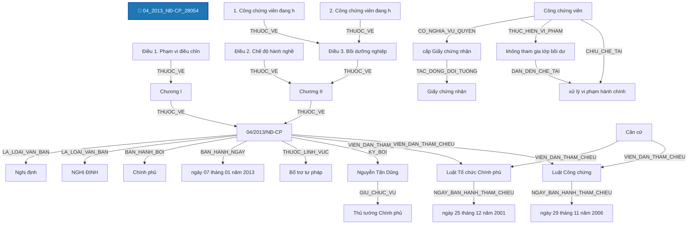

# Báo Cáo Trích Xuất Thực Thể & Quan Hệ Pháp Luật (Joint NER & RE)
> **Tệp nguồn thử nghiệm từ Google Drive**: `04_2013_NĐ-CP_28054`
> **Thời gian thực hiện**: 2026-10-20 20:03:38

---

## 1. Thông Tin Văn Bản & Môi Trường Thử Nghiệm

- **Mã văn bản**: `04_2013_NĐ-CP_28054`
- **Google Drive Folder ID**: `raw_local`
- **Số hiệu**: `04/2013/NĐ-CP`
- **Tiêu đề văn bản**: Nghị định số 04/2013/NĐ-CP Quy định chi tiết và hướng dẫn thi hành một số điều của Luật Công chứng
- **Cơ quan ban hành**: Chính phủ
- **Lĩnh vực pháp lý**: Tư pháp, Bổ trợ tư pháp
- **Người ký**: Nguyễn Tấn Dũng (Thủ tướng Chính phủ)
- **Mô hình suy luận**: `PhoBERT-SpERT` (Boundary + Union Context + Biaffine + BCEWithLogitsLoss)
- **Thời gian xử lý toàn bộ**: **20.96 giây** (189 đoạn văn bản)

---

## 2. Bảng Tổng Quan Kết Quả Trích Xuất

| Chỉ Số Tổng Hợp | Số Lượng Đạt Được | Ghi Chú |
| :--- | :---: | :--- |
| **Tổng số đoạn phân tích** | **189** | Tự động đọc từ file `noi_dung.docx` |
| **Tổng số thực thể phát hiện** | **823** | Đã áp dụng Nested-Aware NMS (Hỗ trợ thực thể lồng nhau) |
| **Tổng số quan hệ liên kết** | **332** | Bao gồm cả quan hệ cấu trúc và quan hệ nội câu lấy Hub làm tâm |

### Phân Bố Thực Thể Theo Nhãn Loại

| Nhãn Thực Thể | Ý Nghĩa Pháp Lý | Số Lượng Phát Hiện | Tỷ Lệ (%) |
| :--- | :--- | :---: | :---: |
| **TO_CHUC_DOANH_NGHIEP** | Tổ chức / Pháp nhân / Doanh nghiệp | 182 | 22.1% |
| **GIAY_TO_HO_SO** | Hồ sơ / Giấy tờ hành chính / Bằng cấp | 117 | 14.2% |
| **CO_QUAN_THAM_QUYEN** | Cơ quan / Chức danh có thẩm quyền | 104 | 12.6% |
| **CHU_THE_CA_NHAN** | Chủ thể cá nhân / Vai trò pháp lý | 83 | 10.1% |
| **KHOAN** | Khoản trong văn bản | 69 | 8.4% |
| **THAM_CHIEU_PHAP_LY** | Điều khoản đối chiếu / Viện dẫn pháp lý | 50 | 6.1% |
| **DIEM** | Điểm trong văn bản | 48 | 5.8% |
| **TU_KHOA_PHAP_LY** | Từ khóa pháp lý / Động từ lập pháp neo tham chiếu | 46 | 5.6% |
| **DIEU** | Điều trong văn bản | 26 | 3.2% |
| **THOI_HAN** | Thời hạn / Khoảng thời gian | 23 | 2.8% |
| **DIA_DIEM** | Địa điểm / Không gian pháp lý | 21 | 2.6% |
| **NGHIA_VU_QUYEN** | [Hub] Nghĩa vụ / Quyền / Thủ tục pháp lý | 13 | 1.6% |
| **BIEN_PHAP_KHAC_PHUC** | [Hub] Biện pháp khắc phục hậu quả | 11 | 1.3% |
| **TAI_SAN_VAT_CHAT** | Tài sản / Phương tiện / Tang vật / Tiền lương | 7 | 0.9% |
| **NGAY_THAM_CHIEU** | Ngày ban hành của văn bản tham chiếu | 6 | 0.7% |
| **CHUONG** | Chương trong văn bản | 5 | 0.6% |
| **HANH_VI_VI_PHAM** | [Hub] Hành vi vi phạm pháp luật | 3 | 0.4% |
| **LOAI_VAN_BAN** | Loại văn bản | 2 | 0.2% |
| **SO_HIEU** | Số hiệu văn bản | 1 | 0.1% |
| **CO_QUAN_BAN_HANH** | Cơ quan ban hành | 1 | 0.1% |
| **NGAY_BAN_HANH** | Ngày ban hành (văn bản hiện hành) | 1 | 0.1% |
| **LINH_VUC** | Lĩnh vực pháp lý / Ngành, lĩnh vực điều chỉnh | 1 | 0.1% |
| **CHUC_DANH_NGUOI_KY** | Chức danh người ký | 1 | 0.1% |
| **NGUOI_KY** | Người ký | 1 | 0.1% |
| **HINH_PHAT_CHE_TAI** | [Hub] Chế tài xử phạt | 1 | 0.1% |

### Phân Bố Quan Hệ Theo Nhãn Loại

| Loại Quan Hệ | Ý Nghĩa Pháp Lý | Số Lượng Phát Hiện | Tỷ Lệ (%) |
| :--- | :--- | :---: | :---: |
| **THUOC_VE** | Thuộc về cấu trúc phân cấp (DIEM -> KHOAN -> DIEU -> CHUONG -> SO_HIEU) | 148 | 44.6% |
| **VIEN_DAN_THAM_CHIEU** | [Nội câu] Đối chiếu / Viện dẫn đến điều khoản khác | 103 | 31.0% |
| **TAC_DONG_DOI_TUONG** | [Nội câu] Hành vi / Biện pháp tác động lên tài sản / giấy tờ | 28 | 8.4% |
| **TAC_DONG_CHU_THE** | [Nội câu] Hành vi tác động đến chủ thể khác | 12 | 3.6% |
| **CO_THAM_QUYEN** | [Nội câu] Cơ quan / Chức danh có thẩm quyền xử lý | 12 | 3.6% |
| **NGAY_BAN_HANH_THAM_CHIEU** | [Nội câu] Ngày ban hành của văn bản tham chiếu | 6 | 1.8% |
| **CO_NGHIA_VU_QUYEN** | [Nội câu] Chủ thể có nghĩa vụ / quyền thực hiện hành vi | 6 | 1.8% |
| **TRONG_THOI_HAN** | [Nội câu] Ràng buộc trong thời hạn / khoảng thời gian | 5 | 1.5% |
| **CHIU_CHE_TAI** | [Nội câu] Chủ thể chịu chế tài xử phạt trực tiếp | 3 | 0.9% |
| **LA_LOAI_VAN_BAN** | Là loại văn bản (SO_HIEU -> LOAI_VAN_BAN) | 2 | 0.6% |
| **BAN_HANH_BOI** | Được ban hành bởi cơ quan (SO_HIEU -> CO_QUAN_BAN_HANH) | 1 | 0.3% |
| **BAN_HANH_NGAY** | Được ban hành vào ngày (SO_HIEU -> NGAY_BAN_HANH) | 1 | 0.3% |
| **THUOC_LINH_VUC** | [Nội câu / Thuộc tính] Thuộc lĩnh vực pháp lý điều chỉnh | 1 | 0.3% |
| **KY_BOI** | Được ký bởi người ký (SO_HIEU -> NGUOI_KY) | 1 | 0.3% |
| **GIU_CHUC_VU** | Giữ chức vụ người ký (NGUOI_KY -> CHUC_DANH_NGUOI_KY) | 1 | 0.3% |
| **THUC_HIEN_VI_PHAM** | [Nội câu] Chủ thể thực hiện hành vi vi phạm | 1 | 0.3% |
| **DAN_DEN_CHE_TAI** | [Nội câu] Hành vi vi phạm dẫn đến chế tài xử phạt / khắc phục | 1 | 0.3% |

---

## 3. Sơ Đồ Cấu Trúc Quan Hệ Trích Xuất (Mermaid Graph)

---

## 4. Chi Tiết Danh Sách Thực Thể Được Trích Xuất (Toàn Bộ 100% Nội Dung)

| STT | Loại Thực Thể | Tên / Trích Đoạn Thực Thể | Vị Trí (Span) | Độ Tin Cậy (Conf) | Ngữ Cảnh Đầy Đủ (Không Cắt Chữ) |
| :---: | :--- | :--- | :---: | :---: | :--- |
| 1 | `LOAI_VAN_BAN` | **Nghị định** | `(2, 3)` | `73.49%` | **[Nghị định]** số 04/2013/NĐ-CP Quy định chi tiết và hướng dẫn thi hành một số điều của Luật Công chứng |
| 2 | `SO_HIEU` | **04/2013/NĐ-CP** | `(4, 5)` | `100.00%` | Nghị định số **[04/2013/NĐ-CP]** Quy định chi tiết và hướng dẫn thi hành một số điều của Luật Công chứng |
| 3 | `LOAI_VAN_BAN` | **NGHỊ ĐỊNH** | `(16, 17)` | `99.95%` | **[NGHỊ ĐỊNH]** |
| 4 | `CO_QUAN_BAN_HANH` | **Chính phủ** | `(0, 0)` | `99.00%` | [Bổ sung từ thuộc tính văn bản]: **[Chính phủ]** |
| 5 | `NGAY_BAN_HANH` | **ngày 07 tháng 01 năm 2013** | `(0, 0)` | `99.00%` | [Bổ sung từ thuộc tính văn bản]: **[ngày 07 tháng 01 năm 2013]** |
| 6 | `LINH_VUC` | **Bổ trợ tư pháp** | `(0, 0)` | `99.00%` | [Bổ sung từ thuộc tính văn bản]: **[Bổ trợ tư pháp]** |
| 7 | `CHUC_DANH_NGUOI_KY` | **Thủ tướng Chính phủ** | `(0, 0)` | `99.00%` | [Bổ sung từ thuộc tính văn bản]: **[Thủ tướng Chính phủ]** |
| 8 | `NGUOI_KY` | **Nguyễn Tấn Dũng** | `(0, 0)` | `99.00%` | [Bổ sung từ thuộc tính văn bản]: **[Nguyễn Tấn Dũng]** |
| 9 | `TU_KHOA_PHAP_LY` | **Căn cứ** | `(0, 1)` | `100.00%` | **[Căn cứ]** Luật Tổ chức Chính phủ ngày 25 tháng 12 năm 2001; |
| 10 | `THAM_CHIEU_PHAP_LY` | **Luật Tổ chức Chính phủ** | `(1, 4)` | `100.00%` | Căn cứ **[Luật Tổ chức Chính phủ]** ngày 25 tháng 12 năm 2001; |
| 11 | `NGAY_THAM_CHIEU` | **ngày 25 tháng 12 năm 2001** | `(4, 10)` | `100.00%` | Căn cứ Luật Tổ chức Chính phủ **[ngày 25 tháng 12 năm 2001]**; |
| 12 | `TU_KHOA_PHAP_LY` | **Căn cứ** | `(0, 1)` | `100.00%` | **[Căn cứ]** Luật Công chứng ngày 29 tháng 11 năm 2006; |
| 13 | `THAM_CHIEU_PHAP_LY` | **Luật Công chứng** | `(1, 3)` | `100.00%` | Căn cứ **[Luật Công chứng]** ngày 29 tháng 11 năm 2006; |
| 14 | `NGAY_THAM_CHIEU` | **ngày 29 tháng 11 năm 2006** | `(3, 9)` | `100.00%` | Căn cứ Luật Công chứng **[ngày 29 tháng 11 năm 2006]**; |
| 15 | `CO_QUAN_THAM_QUYEN` | **Bộ trưởng Bộ Tư pháp** | `(3, 6)` | `100.00%` | Theo đề nghị của **[Bộ trưởng Bộ Tư pháp]**; |
| 16 | `CO_QUAN_THAM_QUYEN` | **Chính phủ** | `(0, 1)` | `100.00%` | **[Chính phủ]** ban hành Nghị định quy định chi tiết và hướng dẫn thi hành một số điều của Luật Công chứng, |
| 17 | `CHUONG` | **Chương I** | `(0, 8)` | `99.00%` | **[Chương I]** |
| 18 | `DIEU` | **Điều 1. Phạm vi điều chỉnh** | `(0, 5)` | `100.00%` | **[Điều 1. Phạm vi điều chỉnh]** |
| 19 | `CHU_THE_CA_NHAN` | **công chứng viên** | `(13, 14)` | `99.92%` | Nghị định này quy định chi tiết và hướng dẫn thi hành một số điều của Luật Công chứng về **[công chứng viên]**, tổ chức và hoạt động công chứng và quản lý nhà nước về công chứng. |
| 20 | `CHUONG` | **Chương II** | `(0, 9)` | `99.00%` | **[Chương II]** |
| 21 | `CHU_THE_CA_NHAN` | **CÔNG CHỨNG VIÊN** | `(0, 1)` | `95.00%` | **[CÔNG CHỨNG VIÊN]** |
| 22 | `DIEU` | **Điều 2. Chế độ hành nghề của công chứng viên** | `(0, 7)` | `100.00%` | **[Điều 2. Chế độ hành nghề của công chứng viên]** |
| 23 | `CHU_THE_CA_NHAN` | **công chứng viên** | `(6, 7)` | `93.53%` | Điều 2. Chế độ hành nghề của **[công chứng viên]** |
| 24 | `CHU_THE_CA_NHAN` | **Công chứng viên** | `(0, 1)` | `99.31%` | **[Công chứng viên]** phải hành nghề chuyên trách; không được đồng thời hành nghề khác, không được kiêm nhiệm các chức danh tư pháp như luật sư, đấu giá viên, trọng tài viên, thừa phát lại hoặc các chức danh tư pháp khác. |
| 25 | `CHU_THE_CA_NHAN` | **luật sư** | `(18, 19)` | `99.99%` | Công chứng viên phải hành nghề chuyên trách; không được đồng thời hành nghề khác, không được kiêm nhiệm các chức danh tư pháp như **[luật sư]**, đấu giá viên, trọng tài viên, thừa phát lại hoặc các chức danh tư pháp khác. |
| 26 | `CHU_THE_CA_NHAN` | **thừa phát lại** | `(26, 29)` | `99.89%` | Công chứng viên phải hành nghề chuyên trách; không được đồng thời hành nghề khác, không được kiêm nhiệm các chức danh tư pháp như luật sư, đấu giá viên, trọng tài viên, **[thừa phát lại]** hoặc các chức danh tư pháp khác. |
| 27 | `HANH_VI_VI_PHAM` | **hành nghề khác** | `(8, 10)` | `95.00%` | Công chứng viên phải hành nghề chuyên trách; không được đồng thời **[hành nghề khác]**, không được kiêm nhiệm các chức danh tư pháp như luật sư, đấu giá viên, trọng tài viên, thừa phát lại hoặc các chức danh tư pháp khác. |
| 28 | `HANH_VI_VI_PHAM` | **kiêm nhiệm các chức danh tư pháp** | `(13, 17)` | `95.00%` | Công chứng viên phải hành nghề chuyên trách; không được đồng thời hành nghề khác, không được **[kiêm nhiệm các chức danh tư pháp]** như luật sư, đấu giá viên, trọng tài viên, thừa phát lại hoặc các chức danh tư pháp khác. |
| 29 | `CHU_THE_CA_NHAN` | **đấu giá viên** | `(20, 22)` | `95.00%` | Công chứng viên phải hành nghề chuyên trách; không được đồng thời hành nghề khác, không được kiêm nhiệm các chức danh tư pháp như luật sư, **[đấu giá viên]**, trọng tài viên, thừa phát lại hoặc các chức danh tư pháp khác. |
| 30 | `CHU_THE_CA_NHAN` | **trọng tài viên** | `(23, 24)` | `95.00%` | Công chứng viên phải hành nghề chuyên trách; không được đồng thời hành nghề khác, không được kiêm nhiệm các chức danh tư pháp như luật sư, đấu giá viên, **[trọng tài viên]**, thừa phát lại hoặc các chức danh tư pháp khác. |
| 31 | `DIEU` | **Điều 3. Bồi dưỡng nghiệp vụ công chứng** | `(0, 6)` | `100.00%` | **[Điều 3. Bồi dưỡng nghiệp vụ công chứng]** |
| 32 | `KHOAN` | **1. Công chứng viên đang hành nghề công chứng có nghĩa vụ tham gia lớp bồi dưỡng nghiệp vụ công chứng hàng năm. Thời gian bồi dưỡng tối thiểu là ba ngày. Nội dung bồi dưỡng bao gồm việc cập nhật mới các quy định của pháp luật về công chứng, các quy định pháp luật có liên quan và kỹ năng công chứng các loại hợp đồng, giao dịch.** | `(3, 53)` | `100.00%` | **[1. Công chứng viên đang hành nghề công chứng có nghĩa vụ tham gia lớp bồi dưỡng nghiệp vụ công chứng hàng năm. Thời gian bồi dưỡng tối thiểu là ba ngày. Nội dung bồi dưỡng bao gồm việc cập nhật mới các quy định của pháp luật về công chứng, các quy định pháp luật có liên quan và kỹ năng công chứng các loại hợp đồng, giao dịch.]** |
| 33 | `CHU_THE_CA_NHAN` | **Công chứng viên** | `(5, 6)` | `99.12%` | 1. **[Công chứng viên]** đang hành nghề công chứng có nghĩa vụ tham gia lớp bồi dưỡng nghiệp vụ công chứng hàng năm. Thời gian bồi dưỡng tối thiểu là ba ngày. Nội dung bồi dưỡng bao gồm việc cập nhật mới các quy định của pháp luật về công chứng, các quy định pháp luật có liên quan và kỹ năng công chứng các loại hợp đồng, giao dịch. |
| 34 | `THOI_HAN` | **tối thiểu là ba ngày** | `(21, 25)` | `99.94%` | 1. Công chứng viên đang hành nghề công chứng có nghĩa vụ tham gia lớp bồi dưỡng nghiệp vụ công chứng hàng năm. Thời gian bồi dưỡng **[tối thiểu là ba ngày]**. Nội dung bồi dưỡng bao gồm việc cập nhật mới các quy định của pháp luật về công chứng, các quy định pháp luật có liên quan và kỹ năng công chứng các loại hợp đồng, giao dịch. |
| 35 | `GIAY_TO_HO_SO` | **hợp đồng, giao dịch** | `(49, 52)` | `95.00%` | 1. Công chứng viên đang hành nghề công chứng có nghĩa vụ tham gia lớp bồi dưỡng nghiệp vụ công chứng hàng năm. Thời gian bồi dưỡng tối thiểu là ba ngày. Nội dung bồi dưỡng bao gồm việc cập nhật mới các quy định của pháp luật về công chứng, các quy định pháp luật có liên quan và kỹ năng công chứng các loại **[hợp đồng, giao dịch]**. |
| 36 | `CHU_THE_CA_NHAN` | **Công chứng viên** | `(0, 1)` | `96.47%` | **[Công chứng viên]** hoàn thành lớp bồi dưỡng thì được cấp Giấy chứng nhận. |
| 37 | `NGHIA_VU_QUYEN` | **cấp Giấy chứng nhận** | `(6, 9)` | `99.89%` | Công chứng viên hoàn thành lớp bồi dưỡng thì được **[cấp Giấy chứng nhận]**. |
| 38 | `GIAY_TO_HO_SO` | **Giấy chứng nhận** | `(7, 9)` | `99.96%` | Công chứng viên hoàn thành lớp bồi dưỡng thì được cấp **[Giấy chứng nhận]**. |
| 39 | `KHOAN` | **2. Công chứng viên đang hành nghề công chứng mà không tham gia lớp bồi dưỡng nghiệp vụ công chứng hàng năm thì tùy theo mức độ vi phạm mà bị xử lý kỷ luật, xử lý vi phạm hành chính hoặc các biện pháp xử lý khác theo quy định của pháp luật hoặc theo Điều lệ của tổ chức xã hội nghề nghiệp của công chứng viên.** | `(3, 50)` | `100.00%` | **[2. Công chứng viên đang hành nghề công chứng mà không tham gia lớp bồi dưỡng nghiệp vụ công chứng hàng năm thì tùy theo mức độ vi phạm mà bị xử lý kỷ luật, xử lý vi phạm hành chính hoặc các biện pháp xử lý khác theo quy định của pháp luật hoặc theo Điều lệ của tổ chức xã hội nghề nghiệp của công chứng viên.]** |
| 40 | `CHU_THE_CA_NHAN` | **Công chứng viên** | `(5, 6)` | `99.42%` | 2. **[Công chứng viên]** đang hành nghề công chứng mà không tham gia lớp bồi dưỡng nghiệp vụ công chứng hàng năm thì tùy theo mức độ vi phạm mà bị xử lý kỷ luật, xử lý vi phạm hành chính hoặc các biện pháp xử lý khác theo quy định của pháp luật hoặc theo Điều lệ của tổ chức xã hội nghề nghiệp của công chứng viên. |
| 41 | `HANH_VI_VI_PHAM` | **không tham gia lớp bồi dưỡng nghiệp vụ công chứng hàng năm** | `(10, 18)` | `74.69%` | 2. Công chứng viên đang hành nghề công chứng mà **[không tham gia lớp bồi dưỡng nghiệp vụ công chứng hàng năm]** thì tùy theo mức độ vi phạm mà bị xử lý kỷ luật, xử lý vi phạm hành chính hoặc các biện pháp xử lý khác theo quy định của pháp luật hoặc theo Điều lệ của tổ chức xã hội nghề nghiệp của công chứng viên. |
| 42 | `HINH_PHAT_CHE_TAI` | **xử lý vi phạm hành chính** | `(28, 31)` | `99.87%` | 2. Công chứng viên đang hành nghề công chứng mà không tham gia lớp bồi dưỡng nghiệp vụ công chứng hàng năm thì tùy theo mức độ vi phạm mà bị xử lý kỷ luật, **[xử lý vi phạm hành chính]** hoặc các biện pháp xử lý khác theo quy định của pháp luật hoặc theo Điều lệ của tổ chức xã hội nghề nghiệp của công chứng viên. |
| 43 | `GIAY_TO_HO_SO` | **Điều lệ của tổ chức xã hội nghề nghiệp của công chứng viên** | `(42, 49)` | `99.93%` | 2. Công chứng viên đang hành nghề công chứng mà không tham gia lớp bồi dưỡng nghiệp vụ công chứng hàng năm thì tùy theo mức độ vi phạm mà bị xử lý kỷ luật, xử lý vi phạm hành chính hoặc các biện pháp xử lý khác theo quy định của pháp luật hoặc theo **[Điều lệ của tổ chức xã hội nghề nghiệp của công chứng viên]**. |
| 44 | `KHOAN` | **3. Bộ trưởng Bộ Tư pháp có trách nhiệm hướng dẫn, chỉ đạo tổ chức thực hiện việc bồi dưỡng nghiệp vụ công chứng cho công chứng viên theo quy định tại Khoản 1 và Khoản 2 Điều này.** | `(3, 32)` | `100.00%` | **[3. Bộ trưởng Bộ Tư pháp có trách nhiệm hướng dẫn, chỉ đạo tổ chức thực hiện việc bồi dưỡng nghiệp vụ công chứng cho công chứng viên theo quy định tại Khoản 1 và Khoản 2 Điều này.]** |
| 45 | `CO_QUAN_THAM_QUYEN` | **Bộ trưởng Bộ Tư pháp** | `(5, 8)` | `100.00%` | 3. **[Bộ trưởng Bộ Tư pháp]** có trách nhiệm hướng dẫn, chỉ đạo tổ chức thực hiện việc bồi dưỡng nghiệp vụ công chứng cho công chứng viên theo quy định tại Khoản 1 và Khoản 2 Điều này. |
| 46 | `CHU_THE_CA_NHAN` | **công chứng viên** | `(20, 21)` | `99.99%` | 3. Bộ trưởng Bộ Tư pháp có trách nhiệm hướng dẫn, chỉ đạo tổ chức thực hiện việc bồi dưỡng nghiệp vụ công chứng cho **[công chứng viên]** theo quy định tại Khoản 1 và Khoản 2 Điều này. |
| 47 | `TU_KHOA_PHAP_LY` | **theo quy định tại** | `(21, 24)` | `100.00%` | 3. Bộ trưởng Bộ Tư pháp có trách nhiệm hướng dẫn, chỉ đạo tổ chức thực hiện việc bồi dưỡng nghiệp vụ công chứng cho công chứng viên **[theo quy định tại]** Khoản 1 và Khoản 2 Điều này. |
| 48 | `THAM_CHIEU_PHAP_LY` | **Khoản 1 và Khoản 2 Điều này** | `(24, 31)` | `99.99%` | 3. Bộ trưởng Bộ Tư pháp có trách nhiệm hướng dẫn, chỉ đạo tổ chức thực hiện việc bồi dưỡng nghiệp vụ công chứng cho công chứng viên theo quy định tại **[Khoản 1 và Khoản 2 Điều này]**. |
| 49 | `DIEU` | **Điều 4. Bổ nhiệm công chứng viên đối với cán bộ, công chức, viên chức đã nghỉ hưu hoặc thôi việc theo nguyện vọng** | `(0, 18)` | `99.94%` | **[Điều 4. Bổ nhiệm công chứng viên đối với cán bộ, công chức, viên chức đã nghỉ hưu hoặc thôi việc theo nguyện vọng]** |
| 50 | `CHU_THE_CA_NHAN` | **công chứng viên** | `(4, 5)` | `98.95%` | Điều 4. Bổ nhiệm **[công chứng viên]** đối với cán bộ, công chức, viên chức đã nghỉ hưu hoặc thôi việc theo nguyện vọng |
| 51 | `CHU_THE_CA_NHAN` | **cán bộ, công chức, viên chức** | `(6, 11)` | `99.98%` | Điều 4. Bổ nhiệm công chứng viên đối với **[cán bộ, công chức, viên chức]** đã nghỉ hưu hoặc thôi việc theo nguyện vọng |
| 52 | `KHOAN` | **1. Trong trường hợp cán bộ, công chức, viên chức đã nghỉ hưu hoặc thôi việc theo nguyện vọng có nhu cầu được bổ nhiệm công chứng viên để hành nghề tại Văn phòng công chứng thì trong hồ sơ đề nghị bổ nhiệm công chứng viên phải kèm theo giấy tờ chứng minh là đã nghỉ hưu hoặc thôi việc theo nguyện vọng.** | `(3, 49)` | `100.00%` | **[1. Trong trường hợp cán bộ, công chức, viên chức đã nghỉ hưu hoặc thôi việc theo nguyện vọng có nhu cầu được bổ nhiệm công chứng viên để hành nghề tại Văn phòng công chứng thì trong hồ sơ đề nghị bổ nhiệm công chứng viên phải kèm theo giấy tờ chứng minh là đã nghỉ hưu hoặc thôi việc theo nguyện vọng.]** |
| 53 | `CHU_THE_CA_NHAN` | **cán bộ, công chức, viên chức** | `(7, 12)` | `99.98%` | 1. Trong trường hợp **[cán bộ, công chức, viên chức]** đã nghỉ hưu hoặc thôi việc theo nguyện vọng có nhu cầu được bổ nhiệm công chứng viên để hành nghề tại Văn phòng công chứng thì trong hồ sơ đề nghị bổ nhiệm công chứng viên phải kèm theo giấy tờ chứng minh là đã nghỉ hưu hoặc thôi việc theo nguyện vọng. |
| 54 | `CHU_THE_CA_NHAN` | **công chứng viên** | `(23, 24)` | `99.98%` | 1. Trong trường hợp cán bộ, công chức, viên chức đã nghỉ hưu hoặc thôi việc theo nguyện vọng có nhu cầu được bổ nhiệm **[công chứng viên]** để hành nghề tại Văn phòng công chứng thì trong hồ sơ đề nghị bổ nhiệm công chứng viên phải kèm theo giấy tờ chứng minh là đã nghỉ hưu hoặc thôi việc theo nguyện vọng. |
| 55 | `TO_CHUC_DOANH_NGHIEP` | **Văn phòng công chứng** | `(27, 29)` | `99.92%` | 1. Trong trường hợp cán bộ, công chức, viên chức đã nghỉ hưu hoặc thôi việc theo nguyện vọng có nhu cầu được bổ nhiệm công chứng viên để hành nghề tại **[Văn phòng công chứng]** thì trong hồ sơ đề nghị bổ nhiệm công chứng viên phải kèm theo giấy tờ chứng minh là đã nghỉ hưu hoặc thôi việc theo nguyện vọng. |
| 56 | `GIAY_TO_HO_SO` | **hồ sơ đề nghị bổ nhiệm công chứng viên** | `(31, 35)` | `99.97%` | 1. Trong trường hợp cán bộ, công chức, viên chức đã nghỉ hưu hoặc thôi việc theo nguyện vọng có nhu cầu được bổ nhiệm công chứng viên để hành nghề tại Văn phòng công chứng thì trong **[hồ sơ đề nghị bổ nhiệm công chứng viên]** phải kèm theo giấy tờ chứng minh là đã nghỉ hưu hoặc thôi việc theo nguyện vọng. |
| 57 | `GIAY_TO_HO_SO` | **giấy tờ chứng minh là đã nghỉ hưu** | `(38, 44)` | `96.51%` | 1. Trong trường hợp cán bộ, công chức, viên chức đã nghỉ hưu hoặc thôi việc theo nguyện vọng có nhu cầu được bổ nhiệm công chứng viên để hành nghề tại Văn phòng công chứng thì trong hồ sơ đề nghị bổ nhiệm công chứng viên phải kèm theo **[giấy tờ chứng minh là đã nghỉ hưu]** hoặc thôi việc theo nguyện vọng. |
| 58 | `KHOAN` | **2. Công chứng viên của Phòng Công chứng đã nghỉ hưu hoặc thôi việc theo nguyện vọng không quá một năm thì vẫn được giữ chức danh công chứng viên và có thể thành lập Văn phòng công chứng hoặc tham gia Văn phòng công chứng đang hoạt động. Thời gian không quá một năm được tính từ ngày có quyết định nghỉ hưu hoặc cho thôi việc đến ngày nộp hồ sơ đề nghị thành lập Văn phòng công chứng hoặc được tiếp nhận là thành viên hợp danh của Văn phòng công chứng hoặc ký hợp đồng làm việc với Văn phòng công chứng.** | `(3, 80)` | `98.00%` | **[2. Công chứng viên của Phòng Công chứng đã nghỉ hưu hoặc thôi việc theo nguyện vọng không quá một năm thì vẫn được giữ chức danh công chứng viên và có thể thành lập Văn phòng công chứng hoặc tham gia Văn phòng công chứng đang hoạt động. Thời gian không quá một năm được tính từ ngày có quyết định nghỉ hưu hoặc cho thôi việc đến ngày nộp hồ sơ đề nghị thành lập Văn phòng công chứng hoặc được tiếp nhận là thành viên hợp danh của Văn phòng công chứng hoặc ký hợp đồng làm việc với Văn phòng công chứng.]** |
| 59 | `CHU_THE_CA_NHAN` | **Công chứng viên** | `(5, 6)` | `99.94%` | 2. **[Công chứng viên]** của Phòng Công chứng đã nghỉ hưu hoặc thôi việc theo nguyện vọng không quá một năm thì vẫn được giữ chức danh công chứng viên và có thể thành lập Văn phòng công chứng hoặc tham gia Văn phòng công chứng đang hoạt động. Thời gian không quá một năm được tính từ ngày có quyết định nghỉ hưu hoặc cho thôi việc đến ngày nộp hồ sơ đề nghị thành lập Văn phòng công chứng hoặc được tiếp nhận là thành viên hợp danh của Văn phòng công chứng hoặc ký hợp đồng làm việc với Văn phòng công chứng. |
| 60 | `TO_CHUC_DOANH_NGHIEP` | **Phòng Công chứng** | `(7, 9)` | `98.59%` | 2. Công chứng viên của **[Phòng Công chứng]** đã nghỉ hưu hoặc thôi việc theo nguyện vọng không quá một năm thì vẫn được giữ chức danh công chứng viên và có thể thành lập Văn phòng công chứng hoặc tham gia Văn phòng công chứng đang hoạt động. Thời gian không quá một năm được tính từ ngày có quyết định nghỉ hưu hoặc cho thôi việc đến ngày nộp hồ sơ đề nghị thành lập Văn phòng công chứng hoặc được tiếp nhận là thành viên hợp danh của Văn phòng công chứng hoặc ký hợp đồng làm việc với Văn phòng công chứng. |
| 61 | `THOI_HAN` | **không quá một năm** | `(16, 20)` | `100.00%` | 2. Công chứng viên của Phòng Công chứng đã nghỉ hưu hoặc thôi việc theo nguyện vọng **[không quá một năm]** thì vẫn được giữ chức danh công chứng viên và có thể thành lập Văn phòng công chứng hoặc tham gia Văn phòng công chứng đang hoạt động. Thời gian không quá một năm được tính từ ngày có quyết định nghỉ hưu hoặc cho thôi việc đến ngày nộp hồ sơ đề nghị thành lập Văn phòng công chứng hoặc được tiếp nhận là thành viên hợp danh của Văn phòng công chứng hoặc ký hợp đồng làm việc với Văn phòng công chứng. |
| 62 | `CHU_THE_CA_NHAN` | **công chứng viên** | `(25, 26)` | `100.00%` | 2. Công chứng viên của Phòng Công chứng đã nghỉ hưu hoặc thôi việc theo nguyện vọng không quá một năm thì vẫn được giữ chức danh **[công chứng viên]** và có thể thành lập Văn phòng công chứng hoặc tham gia Văn phòng công chứng đang hoạt động. Thời gian không quá một năm được tính từ ngày có quyết định nghỉ hưu hoặc cho thôi việc đến ngày nộp hồ sơ đề nghị thành lập Văn phòng công chứng hoặc được tiếp nhận là thành viên hợp danh của Văn phòng công chứng hoặc ký hợp đồng làm việc với Văn phòng công chứng. |
| 63 | `TO_CHUC_DOANH_NGHIEP` | **Văn phòng công chứng** | `(29, 31)` | `99.95%` | 2. Công chứng viên của Phòng Công chứng đã nghỉ hưu hoặc thôi việc theo nguyện vọng không quá một năm thì vẫn được giữ chức danh công chứng viên và có thể thành lập **[Văn phòng công chứng]** hoặc tham gia Văn phòng công chứng đang hoạt động. Thời gian không quá một năm được tính từ ngày có quyết định nghỉ hưu hoặc cho thôi việc đến ngày nộp hồ sơ đề nghị thành lập Văn phòng công chứng hoặc được tiếp nhận là thành viên hợp danh của Văn phòng công chứng hoặc ký hợp đồng làm việc với Văn phòng công chứng. |
| 64 | `TO_CHUC_DOANH_NGHIEP` | **Văn phòng công chứng** | `(33, 35)` | `99.98%` | 2. Công chứng viên của Phòng Công chứng đã nghỉ hưu hoặc thôi việc theo nguyện vọng không quá một năm thì vẫn được giữ chức danh công chứng viên và có thể thành lập **[Văn phòng công chứng]** hoặc tham gia Văn phòng công chứng đang hoạt động. Thời gian không quá một năm được tính từ ngày có quyết định nghỉ hưu hoặc cho thôi việc đến ngày nộp hồ sơ đề nghị thành lập Văn phòng công chứng hoặc được tiếp nhận là thành viên hợp danh của Văn phòng công chứng hoặc ký hợp đồng làm việc với Văn phòng công chứng. |
| 65 | `THOI_HAN` | **không quá một năm** | `(39, 43)` | `100.00%` | 2. Công chứng viên của Phòng Công chứng đã nghỉ hưu hoặc thôi việc theo nguyện vọng **[không quá một năm]** thì vẫn được giữ chức danh công chứng viên và có thể thành lập Văn phòng công chứng hoặc tham gia Văn phòng công chứng đang hoạt động. Thời gian không quá một năm được tính từ ngày có quyết định nghỉ hưu hoặc cho thôi việc đến ngày nộp hồ sơ đề nghị thành lập Văn phòng công chứng hoặc được tiếp nhận là thành viên hợp danh của Văn phòng công chứng hoặc ký hợp đồng làm việc với Văn phòng công chứng. |
| 66 | `GIAY_TO_HO_SO` | **quyết định nghỉ hưu** | `(48, 51)` | `93.87%` | 2. Công chứng viên của Phòng Công chứng đã nghỉ hưu hoặc thôi việc theo nguyện vọng không quá một năm thì vẫn được giữ chức danh công chứng viên và có thể thành lập Văn phòng công chứng hoặc tham gia Văn phòng công chứng đang hoạt động. Thời gian không quá một năm được tính từ ngày có **[quyết định nghỉ hưu]** hoặc cho thôi việc đến ngày nộp hồ sơ đề nghị thành lập Văn phòng công chứng hoặc được tiếp nhận là thành viên hợp danh của Văn phòng công chứng hoặc ký hợp đồng làm việc với Văn phòng công chứng. |
| 67 | `NGHIA_VU_QUYEN` | **nộp hồ sơ đề nghị thành lập Văn phòng công chứng** | `(56, 62)` | `99.97%` | 2. Công chứng viên của Phòng Công chứng đã nghỉ hưu hoặc thôi việc theo nguyện vọng không quá một năm thì vẫn được giữ chức danh công chứng viên và có thể thành lập Văn phòng công chứng hoặc tham gia Văn phòng công chứng đang hoạt động. Thời gian không quá một năm được tính từ ngày có quyết định nghỉ hưu hoặc cho thôi việc đến ngày **[nộp hồ sơ đề nghị thành lập Văn phòng công chứng]** hoặc được tiếp nhận là thành viên hợp danh của Văn phòng công chứng hoặc ký hợp đồng làm việc với Văn phòng công chứng. |
| 68 | `GIAY_TO_HO_SO` | **hồ sơ đề nghị thành lập Văn phòng công chứng** | `(57, 62)` | `99.99%` | 2. Công chứng viên của Phòng Công chứng đã nghỉ hưu hoặc thôi việc theo nguyện vọng không quá một năm thì vẫn được giữ chức danh công chứng viên và có thể thành lập Văn phòng công chứng hoặc tham gia Văn phòng công chứng đang hoạt động. Thời gian không quá một năm được tính từ ngày có quyết định nghỉ hưu hoặc cho thôi việc đến ngày nộp **[hồ sơ đề nghị thành lập Văn phòng công chứng]** hoặc được tiếp nhận là thành viên hợp danh của Văn phòng công chứng hoặc ký hợp đồng làm việc với Văn phòng công chứng. |
| 69 | `TO_CHUC_DOANH_NGHIEP` | **thành viên hợp danh** | `(66, 69)` | `99.89%` | 2. Công chứng viên của Phòng Công chứng đã nghỉ hưu hoặc thôi việc theo nguyện vọng không quá một năm thì vẫn được giữ chức danh công chứng viên và có thể thành lập Văn phòng công chứng hoặc tham gia Văn phòng công chứng đang hoạt động. Thời gian không quá một năm được tính từ ngày có quyết định nghỉ hưu hoặc cho thôi việc đến ngày nộp hồ sơ đề nghị thành lập Văn phòng công chứng hoặc được tiếp nhận là **[thành viên hợp danh]** của Văn phòng công chứng hoặc ký hợp đồng làm việc với Văn phòng công chứng. |
| 70 | `TO_CHUC_DOANH_NGHIEP` | **Văn phòng công chứng** | `(70, 72)` | `99.98%` | 2. Công chứng viên của Phòng Công chứng đã nghỉ hưu hoặc thôi việc theo nguyện vọng không quá một năm thì vẫn được giữ chức danh công chứng viên và có thể thành lập **[Văn phòng công chứng]** hoặc tham gia Văn phòng công chứng đang hoạt động. Thời gian không quá một năm được tính từ ngày có quyết định nghỉ hưu hoặc cho thôi việc đến ngày nộp hồ sơ đề nghị thành lập Văn phòng công chứng hoặc được tiếp nhận là thành viên hợp danh của Văn phòng công chứng hoặc ký hợp đồng làm việc với Văn phòng công chứng. |
| 71 | `GIAY_TO_HO_SO` | **hợp đồng làm việc** | `(74, 76)` | `50.39%` | 2. Công chứng viên của Phòng Công chứng đã nghỉ hưu hoặc thôi việc theo nguyện vọng không quá một năm thì vẫn được giữ chức danh công chứng viên và có thể thành lập Văn phòng công chứng hoặc tham gia Văn phòng công chứng đang hoạt động. Thời gian không quá một năm được tính từ ngày có quyết định nghỉ hưu hoặc cho thôi việc đến ngày nộp hồ sơ đề nghị thành lập Văn phòng công chứng hoặc được tiếp nhận là thành viên hợp danh của Văn phòng công chứng hoặc ký **[hợp đồng làm việc]** với Văn phòng công chứng. |
| 72 | `TO_CHUC_DOANH_NGHIEP` | **Văn phòng công chứng** | `(77, 79)` | `99.99%` | 2. Công chứng viên của Phòng Công chứng đã nghỉ hưu hoặc thôi việc theo nguyện vọng không quá một năm thì vẫn được giữ chức danh công chứng viên và có thể thành lập **[Văn phòng công chứng]** hoặc tham gia Văn phòng công chứng đang hoạt động. Thời gian không quá một năm được tính từ ngày có quyết định nghỉ hưu hoặc cho thôi việc đến ngày nộp hồ sơ đề nghị thành lập Văn phòng công chứng hoặc được tiếp nhận là thành viên hợp danh của Văn phòng công chứng hoặc ký hợp đồng làm việc với Văn phòng công chứng. |
| 73 | `CHU_THE_CA_NHAN` | **Công chứng viên** | `(0, 1)` | `99.57%` | **[Công chứng viên]** nghỉ hưu hoặc thôi việc quá một năm nếu có nguyện vọng hành nghề công chứng thì phải làm thủ tục bổ nhiệm lại công chứng viên. |
| 74 | `THOI_HAN` | **quá một năm** | `(5, 8)` | `99.98%` | Công chứng viên nghỉ hưu hoặc thôi việc **[quá một năm]** nếu có nguyện vọng hành nghề công chứng thì phải làm thủ tục bổ nhiệm lại công chứng viên. |
| 75 | `CHU_THE_CA_NHAN` | **công chứng viên** | `(19, 20)` | `100.00%` | Công chứng viên nghỉ hưu hoặc thôi việc quá một năm nếu có nguyện vọng hành nghề công chứng thì phải làm thủ tục bổ nhiệm lại **[công chứng viên]**. |
| 76 | `DIEU` | **Điều 5. Điều kiện hành nghề công chứng đối với luật sư được bổ nhiệm công chứng viên** | `(0, 11)` | `100.00%` | **[Điều 5. Điều kiện hành nghề công chứng đối với luật sư được bổ nhiệm công chứng viên]** |
| 77 | `CHU_THE_CA_NHAN` | **luật sư** | `(7, 8)` | `100.00%` | Điều 5. Điều kiện hành nghề công chứng đối với **[luật sư]** được bổ nhiệm công chứng viên |
| 78 | `CHU_THE_CA_NHAN` | **công chứng viên** | `(10, 11)` | `90.02%` | Điều 5. Điều kiện hành nghề công chứng đối với luật sư được bổ nhiệm **[công chứng viên]** |
| 79 | `KHOAN` | **1. Luật sư được bổ nhiệm công chứng viên để hành nghề công chứng thì khi làm thủ tục đăng ký hoạt động Văn phòng công chứng hoặc bổ sung thành viên hợp danh của Văn phòng công chứng hoặc ký hợp đồng làm việc với Văn phòng công chứng phải có xác nhận của Ban chủ nhiệm Đoàn luật sư về việc đã rút tên khỏi danh sách thành viên của Đoàn luật sư và giấy tờ chứng minh đã chấm dứt hành nghề luật sư.** | `(3, 62)` | `100.00%` | **[1. Luật sư được bổ nhiệm công chứng viên để hành nghề công chứng thì khi làm thủ tục đăng ký hoạt động Văn phòng công chứng hoặc bổ sung thành viên hợp danh của Văn phòng công chứng hoặc ký hợp đồng làm việc với Văn phòng công chứng phải có xác nhận của Ban chủ nhiệm Đoàn luật sư về việc đã rút tên khỏi danh sách thành viên của Đoàn luật sư và giấy tờ chứng minh đã chấm dứt hành nghề luật sư.]** |
| 80 | `CHU_THE_CA_NHAN` | **Luật sư** | `(5, 6)` | `100.00%` | 1. **[Luật sư]** được bổ nhiệm công chứng viên để hành nghề công chứng thì khi làm thủ tục đăng ký hoạt động Văn phòng công chứng hoặc bổ sung thành viên hợp danh của Văn phòng công chứng hoặc ký hợp đồng làm việc với Văn phòng công chứng phải có xác nhận của Ban chủ nhiệm Đoàn luật sư về việc đã rút tên khỏi danh sách thành viên của Đoàn luật sư và giấy tờ chứng minh đã chấm dứt hành nghề luật sư. |
| 81 | `CHU_THE_CA_NHAN` | **công chứng viên** | `(8, 9)` | `99.97%` | 1. Luật sư được bổ nhiệm **[công chứng viên]** để hành nghề công chứng thì khi làm thủ tục đăng ký hoạt động Văn phòng công chứng hoặc bổ sung thành viên hợp danh của Văn phòng công chứng hoặc ký hợp đồng làm việc với Văn phòng công chứng phải có xác nhận của Ban chủ nhiệm Đoàn luật sư về việc đã rút tên khỏi danh sách thành viên của Đoàn luật sư và giấy tờ chứng minh đã chấm dứt hành nghề luật sư. |
| 82 | `TO_CHUC_DOANH_NGHIEP` | **Văn phòng công chứng** | `(18, 20)` | `98.92%` | 1. Luật sư được bổ nhiệm công chứng viên để hành nghề công chứng thì khi làm thủ tục đăng ký hoạt động **[Văn phòng công chứng]** hoặc bổ sung thành viên hợp danh của Văn phòng công chứng hoặc ký hợp đồng làm việc với Văn phòng công chứng phải có xác nhận của Ban chủ nhiệm Đoàn luật sư về việc đã rút tên khỏi danh sách thành viên của Đoàn luật sư và giấy tờ chứng minh đã chấm dứt hành nghề luật sư. |
| 83 | `TO_CHUC_DOANH_NGHIEP` | **thành viên hợp danh** | `(22, 25)` | `99.75%` | 1. Luật sư được bổ nhiệm công chứng viên để hành nghề công chứng thì khi làm thủ tục đăng ký hoạt động Văn phòng công chứng hoặc bổ sung **[thành viên hợp danh]** của Văn phòng công chứng hoặc ký hợp đồng làm việc với Văn phòng công chứng phải có xác nhận của Ban chủ nhiệm Đoàn luật sư về việc đã rút tên khỏi danh sách thành viên của Đoàn luật sư và giấy tờ chứng minh đã chấm dứt hành nghề luật sư. |
| 84 | `TO_CHUC_DOANH_NGHIEP` | **Văn phòng công chứng** | `(26, 28)` | `99.97%` | 1. Luật sư được bổ nhiệm công chứng viên để hành nghề công chứng thì khi làm thủ tục đăng ký hoạt động **[Văn phòng công chứng]** hoặc bổ sung thành viên hợp danh của Văn phòng công chứng hoặc ký hợp đồng làm việc với Văn phòng công chứng phải có xác nhận của Ban chủ nhiệm Đoàn luật sư về việc đã rút tên khỏi danh sách thành viên của Đoàn luật sư và giấy tờ chứng minh đã chấm dứt hành nghề luật sư. |
| 85 | `GIAY_TO_HO_SO` | **hợp đồng làm việc** | `(30, 32)` | `71.78%` | 1. Luật sư được bổ nhiệm công chứng viên để hành nghề công chứng thì khi làm thủ tục đăng ký hoạt động Văn phòng công chứng hoặc bổ sung thành viên hợp danh của Văn phòng công chứng hoặc ký **[hợp đồng làm việc]** với Văn phòng công chứng phải có xác nhận của Ban chủ nhiệm Đoàn luật sư về việc đã rút tên khỏi danh sách thành viên của Đoàn luật sư và giấy tờ chứng minh đã chấm dứt hành nghề luật sư. |
| 86 | `TO_CHUC_DOANH_NGHIEP` | **Văn phòng công chứng** | `(33, 35)` | `99.98%` | 1. Luật sư được bổ nhiệm công chứng viên để hành nghề công chứng thì khi làm thủ tục đăng ký hoạt động **[Văn phòng công chứng]** hoặc bổ sung thành viên hợp danh của Văn phòng công chứng hoặc ký hợp đồng làm việc với Văn phòng công chứng phải có xác nhận của Ban chủ nhiệm Đoàn luật sư về việc đã rút tên khỏi danh sách thành viên của Đoàn luật sư và giấy tờ chứng minh đã chấm dứt hành nghề luật sư. |
| 87 | `TO_CHUC_DOANH_NGHIEP` | **Ban chủ nhiệm Đoàn luật sư** | `(39, 43)` | `99.70%` | 1. Luật sư được bổ nhiệm công chứng viên để hành nghề công chứng thì khi làm thủ tục đăng ký hoạt động Văn phòng công chứng hoặc bổ sung thành viên hợp danh của Văn phòng công chứng hoặc ký hợp đồng làm việc với Văn phòng công chứng phải có xác nhận của **[Ban chủ nhiệm Đoàn luật sư]** về việc đã rút tên khỏi danh sách thành viên của Đoàn luật sư và giấy tờ chứng minh đã chấm dứt hành nghề luật sư. |
| 88 | `TO_CHUC_DOANH_NGHIEP` | **Đoàn luật sư** | `(52, 54)` | `99.70%` | 1. Luật sư được bổ nhiệm công chứng viên để hành nghề công chứng thì khi làm thủ tục đăng ký hoạt động Văn phòng công chứng hoặc bổ sung thành viên hợp danh của Văn phòng công chứng hoặc ký hợp đồng làm việc với Văn phòng công chứng phải có xác nhận của Ban chủ nhiệm **[Đoàn luật sư]** về việc đã rút tên khỏi danh sách thành viên của Đoàn luật sư và giấy tờ chứng minh đã chấm dứt hành nghề luật sư. |
| 89 | `GIAY_TO_HO_SO` | **giấy tờ chứng minh** | `(55, 57)` | `99.80%` | 1. Luật sư được bổ nhiệm công chứng viên để hành nghề công chứng thì khi làm thủ tục đăng ký hoạt động Văn phòng công chứng hoặc bổ sung thành viên hợp danh của Văn phòng công chứng hoặc ký hợp đồng làm việc với Văn phòng công chứng phải có xác nhận của Ban chủ nhiệm Đoàn luật sư về việc đã rút tên khỏi danh sách thành viên của Đoàn luật sư và **[giấy tờ chứng minh]** đã chấm dứt hành nghề luật sư. |
| 90 | `CHU_THE_CA_NHAN` | **luật sư** | `(60, 61)` | `99.99%` | 1. Luật sư được bổ nhiệm công chứng viên để hành nghề công chứng thì khi làm thủ tục đăng ký hoạt động Văn phòng công chứng hoặc bổ sung thành viên hợp danh của Văn phòng công chứng hoặc ký hợp đồng làm việc với Văn phòng công chứng phải có xác nhận của Ban chủ nhiệm Đoàn **[luật sư]** về việc đã rút tên khỏi danh sách thành viên của Đoàn luật sư và giấy tờ chứng minh đã chấm dứt hành nghề luật sư. |
| 91 | `KHOAN` | **2. Việc chấm dứt hành nghề luật sư được thể hiện bằng một trong các giấy tờ sau đây:** | `(3, 19)` | `100.00%` | **[2. Việc chấm dứt hành nghề luật sư được thể hiện bằng một trong các giấy tờ sau đây:]** |
| 92 | `CHU_THE_CA_NHAN` | **luật sư** | `(8, 9)` | `97.23%` | 2. Việc chấm dứt hành nghề **[luật sư]** được thể hiện bằng một trong các giấy tờ sau đây: |
| 93 | `DIEM` | **a) Giấy xác nhận đã nộp lại Giấy đăng ký hành nghề luật sư cho cơ quan đã cấp giấy đó đối với luật sư hành nghề với tư cách cá nhân;** | `(6, 30)` | `100.00%` | **[a) Giấy xác nhận đã nộp lại Giấy đăng ký hành nghề luật sư cho cơ quan đã cấp giấy đó đối với luật sư hành nghề với tư cách cá nhân;]** |
| 94 | `GIAY_TO_HO_SO` | **Giấy xác nhận đã nộp lại Giấy đăng ký hành nghề luật sư** | `(8, 17)` | `99.87%` | a) **[Giấy xác nhận đã nộp lại Giấy đăng ký hành nghề luật sư]** cho cơ quan đã cấp giấy đó đối với luật sư hành nghề với tư cách cá nhân; |
| 95 | `NGHIA_VU_QUYEN` | **cấp giấy đó** | `(20, 23)` | `75.49%` | a) Giấy xác nhận đã nộp lại Giấy đăng ký hành nghề luật sư cho cơ quan đã **[cấp giấy đó]** đối với luật sư hành nghề với tư cách cá nhân; |
| 96 | `CHU_THE_CA_NHAN` | **luật sư** | `(24, 25)` | `100.00%` | a) Giấy xác nhận đã nộp lại Giấy đăng ký hành nghề **[luật sư]** cho cơ quan đã cấp giấy đó đối với luật sư hành nghề với tư cách cá nhân; |
| 97 | `DIEM` | **b) Giấy xác nhận đã nộp lại Giấy đăng ký hoạt động Văn phòng luật sư hoặc Công ty luật trách nhiệm hữu hạn một thành viên cho cơ quan đã cấp đối với luật sư thành lập Văn phòng luật sư hoặc Công ty luật trách nhiệm hữu hạn một thành viên;** | `(6, 42)` | `100.00%` | **[b) Giấy xác nhận đã nộp lại Giấy đăng ký hoạt động Văn phòng luật sư hoặc Công ty luật trách nhiệm hữu hạn một thành viên cho cơ quan đã cấp đối với luật sư thành lập Văn phòng luật sư hoặc Công ty luật trách nhiệm hữu hạn một thành viên;]** |
| 98 | `GIAY_TO_HO_SO` | **Giấy xác nhận đã nộp lại Giấy đăng ký hoạt động Văn phòng luật sư** | `(8, 18)` | `99.90%` | b) **[Giấy xác nhận đã nộp lại Giấy đăng ký hoạt động Văn phòng luật sư]** hoặc Công ty luật trách nhiệm hữu hạn một thành viên cho cơ quan đã cấp đối với luật sư thành lập Văn phòng luật sư hoặc Công ty luật trách nhiệm hữu hạn một thành viên; |
| 99 | `TO_CHUC_DOANH_NGHIEP` | **Công ty luật trách nhiệm hữu hạn một thành viên** | `(19, 25)` | `99.99%` | b) Giấy xác nhận đã nộp lại Giấy đăng ký hoạt động Văn phòng luật sư hoặc **[Công ty luật trách nhiệm hữu hạn một thành viên]** cho cơ quan đã cấp đối với luật sư thành lập Văn phòng luật sư hoặc Công ty luật trách nhiệm hữu hạn một thành viên; |
| 100 | `CHU_THE_CA_NHAN` | **luật sư** | `(30, 31)` | `100.00%` | b) Giấy xác nhận đã nộp lại Giấy đăng ký hoạt động Văn phòng **[luật sư]** hoặc Công ty luật trách nhiệm hữu hạn một thành viên cho cơ quan đã cấp đối với luật sư thành lập Văn phòng luật sư hoặc Công ty luật trách nhiệm hữu hạn một thành viên; |
| 101 | `TO_CHUC_DOANH_NGHIEP` | **Văn phòng luật sư** | `(32, 34)` | `99.96%` | b) Giấy xác nhận đã nộp lại Giấy đăng ký hoạt động **[Văn phòng luật sư]** hoặc Công ty luật trách nhiệm hữu hạn một thành viên cho cơ quan đã cấp đối với luật sư thành lập Văn phòng luật sư hoặc Công ty luật trách nhiệm hữu hạn một thành viên; |
| 102 | `TO_CHUC_DOANH_NGHIEP` | **Công ty luật trách nhiệm hữu hạn một thành viên** | `(35, 41)` | `99.99%` | b) Giấy xác nhận đã nộp lại Giấy đăng ký hoạt động Văn phòng luật sư hoặc **[Công ty luật trách nhiệm hữu hạn một thành viên]** cho cơ quan đã cấp đối với luật sư thành lập Văn phòng luật sư hoặc Công ty luật trách nhiệm hữu hạn một thành viên; |
| 103 | `DIEM` | **c) Giấy xác nhận đã rút tên khỏi danh sách thành viên Công ty luật hợp danh hoặc Công ty luật trách nhiệm hữu hạn hai thành viên trở lên đối với luật sư là thành viên Công ty luật hợp danh hoặc thành viên sáng lập Công ty luật trách nhiệm hữu hạn hai thành viên trở lên;** | `(6, 49)` | `100.00%` | **[c) Giấy xác nhận đã rút tên khỏi danh sách thành viên Công ty luật hợp danh hoặc Công ty luật trách nhiệm hữu hạn hai thành viên trở lên đối với luật sư là thành viên Công ty luật hợp danh hoặc thành viên sáng lập Công ty luật trách nhiệm hữu hạn hai thành viên trở lên;]** |
| 104 | `TO_CHUC_DOANH_NGHIEP` | **Công ty luật hợp danh** | `(16, 20)` | `99.97%` | c) Giấy xác nhận đã rút tên khỏi danh sách thành viên **[Công ty luật hợp danh]** hoặc Công ty luật trách nhiệm hữu hạn hai thành viên trở lên đối với luật sư là thành viên Công ty luật hợp danh hoặc thành viên sáng lập Công ty luật trách nhiệm hữu hạn hai thành viên trở lên; |
| 105 | `CHU_THE_CA_NHAN` | **luật sư** | `(30, 31)` | `100.00%` | c) Giấy xác nhận đã rút tên khỏi danh sách thành viên Công ty luật hợp danh hoặc Công ty luật trách nhiệm hữu hạn hai thành viên trở lên đối với **[luật sư]** là thành viên Công ty luật hợp danh hoặc thành viên sáng lập Công ty luật trách nhiệm hữu hạn hai thành viên trở lên; |
| 106 | `TO_CHUC_DOANH_NGHIEP` | **Công ty luật hợp danh** | `(33, 37)` | `99.97%` | c) Giấy xác nhận đã rút tên khỏi danh sách thành viên **[Công ty luật hợp danh]** hoặc Công ty luật trách nhiệm hữu hạn hai thành viên trở lên đối với luật sư là thành viên Công ty luật hợp danh hoặc thành viên sáng lập Công ty luật trách nhiệm hữu hạn hai thành viên trở lên; |
| 107 | `TO_CHUC_DOANH_NGHIEP` | **thành viên sáng lập** | `(38, 40)` | `74.11%` | c) Giấy xác nhận đã rút tên khỏi danh sách thành viên Công ty luật hợp danh hoặc Công ty luật trách nhiệm hữu hạn hai thành viên trở lên đối với luật sư là thành viên Công ty luật hợp danh hoặc **[thành viên sáng lập]** Công ty luật trách nhiệm hữu hạn hai thành viên trở lên; |
| 108 | `GIAY_TO_HO_SO` | **Giấy xác nhận đã rút tên khỏi danh sách thành viên** | `(8, 16)` | `98.32%` | c) **[Giấy xác nhận đã rút tên khỏi danh sách thành viên]** Công ty luật hợp danh hoặc Công ty luật trách nhiệm hữu hạn hai thành viên trở lên đối với luật sư là thành viên Công ty luật hợp danh hoặc thành viên sáng lập Công ty luật trách nhiệm hữu hạn hai thành viên trở lên; |
| 109 | `TO_CHUC_DOANH_NGHIEP` | **Công ty luật trách nhiệm hữu hạn hai thành viên trở lên** | `(21, 28)` | `99.85%` | c) Giấy xác nhận đã rút tên khỏi danh sách thành viên Công ty luật hợp danh hoặc **[Công ty luật trách nhiệm hữu hạn hai thành viên trở lên]** đối với luật sư là thành viên Công ty luật hợp danh hoặc thành viên sáng lập Công ty luật trách nhiệm hữu hạn hai thành viên trở lên; |
| 110 | `TO_CHUC_DOANH_NGHIEP` | **Công ty luật trách nhiệm hữu hạn hai thành viên trở lên** | `(40, 47)` | `99.86%` | c) Giấy xác nhận đã rút tên khỏi danh sách thành viên Công ty luật hợp danh hoặc **[Công ty luật trách nhiệm hữu hạn hai thành viên trở lên]** đối với luật sư là thành viên Công ty luật hợp danh hoặc thành viên sáng lập Công ty luật trách nhiệm hữu hạn hai thành viên trở lên; |
| 111 | `DIEM` | **d) Giấy xác nhận đã chấm dứt tư cách thành viên trong Công ty luật trách nhiệm hữu hạn một thành viên hoặc Công ty luật trách nhiệm hữu hạn hai thành viên trở lên đối với luật sư là thành viên góp vốn trong Công ty luật trách nhiệm hữu hạn một thành viên hoặc Công ty luật trách nhiệm hữu hạn hai thành viên trở lên;** | `(6, 53)` | `100.00%` | **[d) Giấy xác nhận đã chấm dứt tư cách thành viên trong Công ty luật trách nhiệm hữu hạn một thành viên hoặc Công ty luật trách nhiệm hữu hạn hai thành viên trở lên đối với luật sư là thành viên góp vốn trong Công ty luật trách nhiệm hữu hạn một thành viên hoặc Công ty luật trách nhiệm hữu hạn hai thành viên trở lên;]** |
| 112 | `GIAY_TO_HO_SO` | **Giấy xác nhận đã chấm dứt tư cách thành viên** | `(8, 14)` | `99.78%` | d) **[Giấy xác nhận đã chấm dứt tư cách thành viên]** trong Công ty luật trách nhiệm hữu hạn một thành viên hoặc Công ty luật trách nhiệm hữu hạn hai thành viên trở lên đối với luật sư là thành viên góp vốn trong Công ty luật trách nhiệm hữu hạn một thành viên hoặc Công ty luật trách nhiệm hữu hạn hai thành viên trở lên; |
| 113 | `TO_CHUC_DOANH_NGHIEP` | **Công ty luật trách nhiệm hữu hạn một thành viên** | `(15, 21)` | `99.98%` | d) Giấy xác nhận đã chấm dứt tư cách thành viên trong **[Công ty luật trách nhiệm hữu hạn một thành viên]** hoặc Công ty luật trách nhiệm hữu hạn hai thành viên trở lên đối với luật sư là thành viên góp vốn trong Công ty luật trách nhiệm hữu hạn một thành viên hoặc Công ty luật trách nhiệm hữu hạn hai thành viên trở lên; |
| 114 | `CHU_THE_CA_NHAN` | **luật sư** | `(31, 32)` | `100.00%` | d) Giấy xác nhận đã chấm dứt tư cách thành viên trong Công ty luật trách nhiệm hữu hạn một thành viên hoặc Công ty luật trách nhiệm hữu hạn hai thành viên trở lên đối với **[luật sư]** là thành viên góp vốn trong Công ty luật trách nhiệm hữu hạn một thành viên hoặc Công ty luật trách nhiệm hữu hạn hai thành viên trở lên; |
| 115 | `TO_CHUC_DOANH_NGHIEP` | **thành viên góp vốn** | `(33, 36)` | `98.44%` | d) Giấy xác nhận đã chấm dứt tư cách thành viên trong Công ty luật trách nhiệm hữu hạn một thành viên hoặc Công ty luật trách nhiệm hữu hạn hai thành viên trở lên đối với luật sư là **[thành viên góp vốn]** trong Công ty luật trách nhiệm hữu hạn một thành viên hoặc Công ty luật trách nhiệm hữu hạn hai thành viên trở lên; |
| 116 | `TO_CHUC_DOANH_NGHIEP` | **Công ty luật trách nhiệm hữu hạn một thành viên** | `(37, 43)` | `99.97%` | d) Giấy xác nhận đã chấm dứt tư cách thành viên trong **[Công ty luật trách nhiệm hữu hạn một thành viên]** hoặc Công ty luật trách nhiệm hữu hạn hai thành viên trở lên đối với luật sư là thành viên góp vốn trong Công ty luật trách nhiệm hữu hạn một thành viên hoặc Công ty luật trách nhiệm hữu hạn hai thành viên trở lên; |
| 117 | `TO_CHUC_DOANH_NGHIEP` | **Công ty luật trách nhiệm hữu hạn hai thành viên trở lên** | `(22, 29)` | `99.75%` | d) Giấy xác nhận đã chấm dứt tư cách thành viên trong Công ty luật trách nhiệm hữu hạn một thành viên hoặc **[Công ty luật trách nhiệm hữu hạn hai thành viên trở lên]** đối với luật sư là thành viên góp vốn trong Công ty luật trách nhiệm hữu hạn một thành viên hoặc Công ty luật trách nhiệm hữu hạn hai thành viên trở lên; |
| 118 | `TO_CHUC_DOANH_NGHIEP` | **Công ty luật trách nhiệm hữu hạn hai thành viên trở lên** | `(44, 51)` | `99.68%` | d) Giấy xác nhận đã chấm dứt tư cách thành viên trong Công ty luật trách nhiệm hữu hạn một thành viên hoặc **[Công ty luật trách nhiệm hữu hạn hai thành viên trở lên]** đối với luật sư là thành viên góp vốn trong Công ty luật trách nhiệm hữu hạn một thành viên hoặc Công ty luật trách nhiệm hữu hạn hai thành viên trở lên; |
| 119 | `DIEM` | **đ) Giấy xác nhận đã chấm dứt hợp đồng làm việc cho tổ chức hành nghề luật sư đối với luật sư làm việc theo hợp đồng cho tổ chức hành nghề luật sư.** | `(6, 28)` | `100.00%` | **[đ) Giấy xác nhận đã chấm dứt hợp đồng làm việc cho tổ chức hành nghề luật sư đối với luật sư làm việc theo hợp đồng cho tổ chức hành nghề luật sư.]** |
| 120 | `GIAY_TO_HO_SO` | **Giấy xác nhận đã chấm dứt hợp đồng làm việc** | `(8, 14)` | `97.20%` | đ) **[Giấy xác nhận đã chấm dứt hợp đồng làm việc]** cho tổ chức hành nghề luật sư đối với luật sư làm việc theo hợp đồng cho tổ chức hành nghề luật sư. |
| 121 | `TO_CHUC_DOANH_NGHIEP` | **tổ chức hành nghề luật sư** | `(15, 18)` | `99.98%` | đ) Giấy xác nhận đã chấm dứt hợp đồng làm việc cho **[tổ chức hành nghề luật sư]** đối với luật sư làm việc theo hợp đồng cho tổ chức hành nghề luật sư. |
| 122 | `CHU_THE_CA_NHAN` | **luật sư** | `(19, 20)` | `100.00%` | đ) Giấy xác nhận đã chấm dứt hợp đồng làm việc cho tổ chức hành nghề **[luật sư]** đối với luật sư làm việc theo hợp đồng cho tổ chức hành nghề luật sư. |
| 123 | `TO_CHUC_DOANH_NGHIEP` | **tổ chức hành nghề luật sư** | `(24, 27)` | `100.00%` | đ) Giấy xác nhận đã chấm dứt hợp đồng làm việc cho **[tổ chức hành nghề luật sư]** đối với luật sư làm việc theo hợp đồng cho tổ chức hành nghề luật sư. |
| 124 | `DIEU` | **Điều 6. Miễn nhiệm công chứng viên** | `(0, 5)` | `100.00%` | **[Điều 6. Miễn nhiệm công chứng viên]** |
| 125 | `CHU_THE_CA_NHAN` | **công chứng viên** | `(4, 5)` | `69.02%` | Điều 6. Miễn nhiệm **[công chứng viên]** |
| 126 | `KHOAN` | **1. Các trường hợp miễn nhiệm công chứng viên được thực hiện theo quy định tại Khoản 1 và Khoản 2 Điều 20 Luật Công chứng. Trình tự, thủ tục miễn nhiệm công chứng viên được thực hiện theo quy định tại Khoản 3 và Khoản 4 Điều 20 Luật Công chứng.** | `(3, 44)` | `100.00%` | **[1. Các trường hợp miễn nhiệm công chứng viên được thực hiện theo quy định tại Khoản 1 và Khoản 2 Điều 20 Luật Công chứng. Trình tự, thủ tục miễn nhiệm công chứng viên được thực hiện theo quy định tại Khoản 3 và Khoản 4 Điều 20 Luật Công chứng.]** |
| 127 | `CHU_THE_CA_NHAN` | **công chứng viên** | `(8, 9)` | `100.00%` | 1. Các trường hợp miễn nhiệm **[công chứng viên]** được thực hiện theo quy định tại Khoản 1 và Khoản 2 Điều 20 Luật Công chứng. Trình tự, thủ tục miễn nhiệm công chứng viên được thực hiện theo quy định tại Khoản 3 và Khoản 4 Điều 20 Luật Công chứng. |
| 128 | `TU_KHOA_PHAP_LY` | **theo quy định tại** | `(11, 14)` | `100.00%` | 1. Các trường hợp miễn nhiệm công chứng viên được thực hiện **[theo quy định tại]** Khoản 1 và Khoản 2 Điều 20 Luật Công chứng. Trình tự, thủ tục miễn nhiệm công chứng viên được thực hiện theo quy định tại Khoản 3 và Khoản 4 Điều 20 Luật Công chứng. |
| 129 | `CHU_THE_CA_NHAN` | **công chứng viên** | `(28, 29)` | `100.00%` | 1. Các trường hợp miễn nhiệm **[công chứng viên]** được thực hiện theo quy định tại Khoản 1 và Khoản 2 Điều 20 Luật Công chứng. Trình tự, thủ tục miễn nhiệm công chứng viên được thực hiện theo quy định tại Khoản 3 và Khoản 4 Điều 20 Luật Công chứng. |
| 130 | `TU_KHOA_PHAP_LY` | **theo quy định tại** | `(31, 34)` | `100.00%` | 1. Các trường hợp miễn nhiệm công chứng viên được thực hiện **[theo quy định tại]** Khoản 1 và Khoản 2 Điều 20 Luật Công chứng. Trình tự, thủ tục miễn nhiệm công chứng viên được thực hiện theo quy định tại Khoản 3 và Khoản 4 Điều 20 Luật Công chứng. |
| 131 | `THAM_CHIEU_PHAP_LY` | **Khoản 1 và Khoản 2 Điều 20 Luật Công chứng** | `(14, 23)` | `96.00%` | 1. Các trường hợp miễn nhiệm công chứng viên được thực hiện theo quy định tại **[Khoản 1 và Khoản 2 Điều 20 Luật Công chứng]**. Trình tự, thủ tục miễn nhiệm công chứng viên được thực hiện theo quy định tại Khoản 3 và Khoản 4 Điều 20 Luật Công chứng. |
| 132 | `THAM_CHIEU_PHAP_LY` | **Khoản 3 và Khoản 4 Điều 20 Luật Công chứng** | `(34, 43)` | `96.00%` | 1. Các trường hợp miễn nhiệm công chứng viên được thực hiện theo quy định tại Khoản 1 và Khoản 2 Điều 20 Luật Công chứng. Trình tự, thủ tục miễn nhiệm công chứng viên được thực hiện theo quy định tại **[Khoản 3 và Khoản 4 Điều 20 Luật Công chứng]**. |
| 133 | `KHOAN` | **2. Hồ sơ đề nghị miễn nhiệm công chứng viên là 01 bộ, được nộp trực tiếp tại bộ phận tiếp nhận hồ sơ cơ quan Bộ Tư pháp hoặc qua hệ thống bưu chính đến Bộ Tư pháp, ngoài bì ghi rõ “Hồ sơ đề nghị miễn nhiệm công chứng viên”.** | `(3, 42)` | `100.00%` | **[2. Hồ sơ đề nghị miễn nhiệm công chứng viên là 01 bộ, được nộp trực tiếp tại bộ phận tiếp nhận hồ sơ cơ quan Bộ Tư pháp hoặc qua hệ thống bưu chính đến Bộ Tư pháp, ngoài bì ghi rõ “Hồ sơ đề nghị miễn nhiệm công chứng viên”.]** |
| 134 | `GIAY_TO_HO_SO` | **Hồ sơ đề nghị miễn nhiệm công chứng viên** | `(5, 9)` | `99.99%` | 2. **[Hồ sơ đề nghị miễn nhiệm công chứng viên]** là 01 bộ, được nộp trực tiếp tại bộ phận tiếp nhận hồ sơ cơ quan Bộ Tư pháp hoặc qua hệ thống bưu chính đến Bộ Tư pháp, ngoài bì ghi rõ “Hồ sơ đề nghị miễn nhiệm công chứng viên”. |
| 135 | `CO_QUAN_THAM_QUYEN` | **Bộ Tư pháp** | `(21, 23)` | `99.98%` | 2. Hồ sơ đề nghị miễn nhiệm công chứng viên là 01 bộ, được nộp trực tiếp tại bộ phận tiếp nhận hồ sơ cơ quan **[Bộ Tư pháp]** hoặc qua hệ thống bưu chính đến Bộ Tư pháp, ngoài bì ghi rõ “Hồ sơ đề nghị miễn nhiệm công chứng viên”. |
| 136 | `CO_QUAN_THAM_QUYEN` | **Bộ Tư pháp** | `(28, 30)` | `100.00%` | 2. Hồ sơ đề nghị miễn nhiệm công chứng viên là 01 bộ, được nộp trực tiếp tại bộ phận tiếp nhận hồ sơ cơ quan **[Bộ Tư pháp]** hoặc qua hệ thống bưu chính đến Bộ Tư pháp, ngoài bì ghi rõ “Hồ sơ đề nghị miễn nhiệm công chứng viên”. |
| 137 | `GIAY_TO_HO_SO` | **Hồ sơ đề nghị miễn nhiệm công chứng viên** | `(36, 40)` | `99.96%` | 2. **[Hồ sơ đề nghị miễn nhiệm công chứng viên]** là 01 bộ, được nộp trực tiếp tại bộ phận tiếp nhận hồ sơ cơ quan Bộ Tư pháp hoặc qua hệ thống bưu chính đến Bộ Tư pháp, ngoài bì ghi rõ “Hồ sơ đề nghị miễn nhiệm công chứng viên”. |
| 138 | `KHOAN` | **3. Bộ trưởng Bộ Tư pháp quyết định thu hồi Thẻ công chứng viên đối với công chứng viên đã bị miễn nhiệm. Trình tự, thủ tục thu hồi Thẻ được thực hiện theo hướng dẫn của Bộ trưởng Bộ Tư pháp.** | `(3, 32)` | `100.00%` | **[3. Bộ trưởng Bộ Tư pháp quyết định thu hồi Thẻ công chứng viên đối với công chứng viên đã bị miễn nhiệm. Trình tự, thủ tục thu hồi Thẻ được thực hiện theo hướng dẫn của Bộ trưởng Bộ Tư pháp.]** |
| 139 | `CO_QUAN_THAM_QUYEN` | **Bộ trưởng Bộ Tư pháp** | `(5, 8)` | `100.00%` | 3. **[Bộ trưởng Bộ Tư pháp]** quyết định thu hồi Thẻ công chứng viên đối với công chứng viên đã bị miễn nhiệm. Trình tự, thủ tục thu hồi Thẻ được thực hiện theo hướng dẫn của Bộ trưởng Bộ Tư pháp. |
| 140 | `BIEN_PHAP_KHAC_PHUC` | **thu hồi Thẻ công chứng viên** | `(9, 12)` | `99.70%` | 3. Bộ trưởng Bộ Tư pháp quyết định **[thu hồi Thẻ công chứng viên]** đối với công chứng viên đã bị miễn nhiệm. Trình tự, thủ tục thu hồi Thẻ được thực hiện theo hướng dẫn của Bộ trưởng Bộ Tư pháp. |
| 141 | `GIAY_TO_HO_SO` | **Thẻ công chứng viên** | `(10, 12)` | `99.99%` | 3. Bộ trưởng Bộ Tư pháp quyết định thu hồi **[Thẻ công chứng viên]** đối với công chứng viên đã bị miễn nhiệm. Trình tự, thủ tục thu hồi Thẻ được thực hiện theo hướng dẫn của Bộ trưởng Bộ Tư pháp. |
| 142 | `CHU_THE_CA_NHAN` | **công chứng viên** | `(13, 14)` | `100.00%` | 3. Bộ trưởng Bộ Tư pháp quyết định thu hồi Thẻ **[công chứng viên]** đối với công chứng viên đã bị miễn nhiệm. Trình tự, thủ tục thu hồi Thẻ được thực hiện theo hướng dẫn của Bộ trưởng Bộ Tư pháp. |
| 143 | `BIEN_PHAP_KHAC_PHUC` | **thu hồi Thẻ** | `(21, 23)` | `73.49%` | 3. Bộ trưởng Bộ Tư pháp quyết định **[thu hồi Thẻ]** công chứng viên đối với công chứng viên đã bị miễn nhiệm. Trình tự, thủ tục thu hồi Thẻ được thực hiện theo hướng dẫn của Bộ trưởng Bộ Tư pháp. |
| 144 | `CO_QUAN_THAM_QUYEN` | **Bộ trưởng Bộ Tư pháp** | `(28, 31)` | `100.00%` | 3. **[Bộ trưởng Bộ Tư pháp]** quyết định thu hồi Thẻ công chứng viên đối với công chứng viên đã bị miễn nhiệm. Trình tự, thủ tục thu hồi Thẻ được thực hiện theo hướng dẫn của Bộ trưởng Bộ Tư pháp. |
| 145 | `GIAY_TO_HO_SO` | **quyết định thu hồi** | `(8, 10)` | `95.00%` | 3. Bộ trưởng Bộ Tư pháp **[quyết định thu hồi]** Thẻ công chứng viên đối với công chứng viên đã bị miễn nhiệm. Trình tự, thủ tục thu hồi Thẻ được thực hiện theo hướng dẫn của Bộ trưởng Bộ Tư pháp. |
| 146 | `CHUONG` | **Chương III** | `(0, 10)` | `99.00%` | **[Chương III]** |
| 147 | `DIEU` | **Điều 7. Thành lập tổ chức hành nghề công chứng** | `(0, 7)` | `100.00%` | **[Điều 7. Thành lập tổ chức hành nghề công chứng]** |
| 148 | `TO_CHUC_DOANH_NGHIEP` | **tổ chức hành nghề công chứng** | `(4, 7)` | `99.92%` | Điều 7. Thành lập **[tổ chức hành nghề công chứng]** |
| 149 | `KHOAN` | **1. Việc thành lập tổ chức hành nghề công chứng, bao gồm Phòng công chứng và Văn phòng công chứng phải tuân theo Quy hoạch tổng thể phát triển tổ chức hành nghề công chứng được Thủ tướng Chính phủ phê duyệt.** | `(3, 30)` | `100.00%` | **[1. Việc thành lập tổ chức hành nghề công chứng, bao gồm Phòng công chứng và Văn phòng công chứng phải tuân theo Quy hoạch tổng thể phát triển tổ chức hành nghề công chứng được Thủ tướng Chính phủ phê duyệt.]** |
| 150 | `TO_CHUC_DOANH_NGHIEP` | **tổ chức hành nghề công chứng** | `(7, 10)` | `99.92%` | 1. Việc thành lập **[tổ chức hành nghề công chứng]**, bao gồm Phòng công chứng và Văn phòng công chứng phải tuân theo Quy hoạch tổng thể phát triển tổ chức hành nghề công chứng được Thủ tướng Chính phủ phê duyệt. |
| 151 | `TO_CHUC_DOANH_NGHIEP` | **Phòng công chứng** | `(12, 14)` | `96.18%` | 1. Việc thành lập tổ chức hành nghề công chứng, bao gồm **[Phòng công chứng]** và Văn phòng công chứng phải tuân theo Quy hoạch tổng thể phát triển tổ chức hành nghề công chứng được Thủ tướng Chính phủ phê duyệt. |
| 152 | `TO_CHUC_DOANH_NGHIEP` | **Văn phòng công chứng** | `(15, 17)` | `99.81%` | 1. Việc thành lập tổ chức hành nghề công chứng, bao gồm Phòng công chứng và **[Văn phòng công chứng]** phải tuân theo Quy hoạch tổng thể phát triển tổ chức hành nghề công chứng được Thủ tướng Chính phủ phê duyệt. |
| 153 | `TO_CHUC_DOANH_NGHIEP` | **tổ chức hành nghề công chứng** | `(23, 26)` | `99.80%` | 1. Việc thành lập **[tổ chức hành nghề công chứng]**, bao gồm Phòng công chứng và Văn phòng công chứng phải tuân theo Quy hoạch tổng thể phát triển tổ chức hành nghề công chứng được Thủ tướng Chính phủ phê duyệt. |
| 154 | `CO_QUAN_THAM_QUYEN` | **Thủ tướng Chính phủ** | `(27, 29)` | `95.00%` | 1. Việc thành lập tổ chức hành nghề công chứng, bao gồm Phòng công chứng và Văn phòng công chứng phải tuân theo Quy hoạch tổng thể phát triển tổ chức hành nghề công chứng được **[Thủ tướng Chính phủ]** phê duyệt. |
| 155 | `KHOAN` | **2. Khuyến khích thành lập các Văn phòng công chứng. Chỉ thành lập Phòng công chứng trong trường hợp không phát triển được Văn phòng công chứng, Ủy ban nhân dân các tỉnh, thành phố trực thuộc Trung ương (sau đây gọi là Ủy ban nhân dân cấp tỉnh) có trách nhiệm tạo điều kiện và hỗ trợ cho việc thành lập và phát triển các Văn phòng công chứng ở những địa bàn khó khăn.** | `(3, 60)` | `100.00%` | **[2. Khuyến khích thành lập các Văn phòng công chứng. Chỉ thành lập Phòng công chứng trong trường hợp không phát triển được Văn phòng công chứng, Ủy ban nhân dân các tỉnh, thành phố trực thuộc Trung ương (sau đây gọi là Ủy ban nhân dân cấp tỉnh) có trách nhiệm tạo điều kiện và hỗ trợ cho việc thành lập và phát triển các Văn phòng công chứng ở những địa bàn khó khăn.]** |
| 156 | `TO_CHUC_DOANH_NGHIEP` | **Văn phòng công chứng** | `(8, 10)` | `99.92%` | 2. Khuyến khích thành lập các **[Văn phòng công chứng]**. Chỉ thành lập Phòng công chứng trong trường hợp không phát triển được Văn phòng công chứng, Ủy ban nhân dân các tỉnh, thành phố trực thuộc Trung ương (sau đây gọi là Ủy ban nhân dân cấp tỉnh) có trách nhiệm tạo điều kiện và hỗ trợ cho việc thành lập và phát triển các Văn phòng công chứng ở những địa bàn khó khăn. |
| 157 | `TO_CHUC_DOANH_NGHIEP` | **Phòng công chứng** | `(13, 15)` | `99.74%` | 2. Khuyến khích thành lập các Văn phòng công chứng. Chỉ thành lập **[Phòng công chứng]** trong trường hợp không phát triển được Văn phòng công chứng, Ủy ban nhân dân các tỉnh, thành phố trực thuộc Trung ương (sau đây gọi là Ủy ban nhân dân cấp tỉnh) có trách nhiệm tạo điều kiện và hỗ trợ cho việc thành lập và phát triển các Văn phòng công chứng ở những địa bàn khó khăn. |
| 158 | `TO_CHUC_DOANH_NGHIEP` | **Văn phòng công chứng** | `(20, 22)` | `99.91%` | 2. Khuyến khích thành lập các **[Văn phòng công chứng]**. Chỉ thành lập Phòng công chứng trong trường hợp không phát triển được Văn phòng công chứng, Ủy ban nhân dân các tỉnh, thành phố trực thuộc Trung ương (sau đây gọi là Ủy ban nhân dân cấp tỉnh) có trách nhiệm tạo điều kiện và hỗ trợ cho việc thành lập và phát triển các Văn phòng công chứng ở những địa bàn khó khăn. |
| 159 | `CO_QUAN_THAM_QUYEN` | **Ủy ban nhân dân các tỉnh, thành phố trực thuộc Trung ương** | `(23, 31)` | `99.94%` | 2. Khuyến khích thành lập các Văn phòng công chứng. Chỉ thành lập Phòng công chứng trong trường hợp không phát triển được Văn phòng công chứng, **[Ủy ban nhân dân các tỉnh, thành phố trực thuộc Trung ương]** (sau đây gọi là Ủy ban nhân dân cấp tỉnh) có trách nhiệm tạo điều kiện và hỗ trợ cho việc thành lập và phát triển các Văn phòng công chứng ở những địa bàn khó khăn. |
| 160 | `CO_QUAN_THAM_QUYEN` | **Ủy ban nhân dân cấp tỉnh** | `(36, 40)` | `100.00%` | 2. Khuyến khích thành lập các Văn phòng công chứng. Chỉ thành lập Phòng công chứng trong trường hợp không phát triển được Văn phòng công chứng, Ủy ban nhân dân các tỉnh, thành phố trực thuộc Trung ương (sau đây gọi là **[Ủy ban nhân dân cấp tỉnh]**) có trách nhiệm tạo điều kiện và hỗ trợ cho việc thành lập và phát triển các Văn phòng công chứng ở những địa bàn khó khăn. |
| 161 | `TO_CHUC_DOANH_NGHIEP` | **Văn phòng công chứng ở những địa bàn khó khăn** | `(53, 59)` | `99.95%` | 2. Khuyến khích thành lập các Văn phòng công chứng. Chỉ thành lập Phòng công chứng trong trường hợp không phát triển được Văn phòng công chứng, Ủy ban nhân dân các tỉnh, thành phố trực thuộc Trung ương (sau đây gọi là Ủy ban nhân dân cấp tỉnh) có trách nhiệm tạo điều kiện và hỗ trợ cho việc thành lập và phát triển các **[Văn phòng công chứng ở những địa bàn khó khăn]**. |
| 162 | `KHOAN` | **3. Căn cứ quy định của Luật Công chứng, Nghị định này và Quy hoạch tổng thể phát triển tổ chức hành nghề công chứng được Thủ tướng Chính phủ phê duyệt, trên cơ sở nhu cầu thành lập tổ chức hành nghề công chứng ở địa phương, Ủy ban nhân dân cấp tỉnh xét duyệt hồ sơ đề nghị thành lập Văn phòng công chứng. Việc xét duyệt hồ sơ phải bảo đảm sự công khai, minh bạch, phù hợp với quy hoạch, khuyến khích phát triển các Văn phòng công chứng có nhiều công chứng viên, có cơ sở vật chất, bộ máy hoạt động và đội ngũ công chứng viên, nhân viên lành nghề.** | `(3, 81)` | `98.00%` | **[3. Căn cứ quy định của Luật Công chứng, Nghị định này và Quy hoạch tổng thể phát triển tổ chức hành nghề công chứng được Thủ tướng Chính phủ phê duyệt, trên cơ sở nhu cầu thành lập tổ chức hành nghề công chứng ở địa phương, Ủy ban nhân dân cấp tỉnh xét duyệt hồ sơ đề nghị thành lập Văn phòng công chứng. Việc xét duyệt hồ sơ phải bảo đảm sự công khai, minh bạch, phù hợp với quy hoạch, khuyến khích phát triển các Văn phòng công chứng có nhiều công chứng viên, có cơ sở vật chất, bộ máy hoạt động và đội ngũ công chứng viên, nhân viên lành nghề.]** |
| 163 | `TU_KHOA_PHAP_LY` | **Căn cứ** | `(5, 6)` | `99.94%` | 3. **[Căn cứ]** quy định của Luật Công chứng, Nghị định này và Quy hoạch tổng thể phát triển tổ chức hành nghề công chứng được Thủ tướng Chính phủ phê duyệt, trên cơ sở nhu cầu thành lập tổ chức hành nghề công chứng ở địa phương, Ủy ban nhân dân cấp tỉnh xét duyệt hồ sơ đề nghị thành lập Văn phòng công chứng. Việc xét duyệt hồ sơ phải bảo đảm sự công khai, minh bạch, phù hợp với quy hoạch, khuyến khích phát triển các Văn phòng công chứng có nhiều công chứng viên, có cơ sở vật chất, bộ máy hoạt động và đội ngũ công chứng viên, nhân viên lành nghề. |
| 164 | `THAM_CHIEU_PHAP_LY` | **Nghị định này** | `(11, 13)` | `99.43%` | 3. Căn cứ quy định của Luật Công chứng, **[Nghị định này]** và Quy hoạch tổng thể phát triển tổ chức hành nghề công chứng được Thủ tướng Chính phủ phê duyệt, trên cơ sở nhu cầu thành lập tổ chức hành nghề công chứng ở địa phương, Ủy ban nhân dân cấp tỉnh xét duyệt hồ sơ đề nghị thành lập Văn phòng công chứng. Việc xét duyệt hồ sơ phải bảo đảm sự công khai, minh bạch, phù hợp với quy hoạch, khuyến khích phát triển các Văn phòng công chứng có nhiều công chứng viên, có cơ sở vật chất, bộ máy hoạt động và đội ngũ công chứng viên, nhân viên lành nghề. |
| 165 | `TO_CHUC_DOANH_NGHIEP` | **tổ chức hành nghề công chứng** | `(17, 20)` | `99.94%` | 3. Căn cứ quy định của Luật Công chứng, Nghị định này và Quy hoạch tổng thể phát triển **[tổ chức hành nghề công chứng]** được Thủ tướng Chính phủ phê duyệt, trên cơ sở nhu cầu thành lập tổ chức hành nghề công chứng ở địa phương, Ủy ban nhân dân cấp tỉnh xét duyệt hồ sơ đề nghị thành lập Văn phòng công chứng. Việc xét duyệt hồ sơ phải bảo đảm sự công khai, minh bạch, phù hợp với quy hoạch, khuyến khích phát triển các Văn phòng công chứng có nhiều công chứng viên, có cơ sở vật chất, bộ máy hoạt động và đội ngũ công chứng viên, nhân viên lành nghề. |
| 166 | `CO_QUAN_THAM_QUYEN` | **Ủy ban nhân dân cấp tỉnh** | `(34, 38)` | `100.00%` | 3. Căn cứ quy định của Luật Công chứng, Nghị định này và Quy hoạch tổng thể phát triển tổ chức hành nghề công chứng được Thủ tướng Chính phủ phê duyệt, trên cơ sở nhu cầu thành lập tổ chức hành nghề công chứng ở địa phương, **[Ủy ban nhân dân cấp tỉnh]** xét duyệt hồ sơ đề nghị thành lập Văn phòng công chứng. Việc xét duyệt hồ sơ phải bảo đảm sự công khai, minh bạch, phù hợp với quy hoạch, khuyến khích phát triển các Văn phòng công chứng có nhiều công chứng viên, có cơ sở vật chất, bộ máy hoạt động và đội ngũ công chứng viên, nhân viên lành nghề. |
| 167 | `NGHIA_VU_QUYEN` | **xét duyệt hồ sơ đề nghị thành lập Văn phòng công chứng** | `(38, 44)` | `93.45%` | 3. Căn cứ quy định của Luật Công chứng, Nghị định này và Quy hoạch tổng thể phát triển tổ chức hành nghề công chứng được Thủ tướng Chính phủ phê duyệt, trên cơ sở nhu cầu thành lập tổ chức hành nghề công chứng ở địa phương, Ủy ban nhân dân cấp tỉnh **[xét duyệt hồ sơ đề nghị thành lập Văn phòng công chứng]**. Việc xét duyệt hồ sơ phải bảo đảm sự công khai, minh bạch, phù hợp với quy hoạch, khuyến khích phát triển các Văn phòng công chứng có nhiều công chứng viên, có cơ sở vật chất, bộ máy hoạt động và đội ngũ công chứng viên, nhân viên lành nghề. |
| 168 | `GIAY_TO_HO_SO` | **hồ sơ đề nghị thành lập Văn phòng công chứng** | `(39, 44)` | `99.99%` | 3. Căn cứ quy định của Luật Công chứng, Nghị định này và Quy hoạch tổng thể phát triển tổ chức hành nghề công chứng được Thủ tướng Chính phủ phê duyệt, trên cơ sở nhu cầu thành lập tổ chức hành nghề công chứng ở địa phương, Ủy ban nhân dân cấp tỉnh xét duyệt **[hồ sơ đề nghị thành lập Văn phòng công chứng]**. Việc xét duyệt hồ sơ phải bảo đảm sự công khai, minh bạch, phù hợp với quy hoạch, khuyến khích phát triển các Văn phòng công chứng có nhiều công chứng viên, có cơ sở vật chất, bộ máy hoạt động và đội ngũ công chứng viên, nhân viên lành nghề. |
| 169 | `TO_CHUC_DOANH_NGHIEP` | **Văn phòng công chứng** | `(62, 64)` | `99.97%` | 3. Căn cứ quy định của Luật Công chứng, Nghị định này và Quy hoạch tổng thể phát triển tổ chức hành nghề công chứng được Thủ tướng Chính phủ phê duyệt, trên cơ sở nhu cầu thành lập tổ chức hành nghề công chứng ở địa phương, Ủy ban nhân dân cấp tỉnh xét duyệt hồ sơ đề nghị thành lập **[Văn phòng công chứng]**. Việc xét duyệt hồ sơ phải bảo đảm sự công khai, minh bạch, phù hợp với quy hoạch, khuyến khích phát triển các Văn phòng công chứng có nhiều công chứng viên, có cơ sở vật chất, bộ máy hoạt động và đội ngũ công chứng viên, nhân viên lành nghề. |
| 170 | `CHU_THE_CA_NHAN` | **công chứng viên** | `(66, 67)` | `99.95%` | 3. Căn cứ quy định của Luật Công chứng, Nghị định này và Quy hoạch tổng thể phát triển tổ chức hành nghề công chứng được Thủ tướng Chính phủ phê duyệt, trên cơ sở nhu cầu thành lập tổ chức hành nghề công chứng ở địa phương, Ủy ban nhân dân cấp tỉnh xét duyệt hồ sơ đề nghị thành lập Văn phòng công chứng. Việc xét duyệt hồ sơ phải bảo đảm sự công khai, minh bạch, phù hợp với quy hoạch, khuyến khích phát triển các Văn phòng công chứng có nhiều **[công chứng viên]**, có cơ sở vật chất, bộ máy hoạt động và đội ngũ công chứng viên, nhân viên lành nghề. |
| 171 | `CHU_THE_CA_NHAN` | **công chứng viên** | `(76, 77)` | `100.00%` | 3. Căn cứ quy định của Luật Công chứng, Nghị định này và Quy hoạch tổng thể phát triển tổ chức hành nghề công chứng được Thủ tướng Chính phủ phê duyệt, trên cơ sở nhu cầu thành lập tổ chức hành nghề công chứng ở địa phương, Ủy ban nhân dân cấp tỉnh xét duyệt hồ sơ đề nghị thành lập Văn phòng công chứng. Việc xét duyệt hồ sơ phải bảo đảm sự công khai, minh bạch, phù hợp với quy hoạch, khuyến khích phát triển các Văn phòng công chứng có nhiều **[công chứng viên]**, có cơ sở vật chất, bộ máy hoạt động và đội ngũ công chứng viên, nhân viên lành nghề. |
| 172 | `CO_QUAN_THAM_QUYEN` | **Thủ tướng Chính phủ** | `(21, 23)` | `95.00%` | 3. Căn cứ quy định của Luật Công chứng, Nghị định này và Quy hoạch tổng thể phát triển tổ chức hành nghề công chứng được **[Thủ tướng Chính phủ]** phê duyệt, trên cơ sở nhu cầu thành lập tổ chức hành nghề công chứng ở địa phương, Ủy ban nhân dân cấp tỉnh xét duyệt hồ sơ đề nghị thành lập Văn phòng công chứng. Việc xét duyệt hồ sơ phải bảo đảm sự công khai, minh bạch, phù hợp với quy hoạch, khuyến khích phát triển các Văn phòng công chứng có nhiều công chứng viên, có cơ sở vật chất, bộ máy hoạt động và đội ngũ công chứng viên, nhân viên lành nghề. |
| 173 | `TO_CHUC_DOANH_NGHIEP` | **tổ chức hành nghề công chứng ở địa phương** | `(28, 33)` | `99.73%` | 3. Căn cứ quy định của Luật Công chứng, Nghị định này và Quy hoạch tổng thể phát triển tổ chức hành nghề công chứng được Thủ tướng Chính phủ phê duyệt, trên cơ sở nhu cầu thành lập **[tổ chức hành nghề công chứng ở địa phương]**, Ủy ban nhân dân cấp tỉnh xét duyệt hồ sơ đề nghị thành lập Văn phòng công chứng. Việc xét duyệt hồ sơ phải bảo đảm sự công khai, minh bạch, phù hợp với quy hoạch, khuyến khích phát triển các Văn phòng công chứng có nhiều công chứng viên, có cơ sở vật chất, bộ máy hoạt động và đội ngũ công chứng viên, nhân viên lành nghề. |
| 174 | `DIEU` | **Điều 8. Đăng ký hoạt động Văn phòng công chứng** | `(0, 7)` | `100.00%` | **[Điều 8. Đăng ký hoạt động Văn phòng công chứng]** |
| 175 | `TO_CHUC_DOANH_NGHIEP` | **Văn phòng công chứng** | `(5, 7)` | `89.89%` | Điều 8. Đăng ký hoạt động **[Văn phòng công chứng]** |
| 176 | `KHOAN` | **1. Việc đăng ký hoạt động Văn phòng công chứng được thực hiện theo quy định tại Khoản 3 Điều 27 Luật Công chứng.** | `(3, 22)` | `100.00%` | **[1. Việc đăng ký hoạt động Văn phòng công chứng được thực hiện theo quy định tại Khoản 3 Điều 27 Luật Công chứng.]** |
| 177 | `TO_CHUC_DOANH_NGHIEP` | **Văn phòng công chứng** | `(8, 10)` | `98.03%` | 1. Việc đăng ký hoạt động **[Văn phòng công chứng]** được thực hiện theo quy định tại Khoản 3 Điều 27 Luật Công chứng. |
| 178 | `TU_KHOA_PHAP_LY` | **theo quy định tại** | `(12, 15)` | `100.00%` | 1. Việc đăng ký hoạt động Văn phòng công chứng được thực hiện **[theo quy định tại]** Khoản 3 Điều 27 Luật Công chứng. |
| 179 | `THAM_CHIEU_PHAP_LY` | **Khoản 3 Điều 27 Luật Công chứng** | `(15, 21)` | `96.00%` | 1. Việc đăng ký hoạt động Văn phòng công chứng được thực hiện theo quy định tại **[Khoản 3 Điều 27 Luật Công chứng]**. |
| 180 | `GIAY_TO_HO_SO` | **Hồ sơ đăng ký hoạt động Văn phòng công chứng** | `(0, 5)` | `99.36%` | **[Hồ sơ đăng ký hoạt động Văn phòng công chứng]** bao gồm: |
| 181 | `DIEM` | **a) Đơn đăng ký hoạt động theo mẫu;** | `(6, 14)` | `100.00%` | **[a) Đơn đăng ký hoạt động theo mẫu;]** |
| 182 | `GIAY_TO_HO_SO` | **Đơn đăng ký hoạt động** | `(8, 11)` | `67.14%` | a) **[Đơn đăng ký hoạt động]** theo mẫu; |
| 183 | `DIEM` | **b) Giấy tờ chứng minh về trụ sở của Văn phòng công chứng đáp ứng điều kiện quy định tại Điều 9 Nghị định này;** | `(6, 24)` | `100.00%` | **[b) Giấy tờ chứng minh về trụ sở của Văn phòng công chứng đáp ứng điều kiện quy định tại Điều 9 Nghị định này;]** |
| 184 | `GIAY_TO_HO_SO` | **Giấy tờ chứng minh** | `(8, 10)` | `98.48%` | b) **[Giấy tờ chứng minh]** về trụ sở của Văn phòng công chứng đáp ứng điều kiện quy định tại Điều 9 Nghị định này; |
| 185 | `TU_KHOA_PHAP_LY` | **quy định tại** | `(17, 19)` | `100.00%` | b) Giấy tờ chứng minh về trụ sở của Văn phòng công chứng đáp ứng điều kiện **[quy định tại]** Điều 9 Nghị định này; |
| 186 | `THAM_CHIEU_PHAP_LY` | **Điều 9 Nghị định này** | `(19, 23)` | `100.00%` | b) Giấy tờ chứng minh về trụ sở của Văn phòng công chứng đáp ứng điều kiện quy định tại **[Điều 9 Nghị định này]**; |
| 187 | `TO_CHUC_DOANH_NGHIEP` | **Văn phòng công chứng đáp ứng điều kiện** | `(13, 17)` | `99.50%` | b) Giấy tờ chứng minh về trụ sở của **[Văn phòng công chứng đáp ứng điều kiện]** quy định tại Điều 9 Nghị định này; |
| 188 | `THOI_HAN` | **tối thiểu là năm năm** | `(19, 23)` | `99.96%` | Trong trường hợp trụ sở là nhà thuê, mượn thì phải kèm theo hợp đồng thuê, mượn nhà có thời gian **[tối thiểu là năm năm]** kể từ ngày làm thủ tục đăng ký hoạt động Văn phòng công chứng; |
| 189 | `TO_CHUC_DOANH_NGHIEP` | **Văn phòng công chứng** | `(30, 32)` | `98.18%` | Trong trường hợp trụ sở là nhà thuê, mượn thì phải kèm theo hợp đồng thuê, mượn nhà có thời gian tối thiểu là năm năm kể từ ngày làm thủ tục đăng ký hoạt động **[Văn phòng công chứng]**; |
| 190 | `GIAY_TO_HO_SO` | **hợp đồng thuê** | `(12, 14)` | `95.00%` | Trong trường hợp trụ sở là nhà thuê, mượn thì phải kèm theo **[hợp đồng thuê]**, mượn nhà có thời gian tối thiểu là năm năm kể từ ngày làm thủ tục đăng ký hoạt động Văn phòng công chứng; |
| 191 | `DIEM` | **c) Giấy tờ chứng minh nơi đăng ký thường trú tại địa bàn tỉnh, thành phố trực thuộc Trung ương nơi đặt trụ sở Văn phòng công chứng của công chứng viên thành lập Văn phòng công chứng, công chứng viên là thành viên hợp danh của Văn phòng công chứng đối với Văn phòng công chứng do hai công chứng viên trở lên thành lập.** | `(6, 49)` | `100.00%` | **[c) Giấy tờ chứng minh nơi đăng ký thường trú tại địa bàn tỉnh, thành phố trực thuộc Trung ương nơi đặt trụ sở Văn phòng công chứng của công chứng viên thành lập Văn phòng công chứng, công chứng viên là thành viên hợp danh của Văn phòng công chứng đối với Văn phòng công chứng do hai công chứng viên trở lên thành lập.]** |
| 192 | `GIAY_TO_HO_SO` | **Giấy tờ chứng minh** | `(8, 10)` | `97.47%` | c) **[Giấy tờ chứng minh]** nơi đăng ký thường trú tại địa bàn tỉnh, thành phố trực thuộc Trung ương nơi đặt trụ sở Văn phòng công chứng của công chứng viên thành lập Văn phòng công chứng, công chứng viên là thành viên hợp danh của Văn phòng công chứng đối với Văn phòng công chứng do hai công chứng viên trở lên thành lập. |
| 193 | `DIA_DIEM` | **nơi đăng ký thường trú** | `(10, 13)` | `99.84%` | c) Giấy tờ chứng minh **[nơi đăng ký thường trú]** tại địa bàn tỉnh, thành phố trực thuộc Trung ương nơi đặt trụ sở Văn phòng công chứng của công chứng viên thành lập Văn phòng công chứng, công chứng viên là thành viên hợp danh của Văn phòng công chứng đối với Văn phòng công chứng do hai công chứng viên trở lên thành lập. |
| 194 | `DIA_DIEM` | **tại địa bàn tỉnh** | `(13, 16)` | `99.99%` | c) Giấy tờ chứng minh nơi đăng ký thường trú **[tại địa bàn tỉnh]**, thành phố trực thuộc Trung ương nơi đặt trụ sở Văn phòng công chứng của công chứng viên thành lập Văn phòng công chứng, công chứng viên là thành viên hợp danh của Văn phòng công chứng đối với Văn phòng công chứng do hai công chứng viên trở lên thành lập. |
| 195 | `TO_CHUC_DOANH_NGHIEP` | **Văn phòng công chứng** | `(23, 25)` | `99.47%` | c) Giấy tờ chứng minh nơi đăng ký thường trú tại địa bàn tỉnh, thành phố trực thuộc Trung ương nơi đặt trụ sở **[Văn phòng công chứng]** của công chứng viên thành lập Văn phòng công chứng, công chứng viên là thành viên hợp danh của Văn phòng công chứng đối với Văn phòng công chứng do hai công chứng viên trở lên thành lập. |
| 196 | `CHU_THE_CA_NHAN` | **công chứng viên** | `(26, 27)` | `99.98%` | c) Giấy tờ chứng minh nơi đăng ký thường trú tại địa bàn tỉnh, thành phố trực thuộc Trung ương nơi đặt trụ sở Văn phòng công chứng của **[công chứng viên]** thành lập Văn phòng công chứng, công chứng viên là thành viên hợp danh của Văn phòng công chứng đối với Văn phòng công chứng do hai công chứng viên trở lên thành lập. |
| 197 | `TO_CHUC_DOANH_NGHIEP` | **Văn phòng công chứng** | `(28, 30)` | `99.74%` | c) Giấy tờ chứng minh nơi đăng ký thường trú tại địa bàn tỉnh, thành phố trực thuộc Trung ương nơi đặt trụ sở **[Văn phòng công chứng]** của công chứng viên thành lập Văn phòng công chứng, công chứng viên là thành viên hợp danh của Văn phòng công chứng đối với Văn phòng công chứng do hai công chứng viên trở lên thành lập. |
| 198 | `CHU_THE_CA_NHAN` | **công chứng viên** | `(31, 32)` | `100.00%` | c) Giấy tờ chứng minh nơi đăng ký thường trú tại địa bàn tỉnh, thành phố trực thuộc Trung ương nơi đặt trụ sở Văn phòng công chứng của **[công chứng viên]** thành lập Văn phòng công chứng, công chứng viên là thành viên hợp danh của Văn phòng công chứng đối với Văn phòng công chứng do hai công chứng viên trở lên thành lập. |
| 199 | `TO_CHUC_DOANH_NGHIEP` | **thành viên hợp danh** | `(33, 36)` | `99.64%` | c) Giấy tờ chứng minh nơi đăng ký thường trú tại địa bàn tỉnh, thành phố trực thuộc Trung ương nơi đặt trụ sở Văn phòng công chứng của công chứng viên thành lập Văn phòng công chứng, công chứng viên là **[thành viên hợp danh]** của Văn phòng công chứng đối với Văn phòng công chứng do hai công chứng viên trở lên thành lập. |
| 200 | `TO_CHUC_DOANH_NGHIEP` | **Văn phòng công chứng** | `(37, 39)` | `99.92%` | c) Giấy tờ chứng minh nơi đăng ký thường trú tại địa bàn tỉnh, thành phố trực thuộc Trung ương nơi đặt trụ sở **[Văn phòng công chứng]** của công chứng viên thành lập Văn phòng công chứng, công chứng viên là thành viên hợp danh của Văn phòng công chứng đối với Văn phòng công chứng do hai công chứng viên trở lên thành lập. |
| 201 | `TO_CHUC_DOANH_NGHIEP` | **Văn phòng công chứng** | `(40, 42)` | `99.95%` | c) Giấy tờ chứng minh nơi đăng ký thường trú tại địa bàn tỉnh, thành phố trực thuộc Trung ương nơi đặt trụ sở **[Văn phòng công chứng]** của công chứng viên thành lập Văn phòng công chứng, công chứng viên là thành viên hợp danh của Văn phòng công chứng đối với Văn phòng công chứng do hai công chứng viên trở lên thành lập. |
| 202 | `CHU_THE_CA_NHAN` | **công chứng viên** | `(44, 45)` | `100.00%` | c) Giấy tờ chứng minh nơi đăng ký thường trú tại địa bàn tỉnh, thành phố trực thuộc Trung ương nơi đặt trụ sở Văn phòng công chứng của **[công chứng viên]** thành lập Văn phòng công chứng, công chứng viên là thành viên hợp danh của Văn phòng công chứng đối với Văn phòng công chứng do hai công chứng viên trở lên thành lập. |
| 203 | `KHOAN` | **2. Số lượng hồ sơ là 01 bộ, được nộp trực tiếp hoặc thông qua hệ thống bưu chính đến bộ phận tiếp nhận hồ sơ của Sở Tư pháp, ngoài bì ghi rõ “Hồ sơ đăng ký hoạt động Văn phòng công chứng”.** | `(3, 38)` | `100.00%` | **[2. Số lượng hồ sơ là 01 bộ, được nộp trực tiếp hoặc thông qua hệ thống bưu chính đến bộ phận tiếp nhận hồ sơ của Sở Tư pháp, ngoài bì ghi rõ “Hồ sơ đăng ký hoạt động Văn phòng công chứng”.]** |
| 204 | `CO_QUAN_THAM_QUYEN` | **Sở Tư pháp** | `(23, 25)` | `100.00%` | 2. Số lượng hồ sơ là 01 bộ, được nộp trực tiếp hoặc thông qua hệ thống bưu chính đến bộ phận tiếp nhận hồ sơ của **[Sở Tư pháp]**, ngoài bì ghi rõ “Hồ sơ đăng ký hoạt động Văn phòng công chứng”. |
| 205 | `GIAY_TO_HO_SO` | **Hồ sơ đăng ký hoạt động Văn phòng công chứng** | `(31, 36)` | `99.82%` | 2. Số lượng hồ sơ là 01 bộ, được nộp trực tiếp hoặc thông qua hệ thống bưu chính đến bộ phận tiếp nhận hồ sơ của Sở Tư pháp, ngoài bì ghi rõ “**[Hồ sơ đăng ký hoạt động Văn phòng công chứng]**”. |
| 206 | `DIEU` | **Điều 9. Điều kiện về trụ sở của Văn phòng công chứng** | `(0, 9)` | `100.00%` | **[Điều 9. Điều kiện về trụ sở của Văn phòng công chứng]** |
| 207 | `TO_CHUC_DOANH_NGHIEP` | **Văn phòng công chứng** | `(7, 9)` | `99.67%` | Điều 9. Điều kiện về trụ sở của **[Văn phòng công chứng]** |
| 208 | `KHOAN` | **1. Văn phòng công chứng phải có trụ sở riêng với địa chỉ cụ thể, có phòng làm việc cho công chứng viên, nhân viên, phòng tiếp người yêu cầu công chứng và kho lưu trữ hồ sơ công chứng.** | `(3, 34)` | `100.00%` | **[1. Văn phòng công chứng phải có trụ sở riêng với địa chỉ cụ thể, có phòng làm việc cho công chứng viên, nhân viên, phòng tiếp người yêu cầu công chứng và kho lưu trữ hồ sơ công chứng.]** |
| 209 | `TO_CHUC_DOANH_NGHIEP` | **Văn phòng công chứng** | `(5, 7)` | `99.84%` | 1. **[Văn phòng công chứng]** phải có trụ sở riêng với địa chỉ cụ thể, có phòng làm việc cho công chứng viên, nhân viên, phòng tiếp người yêu cầu công chứng và kho lưu trữ hồ sơ công chứng. |
| 210 | `CHU_THE_CA_NHAN` | **công chứng viên** | `(19, 20)` | `99.99%` | 1. Văn phòng công chứng phải có trụ sở riêng với địa chỉ cụ thể, có phòng làm việc cho **[công chứng viên]**, nhân viên, phòng tiếp người yêu cầu công chứng và kho lưu trữ hồ sơ công chứng. |
| 211 | `CHU_THE_CA_NHAN` | **nhân viên** | `(21, 22)` | `65.40%` | 1. Văn phòng công chứng phải có trụ sở riêng với địa chỉ cụ thể, có phòng làm việc cho công chứng viên, **[nhân viên]**, phòng tiếp người yêu cầu công chứng và kho lưu trữ hồ sơ công chứng. |
| 212 | `GIAY_TO_HO_SO` | **hồ sơ công chứng** | `(31, 33)` | `56.31%` | 1. Văn phòng công chứng phải có trụ sở riêng với địa chỉ cụ thể, có phòng làm việc cho công chứng viên, nhân viên, phòng tiếp người yêu cầu công chứng và kho lưu trữ **[hồ sơ công chứng]**. |
| 213 | `KHOAN` | **2. Công chứng viên thành lập Văn phòng công chứng chỉ phải nộp các giấy tờ chứng minh về trụ sở của Văn phòng công chứng theo quy định tại Khoản 1 Điều này khi đăng ký hoạt động của Văn phòng công chứng.** | `(3, 33)` | `100.00%` | **[2. Công chứng viên thành lập Văn phòng công chứng chỉ phải nộp các giấy tờ chứng minh về trụ sở của Văn phòng công chứng theo quy định tại Khoản 1 Điều này khi đăng ký hoạt động của Văn phòng công chứng.]** |
| 214 | `CHU_THE_CA_NHAN` | **Công chứng viên** | `(5, 6)` | `99.15%` | 2. **[Công chứng viên]** thành lập Văn phòng công chứng chỉ phải nộp các giấy tờ chứng minh về trụ sở của Văn phòng công chứng theo quy định tại Khoản 1 Điều này khi đăng ký hoạt động của Văn phòng công chứng. |
| 215 | `TO_CHUC_DOANH_NGHIEP` | **Văn phòng công chứng chỉ** | `(7, 9)` | `98.98%` | 2. Công chứng viên thành lập **[Văn phòng công chứng chỉ]** phải nộp các giấy tờ chứng minh về trụ sở của Văn phòng công chứng theo quy định tại Khoản 1 Điều này khi đăng ký hoạt động của Văn phòng công chứng. |
| 216 | `GIAY_TO_HO_SO` | **giấy tờ chứng minh** | `(12, 14)` | `97.12%` | 2. Công chứng viên thành lập Văn phòng công chứng chỉ phải nộp các **[giấy tờ chứng minh]** về trụ sở của Văn phòng công chứng theo quy định tại Khoản 1 Điều này khi đăng ký hoạt động của Văn phòng công chứng. |
| 217 | `TO_CHUC_DOANH_NGHIEP` | **Văn phòng công chứng** | `(17, 19)` | `99.87%` | 2. Công chứng viên thành lập **[Văn phòng công chứng]** chỉ phải nộp các giấy tờ chứng minh về trụ sở của Văn phòng công chứng theo quy định tại Khoản 1 Điều này khi đăng ký hoạt động của Văn phòng công chứng. |
| 218 | `TU_KHOA_PHAP_LY` | **theo quy định tại** | `(19, 22)` | `100.00%` | 2. Công chứng viên thành lập Văn phòng công chứng chỉ phải nộp các giấy tờ chứng minh về trụ sở của Văn phòng công chứng **[theo quy định tại]** Khoản 1 Điều này khi đăng ký hoạt động của Văn phòng công chứng. |
| 219 | `THAM_CHIEU_PHAP_LY` | **Khoản 1 Điều này** | `(22, 26)` | `99.98%` | 2. Công chứng viên thành lập Văn phòng công chứng chỉ phải nộp các giấy tờ chứng minh về trụ sở của Văn phòng công chứng theo quy định tại **[Khoản 1 Điều này]** khi đăng ký hoạt động của Văn phòng công chứng. |
| 220 | `TO_CHUC_DOANH_NGHIEP` | **Văn phòng công chứng** | `(30, 32)` | `99.75%` | 2. Công chứng viên thành lập **[Văn phòng công chứng]** chỉ phải nộp các giấy tờ chứng minh về trụ sở của Văn phòng công chứng theo quy định tại Khoản 1 Điều này khi đăng ký hoạt động của Văn phòng công chứng. |
| 221 | `CO_QUAN_THAM_QUYEN` | **Sở Tư pháp** | `(0, 2)` | `100.00%` | **[Sở Tư pháp]** có trách nhiệm kiểm tra việc đáp ứng các điều kiện về trụ sở của Văn phòng công chứng khi thực hiện đăng ký hoạt động cho Văn phòng công chứng. |
| 222 | `TO_CHUC_DOANH_NGHIEP` | **Văn phòng công chứng** | `(12, 14)` | `99.86%` | Sở Tư pháp có trách nhiệm kiểm tra việc đáp ứng các điều kiện về trụ sở của **[Văn phòng công chứng]** khi thực hiện đăng ký hoạt động cho Văn phòng công chứng. |
| 223 | `TO_CHUC_DOANH_NGHIEP` | **Văn phòng công chứng** | `(19, 21)` | `99.47%` | Sở Tư pháp có trách nhiệm kiểm tra việc đáp ứng các điều kiện về trụ sở của **[Văn phòng công chứng]** khi thực hiện đăng ký hoạt động cho Văn phòng công chứng. |
| 224 | `KHOAN` | **3. Việc thay đổi trụ sở của Văn phòng công chứng theo quy định tại Điều 28 Luật Công chứng phải phù hợp với quy hoạch phát triển tổ chức hành nghề công chứng đã được cơ quan có thẩm quyền phê duyệt trong phạm vi địa bàn cấp huyện nơi Văn phòng công chứng đặt trụ sở.** | `(3, 43)` | `100.00%` | **[3. Việc thay đổi trụ sở của Văn phòng công chứng theo quy định tại Điều 28 Luật Công chứng phải phù hợp với quy hoạch phát triển tổ chức hành nghề công chứng đã được cơ quan có thẩm quyền phê duyệt trong phạm vi địa bàn cấp huyện nơi Văn phòng công chứng đặt trụ sở.]** |
| 225 | `TO_CHUC_DOANH_NGHIEP` | **Văn phòng công chứng** | `(9, 11)` | `99.88%` | 3. Việc thay đổi trụ sở của **[Văn phòng công chứng]** theo quy định tại Điều 28 Luật Công chứng phải phù hợp với quy hoạch phát triển tổ chức hành nghề công chứng đã được cơ quan có thẩm quyền phê duyệt trong phạm vi địa bàn cấp huyện nơi Văn phòng công chứng đặt trụ sở. |
| 226 | `TU_KHOA_PHAP_LY` | **theo quy định tại** | `(11, 14)` | `100.00%` | 3. Việc thay đổi trụ sở của Văn phòng công chứng **[theo quy định tại]** Điều 28 Luật Công chứng phải phù hợp với quy hoạch phát triển tổ chức hành nghề công chứng đã được cơ quan có thẩm quyền phê duyệt trong phạm vi địa bàn cấp huyện nơi Văn phòng công chứng đặt trụ sở. |
| 227 | `TO_CHUC_DOANH_NGHIEP` | **tổ chức hành nghề công chứng** | `(23, 26)` | `99.90%` | 3. Việc thay đổi trụ sở của Văn phòng công chứng theo quy định tại Điều 28 Luật Công chứng phải phù hợp với quy hoạch phát triển **[tổ chức hành nghề công chứng]** đã được cơ quan có thẩm quyền phê duyệt trong phạm vi địa bàn cấp huyện nơi Văn phòng công chứng đặt trụ sở. |
| 228 | `CO_QUAN_THAM_QUYEN` | **cơ quan có thẩm quyền** | `(28, 31)` | `100.00%` | 3. Việc thay đổi trụ sở của Văn phòng công chứng theo quy định tại Điều 28 Luật Công chứng phải phù hợp với quy hoạch phát triển tổ chức hành nghề công chứng đã được **[cơ quan có thẩm quyền]** phê duyệt trong phạm vi địa bàn cấp huyện nơi Văn phòng công chứng đặt trụ sở. |
| 229 | `THAM_CHIEU_PHAP_LY` | **Điều 28 Luật Công chứng** | `(14, 18)` | `96.00%` | 3. Việc thay đổi trụ sở của Văn phòng công chứng theo quy định tại **[Điều 28 Luật Công chứng]** phải phù hợp với quy hoạch phát triển tổ chức hành nghề công chứng đã được cơ quan có thẩm quyền phê duyệt trong phạm vi địa bàn cấp huyện nơi Văn phòng công chứng đặt trụ sở. |
| 230 | `TO_CHUC_DOANH_NGHIEP` | **Văn phòng công chứng đặt trụ sở** | `(38, 42)` | `99.88%` | 3. Việc thay đổi trụ sở của Văn phòng công chứng theo quy định tại Điều 28 Luật Công chứng phải phù hợp với quy hoạch phát triển tổ chức hành nghề công chứng đã được cơ quan có thẩm quyền phê duyệt trong phạm vi địa bàn cấp huyện nơi **[Văn phòng công chứng đặt trụ sở]**. |
| 231 | `TO_CHUC_DOANH_NGHIEP` | **Văn phòng công chứng** | `(6, 8)` | `99.92%` | Khi có nhu cầu thay đổi trụ sở, **[Văn phòng công chứng]** phải có văn bản gửi Sở Tư pháp nơi đăng ký hoạt động. Trong thời hạn bảy ngày làm viêc, Sở Tư pháp xem xét, cấp lại Giấy đăng ký hoạt động của Văn phòng công chứng. |
| 232 | `CO_QUAN_THAM_QUYEN` | **Sở Tư pháp** | `(12, 14)` | `100.00%` | Khi có nhu cầu thay đổi trụ sở, Văn phòng công chứng phải có văn bản gửi **[Sở Tư pháp]** nơi đăng ký hoạt động. Trong thời hạn bảy ngày làm viêc, Sở Tư pháp xem xét, cấp lại Giấy đăng ký hoạt động của Văn phòng công chứng. |
| 233 | `DIA_DIEM` | **nơi đăng ký hoạt động** | `(14, 17)` | `60.01%` | Khi có nhu cầu thay đổi trụ sở, Văn phòng công chứng phải có văn bản gửi Sở Tư pháp **[nơi đăng ký hoạt động]**. Trong thời hạn bảy ngày làm viêc, Sở Tư pháp xem xét, cấp lại Giấy đăng ký hoạt động của Văn phòng công chứng. |
| 234 | `CO_QUAN_THAM_QUYEN` | **Sở Tư pháp** | `(25, 27)` | `100.00%` | Khi có nhu cầu thay đổi trụ sở, Văn phòng công chứng phải có văn bản gửi **[Sở Tư pháp]** nơi đăng ký hoạt động. Trong thời hạn bảy ngày làm viêc, Sở Tư pháp xem xét, cấp lại Giấy đăng ký hoạt động của Văn phòng công chứng. |
| 235 | `GIAY_TO_HO_SO` | **Giấy đăng ký hoạt động của Văn phòng công chứng** | `(31, 37)` | `99.97%` | Khi có nhu cầu thay đổi trụ sở, Văn phòng công chứng phải có văn bản gửi Sở Tư pháp nơi đăng ký hoạt động. Trong thời hạn bảy ngày làm viêc, Sở Tư pháp xem xét, cấp lại **[Giấy đăng ký hoạt động của Văn phòng công chứng]**. |
| 236 | `DIEU` | **Điều 10. Thay đổi danh sách công chứng viên là thành viên hợp danh của Văn phòng công chứng do hai công chứng viên trở lên thành lập** | `(0, 19)` | `100.00%` | **[Điều 10. Thay đổi danh sách công chứng viên là thành viên hợp danh của Văn phòng công chứng do hai công chứng viên trở lên thành lập]** |
| 237 | `CHU_THE_CA_NHAN` | **công chứng viên** | `(5, 6)` | `99.98%` | Điều 10. Thay đổi danh sách **[công chứng viên]** là thành viên hợp danh của Văn phòng công chứng do hai công chứng viên trở lên thành lập |
| 238 | `TO_CHUC_DOANH_NGHIEP` | **thành viên hợp danh** | `(7, 10)` | `99.73%` | Điều 10. Thay đổi danh sách công chứng viên là **[thành viên hợp danh]** của Văn phòng công chứng do hai công chứng viên trở lên thành lập |
| 239 | `TO_CHUC_DOANH_NGHIEP` | **Văn phòng công chứng** | `(11, 13)` | `99.93%` | Điều 10. Thay đổi danh sách công chứng viên là thành viên hợp danh của **[Văn phòng công chứng]** do hai công chứng viên trở lên thành lập |
| 240 | `CHU_THE_CA_NHAN` | **công chứng viên** | `(15, 16)` | `99.98%` | Điều 10. Thay đổi danh sách **[công chứng viên]** là thành viên hợp danh của Văn phòng công chứng do hai công chứng viên trở lên thành lập |
| 241 | `KHOAN` | **1. Trong thời hạn năm ngày làm việc, kể từ ngày thay đổi danh sách công chứng viên là thành viên hợp danh theo quy định tại Điều 28 Luật Công chứng, Văn phòng công chứng phải thông báo bằng văn bản cho Sở Tư pháp nơi đăng ký hoạt động và gửi kèm theo bản chính Giấy đăng ký hoạt động của Văn phòng công chứng, bản sao có chứng thực Quyết định bổ nhiệm công chứng viên, giấy tờ chứng minh nơi đăng ký thường trú của công chứng viên tại địa bàn tỉnh, thành phố trực thuộc Trung ương nơi đăng ký hoạt động.** | `(3, 78)` | `98.00%` | **[1. Trong thời hạn năm ngày làm việc, kể từ ngày thay đổi danh sách công chứng viên là thành viên hợp danh theo quy định tại Điều 28 Luật Công chứng, Văn phòng công chứng phải thông báo bằng văn bản cho Sở Tư pháp nơi đăng ký hoạt động và gửi kèm theo bản chính Giấy đăng ký hoạt động của Văn phòng công chứng, bản sao có chứng thực Quyết định bổ nhiệm công chứng viên, giấy tờ chứng minh nơi đăng ký thường trú của công chứng viên tại địa bàn tỉnh, thành phố trực thuộc Trung ương nơi đăng ký hoạt động.]** |
| 242 | `THOI_HAN` | **Trong thời hạn năm ngày làm việc** | `(5, 10)` | `99.87%` | 1. **[Trong thời hạn năm ngày làm việc]**, kể từ ngày thay đổi danh sách công chứng viên là thành viên hợp danh theo quy định tại Điều 28 Luật Công chứng, Văn phòng công chứng phải thông báo bằng văn bản cho Sở Tư pháp nơi đăng ký hoạt động và gửi kèm theo bản chính Giấy đăng ký hoạt động của Văn phòng công chứng, bản sao có chứng thực Quyết định bổ nhiệm công chứng viên, giấy tờ chứng minh nơi đăng ký thường trú của công chứng viên tại địa bàn tỉnh, thành phố trực thuộc Trung ương nơi đăng ký hoạt động. |
| 243 | `CHU_THE_CA_NHAN` | **công chứng viên** | `(16, 17)` | `99.97%` | 1. Trong thời hạn năm ngày làm việc, kể từ ngày thay đổi danh sách **[công chứng viên]** là thành viên hợp danh theo quy định tại Điều 28 Luật Công chứng, Văn phòng công chứng phải thông báo bằng văn bản cho Sở Tư pháp nơi đăng ký hoạt động và gửi kèm theo bản chính Giấy đăng ký hoạt động của Văn phòng công chứng, bản sao có chứng thực Quyết định bổ nhiệm công chứng viên, giấy tờ chứng minh nơi đăng ký thường trú của công chứng viên tại địa bàn tỉnh, thành phố trực thuộc Trung ương nơi đăng ký hoạt động. |
| 244 | `TO_CHUC_DOANH_NGHIEP` | **thành viên hợp danh** | `(18, 21)` | `99.98%` | 1. Trong thời hạn năm ngày làm việc, kể từ ngày thay đổi danh sách công chứng viên là **[thành viên hợp danh]** theo quy định tại Điều 28 Luật Công chứng, Văn phòng công chứng phải thông báo bằng văn bản cho Sở Tư pháp nơi đăng ký hoạt động và gửi kèm theo bản chính Giấy đăng ký hoạt động của Văn phòng công chứng, bản sao có chứng thực Quyết định bổ nhiệm công chứng viên, giấy tờ chứng minh nơi đăng ký thường trú của công chứng viên tại địa bàn tỉnh, thành phố trực thuộc Trung ương nơi đăng ký hoạt động. |
| 245 | `TU_KHOA_PHAP_LY` | **theo quy định tại** | `(21, 24)` | `100.00%` | 1. Trong thời hạn năm ngày làm việc, kể từ ngày thay đổi danh sách công chứng viên là thành viên hợp danh **[theo quy định tại]** Điều 28 Luật Công chứng, Văn phòng công chứng phải thông báo bằng văn bản cho Sở Tư pháp nơi đăng ký hoạt động và gửi kèm theo bản chính Giấy đăng ký hoạt động của Văn phòng công chứng, bản sao có chứng thực Quyết định bổ nhiệm công chứng viên, giấy tờ chứng minh nơi đăng ký thường trú của công chứng viên tại địa bàn tỉnh, thành phố trực thuộc Trung ương nơi đăng ký hoạt động. |
| 246 | `TO_CHUC_DOANH_NGHIEP` | **Văn phòng công chứng** | `(29, 31)` | `99.96%` | 1. Trong thời hạn năm ngày làm việc, kể từ ngày thay đổi danh sách công chứng viên là thành viên hợp danh theo quy định tại Điều 28 Luật Công chứng, **[Văn phòng công chứng]** phải thông báo bằng văn bản cho Sở Tư pháp nơi đăng ký hoạt động và gửi kèm theo bản chính Giấy đăng ký hoạt động của Văn phòng công chứng, bản sao có chứng thực Quyết định bổ nhiệm công chứng viên, giấy tờ chứng minh nơi đăng ký thường trú của công chứng viên tại địa bàn tỉnh, thành phố trực thuộc Trung ương nơi đăng ký hoạt động. |
| 247 | `GIAY_TO_HO_SO` | **thông báo bằng văn bản** | `(32, 35)` | `99.98%` | 1. Trong thời hạn năm ngày làm việc, kể từ ngày thay đổi danh sách công chứng viên là thành viên hợp danh theo quy định tại Điều 28 Luật Công chứng, Văn phòng công chứng phải **[thông báo bằng văn bản]** cho Sở Tư pháp nơi đăng ký hoạt động và gửi kèm theo bản chính Giấy đăng ký hoạt động của Văn phòng công chứng, bản sao có chứng thực Quyết định bổ nhiệm công chứng viên, giấy tờ chứng minh nơi đăng ký thường trú của công chứng viên tại địa bàn tỉnh, thành phố trực thuộc Trung ương nơi đăng ký hoạt động. |
| 248 | `CO_QUAN_THAM_QUYEN` | **Sở Tư pháp** | `(36, 38)` | `99.99%` | 1. Trong thời hạn năm ngày làm việc, kể từ ngày thay đổi danh sách công chứng viên là thành viên hợp danh theo quy định tại Điều 28 Luật Công chứng, Văn phòng công chứng phải thông báo bằng văn bản cho **[Sở Tư pháp]** nơi đăng ký hoạt động và gửi kèm theo bản chính Giấy đăng ký hoạt động của Văn phòng công chứng, bản sao có chứng thực Quyết định bổ nhiệm công chứng viên, giấy tờ chứng minh nơi đăng ký thường trú của công chứng viên tại địa bàn tỉnh, thành phố trực thuộc Trung ương nơi đăng ký hoạt động. |
| 249 | `GIAY_TO_HO_SO` | **Giấy đăng ký hoạt động của Văn phòng công chứng** | `(46, 52)` | `99.95%` | 1. Trong thời hạn năm ngày làm việc, kể từ ngày thay đổi danh sách công chứng viên là thành viên hợp danh theo quy định tại Điều 28 Luật Công chứng, Văn phòng công chứng phải thông báo bằng văn bản cho Sở Tư pháp nơi đăng ký hoạt động và gửi kèm theo bản chính **[Giấy đăng ký hoạt động của Văn phòng công chứng]**, bản sao có chứng thực Quyết định bổ nhiệm công chứng viên, giấy tờ chứng minh nơi đăng ký thường trú của công chứng viên tại địa bàn tỉnh, thành phố trực thuộc Trung ương nơi đăng ký hoạt động. |
| 250 | `GIAY_TO_HO_SO` | **giấy tờ chứng minh** | `(60, 62)` | `83.55%` | 1. Trong thời hạn năm ngày làm việc, kể từ ngày thay đổi danh sách công chứng viên là thành viên hợp danh theo quy định tại Điều 28 Luật Công chứng, Văn phòng công chứng phải thông báo bằng văn bản cho Sở Tư pháp nơi đăng ký hoạt động và gửi kèm theo bản chính Giấy đăng ký hoạt động của Văn phòng công chứng, bản sao có chứng thực Quyết định bổ nhiệm công chứng viên, **[giấy tờ chứng minh]** nơi đăng ký thường trú của công chứng viên tại địa bàn tỉnh, thành phố trực thuộc Trung ương nơi đăng ký hoạt động. |
| 251 | `DIA_DIEM` | **nơi đăng ký thường trú** | `(62, 65)` | `99.95%` | 1. Trong thời hạn năm ngày làm việc, kể từ ngày thay đổi danh sách công chứng viên là thành viên hợp danh theo quy định tại Điều 28 Luật Công chứng, Văn phòng công chứng phải thông báo bằng văn bản cho Sở Tư pháp nơi đăng ký hoạt động và gửi kèm theo bản chính Giấy đăng ký hoạt động của Văn phòng công chứng, bản sao có chứng thực Quyết định bổ nhiệm công chứng viên, giấy tờ chứng minh **[nơi đăng ký thường trú]** của công chứng viên tại địa bàn tỉnh, thành phố trực thuộc Trung ương nơi đăng ký hoạt động. |
| 252 | `CHU_THE_CA_NHAN` | **công chứng viên** | `(66, 67)` | `100.00%` | 1. Trong thời hạn năm ngày làm việc, kể từ ngày thay đổi danh sách **[công chứng viên]** là thành viên hợp danh theo quy định tại Điều 28 Luật Công chứng, Văn phòng công chứng phải thông báo bằng văn bản cho Sở Tư pháp nơi đăng ký hoạt động và gửi kèm theo bản chính Giấy đăng ký hoạt động của Văn phòng công chứng, bản sao có chứng thực Quyết định bổ nhiệm công chứng viên, giấy tờ chứng minh nơi đăng ký thường trú của công chứng viên tại địa bàn tỉnh, thành phố trực thuộc Trung ương nơi đăng ký hoạt động. |
| 253 | `DIA_DIEM` | **tại địa bàn tỉnh** | `(67, 70)` | `99.99%` | 1. Trong thời hạn năm ngày làm việc, kể từ ngày thay đổi danh sách công chứng viên là thành viên hợp danh theo quy định tại Điều 28 Luật Công chứng, Văn phòng công chứng phải thông báo bằng văn bản cho Sở Tư pháp nơi đăng ký hoạt động và gửi kèm theo bản chính Giấy đăng ký hoạt động của Văn phòng công chứng, bản sao có chứng thực Quyết định bổ nhiệm công chứng viên, giấy tờ chứng minh nơi đăng ký thường trú của công chứng viên **[tại địa bàn tỉnh]**, thành phố trực thuộc Trung ương nơi đăng ký hoạt động. |
| 254 | `GIAY_TO_HO_SO` | **bản sao có chứng thực Quyết định bổ nhiệm công chứng viên** | `(53, 59)` | `99.97%` | 1. Trong thời hạn năm ngày làm việc, kể từ ngày thay đổi danh sách công chứng viên là thành viên hợp danh theo quy định tại Điều 28 Luật Công chứng, Văn phòng công chứng phải thông báo bằng văn bản cho Sở Tư pháp nơi đăng ký hoạt động và gửi kèm theo bản chính Giấy đăng ký hoạt động của Văn phòng công chứng, **[bản sao có chứng thực Quyết định bổ nhiệm công chứng viên]**, giấy tờ chứng minh nơi đăng ký thường trú của công chứng viên tại địa bàn tỉnh, thành phố trực thuộc Trung ương nơi đăng ký hoạt động. |
| 255 | `THAM_CHIEU_PHAP_LY` | **Điều 28 Luật Công chứng** | `(24, 28)` | `96.00%` | 1. Trong thời hạn năm ngày làm việc, kể từ ngày thay đổi danh sách công chứng viên là thành viên hợp danh theo quy định tại **[Điều 28 Luật Công chứng]**, Văn phòng công chứng phải thông báo bằng văn bản cho Sở Tư pháp nơi đăng ký hoạt động và gửi kèm theo bản chính Giấy đăng ký hoạt động của Văn phòng công chứng, bản sao có chứng thực Quyết định bổ nhiệm công chứng viên, giấy tờ chứng minh nơi đăng ký thường trú của công chứng viên tại địa bàn tỉnh, thành phố trực thuộc Trung ương nơi đăng ký hoạt động. |
| 256 | `KHOAN` | **2. Trong thời hạn bảy ngày làm việc, kể từ ngày nhận được các giấy tờ quy định tại Khoản 1 Điều này, Sở Tư pháp ghi nhận việc thay đổi danh sách công chứng viên là thành viên hợp danh của Văn phòng công chứng trên Giấy đăng ký hoạt động của Văn phòng công chứng.** | `(3, 47)` | `100.00%` | **[2. Trong thời hạn bảy ngày làm việc, kể từ ngày nhận được các giấy tờ quy định tại Khoản 1 Điều này, Sở Tư pháp ghi nhận việc thay đổi danh sách công chứng viên là thành viên hợp danh của Văn phòng công chứng trên Giấy đăng ký hoạt động của Văn phòng công chứng.]** |
| 257 | `THOI_HAN` | **Trong thời hạn bảy ngày làm việc** | `(5, 10)` | `99.95%` | 2. **[Trong thời hạn bảy ngày làm việc]**, kể từ ngày nhận được các giấy tờ quy định tại Khoản 1 Điều này, Sở Tư pháp ghi nhận việc thay đổi danh sách công chứng viên là thành viên hợp danh của Văn phòng công chứng trên Giấy đăng ký hoạt động của Văn phòng công chứng. |
| 258 | `TU_KHOA_PHAP_LY` | **quy định tại** | `(18, 20)` | `100.00%` | 2. Trong thời hạn bảy ngày làm việc, kể từ ngày nhận được các giấy tờ **[quy định tại]** Khoản 1 Điều này, Sở Tư pháp ghi nhận việc thay đổi danh sách công chứng viên là thành viên hợp danh của Văn phòng công chứng trên Giấy đăng ký hoạt động của Văn phòng công chứng. |
| 259 | `THAM_CHIEU_PHAP_LY` | **Khoản 1 Điều này** | `(20, 24)` | `99.98%` | 2. Trong thời hạn bảy ngày làm việc, kể từ ngày nhận được các giấy tờ quy định tại **[Khoản 1 Điều này]**, Sở Tư pháp ghi nhận việc thay đổi danh sách công chứng viên là thành viên hợp danh của Văn phòng công chứng trên Giấy đăng ký hoạt động của Văn phòng công chứng. |
| 260 | `CO_QUAN_THAM_QUYEN` | **Sở Tư pháp** | `(25, 27)` | `100.00%` | 2. Trong thời hạn bảy ngày làm việc, kể từ ngày nhận được các giấy tờ quy định tại Khoản 1 Điều này, **[Sở Tư pháp]** ghi nhận việc thay đổi danh sách công chứng viên là thành viên hợp danh của Văn phòng công chứng trên Giấy đăng ký hoạt động của Văn phòng công chứng. |
| 261 | `CHU_THE_CA_NHAN` | **công chứng viên** | `(31, 32)` | `99.99%` | 2. Trong thời hạn bảy ngày làm việc, kể từ ngày nhận được các giấy tờ quy định tại Khoản 1 Điều này, Sở Tư pháp ghi nhận việc thay đổi danh sách **[công chứng viên]** là thành viên hợp danh của Văn phòng công chứng trên Giấy đăng ký hoạt động của Văn phòng công chứng. |
| 262 | `TO_CHUC_DOANH_NGHIEP` | **thành viên hợp danh** | `(33, 36)` | `99.36%` | 2. Trong thời hạn bảy ngày làm việc, kể từ ngày nhận được các giấy tờ quy định tại Khoản 1 Điều này, Sở Tư pháp ghi nhận việc thay đổi danh sách công chứng viên là **[thành viên hợp danh]** của Văn phòng công chứng trên Giấy đăng ký hoạt động của Văn phòng công chứng. |
| 263 | `TO_CHUC_DOANH_NGHIEP` | **Văn phòng công chứng** | `(37, 39)` | `99.48%` | 2. Trong thời hạn bảy ngày làm việc, kể từ ngày nhận được các giấy tờ quy định tại Khoản 1 Điều này, Sở Tư pháp ghi nhận việc thay đổi danh sách công chứng viên là thành viên hợp danh của **[Văn phòng công chứng]** trên Giấy đăng ký hoạt động của Văn phòng công chứng. |
| 264 | `GIAY_TO_HO_SO` | **Giấy đăng ký hoạt động của Văn phòng công chứng** | `(40, 46)` | `99.96%` | 2. Trong thời hạn bảy ngày làm việc, kể từ ngày nhận được các giấy tờ quy định tại Khoản 1 Điều này, Sở Tư pháp ghi nhận việc thay đổi danh sách công chứng viên là thành viên hợp danh của Văn phòng công chứng trên **[Giấy đăng ký hoạt động của Văn phòng công chứng]**. |
| 265 | `DIEU` | **Điều 11. Công chứng viên làm việc theo chế độ hợp đồng cho Văn phòng công chứng** | `(0, 11)` | `100.00%` | **[Điều 11. Công chứng viên làm việc theo chế độ hợp đồng cho Văn phòng công chứng]** |
| 266 | `CHU_THE_CA_NHAN` | **Công chứng viên** | `(3, 4)` | `95.91%` | Điều 11. **[Công chứng viên]** làm việc theo chế độ hợp đồng cho Văn phòng công chứng |
| 267 | `TO_CHUC_DOANH_NGHIEP` | **Văn phòng công chứng** | `(9, 11)` | `99.90%` | Điều 11. Công chứng viên làm việc theo chế độ hợp đồng cho **[Văn phòng công chứng]** |
| 268 | `KHOAN` | **1. Văn phòng công chứng được ký hợp đồng lao động với công chứng viên. Trong thời gian làm việc theo hợp đồng tại Văn phòng công chứng, công chứng viên không được đồng thời hành nghề công chứng tại một tổ chức hành nghề công chứng khác.** | `(3, 36)` | `100.00%` | **[1. Văn phòng công chứng được ký hợp đồng lao động với công chứng viên. Trong thời gian làm việc theo hợp đồng tại Văn phòng công chứng, công chứng viên không được đồng thời hành nghề công chứng tại một tổ chức hành nghề công chứng khác.]** |
| 269 | `TO_CHUC_DOANH_NGHIEP` | **Văn phòng công chứng** | `(5, 7)` | `99.95%` | 1. **[Văn phòng công chứng]** được ký hợp đồng lao động với công chứng viên. Trong thời gian làm việc theo hợp đồng tại Văn phòng công chứng, công chứng viên không được đồng thời hành nghề công chứng tại một tổ chức hành nghề công chứng khác. |
| 270 | `NGHIA_VU_QUYEN` | **ký hợp đồng lao động** | `(8, 11)` | `99.96%` | 1. Văn phòng công chứng được **[ký hợp đồng lao động]** với công chứng viên. Trong thời gian làm việc theo hợp đồng tại Văn phòng công chứng, công chứng viên không được đồng thời hành nghề công chứng tại một tổ chức hành nghề công chứng khác. |
| 271 | `GIAY_TO_HO_SO` | **hợp đồng lao động** | `(9, 11)` | `100.00%` | 1. Văn phòng công chứng được ký **[hợp đồng lao động]** với công chứng viên. Trong thời gian làm việc theo hợp đồng tại Văn phòng công chứng, công chứng viên không được đồng thời hành nghề công chứng tại một tổ chức hành nghề công chứng khác. |
| 272 | `CHU_THE_CA_NHAN` | **công chứng viên** | `(12, 13)` | `99.97%` | 1. Văn phòng công chứng được ký hợp đồng lao động với **[công chứng viên]**. Trong thời gian làm việc theo hợp đồng tại Văn phòng công chứng, công chứng viên không được đồng thời hành nghề công chứng tại một tổ chức hành nghề công chứng khác. |
| 273 | `TO_CHUC_DOANH_NGHIEP` | **Văn phòng công chứng** | `(20, 22)` | `99.96%` | 1. **[Văn phòng công chứng]** được ký hợp đồng lao động với công chứng viên. Trong thời gian làm việc theo hợp đồng tại Văn phòng công chứng, công chứng viên không được đồng thời hành nghề công chứng tại một tổ chức hành nghề công chứng khác. |
| 274 | `CHU_THE_CA_NHAN` | **công chứng viên** | `(23, 24)` | `100.00%` | 1. Văn phòng công chứng được ký hợp đồng lao động với **[công chứng viên]**. Trong thời gian làm việc theo hợp đồng tại Văn phòng công chứng, công chứng viên không được đồng thời hành nghề công chứng tại một tổ chức hành nghề công chứng khác. |
| 275 | `TO_CHUC_DOANH_NGHIEP` | **tổ chức hành nghề công chứng** | `(31, 34)` | `99.97%` | 1. Văn phòng công chứng được ký hợp đồng lao động với công chứng viên. Trong thời gian làm việc theo hợp đồng tại Văn phòng công chứng, công chứng viên không được đồng thời hành nghề công chứng tại một **[tổ chức hành nghề công chứng]** khác. |
| 276 | `KHOAN` | **2. Trong thời hạn năm ngày làm việc, kể từ ngày ký hợp đồng làm việc với công chứng viên, Văn phòng công chứng phải đăng ký danh sách công chứng viên làm việc theo chế độ hợp đồng với Sở Tư pháp nơi Văn phòng công chứng đăng ký hoạt động.** | `(3, 39)` | `100.00%` | **[2. Trong thời hạn năm ngày làm việc, kể từ ngày ký hợp đồng làm việc với công chứng viên, Văn phòng công chứng phải đăng ký danh sách công chứng viên làm việc theo chế độ hợp đồng với Sở Tư pháp nơi Văn phòng công chứng đăng ký hoạt động.]** |
| 277 | `THOI_HAN` | **Trong thời hạn năm ngày làm việc** | `(5, 10)` | `99.79%` | 2. **[Trong thời hạn năm ngày làm việc]**, kể từ ngày ký hợp đồng làm việc với công chứng viên, Văn phòng công chứng phải đăng ký danh sách công chứng viên làm việc theo chế độ hợp đồng với Sở Tư pháp nơi Văn phòng công chứng đăng ký hoạt động. |
| 278 | `GIAY_TO_HO_SO` | **hợp đồng làm việc** | `(15, 17)` | `90.02%` | 2. Trong thời hạn năm ngày làm việc, kể từ ngày ký **[hợp đồng làm việc]** với công chứng viên, Văn phòng công chứng phải đăng ký danh sách công chứng viên làm việc theo chế độ hợp đồng với Sở Tư pháp nơi Văn phòng công chứng đăng ký hoạt động. |
| 279 | `CHU_THE_CA_NHAN` | **công chứng viên** | `(18, 19)` | `99.98%` | 2. Trong thời hạn năm ngày làm việc, kể từ ngày ký hợp đồng làm việc với **[công chứng viên]**, Văn phòng công chứng phải đăng ký danh sách công chứng viên làm việc theo chế độ hợp đồng với Sở Tư pháp nơi Văn phòng công chứng đăng ký hoạt động. |
| 280 | `TO_CHUC_DOANH_NGHIEP` | **Văn phòng công chứng** | `(20, 22)` | `99.96%` | 2. Trong thời hạn năm ngày làm việc, kể từ ngày ký hợp đồng làm việc với công chứng viên, **[Văn phòng công chứng]** phải đăng ký danh sách công chứng viên làm việc theo chế độ hợp đồng với Sở Tư pháp nơi Văn phòng công chứng đăng ký hoạt động. |
| 281 | `CHU_THE_CA_NHAN` | **công chứng viên** | `(25, 26)` | `99.98%` | 2. Trong thời hạn năm ngày làm việc, kể từ ngày ký hợp đồng làm việc với **[công chứng viên]**, Văn phòng công chứng phải đăng ký danh sách công chứng viên làm việc theo chế độ hợp đồng với Sở Tư pháp nơi Văn phòng công chứng đăng ký hoạt động. |
| 282 | `CO_QUAN_THAM_QUYEN` | **Sở Tư pháp** | `(31, 33)` | `100.00%` | 2. Trong thời hạn năm ngày làm việc, kể từ ngày ký hợp đồng làm việc với công chứng viên, Văn phòng công chứng phải đăng ký danh sách công chứng viên làm việc theo chế độ hợp đồng với **[Sở Tư pháp]** nơi Văn phòng công chứng đăng ký hoạt động. |
| 283 | `TO_CHUC_DOANH_NGHIEP` | **Văn phòng công chứng đăng ký hoạt động** | `(34, 38)` | `99.89%` | 2. Trong thời hạn năm ngày làm việc, kể từ ngày ký hợp đồng làm việc với công chứng viên, Văn phòng công chứng phải đăng ký danh sách công chứng viên làm việc theo chế độ hợp đồng với Sở Tư pháp nơi **[Văn phòng công chứng đăng ký hoạt động]**. |
| 284 | `GIAY_TO_HO_SO` | **Hồ sơ đăng ký danh sách công chứng viên làm việc** | `(0, 5)` | `99.75%` | **[Hồ sơ đăng ký danh sách công chứng viên làm việc]** theo chế độ hợp đồng gồm có: |
| 285 | `DIEM` | **a) Thông báo bằng văn bản của Văn phòng công chứng về việc bổ sung công chứng viên làm việc theo chế độ hợp đồng, trong đó có các thông tin về công chứng viên, bao gồm họ tên công chứng viên, ngày tháng năm sinh, nơi cư trú, cam kết của Văn phòng công chứng về việc mua bảo hiểm trách nhiệm nghề nghiệp cho công chứng viên và chữ ký mẫu của công chứng viên;** | `(6, 61)` | `100.00%` | **[a) Thông báo bằng văn bản của Văn phòng công chứng về việc bổ sung công chứng viên làm việc theo chế độ hợp đồng, trong đó có các thông tin về công chứng viên, bao gồm họ tên công chứng viên, ngày tháng năm sinh, nơi cư trú, cam kết của Văn phòng công chứng về việc mua bảo hiểm trách nhiệm nghề nghiệp cho công chứng viên và chữ ký mẫu của công chứng viên;]** |
| 286 | `GIAY_TO_HO_SO` | **Thông báo bằng văn bản** | `(8, 11)` | `99.98%` | a) **[Thông báo bằng văn bản]** của Văn phòng công chứng về việc bổ sung công chứng viên làm việc theo chế độ hợp đồng, trong đó có các thông tin về công chứng viên, bao gồm họ tên công chứng viên, ngày tháng năm sinh, nơi cư trú, cam kết của Văn phòng công chứng về việc mua bảo hiểm trách nhiệm nghề nghiệp cho công chứng viên và chữ ký mẫu của công chứng viên; |
| 287 | `CHU_THE_CA_NHAN` | **công chứng viên** | `(29, 30)` | `100.00%` | a) Thông báo bằng văn bản của Văn phòng công chứng về việc bổ sung **[công chứng viên]** làm việc theo chế độ hợp đồng, trong đó có các thông tin về công chứng viên, bao gồm họ tên công chứng viên, ngày tháng năm sinh, nơi cư trú, cam kết của Văn phòng công chứng về việc mua bảo hiểm trách nhiệm nghề nghiệp cho công chứng viên và chữ ký mẫu của công chứng viên; |
| 288 | `CHU_THE_CA_NHAN` | **công chứng viên** | `(34, 35)` | `100.00%` | a) Thông báo bằng văn bản của Văn phòng công chứng về việc bổ sung **[công chứng viên]** làm việc theo chế độ hợp đồng, trong đó có các thông tin về công chứng viên, bao gồm họ tên công chứng viên, ngày tháng năm sinh, nơi cư trú, cam kết của Văn phòng công chứng về việc mua bảo hiểm trách nhiệm nghề nghiệp cho công chứng viên và chữ ký mẫu của công chứng viên; |
| 289 | `DIA_DIEM` | **nơi cư trú** | `(40, 42)` | `100.00%` | a) Thông báo bằng văn bản của Văn phòng công chứng về việc bổ sung công chứng viên làm việc theo chế độ hợp đồng, trong đó có các thông tin về công chứng viên, bao gồm họ tên công chứng viên, ngày tháng năm sinh, **[nơi cư trú]**, cam kết của Văn phòng công chứng về việc mua bảo hiểm trách nhiệm nghề nghiệp cho công chứng viên và chữ ký mẫu của công chứng viên; |
| 290 | `CHU_THE_CA_NHAN` | **công chứng viên** | `(54, 55)` | `100.00%` | a) Thông báo bằng văn bản của Văn phòng công chứng về việc bổ sung **[công chứng viên]** làm việc theo chế độ hợp đồng, trong đó có các thông tin về công chứng viên, bao gồm họ tên công chứng viên, ngày tháng năm sinh, nơi cư trú, cam kết của Văn phòng công chứng về việc mua bảo hiểm trách nhiệm nghề nghiệp cho công chứng viên và chữ ký mẫu của công chứng viên; |
| 291 | `CHU_THE_CA_NHAN` | **công chứng viên** | `(59, 60)` | `100.00%` | a) Thông báo bằng văn bản của Văn phòng công chứng về việc bổ sung **[công chứng viên]** làm việc theo chế độ hợp đồng, trong đó có các thông tin về công chứng viên, bao gồm họ tên công chứng viên, ngày tháng năm sinh, nơi cư trú, cam kết của Văn phòng công chứng về việc mua bảo hiểm trách nhiệm nghề nghiệp cho công chứng viên và chữ ký mẫu của công chứng viên; |
| 292 | `TO_CHUC_DOANH_NGHIEP` | **Văn phòng công chứng về việc bổ sung công chứng viên làm việc** | `(12, 19)` | `99.98%` | a) Thông báo bằng văn bản của **[Văn phòng công chứng về việc bổ sung công chứng viên làm việc]** theo chế độ hợp đồng, trong đó có các thông tin về công chứng viên, bao gồm họ tên công chứng viên, ngày tháng năm sinh, nơi cư trú, cam kết của Văn phòng công chứng về việc mua bảo hiểm trách nhiệm nghề nghiệp cho công chứng viên và chữ ký mẫu của công chứng viên; |
| 293 | `TO_CHUC_DOANH_NGHIEP` | **Văn phòng công chứng về việc mua bảo hiểm trách nhiệm nghề nghiệp** | `(45, 53)` | `99.96%` | a) Thông báo bằng văn bản của Văn phòng công chứng về việc bổ sung công chứng viên làm việc theo chế độ hợp đồng, trong đó có các thông tin về công chứng viên, bao gồm họ tên công chứng viên, ngày tháng năm sinh, nơi cư trú, cam kết của **[Văn phòng công chứng về việc mua bảo hiểm trách nhiệm nghề nghiệp]** cho công chứng viên và chữ ký mẫu của công chứng viên; |
| 294 | `DIEM` | **b) Hợp đồng làm việc ký kết giữa Văn phòng công chứng với công chứng viên;** | `(6, 17)` | `100.00%` | **[b) Hợp đồng làm việc ký kết giữa Văn phòng công chứng với công chứng viên;]** |
| 295 | `GIAY_TO_HO_SO` | **Hợp đồng làm việc** | `(8, 10)` | `98.78%` | b) **[Hợp đồng làm việc]** ký kết giữa Văn phòng công chứng với công chứng viên; |
| 296 | `TO_CHUC_DOANH_NGHIEP` | **Văn phòng công chứng** | `(12, 14)` | `99.91%` | b) Hợp đồng làm việc ký kết giữa **[Văn phòng công chứng]** với công chứng viên; |
| 297 | `CHU_THE_CA_NHAN` | **công chứng viên** | `(15, 16)` | `100.00%` | b) Hợp đồng làm việc ký kết giữa Văn phòng công chứng với **[công chứng viên]**; |
| 298 | `DIEM` | **c) Quyết định bổ nhiệm công chứng viên làm việc theo hợp đồng cho Văn phòng công chứng;** | `(6, 18)` | `100.00%` | **[c) Quyết định bổ nhiệm công chứng viên làm việc theo hợp đồng cho Văn phòng công chứng;]** |
| 299 | `GIAY_TO_HO_SO` | **Quyết định bổ nhiệm công chứng viên** | `(8, 11)` | `99.78%` | c) **[Quyết định bổ nhiệm công chứng viên]** làm việc theo hợp đồng cho Văn phòng công chứng; |
| 300 | `TO_CHUC_DOANH_NGHIEP` | **Văn phòng công chứng** | `(15, 17)` | `99.90%` | c) Quyết định bổ nhiệm công chứng viên làm việc theo hợp đồng cho **[Văn phòng công chứng]**; |
| 301 | `DIEM` | **d) Giấy tờ chứng minh; đã rút tên khỏi danh sách thành viên của Đoàn luật sự và chấm dứt hành nghề luật sư của người được bổ nhiệm công chứng viên là luật sư hoặc giấy tờ chứng minh là đã nộp lại cho cơ quan có thẩm quyền chứng chỉ hành nghề hoặc thẻ đối với những người đã được cấp các loại thẻ, chứng chỉ hành nghề;** | `(6, 60)` | `100.00%` | **[d) Giấy tờ chứng minh; đã rút tên khỏi danh sách thành viên của Đoàn luật sự và chấm dứt hành nghề luật sư của người được bổ nhiệm công chứng viên là luật sư hoặc giấy tờ chứng minh là đã nộp lại cho cơ quan có thẩm quyền chứng chỉ hành nghề hoặc thẻ đối với những người đã được cấp các loại thẻ, chứng chỉ hành nghề;]** |
| 302 | `GIAY_TO_HO_SO` | **Giấy tờ chứng minh** | `(8, 10)` | `98.01%` | d) **[Giấy tờ chứng minh]**; đã rút tên khỏi danh sách thành viên của Đoàn luật sự và chấm dứt hành nghề luật sư của người được bổ nhiệm công chứng viên là luật sư hoặc giấy tờ chứng minh là đã nộp lại cho cơ quan có thẩm quyền chứng chỉ hành nghề hoặc thẻ đối với những người đã được cấp các loại thẻ, chứng chỉ hành nghề; |
| 303 | `NGHIA_VU_QUYEN` | **chấm dứt hành nghề luật sư** | `(22, 25)` | `49.04%` | d) Giấy tờ chứng minh; đã rút tên khỏi danh sách thành viên của Đoàn luật sự và **[chấm dứt hành nghề luật sư]** của người được bổ nhiệm công chứng viên là luật sư hoặc giấy tờ chứng minh là đã nộp lại cho cơ quan có thẩm quyền chứng chỉ hành nghề hoặc thẻ đối với những người đã được cấp các loại thẻ, chứng chỉ hành nghề; |
| 304 | `CHU_THE_CA_NHAN` | **luật sư** | `(24, 25)` | `99.97%` | d) Giấy tờ chứng minh; đã rút tên khỏi danh sách thành viên của Đoàn luật sự và chấm dứt hành nghề **[luật sư]** của người được bổ nhiệm công chứng viên là luật sư hoặc giấy tờ chứng minh là đã nộp lại cho cơ quan có thẩm quyền chứng chỉ hành nghề hoặc thẻ đối với những người đã được cấp các loại thẻ, chứng chỉ hành nghề; |
| 305 | `CHU_THE_CA_NHAN` | **công chứng viên** | `(29, 30)` | `99.97%` | d) Giấy tờ chứng minh; đã rút tên khỏi danh sách thành viên của Đoàn luật sự và chấm dứt hành nghề luật sư của người được bổ nhiệm **[công chứng viên]** là luật sư hoặc giấy tờ chứng minh là đã nộp lại cho cơ quan có thẩm quyền chứng chỉ hành nghề hoặc thẻ đối với những người đã được cấp các loại thẻ, chứng chỉ hành nghề; |
| 306 | `CHU_THE_CA_NHAN` | **luật sư** | `(31, 32)` | `100.00%` | d) Giấy tờ chứng minh; đã rút tên khỏi danh sách thành viên của Đoàn luật sự và chấm dứt hành nghề **[luật sư]** của người được bổ nhiệm công chứng viên là luật sư hoặc giấy tờ chứng minh là đã nộp lại cho cơ quan có thẩm quyền chứng chỉ hành nghề hoặc thẻ đối với những người đã được cấp các loại thẻ, chứng chỉ hành nghề; |
| 307 | `GIAY_TO_HO_SO` | **giấy tờ chứng minh** | `(33, 35)` | `99.08%` | d) Giấy tờ chứng minh; đã rút tên khỏi danh sách thành viên của Đoàn luật sự và chấm dứt hành nghề luật sư của người được bổ nhiệm công chứng viên là luật sư hoặc **[giấy tờ chứng minh]** là đã nộp lại cho cơ quan có thẩm quyền chứng chỉ hành nghề hoặc thẻ đối với những người đã được cấp các loại thẻ, chứng chỉ hành nghề; |
| 308 | `CO_QUAN_THAM_QUYEN` | **cơ quan có thẩm quyền** | `(40, 43)` | `100.00%` | d) Giấy tờ chứng minh; đã rút tên khỏi danh sách thành viên của Đoàn luật sự và chấm dứt hành nghề luật sư của người được bổ nhiệm công chứng viên là luật sư hoặc giấy tờ chứng minh là đã nộp lại cho **[cơ quan có thẩm quyền]** chứng chỉ hành nghề hoặc thẻ đối với những người đã được cấp các loại thẻ, chứng chỉ hành nghề; |
| 309 | `GIAY_TO_HO_SO` | **chứng chỉ hành nghề** | `(43, 45)` | `99.77%` | d) Giấy tờ chứng minh; đã rút tên khỏi danh sách thành viên của Đoàn luật sự và chấm dứt hành nghề luật sư của người được bổ nhiệm công chứng viên là luật sư hoặc giấy tờ chứng minh là đã nộp lại cho cơ quan có thẩm quyền **[chứng chỉ hành nghề]** hoặc thẻ đối với những người đã được cấp các loại thẻ, chứng chỉ hành nghề; |
| 310 | `GIAY_TO_HO_SO` | **chứng chỉ hành nghề** | `(57, 59)` | `99.96%` | d) Giấy tờ chứng minh; đã rút tên khỏi danh sách thành viên của Đoàn luật sự và chấm dứt hành nghề luật sư của người được bổ nhiệm công chứng viên là luật sư hoặc giấy tờ chứng minh là đã nộp lại cho cơ quan có thẩm quyền **[chứng chỉ hành nghề]** hoặc thẻ đối với những người đã được cấp các loại thẻ, chứng chỉ hành nghề; |
| 311 | `CHU_THE_CA_NHAN` | **người được bổ nhiệm** | `(26, 29)` | `95.00%` | d) Giấy tờ chứng minh; đã rút tên khỏi danh sách thành viên của Đoàn luật sự và chấm dứt hành nghề luật sư của **[người được bổ nhiệm]** công chứng viên là luật sư hoặc giấy tờ chứng minh là đã nộp lại cho cơ quan có thẩm quyền chứng chỉ hành nghề hoặc thẻ đối với những người đã được cấp các loại thẻ, chứng chỉ hành nghề; |
| 312 | `CO_QUAN_THAM_QUYEN` | **Sở Tư pháp** | `(28, 30)` | `99.99%` | Số lượng hồ sơ là 01 bộ. Các giấy tờ trong hồ sơ là bản sao kèm theo bản chính để đối chiếu trong trường hợp hồ sơ được nộp trực tiếp tại bộ phận tiếp nhận hồ sơ của **[Sở Tư pháp]**; các giấy tờ nói trên phải là bản sao có chứng thực trong trường hợp hồ sơ được nộp thông qua hệ thống bưu chính đến Sở Tư pháp. |
| 313 | `GIAY_TO_HO_SO` | **bản sao có chứng thực** | `(37, 40)` | `99.99%` | Số lượng hồ sơ là 01 bộ. Các giấy tờ trong hồ sơ là bản sao kèm theo bản chính để đối chiếu trong trường hợp hồ sơ được nộp trực tiếp tại bộ phận tiếp nhận hồ sơ của Sở Tư pháp; các giấy tờ nói trên phải là **[bản sao có chứng thực]** trong trường hợp hồ sơ được nộp thông qua hệ thống bưu chính đến Sở Tư pháp. |
| 314 | `CO_QUAN_THAM_QUYEN` | **Sở Tư pháp** | `(49, 51)` | `100.00%` | Số lượng hồ sơ là 01 bộ. Các giấy tờ trong hồ sơ là bản sao kèm theo bản chính để đối chiếu trong trường hợp hồ sơ được nộp trực tiếp tại bộ phận tiếp nhận hồ sơ của **[Sở Tư pháp]**; các giấy tờ nói trên phải là bản sao có chứng thực trong trường hợp hồ sơ được nộp thông qua hệ thống bưu chính đến Sở Tư pháp. |
| 315 | `KHOAN` | **3. Trong thời hạn bảy ngày làm việc, kể từ ngày nhận đủ hồ sơ hợp lệ, Sở Tư pháp nơi Văn phòng công chứng đăng ký hoạt động có trách nhiệm xem xét và thông báo bằng văn bản cho Văn phòng công chứng. Công chứng viên làm việc theo chế độ hợp đồng cho Văn phòng công chứng được ký văn bản công chứng sau khi nhận được thông báo của Sở Tư pháp.** | `(3, 58)` | `100.00%` | **[3. Trong thời hạn bảy ngày làm việc, kể từ ngày nhận đủ hồ sơ hợp lệ, Sở Tư pháp nơi Văn phòng công chứng đăng ký hoạt động có trách nhiệm xem xét và thông báo bằng văn bản cho Văn phòng công chứng. Công chứng viên làm việc theo chế độ hợp đồng cho Văn phòng công chứng được ký văn bản công chứng sau khi nhận được thông báo của Sở Tư pháp.]** |
| 316 | `THOI_HAN` | **Trong thời hạn bảy ngày làm việc** | `(5, 10)` | `99.94%` | 3. **[Trong thời hạn bảy ngày làm việc]**, kể từ ngày nhận đủ hồ sơ hợp lệ, Sở Tư pháp nơi Văn phòng công chứng đăng ký hoạt động có trách nhiệm xem xét và thông báo bằng văn bản cho Văn phòng công chứng. Công chứng viên làm việc theo chế độ hợp đồng cho Văn phòng công chứng được ký văn bản công chứng sau khi nhận được thông báo của Sở Tư pháp. |
| 317 | `CO_QUAN_THAM_QUYEN` | **Sở Tư pháp** | `(19, 21)` | `100.00%` | 3. Trong thời hạn bảy ngày làm việc, kể từ ngày nhận đủ hồ sơ hợp lệ, **[Sở Tư pháp]** nơi Văn phòng công chứng đăng ký hoạt động có trách nhiệm xem xét và thông báo bằng văn bản cho Văn phòng công chứng. Công chứng viên làm việc theo chế độ hợp đồng cho Văn phòng công chứng được ký văn bản công chứng sau khi nhận được thông báo của Sở Tư pháp. |
| 318 | `GIAY_TO_HO_SO` | **thông báo bằng văn bản** | `(30, 33)` | `99.99%` | 3. Trong thời hạn bảy ngày làm việc, kể từ ngày nhận đủ hồ sơ hợp lệ, Sở Tư pháp nơi Văn phòng công chứng đăng ký hoạt động có trách nhiệm xem xét và **[thông báo bằng văn bản]** cho Văn phòng công chứng. Công chứng viên làm việc theo chế độ hợp đồng cho Văn phòng công chứng được ký văn bản công chứng sau khi nhận được thông báo của Sở Tư pháp. |
| 319 | `TO_CHUC_DOANH_NGHIEP` | **Văn phòng công chứng** | `(34, 36)` | `99.96%` | 3. Trong thời hạn bảy ngày làm việc, kể từ ngày nhận đủ hồ sơ hợp lệ, Sở Tư pháp nơi **[Văn phòng công chứng]** đăng ký hoạt động có trách nhiệm xem xét và thông báo bằng văn bản cho Văn phòng công chứng. Công chứng viên làm việc theo chế độ hợp đồng cho Văn phòng công chứng được ký văn bản công chứng sau khi nhận được thông báo của Sở Tư pháp. |
| 320 | `CHU_THE_CA_NHAN` | **Công chứng viên** | `(37, 38)` | `99.84%` | 3. Trong thời hạn bảy ngày làm việc, kể từ ngày nhận đủ hồ sơ hợp lệ, Sở Tư pháp nơi Văn phòng công chứng đăng ký hoạt động có trách nhiệm xem xét và thông báo bằng văn bản cho Văn phòng công chứng. **[Công chứng viên]** làm việc theo chế độ hợp đồng cho Văn phòng công chứng được ký văn bản công chứng sau khi nhận được thông báo của Sở Tư pháp. |
| 321 | `TO_CHUC_DOANH_NGHIEP` | **Văn phòng công chứng** | `(43, 45)` | `99.97%` | 3. Trong thời hạn bảy ngày làm việc, kể từ ngày nhận đủ hồ sơ hợp lệ, Sở Tư pháp nơi **[Văn phòng công chứng]** đăng ký hoạt động có trách nhiệm xem xét và thông báo bằng văn bản cho Văn phòng công chứng. Công chứng viên làm việc theo chế độ hợp đồng cho Văn phòng công chứng được ký văn bản công chứng sau khi nhận được thông báo của Sở Tư pháp. |
| 322 | `GIAY_TO_HO_SO` | **văn bản công chứng** | `(47, 49)` | `98.61%` | 3. Trong thời hạn bảy ngày làm việc, kể từ ngày nhận đủ hồ sơ hợp lệ, Sở Tư pháp nơi Văn phòng công chứng đăng ký hoạt động có trách nhiệm xem xét và thông báo bằng văn bản cho Văn phòng công chứng. Công chứng viên làm việc theo chế độ hợp đồng cho Văn phòng công chứng được ký **[văn bản công chứng]** sau khi nhận được thông báo của Sở Tư pháp. |
| 323 | `CO_QUAN_THAM_QUYEN` | **Sở Tư pháp** | `(55, 57)` | `100.00%` | 3. Trong thời hạn bảy ngày làm việc, kể từ ngày nhận đủ hồ sơ hợp lệ, **[Sở Tư pháp]** nơi Văn phòng công chứng đăng ký hoạt động có trách nhiệm xem xét và thông báo bằng văn bản cho Văn phòng công chứng. Công chứng viên làm việc theo chế độ hợp đồng cho Văn phòng công chứng được ký văn bản công chứng sau khi nhận được thông báo của Sở Tư pháp. |
| 324 | `TO_CHUC_DOANH_NGHIEP` | **Văn phòng công chứng đăng ký hoạt động** | `(22, 26)` | `99.84%` | 3. Trong thời hạn bảy ngày làm việc, kể từ ngày nhận đủ hồ sơ hợp lệ, Sở Tư pháp nơi **[Văn phòng công chứng đăng ký hoạt động]** có trách nhiệm xem xét và thông báo bằng văn bản cho Văn phòng công chứng. Công chứng viên làm việc theo chế độ hợp đồng cho Văn phòng công chứng được ký văn bản công chứng sau khi nhận được thông báo của Sở Tư pháp. |
| 325 | `KHOAN` | **4. Công chứng viên làm việc theo chế độ hợp đồng cho Văn phòng công chứng có các quyền, nghĩa vụ và trách nhiệm theo quy định của pháp luật đối với công chứng viên.** | `(3, 27)` | `100.00%` | **[4. Công chứng viên làm việc theo chế độ hợp đồng cho Văn phòng công chứng có các quyền, nghĩa vụ và trách nhiệm theo quy định của pháp luật đối với công chứng viên.]** |
| 326 | `CHU_THE_CA_NHAN` | **Công chứng viên** | `(5, 6)` | `98.97%` | 4. **[Công chứng viên]** làm việc theo chế độ hợp đồng cho Văn phòng công chứng có các quyền, nghĩa vụ và trách nhiệm theo quy định của pháp luật đối với công chứng viên. |
| 327 | `TO_CHUC_DOANH_NGHIEP` | **Văn phòng công chứng** | `(11, 13)` | `99.98%` | 4. Công chứng viên làm việc theo chế độ hợp đồng cho **[Văn phòng công chứng]** có các quyền, nghĩa vụ và trách nhiệm theo quy định của pháp luật đối với công chứng viên. |
| 328 | `CHU_THE_CA_NHAN` | **công chứng viên** | `(25, 26)` | `100.00%` | 4. Công chứng viên làm việc theo chế độ hợp đồng cho Văn phòng công chứng có các quyền, nghĩa vụ và trách nhiệm theo quy định của pháp luật đối với **[công chứng viên]**. |
| 329 | `KHOAN` | **5. Trong trường hợp chấm dứt hợp đồng làm việc với công chứng viên, thì trong thời hạn năm ngày làm việc, kể từ ngày chấm dứt hợp đồng, Văn phòng công chứng phải thông báo bằng văn bản về việc chấm dứt hợp đồng đến Sở Tư pháp nơi đăng ký hoạt động.** | `(3, 43)` | `100.00%` | **[5. Trong trường hợp chấm dứt hợp đồng làm việc với công chứng viên, thì trong thời hạn năm ngày làm việc, kể từ ngày chấm dứt hợp đồng, Văn phòng công chứng phải thông báo bằng văn bản về việc chấm dứt hợp đồng đến Sở Tư pháp nơi đăng ký hoạt động.]** |
| 330 | `GIAY_TO_HO_SO` | **hợp đồng làm việc** | `(8, 10)` | `95.00%` | 5. Trong trường hợp chấm dứt **[hợp đồng làm việc]** với công chứng viên, thì trong thời hạn năm ngày làm việc, kể từ ngày chấm dứt hợp đồng, Văn phòng công chứng phải thông báo bằng văn bản về việc chấm dứt hợp đồng đến Sở Tư pháp nơi đăng ký hoạt động. |
| 331 | `CHU_THE_CA_NHAN` | **công chứng viên** | `(11, 12)` | `99.98%` | 5. Trong trường hợp chấm dứt hợp đồng làm việc với **[công chứng viên]**, thì trong thời hạn năm ngày làm việc, kể từ ngày chấm dứt hợp đồng, Văn phòng công chứng phải thông báo bằng văn bản về việc chấm dứt hợp đồng đến Sở Tư pháp nơi đăng ký hoạt động. |
| 332 | `THOI_HAN` | **trong thời hạn năm ngày làm việc** | `(14, 19)` | `99.91%` | 5. Trong trường hợp chấm dứt hợp đồng làm việc với công chứng viên, thì **[trong thời hạn năm ngày làm việc]**, kể từ ngày chấm dứt hợp đồng, Văn phòng công chứng phải thông báo bằng văn bản về việc chấm dứt hợp đồng đến Sở Tư pháp nơi đăng ký hoạt động. |
| 333 | `TO_CHUC_DOANH_NGHIEP` | **Văn phòng công chứng** | `(26, 28)` | `99.97%` | 5. Trong trường hợp chấm dứt hợp đồng làm việc với công chứng viên, thì trong thời hạn năm ngày làm việc, kể từ ngày chấm dứt hợp đồng, **[Văn phòng công chứng]** phải thông báo bằng văn bản về việc chấm dứt hợp đồng đến Sở Tư pháp nơi đăng ký hoạt động. |
| 334 | `GIAY_TO_HO_SO` | **thông báo bằng văn bản** | `(29, 32)` | `99.98%` | 5. Trong trường hợp chấm dứt hợp đồng làm việc với công chứng viên, thì trong thời hạn năm ngày làm việc, kể từ ngày chấm dứt hợp đồng, Văn phòng công chứng phải **[thông báo bằng văn bản]** về việc chấm dứt hợp đồng đến Sở Tư pháp nơi đăng ký hoạt động. |
| 335 | `CO_QUAN_THAM_QUYEN` | **Sở Tư pháp** | `(37, 39)` | `100.00%` | 5. Trong trường hợp chấm dứt hợp đồng làm việc với công chứng viên, thì trong thời hạn năm ngày làm việc, kể từ ngày chấm dứt hợp đồng, Văn phòng công chứng phải thông báo bằng văn bản về việc chấm dứt hợp đồng đến **[Sở Tư pháp]** nơi đăng ký hoạt động. |
| 336 | `CHU_THE_CA_NHAN` | **Công chứng viên** | `(0, 1)` | `98.43%` | **[Công chứng viên]** không được ký văn bản công chứng kể từ ngày chấm dứt hợp đồng làm việc với Văn phòng công chứng. |
| 337 | `GIAY_TO_HO_SO` | **văn bản công chứng** | `(4, 6)` | `95.91%` | Công chứng viên không được ký **[văn bản công chứng]** kể từ ngày chấm dứt hợp đồng làm việc với Văn phòng công chứng. |
| 338 | `GIAY_TO_HO_SO` | **hợp đồng làm việc** | `(10, 12)` | `42.73%` | Công chứng viên không được ký văn bản công chứng kể từ ngày chấm dứt **[hợp đồng làm việc]** với Văn phòng công chứng. |
| 339 | `TO_CHUC_DOANH_NGHIEP` | **Văn phòng công chứng** | `(13, 15)` | `99.96%` | Công chứng viên không được ký văn bản công chứng kể từ ngày chấm dứt hợp đồng làm việc với **[Văn phòng công chứng]**. |
| 340 | `DIEU` | **Điều 12. Chuyển đổi loại hình Văn phòng công chứng** | `(0, 7)` | `100.00%` | **[Điều 12. Chuyển đổi loại hình Văn phòng công chứng]** |
| 341 | `TO_CHUC_DOANH_NGHIEP` | **Văn phòng công chứng** | `(5, 7)` | `98.88%` | Điều 12. Chuyển đổi loại hình **[Văn phòng công chứng]** |
| 342 | `KHOAN` | **1. Văn phòng công chứng do một công chứng viên thành lập có nhu cầu chuyển đổi thành Văn phòng công chứng được tổ chức và hoạt động theo loại hình công ty hợp danh phải có hồ sơ đề nghị chuyển đổi trình Ủy ban nhân dân cấp tỉnh.** | `(3, 37)` | `100.00%` | **[1. Văn phòng công chứng do một công chứng viên thành lập có nhu cầu chuyển đổi thành Văn phòng công chứng được tổ chức và hoạt động theo loại hình công ty hợp danh phải có hồ sơ đề nghị chuyển đổi trình Ủy ban nhân dân cấp tỉnh.]** |
| 343 | `TO_CHUC_DOANH_NGHIEP` | **Văn phòng công chứng** | `(5, 7)` | `99.93%` | 1. **[Văn phòng công chứng]** do một công chứng viên thành lập có nhu cầu chuyển đổi thành Văn phòng công chứng được tổ chức và hoạt động theo loại hình công ty hợp danh phải có hồ sơ đề nghị chuyển đổi trình Ủy ban nhân dân cấp tỉnh. |
| 344 | `CHU_THE_CA_NHAN` | **công chứng viên** | `(9, 10)` | `99.98%` | 1. Văn phòng công chứng do một **[công chứng viên]** thành lập có nhu cầu chuyển đổi thành Văn phòng công chứng được tổ chức và hoạt động theo loại hình công ty hợp danh phải có hồ sơ đề nghị chuyển đổi trình Ủy ban nhân dân cấp tỉnh. |
| 345 | `TO_CHUC_DOANH_NGHIEP` | **Văn phòng công chứng** | `(15, 17)` | `99.94%` | 1. **[Văn phòng công chứng]** do một công chứng viên thành lập có nhu cầu chuyển đổi thành Văn phòng công chứng được tổ chức và hoạt động theo loại hình công ty hợp danh phải có hồ sơ đề nghị chuyển đổi trình Ủy ban nhân dân cấp tỉnh. |
| 346 | `TO_CHUC_DOANH_NGHIEP` | **công ty hợp danh** | `(23, 26)` | `99.98%` | 1. Văn phòng công chứng do một công chứng viên thành lập có nhu cầu chuyển đổi thành Văn phòng công chứng được tổ chức và hoạt động theo loại hình **[công ty hợp danh]** phải có hồ sơ đề nghị chuyển đổi trình Ủy ban nhân dân cấp tỉnh. |
| 347 | `GIAY_TO_HO_SO` | **hồ sơ đề nghị chuyển đổi** | `(28, 31)` | `99.85%` | 1. Văn phòng công chứng do một công chứng viên thành lập có nhu cầu chuyển đổi thành Văn phòng công chứng được tổ chức và hoạt động theo loại hình công ty hợp danh phải có **[hồ sơ đề nghị chuyển đổi]** trình Ủy ban nhân dân cấp tỉnh. |
| 348 | `CO_QUAN_THAM_QUYEN` | **Ủy ban nhân dân cấp tỉnh** | `(32, 36)` | `100.00%` | 1. Văn phòng công chứng do một công chứng viên thành lập có nhu cầu chuyển đổi thành Văn phòng công chứng được tổ chức và hoạt động theo loại hình công ty hợp danh phải có hồ sơ đề nghị chuyển đổi trình **[Ủy ban nhân dân cấp tỉnh]**. |
| 349 | `KHOAN` | **2. Hồ sơ gồm có:** | `(3, 9)` | `100.00%` | **[2. Hồ sơ gồm có:]** |
| 350 | `DIEM` | **a) Đề án chuyển đổi loại hình Văn phòng công chứng, trong đó nêu rõ lý do chuyển đổi, dự kiến thời gian chuyển đổi, báo cáo tình hình tài chính và tổ chức hoạt động tính đến ngày đề nghị chuyển đổi, dự kiến về tổ chức, tên gọi, địa điểm đặt trụ sở, nhân sự, các điều kiện vật chất;** | `(6, 54)` | `100.00%` | **[a) Đề án chuyển đổi loại hình Văn phòng công chứng, trong đó nêu rõ lý do chuyển đổi, dự kiến thời gian chuyển đổi, báo cáo tình hình tài chính và tổ chức hoạt động tính đến ngày đề nghị chuyển đổi, dự kiến về tổ chức, tên gọi, địa điểm đặt trụ sở, nhân sự, các điều kiện vật chất;]** |
| 351 | `TO_CHUC_DOANH_NGHIEP` | **Văn phòng công chứng** | `(11, 13)` | `99.89%` | a) Đề án chuyển đổi loại hình **[Văn phòng công chứng]**, trong đó nêu rõ lý do chuyển đổi, dự kiến thời gian chuyển đổi, báo cáo tình hình tài chính và tổ chức hoạt động tính đến ngày đề nghị chuyển đổi, dự kiến về tổ chức, tên gọi, địa điểm đặt trụ sở, nhân sự, các điều kiện vật chất; |
| 352 | `GIAY_TO_HO_SO` | **báo cáo tình hình tài chính** | `(25, 28)` | `99.98%` | a) Đề án chuyển đổi loại hình Văn phòng công chứng, trong đó nêu rõ lý do chuyển đổi, dự kiến thời gian chuyển đổi, **[báo cáo tình hình tài chính]** và tổ chức hoạt động tính đến ngày đề nghị chuyển đổi, dự kiến về tổ chức, tên gọi, địa điểm đặt trụ sở, nhân sự, các điều kiện vật chất; |
| 353 | `DIEM` | **b) Bản sao có chứng thực quyết định bổ nhiệm công chứng viên là thành viên hợp danh của Văn phòng;** | `(6, 21)` | `100.00%` | **[b) Bản sao có chứng thực quyết định bổ nhiệm công chứng viên là thành viên hợp danh của Văn phòng;]** |
| 354 | `TO_CHUC_DOANH_NGHIEP` | **thành viên hợp danh** | `(15, 18)` | `97.65%` | b) Bản sao có chứng thực quyết định bổ nhiệm công chứng viên là **[thành viên hợp danh]** của Văn phòng; |
| 355 | `GIAY_TO_HO_SO` | **Bản sao có chứng thực quyết định bổ nhiệm công chứng viên** | `(8, 14)` | `99.92%` | b) **[Bản sao có chứng thực quyết định bổ nhiệm công chứng viên]** là thành viên hợp danh của Văn phòng; |
| 356 | `DIEM` | **c) Bản chính Quyết định thành lập Văn phòng công chứng trước đây.** | `(6, 16)` | `100.00%` | **[c) Bản chính Quyết định thành lập Văn phòng công chứng trước đây.]** |
| 357 | `GIAY_TO_HO_SO` | **Quyết định thành lập Văn phòng công chứng** | `(9, 13)` | `99.72%` | c) Bản chính **[Quyết định thành lập Văn phòng công chứng]** trước đây. |
| 358 | `GIAY_TO_HO_SO` | **Hồ sơ đề nghị chuyển đổi loại hình Văn phòng công chứng** | `(0, 6)` | `99.98%` | **[Hồ sơ đề nghị chuyển đổi loại hình Văn phòng công chứng]** là 01 bộ và được nộp trực tiếp tại bộ phận tiếp nhận hồ sơ của Sở Tư pháp hoặc qua hệ thống bưu chính đến Sở Tư pháp. |
| 359 | `CO_QUAN_THAM_QUYEN` | **Sở Tư pháp** | `(18, 20)` | `99.99%` | Hồ sơ đề nghị chuyển đổi loại hình Văn phòng công chứng là 01 bộ và được nộp trực tiếp tại bộ phận tiếp nhận hồ sơ của **[Sở Tư pháp]** hoặc qua hệ thống bưu chính đến Sở Tư pháp. |
| 360 | `CO_QUAN_THAM_QUYEN` | **Sở Tư pháp** | `(25, 27)` | `100.00%` | Hồ sơ đề nghị chuyển đổi loại hình Văn phòng công chứng là 01 bộ và được nộp trực tiếp tại bộ phận tiếp nhận hồ sơ của **[Sở Tư pháp]** hoặc qua hệ thống bưu chính đến Sở Tư pháp. |
| 361 | `KHOAN` | **3. Trong thời hạn năm ngày làm việc, kể từ ngày nhận đủ hồ sơ hợp lệ theo quy định tại Khoản 2 Điều này, Sở Tư pháp trình Ủy ban nhân dân cấp tỉnh xem xét, quyết định cho phép chuyển đổi loại hình Văn phòng công chứng. Trong trường hợp từ chối phải thông báo bằng văn bản và nêu rõ lý do; người bị từ chối có quyền khiếu nại theo quy định của pháp luật.** | `(3, 66)` | `98.00%` | **[3. Trong thời hạn năm ngày làm việc, kể từ ngày nhận đủ hồ sơ hợp lệ theo quy định tại Khoản 2 Điều này, Sở Tư pháp trình Ủy ban nhân dân cấp tỉnh xem xét, quyết định cho phép chuyển đổi loại hình Văn phòng công chứng. Trong trường hợp từ chối phải thông báo bằng văn bản và nêu rõ lý do; người bị từ chối có quyền khiếu nại theo quy định của pháp luật.]** |
| 362 | `THOI_HAN` | **Trong thời hạn năm ngày làm việc** | `(5, 10)` | `99.90%` | 3. **[Trong thời hạn năm ngày làm việc]**, kể từ ngày nhận đủ hồ sơ hợp lệ theo quy định tại Khoản 2 Điều này, Sở Tư pháp trình Ủy ban nhân dân cấp tỉnh xem xét, quyết định cho phép chuyển đổi loại hình Văn phòng công chứng. Trong trường hợp từ chối phải thông báo bằng văn bản và nêu rõ lý do; người bị từ chối có quyền khiếu nại theo quy định của pháp luật. |
| 363 | `TU_KHOA_PHAP_LY` | **theo quy định tại** | `(18, 21)` | `100.00%` | 3. Trong thời hạn năm ngày làm việc, kể từ ngày nhận đủ hồ sơ hợp lệ **[theo quy định tại]** Khoản 2 Điều này, Sở Tư pháp trình Ủy ban nhân dân cấp tỉnh xem xét, quyết định cho phép chuyển đổi loại hình Văn phòng công chứng. Trong trường hợp từ chối phải thông báo bằng văn bản và nêu rõ lý do; người bị từ chối có quyền khiếu nại theo quy định của pháp luật. |
| 364 | `THAM_CHIEU_PHAP_LY` | **Khoản 2 Điều này** | `(21, 25)` | `99.99%` | 3. Trong thời hạn năm ngày làm việc, kể từ ngày nhận đủ hồ sơ hợp lệ theo quy định tại **[Khoản 2 Điều này]**, Sở Tư pháp trình Ủy ban nhân dân cấp tỉnh xem xét, quyết định cho phép chuyển đổi loại hình Văn phòng công chứng. Trong trường hợp từ chối phải thông báo bằng văn bản và nêu rõ lý do; người bị từ chối có quyền khiếu nại theo quy định của pháp luật. |
| 365 | `CO_QUAN_THAM_QUYEN` | **Sở Tư pháp** | `(26, 28)` | `100.00%` | 3. Trong thời hạn năm ngày làm việc, kể từ ngày nhận đủ hồ sơ hợp lệ theo quy định tại Khoản 2 Điều này, **[Sở Tư pháp]** trình Ủy ban nhân dân cấp tỉnh xem xét, quyết định cho phép chuyển đổi loại hình Văn phòng công chứng. Trong trường hợp từ chối phải thông báo bằng văn bản và nêu rõ lý do; người bị từ chối có quyền khiếu nại theo quy định của pháp luật. |
| 366 | `CO_QUAN_THAM_QUYEN` | **Ủy ban nhân dân cấp tỉnh** | `(29, 33)` | `100.00%` | 3. Trong thời hạn năm ngày làm việc, kể từ ngày nhận đủ hồ sơ hợp lệ theo quy định tại Khoản 2 Điều này, Sở Tư pháp trình **[Ủy ban nhân dân cấp tỉnh]** xem xét, quyết định cho phép chuyển đổi loại hình Văn phòng công chứng. Trong trường hợp từ chối phải thông báo bằng văn bản và nêu rõ lý do; người bị từ chối có quyền khiếu nại theo quy định của pháp luật. |
| 367 | `GIAY_TO_HO_SO` | **quyết định cho phép** | `(35, 38)` | `44.17%` | 3. Trong thời hạn năm ngày làm việc, kể từ ngày nhận đủ hồ sơ hợp lệ theo quy định tại Khoản 2 Điều này, Sở Tư pháp trình Ủy ban nhân dân cấp tỉnh xem xét, **[quyết định cho phép]** chuyển đổi loại hình Văn phòng công chứng. Trong trường hợp từ chối phải thông báo bằng văn bản và nêu rõ lý do; người bị từ chối có quyền khiếu nại theo quy định của pháp luật. |
| 368 | `TO_CHUC_DOANH_NGHIEP` | **Văn phòng công chứng** | `(40, 42)` | `99.87%` | 3. Trong thời hạn năm ngày làm việc, kể từ ngày nhận đủ hồ sơ hợp lệ theo quy định tại Khoản 2 Điều này, Sở Tư pháp trình Ủy ban nhân dân cấp tỉnh xem xét, quyết định cho phép chuyển đổi loại hình **[Văn phòng công chứng]**. Trong trường hợp từ chối phải thông báo bằng văn bản và nêu rõ lý do; người bị từ chối có quyền khiếu nại theo quy định của pháp luật. |
| 369 | `GIAY_TO_HO_SO` | **thông báo bằng văn bản** | `(47, 50)` | `99.98%` | 3. Trong thời hạn năm ngày làm việc, kể từ ngày nhận đủ hồ sơ hợp lệ theo quy định tại Khoản 2 Điều này, Sở Tư pháp trình Ủy ban nhân dân cấp tỉnh xem xét, quyết định cho phép chuyển đổi loại hình Văn phòng công chứng. Trong trường hợp từ chối phải **[thông báo bằng văn bản]** và nêu rõ lý do; người bị từ chối có quyền khiếu nại theo quy định của pháp luật. |
| 370 | `KHOAN` | **4. Trong thời hạn mười ngày làm việc, kể từ ngày nhận được văn bản đề nghị của Sở Tư pháp, Ủy ban nhân dân cấp tỉnh xem xét, quyết định cho phép chuyển đổi loại hình Văn phòng công chứng. Trong trường hợp từ chối phải thông báo bằng văn bản và nêu rõ lý do; người bị từ chối có quyền khiếu nại theo quy định của pháp luật.** | `(3, 59)` | `100.00%` | **[4. Trong thời hạn mười ngày làm việc, kể từ ngày nhận được văn bản đề nghị của Sở Tư pháp, Ủy ban nhân dân cấp tỉnh xem xét, quyết định cho phép chuyển đổi loại hình Văn phòng công chứng. Trong trường hợp từ chối phải thông báo bằng văn bản và nêu rõ lý do; người bị từ chối có quyền khiếu nại theo quy định của pháp luật.]** |
| 371 | `THOI_HAN` | **Trong thời hạn mười ngày làm việc** | `(5, 10)` | `99.93%` | 4. **[Trong thời hạn mười ngày làm việc]**, kể từ ngày nhận được văn bản đề nghị của Sở Tư pháp, Ủy ban nhân dân cấp tỉnh xem xét, quyết định cho phép chuyển đổi loại hình Văn phòng công chứng. Trong trường hợp từ chối phải thông báo bằng văn bản và nêu rõ lý do; người bị từ chối có quyền khiếu nại theo quy định của pháp luật. |
| 372 | `GIAY_TO_HO_SO` | **văn bản đề nghị** | `(16, 18)` | `100.00%` | 4. Trong thời hạn mười ngày làm việc, kể từ ngày nhận được **[văn bản đề nghị]** của Sở Tư pháp, Ủy ban nhân dân cấp tỉnh xem xét, quyết định cho phép chuyển đổi loại hình Văn phòng công chứng. Trong trường hợp từ chối phải thông báo bằng văn bản và nêu rõ lý do; người bị từ chối có quyền khiếu nại theo quy định của pháp luật. |
| 373 | `CO_QUAN_THAM_QUYEN` | **Sở Tư pháp** | `(19, 21)` | `100.00%` | 4. Trong thời hạn mười ngày làm việc, kể từ ngày nhận được văn bản đề nghị của **[Sở Tư pháp]**, Ủy ban nhân dân cấp tỉnh xem xét, quyết định cho phép chuyển đổi loại hình Văn phòng công chứng. Trong trường hợp từ chối phải thông báo bằng văn bản và nêu rõ lý do; người bị từ chối có quyền khiếu nại theo quy định của pháp luật. |
| 374 | `CO_QUAN_THAM_QUYEN` | **Ủy ban nhân dân cấp tỉnh** | `(22, 26)` | `100.00%` | 4. Trong thời hạn mười ngày làm việc, kể từ ngày nhận được văn bản đề nghị của Sở Tư pháp, **[Ủy ban nhân dân cấp tỉnh]** xem xét, quyết định cho phép chuyển đổi loại hình Văn phòng công chứng. Trong trường hợp từ chối phải thông báo bằng văn bản và nêu rõ lý do; người bị từ chối có quyền khiếu nại theo quy định của pháp luật. |
| 375 | `TO_CHUC_DOANH_NGHIEP` | **Văn phòng công chứng** | `(33, 35)` | `99.85%` | 4. Trong thời hạn mười ngày làm việc, kể từ ngày nhận được văn bản đề nghị của Sở Tư pháp, Ủy ban nhân dân cấp tỉnh xem xét, quyết định cho phép chuyển đổi loại hình **[Văn phòng công chứng]**. Trong trường hợp từ chối phải thông báo bằng văn bản và nêu rõ lý do; người bị từ chối có quyền khiếu nại theo quy định của pháp luật. |
| 376 | `GIAY_TO_HO_SO` | **thông báo bằng văn bản** | `(40, 43)` | `99.98%` | 4. Trong thời hạn mười ngày làm việc, kể từ ngày nhận được văn bản đề nghị của Sở Tư pháp, Ủy ban nhân dân cấp tỉnh xem xét, quyết định cho phép chuyển đổi loại hình Văn phòng công chứng. Trong trường hợp từ chối phải **[thông báo bằng văn bản]** và nêu rõ lý do; người bị từ chối có quyền khiếu nại theo quy định của pháp luật. |
| 377 | `KHOAN` | **5. Trong thời hạn năm ngày làm việc, kể từ ngày nhận được quyết định cho phép chuyển đổi, Văn phòng công chứng phải đăng ký hoạt động tại Sở Tư pháp của địa phương cho phép chuyển đổi. Hồ sơ đăng ký hoạt động gồm:** | `(3, 40)` | `100.00%` | **[5. Trong thời hạn năm ngày làm việc, kể từ ngày nhận được quyết định cho phép chuyển đổi, Văn phòng công chứng phải đăng ký hoạt động tại Sở Tư pháp của địa phương cho phép chuyển đổi. Hồ sơ đăng ký hoạt động gồm:]** |
| 378 | `THOI_HAN` | **Trong thời hạn năm ngày làm việc** | `(5, 10)` | `99.89%` | 5. **[Trong thời hạn năm ngày làm việc]**, kể từ ngày nhận được quyết định cho phép chuyển đổi, Văn phòng công chứng phải đăng ký hoạt động tại Sở Tư pháp của địa phương cho phép chuyển đổi. Hồ sơ đăng ký hoạt động gồm: |
| 379 | `GIAY_TO_HO_SO` | **quyết định cho phép chuyển đổi** | `(16, 20)` | `40.95%` | 5. Trong thời hạn năm ngày làm việc, kể từ ngày nhận được **[quyết định cho phép chuyển đổi]**, Văn phòng công chứng phải đăng ký hoạt động tại Sở Tư pháp của địa phương cho phép chuyển đổi. Hồ sơ đăng ký hoạt động gồm: |
| 380 | `TO_CHUC_DOANH_NGHIEP` | **Văn phòng công chứng** | `(21, 23)` | `99.97%` | 5. Trong thời hạn năm ngày làm việc, kể từ ngày nhận được quyết định cho phép chuyển đổi, **[Văn phòng công chứng]** phải đăng ký hoạt động tại Sở Tư pháp của địa phương cho phép chuyển đổi. Hồ sơ đăng ký hoạt động gồm: |
| 381 | `CO_QUAN_THAM_QUYEN` | **Sở Tư pháp** | `(27, 29)` | `100.00%` | 5. Trong thời hạn năm ngày làm việc, kể từ ngày nhận được quyết định cho phép chuyển đổi, Văn phòng công chứng phải đăng ký hoạt động tại **[Sở Tư pháp]** của địa phương cho phép chuyển đổi. Hồ sơ đăng ký hoạt động gồm: |
| 382 | `GIAY_TO_HO_SO` | **Hồ sơ đăng ký hoạt động** | `(35, 38)` | `98.41%` | 5. Trong thời hạn năm ngày làm việc, kể từ ngày nhận được quyết định cho phép chuyển đổi, Văn phòng công chứng phải đăng ký hoạt động tại Sở Tư pháp của địa phương cho phép chuyển đổi. **[Hồ sơ đăng ký hoạt động]** gồm: |
| 383 | `DIEM` | **a) Đơn đăng ký hoạt động theo mẫu;** | `(6, 14)` | `100.00%` | **[a) Đơn đăng ký hoạt động theo mẫu;]** |
| 384 | `GIAY_TO_HO_SO` | **Đơn đăng ký hoạt động** | `(8, 11)` | `65.92%` | a) **[Đơn đăng ký hoạt động]** theo mẫu; |
| 385 | `DIEM` | **b) Bản sao có chứng thực quyết định cho phép chuyển đổi loại hình Văn phòng công chứng;** | `(6, 19)` | `100.00%` | **[b) Bản sao có chứng thực quyết định cho phép chuyển đổi loại hình Văn phòng công chứng;]** |
| 386 | `GIAY_TO_HO_SO` | **Bản sao có chứng thực** | `(8, 11)` | `99.93%` | b) **[Bản sao có chứng thực]** quyết định cho phép chuyển đổi loại hình Văn phòng công chứng; |
| 387 | `TO_CHUC_DOANH_NGHIEP` | **Văn phòng công chứng** | `(16, 18)` | `93.58%` | b) Bản sao có chứng thực quyết định cho phép chuyển đổi loại hình **[Văn phòng công chứng]**; |
| 388 | `DIEM` | **c) Giấy tờ chứng minh về trụ sở của địa phương cho phép chuyển đổi trong trường hợp cho phép thay đổi trụ sở.** | `(6, 24)` | `100.00%` | **[c) Giấy tờ chứng minh về trụ sở của địa phương cho phép chuyển đổi trong trường hợp cho phép thay đổi trụ sở.]** |
| 389 | `GIAY_TO_HO_SO` | **Giấy tờ chứng minh** | `(8, 10)` | `99.74%` | c) **[Giấy tờ chứng minh]** về trụ sở của địa phương cho phép chuyển đổi trong trường hợp cho phép thay đổi trụ sở. |
| 390 | `THOI_HAN` | **Trong thời hạn bảy ngày làm việc** | `(0, 5)` | `99.93%` | **[Trong thời hạn bảy ngày làm việc]**, kể từ ngày nhận đủ hồ sơ đăng ký hoạt động, Sở Tư pháp cấp Giấy đăng ký hoạt động cho Văn phòng công chứng chuyển đổi. Trong trường hợp từ chối phải thông báo bằng văn bản và nêu rõ lý do; người bị từ chối có quyền khiếu nại theo quy định của pháp luật. |
| 391 | `GIAY_TO_HO_SO` | **hồ sơ đăng ký hoạt động** | `(11, 14)` | `99.32%` | Trong thời hạn bảy ngày làm việc, kể từ ngày nhận đủ **[hồ sơ đăng ký hoạt động]**, Sở Tư pháp cấp Giấy đăng ký hoạt động cho Văn phòng công chứng chuyển đổi. Trong trường hợp từ chối phải thông báo bằng văn bản và nêu rõ lý do; người bị từ chối có quyền khiếu nại theo quy định của pháp luật. |
| 392 | `CO_QUAN_THAM_QUYEN` | **Sở Tư pháp** | `(15, 17)` | `100.00%` | Trong thời hạn bảy ngày làm việc, kể từ ngày nhận đủ hồ sơ đăng ký hoạt động, **[Sở Tư pháp]** cấp Giấy đăng ký hoạt động cho Văn phòng công chứng chuyển đổi. Trong trường hợp từ chối phải thông báo bằng văn bản và nêu rõ lý do; người bị từ chối có quyền khiếu nại theo quy định của pháp luật. |
| 393 | `NGHIA_VU_QUYEN` | **cấp Giấy đăng ký hoạt động** | `(17, 21)` | `98.32%` | Trong thời hạn bảy ngày làm việc, kể từ ngày nhận đủ hồ sơ đăng ký hoạt động, Sở Tư pháp **[cấp Giấy đăng ký hoạt động]** cho Văn phòng công chứng chuyển đổi. Trong trường hợp từ chối phải thông báo bằng văn bản và nêu rõ lý do; người bị từ chối có quyền khiếu nại theo quy định của pháp luật. |
| 394 | `GIAY_TO_HO_SO` | **Giấy đăng ký hoạt động** | `(18, 21)` | `94.47%` | Trong thời hạn bảy ngày làm việc, kể từ ngày nhận đủ hồ sơ đăng ký hoạt động, Sở Tư pháp cấp **[Giấy đăng ký hoạt động]** cho Văn phòng công chứng chuyển đổi. Trong trường hợp từ chối phải thông báo bằng văn bản và nêu rõ lý do; người bị từ chối có quyền khiếu nại theo quy định của pháp luật. |
| 395 | `TO_CHUC_DOANH_NGHIEP` | **Văn phòng công chứng chuyển đổi** | `(22, 25)` | `98.58%` | Trong thời hạn bảy ngày làm việc, kể từ ngày nhận đủ hồ sơ đăng ký hoạt động, Sở Tư pháp cấp Giấy đăng ký hoạt động cho **[Văn phòng công chứng chuyển đổi]**. Trong trường hợp từ chối phải thông báo bằng văn bản và nêu rõ lý do; người bị từ chối có quyền khiếu nại theo quy định của pháp luật. |
| 396 | `GIAY_TO_HO_SO` | **thông báo bằng văn bản** | `(30, 33)` | `99.97%` | Trong thời hạn bảy ngày làm việc, kể từ ngày nhận đủ hồ sơ đăng ký hoạt động, Sở Tư pháp cấp Giấy đăng ký hoạt động cho Văn phòng công chứng chuyển đổi. Trong trường hợp từ chối phải **[thông báo bằng văn bản]** và nêu rõ lý do; người bị từ chối có quyền khiếu nại theo quy định của pháp luật. |
| 397 | `KHOAN` | **6. Trong thời gian làm thủ tục chuyển đổi và đăng ký hoạt động, Văn phòng công chứng vẫn được tiếp tục hoạt động.** | `(3, 21)` | `100.00%` | **[6. Trong thời gian làm thủ tục chuyển đổi và đăng ký hoạt động, Văn phòng công chứng vẫn được tiếp tục hoạt động.]** |
| 398 | `TO_CHUC_DOANH_NGHIEP` | **Văn phòng công chứng vẫn** | `(14, 17)` | `99.78%` | 6. Trong thời gian làm thủ tục chuyển đổi và đăng ký hoạt động, **[Văn phòng công chứng vẫn]** được tiếp tục hoạt động. |
| 399 | `CO_QUAN_THAM_QUYEN` | **Sở Tư pháp** | `(10, 12)` | `100.00%` | Văn phòng công chứng chuyển đổi loại hình được hoạt động kể từ ngày được **[Sở Tư pháp]** cấp Giấy đăng ký hoạt động, kế thừa toàn bộ quyền, nghĩa vụ và có trách nhiệm lưu trữ toàn bộ hồ sơ, tài liệu công chứng của Văn phòng công chứng trước đó. |
| 400 | `NGHIA_VU_QUYEN` | **cấp Giấy đăng ký hoạt động** | `(12, 16)` | `99.20%` | Văn phòng công chứng chuyển đổi loại hình được hoạt động kể từ ngày được Sở Tư pháp **[cấp Giấy đăng ký hoạt động]**, kế thừa toàn bộ quyền, nghĩa vụ và có trách nhiệm lưu trữ toàn bộ hồ sơ, tài liệu công chứng của Văn phòng công chứng trước đó. |
| 401 | `GIAY_TO_HO_SO` | **Giấy đăng ký hoạt động** | `(13, 16)` | `99.03%` | Văn phòng công chứng chuyển đổi loại hình được hoạt động kể từ ngày được Sở Tư pháp cấp **[Giấy đăng ký hoạt động]**, kế thừa toàn bộ quyền, nghĩa vụ và có trách nhiệm lưu trữ toàn bộ hồ sơ, tài liệu công chứng của Văn phòng công chứng trước đó. |
| 402 | `TO_CHUC_DOANH_NGHIEP` | **Văn phòng công chứng** | `(32, 34)` | `99.87%` | **[Văn phòng công chứng]** chuyển đổi loại hình được hoạt động kể từ ngày được Sở Tư pháp cấp Giấy đăng ký hoạt động, kế thừa toàn bộ quyền, nghĩa vụ và có trách nhiệm lưu trữ toàn bộ hồ sơ, tài liệu công chứng của Văn phòng công chứng trước đó. |
| 403 | `TO_CHUC_DOANH_NGHIEP` | **Văn phòng công chứng chuyển đổi loại hình** | `(0, 4)` | `99.01%` | **[Văn phòng công chứng chuyển đổi loại hình]** được hoạt động kể từ ngày được Sở Tư pháp cấp Giấy đăng ký hoạt động, kế thừa toàn bộ quyền, nghĩa vụ và có trách nhiệm lưu trữ toàn bộ hồ sơ, tài liệu công chứng của Văn phòng công chứng trước đó. |
| 404 | `DIEU` | **Điều 13. Tạm ngừng hoạt động của Văn phòng công chứng** | `(0, 9)` | `100.00%` | **[Điều 13. Tạm ngừng hoạt động của Văn phòng công chứng]** |
| 405 | `TO_CHUC_DOANH_NGHIEP` | **Văn phòng công chứng** | `(7, 9)` | `99.30%` | Điều 13. Tạm ngừng hoạt động của **[Văn phòng công chứng]** |
| 406 | `KHOAN` | **1. Văn phòng công chứng bị tạm ngừng hoạt động trong các trường hợp sau:** | `(3, 16)` | `100.00%` | **[1. Văn phòng công chứng bị tạm ngừng hoạt động trong các trường hợp sau:]** |
| 407 | `TO_CHUC_DOANH_NGHIEP` | **Văn phòng công chứng** | `(5, 7)` | `99.88%` | 1. **[Văn phòng công chứng]** bị tạm ngừng hoạt động trong các trường hợp sau: |
| 408 | `DIEM` | **a) Công chứng viên duy nhất hoặc tất cả các công chứng viên hợp danh của Văn phòng công chứng bị tạm đình chỉ hành nghề công chứng;** | `(6, 25)` | `100.00%` | **[a) Công chứng viên duy nhất hoặc tất cả các công chứng viên hợp danh của Văn phòng công chứng bị tạm đình chỉ hành nghề công chứng;]** |
| 409 | `CHU_THE_CA_NHAN` | **Công chứng viên** | `(8, 9)` | `98.38%` | a) **[Công chứng viên]** duy nhất hoặc tất cả các công chứng viên hợp danh của Văn phòng công chứng bị tạm đình chỉ hành nghề công chứng; |
| 410 | `TO_CHUC_DOANH_NGHIEP` | **Văn phòng công chứng** | `(17, 19)` | `99.98%` | a) Công chứng viên duy nhất hoặc tất cả các công chứng viên hợp danh của **[Văn phòng công chứng]** bị tạm đình chỉ hành nghề công chứng; |
| 411 | `BIEN_PHAP_KHAC_PHUC` | **đình chỉ hành nghề công chứng** | `(21, 24)` | `86.84%` | a) Công chứng viên duy nhất hoặc tất cả các công chứng viên hợp danh của Văn phòng công chứng bị tạm **[đình chỉ hành nghề công chứng]**; |
| 412 | `CHU_THE_CA_NHAN` | **công chứng viên hợp danh** | `(13, 16)` | `99.99%` | a) Công chứng viên duy nhất hoặc tất cả các **[công chứng viên hợp danh]** của Văn phòng công chứng bị tạm đình chỉ hành nghề công chứng; |
| 413 | `DIEM` | **b) Các trường hợp khác không có đủ điều kiện hành nghề công chứng theo quy định của pháp luật.** | `(6, 22)` | `100.00%` | **[b) Các trường hợp khác không có đủ điều kiện hành nghề công chứng theo quy định của pháp luật.]** |
| 414 | `KHOAN` | **2. Sở Tư pháp nơi Văn phòng công chứng đặt trụ sở ra quyết định tạm ngừng hoạt động của Văn phòng công chứng trong các trường hợp quy định tại Khoản 1 Điều này.** | `(3, 30)` | `100.00%` | **[2. Sở Tư pháp nơi Văn phòng công chứng đặt trụ sở ra quyết định tạm ngừng hoạt động của Văn phòng công chứng trong các trường hợp quy định tại Khoản 1 Điều này.]** |
| 415 | `CO_QUAN_THAM_QUYEN` | **Sở Tư pháp** | `(5, 7)` | `100.00%` | 2. **[Sở Tư pháp]** nơi Văn phòng công chứng đặt trụ sở ra quyết định tạm ngừng hoạt động của Văn phòng công chứng trong các trường hợp quy định tại Khoản 1 Điều này. |
| 416 | `TO_CHUC_DOANH_NGHIEP` | **Văn phòng công chứng** | `(18, 20)` | `99.81%` | 2. Sở Tư pháp nơi **[Văn phòng công chứng]** đặt trụ sở ra quyết định tạm ngừng hoạt động của Văn phòng công chứng trong các trường hợp quy định tại Khoản 1 Điều này. |
| 417 | `TU_KHOA_PHAP_LY` | **quy định tại** | `(23, 25)` | `100.00%` | 2. Sở Tư pháp nơi Văn phòng công chứng đặt trụ sở ra quyết định tạm ngừng hoạt động của Văn phòng công chứng trong các trường hợp **[quy định tại]** Khoản 1 Điều này. |
| 418 | `THAM_CHIEU_PHAP_LY` | **Khoản 1 Điều này** | `(25, 29)` | `99.97%` | 2. Sở Tư pháp nơi Văn phòng công chứng đặt trụ sở ra quyết định tạm ngừng hoạt động của Văn phòng công chứng trong các trường hợp quy định tại **[Khoản 1 Điều này]**. |
| 419 | `TO_CHUC_DOANH_NGHIEP` | **Văn phòng công chứng đặt trụ sở** | `(8, 12)` | `99.85%` | 2. Sở Tư pháp nơi **[Văn phòng công chứng đặt trụ sở]** ra quyết định tạm ngừng hoạt động của Văn phòng công chứng trong các trường hợp quy định tại Khoản 1 Điều này. |
| 420 | `KHOAN` | **3. Thời gian tạm ngừng hoạt động tối đa là ba tháng. Trong thời gian tạm ngừng hoạt động, Văn phòng công chứng phải nộp đủ số thuế còn nợ, tiếp tục thanh toán các khoản nợ khác, hoàn thành việc thực hiện hợp đồng đã ký với người lao động, trừ trường hợp có thỏa thuận khác.** | `(3, 53)` | `100.00%` | **[3. Thời gian tạm ngừng hoạt động tối đa là ba tháng. Trong thời gian tạm ngừng hoạt động, Văn phòng công chứng phải nộp đủ số thuế còn nợ, tiếp tục thanh toán các khoản nợ khác, hoàn thành việc thực hiện hợp đồng đã ký với người lao động, trừ trường hợp có thỏa thuận khác.]** |
| 421 | `THOI_HAN` | **tối đa là ba tháng** | `(9, 13)` | `99.98%` | 3. Thời gian tạm ngừng hoạt động **[tối đa là ba tháng]**. Trong thời gian tạm ngừng hoạt động, Văn phòng công chứng phải nộp đủ số thuế còn nợ, tiếp tục thanh toán các khoản nợ khác, hoàn thành việc thực hiện hợp đồng đã ký với người lao động, trừ trường hợp có thỏa thuận khác. |
| 422 | `TO_CHUC_DOANH_NGHIEP` | **Văn phòng công chứng** | `(20, 22)` | `99.98%` | 3. Thời gian tạm ngừng hoạt động tối đa là ba tháng. Trong thời gian tạm ngừng hoạt động, **[Văn phòng công chứng]** phải nộp đủ số thuế còn nợ, tiếp tục thanh toán các khoản nợ khác, hoàn thành việc thực hiện hợp đồng đã ký với người lao động, trừ trường hợp có thỏa thuận khác. |
| 423 | `CHU_THE_CA_NHAN` | **người lao động** | `(44, 46)` | `100.00%` | 3. Thời gian tạm ngừng hoạt động tối đa là ba tháng. Trong thời gian tạm ngừng hoạt động, Văn phòng công chứng phải nộp đủ số thuế còn nợ, tiếp tục thanh toán các khoản nợ khác, hoàn thành việc thực hiện hợp đồng đã ký với **[người lao động]**, trừ trường hợp có thỏa thuận khác. |
| 424 | `GIAY_TO_HO_SO` | **hồ sơ công chứng** | `(1, 3)` | `90.79%` | Các **[hồ sơ công chứng]** do Văn phòng công chứng tạm ngừng hoạt động thực hiện vẫn được tiếp tục lưu trữ tại Văn phòng công chứng này. |
| 425 | `TO_CHUC_DOANH_NGHIEP` | **Văn phòng công chứng** | `(15, 17)` | `98.45%` | Các hồ sơ công chứng do **[Văn phòng công chứng]** tạm ngừng hoạt động thực hiện vẫn được tiếp tục lưu trữ tại Văn phòng công chứng này. |
| 426 | `TO_CHUC_DOANH_NGHIEP` | **Văn phòng công chứng tạm ngừng hoạt động** | `(4, 9)` | `99.62%` | Các hồ sơ công chứng do **[Văn phòng công chứng tạm ngừng hoạt động]** thực hiện vẫn được tiếp tục lưu trữ tại Văn phòng công chứng này. |
| 427 | `KHOAN` | **4. Trong trường hợp người yêu cầu công chứng có yêu cầu cấp bản sao Văn bản công chứng, sửa lỗi kỹ thuật hoặc sửa đổi, bổ sung, hủy bỏ hợp đồng, giao dịch đã được công chứng tại Văn phòng công chứng đang tạm ngừng hoạt động thì Sở Tư pháp chỉ định một tổ chức hành nghề công chứng khác tiếp nhận, cử công chứng viên của tổ chức mình thực hiện các yêu cầu đó. Công chứng viên được cử có quyền từ chối thực hiện yêu cầu trong các trường hợp quy định tại Khoản 4, Khoản 5 Điều 35 Luật Công chứng và các trường hợp khác theo quy định của pháp luật. Tổ chức hành nghề công chứng và công chứng viên được chỉ định chịu trách nhiệm đối với phần việc mà mình được giao thực hiện.** | `(3, 110)` | `98.00%` | **[4. Trong trường hợp người yêu cầu công chứng có yêu cầu cấp bản sao Văn bản công chứng, sửa lỗi kỹ thuật hoặc sửa đổi, bổ sung, hủy bỏ hợp đồng, giao dịch đã được công chứng tại Văn phòng công chứng đang tạm ngừng hoạt động thì Sở Tư pháp chỉ định một tổ chức hành nghề công chứng khác tiếp nhận, cử công chứng viên của tổ chức mình thực hiện các yêu cầu đó. Công chứng viên được cử có quyền từ chối thực hiện yêu cầu trong các trường hợp quy định tại Khoản 4, Khoản 5 Điều 35 Luật Công chứng và các trường hợp khác theo quy định của pháp luật. Tổ chức hành nghề công chứng và công chứng viên được chỉ định chịu trách nhiệm đối với phần việc mà mình được giao thực hiện.]** |
| 428 | `GIAY_TO_HO_SO` | **Văn bản công chứng** | `(14, 16)` | `87.18%` | 4. Trong trường hợp người yêu cầu công chứng có yêu cầu cấp bản sao **[Văn bản công chứng]**, sửa lỗi kỹ thuật hoặc sửa đổi, bổ sung, hủy bỏ hợp đồng, giao dịch đã được công chứng tại Văn phòng công chứng đang tạm ngừng hoạt động thì Sở Tư pháp chỉ định một tổ chức hành nghề công chứng khác tiếp nhận, cử công chứng viên của tổ chức mình thực hiện các yêu cầu đó. Công chứng viên được cử có quyền từ chối thực hiện yêu cầu trong các trường hợp quy định tại Khoản 4, Khoản 5 Điều 35 Luật Công chứng và các trường hợp khác theo quy định của pháp luật. Tổ chức hành nghề công chứng và công chứng viên được chỉ định chịu trách nhiệm đối với phần việc mà mình được giao thực hiện. |
| 429 | `TO_CHUC_DOANH_NGHIEP` | **Văn phòng công chứng** | `(34, 36)` | `99.97%` | 4. Trong trường hợp người yêu cầu công chứng có yêu cầu cấp bản sao Văn bản công chứng, sửa lỗi kỹ thuật hoặc sửa đổi, bổ sung, hủy bỏ hợp đồng, giao dịch đã được công chứng tại **[Văn phòng công chứng]** đang tạm ngừng hoạt động thì Sở Tư pháp chỉ định một tổ chức hành nghề công chứng khác tiếp nhận, cử công chứng viên của tổ chức mình thực hiện các yêu cầu đó. Công chứng viên được cử có quyền từ chối thực hiện yêu cầu trong các trường hợp quy định tại Khoản 4, Khoản 5 Điều 35 Luật Công chứng và các trường hợp khác theo quy định của pháp luật. Tổ chức hành nghề công chứng và công chứng viên được chỉ định chịu trách nhiệm đối với phần việc mà mình được giao thực hiện. |
| 430 | `CO_QUAN_THAM_QUYEN` | **Sở Tư pháp** | `(41, 43)` | `100.00%` | 4. Trong trường hợp người yêu cầu công chứng có yêu cầu cấp bản sao Văn bản công chứng, sửa lỗi kỹ thuật hoặc sửa đổi, bổ sung, hủy bỏ hợp đồng, giao dịch đã được công chứng tại Văn phòng công chứng đang tạm ngừng hoạt động thì **[Sở Tư pháp]** chỉ định một tổ chức hành nghề công chứng khác tiếp nhận, cử công chứng viên của tổ chức mình thực hiện các yêu cầu đó. Công chứng viên được cử có quyền từ chối thực hiện yêu cầu trong các trường hợp quy định tại Khoản 4, Khoản 5 Điều 35 Luật Công chứng và các trường hợp khác theo quy định của pháp luật. Tổ chức hành nghề công chứng và công chứng viên được chỉ định chịu trách nhiệm đối với phần việc mà mình được giao thực hiện. |
| 431 | `TO_CHUC_DOANH_NGHIEP` | **tổ chức hành nghề công chứng** | `(45, 48)` | `99.98%` | 4. Trong trường hợp người yêu cầu công chứng có yêu cầu cấp bản sao Văn bản công chứng, sửa lỗi kỹ thuật hoặc sửa đổi, bổ sung, hủy bỏ hợp đồng, giao dịch đã được công chứng tại Văn phòng công chứng đang tạm ngừng hoạt động thì Sở Tư pháp chỉ định một **[tổ chức hành nghề công chứng]** khác tiếp nhận, cử công chứng viên của tổ chức mình thực hiện các yêu cầu đó. Công chứng viên được cử có quyền từ chối thực hiện yêu cầu trong các trường hợp quy định tại Khoản 4, Khoản 5 Điều 35 Luật Công chứng và các trường hợp khác theo quy định của pháp luật. Tổ chức hành nghề công chứng và công chứng viên được chỉ định chịu trách nhiệm đối với phần việc mà mình được giao thực hiện. |
| 432 | `CHU_THE_CA_NHAN` | **công chứng viên** | `(52, 53)` | `100.00%` | 4. Trong trường hợp người yêu cầu công chứng có yêu cầu cấp bản sao Văn bản công chứng, sửa lỗi kỹ thuật hoặc sửa đổi, bổ sung, hủy bỏ hợp đồng, giao dịch đã được công chứng tại Văn phòng công chứng đang tạm ngừng hoạt động thì Sở Tư pháp chỉ định một tổ chức hành nghề công chứng khác tiếp nhận, cử **[công chứng viên]** của tổ chức mình thực hiện các yêu cầu đó. Công chứng viên được cử có quyền từ chối thực hiện yêu cầu trong các trường hợp quy định tại Khoản 4, Khoản 5 Điều 35 Luật Công chứng và các trường hợp khác theo quy định của pháp luật. Tổ chức hành nghề công chứng và công chứng viên được chỉ định chịu trách nhiệm đối với phần việc mà mình được giao thực hiện. |
| 433 | `CHU_THE_CA_NHAN` | **Công chứng viên** | `(61, 62)` | `99.81%` | 4. Trong trường hợp người yêu cầu công chứng có yêu cầu cấp bản sao Văn bản công chứng, sửa lỗi kỹ thuật hoặc sửa đổi, bổ sung, hủy bỏ hợp đồng, giao dịch đã được công chứng tại Văn phòng công chứng đang tạm ngừng hoạt động thì Sở Tư pháp chỉ định một tổ chức hành nghề công chứng khác tiếp nhận, cử công chứng viên của tổ chức mình thực hiện các yêu cầu đó. **[Công chứng viên]** được cử có quyền từ chối thực hiện yêu cầu trong các trường hợp quy định tại Khoản 4, Khoản 5 Điều 35 Luật Công chứng và các trường hợp khác theo quy định của pháp luật. Tổ chức hành nghề công chứng và công chứng viên được chỉ định chịu trách nhiệm đối với phần việc mà mình được giao thực hiện. |
| 434 | `TU_KHOA_PHAP_LY` | **quy định tại** | `(72, 74)` | `100.00%` | 4. Trong trường hợp người yêu cầu công chứng có yêu cầu cấp bản sao Văn bản công chứng, sửa lỗi kỹ thuật hoặc sửa đổi, bổ sung, hủy bỏ hợp đồng, giao dịch đã được công chứng tại Văn phòng công chứng đang tạm ngừng hoạt động thì Sở Tư pháp chỉ định một tổ chức hành nghề công chứng khác tiếp nhận, cử công chứng viên của tổ chức mình thực hiện các yêu cầu đó. Công chứng viên được cử có quyền từ chối thực hiện yêu cầu trong các trường hợp **[quy định tại]** Khoản 4, Khoản 5 Điều 35 Luật Công chứng và các trường hợp khác theo quy định của pháp luật. Tổ chức hành nghề công chứng và công chứng viên được chỉ định chịu trách nhiệm đối với phần việc mà mình được giao thực hiện. |
| 435 | `TO_CHUC_DOANH_NGHIEP` | **Tổ chức hành nghề công chứng** | `(92, 95)` | `99.99%` | 4. Trong trường hợp người yêu cầu công chứng có yêu cầu cấp bản sao Văn bản công chứng, sửa lỗi kỹ thuật hoặc sửa đổi, bổ sung, hủy bỏ hợp đồng, giao dịch đã được công chứng tại Văn phòng công chứng đang tạm ngừng hoạt động thì Sở Tư pháp chỉ định một tổ chức hành nghề công chứng khác tiếp nhận, cử công chứng viên của tổ chức mình thực hiện các yêu cầu đó. Công chứng viên được cử có quyền từ chối thực hiện yêu cầu trong các trường hợp quy định tại Khoản 4, Khoản 5 Điều 35 Luật Công chứng và các trường hợp khác theo quy định của pháp luật. **[Tổ chức hành nghề công chứng]** và công chứng viên được chỉ định chịu trách nhiệm đối với phần việc mà mình được giao thực hiện. |
| 436 | `CHU_THE_CA_NHAN` | **công chứng viên** | `(96, 97)` | `100.00%` | 4. Trong trường hợp người yêu cầu công chứng có yêu cầu cấp bản sao Văn bản công chứng, sửa lỗi kỹ thuật hoặc sửa đổi, bổ sung, hủy bỏ hợp đồng, giao dịch đã được công chứng tại Văn phòng công chứng đang tạm ngừng hoạt động thì Sở Tư pháp chỉ định một tổ chức hành nghề công chứng khác tiếp nhận, cử **[công chứng viên]** của tổ chức mình thực hiện các yêu cầu đó. Công chứng viên được cử có quyền từ chối thực hiện yêu cầu trong các trường hợp quy định tại Khoản 4, Khoản 5 Điều 35 Luật Công chứng và các trường hợp khác theo quy định của pháp luật. Tổ chức hành nghề công chứng và công chứng viên được chỉ định chịu trách nhiệm đối với phần việc mà mình được giao thực hiện. |
| 437 | `THAM_CHIEU_PHAP_LY` | **Khoản 4, Khoản 5 Điều 35 Luật Công chứng** | `(74, 83)` | `96.00%` | 4. Trong trường hợp người yêu cầu công chứng có yêu cầu cấp bản sao Văn bản công chứng, sửa lỗi kỹ thuật hoặc sửa đổi, bổ sung, hủy bỏ hợp đồng, giao dịch đã được công chứng tại Văn phòng công chứng đang tạm ngừng hoạt động thì Sở Tư pháp chỉ định một tổ chức hành nghề công chứng khác tiếp nhận, cử công chứng viên của tổ chức mình thực hiện các yêu cầu đó. Công chứng viên được cử có quyền từ chối thực hiện yêu cầu trong các trường hợp quy định tại **[Khoản 4, Khoản 5 Điều 35 Luật Công chứng]** và các trường hợp khác theo quy định của pháp luật. Tổ chức hành nghề công chứng và công chứng viên được chỉ định chịu trách nhiệm đối với phần việc mà mình được giao thực hiện. |
| 438 | `GIAY_TO_HO_SO` | **hợp đồng, giao dịch** | `(26, 29)` | `95.00%` | 4. Trong trường hợp người yêu cầu công chứng có yêu cầu cấp bản sao Văn bản công chứng, sửa lỗi kỹ thuật hoặc sửa đổi, bổ sung, hủy bỏ **[hợp đồng, giao dịch]** đã được công chứng tại Văn phòng công chứng đang tạm ngừng hoạt động thì Sở Tư pháp chỉ định một tổ chức hành nghề công chứng khác tiếp nhận, cử công chứng viên của tổ chức mình thực hiện các yêu cầu đó. Công chứng viên được cử có quyền từ chối thực hiện yêu cầu trong các trường hợp quy định tại Khoản 4, Khoản 5 Điều 35 Luật Công chứng và các trường hợp khác theo quy định của pháp luật. Tổ chức hành nghề công chứng và công chứng viên được chỉ định chịu trách nhiệm đối với phần việc mà mình được giao thực hiện. |
| 439 | `KHOAN` | **5. Trưởng Văn phòng công chứng bị tạm ngừng hoạt động có trách nhiệm giao các hồ sơ công chứng để phục vụ cho việc thực hiện các yêu cầu của người yêu cầu công chứng theo quy định tại Khoản 4 Điều này.** | `(3, 37)` | `100.00%` | **[5. Trưởng Văn phòng công chứng bị tạm ngừng hoạt động có trách nhiệm giao các hồ sơ công chứng để phục vụ cho việc thực hiện các yêu cầu của người yêu cầu công chứng theo quy định tại Khoản 4 Điều này.]** |
| 440 | `TO_CHUC_DOANH_NGHIEP` | **Văn phòng công chứng** | `(6, 8)` | `99.91%` | 5. Trưởng **[Văn phòng công chứng]** bị tạm ngừng hoạt động có trách nhiệm giao các hồ sơ công chứng để phục vụ cho việc thực hiện các yêu cầu của người yêu cầu công chứng theo quy định tại Khoản 4 Điều này. |
| 441 | `GIAY_TO_HO_SO` | **hồ sơ công chứng** | `(16, 18)` | `94.50%` | 5. Trưởng Văn phòng công chứng bị tạm ngừng hoạt động có trách nhiệm giao các **[hồ sơ công chứng]** để phục vụ cho việc thực hiện các yêu cầu của người yêu cầu công chứng theo quy định tại Khoản 4 Điều này. |
| 442 | `TU_KHOA_PHAP_LY` | **theo quy định tại** | `(29, 32)` | `100.00%` | 5. Trưởng Văn phòng công chứng bị tạm ngừng hoạt động có trách nhiệm giao các hồ sơ công chứng để phục vụ cho việc thực hiện các yêu cầu của người yêu cầu công chứng **[theo quy định tại]** Khoản 4 Điều này. |
| 443 | `THAM_CHIEU_PHAP_LY` | **Khoản 4 Điều này** | `(32, 36)` | `99.97%` | 5. Trưởng Văn phòng công chứng bị tạm ngừng hoạt động có trách nhiệm giao các hồ sơ công chứng để phục vụ cho việc thực hiện các yêu cầu của người yêu cầu công chứng theo quy định tại **[Khoản 4 Điều này]**. |
| 444 | `GIAY_TO_HO_SO` | **hồ sơ công chứng** | `(8, 10)` | `98.97%` | Khi hết thời hạn tạm ngừng hoạt động, các **[hồ sơ công chứng]** đã được giao cho tổ chức hành nghề công chứng khác trong thời gian tạm ngừng được chuyển giao lại cho Văn phòng công chứng đã bị tạm ngừng hoạt động. |
| 445 | `TO_CHUC_DOANH_NGHIEP` | **tổ chức hành nghề công chứng** | `(14, 17)` | `99.95%` | Khi hết thời hạn tạm ngừng hoạt động, các hồ sơ công chứng đã được giao cho **[tổ chức hành nghề công chứng]** khác trong thời gian tạm ngừng được chuyển giao lại cho Văn phòng công chứng đã bị tạm ngừng hoạt động. |
| 446 | `TO_CHUC_DOANH_NGHIEP` | **Văn phòng công chứng** | `(26, 28)` | `99.94%` | Khi hết thời hạn tạm ngừng hoạt động, các hồ sơ công chứng đã được giao cho tổ chức hành nghề công chứng khác trong thời gian tạm ngừng được chuyển giao lại cho **[Văn phòng công chứng]** đã bị tạm ngừng hoạt động. |
| 447 | `GIAY_TO_HO_SO` | **hồ sơ công chứng** | `(5, 7)` | `96.47%` | Việc giao và nhận lại **[hồ sơ công chứng]** phải được lập thành biên bản có chữ ký của đại diện Sở Tư pháp. |
| 448 | `CO_QUAN_THAM_QUYEN` | **Sở Tư pháp** | `(16, 18)` | `99.99%` | Việc giao và nhận lại hồ sơ công chứng phải được lập thành biên bản có chữ ký của đại diện **[Sở Tư pháp]**. |
| 449 | `DIEU` | **Điều 14. Thu hồi Giấy đăng ký hoạt động của Văn phòng công chứng** | `(0, 10)` | `100.00%` | **[Điều 14. Thu hồi Giấy đăng ký hoạt động của Văn phòng công chứng]** |
| 450 | `BIEN_PHAP_KHAC_PHUC` | **Thu hồi Giấy đăng ký hoạt động của Văn phòng công chứng** | `(3, 10)` | `100.00%` | Điều 14. **[Thu hồi Giấy đăng ký hoạt động của Văn phòng công chứng]** |
| 451 | `GIAY_TO_HO_SO` | **Giấy đăng ký hoạt động của Văn phòng công chứng** | `(4, 10)` | `99.99%` | Điều 14. Thu hồi **[Giấy đăng ký hoạt động của Văn phòng công chứng]** |
| 452 | `KHOAN` | **1. Văn phòng công chứng bị thu hồi Giấy đăng ký hoạt động trong các trường hợp sau:** | `(3, 17)` | `100.00%` | **[1. Văn phòng công chứng bị thu hồi Giấy đăng ký hoạt động trong các trường hợp sau:]** |
| 453 | `TO_CHUC_DOANH_NGHIEP` | **Văn phòng công chứng** | `(5, 7)` | `99.86%` | 1. **[Văn phòng công chứng]** bị thu hồi Giấy đăng ký hoạt động trong các trường hợp sau: |
| 454 | `BIEN_PHAP_KHAC_PHUC` | **thu hồi Giấy đăng ký hoạt động** | `(8, 12)` | `99.94%` | 1. Văn phòng công chứng bị **[thu hồi Giấy đăng ký hoạt động]** trong các trường hợp sau: |
| 455 | `GIAY_TO_HO_SO` | **Giấy đăng ký hoạt động** | `(9, 12)` | `99.61%` | 1. Văn phòng công chứng bị thu hồi **[Giấy đăng ký hoạt động]** trong các trường hợp sau: |
| 456 | `DIEM` | **a) Trong thời hạn sáu tháng, kể từ ngày được cấp Giấy đăng ký hoạt động mà Văn phòng công chứng không hoạt động hoặc Văn phòng công chứng không hoạt động liên tục từ ba tháng trở lên;** | `(6, 38)` | `100.00%` | **[a) Trong thời hạn sáu tháng, kể từ ngày được cấp Giấy đăng ký hoạt động mà Văn phòng công chứng không hoạt động hoặc Văn phòng công chứng không hoạt động liên tục từ ba tháng trở lên;]** |
| 457 | `THOI_HAN` | **Trong thời hạn sáu tháng** | `(8, 12)` | `99.75%` | a) **[Trong thời hạn sáu tháng]**, kể từ ngày được cấp Giấy đăng ký hoạt động mà Văn phòng công chứng không hoạt động hoặc Văn phòng công chứng không hoạt động liên tục từ ba tháng trở lên; |
| 458 | `NGHIA_VU_QUYEN` | **cấp Giấy đăng ký hoạt động** | `(17, 21)` | `98.35%` | a) Trong thời hạn sáu tháng, kể từ ngày được **[cấp Giấy đăng ký hoạt động]** mà Văn phòng công chứng không hoạt động hoặc Văn phòng công chứng không hoạt động liên tục từ ba tháng trở lên; |
| 459 | `GIAY_TO_HO_SO` | **Giấy đăng ký hoạt động** | `(18, 21)` | `98.50%` | a) Trong thời hạn sáu tháng, kể từ ngày được cấp **[Giấy đăng ký hoạt động]** mà Văn phòng công chứng không hoạt động hoặc Văn phòng công chứng không hoạt động liên tục từ ba tháng trở lên; |
| 460 | `TO_CHUC_DOANH_NGHIEP` | **Văn phòng công chứng** | `(22, 24)` | `99.37%` | a) Trong thời hạn sáu tháng, kể từ ngày được cấp Giấy đăng ký hoạt động mà **[Văn phòng công chứng]** không hoạt động hoặc Văn phòng công chứng không hoạt động liên tục từ ba tháng trở lên; |
| 461 | `TO_CHUC_DOANH_NGHIEP` | **Văn phòng công chứng** | `(27, 29)` | `99.72%` | a) Trong thời hạn sáu tháng, kể từ ngày được cấp Giấy đăng ký hoạt động mà **[Văn phòng công chứng]** không hoạt động hoặc Văn phòng công chứng không hoạt động liên tục từ ba tháng trở lên; |
| 462 | `THOI_HAN` | **từ ba tháng** | `(32, 35)` | `91.35%` | a) Trong thời hạn sáu tháng, kể từ ngày được cấp Giấy đăng ký hoạt động mà Văn phòng công chứng không hoạt động hoặc Văn phòng công chứng không hoạt động liên tục **[từ ba tháng]** trở lên; |
| 463 | `DIEM` | **b) Văn phòng công chứng không còn công chứng viên vì công chứng viên là Trưởng Văn phòng công chứng do một công chứng viên thành lập hoặc tất cả các thành viên hợp danh của Văn phòng công chứng do hai công chứng viên trở lên thành lập bị miễn nhiệm hoặc chết.** | `(6, 43)` | `100.00%` | **[b) Văn phòng công chứng không còn công chứng viên vì công chứng viên là Trưởng Văn phòng công chứng do một công chứng viên thành lập hoặc tất cả các thành viên hợp danh của Văn phòng công chứng do hai công chứng viên trở lên thành lập bị miễn nhiệm hoặc chết.]** |
| 464 | `TO_CHUC_DOANH_NGHIEP` | **Văn phòng công chứng** | `(17, 19)` | `99.91%` | b) **[Văn phòng công chứng]** không còn công chứng viên vì công chứng viên là Trưởng Văn phòng công chứng do một công chứng viên thành lập hoặc tất cả các thành viên hợp danh của Văn phòng công chứng do hai công chứng viên trở lên thành lập bị miễn nhiệm hoặc chết. |
| 465 | `CHU_THE_CA_NHAN` | **công chứng viên** | `(21, 22)` | `99.99%` | b) Văn phòng công chứng không còn **[công chứng viên]** vì công chứng viên là Trưởng Văn phòng công chứng do một công chứng viên thành lập hoặc tất cả các thành viên hợp danh của Văn phòng công chứng do hai công chứng viên trở lên thành lập bị miễn nhiệm hoặc chết. |
| 466 | `TO_CHUC_DOANH_NGHIEP` | **thành viên hợp danh** | `(26, 29)` | `99.88%` | b) Văn phòng công chứng không còn công chứng viên vì công chứng viên là Trưởng Văn phòng công chứng do một công chứng viên thành lập hoặc tất cả các **[thành viên hợp danh]** của Văn phòng công chứng do hai công chứng viên trở lên thành lập bị miễn nhiệm hoặc chết. |
| 467 | `TO_CHUC_DOANH_NGHIEP` | **Văn phòng công chứng** | `(30, 32)` | `99.98%` | b) **[Văn phòng công chứng]** không còn công chứng viên vì công chứng viên là Trưởng Văn phòng công chứng do một công chứng viên thành lập hoặc tất cả các thành viên hợp danh của Văn phòng công chứng do hai công chứng viên trở lên thành lập bị miễn nhiệm hoặc chết. |
| 468 | `CHU_THE_CA_NHAN` | **công chứng viên** | `(34, 35)` | `100.00%` | b) Văn phòng công chứng không còn **[công chứng viên]** vì công chứng viên là Trưởng Văn phòng công chứng do một công chứng viên thành lập hoặc tất cả các thành viên hợp danh của Văn phòng công chứng do hai công chứng viên trở lên thành lập bị miễn nhiệm hoặc chết. |
| 469 | `TO_CHUC_DOANH_NGHIEP` | **Văn phòng công chứng không còn công chứng viên vì công chứng viên** | `(8, 15)` | `100.00%` | b) **[Văn phòng công chứng không còn công chứng viên vì công chứng viên]** là Trưởng Văn phòng công chứng do một công chứng viên thành lập hoặc tất cả các thành viên hợp danh của Văn phòng công chứng do hai công chứng viên trở lên thành lập bị miễn nhiệm hoặc chết. |
| 470 | `DIEM` | **c) Các trường hợp khác theo quy định của pháp luật.** | `(6, 16)` | `100.00%` | **[c) Các trường hợp khác theo quy định của pháp luật.]** |
| 471 | `KHOAN` | **2. Sở Tư pháp ra quyết định thu hồi Giấy đăng ký hoạt động của Văn phòng công chứng trong thời hạn bảy ngày làm việc kể từ ngày Văn phòng công chứng thuộc một trong những trường hợp quy định tại Khoản 1 Điều này.** | `(3, 38)` | `100.00%` | **[2. Sở Tư pháp ra quyết định thu hồi Giấy đăng ký hoạt động của Văn phòng công chứng trong thời hạn bảy ngày làm việc kể từ ngày Văn phòng công chứng thuộc một trong những trường hợp quy định tại Khoản 1 Điều này.]** |
| 472 | `CO_QUAN_THAM_QUYEN` | **Sở Tư pháp** | `(5, 7)` | `100.00%` | 2. **[Sở Tư pháp]** ra quyết định thu hồi Giấy đăng ký hoạt động của Văn phòng công chứng trong thời hạn bảy ngày làm việc kể từ ngày Văn phòng công chứng thuộc một trong những trường hợp quy định tại Khoản 1 Điều này. |
| 473 | `THOI_HAN` | **trong thời hạn bảy ngày làm việc** | `(16, 21)` | `99.88%` | 2. Sở Tư pháp ra quyết định thu hồi Giấy đăng ký hoạt động của Văn phòng công chứng **[trong thời hạn bảy ngày làm việc]** kể từ ngày Văn phòng công chứng thuộc một trong những trường hợp quy định tại Khoản 1 Điều này. |
| 474 | `TO_CHUC_DOANH_NGHIEP` | **Văn phòng công chứng** | `(24, 26)` | `99.76%` | 2. Sở Tư pháp ra quyết định thu hồi Giấy đăng ký hoạt động của **[Văn phòng công chứng]** trong thời hạn bảy ngày làm việc kể từ ngày Văn phòng công chứng thuộc một trong những trường hợp quy định tại Khoản 1 Điều này. |
| 475 | `TU_KHOA_PHAP_LY` | **quy định tại** | `(31, 33)` | `100.00%` | 2. Sở Tư pháp ra quyết định thu hồi Giấy đăng ký hoạt động của Văn phòng công chứng trong thời hạn bảy ngày làm việc kể từ ngày Văn phòng công chứng thuộc một trong những trường hợp **[quy định tại]** Khoản 1 Điều này. |
| 476 | `THAM_CHIEU_PHAP_LY` | **Khoản 1 Điều này** | `(33, 37)` | `99.98%` | 2. Sở Tư pháp ra quyết định thu hồi Giấy đăng ký hoạt động của Văn phòng công chứng trong thời hạn bảy ngày làm việc kể từ ngày Văn phòng công chứng thuộc một trong những trường hợp quy định tại **[Khoản 1 Điều này]**. |
| 477 | `GIAY_TO_HO_SO` | **quyết định thu hồi Giấy đăng ký hoạt động của Văn phòng công chứng** | `(8, 16)` | `99.96%` | 2. Sở Tư pháp ra **[quyết định thu hồi Giấy đăng ký hoạt động của Văn phòng công chứng]** trong thời hạn bảy ngày làm việc kể từ ngày Văn phòng công chứng thuộc một trong những trường hợp quy định tại Khoản 1 Điều này. |
| 478 | `CO_QUAN_THAM_QUYEN` | **Sở Tư pháp** | `(0, 2)` | `100.00%` | **[Sở Tư pháp]** có trách nhiệm thông báo bằng văn bản về việc thu hồi Giấy đăng ký hoạt động của Văn phòng công chứng cho các cơ quan quy định tại Điều 29 Luật Công chứng. |
| 479 | `GIAY_TO_HO_SO` | **thông báo bằng văn bản** | `(4, 7)` | `99.99%` | Sở Tư pháp có trách nhiệm **[thông báo bằng văn bản]** về việc thu hồi Giấy đăng ký hoạt động của Văn phòng công chứng cho các cơ quan quy định tại Điều 29 Luật Công chứng. |
| 480 | `BIEN_PHAP_KHAC_PHUC` | **thu hồi Giấy đăng ký hoạt động của Văn phòng công chứng** | `(9, 16)` | `99.93%` | Sở Tư pháp có trách nhiệm thông báo bằng văn bản về việc **[thu hồi Giấy đăng ký hoạt động của Văn phòng công chứng]** cho các cơ quan quy định tại Điều 29 Luật Công chứng. |
| 481 | `GIAY_TO_HO_SO` | **Giấy đăng ký hoạt động của Văn phòng công chứng** | `(10, 16)` | `99.95%` | Sở Tư pháp có trách nhiệm thông báo bằng văn bản về việc thu hồi **[Giấy đăng ký hoạt động của Văn phòng công chứng]** cho các cơ quan quy định tại Điều 29 Luật Công chứng. |
| 482 | `TU_KHOA_PHAP_LY` | **quy định tại** | `(19, 21)` | `100.00%` | Sở Tư pháp có trách nhiệm thông báo bằng văn bản về việc thu hồi Giấy đăng ký hoạt động của Văn phòng công chứng cho các cơ quan **[quy định tại]** Điều 29 Luật Công chứng. |
| 483 | `THAM_CHIEU_PHAP_LY` | **Điều 29 Luật Công chứng** | `(21, 25)` | `96.00%` | Sở Tư pháp có trách nhiệm thông báo bằng văn bản về việc thu hồi Giấy đăng ký hoạt động của Văn phòng công chứng cho các cơ quan quy định tại **[Điều 29 Luật Công chứng]**. |
| 484 | `DIEU` | **Điều 15. Chấm dứt hoạt động của Văn phòng công chứng** | `(0, 8)` | `100.00%` | **[Điều 15. Chấm dứt hoạt động của Văn phòng công chứng]** |
| 485 | `TO_CHUC_DOANH_NGHIEP` | **Văn phòng công chứng** | `(6, 8)` | `99.47%` | Điều 15. Chấm dứt hoạt động của **[Văn phòng công chứng]** |
| 486 | `KHOAN` | **1. Văn phòng công chứng chấm dứt hoạt động trong các trường hợp sau đây:** | `(3, 15)` | `100.00%` | **[1. Văn phòng công chứng chấm dứt hoạt động trong các trường hợp sau đây:]** |
| 487 | `TO_CHUC_DOANH_NGHIEP` | **Văn phòng công chứng chấm dứt hoạt động** | `(5, 9)` | `99.45%` | 1. **[Văn phòng công chứng chấm dứt hoạt động]** trong các trường hợp sau đây: |
| 488 | `DIEM` | **a) Tự chấm dứt hoạt động;** | `(6, 12)` | `100.00%` | **[a) Tự chấm dứt hoạt động;]** |
| 489 | `DIEM` | **b) Văn phòng công chứng bị thu hồi Giấy đăng ký hoạt động trong các trường hợp quy định tại Khoản 1 Điều 14 Nghị định này;** | `(6, 27)` | `100.00%` | **[b) Văn phòng công chứng bị thu hồi Giấy đăng ký hoạt động trong các trường hợp quy định tại Khoản 1 Điều 14 Nghị định này;]** |
| 490 | `TO_CHUC_DOANH_NGHIEP` | **Văn phòng công chứng** | `(8, 10)` | `99.94%` | b) **[Văn phòng công chứng]** bị thu hồi Giấy đăng ký hoạt động trong các trường hợp quy định tại Khoản 1 Điều 14 Nghị định này; |
| 491 | `BIEN_PHAP_KHAC_PHUC` | **thu hồi Giấy đăng ký hoạt động** | `(11, 15)` | `99.99%` | b) Văn phòng công chứng bị **[thu hồi Giấy đăng ký hoạt động]** trong các trường hợp quy định tại Khoản 1 Điều 14 Nghị định này; |
| 492 | `GIAY_TO_HO_SO` | **Giấy đăng ký hoạt động** | `(12, 15)` | `99.76%` | b) Văn phòng công chứng bị thu hồi **[Giấy đăng ký hoạt động]** trong các trường hợp quy định tại Khoản 1 Điều 14 Nghị định này; |
| 493 | `TU_KHOA_PHAP_LY` | **quy định tại** | `(18, 20)` | `100.00%` | b) Văn phòng công chứng bị thu hồi Giấy đăng ký hoạt động trong các trường hợp **[quy định tại]** Khoản 1 Điều 14 Nghị định này; |
| 494 | `THAM_CHIEU_PHAP_LY` | **Khoản 1 Điều 14 Nghị định này** | `(20, 26)` | `99.46%` | b) Văn phòng công chứng bị thu hồi Giấy đăng ký hoạt động trong các trường hợp quy định tại **[Khoản 1 Điều 14 Nghị định này]**; |
| 495 | `DIEM` | **c) Trưởng Văn phòng công chứng do một công chứng viên thành lập chết.** | `(6, 17)` | `100.00%` | **[c) Trưởng Văn phòng công chứng do một công chứng viên thành lập chết.]** |
| 496 | `TO_CHUC_DOANH_NGHIEP` | **Văn phòng công chứng** | `(9, 11)` | `99.88%` | c) Trưởng **[Văn phòng công chứng]** do một công chứng viên thành lập chết. |
| 497 | `CHU_THE_CA_NHAN` | **công chứng viên** | `(13, 14)` | `99.99%` | c) Trưởng Văn phòng công chứng do một **[công chứng viên]** thành lập chết. |
| 498 | `KHOAN` | **2. Thủ tục chấm dứt hoạt động của Văn phòng công chứng:** | `(3, 12)` | `100.00%` | **[2. Thủ tục chấm dứt hoạt động của Văn phòng công chứng:]** |
| 499 | `TO_CHUC_DOANH_NGHIEP` | **Văn phòng công chứng** | `(9, 11)` | `99.42%` | 2. Thủ tục chấm dứt hoạt động của **[Văn phòng công chứng]**: |
| 500 | `DIEM` | **a) Việc chấm dứt hoạt động của Văn phòng công chứng trong trường hợp quy định tại Điểm a Khoản 1 Điều này được thực hiện theo quy định tại Khoản 2 Điều 34 Luật Công chứng. Sở Tư pháp thu hồi Giấy đăng ký hoạt động của Văn phòng công chứng trong thời hạn bảy ngày làm việc kể từ ngày Văn phòng công chứng chấm dứt hoạt động.** | `(6, 58)` | `100.00%` | **[a) Việc chấm dứt hoạt động của Văn phòng công chứng trong trường hợp quy định tại Điểm a Khoản 1 Điều này được thực hiện theo quy định tại Khoản 2 Điều 34 Luật Công chứng. Sở Tư pháp thu hồi Giấy đăng ký hoạt động của Văn phòng công chứng trong thời hạn bảy ngày làm việc kể từ ngày Văn phòng công chứng chấm dứt hoạt động.]** |
| 501 | `TO_CHUC_DOANH_NGHIEP` | **Văn phòng công chứng** | `(12, 14)` | `99.87%` | a) Việc chấm dứt hoạt động của **[Văn phòng công chứng]** trong trường hợp quy định tại Điểm a Khoản 1 Điều này được thực hiện theo quy định tại Khoản 2 Điều 34 Luật Công chứng. Sở Tư pháp thu hồi Giấy đăng ký hoạt động của Văn phòng công chứng trong thời hạn bảy ngày làm việc kể từ ngày Văn phòng công chứng chấm dứt hoạt động. |
| 502 | `TU_KHOA_PHAP_LY` | **quy định tại** | `(16, 18)` | `100.00%` | a) Việc chấm dứt hoạt động của Văn phòng công chứng trong trường hợp **[quy định tại]** Điểm a Khoản 1 Điều này được thực hiện theo quy định tại Khoản 2 Điều 34 Luật Công chứng. Sở Tư pháp thu hồi Giấy đăng ký hoạt động của Văn phòng công chứng trong thời hạn bảy ngày làm việc kể từ ngày Văn phòng công chứng chấm dứt hoạt động. |
| 503 | `THAM_CHIEU_PHAP_LY` | **Điểm a Khoản 1 Điều này** | `(18, 24)` | `99.99%` | a) Việc chấm dứt hoạt động của Văn phòng công chứng trong trường hợp quy định tại **[Điểm a Khoản 1 Điều này]** được thực hiện theo quy định tại Khoản 2 Điều 34 Luật Công chứng. Sở Tư pháp thu hồi Giấy đăng ký hoạt động của Văn phòng công chứng trong thời hạn bảy ngày làm việc kể từ ngày Văn phòng công chứng chấm dứt hoạt động. |
| 504 | `TU_KHOA_PHAP_LY` | **theo quy định tại** | `(26, 29)` | `100.00%` | a) Việc chấm dứt hoạt động của Văn phòng công chứng trong trường hợp quy định tại Điểm a Khoản 1 Điều này được thực hiện **[theo quy định tại]** Khoản 2 Điều 34 Luật Công chứng. Sở Tư pháp thu hồi Giấy đăng ký hoạt động của Văn phòng công chứng trong thời hạn bảy ngày làm việc kể từ ngày Văn phòng công chứng chấm dứt hoạt động. |
| 505 | `CO_QUAN_THAM_QUYEN` | **Sở Tư pháp** | `(36, 38)` | `100.00%` | a) Việc chấm dứt hoạt động của Văn phòng công chứng trong trường hợp quy định tại Điểm a Khoản 1 Điều này được thực hiện theo quy định tại Khoản 2 Điều 34 Luật Công chứng. **[Sở Tư pháp]** thu hồi Giấy đăng ký hoạt động của Văn phòng công chứng trong thời hạn bảy ngày làm việc kể từ ngày Văn phòng công chứng chấm dứt hoạt động. |
| 506 | `BIEN_PHAP_KHAC_PHUC` | **thu hồi Giấy đăng ký hoạt động của Văn phòng công chứng** | `(38, 45)` | `99.98%` | a) Việc chấm dứt hoạt động của Văn phòng công chứng trong trường hợp quy định tại Điểm a Khoản 1 Điều này được thực hiện theo quy định tại Khoản 2 Điều 34 Luật Công chứng. Sở Tư pháp **[thu hồi Giấy đăng ký hoạt động của Văn phòng công chứng]** trong thời hạn bảy ngày làm việc kể từ ngày Văn phòng công chứng chấm dứt hoạt động. |
| 507 | `GIAY_TO_HO_SO` | **Giấy đăng ký hoạt động của Văn phòng công chứng** | `(39, 45)` | `99.97%` | a) Việc chấm dứt hoạt động của Văn phòng công chứng trong trường hợp quy định tại Điểm a Khoản 1 Điều này được thực hiện theo quy định tại Khoản 2 Điều 34 Luật Công chứng. Sở Tư pháp thu hồi **[Giấy đăng ký hoạt động của Văn phòng công chứng]** trong thời hạn bảy ngày làm việc kể từ ngày Văn phòng công chứng chấm dứt hoạt động. |
| 508 | `THOI_HAN` | **trong thời hạn bảy ngày làm việc** | `(45, 50)` | `99.99%` | a) Việc chấm dứt hoạt động của Văn phòng công chứng trong trường hợp quy định tại Điểm a Khoản 1 Điều này được thực hiện theo quy định tại Khoản 2 Điều 34 Luật Công chứng. Sở Tư pháp thu hồi Giấy đăng ký hoạt động của Văn phòng công chứng **[trong thời hạn bảy ngày làm việc]** kể từ ngày Văn phòng công chứng chấm dứt hoạt động. |
| 509 | `TO_CHUC_DOANH_NGHIEP` | **Văn phòng công chứng** | `(53, 55)` | `99.77%` | a) Việc chấm dứt hoạt động của **[Văn phòng công chứng]** trong trường hợp quy định tại Điểm a Khoản 1 Điều này được thực hiện theo quy định tại Khoản 2 Điều 34 Luật Công chứng. Sở Tư pháp thu hồi Giấy đăng ký hoạt động của Văn phòng công chứng trong thời hạn bảy ngày làm việc kể từ ngày Văn phòng công chứng chấm dứt hoạt động. |
| 510 | `THAM_CHIEU_PHAP_LY` | **Khoản 2 Điều 34 Luật Công chứng** | `(29, 35)` | `96.00%` | a) Việc chấm dứt hoạt động của Văn phòng công chứng trong trường hợp quy định tại Điểm a Khoản 1 Điều này được thực hiện theo quy định tại **[Khoản 2 Điều 34 Luật Công chứng]**. Sở Tư pháp thu hồi Giấy đăng ký hoạt động của Văn phòng công chứng trong thời hạn bảy ngày làm việc kể từ ngày Văn phòng công chứng chấm dứt hoạt động. |
| 511 | `TO_CHUC_DOANH_NGHIEP` | **Văn phòng công chứng** | `(4, 6)` | `99.76%` | Việc chấm dứt hoạt động của **[Văn phòng công chứng]** trong các trường hợp quy định tại Điểm b, Điểm c Khoản 1 Điều này được thực hiện theo quy định tại Khoản 3 Điều 34 Luật Công chứng; |
| 512 | `TU_KHOA_PHAP_LY` | **quy định tại** | `(9, 11)` | `100.00%` | Việc chấm dứt hoạt động của Văn phòng công chứng trong các trường hợp **[quy định tại]** Điểm b, Điểm c Khoản 1 Điều này được thực hiện theo quy định tại Khoản 3 Điều 34 Luật Công chứng; |
| 513 | `THAM_CHIEU_PHAP_LY` | **Điểm b, Điểm c Khoản 1 Điều này** | `(11, 20)` | `99.99%` | Việc chấm dứt hoạt động của Văn phòng công chứng trong các trường hợp quy định tại **[Điểm b, Điểm c Khoản 1 Điều này]** được thực hiện theo quy định tại Khoản 3 Điều 34 Luật Công chứng; |
| 514 | `TU_KHOA_PHAP_LY` | **theo quy định tại** | `(22, 25)` | `100.00%` | Việc chấm dứt hoạt động của Văn phòng công chứng trong các trường hợp quy định tại Điểm b, Điểm c Khoản 1 Điều này được thực hiện **[theo quy định tại]** Khoản 3 Điều 34 Luật Công chứng; |
| 515 | `THAM_CHIEU_PHAP_LY` | **Khoản 3 Điều 34 Luật Công chứng** | `(25, 31)` | `96.00%` | Việc chấm dứt hoạt động của Văn phòng công chứng trong các trường hợp quy định tại Điểm b, Điểm c Khoản 1 Điều này được thực hiện theo quy định tại **[Khoản 3 Điều 34 Luật Công chứng]**; |
| 516 | `DIEM` | **b) Thời hạn để Sở Tư pháp chỉ định một tổ chức hành nghề công chứng khác tiếp nhận hồ sơ công chứng của Văn phòng công chứng chấm dứt hoạt động là ba mươi ngày, kể từ ngày Văn phòng công chứng đó chấm dứt hoạt động;** | `(6, 40)` | `100.00%` | **[b) Thời hạn để Sở Tư pháp chỉ định một tổ chức hành nghề công chứng khác tiếp nhận hồ sơ công chứng của Văn phòng công chứng chấm dứt hoạt động là ba mươi ngày, kể từ ngày Văn phòng công chứng đó chấm dứt hoạt động;]** |
| 517 | `CO_QUAN_THAM_QUYEN` | **Sở Tư pháp** | `(10, 12)` | `100.00%` | b) Thời hạn để **[Sở Tư pháp]** chỉ định một tổ chức hành nghề công chứng khác tiếp nhận hồ sơ công chứng của Văn phòng công chứng chấm dứt hoạt động là ba mươi ngày, kể từ ngày Văn phòng công chứng đó chấm dứt hoạt động; |
| 518 | `TO_CHUC_DOANH_NGHIEP` | **tổ chức hành nghề công chứng** | `(14, 17)` | `99.95%` | b) Thời hạn để Sở Tư pháp chỉ định một **[tổ chức hành nghề công chứng]** khác tiếp nhận hồ sơ công chứng của Văn phòng công chứng chấm dứt hoạt động là ba mươi ngày, kể từ ngày Văn phòng công chứng đó chấm dứt hoạt động; |
| 519 | `GIAY_TO_HO_SO` | **hồ sơ công chứng** | `(19, 21)` | `98.58%` | b) Thời hạn để Sở Tư pháp chỉ định một tổ chức hành nghề công chứng khác tiếp nhận **[hồ sơ công chứng]** của Văn phòng công chứng chấm dứt hoạt động là ba mươi ngày, kể từ ngày Văn phòng công chứng đó chấm dứt hoạt động; |
| 520 | `TO_CHUC_DOANH_NGHIEP` | **Văn phòng công chứng** | `(34, 36)` | `99.85%` | b) Thời hạn để Sở Tư pháp chỉ định một tổ chức hành nghề công chứng khác tiếp nhận hồ sơ công chứng của **[Văn phòng công chứng]** chấm dứt hoạt động là ba mươi ngày, kể từ ngày Văn phòng công chứng đó chấm dứt hoạt động; |
| 521 | `TO_CHUC_DOANH_NGHIEP` | **Văn phòng công chứng chấm dứt hoạt động** | `(22, 26)` | `99.88%` | b) Thời hạn để Sở Tư pháp chỉ định một tổ chức hành nghề công chứng khác tiếp nhận hồ sơ công chứng của **[Văn phòng công chứng chấm dứt hoạt động]** là ba mươi ngày, kể từ ngày Văn phòng công chứng đó chấm dứt hoạt động; |
| 522 | `DIEM` | **c) Việc giải quyết quyền, nghĩa vụ về tài sản (nếu có) phát sinh từ việc chấm dứt hoạt động của Văn phòng công chứng được thực hiện theo quy định của pháp luật dân sự và các quy định pháp luật khác có liên quan.** | `(6, 42)` | `100.00%` | **[c) Việc giải quyết quyền, nghĩa vụ về tài sản (nếu có) phát sinh từ việc chấm dứt hoạt động của Văn phòng công chứng được thực hiện theo quy định của pháp luật dân sự và các quy định pháp luật khác có liên quan.]** |
| 523 | `TAI_SAN_VAT_CHAT` | **tài sản** | `(14, 15)` | `100.00%` | c) Việc giải quyết quyền, nghĩa vụ về **[tài sản]** (nếu có) phát sinh từ việc chấm dứt hoạt động của Văn phòng công chứng được thực hiện theo quy định của pháp luật dân sự và các quy định pháp luật khác có liên quan. |
| 524 | `TO_CHUC_DOANH_NGHIEP` | **Văn phòng công chứng** | `(25, 27)` | `99.94%` | c) Việc giải quyết quyền, nghĩa vụ về tài sản (nếu có) phát sinh từ việc chấm dứt hoạt động của **[Văn phòng công chứng]** được thực hiện theo quy định của pháp luật dân sự và các quy định pháp luật khác có liên quan. |
| 525 | `KHOAN` | **3. Sở Tư pháp đề nghị Ủy ban nhân dân cấp tỉnh thu hồi quyết định cho phép thành lập Văn phòng công chứng trong các trường hợp chấm dứt hoạt động quy định tại Khoản 1 Điều này.** | `(3, 31)` | `100.00%` | **[3. Sở Tư pháp đề nghị Ủy ban nhân dân cấp tỉnh thu hồi quyết định cho phép thành lập Văn phòng công chứng trong các trường hợp chấm dứt hoạt động quy định tại Khoản 1 Điều này.]** |
| 526 | `CO_QUAN_THAM_QUYEN` | **Sở Tư pháp** | `(5, 7)` | `100.00%` | 3. **[Sở Tư pháp]** đề nghị Ủy ban nhân dân cấp tỉnh thu hồi quyết định cho phép thành lập Văn phòng công chứng trong các trường hợp chấm dứt hoạt động quy định tại Khoản 1 Điều này. |
| 527 | `CO_QUAN_THAM_QUYEN` | **Ủy ban nhân dân cấp tỉnh** | `(8, 12)` | `100.00%` | 3. Sở Tư pháp đề nghị **[Ủy ban nhân dân cấp tỉnh]** thu hồi quyết định cho phép thành lập Văn phòng công chứng trong các trường hợp chấm dứt hoạt động quy định tại Khoản 1 Điều này. |
| 528 | `BIEN_PHAP_KHAC_PHUC` | **thu hồi quyết định cho phép thành lập Văn phòng công chứng** | `(12, 19)` | `99.67%` | 3. Sở Tư pháp đề nghị Ủy ban nhân dân cấp tỉnh **[thu hồi quyết định cho phép thành lập Văn phòng công chứng]** trong các trường hợp chấm dứt hoạt động quy định tại Khoản 1 Điều này. |
| 529 | `TU_KHOA_PHAP_LY` | **quy định tại** | `(24, 26)` | `100.00%` | 3. Sở Tư pháp đề nghị Ủy ban nhân dân cấp tỉnh thu hồi quyết định cho phép thành lập Văn phòng công chứng trong các trường hợp chấm dứt hoạt động **[quy định tại]** Khoản 1 Điều này. |
| 530 | `THAM_CHIEU_PHAP_LY` | **Khoản 1 Điều này** | `(26, 30)` | `99.99%` | 3. Sở Tư pháp đề nghị Ủy ban nhân dân cấp tỉnh thu hồi quyết định cho phép thành lập Văn phòng công chứng trong các trường hợp chấm dứt hoạt động quy định tại **[Khoản 1 Điều này]**. |
| 531 | `GIAY_TO_HO_SO` | **quyết định cho phép thành lập Văn phòng công chứng** | `(13, 19)` | `99.48%` | 3. Sở Tư pháp đề nghị Ủy ban nhân dân cấp tỉnh thu hồi **[quyết định cho phép thành lập Văn phòng công chứng]** trong các trường hợp chấm dứt hoạt động quy định tại Khoản 1 Điều này. |
| 532 | `DIEU` | **Điều 16. Xây dựng cơ sở dữ liệu và cung cấp thông tin về hợp đồng, giao dịch liên quan đến bất động sản đã được công chứng** | `(0, 19)` | `100.00%` | **[Điều 16. Xây dựng cơ sở dữ liệu và cung cấp thông tin về hợp đồng, giao dịch liên quan đến bất động sản đã được công chứng]** |
| 533 | `GIAY_TO_HO_SO` | **hợp đồng, giao dịch** | `(10, 13)` | `95.00%` | Điều 16. Xây dựng cơ sở dữ liệu và cung cấp thông tin về **[hợp đồng, giao dịch]** liên quan đến bất động sản đã được công chứng |
| 534 | `KHOAN` | **1. Các hợp đồng, giao dịch liên quan đến bất động sản đã được công chứng phải được xây dựng thành cơ sở dữ liệu tin học hóa tập trung thống nhất tại Sở Tư pháp để phục vụ cho việc cung cấp thông tin trong hoạt động công chứng.** | `(3, 37)` | `100.00%` | **[1. Các hợp đồng, giao dịch liên quan đến bất động sản đã được công chứng phải được xây dựng thành cơ sở dữ liệu tin học hóa tập trung thống nhất tại Sở Tư pháp để phục vụ cho việc cung cấp thông tin trong hoạt động công chứng.]** |
| 535 | `CO_QUAN_THAM_QUYEN` | **Sở Tư pháp** | `(25, 27)` | `100.00%` | 1. Các hợp đồng, giao dịch liên quan đến bất động sản đã được công chứng phải được xây dựng thành cơ sở dữ liệu tin học hóa tập trung thống nhất tại **[Sở Tư pháp]** để phục vụ cho việc cung cấp thông tin trong hoạt động công chứng. |
| 536 | `GIAY_TO_HO_SO` | **hợp đồng, giao dịch** | `(6, 9)` | `95.00%` | 1. Các **[hợp đồng, giao dịch]** liên quan đến bất động sản đã được công chứng phải được xây dựng thành cơ sở dữ liệu tin học hóa tập trung thống nhất tại Sở Tư pháp để phục vụ cho việc cung cấp thông tin trong hoạt động công chứng. |
| 537 | `CO_QUAN_THAM_QUYEN` | **Ủy ban nhân dân cấp tỉnh** | `(0, 4)` | `100.00%` | **[Ủy ban nhân dân cấp tỉnh]** có trách nhiệm chỉ đạo việc xây dựng cơ sở dữ liệu về hợp đồng, giao dịch liên quan đến bất động sản đã được công chứng và ban hành quy chế khai thác, sử dụng, cung cấp thông tin, dữ liệu này giữa các tổ chức hành nghề công chứng trong phạm vi địa phương mình và cung cấp thông tin trong trường hợp có yêu cầu của tổ chức hành nghề công chứng ở các tỉnh, thành phố trực thuộc Trung ương khác. |
| 538 | `TO_CHUC_DOANH_NGHIEP` | **tổ chức hành nghề công chứng** | `(35, 38)` | `99.98%` | Ủy ban nhân dân cấp tỉnh có trách nhiệm chỉ đạo việc xây dựng cơ sở dữ liệu về hợp đồng, giao dịch liên quan đến bất động sản đã được công chứng và ban hành quy chế khai thác, sử dụng, cung cấp thông tin, dữ liệu này giữa các **[tổ chức hành nghề công chứng]** trong phạm vi địa phương mình và cung cấp thông tin trong trường hợp có yêu cầu của tổ chức hành nghề công chứng ở các tỉnh, thành phố trực thuộc Trung ương khác. |
| 539 | `GIAY_TO_HO_SO` | **hợp đồng, giao dịch** | `(12, 15)` | `95.00%` | Ủy ban nhân dân cấp tỉnh có trách nhiệm chỉ đạo việc xây dựng cơ sở dữ liệu về **[hợp đồng, giao dịch]** liên quan đến bất động sản đã được công chứng và ban hành quy chế khai thác, sử dụng, cung cấp thông tin, dữ liệu này giữa các tổ chức hành nghề công chứng trong phạm vi địa phương mình và cung cấp thông tin trong trường hợp có yêu cầu của tổ chức hành nghề công chứng ở các tỉnh, thành phố trực thuộc Trung ương khác. |
| 540 | `TO_CHUC_DOANH_NGHIEP` | **tổ chức hành nghề công chứng ở các tỉnh** | `(50, 56)` | `99.98%` | Ủy ban nhân dân cấp tỉnh có trách nhiệm chỉ đạo việc xây dựng cơ sở dữ liệu về hợp đồng, giao dịch liên quan đến bất động sản đã được công chứng và ban hành quy chế khai thác, sử dụng, cung cấp thông tin, dữ liệu này giữa các tổ chức hành nghề công chứng trong phạm vi địa phương mình và cung cấp thông tin trong trường hợp có yêu cầu của **[tổ chức hành nghề công chứng ở các tỉnh]**, thành phố trực thuộc Trung ương khác. |
| 541 | `KHOAN` | **2. Văn phòng đăng ký quyền sử dụng đất thuộc Sở Tài nguyên và Môi trường tỉnh, thành phố trực thuộc Trung ương, Văn phòng đăng ký quyền sử dụng đất thuộc Phòng Tài nguyên và Môi trường quận, huyện, thị xã, thành phố thuộc tỉnh hoặc Phòng Tài nguyên và Môi trường quận, huyện, thị xã, thành phố thuộc tỉnh nơi có đất và tài sản gắn liền với đất trong trường hợp chưa thành lập Văn phòng đăng ký quyền sử dụng đất có trách nhiệm cung cấp thông tin về đất đai theo yêu cầu của tổ chức hành nghề công chứng phục vụ cho việc công chứng hợp đồng, giao dịch liên quan đến bất động sản.** | `(3, 95)` | `98.00%` | **[2. Văn phòng đăng ký quyền sử dụng đất thuộc Sở Tài nguyên và Môi trường tỉnh, thành phố trực thuộc Trung ương, Văn phòng đăng ký quyền sử dụng đất thuộc Phòng Tài nguyên và Môi trường quận, huyện, thị xã, thành phố thuộc tỉnh hoặc Phòng Tài nguyên và Môi trường quận, huyện, thị xã, thành phố thuộc tỉnh nơi có đất và tài sản gắn liền với đất trong trường hợp chưa thành lập Văn phòng đăng ký quyền sử dụng đất có trách nhiệm cung cấp thông tin về đất đai theo yêu cầu của tổ chức hành nghề công chứng phục vụ cho việc công chứng hợp đồng, giao dịch liên quan đến bất động sản.]** |
| 542 | `TO_CHUC_DOANH_NGHIEP` | **Văn phòng đăng ký quyền sử dụng đất** | `(5, 10)` | `99.83%` | 2. **[Văn phòng đăng ký quyền sử dụng đất]** thuộc Sở Tài nguyên và Môi trường tỉnh, thành phố trực thuộc Trung ương, Văn phòng đăng ký quyền sử dụng đất thuộc Phòng Tài nguyên và Môi trường quận, huyện, thị xã, thành phố thuộc tỉnh hoặc Phòng Tài nguyên và Môi trường quận, huyện, thị xã, thành phố thuộc tỉnh nơi có đất và tài sản gắn liền với đất trong trường hợp chưa thành lập Văn phòng đăng ký quyền sử dụng đất có trách nhiệm cung cấp thông tin về đất đai theo yêu cầu của tổ chức hành nghề công chứng phục vụ cho việc công chứng hợp đồng, giao dịch liên quan đến bất động sản. |
| 543 | `CO_QUAN_THAM_QUYEN` | **Sở Tài nguyên và Môi trường** | `(11, 15)` | `99.99%` | 2. Văn phòng đăng ký quyền sử dụng đất thuộc **[Sở Tài nguyên và Môi trường]** tỉnh, thành phố trực thuộc Trung ương, Văn phòng đăng ký quyền sử dụng đất thuộc Phòng Tài nguyên và Môi trường quận, huyện, thị xã, thành phố thuộc tỉnh hoặc Phòng Tài nguyên và Môi trường quận, huyện, thị xã, thành phố thuộc tỉnh nơi có đất và tài sản gắn liền với đất trong trường hợp chưa thành lập Văn phòng đăng ký quyền sử dụng đất có trách nhiệm cung cấp thông tin về đất đai theo yêu cầu của tổ chức hành nghề công chứng phục vụ cho việc công chứng hợp đồng, giao dịch liên quan đến bất động sản. |
| 544 | `TO_CHUC_DOANH_NGHIEP` | **Văn phòng đăng ký quyền sử dụng đất** | `(21, 26)` | `99.82%` | 2. **[Văn phòng đăng ký quyền sử dụng đất]** thuộc Sở Tài nguyên và Môi trường tỉnh, thành phố trực thuộc Trung ương, Văn phòng đăng ký quyền sử dụng đất thuộc Phòng Tài nguyên và Môi trường quận, huyện, thị xã, thành phố thuộc tỉnh hoặc Phòng Tài nguyên và Môi trường quận, huyện, thị xã, thành phố thuộc tỉnh nơi có đất và tài sản gắn liền với đất trong trường hợp chưa thành lập Văn phòng đăng ký quyền sử dụng đất có trách nhiệm cung cấp thông tin về đất đai theo yêu cầu của tổ chức hành nghề công chứng phục vụ cho việc công chứng hợp đồng, giao dịch liên quan đến bất động sản. |
| 545 | `CO_QUAN_THAM_QUYEN` | **Phòng Tài nguyên và Môi trường** | `(27, 31)` | `99.90%` | 2. Văn phòng đăng ký quyền sử dụng đất thuộc Sở Tài nguyên và Môi trường tỉnh, thành phố trực thuộc Trung ương, Văn phòng đăng ký quyền sử dụng đất thuộc **[Phòng Tài nguyên và Môi trường]** quận, huyện, thị xã, thành phố thuộc tỉnh hoặc Phòng Tài nguyên và Môi trường quận, huyện, thị xã, thành phố thuộc tỉnh nơi có đất và tài sản gắn liền với đất trong trường hợp chưa thành lập Văn phòng đăng ký quyền sử dụng đất có trách nhiệm cung cấp thông tin về đất đai theo yêu cầu của tổ chức hành nghề công chứng phục vụ cho việc công chứng hợp đồng, giao dịch liên quan đến bất động sản. |
| 546 | `CO_QUAN_THAM_QUYEN` | **Phòng Tài nguyên và Môi trường** | `(41, 45)` | `99.96%` | 2. Văn phòng đăng ký quyền sử dụng đất thuộc Sở Tài nguyên và Môi trường tỉnh, thành phố trực thuộc Trung ương, Văn phòng đăng ký quyền sử dụng đất thuộc **[Phòng Tài nguyên và Môi trường]** quận, huyện, thị xã, thành phố thuộc tỉnh hoặc Phòng Tài nguyên và Môi trường quận, huyện, thị xã, thành phố thuộc tỉnh nơi có đất và tài sản gắn liền với đất trong trường hợp chưa thành lập Văn phòng đăng ký quyền sử dụng đất có trách nhiệm cung cấp thông tin về đất đai theo yêu cầu của tổ chức hành nghề công chứng phục vụ cho việc công chứng hợp đồng, giao dịch liên quan đến bất động sản. |
| 547 | `TAI_SAN_VAT_CHAT` | **tài sản** | `(58, 59)` | `99.98%` | 2. Văn phòng đăng ký quyền sử dụng đất thuộc Sở Tài nguyên và Môi trường tỉnh, thành phố trực thuộc Trung ương, Văn phòng đăng ký quyền sử dụng đất thuộc Phòng Tài nguyên và Môi trường quận, huyện, thị xã, thành phố thuộc tỉnh hoặc Phòng Tài nguyên và Môi trường quận, huyện, thị xã, thành phố thuộc tỉnh nơi có đất và **[tài sản]** gắn liền với đất trong trường hợp chưa thành lập Văn phòng đăng ký quyền sử dụng đất có trách nhiệm cung cấp thông tin về đất đai theo yêu cầu của tổ chức hành nghề công chứng phục vụ cho việc công chứng hợp đồng, giao dịch liên quan đến bất động sản. |
| 548 | `TO_CHUC_DOANH_NGHIEP` | **Văn phòng đăng ký quyền sử dụng đất** | `(67, 72)` | `99.90%` | 2. **[Văn phòng đăng ký quyền sử dụng đất]** thuộc Sở Tài nguyên và Môi trường tỉnh, thành phố trực thuộc Trung ương, Văn phòng đăng ký quyền sử dụng đất thuộc Phòng Tài nguyên và Môi trường quận, huyện, thị xã, thành phố thuộc tỉnh hoặc Phòng Tài nguyên và Môi trường quận, huyện, thị xã, thành phố thuộc tỉnh nơi có đất và tài sản gắn liền với đất trong trường hợp chưa thành lập Văn phòng đăng ký quyền sử dụng đất có trách nhiệm cung cấp thông tin về đất đai theo yêu cầu của tổ chức hành nghề công chứng phục vụ cho việc công chứng hợp đồng, giao dịch liên quan đến bất động sản. |
| 549 | `GIAY_TO_HO_SO` | **hợp đồng, giao dịch** | `(88, 91)` | `95.00%` | 2. Văn phòng đăng ký quyền sử dụng đất thuộc Sở Tài nguyên và Môi trường tỉnh, thành phố trực thuộc Trung ương, Văn phòng đăng ký quyền sử dụng đất thuộc Phòng Tài nguyên và Môi trường quận, huyện, thị xã, thành phố thuộc tỉnh hoặc Phòng Tài nguyên và Môi trường quận, huyện, thị xã, thành phố thuộc tỉnh nơi có đất và tài sản gắn liền với đất trong trường hợp chưa thành lập Văn phòng đăng ký quyền sử dụng đất có trách nhiệm cung cấp thông tin về đất đai theo yêu cầu của tổ chức hành nghề công chứng phục vụ cho việc công chứng **[hợp đồng, giao dịch]** liên quan đến bất động sản. |
| 550 | `TO_CHUC_DOANH_NGHIEP` | **tổ chức hành nghề công chứng phục vụ** | `(81, 85)` | `99.99%` | 2. Văn phòng đăng ký quyền sử dụng đất thuộc Sở Tài nguyên và Môi trường tỉnh, thành phố trực thuộc Trung ương, Văn phòng đăng ký quyền sử dụng đất thuộc Phòng Tài nguyên và Môi trường quận, huyện, thị xã, thành phố thuộc tỉnh hoặc Phòng Tài nguyên và Môi trường quận, huyện, thị xã, thành phố thuộc tỉnh nơi có đất và tài sản gắn liền với đất trong trường hợp chưa thành lập Văn phòng đăng ký quyền sử dụng đất có trách nhiệm cung cấp thông tin về đất đai theo yêu cầu của **[tổ chức hành nghề công chứng phục vụ]** cho việc công chứng hợp đồng, giao dịch liên quan đến bất động sản. |
| 551 | `KHOAN` | **3. Bộ Tài nguyên và Môi trường chủ trì, phối hợp với Bộ Tư pháp, Bộ Xây dựng ban hành Quy chế cung cấp thông tin về đất, nhà giữa các cơ quan đăng ký quyền sử dụng đất, quyền sở hữu nhà với tổ chức hành nghề công chứng.** | `(3, 42)` | `100.00%` | **[3. Bộ Tài nguyên và Môi trường chủ trì, phối hợp với Bộ Tư pháp, Bộ Xây dựng ban hành Quy chế cung cấp thông tin về đất, nhà giữa các cơ quan đăng ký quyền sử dụng đất, quyền sở hữu nhà với tổ chức hành nghề công chứng.]** |
| 552 | `CO_QUAN_THAM_QUYEN` | **Bộ Tài nguyên và Môi trường** | `(5, 9)` | `100.00%` | 3. **[Bộ Tài nguyên và Môi trường]** chủ trì, phối hợp với Bộ Tư pháp, Bộ Xây dựng ban hành Quy chế cung cấp thông tin về đất, nhà giữa các cơ quan đăng ký quyền sử dụng đất, quyền sở hữu nhà với tổ chức hành nghề công chứng. |
| 553 | `CO_QUAN_THAM_QUYEN` | **Bộ Tư pháp** | `(13, 15)` | `100.00%` | 3. Bộ Tài nguyên và Môi trường chủ trì, phối hợp với **[Bộ Tư pháp]**, Bộ Xây dựng ban hành Quy chế cung cấp thông tin về đất, nhà giữa các cơ quan đăng ký quyền sử dụng đất, quyền sở hữu nhà với tổ chức hành nghề công chứng. |
| 554 | `CO_QUAN_THAM_QUYEN` | **Bộ Xây dựng** | `(16, 18)` | `99.99%` | 3. Bộ Tài nguyên và Môi trường chủ trì, phối hợp với Bộ Tư pháp, **[Bộ Xây dựng]** ban hành Quy chế cung cấp thông tin về đất, nhà giữa các cơ quan đăng ký quyền sử dụng đất, quyền sở hữu nhà với tổ chức hành nghề công chứng. |
| 555 | `TO_CHUC_DOANH_NGHIEP` | **cơ quan đăng ký quyền sử dụng đất, quyền sở hữu nhà** | `(28, 37)` | `96.14%` | 3. Bộ Tài nguyên và Môi trường chủ trì, phối hợp với Bộ Tư pháp, Bộ Xây dựng ban hành Quy chế cung cấp thông tin về đất, nhà giữa các **[cơ quan đăng ký quyền sử dụng đất, quyền sở hữu nhà]** với tổ chức hành nghề công chứng. |
| 556 | `TO_CHUC_DOANH_NGHIEP` | **tổ chức hành nghề công chứng** | `(38, 41)` | `99.99%` | 3. Bộ Tài nguyên và Môi trường chủ trì, phối hợp với Bộ Tư pháp, Bộ Xây dựng ban hành Quy chế cung cấp thông tin về đất, nhà giữa các cơ quan đăng ký quyền sử dụng đất, quyền sở hữu nhà với **[tổ chức hành nghề công chứng]**. |
| 557 | `DIEU` | **Điều 17. Thẩm quyền công chứng hợp đồng, giao dịch về bất động sản trong khu công nghiệp, khu kinh tế, khu công nghệ cao** | `(0, 19)` | `100.00%` | **[Điều 17. Thẩm quyền công chứng hợp đồng, giao dịch về bất động sản trong khu công nghiệp, khu kinh tế, khu công nghệ cao]** |
| 558 | `GIAY_TO_HO_SO` | **hợp đồng, giao dịch** | `(5, 8)` | `95.00%` | Điều 17. Thẩm quyền công chứng **[hợp đồng, giao dịch]** về bất động sản trong khu công nghiệp, khu kinh tế, khu công nghệ cao |
| 559 | `CHU_THE_CA_NHAN` | **Công chứng viên** | `(0, 1)` | `98.94%` | **[Công chứng viên]** của tổ chức hành nghề công chứng có thẩm quyền công chứng các hợp đồng, giao dịch về bất động sản theo quy định tại Điều 37 Luật Công chứng, bao gồm cả các hợp đồng giao dịch về chuyển nhượng, cho thuê, cho thuê lại quyền sử dụng đất, thế chấp, bảo lãnh, góp vốn bằng quyền sử dụng đất trong khu công nghiệp, khu kinh tế, khu công nghệ cao trong phạm vi tỉnh, thành phố trực thuộc Trung ương nơi tổ chức hành nghề công chứng đặt trụ sở. |
| 560 | `TO_CHUC_DOANH_NGHIEP` | **tổ chức hành nghề công chứng** | `(2, 5)` | `99.98%` | Công chứng viên của **[tổ chức hành nghề công chứng]** có thẩm quyền công chứng các hợp đồng, giao dịch về bất động sản theo quy định tại Điều 37 Luật Công chứng, bao gồm cả các hợp đồng giao dịch về chuyển nhượng, cho thuê, cho thuê lại quyền sử dụng đất, thế chấp, bảo lãnh, góp vốn bằng quyền sử dụng đất trong khu công nghiệp, khu kinh tế, khu công nghệ cao trong phạm vi tỉnh, thành phố trực thuộc Trung ương nơi tổ chức hành nghề công chứng đặt trụ sở. |
| 561 | `TU_KHOA_PHAP_LY` | **theo quy định tại** | `(14, 17)` | `100.00%` | Công chứng viên của tổ chức hành nghề công chứng có thẩm quyền công chứng các hợp đồng, giao dịch về bất động sản **[theo quy định tại]** Điều 37 Luật Công chứng, bao gồm cả các hợp đồng giao dịch về chuyển nhượng, cho thuê, cho thuê lại quyền sử dụng đất, thế chấp, bảo lãnh, góp vốn bằng quyền sử dụng đất trong khu công nghiệp, khu kinh tế, khu công nghệ cao trong phạm vi tỉnh, thành phố trực thuộc Trung ương nơi tổ chức hành nghề công chứng đặt trụ sở. |
| 562 | `GIAY_TO_HO_SO` | **hợp đồng giao dịch** | `(25, 27)` | `94.58%` | Công chứng viên của tổ chức hành nghề công chứng có thẩm quyền công chứng các hợp đồng, giao dịch về bất động sản theo quy định tại Điều 37 Luật Công chứng, bao gồm cả các **[hợp đồng giao dịch]** về chuyển nhượng, cho thuê, cho thuê lại quyền sử dụng đất, thế chấp, bảo lãnh, góp vốn bằng quyền sử dụng đất trong khu công nghiệp, khu kinh tế, khu công nghệ cao trong phạm vi tỉnh, thành phố trực thuộc Trung ương nơi tổ chức hành nghề công chứng đặt trụ sở. |
| 563 | `DIA_DIEM` | **khu công nghiệp, khu kinh tế, khu công nghệ cao** | `(51, 59)` | `40.31%` | Công chứng viên của tổ chức hành nghề công chứng có thẩm quyền công chứng các hợp đồng, giao dịch về bất động sản theo quy định tại Điều 37 Luật Công chứng, bao gồm cả các hợp đồng giao dịch về chuyển nhượng, cho thuê, cho thuê lại quyền sử dụng đất, thế chấp, bảo lãnh, góp vốn bằng quyền sử dụng đất trong **[khu công nghiệp, khu kinh tế, khu công nghệ cao]** trong phạm vi tỉnh, thành phố trực thuộc Trung ương nơi tổ chức hành nghề công chứng đặt trụ sở. |
| 564 | `DIA_DIEM` | **trong phạm vi tỉnh** | `(59, 62)` | `88.85%` | Công chứng viên của tổ chức hành nghề công chứng có thẩm quyền công chứng các hợp đồng, giao dịch về bất động sản theo quy định tại Điều 37 Luật Công chứng, bao gồm cả các hợp đồng giao dịch về chuyển nhượng, cho thuê, cho thuê lại quyền sử dụng đất, thế chấp, bảo lãnh, góp vốn bằng quyền sử dụng đất trong khu công nghiệp, khu kinh tế, khu công nghệ cao **[trong phạm vi tỉnh]**, thành phố trực thuộc Trung ương nơi tổ chức hành nghề công chứng đặt trụ sở. |
| 565 | `THAM_CHIEU_PHAP_LY` | **Điều 37 Luật Công chứng** | `(17, 21)` | `96.00%` | Công chứng viên của tổ chức hành nghề công chứng có thẩm quyền công chứng các hợp đồng, giao dịch về bất động sản theo quy định tại **[Điều 37 Luật Công chứng]**, bao gồm cả các hợp đồng giao dịch về chuyển nhượng, cho thuê, cho thuê lại quyền sử dụng đất, thế chấp, bảo lãnh, góp vốn bằng quyền sử dụng đất trong khu công nghiệp, khu kinh tế, khu công nghệ cao trong phạm vi tỉnh, thành phố trực thuộc Trung ương nơi tổ chức hành nghề công chứng đặt trụ sở. |
| 566 | `GIAY_TO_HO_SO` | **hợp đồng, giao dịch** | `(9, 12)` | `95.00%` | Công chứng viên của tổ chức hành nghề công chứng có thẩm quyền công chứng các **[hợp đồng, giao dịch]** về bất động sản theo quy định tại Điều 37 Luật Công chứng, bao gồm cả các hợp đồng giao dịch về chuyển nhượng, cho thuê, cho thuê lại quyền sử dụng đất, thế chấp, bảo lãnh, góp vốn bằng quyền sử dụng đất trong khu công nghiệp, khu kinh tế, khu công nghệ cao trong phạm vi tỉnh, thành phố trực thuộc Trung ương nơi tổ chức hành nghề công chứng đặt trụ sở. |
| 567 | `TO_CHUC_DOANH_NGHIEP` | **tổ chức hành nghề công chứng đặt trụ sở** | `(67, 72)` | `99.99%` | Công chứng viên của tổ chức hành nghề công chứng có thẩm quyền công chứng các hợp đồng, giao dịch về bất động sản theo quy định tại Điều 37 Luật Công chứng, bao gồm cả các hợp đồng giao dịch về chuyển nhượng, cho thuê, cho thuê lại quyền sử dụng đất, thế chấp, bảo lãnh, góp vốn bằng quyền sử dụng đất trong khu công nghiệp, khu kinh tế, khu công nghệ cao trong phạm vi tỉnh, thành phố trực thuộc Trung ương nơi **[tổ chức hành nghề công chứng đặt trụ sở]**. |
| 568 | `DIEU` | **Điều 18. Công chứng hợp đồng ủy quyền** | `(0, 6)` | `100.00%` | **[Điều 18. Công chứng hợp đồng ủy quyền]** |
| 569 | `GIAY_TO_HO_SO` | **hợp đồng ủy quyền** | `(4, 6)` | `40.92%` | Điều 18. Công chứng **[hợp đồng ủy quyền]** |
| 570 | `KHOAN` | **1. Việc ủy quyền có thù lao, có nghĩa vụ bồi thường của bên được ủy quyền hoặc để chuyển quyền sở hữu, quyền sử dụng bất động sản phải được lập thành hợp đồng ủy quyền. Khi công chứng các hợp đồng ủy quyền liên quan đến bất động sản, công chứng viên có trách nhiệm kiểm tra kỹ hồ sơ, giải thích rõ quyền và nghĩa vụ của các bên và hậu quả pháp lý của việc ủy quyền đó cho các bên tham gia.** | `(3, 71)` | `98.00%` | **[1. Việc ủy quyền có thù lao, có nghĩa vụ bồi thường của bên được ủy quyền hoặc để chuyển quyền sở hữu, quyền sử dụng bất động sản phải được lập thành hợp đồng ủy quyền. Khi công chứng các hợp đồng ủy quyền liên quan đến bất động sản, công chứng viên có trách nhiệm kiểm tra kỹ hồ sơ, giải thích rõ quyền và nghĩa vụ của các bên và hậu quả pháp lý của việc ủy quyền đó cho các bên tham gia.]** |
| 571 | `GIAY_TO_HO_SO` | **hợp đồng ủy quyền** | `(31, 33)` | `64.15%` | 1. Việc ủy quyền có thù lao, có nghĩa vụ bồi thường của bên được ủy quyền hoặc để chuyển quyền sở hữu, quyền sử dụng bất động sản phải được lập thành **[hợp đồng ủy quyền]**. Khi công chứng các hợp đồng ủy quyền liên quan đến bất động sản, công chứng viên có trách nhiệm kiểm tra kỹ hồ sơ, giải thích rõ quyền và nghĩa vụ của các bên và hậu quả pháp lý của việc ủy quyền đó cho các bên tham gia. |
| 572 | `CHU_THE_CA_NHAN` | **công chứng viên** | `(43, 44)` | `99.99%` | 1. Việc ủy quyền có thù lao, có nghĩa vụ bồi thường của bên được ủy quyền hoặc để chuyển quyền sở hữu, quyền sử dụng bất động sản phải được lập thành hợp đồng ủy quyền. Khi công chứng các hợp đồng ủy quyền liên quan đến bất động sản, **[công chứng viên]** có trách nhiệm kiểm tra kỹ hồ sơ, giải thích rõ quyền và nghĩa vụ của các bên và hậu quả pháp lý của việc ủy quyền đó cho các bên tham gia. |
| 573 | `KHOAN` | **2. Trong trường hợp bên ủy quyền và bên được ủy quyền không thể cùng đến một tổ chức hành nghề công chứng thì bên ủy quyền yêu cầu tổ chức hành nghề công chứng nơi cư trú của họ công chứng hợp đồng ủy quyền; bên được ủy quyền yêu cầu tổ chức hành nghề công chứng nơi họ cư trú công chứng tiếp vào bản gốc hợp đồng ủy quyền này, hoàn tất thủ tục công chứng hợp đồng ủy quyền.** | `(3, 63)` | `100.00%` | **[2. Trong trường hợp bên ủy quyền và bên được ủy quyền không thể cùng đến một tổ chức hành nghề công chứng thì bên ủy quyền yêu cầu tổ chức hành nghề công chứng nơi cư trú của họ công chứng hợp đồng ủy quyền; bên được ủy quyền yêu cầu tổ chức hành nghề công chứng nơi họ cư trú công chứng tiếp vào bản gốc hợp đồng ủy quyền này, hoàn tất thủ tục công chứng hợp đồng ủy quyền.]** |
| 574 | `TO_CHUC_DOANH_NGHIEP` | **tổ chức hành nghề công chứng** | `(19, 22)` | `99.98%` | 2. Trong trường hợp bên ủy quyền và bên được ủy quyền không thể cùng đến một **[tổ chức hành nghề công chứng]** thì bên ủy quyền yêu cầu tổ chức hành nghề công chứng nơi cư trú của họ công chứng hợp đồng ủy quyền; bên được ủy quyền yêu cầu tổ chức hành nghề công chứng nơi họ cư trú công chứng tiếp vào bản gốc hợp đồng ủy quyền này, hoàn tất thủ tục công chứng hợp đồng ủy quyền. |
| 575 | `TO_CHUC_DOANH_NGHIEP` | **tổ chức hành nghề công chứng** | `(27, 30)` | `99.98%` | 2. Trong trường hợp bên ủy quyền và bên được ủy quyền không thể cùng đến một **[tổ chức hành nghề công chứng]** thì bên ủy quyền yêu cầu tổ chức hành nghề công chứng nơi cư trú của họ công chứng hợp đồng ủy quyền; bên được ủy quyền yêu cầu tổ chức hành nghề công chứng nơi họ cư trú công chứng tiếp vào bản gốc hợp đồng ủy quyền này, hoàn tất thủ tục công chứng hợp đồng ủy quyền. |
| 576 | `DIA_DIEM` | **nơi cư trú** | `(30, 32)` | `99.99%` | 2. Trong trường hợp bên ủy quyền và bên được ủy quyền không thể cùng đến một tổ chức hành nghề công chứng thì bên ủy quyền yêu cầu tổ chức hành nghề công chứng **[nơi cư trú]** của họ công chứng hợp đồng ủy quyền; bên được ủy quyền yêu cầu tổ chức hành nghề công chứng nơi họ cư trú công chứng tiếp vào bản gốc hợp đồng ủy quyền này, hoàn tất thủ tục công chứng hợp đồng ủy quyền. |
| 577 | `TO_CHUC_DOANH_NGHIEP` | **tổ chức hành nghề công chứng nơi họ cư trú công chứng tiếp** | `(43, 51)` | `99.98%` | 2. Trong trường hợp bên ủy quyền và bên được ủy quyền không thể cùng đến một tổ chức hành nghề công chứng thì bên ủy quyền yêu cầu tổ chức hành nghề công chứng nơi cư trú của họ công chứng hợp đồng ủy quyền; bên được ủy quyền yêu cầu **[tổ chức hành nghề công chứng nơi họ cư trú công chứng tiếp]** vào bản gốc hợp đồng ủy quyền này, hoàn tất thủ tục công chứng hợp đồng ủy quyền. |
| 578 | `DIEU` | **Điều 19. Niêm yết thỏa thuận phân chia di sản thừa kế, khai nhận di sản thừa kế** | `(0, 13)` | `100.00%` | **[Điều 19. Niêm yết thỏa thuận phân chia di sản thừa kế, khai nhận di sản thừa kế]** |
| 579 | `KHOAN` | **1. Việc công chứng văn bản thỏa thuận phân chia di sản thừa kế hoặc công chứng văn bản khai nhận di sản thừa kế phải được niêm yết trong thời hạn mười lăm ngày. Việc niêm yết do tổ chức hành nghề công chứng thực hiện tại trụ sở của Ủy ban nhân cấp xã nơi thường trú cuối cùng của người để lại di sản. Trong trường hợp không xác định được nơi thường trú cuối cùng thì niêm yết tại nơi tạm trú có thời hạn cuối cùng của người đó.** | `(3, 69)` | `98.00%` | **[1. Việc công chứng văn bản thỏa thuận phân chia di sản thừa kế hoặc công chứng văn bản khai nhận di sản thừa kế phải được niêm yết trong thời hạn mười lăm ngày. Việc niêm yết do tổ chức hành nghề công chứng thực hiện tại trụ sở của Ủy ban nhân cấp xã nơi thường trú cuối cùng của người để lại di sản. Trong trường hợp không xác định được nơi thường trú cuối cùng thì niêm yết tại nơi tạm trú có thời hạn cuối cùng của người đó.]** |
| 580 | `GIAY_TO_HO_SO` | **văn bản thỏa thuận** | `(7, 9)` | `99.82%` | 1. Việc công chứng **[văn bản thỏa thuận]** phân chia di sản thừa kế hoặc công chứng văn bản khai nhận di sản thừa kế phải được niêm yết trong thời hạn mười lăm ngày. Việc niêm yết do tổ chức hành nghề công chứng thực hiện tại trụ sở của Ủy ban nhân cấp xã nơi thường trú cuối cùng của người để lại di sản. Trong trường hợp không xác định được nơi thường trú cuối cùng thì niêm yết tại nơi tạm trú có thời hạn cuối cùng của người đó. |
| 581 | `GIAY_TO_HO_SO` | **văn bản khai nhận di sản thừa kế** | `(14, 19)` | `92.78%` | 1. Việc công chứng văn bản thỏa thuận phân chia di sản thừa kế hoặc công chứng **[văn bản khai nhận di sản thừa kế]** phải được niêm yết trong thời hạn mười lăm ngày. Việc niêm yết do tổ chức hành nghề công chứng thực hiện tại trụ sở của Ủy ban nhân cấp xã nơi thường trú cuối cùng của người để lại di sản. Trong trường hợp không xác định được nơi thường trú cuối cùng thì niêm yết tại nơi tạm trú có thời hạn cuối cùng của người đó. |
| 582 | `THOI_HAN` | **trong thời hạn mười lăm ngày** | `(22, 27)` | `98.46%` | 1. Việc công chứng văn bản thỏa thuận phân chia di sản thừa kế hoặc công chứng văn bản khai nhận di sản thừa kế phải được niêm yết **[trong thời hạn mười lăm ngày]**. Việc niêm yết do tổ chức hành nghề công chứng thực hiện tại trụ sở của Ủy ban nhân cấp xã nơi thường trú cuối cùng của người để lại di sản. Trong trường hợp không xác định được nơi thường trú cuối cùng thì niêm yết tại nơi tạm trú có thời hạn cuối cùng của người đó. |
| 583 | `CO_QUAN_THAM_QUYEN` | **Ủy ban nhân cấp xã** | `(36, 40)` | `99.99%` | 1. Việc công chứng văn bản thỏa thuận phân chia di sản thừa kế hoặc công chứng văn bản khai nhận di sản thừa kế phải được niêm yết trong thời hạn mười lăm ngày. Việc niêm yết do tổ chức hành nghề công chứng thực hiện tại trụ sở của **[Ủy ban nhân cấp xã]** nơi thường trú cuối cùng của người để lại di sản. Trong trường hợp không xác định được nơi thường trú cuối cùng thì niêm yết tại nơi tạm trú có thời hạn cuối cùng của người đó. |
| 584 | `DIA_DIEM` | **nơi thường trú** | `(40, 42)` | `99.61%` | 1. Việc công chứng văn bản thỏa thuận phân chia di sản thừa kế hoặc công chứng văn bản khai nhận di sản thừa kế phải được niêm yết trong thời hạn mười lăm ngày. Việc niêm yết do tổ chức hành nghề công chứng thực hiện tại trụ sở của Ủy ban nhân cấp xã **[nơi thường trú]** cuối cùng của người để lại di sản. Trong trường hợp không xác định được nơi thường trú cuối cùng thì niêm yết tại nơi tạm trú có thời hạn cuối cùng của người đó. |
| 585 | `DIA_DIEM` | **nơi thường trú** | `(54, 56)` | `99.94%` | 1. Việc công chứng văn bản thỏa thuận phân chia di sản thừa kế hoặc công chứng văn bản khai nhận di sản thừa kế phải được niêm yết trong thời hạn mười lăm ngày. Việc niêm yết do tổ chức hành nghề công chứng thực hiện tại trụ sở của Ủy ban nhân cấp xã **[nơi thường trú]** cuối cùng của người để lại di sản. Trong trường hợp không xác định được nơi thường trú cuối cùng thì niêm yết tại nơi tạm trú có thời hạn cuối cùng của người đó. |
| 586 | `DIA_DIEM` | **nơi tạm trú** | `(60, 62)` | `60.18%` | 1. Việc công chứng văn bản thỏa thuận phân chia di sản thừa kế hoặc công chứng văn bản khai nhận di sản thừa kế phải được niêm yết trong thời hạn mười lăm ngày. Việc niêm yết do tổ chức hành nghề công chứng thực hiện tại trụ sở của Ủy ban nhân cấp xã nơi thường trú cuối cùng của người để lại di sản. Trong trường hợp không xác định được nơi thường trú cuối cùng thì niêm yết tại **[nơi tạm trú]** có thời hạn cuối cùng của người đó. |
| 587 | `TO_CHUC_DOANH_NGHIEP` | **tổ chức hành nghề công chứng** | `(31, 34)` | `95.00%` | 1. Việc công chứng văn bản thỏa thuận phân chia di sản thừa kế hoặc công chứng văn bản khai nhận di sản thừa kế phải được niêm yết trong thời hạn mười lăm ngày. Việc niêm yết do **[tổ chức hành nghề công chứng]** thực hiện tại trụ sở của Ủy ban nhân cấp xã nơi thường trú cuối cùng của người để lại di sản. Trong trường hợp không xác định được nơi thường trú cuối cùng thì niêm yết tại nơi tạm trú có thời hạn cuối cùng của người đó. |
| 588 | `CO_QUAN_THAM_QUYEN` | **Ủy ban nhân dân cấp xã** | `(13, 17)` | `99.96%` | Trong trường hợp di sản thừa kế ở nhiều địa phương thì việc niêm yết được thực hiện tại **[Ủy ban nhân dân cấp xã]** nơi có các di sản thừa kế đó. |
| 589 | `CO_QUAN_THAM_QUYEN` | **Ủy ban nhân dân cấp xã** | `(34, 38)` | `99.98%` | Trong trường hợp di sản gồm cả bất động sản và động sản hoặc di sản chỉ là bất động sản thì việc niêm yết được thực hiện theo hướng dẫn nêu trên; nếu không xác định được cả hai nơi này thì niêm yết tại **[Ủy ban nhân dân cấp xã]**, nơi có bất động sản của người để lại di sản. |
| 590 | `TO_CHUC_DOANH_NGHIEP` | **tổ chức hành nghề công chứng** | `(10, 13)` | `100.00%` | Trong trường hợp di sản chỉ là động sản, nếu trụ sở của **[tổ chức hành nghề công chứng]** và nơi thường trú hoặc tạm trú có thời hạn cuối cùng của người để lại di sản không ở cùng một tỉnh, thành phố trực thuộc Trung ương thì tổ chức hành nghề công chứng có thể đề nghị Ủy ban nhân dân cấp xã nơi thường trú hoặc tạm trú có thời hạn cuối cùng của người để lại di sản thực hiện việc niêm yết. |
| 591 | `DIA_DIEM` | **nơi thường trú** | `(14, 16)` | `99.47%` | Trong trường hợp di sản chỉ là động sản, nếu trụ sở của tổ chức hành nghề công chứng và **[nơi thường trú]** hoặc tạm trú có thời hạn cuối cùng của người để lại di sản không ở cùng một tỉnh, thành phố trực thuộc Trung ương thì tổ chức hành nghề công chứng có thể đề nghị Ủy ban nhân dân cấp xã nơi thường trú hoặc tạm trú có thời hạn cuối cùng của người để lại di sản thực hiện việc niêm yết. |
| 592 | `TO_CHUC_DOANH_NGHIEP` | **tổ chức hành nghề công chứng** | `(36, 39)` | `99.99%` | Trong trường hợp di sản chỉ là động sản, nếu trụ sở của **[tổ chức hành nghề công chứng]** và nơi thường trú hoặc tạm trú có thời hạn cuối cùng của người để lại di sản không ở cùng một tỉnh, thành phố trực thuộc Trung ương thì tổ chức hành nghề công chứng có thể đề nghị Ủy ban nhân dân cấp xã nơi thường trú hoặc tạm trú có thời hạn cuối cùng của người để lại di sản thực hiện việc niêm yết. |
| 593 | `CO_QUAN_THAM_QUYEN` | **Ủy ban nhân dân cấp xã** | `(41, 45)` | `99.99%` | Trong trường hợp di sản chỉ là động sản, nếu trụ sở của tổ chức hành nghề công chứng và nơi thường trú hoặc tạm trú có thời hạn cuối cùng của người để lại di sản không ở cùng một tỉnh, thành phố trực thuộc Trung ương thì tổ chức hành nghề công chứng có thể đề nghị **[Ủy ban nhân dân cấp xã]** nơi thường trú hoặc tạm trú có thời hạn cuối cùng của người để lại di sản thực hiện việc niêm yết. |
| 594 | `DIA_DIEM` | **nơi thường trú** | `(45, 47)` | `99.87%` | Trong trường hợp di sản chỉ là động sản, nếu trụ sở của tổ chức hành nghề công chứng và **[nơi thường trú]** hoặc tạm trú có thời hạn cuối cùng của người để lại di sản không ở cùng một tỉnh, thành phố trực thuộc Trung ương thì tổ chức hành nghề công chứng có thể đề nghị Ủy ban nhân dân cấp xã nơi thường trú hoặc tạm trú có thời hạn cuối cùng của người để lại di sản thực hiện việc niêm yết. |
| 595 | `KHOAN` | **2. Nội dung niêm yết phải nêu rõ họ, tên của người để lại di sản; họ, tên của những người thỏa thuận phân chia hoặc khai nhận di sản thừa kế; quan hệ của những người thỏa thuận phân chia hoặc khai nhận di sản thừa kế với người để lại di sản thừa kế; danh mục di sản thừa kế. Cuối bản niêm yết phải ghi rõ nếu có khiếu nại, tố cáo về việc bỏ sót, giấu giếm người được hưởng di sản thừa kế; bỏ sót di sản thừa kế; di sản thừa kế không thuộc quyền sở hữu, quyền sử dụng của người để lại di sản thì khiếu nại, tố cáo đó được gửi cho tổ chức hành nghề công chứng đã thực hiện việc niêm yết.** | `(3, 113)` | `98.00%` | **[2. Nội dung niêm yết phải nêu rõ họ, tên của người để lại di sản; họ, tên của những người thỏa thuận phân chia hoặc khai nhận di sản thừa kế; quan hệ của những người thỏa thuận phân chia hoặc khai nhận di sản thừa kế với người để lại di sản thừa kế; danh mục di sản thừa kế. Cuối bản niêm yết phải ghi rõ nếu có khiếu nại, tố cáo về việc bỏ sót, giấu giếm người được hưởng di sản thừa kế; bỏ sót di sản thừa kế; di sản thừa kế không thuộc quyền sở hữu, quyền sử dụng của người để lại di sản thì khiếu nại, tố cáo đó được gửi cho tổ chức hành nghề công chứng đã thực hiện việc niêm yết.]** |
| 596 | `TAI_SAN_VAT_CHAT` | **di sản** | `(17, 18)` | `82.69%` | 2. Nội dung niêm yết phải nêu rõ họ, tên của người để lại **[di sản]**; họ, tên của những người thỏa thuận phân chia hoặc khai nhận di sản thừa kế; quan hệ của những người thỏa thuận phân chia hoặc khai nhận di sản thừa kế với người để lại di sản thừa kế; danh mục di sản thừa kế. Cuối bản niêm yết phải ghi rõ nếu có khiếu nại, tố cáo về việc bỏ sót, giấu giếm người được hưởng di sản thừa kế; bỏ sót di sản thừa kế; di sản thừa kế không thuộc quyền sở hữu, quyền sử dụng của người để lại di sản thì khiếu nại, tố cáo đó được gửi cho tổ chức hành nghề công chứng đã thực hiện việc niêm yết. |
| 597 | `TAI_SAN_VAT_CHAT` | **di sản thừa kế** | `(75, 77)` | `49.38%` | 2. Nội dung niêm yết phải nêu rõ họ, tên của người để lại di sản; họ, tên của những người thỏa thuận phân chia hoặc khai nhận **[di sản thừa kế]**; quan hệ của những người thỏa thuận phân chia hoặc khai nhận di sản thừa kế với người để lại di sản thừa kế; danh mục di sản thừa kế. Cuối bản niêm yết phải ghi rõ nếu có khiếu nại, tố cáo về việc bỏ sót, giấu giếm người được hưởng di sản thừa kế; bỏ sót di sản thừa kế; di sản thừa kế không thuộc quyền sở hữu, quyền sử dụng của người để lại di sản thì khiếu nại, tố cáo đó được gửi cho tổ chức hành nghề công chứng đã thực hiện việc niêm yết. |
| 598 | `TAI_SAN_VAT_CHAT` | **di sản thừa kế** | `(80, 82)` | `68.35%` | 2. Nội dung niêm yết phải nêu rõ họ, tên của người để lại di sản; họ, tên của những người thỏa thuận phân chia hoặc khai nhận **[di sản thừa kế]**; quan hệ của những người thỏa thuận phân chia hoặc khai nhận di sản thừa kế với người để lại di sản thừa kế; danh mục di sản thừa kế. Cuối bản niêm yết phải ghi rõ nếu có khiếu nại, tố cáo về việc bỏ sót, giấu giếm người được hưởng di sản thừa kế; bỏ sót di sản thừa kế; di sản thừa kế không thuộc quyền sở hữu, quyền sử dụng của người để lại di sản thì khiếu nại, tố cáo đó được gửi cho tổ chức hành nghề công chứng đã thực hiện việc niêm yết. |
| 599 | `TAI_SAN_VAT_CHAT` | **di sản thừa kế** | `(83, 85)` | `95.98%` | 2. Nội dung niêm yết phải nêu rõ họ, tên của người để lại di sản; họ, tên của những người thỏa thuận phân chia hoặc khai nhận **[di sản thừa kế]**; quan hệ của những người thỏa thuận phân chia hoặc khai nhận di sản thừa kế với người để lại di sản thừa kế; danh mục di sản thừa kế. Cuối bản niêm yết phải ghi rõ nếu có khiếu nại, tố cáo về việc bỏ sót, giấu giếm người được hưởng di sản thừa kế; bỏ sót di sản thừa kế; di sản thừa kế không thuộc quyền sở hữu, quyền sử dụng của người để lại di sản thì khiếu nại, tố cáo đó được gửi cho tổ chức hành nghề công chứng đã thực hiện việc niêm yết. |
| 600 | `TAI_SAN_VAT_CHAT` | **di sản** | `(96, 97)` | `80.25%` | 2. Nội dung niêm yết phải nêu rõ họ, tên của người để lại **[di sản]**; họ, tên của những người thỏa thuận phân chia hoặc khai nhận di sản thừa kế; quan hệ của những người thỏa thuận phân chia hoặc khai nhận di sản thừa kế với người để lại di sản thừa kế; danh mục di sản thừa kế. Cuối bản niêm yết phải ghi rõ nếu có khiếu nại, tố cáo về việc bỏ sót, giấu giếm người được hưởng di sản thừa kế; bỏ sót di sản thừa kế; di sản thừa kế không thuộc quyền sở hữu, quyền sử dụng của người để lại di sản thì khiếu nại, tố cáo đó được gửi cho tổ chức hành nghề công chứng đã thực hiện việc niêm yết. |
| 601 | `TO_CHUC_DOANH_NGHIEP` | **tổ chức hành nghề công chứng** | `(105, 108)` | `99.99%` | 2. Nội dung niêm yết phải nêu rõ họ, tên của người để lại di sản; họ, tên của những người thỏa thuận phân chia hoặc khai nhận di sản thừa kế; quan hệ của những người thỏa thuận phân chia hoặc khai nhận di sản thừa kế với người để lại di sản thừa kế; danh mục di sản thừa kế. Cuối bản niêm yết phải ghi rõ nếu có khiếu nại, tố cáo về việc bỏ sót, giấu giếm người được hưởng di sản thừa kế; bỏ sót di sản thừa kế; di sản thừa kế không thuộc quyền sở hữu, quyền sử dụng của người để lại di sản thì khiếu nại, tố cáo đó được gửi cho **[tổ chức hành nghề công chứng]** đã thực hiện việc niêm yết. |
| 602 | `KHOAN` | **3. Ủy ban nhân dân cấp xã nơi niêm yết có trách nhiệm xác nhận việc niêm yết và bảo quản việc niêm yết trong thời hạn mười lăm ngày kể từ ngày niêm yết.** | `(3, 30)` | `100.00%` | **[3. Ủy ban nhân dân cấp xã nơi niêm yết có trách nhiệm xác nhận việc niêm yết và bảo quản việc niêm yết trong thời hạn mười lăm ngày kể từ ngày niêm yết.]** |
| 603 | `CO_QUAN_THAM_QUYEN` | **Ủy ban nhân dân cấp xã** | `(5, 9)` | `99.99%` | 3. **[Ủy ban nhân dân cấp xã]** nơi niêm yết có trách nhiệm xác nhận việc niêm yết và bảo quản việc niêm yết trong thời hạn mười lăm ngày kể từ ngày niêm yết. |
| 604 | `THOI_HAN` | **trong thời hạn mười lăm ngày** | `(20, 25)` | `60.77%` | 3. Ủy ban nhân dân cấp xã nơi niêm yết có trách nhiệm xác nhận việc niêm yết và bảo quản việc niêm yết **[trong thời hạn mười lăm ngày]** kể từ ngày niêm yết. |
| 605 | `DIEU` | **Điều 20. Con dấu của Phòng công chứng và Văn phòng công chứng** | `(0, 10)` | `100.00%` | **[Điều 20. Con dấu của Phòng công chứng và Văn phòng công chứng]** |
| 606 | `TO_CHUC_DOANH_NGHIEP` | **Phòng công chứng và Văn phòng công chứng** | `(5, 10)` | `64.69%` | Điều 20. Con dấu của **[Phòng công chứng và Văn phòng công chứng]** |
| 607 | `KHOAN` | **1. Phòng công chứng và Văn phòng công chứng sử dụng con dấu không có hình quốc huy.** | `(3, 17)` | `100.00%` | **[1. Phòng công chứng và Văn phòng công chứng sử dụng con dấu không có hình quốc huy.]** |
| 608 | `TO_CHUC_DOANH_NGHIEP` | **Phòng công chứng** | `(5, 7)` | `78.76%` | 1. **[Phòng công chứng]** và Văn phòng công chứng sử dụng con dấu không có hình quốc huy. |
| 609 | `TO_CHUC_DOANH_NGHIEP` | **Văn phòng công chứng sử dụng con dấu** | `(8, 12)` | `97.88%` | 1. Phòng công chứng và **[Văn phòng công chứng sử dụng con dấu]** không có hình quốc huy. |
| 610 | `CO_QUAN_THAM_QUYEN` | **Bộ Công an** | `(0, 2)` | `100.00%` | **[Bộ Công an]** quy định mẫu con dấu của Phòng công chứng và Văn phòng công chứng. |
| 611 | `TO_CHUC_DOANH_NGHIEP` | **Phòng công chứng** | `(6, 8)` | `80.80%` | Bộ Công an quy định mẫu con dấu của **[Phòng công chứng]** và Văn phòng công chứng. |
| 612 | `TO_CHUC_DOANH_NGHIEP` | **Văn phòng công chứng** | `(9, 11)` | `94.93%` | Bộ Công an quy định mẫu con dấu của Phòng công chứng và **[Văn phòng công chứng]**. |
| 613 | `KHOAN` | **2. Thủ tục, hồ sơ xin khắc còn dấu, việc quản lý, sử dụng con dấu của Phòng công chứng và Văn phòng công chứng được thực hiện theo quy định của pháp luật về con dấu.** | `(3, 33)` | `100.00%` | **[2. Thủ tục, hồ sơ xin khắc còn dấu, việc quản lý, sử dụng con dấu của Phòng công chứng và Văn phòng công chứng được thực hiện theo quy định của pháp luật về con dấu.]** |
| 614 | `GIAY_TO_HO_SO` | **hồ sơ xin khắc còn dấu** | `(7, 12)` | `90.26%` | 2. Thủ tục, **[hồ sơ xin khắc còn dấu]**, việc quản lý, sử dụng con dấu của Phòng công chứng và Văn phòng công chứng được thực hiện theo quy định của pháp luật về con dấu. |
| 615 | `TO_CHUC_DOANH_NGHIEP` | **Phòng công chứng** | `(19, 21)` | `96.77%` | 2. Thủ tục, hồ sơ xin khắc còn dấu, việc quản lý, sử dụng con dấu của **[Phòng công chứng]** và Văn phòng công chứng được thực hiện theo quy định của pháp luật về con dấu. |
| 616 | `TO_CHUC_DOANH_NGHIEP` | **Văn phòng công chứng** | `(22, 24)` | `99.83%` | 2. Thủ tục, hồ sơ xin khắc còn dấu, việc quản lý, sử dụng con dấu của Phòng công chứng và **[Văn phòng công chứng]** được thực hiện theo quy định của pháp luật về con dấu. |
| 617 | `KHOAN` | **3. Phòng công chứng được khắc và sử dụng con dấu sau khi có quyết định thành lập.** | `(3, 18)` | `100.00%` | **[3. Phòng công chứng được khắc và sử dụng con dấu sau khi có quyết định thành lập.]** |
| 618 | `TO_CHUC_DOANH_NGHIEP` | **Phòng công chứng** | `(5, 7)` | `99.62%` | 3. **[Phòng công chứng]** được khắc và sử dụng con dấu sau khi có quyết định thành lập. |
| 619 | `GIAY_TO_HO_SO` | **quyết định thành lập** | `(15, 17)` | `99.96%` | 3. Phòng công chứng được khắc và sử dụng con dấu sau khi có **[quyết định thành lập]**. |
| 620 | `KHOAN` | **4. Văn phòng công chứng được khắc và sử dụng con dấu sau khi được cấp Giấy đăng ký hoạt động.** | `(3, 20)` | `100.00%` | **[4. Văn phòng công chứng được khắc và sử dụng con dấu sau khi được cấp Giấy đăng ký hoạt động.]** |
| 621 | `TO_CHUC_DOANH_NGHIEP` | **Văn phòng công chứng** | `(5, 7)` | `99.89%` | 4. **[Văn phòng công chứng]** được khắc và sử dụng con dấu sau khi được cấp Giấy đăng ký hoạt động. |
| 622 | `NGHIA_VU_QUYEN` | **cấp Giấy đăng ký hoạt động** | `(15, 19)` | `96.90%` | 4. Văn phòng công chứng được khắc và sử dụng con dấu sau khi được **[cấp Giấy đăng ký hoạt động]**. |
| 623 | `GIAY_TO_HO_SO` | **Giấy đăng ký hoạt động** | `(16, 19)` | `98.98%` | 4. Văn phòng công chứng được khắc và sử dụng con dấu sau khi được cấp **[Giấy đăng ký hoạt động]**. |
| 624 | `DIEU` | **Điều 21. Phí, lệ phí trong hoạt động công chứng** | `(0, 9)` | `100.00%` | **[Điều 21. Phí, lệ phí trong hoạt động công chứng]** |
| 625 | `KHOAN` | **1. Mức thu phí công chứng được áp dụng thống nhất đối với Phòng công chứng và Văn phòng công chứng trong phạm vi toàn quốc. Bộ Tài chính chủ trì, phối hợp với Bộ Tư pháp quy định mức thu, chế độ quản lý, sử dụng phí công chứng.** | `(3, 41)` | `100.00%` | **[1. Mức thu phí công chứng được áp dụng thống nhất đối với Phòng công chứng và Văn phòng công chứng trong phạm vi toàn quốc. Bộ Tài chính chủ trì, phối hợp với Bộ Tư pháp quy định mức thu, chế độ quản lý, sử dụng phí công chứng.]** |
| 626 | `TO_CHUC_DOANH_NGHIEP` | **Phòng công chứng** | `(13, 15)` | `99.28%` | 1. Mức thu phí công chứng được áp dụng thống nhất đối với **[Phòng công chứng]** và Văn phòng công chứng trong phạm vi toàn quốc. Bộ Tài chính chủ trì, phối hợp với Bộ Tư pháp quy định mức thu, chế độ quản lý, sử dụng phí công chứng. |
| 627 | `TO_CHUC_DOANH_NGHIEP` | **Văn phòng công chứng** | `(16, 18)` | `99.81%` | 1. Mức thu phí công chứng được áp dụng thống nhất đối với Phòng công chứng và **[Văn phòng công chứng]** trong phạm vi toàn quốc. Bộ Tài chính chủ trì, phối hợp với Bộ Tư pháp quy định mức thu, chế độ quản lý, sử dụng phí công chứng. |
| 628 | `CO_QUAN_THAM_QUYEN` | **Bộ Tài chính** | `(22, 24)` | `100.00%` | 1. Mức thu phí công chứng được áp dụng thống nhất đối với Phòng công chứng và Văn phòng công chứng trong phạm vi toàn quốc. **[Bộ Tài chính]** chủ trì, phối hợp với Bộ Tư pháp quy định mức thu, chế độ quản lý, sử dụng phí công chứng. |
| 629 | `CO_QUAN_THAM_QUYEN` | **Bộ Tư pháp** | `(28, 30)` | `100.00%` | 1. Mức thu phí công chứng được áp dụng thống nhất đối với Phòng công chứng và Văn phòng công chứng trong phạm vi toàn quốc. Bộ Tài chính chủ trì, phối hợp với **[Bộ Tư pháp]** quy định mức thu, chế độ quản lý, sử dụng phí công chứng. |
| 630 | `KHOAN` | **2. Bộ Tài chính quy định phí bồi dưỡng nghiệp vụ công chứng, lệ phí thẩm định hồ sơ đề nghị bổ nhiệm công chứng viên, lệ phí cấp thẻ công chứng viên, lệ phí cấp Giấy đăng ký hoạt động Văn phòng công chứng theo quy định của pháp luật phí và lệ phí.** | `(3, 41)` | `100.00%` | **[2. Bộ Tài chính quy định phí bồi dưỡng nghiệp vụ công chứng, lệ phí thẩm định hồ sơ đề nghị bổ nhiệm công chứng viên, lệ phí cấp thẻ công chứng viên, lệ phí cấp Giấy đăng ký hoạt động Văn phòng công chứng theo quy định của pháp luật phí và lệ phí.]** |
| 631 | `CO_QUAN_THAM_QUYEN` | **Bộ Tài chính** | `(5, 7)` | `100.00%` | 2. **[Bộ Tài chính]** quy định phí bồi dưỡng nghiệp vụ công chứng, lệ phí thẩm định hồ sơ đề nghị bổ nhiệm công chứng viên, lệ phí cấp thẻ công chứng viên, lệ phí cấp Giấy đăng ký hoạt động Văn phòng công chứng theo quy định của pháp luật phí và lệ phí. |
| 632 | `GIAY_TO_HO_SO` | **hồ sơ đề nghị bổ nhiệm công chứng viên** | `(15, 19)` | `99.91%` | 2. Bộ Tài chính quy định phí bồi dưỡng nghiệp vụ công chứng, lệ phí thẩm định **[hồ sơ đề nghị bổ nhiệm công chứng viên]**, lệ phí cấp thẻ công chứng viên, lệ phí cấp Giấy đăng ký hoạt động Văn phòng công chứng theo quy định của pháp luật phí và lệ phí. |
| 633 | `NGHIA_VU_QUYEN` | **cấp thẻ công chứng viên** | `(21, 24)` | `99.39%` | 2. Bộ Tài chính quy định phí bồi dưỡng nghiệp vụ công chứng, lệ phí thẩm định hồ sơ đề nghị bổ nhiệm công chứng viên, lệ phí **[cấp thẻ công chứng viên]**, lệ phí cấp Giấy đăng ký hoạt động Văn phòng công chứng theo quy định của pháp luật phí và lệ phí. |
| 634 | `GIAY_TO_HO_SO` | **thẻ công chứng viên** | `(22, 24)` | `99.69%` | 2. Bộ Tài chính quy định phí bồi dưỡng nghiệp vụ công chứng, lệ phí thẩm định hồ sơ đề nghị bổ nhiệm công chứng viên, lệ phí cấp **[thẻ công chứng viên]**, lệ phí cấp Giấy đăng ký hoạt động Văn phòng công chứng theo quy định của pháp luật phí và lệ phí. |
| 635 | `NGHIA_VU_QUYEN` | **cấp Giấy đăng ký hoạt động Văn phòng công chứng** | `(26, 32)` | `99.79%` | 2. Bộ Tài chính quy định phí bồi dưỡng nghiệp vụ công chứng, lệ phí thẩm định hồ sơ đề nghị bổ nhiệm công chứng viên, lệ phí cấp thẻ công chứng viên, lệ phí **[cấp Giấy đăng ký hoạt động Văn phòng công chứng]** theo quy định của pháp luật phí và lệ phí. |
| 636 | `GIAY_TO_HO_SO` | **Giấy đăng ký hoạt động Văn phòng công chứng** | `(27, 32)` | `99.90%` | 2. Bộ Tài chính quy định phí bồi dưỡng nghiệp vụ công chứng, lệ phí thẩm định hồ sơ đề nghị bổ nhiệm công chứng viên, lệ phí cấp thẻ công chứng viên, lệ phí cấp **[Giấy đăng ký hoạt động Văn phòng công chứng]** theo quy định của pháp luật phí và lệ phí. |
| 637 | `THAM_CHIEU_PHAP_LY` | **luật phí và lệ phí** | `(36, 40)` | `94.69%` | 2. Bộ Tài chính quy định phí bồi dưỡng nghiệp vụ công chứng, lệ phí thẩm định hồ sơ đề nghị bổ nhiệm công chứng viên, lệ phí cấp thẻ công chứng viên, lệ phí cấp Giấy đăng ký hoạt động Văn phòng công chứng theo quy định của pháp **[luật phí và lệ phí]**. |
| 638 | `CHUONG` | **Chương IV** | `(0, 9)` | `99.00%` | **[Chương IV]** |
| 639 | `CO_QUAN_THAM_QUYEN` | **QUẢN LÝ NHÀ NƯỚC** | `(0, 2)` | `60.07%` | **[QUẢN LÝ NHÀ NƯỚC]** VỀ CÔNG CHỨNG |
| 640 | `DIEU` | **Điều 22. Trách nhiệm của Bộ Tư pháp, các Bộ, cơ quan ngang Bộ trong việc quản lý nhà nước về công chứng** | `(0, 20)` | `100.00%` | **[Điều 22. Trách nhiệm của Bộ Tư pháp, các Bộ, cơ quan ngang Bộ trong việc quản lý nhà nước về công chứng]** |
| 641 | `CO_QUAN_THAM_QUYEN` | **Bộ Tư pháp** | `(5, 7)` | `100.00%` | Điều 22. Trách nhiệm của **[Bộ Tư pháp]**, các Bộ, cơ quan ngang Bộ trong việc quản lý nhà nước về công chứng |
| 642 | `KHOAN` | **1. Bộ Tư pháp chịu trách nhiệm trước Chính phủ trong việc thực hiện quản lý nhà nước về công chứng, có nhiệm vụ, quyền hạn quy định tại Khoản 2 Điều 11 Luật Công chứng và các nhiệm vụ, quyền hạn sau đây:** | `(3, 39)` | `100.00%` | **[1. Bộ Tư pháp chịu trách nhiệm trước Chính phủ trong việc thực hiện quản lý nhà nước về công chứng, có nhiệm vụ, quyền hạn quy định tại Khoản 2 Điều 11 Luật Công chứng và các nhiệm vụ, quyền hạn sau đây:]** |
| 643 | `CO_QUAN_THAM_QUYEN` | **Bộ Tư pháp** | `(5, 7)` | `100.00%` | 1. **[Bộ Tư pháp]** chịu trách nhiệm trước Chính phủ trong việc thực hiện quản lý nhà nước về công chứng, có nhiệm vụ, quyền hạn quy định tại Khoản 2 Điều 11 Luật Công chứng và các nhiệm vụ, quyền hạn sau đây: |
| 644 | `CO_QUAN_THAM_QUYEN` | **Chính phủ** | `(10, 11)` | `100.00%` | 1. Bộ Tư pháp chịu trách nhiệm trước **[Chính phủ]** trong việc thực hiện quản lý nhà nước về công chứng, có nhiệm vụ, quyền hạn quy định tại Khoản 2 Điều 11 Luật Công chứng và các nhiệm vụ, quyền hạn sau đây: |
| 645 | `TU_KHOA_PHAP_LY` | **quy định tại** | `(23, 25)` | `100.00%` | 1. Bộ Tư pháp chịu trách nhiệm trước Chính phủ trong việc thực hiện quản lý nhà nước về công chứng, có nhiệm vụ, quyền hạn **[quy định tại]** Khoản 2 Điều 11 Luật Công chứng và các nhiệm vụ, quyền hạn sau đây: |
| 646 | `THAM_CHIEU_PHAP_LY` | **Khoản 2 Điều 11 Luật Công chứng** | `(25, 31)` | `96.00%` | 1. Bộ Tư pháp chịu trách nhiệm trước Chính phủ trong việc thực hiện quản lý nhà nước về công chứng, có nhiệm vụ, quyền hạn quy định tại **[Khoản 2 Điều 11 Luật Công chứng]** và các nhiệm vụ, quyền hạn sau đây: |
| 647 | `DIEM` | **a) Trình Thủ tướng Chính phủ xem xét, phê duyệt, điều chỉnh Quy hoạch tổng thể phát triển tổ chức hành nghề công chứng đến năm 2020 và hướng dẫn tổ chức thực hiện Quy hoạch sau khi được phê duyệt;** | `(6, 35)` | `100.00%` | **[a) Trình Thủ tướng Chính phủ xem xét, phê duyệt, điều chỉnh Quy hoạch tổng thể phát triển tổ chức hành nghề công chứng đến năm 2020 và hướng dẫn tổ chức thực hiện Quy hoạch sau khi được phê duyệt;]** |
| 648 | `CO_QUAN_THAM_QUYEN` | **Thủ tướng Chính phủ** | `(9, 11)` | `100.00%` | a) Trình **[Thủ tướng Chính phủ]** xem xét, phê duyệt, điều chỉnh Quy hoạch tổng thể phát triển tổ chức hành nghề công chứng đến năm 2020 và hướng dẫn tổ chức thực hiện Quy hoạch sau khi được phê duyệt; |
| 649 | `TO_CHUC_DOANH_NGHIEP` | **tổ chức hành nghề công chứng** | `(19, 22)` | `99.72%` | a) Trình Thủ tướng Chính phủ xem xét, phê duyệt, điều chỉnh Quy hoạch tổng thể phát triển **[tổ chức hành nghề công chứng]** đến năm 2020 và hướng dẫn tổ chức thực hiện Quy hoạch sau khi được phê duyệt; |
| 650 | `DIEM` | **b) Hướng dẫn, chỉ đạo tổ chức thực hiện việc bồi dưỡng nghiệp vụ công chứng đối với công chứng viên;** | `(6, 20)` | `100.00%` | **[b) Hướng dẫn, chỉ đạo tổ chức thực hiện việc bồi dưỡng nghiệp vụ công chứng đối với công chứng viên;]** |
| 651 | `NGHIA_VU_QUYEN` | **Hướng dẫn, chỉ đạo** | `(8, 11)` | `39.35%` | b) **[Hướng dẫn, chỉ đạo]** tổ chức thực hiện việc bồi dưỡng nghiệp vụ công chứng đối với công chứng viên; |
| 652 | `CHU_THE_CA_NHAN` | **công chứng viên** | `(18, 19)` | `99.99%` | b) Hướng dẫn, chỉ đạo tổ chức thực hiện việc bồi dưỡng nghiệp vụ công chứng đối với **[công chứng viên]**; |
| 653 | `DIEM` | **c) Phối hợp với Bộ Tài nguyên và Môi trường, Bộ Xây dựng trong việc ban hành Quy chế cung cấp thông tin về đất, nhà giữa các cơ quan đăng ký quyền sử dụng đất, quyền sở hữu nhà với tổ chức hành nghề công chứng;** | `(6, 43)` | `100.00%` | **[c) Phối hợp với Bộ Tài nguyên và Môi trường, Bộ Xây dựng trong việc ban hành Quy chế cung cấp thông tin về đất, nhà giữa các cơ quan đăng ký quyền sử dụng đất, quyền sở hữu nhà với tổ chức hành nghề công chứng;]** |
| 654 | `CO_QUAN_THAM_QUYEN` | **Bộ Tài nguyên và Môi trường** | `(10, 14)` | `100.00%` | c) Phối hợp với **[Bộ Tài nguyên và Môi trường]**, Bộ Xây dựng trong việc ban hành Quy chế cung cấp thông tin về đất, nhà giữa các cơ quan đăng ký quyền sử dụng đất, quyền sở hữu nhà với tổ chức hành nghề công chứng; |
| 655 | `CO_QUAN_THAM_QUYEN` | **Bộ Xây dựng** | `(15, 17)` | `100.00%` | c) Phối hợp với Bộ Tài nguyên và Môi trường, **[Bộ Xây dựng]** trong việc ban hành Quy chế cung cấp thông tin về đất, nhà giữa các cơ quan đăng ký quyền sử dụng đất, quyền sở hữu nhà với tổ chức hành nghề công chứng; |
| 656 | `GIAY_TO_HO_SO` | **Quy chế cung cấp thông tin về đất, nhà** | `(20, 27)` | `36.12%` | c) Phối hợp với Bộ Tài nguyên và Môi trường, Bộ Xây dựng trong việc ban hành **[Quy chế cung cấp thông tin về đất, nhà]** giữa các cơ quan đăng ký quyền sử dụng đất, quyền sở hữu nhà với tổ chức hành nghề công chứng; |
| 657 | `TO_CHUC_DOANH_NGHIEP` | **cơ quan đăng ký quyền sử dụng đất, quyền sở hữu nhà** | `(29, 38)` | `96.16%` | c) Phối hợp với Bộ Tài nguyên và Môi trường, Bộ Xây dựng trong việc ban hành Quy chế cung cấp thông tin về đất, nhà giữa các **[cơ quan đăng ký quyền sử dụng đất, quyền sở hữu nhà]** với tổ chức hành nghề công chứng; |
| 658 | `TO_CHUC_DOANH_NGHIEP` | **tổ chức hành nghề công chứng** | `(39, 42)` | `99.99%` | c) Phối hợp với Bộ Tài nguyên và Môi trường, Bộ Xây dựng trong việc ban hành Quy chế cung cấp thông tin về đất, nhà giữa các cơ quan đăng ký quyền sử dụng đất, quyền sở hữu nhà với **[tổ chức hành nghề công chứng]**; |
| 659 | `DIEM` | **d) Các nhiệm vụ, quyền hạn khác theo quy định của pháp luật.** | `(6, 18)` | `100.00%` | **[d) Các nhiệm vụ, quyền hạn khác theo quy định của pháp luật.]** |
| 660 | `KHOAN` | **2. Các Bộ, cơ quan ngang Bộ trong phạm vi nhiệm vụ, quyền hạn của mình có trách nhiệm phối hợp với Bộ Tư pháp trong việc thực hiện quản lý nhà nước về công chứng và có trách nhiệm thực hiện các nhiệm vụ cụ thể quy định tại Nghị định này.** | `(3, 43)` | `100.00%` | **[2. Các Bộ, cơ quan ngang Bộ trong phạm vi nhiệm vụ, quyền hạn của mình có trách nhiệm phối hợp với Bộ Tư pháp trong việc thực hiện quản lý nhà nước về công chứng và có trách nhiệm thực hiện các nhiệm vụ cụ thể quy định tại Nghị định này.]** |
| 661 | `CO_QUAN_THAM_QUYEN` | **Bộ Tư pháp** | `(22, 24)` | `100.00%` | 2. Các Bộ, cơ quan ngang Bộ trong phạm vi nhiệm vụ, quyền hạn của mình có trách nhiệm phối hợp với **[Bộ Tư pháp]** trong việc thực hiện quản lý nhà nước về công chứng và có trách nhiệm thực hiện các nhiệm vụ cụ thể quy định tại Nghị định này. |
| 662 | `TU_KHOA_PHAP_LY` | **quy định tại** | `(38, 40)` | `100.00%` | 2. Các Bộ, cơ quan ngang Bộ trong phạm vi nhiệm vụ, quyền hạn của mình có trách nhiệm phối hợp với Bộ Tư pháp trong việc thực hiện quản lý nhà nước về công chứng và có trách nhiệm thực hiện các nhiệm vụ cụ thể **[quy định tại]** Nghị định này. |
| 663 | `THAM_CHIEU_PHAP_LY` | **Nghị định này** | `(40, 42)` | `100.00%` | 2. Các Bộ, cơ quan ngang Bộ trong phạm vi nhiệm vụ, quyền hạn của mình có trách nhiệm phối hợp với Bộ Tư pháp trong việc thực hiện quản lý nhà nước về công chứng và có trách nhiệm thực hiện các nhiệm vụ cụ thể quy định tại **[Nghị định này]**. |
| 664 | `DIEU` | **Điều 23. Trách nhiệm của Ủy ban nhân dân cấp tỉnh trong việc quản lý nhà nước về công chứng** | `(0, 15)` | `100.00%` | **[Điều 23. Trách nhiệm của Ủy ban nhân dân cấp tỉnh trong việc quản lý nhà nước về công chứng]** |
| 665 | `CO_QUAN_THAM_QUYEN` | **Ủy ban nhân dân cấp tỉnh** | `(5, 9)` | `100.00%` | Điều 23. Trách nhiệm của **[Ủy ban nhân dân cấp tỉnh]** trong việc quản lý nhà nước về công chứng |
| 666 | `KHOAN` | **1. Ủy ban nhân dân cấp tỉnh thực hiện quản lý nhà nước về công chứng tại địa phương theo quy định tại Khoản 5 Điều 11 Luật Công chứng và thực hiện các nhiệm vụ cụ thể quy định tại Khoản 3 Điều 7, Khoản 4 Điều 12, Khoản 3 Điều 15, Khoản 1 Điều 16 Nghị định này và các nhiệm vụ, quyền hạn khác theo quy định của pháp luật.** | `(3, 64)` | `98.00%` | **[1. Ủy ban nhân dân cấp tỉnh thực hiện quản lý nhà nước về công chứng tại địa phương theo quy định tại Khoản 5 Điều 11 Luật Công chứng và thực hiện các nhiệm vụ cụ thể quy định tại Khoản 3 Điều 7, Khoản 4 Điều 12, Khoản 3 Điều 15, Khoản 1 Điều 16 Nghị định này và các nhiệm vụ, quyền hạn khác theo quy định của pháp luật.]** |
| 667 | `CO_QUAN_THAM_QUYEN` | **Ủy ban nhân dân cấp tỉnh** | `(5, 9)` | `100.00%` | 1. **[Ủy ban nhân dân cấp tỉnh]** thực hiện quản lý nhà nước về công chứng tại địa phương theo quy định tại Khoản 5 Điều 11 Luật Công chứng và thực hiện các nhiệm vụ cụ thể quy định tại Khoản 3 Điều 7, Khoản 4 Điều 12, Khoản 3 Điều 15, Khoản 1 Điều 16 Nghị định này và các nhiệm vụ, quyền hạn khác theo quy định của pháp luật. |
| 668 | `DIA_DIEM` | **tại địa phương** | `(14, 16)` | `100.00%` | 1. Ủy ban nhân dân cấp tỉnh thực hiện quản lý nhà nước về công chứng **[tại địa phương]** theo quy định tại Khoản 5 Điều 11 Luật Công chứng và thực hiện các nhiệm vụ cụ thể quy định tại Khoản 3 Điều 7, Khoản 4 Điều 12, Khoản 3 Điều 15, Khoản 1 Điều 16 Nghị định này và các nhiệm vụ, quyền hạn khác theo quy định của pháp luật. |
| 669 | `TU_KHOA_PHAP_LY` | **theo quy định tại** | `(16, 19)` | `100.00%` | 1. Ủy ban nhân dân cấp tỉnh thực hiện quản lý nhà nước về công chứng tại địa phương **[theo quy định tại]** Khoản 5 Điều 11 Luật Công chứng và thực hiện các nhiệm vụ cụ thể quy định tại Khoản 3 Điều 7, Khoản 4 Điều 12, Khoản 3 Điều 15, Khoản 1 Điều 16 Nghị định này và các nhiệm vụ, quyền hạn khác theo quy định của pháp luật. |
| 670 | `THAM_CHIEU_PHAP_LY` | **Khoản 3 Điều 7** | `(32, 36)` | `99.98%` | 1. Ủy ban nhân dân cấp tỉnh thực hiện quản lý nhà nước về công chứng tại địa phương theo quy định tại Khoản 5 Điều 11 Luật Công chứng và thực hiện các nhiệm vụ cụ thể quy định tại **[Khoản 3 Điều 7]**, Khoản 4 Điều 12, Khoản 3 Điều 15, Khoản 1 Điều 16 Nghị định này và các nhiệm vụ, quyền hạn khác theo quy định của pháp luật. |
| 671 | `THAM_CHIEU_PHAP_LY` | **Khoản 4 Điều 12** | `(37, 41)` | `99.97%` | 1. Ủy ban nhân dân cấp tỉnh thực hiện quản lý nhà nước về công chứng tại địa phương theo quy định tại Khoản 5 Điều 11 Luật Công chứng và thực hiện các nhiệm vụ cụ thể quy định tại Khoản 3 Điều 7, **[Khoản 4 Điều 12]**, Khoản 3 Điều 15, Khoản 1 Điều 16 Nghị định này và các nhiệm vụ, quyền hạn khác theo quy định của pháp luật. |
| 672 | `THAM_CHIEU_PHAP_LY` | **Khoản 3 Điều 15** | `(42, 46)` | `99.96%` | 1. Ủy ban nhân dân cấp tỉnh thực hiện quản lý nhà nước về công chứng tại địa phương theo quy định tại Khoản 5 Điều 11 Luật Công chứng và thực hiện các nhiệm vụ cụ thể quy định tại Khoản 3 Điều 7, Khoản 4 Điều 12, **[Khoản 3 Điều 15]**, Khoản 1 Điều 16 Nghị định này và các nhiệm vụ, quyền hạn khác theo quy định của pháp luật. |
| 673 | `THAM_CHIEU_PHAP_LY` | **Khoản 1 Điều 16 Nghị định này** | `(47, 53)` | `99.92%` | 1. Ủy ban nhân dân cấp tỉnh thực hiện quản lý nhà nước về công chứng tại địa phương theo quy định tại Khoản 5 Điều 11 Luật Công chứng và thực hiện các nhiệm vụ cụ thể quy định tại Khoản 3 Điều 7, Khoản 4 Điều 12, Khoản 3 Điều 15, **[Khoản 1 Điều 16 Nghị định này]** và các nhiệm vụ, quyền hạn khác theo quy định của pháp luật. |
| 674 | `THAM_CHIEU_PHAP_LY` | **Khoản 5 Điều 11 Luật Công chứng** | `(19, 25)` | `96.00%` | 1. Ủy ban nhân dân cấp tỉnh thực hiện quản lý nhà nước về công chứng tại địa phương theo quy định tại **[Khoản 5 Điều 11 Luật Công chứng]** và thực hiện các nhiệm vụ cụ thể quy định tại Khoản 3 Điều 7, Khoản 4 Điều 12, Khoản 3 Điều 15, Khoản 1 Điều 16 Nghị định này và các nhiệm vụ, quyền hạn khác theo quy định của pháp luật. |
| 675 | `TU_KHOA_PHAP_LY` | **quy định tại** | `(30, 32)` | `96.00%` | 1. Ủy ban nhân dân cấp tỉnh thực hiện quản lý nhà nước về công chứng tại địa phương theo **[quy định tại]** Khoản 5 Điều 11 Luật Công chứng và thực hiện các nhiệm vụ cụ thể quy định tại Khoản 3 Điều 7, Khoản 4 Điều 12, Khoản 3 Điều 15, Khoản 1 Điều 16 Nghị định này và các nhiệm vụ, quyền hạn khác theo quy định của pháp luật. |
| 676 | `KHOAN` | **2. Sở Tư pháp giúp Ủy ban nhân dân cấp tỉnh thực hiện quản lý nhà nước về công chứng tại địa phương, có nhiệm vụ, quyền hạn sau đây:** | `(3, 27)` | `100.00%` | **[2. Sở Tư pháp giúp Ủy ban nhân dân cấp tỉnh thực hiện quản lý nhà nước về công chứng tại địa phương, có nhiệm vụ, quyền hạn sau đây:]** |
| 677 | `CO_QUAN_THAM_QUYEN` | **Sở Tư pháp** | `(5, 7)` | `100.00%` | 2. **[Sở Tư pháp]** giúp Ủy ban nhân dân cấp tỉnh thực hiện quản lý nhà nước về công chứng tại địa phương, có nhiệm vụ, quyền hạn sau đây: |
| 678 | `CO_QUAN_THAM_QUYEN` | **Ủy ban nhân dân cấp tỉnh** | `(8, 12)` | `100.00%` | 2. Sở Tư pháp giúp **[Ủy ban nhân dân cấp tỉnh]** thực hiện quản lý nhà nước về công chứng tại địa phương, có nhiệm vụ, quyền hạn sau đây: |
| 679 | `DIA_DIEM` | **tại địa phương** | `(17, 19)` | `99.99%` | 2. Sở Tư pháp giúp Ủy ban nhân dân cấp tỉnh thực hiện quản lý nhà nước về công chứng **[tại địa phương]**, có nhiệm vụ, quyền hạn sau đây: |
| 680 | `DIEM` | **a) Tổ chức, phối hợp tổ chức bồi dưỡng nghiệp vụ công chứng hàng năm cho công chứng viên đang hành nghề công chứng tại địa phương theo hướng dẫn, chỉ đạo của Bộ trưởng Bộ Tư pháp quy định tại Khoản 3 Điều 3 Nghị định này;** | `(6, 41)` | `100.00%` | **[a) Tổ chức, phối hợp tổ chức bồi dưỡng nghiệp vụ công chứng hàng năm cho công chứng viên đang hành nghề công chứng tại địa phương theo hướng dẫn, chỉ đạo của Bộ trưởng Bộ Tư pháp quy định tại Khoản 3 Điều 3 Nghị định này;]** |
| 681 | `TO_CHUC_DOANH_NGHIEP` | **tổ chức bồi dưỡng nghiệp vụ công chứng** | `(11, 15)` | `55.60%` | a) Tổ chức, phối hợp **[tổ chức bồi dưỡng nghiệp vụ công chứng]** hàng năm cho công chứng viên đang hành nghề công chứng tại địa phương theo hướng dẫn, chỉ đạo của Bộ trưởng Bộ Tư pháp quy định tại Khoản 3 Điều 3 Nghị định này; |
| 682 | `CHU_THE_CA_NHAN` | **công chứng viên** | `(18, 19)` | `99.99%` | a) Tổ chức, phối hợp tổ chức bồi dưỡng nghiệp vụ công chứng hàng năm cho **[công chứng viên]** đang hành nghề công chứng tại địa phương theo hướng dẫn, chỉ đạo của Bộ trưởng Bộ Tư pháp quy định tại Khoản 3 Điều 3 Nghị định này; |
| 683 | `DIA_DIEM` | **tại địa phương** | `(22, 24)` | `100.00%` | a) Tổ chức, phối hợp tổ chức bồi dưỡng nghiệp vụ công chứng hàng năm cho công chứng viên đang hành nghề công chứng **[tại địa phương]** theo hướng dẫn, chỉ đạo của Bộ trưởng Bộ Tư pháp quy định tại Khoản 3 Điều 3 Nghị định này; |
| 684 | `CO_QUAN_THAM_QUYEN` | **Bộ trưởng Bộ Tư pháp** | `(29, 32)` | `100.00%` | a) Tổ chức, phối hợp tổ chức bồi dưỡng nghiệp vụ công chứng hàng năm cho công chứng viên đang hành nghề công chứng tại địa phương theo hướng dẫn, chỉ đạo của **[Bộ trưởng Bộ Tư pháp]** quy định tại Khoản 3 Điều 3 Nghị định này; |
| 685 | `TU_KHOA_PHAP_LY` | **quy định tại** | `(32, 34)` | `100.00%` | a) Tổ chức, phối hợp tổ chức bồi dưỡng nghiệp vụ công chứng hàng năm cho công chứng viên đang hành nghề công chứng tại địa phương theo hướng dẫn, chỉ đạo của Bộ trưởng Bộ Tư pháp **[quy định tại]** Khoản 3 Điều 3 Nghị định này; |
| 686 | `THAM_CHIEU_PHAP_LY` | **Khoản 3 Điều 3 Nghị định này** | `(34, 40)` | `98.87%` | a) Tổ chức, phối hợp tổ chức bồi dưỡng nghiệp vụ công chứng hàng năm cho công chứng viên đang hành nghề công chứng tại địa phương theo hướng dẫn, chỉ đạo của Bộ trưởng Bộ Tư pháp quy định tại **[Khoản 3 Điều 3 Nghị định này]**; |
| 687 | `DIEM` | **b) Xây dựng và trình Ủy ban nhân dân cấp tỉnh ban hành kế hoạch tổ chức thực hiện Quy hoạch tổng thể phát triển tổ chức hành nghề công chứng được Thủ tướng Chính phủ phê duyệt tại địa phương; tham mưu cho Ủy ban nhân dân cấp tỉnh tổ chức thực hiện kế hoạch đó sau khi được ban hành;** | `(6, 46)` | `100.00%` | **[b) Xây dựng và trình Ủy ban nhân dân cấp tỉnh ban hành kế hoạch tổ chức thực hiện Quy hoạch tổng thể phát triển tổ chức hành nghề công chứng được Thủ tướng Chính phủ phê duyệt tại địa phương; tham mưu cho Ủy ban nhân dân cấp tỉnh tổ chức thực hiện kế hoạch đó sau khi được ban hành;]** |
| 688 | `CO_QUAN_THAM_QUYEN` | **Ủy ban nhân dân cấp tỉnh** | `(11, 15)` | `100.00%` | b) Xây dựng và trình **[Ủy ban nhân dân cấp tỉnh]** ban hành kế hoạch tổ chức thực hiện Quy hoạch tổng thể phát triển tổ chức hành nghề công chứng được Thủ tướng Chính phủ phê duyệt tại địa phương; tham mưu cho Ủy ban nhân dân cấp tỉnh tổ chức thực hiện kế hoạch đó sau khi được ban hành; |
| 689 | `TO_CHUC_DOANH_NGHIEP` | **tổ chức hành nghề công chứng** | `(22, 25)` | `99.94%` | b) Xây dựng và trình Ủy ban nhân dân cấp tỉnh ban hành kế hoạch tổ chức thực hiện Quy hoạch tổng thể phát triển **[tổ chức hành nghề công chứng]** được Thủ tướng Chính phủ phê duyệt tại địa phương; tham mưu cho Ủy ban nhân dân cấp tỉnh tổ chức thực hiện kế hoạch đó sau khi được ban hành; |
| 690 | `DIA_DIEM` | **tại địa phương** | `(28, 30)` | `99.99%` | b) Xây dựng và trình Ủy ban nhân dân cấp tỉnh ban hành kế hoạch tổ chức thực hiện Quy hoạch tổng thể phát triển tổ chức hành nghề công chứng được Thủ tướng Chính phủ phê duyệt **[tại địa phương]**; tham mưu cho Ủy ban nhân dân cấp tỉnh tổ chức thực hiện kế hoạch đó sau khi được ban hành; |
| 691 | `CO_QUAN_THAM_QUYEN` | **Ủy ban nhân dân cấp tỉnh** | `(33, 37)` | `100.00%` | b) Xây dựng và trình **[Ủy ban nhân dân cấp tỉnh]** ban hành kế hoạch tổ chức thực hiện Quy hoạch tổng thể phát triển tổ chức hành nghề công chứng được Thủ tướng Chính phủ phê duyệt tại địa phương; tham mưu cho Ủy ban nhân dân cấp tỉnh tổ chức thực hiện kế hoạch đó sau khi được ban hành; |
| 692 | `CO_QUAN_THAM_QUYEN` | **Thủ tướng Chính phủ** | `(26, 28)` | `95.00%` | b) Xây dựng và trình Ủy ban nhân dân cấp tỉnh ban hành kế hoạch tổ chức thực hiện Quy hoạch tổng thể phát triển tổ chức hành nghề công chứng được **[Thủ tướng Chính phủ]** phê duyệt tại địa phương; tham mưu cho Ủy ban nhân dân cấp tỉnh tổ chức thực hiện kế hoạch đó sau khi được ban hành; |
| 693 | `DIEM` | **c) Tiếp nhận, xem xét, kiểm tra hồ sơ đề nghị thành lập tổ chức hành nghề công chứng và trình Ủy ban nhân dân cấp tỉnh quyết định việc thành lập theo Quy hoạch tổng thể đã được phê duyệt;** | `(6, 35)` | `100.00%` | **[c) Tiếp nhận, xem xét, kiểm tra hồ sơ đề nghị thành lập tổ chức hành nghề công chứng và trình Ủy ban nhân dân cấp tỉnh quyết định việc thành lập theo Quy hoạch tổng thể đã được phê duyệt;]** |
| 694 | `GIAY_TO_HO_SO` | **hồ sơ đề nghị thành lập tổ chức hành nghề công chứng** | `(13, 19)` | `99.99%` | c) Tiếp nhận, xem xét, kiểm tra **[hồ sơ đề nghị thành lập tổ chức hành nghề công chứng]** và trình Ủy ban nhân dân cấp tỉnh quyết định việc thành lập theo Quy hoạch tổng thể đã được phê duyệt; |
| 695 | `CO_QUAN_THAM_QUYEN` | **Ủy ban nhân dân cấp tỉnh** | `(21, 25)` | `100.00%` | c) Tiếp nhận, xem xét, kiểm tra hồ sơ đề nghị thành lập tổ chức hành nghề công chứng và trình **[Ủy ban nhân dân cấp tỉnh]** quyết định việc thành lập theo Quy hoạch tổng thể đã được phê duyệt; |
| 696 | `DIEM` | **d) Thực hiện việc đăng ký hoạt động Văn phòng công chứng theo quy định tại Điều 8, Điều 9 Nghị định này;** | `(6, 25)` | `100.00%` | **[d) Thực hiện việc đăng ký hoạt động Văn phòng công chứng theo quy định tại Điều 8, Điều 9 Nghị định này;]** |
| 697 | `TO_CHUC_DOANH_NGHIEP` | **Văn phòng công chứng** | `(12, 14)` | `96.85%` | d) Thực hiện việc đăng ký hoạt động **[Văn phòng công chứng]** theo quy định tại Điều 8, Điều 9 Nghị định này; |
| 698 | `TU_KHOA_PHAP_LY` | **theo quy định tại** | `(14, 17)` | `100.00%` | d) Thực hiện việc đăng ký hoạt động Văn phòng công chứng **[theo quy định tại]** Điều 8, Điều 9 Nghị định này; |
| 699 | `THAM_CHIEU_PHAP_LY` | **Điều 8, Điều 9 Nghị định này** | `(17, 24)` | `100.00%` | d) Thực hiện việc đăng ký hoạt động Văn phòng công chứng theo quy định tại **[Điều 8, Điều 9 Nghị định này]**; |
| 700 | `DIEM` | **đ) Thực hiện ghi nhận việc thay đổi danh sách công chứng viên là thành viên hợp danh của Văn phòng công chứng, xem xét và thông báo bằng văn bản cho Văn phòng công chứng về việc đăng ký danh sách công chứng viên làm việc theo chế độ hợp đồng theo quy định tại Điều 10 và Điều 11 Nghị định này;** | `(6, 50)` | `100.00%` | **[đ) Thực hiện ghi nhận việc thay đổi danh sách công chứng viên là thành viên hợp danh của Văn phòng công chứng, xem xét và thông báo bằng văn bản cho Văn phòng công chứng về việc đăng ký danh sách công chứng viên làm việc theo chế độ hợp đồng theo quy định tại Điều 10 và Điều 11 Nghị định này;]** |
| 701 | `CHU_THE_CA_NHAN` | **công chứng viên** | `(13, 14)` | `99.99%` | đ) Thực hiện ghi nhận việc thay đổi danh sách **[công chứng viên]** là thành viên hợp danh của Văn phòng công chứng, xem xét và thông báo bằng văn bản cho Văn phòng công chứng về việc đăng ký danh sách công chứng viên làm việc theo chế độ hợp đồng theo quy định tại Điều 10 và Điều 11 Nghị định này; |
| 702 | `TO_CHUC_DOANH_NGHIEP` | **thành viên hợp danh** | `(15, 18)` | `99.92%` | đ) Thực hiện ghi nhận việc thay đổi danh sách công chứng viên là **[thành viên hợp danh]** của Văn phòng công chứng, xem xét và thông báo bằng văn bản cho Văn phòng công chứng về việc đăng ký danh sách công chứng viên làm việc theo chế độ hợp đồng theo quy định tại Điều 10 và Điều 11 Nghị định này; |
| 703 | `TO_CHUC_DOANH_NGHIEP` | **Văn phòng công chứng** | `(19, 21)` | `99.94%` | đ) Thực hiện ghi nhận việc thay đổi danh sách công chứng viên là thành viên hợp danh của **[Văn phòng công chứng]**, xem xét và thông báo bằng văn bản cho Văn phòng công chứng về việc đăng ký danh sách công chứng viên làm việc theo chế độ hợp đồng theo quy định tại Điều 10 và Điều 11 Nghị định này; |
| 704 | `GIAY_TO_HO_SO` | **thông báo bằng văn bản** | `(24, 27)` | `99.99%` | đ) Thực hiện ghi nhận việc thay đổi danh sách công chứng viên là thành viên hợp danh của Văn phòng công chứng, xem xét và **[thông báo bằng văn bản]** cho Văn phòng công chứng về việc đăng ký danh sách công chứng viên làm việc theo chế độ hợp đồng theo quy định tại Điều 10 và Điều 11 Nghị định này; |
| 705 | `TU_KHOA_PHAP_LY` | **theo quy định tại** | `(39, 42)` | `100.00%` | đ) Thực hiện ghi nhận việc thay đổi danh sách công chứng viên là thành viên hợp danh của Văn phòng công chứng, xem xét và thông báo bằng văn bản cho Văn phòng công chứng về việc đăng ký danh sách công chứng viên làm việc theo chế độ hợp đồng **[theo quy định tại]** Điều 10 và Điều 11 Nghị định này; |
| 706 | `THAM_CHIEU_PHAP_LY` | **Điều 10 và Điều 11 Nghị định này** | `(42, 49)` | `100.00%` | đ) Thực hiện ghi nhận việc thay đổi danh sách công chứng viên là thành viên hợp danh của Văn phòng công chứng, xem xét và thông báo bằng văn bản cho Văn phòng công chứng về việc đăng ký danh sách công chứng viên làm việc theo chế độ hợp đồng theo quy định tại **[Điều 10 và Điều 11 Nghị định này]**; |
| 707 | `TO_CHUC_DOANH_NGHIEP` | **Văn phòng công chứng về việc đăng ký danh sách công chứng viên làm** | `(28, 36)` | `99.98%` | đ) Thực hiện ghi nhận việc thay đổi danh sách công chứng viên là thành viên hợp danh của Văn phòng công chứng, xem xét và thông báo bằng văn bản cho **[Văn phòng công chứng về việc đăng ký danh sách công chứng viên làm]** việc theo chế độ hợp đồng theo quy định tại Điều 10 và Điều 11 Nghị định này; |
| 708 | `DIEM` | **e) Tiếp nhận, kiểm tra, xem xét hồ sơ đề nghị chuyển đổi loại hình Văn phòng công chứng theo quy định tại Điều 12 Nghị định này và trình Ủy ban nhân dân cấp tỉnh quyết định;** | `(6, 34)` | `100.00%` | **[e) Tiếp nhận, kiểm tra, xem xét hồ sơ đề nghị chuyển đổi loại hình Văn phòng công chứng theo quy định tại Điều 12 Nghị định này và trình Ủy ban nhân dân cấp tỉnh quyết định;]** |
| 709 | `GIAY_TO_HO_SO` | **hồ sơ đề nghị chuyển đổi loại hình Văn phòng công chứng** | `(13, 19)` | `99.98%` | e) Tiếp nhận, kiểm tra, xem xét **[hồ sơ đề nghị chuyển đổi loại hình Văn phòng công chứng]** theo quy định tại Điều 12 Nghị định này và trình Ủy ban nhân dân cấp tỉnh quyết định; |
| 710 | `TU_KHOA_PHAP_LY` | **theo quy định tại** | `(19, 22)` | `100.00%` | e) Tiếp nhận, kiểm tra, xem xét hồ sơ đề nghị chuyển đổi loại hình Văn phòng công chứng **[theo quy định tại]** Điều 12 Nghị định này và trình Ủy ban nhân dân cấp tỉnh quyết định; |
| 711 | `THAM_CHIEU_PHAP_LY` | **Điều 12 Nghị định này** | `(22, 26)` | `99.99%` | e) Tiếp nhận, kiểm tra, xem xét hồ sơ đề nghị chuyển đổi loại hình Văn phòng công chứng theo quy định tại **[Điều 12 Nghị định này]** và trình Ủy ban nhân dân cấp tỉnh quyết định; |
| 712 | `CO_QUAN_THAM_QUYEN` | **Ủy ban nhân dân cấp tỉnh** | `(28, 32)` | `100.00%` | e) Tiếp nhận, kiểm tra, xem xét hồ sơ đề nghị chuyển đổi loại hình Văn phòng công chứng theo quy định tại Điều 12 Nghị định này và trình **[Ủy ban nhân dân cấp tỉnh]** quyết định; |
| 713 | `DIEM` | **g) Quyết định tạm ngừng hoạt động của Văn phòng công chứng theo quy định tại Điều 13 Nghị định này;** | `(6, 23)` | `100.00%` | **[g) Quyết định tạm ngừng hoạt động của Văn phòng công chứng theo quy định tại Điều 13 Nghị định này;]** |
| 714 | `GIAY_TO_HO_SO` | **Quyết định tạm ngừng** | `(8, 11)` | `59.83%` | g) **[Quyết định tạm ngừng]** hoạt động của Văn phòng công chứng theo quy định tại Điều 13 Nghị định này; |
| 715 | `TO_CHUC_DOANH_NGHIEP` | **Văn phòng công chứng** | `(13, 15)` | `99.65%` | g) Quyết định tạm ngừng hoạt động của **[Văn phòng công chứng]** theo quy định tại Điều 13 Nghị định này; |
| 716 | `TU_KHOA_PHAP_LY` | **theo quy định tại** | `(15, 18)` | `100.00%` | g) Quyết định tạm ngừng hoạt động của Văn phòng công chứng **[theo quy định tại]** Điều 13 Nghị định này; |
| 717 | `THAM_CHIEU_PHAP_LY` | **Điều 13 Nghị định này** | `(18, 22)` | `99.99%` | g) Quyết định tạm ngừng hoạt động của Văn phòng công chứng theo quy định tại **[Điều 13 Nghị định này]**; |
| 718 | `DIEM` | **h) Thu hồi Giấy đăng ký hoạt động của Văn phòng công chứng theo quy định tại Điều 14 Nghị định này;** | `(6, 23)` | `100.00%` | **[h) Thu hồi Giấy đăng ký hoạt động của Văn phòng công chứng theo quy định tại Điều 14 Nghị định này;]** |
| 719 | `BIEN_PHAP_KHAC_PHUC` | **Thu hồi Giấy đăng ký hoạt động của Văn phòng công chứng** | `(8, 15)` | `99.92%` | h) **[Thu hồi Giấy đăng ký hoạt động của Văn phòng công chứng]** theo quy định tại Điều 14 Nghị định này; |
| 720 | `GIAY_TO_HO_SO` | **Giấy đăng ký hoạt động của Văn phòng công chứng** | `(9, 15)` | `99.96%` | h) Thu hồi **[Giấy đăng ký hoạt động của Văn phòng công chứng]** theo quy định tại Điều 14 Nghị định này; |
| 721 | `TU_KHOA_PHAP_LY` | **theo quy định tại** | `(15, 18)` | `100.00%` | h) Thu hồi Giấy đăng ký hoạt động của Văn phòng công chứng **[theo quy định tại]** Điều 14 Nghị định này; |
| 722 | `THAM_CHIEU_PHAP_LY` | **Điều 14 Nghị định này** | `(18, 22)` | `99.99%` | h) Thu hồi Giấy đăng ký hoạt động của Văn phòng công chứng theo quy định tại **[Điều 14 Nghị định này]**; |
| 723 | `DIEM` | **i) Đề nghị Ủy ban nhân dân cấp tỉnh ra quyết định chấm dứt hoạt động của Văn phòng công chứng và thu hồi quyết định cho phép thành lập Văn phòng công chứng trong các trường hợp quy định tại Điều 15 Nghị định này;** | `(6, 38)` | `100.00%` | **[i) Đề nghị Ủy ban nhân dân cấp tỉnh ra quyết định chấm dứt hoạt động của Văn phòng công chứng và thu hồi quyết định cho phép thành lập Văn phòng công chứng trong các trường hợp quy định tại Điều 15 Nghị định này;]** |
| 724 | `CO_QUAN_THAM_QUYEN` | **Ủy ban nhân dân cấp tỉnh** | `(9, 13)` | `100.00%` | i) Đề nghị **[Ủy ban nhân dân cấp tỉnh]** ra quyết định chấm dứt hoạt động của Văn phòng công chứng và thu hồi quyết định cho phép thành lập Văn phòng công chứng trong các trường hợp quy định tại Điều 15 Nghị định này; |
| 725 | `GIAY_TO_HO_SO` | **quyết định chấm dứt** | `(14, 16)` | `91.96%` | i) Đề nghị Ủy ban nhân dân cấp tỉnh ra **[quyết định chấm dứt]** hoạt động của Văn phòng công chứng và thu hồi quyết định cho phép thành lập Văn phòng công chứng trong các trường hợp quy định tại Điều 15 Nghị định này; |
| 726 | `TO_CHUC_DOANH_NGHIEP` | **Văn phòng công chứng** | `(18, 20)` | `99.88%` | i) Đề nghị Ủy ban nhân dân cấp tỉnh ra quyết định chấm dứt hoạt động của **[Văn phòng công chứng]** và thu hồi quyết định cho phép thành lập Văn phòng công chứng trong các trường hợp quy định tại Điều 15 Nghị định này; |
| 727 | `BIEN_PHAP_KHAC_PHUC` | **thu hồi quyết định cho phép thành lập Văn phòng công chứng** | `(21, 28)` | `99.19%` | i) Đề nghị Ủy ban nhân dân cấp tỉnh ra quyết định chấm dứt hoạt động của Văn phòng công chứng và **[thu hồi quyết định cho phép thành lập Văn phòng công chứng]** trong các trường hợp quy định tại Điều 15 Nghị định này; |
| 728 | `TU_KHOA_PHAP_LY` | **quy định tại** | `(31, 33)` | `100.00%` | i) Đề nghị Ủy ban nhân dân cấp tỉnh ra quyết định chấm dứt hoạt động của Văn phòng công chứng và thu hồi quyết định cho phép thành lập Văn phòng công chứng trong các trường hợp **[quy định tại]** Điều 15 Nghị định này; |
| 729 | `THAM_CHIEU_PHAP_LY` | **Điều 15 Nghị định này** | `(33, 37)` | `100.00%` | i) Đề nghị Ủy ban nhân dân cấp tỉnh ra quyết định chấm dứt hoạt động của Văn phòng công chứng và thu hồi quyết định cho phép thành lập Văn phòng công chứng trong các trường hợp quy định tại **[Điều 15 Nghị định này]**; |
| 730 | `GIAY_TO_HO_SO` | **quyết định cho phép thành lập Văn phòng công chứng** | `(22, 28)` | `99.69%` | i) Đề nghị Ủy ban nhân dân cấp tỉnh ra quyết định chấm dứt hoạt động của Văn phòng công chứng và thu hồi **[quyết định cho phép thành lập Văn phòng công chứng]** trong các trường hợp quy định tại Điều 15 Nghị định này; |
| 731 | `DIEM` | **k) Tham mưu giúp Ủy ban nhân dân cấp tỉnh xây dựng cơ sở dữ liệu về hợp đồng, giao dịch liên quan đến bất động sản đã được công chứng và ban hành Quy chế khai thác, sử dụng, cung cấp thông tin, dữ liệu về hợp đồng, giao dịch liên quan đến bất động sản đã được công chứng theo quy định tại Khoản 1 Điều 16 Nghị định này;** | `(6, 58)` | `100.00%` | **[k) Tham mưu giúp Ủy ban nhân dân cấp tỉnh xây dựng cơ sở dữ liệu về hợp đồng, giao dịch liên quan đến bất động sản đã được công chứng và ban hành Quy chế khai thác, sử dụng, cung cấp thông tin, dữ liệu về hợp đồng, giao dịch liên quan đến bất động sản đã được công chứng theo quy định tại Khoản 1 Điều 16 Nghị định này;]** |
| 732 | `CO_QUAN_THAM_QUYEN` | **Ủy ban nhân dân cấp tỉnh** | `(10, 14)` | `100.00%` | k) Tham mưu giúp **[Ủy ban nhân dân cấp tỉnh]** xây dựng cơ sở dữ liệu về hợp đồng, giao dịch liên quan đến bất động sản đã được công chứng và ban hành Quy chế khai thác, sử dụng, cung cấp thông tin, dữ liệu về hợp đồng, giao dịch liên quan đến bất động sản đã được công chứng theo quy định tại Khoản 1 Điều 16 Nghị định này; |
| 733 | `TU_KHOA_PHAP_LY` | **theo quy định tại** | `(48, 51)` | `100.00%` | k) Tham mưu giúp Ủy ban nhân dân cấp tỉnh xây dựng cơ sở dữ liệu về hợp đồng, giao dịch liên quan đến bất động sản đã được công chứng và ban hành Quy chế khai thác, sử dụng, cung cấp thông tin, dữ liệu về hợp đồng, giao dịch liên quan đến bất động sản đã được công chứng **[theo quy định tại]** Khoản 1 Điều 16 Nghị định này; |
| 734 | `THAM_CHIEU_PHAP_LY` | **Khoản 1 Điều 16 Nghị định này** | `(51, 57)` | `99.61%` | k) Tham mưu giúp Ủy ban nhân dân cấp tỉnh xây dựng cơ sở dữ liệu về hợp đồng, giao dịch liên quan đến bất động sản đã được công chứng và ban hành Quy chế khai thác, sử dụng, cung cấp thông tin, dữ liệu về hợp đồng, giao dịch liên quan đến bất động sản đã được công chứng theo quy định tại **[Khoản 1 Điều 16 Nghị định này]**; |
| 735 | `GIAY_TO_HO_SO` | **hợp đồng, giao dịch** | `(18, 21)` | `95.00%` | k) Tham mưu giúp Ủy ban nhân dân cấp tỉnh xây dựng cơ sở dữ liệu về **[hợp đồng, giao dịch]** liên quan đến bất động sản đã được công chứng và ban hành Quy chế khai thác, sử dụng, cung cấp thông tin, dữ liệu về hợp đồng, giao dịch liên quan đến bất động sản đã được công chứng theo quy định tại Khoản 1 Điều 16 Nghị định này; |
| 736 | `GIAY_TO_HO_SO` | **hợp đồng, giao dịch** | `(39, 42)` | `95.00%` | k) Tham mưu giúp Ủy ban nhân dân cấp tỉnh xây dựng cơ sở dữ liệu về **[hợp đồng, giao dịch]** liên quan đến bất động sản đã được công chứng và ban hành Quy chế khai thác, sử dụng, cung cấp thông tin, dữ liệu về hợp đồng, giao dịch liên quan đến bất động sản đã được công chứng theo quy định tại Khoản 1 Điều 16 Nghị định này; |
| 737 | `DIEM` | **l) Hướng dẫn Ủy ban nhân dân cấp huyện, cấp xã ở những địa bàn đã thực hiện chuyển giao thẩm quyền chứng thực các hợp đồng, giao dịch từ Ủy ban nhân dân cấp huyện, cấp xã sang tổ chức hành nghề công chứng bàn giao cho tổ chức hành nghề công chứng hồ sơ về những hợp đồng, giao dịch đã được chứng thực, trong trường hợp có yêu cầu công chứng sửa đổi, bổ sung các hợp đồng, giao dịch đó;** | `(6, 69)` | `98.00%` | **[l) Hướng dẫn Ủy ban nhân dân cấp huyện, cấp xã ở những địa bàn đã thực hiện chuyển giao thẩm quyền chứng thực các hợp đồng, giao dịch từ Ủy ban nhân dân cấp huyện, cấp xã sang tổ chức hành nghề công chứng bàn giao cho tổ chức hành nghề công chứng hồ sơ về những hợp đồng, giao dịch đã được chứng thực, trong trường hợp có yêu cầu công chứng sửa đổi, bổ sung các hợp đồng, giao dịch đó;]** |
| 738 | `CO_QUAN_THAM_QUYEN` | **Ủy ban nhân dân cấp huyện** | `(9, 13)` | `99.98%` | l) Hướng dẫn **[Ủy ban nhân dân cấp huyện]**, cấp xã ở những địa bàn đã thực hiện chuyển giao thẩm quyền chứng thực các hợp đồng, giao dịch từ Ủy ban nhân dân cấp huyện, cấp xã sang tổ chức hành nghề công chứng bàn giao cho tổ chức hành nghề công chứng hồ sơ về những hợp đồng, giao dịch đã được chứng thực, trong trường hợp có yêu cầu công chứng sửa đổi, bổ sung các hợp đồng, giao dịch đó; |
| 739 | `CO_QUAN_THAM_QUYEN` | **Ủy ban nhân dân cấp huyện** | `(29, 33)` | `99.82%` | l) Hướng dẫn **[Ủy ban nhân dân cấp huyện]**, cấp xã ở những địa bàn đã thực hiện chuyển giao thẩm quyền chứng thực các hợp đồng, giao dịch từ Ủy ban nhân dân cấp huyện, cấp xã sang tổ chức hành nghề công chứng bàn giao cho tổ chức hành nghề công chứng hồ sơ về những hợp đồng, giao dịch đã được chứng thực, trong trường hợp có yêu cầu công chứng sửa đổi, bổ sung các hợp đồng, giao dịch đó; |
| 740 | `TO_CHUC_DOANH_NGHIEP` | **tổ chức hành nghề công chứng** | `(42, 45)` | `99.95%` | l) Hướng dẫn Ủy ban nhân dân cấp huyện, cấp xã ở những địa bàn đã thực hiện chuyển giao thẩm quyền chứng thực các hợp đồng, giao dịch từ Ủy ban nhân dân cấp huyện, cấp xã sang **[tổ chức hành nghề công chứng]** bàn giao cho tổ chức hành nghề công chứng hồ sơ về những hợp đồng, giao dịch đã được chứng thực, trong trường hợp có yêu cầu công chứng sửa đổi, bổ sung các hợp đồng, giao dịch đó; |
| 741 | `TU_KHOA_PHAP_LY` | **sửa đổi, bổ sung** | `(60, 63)` | `48.38%` | l) Hướng dẫn Ủy ban nhân dân cấp huyện, cấp xã ở những địa bàn đã thực hiện chuyển giao thẩm quyền chứng thực các hợp đồng, giao dịch từ Ủy ban nhân dân cấp huyện, cấp xã sang tổ chức hành nghề công chứng bàn giao cho tổ chức hành nghề công chứng hồ sơ về những hợp đồng, giao dịch đã được chứng thực, trong trường hợp có yêu cầu công chứng **[sửa đổi, bổ sung]** các hợp đồng, giao dịch đó; |
| 742 | `GIAY_TO_HO_SO` | **hợp đồng, giao dịch** | `(25, 28)` | `95.00%` | l) Hướng dẫn Ủy ban nhân dân cấp huyện, cấp xã ở những địa bàn đã thực hiện chuyển giao thẩm quyền chứng thực các **[hợp đồng, giao dịch]** từ Ủy ban nhân dân cấp huyện, cấp xã sang tổ chức hành nghề công chứng bàn giao cho tổ chức hành nghề công chứng hồ sơ về những hợp đồng, giao dịch đã được chứng thực, trong trường hợp có yêu cầu công chứng sửa đổi, bổ sung các hợp đồng, giao dịch đó; |
| 743 | `GIAY_TO_HO_SO` | **hợp đồng, giao dịch** | `(48, 51)` | `95.00%` | l) Hướng dẫn Ủy ban nhân dân cấp huyện, cấp xã ở những địa bàn đã thực hiện chuyển giao thẩm quyền chứng thực các **[hợp đồng, giao dịch]** từ Ủy ban nhân dân cấp huyện, cấp xã sang tổ chức hành nghề công chứng bàn giao cho tổ chức hành nghề công chứng hồ sơ về những hợp đồng, giao dịch đã được chứng thực, trong trường hợp có yêu cầu công chứng sửa đổi, bổ sung các hợp đồng, giao dịch đó; |
| 744 | `GIAY_TO_HO_SO` | **hợp đồng, giao dịch** | `(64, 67)` | `95.00%` | l) Hướng dẫn Ủy ban nhân dân cấp huyện, cấp xã ở những địa bàn đã thực hiện chuyển giao thẩm quyền chứng thực các **[hợp đồng, giao dịch]** từ Ủy ban nhân dân cấp huyện, cấp xã sang tổ chức hành nghề công chứng bàn giao cho tổ chức hành nghề công chứng hồ sơ về những hợp đồng, giao dịch đã được chứng thực, trong trường hợp có yêu cầu công chứng sửa đổi, bổ sung các hợp đồng, giao dịch đó; |
| 745 | `TO_CHUC_DOANH_NGHIEP` | **tổ chức hành nghề công chứng bàn giao** | `(37, 41)` | `99.99%` | l) Hướng dẫn Ủy ban nhân dân cấp huyện, cấp xã ở những địa bàn đã thực hiện chuyển giao thẩm quyền chứng thực các hợp đồng, giao dịch từ Ủy ban nhân dân cấp huyện, cấp xã sang **[tổ chức hành nghề công chứng bàn giao]** cho tổ chức hành nghề công chứng hồ sơ về những hợp đồng, giao dịch đã được chứng thực, trong trường hợp có yêu cầu công chứng sửa đổi, bổ sung các hợp đồng, giao dịch đó; |
| 746 | `DIEM` | **m) Yêu cầu tổ chức hành nghề công chứng báo cáo tình hình tổ chức, hoạt động theo quy định của pháp luật;** | `(6, 22)` | `100.00%` | **[m) Yêu cầu tổ chức hành nghề công chứng báo cáo tình hình tổ chức, hoạt động theo quy định của pháp luật;]** |
| 747 | `TO_CHUC_DOANH_NGHIEP` | **tổ chức hành nghề công chứng báo cáo tình hình tổ chức** | `(9, 15)` | `99.93%` | m) Yêu cầu **[tổ chức hành nghề công chứng báo cáo tình hình tổ chức]**, hoạt động theo quy định của pháp luật; |
| 748 | `DIEM` | **n) Hướng dẫn, giải quyết khó khăn, vướng mắc trong tổ chức và hoạt động công chứng cho các tổ chức hành nghề công chứng trong phạm vi địa phương;** | `(6, 28)` | `100.00%` | **[n) Hướng dẫn, giải quyết khó khăn, vướng mắc trong tổ chức và hoạt động công chứng cho các tổ chức hành nghề công chứng trong phạm vi địa phương;]** |
| 749 | `TO_CHUC_DOANH_NGHIEP` | **tổ chức hành nghề công chứng** | `(21, 24)` | `99.96%` | n) Hướng dẫn, giải quyết khó khăn, vướng mắc trong tổ chức và hoạt động công chứng cho các **[tổ chức hành nghề công chứng]** trong phạm vi địa phương; |
| 750 | `DIA_DIEM` | **trong phạm vi địa phương** | `(24, 27)` | `94.71%` | n) Hướng dẫn, giải quyết khó khăn, vướng mắc trong tổ chức và hoạt động công chứng cho các tổ chức hành nghề công chứng **[trong phạm vi địa phương]**; |
| 751 | `DIEM` | **o) Thực hiện kiểm tra, thanh tra, giải quyết khiếu nại, tố cáo về tổ chức, hoạt động của tổ chức hành nghề công chứng theo quy định của pháp luật;** | `(6, 30)` | `100.00%` | **[o) Thực hiện kiểm tra, thanh tra, giải quyết khiếu nại, tố cáo về tổ chức, hoạt động của tổ chức hành nghề công chứng theo quy định của pháp luật;]** |
| 752 | `TO_CHUC_DOANH_NGHIEP` | **tổ chức hành nghề công chứng** | `(22, 25)` | `99.94%` | o) Thực hiện kiểm tra, thanh tra, giải quyết khiếu nại, tố cáo về tổ chức, hoạt động của **[tổ chức hành nghề công chứng]** theo quy định của pháp luật; |
| 753 | `DIEM` | **p) Các nhiệm vụ, quyền hạn khác theo quy định của pháp luật.** | `(6, 18)` | `100.00%` | **[p) Các nhiệm vụ, quyền hạn khác theo quy định của pháp luật.]** |
| 754 | `DIEU` | **Điều 24. Chế độ thanh tra, kiểm tra** | `(0, 7)` | `100.00%` | **[Điều 24. Chế độ thanh tra, kiểm tra]** |
| 755 | `KHOAN` | **1. Bộ Tư pháp, Ủy ban nhân dân cấp tỉnh thực hiện việc thanh tra, kiểm tra về tổ chức và hoạt động của tổ chức hành nghề công chứng theo thẩm quyền.** | `(3, 28)` | `100.00%` | **[1. Bộ Tư pháp, Ủy ban nhân dân cấp tỉnh thực hiện việc thanh tra, kiểm tra về tổ chức và hoạt động của tổ chức hành nghề công chứng theo thẩm quyền.]** |
| 756 | `CO_QUAN_THAM_QUYEN` | **Bộ Tư pháp** | `(5, 7)` | `100.00%` | 1. **[Bộ Tư pháp]**, Ủy ban nhân dân cấp tỉnh thực hiện việc thanh tra, kiểm tra về tổ chức và hoạt động của tổ chức hành nghề công chứng theo thẩm quyền. |
| 757 | `CO_QUAN_THAM_QUYEN` | **Ủy ban nhân dân cấp tỉnh** | `(8, 12)` | `100.00%` | 1. Bộ Tư pháp, **[Ủy ban nhân dân cấp tỉnh]** thực hiện việc thanh tra, kiểm tra về tổ chức và hoạt động của tổ chức hành nghề công chứng theo thẩm quyền. |
| 758 | `TO_CHUC_DOANH_NGHIEP` | **tổ chức hành nghề công chứng** | `(22, 25)` | `99.96%` | 1. Bộ Tư pháp, Ủy ban nhân dân cấp tỉnh thực hiện việc thanh tra, kiểm tra về tổ chức và hoạt động của **[tổ chức hành nghề công chứng]** theo thẩm quyền. |
| 759 | `KHOAN` | **2. Sở Tư pháp có trách nhiệm giúp Ủy ban nhân dân cấp tỉnh thực hiện kiểm tra về tổ chức và hoạt động của các tổ chức hành nghề công chứng trong phạm vi địa phương. Trong trường hợp cần thiết, Sở Tư pháp chủ trì, phối hợp với các Sở, ban, ngành có liên quan giúp Ủy ban nhân dân cấp tỉnh quyết định thành lập Đoàn kiểm tra liên ngành kiểm tra về tổ chức và hoạt động của các tổ chức hành nghề công chứng tại địa phương. Thời gian và nội dung kiểm tra phải được thông báo bằng văn bản cho tổ chức hành nghề công chứng chậm nhất là bảy ngày làm việc trước khi tiến hành kiểm tra.** | `(3, 93)` | `98.00%` | **[2. Sở Tư pháp có trách nhiệm giúp Ủy ban nhân dân cấp tỉnh thực hiện kiểm tra về tổ chức và hoạt động của các tổ chức hành nghề công chứng trong phạm vi địa phương. Trong trường hợp cần thiết, Sở Tư pháp chủ trì, phối hợp với các Sở, ban, ngành có liên quan giúp Ủy ban nhân dân cấp tỉnh quyết định thành lập Đoàn kiểm tra liên ngành kiểm tra về tổ chức và hoạt động của các tổ chức hành nghề công chứng tại địa phương. Thời gian và nội dung kiểm tra phải được thông báo bằng văn bản cho tổ chức hành nghề công chứng chậm nhất là bảy ngày làm việc trước khi tiến hành kiểm tra.]** |
| 760 | `CO_QUAN_THAM_QUYEN` | **Sở Tư pháp** | `(5, 7)` | `100.00%` | 2. **[Sở Tư pháp]** có trách nhiệm giúp Ủy ban nhân dân cấp tỉnh thực hiện kiểm tra về tổ chức và hoạt động của các tổ chức hành nghề công chứng trong phạm vi địa phương. Trong trường hợp cần thiết, Sở Tư pháp chủ trì, phối hợp với các Sở, ban, ngành có liên quan giúp Ủy ban nhân dân cấp tỉnh quyết định thành lập Đoàn kiểm tra liên ngành kiểm tra về tổ chức và hoạt động của các tổ chức hành nghề công chứng tại địa phương. Thời gian và nội dung kiểm tra phải được thông báo bằng văn bản cho tổ chức hành nghề công chứng chậm nhất là bảy ngày làm việc trước khi tiến hành kiểm tra. |
| 761 | `CO_QUAN_THAM_QUYEN` | **Ủy ban nhân dân cấp tỉnh** | `(10, 14)` | `100.00%` | 2. Sở Tư pháp có trách nhiệm giúp **[Ủy ban nhân dân cấp tỉnh]** thực hiện kiểm tra về tổ chức và hoạt động của các tổ chức hành nghề công chứng trong phạm vi địa phương. Trong trường hợp cần thiết, Sở Tư pháp chủ trì, phối hợp với các Sở, ban, ngành có liên quan giúp Ủy ban nhân dân cấp tỉnh quyết định thành lập Đoàn kiểm tra liên ngành kiểm tra về tổ chức và hoạt động của các tổ chức hành nghề công chứng tại địa phương. Thời gian và nội dung kiểm tra phải được thông báo bằng văn bản cho tổ chức hành nghề công chứng chậm nhất là bảy ngày làm việc trước khi tiến hành kiểm tra. |
| 762 | `TO_CHUC_DOANH_NGHIEP` | **tổ chức hành nghề công chứng** | `(22, 25)` | `99.98%` | 2. Sở Tư pháp có trách nhiệm giúp Ủy ban nhân dân cấp tỉnh thực hiện kiểm tra về tổ chức và hoạt động của các **[tổ chức hành nghề công chứng]** trong phạm vi địa phương. Trong trường hợp cần thiết, Sở Tư pháp chủ trì, phối hợp với các Sở, ban, ngành có liên quan giúp Ủy ban nhân dân cấp tỉnh quyết định thành lập Đoàn kiểm tra liên ngành kiểm tra về tổ chức và hoạt động của các tổ chức hành nghề công chứng tại địa phương. Thời gian và nội dung kiểm tra phải được thông báo bằng văn bản cho tổ chức hành nghề công chứng chậm nhất là bảy ngày làm việc trước khi tiến hành kiểm tra. |
| 763 | `CO_QUAN_THAM_QUYEN` | **Sở Tư pháp** | `(33, 35)` | `100.00%` | 2. **[Sở Tư pháp]** có trách nhiệm giúp Ủy ban nhân dân cấp tỉnh thực hiện kiểm tra về tổ chức và hoạt động của các tổ chức hành nghề công chứng trong phạm vi địa phương. Trong trường hợp cần thiết, Sở Tư pháp chủ trì, phối hợp với các Sở, ban, ngành có liên quan giúp Ủy ban nhân dân cấp tỉnh quyết định thành lập Đoàn kiểm tra liên ngành kiểm tra về tổ chức và hoạt động của các tổ chức hành nghề công chứng tại địa phương. Thời gian và nội dung kiểm tra phải được thông báo bằng văn bản cho tổ chức hành nghề công chứng chậm nhất là bảy ngày làm việc trước khi tiến hành kiểm tra. |
| 764 | `CO_QUAN_THAM_QUYEN` | **Ủy ban nhân dân cấp tỉnh** | `(48, 52)` | `100.00%` | 2. Sở Tư pháp có trách nhiệm giúp **[Ủy ban nhân dân cấp tỉnh]** thực hiện kiểm tra về tổ chức và hoạt động của các tổ chức hành nghề công chứng trong phạm vi địa phương. Trong trường hợp cần thiết, Sở Tư pháp chủ trì, phối hợp với các Sở, ban, ngành có liên quan giúp Ủy ban nhân dân cấp tỉnh quyết định thành lập Đoàn kiểm tra liên ngành kiểm tra về tổ chức và hoạt động của các tổ chức hành nghề công chứng tại địa phương. Thời gian và nội dung kiểm tra phải được thông báo bằng văn bản cho tổ chức hành nghề công chứng chậm nhất là bảy ngày làm việc trước khi tiến hành kiểm tra. |
| 765 | `GIAY_TO_HO_SO` | **quyết định thành lập** | `(52, 54)` | `99.79%` | 2. Sở Tư pháp có trách nhiệm giúp Ủy ban nhân dân cấp tỉnh thực hiện kiểm tra về tổ chức và hoạt động của các tổ chức hành nghề công chứng trong phạm vi địa phương. Trong trường hợp cần thiết, Sở Tư pháp chủ trì, phối hợp với các Sở, ban, ngành có liên quan giúp Ủy ban nhân dân cấp tỉnh **[quyết định thành lập]** Đoàn kiểm tra liên ngành kiểm tra về tổ chức và hoạt động của các tổ chức hành nghề công chứng tại địa phương. Thời gian và nội dung kiểm tra phải được thông báo bằng văn bản cho tổ chức hành nghề công chứng chậm nhất là bảy ngày làm việc trước khi tiến hành kiểm tra. |
| 766 | `TO_CHUC_DOANH_NGHIEP` | **tổ chức hành nghề công chứng** | `(64, 67)` | `99.99%` | 2. Sở Tư pháp có trách nhiệm giúp Ủy ban nhân dân cấp tỉnh thực hiện kiểm tra về tổ chức và hoạt động của các **[tổ chức hành nghề công chứng]** trong phạm vi địa phương. Trong trường hợp cần thiết, Sở Tư pháp chủ trì, phối hợp với các Sở, ban, ngành có liên quan giúp Ủy ban nhân dân cấp tỉnh quyết định thành lập Đoàn kiểm tra liên ngành kiểm tra về tổ chức và hoạt động của các tổ chức hành nghề công chứng tại địa phương. Thời gian và nội dung kiểm tra phải được thông báo bằng văn bản cho tổ chức hành nghề công chứng chậm nhất là bảy ngày làm việc trước khi tiến hành kiểm tra. |
| 767 | `DIA_DIEM` | **tại địa phương** | `(67, 69)` | `100.00%` | 2. Sở Tư pháp có trách nhiệm giúp Ủy ban nhân dân cấp tỉnh thực hiện kiểm tra về tổ chức và hoạt động của các tổ chức hành nghề công chứng trong phạm vi địa phương. Trong trường hợp cần thiết, Sở Tư pháp chủ trì, phối hợp với các Sở, ban, ngành có liên quan giúp Ủy ban nhân dân cấp tỉnh quyết định thành lập Đoàn kiểm tra liên ngành kiểm tra về tổ chức và hoạt động của các tổ chức hành nghề công chứng **[tại địa phương]**. Thời gian và nội dung kiểm tra phải được thông báo bằng văn bản cho tổ chức hành nghề công chứng chậm nhất là bảy ngày làm việc trước khi tiến hành kiểm tra. |
| 768 | `GIAY_TO_HO_SO` | **thông báo bằng văn bản** | `(76, 79)` | `99.99%` | 2. Sở Tư pháp có trách nhiệm giúp Ủy ban nhân dân cấp tỉnh thực hiện kiểm tra về tổ chức và hoạt động của các tổ chức hành nghề công chứng trong phạm vi địa phương. Trong trường hợp cần thiết, Sở Tư pháp chủ trì, phối hợp với các Sở, ban, ngành có liên quan giúp Ủy ban nhân dân cấp tỉnh quyết định thành lập Đoàn kiểm tra liên ngành kiểm tra về tổ chức và hoạt động của các tổ chức hành nghề công chứng tại địa phương. Thời gian và nội dung kiểm tra phải được **[thông báo bằng văn bản]** cho tổ chức hành nghề công chứng chậm nhất là bảy ngày làm việc trước khi tiến hành kiểm tra. |
| 769 | `THOI_HAN` | **chậm nhất là bảy ngày làm việc** | `(83, 88)` | `99.53%` | 2. Sở Tư pháp có trách nhiệm giúp Ủy ban nhân dân cấp tỉnh thực hiện kiểm tra về tổ chức và hoạt động của các tổ chức hành nghề công chứng trong phạm vi địa phương. Trong trường hợp cần thiết, Sở Tư pháp chủ trì, phối hợp với các Sở, ban, ngành có liên quan giúp Ủy ban nhân dân cấp tỉnh quyết định thành lập Đoàn kiểm tra liên ngành kiểm tra về tổ chức và hoạt động của các tổ chức hành nghề công chứng tại địa phương. Thời gian và nội dung kiểm tra phải được thông báo bằng văn bản cho tổ chức hành nghề công chứng **[chậm nhất là bảy ngày làm việc]** trước khi tiến hành kiểm tra. |
| 770 | `CO_QUAN_THAM_QUYEN` | **Sở Tư pháp** | `(0, 2)` | `100.00%` | **[Sở Tư pháp]** thực hiện kiểm tra theo định kỳ hàng năm hoặc đột xuất trong trường hợp cần thiết hoặc theo yêu cầu của Bộ Tư pháp hoặc của Ủy ban nhân dân cấp tỉnh trong trường hợp phát hiện tổ chức hành nghề công chứng, công chứng viên có dấu hiệu vi phạm pháp luật trong tổ chức và hoạt động công chứng. |
| 771 | `CO_QUAN_THAM_QUYEN` | **Bộ Tư pháp** | `(17, 19)` | `100.00%` | Sở Tư pháp thực hiện kiểm tra theo định kỳ hàng năm hoặc đột xuất trong trường hợp cần thiết hoặc theo yêu cầu của **[Bộ Tư pháp]** hoặc của Ủy ban nhân dân cấp tỉnh trong trường hợp phát hiện tổ chức hành nghề công chứng, công chứng viên có dấu hiệu vi phạm pháp luật trong tổ chức và hoạt động công chứng. |
| 772 | `CO_QUAN_THAM_QUYEN` | **Ủy ban nhân dân cấp tỉnh** | `(21, 25)` | `100.00%` | Sở Tư pháp thực hiện kiểm tra theo định kỳ hàng năm hoặc đột xuất trong trường hợp cần thiết hoặc theo yêu cầu của Bộ Tư pháp hoặc của **[Ủy ban nhân dân cấp tỉnh]** trong trường hợp phát hiện tổ chức hành nghề công chứng, công chứng viên có dấu hiệu vi phạm pháp luật trong tổ chức và hoạt động công chứng. |
| 773 | `TO_CHUC_DOANH_NGHIEP` | **tổ chức hành nghề công chứng** | `(28, 31)` | `99.96%` | Sở Tư pháp thực hiện kiểm tra theo định kỳ hàng năm hoặc đột xuất trong trường hợp cần thiết hoặc theo yêu cầu của Bộ Tư pháp hoặc của Ủy ban nhân dân cấp tỉnh trong trường hợp phát hiện **[tổ chức hành nghề công chứng]**, công chứng viên có dấu hiệu vi phạm pháp luật trong tổ chức và hoạt động công chứng. |
| 774 | `CHU_THE_CA_NHAN` | **công chứng viên** | `(32, 33)` | `100.00%` | Sở Tư pháp thực hiện kiểm tra theo định kỳ hàng năm hoặc đột xuất trong trường hợp cần thiết hoặc theo yêu cầu của Bộ Tư pháp hoặc của Ủy ban nhân dân cấp tỉnh trong trường hợp phát hiện tổ chức hành nghề công chứng, **[công chứng viên]** có dấu hiệu vi phạm pháp luật trong tổ chức và hoạt động công chứng. |
| 775 | `KHOAN` | **3. Công tác thanh tra hành chính và thanh tra chuyên ngành của Thanh tra Bộ Tư pháp, Thanh tra Sở Tư pháp đối với tổ chức và hoạt động công chứng được thực hiện theo kế hoạch, thanh tra thường xuyên hoặc thanh tra đột xuất theo quy định của pháp luật về thanh tra.** | `(3, 41)` | `100.00%` | **[3. Công tác thanh tra hành chính và thanh tra chuyên ngành của Thanh tra Bộ Tư pháp, Thanh tra Sở Tư pháp đối với tổ chức và hoạt động công chứng được thực hiện theo kế hoạch, thanh tra thường xuyên hoặc thanh tra đột xuất theo quy định của pháp luật về thanh tra.]** |
| 776 | `CO_QUAN_THAM_QUYEN` | **Thanh tra Bộ Tư pháp** | `(12, 15)` | `99.99%` | 3. Công tác thanh tra hành chính và thanh tra chuyên ngành của **[Thanh tra Bộ Tư pháp]**, Thanh tra Sở Tư pháp đối với tổ chức và hoạt động công chứng được thực hiện theo kế hoạch, thanh tra thường xuyên hoặc thanh tra đột xuất theo quy định của pháp luật về thanh tra. |
| 777 | `CO_QUAN_THAM_QUYEN` | **Thanh tra Sở Tư pháp** | `(16, 19)` | `99.95%` | 3. Công tác thanh tra hành chính và thanh tra chuyên ngành của Thanh tra Bộ Tư pháp, **[Thanh tra Sở Tư pháp]** đối với tổ chức và hoạt động công chứng được thực hiện theo kế hoạch, thanh tra thường xuyên hoặc thanh tra đột xuất theo quy định của pháp luật về thanh tra. |
| 778 | `TO_CHUC_DOANH_NGHIEP` | **tổ chức và hoạt động công chứng** | `(20, 24)` | `66.71%` | 3. Công tác thanh tra hành chính và thanh tra chuyên ngành của Thanh tra Bộ Tư pháp, Thanh tra Sở Tư pháp đối với **[tổ chức và hoạt động công chứng]** được thực hiện theo kế hoạch, thanh tra thường xuyên hoặc thanh tra đột xuất theo quy định của pháp luật về thanh tra. |
| 779 | `CHUONG` | **Chương V** | `(0, 8)` | `99.00%` | **[Chương V]** |
| 780 | `DIEU` | **Điều 25. Hiệu lực thi hành** | `(0, 5)` | `100.00%` | **[Điều 25. Hiệu lực thi hành]** |
| 781 | `KHOAN` | **1. Nghị định này có hiệu lực thi hành kể từ ngày 25 tháng 02 năm 2013 và thay thế Nghị định số 02/2008/NĐ-CP ngày 04 tháng 01 năm 2008 của Chính phủ quy định chi tiết và hướng dẫn thi hành một số điều của Luật Công chứng.** | `(3, 42)` | `100.00%` | **[1. Nghị định này có hiệu lực thi hành kể từ ngày 25 tháng 02 năm 2013 và thay thế Nghị định số 02/2008/NĐ-CP ngày 04 tháng 01 năm 2008 của Chính phủ quy định chi tiết và hướng dẫn thi hành một số điều của Luật Công chứng.]** |
| 782 | `THAM_CHIEU_PHAP_LY` | **Nghị định số 02/2008/NĐ-CP** | `(20, 23)` | `100.00%` | 1. Nghị định này có hiệu lực thi hành kể từ ngày 25 tháng 02 năm 2013 và thay thế **[Nghị định số 02/2008/NĐ-CP]** ngày 04 tháng 01 năm 2008 của Chính phủ quy định chi tiết và hướng dẫn thi hành một số điều của Luật Công chứng. |
| 783 | `NGAY_THAM_CHIEU` | **ngày 04 tháng 01 năm 2008** | `(23, 29)` | `100.00%` | 1. Nghị định này có hiệu lực thi hành kể từ ngày 25 tháng 02 năm 2013 và thay thế Nghị định số 02/2008/NĐ-CP **[ngày 04 tháng 01 năm 2008]** của Chính phủ quy định chi tiết và hướng dẫn thi hành một số điều của Luật Công chứng. |
| 784 | `CO_QUAN_THAM_QUYEN` | **Chính phủ** | `(30, 31)` | `100.00%` | 1. Nghị định này có hiệu lực thi hành kể từ ngày 25 tháng 02 năm 2013 và thay thế Nghị định số 02/2008/NĐ-CP ngày 04 tháng 01 năm 2008 của **[Chính phủ]** quy định chi tiết và hướng dẫn thi hành một số điều của Luật Công chứng. |
| 785 | `KHOAN` | **2. Bãi bỏ các quy định về tổ chức và hoạt động công chứng tại Nghị định số 75/2000/NĐ-CP ngày 08 tháng 12 năm 2000 của Chính phủ về công chứng, chứng thực.** | `(3, 30)` | `100.00%` | **[2. Bãi bỏ các quy định về tổ chức và hoạt động công chứng tại Nghị định số 75/2000/NĐ-CP ngày 08 tháng 12 năm 2000 của Chính phủ về công chứng, chứng thực.]** |
| 786 | `TU_KHOA_PHAP_LY` | **Bãi bỏ** | `(5, 6)` | `76.77%` | 2. **[Bãi bỏ]** các quy định về tổ chức và hoạt động công chứng tại Nghị định số 75/2000/NĐ-CP ngày 08 tháng 12 năm 2000 của Chính phủ về công chứng, chứng thực. |
| 787 | `THAM_CHIEU_PHAP_LY` | **Nghị định số 75/2000/NĐ-CP** | `(14, 17)` | `100.00%` | 2. Bãi bỏ các quy định về tổ chức và hoạt động công chứng tại **[Nghị định số 75/2000/NĐ-CP]** ngày 08 tháng 12 năm 2000 của Chính phủ về công chứng, chứng thực. |
| 788 | `NGAY_THAM_CHIEU` | **ngày 08 tháng 12 năm 2000** | `(17, 23)` | `100.00%` | 2. Bãi bỏ các quy định về tổ chức và hoạt động công chứng tại Nghị định số 75/2000/NĐ-CP **[ngày 08 tháng 12 năm 2000]** của Chính phủ về công chứng, chứng thực. |
| 789 | `CO_QUAN_THAM_QUYEN` | **Chính phủ** | `(24, 25)` | `100.00%` | 2. Bãi bỏ các quy định về tổ chức và hoạt động công chứng tại Nghị định số 75/2000/NĐ-CP ngày 08 tháng 12 năm 2000 của **[Chính phủ]** về công chứng, chứng thực. |
| 790 | `KHOAN` | **3. Bãi bỏ quy định tại Điểm 1.a Khoản 10 Điều 2 Nghị định số 17/2006/NĐ-CP ngày 27 tháng 01 năm 2006 của Chính phủ về sửa đổi, bổ sung một số điều của các Nghị định hướng dẫn thi hành Luật đất đai và Nghị định số 187/2004/NĐ-CP về việc chuyển công ty nhà nước thành công ty cổ phần.** | `(3, 52)` | `100.00%` | **[3. Bãi bỏ quy định tại Điểm 1.a Khoản 10 Điều 2 Nghị định số 17/2006/NĐ-CP ngày 27 tháng 01 năm 2006 của Chính phủ về sửa đổi, bổ sung một số điều của các Nghị định hướng dẫn thi hành Luật đất đai và Nghị định số 187/2004/NĐ-CP về việc chuyển công ty nhà nước thành công ty cổ phần.]** |
| 791 | `TU_KHOA_PHAP_LY` | **quy định tại** | `(6, 8)` | `100.00%` | 3. Bãi bỏ **[quy định tại]** Điểm 1.a Khoản 10 Điều 2 Nghị định số 17/2006/NĐ-CP ngày 27 tháng 01 năm 2006 của Chính phủ về sửa đổi, bổ sung một số điều của các Nghị định hướng dẫn thi hành Luật đất đai và Nghị định số 187/2004/NĐ-CP về việc chuyển công ty nhà nước thành công ty cổ phần. |
| 792 | `THAM_CHIEU_PHAP_LY` | **Điểm 1** | `(8, 10)` | `99.98%` | 3. Bãi bỏ quy định tại **[Điểm 1]**.a Khoản 10 Điều 2 Nghị định số 17/2006/NĐ-CP ngày 27 tháng 01 năm 2006 của Chính phủ về sửa đổi, bổ sung một số điều của các Nghị định hướng dẫn thi hành Luật đất đai và Nghị định số 187/2004/NĐ-CP về việc chuyển công ty nhà nước thành công ty cổ phần. |
| 793 | `THAM_CHIEU_PHAP_LY` | **a Khoản 10 Điều 2 Nghị định số 17/2006/NĐ-CP** | `(11, 19)` | `92.28%` | 3. Bãi bỏ quy định tại Điểm 1.**[a Khoản 10 Điều 2 Nghị định số 17/2006/NĐ-CP]** ngày 27 tháng 01 năm 2006 của Chính phủ về sửa đổi, bổ sung một số điều của các Nghị định hướng dẫn thi hành Luật đất đai và Nghị định số 187/2004/NĐ-CP về việc chuyển công ty nhà nước thành công ty cổ phần. |
| 794 | `NGAY_THAM_CHIEU` | **ngày 27 tháng 01 năm 2006** | `(19, 25)` | `100.00%` | 3. Bãi bỏ quy định tại Điểm 1.a Khoản 10 Điều 2 Nghị định số 17/2006/NĐ-CP **[ngày 27 tháng 01 năm 2006]** của Chính phủ về sửa đổi, bổ sung một số điều của các Nghị định hướng dẫn thi hành Luật đất đai và Nghị định số 187/2004/NĐ-CP về việc chuyển công ty nhà nước thành công ty cổ phần. |
| 795 | `CO_QUAN_THAM_QUYEN` | **Chính phủ** | `(26, 27)` | `100.00%` | 3. Bãi bỏ quy định tại Điểm 1.a Khoản 10 Điều 2 Nghị định số 17/2006/NĐ-CP ngày 27 tháng 01 năm 2006 của **[Chính phủ]** về sửa đổi, bổ sung một số điều của các Nghị định hướng dẫn thi hành Luật đất đai và Nghị định số 187/2004/NĐ-CP về việc chuyển công ty nhà nước thành công ty cổ phần. |
| 796 | `TU_KHOA_PHAP_LY` | **sửa đổi, bổ sung một số điều của** | `(28, 34)` | `99.98%` | 3. Bãi bỏ quy định tại Điểm 1.a Khoản 10 Điều 2 Nghị định số 17/2006/NĐ-CP ngày 27 tháng 01 năm 2006 của Chính phủ về **[sửa đổi, bổ sung một số điều của]** các Nghị định hướng dẫn thi hành Luật đất đai và Nghị định số 187/2004/NĐ-CP về việc chuyển công ty nhà nước thành công ty cổ phần. |
| 797 | `THAM_CHIEU_PHAP_LY` | **Nghị định số 187/2004/NĐ-CP** | `(41, 44)` | `100.00%` | 3. Bãi bỏ quy định tại Điểm 1.a Khoản 10 Điều 2 Nghị định số 17/2006/NĐ-CP ngày 27 tháng 01 năm 2006 của Chính phủ về sửa đổi, bổ sung một số điều của các Nghị định hướng dẫn thi hành Luật đất đai và **[Nghị định số 187/2004/NĐ-CP]** về việc chuyển công ty nhà nước thành công ty cổ phần. |
| 798 | `TO_CHUC_DOANH_NGHIEP` | **công ty nhà nước** | `(47, 49)` | `99.79%` | 3. Bãi bỏ quy định tại Điểm 1.a Khoản 10 Điều 2 Nghị định số 17/2006/NĐ-CP ngày 27 tháng 01 năm 2006 của Chính phủ về sửa đổi, bổ sung một số điều của các Nghị định hướng dẫn thi hành Luật đất đai và Nghị định số 187/2004/NĐ-CP về việc chuyển **[công ty nhà nước]** thành công ty cổ phần. |
| 799 | `TO_CHUC_DOANH_NGHIEP` | **công ty cổ phần** | `(50, 52)` | `95.00%` | 3. Bãi bỏ quy định tại Điểm 1.a Khoản 10 Điều 2 Nghị định số 17/2006/NĐ-CP ngày 27 tháng 01 năm 2006 của Chính phủ về sửa đổi, bổ sung một số điều của các Nghị định hướng dẫn thi hành Luật đất đai và Nghị định số 187/2004/NĐ-CP về việc chuyển công ty nhà nước thành **[công ty cổ phần]**. |
| 800 | `TU_KHOA_PHAP_LY` | **Bãi bỏ** | `(0, 1)` | `79.76%` | **[Bãi bỏ]** quy định tại Điểm g Khoản 2 Điều 37 Nghị định số 29/2008/NĐ-CP ngày 14 tháng 3 năm 2008 của Chính phủ quy định về khu công nghiệp, khu chế xuất và khu kinh tế. |
| 801 | `TU_KHOA_PHAP_LY` | **quy định tại** | `(1, 3)` | `100.00%` | Bãi bỏ **[quy định tại]** Điểm g Khoản 2 Điều 37 Nghị định số 29/2008/NĐ-CP ngày 14 tháng 3 năm 2008 của Chính phủ quy định về khu công nghiệp, khu chế xuất và khu kinh tế. |
| 802 | `THAM_CHIEU_PHAP_LY` | **Điểm g Khoản 2 Điều 37 Nghị định số 29/2008/NĐ-CP** | `(3, 12)` | `99.99%` | Bãi bỏ quy định tại **[Điểm g Khoản 2 Điều 37 Nghị định số 29/2008/NĐ-CP]** ngày 14 tháng 3 năm 2008 của Chính phủ quy định về khu công nghiệp, khu chế xuất và khu kinh tế. |
| 803 | `NGAY_THAM_CHIEU` | **ngày 14 tháng 3 năm 2008** | `(12, 18)` | `100.00%` | Bãi bỏ quy định tại Điểm g Khoản 2 Điều 37 Nghị định số 29/2008/NĐ-CP **[ngày 14 tháng 3 năm 2008]** của Chính phủ quy định về khu công nghiệp, khu chế xuất và khu kinh tế. |
| 804 | `CO_QUAN_THAM_QUYEN` | **Chính phủ** | `(19, 20)` | `100.00%` | Bãi bỏ quy định tại Điểm g Khoản 2 Điều 37 Nghị định số 29/2008/NĐ-CP ngày 14 tháng 3 năm 2008 của **[Chính phủ]** quy định về khu công nghiệp, khu chế xuất và khu kinh tế. |
| 805 | `DIA_DIEM` | **khu công nghiệp, khu chế xuất** | `(22, 27)` | `100.00%` | Bãi bỏ quy định tại Điểm g Khoản 2 Điều 37 Nghị định số 29/2008/NĐ-CP ngày 14 tháng 3 năm 2008 của Chính phủ quy định về **[khu công nghiệp, khu chế xuất]** và khu kinh tế. |
| 806 | `KHOAN` | **4. Thời điểm thực hiện quy định tại Điều 3 Nghị định này là sau 90 ngày làm việc kể từ ngày Nghị định này có hiệu lực.** | `(3, 26)` | `100.00%` | **[4. Thời điểm thực hiện quy định tại Điều 3 Nghị định này là sau 90 ngày làm việc kể từ ngày Nghị định này có hiệu lực.]** |
| 807 | `TU_KHOA_PHAP_LY` | **quy định tại** | `(7, 9)` | `100.00%` | 4. Thời điểm thực hiện **[quy định tại]** Điều 3 Nghị định này là sau 90 ngày làm việc kể từ ngày Nghị định này có hiệu lực. |
| 808 | `THAM_CHIEU_PHAP_LY` | **Điều 3 Nghị định này** | `(9, 13)` | `99.99%` | 4. Thời điểm thực hiện quy định tại **[Điều 3 Nghị định này]** là sau 90 ngày làm việc kể từ ngày Nghị định này có hiệu lực. |
| 809 | `THOI_HAN` | **sau 90 ngày làm việc** | `(14, 18)` | `100.00%` | 4. Thời điểm thực hiện quy định tại Điều 3 Nghị định này là **[sau 90 ngày làm việc]** kể từ ngày Nghị định này có hiệu lực. |
| 810 | `KHOAN` | **5. Thời điểm thực hiện các quy định tại Khoản 1 Điều 7 Nghị định này bắt đầu từ ngày Quyết định của Thủ tướng Chính phủ phê duyệt Quy hoạch tổng thể phát triển tổ chức hành nghề công chứng có hiệu lực thi hành.** | `(3, 32)` | `100.00%` | **[5. Thời điểm thực hiện các quy định tại Khoản 1 Điều 7 Nghị định này bắt đầu từ ngày Quyết định của Thủ tướng Chính phủ phê duyệt Quy hoạch tổng thể phát triển tổ chức hành nghề công chứng có hiệu lực thi hành.]** |
| 811 | `TU_KHOA_PHAP_LY` | **quy định tại** | `(8, 10)` | `100.00%` | 5. Thời điểm thực hiện các **[quy định tại]** Khoản 1 Điều 7 Nghị định này bắt đầu từ ngày Quyết định của Thủ tướng Chính phủ phê duyệt Quy hoạch tổng thể phát triển tổ chức hành nghề công chứng có hiệu lực thi hành. |
| 812 | `THAM_CHIEU_PHAP_LY` | **Khoản 1 Điều 7 Nghị định này** | `(10, 16)` | `99.74%` | 5. Thời điểm thực hiện các quy định tại **[Khoản 1 Điều 7 Nghị định này]** bắt đầu từ ngày Quyết định của Thủ tướng Chính phủ phê duyệt Quy hoạch tổng thể phát triển tổ chức hành nghề công chứng có hiệu lực thi hành. |
| 813 | `TO_CHUC_DOANH_NGHIEP` | **tổ chức hành nghề công chứng** | `(25, 28)` | `99.85%` | 5. Thời điểm thực hiện các quy định tại Khoản 1 Điều 7 Nghị định này bắt đầu từ ngày Quyết định của Thủ tướng Chính phủ phê duyệt Quy hoạch tổng thể phát triển **[tổ chức hành nghề công chứng]** có hiệu lực thi hành. |
| 814 | `CO_QUAN_THAM_QUYEN` | **Thủ tướng Chính phủ** | `(20, 22)` | `95.00%` | 5. Thời điểm thực hiện các quy định tại Khoản 1 Điều 7 Nghị định này bắt đầu từ ngày Quyết định của **[Thủ tướng Chính phủ]** phê duyệt Quy hoạch tổng thể phát triển tổ chức hành nghề công chứng có hiệu lực thi hành. |
| 815 | `CO_QUAN_THAM_QUYEN` | **Bộ trưởng Bộ Tư pháp** | `(0, 3)` | `100.00%` | **[Bộ trưởng Bộ Tư pháp]** hướng dẫn cụ thể việc thực hiện quy định tại Khoản này. |
| 816 | `TU_KHOA_PHAP_LY` | **quy định tại** | `(7, 9)` | `100.00%` | Bộ trưởng Bộ Tư pháp hướng dẫn cụ thể việc thực hiện **[quy định tại]** Khoản này. |
| 817 | `THAM_CHIEU_PHAP_LY` | **Khoản này** | `(9, 11)` | `99.94%` | Bộ trưởng Bộ Tư pháp hướng dẫn cụ thể việc thực hiện quy định tại **[Khoản này]**. |
| 818 | `DIEU` | **Điều 26. Trách nhiệm thi hành** | `(0, 5)` | `100.00%` | **[Điều 26. Trách nhiệm thi hành]** |
| 819 | `KHOAN` | **1. Các Bộ trưởng, Thủ trưởng cơ quan ngang Bộ, Thủ trưởng cơ quan thuộc Chính phủ, Chủ tịch Ủy ban nhân dân tỉnh, thành phố trực thuộc Trung ương chịu trách nhiệm thi hành Nghị định này.** | `(3, 32)` | `100.00%` | **[1. Các Bộ trưởng, Thủ trưởng cơ quan ngang Bộ, Thủ trưởng cơ quan thuộc Chính phủ, Chủ tịch Ủy ban nhân dân tỉnh, thành phố trực thuộc Trung ương chịu trách nhiệm thi hành Nghị định này.]** |
| 820 | `CO_QUAN_THAM_QUYEN` | **Chính phủ** | `(16, 17)` | `100.00%` | 1. Các Bộ trưởng, Thủ trưởng cơ quan ngang Bộ, Thủ trưởng cơ quan thuộc **[Chính phủ]**, Chủ tịch Ủy ban nhân dân tỉnh, thành phố trực thuộc Trung ương chịu trách nhiệm thi hành Nghị định này. |
| 821 | `CO_QUAN_THAM_QUYEN` | **Chủ tịch Ủy ban nhân dân tỉnh, thành phố trực thuộc Trung ương** | `(18, 26)` | `100.00%` | 1. Các Bộ trưởng, Thủ trưởng cơ quan ngang Bộ, Thủ trưởng cơ quan thuộc Chính phủ, **[Chủ tịch Ủy ban nhân dân tỉnh, thành phố trực thuộc Trung ương]** chịu trách nhiệm thi hành Nghị định này. |
| 822 | `KHOAN` | **2. Bộ trưởng Bộ Tư pháp chịu trách nhiệm hướng dẫn thi hành Nghị định này./.** | `(3, 17)` | `100.00%` | **[2. Bộ trưởng Bộ Tư pháp chịu trách nhiệm hướng dẫn thi hành Nghị định này./.]** |
| 823 | `CO_QUAN_THAM_QUYEN` | **Bộ trưởng Bộ Tư pháp** | `(5, 8)` | `100.00%` | 2. **[Bộ trưởng Bộ Tư pháp]** chịu trách nhiệm hướng dẫn thi hành Nghị định này./. |

---

## 5. Chi Tiết Danh Sách Quan Hệ Được Trích Xuất

| STT | Thực Thể Nguồn (Head) | Loại Head | Quan Hệ (Relation) | Thực Thể Đích (Tail) | Loại Tail | Độ Tin Cậy |
| :---: | :--- | :---: | :---: | :--- | :---: | :---: |
| 1 | **04/2013/NĐ-CP** | `SO_HIEU` | ➔ **`LA_LOAI_VAN_BAN`** ➔ | **Nghị định** | `LOAI_VAN_BAN` | `100.00%` |
| 2 | **04/2013/NĐ-CP** | `SO_HIEU` | ➔ **`LA_LOAI_VAN_BAN`** ➔ | **NGHỊ ĐỊNH** | `LOAI_VAN_BAN` | `100.00%` |
| 3 | **04/2013/NĐ-CP** | `SO_HIEU` | ➔ **`BAN_HANH_BOI`** ➔ | **Chính phủ** | `CO_QUAN_BAN_HANH` | `99.00%` |
| 4 | **04/2013/NĐ-CP** | `SO_HIEU` | ➔ **`BAN_HANH_NGAY`** ➔ | **ngày 07 tháng 01 năm 2013** | `NGAY_BAN_HANH` | `99.00%` |
| 5 | **04/2013/NĐ-CP** | `SO_HIEU` | ➔ **`THUOC_LINH_VUC`** ➔ | **Bổ trợ tư pháp** | `LINH_VUC` | `99.00%` |
| 6 | **04/2013/NĐ-CP** | `SO_HIEU` | ➔ **`KY_BOI`** ➔ | **Nguyễn Tấn Dũng** | `NGUOI_KY` | `99.00%` |
| 7 | **Nguyễn Tấn Dũng** | `NGUOI_KY` | ➔ **`GIU_CHUC_VU`** ➔ | **Thủ tướng Chính phủ** | `CHUC_DANH_NGUOI_KY` | `99.00%` |
| 8 | **Căn cứ** | `TU_KHOA_PHAP_LY` | ➔ **`VIEN_DAN_THAM_CHIEU`** ➔ | **Luật Tổ chức Chính phủ** | `THAM_CHIEU_PHAP_LY` | `100.00%` |
| 9 | **Luật Tổ chức Chính phủ** | `THAM_CHIEU_PHAP_LY` | ➔ **`NGAY_BAN_HANH_THAM_CHIEU`** ➔ | **ngày 25 tháng 12 năm 2001** | `NGAY_THAM_CHIEU` | `100.00%` |
| 10 | **04/2013/NĐ-CP** | `SO_HIEU` | ➔ **`VIEN_DAN_THAM_CHIEU`** ➔ | **Luật Tổ chức Chính phủ** | `THAM_CHIEU_PHAP_LY` | `100.00%` |
| 11 | **Căn cứ** | `TU_KHOA_PHAP_LY` | ➔ **`VIEN_DAN_THAM_CHIEU`** ➔ | **Luật Công chứng** | `THAM_CHIEU_PHAP_LY` | `100.00%` |
| 12 | **Luật Công chứng** | `THAM_CHIEU_PHAP_LY` | ➔ **`NGAY_BAN_HANH_THAM_CHIEU`** ➔ | **ngày 29 tháng 11 năm 2006** | `NGAY_THAM_CHIEU` | `100.00%` |
| 13 | **04/2013/NĐ-CP** | `SO_HIEU` | ➔ **`VIEN_DAN_THAM_CHIEU`** ➔ | **Luật Công chứng** | `THAM_CHIEU_PHAP_LY` | `100.00%` |
| 14 | **Chương I** | `CHUONG` | ➔ **`THUOC_VE`** ➔ | **04/2013/NĐ-CP** | `SO_HIEU` | `99.00%` |
| 15 | **Điều 1. Phạm vi điều chỉnh** | `DIEU` | ➔ **`THUOC_VE`** ➔ | **Chương I** | `CHUONG` | `100.00%` |
| 16 | **Chương II** | `CHUONG` | ➔ **`THUOC_VE`** ➔ | **04/2013/NĐ-CP** | `SO_HIEU` | `99.00%` |
| 17 | **Điều 2. Chế độ hành nghề của công chứng viên** | `DIEU` | ➔ **`THUOC_VE`** ➔ | **Chương II** | `CHUONG` | `100.00%` |
| 18 | **Điều 3. Bồi dưỡng nghiệp vụ công chứng** | `DIEU` | ➔ **`THUOC_VE`** ➔ | **Chương II** | `CHUONG` | `100.00%` |
| 19 | **1. Công chứng viên đang hành nghề công chứng có nghĩa vụ tham gia lớp bồi dưỡng nghiệp vụ công chứng hàng năm. Thời gian bồi dưỡng tối thiểu là ba ngày. Nội dung bồi dưỡng bao gồm việc cập nhật mới các quy định của pháp luật về công chứng, các quy định pháp luật có liên quan và kỹ năng công chứng các loại hợp đồng, giao dịch.** | `KHOAN` | ➔ **`THUOC_VE`** ➔ | **Điều 3. Bồi dưỡng nghiệp vụ công chứng** | `DIEU` | `100.00%` |
| 20 | **Công chứng viên** | `CHU_THE_CA_NHAN` | ➔ **`CO_NGHIA_VU_QUYEN`** ➔ | **cấp Giấy chứng nhận** | `NGHIA_VU_QUYEN` | `99.76%` |
| 21 | **cấp Giấy chứng nhận** | `NGHIA_VU_QUYEN` | ➔ **`TAC_DONG_DOI_TUONG`** ➔ | **Giấy chứng nhận** | `GIAY_TO_HO_SO` | `100.00%` |
| 22 | **2. Công chứng viên đang hành nghề công chứng mà không tham gia lớp bồi dưỡng nghiệp vụ công chứng hàng năm thì tùy theo mức độ vi phạm mà bị xử lý kỷ luật, xử lý vi phạm hành chính hoặc các biện pháp xử lý khác theo quy định của pháp luật hoặc theo Điều lệ của tổ chức xã hội nghề nghiệp của công chứng viên.** | `KHOAN` | ➔ **`THUOC_VE`** ➔ | **Điều 3. Bồi dưỡng nghiệp vụ công chứng** | `DIEU` | `100.00%` |
| 23 | **Công chứng viên** | `CHU_THE_CA_NHAN` | ➔ **`THUC_HIEN_VI_PHAM`** ➔ | **không tham gia lớp bồi dưỡng nghiệp vụ công chứng hàng năm** | `HANH_VI_VI_PHAM` | `97.66%` |
| 24 | **Công chứng viên** | `CHU_THE_CA_NHAN` | ➔ **`CHIU_CHE_TAI`** ➔ | **xử lý vi phạm hành chính** | `HINH_PHAT_CHE_TAI` | `89.60%` |
| 25 | **không tham gia lớp bồi dưỡng nghiệp vụ công chứng hàng năm** | `HANH_VI_VI_PHAM` | ➔ **`DAN_DEN_CHE_TAI`** ➔ | **xử lý vi phạm hành chính** | `HINH_PHAT_CHE_TAI` | `97.90%` |
| 26 | **3. Bộ trưởng Bộ Tư pháp có trách nhiệm hướng dẫn, chỉ đạo tổ chức thực hiện việc bồi dưỡng nghiệp vụ công chứng cho công chứng viên theo quy định tại Khoản 1 và Khoản 2 Điều này.** | `KHOAN` | ➔ **`THUOC_VE`** ➔ | **Điều 3. Bồi dưỡng nghiệp vụ công chứng** | `DIEU` | `100.00%` |
| 27 | **3. Bộ trưởng Bộ Tư pháp có trách nhiệm hướng dẫn, chỉ đạo tổ chức thực hiện việc bồi dưỡng nghiệp vụ công chứng cho công chứng viên theo quy định tại Khoản 1 và Khoản 2 Điều này.** | `KHOAN` | ➔ **`VIEN_DAN_THAM_CHIEU`** ➔ | **Khoản 1 và Khoản 2 Điều này** | `THAM_CHIEU_PHAP_LY` | `97.46%` |
| 28 | **theo quy định tại** | `TU_KHOA_PHAP_LY` | ➔ **`VIEN_DAN_THAM_CHIEU`** ➔ | **Khoản 1 và Khoản 2 Điều này** | `THAM_CHIEU_PHAP_LY` | `100.00%` |
| 29 | **Điều 4. Bổ nhiệm công chứng viên đối với cán bộ, công chức, viên chức đã nghỉ hưu hoặc thôi việc theo nguyện vọng** | `DIEU` | ➔ **`THUOC_VE`** ➔ | **Chương II** | `CHUONG` | `99.94%` |
| 30 | **1. Trong trường hợp cán bộ, công chức, viên chức đã nghỉ hưu hoặc thôi việc theo nguyện vọng có nhu cầu được bổ nhiệm công chứng viên để hành nghề tại Văn phòng công chứng thì trong hồ sơ đề nghị bổ nhiệm công chứng viên phải kèm theo giấy tờ chứng minh là đã nghỉ hưu hoặc thôi việc theo nguyện vọng.** | `KHOAN` | ➔ **`THUOC_VE`** ➔ | **Điều 4. Bổ nhiệm công chứng viên đối với cán bộ, công chức, viên chức đã nghỉ hưu hoặc thôi việc theo nguyện vọng** | `DIEU` | `100.00%` |
| 31 | **2. Công chứng viên của Phòng Công chứng đã nghỉ hưu hoặc thôi việc theo nguyện vọng không quá một năm thì vẫn được giữ chức danh công chứng viên và có thể thành lập Văn phòng công chứng hoặc tham gia Văn phòng công chứng đang hoạt động. Thời gian không quá một năm được tính từ ngày có quyết định nghỉ hưu hoặc cho thôi việc đến ngày nộp hồ sơ đề nghị thành lập Văn phòng công chứng hoặc được tiếp nhận là thành viên hợp danh của Văn phòng công chứng hoặc ký hợp đồng làm việc với Văn phòng công chứng.** | `KHOAN` | ➔ **`THUOC_VE`** ➔ | **Điều 4. Bổ nhiệm công chứng viên đối với cán bộ, công chức, viên chức đã nghỉ hưu hoặc thôi việc theo nguyện vọng** | `DIEU` | `98.00%` |
| 32 | **Công chứng viên** | `CHU_THE_CA_NHAN` | ➔ **`CO_NGHIA_VU_QUYEN`** ➔ | **nộp hồ sơ đề nghị thành lập Văn phòng công chứng** | `NGHIA_VU_QUYEN` | `74.07%` |
| 33 | **Phòng Công chứng** | `TO_CHUC_DOANH_NGHIEP` | ➔ **`CO_NGHIA_VU_QUYEN`** ➔ | **nộp hồ sơ đề nghị thành lập Văn phòng công chứng** | `NGHIA_VU_QUYEN` | `77.69%` |
| 34 | **nộp hồ sơ đề nghị thành lập Văn phòng công chứng** | `NGHIA_VU_QUYEN` | ➔ **`TRONG_THOI_HAN`** ➔ | **không quá một năm** | `THOI_HAN` | `82.52%` |
| 35 | **nộp hồ sơ đề nghị thành lập Văn phòng công chứng** | `NGHIA_VU_QUYEN` | ➔ **`TAC_DONG_CHU_THE`** ➔ | **Văn phòng công chứng** | `TO_CHUC_DOANH_NGHIEP` | `50.63%` |
| 36 | **nộp hồ sơ đề nghị thành lập Văn phòng công chứng** | `NGHIA_VU_QUYEN` | ➔ **`TAC_DONG_DOI_TUONG`** ➔ | **quyết định nghỉ hưu** | `GIAY_TO_HO_SO` | `99.90%` |
| 37 | **nộp hồ sơ đề nghị thành lập Văn phòng công chứng** | `NGHIA_VU_QUYEN` | ➔ **`TAC_DONG_DOI_TUONG`** ➔ | **hồ sơ đề nghị thành lập Văn phòng công chứng** | `GIAY_TO_HO_SO` | `100.00%` |
| 38 | **nộp hồ sơ đề nghị thành lập Văn phòng công chứng** | `NGHIA_VU_QUYEN` | ➔ **`TAC_DONG_CHU_THE`** ➔ | **thành viên hợp danh** | `TO_CHUC_DOANH_NGHIEP` | `67.77%` |
| 39 | **nộp hồ sơ đề nghị thành lập Văn phòng công chứng** | `NGHIA_VU_QUYEN` | ➔ **`TAC_DONG_DOI_TUONG`** ➔ | **hợp đồng làm việc** | `GIAY_TO_HO_SO` | `66.65%` |
| 40 | **thành viên hợp danh** | `TO_CHUC_DOANH_NGHIEP` | ➔ **`CO_NGHIA_VU_QUYEN`** ➔ | **nộp hồ sơ đề nghị thành lập Văn phòng công chứng** | `NGHIA_VU_QUYEN` | `75.34%` |
| 41 | **Điều 5. Điều kiện hành nghề công chứng đối với luật sư được bổ nhiệm công chứng viên** | `DIEU` | ➔ **`THUOC_VE`** ➔ | **Chương II** | `CHUONG` | `100.00%` |
| 42 | **1. Luật sư được bổ nhiệm công chứng viên để hành nghề công chứng thì khi làm thủ tục đăng ký hoạt động Văn phòng công chứng hoặc bổ sung thành viên hợp danh của Văn phòng công chứng hoặc ký hợp đồng làm việc với Văn phòng công chứng phải có xác nhận của Ban chủ nhiệm Đoàn luật sư về việc đã rút tên khỏi danh sách thành viên của Đoàn luật sư và giấy tờ chứng minh đã chấm dứt hành nghề luật sư.** | `KHOAN` | ➔ **`THUOC_VE`** ➔ | **Điều 5. Điều kiện hành nghề công chứng đối với luật sư được bổ nhiệm công chứng viên** | `DIEU` | `100.00%` |
| 43 | **2. Việc chấm dứt hành nghề luật sư được thể hiện bằng một trong các giấy tờ sau đây:** | `KHOAN` | ➔ **`THUOC_VE`** ➔ | **Điều 5. Điều kiện hành nghề công chứng đối với luật sư được bổ nhiệm công chứng viên** | `DIEU` | `100.00%` |
| 44 | **a) Giấy xác nhận đã nộp lại Giấy đăng ký hành nghề luật sư cho cơ quan đã cấp giấy đó đối với luật sư hành nghề với tư cách cá nhân;** | `DIEM` | ➔ **`THUOC_VE`** ➔ | **2. Việc chấm dứt hành nghề luật sư được thể hiện bằng một trong các giấy tờ sau đây:** | `KHOAN` | `100.00%` |
| 45 | **cấp giấy đó** | `NGHIA_VU_QUYEN` | ➔ **`TAC_DONG_DOI_TUONG`** ➔ | **Giấy xác nhận đã nộp lại Giấy đăng ký hành nghề luật sư** | `GIAY_TO_HO_SO` | `74.51%` |
| 46 | **cấp giấy đó** | `NGHIA_VU_QUYEN` | ➔ **`TAC_DONG_CHU_THE`** ➔ | **luật sư** | `CHU_THE_CA_NHAN` | `50.00%` |
| 47 | **b) Giấy xác nhận đã nộp lại Giấy đăng ký hoạt động Văn phòng luật sư hoặc Công ty luật trách nhiệm hữu hạn một thành viên cho cơ quan đã cấp đối với luật sư thành lập Văn phòng luật sư hoặc Công ty luật trách nhiệm hữu hạn một thành viên;** | `DIEM` | ➔ **`THUOC_VE`** ➔ | **2. Việc chấm dứt hành nghề luật sư được thể hiện bằng một trong các giấy tờ sau đây:** | `KHOAN` | `100.00%` |
| 48 | **c) Giấy xác nhận đã rút tên khỏi danh sách thành viên Công ty luật hợp danh hoặc Công ty luật trách nhiệm hữu hạn hai thành viên trở lên đối với luật sư là thành viên Công ty luật hợp danh hoặc thành viên sáng lập Công ty luật trách nhiệm hữu hạn hai thành viên trở lên;** | `DIEM` | ➔ **`THUOC_VE`** ➔ | **2. Việc chấm dứt hành nghề luật sư được thể hiện bằng một trong các giấy tờ sau đây:** | `KHOAN` | `100.00%` |
| 49 | **d) Giấy xác nhận đã chấm dứt tư cách thành viên trong Công ty luật trách nhiệm hữu hạn một thành viên hoặc Công ty luật trách nhiệm hữu hạn hai thành viên trở lên đối với luật sư là thành viên góp vốn trong Công ty luật trách nhiệm hữu hạn một thành viên hoặc Công ty luật trách nhiệm hữu hạn hai thành viên trở lên;** | `DIEM` | ➔ **`THUOC_VE`** ➔ | **2. Việc chấm dứt hành nghề luật sư được thể hiện bằng một trong các giấy tờ sau đây:** | `KHOAN` | `100.00%` |
| 50 | **đ) Giấy xác nhận đã chấm dứt hợp đồng làm việc cho tổ chức hành nghề luật sư đối với luật sư làm việc theo hợp đồng cho tổ chức hành nghề luật sư.** | `DIEM` | ➔ **`THUOC_VE`** ➔ | **2. Việc chấm dứt hành nghề luật sư được thể hiện bằng một trong các giấy tờ sau đây:** | `KHOAN` | `100.00%` |
| 51 | **Điều 6. Miễn nhiệm công chứng viên** | `DIEU` | ➔ **`THUOC_VE`** ➔ | **Chương II** | `CHUONG` | `100.00%` |
| 52 | **1. Các trường hợp miễn nhiệm công chứng viên được thực hiện theo quy định tại Khoản 1 và Khoản 2 Điều 20 Luật Công chứng. Trình tự, thủ tục miễn nhiệm công chứng viên được thực hiện theo quy định tại Khoản 3 và Khoản 4 Điều 20 Luật Công chứng.** | `KHOAN` | ➔ **`THUOC_VE`** ➔ | **Điều 6. Miễn nhiệm công chứng viên** | `DIEU` | `100.00%` |
| 53 | **1. Các trường hợp miễn nhiệm công chứng viên được thực hiện theo quy định tại Khoản 1 và Khoản 2 Điều 20 Luật Công chứng. Trình tự, thủ tục miễn nhiệm công chứng viên được thực hiện theo quy định tại Khoản 3 và Khoản 4 Điều 20 Luật Công chứng.** | `KHOAN` | ➔ **`VIEN_DAN_THAM_CHIEU`** ➔ | **Khoản 1 và Khoản 2 Điều 20 Luật Công chứng** | `THAM_CHIEU_PHAP_LY` | `97.41%` |
| 54 | **1. Các trường hợp miễn nhiệm công chứng viên được thực hiện theo quy định tại Khoản 1 và Khoản 2 Điều 20 Luật Công chứng. Trình tự, thủ tục miễn nhiệm công chứng viên được thực hiện theo quy định tại Khoản 3 và Khoản 4 Điều 20 Luật Công chứng.** | `KHOAN` | ➔ **`VIEN_DAN_THAM_CHIEU`** ➔ | **Khoản 3 và Khoản 4 Điều 20 Luật Công chứng** | `THAM_CHIEU_PHAP_LY` | `97.56%` |
| 55 | **theo quy định tại** | `TU_KHOA_PHAP_LY` | ➔ **`VIEN_DAN_THAM_CHIEU`** ➔ | **Khoản 1 và Khoản 2 Điều 20 Luật Công chứng** | `THAM_CHIEU_PHAP_LY` | `100.00%` |
| 56 | **theo quy định tại** | `TU_KHOA_PHAP_LY` | ➔ **`VIEN_DAN_THAM_CHIEU`** ➔ | **Khoản 3 và Khoản 4 Điều 20 Luật Công chứng** | `THAM_CHIEU_PHAP_LY` | `100.00%` |
| 57 | **2. Hồ sơ đề nghị miễn nhiệm công chứng viên là 01 bộ, được nộp trực tiếp tại bộ phận tiếp nhận hồ sơ cơ quan Bộ Tư pháp hoặc qua hệ thống bưu chính đến Bộ Tư pháp, ngoài bì ghi rõ “Hồ sơ đề nghị miễn nhiệm công chứng viên”.** | `KHOAN` | ➔ **`THUOC_VE`** ➔ | **Điều 6. Miễn nhiệm công chứng viên** | `DIEU` | `100.00%` |
| 58 | **3. Bộ trưởng Bộ Tư pháp quyết định thu hồi Thẻ công chứng viên đối với công chứng viên đã bị miễn nhiệm. Trình tự, thủ tục thu hồi Thẻ được thực hiện theo hướng dẫn của Bộ trưởng Bộ Tư pháp.** | `KHOAN` | ➔ **`THUOC_VE`** ➔ | **Điều 6. Miễn nhiệm công chứng viên** | `DIEU` | `100.00%` |
| 59 | **Bộ trưởng Bộ Tư pháp** | `CO_QUAN_THAM_QUYEN` | ➔ **`CO_THAM_QUYEN`** ➔ | **thu hồi Thẻ công chứng viên** | `BIEN_PHAP_KHAC_PHUC` | `99.90%` |
| 60 | **Bộ trưởng Bộ Tư pháp** | `CO_QUAN_THAM_QUYEN` | ➔ **`CO_THAM_QUYEN`** ➔ | **thu hồi Thẻ** | `BIEN_PHAP_KHAC_PHUC` | `57.37%` |
| 61 | **thu hồi Thẻ công chứng viên** | `BIEN_PHAP_KHAC_PHUC` | ➔ **`TAC_DONG_DOI_TUONG`** ➔ | **Thẻ công chứng viên** | `GIAY_TO_HO_SO` | `100.00%` |
| 62 | **thu hồi Thẻ công chứng viên** | `BIEN_PHAP_KHAC_PHUC` | ➔ **`TAC_DONG_CHU_THE`** ➔ | **Bộ trưởng Bộ Tư pháp** | `CO_QUAN_THAM_QUYEN` | `85.94%` |
| 63 | **thu hồi Thẻ** | `BIEN_PHAP_KHAC_PHUC` | ➔ **`TAC_DONG_CHU_THE`** ➔ | **Bộ trưởng Bộ Tư pháp** | `CO_QUAN_THAM_QUYEN` | `63.09%` |
| 64 | **Chương III** | `CHUONG` | ➔ **`THUOC_VE`** ➔ | **04/2013/NĐ-CP** | `SO_HIEU` | `99.00%` |
| 65 | **Điều 7. Thành lập tổ chức hành nghề công chứng** | `DIEU` | ➔ **`THUOC_VE`** ➔ | **Chương III** | `CHUONG` | `100.00%` |
| 66 | **1. Việc thành lập tổ chức hành nghề công chứng, bao gồm Phòng công chứng và Văn phòng công chứng phải tuân theo Quy hoạch tổng thể phát triển tổ chức hành nghề công chứng được Thủ tướng Chính phủ phê duyệt.** | `KHOAN` | ➔ **`THUOC_VE`** ➔ | **Điều 7. Thành lập tổ chức hành nghề công chứng** | `DIEU` | `100.00%` |
| 67 | **2. Khuyến khích thành lập các Văn phòng công chứng. Chỉ thành lập Phòng công chứng trong trường hợp không phát triển được Văn phòng công chứng, Ủy ban nhân dân các tỉnh, thành phố trực thuộc Trung ương (sau đây gọi là Ủy ban nhân dân cấp tỉnh) có trách nhiệm tạo điều kiện và hỗ trợ cho việc thành lập và phát triển các Văn phòng công chứng ở những địa bàn khó khăn.** | `KHOAN` | ➔ **`THUOC_VE`** ➔ | **Điều 7. Thành lập tổ chức hành nghề công chứng** | `DIEU` | `100.00%` |
| 68 | **3. Căn cứ quy định của Luật Công chứng, Nghị định này và Quy hoạch tổng thể phát triển tổ chức hành nghề công chứng được Thủ tướng Chính phủ phê duyệt, trên cơ sở nhu cầu thành lập tổ chức hành nghề công chứng ở địa phương, Ủy ban nhân dân cấp tỉnh xét duyệt hồ sơ đề nghị thành lập Văn phòng công chứng. Việc xét duyệt hồ sơ phải bảo đảm sự công khai, minh bạch, phù hợp với quy hoạch, khuyến khích phát triển các Văn phòng công chứng có nhiều công chứng viên, có cơ sở vật chất, bộ máy hoạt động và đội ngũ công chứng viên, nhân viên lành nghề.** | `KHOAN` | ➔ **`THUOC_VE`** ➔ | **Điều 7. Thành lập tổ chức hành nghề công chứng** | `DIEU` | `98.00%` |
| 69 | **Căn cứ** | `TU_KHOA_PHAP_LY` | ➔ **`VIEN_DAN_THAM_CHIEU`** ➔ | **Nghị định này** | `THAM_CHIEU_PHAP_LY` | `94.58%` |
| 70 | **Ủy ban nhân dân cấp tỉnh** | `CO_QUAN_THAM_QUYEN` | ➔ **`CO_THAM_QUYEN`** ➔ | **xét duyệt hồ sơ đề nghị thành lập Văn phòng công chứng** | `NGHIA_VU_QUYEN` | `95.36%` |
| 71 | **xét duyệt hồ sơ đề nghị thành lập Văn phòng công chứng** | `NGHIA_VU_QUYEN` | ➔ **`VIEN_DAN_THAM_CHIEU`** ➔ | **Nghị định này** | `THAM_CHIEU_PHAP_LY` | `78.76%` |
| 72 | **xét duyệt hồ sơ đề nghị thành lập Văn phòng công chứng** | `NGHIA_VU_QUYEN` | ➔ **`TAC_DONG_DOI_TUONG`** ➔ | **hồ sơ đề nghị thành lập Văn phòng công chứng** | `GIAY_TO_HO_SO` | `100.00%` |
| 73 | **xét duyệt hồ sơ đề nghị thành lập Văn phòng công chứng** | `NGHIA_VU_QUYEN` | ➔ **`TAC_DONG_CHU_THE`** ➔ | **công chứng viên** | `CHU_THE_CA_NHAN` | `47.44%` |
| 74 | **Điều 8. Đăng ký hoạt động Văn phòng công chứng** | `DIEU` | ➔ **`THUOC_VE`** ➔ | **Chương III** | `CHUONG` | `100.00%` |
| 75 | **1. Việc đăng ký hoạt động Văn phòng công chứng được thực hiện theo quy định tại Khoản 3 Điều 27 Luật Công chứng.** | `KHOAN` | ➔ **`THUOC_VE`** ➔ | **Điều 8. Đăng ký hoạt động Văn phòng công chứng** | `DIEU` | `100.00%` |
| 76 | **1. Việc đăng ký hoạt động Văn phòng công chứng được thực hiện theo quy định tại Khoản 3 Điều 27 Luật Công chứng.** | `KHOAN` | ➔ **`VIEN_DAN_THAM_CHIEU`** ➔ | **Khoản 3 Điều 27 Luật Công chứng** | `THAM_CHIEU_PHAP_LY` | `94.63%` |
| 77 | **theo quy định tại** | `TU_KHOA_PHAP_LY` | ➔ **`VIEN_DAN_THAM_CHIEU`** ➔ | **Khoản 3 Điều 27 Luật Công chứng** | `THAM_CHIEU_PHAP_LY` | `100.00%` |
| 78 | **a) Đơn đăng ký hoạt động theo mẫu;** | `DIEM` | ➔ **`THUOC_VE`** ➔ | **1. Việc đăng ký hoạt động Văn phòng công chứng được thực hiện theo quy định tại Khoản 3 Điều 27 Luật Công chứng.** | `KHOAN` | `100.00%` |
| 79 | **b) Giấy tờ chứng minh về trụ sở của Văn phòng công chứng đáp ứng điều kiện quy định tại Điều 9 Nghị định này;** | `DIEM` | ➔ **`THUOC_VE`** ➔ | **1. Việc đăng ký hoạt động Văn phòng công chứng được thực hiện theo quy định tại Khoản 3 Điều 27 Luật Công chứng.** | `KHOAN` | `100.00%` |
| 80 | **b) Giấy tờ chứng minh về trụ sở của Văn phòng công chứng đáp ứng điều kiện quy định tại Điều 9 Nghị định này;** | `DIEM` | ➔ **`VIEN_DAN_THAM_CHIEU`** ➔ | **Điều 9 Nghị định này** | `THAM_CHIEU_PHAP_LY` | `97.02%` |
| 81 | **quy định tại** | `TU_KHOA_PHAP_LY` | ➔ **`VIEN_DAN_THAM_CHIEU`** ➔ | **Điều 9 Nghị định này** | `THAM_CHIEU_PHAP_LY` | `100.00%` |
| 82 | **c) Giấy tờ chứng minh nơi đăng ký thường trú tại địa bàn tỉnh, thành phố trực thuộc Trung ương nơi đặt trụ sở Văn phòng công chứng của công chứng viên thành lập Văn phòng công chứng, công chứng viên là thành viên hợp danh của Văn phòng công chứng đối với Văn phòng công chứng do hai công chứng viên trở lên thành lập.** | `DIEM` | ➔ **`THUOC_VE`** ➔ | **1. Việc đăng ký hoạt động Văn phòng công chứng được thực hiện theo quy định tại Khoản 3 Điều 27 Luật Công chứng.** | `KHOAN` | `100.00%` |
| 83 | **2. Số lượng hồ sơ là 01 bộ, được nộp trực tiếp hoặc thông qua hệ thống bưu chính đến bộ phận tiếp nhận hồ sơ của Sở Tư pháp, ngoài bì ghi rõ “Hồ sơ đăng ký hoạt động Văn phòng công chứng”.** | `KHOAN` | ➔ **`THUOC_VE`** ➔ | **Điều 8. Đăng ký hoạt động Văn phòng công chứng** | `DIEU` | `100.00%` |
| 84 | **Điều 9. Điều kiện về trụ sở của Văn phòng công chứng** | `DIEU` | ➔ **`THUOC_VE`** ➔ | **Chương III** | `CHUONG` | `100.00%` |
| 85 | **1. Văn phòng công chứng phải có trụ sở riêng với địa chỉ cụ thể, có phòng làm việc cho công chứng viên, nhân viên, phòng tiếp người yêu cầu công chứng và kho lưu trữ hồ sơ công chứng.** | `KHOAN` | ➔ **`THUOC_VE`** ➔ | **Điều 9. Điều kiện về trụ sở của Văn phòng công chứng** | `DIEU` | `100.00%` |
| 86 | **2. Công chứng viên thành lập Văn phòng công chứng chỉ phải nộp các giấy tờ chứng minh về trụ sở của Văn phòng công chứng theo quy định tại Khoản 1 Điều này khi đăng ký hoạt động của Văn phòng công chứng.** | `KHOAN` | ➔ **`THUOC_VE`** ➔ | **Điều 9. Điều kiện về trụ sở của Văn phòng công chứng** | `DIEU` | `100.00%` |
| 87 | **2. Công chứng viên thành lập Văn phòng công chứng chỉ phải nộp các giấy tờ chứng minh về trụ sở của Văn phòng công chứng theo quy định tại Khoản 1 Điều này khi đăng ký hoạt động của Văn phòng công chứng.** | `KHOAN` | ➔ **`VIEN_DAN_THAM_CHIEU`** ➔ | **Khoản 1 Điều này** | `THAM_CHIEU_PHAP_LY` | `57.18%` |
| 88 | **theo quy định tại** | `TU_KHOA_PHAP_LY` | ➔ **`VIEN_DAN_THAM_CHIEU`** ➔ | **Khoản 1 Điều này** | `THAM_CHIEU_PHAP_LY` | `100.00%` |
| 89 | **3. Việc thay đổi trụ sở của Văn phòng công chứng theo quy định tại Điều 28 Luật Công chứng phải phù hợp với quy hoạch phát triển tổ chức hành nghề công chứng đã được cơ quan có thẩm quyền phê duyệt trong phạm vi địa bàn cấp huyện nơi Văn phòng công chứng đặt trụ sở.** | `KHOAN` | ➔ **`THUOC_VE`** ➔ | **Điều 9. Điều kiện về trụ sở của Văn phòng công chứng** | `DIEU` | `100.00%` |
| 90 | **3. Việc thay đổi trụ sở của Văn phòng công chứng theo quy định tại Điều 28 Luật Công chứng phải phù hợp với quy hoạch phát triển tổ chức hành nghề công chứng đã được cơ quan có thẩm quyền phê duyệt trong phạm vi địa bàn cấp huyện nơi Văn phòng công chứng đặt trụ sở.** | `KHOAN` | ➔ **`VIEN_DAN_THAM_CHIEU`** ➔ | **Điều 28 Luật Công chứng** | `THAM_CHIEU_PHAP_LY` | `96.24%` |
| 91 | **theo quy định tại** | `TU_KHOA_PHAP_LY` | ➔ **`VIEN_DAN_THAM_CHIEU`** ➔ | **Điều 28 Luật Công chứng** | `THAM_CHIEU_PHAP_LY` | `100.00%` |
| 92 | **Điều 10. Thay đổi danh sách công chứng viên là thành viên hợp danh của Văn phòng công chứng do hai công chứng viên trở lên thành lập** | `DIEU` | ➔ **`THUOC_VE`** ➔ | **Chương III** | `CHUONG` | `100.00%` |
| 93 | **1. Trong thời hạn năm ngày làm việc, kể từ ngày thay đổi danh sách công chứng viên là thành viên hợp danh theo quy định tại Điều 28 Luật Công chứng, Văn phòng công chứng phải thông báo bằng văn bản cho Sở Tư pháp nơi đăng ký hoạt động và gửi kèm theo bản chính Giấy đăng ký hoạt động của Văn phòng công chứng, bản sao có chứng thực Quyết định bổ nhiệm công chứng viên, giấy tờ chứng minh nơi đăng ký thường trú của công chứng viên tại địa bàn tỉnh, thành phố trực thuộc Trung ương nơi đăng ký hoạt động.** | `KHOAN` | ➔ **`THUOC_VE`** ➔ | **Điều 10. Thay đổi danh sách công chứng viên là thành viên hợp danh của Văn phòng công chứng do hai công chứng viên trở lên thành lập** | `DIEU` | `98.00%` |
| 94 | **theo quy định tại** | `TU_KHOA_PHAP_LY` | ➔ **`VIEN_DAN_THAM_CHIEU`** ➔ | **Điều 28 Luật Công chứng** | `THAM_CHIEU_PHAP_LY` | `100.00%` |
| 95 | **1. Trong thời hạn năm ngày làm việc, kể từ ngày thay đổi danh sách công chứng viên là thành viên hợp danh theo quy định tại Điều 28 Luật Công chứng, Văn phòng công chứng phải thông báo bằng văn bản cho Sở Tư pháp nơi đăng ký hoạt động và gửi kèm theo bản chính Giấy đăng ký hoạt động của Văn phòng công chứng, bản sao có chứng thực Quyết định bổ nhiệm công chứng viên, giấy tờ chứng minh nơi đăng ký thường trú của công chứng viên tại địa bàn tỉnh, thành phố trực thuộc Trung ương nơi đăng ký hoạt động.** | `KHOAN` | ➔ **`VIEN_DAN_THAM_CHIEU`** ➔ | **Điều 28 Luật Công chứng** | `THAM_CHIEU_PHAP_LY` | `96.00%` |
| 96 | **2. Trong thời hạn bảy ngày làm việc, kể từ ngày nhận được các giấy tờ quy định tại Khoản 1 Điều này, Sở Tư pháp ghi nhận việc thay đổi danh sách công chứng viên là thành viên hợp danh của Văn phòng công chứng trên Giấy đăng ký hoạt động của Văn phòng công chứng.** | `KHOAN` | ➔ **`THUOC_VE`** ➔ | **Điều 10. Thay đổi danh sách công chứng viên là thành viên hợp danh của Văn phòng công chứng do hai công chứng viên trở lên thành lập** | `DIEU` | `100.00%` |
| 97 | **2. Trong thời hạn bảy ngày làm việc, kể từ ngày nhận được các giấy tờ quy định tại Khoản 1 Điều này, Sở Tư pháp ghi nhận việc thay đổi danh sách công chứng viên là thành viên hợp danh của Văn phòng công chứng trên Giấy đăng ký hoạt động của Văn phòng công chứng.** | `KHOAN` | ➔ **`VIEN_DAN_THAM_CHIEU`** ➔ | **Khoản 1 Điều này** | `THAM_CHIEU_PHAP_LY` | `77.10%` |
| 98 | **quy định tại** | `TU_KHOA_PHAP_LY` | ➔ **`VIEN_DAN_THAM_CHIEU`** ➔ | **Khoản 1 Điều này** | `THAM_CHIEU_PHAP_LY` | `100.00%` |
| 99 | **Điều 11. Công chứng viên làm việc theo chế độ hợp đồng cho Văn phòng công chứng** | `DIEU` | ➔ **`THUOC_VE`** ➔ | **Chương III** | `CHUONG` | `100.00%` |
| 100 | **1. Văn phòng công chứng được ký hợp đồng lao động với công chứng viên. Trong thời gian làm việc theo hợp đồng tại Văn phòng công chứng, công chứng viên không được đồng thời hành nghề công chứng tại một tổ chức hành nghề công chứng khác.** | `KHOAN` | ➔ **`THUOC_VE`** ➔ | **Điều 11. Công chứng viên làm việc theo chế độ hợp đồng cho Văn phòng công chứng** | `DIEU` | `100.00%` |
| 101 | **ký hợp đồng lao động** | `NGHIA_VU_QUYEN` | ➔ **`TAC_DONG_DOI_TUONG`** ➔ | **hợp đồng lao động** | `GIAY_TO_HO_SO` | `100.00%` |
| 102 | **ký hợp đồng lao động** | `NGHIA_VU_QUYEN` | ➔ **`TAC_DONG_CHU_THE`** ➔ | **công chứng viên** | `CHU_THE_CA_NHAN` | `99.71%` |
| 103 | **ký hợp đồng lao động** | `NGHIA_VU_QUYEN` | ➔ **`TAC_DONG_CHU_THE`** ➔ | **Văn phòng công chứng** | `TO_CHUC_DOANH_NGHIEP` | `51.32%` |
| 104 | **2. Trong thời hạn năm ngày làm việc, kể từ ngày ký hợp đồng làm việc với công chứng viên, Văn phòng công chứng phải đăng ký danh sách công chứng viên làm việc theo chế độ hợp đồng với Sở Tư pháp nơi Văn phòng công chứng đăng ký hoạt động.** | `KHOAN` | ➔ **`THUOC_VE`** ➔ | **Điều 11. Công chứng viên làm việc theo chế độ hợp đồng cho Văn phòng công chứng** | `DIEU` | `100.00%` |
| 105 | **a) Thông báo bằng văn bản của Văn phòng công chứng về việc bổ sung công chứng viên làm việc theo chế độ hợp đồng, trong đó có các thông tin về công chứng viên, bao gồm họ tên công chứng viên, ngày tháng năm sinh, nơi cư trú, cam kết của Văn phòng công chứng về việc mua bảo hiểm trách nhiệm nghề nghiệp cho công chứng viên và chữ ký mẫu của công chứng viên;** | `DIEM` | ➔ **`THUOC_VE`** ➔ | **2. Trong thời hạn năm ngày làm việc, kể từ ngày ký hợp đồng làm việc với công chứng viên, Văn phòng công chứng phải đăng ký danh sách công chứng viên làm việc theo chế độ hợp đồng với Sở Tư pháp nơi Văn phòng công chứng đăng ký hoạt động.** | `KHOAN` | `100.00%` |
| 106 | **b) Hợp đồng làm việc ký kết giữa Văn phòng công chứng với công chứng viên;** | `DIEM` | ➔ **`THUOC_VE`** ➔ | **2. Trong thời hạn năm ngày làm việc, kể từ ngày ký hợp đồng làm việc với công chứng viên, Văn phòng công chứng phải đăng ký danh sách công chứng viên làm việc theo chế độ hợp đồng với Sở Tư pháp nơi Văn phòng công chứng đăng ký hoạt động.** | `KHOAN` | `100.00%` |
| 107 | **c) Quyết định bổ nhiệm công chứng viên làm việc theo hợp đồng cho Văn phòng công chứng;** | `DIEM` | ➔ **`THUOC_VE`** ➔ | **2. Trong thời hạn năm ngày làm việc, kể từ ngày ký hợp đồng làm việc với công chứng viên, Văn phòng công chứng phải đăng ký danh sách công chứng viên làm việc theo chế độ hợp đồng với Sở Tư pháp nơi Văn phòng công chứng đăng ký hoạt động.** | `KHOAN` | `100.00%` |
| 108 | **d) Giấy tờ chứng minh; đã rút tên khỏi danh sách thành viên của Đoàn luật sự và chấm dứt hành nghề luật sư của người được bổ nhiệm công chứng viên là luật sư hoặc giấy tờ chứng minh là đã nộp lại cho cơ quan có thẩm quyền chứng chỉ hành nghề hoặc thẻ đối với những người đã được cấp các loại thẻ, chứng chỉ hành nghề;** | `DIEM` | ➔ **`THUOC_VE`** ➔ | **2. Trong thời hạn năm ngày làm việc, kể từ ngày ký hợp đồng làm việc với công chứng viên, Văn phòng công chứng phải đăng ký danh sách công chứng viên làm việc theo chế độ hợp đồng với Sở Tư pháp nơi Văn phòng công chứng đăng ký hoạt động.** | `KHOAN` | `100.00%` |
| 109 | **chấm dứt hành nghề luật sư** | `NGHIA_VU_QUYEN` | ➔ **`TAC_DONG_DOI_TUONG`** ➔ | **Giấy tờ chứng minh** | `GIAY_TO_HO_SO` | `59.42%` |
| 110 | **chấm dứt hành nghề luật sư** | `NGHIA_VU_QUYEN` | ➔ **`TAC_DONG_CHU_THE`** ➔ | **luật sư** | `CHU_THE_CA_NHAN` | `67.38%` |
| 111 | **3. Trong thời hạn bảy ngày làm việc, kể từ ngày nhận đủ hồ sơ hợp lệ, Sở Tư pháp nơi Văn phòng công chứng đăng ký hoạt động có trách nhiệm xem xét và thông báo bằng văn bản cho Văn phòng công chứng. Công chứng viên làm việc theo chế độ hợp đồng cho Văn phòng công chứng được ký văn bản công chứng sau khi nhận được thông báo của Sở Tư pháp.** | `KHOAN` | ➔ **`THUOC_VE`** ➔ | **Điều 11. Công chứng viên làm việc theo chế độ hợp đồng cho Văn phòng công chứng** | `DIEU` | `100.00%` |
| 112 | **4. Công chứng viên làm việc theo chế độ hợp đồng cho Văn phòng công chứng có các quyền, nghĩa vụ và trách nhiệm theo quy định của pháp luật đối với công chứng viên.** | `KHOAN` | ➔ **`THUOC_VE`** ➔ | **Điều 11. Công chứng viên làm việc theo chế độ hợp đồng cho Văn phòng công chứng** | `DIEU` | `100.00%` |
| 113 | **5. Trong trường hợp chấm dứt hợp đồng làm việc với công chứng viên, thì trong thời hạn năm ngày làm việc, kể từ ngày chấm dứt hợp đồng, Văn phòng công chứng phải thông báo bằng văn bản về việc chấm dứt hợp đồng đến Sở Tư pháp nơi đăng ký hoạt động.** | `KHOAN` | ➔ **`THUOC_VE`** ➔ | **Điều 11. Công chứng viên làm việc theo chế độ hợp đồng cho Văn phòng công chứng** | `DIEU` | `100.00%` |
| 114 | **Điều 12. Chuyển đổi loại hình Văn phòng công chứng** | `DIEU` | ➔ **`THUOC_VE`** ➔ | **Chương III** | `CHUONG` | `100.00%` |
| 115 | **1. Văn phòng công chứng do một công chứng viên thành lập có nhu cầu chuyển đổi thành Văn phòng công chứng được tổ chức và hoạt động theo loại hình công ty hợp danh phải có hồ sơ đề nghị chuyển đổi trình Ủy ban nhân dân cấp tỉnh.** | `KHOAN` | ➔ **`THUOC_VE`** ➔ | **Điều 12. Chuyển đổi loại hình Văn phòng công chứng** | `DIEU` | `100.00%` |
| 116 | **2. Hồ sơ gồm có:** | `KHOAN` | ➔ **`THUOC_VE`** ➔ | **Điều 12. Chuyển đổi loại hình Văn phòng công chứng** | `DIEU` | `100.00%` |
| 117 | **a) Đề án chuyển đổi loại hình Văn phòng công chứng, trong đó nêu rõ lý do chuyển đổi, dự kiến thời gian chuyển đổi, báo cáo tình hình tài chính và tổ chức hoạt động tính đến ngày đề nghị chuyển đổi, dự kiến về tổ chức, tên gọi, địa điểm đặt trụ sở, nhân sự, các điều kiện vật chất;** | `DIEM` | ➔ **`THUOC_VE`** ➔ | **2. Hồ sơ gồm có:** | `KHOAN` | `100.00%` |
| 118 | **b) Bản sao có chứng thực quyết định bổ nhiệm công chứng viên là thành viên hợp danh của Văn phòng;** | `DIEM` | ➔ **`THUOC_VE`** ➔ | **2. Hồ sơ gồm có:** | `KHOAN` | `100.00%` |
| 119 | **c) Bản chính Quyết định thành lập Văn phòng công chứng trước đây.** | `DIEM` | ➔ **`THUOC_VE`** ➔ | **2. Hồ sơ gồm có:** | `KHOAN` | `100.00%` |
| 120 | **3. Trong thời hạn năm ngày làm việc, kể từ ngày nhận đủ hồ sơ hợp lệ theo quy định tại Khoản 2 Điều này, Sở Tư pháp trình Ủy ban nhân dân cấp tỉnh xem xét, quyết định cho phép chuyển đổi loại hình Văn phòng công chứng. Trong trường hợp từ chối phải thông báo bằng văn bản và nêu rõ lý do; người bị từ chối có quyền khiếu nại theo quy định của pháp luật.** | `KHOAN` | ➔ **`THUOC_VE`** ➔ | **Điều 12. Chuyển đổi loại hình Văn phòng công chứng** | `DIEU` | `98.00%` |
| 121 | **theo quy định tại** | `TU_KHOA_PHAP_LY` | ➔ **`VIEN_DAN_THAM_CHIEU`** ➔ | **Khoản 2 Điều này** | `THAM_CHIEU_PHAP_LY` | `100.00%` |
| 122 | **3. Trong thời hạn năm ngày làm việc, kể từ ngày nhận đủ hồ sơ hợp lệ theo quy định tại Khoản 2 Điều này, Sở Tư pháp trình Ủy ban nhân dân cấp tỉnh xem xét, quyết định cho phép chuyển đổi loại hình Văn phòng công chứng. Trong trường hợp từ chối phải thông báo bằng văn bản và nêu rõ lý do; người bị từ chối có quyền khiếu nại theo quy định của pháp luật.** | `KHOAN` | ➔ **`VIEN_DAN_THAM_CHIEU`** ➔ | **Khoản 2 Điều này** | `THAM_CHIEU_PHAP_LY` | `99.99%` |
| 123 | **4. Trong thời hạn mười ngày làm việc, kể từ ngày nhận được văn bản đề nghị của Sở Tư pháp, Ủy ban nhân dân cấp tỉnh xem xét, quyết định cho phép chuyển đổi loại hình Văn phòng công chứng. Trong trường hợp từ chối phải thông báo bằng văn bản và nêu rõ lý do; người bị từ chối có quyền khiếu nại theo quy định của pháp luật.** | `KHOAN` | ➔ **`THUOC_VE`** ➔ | **Điều 12. Chuyển đổi loại hình Văn phòng công chứng** | `DIEU` | `100.00%` |
| 124 | **5. Trong thời hạn năm ngày làm việc, kể từ ngày nhận được quyết định cho phép chuyển đổi, Văn phòng công chứng phải đăng ký hoạt động tại Sở Tư pháp của địa phương cho phép chuyển đổi. Hồ sơ đăng ký hoạt động gồm:** | `KHOAN` | ➔ **`THUOC_VE`** ➔ | **Điều 12. Chuyển đổi loại hình Văn phòng công chứng** | `DIEU` | `100.00%` |
| 125 | **a) Đơn đăng ký hoạt động theo mẫu;** | `DIEM` | ➔ **`THUOC_VE`** ➔ | **5. Trong thời hạn năm ngày làm việc, kể từ ngày nhận được quyết định cho phép chuyển đổi, Văn phòng công chứng phải đăng ký hoạt động tại Sở Tư pháp của địa phương cho phép chuyển đổi. Hồ sơ đăng ký hoạt động gồm:** | `KHOAN` | `100.00%` |
| 126 | **b) Bản sao có chứng thực quyết định cho phép chuyển đổi loại hình Văn phòng công chứng;** | `DIEM` | ➔ **`THUOC_VE`** ➔ | **5. Trong thời hạn năm ngày làm việc, kể từ ngày nhận được quyết định cho phép chuyển đổi, Văn phòng công chứng phải đăng ký hoạt động tại Sở Tư pháp của địa phương cho phép chuyển đổi. Hồ sơ đăng ký hoạt động gồm:** | `KHOAN` | `100.00%` |
| 127 | **c) Giấy tờ chứng minh về trụ sở của địa phương cho phép chuyển đổi trong trường hợp cho phép thay đổi trụ sở.** | `DIEM` | ➔ **`THUOC_VE`** ➔ | **5. Trong thời hạn năm ngày làm việc, kể từ ngày nhận được quyết định cho phép chuyển đổi, Văn phòng công chứng phải đăng ký hoạt động tại Sở Tư pháp của địa phương cho phép chuyển đổi. Hồ sơ đăng ký hoạt động gồm:** | `KHOAN` | `100.00%` |
| 128 | **Sở Tư pháp** | `CO_QUAN_THAM_QUYEN` | ➔ **`CO_THAM_QUYEN`** ➔ | **cấp Giấy đăng ký hoạt động** | `NGHIA_VU_QUYEN` | `100.00%` |
| 129 | **cấp Giấy đăng ký hoạt động** | `NGHIA_VU_QUYEN` | ➔ **`TRONG_THOI_HAN`** ➔ | **Trong thời hạn bảy ngày làm việc** | `THOI_HAN` | `99.90%` |
| 130 | **cấp Giấy đăng ký hoạt động** | `NGHIA_VU_QUYEN` | ➔ **`TAC_DONG_DOI_TUONG`** ➔ | **hồ sơ đăng ký hoạt động** | `GIAY_TO_HO_SO` | `99.37%` |
| 131 | **cấp Giấy đăng ký hoạt động** | `NGHIA_VU_QUYEN` | ➔ **`TAC_DONG_DOI_TUONG`** ➔ | **Giấy đăng ký hoạt động** | `GIAY_TO_HO_SO` | `100.00%` |
| 132 | **cấp Giấy đăng ký hoạt động** | `NGHIA_VU_QUYEN` | ➔ **`TAC_DONG_CHU_THE`** ➔ | **Văn phòng công chứng chuyển đổi** | `TO_CHUC_DOANH_NGHIEP` | `100.00%` |
| 133 | **cấp Giấy đăng ký hoạt động** | `NGHIA_VU_QUYEN` | ➔ **`TAC_DONG_DOI_TUONG`** ➔ | **thông báo bằng văn bản** | `GIAY_TO_HO_SO` | `97.85%` |
| 134 | **6. Trong thời gian làm thủ tục chuyển đổi và đăng ký hoạt động, Văn phòng công chứng vẫn được tiếp tục hoạt động.** | `KHOAN` | ➔ **`THUOC_VE`** ➔ | **Điều 12. Chuyển đổi loại hình Văn phòng công chứng** | `DIEU` | `100.00%` |
| 135 | **Văn phòng công chứng chuyển đổi loại hình** | `TO_CHUC_DOANH_NGHIEP` | ➔ **`CO_NGHIA_VU_QUYEN`** ➔ | **cấp Giấy đăng ký hoạt động** | `NGHIA_VU_QUYEN` | `86.23%` |
| 136 | **Sở Tư pháp** | `CO_QUAN_THAM_QUYEN` | ➔ **`CO_THAM_QUYEN`** ➔ | **cấp Giấy đăng ký hoạt động** | `NGHIA_VU_QUYEN` | `100.00%` |
| 137 | **cấp Giấy đăng ký hoạt động** | `NGHIA_VU_QUYEN` | ➔ **`TAC_DONG_DOI_TUONG`** ➔ | **Giấy đăng ký hoạt động** | `GIAY_TO_HO_SO` | `100.00%` |
| 138 | **cấp Giấy đăng ký hoạt động** | `NGHIA_VU_QUYEN` | ➔ **`TAC_DONG_CHU_THE`** ➔ | **Văn phòng công chứng chuyển đổi loại hình** | `TO_CHUC_DOANH_NGHIEP` | `99.37%` |
| 139 | **Điều 13. Tạm ngừng hoạt động của Văn phòng công chứng** | `DIEU` | ➔ **`THUOC_VE`** ➔ | **Chương III** | `CHUONG` | `100.00%` |
| 140 | **1. Văn phòng công chứng bị tạm ngừng hoạt động trong các trường hợp sau:** | `KHOAN` | ➔ **`THUOC_VE`** ➔ | **Điều 13. Tạm ngừng hoạt động của Văn phòng công chứng** | `DIEU` | `100.00%` |
| 141 | **a) Công chứng viên duy nhất hoặc tất cả các công chứng viên hợp danh của Văn phòng công chứng bị tạm đình chỉ hành nghề công chứng;** | `DIEM` | ➔ **`THUOC_VE`** ➔ | **1. Văn phòng công chứng bị tạm ngừng hoạt động trong các trường hợp sau:** | `KHOAN` | `100.00%` |
| 142 | **Công chứng viên** | `CHU_THE_CA_NHAN` | ➔ **`CHIU_CHE_TAI`** ➔ | **đình chỉ hành nghề công chứng** | `BIEN_PHAP_KHAC_PHUC` | `83.06%` |
| 143 | **Văn phòng công chứng** | `TO_CHUC_DOANH_NGHIEP` | ➔ **`CHIU_CHE_TAI`** ➔ | **đình chỉ hành nghề công chứng** | `BIEN_PHAP_KHAC_PHUC` | `63.33%` |
| 144 | **b) Các trường hợp khác không có đủ điều kiện hành nghề công chứng theo quy định của pháp luật.** | `DIEM` | ➔ **`THUOC_VE`** ➔ | **1. Văn phòng công chứng bị tạm ngừng hoạt động trong các trường hợp sau:** | `KHOAN` | `100.00%` |
| 145 | **2. Sở Tư pháp nơi Văn phòng công chứng đặt trụ sở ra quyết định tạm ngừng hoạt động của Văn phòng công chứng trong các trường hợp quy định tại Khoản 1 Điều này.** | `KHOAN` | ➔ **`THUOC_VE`** ➔ | **Điều 13. Tạm ngừng hoạt động của Văn phòng công chứng** | `DIEU` | `100.00%` |
| 146 | **quy định tại** | `TU_KHOA_PHAP_LY` | ➔ **`VIEN_DAN_THAM_CHIEU`** ➔ | **Khoản 1 Điều này** | `THAM_CHIEU_PHAP_LY` | `100.00%` |
| 147 | **2. Sở Tư pháp nơi Văn phòng công chứng đặt trụ sở ra quyết định tạm ngừng hoạt động của Văn phòng công chứng trong các trường hợp quy định tại Khoản 1 Điều này.** | `KHOAN` | ➔ **`VIEN_DAN_THAM_CHIEU`** ➔ | **Khoản 1 Điều này** | `THAM_CHIEU_PHAP_LY` | `99.97%` |
| 148 | **3. Thời gian tạm ngừng hoạt động tối đa là ba tháng. Trong thời gian tạm ngừng hoạt động, Văn phòng công chứng phải nộp đủ số thuế còn nợ, tiếp tục thanh toán các khoản nợ khác, hoàn thành việc thực hiện hợp đồng đã ký với người lao động, trừ trường hợp có thỏa thuận khác.** | `KHOAN` | ➔ **`THUOC_VE`** ➔ | **Điều 13. Tạm ngừng hoạt động của Văn phòng công chứng** | `DIEU` | `100.00%` |
| 149 | **4. Trong trường hợp người yêu cầu công chứng có yêu cầu cấp bản sao Văn bản công chứng, sửa lỗi kỹ thuật hoặc sửa đổi, bổ sung, hủy bỏ hợp đồng, giao dịch đã được công chứng tại Văn phòng công chứng đang tạm ngừng hoạt động thì Sở Tư pháp chỉ định một tổ chức hành nghề công chứng khác tiếp nhận, cử công chứng viên của tổ chức mình thực hiện các yêu cầu đó. Công chứng viên được cử có quyền từ chối thực hiện yêu cầu trong các trường hợp quy định tại Khoản 4, Khoản 5 Điều 35 Luật Công chứng và các trường hợp khác theo quy định của pháp luật. Tổ chức hành nghề công chứng và công chứng viên được chỉ định chịu trách nhiệm đối với phần việc mà mình được giao thực hiện.** | `KHOAN` | ➔ **`THUOC_VE`** ➔ | **Điều 13. Tạm ngừng hoạt động của Văn phòng công chứng** | `DIEU` | `98.00%` |
| 150 | **quy định tại** | `TU_KHOA_PHAP_LY` | ➔ **`VIEN_DAN_THAM_CHIEU`** ➔ | **Khoản 4, Khoản 5 Điều 35 Luật Công chứng** | `THAM_CHIEU_PHAP_LY` | `100.00%` |
| 151 | **4. Trong trường hợp người yêu cầu công chứng có yêu cầu cấp bản sao Văn bản công chứng, sửa lỗi kỹ thuật hoặc sửa đổi, bổ sung, hủy bỏ hợp đồng, giao dịch đã được công chứng tại Văn phòng công chứng đang tạm ngừng hoạt động thì Sở Tư pháp chỉ định một tổ chức hành nghề công chứng khác tiếp nhận, cử công chứng viên của tổ chức mình thực hiện các yêu cầu đó. Công chứng viên được cử có quyền từ chối thực hiện yêu cầu trong các trường hợp quy định tại Khoản 4, Khoản 5 Điều 35 Luật Công chứng và các trường hợp khác theo quy định của pháp luật. Tổ chức hành nghề công chứng và công chứng viên được chỉ định chịu trách nhiệm đối với phần việc mà mình được giao thực hiện.** | `KHOAN` | ➔ **`VIEN_DAN_THAM_CHIEU`** ➔ | **Khoản 4, Khoản 5 Điều 35 Luật Công chứng** | `THAM_CHIEU_PHAP_LY` | `96.00%` |
| 152 | **5. Trưởng Văn phòng công chứng bị tạm ngừng hoạt động có trách nhiệm giao các hồ sơ công chứng để phục vụ cho việc thực hiện các yêu cầu của người yêu cầu công chứng theo quy định tại Khoản 4 Điều này.** | `KHOAN` | ➔ **`THUOC_VE`** ➔ | **Điều 13. Tạm ngừng hoạt động của Văn phòng công chứng** | `DIEU` | `100.00%` |
| 153 | **5. Trưởng Văn phòng công chứng bị tạm ngừng hoạt động có trách nhiệm giao các hồ sơ công chứng để phục vụ cho việc thực hiện các yêu cầu của người yêu cầu công chứng theo quy định tại Khoản 4 Điều này.** | `KHOAN` | ➔ **`VIEN_DAN_THAM_CHIEU`** ➔ | **Khoản 4 Điều này** | `THAM_CHIEU_PHAP_LY` | `49.05%` |
| 154 | **theo quy định tại** | `TU_KHOA_PHAP_LY` | ➔ **`VIEN_DAN_THAM_CHIEU`** ➔ | **Khoản 4 Điều này** | `THAM_CHIEU_PHAP_LY` | `100.00%` |
| 155 | **Điều 14. Thu hồi Giấy đăng ký hoạt động của Văn phòng công chứng** | `DIEU` | ➔ **`THUOC_VE`** ➔ | **Chương III** | `CHUONG` | `100.00%` |
| 156 | **Thu hồi Giấy đăng ký hoạt động của Văn phòng công chứng** | `BIEN_PHAP_KHAC_PHUC` | ➔ **`TAC_DONG_DOI_TUONG`** ➔ | **Giấy đăng ký hoạt động của Văn phòng công chứng** | `GIAY_TO_HO_SO` | `99.95%` |
| 157 | **1. Văn phòng công chứng bị thu hồi Giấy đăng ký hoạt động trong các trường hợp sau:** | `KHOAN` | ➔ **`THUOC_VE`** ➔ | **Điều 14. Thu hồi Giấy đăng ký hoạt động của Văn phòng công chứng** | `DIEU` | `100.00%` |
| 158 | **thu hồi Giấy đăng ký hoạt động** | `BIEN_PHAP_KHAC_PHUC` | ➔ **`TAC_DONG_DOI_TUONG`** ➔ | **Giấy đăng ký hoạt động** | `GIAY_TO_HO_SO` | `100.00%` |
| 159 | **a) Trong thời hạn sáu tháng, kể từ ngày được cấp Giấy đăng ký hoạt động mà Văn phòng công chứng không hoạt động hoặc Văn phòng công chứng không hoạt động liên tục từ ba tháng trở lên;** | `DIEM` | ➔ **`THUOC_VE`** ➔ | **1. Văn phòng công chứng bị thu hồi Giấy đăng ký hoạt động trong các trường hợp sau:** | `KHOAN` | `100.00%` |
| 160 | **cấp Giấy đăng ký hoạt động** | `NGHIA_VU_QUYEN` | ➔ **`TRONG_THOI_HAN`** ➔ | **Trong thời hạn sáu tháng** | `THOI_HAN` | `100.00%` |
| 161 | **cấp Giấy đăng ký hoạt động** | `NGHIA_VU_QUYEN` | ➔ **`TAC_DONG_DOI_TUONG`** ➔ | **Giấy đăng ký hoạt động** | `GIAY_TO_HO_SO` | `100.00%` |
| 162 | **cấp Giấy đăng ký hoạt động** | `NGHIA_VU_QUYEN` | ➔ **`TAC_DONG_CHU_THE`** ➔ | **Văn phòng công chứng** | `TO_CHUC_DOANH_NGHIEP` | `100.00%` |
| 163 | **cấp Giấy đăng ký hoạt động** | `NGHIA_VU_QUYEN` | ➔ **`TRONG_THOI_HAN`** ➔ | **từ ba tháng** | `THOI_HAN` | `98.68%` |
| 164 | **b) Văn phòng công chứng không còn công chứng viên vì công chứng viên là Trưởng Văn phòng công chứng do một công chứng viên thành lập hoặc tất cả các thành viên hợp danh của Văn phòng công chứng do hai công chứng viên trở lên thành lập bị miễn nhiệm hoặc chết.** | `DIEM` | ➔ **`THUOC_VE`** ➔ | **1. Văn phòng công chứng bị thu hồi Giấy đăng ký hoạt động trong các trường hợp sau:** | `KHOAN` | `100.00%` |
| 165 | **c) Các trường hợp khác theo quy định của pháp luật.** | `DIEM` | ➔ **`THUOC_VE`** ➔ | **1. Văn phòng công chứng bị thu hồi Giấy đăng ký hoạt động trong các trường hợp sau:** | `KHOAN` | `100.00%` |
| 166 | **2. Sở Tư pháp ra quyết định thu hồi Giấy đăng ký hoạt động của Văn phòng công chứng trong thời hạn bảy ngày làm việc kể từ ngày Văn phòng công chứng thuộc một trong những trường hợp quy định tại Khoản 1 Điều này.** | `KHOAN` | ➔ **`THUOC_VE`** ➔ | **Điều 14. Thu hồi Giấy đăng ký hoạt động của Văn phòng công chứng** | `DIEU` | `100.00%` |
| 167 | **quy định tại** | `TU_KHOA_PHAP_LY` | ➔ **`VIEN_DAN_THAM_CHIEU`** ➔ | **Khoản 1 Điều này** | `THAM_CHIEU_PHAP_LY` | `100.00%` |
| 168 | **2. Sở Tư pháp ra quyết định thu hồi Giấy đăng ký hoạt động của Văn phòng công chứng trong thời hạn bảy ngày làm việc kể từ ngày Văn phòng công chứng thuộc một trong những trường hợp quy định tại Khoản 1 Điều này.** | `KHOAN` | ➔ **`VIEN_DAN_THAM_CHIEU`** ➔ | **Khoản 1 Điều này** | `THAM_CHIEU_PHAP_LY` | `99.98%` |
| 169 | **Sở Tư pháp** | `CO_QUAN_THAM_QUYEN` | ➔ **`CO_THAM_QUYEN`** ➔ | **thu hồi Giấy đăng ký hoạt động của Văn phòng công chứng** | `BIEN_PHAP_KHAC_PHUC` | `99.95%` |
| 170 | **thu hồi Giấy đăng ký hoạt động của Văn phòng công chứng** | `BIEN_PHAP_KHAC_PHUC` | ➔ **`TAC_DONG_DOI_TUONG`** ➔ | **thông báo bằng văn bản** | `GIAY_TO_HO_SO` | `99.71%` |
| 171 | **thu hồi Giấy đăng ký hoạt động của Văn phòng công chứng** | `BIEN_PHAP_KHAC_PHUC` | ➔ **`TAC_DONG_DOI_TUONG`** ➔ | **Giấy đăng ký hoạt động của Văn phòng công chứng** | `GIAY_TO_HO_SO` | `100.00%` |
| 172 | **thu hồi Giấy đăng ký hoạt động của Văn phòng công chứng** | `BIEN_PHAP_KHAC_PHUC` | ➔ **`VIEN_DAN_THAM_CHIEU`** ➔ | **Điều 29 Luật Công chứng** | `THAM_CHIEU_PHAP_LY` | `100.00%` |
| 173 | **quy định tại** | `TU_KHOA_PHAP_LY` | ➔ **`VIEN_DAN_THAM_CHIEU`** ➔ | **Điều 29 Luật Công chứng** | `THAM_CHIEU_PHAP_LY` | `100.00%` |
| 174 | **Điều 15. Chấm dứt hoạt động của Văn phòng công chứng** | `DIEU` | ➔ **`THUOC_VE`** ➔ | **Chương III** | `CHUONG` | `100.00%` |
| 175 | **1. Văn phòng công chứng chấm dứt hoạt động trong các trường hợp sau đây:** | `KHOAN` | ➔ **`THUOC_VE`** ➔ | **Điều 15. Chấm dứt hoạt động của Văn phòng công chứng** | `DIEU` | `100.00%` |
| 176 | **a) Tự chấm dứt hoạt động;** | `DIEM` | ➔ **`THUOC_VE`** ➔ | **1. Văn phòng công chứng chấm dứt hoạt động trong các trường hợp sau đây:** | `KHOAN` | `100.00%` |
| 177 | **b) Văn phòng công chứng bị thu hồi Giấy đăng ký hoạt động trong các trường hợp quy định tại Khoản 1 Điều 14 Nghị định này;** | `DIEM` | ➔ **`THUOC_VE`** ➔ | **1. Văn phòng công chứng chấm dứt hoạt động trong các trường hợp sau đây:** | `KHOAN` | `100.00%` |
| 178 | **thu hồi Giấy đăng ký hoạt động** | `BIEN_PHAP_KHAC_PHUC` | ➔ **`TAC_DONG_DOI_TUONG`** ➔ | **Giấy đăng ký hoạt động** | `GIAY_TO_HO_SO` | `100.00%` |
| 179 | **thu hồi Giấy đăng ký hoạt động** | `BIEN_PHAP_KHAC_PHUC` | ➔ **`VIEN_DAN_THAM_CHIEU`** ➔ | **Khoản 1 Điều 14 Nghị định này** | `THAM_CHIEU_PHAP_LY` | `100.00%` |
| 180 | **quy định tại** | `TU_KHOA_PHAP_LY` | ➔ **`VIEN_DAN_THAM_CHIEU`** ➔ | **Khoản 1 Điều 14 Nghị định này** | `THAM_CHIEU_PHAP_LY` | `100.00%` |
| 181 | **c) Trưởng Văn phòng công chứng do một công chứng viên thành lập chết.** | `DIEM` | ➔ **`THUOC_VE`** ➔ | **1. Văn phòng công chứng chấm dứt hoạt động trong các trường hợp sau đây:** | `KHOAN` | `100.00%` |
| 182 | **2. Thủ tục chấm dứt hoạt động của Văn phòng công chứng:** | `KHOAN` | ➔ **`THUOC_VE`** ➔ | **Điều 15. Chấm dứt hoạt động của Văn phòng công chứng** | `DIEU` | `100.00%` |
| 183 | **a) Việc chấm dứt hoạt động của Văn phòng công chứng trong trường hợp quy định tại Điểm a Khoản 1 Điều này được thực hiện theo quy định tại Khoản 2 Điều 34 Luật Công chứng. Sở Tư pháp thu hồi Giấy đăng ký hoạt động của Văn phòng công chứng trong thời hạn bảy ngày làm việc kể từ ngày Văn phòng công chứng chấm dứt hoạt động.** | `DIEM` | ➔ **`THUOC_VE`** ➔ | **2. Thủ tục chấm dứt hoạt động của Văn phòng công chứng:** | `KHOAN` | `100.00%` |
| 184 | **a) Việc chấm dứt hoạt động của Văn phòng công chứng trong trường hợp quy định tại Điểm a Khoản 1 Điều này được thực hiện theo quy định tại Khoản 2 Điều 34 Luật Công chứng. Sở Tư pháp thu hồi Giấy đăng ký hoạt động của Văn phòng công chứng trong thời hạn bảy ngày làm việc kể từ ngày Văn phòng công chứng chấm dứt hoạt động.** | `DIEM` | ➔ **`VIEN_DAN_THAM_CHIEU`** ➔ | **Điểm a Khoản 1 Điều này** | `THAM_CHIEU_PHAP_LY` | `97.51%` |
| 185 | **a) Việc chấm dứt hoạt động của Văn phòng công chứng trong trường hợp quy định tại Điểm a Khoản 1 Điều này được thực hiện theo quy định tại Khoản 2 Điều 34 Luật Công chứng. Sở Tư pháp thu hồi Giấy đăng ký hoạt động của Văn phòng công chứng trong thời hạn bảy ngày làm việc kể từ ngày Văn phòng công chứng chấm dứt hoạt động.** | `DIEM` | ➔ **`VIEN_DAN_THAM_CHIEU`** ➔ | **Khoản 2 Điều 34 Luật Công chứng** | `THAM_CHIEU_PHAP_LY` | `64.94%` |
| 186 | **quy định tại** | `TU_KHOA_PHAP_LY` | ➔ **`VIEN_DAN_THAM_CHIEU`** ➔ | **Điểm a Khoản 1 Điều này** | `THAM_CHIEU_PHAP_LY` | `100.00%` |
| 187 | **theo quy định tại** | `TU_KHOA_PHAP_LY` | ➔ **`VIEN_DAN_THAM_CHIEU`** ➔ | **Khoản 2 Điều 34 Luật Công chứng** | `THAM_CHIEU_PHAP_LY` | `100.00%` |
| 188 | **Sở Tư pháp** | `CO_QUAN_THAM_QUYEN` | ➔ **`CO_THAM_QUYEN`** ➔ | **thu hồi Giấy đăng ký hoạt động của Văn phòng công chứng** | `BIEN_PHAP_KHAC_PHUC` | `99.95%` |
| 189 | **thu hồi Giấy đăng ký hoạt động của Văn phòng công chứng** | `BIEN_PHAP_KHAC_PHUC` | ➔ **`VIEN_DAN_THAM_CHIEU`** ➔ | **Điểm a Khoản 1 Điều này** | `THAM_CHIEU_PHAP_LY` | `93.80%` |
| 190 | **thu hồi Giấy đăng ký hoạt động của Văn phòng công chứng** | `BIEN_PHAP_KHAC_PHUC` | ➔ **`VIEN_DAN_THAM_CHIEU`** ➔ | **Khoản 2 Điều 34 Luật Công chứng** | `THAM_CHIEU_PHAP_LY` | `99.95%` |
| 191 | **thu hồi Giấy đăng ký hoạt động của Văn phòng công chứng** | `BIEN_PHAP_KHAC_PHUC` | ➔ **`TAC_DONG_DOI_TUONG`** ➔ | **Giấy đăng ký hoạt động của Văn phòng công chứng** | `GIAY_TO_HO_SO` | `100.00%` |
| 192 | **thu hồi Giấy đăng ký hoạt động của Văn phòng công chứng** | `BIEN_PHAP_KHAC_PHUC` | ➔ **`TRONG_THOI_HAN`** ➔ | **trong thời hạn bảy ngày làm việc** | `THOI_HAN` | `99.71%` |
| 193 | **quy định tại** | `TU_KHOA_PHAP_LY` | ➔ **`VIEN_DAN_THAM_CHIEU`** ➔ | **Điểm b, Điểm c Khoản 1 Điều này** | `THAM_CHIEU_PHAP_LY` | `99.95%` |
| 194 | **theo quy định tại** | `TU_KHOA_PHAP_LY` | ➔ **`VIEN_DAN_THAM_CHIEU`** ➔ | **Khoản 3 Điều 34 Luật Công chứng** | `THAM_CHIEU_PHAP_LY` | `100.00%` |
| 195 | **2. Thủ tục chấm dứt hoạt động của Văn phòng công chứng:** | `KHOAN` | ➔ **`VIEN_DAN_THAM_CHIEU`** ➔ | **Điểm b, Điểm c Khoản 1 Điều này** | `THAM_CHIEU_PHAP_LY` | `99.99%` |
| 196 | **2. Thủ tục chấm dứt hoạt động của Văn phòng công chứng:** | `KHOAN` | ➔ **`VIEN_DAN_THAM_CHIEU`** ➔ | **Khoản 3 Điều 34 Luật Công chứng** | `THAM_CHIEU_PHAP_LY` | `96.00%` |
| 197 | **b) Thời hạn để Sở Tư pháp chỉ định một tổ chức hành nghề công chứng khác tiếp nhận hồ sơ công chứng của Văn phòng công chứng chấm dứt hoạt động là ba mươi ngày, kể từ ngày Văn phòng công chứng đó chấm dứt hoạt động;** | `DIEM` | ➔ **`THUOC_VE`** ➔ | **2. Thủ tục chấm dứt hoạt động của Văn phòng công chứng:** | `KHOAN` | `100.00%` |
| 198 | **c) Việc giải quyết quyền, nghĩa vụ về tài sản (nếu có) phát sinh từ việc chấm dứt hoạt động của Văn phòng công chứng được thực hiện theo quy định của pháp luật dân sự và các quy định pháp luật khác có liên quan.** | `DIEM` | ➔ **`THUOC_VE`** ➔ | **2. Thủ tục chấm dứt hoạt động của Văn phòng công chứng:** | `KHOAN` | `100.00%` |
| 199 | **3. Sở Tư pháp đề nghị Ủy ban nhân dân cấp tỉnh thu hồi quyết định cho phép thành lập Văn phòng công chứng trong các trường hợp chấm dứt hoạt động quy định tại Khoản 1 Điều này.** | `KHOAN` | ➔ **`THUOC_VE`** ➔ | **Điều 15. Chấm dứt hoạt động của Văn phòng công chứng** | `DIEU` | `100.00%` |
| 200 | **Sở Tư pháp** | `CO_QUAN_THAM_QUYEN` | ➔ **`CO_THAM_QUYEN`** ➔ | **thu hồi quyết định cho phép thành lập Văn phòng công chứng** | `BIEN_PHAP_KHAC_PHUC` | `100.00%` |
| 201 | **Ủy ban nhân dân cấp tỉnh** | `CO_QUAN_THAM_QUYEN` | ➔ **`CO_THAM_QUYEN`** ➔ | **thu hồi quyết định cho phép thành lập Văn phòng công chứng** | `BIEN_PHAP_KHAC_PHUC` | `100.00%` |
| 202 | **thu hồi quyết định cho phép thành lập Văn phòng công chứng** | `BIEN_PHAP_KHAC_PHUC` | ➔ **`TAC_DONG_DOI_TUONG`** ➔ | **quyết định cho phép thành lập Văn phòng công chứng** | `GIAY_TO_HO_SO` | `99.95%` |
| 203 | **thu hồi quyết định cho phép thành lập Văn phòng công chứng** | `BIEN_PHAP_KHAC_PHUC` | ➔ **`VIEN_DAN_THAM_CHIEU`** ➔ | **Khoản 1 Điều này** | `THAM_CHIEU_PHAP_LY` | `99.95%` |
| 204 | **quy định tại** | `TU_KHOA_PHAP_LY` | ➔ **`VIEN_DAN_THAM_CHIEU`** ➔ | **Khoản 1 Điều này** | `THAM_CHIEU_PHAP_LY` | `100.00%` |
| 205 | **Điều 16. Xây dựng cơ sở dữ liệu và cung cấp thông tin về hợp đồng, giao dịch liên quan đến bất động sản đã được công chứng** | `DIEU` | ➔ **`THUOC_VE`** ➔ | **Chương III** | `CHUONG` | `100.00%` |
| 206 | **1. Các hợp đồng, giao dịch liên quan đến bất động sản đã được công chứng phải được xây dựng thành cơ sở dữ liệu tin học hóa tập trung thống nhất tại Sở Tư pháp để phục vụ cho việc cung cấp thông tin trong hoạt động công chứng.** | `KHOAN` | ➔ **`THUOC_VE`** ➔ | **Điều 16. Xây dựng cơ sở dữ liệu và cung cấp thông tin về hợp đồng, giao dịch liên quan đến bất động sản đã được công chứng** | `DIEU` | `100.00%` |
| 207 | **2. Văn phòng đăng ký quyền sử dụng đất thuộc Sở Tài nguyên và Môi trường tỉnh, thành phố trực thuộc Trung ương, Văn phòng đăng ký quyền sử dụng đất thuộc Phòng Tài nguyên và Môi trường quận, huyện, thị xã, thành phố thuộc tỉnh hoặc Phòng Tài nguyên và Môi trường quận, huyện, thị xã, thành phố thuộc tỉnh nơi có đất và tài sản gắn liền với đất trong trường hợp chưa thành lập Văn phòng đăng ký quyền sử dụng đất có trách nhiệm cung cấp thông tin về đất đai theo yêu cầu của tổ chức hành nghề công chứng phục vụ cho việc công chứng hợp đồng, giao dịch liên quan đến bất động sản.** | `KHOAN` | ➔ **`THUOC_VE`** ➔ | **Điều 16. Xây dựng cơ sở dữ liệu và cung cấp thông tin về hợp đồng, giao dịch liên quan đến bất động sản đã được công chứng** | `DIEU` | `98.00%` |
| 208 | **3. Bộ Tài nguyên và Môi trường chủ trì, phối hợp với Bộ Tư pháp, Bộ Xây dựng ban hành Quy chế cung cấp thông tin về đất, nhà giữa các cơ quan đăng ký quyền sử dụng đất, quyền sở hữu nhà với tổ chức hành nghề công chứng.** | `KHOAN` | ➔ **`THUOC_VE`** ➔ | **Điều 16. Xây dựng cơ sở dữ liệu và cung cấp thông tin về hợp đồng, giao dịch liên quan đến bất động sản đã được công chứng** | `DIEU` | `100.00%` |
| 209 | **Điều 17. Thẩm quyền công chứng hợp đồng, giao dịch về bất động sản trong khu công nghiệp, khu kinh tế, khu công nghệ cao** | `DIEU` | ➔ **`THUOC_VE`** ➔ | **Chương III** | `CHUONG` | `100.00%` |
| 210 | **theo quy định tại** | `TU_KHOA_PHAP_LY` | ➔ **`VIEN_DAN_THAM_CHIEU`** ➔ | **Điều 37 Luật Công chứng** | `THAM_CHIEU_PHAP_LY` | `100.00%` |
| 211 | **Điều 17. Thẩm quyền công chứng hợp đồng, giao dịch về bất động sản trong khu công nghiệp, khu kinh tế, khu công nghệ cao** | `DIEU` | ➔ **`VIEN_DAN_THAM_CHIEU`** ➔ | **Điều 37 Luật Công chứng** | `THAM_CHIEU_PHAP_LY` | `96.00%` |
| 212 | **Điều 18. Công chứng hợp đồng ủy quyền** | `DIEU` | ➔ **`THUOC_VE`** ➔ | **Chương III** | `CHUONG` | `100.00%` |
| 213 | **1. Việc ủy quyền có thù lao, có nghĩa vụ bồi thường của bên được ủy quyền hoặc để chuyển quyền sở hữu, quyền sử dụng bất động sản phải được lập thành hợp đồng ủy quyền. Khi công chứng các hợp đồng ủy quyền liên quan đến bất động sản, công chứng viên có trách nhiệm kiểm tra kỹ hồ sơ, giải thích rõ quyền và nghĩa vụ của các bên và hậu quả pháp lý của việc ủy quyền đó cho các bên tham gia.** | `KHOAN` | ➔ **`THUOC_VE`** ➔ | **Điều 18. Công chứng hợp đồng ủy quyền** | `DIEU` | `98.00%` |
| 214 | **2. Trong trường hợp bên ủy quyền và bên được ủy quyền không thể cùng đến một tổ chức hành nghề công chứng thì bên ủy quyền yêu cầu tổ chức hành nghề công chứng nơi cư trú của họ công chứng hợp đồng ủy quyền; bên được ủy quyền yêu cầu tổ chức hành nghề công chứng nơi họ cư trú công chứng tiếp vào bản gốc hợp đồng ủy quyền này, hoàn tất thủ tục công chứng hợp đồng ủy quyền.** | `KHOAN` | ➔ **`THUOC_VE`** ➔ | **Điều 18. Công chứng hợp đồng ủy quyền** | `DIEU` | `100.00%` |
| 215 | **Điều 19. Niêm yết thỏa thuận phân chia di sản thừa kế, khai nhận di sản thừa kế** | `DIEU` | ➔ **`THUOC_VE`** ➔ | **Chương III** | `CHUONG` | `100.00%` |
| 216 | **1. Việc công chứng văn bản thỏa thuận phân chia di sản thừa kế hoặc công chứng văn bản khai nhận di sản thừa kế phải được niêm yết trong thời hạn mười lăm ngày. Việc niêm yết do tổ chức hành nghề công chứng thực hiện tại trụ sở của Ủy ban nhân cấp xã nơi thường trú cuối cùng của người để lại di sản. Trong trường hợp không xác định được nơi thường trú cuối cùng thì niêm yết tại nơi tạm trú có thời hạn cuối cùng của người đó.** | `KHOAN` | ➔ **`THUOC_VE`** ➔ | **Điều 19. Niêm yết thỏa thuận phân chia di sản thừa kế, khai nhận di sản thừa kế** | `DIEU` | `98.00%` |
| 217 | **2. Nội dung niêm yết phải nêu rõ họ, tên của người để lại di sản; họ, tên của những người thỏa thuận phân chia hoặc khai nhận di sản thừa kế; quan hệ của những người thỏa thuận phân chia hoặc khai nhận di sản thừa kế với người để lại di sản thừa kế; danh mục di sản thừa kế. Cuối bản niêm yết phải ghi rõ nếu có khiếu nại, tố cáo về việc bỏ sót, giấu giếm người được hưởng di sản thừa kế; bỏ sót di sản thừa kế; di sản thừa kế không thuộc quyền sở hữu, quyền sử dụng của người để lại di sản thì khiếu nại, tố cáo đó được gửi cho tổ chức hành nghề công chứng đã thực hiện việc niêm yết.** | `KHOAN` | ➔ **`THUOC_VE`** ➔ | **Điều 19. Niêm yết thỏa thuận phân chia di sản thừa kế, khai nhận di sản thừa kế** | `DIEU` | `98.00%` |
| 218 | **3. Ủy ban nhân dân cấp xã nơi niêm yết có trách nhiệm xác nhận việc niêm yết và bảo quản việc niêm yết trong thời hạn mười lăm ngày kể từ ngày niêm yết.** | `KHOAN` | ➔ **`THUOC_VE`** ➔ | **Điều 19. Niêm yết thỏa thuận phân chia di sản thừa kế, khai nhận di sản thừa kế** | `DIEU` | `100.00%` |
| 219 | **Điều 20. Con dấu của Phòng công chứng và Văn phòng công chứng** | `DIEU` | ➔ **`THUOC_VE`** ➔ | **Chương III** | `CHUONG` | `100.00%` |
| 220 | **1. Phòng công chứng và Văn phòng công chứng sử dụng con dấu không có hình quốc huy.** | `KHOAN` | ➔ **`THUOC_VE`** ➔ | **Điều 20. Con dấu của Phòng công chứng và Văn phòng công chứng** | `DIEU` | `100.00%` |
| 221 | **2. Thủ tục, hồ sơ xin khắc còn dấu, việc quản lý, sử dụng con dấu của Phòng công chứng và Văn phòng công chứng được thực hiện theo quy định của pháp luật về con dấu.** | `KHOAN` | ➔ **`THUOC_VE`** ➔ | **Điều 20. Con dấu của Phòng công chứng và Văn phòng công chứng** | `DIEU` | `100.00%` |
| 222 | **3. Phòng công chứng được khắc và sử dụng con dấu sau khi có quyết định thành lập.** | `KHOAN` | ➔ **`THUOC_VE`** ➔ | **Điều 20. Con dấu của Phòng công chứng và Văn phòng công chứng** | `DIEU` | `100.00%` |
| 223 | **4. Văn phòng công chứng được khắc và sử dụng con dấu sau khi được cấp Giấy đăng ký hoạt động.** | `KHOAN` | ➔ **`THUOC_VE`** ➔ | **Điều 20. Con dấu của Phòng công chứng và Văn phòng công chứng** | `DIEU` | `100.00%` |
| 224 | **Văn phòng công chứng** | `TO_CHUC_DOANH_NGHIEP` | ➔ **`CO_NGHIA_VU_QUYEN`** ➔ | **cấp Giấy đăng ký hoạt động** | `NGHIA_VU_QUYEN` | `93.70%` |
| 225 | **cấp Giấy đăng ký hoạt động** | `NGHIA_VU_QUYEN` | ➔ **`TAC_DONG_DOI_TUONG`** ➔ | **Giấy đăng ký hoạt động** | `GIAY_TO_HO_SO` | `100.00%` |
| 226 | **Điều 21. Phí, lệ phí trong hoạt động công chứng** | `DIEU` | ➔ **`THUOC_VE`** ➔ | **Chương III** | `CHUONG` | `100.00%` |
| 227 | **1. Mức thu phí công chứng được áp dụng thống nhất đối với Phòng công chứng và Văn phòng công chứng trong phạm vi toàn quốc. Bộ Tài chính chủ trì, phối hợp với Bộ Tư pháp quy định mức thu, chế độ quản lý, sử dụng phí công chứng.** | `KHOAN` | ➔ **`THUOC_VE`** ➔ | **Điều 21. Phí, lệ phí trong hoạt động công chứng** | `DIEU` | `100.00%` |
| 228 | **2. Bộ Tài chính quy định phí bồi dưỡng nghiệp vụ công chứng, lệ phí thẩm định hồ sơ đề nghị bổ nhiệm công chứng viên, lệ phí cấp thẻ công chứng viên, lệ phí cấp Giấy đăng ký hoạt động Văn phòng công chứng theo quy định của pháp luật phí và lệ phí.** | `KHOAN` | ➔ **`THUOC_VE`** ➔ | **Điều 21. Phí, lệ phí trong hoạt động công chứng** | `DIEU` | `100.00%` |
| 229 | **Bộ Tài chính** | `CO_QUAN_THAM_QUYEN` | ➔ **`CO_THAM_QUYEN`** ➔ | **cấp thẻ công chứng viên** | `NGHIA_VU_QUYEN` | `99.85%` |
| 230 | **Bộ Tài chính** | `CO_QUAN_THAM_QUYEN` | ➔ **`CO_THAM_QUYEN`** ➔ | **cấp Giấy đăng ký hoạt động Văn phòng công chứng** | `NGHIA_VU_QUYEN` | `99.56%` |
| 231 | **cấp thẻ công chứng viên** | `NGHIA_VU_QUYEN` | ➔ **`TAC_DONG_DOI_TUONG`** ➔ | **hồ sơ đề nghị bổ nhiệm công chứng viên** | `GIAY_TO_HO_SO` | `89.11%` |
| 232 | **cấp thẻ công chứng viên** | `NGHIA_VU_QUYEN` | ➔ **`TAC_DONG_DOI_TUONG`** ➔ | **thẻ công chứng viên** | `GIAY_TO_HO_SO` | `100.00%` |
| 233 | **cấp thẻ công chứng viên** | `NGHIA_VU_QUYEN` | ➔ **`VIEN_DAN_THAM_CHIEU`** ➔ | **luật phí và lệ phí** | `THAM_CHIEU_PHAP_LY` | `47.92%` |
| 234 | **cấp Giấy đăng ký hoạt động Văn phòng công chứng** | `NGHIA_VU_QUYEN` | ➔ **`TAC_DONG_DOI_TUONG`** ➔ | **Giấy đăng ký hoạt động Văn phòng công chứng** | `GIAY_TO_HO_SO` | `99.95%` |
| 235 | **cấp Giấy đăng ký hoạt động Văn phòng công chứng** | `NGHIA_VU_QUYEN` | ➔ **`VIEN_DAN_THAM_CHIEU`** ➔ | **luật phí và lệ phí** | `THAM_CHIEU_PHAP_LY` | `85.84%` |
| 236 | **Chương IV** | `CHUONG` | ➔ **`THUOC_VE`** ➔ | **04/2013/NĐ-CP** | `SO_HIEU` | `99.00%` |
| 237 | **Điều 22. Trách nhiệm của Bộ Tư pháp, các Bộ, cơ quan ngang Bộ trong việc quản lý nhà nước về công chứng** | `DIEU` | ➔ **`THUOC_VE`** ➔ | **Chương IV** | `CHUONG` | `100.00%` |
| 238 | **1. Bộ Tư pháp chịu trách nhiệm trước Chính phủ trong việc thực hiện quản lý nhà nước về công chứng, có nhiệm vụ, quyền hạn quy định tại Khoản 2 Điều 11 Luật Công chứng và các nhiệm vụ, quyền hạn sau đây:** | `KHOAN` | ➔ **`THUOC_VE`** ➔ | **Điều 22. Trách nhiệm của Bộ Tư pháp, các Bộ, cơ quan ngang Bộ trong việc quản lý nhà nước về công chứng** | `DIEU` | `100.00%` |
| 239 | **1. Bộ Tư pháp chịu trách nhiệm trước Chính phủ trong việc thực hiện quản lý nhà nước về công chứng, có nhiệm vụ, quyền hạn quy định tại Khoản 2 Điều 11 Luật Công chứng và các nhiệm vụ, quyền hạn sau đây:** | `KHOAN` | ➔ **`VIEN_DAN_THAM_CHIEU`** ➔ | **Khoản 2 Điều 11 Luật Công chứng** | `THAM_CHIEU_PHAP_LY` | `98.49%` |
| 240 | **quy định tại** | `TU_KHOA_PHAP_LY` | ➔ **`VIEN_DAN_THAM_CHIEU`** ➔ | **Khoản 2 Điều 11 Luật Công chứng** | `THAM_CHIEU_PHAP_LY` | `100.00%` |
| 241 | **a) Trình Thủ tướng Chính phủ xem xét, phê duyệt, điều chỉnh Quy hoạch tổng thể phát triển tổ chức hành nghề công chứng đến năm 2020 và hướng dẫn tổ chức thực hiện Quy hoạch sau khi được phê duyệt;** | `DIEM` | ➔ **`THUOC_VE`** ➔ | **1. Bộ Tư pháp chịu trách nhiệm trước Chính phủ trong việc thực hiện quản lý nhà nước về công chứng, có nhiệm vụ, quyền hạn quy định tại Khoản 2 Điều 11 Luật Công chứng và các nhiệm vụ, quyền hạn sau đây:** | `KHOAN` | `100.00%` |
| 242 | **b) Hướng dẫn, chỉ đạo tổ chức thực hiện việc bồi dưỡng nghiệp vụ công chứng đối với công chứng viên;** | `DIEM` | ➔ **`THUOC_VE`** ➔ | **1. Bộ Tư pháp chịu trách nhiệm trước Chính phủ trong việc thực hiện quản lý nhà nước về công chứng, có nhiệm vụ, quyền hạn quy định tại Khoản 2 Điều 11 Luật Công chứng và các nhiệm vụ, quyền hạn sau đây:** | `KHOAN` | `100.00%` |
| 243 | **c) Phối hợp với Bộ Tài nguyên và Môi trường, Bộ Xây dựng trong việc ban hành Quy chế cung cấp thông tin về đất, nhà giữa các cơ quan đăng ký quyền sử dụng đất, quyền sở hữu nhà với tổ chức hành nghề công chứng;** | `DIEM` | ➔ **`THUOC_VE`** ➔ | **1. Bộ Tư pháp chịu trách nhiệm trước Chính phủ trong việc thực hiện quản lý nhà nước về công chứng, có nhiệm vụ, quyền hạn quy định tại Khoản 2 Điều 11 Luật Công chứng và các nhiệm vụ, quyền hạn sau đây:** | `KHOAN` | `100.00%` |
| 244 | **d) Các nhiệm vụ, quyền hạn khác theo quy định của pháp luật.** | `DIEM` | ➔ **`THUOC_VE`** ➔ | **1. Bộ Tư pháp chịu trách nhiệm trước Chính phủ trong việc thực hiện quản lý nhà nước về công chứng, có nhiệm vụ, quyền hạn quy định tại Khoản 2 Điều 11 Luật Công chứng và các nhiệm vụ, quyền hạn sau đây:** | `KHOAN` | `100.00%` |
| 245 | **2. Các Bộ, cơ quan ngang Bộ trong phạm vi nhiệm vụ, quyền hạn của mình có trách nhiệm phối hợp với Bộ Tư pháp trong việc thực hiện quản lý nhà nước về công chứng và có trách nhiệm thực hiện các nhiệm vụ cụ thể quy định tại Nghị định này.** | `KHOAN` | ➔ **`THUOC_VE`** ➔ | **Điều 22. Trách nhiệm của Bộ Tư pháp, các Bộ, cơ quan ngang Bộ trong việc quản lý nhà nước về công chứng** | `DIEU` | `100.00%` |
| 246 | **2. Các Bộ, cơ quan ngang Bộ trong phạm vi nhiệm vụ, quyền hạn của mình có trách nhiệm phối hợp với Bộ Tư pháp trong việc thực hiện quản lý nhà nước về công chứng và có trách nhiệm thực hiện các nhiệm vụ cụ thể quy định tại Nghị định này.** | `KHOAN` | ➔ **`VIEN_DAN_THAM_CHIEU`** ➔ | **Nghị định này** | `THAM_CHIEU_PHAP_LY` | `97.12%` |
| 247 | **quy định tại** | `TU_KHOA_PHAP_LY` | ➔ **`VIEN_DAN_THAM_CHIEU`** ➔ | **Nghị định này** | `THAM_CHIEU_PHAP_LY` | `100.00%` |
| 248 | **Điều 23. Trách nhiệm của Ủy ban nhân dân cấp tỉnh trong việc quản lý nhà nước về công chứng** | `DIEU` | ➔ **`THUOC_VE`** ➔ | **Chương IV** | `CHUONG` | `100.00%` |
| 249 | **1. Ủy ban nhân dân cấp tỉnh thực hiện quản lý nhà nước về công chứng tại địa phương theo quy định tại Khoản 5 Điều 11 Luật Công chứng và thực hiện các nhiệm vụ cụ thể quy định tại Khoản 3 Điều 7, Khoản 4 Điều 12, Khoản 3 Điều 15, Khoản 1 Điều 16 Nghị định này và các nhiệm vụ, quyền hạn khác theo quy định của pháp luật.** | `KHOAN` | ➔ **`THUOC_VE`** ➔ | **Điều 23. Trách nhiệm của Ủy ban nhân dân cấp tỉnh trong việc quản lý nhà nước về công chứng** | `DIEU` | `98.00%` |
| 250 | **theo quy định tại** | `TU_KHOA_PHAP_LY` | ➔ **`VIEN_DAN_THAM_CHIEU`** ➔ | **Khoản 5 Điều 11 Luật Công chứng** | `THAM_CHIEU_PHAP_LY` | `100.00%` |
| 251 | **theo quy định tại** | `TU_KHOA_PHAP_LY` | ➔ **`VIEN_DAN_THAM_CHIEU`** ➔ | **Khoản 3 Điều 7** | `THAM_CHIEU_PHAP_LY` | `100.00%` |
| 252 | **theo quy định tại** | `TU_KHOA_PHAP_LY` | ➔ **`VIEN_DAN_THAM_CHIEU`** ➔ | **Khoản 4 Điều 12** | `THAM_CHIEU_PHAP_LY` | `99.95%` |
| 253 | **theo quy định tại** | `TU_KHOA_PHAP_LY` | ➔ **`VIEN_DAN_THAM_CHIEU`** ➔ | **Khoản 3 Điều 15** | `THAM_CHIEU_PHAP_LY` | `100.00%` |
| 254 | **theo quy định tại** | `TU_KHOA_PHAP_LY` | ➔ **`VIEN_DAN_THAM_CHIEU`** ➔ | **Khoản 1 Điều 16 Nghị định này** | `THAM_CHIEU_PHAP_LY` | `99.61%` |
| 255 | **1. Ủy ban nhân dân cấp tỉnh thực hiện quản lý nhà nước về công chứng tại địa phương theo quy định tại Khoản 5 Điều 11 Luật Công chứng và thực hiện các nhiệm vụ cụ thể quy định tại Khoản 3 Điều 7, Khoản 4 Điều 12, Khoản 3 Điều 15, Khoản 1 Điều 16 Nghị định này và các nhiệm vụ, quyền hạn khác theo quy định của pháp luật.** | `KHOAN` | ➔ **`VIEN_DAN_THAM_CHIEU`** ➔ | **Khoản 3 Điều 7** | `THAM_CHIEU_PHAP_LY` | `99.98%` |
| 256 | **1. Ủy ban nhân dân cấp tỉnh thực hiện quản lý nhà nước về công chứng tại địa phương theo quy định tại Khoản 5 Điều 11 Luật Công chứng và thực hiện các nhiệm vụ cụ thể quy định tại Khoản 3 Điều 7, Khoản 4 Điều 12, Khoản 3 Điều 15, Khoản 1 Điều 16 Nghị định này và các nhiệm vụ, quyền hạn khác theo quy định của pháp luật.** | `KHOAN` | ➔ **`VIEN_DAN_THAM_CHIEU`** ➔ | **Khoản 4 Điều 12** | `THAM_CHIEU_PHAP_LY` | `99.97%` |
| 257 | **1. Ủy ban nhân dân cấp tỉnh thực hiện quản lý nhà nước về công chứng tại địa phương theo quy định tại Khoản 5 Điều 11 Luật Công chứng và thực hiện các nhiệm vụ cụ thể quy định tại Khoản 3 Điều 7, Khoản 4 Điều 12, Khoản 3 Điều 15, Khoản 1 Điều 16 Nghị định này và các nhiệm vụ, quyền hạn khác theo quy định của pháp luật.** | `KHOAN` | ➔ **`VIEN_DAN_THAM_CHIEU`** ➔ | **Khoản 3 Điều 15** | `THAM_CHIEU_PHAP_LY` | `99.96%` |
| 258 | **1. Ủy ban nhân dân cấp tỉnh thực hiện quản lý nhà nước về công chứng tại địa phương theo quy định tại Khoản 5 Điều 11 Luật Công chứng và thực hiện các nhiệm vụ cụ thể quy định tại Khoản 3 Điều 7, Khoản 4 Điều 12, Khoản 3 Điều 15, Khoản 1 Điều 16 Nghị định này và các nhiệm vụ, quyền hạn khác theo quy định của pháp luật.** | `KHOAN` | ➔ **`VIEN_DAN_THAM_CHIEU`** ➔ | **Khoản 1 Điều 16 Nghị định này** | `THAM_CHIEU_PHAP_LY` | `99.92%` |
| 259 | **1. Ủy ban nhân dân cấp tỉnh thực hiện quản lý nhà nước về công chứng tại địa phương theo quy định tại Khoản 5 Điều 11 Luật Công chứng và thực hiện các nhiệm vụ cụ thể quy định tại Khoản 3 Điều 7, Khoản 4 Điều 12, Khoản 3 Điều 15, Khoản 1 Điều 16 Nghị định này và các nhiệm vụ, quyền hạn khác theo quy định của pháp luật.** | `KHOAN` | ➔ **`VIEN_DAN_THAM_CHIEU`** ➔ | **Khoản 5 Điều 11 Luật Công chứng** | `THAM_CHIEU_PHAP_LY` | `96.00%` |
| 260 | **2. Sở Tư pháp giúp Ủy ban nhân dân cấp tỉnh thực hiện quản lý nhà nước về công chứng tại địa phương, có nhiệm vụ, quyền hạn sau đây:** | `KHOAN` | ➔ **`THUOC_VE`** ➔ | **Điều 23. Trách nhiệm của Ủy ban nhân dân cấp tỉnh trong việc quản lý nhà nước về công chứng** | `DIEU` | `100.00%` |
| 261 | **a) Tổ chức, phối hợp tổ chức bồi dưỡng nghiệp vụ công chứng hàng năm cho công chứng viên đang hành nghề công chứng tại địa phương theo hướng dẫn, chỉ đạo của Bộ trưởng Bộ Tư pháp quy định tại Khoản 3 Điều 3 Nghị định này;** | `DIEM` | ➔ **`THUOC_VE`** ➔ | **2. Sở Tư pháp giúp Ủy ban nhân dân cấp tỉnh thực hiện quản lý nhà nước về công chứng tại địa phương, có nhiệm vụ, quyền hạn sau đây:** | `KHOAN` | `100.00%` |
| 262 | **a) Tổ chức, phối hợp tổ chức bồi dưỡng nghiệp vụ công chứng hàng năm cho công chứng viên đang hành nghề công chứng tại địa phương theo hướng dẫn, chỉ đạo của Bộ trưởng Bộ Tư pháp quy định tại Khoản 3 Điều 3 Nghị định này;** | `DIEM` | ➔ **`VIEN_DAN_THAM_CHIEU`** ➔ | **Khoản 3 Điều 3 Nghị định này** | `THAM_CHIEU_PHAP_LY` | `97.07%` |
| 263 | **quy định tại** | `TU_KHOA_PHAP_LY` | ➔ **`VIEN_DAN_THAM_CHIEU`** ➔ | **Khoản 3 Điều 3 Nghị định này** | `THAM_CHIEU_PHAP_LY` | `100.00%` |
| 264 | **b) Xây dựng và trình Ủy ban nhân dân cấp tỉnh ban hành kế hoạch tổ chức thực hiện Quy hoạch tổng thể phát triển tổ chức hành nghề công chứng được Thủ tướng Chính phủ phê duyệt tại địa phương; tham mưu cho Ủy ban nhân dân cấp tỉnh tổ chức thực hiện kế hoạch đó sau khi được ban hành;** | `DIEM` | ➔ **`THUOC_VE`** ➔ | **2. Sở Tư pháp giúp Ủy ban nhân dân cấp tỉnh thực hiện quản lý nhà nước về công chứng tại địa phương, có nhiệm vụ, quyền hạn sau đây:** | `KHOAN` | `100.00%` |
| 265 | **c) Tiếp nhận, xem xét, kiểm tra hồ sơ đề nghị thành lập tổ chức hành nghề công chứng và trình Ủy ban nhân dân cấp tỉnh quyết định việc thành lập theo Quy hoạch tổng thể đã được phê duyệt;** | `DIEM` | ➔ **`THUOC_VE`** ➔ | **2. Sở Tư pháp giúp Ủy ban nhân dân cấp tỉnh thực hiện quản lý nhà nước về công chứng tại địa phương, có nhiệm vụ, quyền hạn sau đây:** | `KHOAN` | `100.00%` |
| 266 | **d) Thực hiện việc đăng ký hoạt động Văn phòng công chứng theo quy định tại Điều 8, Điều 9 Nghị định này;** | `DIEM` | ➔ **`THUOC_VE`** ➔ | **2. Sở Tư pháp giúp Ủy ban nhân dân cấp tỉnh thực hiện quản lý nhà nước về công chứng tại địa phương, có nhiệm vụ, quyền hạn sau đây:** | `KHOAN` | `100.00%` |
| 267 | **d) Thực hiện việc đăng ký hoạt động Văn phòng công chứng theo quy định tại Điều 8, Điều 9 Nghị định này;** | `DIEM` | ➔ **`VIEN_DAN_THAM_CHIEU`** ➔ | **Điều 8, Điều 9 Nghị định này** | `THAM_CHIEU_PHAP_LY` | `95.26%` |
| 268 | **theo quy định tại** | `TU_KHOA_PHAP_LY` | ➔ **`VIEN_DAN_THAM_CHIEU`** ➔ | **Điều 8, Điều 9 Nghị định này** | `THAM_CHIEU_PHAP_LY` | `100.00%` |
| 269 | **đ) Thực hiện ghi nhận việc thay đổi danh sách công chứng viên là thành viên hợp danh của Văn phòng công chứng, xem xét và thông báo bằng văn bản cho Văn phòng công chứng về việc đăng ký danh sách công chứng viên làm việc theo chế độ hợp đồng theo quy định tại Điều 10 và Điều 11 Nghị định này;** | `DIEM` | ➔ **`THUOC_VE`** ➔ | **2. Sở Tư pháp giúp Ủy ban nhân dân cấp tỉnh thực hiện quản lý nhà nước về công chứng tại địa phương, có nhiệm vụ, quyền hạn sau đây:** | `KHOAN` | `100.00%` |
| 270 | **đ) Thực hiện ghi nhận việc thay đổi danh sách công chứng viên là thành viên hợp danh của Văn phòng công chứng, xem xét và thông báo bằng văn bản cho Văn phòng công chứng về việc đăng ký danh sách công chứng viên làm việc theo chế độ hợp đồng theo quy định tại Điều 10 và Điều 11 Nghị định này;** | `DIEM` | ➔ **`VIEN_DAN_THAM_CHIEU`** ➔ | **Điều 10 và Điều 11 Nghị định này** | `THAM_CHIEU_PHAP_LY` | `93.65%` |
| 271 | **theo quy định tại** | `TU_KHOA_PHAP_LY` | ➔ **`VIEN_DAN_THAM_CHIEU`** ➔ | **Điều 10 và Điều 11 Nghị định này** | `THAM_CHIEU_PHAP_LY` | `100.00%` |
| 272 | **e) Tiếp nhận, kiểm tra, xem xét hồ sơ đề nghị chuyển đổi loại hình Văn phòng công chứng theo quy định tại Điều 12 Nghị định này và trình Ủy ban nhân dân cấp tỉnh quyết định;** | `DIEM` | ➔ **`THUOC_VE`** ➔ | **2. Sở Tư pháp giúp Ủy ban nhân dân cấp tỉnh thực hiện quản lý nhà nước về công chứng tại địa phương, có nhiệm vụ, quyền hạn sau đây:** | `KHOAN` | `100.00%` |
| 273 | **e) Tiếp nhận, kiểm tra, xem xét hồ sơ đề nghị chuyển đổi loại hình Văn phòng công chứng theo quy định tại Điều 12 Nghị định này và trình Ủy ban nhân dân cấp tỉnh quyết định;** | `DIEM` | ➔ **`VIEN_DAN_THAM_CHIEU`** ➔ | **Điều 12 Nghị định này** | `THAM_CHIEU_PHAP_LY` | `79.15%` |
| 274 | **theo quy định tại** | `TU_KHOA_PHAP_LY` | ➔ **`VIEN_DAN_THAM_CHIEU`** ➔ | **Điều 12 Nghị định này** | `THAM_CHIEU_PHAP_LY` | `100.00%` |
| 275 | **g) Quyết định tạm ngừng hoạt động của Văn phòng công chứng theo quy định tại Điều 13 Nghị định này;** | `DIEM` | ➔ **`THUOC_VE`** ➔ | **2. Sở Tư pháp giúp Ủy ban nhân dân cấp tỉnh thực hiện quản lý nhà nước về công chứng tại địa phương, có nhiệm vụ, quyền hạn sau đây:** | `KHOAN` | `100.00%` |
| 276 | **g) Quyết định tạm ngừng hoạt động của Văn phòng công chứng theo quy định tại Điều 13 Nghị định này;** | `DIEM` | ➔ **`VIEN_DAN_THAM_CHIEU`** ➔ | **Điều 13 Nghị định này** | `THAM_CHIEU_PHAP_LY` | `93.02%` |
| 277 | **theo quy định tại** | `TU_KHOA_PHAP_LY` | ➔ **`VIEN_DAN_THAM_CHIEU`** ➔ | **Điều 13 Nghị định này** | `THAM_CHIEU_PHAP_LY` | `100.00%` |
| 278 | **h) Thu hồi Giấy đăng ký hoạt động của Văn phòng công chứng theo quy định tại Điều 14 Nghị định này;** | `DIEM` | ➔ **`THUOC_VE`** ➔ | **2. Sở Tư pháp giúp Ủy ban nhân dân cấp tỉnh thực hiện quản lý nhà nước về công chứng tại địa phương, có nhiệm vụ, quyền hạn sau đây:** | `KHOAN` | `100.00%` |
| 279 | **Thu hồi Giấy đăng ký hoạt động của Văn phòng công chứng** | `BIEN_PHAP_KHAC_PHUC` | ➔ **`TAC_DONG_DOI_TUONG`** ➔ | **Giấy đăng ký hoạt động của Văn phòng công chứng** | `GIAY_TO_HO_SO` | `100.00%` |
| 280 | **Thu hồi Giấy đăng ký hoạt động của Văn phòng công chứng** | `BIEN_PHAP_KHAC_PHUC` | ➔ **`VIEN_DAN_THAM_CHIEU`** ➔ | **Điều 14 Nghị định này** | `THAM_CHIEU_PHAP_LY` | `99.80%` |
| 281 | **theo quy định tại** | `TU_KHOA_PHAP_LY` | ➔ **`VIEN_DAN_THAM_CHIEU`** ➔ | **Điều 14 Nghị định này** | `THAM_CHIEU_PHAP_LY` | `99.95%` |
| 282 | **i) Đề nghị Ủy ban nhân dân cấp tỉnh ra quyết định chấm dứt hoạt động của Văn phòng công chứng và thu hồi quyết định cho phép thành lập Văn phòng công chứng trong các trường hợp quy định tại Điều 15 Nghị định này;** | `DIEM` | ➔ **`THUOC_VE`** ➔ | **2. Sở Tư pháp giúp Ủy ban nhân dân cấp tỉnh thực hiện quản lý nhà nước về công chứng tại địa phương, có nhiệm vụ, quyền hạn sau đây:** | `KHOAN` | `100.00%` |
| 283 | **Ủy ban nhân dân cấp tỉnh** | `CO_QUAN_THAM_QUYEN` | ➔ **`CO_THAM_QUYEN`** ➔ | **thu hồi quyết định cho phép thành lập Văn phòng công chứng** | `BIEN_PHAP_KHAC_PHUC` | `100.00%` |
| 284 | **thu hồi quyết định cho phép thành lập Văn phòng công chứng** | `BIEN_PHAP_KHAC_PHUC` | ➔ **`TAC_DONG_DOI_TUONG`** ➔ | **quyết định chấm dứt** | `GIAY_TO_HO_SO` | `89.40%` |
| 285 | **thu hồi quyết định cho phép thành lập Văn phòng công chứng** | `BIEN_PHAP_KHAC_PHUC` | ➔ **`TAC_DONG_DOI_TUONG`** ➔ | **quyết định cho phép thành lập Văn phòng công chứng** | `GIAY_TO_HO_SO` | `99.95%` |
| 286 | **thu hồi quyết định cho phép thành lập Văn phòng công chứng** | `BIEN_PHAP_KHAC_PHUC` | ➔ **`VIEN_DAN_THAM_CHIEU`** ➔ | **Điều 15 Nghị định này** | `THAM_CHIEU_PHAP_LY` | `99.66%` |
| 287 | **quy định tại** | `TU_KHOA_PHAP_LY` | ➔ **`VIEN_DAN_THAM_CHIEU`** ➔ | **Điều 15 Nghị định này** | `THAM_CHIEU_PHAP_LY` | `100.00%` |
| 288 | **k) Tham mưu giúp Ủy ban nhân dân cấp tỉnh xây dựng cơ sở dữ liệu về hợp đồng, giao dịch liên quan đến bất động sản đã được công chứng và ban hành Quy chế khai thác, sử dụng, cung cấp thông tin, dữ liệu về hợp đồng, giao dịch liên quan đến bất động sản đã được công chứng theo quy định tại Khoản 1 Điều 16 Nghị định này;** | `DIEM` | ➔ **`THUOC_VE`** ➔ | **2. Sở Tư pháp giúp Ủy ban nhân dân cấp tỉnh thực hiện quản lý nhà nước về công chứng tại địa phương, có nhiệm vụ, quyền hạn sau đây:** | `KHOAN` | `100.00%` |
| 289 | **k) Tham mưu giúp Ủy ban nhân dân cấp tỉnh xây dựng cơ sở dữ liệu về hợp đồng, giao dịch liên quan đến bất động sản đã được công chứng và ban hành Quy chế khai thác, sử dụng, cung cấp thông tin, dữ liệu về hợp đồng, giao dịch liên quan đến bất động sản đã được công chứng theo quy định tại Khoản 1 Điều 16 Nghị định này;** | `DIEM` | ➔ **`VIEN_DAN_THAM_CHIEU`** ➔ | **Khoản 1 Điều 16 Nghị định này** | `THAM_CHIEU_PHAP_LY` | `96.83%` |
| 290 | **theo quy định tại** | `TU_KHOA_PHAP_LY` | ➔ **`VIEN_DAN_THAM_CHIEU`** ➔ | **Khoản 1 Điều 16 Nghị định này** | `THAM_CHIEU_PHAP_LY` | `99.95%` |
| 291 | **l) Hướng dẫn Ủy ban nhân dân cấp huyện, cấp xã ở những địa bàn đã thực hiện chuyển giao thẩm quyền chứng thực các hợp đồng, giao dịch từ Ủy ban nhân dân cấp huyện, cấp xã sang tổ chức hành nghề công chứng bàn giao cho tổ chức hành nghề công chứng hồ sơ về những hợp đồng, giao dịch đã được chứng thực, trong trường hợp có yêu cầu công chứng sửa đổi, bổ sung các hợp đồng, giao dịch đó;** | `DIEM` | ➔ **`THUOC_VE`** ➔ | **2. Sở Tư pháp giúp Ủy ban nhân dân cấp tỉnh thực hiện quản lý nhà nước về công chứng tại địa phương, có nhiệm vụ, quyền hạn sau đây:** | `KHOAN` | `98.00%` |
| 292 | **m) Yêu cầu tổ chức hành nghề công chứng báo cáo tình hình tổ chức, hoạt động theo quy định của pháp luật;** | `DIEM` | ➔ **`THUOC_VE`** ➔ | **2. Sở Tư pháp giúp Ủy ban nhân dân cấp tỉnh thực hiện quản lý nhà nước về công chứng tại địa phương, có nhiệm vụ, quyền hạn sau đây:** | `KHOAN` | `100.00%` |
| 293 | **n) Hướng dẫn, giải quyết khó khăn, vướng mắc trong tổ chức và hoạt động công chứng cho các tổ chức hành nghề công chứng trong phạm vi địa phương;** | `DIEM` | ➔ **`THUOC_VE`** ➔ | **2. Sở Tư pháp giúp Ủy ban nhân dân cấp tỉnh thực hiện quản lý nhà nước về công chứng tại địa phương, có nhiệm vụ, quyền hạn sau đây:** | `KHOAN` | `100.00%` |
| 294 | **o) Thực hiện kiểm tra, thanh tra, giải quyết khiếu nại, tố cáo về tổ chức, hoạt động của tổ chức hành nghề công chứng theo quy định của pháp luật;** | `DIEM` | ➔ **`THUOC_VE`** ➔ | **2. Sở Tư pháp giúp Ủy ban nhân dân cấp tỉnh thực hiện quản lý nhà nước về công chứng tại địa phương, có nhiệm vụ, quyền hạn sau đây:** | `KHOAN` | `100.00%` |
| 295 | **p) Các nhiệm vụ, quyền hạn khác theo quy định của pháp luật.** | `DIEM` | ➔ **`THUOC_VE`** ➔ | **2. Sở Tư pháp giúp Ủy ban nhân dân cấp tỉnh thực hiện quản lý nhà nước về công chứng tại địa phương, có nhiệm vụ, quyền hạn sau đây:** | `KHOAN` | `100.00%` |
| 296 | **Điều 24. Chế độ thanh tra, kiểm tra** | `DIEU` | ➔ **`THUOC_VE`** ➔ | **Chương IV** | `CHUONG` | `100.00%` |
| 297 | **1. Bộ Tư pháp, Ủy ban nhân dân cấp tỉnh thực hiện việc thanh tra, kiểm tra về tổ chức và hoạt động của tổ chức hành nghề công chứng theo thẩm quyền.** | `KHOAN` | ➔ **`THUOC_VE`** ➔ | **Điều 24. Chế độ thanh tra, kiểm tra** | `DIEU` | `100.00%` |
| 298 | **2. Sở Tư pháp có trách nhiệm giúp Ủy ban nhân dân cấp tỉnh thực hiện kiểm tra về tổ chức và hoạt động của các tổ chức hành nghề công chứng trong phạm vi địa phương. Trong trường hợp cần thiết, Sở Tư pháp chủ trì, phối hợp với các Sở, ban, ngành có liên quan giúp Ủy ban nhân dân cấp tỉnh quyết định thành lập Đoàn kiểm tra liên ngành kiểm tra về tổ chức và hoạt động của các tổ chức hành nghề công chứng tại địa phương. Thời gian và nội dung kiểm tra phải được thông báo bằng văn bản cho tổ chức hành nghề công chứng chậm nhất là bảy ngày làm việc trước khi tiến hành kiểm tra.** | `KHOAN` | ➔ **`THUOC_VE`** ➔ | **Điều 24. Chế độ thanh tra, kiểm tra** | `DIEU` | `98.00%` |
| 299 | **3. Công tác thanh tra hành chính và thanh tra chuyên ngành của Thanh tra Bộ Tư pháp, Thanh tra Sở Tư pháp đối với tổ chức và hoạt động công chứng được thực hiện theo kế hoạch, thanh tra thường xuyên hoặc thanh tra đột xuất theo quy định của pháp luật về thanh tra.** | `KHOAN` | ➔ **`THUOC_VE`** ➔ | **Điều 24. Chế độ thanh tra, kiểm tra** | `DIEU` | `100.00%` |
| 300 | **Chương V** | `CHUONG` | ➔ **`THUOC_VE`** ➔ | **04/2013/NĐ-CP** | `SO_HIEU` | `99.00%` |
| 301 | **Điều 25. Hiệu lực thi hành** | `DIEU` | ➔ **`THUOC_VE`** ➔ | **Chương V** | `CHUONG` | `100.00%` |
| 302 | **1. Nghị định này có hiệu lực thi hành kể từ ngày 25 tháng 02 năm 2013 và thay thế Nghị định số 02/2008/NĐ-CP ngày 04 tháng 01 năm 2008 của Chính phủ quy định chi tiết và hướng dẫn thi hành một số điều của Luật Công chứng.** | `KHOAN` | ➔ **`THUOC_VE`** ➔ | **Điều 25. Hiệu lực thi hành** | `DIEU` | `100.00%` |
| 303 | **1. Nghị định này có hiệu lực thi hành kể từ ngày 25 tháng 02 năm 2013 và thay thế Nghị định số 02/2008/NĐ-CP ngày 04 tháng 01 năm 2008 của Chính phủ quy định chi tiết và hướng dẫn thi hành một số điều của Luật Công chứng.** | `KHOAN` | ➔ **`VIEN_DAN_THAM_CHIEU`** ➔ | **Nghị định số 02/2008/NĐ-CP** | `THAM_CHIEU_PHAP_LY` | `96.58%` |
| 304 | **Nghị định số 02/2008/NĐ-CP** | `THAM_CHIEU_PHAP_LY` | ➔ **`NGAY_BAN_HANH_THAM_CHIEU`** ➔ | **ngày 04 tháng 01 năm 2008** | `NGAY_THAM_CHIEU` | `100.00%` |
| 305 | **2. Bãi bỏ các quy định về tổ chức và hoạt động công chứng tại Nghị định số 75/2000/NĐ-CP ngày 08 tháng 12 năm 2000 của Chính phủ về công chứng, chứng thực.** | `KHOAN` | ➔ **`THUOC_VE`** ➔ | **Điều 25. Hiệu lực thi hành** | `DIEU` | `100.00%` |
| 306 | **2. Bãi bỏ các quy định về tổ chức và hoạt động công chứng tại Nghị định số 75/2000/NĐ-CP ngày 08 tháng 12 năm 2000 của Chính phủ về công chứng, chứng thực.** | `KHOAN` | ➔ **`VIEN_DAN_THAM_CHIEU`** ➔ | **Nghị định số 75/2000/NĐ-CP** | `THAM_CHIEU_PHAP_LY` | `93.21%` |
| 307 | **Bãi bỏ** | `TU_KHOA_PHAP_LY` | ➔ **`VIEN_DAN_THAM_CHIEU`** ➔ | **Nghị định số 75/2000/NĐ-CP** | `THAM_CHIEU_PHAP_LY` | `65.04%` |
| 308 | **Nghị định số 75/2000/NĐ-CP** | `THAM_CHIEU_PHAP_LY` | ➔ **`NGAY_BAN_HANH_THAM_CHIEU`** ➔ | **ngày 08 tháng 12 năm 2000** | `NGAY_THAM_CHIEU` | `100.00%` |
| 309 | **3. Bãi bỏ quy định tại Điểm 1.a Khoản 10 Điều 2 Nghị định số 17/2006/NĐ-CP ngày 27 tháng 01 năm 2006 của Chính phủ về sửa đổi, bổ sung một số điều của các Nghị định hướng dẫn thi hành Luật đất đai và Nghị định số 187/2004/NĐ-CP về việc chuyển công ty nhà nước thành công ty cổ phần.** | `KHOAN` | ➔ **`THUOC_VE`** ➔ | **Điều 25. Hiệu lực thi hành** | `DIEU` | `100.00%` |
| 310 | **quy định tại** | `TU_KHOA_PHAP_LY` | ➔ **`VIEN_DAN_THAM_CHIEU`** ➔ | **Điểm 1** | `THAM_CHIEU_PHAP_LY` | `100.00%` |
| 311 | **quy định tại** | `TU_KHOA_PHAP_LY` | ➔ **`VIEN_DAN_THAM_CHIEU`** ➔ | **a Khoản 10 Điều 2 Nghị định số 17/2006/NĐ-CP** | `THAM_CHIEU_PHAP_LY` | `99.17%` |
| 312 | **quy định tại** | `TU_KHOA_PHAP_LY` | ➔ **`VIEN_DAN_THAM_CHIEU`** ➔ | **Nghị định số 187/2004/NĐ-CP** | `THAM_CHIEU_PHAP_LY` | `88.82%` |
| 313 | **a Khoản 10 Điều 2 Nghị định số 17/2006/NĐ-CP** | `THAM_CHIEU_PHAP_LY` | ➔ **`NGAY_BAN_HANH_THAM_CHIEU`** ➔ | **ngày 27 tháng 01 năm 2006** | `NGAY_THAM_CHIEU` | `99.51%` |
| 314 | **sửa đổi, bổ sung một số điều của** | `TU_KHOA_PHAP_LY` | ➔ **`VIEN_DAN_THAM_CHIEU`** ➔ | **Nghị định số 187/2004/NĐ-CP** | `THAM_CHIEU_PHAP_LY` | `80.18%` |
| 315 | **3. Bãi bỏ quy định tại Điểm 1.a Khoản 10 Điều 2 Nghị định số 17/2006/NĐ-CP ngày 27 tháng 01 năm 2006 của Chính phủ về sửa đổi, bổ sung một số điều của các Nghị định hướng dẫn thi hành Luật đất đai và Nghị định số 187/2004/NĐ-CP về việc chuyển công ty nhà nước thành công ty cổ phần.** | `KHOAN` | ➔ **`VIEN_DAN_THAM_CHIEU`** ➔ | **Điểm 1** | `THAM_CHIEU_PHAP_LY` | `99.98%` |
| 316 | **3. Bãi bỏ quy định tại Điểm 1.a Khoản 10 Điều 2 Nghị định số 17/2006/NĐ-CP ngày 27 tháng 01 năm 2006 của Chính phủ về sửa đổi, bổ sung một số điều của các Nghị định hướng dẫn thi hành Luật đất đai và Nghị định số 187/2004/NĐ-CP về việc chuyển công ty nhà nước thành công ty cổ phần.** | `KHOAN` | ➔ **`VIEN_DAN_THAM_CHIEU`** ➔ | **a Khoản 10 Điều 2 Nghị định số 17/2006/NĐ-CP** | `THAM_CHIEU_PHAP_LY` | `92.28%` |
| 317 | **3. Bãi bỏ quy định tại Điểm 1.a Khoản 10 Điều 2 Nghị định số 17/2006/NĐ-CP ngày 27 tháng 01 năm 2006 của Chính phủ về sửa đổi, bổ sung một số điều của các Nghị định hướng dẫn thi hành Luật đất đai và Nghị định số 187/2004/NĐ-CP về việc chuyển công ty nhà nước thành công ty cổ phần.** | `KHOAN` | ➔ **`VIEN_DAN_THAM_CHIEU`** ➔ | **Nghị định số 187/2004/NĐ-CP** | `THAM_CHIEU_PHAP_LY` | `100.00%` |
| 318 | **Bãi bỏ** | `TU_KHOA_PHAP_LY` | ➔ **`VIEN_DAN_THAM_CHIEU`** ➔ | **Điểm g Khoản 2 Điều 37 Nghị định số 29/2008/NĐ-CP** | `THAM_CHIEU_PHAP_LY` | `52.59%` |
| 319 | **quy định tại** | `TU_KHOA_PHAP_LY` | ➔ **`VIEN_DAN_THAM_CHIEU`** ➔ | **Điểm g Khoản 2 Điều 37 Nghị định số 29/2008/NĐ-CP** | `THAM_CHIEU_PHAP_LY` | `100.00%` |
| 320 | **Điểm g Khoản 2 Điều 37 Nghị định số 29/2008/NĐ-CP** | `THAM_CHIEU_PHAP_LY` | ➔ **`NGAY_BAN_HANH_THAM_CHIEU`** ➔ | **ngày 14 tháng 3 năm 2008** | `NGAY_THAM_CHIEU` | `100.00%` |
| 321 | **3. Bãi bỏ quy định tại Điểm 1.a Khoản 10 Điều 2 Nghị định số 17/2006/NĐ-CP ngày 27 tháng 01 năm 2006 của Chính phủ về sửa đổi, bổ sung một số điều của các Nghị định hướng dẫn thi hành Luật đất đai và Nghị định số 187/2004/NĐ-CP về việc chuyển công ty nhà nước thành công ty cổ phần.** | `KHOAN` | ➔ **`VIEN_DAN_THAM_CHIEU`** ➔ | **Điểm g Khoản 2 Điều 37 Nghị định số 29/2008/NĐ-CP** | `THAM_CHIEU_PHAP_LY` | `99.99%` |
| 322 | **4. Thời điểm thực hiện quy định tại Điều 3 Nghị định này là sau 90 ngày làm việc kể từ ngày Nghị định này có hiệu lực.** | `KHOAN` | ➔ **`THUOC_VE`** ➔ | **Điều 25. Hiệu lực thi hành** | `DIEU` | `100.00%` |
| 323 | **4. Thời điểm thực hiện quy định tại Điều 3 Nghị định này là sau 90 ngày làm việc kể từ ngày Nghị định này có hiệu lực.** | `KHOAN` | ➔ **`VIEN_DAN_THAM_CHIEU`** ➔ | **Điều 3 Nghị định này** | `THAM_CHIEU_PHAP_LY` | `99.95%` |
| 324 | **quy định tại** | `TU_KHOA_PHAP_LY` | ➔ **`VIEN_DAN_THAM_CHIEU`** ➔ | **Điều 3 Nghị định này** | `THAM_CHIEU_PHAP_LY` | `100.00%` |
| 325 | **5. Thời điểm thực hiện các quy định tại Khoản 1 Điều 7 Nghị định này bắt đầu từ ngày Quyết định của Thủ tướng Chính phủ phê duyệt Quy hoạch tổng thể phát triển tổ chức hành nghề công chứng có hiệu lực thi hành.** | `KHOAN` | ➔ **`THUOC_VE`** ➔ | **Điều 25. Hiệu lực thi hành** | `DIEU` | `100.00%` |
| 326 | **5. Thời điểm thực hiện các quy định tại Khoản 1 Điều 7 Nghị định này bắt đầu từ ngày Quyết định của Thủ tướng Chính phủ phê duyệt Quy hoạch tổng thể phát triển tổ chức hành nghề công chứng có hiệu lực thi hành.** | `KHOAN` | ➔ **`VIEN_DAN_THAM_CHIEU`** ➔ | **Khoản 1 Điều 7 Nghị định này** | `THAM_CHIEU_PHAP_LY` | `99.61%` |
| 327 | **quy định tại** | `TU_KHOA_PHAP_LY` | ➔ **`VIEN_DAN_THAM_CHIEU`** ➔ | **Khoản 1 Điều 7 Nghị định này** | `THAM_CHIEU_PHAP_LY` | `100.00%` |
| 328 | **quy định tại** | `TU_KHOA_PHAP_LY` | ➔ **`VIEN_DAN_THAM_CHIEU`** ➔ | **Khoản này** | `THAM_CHIEU_PHAP_LY` | `100.00%` |
| 329 | **5. Thời điểm thực hiện các quy định tại Khoản 1 Điều 7 Nghị định này bắt đầu từ ngày Quyết định của Thủ tướng Chính phủ phê duyệt Quy hoạch tổng thể phát triển tổ chức hành nghề công chứng có hiệu lực thi hành.** | `KHOAN` | ➔ **`VIEN_DAN_THAM_CHIEU`** ➔ | **Khoản này** | `THAM_CHIEU_PHAP_LY` | `99.94%` |
| 330 | **Điều 26. Trách nhiệm thi hành** | `DIEU` | ➔ **`THUOC_VE`** ➔ | **Chương V** | `CHUONG` | `100.00%` |
| 331 | **1. Các Bộ trưởng, Thủ trưởng cơ quan ngang Bộ, Thủ trưởng cơ quan thuộc Chính phủ, Chủ tịch Ủy ban nhân dân tỉnh, thành phố trực thuộc Trung ương chịu trách nhiệm thi hành Nghị định này.** | `KHOAN` | ➔ **`THUOC_VE`** ➔ | **Điều 26. Trách nhiệm thi hành** | `DIEU` | `100.00%` |
| 332 | **2. Bộ trưởng Bộ Tư pháp chịu trách nhiệm hướng dẫn thi hành Nghị định này./.** | `KHOAN` | ➔ **`THUOC_VE`** ➔ | **Điều 26. Trách nhiệm thi hành** | `DIEU` | `100.00%` |

---

## 6. Đọc Toàn Văn Văn Bản Gốc Kèm Gán Nhãn Thực Thể (In-line Annotation)

> Dưới đây là toàn bộ văn bản gốc 100% không cắt bớt chữ. Các thực thể nhận dạng được đánh dấu nổi bật `**[Tên thực thể]**{LOAI}` để bạn đối chiếu kiểm tra chính xác.

- **[Đoạn 1]**: Document Content

- **[Đoạn 2]**: **[Nghị định]**`{LOAI_VAN_BAN}` số **[04/2013/NĐ-CP]**`{SO_HIEU}` Quy định chi tiết và hướng dẫn thi hành một số điều của Luật Công chứng

- **[Đoạn 3]**: **[NGHỊ ĐỊNH]**`{LOAI_VAN_BAN}`

- [Đoạn 4]: Quy định chi tiết và hướng dẫn thi hành một số điều của Luật Công chứng

- **[Đoạn 5]**: **[Căn cứ]**`{TU_KHOA_PHAP_LY}` **[Luật Tổ chức Chính phủ]**`{THAM_CHIEU_PHAP_LY}` **[ngày 25 tháng 12 năm 2001]**`{NGAY_THAM_CHIEU}`;

- **[Đoạn 6]**: **[Căn cứ]**`{TU_KHOA_PHAP_LY}` **[Luật Công chứng]**`{THAM_CHIEU_PHAP_LY}` **[ngày 29 tháng 11 năm 2006]**`{NGAY_THAM_CHIEU}`;

- **[Đoạn 7]**: Theo đề nghị của **[Bộ trưởng Bộ Tư pháp]**`{CO_QUAN_THAM_QUYEN}`;

- **[Đoạn 8]**: **[Chính phủ]**`{CO_QUAN_THAM_QUYEN}` ban hành Nghị định quy định chi tiết và hướng dẫn thi hành một số điều của Luật Công chứng,

- **[Đoạn 9]**: **[Chương I]**`{CHUONG}`

- [Đoạn 10]: QUY ĐỊNH CHUNG

- **[Đoạn 11]**: **[Điều 1. Phạm vi điều chỉnh]**`{DIEU}`

- **[Đoạn 12]**: Nghị định này quy định chi tiết và hướng dẫn thi hành một số điều của Luật Công chứng về **[công chứng viên]**`{CHU_THE_CA_NHAN}`, tổ chức và hoạt động công chứng và quản lý nhà nước về công chứng.

- **[Đoạn 13]**: **[Chương II]**`{CHUONG}`

- **[Đoạn 14]**: **[CÔNG CHỨNG VIÊN]**`{CHU_THE_CA_NHAN}`

- **[Đoạn 15]**: **[Điều 2. Chế độ hành nghề của **[công chứng viên]**`{CHU_THE_CA_NHAN}`]**`{DIEU}`

- **[Đoạn 16]**: **[Công chứng viên]**`{CHU_THE_CA_NHAN}` phải hành nghề chuyên trách; không được đồng thời **[hành nghề khác]**`{HANH_VI_VI_PHAM}`, không được **[kiêm nhiệm các chức danh tư pháp]**`{HANH_VI_VI_PHAM}` như **[luật sư]**`{CHU_THE_CA_NHAN}`, **[đấu giá viên]**`{CHU_THE_CA_NHAN}`, **[trọng tài viên]**`{CHU_THE_CA_NHAN}`, **[thừa phát lại]**`{CHU_THE_CA_NHAN}` hoặc các chức danh tư pháp khác.

- **[Đoạn 17]**: **[Điều 3. Bồi dưỡng nghiệp vụ công chứng]**`{DIEU}`

- **[Đoạn 18]**: **[1. **[Công chứng viên]**`{CHU_THE_CA_NHAN}` đang hành nghề công chứng có nghĩa vụ tham gia lớp bồi dưỡng nghiệp vụ công chứng hàng năm. Thời gian bồi dưỡng **[tối thiểu là ba ngày]**`{THOI_HAN}`. Nội dung bồi dưỡng bao gồm việc cập nhật mới các quy định của pháp luật về công chứng, các quy định pháp luật có liên quan và kỹ năng công chứng các loại **[hợp đồng, giao dịch]**`{GIAY_TO_HO_SO}`.]**`{KHOAN}`

- **[Đoạn 19]**: **[Công chứng viên]**`{CHU_THE_CA_NHAN}` hoàn thành lớp bồi dưỡng thì được **[cấp **[Giấy chứng nhận]**`{GIAY_TO_HO_SO}`]**`{NGHIA_VU_QUYEN}`.

- **[Đoạn 20]**: **[2. **[Công chứng viên]**`{CHU_THE_CA_NHAN}` đang hành nghề công chứng mà **[không tham gia lớp bồi dưỡng nghiệp vụ công chứng hàng năm]**`{HANH_VI_VI_PHAM}` thì tùy theo mức độ vi phạm mà bị xử lý kỷ luật, **[xử lý vi phạm hành chính]**`{HINH_PHAT_CHE_TAI}` hoặc các biện pháp xử lý khác theo quy định của pháp luật hoặc theo **[Điều lệ của tổ chức xã hội nghề nghiệp của công chứng viên]**`{GIAY_TO_HO_SO}`.]**`{KHOAN}`

- **[Đoạn 21]**: **[3. **[Bộ trưởng Bộ Tư pháp]**`{CO_QUAN_THAM_QUYEN}` có trách nhiệm hướng dẫn, chỉ đạo tổ chức thực hiện việc bồi dưỡng nghiệp vụ công chứng cho **[công chứng viên]**`{CHU_THE_CA_NHAN}` **[theo quy định tại]**`{TU_KHOA_PHAP_LY}` **[Khoản 1 và Khoản 2 Điều này]**`{THAM_CHIEU_PHAP_LY}`.]**`{KHOAN}`

- **[Đoạn 22]**: **[Điều 4. Bổ nhiệm **[công chứng viên]**`{CHU_THE_CA_NHAN}` đối với **[cán bộ, công chức, viên chức]**`{CHU_THE_CA_NHAN}` đã nghỉ hưu hoặc thôi việc theo nguyện vọng]**`{DIEU}`

- **[Đoạn 23]**: **[1. Trong trường hợp **[cán bộ, công chức, viên chức]**`{CHU_THE_CA_NHAN}` đã nghỉ hưu hoặc thôi việc theo nguyện vọng có nhu cầu được bổ nhiệm **[công chứng viên]**`{CHU_THE_CA_NHAN}` để hành nghề tại **[Văn phòng công chứng]**`{TO_CHUC_DOANH_NGHIEP}` thì trong **[hồ sơ đề nghị bổ nhiệm công chứng viên]**`{GIAY_TO_HO_SO}` phải kèm theo **[giấy tờ chứng minh là đã nghỉ hưu]**`{GIAY_TO_HO_SO}` hoặc thôi việc theo nguyện vọng.]**`{KHOAN}`

- **[Đoạn 24]**: **[2. **[Công chứng viên]**`{CHU_THE_CA_NHAN}` của **[Phòng Công chứng]**`{TO_CHUC_DOANH_NGHIEP}` đã nghỉ hưu hoặc thôi việc theo nguyện vọng **[không quá một năm]**`{THOI_HAN}` thì vẫn được giữ chức danh **[công chứng viên]**`{CHU_THE_CA_NHAN}` và có thể thành lập **[Văn phòng công chứng]**`{TO_CHUC_DOANH_NGHIEP}` hoặc tham gia **[Văn phòng công chứng]**`{TO_CHUC_DOANH_NGHIEP}` đang hoạt động. Thời gian **[không quá một năm]**`{THOI_HAN}` được tính từ ngày có **[quyết định nghỉ hưu]**`{GIAY_TO_HO_SO}` hoặc cho thôi việc đến ngày **[nộp **[hồ sơ đề nghị thành lập Văn phòng công chứng]**`{GIAY_TO_HO_SO}`]**`{NGHIA_VU_QUYEN}` hoặc được tiếp nhận là **[thành viên hợp danh]**`{TO_CHUC_DOANH_NGHIEP}` của **[Văn phòng công chứng]**`{TO_CHUC_DOANH_NGHIEP}` hoặc ký **[hợp đồng làm việc]**`{GIAY_TO_HO_SO}` với **[Văn phòng công chứng]**`{TO_CHUC_DOANH_NGHIEP}`.]**`{KHOAN}`

- **[Đoạn 25]**: **[Công chứng viên]**`{CHU_THE_CA_NHAN}` nghỉ hưu hoặc thôi việc **[quá một năm]**`{THOI_HAN}` nếu có nguyện vọng hành nghề công chứng thì phải làm thủ tục bổ nhiệm lại **[công chứng viên]**`{CHU_THE_CA_NHAN}`.

- **[Đoạn 26]**: **[Điều 5. Điều kiện hành nghề công chứng đối với **[luật sư]**`{CHU_THE_CA_NHAN}` được bổ nhiệm **[công chứng viên]**`{CHU_THE_CA_NHAN}`]**`{DIEU}`

- **[Đoạn 27]**: **[1. **[Luật sư]**`{CHU_THE_CA_NHAN}` được bổ nhiệm **[công chứng viên]**`{CHU_THE_CA_NHAN}` để hành nghề công chứng thì khi làm thủ tục đăng ký hoạt động **[Văn phòng công chứng]**`{TO_CHUC_DOANH_NGHIEP}` hoặc bổ sung **[thành viên hợp danh]**`{TO_CHUC_DOANH_NGHIEP}` của **[Văn phòng công chứng]**`{TO_CHUC_DOANH_NGHIEP}` hoặc ký **[hợp đồng làm việc]**`{GIAY_TO_HO_SO}` với **[Văn phòng công chứng]**`{TO_CHUC_DOANH_NGHIEP}` phải có xác nhận của **[Ban chủ nhiệm Đoàn luật sư]**`{TO_CHUC_DOANH_NGHIEP}` về việc đã rút tên khỏi danh sách thành viên của **[Đoàn luật sư]**`{TO_CHUC_DOANH_NGHIEP}` và **[giấy tờ chứng minh]**`{GIAY_TO_HO_SO}` đã chấm dứt hành nghề **[luật sư]**`{CHU_THE_CA_NHAN}`.]**`{KHOAN}`

- **[Đoạn 28]**: **[2. Việc chấm dứt hành nghề **[luật sư]**`{CHU_THE_CA_NHAN}` được thể hiện bằng một trong các giấy tờ sau đây:]**`{KHOAN}`

- **[Đoạn 29]**: **[a) **[Giấy xác nhận đã nộp lại Giấy đăng ký hành nghề luật sư]**`{GIAY_TO_HO_SO}` cho cơ quan đã **[cấp giấy đó]**`{NGHIA_VU_QUYEN}` đối với **[luật sư]**`{CHU_THE_CA_NHAN}` hành nghề với tư cách cá nhân;]**`{DIEM}`

- **[Đoạn 30]**: **[b) **[Giấy xác nhận đã nộp lại Giấy đăng ký hoạt động Văn phòng luật sư]**`{GIAY_TO_HO_SO}` hoặc **[Công ty luật trách nhiệm hữu hạn một thành viên]**`{TO_CHUC_DOANH_NGHIEP}` cho cơ quan đã cấp đối với **[luật sư]**`{CHU_THE_CA_NHAN}` thành lập **[Văn phòng luật sư]**`{TO_CHUC_DOANH_NGHIEP}` hoặc **[Công ty luật trách nhiệm hữu hạn một thành viên]**`{TO_CHUC_DOANH_NGHIEP}`;]**`{DIEM}`

- **[Đoạn 31]**: **[c) **[Giấy xác nhận đã rút tên khỏi danh sách thành viên]**`{GIAY_TO_HO_SO}` **[Công ty luật hợp danh]**`{TO_CHUC_DOANH_NGHIEP}` hoặc **[Công ty luật trách nhiệm hữu hạn hai thành viên trở lên]**`{TO_CHUC_DOANH_NGHIEP}` đối với **[luật sư]**`{CHU_THE_CA_NHAN}` là thành viên **[Công ty luật hợp danh]**`{TO_CHUC_DOANH_NGHIEP}` hoặc **[thành viên sáng lập]**`{TO_CHUC_DOANH_NGHIEP}` **[Công ty luật trách nhiệm hữu hạn hai thành viên trở lên]**`{TO_CHUC_DOANH_NGHIEP}`;]**`{DIEM}`

- **[Đoạn 32]**: **[d) **[Giấy xác nhận đã chấm dứt tư cách thành viên]**`{GIAY_TO_HO_SO}` trong **[Công ty luật trách nhiệm hữu hạn một thành viên]**`{TO_CHUC_DOANH_NGHIEP}` hoặc **[Công ty luật trách nhiệm hữu hạn hai thành viên trở lên]**`{TO_CHUC_DOANH_NGHIEP}` đối với **[luật sư]**`{CHU_THE_CA_NHAN}` là **[thành viên góp vốn]**`{TO_CHUC_DOANH_NGHIEP}` trong **[Công ty luật trách nhiệm hữu hạn một thành viên]**`{TO_CHUC_DOANH_NGHIEP}` hoặc **[Công ty luật trách nhiệm hữu hạn hai thành viên trở lên]**`{TO_CHUC_DOANH_NGHIEP}`;]**`{DIEM}`

- **[Đoạn 33]**: **[đ) **[Giấy xác nhận đã chấm dứt hợp đồng làm việc]**`{GIAY_TO_HO_SO}` cho **[tổ chức hành nghề luật sư]**`{TO_CHUC_DOANH_NGHIEP}` đối với **[luật sư]**`{CHU_THE_CA_NHAN}` làm việc theo hợp đồng cho **[tổ chức hành nghề luật sư]**`{TO_CHUC_DOANH_NGHIEP}`.]**`{DIEM}`

- **[Đoạn 34]**: **[Điều 6. Miễn nhiệm **[công chứng viên]**`{CHU_THE_CA_NHAN}`]**`{DIEU}`

- **[Đoạn 35]**: **[1. Các trường hợp miễn nhiệm **[công chứng viên]**`{CHU_THE_CA_NHAN}` được thực hiện **[theo quy định tại]**`{TU_KHOA_PHAP_LY}` **[Khoản 1 và Khoản 2 Điều 20 Luật Công chứng]**`{THAM_CHIEU_PHAP_LY}`. Trình tự, thủ tục miễn nhiệm **[công chứng viên]**`{CHU_THE_CA_NHAN}` được thực hiện **[theo quy định tại]**`{TU_KHOA_PHAP_LY}` **[Khoản 3 và Khoản 4 Điều 20 Luật Công chứng]**`{THAM_CHIEU_PHAP_LY}`.]**`{KHOAN}`

- **[Đoạn 36]**: **[2. **[Hồ sơ đề nghị miễn nhiệm công chứng viên]**`{GIAY_TO_HO_SO}` là 01 bộ, được nộp trực tiếp tại bộ phận tiếp nhận hồ sơ cơ quan **[Bộ Tư pháp]**`{CO_QUAN_THAM_QUYEN}` hoặc qua hệ thống bưu chính đến **[Bộ Tư pháp]**`{CO_QUAN_THAM_QUYEN}`, ngoài bì ghi rõ “**[Hồ sơ đề nghị miễn nhiệm công chứng viên]**`{GIAY_TO_HO_SO}`”.]**`{KHOAN}`

- **[Đoạn 37]**: **[3. **[Bộ trưởng Bộ Tư pháp]**`{CO_QUAN_THAM_QUYEN}` quyết định **[thu hồi **[Thẻ công chứng viên]**`{GIAY_TO_HO_SO}`]**`{BIEN_PHAP_KHAC_PHUC}` đối với **[công chứng viên]**`{CHU_THE_CA_NHAN}` đã bị miễn nhiệm. Trình tự, thủ tục **[thu hồi Thẻ]**`{BIEN_PHAP_KHAC_PHUC}` được thực hiện theo hướng dẫn của **[Bộ trưởng Bộ Tư pháp]**`{CO_QUAN_THAM_QUYEN}`.]**`{KHOAN}`

- **[Đoạn 38]**: **[Chương III]**`{CHUONG}`

- [Đoạn 39]: TỔ CHỨC VÀ HOẠT ĐỘNG CÔNG CHỨNG

- **[Đoạn 40]**: **[Điều 7. Thành lập **[tổ chức hành nghề công chứng]**`{TO_CHUC_DOANH_NGHIEP}`]**`{DIEU}`

- **[Đoạn 41]**: **[1. Việc thành lập **[tổ chức hành nghề công chứng]**`{TO_CHUC_DOANH_NGHIEP}`, bao gồm **[Phòng công chứng]**`{TO_CHUC_DOANH_NGHIEP}` và **[Văn phòng công chứng]**`{TO_CHUC_DOANH_NGHIEP}` phải tuân theo Quy hoạch tổng thể phát triển **[tổ chức hành nghề công chứng]**`{TO_CHUC_DOANH_NGHIEP}` được **[Thủ tướng Chính phủ]**`{CO_QUAN_THAM_QUYEN}` phê duyệt.]**`{KHOAN}`

- **[Đoạn 42]**: **[2. Khuyến khích thành lập các **[Văn phòng công chứng]**`{TO_CHUC_DOANH_NGHIEP}`. Chỉ thành lập **[Phòng công chứng]**`{TO_CHUC_DOANH_NGHIEP}` trong trường hợp không phát triển được **[Văn phòng công chứng]**`{TO_CHUC_DOANH_NGHIEP}`, **[Ủy ban nhân dân các tỉnh, thành phố trực thuộc Trung ương]**`{CO_QUAN_THAM_QUYEN}` (sau đây gọi là **[Ủy ban nhân dân cấp tỉnh]**`{CO_QUAN_THAM_QUYEN}`) có trách nhiệm tạo điều kiện và hỗ trợ cho việc thành lập và phát triển các **[Văn phòng công chứng ở những địa bàn khó khăn]**`{TO_CHUC_DOANH_NGHIEP}`.]**`{KHOAN}`

- **[Đoạn 43]**: **[3. **[Căn cứ]**`{TU_KHOA_PHAP_LY}` quy định của Luật Công chứng, **[Nghị định này]**`{THAM_CHIEU_PHAP_LY}` và Quy hoạch tổng thể phát triển **[tổ chức hành nghề công chứng]**`{TO_CHUC_DOANH_NGHIEP}` được **[Thủ tướng Chính phủ]**`{CO_QUAN_THAM_QUYEN}` phê duyệt, trên cơ sở nhu cầu thành lập **[tổ chức hành nghề công chứng ở địa phương]**`{TO_CHUC_DOANH_NGHIEP}`, **[Ủy ban nhân dân cấp tỉnh]**`{CO_QUAN_THAM_QUYEN}` **[xét duyệt **[hồ sơ đề nghị thành lập Văn phòng công chứng]**`{GIAY_TO_HO_SO}`]**`{NGHIA_VU_QUYEN}`. Việc xét duyệt hồ sơ phải bảo đảm sự công khai, minh bạch, phù hợp với quy hoạch, khuyến khích phát triển các **[Văn phòng công chứng]**`{TO_CHUC_DOANH_NGHIEP}` có nhiều **[công chứng viên]**`{CHU_THE_CA_NHAN}`, có cơ sở vật chất, bộ máy hoạt động và đội ngũ **[công chứng viên]**`{CHU_THE_CA_NHAN}`, nhân viên lành nghề.]**`{KHOAN}`

- **[Đoạn 44]**: **[Điều 8. Đăng ký hoạt động **[Văn phòng công chứng]**`{TO_CHUC_DOANH_NGHIEP}`]**`{DIEU}`

- **[Đoạn 45]**: **[1. Việc đăng ký hoạt động **[Văn phòng công chứng]**`{TO_CHUC_DOANH_NGHIEP}` được thực hiện **[theo quy định tại]**`{TU_KHOA_PHAP_LY}` **[Khoản 3 Điều 27 Luật Công chứng]**`{THAM_CHIEU_PHAP_LY}`.]**`{KHOAN}`

- **[Đoạn 46]**: **[Hồ sơ đăng ký hoạt động Văn phòng công chứng]**`{GIAY_TO_HO_SO}` bao gồm:

- **[Đoạn 47]**: **[a) **[Đơn đăng ký hoạt động]**`{GIAY_TO_HO_SO}` theo mẫu;]**`{DIEM}`

- **[Đoạn 48]**: **[b) **[Giấy tờ chứng minh]**`{GIAY_TO_HO_SO}` về trụ sở của **[Văn phòng công chứng đáp ứng điều kiện]**`{TO_CHUC_DOANH_NGHIEP}` **[quy định tại]**`{TU_KHOA_PHAP_LY}` **[Điều 9 Nghị định này]**`{THAM_CHIEU_PHAP_LY}`;]**`{DIEM}`

- **[Đoạn 49]**: Trong trường hợp trụ sở là nhà thuê, mượn thì phải kèm theo **[hợp đồng thuê]**`{GIAY_TO_HO_SO}`, mượn nhà có thời gian **[tối thiểu là năm năm]**`{THOI_HAN}` kể từ ngày làm thủ tục đăng ký hoạt động **[Văn phòng công chứng]**`{TO_CHUC_DOANH_NGHIEP}`;

- **[Đoạn 50]**: **[c) **[Giấy tờ chứng minh]**`{GIAY_TO_HO_SO}` **[nơi đăng ký thường trú]**`{DIA_DIEM}` **[tại địa bàn tỉnh]**`{DIA_DIEM}`, thành phố trực thuộc Trung ương nơi đặt trụ sở **[Văn phòng công chứng]**`{TO_CHUC_DOANH_NGHIEP}` của **[công chứng viên]**`{CHU_THE_CA_NHAN}` thành lập **[Văn phòng công chứng]**`{TO_CHUC_DOANH_NGHIEP}`, **[công chứng viên]**`{CHU_THE_CA_NHAN}` là **[thành viên hợp danh]**`{TO_CHUC_DOANH_NGHIEP}` của **[Văn phòng công chứng]**`{TO_CHUC_DOANH_NGHIEP}` đối với **[Văn phòng công chứng]**`{TO_CHUC_DOANH_NGHIEP}` do hai **[công chứng viên]**`{CHU_THE_CA_NHAN}` trở lên thành lập.]**`{DIEM}`

- **[Đoạn 51]**: **[2. Số lượng hồ sơ là 01 bộ, được nộp trực tiếp hoặc thông qua hệ thống bưu chính đến bộ phận tiếp nhận hồ sơ của **[Sở Tư pháp]**`{CO_QUAN_THAM_QUYEN}`, ngoài bì ghi rõ “**[Hồ sơ đăng ký hoạt động Văn phòng công chứng]**`{GIAY_TO_HO_SO}`”.]**`{KHOAN}`

- **[Đoạn 52]**: **[Điều 9. Điều kiện về trụ sở của **[Văn phòng công chứng]**`{TO_CHUC_DOANH_NGHIEP}`]**`{DIEU}`

- **[Đoạn 53]**: **[1. **[Văn phòng công chứng]**`{TO_CHUC_DOANH_NGHIEP}` phải có trụ sở riêng với địa chỉ cụ thể, có phòng làm việc cho **[công chứng viên]**`{CHU_THE_CA_NHAN}`, **[nhân viên]**`{CHU_THE_CA_NHAN}`, phòng tiếp người yêu cầu công chứng và kho lưu trữ **[hồ sơ công chứng]**`{GIAY_TO_HO_SO}`.]**`{KHOAN}`

- **[Đoạn 54]**: **[2. **[Công chứng viên]**`{CHU_THE_CA_NHAN}` thành lập **[Văn phòng công chứng chỉ]**`{TO_CHUC_DOANH_NGHIEP}` phải nộp các **[giấy tờ chứng minh]**`{GIAY_TO_HO_SO}` về trụ sở của **[Văn phòng công chứng]**`{TO_CHUC_DOANH_NGHIEP}` **[theo quy định tại]**`{TU_KHOA_PHAP_LY}` **[Khoản 1 Điều này]**`{THAM_CHIEU_PHAP_LY}` khi đăng ký hoạt động của **[Văn phòng công chứng]**`{TO_CHUC_DOANH_NGHIEP}`.]**`{KHOAN}`

- **[Đoạn 55]**: **[Sở Tư pháp]**`{CO_QUAN_THAM_QUYEN}` có trách nhiệm kiểm tra việc đáp ứng các điều kiện về trụ sở của **[Văn phòng công chứng]**`{TO_CHUC_DOANH_NGHIEP}` khi thực hiện đăng ký hoạt động cho **[Văn phòng công chứng]**`{TO_CHUC_DOANH_NGHIEP}`.

- **[Đoạn 56]**: **[3. Việc thay đổi trụ sở của **[Văn phòng công chứng]**`{TO_CHUC_DOANH_NGHIEP}` **[theo quy định tại]**`{TU_KHOA_PHAP_LY}` **[Điều 28 Luật Công chứng]**`{THAM_CHIEU_PHAP_LY}` phải phù hợp với quy hoạch phát triển **[tổ chức hành nghề công chứng]**`{TO_CHUC_DOANH_NGHIEP}` đã được **[cơ quan có thẩm quyền]**`{CO_QUAN_THAM_QUYEN}` phê duyệt trong phạm vi địa bàn cấp huyện nơi **[Văn phòng công chứng đặt trụ sở]**`{TO_CHUC_DOANH_NGHIEP}`.]**`{KHOAN}`

- **[Đoạn 57]**: Khi có nhu cầu thay đổi trụ sở, **[Văn phòng công chứng]**`{TO_CHUC_DOANH_NGHIEP}` phải có văn bản gửi **[Sở Tư pháp]**`{CO_QUAN_THAM_QUYEN}` **[nơi đăng ký hoạt động]**`{DIA_DIEM}`. Trong thời hạn bảy ngày làm viêc, **[Sở Tư pháp]**`{CO_QUAN_THAM_QUYEN}` xem xét, cấp lại **[Giấy đăng ký hoạt động của Văn phòng công chứng]**`{GIAY_TO_HO_SO}`.

- **[Đoạn 58]**: **[Điều 10. Thay đổi danh sách **[công chứng viên]**`{CHU_THE_CA_NHAN}` là **[thành viên hợp danh]**`{TO_CHUC_DOANH_NGHIEP}` của **[Văn phòng công chứng]**`{TO_CHUC_DOANH_NGHIEP}` do hai **[công chứng viên]**`{CHU_THE_CA_NHAN}` trở lên thành lập]**`{DIEU}`

- **[Đoạn 59]**: **[1. **[Trong thời hạn năm ngày làm việc]**`{THOI_HAN}`, kể từ ngày thay đổi danh sách **[công chứng viên]**`{CHU_THE_CA_NHAN}` là **[thành viên hợp danh]**`{TO_CHUC_DOANH_NGHIEP}` **[theo quy định tại]**`{TU_KHOA_PHAP_LY}` **[Điều 28 Luật Công chứng]**`{THAM_CHIEU_PHAP_LY}`, **[Văn phòng công chứng]**`{TO_CHUC_DOANH_NGHIEP}` phải **[thông báo bằng văn bản]**`{GIAY_TO_HO_SO}` cho **[Sở Tư pháp]**`{CO_QUAN_THAM_QUYEN}` nơi đăng ký hoạt động và gửi kèm theo bản chính **[Giấy đăng ký hoạt động của Văn phòng công chứng]**`{GIAY_TO_HO_SO}`, **[bản sao có chứng thực Quyết định bổ nhiệm công chứng viên]**`{GIAY_TO_HO_SO}`, **[giấy tờ chứng minh]**`{GIAY_TO_HO_SO}` **[nơi đăng ký thường trú]**`{DIA_DIEM}` của **[công chứng viên]**`{CHU_THE_CA_NHAN}` **[tại địa bàn tỉnh]**`{DIA_DIEM}`, thành phố trực thuộc Trung ương nơi đăng ký hoạt động.]**`{KHOAN}`

- **[Đoạn 60]**: **[2. **[Trong thời hạn bảy ngày làm việc]**`{THOI_HAN}`, kể từ ngày nhận được các giấy tờ **[quy định tại]**`{TU_KHOA_PHAP_LY}` **[Khoản 1 Điều này]**`{THAM_CHIEU_PHAP_LY}`, **[Sở Tư pháp]**`{CO_QUAN_THAM_QUYEN}` ghi nhận việc thay đổi danh sách **[công chứng viên]**`{CHU_THE_CA_NHAN}` là **[thành viên hợp danh]**`{TO_CHUC_DOANH_NGHIEP}` của **[Văn phòng công chứng]**`{TO_CHUC_DOANH_NGHIEP}` trên **[Giấy đăng ký hoạt động của Văn phòng công chứng]**`{GIAY_TO_HO_SO}`.]**`{KHOAN}`

- **[Đoạn 61]**: **[Điều 11. **[Công chứng viên]**`{CHU_THE_CA_NHAN}` làm việc theo chế độ hợp đồng cho **[Văn phòng công chứng]**`{TO_CHUC_DOANH_NGHIEP}`]**`{DIEU}`

- **[Đoạn 62]**: **[1. **[Văn phòng công chứng]**`{TO_CHUC_DOANH_NGHIEP}` được **[ký **[hợp đồng lao động]**`{GIAY_TO_HO_SO}`]**`{NGHIA_VU_QUYEN}` với **[công chứng viên]**`{CHU_THE_CA_NHAN}`. Trong thời gian làm việc theo hợp đồng tại **[Văn phòng công chứng]**`{TO_CHUC_DOANH_NGHIEP}`, **[công chứng viên]**`{CHU_THE_CA_NHAN}` không được đồng thời hành nghề công chứng tại một **[tổ chức hành nghề công chứng]**`{TO_CHUC_DOANH_NGHIEP}` khác.]**`{KHOAN}`

- **[Đoạn 63]**: **[2. **[Trong thời hạn năm ngày làm việc]**`{THOI_HAN}`, kể từ ngày ký **[hợp đồng làm việc]**`{GIAY_TO_HO_SO}` với **[công chứng viên]**`{CHU_THE_CA_NHAN}`, **[Văn phòng công chứng]**`{TO_CHUC_DOANH_NGHIEP}` phải đăng ký danh sách **[công chứng viên]**`{CHU_THE_CA_NHAN}` làm việc theo chế độ hợp đồng với **[Sở Tư pháp]**`{CO_QUAN_THAM_QUYEN}` nơi **[Văn phòng công chứng đăng ký hoạt động]**`{TO_CHUC_DOANH_NGHIEP}`.]**`{KHOAN}`

- **[Đoạn 64]**: **[Hồ sơ đăng ký danh sách công chứng viên làm việc]**`{GIAY_TO_HO_SO}` theo chế độ hợp đồng gồm có:

- **[Đoạn 65]**: **[a) **[Thông báo bằng văn bản]**`{GIAY_TO_HO_SO}` của **[Văn phòng công chứng về việc bổ sung công chứng viên làm việc]**`{TO_CHUC_DOANH_NGHIEP}` theo chế độ hợp đồng, trong đó có các thông tin về **[công chứng viên]**`{CHU_THE_CA_NHAN}`, bao gồm họ tên **[công chứng viên]**`{CHU_THE_CA_NHAN}`, ngày tháng năm sinh, **[nơi cư trú]**`{DIA_DIEM}`, cam kết của **[Văn phòng công chứng về việc mua bảo hiểm trách nhiệm nghề nghiệp]**`{TO_CHUC_DOANH_NGHIEP}` cho **[công chứng viên]**`{CHU_THE_CA_NHAN}` và chữ ký mẫu của **[công chứng viên]**`{CHU_THE_CA_NHAN}`;]**`{DIEM}`

- **[Đoạn 66]**: **[b) **[Hợp đồng làm việc]**`{GIAY_TO_HO_SO}` ký kết giữa **[Văn phòng công chứng]**`{TO_CHUC_DOANH_NGHIEP}` với **[công chứng viên]**`{CHU_THE_CA_NHAN}`;]**`{DIEM}`

- **[Đoạn 67]**: **[c) **[Quyết định bổ nhiệm công chứng viên]**`{GIAY_TO_HO_SO}` làm việc theo hợp đồng cho **[Văn phòng công chứng]**`{TO_CHUC_DOANH_NGHIEP}`;]**`{DIEM}`

- **[Đoạn 68]**: **[d) **[Giấy tờ chứng minh]**`{GIAY_TO_HO_SO}`; đã rút tên khỏi danh sách thành viên của Đoàn luật sự và **[chấm dứt hành nghề **[luật sư]**`{CHU_THE_CA_NHAN}`]**`{NGHIA_VU_QUYEN}` của **[người được bổ nhiệm]**`{CHU_THE_CA_NHAN}` **[công chứng viên]**`{CHU_THE_CA_NHAN}` là **[luật sư]**`{CHU_THE_CA_NHAN}` hoặc **[giấy tờ chứng minh]**`{GIAY_TO_HO_SO}` là đã nộp lại cho **[cơ quan có thẩm quyền]**`{CO_QUAN_THAM_QUYEN}` **[chứng chỉ hành nghề]**`{GIAY_TO_HO_SO}` hoặc thẻ đối với những người đã được cấp các loại thẻ, **[chứng chỉ hành nghề]**`{GIAY_TO_HO_SO}`;]**`{DIEM}`

- **[Đoạn 69]**: Số lượng hồ sơ là 01 bộ. Các giấy tờ trong hồ sơ là bản sao kèm theo bản chính để đối chiếu trong trường hợp hồ sơ được nộp trực tiếp tại bộ phận tiếp nhận hồ sơ của **[Sở Tư pháp]**`{CO_QUAN_THAM_QUYEN}`; các giấy tờ nói trên phải là **[bản sao có chứng thực]**`{GIAY_TO_HO_SO}` trong trường hợp hồ sơ được nộp thông qua hệ thống bưu chính đến **[Sở Tư pháp]**`{CO_QUAN_THAM_QUYEN}`.

- **[Đoạn 70]**: **[3. **[Trong thời hạn bảy ngày làm việc]**`{THOI_HAN}`, kể từ ngày nhận đủ hồ sơ hợp lệ, **[Sở Tư pháp]**`{CO_QUAN_THAM_QUYEN}` nơi **[Văn phòng công chứng đăng ký hoạt động]**`{TO_CHUC_DOANH_NGHIEP}` có trách nhiệm xem xét và **[thông báo bằng văn bản]**`{GIAY_TO_HO_SO}` cho **[Văn phòng công chứng]**`{TO_CHUC_DOANH_NGHIEP}`. **[Công chứng viên]**`{CHU_THE_CA_NHAN}` làm việc theo chế độ hợp đồng cho **[Văn phòng công chứng]**`{TO_CHUC_DOANH_NGHIEP}` được ký **[văn bản công chứng]**`{GIAY_TO_HO_SO}` sau khi nhận được thông báo của **[Sở Tư pháp]**`{CO_QUAN_THAM_QUYEN}`.]**`{KHOAN}`

- **[Đoạn 71]**: **[4. **[Công chứng viên]**`{CHU_THE_CA_NHAN}` làm việc theo chế độ hợp đồng cho **[Văn phòng công chứng]**`{TO_CHUC_DOANH_NGHIEP}` có các quyền, nghĩa vụ và trách nhiệm theo quy định của pháp luật đối với **[công chứng viên]**`{CHU_THE_CA_NHAN}`.]**`{KHOAN}`

- **[Đoạn 72]**: **[5. Trong trường hợp chấm dứt **[hợp đồng làm việc]**`{GIAY_TO_HO_SO}` với **[công chứng viên]**`{CHU_THE_CA_NHAN}`, thì **[trong thời hạn năm ngày làm việc]**`{THOI_HAN}`, kể từ ngày chấm dứt hợp đồng, **[Văn phòng công chứng]**`{TO_CHUC_DOANH_NGHIEP}` phải **[thông báo bằng văn bản]**`{GIAY_TO_HO_SO}` về việc chấm dứt hợp đồng đến **[Sở Tư pháp]**`{CO_QUAN_THAM_QUYEN}` nơi đăng ký hoạt động.]**`{KHOAN}`

- **[Đoạn 73]**: **[Công chứng viên]**`{CHU_THE_CA_NHAN}` không được ký **[văn bản công chứng]**`{GIAY_TO_HO_SO}` kể từ ngày chấm dứt **[hợp đồng làm việc]**`{GIAY_TO_HO_SO}` với **[Văn phòng công chứng]**`{TO_CHUC_DOANH_NGHIEP}`.

- **[Đoạn 74]**: **[Điều 12. Chuyển đổi loại hình **[Văn phòng công chứng]**`{TO_CHUC_DOANH_NGHIEP}`]**`{DIEU}`

- **[Đoạn 75]**: **[1. **[Văn phòng công chứng]**`{TO_CHUC_DOANH_NGHIEP}` do một **[công chứng viên]**`{CHU_THE_CA_NHAN}` thành lập có nhu cầu chuyển đổi thành **[Văn phòng công chứng]**`{TO_CHUC_DOANH_NGHIEP}` được tổ chức và hoạt động theo loại hình **[công ty hợp danh]**`{TO_CHUC_DOANH_NGHIEP}` phải có **[hồ sơ đề nghị chuyển đổi]**`{GIAY_TO_HO_SO}` trình **[Ủy ban nhân dân cấp tỉnh]**`{CO_QUAN_THAM_QUYEN}`.]**`{KHOAN}`

- **[Đoạn 76]**: **[2. Hồ sơ gồm có:]**`{KHOAN}`

- **[Đoạn 77]**: **[a) Đề án chuyển đổi loại hình **[Văn phòng công chứng]**`{TO_CHUC_DOANH_NGHIEP}`, trong đó nêu rõ lý do chuyển đổi, dự kiến thời gian chuyển đổi, **[báo cáo tình hình tài chính]**`{GIAY_TO_HO_SO}` và tổ chức hoạt động tính đến ngày đề nghị chuyển đổi, dự kiến về tổ chức, tên gọi, địa điểm đặt trụ sở, nhân sự, các điều kiện vật chất;]**`{DIEM}`

- **[Đoạn 78]**: **[b) **[Bản sao có chứng thực quyết định bổ nhiệm công chứng viên]**`{GIAY_TO_HO_SO}` là **[thành viên hợp danh]**`{TO_CHUC_DOANH_NGHIEP}` của Văn phòng;]**`{DIEM}`

- **[Đoạn 79]**: **[c) Bản chính **[Quyết định thành lập Văn phòng công chứng]**`{GIAY_TO_HO_SO}` trước đây.]**`{DIEM}`

- **[Đoạn 80]**: **[Hồ sơ đề nghị chuyển đổi loại hình Văn phòng công chứng]**`{GIAY_TO_HO_SO}` là 01 bộ và được nộp trực tiếp tại bộ phận tiếp nhận hồ sơ của **[Sở Tư pháp]**`{CO_QUAN_THAM_QUYEN}` hoặc qua hệ thống bưu chính đến **[Sở Tư pháp]**`{CO_QUAN_THAM_QUYEN}`.

- **[Đoạn 81]**: **[3. **[Trong thời hạn năm ngày làm việc]**`{THOI_HAN}`, kể từ ngày nhận đủ hồ sơ hợp lệ **[theo quy định tại]**`{TU_KHOA_PHAP_LY}` **[Khoản 2 Điều này]**`{THAM_CHIEU_PHAP_LY}`, **[Sở Tư pháp]**`{CO_QUAN_THAM_QUYEN}` trình **[Ủy ban nhân dân cấp tỉnh]**`{CO_QUAN_THAM_QUYEN}` xem xét, **[quyết định cho phép]**`{GIAY_TO_HO_SO}` chuyển đổi loại hình **[Văn phòng công chứng]**`{TO_CHUC_DOANH_NGHIEP}`. Trong trường hợp từ chối phải **[thông báo bằng văn bản]**`{GIAY_TO_HO_SO}` và nêu rõ lý do; người bị từ chối có quyền khiếu nại theo quy định của pháp luật.]**`{KHOAN}`

- **[Đoạn 82]**: **[4. **[Trong thời hạn mười ngày làm việc]**`{THOI_HAN}`, kể từ ngày nhận được **[văn bản đề nghị]**`{GIAY_TO_HO_SO}` của **[Sở Tư pháp]**`{CO_QUAN_THAM_QUYEN}`, **[Ủy ban nhân dân cấp tỉnh]**`{CO_QUAN_THAM_QUYEN}` xem xét, quyết định cho phép chuyển đổi loại hình **[Văn phòng công chứng]**`{TO_CHUC_DOANH_NGHIEP}`. Trong trường hợp từ chối phải **[thông báo bằng văn bản]**`{GIAY_TO_HO_SO}` và nêu rõ lý do; người bị từ chối có quyền khiếu nại theo quy định của pháp luật.]**`{KHOAN}`

- **[Đoạn 83]**: **[5. **[Trong thời hạn năm ngày làm việc]**`{THOI_HAN}`, kể từ ngày nhận được **[quyết định cho phép chuyển đổi]**`{GIAY_TO_HO_SO}`, **[Văn phòng công chứng]**`{TO_CHUC_DOANH_NGHIEP}` phải đăng ký hoạt động tại **[Sở Tư pháp]**`{CO_QUAN_THAM_QUYEN}` của địa phương cho phép chuyển đổi. **[Hồ sơ đăng ký hoạt động]**`{GIAY_TO_HO_SO}` gồm:]**`{KHOAN}`

- **[Đoạn 84]**: **[a) **[Đơn đăng ký hoạt động]**`{GIAY_TO_HO_SO}` theo mẫu;]**`{DIEM}`

- **[Đoạn 85]**: **[b) **[Bản sao có chứng thực]**`{GIAY_TO_HO_SO}` quyết định cho phép chuyển đổi loại hình **[Văn phòng công chứng]**`{TO_CHUC_DOANH_NGHIEP}`;]**`{DIEM}`

- **[Đoạn 86]**: **[c) **[Giấy tờ chứng minh]**`{GIAY_TO_HO_SO}` về trụ sở của địa phương cho phép chuyển đổi trong trường hợp cho phép thay đổi trụ sở.]**`{DIEM}`

- **[Đoạn 87]**: **[Trong thời hạn bảy ngày làm việc]**`{THOI_HAN}`, kể từ ngày nhận đủ **[hồ sơ đăng ký hoạt động]**`{GIAY_TO_HO_SO}`, **[Sở Tư pháp]**`{CO_QUAN_THAM_QUYEN}` **[cấp **[Giấy đăng ký hoạt động]**`{GIAY_TO_HO_SO}`]**`{NGHIA_VU_QUYEN}` cho **[Văn phòng công chứng chuyển đổi]**`{TO_CHUC_DOANH_NGHIEP}`. Trong trường hợp từ chối phải **[thông báo bằng văn bản]**`{GIAY_TO_HO_SO}` và nêu rõ lý do; người bị từ chối có quyền khiếu nại theo quy định của pháp luật.

- **[Đoạn 88]**: **[6. Trong thời gian làm thủ tục chuyển đổi và đăng ký hoạt động, **[Văn phòng công chứng vẫn]**`{TO_CHUC_DOANH_NGHIEP}` được tiếp tục hoạt động.]**`{KHOAN}`

- **[Đoạn 89]**: **[Văn phòng công chứng chuyển đổi loại hình]**`{TO_CHUC_DOANH_NGHIEP}` được hoạt động kể từ ngày được **[Sở Tư pháp]**`{CO_QUAN_THAM_QUYEN}` **[cấp **[Giấy đăng ký hoạt động]**`{GIAY_TO_HO_SO}`]**`{NGHIA_VU_QUYEN}`, kế thừa toàn bộ quyền, nghĩa vụ và có trách nhiệm lưu trữ toàn bộ hồ sơ, tài liệu công chứng của **[Văn phòng công chứng]**`{TO_CHUC_DOANH_NGHIEP}` trước đó.

- **[Đoạn 90]**: **[Điều 13. Tạm ngừng hoạt động của **[Văn phòng công chứng]**`{TO_CHUC_DOANH_NGHIEP}`]**`{DIEU}`

- **[Đoạn 91]**: **[1. **[Văn phòng công chứng]**`{TO_CHUC_DOANH_NGHIEP}` bị tạm ngừng hoạt động trong các trường hợp sau:]**`{KHOAN}`

- **[Đoạn 92]**: **[a) **[Công chứng viên]**`{CHU_THE_CA_NHAN}` duy nhất hoặc tất cả các **[công chứng viên hợp danh]**`{CHU_THE_CA_NHAN}` của **[Văn phòng công chứng]**`{TO_CHUC_DOANH_NGHIEP}` bị tạm **[đình chỉ hành nghề công chứng]**`{BIEN_PHAP_KHAC_PHUC}`;]**`{DIEM}`

- **[Đoạn 93]**: **[b) Các trường hợp khác không có đủ điều kiện hành nghề công chứng theo quy định của pháp luật.]**`{DIEM}`

- **[Đoạn 94]**: **[2. **[Sở Tư pháp]**`{CO_QUAN_THAM_QUYEN}` nơi **[Văn phòng công chứng đặt trụ sở]**`{TO_CHUC_DOANH_NGHIEP}` ra quyết định tạm ngừng hoạt động của **[Văn phòng công chứng]**`{TO_CHUC_DOANH_NGHIEP}` trong các trường hợp **[quy định tại]**`{TU_KHOA_PHAP_LY}` **[Khoản 1 Điều này]**`{THAM_CHIEU_PHAP_LY}`.]**`{KHOAN}`

- **[Đoạn 95]**: **[3. Thời gian tạm ngừng hoạt động **[tối đa là ba tháng]**`{THOI_HAN}`. Trong thời gian tạm ngừng hoạt động, **[Văn phòng công chứng]**`{TO_CHUC_DOANH_NGHIEP}` phải nộp đủ số thuế còn nợ, tiếp tục thanh toán các khoản nợ khác, hoàn thành việc thực hiện hợp đồng đã ký với **[người lao động]**`{CHU_THE_CA_NHAN}`, trừ trường hợp có thỏa thuận khác.]**`{KHOAN}`

- **[Đoạn 96]**: Các **[hồ sơ công chứng]**`{GIAY_TO_HO_SO}` do **[Văn phòng công chứng tạm ngừng hoạt động]**`{TO_CHUC_DOANH_NGHIEP}` thực hiện vẫn được tiếp tục lưu trữ tại **[Văn phòng công chứng]**`{TO_CHUC_DOANH_NGHIEP}` này.

- **[Đoạn 97]**: **[4. Trong trường hợp người yêu cầu công chứng có yêu cầu cấp bản sao **[Văn bản công chứng]**`{GIAY_TO_HO_SO}`, sửa lỗi kỹ thuật hoặc sửa đổi, bổ sung, hủy bỏ **[hợp đồng, giao dịch]**`{GIAY_TO_HO_SO}` đã được công chứng tại **[Văn phòng công chứng]**`{TO_CHUC_DOANH_NGHIEP}` đang tạm ngừng hoạt động thì **[Sở Tư pháp]**`{CO_QUAN_THAM_QUYEN}` chỉ định một **[tổ chức hành nghề công chứng]**`{TO_CHUC_DOANH_NGHIEP}` khác tiếp nhận, cử **[công chứng viên]**`{CHU_THE_CA_NHAN}` của tổ chức mình thực hiện các yêu cầu đó. **[Công chứng viên]**`{CHU_THE_CA_NHAN}` được cử có quyền từ chối thực hiện yêu cầu trong các trường hợp **[quy định tại]**`{TU_KHOA_PHAP_LY}` **[Khoản 4, Khoản 5 Điều 35 Luật Công chứng]**`{THAM_CHIEU_PHAP_LY}` và các trường hợp khác theo quy định của pháp luật. **[Tổ chức hành nghề công chứng]**`{TO_CHUC_DOANH_NGHIEP}` và **[công chứng viên]**`{CHU_THE_CA_NHAN}` được chỉ định chịu trách nhiệm đối với phần việc mà mình được giao thực hiện.]**`{KHOAN}`

- **[Đoạn 98]**: **[5. Trưởng **[Văn phòng công chứng]**`{TO_CHUC_DOANH_NGHIEP}` bị tạm ngừng hoạt động có trách nhiệm giao các **[hồ sơ công chứng]**`{GIAY_TO_HO_SO}` để phục vụ cho việc thực hiện các yêu cầu của người yêu cầu công chứng **[theo quy định tại]**`{TU_KHOA_PHAP_LY}` **[Khoản 4 Điều này]**`{THAM_CHIEU_PHAP_LY}`.]**`{KHOAN}`

- **[Đoạn 99]**: Khi hết thời hạn tạm ngừng hoạt động, các **[hồ sơ công chứng]**`{GIAY_TO_HO_SO}` đã được giao cho **[tổ chức hành nghề công chứng]**`{TO_CHUC_DOANH_NGHIEP}` khác trong thời gian tạm ngừng được chuyển giao lại cho **[Văn phòng công chứng]**`{TO_CHUC_DOANH_NGHIEP}` đã bị tạm ngừng hoạt động.

- **[Đoạn 100]**: Việc giao và nhận lại **[hồ sơ công chứng]**`{GIAY_TO_HO_SO}` phải được lập thành biên bản có chữ ký của đại diện **[Sở Tư pháp]**`{CO_QUAN_THAM_QUYEN}`.

- **[Đoạn 101]**: **[Điều 14. **[Thu hồi **[Giấy đăng ký hoạt động của Văn phòng công chứng]**`{GIAY_TO_HO_SO}`]**`{BIEN_PHAP_KHAC_PHUC}`]**`{DIEU}`

- **[Đoạn 102]**: **[1. **[Văn phòng công chứng]**`{TO_CHUC_DOANH_NGHIEP}` bị **[thu hồi **[Giấy đăng ký hoạt động]**`{GIAY_TO_HO_SO}`]**`{BIEN_PHAP_KHAC_PHUC}` trong các trường hợp sau:]**`{KHOAN}`

- **[Đoạn 103]**: **[a) **[Trong thời hạn sáu tháng]**`{THOI_HAN}`, kể từ ngày được **[cấp **[Giấy đăng ký hoạt động]**`{GIAY_TO_HO_SO}`]**`{NGHIA_VU_QUYEN}` mà **[Văn phòng công chứng]**`{TO_CHUC_DOANH_NGHIEP}` không hoạt động hoặc **[Văn phòng công chứng]**`{TO_CHUC_DOANH_NGHIEP}` không hoạt động liên tục **[từ ba tháng]**`{THOI_HAN}` trở lên;]**`{DIEM}`

- **[Đoạn 104]**: **[b) **[Văn phòng công chứng không còn công chứng viên vì công chứng viên]**`{TO_CHUC_DOANH_NGHIEP}` là Trưởng **[Văn phòng công chứng]**`{TO_CHUC_DOANH_NGHIEP}` do một **[công chứng viên]**`{CHU_THE_CA_NHAN}` thành lập hoặc tất cả các **[thành viên hợp danh]**`{TO_CHUC_DOANH_NGHIEP}` của **[Văn phòng công chứng]**`{TO_CHUC_DOANH_NGHIEP}` do hai **[công chứng viên]**`{CHU_THE_CA_NHAN}` trở lên thành lập bị miễn nhiệm hoặc chết.]**`{DIEM}`

- **[Đoạn 105]**: **[c) Các trường hợp khác theo quy định của pháp luật.]**`{DIEM}`

- **[Đoạn 106]**: **[2. **[Sở Tư pháp]**`{CO_QUAN_THAM_QUYEN}` ra **[quyết định thu hồi Giấy đăng ký hoạt động của Văn phòng công chứng]**`{GIAY_TO_HO_SO}` **[trong thời hạn bảy ngày làm việc]**`{THOI_HAN}` kể từ ngày **[Văn phòng công chứng]**`{TO_CHUC_DOANH_NGHIEP}` thuộc một trong những trường hợp **[quy định tại]**`{TU_KHOA_PHAP_LY}` **[Khoản 1 Điều này]**`{THAM_CHIEU_PHAP_LY}`.]**`{KHOAN}`

- **[Đoạn 107]**: **[Sở Tư pháp]**`{CO_QUAN_THAM_QUYEN}` có trách nhiệm **[thông báo bằng văn bản]**`{GIAY_TO_HO_SO}` về việc **[thu hồi **[Giấy đăng ký hoạt động của Văn phòng công chứng]**`{GIAY_TO_HO_SO}`]**`{BIEN_PHAP_KHAC_PHUC}` cho các cơ quan **[quy định tại]**`{TU_KHOA_PHAP_LY}` **[Điều 29 Luật Công chứng]**`{THAM_CHIEU_PHAP_LY}`.

- **[Đoạn 108]**: **[Điều 15. Chấm dứt hoạt động của **[Văn phòng công chứng]**`{TO_CHUC_DOANH_NGHIEP}`]**`{DIEU}`

- **[Đoạn 109]**: **[1. **[Văn phòng công chứng chấm dứt hoạt động]**`{TO_CHUC_DOANH_NGHIEP}` trong các trường hợp sau đây:]**`{KHOAN}`

- **[Đoạn 110]**: **[a) Tự chấm dứt hoạt động;]**`{DIEM}`

- **[Đoạn 111]**: **[b) **[Văn phòng công chứng]**`{TO_CHUC_DOANH_NGHIEP}` bị **[thu hồi **[Giấy đăng ký hoạt động]**`{GIAY_TO_HO_SO}`]**`{BIEN_PHAP_KHAC_PHUC}` trong các trường hợp **[quy định tại]**`{TU_KHOA_PHAP_LY}` **[Khoản 1 Điều 14 Nghị định này]**`{THAM_CHIEU_PHAP_LY}`;]**`{DIEM}`

- **[Đoạn 112]**: **[c) Trưởng **[Văn phòng công chứng]**`{TO_CHUC_DOANH_NGHIEP}` do một **[công chứng viên]**`{CHU_THE_CA_NHAN}` thành lập chết.]**`{DIEM}`

- **[Đoạn 113]**: **[2. Thủ tục chấm dứt hoạt động của **[Văn phòng công chứng]**`{TO_CHUC_DOANH_NGHIEP}`:]**`{KHOAN}`

- **[Đoạn 114]**: **[a) Việc chấm dứt hoạt động của **[Văn phòng công chứng]**`{TO_CHUC_DOANH_NGHIEP}` trong trường hợp **[quy định tại]**`{TU_KHOA_PHAP_LY}` **[Điểm a Khoản 1 Điều này]**`{THAM_CHIEU_PHAP_LY}` được thực hiện **[theo quy định tại]**`{TU_KHOA_PHAP_LY}` **[Khoản 2 Điều 34 Luật Công chứng]**`{THAM_CHIEU_PHAP_LY}`. **[Sở Tư pháp]**`{CO_QUAN_THAM_QUYEN}` **[thu hồi **[Giấy đăng ký hoạt động của Văn phòng công chứng]**`{GIAY_TO_HO_SO}`]**`{BIEN_PHAP_KHAC_PHUC}` **[trong thời hạn bảy ngày làm việc]**`{THOI_HAN}` kể từ ngày **[Văn phòng công chứng]**`{TO_CHUC_DOANH_NGHIEP}` chấm dứt hoạt động.]**`{DIEM}`

- **[Đoạn 115]**: Việc chấm dứt hoạt động của **[Văn phòng công chứng]**`{TO_CHUC_DOANH_NGHIEP}` trong các trường hợp **[quy định tại]**`{TU_KHOA_PHAP_LY}` **[Điểm b, Điểm c Khoản 1 Điều này]**`{THAM_CHIEU_PHAP_LY}` được thực hiện **[theo quy định tại]**`{TU_KHOA_PHAP_LY}` **[Khoản 3 Điều 34 Luật Công chứng]**`{THAM_CHIEU_PHAP_LY}`;

- **[Đoạn 116]**: **[b) Thời hạn để **[Sở Tư pháp]**`{CO_QUAN_THAM_QUYEN}` chỉ định một **[tổ chức hành nghề công chứng]**`{TO_CHUC_DOANH_NGHIEP}` khác tiếp nhận **[hồ sơ công chứng]**`{GIAY_TO_HO_SO}` của **[Văn phòng công chứng chấm dứt hoạt động]**`{TO_CHUC_DOANH_NGHIEP}` là ba mươi ngày, kể từ ngày **[Văn phòng công chứng]**`{TO_CHUC_DOANH_NGHIEP}` đó chấm dứt hoạt động;]**`{DIEM}`

- **[Đoạn 117]**: **[c) Việc giải quyết quyền, nghĩa vụ về **[tài sản]**`{TAI_SAN_VAT_CHAT}` (nếu có) phát sinh từ việc chấm dứt hoạt động của **[Văn phòng công chứng]**`{TO_CHUC_DOANH_NGHIEP}` được thực hiện theo quy định của pháp luật dân sự và các quy định pháp luật khác có liên quan.]**`{DIEM}`

- **[Đoạn 118]**: **[3. **[Sở Tư pháp]**`{CO_QUAN_THAM_QUYEN}` đề nghị **[Ủy ban nhân dân cấp tỉnh]**`{CO_QUAN_THAM_QUYEN}` **[thu hồi **[quyết định cho phép thành lập Văn phòng công chứng]**`{GIAY_TO_HO_SO}`]**`{BIEN_PHAP_KHAC_PHUC}` trong các trường hợp chấm dứt hoạt động **[quy định tại]**`{TU_KHOA_PHAP_LY}` **[Khoản 1 Điều này]**`{THAM_CHIEU_PHAP_LY}`.]**`{KHOAN}`

- **[Đoạn 119]**: **[Điều 16. Xây dựng cơ sở dữ liệu và cung cấp thông tin về **[hợp đồng, giao dịch]**`{GIAY_TO_HO_SO}` liên quan đến bất động sản đã được công chứng]**`{DIEU}`

- **[Đoạn 120]**: **[1. Các **[hợp đồng, giao dịch]**`{GIAY_TO_HO_SO}` liên quan đến bất động sản đã được công chứng phải được xây dựng thành cơ sở dữ liệu tin học hóa tập trung thống nhất tại **[Sở Tư pháp]**`{CO_QUAN_THAM_QUYEN}` để phục vụ cho việc cung cấp thông tin trong hoạt động công chứng.]**`{KHOAN}`

- **[Đoạn 121]**: **[Ủy ban nhân dân cấp tỉnh]**`{CO_QUAN_THAM_QUYEN}` có trách nhiệm chỉ đạo việc xây dựng cơ sở dữ liệu về **[hợp đồng, giao dịch]**`{GIAY_TO_HO_SO}` liên quan đến bất động sản đã được công chứng và ban hành quy chế khai thác, sử dụng, cung cấp thông tin, dữ liệu này giữa các **[tổ chức hành nghề công chứng]**`{TO_CHUC_DOANH_NGHIEP}` trong phạm vi địa phương mình và cung cấp thông tin trong trường hợp có yêu cầu của **[tổ chức hành nghề công chứng ở các tỉnh]**`{TO_CHUC_DOANH_NGHIEP}`, thành phố trực thuộc Trung ương khác.

- **[Đoạn 122]**: **[2. **[Văn phòng đăng ký quyền sử dụng đất]**`{TO_CHUC_DOANH_NGHIEP}` thuộc **[Sở Tài nguyên và Môi trường]**`{CO_QUAN_THAM_QUYEN}` tỉnh, thành phố trực thuộc Trung ương, **[Văn phòng đăng ký quyền sử dụng đất]**`{TO_CHUC_DOANH_NGHIEP}` thuộc **[Phòng Tài nguyên và Môi trường]**`{CO_QUAN_THAM_QUYEN}` quận, huyện, thị xã, thành phố thuộc tỉnh hoặc **[Phòng Tài nguyên và Môi trường]**`{CO_QUAN_THAM_QUYEN}` quận, huyện, thị xã, thành phố thuộc tỉnh nơi có đất và **[tài sản]**`{TAI_SAN_VAT_CHAT}` gắn liền với đất trong trường hợp chưa thành lập **[Văn phòng đăng ký quyền sử dụng đất]**`{TO_CHUC_DOANH_NGHIEP}` có trách nhiệm cung cấp thông tin về đất đai theo yêu cầu của **[tổ chức hành nghề công chứng phục vụ]**`{TO_CHUC_DOANH_NGHIEP}` cho việc công chứng **[hợp đồng, giao dịch]**`{GIAY_TO_HO_SO}` liên quan đến bất động sản.]**`{KHOAN}`

- **[Đoạn 123]**: **[3. **[Bộ Tài nguyên và Môi trường]**`{CO_QUAN_THAM_QUYEN}` chủ trì, phối hợp với **[Bộ Tư pháp]**`{CO_QUAN_THAM_QUYEN}`, **[Bộ Xây dựng]**`{CO_QUAN_THAM_QUYEN}` ban hành Quy chế cung cấp thông tin về đất, nhà giữa các **[cơ quan đăng ký quyền sử dụng đất, quyền sở hữu nhà]**`{TO_CHUC_DOANH_NGHIEP}` với **[tổ chức hành nghề công chứng]**`{TO_CHUC_DOANH_NGHIEP}`.]**`{KHOAN}`

- **[Đoạn 124]**: **[Điều 17. Thẩm quyền công chứng **[hợp đồng, giao dịch]**`{GIAY_TO_HO_SO}` về bất động sản trong khu công nghiệp, khu kinh tế, khu công nghệ cao]**`{DIEU}`

- **[Đoạn 125]**: **[Công chứng viên]**`{CHU_THE_CA_NHAN}` của **[tổ chức hành nghề công chứng]**`{TO_CHUC_DOANH_NGHIEP}` có thẩm quyền công chứng các **[hợp đồng, giao dịch]**`{GIAY_TO_HO_SO}` về bất động sản **[theo quy định tại]**`{TU_KHOA_PHAP_LY}` **[Điều 37 Luật Công chứng]**`{THAM_CHIEU_PHAP_LY}`, bao gồm cả các **[hợp đồng giao dịch]**`{GIAY_TO_HO_SO}` về chuyển nhượng, cho thuê, cho thuê lại quyền sử dụng đất, thế chấp, bảo lãnh, góp vốn bằng quyền sử dụng đất trong **[khu công nghiệp, khu kinh tế, khu công nghệ cao]**`{DIA_DIEM}` **[trong phạm vi tỉnh]**`{DIA_DIEM}`, thành phố trực thuộc Trung ương nơi **[tổ chức hành nghề công chứng đặt trụ sở]**`{TO_CHUC_DOANH_NGHIEP}`.

- **[Đoạn 126]**: **[Điều 18. Công chứng **[hợp đồng ủy quyền]**`{GIAY_TO_HO_SO}`]**`{DIEU}`

- **[Đoạn 127]**: **[1. Việc ủy quyền có thù lao, có nghĩa vụ bồi thường của bên được ủy quyền hoặc để chuyển quyền sở hữu, quyền sử dụng bất động sản phải được lập thành **[hợp đồng ủy quyền]**`{GIAY_TO_HO_SO}`. Khi công chứng các hợp đồng ủy quyền liên quan đến bất động sản, **[công chứng viên]**`{CHU_THE_CA_NHAN}` có trách nhiệm kiểm tra kỹ hồ sơ, giải thích rõ quyền và nghĩa vụ của các bên và hậu quả pháp lý của việc ủy quyền đó cho các bên tham gia.]**`{KHOAN}`

- **[Đoạn 128]**: **[2. Trong trường hợp bên ủy quyền và bên được ủy quyền không thể cùng đến một **[tổ chức hành nghề công chứng]**`{TO_CHUC_DOANH_NGHIEP}` thì bên ủy quyền yêu cầu **[tổ chức hành nghề công chứng]**`{TO_CHUC_DOANH_NGHIEP}` **[nơi cư trú]**`{DIA_DIEM}` của họ công chứng hợp đồng ủy quyền; bên được ủy quyền yêu cầu **[tổ chức hành nghề công chứng nơi họ cư trú công chứng tiếp]**`{TO_CHUC_DOANH_NGHIEP}` vào bản gốc hợp đồng ủy quyền này, hoàn tất thủ tục công chứng hợp đồng ủy quyền.]**`{KHOAN}`

- **[Đoạn 129]**: **[Điều 19. Niêm yết thỏa thuận phân chia di sản thừa kế, khai nhận di sản thừa kế]**`{DIEU}`

- **[Đoạn 130]**: **[1. Việc công chứng **[văn bản thỏa thuận]**`{GIAY_TO_HO_SO}` phân chia di sản thừa kế hoặc công chứng **[văn bản khai nhận di sản thừa kế]**`{GIAY_TO_HO_SO}` phải được niêm yết **[trong thời hạn mười lăm ngày]**`{THOI_HAN}`. Việc niêm yết do **[tổ chức hành nghề công chứng]**`{TO_CHUC_DOANH_NGHIEP}` thực hiện tại trụ sở của **[Ủy ban nhân cấp xã]**`{CO_QUAN_THAM_QUYEN}` **[nơi thường trú]**`{DIA_DIEM}` cuối cùng của người để lại di sản. Trong trường hợp không xác định được **[nơi thường trú]**`{DIA_DIEM}` cuối cùng thì niêm yết tại **[nơi tạm trú]**`{DIA_DIEM}` có thời hạn cuối cùng của người đó.]**`{KHOAN}`

- **[Đoạn 131]**: Trong trường hợp di sản thừa kế ở nhiều địa phương thì việc niêm yết được thực hiện tại **[Ủy ban nhân dân cấp xã]**`{CO_QUAN_THAM_QUYEN}` nơi có các di sản thừa kế đó.

- **[Đoạn 132]**: Trong trường hợp di sản gồm cả bất động sản và động sản hoặc di sản chỉ là bất động sản thì việc niêm yết được thực hiện theo hướng dẫn nêu trên; nếu không xác định được cả hai nơi này thì niêm yết tại **[Ủy ban nhân dân cấp xã]**`{CO_QUAN_THAM_QUYEN}`, nơi có bất động sản của người để lại di sản.

- **[Đoạn 133]**: Trong trường hợp di sản chỉ là động sản, nếu trụ sở của **[tổ chức hành nghề công chứng]**`{TO_CHUC_DOANH_NGHIEP}` và **[nơi thường trú]**`{DIA_DIEM}` hoặc tạm trú có thời hạn cuối cùng của người để lại di sản không ở cùng một tỉnh, thành phố trực thuộc Trung ương thì **[tổ chức hành nghề công chứng]**`{TO_CHUC_DOANH_NGHIEP}` có thể đề nghị **[Ủy ban nhân dân cấp xã]**`{CO_QUAN_THAM_QUYEN}` **[nơi thường trú]**`{DIA_DIEM}` hoặc tạm trú có thời hạn cuối cùng của người để lại di sản thực hiện việc niêm yết.

- **[Đoạn 134]**: **[2. Nội dung niêm yết phải nêu rõ họ, tên của người để lại **[di sản]**`{TAI_SAN_VAT_CHAT}`; họ, tên của những người thỏa thuận phân chia hoặc khai nhận **[di sản thừa kế]**`{TAI_SAN_VAT_CHAT}`; quan hệ của những người thỏa thuận phân chia hoặc khai nhận **[di sản thừa kế]**`{TAI_SAN_VAT_CHAT}` với người để lại **[di sản thừa kế]**`{TAI_SAN_VAT_CHAT}`; danh mục **[di sản]**`{TAI_SAN_VAT_CHAT}` thừa kế. Cuối bản niêm yết phải ghi rõ nếu có khiếu nại, tố cáo về việc bỏ sót, giấu giếm người được hưởng di sản thừa kế; bỏ sót di sản thừa kế; di sản thừa kế không thuộc quyền sở hữu, quyền sử dụng của người để lại di sản thì khiếu nại, tố cáo đó được gửi cho **[tổ chức hành nghề công chứng]**`{TO_CHUC_DOANH_NGHIEP}` đã thực hiện việc niêm yết.]**`{KHOAN}`

- **[Đoạn 135]**: **[3. **[Ủy ban nhân dân cấp xã]**`{CO_QUAN_THAM_QUYEN}` nơi niêm yết có trách nhiệm xác nhận việc niêm yết và bảo quản việc niêm yết **[trong thời hạn mười lăm ngày]**`{THOI_HAN}` kể từ ngày niêm yết.]**`{KHOAN}`

- **[Đoạn 136]**: **[Điều 20. Con dấu của **[Phòng công chứng và Văn phòng công chứng]**`{TO_CHUC_DOANH_NGHIEP}`]**`{DIEU}`

- **[Đoạn 137]**: **[1. **[Phòng công chứng]**`{TO_CHUC_DOANH_NGHIEP}` và **[Văn phòng công chứng sử dụng con dấu]**`{TO_CHUC_DOANH_NGHIEP}` không có hình quốc huy.]**`{KHOAN}`

- **[Đoạn 138]**: **[Bộ Công an]**`{CO_QUAN_THAM_QUYEN}` quy định mẫu con dấu của **[Phòng công chứng]**`{TO_CHUC_DOANH_NGHIEP}` và **[Văn phòng công chứng]**`{TO_CHUC_DOANH_NGHIEP}`.

- **[Đoạn 139]**: **[2. Thủ tục, **[hồ sơ xin khắc còn dấu]**`{GIAY_TO_HO_SO}`, việc quản lý, sử dụng con dấu của **[Phòng công chứng]**`{TO_CHUC_DOANH_NGHIEP}` và **[Văn phòng công chứng]**`{TO_CHUC_DOANH_NGHIEP}` được thực hiện theo quy định của pháp luật về con dấu.]**`{KHOAN}`

- **[Đoạn 140]**: **[3. **[Phòng công chứng]**`{TO_CHUC_DOANH_NGHIEP}` được khắc và sử dụng con dấu sau khi có **[quyết định thành lập]**`{GIAY_TO_HO_SO}`.]**`{KHOAN}`

- **[Đoạn 141]**: **[4. **[Văn phòng công chứng]**`{TO_CHUC_DOANH_NGHIEP}` được khắc và sử dụng con dấu sau khi được **[cấp **[Giấy đăng ký hoạt động]**`{GIAY_TO_HO_SO}`]**`{NGHIA_VU_QUYEN}`.]**`{KHOAN}`

- **[Đoạn 142]**: **[Điều 21. Phí, lệ phí trong hoạt động công chứng]**`{DIEU}`

- **[Đoạn 143]**: **[1. Mức thu phí công chứng được áp dụng thống nhất đối với **[Phòng công chứng]**`{TO_CHUC_DOANH_NGHIEP}` và **[Văn phòng công chứng]**`{TO_CHUC_DOANH_NGHIEP}` trong phạm vi toàn quốc. **[Bộ Tài chính]**`{CO_QUAN_THAM_QUYEN}` chủ trì, phối hợp với **[Bộ Tư pháp]**`{CO_QUAN_THAM_QUYEN}` quy định mức thu, chế độ quản lý, sử dụng phí công chứng.]**`{KHOAN}`

- **[Đoạn 144]**: **[2. **[Bộ Tài chính]**`{CO_QUAN_THAM_QUYEN}` quy định phí bồi dưỡng nghiệp vụ công chứng, lệ phí thẩm định **[hồ sơ đề nghị bổ nhiệm công chứng viên]**`{GIAY_TO_HO_SO}`, lệ phí **[cấp **[thẻ công chứng viên]**`{GIAY_TO_HO_SO}`]**`{NGHIA_VU_QUYEN}`, lệ phí **[cấp **[Giấy đăng ký hoạt động Văn phòng công chứng]**`{GIAY_TO_HO_SO}`]**`{NGHIA_VU_QUYEN}` theo quy định của pháp **[luật phí và lệ phí]**`{THAM_CHIEU_PHAP_LY}`.]**`{KHOAN}`

- **[Đoạn 145]**: **[Chương IV]**`{CHUONG}`

- **[Đoạn 146]**: **[QUẢN LÝ NHÀ NƯỚC]**`{CO_QUAN_THAM_QUYEN}` VỀ CÔNG CHỨNG

- **[Đoạn 147]**: **[Điều 22. Trách nhiệm của **[Bộ Tư pháp]**`{CO_QUAN_THAM_QUYEN}`, các Bộ, cơ quan ngang Bộ trong việc quản lý nhà nước về công chứng]**`{DIEU}`

- **[Đoạn 148]**: **[1. **[Bộ Tư pháp]**`{CO_QUAN_THAM_QUYEN}` chịu trách nhiệm trước **[Chính phủ]**`{CO_QUAN_THAM_QUYEN}` trong việc thực hiện quản lý nhà nước về công chứng, có nhiệm vụ, quyền hạn **[quy định tại]**`{TU_KHOA_PHAP_LY}` **[Khoản 2 Điều 11 Luật Công chứng]**`{THAM_CHIEU_PHAP_LY}` và các nhiệm vụ, quyền hạn sau đây:]**`{KHOAN}`

- **[Đoạn 149]**: **[a) Trình **[Thủ tướng Chính phủ]**`{CO_QUAN_THAM_QUYEN}` xem xét, phê duyệt, điều chỉnh Quy hoạch tổng thể phát triển **[tổ chức hành nghề công chứng]**`{TO_CHUC_DOANH_NGHIEP}` đến năm 2020 và hướng dẫn tổ chức thực hiện Quy hoạch sau khi được phê duyệt;]**`{DIEM}`

- **[Đoạn 150]**: **[b) **[Hướng dẫn, chỉ đạo]**`{NGHIA_VU_QUYEN}` tổ chức thực hiện việc bồi dưỡng nghiệp vụ công chứng đối với **[công chứng viên]**`{CHU_THE_CA_NHAN}`;]**`{DIEM}`

- **[Đoạn 151]**: **[c) Phối hợp với **[Bộ Tài nguyên và Môi trường]**`{CO_QUAN_THAM_QUYEN}`, **[Bộ Xây dựng]**`{CO_QUAN_THAM_QUYEN}` trong việc ban hành **[Quy chế cung cấp thông tin về đất, nhà]**`{GIAY_TO_HO_SO}` giữa các **[cơ quan đăng ký quyền sử dụng đất, quyền sở hữu nhà]**`{TO_CHUC_DOANH_NGHIEP}` với **[tổ chức hành nghề công chứng]**`{TO_CHUC_DOANH_NGHIEP}`;]**`{DIEM}`

- **[Đoạn 152]**: **[d) Các nhiệm vụ, quyền hạn khác theo quy định của pháp luật.]**`{DIEM}`

- **[Đoạn 153]**: **[2. Các Bộ, cơ quan ngang Bộ trong phạm vi nhiệm vụ, quyền hạn của mình có trách nhiệm phối hợp với **[Bộ Tư pháp]**`{CO_QUAN_THAM_QUYEN}` trong việc thực hiện quản lý nhà nước về công chứng và có trách nhiệm thực hiện các nhiệm vụ cụ thể **[quy định tại]**`{TU_KHOA_PHAP_LY}` **[Nghị định này]**`{THAM_CHIEU_PHAP_LY}`.]**`{KHOAN}`

- **[Đoạn 154]**: **[Điều 23. Trách nhiệm của **[Ủy ban nhân dân cấp tỉnh]**`{CO_QUAN_THAM_QUYEN}` trong việc quản lý nhà nước về công chứng]**`{DIEU}`

- **[Đoạn 155]**: **[1. **[Ủy ban nhân dân cấp tỉnh]**`{CO_QUAN_THAM_QUYEN}` thực hiện quản lý nhà nước về công chứng **[tại địa phương]**`{DIA_DIEM}` **[theo quy định tại]**`{TU_KHOA_PHAP_LY}` **[Khoản 5 Điều 11 Luật Công chứng]**`{THAM_CHIEU_PHAP_LY}` và thực hiện các nhiệm vụ cụ thể **[quy định tại]**`{TU_KHOA_PHAP_LY}` **[Khoản 3 Điều 7]**`{THAM_CHIEU_PHAP_LY}`, **[Khoản 4 Điều 12]**`{THAM_CHIEU_PHAP_LY}`, **[Khoản 3 Điều 15]**`{THAM_CHIEU_PHAP_LY}`, **[Khoản 1 Điều 16 Nghị định này]**`{THAM_CHIEU_PHAP_LY}` và các nhiệm vụ, quyền hạn khác theo quy định của pháp luật.]**`{KHOAN}`

- **[Đoạn 156]**: **[2. **[Sở Tư pháp]**`{CO_QUAN_THAM_QUYEN}` giúp **[Ủy ban nhân dân cấp tỉnh]**`{CO_QUAN_THAM_QUYEN}` thực hiện quản lý nhà nước về công chứng **[tại địa phương]**`{DIA_DIEM}`, có nhiệm vụ, quyền hạn sau đây:]**`{KHOAN}`

- **[Đoạn 157]**: **[a) Tổ chức, phối hợp **[tổ chức bồi dưỡng nghiệp vụ công chứng]**`{TO_CHUC_DOANH_NGHIEP}` hàng năm cho **[công chứng viên]**`{CHU_THE_CA_NHAN}` đang hành nghề công chứng **[tại địa phương]**`{DIA_DIEM}` theo hướng dẫn, chỉ đạo của **[Bộ trưởng Bộ Tư pháp]**`{CO_QUAN_THAM_QUYEN}` **[quy định tại]**`{TU_KHOA_PHAP_LY}` **[Khoản 3 Điều 3 Nghị định này]**`{THAM_CHIEU_PHAP_LY}`;]**`{DIEM}`

- **[Đoạn 158]**: **[b) Xây dựng và trình **[Ủy ban nhân dân cấp tỉnh]**`{CO_QUAN_THAM_QUYEN}` ban hành kế hoạch tổ chức thực hiện Quy hoạch tổng thể phát triển **[tổ chức hành nghề công chứng]**`{TO_CHUC_DOANH_NGHIEP}` được **[Thủ tướng Chính phủ]**`{CO_QUAN_THAM_QUYEN}` phê duyệt **[tại địa phương]**`{DIA_DIEM}`; tham mưu cho **[Ủy ban nhân dân cấp tỉnh]**`{CO_QUAN_THAM_QUYEN}` tổ chức thực hiện kế hoạch đó sau khi được ban hành;]**`{DIEM}`

- **[Đoạn 159]**: **[c) Tiếp nhận, xem xét, kiểm tra **[hồ sơ đề nghị thành lập tổ chức hành nghề công chứng]**`{GIAY_TO_HO_SO}` và trình **[Ủy ban nhân dân cấp tỉnh]**`{CO_QUAN_THAM_QUYEN}` quyết định việc thành lập theo Quy hoạch tổng thể đã được phê duyệt;]**`{DIEM}`

- **[Đoạn 160]**: **[d) Thực hiện việc đăng ký hoạt động **[Văn phòng công chứng]**`{TO_CHUC_DOANH_NGHIEP}` **[theo quy định tại]**`{TU_KHOA_PHAP_LY}` **[Điều 8, Điều 9 Nghị định này]**`{THAM_CHIEU_PHAP_LY}`;]**`{DIEM}`

- **[Đoạn 161]**: **[đ) Thực hiện ghi nhận việc thay đổi danh sách **[công chứng viên]**`{CHU_THE_CA_NHAN}` là **[thành viên hợp danh]**`{TO_CHUC_DOANH_NGHIEP}` của **[Văn phòng công chứng]**`{TO_CHUC_DOANH_NGHIEP}`, xem xét và **[thông báo bằng văn bản]**`{GIAY_TO_HO_SO}` cho **[Văn phòng công chứng về việc đăng ký danh sách công chứng viên làm]**`{TO_CHUC_DOANH_NGHIEP}` việc theo chế độ hợp đồng **[theo quy định tại]**`{TU_KHOA_PHAP_LY}` **[Điều 10 và Điều 11 Nghị định này]**`{THAM_CHIEU_PHAP_LY}`;]**`{DIEM}`

- **[Đoạn 162]**: **[e) Tiếp nhận, kiểm tra, xem xét **[hồ sơ đề nghị chuyển đổi loại hình Văn phòng công chứng]**`{GIAY_TO_HO_SO}` **[theo quy định tại]**`{TU_KHOA_PHAP_LY}` **[Điều 12 Nghị định này]**`{THAM_CHIEU_PHAP_LY}` và trình **[Ủy ban nhân dân cấp tỉnh]**`{CO_QUAN_THAM_QUYEN}` quyết định;]**`{DIEM}`

- **[Đoạn 163]**: **[g) **[Quyết định tạm ngừng]**`{GIAY_TO_HO_SO}` hoạt động của **[Văn phòng công chứng]**`{TO_CHUC_DOANH_NGHIEP}` **[theo quy định tại]**`{TU_KHOA_PHAP_LY}` **[Điều 13 Nghị định này]**`{THAM_CHIEU_PHAP_LY}`;]**`{DIEM}`

- **[Đoạn 164]**: **[h) **[Thu hồi **[Giấy đăng ký hoạt động của Văn phòng công chứng]**`{GIAY_TO_HO_SO}`]**`{BIEN_PHAP_KHAC_PHUC}` **[theo quy định tại]**`{TU_KHOA_PHAP_LY}` **[Điều 14 Nghị định này]**`{THAM_CHIEU_PHAP_LY}`;]**`{DIEM}`

- **[Đoạn 165]**: **[i) Đề nghị **[Ủy ban nhân dân cấp tỉnh]**`{CO_QUAN_THAM_QUYEN}` ra **[quyết định chấm dứt]**`{GIAY_TO_HO_SO}` hoạt động của **[Văn phòng công chứng]**`{TO_CHUC_DOANH_NGHIEP}` và **[thu hồi **[quyết định cho phép thành lập Văn phòng công chứng]**`{GIAY_TO_HO_SO}`]**`{BIEN_PHAP_KHAC_PHUC}` trong các trường hợp **[quy định tại]**`{TU_KHOA_PHAP_LY}` **[Điều 15 Nghị định này]**`{THAM_CHIEU_PHAP_LY}`;]**`{DIEM}`

- **[Đoạn 166]**: **[k) Tham mưu giúp **[Ủy ban nhân dân cấp tỉnh]**`{CO_QUAN_THAM_QUYEN}` xây dựng cơ sở dữ liệu về **[hợp đồng, giao dịch]**`{GIAY_TO_HO_SO}` liên quan đến bất động sản đã được công chứng và ban hành Quy chế khai thác, sử dụng, cung cấp thông tin, dữ liệu về **[hợp đồng, giao dịch]**`{GIAY_TO_HO_SO}` liên quan đến bất động sản đã được công chứng **[theo quy định tại]**`{TU_KHOA_PHAP_LY}` **[Khoản 1 Điều 16 Nghị định này]**`{THAM_CHIEU_PHAP_LY}`;]**`{DIEM}`

- **[Đoạn 167]**: **[l) Hướng dẫn **[Ủy ban nhân dân cấp huyện]**`{CO_QUAN_THAM_QUYEN}`, cấp xã ở những địa bàn đã thực hiện chuyển giao thẩm quyền chứng thực các **[hợp đồng, giao dịch]**`{GIAY_TO_HO_SO}` từ **[Ủy ban nhân dân cấp huyện]**`{CO_QUAN_THAM_QUYEN}`, cấp xã sang **[tổ chức hành nghề công chứng bàn giao]**`{TO_CHUC_DOANH_NGHIEP}` cho **[tổ chức hành nghề công chứng]**`{TO_CHUC_DOANH_NGHIEP}` hồ sơ về những **[hợp đồng, giao dịch]**`{GIAY_TO_HO_SO}` đã được chứng thực, trong trường hợp có yêu cầu công chứng **[sửa đổi, bổ sung]**`{TU_KHOA_PHAP_LY}` các **[hợp đồng, giao dịch]**`{GIAY_TO_HO_SO}` đó;]**`{DIEM}`

- **[Đoạn 168]**: **[m) Yêu cầu **[tổ chức hành nghề công chứng báo cáo tình hình tổ chức]**`{TO_CHUC_DOANH_NGHIEP}`, hoạt động theo quy định của pháp luật;]**`{DIEM}`

- **[Đoạn 169]**: **[n) Hướng dẫn, giải quyết khó khăn, vướng mắc trong tổ chức và hoạt động công chứng cho các **[tổ chức hành nghề công chứng]**`{TO_CHUC_DOANH_NGHIEP}` **[trong phạm vi địa phương]**`{DIA_DIEM}`;]**`{DIEM}`

- **[Đoạn 170]**: **[o) Thực hiện kiểm tra, thanh tra, giải quyết khiếu nại, tố cáo về tổ chức, hoạt động của **[tổ chức hành nghề công chứng]**`{TO_CHUC_DOANH_NGHIEP}` theo quy định của pháp luật;]**`{DIEM}`

- **[Đoạn 171]**: **[p) Các nhiệm vụ, quyền hạn khác theo quy định của pháp luật.]**`{DIEM}`

- **[Đoạn 172]**: **[Điều 24. Chế độ thanh tra, kiểm tra]**`{DIEU}`

- **[Đoạn 173]**: **[1. **[Bộ Tư pháp]**`{CO_QUAN_THAM_QUYEN}`, **[Ủy ban nhân dân cấp tỉnh]**`{CO_QUAN_THAM_QUYEN}` thực hiện việc thanh tra, kiểm tra về tổ chức và hoạt động của **[tổ chức hành nghề công chứng]**`{TO_CHUC_DOANH_NGHIEP}` theo thẩm quyền.]**`{KHOAN}`

- **[Đoạn 174]**: **[2. **[Sở Tư pháp]**`{CO_QUAN_THAM_QUYEN}` có trách nhiệm giúp **[Ủy ban nhân dân cấp tỉnh]**`{CO_QUAN_THAM_QUYEN}` thực hiện kiểm tra về tổ chức và hoạt động của các **[tổ chức hành nghề công chứng]**`{TO_CHUC_DOANH_NGHIEP}` trong phạm vi địa phương. Trong trường hợp cần thiết, **[Sở Tư pháp]**`{CO_QUAN_THAM_QUYEN}` chủ trì, phối hợp với các Sở, ban, ngành có liên quan giúp **[Ủy ban nhân dân cấp tỉnh]**`{CO_QUAN_THAM_QUYEN}` **[quyết định thành lập]**`{GIAY_TO_HO_SO}` Đoàn kiểm tra liên ngành kiểm tra về tổ chức và hoạt động của các **[tổ chức hành nghề công chứng]**`{TO_CHUC_DOANH_NGHIEP}` **[tại địa phương]**`{DIA_DIEM}`. Thời gian và nội dung kiểm tra phải được **[thông báo bằng văn bản]**`{GIAY_TO_HO_SO}` cho tổ chức hành nghề công chứng **[chậm nhất là bảy ngày làm việc]**`{THOI_HAN}` trước khi tiến hành kiểm tra.]**`{KHOAN}`

- **[Đoạn 175]**: **[Sở Tư pháp]**`{CO_QUAN_THAM_QUYEN}` thực hiện kiểm tra theo định kỳ hàng năm hoặc đột xuất trong trường hợp cần thiết hoặc theo yêu cầu của **[Bộ Tư pháp]**`{CO_QUAN_THAM_QUYEN}` hoặc của **[Ủy ban nhân dân cấp tỉnh]**`{CO_QUAN_THAM_QUYEN}` trong trường hợp phát hiện **[tổ chức hành nghề công chứng]**`{TO_CHUC_DOANH_NGHIEP}`, **[công chứng viên]**`{CHU_THE_CA_NHAN}` có dấu hiệu vi phạm pháp luật trong tổ chức và hoạt động công chứng.

- **[Đoạn 176]**: **[3. Công tác thanh tra hành chính và thanh tra chuyên ngành của **[Thanh tra Bộ Tư pháp]**`{CO_QUAN_THAM_QUYEN}`, **[Thanh tra Sở Tư pháp]**`{CO_QUAN_THAM_QUYEN}` đối với **[tổ chức và hoạt động công chứng]**`{TO_CHUC_DOANH_NGHIEP}` được thực hiện theo kế hoạch, thanh tra thường xuyên hoặc thanh tra đột xuất theo quy định của pháp luật về thanh tra.]**`{KHOAN}`

- **[Đoạn 177]**: **[Chương V]**`{CHUONG}`

- [Đoạn 178]: ĐIỀU KHOẢN THI HÀNH

- **[Đoạn 179]**: **[Điều 25. Hiệu lực thi hành]**`{DIEU}`

- **[Đoạn 180]**: **[1. Nghị định này có hiệu lực thi hành kể từ ngày 25 tháng 02 năm 2013 và thay thế **[Nghị định số 02/2008/NĐ-CP]**`{THAM_CHIEU_PHAP_LY}` **[ngày 04 tháng 01 năm 2008]**`{NGAY_THAM_CHIEU}` của **[Chính phủ]**`{CO_QUAN_THAM_QUYEN}` quy định chi tiết và hướng dẫn thi hành một số điều của Luật Công chứng.]**`{KHOAN}`

- **[Đoạn 181]**: **[2. **[Bãi bỏ]**`{TU_KHOA_PHAP_LY}` các quy định về tổ chức và hoạt động công chứng tại **[Nghị định số 75/2000/NĐ-CP]**`{THAM_CHIEU_PHAP_LY}` **[ngày 08 tháng 12 năm 2000]**`{NGAY_THAM_CHIEU}` của **[Chính phủ]**`{CO_QUAN_THAM_QUYEN}` về công chứng, chứng thực.]**`{KHOAN}`

- **[Đoạn 182]**: **[3. Bãi bỏ **[quy định tại]**`{TU_KHOA_PHAP_LY}` **[Điểm 1]**`{THAM_CHIEU_PHAP_LY}`.**[a Khoản 10 Điều 2 Nghị định số 17/2006/NĐ-CP]**`{THAM_CHIEU_PHAP_LY}` **[ngày 27 tháng 01 năm 2006]**`{NGAY_THAM_CHIEU}` của **[Chính phủ]**`{CO_QUAN_THAM_QUYEN}` về **[sửa đổi, bổ sung một số điều của]**`{TU_KHOA_PHAP_LY}` các Nghị định hướng dẫn thi hành Luật đất đai và **[Nghị định số 187/2004/NĐ-CP]**`{THAM_CHIEU_PHAP_LY}` về việc chuyển **[công ty nhà nước]**`{TO_CHUC_DOANH_NGHIEP}` thành **[công ty cổ phần]**`{TO_CHUC_DOANH_NGHIEP}`.]**`{KHOAN}`

- **[Đoạn 183]**: **[Bãi bỏ]**`{TU_KHOA_PHAP_LY}` **[quy định tại]**`{TU_KHOA_PHAP_LY}` **[Điểm g Khoản 2 Điều 37 Nghị định số 29/2008/NĐ-CP]**`{THAM_CHIEU_PHAP_LY}` **[ngày 14 tháng 3 năm 2008]**`{NGAY_THAM_CHIEU}` của **[Chính phủ]**`{CO_QUAN_THAM_QUYEN}` quy định về **[khu công nghiệp, khu chế xuất]**`{DIA_DIEM}` và khu kinh tế.

- **[Đoạn 184]**: **[4. Thời điểm thực hiện **[quy định tại]**`{TU_KHOA_PHAP_LY}` **[Điều 3 Nghị định này]**`{THAM_CHIEU_PHAP_LY}` là **[sau 90 ngày làm việc]**`{THOI_HAN}` kể từ ngày Nghị định này có hiệu lực.]**`{KHOAN}`

- **[Đoạn 185]**: **[5. Thời điểm thực hiện các **[quy định tại]**`{TU_KHOA_PHAP_LY}` **[Khoản 1 Điều 7 Nghị định này]**`{THAM_CHIEU_PHAP_LY}` bắt đầu từ ngày Quyết định của **[Thủ tướng Chính phủ]**`{CO_QUAN_THAM_QUYEN}` phê duyệt Quy hoạch tổng thể phát triển **[tổ chức hành nghề công chứng]**`{TO_CHUC_DOANH_NGHIEP}` có hiệu lực thi hành.]**`{KHOAN}`

- **[Đoạn 186]**: **[Bộ trưởng Bộ Tư pháp]**`{CO_QUAN_THAM_QUYEN}` hướng dẫn cụ thể việc thực hiện **[quy định tại]**`{TU_KHOA_PHAP_LY}` **[Khoản này]**`{THAM_CHIEU_PHAP_LY}`.

- **[Đoạn 187]**: **[Điều 26. Trách nhiệm thi hành]**`{DIEU}`

- **[Đoạn 188]**: **[1. Các Bộ trưởng, Thủ trưởng cơ quan ngang Bộ, Thủ trưởng cơ quan thuộc **[Chính phủ]**`{CO_QUAN_THAM_QUYEN}`, **[Chủ tịch Ủy ban nhân dân tỉnh, thành phố trực thuộc Trung ương]**`{CO_QUAN_THAM_QUYEN}` chịu trách nhiệm thi hành Nghị định này.]**`{KHOAN}`

- **[Đoạn 189]**: **[2. **[Bộ trưởng Bộ Tư pháp]**`{CO_QUAN_THAM_QUYEN}` chịu trách nhiệm hướng dẫn thi hành Nghị định này./.]**`{KHOAN}` **[Thủ tướng Chính phủ]**`{CHUC_DANH_NGUOI_KY}` **[Nguyễn Tấn Dũng]**`{NGUOI_KY}`

---

*Báo cáo được khởi tạo tự động bởi mô hình PhoBERT-SpERT của đề tài NCKH.*