# Báo Cáo Trích Xuất Thực Thể & Quan Hệ Pháp Luật (Joint NER & RE)
> **Tệp nguồn thử nghiệm từ Google Drive**: `06_2017_TT-NHNN_122819`
> **Thời gian thực hiện**: 2026-10-20 20:03:13

---

## 1. Thông Tin Văn Bản & Môi Trường Thử Nghiệm

- **Mã văn bản**: `06_2017_TT-NHNN_122819`
- **Google Drive Folder ID**: `raw_local`
- **Số hiệu**: `06/2017/TT-NHNN`
- **Tiêu đề văn bản**: Thông tư số 06/2017/TT-NHNN Sửa đổi, bổ sung một số điều của Thông tư số 03/2014/TT-NHNN ngày 23/01/2014 của Thống đốc Ngân hàng Nhà nước quy định về Quỹ bảo đảm an toàn hệ thống quỹ tín dụng nhân dân và Thông tư số 04/2015/TT-NHNN ngày 31/3/2015 của Thống đốc Ngân hàng Nhà nước quy định về quỹ tín dụng nhân dân
- **Cơ quan ban hành**: Ngân hàng Nhà nước Việt Nam
- **Lĩnh vực pháp lý**: Ngân hàng, Thanh tra, giám sát ngân hàng
- **Người ký**: Nguyễn Đồng Tiến (Phó Thống đốc)
- **Mô hình suy luận**: `PhoBERT-SpERT` (Boundary + Union Context + Biaffine + BCEWithLogitsLoss)
- **Thời gian xử lý toàn bộ**: **8.72 giây** (77 đoạn văn bản)

---

## 2. Bảng Tổng Quan Kết Quả Trích Xuất

| Chỉ Số Tổng Hợp | Số Lượng Đạt Được | Ghi Chú |
| :--- | :---: | :--- |
| **Tổng số đoạn phân tích** | **77** | Tự động đọc từ file `noi_dung.docx` |
| **Tổng số thực thể phát hiện** | **363** | Đã áp dụng Nested-Aware NMS (Hỗ trợ thực thể lồng nhau) |
| **Tổng số quan hệ liên kết** | **188** | Bao gồm cả quan hệ cấu trúc và quan hệ nội câu lấy Hub làm tâm |

### Phân Bố Thực Thể Theo Nhãn Loại

| Nhãn Thực Thể | Ý Nghĩa Pháp Lý | Số Lượng Phát Hiện | Tỷ Lệ (%) |
| :--- | :--- | :---: | :---: |
| **TO_CHUC_DOANH_NGHIEP** | Tổ chức / Pháp nhân / Doanh nghiệp | 97 | 26.7% |
| **THAM_CHIEU_PHAP_LY** | Điều khoản đối chiếu / Viện dẫn pháp lý | 47 | 12.9% |
| **CO_QUAN_THAM_QUYEN** | Cơ quan / Chức danh có thẩm quyền | 40 | 11.0% |
| **TU_KHOA_PHAP_LY** | Từ khóa pháp lý / Động từ lập pháp neo tham chiếu | 37 | 10.2% |
| **DIEM** | Điểm trong văn bản | 32 | 8.8% |
| **CHU_THE_CA_NHAN** | Chủ thể cá nhân / Vai trò pháp lý | 22 | 6.1% |
| **GIAY_TO_HO_SO** | Hồ sơ / Giấy tờ hành chính / Bằng cấp | 20 | 5.5% |
| **KHOAN** | Khoản trong văn bản | 19 | 5.2% |
| **NGAY_THAM_CHIEU** | Ngày ban hành của văn bản tham chiếu | 15 | 4.1% |
| **DIA_DIEM** | Địa điểm / Không gian pháp lý | 7 | 1.9% |
| **DIEU** | Điều trong văn bản | 4 | 1.1% |
| **NGUONG_DINH_LUONG** | Ngưỡng định lượng / Tỷ lệ / Số lượng | 4 | 1.1% |
| **TAI_SAN_VAT_CHAT** | Tài sản / Phương tiện / Tang vật / Tiền lương | 3 | 0.8% |
| **THOI_HAN** | Thời hạn / Khoảng thời gian | 3 | 0.8% |
| **NGHIA_VU_QUYEN** | [Hub] Nghĩa vụ / Quyền / Thủ tục pháp lý | 3 | 0.8% |
| **LOAI_VAN_BAN** | Loại văn bản | 2 | 0.6% |
| **SO_HIEU** | Số hiệu văn bản | 1 | 0.3% |
| **CO_QUAN_BAN_HANH** | Cơ quan ban hành | 1 | 0.3% |
| **NGAY_BAN_HANH** | Ngày ban hành (văn bản hiện hành) | 1 | 0.3% |
| **LINH_VUC** | Lĩnh vực pháp lý / Ngành, lĩnh vực điều chỉnh | 1 | 0.3% |
| **CHUC_DANH_NGUOI_KY** | Chức danh người ký | 1 | 0.3% |
| **NGUOI_KY** | Người ký | 1 | 0.3% |
| **HINH_PHAT_CHE_TAI** | [Hub] Chế tài xử phạt | 1 | 0.3% |
| **HANH_VI_VI_PHAM** | [Hub] Hành vi vi phạm pháp luật | 1 | 0.3% |

### Phân Bố Quan Hệ Theo Nhãn Loại

| Loại Quan Hệ | Ý Nghĩa Pháp Lý | Số Lượng Phát Hiện | Tỷ Lệ (%) |
| :--- | :--- | :---: | :---: |
| **VIEN_DAN_THAM_CHIEU** | [Nội câu] Đối chiếu / Viện dẫn đến điều khoản khác | 93 | 49.5% |
| **THUOC_VE** | Thuộc về cấu trúc phân cấp (DIEM -> KHOAN -> DIEU -> CHUONG -> SO_HIEU) | 52 | 27.7% |
| **NGAY_BAN_HANH_THAM_CHIEU** | [Nội câu] Ngày ban hành của văn bản tham chiếu | 15 | 8.0% |
| **TAC_DONG_CHU_THE** | [Nội câu] Hành vi tác động đến chủ thể khác | 5 | 2.7% |
| **TAC_DONG_DOI_TUONG** | [Nội câu] Hành vi / Biện pháp tác động lên tài sản / giấy tờ | 4 | 2.1% |
| **CO_NGHIA_VU_QUYEN** | [Nội câu] Chủ thể có nghĩa vụ / quyền thực hiện hành vi | 4 | 2.1% |
| **CO_THAM_QUYEN** | [Nội câu] Cơ quan / Chức danh có thẩm quyền xử lý | 4 | 2.1% |
| **LA_LOAI_VAN_BAN** | Là loại văn bản (SO_HIEU -> LOAI_VAN_BAN) | 2 | 1.1% |
| **THUC_HIEN_VI_PHAM** | [Nội câu] Chủ thể thực hiện hành vi vi phạm | 2 | 1.1% |
| **TRONG_THOI_HAN** | [Nội câu] Ràng buộc trong thời hạn / khoảng thời gian | 2 | 1.1% |
| **BAN_HANH_BOI** | Được ban hành bởi cơ quan (SO_HIEU -> CO_QUAN_BAN_HANH) | 1 | 0.5% |
| **BAN_HANH_NGAY** | Được ban hành vào ngày (SO_HIEU -> NGAY_BAN_HANH) | 1 | 0.5% |
| **THUOC_LINH_VUC** | [Nội câu / Thuộc tính] Thuộc lĩnh vực pháp lý điều chỉnh | 1 | 0.5% |
| **KY_BOI** | Được ký bởi người ký (SO_HIEU -> NGUOI_KY) | 1 | 0.5% |
| **GIU_CHUC_VU** | Giữ chức vụ người ký (NGUOI_KY -> CHUC_DANH_NGUOI_KY) | 1 | 0.5% |

---

## 3. Sơ Đồ Cấu Trúc Quan Hệ Trích Xuất (Mermaid Graph)

```mermaid
graph TD
    Doc["📄 06_2017_TT-NHNN_122819"]:::docClass
    N_5360["06/2017/TT-NHNN"]
    N_1832["Thông tư"]
    N_5360 -->|"LA_LOAI_VAN_BAN"| N_1832
    N_3926["THÔNG TƯ"]
    N_5360 -->|"LA_LOAI_VAN_BAN"| N_3926
    N_1151["Ngân hàng Nhà nước Việt N"]
    N_5360 -->|"BAN_HANH_BOI"| N_1151
    N_8268["ngày 05 tháng 07 năm 2017"]
    N_5360 -->|"BAN_HANH_NGAY"| N_8268
    N_4354["Thanh tra, giám sát ngân "]
    N_5360 -->|"THUOC_LINH_VUC"| N_4354
    N_3236["Nguyễn Đồng Tiến"]
    N_5360 -->|"KY_BOI"| N_3236
    N_5891["Phó Thống đốc"]
    N_3236 -->|"GIU_CHUC_VU"| N_5891
    N_7815["Sửa đổi, bổ sung một số đ"]
    N_1698["Thông tư số 03/2014/TT-NH"]
    N_7815 -->|"VIEN_DAN_THAM_CHIEU"| N_1698
    N_8632["Thông tư số 04/2015/TT-NH"]
    N_7815 -->|"VIEN_DAN_THAM_CHIEU"| N_8632
    N_2018["ngày 23/01/2014"]
    N_1698 -->|"NGAY_BAN_HANH_THAM_CHIEU"| N_2018
    N_4512["Thống đốc Ngân hàng Nhà n"]
    N_4512 -->|"VIEN_DAN_THAM_CHIEU"| N_1698
    N_9500["ngày 31/3/2015"]
    N_8632 -->|"NGAY_BAN_HANH_THAM_CHIEU"| N_9500
    N_5360 -->|"VIEN_DAN_THAM_CHIEU"| N_8632
    N_5212["Căn cứ"]
    N_4553["Luật Ngân hàng Nhà nước V"]
    N_5212 -->|"VIEN_DAN_THAM_CHIEU"| N_4553
    N_1109["ngày 16 tháng 6 năm 2010"]
    N_4553 -->|"NGAY_BAN_HANH_THAM_CHIEU"| N_1109
    N_5360 -->|"VIEN_DAN_THAM_CHIEU"| N_4553
    N_7810["Luật Các tổ chức tín dụng"]
    N_5212 -->|"VIEN_DAN_THAM_CHIEU"| N_7810
    N_7810 -->|"NGAY_BAN_HANH_THAM_CHIEU"| N_1109
    N_5360 -->|"VIEN_DAN_THAM_CHIEU"| N_7810
    N_4272["Nghị định số 16/2017/NĐ-C"]
    N_5212 -->|"VIEN_DAN_THAM_CHIEU"| N_4272
    N_195["ngày 17 tháng 02 năm 2017"]
    N_4272 -->|"NGAY_BAN_HANH_THAM_CHIEU"| N_195
    N_1429["Chính phủ"]
    N_1429 -->|"VIEN_DAN_THAM_CHIEU"| N_4272
    N_1151 -->|"VIEN_DAN_THAM_CHIEU"| N_4272
    N_680["sửa đổi, bổ sung một số đ"]
    N_680 -->|"VIEN_DAN_THAM_CHIEU"| N_1698
    classDef docClass fill:#1f77b4,stroke:#0d47a1,stroke-width:2px,color:#fff;
```

---

## 4. Chi Tiết Danh Sách Thực Thể Được Trích Xuất (Toàn Bộ 100% Nội Dung)

| STT | Loại Thực Thể | Tên / Trích Đoạn Thực Thể | Vị Trí (Span) | Độ Tin Cậy (Conf) | Ngữ Cảnh Đầy Đủ (Không Cắt Chữ) |
| :---: | :--- | :--- | :---: | :---: | :--- |
| 1 | `LOAI_VAN_BAN` | **Thông tư** | `(0, 1)` | `100.00%` | **[Thông tư]** số 06/2017/TT-NHNN Sửa đổi, bổ sung một số điều của Thông tư số 03/2014/TT-NHNN ngày 23/01/2014 của Thống đốc Ngân hàng Nhà nước quy định về Quỹ bảo đảm an toàn hệ thống quỹ tín dụng nhân dân và Thông tư số 04/2015/TT-NHNN ngày 31/3/2015 của Thống đốc Ngân hàng Nhà nước quy định về quỹ tín dụng nhân dân |
| 2 | `SO_HIEU` | **06/2017/TT-NHNN** | `(2, 3)` | `100.00%` | Thông tư số **[06/2017/TT-NHNN]** Sửa đổi, bổ sung một số điều của Thông tư số 03/2014/TT-NHNN ngày 23/01/2014 của Thống đốc Ngân hàng Nhà nước quy định về Quỹ bảo đảm an toàn hệ thống quỹ tín dụng nhân dân và Thông tư số 04/2015/TT-NHNN ngày 31/3/2015 của Thống đốc Ngân hàng Nhà nước quy định về quỹ tín dụng nhân dân |
| 3 | `LOAI_VAN_BAN` | **THÔNG TƯ** | `(4, 5)` | `99.88%` | **[THÔNG TƯ]** |
| 4 | `CO_QUAN_BAN_HANH` | **Ngân hàng Nhà nước Việt Nam** | `(0, 0)` | `99.00%` | [Bổ sung từ thuộc tính văn bản]: **[Ngân hàng Nhà nước Việt Nam]** |
| 5 | `NGAY_BAN_HANH` | **ngày 05 tháng 07 năm 2017** | `(0, 0)` | `99.00%` | [Bổ sung từ thuộc tính văn bản]: **[ngày 05 tháng 07 năm 2017]** |
| 6 | `LINH_VUC` | **Thanh tra, giám sát ngân hàng** | `(0, 0)` | `99.00%` | [Bổ sung từ thuộc tính văn bản]: **[Thanh tra, giám sát ngân hàng]** |
| 7 | `CHUC_DANH_NGUOI_KY` | **Phó Thống đốc** | `(0, 0)` | `99.00%` | [Bổ sung từ thuộc tính văn bản]: **[Phó Thống đốc]** |
| 8 | `NGUOI_KY` | **Nguyễn Đồng Tiến** | `(0, 0)` | `99.00%` | [Bổ sung từ thuộc tính văn bản]: **[Nguyễn Đồng Tiến]** |
| 9 | `TU_KHOA_PHAP_LY` | **Sửa đổi, bổ sung một số điều của** | `(0, 6)` | `99.99%` | **[Sửa đổi, bổ sung một số điều của]** Thông tư số 03/2014/TT-NHNN ngày 23/01/2014 của Thống đốc Ngân hàng Nhà nước quy định về Quỹ bảo đảm an toàn hệ thống quỹ tín dụng nhân dân và Thông tư số 04/2015/TT-NHNN ngày 31/3/2015 của Thống đốc Ngân hàng Nhà nước quy định về quỹ tín dụng nhân dân |
| 10 | `THAM_CHIEU_PHAP_LY` | **Thông tư số 03/2014/TT-NHNN** | `(6, 9)` | `100.00%` | Sửa đổi, bổ sung một số điều của **[Thông tư số 03/2014/TT-NHNN]** ngày 23/01/2014 của Thống đốc Ngân hàng Nhà nước quy định về Quỹ bảo đảm an toàn hệ thống quỹ tín dụng nhân dân và Thông tư số 04/2015/TT-NHNN ngày 31/3/2015 của Thống đốc Ngân hàng Nhà nước quy định về quỹ tín dụng nhân dân |
| 11 | `NGAY_THAM_CHIEU` | **ngày 23/01/2014** | `(9, 11)` | `100.00%` | Sửa đổi, bổ sung một số điều của Thông tư số 03/2014/TT-NHNN **[ngày 23/01/2014]** của Thống đốc Ngân hàng Nhà nước quy định về Quỹ bảo đảm an toàn hệ thống quỹ tín dụng nhân dân và Thông tư số 04/2015/TT-NHNN ngày 31/3/2015 của Thống đốc Ngân hàng Nhà nước quy định về quỹ tín dụng nhân dân |
| 12 | `CO_QUAN_THAM_QUYEN` | **Thống đốc Ngân hàng Nhà nước** | `(12, 15)` | `100.00%` | Sửa đổi, bổ sung một số điều của Thông tư số 03/2014/TT-NHNN ngày 23/01/2014 của **[Thống đốc Ngân hàng Nhà nước]** quy định về Quỹ bảo đảm an toàn hệ thống quỹ tín dụng nhân dân và Thông tư số 04/2015/TT-NHNN ngày 31/3/2015 của Thống đốc Ngân hàng Nhà nước quy định về quỹ tín dụng nhân dân |
| 13 | `TO_CHUC_DOANH_NGHIEP` | **Quỹ bảo đảm an toàn hệ thống quỹ tín dụng nhân dân** | `(17, 24)` | `97.99%` | Sửa đổi, bổ sung một số điều của Thông tư số 03/2014/TT-NHNN ngày 23/01/2014 của Thống đốc Ngân hàng Nhà nước quy định về **[Quỹ bảo đảm an toàn hệ thống quỹ tín dụng nhân dân]** và Thông tư số 04/2015/TT-NHNN ngày 31/3/2015 của Thống đốc Ngân hàng Nhà nước quy định về quỹ tín dụng nhân dân |
| 14 | `THAM_CHIEU_PHAP_LY` | **Thông tư số 04/2015/TT-NHNN** | `(25, 28)` | `100.00%` | Sửa đổi, bổ sung một số điều của Thông tư số 03/2014/TT-NHNN ngày 23/01/2014 của Thống đốc Ngân hàng Nhà nước quy định về Quỹ bảo đảm an toàn hệ thống quỹ tín dụng nhân dân và **[Thông tư số 04/2015/TT-NHNN]** ngày 31/3/2015 của Thống đốc Ngân hàng Nhà nước quy định về quỹ tín dụng nhân dân |
| 15 | `NGAY_THAM_CHIEU` | **ngày 31/3/2015** | `(28, 30)` | `99.99%` | Sửa đổi, bổ sung một số điều của Thông tư số 03/2014/TT-NHNN ngày 23/01/2014 của Thống đốc Ngân hàng Nhà nước quy định về Quỹ bảo đảm an toàn hệ thống quỹ tín dụng nhân dân và Thông tư số 04/2015/TT-NHNN **[ngày 31/3/2015]** của Thống đốc Ngân hàng Nhà nước quy định về quỹ tín dụng nhân dân |
| 16 | `CO_QUAN_THAM_QUYEN` | **Thống đốc Ngân hàng Nhà nước** | `(31, 34)` | `100.00%` | Sửa đổi, bổ sung một số điều của Thông tư số 03/2014/TT-NHNN ngày 23/01/2014 của **[Thống đốc Ngân hàng Nhà nước]** quy định về Quỹ bảo đảm an toàn hệ thống quỹ tín dụng nhân dân và Thông tư số 04/2015/TT-NHNN ngày 31/3/2015 của Thống đốc Ngân hàng Nhà nước quy định về quỹ tín dụng nhân dân |
| 17 | `TO_CHUC_DOANH_NGHIEP` | **quỹ tín dụng nhân dân** | `(36, 39)` | `99.78%` | Sửa đổi, bổ sung một số điều của Thông tư số 03/2014/TT-NHNN ngày 23/01/2014 của Thống đốc Ngân hàng Nhà nước quy định về Quỹ bảo đảm an toàn hệ thống **[quỹ tín dụng nhân dân]** và Thông tư số 04/2015/TT-NHNN ngày 31/3/2015 của Thống đốc Ngân hàng Nhà nước quy định về quỹ tín dụng nhân dân |
| 18 | `TU_KHOA_PHAP_LY` | **Căn cứ** | `(0, 1)` | `100.00%` | **[Căn cứ]** Luật Ngân hàng Nhà nước Việt Nam ngày 16 tháng 6 năm 2010; |
| 19 | `THAM_CHIEU_PHAP_LY` | **Luật Ngân hàng Nhà nước Việt Nam** | `(1, 5)` | `100.00%` | Căn cứ **[Luật Ngân hàng Nhà nước Việt Nam]** ngày 16 tháng 6 năm 2010; |
| 20 | `NGAY_THAM_CHIEU` | **ngày 16 tháng 6 năm 2010** | `(5, 11)` | `100.00%` | Căn cứ Luật Ngân hàng Nhà nước Việt Nam **[ngày 16 tháng 6 năm 2010]**; |
| 21 | `TU_KHOA_PHAP_LY` | **Căn cứ** | `(0, 1)` | `100.00%` | **[Căn cứ]** Luật Các tổ chức tín dụng ngày 16 tháng 6 năm 2010; |
| 22 | `THAM_CHIEU_PHAP_LY` | **Luật Các tổ chức tín dụng** | `(1, 5)` | `100.00%` | Căn cứ **[Luật Các tổ chức tín dụng]** ngày 16 tháng 6 năm 2010; |
| 23 | `NGAY_THAM_CHIEU` | **ngày 16 tháng 6 năm 2010** | `(5, 11)` | `100.00%` | Căn cứ Luật Các tổ chức tín dụng **[ngày 16 tháng 6 năm 2010]**; |
| 24 | `TU_KHOA_PHAP_LY` | **Căn cứ** | `(0, 1)` | `100.00%` | **[Căn cứ]** Nghị định số 16/2017/NĐ-CP ngày 17 tháng 02 năm 2017 của Chính phủ quy định chức năng, nhiệm vụ, quyền hạn và cơ cấu tổ chức của Ngân hàng Nhà nước Việt Nam; |
| 25 | `THAM_CHIEU_PHAP_LY` | **Nghị định số 16/2017/NĐ-CP** | `(1, 4)` | `100.00%` | Căn cứ **[Nghị định số 16/2017/NĐ-CP]** ngày 17 tháng 02 năm 2017 của Chính phủ quy định chức năng, nhiệm vụ, quyền hạn và cơ cấu tổ chức của Ngân hàng Nhà nước Việt Nam; |
| 26 | `NGAY_THAM_CHIEU` | **ngày 17 tháng 02 năm 2017** | `(4, 10)` | `100.00%` | Căn cứ Nghị định số 16/2017/NĐ-CP **[ngày 17 tháng 02 năm 2017]** của Chính phủ quy định chức năng, nhiệm vụ, quyền hạn và cơ cấu tổ chức của Ngân hàng Nhà nước Việt Nam; |
| 27 | `CO_QUAN_THAM_QUYEN` | **Chính phủ** | `(11, 12)` | `100.00%` | Căn cứ Nghị định số 16/2017/NĐ-CP ngày 17 tháng 02 năm 2017 của **[Chính phủ]** quy định chức năng, nhiệm vụ, quyền hạn và cơ cấu tổ chức của Ngân hàng Nhà nước Việt Nam; |
| 28 | `CO_QUAN_THAM_QUYEN` | **Ngân hàng Nhà nước Việt Nam** | `(22, 25)` | `100.00%` | Căn cứ Nghị định số 16/2017/NĐ-CP ngày 17 tháng 02 năm 2017 của Chính phủ quy định chức năng, nhiệm vụ, quyền hạn và cơ cấu tổ chức của **[Ngân hàng Nhà nước Việt Nam]**; |
| 29 | `CO_QUAN_THAM_QUYEN` | **Chánh Thanh tra, giám sát ngân hàng** | `(3, 8)` | `95.00%` | Theo đề nghị của **[Chánh Thanh tra, giám sát ngân hàng]**; |
| 30 | `CO_QUAN_THAM_QUYEN` | **Thống đốc Ngân hàng Nhà nước** | `(0, 3)` | `100.00%` | **[Thống đốc Ngân hàng Nhà nước]** ban hành Thông tư sửa đổi, bổ sung một số điều của Thông tư số 03/2014/TT-NHNN ngày 23 tháng 01 năm 2014 của Thống đốc Ngân hàng Nhà nước quy định về Quỹ bảo đảm an toàn hệ thống quỹ tín dụng nhân dân và Thông tư số 04/2015/TT-NHNN ngày 31 tháng 3 năm 2015 của Thống đốc Ngân hàng Nhà nước quy định về quỹ tín dụng nhân dân. |
| 31 | `TU_KHOA_PHAP_LY` | **sửa đổi, bổ sung một số điều của** | `(5, 11)` | `99.99%` | Thống đốc Ngân hàng Nhà nước ban hành Thông tư **[sửa đổi, bổ sung một số điều của]** Thông tư số 03/2014/TT-NHNN ngày 23 tháng 01 năm 2014 của Thống đốc Ngân hàng Nhà nước quy định về Quỹ bảo đảm an toàn hệ thống quỹ tín dụng nhân dân và Thông tư số 04/2015/TT-NHNN ngày 31 tháng 3 năm 2015 của Thống đốc Ngân hàng Nhà nước quy định về quỹ tín dụng nhân dân. |
| 32 | `THAM_CHIEU_PHAP_LY` | **Thông tư số 03/2014/TT-NHNN** | `(11, 14)` | `100.00%` | Thống đốc Ngân hàng Nhà nước ban hành Thông tư sửa đổi, bổ sung một số điều của **[Thông tư số 03/2014/TT-NHNN]** ngày 23 tháng 01 năm 2014 của Thống đốc Ngân hàng Nhà nước quy định về Quỹ bảo đảm an toàn hệ thống quỹ tín dụng nhân dân và Thông tư số 04/2015/TT-NHNN ngày 31 tháng 3 năm 2015 của Thống đốc Ngân hàng Nhà nước quy định về quỹ tín dụng nhân dân. |
| 33 | `NGAY_THAM_CHIEU` | **ngày 23 tháng 01 năm 2014** | `(14, 20)` | `100.00%` | Thống đốc Ngân hàng Nhà nước ban hành Thông tư sửa đổi, bổ sung một số điều của Thông tư số 03/2014/TT-NHNN **[ngày 23 tháng 01 năm 2014]** của Thống đốc Ngân hàng Nhà nước quy định về Quỹ bảo đảm an toàn hệ thống quỹ tín dụng nhân dân và Thông tư số 04/2015/TT-NHNN ngày 31 tháng 3 năm 2015 của Thống đốc Ngân hàng Nhà nước quy định về quỹ tín dụng nhân dân. |
| 34 | `CO_QUAN_THAM_QUYEN` | **Thống đốc Ngân hàng Nhà nước** | `(21, 24)` | `100.00%` | **[Thống đốc Ngân hàng Nhà nước]** ban hành Thông tư sửa đổi, bổ sung một số điều của Thông tư số 03/2014/TT-NHNN ngày 23 tháng 01 năm 2014 của Thống đốc Ngân hàng Nhà nước quy định về Quỹ bảo đảm an toàn hệ thống quỹ tín dụng nhân dân và Thông tư số 04/2015/TT-NHNN ngày 31 tháng 3 năm 2015 của Thống đốc Ngân hàng Nhà nước quy định về quỹ tín dụng nhân dân. |
| 35 | `TO_CHUC_DOANH_NGHIEP` | **Quỹ bảo đảm an toàn hệ thống quỹ tín dụng nhân dân** | `(26, 33)` | `97.56%` | Thống đốc Ngân hàng Nhà nước ban hành Thông tư sửa đổi, bổ sung một số điều của Thông tư số 03/2014/TT-NHNN ngày 23 tháng 01 năm 2014 của Thống đốc Ngân hàng Nhà nước quy định về **[Quỹ bảo đảm an toàn hệ thống quỹ tín dụng nhân dân]** và Thông tư số 04/2015/TT-NHNN ngày 31 tháng 3 năm 2015 của Thống đốc Ngân hàng Nhà nước quy định về quỹ tín dụng nhân dân. |
| 36 | `THAM_CHIEU_PHAP_LY` | **Thông tư số 04/2015/TT-NHNN** | `(34, 37)` | `100.00%` | Thống đốc Ngân hàng Nhà nước ban hành Thông tư sửa đổi, bổ sung một số điều của Thông tư số 03/2014/TT-NHNN ngày 23 tháng 01 năm 2014 của Thống đốc Ngân hàng Nhà nước quy định về Quỹ bảo đảm an toàn hệ thống quỹ tín dụng nhân dân và **[Thông tư số 04/2015/TT-NHNN]** ngày 31 tháng 3 năm 2015 của Thống đốc Ngân hàng Nhà nước quy định về quỹ tín dụng nhân dân. |
| 37 | `NGAY_THAM_CHIEU` | **ngày 31 tháng 3 năm 2015** | `(37, 43)` | `100.00%` | Thống đốc Ngân hàng Nhà nước ban hành Thông tư sửa đổi, bổ sung một số điều của Thông tư số 03/2014/TT-NHNN ngày 23 tháng 01 năm 2014 của Thống đốc Ngân hàng Nhà nước quy định về Quỹ bảo đảm an toàn hệ thống quỹ tín dụng nhân dân và Thông tư số 04/2015/TT-NHNN **[ngày 31 tháng 3 năm 2015]** của Thống đốc Ngân hàng Nhà nước quy định về quỹ tín dụng nhân dân. |
| 38 | `CO_QUAN_THAM_QUYEN` | **Thống đốc Ngân hàng Nhà nước** | `(44, 47)` | `100.00%` | **[Thống đốc Ngân hàng Nhà nước]** ban hành Thông tư sửa đổi, bổ sung một số điều của Thông tư số 03/2014/TT-NHNN ngày 23 tháng 01 năm 2014 của Thống đốc Ngân hàng Nhà nước quy định về Quỹ bảo đảm an toàn hệ thống quỹ tín dụng nhân dân và Thông tư số 04/2015/TT-NHNN ngày 31 tháng 3 năm 2015 của Thống đốc Ngân hàng Nhà nước quy định về quỹ tín dụng nhân dân. |
| 39 | `TO_CHUC_DOANH_NGHIEP` | **quỹ tín dụng nhân dân** | `(49, 52)` | `99.81%` | Thống đốc Ngân hàng Nhà nước ban hành Thông tư sửa đổi, bổ sung một số điều của Thông tư số 03/2014/TT-NHNN ngày 23 tháng 01 năm 2014 của Thống đốc Ngân hàng Nhà nước quy định về Quỹ bảo đảm an toàn hệ thống **[quỹ tín dụng nhân dân]** và Thông tư số 04/2015/TT-NHNN ngày 31 tháng 3 năm 2015 của Thống đốc Ngân hàng Nhà nước quy định về quỹ tín dụng nhân dân. |
| 40 | `DIEU` | **Điều 1. Sửa đổi Điều 4 Thông tư số 03/2014/TT-NHNN ngày 23/01/2014 của Thống đốc Ngân hàng Nhà nước quy định về Quỹ bảo đảm an toàn hệ thống quỹ tín dụng nhân dân** | `(0, 24)` | `100.00%` | **[Điều 1. Sửa đổi Điều 4 Thông tư số 03/2014/TT-NHNN ngày 23/01/2014 của Thống đốc Ngân hàng Nhà nước quy định về Quỹ bảo đảm an toàn hệ thống quỹ tín dụng nhân dân]** |
| 41 | `TU_KHOA_PHAP_LY` | **Sửa đổi** | `(3, 4)` | `100.00%` | Điều 1. **[Sửa đổi]** Điều 4 Thông tư số 03/2014/TT-NHNN ngày 23/01/2014 của Thống đốc Ngân hàng Nhà nước quy định về Quỹ bảo đảm an toàn hệ thống quỹ tín dụng nhân dân |
| 42 | `THAM_CHIEU_PHAP_LY` | **Điều 4 Thông tư số 03/2014/TT-NHNN** | `(4, 9)` | `100.00%` | Điều 1. Sửa đổi **[Điều 4 Thông tư số 03/2014/TT-NHNN]** ngày 23/01/2014 của Thống đốc Ngân hàng Nhà nước quy định về Quỹ bảo đảm an toàn hệ thống quỹ tín dụng nhân dân |
| 43 | `NGAY_THAM_CHIEU` | **ngày 23/01/2014** | `(9, 11)` | `100.00%` | Điều 1. Sửa đổi Điều 4 Thông tư số 03/2014/TT-NHNN **[ngày 23/01/2014]** của Thống đốc Ngân hàng Nhà nước quy định về Quỹ bảo đảm an toàn hệ thống quỹ tín dụng nhân dân |
| 44 | `CO_QUAN_THAM_QUYEN` | **Thống đốc Ngân hàng Nhà nước** | `(12, 15)` | `100.00%` | Điều 1. Sửa đổi Điều 4 Thông tư số 03/2014/TT-NHNN ngày 23/01/2014 của **[Thống đốc Ngân hàng Nhà nước]** quy định về Quỹ bảo đảm an toàn hệ thống quỹ tín dụng nhân dân |
| 45 | `TO_CHUC_DOANH_NGHIEP` | **Quỹ bảo đảm an toàn hệ thống quỹ tín dụng nhân dân** | `(17, 24)` | `98.61%` | Điều 1. Sửa đổi Điều 4 Thông tư số 03/2014/TT-NHNN ngày 23/01/2014 của Thống đốc Ngân hàng Nhà nước quy định về **[Quỹ bảo đảm an toàn hệ thống quỹ tín dụng nhân dân]** |
| 46 | `TU_KHOA_PHAP_LY` | **Sửa đổi** | `(0, 1)` | `100.00%` | **[Sửa đổi]** khoản 2 Điều 4 như sau: |
| 47 | `THAM_CHIEU_PHAP_LY` | **khoản 2 Điều 4** | `(1, 5)` | `99.98%` | Sửa đổi **[khoản 2 Điều 4]** như sau: |
| 48 | `TO_CHUC_DOANH_NGHIEP` | **Quỹ bảo toàn** | `(6, 8)` | `76.85%` | “2. Việc trích nộp **[Quỹ bảo toàn]** theo quy định tại khoản 1 Điều này được thực hiện như sau: |
| 49 | `TU_KHOA_PHAP_LY` | **theo quy định tại** | `(8, 11)` | `100.00%` | “2. Việc trích nộp Quỹ bảo toàn **[theo quy định tại]** khoản 1 Điều này được thực hiện như sau: |
| 50 | `THAM_CHIEU_PHAP_LY` | **khoản 1 Điều này** | `(11, 15)` | `100.00%` | “2. Việc trích nộp Quỹ bảo toàn theo quy định tại **[khoản 1 Điều này]** được thực hiện như sau: |
| 51 | `DIEM` | **a) Mức phí trích nộp hằng năm bằng 0,08% dư nợ cho vay bình quân năm liền kề trước kết thúc vào ngày 31/12 của ngân hàng hợp tác xã, quỹ tín dụng nhân dân.** | `(0, 31)` | `100.00%` | **[a) Mức phí trích nộp hằng năm bằng 0,08% dư nợ cho vay bình quân năm liền kề trước kết thúc vào ngày 31/12 của ngân hàng hợp tác xã, quỹ tín dụng nhân dân.]** |
| 52 | `NGUONG_DINH_LUONG` | **0,08 %** | `(9, 11)` | `99.89%` | a) Mức phí trích nộp hằng năm bằng 0,08% dư nợ cho vay bình quân năm liền kề trước kết thúc vào ngày 31/12 của ngân hàng hợp tác xã, quỹ tín dụng nhân dân. |
| 53 | `TO_CHUC_DOANH_NGHIEP` | **ngân hàng hợp tác xã** | `(24, 26)` | `99.95%` | a) Mức phí trích nộp hằng năm bằng 0,08% dư nợ cho vay bình quân năm liền kề trước kết thúc vào ngày 31/12 của **[ngân hàng hợp tác xã]**, quỹ tín dụng nhân dân. |
| 54 | `TO_CHUC_DOANH_NGHIEP` | **quỹ tín dụng nhân dân** | `(27, 30)` | `99.99%` | a) Mức phí trích nộp hằng năm bằng 0,08% dư nợ cho vay bình quân năm liền kề trước kết thúc vào ngày 31/12 của ngân hàng hợp tác xã, **[quỹ tín dụng nhân dân]**. |
| 55 | `CO_QUAN_THAM_QUYEN` | **Ngân hàng Nhà nước Việt Nam** | `(23, 26)` | `100.00%` | Dư nợ cho vay bình quân năm được tính bằng tổng dư nợ cho vay (nhóm 1 và nhóm 2 theo quy định về phân loại nợ của **[Ngân hàng Nhà nước Việt Nam]**) tại thời điểm cuối mỗi tháng trong năm chia cho số tháng phải tính thực tế. Riêng đối với ngân hàng hợp tác xã, số dư nợ cho vay tại thời điểm cuối mỗi tháng được loại trừ phần dư nợ cho vay điều hòa vốn đối với các quỹ tín dụng nhân dân thành viên; |
| 56 | `TO_CHUC_DOANH_NGHIEP` | **ngân hàng hợp tác xã** | `(44, 46)` | `100.00%` | Dư nợ cho vay bình quân năm được tính bằng tổng dư nợ cho vay (nhóm 1 và nhóm 2 theo quy định về phân loại nợ của Ngân hàng Nhà nước Việt Nam) tại thời điểm cuối mỗi tháng trong năm chia cho số tháng phải tính thực tế. Riêng đối với **[ngân hàng hợp tác xã]**, số dư nợ cho vay tại thời điểm cuối mỗi tháng được loại trừ phần dư nợ cho vay điều hòa vốn đối với các quỹ tín dụng nhân dân thành viên; |
| 57 | `TO_CHUC_DOANH_NGHIEP` | **quỹ tín dụng nhân dân thành viên** | `(67, 71)` | `99.99%` | Dư nợ cho vay bình quân năm được tính bằng tổng dư nợ cho vay (nhóm 1 và nhóm 2 theo quy định về phân loại nợ của Ngân hàng Nhà nước Việt Nam) tại thời điểm cuối mỗi tháng trong năm chia cho số tháng phải tính thực tế. Riêng đối với ngân hàng hợp tác xã, số dư nợ cho vay tại thời điểm cuối mỗi tháng được loại trừ phần dư nợ cho vay điều hòa vốn đối với các **[quỹ tín dụng nhân dân thành viên]**; |
| 58 | `DIEM` | **b) Việc trích nộp Quỹ bảo toàn của năm tài chính chỉ được thực hiện khi tổng nguồn vốn hoạt động của Quỹ bảo toàn trước khi trích nộp thấp hơn 1,5% tổng tài sản có của hệ thống quỹ tín dụng nhân dân.** | `(0, 36)` | `100.00%` | **[b) Việc trích nộp Quỹ bảo toàn của năm tài chính chỉ được thực hiện khi tổng nguồn vốn hoạt động của Quỹ bảo toàn trước khi trích nộp thấp hơn 1,5% tổng tài sản có của hệ thống quỹ tín dụng nhân dân.]** |
| 59 | `TO_CHUC_DOANH_NGHIEP` | **Quỹ bảo toàn** | `(5, 7)` | `58.70%` | b) Việc trích nộp **[Quỹ bảo toàn]** của năm tài chính chỉ được thực hiện khi tổng nguồn vốn hoạt động của Quỹ bảo toàn trước khi trích nộp thấp hơn 1,5% tổng tài sản có của hệ thống quỹ tín dụng nhân dân. |
| 60 | `TO_CHUC_DOANH_NGHIEP` | **Quỹ bảo toàn** | `(18, 20)` | `75.12%` | b) Việc trích nộp **[Quỹ bảo toàn]** của năm tài chính chỉ được thực hiện khi tổng nguồn vốn hoạt động của Quỹ bảo toàn trước khi trích nộp thấp hơn 1,5% tổng tài sản có của hệ thống quỹ tín dụng nhân dân. |
| 61 | `NGUONG_DINH_LUONG` | **1,5 %** | `(26, 28)` | `99.98%` | b) Việc trích nộp Quỹ bảo toàn của năm tài chính chỉ được thực hiện khi tổng nguồn vốn hoạt động của Quỹ bảo toàn trước khi trích nộp thấp hơn 1,5% tổng tài sản có của hệ thống quỹ tín dụng nhân dân. |
| 62 | `TO_CHUC_DOANH_NGHIEP` | **quỹ tín dụng nhân dân** | `(32, 35)` | `99.93%` | b) Việc trích nộp Quỹ bảo toàn của năm tài chính chỉ được thực hiện khi tổng nguồn vốn hoạt động của Quỹ bảo toàn trước khi trích nộp thấp hơn 1,5% tổng tài sản có của hệ thống **[quỹ tín dụng nhân dân]**. |
| 63 | `TAI_SAN_VAT_CHAT` | **tài sản** | `(29, 30)` | `95.00%` | b) Việc trích nộp Quỹ bảo toàn của năm tài chính chỉ được thực hiện khi tổng nguồn vốn hoạt động của Quỹ bảo toàn trước khi trích nộp thấp hơn 1,5% tổng **[tài sản]** có của hệ thống quỹ tín dụng nhân dân. |
| 64 | `TO_CHUC_DOANH_NGHIEP` | **Quỹ bảo toàn** | `(6, 8)` | `66.80%` | Trường hợp, sau khi trích nộp **[Quỹ bảo toàn]** của năm tài chính dẫn đến tổng nguồn vốn hoạt động của Quỹ bảo toàn cao hơn hoặc bằng 1,5% tổng tài sản có của hệ thống quỹ tín dụng nhân dân thì Ngân hàng Hợp tác xã, Quỹ tín dụng nhân dân vẫn thực hiện trích nộp Quỹ bảo toàn đối với năm tài chính đó; |
| 65 | `TO_CHUC_DOANH_NGHIEP` | **Quỹ bảo toàn** | `(17, 19)` | `97.62%` | Trường hợp, sau khi trích nộp **[Quỹ bảo toàn]** của năm tài chính dẫn đến tổng nguồn vốn hoạt động của Quỹ bảo toàn cao hơn hoặc bằng 1,5% tổng tài sản có của hệ thống quỹ tín dụng nhân dân thì Ngân hàng Hợp tác xã, Quỹ tín dụng nhân dân vẫn thực hiện trích nộp Quỹ bảo toàn đối với năm tài chính đó; |
| 66 | `NGUONG_DINH_LUONG` | **1,5 %** | `(23, 25)` | `99.99%` | Trường hợp, sau khi trích nộp Quỹ bảo toàn của năm tài chính dẫn đến tổng nguồn vốn hoạt động của Quỹ bảo toàn cao hơn hoặc bằng 1,5% tổng tài sản có của hệ thống quỹ tín dụng nhân dân thì Ngân hàng Hợp tác xã, Quỹ tín dụng nhân dân vẫn thực hiện trích nộp Quỹ bảo toàn đối với năm tài chính đó; |
| 67 | `TO_CHUC_DOANH_NGHIEP` | **quỹ tín dụng nhân dân** | `(29, 32)` | `99.96%` | Trường hợp, sau khi trích nộp Quỹ bảo toàn của năm tài chính dẫn đến tổng nguồn vốn hoạt động của Quỹ bảo toàn cao hơn hoặc bằng 1,5% tổng tài sản có của hệ thống **[quỹ tín dụng nhân dân]** thì Ngân hàng Hợp tác xã, Quỹ tín dụng nhân dân vẫn thực hiện trích nộp Quỹ bảo toàn đối với năm tài chính đó; |
| 68 | `TO_CHUC_DOANH_NGHIEP` | **Ngân hàng Hợp tác xã** | `(33, 35)` | `99.98%` | Trường hợp, sau khi trích nộp Quỹ bảo toàn của năm tài chính dẫn đến tổng nguồn vốn hoạt động của Quỹ bảo toàn cao hơn hoặc bằng 1,5% tổng tài sản có của hệ thống quỹ tín dụng nhân dân thì **[Ngân hàng Hợp tác xã]**, Quỹ tín dụng nhân dân vẫn thực hiện trích nộp Quỹ bảo toàn đối với năm tài chính đó; |
| 69 | `TO_CHUC_DOANH_NGHIEP` | **Quỹ tín dụng nhân dân** | `(36, 39)` | `99.99%` | Trường hợp, sau khi trích nộp Quỹ bảo toàn của năm tài chính dẫn đến tổng nguồn vốn hoạt động của Quỹ bảo toàn cao hơn hoặc bằng 1,5% tổng tài sản có của hệ thống quỹ tín dụng nhân dân thì Ngân hàng Hợp tác xã, **[Quỹ tín dụng nhân dân]** vẫn thực hiện trích nộp Quỹ bảo toàn đối với năm tài chính đó; |
| 70 | `TO_CHUC_DOANH_NGHIEP` | **Quỹ bảo toàn** | `(43, 45)` | `84.29%` | Trường hợp, sau khi trích nộp **[Quỹ bảo toàn]** của năm tài chính dẫn đến tổng nguồn vốn hoạt động của Quỹ bảo toàn cao hơn hoặc bằng 1,5% tổng tài sản có của hệ thống quỹ tín dụng nhân dân thì Ngân hàng Hợp tác xã, Quỹ tín dụng nhân dân vẫn thực hiện trích nộp Quỹ bảo toàn đối với năm tài chính đó; |
| 71 | `TAI_SAN_VAT_CHAT` | **tài sản** | `(26, 27)` | `95.00%` | Trường hợp, sau khi trích nộp Quỹ bảo toàn của năm tài chính dẫn đến tổng nguồn vốn hoạt động của Quỹ bảo toàn cao hơn hoặc bằng 1,5% tổng **[tài sản]** có của hệ thống quỹ tín dụng nhân dân thì Ngân hàng Hợp tác xã, Quỹ tín dụng nhân dân vẫn thực hiện trích nộp Quỹ bảo toàn đối với năm tài chính đó; |
| 72 | `DIEM` | **c) Số tiền trích nộp Quỹ bảo toàn được hạch toán vào chi phí hoạt động của ngân hàng hợp tác xã, quỹ tín dụng nhân dân”.** | `(0, 22)` | `100.00%` | **[c) Số tiền trích nộp Quỹ bảo toàn được hạch toán vào chi phí hoạt động của ngân hàng hợp tác xã, quỹ tín dụng nhân dân”.]** |
| 73 | `TO_CHUC_DOANH_NGHIEP` | **Quỹ bảo toàn** | `(6, 8)` | `73.04%` | c) Số tiền trích nộp **[Quỹ bảo toàn]** được hạch toán vào chi phí hoạt động của ngân hàng hợp tác xã, quỹ tín dụng nhân dân”. |
| 74 | `TO_CHUC_DOANH_NGHIEP` | **ngân hàng hợp tác xã** | `(14, 16)` | `99.93%` | c) Số tiền trích nộp Quỹ bảo toàn được hạch toán vào chi phí hoạt động của **[ngân hàng hợp tác xã]**, quỹ tín dụng nhân dân”. |
| 75 | `TO_CHUC_DOANH_NGHIEP` | **quỹ tín dụng nhân dân ”** | `(17, 21)` | `98.86%` | c) Số tiền trích nộp Quỹ bảo toàn được hạch toán vào chi phí hoạt động của ngân hàng hợp tác xã, quỹ tín dụng nhân dân”. |
| 76 | `DIEU` | **Điều 2. Sửa đổi, bổ sung một số điều của Thông tư số 04/2015/TT-NHNN ngày 31/3/2015 của Thống đốc Ngân hàng Nhà nước quy định về quỹ tín dụng nhân dân** | `(0, 23)` | `100.00%` | **[Điều 2. Sửa đổi, bổ sung một số điều của Thông tư số 04/2015/TT-NHNN ngày 31/3/2015 của Thống đốc Ngân hàng Nhà nước quy định về quỹ tín dụng nhân dân]** |
| 77 | `TU_KHOA_PHAP_LY` | **Sửa đổi, bổ sung một số điều của** | `(3, 9)` | `99.99%` | Điều 2. **[Sửa đổi, bổ sung một số điều của]** Thông tư số 04/2015/TT-NHNN ngày 31/3/2015 của Thống đốc Ngân hàng Nhà nước quy định về quỹ tín dụng nhân dân |
| 78 | `THAM_CHIEU_PHAP_LY` | **Thông tư số 04/2015/TT-NHNN** | `(9, 12)` | `99.99%` | Điều 2. Sửa đổi, bổ sung một số điều của **[Thông tư số 04/2015/TT-NHNN]** ngày 31/3/2015 của Thống đốc Ngân hàng Nhà nước quy định về quỹ tín dụng nhân dân |
| 79 | `NGAY_THAM_CHIEU` | **ngày 31/3/2015** | `(12, 14)` | `100.00%` | Điều 2. Sửa đổi, bổ sung một số điều của Thông tư số 04/2015/TT-NHNN **[ngày 31/3/2015]** của Thống đốc Ngân hàng Nhà nước quy định về quỹ tín dụng nhân dân |
| 80 | `CO_QUAN_THAM_QUYEN` | **Thống đốc Ngân hàng Nhà nước** | `(15, 18)` | `100.00%` | Điều 2. Sửa đổi, bổ sung một số điều của Thông tư số 04/2015/TT-NHNN ngày 31/3/2015 của **[Thống đốc Ngân hàng Nhà nước]** quy định về quỹ tín dụng nhân dân |
| 81 | `TO_CHUC_DOANH_NGHIEP` | **quỹ tín dụng nhân dân** | `(20, 23)` | `97.59%` | Điều 2. Sửa đổi, bổ sung một số điều của Thông tư số 04/2015/TT-NHNN ngày 31/3/2015 của Thống đốc Ngân hàng Nhà nước quy định về **[quỹ tín dụng nhân dân]** |
| 82 | `KHOAN` | **1. Sửa đổi khoản 7 Điều 11 như sau:** | `(3, 13)` | `99.99%` | **[1. Sửa đổi khoản 7 Điều 11 như sau:]** |
| 83 | `TU_KHOA_PHAP_LY` | **Sửa đổi** | `(5, 6)` | `100.00%` | 1. **[Sửa đổi]** khoản 7 Điều 11 như sau: |
| 84 | `THAM_CHIEU_PHAP_LY` | **khoản 7 Điều 11** | `(6, 10)` | `99.99%` | 1. Sửa đổi **[khoản 7 Điều 11]** như sau: |
| 85 | `GIAY_TO_HO_SO` | **giấy chứng minh nhân dân** | `(4, 7)` | `99.98%` | “7. Bản sao **[giấy chứng minh nhân dân]** hoặc hộ chiếu hoặc thẻ căn cước công dân (đối với thành viên là cá nhân, người đại diện của pháp nhân, hộ gia đình) còn hiệu lực. Đối với thành viên là cán bộ, công chức, viên chức phải có thêm giấy xác nhận nơi công tác, bản sao quyết định tuyển dụng hoặc hợp đồng tuyển dụng của cơ quan, đơn vị tuyển dụng”. |
| 86 | `GIAY_TO_HO_SO` | **hộ chiếu** | `(8, 9)` | `60.95%` | “7. Bản sao giấy chứng minh nhân dân hoặc **[hộ chiếu]** hoặc thẻ căn cước công dân (đối với thành viên là cá nhân, người đại diện của pháp nhân, hộ gia đình) còn hiệu lực. Đối với thành viên là cán bộ, công chức, viên chức phải có thêm giấy xác nhận nơi công tác, bản sao quyết định tuyển dụng hoặc hợp đồng tuyển dụng của cơ quan, đơn vị tuyển dụng”. |
| 87 | `GIAY_TO_HO_SO` | **thẻ căn cước công dân** | `(10, 13)` | `100.00%` | “7. Bản sao giấy chứng minh nhân dân hoặc hộ chiếu hoặc **[thẻ căn cước công dân]** (đối với thành viên là cá nhân, người đại diện của pháp nhân, hộ gia đình) còn hiệu lực. Đối với thành viên là cán bộ, công chức, viên chức phải có thêm giấy xác nhận nơi công tác, bản sao quyết định tuyển dụng hoặc hợp đồng tuyển dụng của cơ quan, đơn vị tuyển dụng”. |
| 88 | `TO_CHUC_DOANH_NGHIEP` | **hộ gia đình** | `(24, 26)` | `100.00%` | “7. Bản sao giấy chứng minh nhân dân hoặc hộ chiếu hoặc thẻ căn cước công dân (đối với thành viên là cá nhân, người đại diện của pháp nhân, **[hộ gia đình]**) còn hiệu lực. Đối với thành viên là cán bộ, công chức, viên chức phải có thêm giấy xác nhận nơi công tác, bản sao quyết định tuyển dụng hoặc hợp đồng tuyển dụng của cơ quan, đơn vị tuyển dụng”. |
| 89 | `CHU_THE_CA_NHAN` | **cán bộ, công chức, viên chức** | `(33, 38)` | `99.99%` | “7. Bản sao giấy chứng minh nhân dân hoặc hộ chiếu hoặc thẻ căn cước công dân (đối với thành viên là cá nhân, người đại diện của pháp nhân, hộ gia đình) còn hiệu lực. Đối với thành viên là **[cán bộ, công chức, viên chức]** phải có thêm giấy xác nhận nơi công tác, bản sao quyết định tuyển dụng hoặc hợp đồng tuyển dụng của cơ quan, đơn vị tuyển dụng”. |
| 90 | `GIAY_TO_HO_SO` | **quyết định tuyển dụng** | `(47, 49)` | `99.60%` | “7. Bản sao giấy chứng minh nhân dân hoặc hộ chiếu hoặc thẻ căn cước công dân (đối với thành viên là cá nhân, người đại diện của pháp nhân, hộ gia đình) còn hiệu lực. Đối với thành viên là cán bộ, công chức, viên chức phải có thêm giấy xác nhận nơi công tác, bản sao **[quyết định tuyển dụng]** hoặc hợp đồng tuyển dụng của cơ quan, đơn vị tuyển dụng”. |
| 91 | `GIAY_TO_HO_SO` | **hợp đồng tuyển dụng** | `(50, 52)` | `99.37%` | “7. Bản sao giấy chứng minh nhân dân hoặc hộ chiếu hoặc thẻ căn cước công dân (đối với thành viên là cá nhân, người đại diện của pháp nhân, hộ gia đình) còn hiệu lực. Đối với thành viên là cán bộ, công chức, viên chức phải có thêm giấy xác nhận nơi công tác, bản sao quyết định tuyển dụng hoặc **[hợp đồng tuyển dụng]** của cơ quan, đơn vị tuyển dụng”. |
| 92 | `GIAY_TO_HO_SO` | **giấy xác nhận nơi công tác** | `(41, 45)` | `96.38%` | “7. Bản sao giấy chứng minh nhân dân hoặc hộ chiếu hoặc thẻ căn cước công dân (đối với thành viên là cá nhân, người đại diện của pháp nhân, hộ gia đình) còn hiệu lực. Đối với thành viên là cán bộ, công chức, viên chức phải có thêm **[giấy xác nhận nơi công tác]**, bản sao quyết định tuyển dụng hoặc hợp đồng tuyển dụng của cơ quan, đơn vị tuyển dụng”. |
| 93 | `CHU_THE_CA_NHAN` | **người đại diện của pháp nhân** | `(19, 23)` | `99.99%` | “7. Bản sao giấy chứng minh nhân dân hoặc hộ chiếu hoặc thẻ căn cước công dân (đối với thành viên là cá nhân, **[người đại diện của pháp nhân]**, hộ gia đình) còn hiệu lực. Đối với thành viên là cán bộ, công chức, viên chức phải có thêm giấy xác nhận nơi công tác, bản sao quyết định tuyển dụng hoặc hợp đồng tuyển dụng của cơ quan, đơn vị tuyển dụng”. |
| 94 | `KHOAN` | **2. Sửa đổi điểm đ khoản 4 Điều 15 như sau:** | `(3, 15)` | `99.99%` | **[2. Sửa đổi điểm đ khoản 4 Điều 15 như sau:]** |
| 95 | `TU_KHOA_PHAP_LY` | **Sửa đổi** | `(5, 6)` | `100.00%` | 2. **[Sửa đổi]** điểm đ khoản 4 Điều 15 như sau: |
| 96 | `THAM_CHIEU_PHAP_LY` | **điểm đ khoản 4 Điều 15** | `(6, 12)` | `99.99%` | 2. Sửa đổi **[điểm đ khoản 4 Điều 15]** như sau: |
| 97 | `TU_KHOA_PHAP_LY` | **theo quy định tại** | `(7, 10)` | `100.00%` | ‟đ) Có các quy định nội bộ **[theo quy định tại]** khoản 2 Điều 93 Luật Các tổ chức tín dụng và các quy định về tổ chức và hoạt động của Hội đồng quản trị, Ban kiểm soát quỹ tín dụng nhân dân”. |
| 98 | `TO_CHUC_DOANH_NGHIEP` | **Hội đồng quản trị** | `(26, 28)` | `99.97%` | ‟đ) Có các quy định nội bộ theo quy định tại khoản 2 Điều 93 Luật Các tổ chức tín dụng và các quy định về tổ chức và hoạt động của **[Hội đồng quản trị]**, Ban kiểm soát quỹ tín dụng nhân dân”. |
| 99 | `TO_CHUC_DOANH_NGHIEP` | **Ban kiểm soát quỹ tín dụng nhân dân ”** | `(29, 35)` | `85.12%` | ‟đ) Có các quy định nội bộ theo quy định tại khoản 2 Điều 93 Luật Các tổ chức tín dụng và các quy định về tổ chức và hoạt động của Hội đồng quản trị, Ban kiểm soát quỹ tín dụng nhân dân”. |
| 100 | `THAM_CHIEU_PHAP_LY` | **khoản 2 Điều 93 Luật Các tổ chức tín dụng** | `(10, 18)` | `96.00%` | ‟đ) Có các quy định nội bộ theo quy định tại **[khoản 2 Điều 93 Luật Các tổ chức tín dụng]** và các quy định về tổ chức và hoạt động của Hội đồng quản trị, Ban kiểm soát quỹ tín dụng nhân dân”. |
| 101 | `KHOAN` | **3. Sửa đổi khoản 1, khoản 2 Điều 31 như sau:** | `(3, 16)` | `100.00%` | **[3. Sửa đổi khoản 1, khoản 2 Điều 31 như sau:]** |
| 102 | `TU_KHOA_PHAP_LY` | **Sửa đổi** | `(5, 6)` | `100.00%` | 3. **[Sửa đổi]** khoản 1, khoản 2 Điều 31 như sau: |
| 103 | `THAM_CHIEU_PHAP_LY` | **khoản 1, khoản 2 Điều 31** | `(6, 13)` | `99.99%` | 3. Sửa đổi **[khoản 1, khoản 2 Điều 31]** như sau: |
| 104 | `DIEM` | **a) Công dân Việt Nam đủ 18 tuổi trở lên, có năng lực hành vi dân sự đầy đủ, đăng ký thường trú trên địa bàn hoạt động của quỹ tín dụng nhân dân;** | `(6, 32)` | `100.00%` | **[a) Công dân Việt Nam đủ 18 tuổi trở lên, có năng lực hành vi dân sự đầy đủ, đăng ký thường trú trên địa bàn hoạt động của quỹ tín dụng nhân dân;]** |
| 105 | `NGUONG_DINH_LUONG` | **đủ 18 tuổi** | `(10, 13)` | `100.00%` | a) Công dân Việt Nam **[đủ 18 tuổi]** trở lên, có năng lực hành vi dân sự đầy đủ, đăng ký thường trú trên địa bàn hoạt động của quỹ tín dụng nhân dân; |
| 106 | `TO_CHUC_DOANH_NGHIEP` | **quỹ tín dụng nhân dân** | `(28, 31)` | `99.99%` | a) Công dân Việt Nam đủ 18 tuổi trở lên, có năng lực hành vi dân sự đầy đủ, đăng ký thường trú trên địa bàn hoạt động của **[quỹ tín dụng nhân dân]**; |
| 107 | `DIEM` | **b) Cán bộ, công chức, viên chức đang làm việc tại các tổ chức, cơ quan có trụ sở chính đóng trên địa bàn hoạt động của quỹ tín dụng nhân dân. Thành viên của quỹ tín dụng nhân dân là cán bộ, công chức, viên chức không được giữ các chức danh Chủ tịch và thành viên Hội đồng quản trị; Trưởng ban và thành viên Ban kiểm soát; Giám đốc, Phó giám đốc; Kế toán trưởng và các chức danh chuyên môn nghiệp vụ khác trừ trường hợp quy định tại điểm e khoản 2 Điều 20 Thông tư này;** | `(6, 85)` | `98.00%` | **[b) Cán bộ, công chức, viên chức đang làm việc tại các tổ chức, cơ quan có trụ sở chính đóng trên địa bàn hoạt động của quỹ tín dụng nhân dân. Thành viên của quỹ tín dụng nhân dân là cán bộ, công chức, viên chức không được giữ các chức danh Chủ tịch và thành viên Hội đồng quản trị; Trưởng ban và thành viên Ban kiểm soát; Giám đốc, Phó giám đốc; Kế toán trưởng và các chức danh chuyên môn nghiệp vụ khác trừ trường hợp quy định tại điểm e khoản 2 Điều 20 Thông tư này;]** |
| 108 | `CHU_THE_CA_NHAN` | **Cán bộ, công chức, viên chức** | `(8, 13)` | `100.00%` | b) **[Cán bộ, công chức, viên chức]** đang làm việc tại các tổ chức, cơ quan có trụ sở chính đóng trên địa bàn hoạt động của quỹ tín dụng nhân dân. Thành viên của quỹ tín dụng nhân dân là cán bộ, công chức, viên chức không được giữ các chức danh Chủ tịch và thành viên Hội đồng quản trị; Trưởng ban và thành viên Ban kiểm soát; Giám đốc, Phó giám đốc; Kế toán trưởng và các chức danh chuyên môn nghiệp vụ khác trừ trường hợp quy định tại điểm e khoản 2 Điều 20 Thông tư này; |
| 109 | `TO_CHUC_DOANH_NGHIEP` | **quỹ tín dụng nhân dân** | `(28, 31)` | `100.00%` | b) Cán bộ, công chức, viên chức đang làm việc tại các tổ chức, cơ quan có trụ sở chính đóng trên địa bàn hoạt động của **[quỹ tín dụng nhân dân]**. Thành viên của quỹ tín dụng nhân dân là cán bộ, công chức, viên chức không được giữ các chức danh Chủ tịch và thành viên Hội đồng quản trị; Trưởng ban và thành viên Ban kiểm soát; Giám đốc, Phó giám đốc; Kế toán trưởng và các chức danh chuyên môn nghiệp vụ khác trừ trường hợp quy định tại điểm e khoản 2 Điều 20 Thông tư này; |
| 110 | `TO_CHUC_DOANH_NGHIEP` | **quỹ tín dụng nhân dân** | `(34, 37)` | `100.00%` | b) Cán bộ, công chức, viên chức đang làm việc tại các tổ chức, cơ quan có trụ sở chính đóng trên địa bàn hoạt động của **[quỹ tín dụng nhân dân]**. Thành viên của quỹ tín dụng nhân dân là cán bộ, công chức, viên chức không được giữ các chức danh Chủ tịch và thành viên Hội đồng quản trị; Trưởng ban và thành viên Ban kiểm soát; Giám đốc, Phó giám đốc; Kế toán trưởng và các chức danh chuyên môn nghiệp vụ khác trừ trường hợp quy định tại điểm e khoản 2 Điều 20 Thông tư này; |
| 111 | `CHU_THE_CA_NHAN` | **cán bộ, công chức, viên chức** | `(38, 43)` | `100.00%` | b) Cán bộ, công chức, viên chức đang làm việc tại các tổ chức, cơ quan có trụ sở chính đóng trên địa bàn hoạt động của quỹ tín dụng nhân dân. Thành viên của quỹ tín dụng nhân dân là **[cán bộ, công chức, viên chức]** không được giữ các chức danh Chủ tịch và thành viên Hội đồng quản trị; Trưởng ban và thành viên Ban kiểm soát; Giám đốc, Phó giám đốc; Kế toán trưởng và các chức danh chuyên môn nghiệp vụ khác trừ trường hợp quy định tại điểm e khoản 2 Điều 20 Thông tư này; |
| 112 | `CHU_THE_CA_NHAN` | **Chủ tịch** | `(48, 49)` | `81.29%` | b) Cán bộ, công chức, viên chức đang làm việc tại các tổ chức, cơ quan có trụ sở chính đóng trên địa bàn hoạt động của quỹ tín dụng nhân dân. Thành viên của quỹ tín dụng nhân dân là cán bộ, công chức, viên chức không được giữ các chức danh **[Chủ tịch]** và thành viên Hội đồng quản trị; Trưởng ban và thành viên Ban kiểm soát; Giám đốc, Phó giám đốc; Kế toán trưởng và các chức danh chuyên môn nghiệp vụ khác trừ trường hợp quy định tại điểm e khoản 2 Điều 20 Thông tư này; |
| 113 | `TO_CHUC_DOANH_NGHIEP` | **Hội đồng quản trị** | `(51, 53)` | `99.99%` | b) Cán bộ, công chức, viên chức đang làm việc tại các tổ chức, cơ quan có trụ sở chính đóng trên địa bàn hoạt động của quỹ tín dụng nhân dân. Thành viên của quỹ tín dụng nhân dân là cán bộ, công chức, viên chức không được giữ các chức danh Chủ tịch và thành viên **[Hội đồng quản trị]**; Trưởng ban và thành viên Ban kiểm soát; Giám đốc, Phó giám đốc; Kế toán trưởng và các chức danh chuyên môn nghiệp vụ khác trừ trường hợp quy định tại điểm e khoản 2 Điều 20 Thông tư này; |
| 114 | `TO_CHUC_DOANH_NGHIEP` | **Ban kiểm soát** | `(58, 60)` | `99.98%` | b) Cán bộ, công chức, viên chức đang làm việc tại các tổ chức, cơ quan có trụ sở chính đóng trên địa bàn hoạt động của quỹ tín dụng nhân dân. Thành viên của quỹ tín dụng nhân dân là cán bộ, công chức, viên chức không được giữ các chức danh Chủ tịch và thành viên Hội đồng quản trị; Trưởng ban và thành viên **[Ban kiểm soát]**; Giám đốc, Phó giám đốc; Kế toán trưởng và các chức danh chuyên môn nghiệp vụ khác trừ trường hợp quy định tại điểm e khoản 2 Điều 20 Thông tư này; |
| 115 | `CHU_THE_CA_NHAN` | **Giám đốc** | `(61, 62)` | `100.00%` | b) Cán bộ, công chức, viên chức đang làm việc tại các tổ chức, cơ quan có trụ sở chính đóng trên địa bàn hoạt động của quỹ tín dụng nhân dân. Thành viên của quỹ tín dụng nhân dân là cán bộ, công chức, viên chức không được giữ các chức danh Chủ tịch và thành viên Hội đồng quản trị; Trưởng ban và thành viên Ban kiểm soát; **[Giám đốc]**, Phó giám đốc; Kế toán trưởng và các chức danh chuyên môn nghiệp vụ khác trừ trường hợp quy định tại điểm e khoản 2 Điều 20 Thông tư này; |
| 116 | `CHU_THE_CA_NHAN` | **Phó giám đốc** | `(63, 64)` | `100.00%` | b) Cán bộ, công chức, viên chức đang làm việc tại các tổ chức, cơ quan có trụ sở chính đóng trên địa bàn hoạt động của quỹ tín dụng nhân dân. Thành viên của quỹ tín dụng nhân dân là cán bộ, công chức, viên chức không được giữ các chức danh Chủ tịch và thành viên Hội đồng quản trị; Trưởng ban và thành viên Ban kiểm soát; Giám đốc, **[Phó giám đốc]**; Kế toán trưởng và các chức danh chuyên môn nghiệp vụ khác trừ trường hợp quy định tại điểm e khoản 2 Điều 20 Thông tư này; |
| 117 | `CHU_THE_CA_NHAN` | **Kế toán trưởng** | `(65, 66)` | `100.00%` | b) Cán bộ, công chức, viên chức đang làm việc tại các tổ chức, cơ quan có trụ sở chính đóng trên địa bàn hoạt động của quỹ tín dụng nhân dân. Thành viên của quỹ tín dụng nhân dân là cán bộ, công chức, viên chức không được giữ các chức danh Chủ tịch và thành viên Hội đồng quản trị; Trưởng ban và thành viên Ban kiểm soát; Giám đốc, Phó giám đốc; **[Kế toán trưởng]** và các chức danh chuyên môn nghiệp vụ khác trừ trường hợp quy định tại điểm e khoản 2 Điều 20 Thông tư này; |
| 118 | `TU_KHOA_PHAP_LY` | **quy định tại** | `(74, 76)` | `100.00%` | b) Cán bộ, công chức, viên chức đang làm việc tại các tổ chức, cơ quan có trụ sở chính đóng trên địa bàn hoạt động của quỹ tín dụng nhân dân. Thành viên của quỹ tín dụng nhân dân là cán bộ, công chức, viên chức không được giữ các chức danh Chủ tịch và thành viên Hội đồng quản trị; Trưởng ban và thành viên Ban kiểm soát; Giám đốc, Phó giám đốc; Kế toán trưởng và các chức danh chuyên môn nghiệp vụ khác trừ trường hợp **[quy định tại]** điểm e khoản 2 Điều 20 Thông tư này; |
| 119 | `THAM_CHIEU_PHAP_LY` | **điểm e khoản 2 Điều 20 Thông tư này** | `(76, 84)` | `99.99%` | b) Cán bộ, công chức, viên chức đang làm việc tại các tổ chức, cơ quan có trụ sở chính đóng trên địa bàn hoạt động của quỹ tín dụng nhân dân. Thành viên của quỹ tín dụng nhân dân là cán bộ, công chức, viên chức không được giữ các chức danh Chủ tịch và thành viên Hội đồng quản trị; Trưởng ban và thành viên Ban kiểm soát; Giám đốc, Phó giám đốc; Kế toán trưởng và các chức danh chuyên môn nghiệp vụ khác trừ trường hợp quy định tại **[điểm e khoản 2 Điều 20 Thông tư này]**; |
| 120 | `DIEM` | **c) Không thuộc các đối tượng sau đây:** | `(6, 15)` | `100.00%` | **[c) Không thuộc các đối tượng sau đây:]** |
| 121 | `DIEM` | **(i) Đang bị truy cứu trách nhiệm hình sự, đang phải chấp hành bản án, quyết định về hình sự của tòa án; người đã bị kết án từ tội phạm nghiêm trọng trở lên mà chưa được xóa án tích;** | `(6, 41)` | `100.00%` | **[(i) Đang bị truy cứu trách nhiệm hình sự, đang phải chấp hành bản án, quyết định về hình sự của tòa án; người đã bị kết án từ tội phạm nghiêm trọng trở lên mà chưa được xóa án tích;]** |
| 122 | `HINH_PHAT_CHE_TAI` | **truy cứu trách nhiệm hình sự** | `(11, 14)` | `100.00%` | (i) Đang bị **[truy cứu trách nhiệm hình sự]**, đang phải chấp hành bản án, quyết định về hình sự của tòa án; người đã bị kết án từ tội phạm nghiêm trọng trở lên mà chưa được xóa án tích; |
| 123 | `GIAY_TO_HO_SO` | **bản án** | `(18, 19)` | `99.98%` | (i) Đang bị truy cứu trách nhiệm hình sự, đang phải chấp hành **[bản án]**, quyết định về hình sự của tòa án; người đã bị kết án từ tội phạm nghiêm trọng trở lên mà chưa được xóa án tích; |
| 124 | `CO_QUAN_THAM_QUYEN` | **tòa án** | `(24, 25)` | `90.50%` | (i) Đang bị truy cứu trách nhiệm hình sự, đang phải chấp hành bản án, quyết định về hình sự của **[tòa án]**; người đã bị kết án từ tội phạm nghiêm trọng trở lên mà chưa được xóa án tích; |
| 125 | `DIEM` | **(ii) Cán bộ, công chức, viên chức làm việc ở những ngành, nghề có liên quan đến bí mật nhà nước theo quy định của pháp luật;** | `(6, 30)` | `100.00%` | **[(ii) Cán bộ, công chức, viên chức làm việc ở những ngành, nghề có liên quan đến bí mật nhà nước theo quy định của pháp luật;]** |
| 126 | `CHU_THE_CA_NHAN` | **Cán bộ, công chức, viên chức** | `(9, 14)` | `99.99%` | (ii) **[Cán bộ, công chức, viên chức]** làm việc ở những ngành, nghề có liên quan đến bí mật nhà nước theo quy định của pháp luật; |
| 127 | `DIEM` | **(iii) Sỹ quan, hạ sỹ quan, quân nhân chuyên nghiệp trong các đơn vị lực lượng vũ trang nhân dân;** | `(6, 24)` | `100.00%` | **[(iii) Sỹ quan, hạ sỹ quan, quân nhân chuyên nghiệp trong các đơn vị lực lượng vũ trang nhân dân;]** |
| 128 | `TO_CHUC_DOANH_NGHIEP` | **lực lượng vũ trang nhân dân** | `(20, 23)` | `95.00%` | (iii) Sỹ quan, hạ sỹ quan, quân nhân chuyên nghiệp trong các đơn vị **[lực lượng vũ trang nhân dân]**; |
| 129 | `DIEM` | **d) Các điều kiện khác theo quy định của Điều lệ quỹ tín dụng nhân dân.** | `(6, 19)` | `100.00%` | **[d) Các điều kiện khác theo quy định của Điều lệ quỹ tín dụng nhân dân.]** |
| 130 | `GIAY_TO_HO_SO` | **Điều lệ quỹ tín dụng nhân dân** | `(14, 18)` | `98.18%` | d) Các điều kiện khác theo quy định của **[Điều lệ quỹ tín dụng nhân dân]**. |
| 131 | `KHOAN` | **2. Đối với hộ gia đình:** | `(3, 9)` | `100.00%` | **[2. Đối với hộ gia đình:]** |
| 132 | `TO_CHUC_DOANH_NGHIEP` | **hộ gia đình** | `(6, 8)` | `99.97%` | 2. Đối với **[hộ gia đình]**: |
| 133 | `DIEM` | **a) Là hộ gia đình có các thành viên đăng ký thường trú trên địa bàn hoạt động của quỹ tín dụng nhân dân; các thành viên trong hộ có chung tài sản để phục vụ sản xuất, kinh doanh dịch vụ của hộ gia đình;** | `(6, 41)` | `100.00%` | **[a) Là hộ gia đình có các thành viên đăng ký thường trú trên địa bàn hoạt động của quỹ tín dụng nhân dân; các thành viên trong hộ có chung tài sản để phục vụ sản xuất, kinh doanh dịch vụ của hộ gia đình;]** |
| 134 | `TO_CHUC_DOANH_NGHIEP` | **hộ gia đình** | `(9, 11)` | `100.00%` | a) Là **[hộ gia đình]** có các thành viên đăng ký thường trú trên địa bàn hoạt động của quỹ tín dụng nhân dân; các thành viên trong hộ có chung tài sản để phục vụ sản xuất, kinh doanh dịch vụ của hộ gia đình; |
| 135 | `TO_CHUC_DOANH_NGHIEP` | **quỹ tín dụng nhân dân** | `(20, 23)` | `99.99%` | a) Là hộ gia đình có các thành viên đăng ký thường trú trên địa bàn hoạt động của **[quỹ tín dụng nhân dân]**; các thành viên trong hộ có chung tài sản để phục vụ sản xuất, kinh doanh dịch vụ của hộ gia đình; |
| 136 | `TAI_SAN_VAT_CHAT` | **tài sản** | `(30, 31)` | `99.99%` | a) Là hộ gia đình có các thành viên đăng ký thường trú trên địa bàn hoạt động của quỹ tín dụng nhân dân; các thành viên trong hộ có chung **[tài sản]** để phục vụ sản xuất, kinh doanh dịch vụ của hộ gia đình; |
| 137 | `TO_CHUC_DOANH_NGHIEP` | **hộ gia đình** | `(38, 40)` | `99.99%` | a) Là **[hộ gia đình]** có các thành viên đăng ký thường trú trên địa bàn hoạt động của quỹ tín dụng nhân dân; các thành viên trong hộ có chung tài sản để phục vụ sản xuất, kinh doanh dịch vụ của hộ gia đình; |
| 138 | `DIEM` | **b) Người đại diện của hộ gia đình phải được các thành viên của hộ gia đình ủy quyền đại diện bằng văn bản theo quy định của pháp luật và phải đảm bảo các điều kiện theo quy định tại khoản 1 Điều này”.** | `(6, 43)` | `100.00%` | **[b) Người đại diện của hộ gia đình phải được các thành viên của hộ gia đình ủy quyền đại diện bằng văn bản theo quy định của pháp luật và phải đảm bảo các điều kiện theo quy định tại khoản 1 Điều này”.]** |
| 139 | `CHU_THE_CA_NHAN` | **Người đại diện** | `(8, 10)` | `99.99%` | b) **[Người đại diện]** của hộ gia đình phải được các thành viên của hộ gia đình ủy quyền đại diện bằng văn bản theo quy định của pháp luật và phải đảm bảo các điều kiện theo quy định tại khoản 1 Điều này”. |
| 140 | `TO_CHUC_DOANH_NGHIEP` | **hộ gia đình** | `(11, 13)` | `100.00%` | b) Người đại diện của **[hộ gia đình]** phải được các thành viên của hộ gia đình ủy quyền đại diện bằng văn bản theo quy định của pháp luật và phải đảm bảo các điều kiện theo quy định tại khoản 1 Điều này”. |
| 141 | `TO_CHUC_DOANH_NGHIEP` | **hộ gia đình** | `(18, 20)` | `99.97%` | b) Người đại diện của **[hộ gia đình]** phải được các thành viên của hộ gia đình ủy quyền đại diện bằng văn bản theo quy định của pháp luật và phải đảm bảo các điều kiện theo quy định tại khoản 1 Điều này”. |
| 142 | `TU_KHOA_PHAP_LY` | **theo quy định tại** | `(34, 37)` | `100.00%` | b) Người đại diện của hộ gia đình phải được các thành viên của hộ gia đình ủy quyền đại diện bằng văn bản theo quy định của pháp luật và phải đảm bảo các điều kiện **[theo quy định tại]** khoản 1 Điều này”. |
| 143 | `THAM_CHIEU_PHAP_LY` | **khoản 1 Điều này** | `(37, 41)` | `99.98%` | b) Người đại diện của hộ gia đình phải được các thành viên của hộ gia đình ủy quyền đại diện bằng văn bản theo quy định của pháp luật và phải đảm bảo các điều kiện theo quy định tại **[khoản 1 Điều này]**”. |
| 144 | `KHOAN` | **4. Sửa đổi khoản 4, khoản 5 Điều 37 như sau:** | `(3, 16)` | `100.00%` | **[4. Sửa đổi khoản 4, khoản 5 Điều 37 như sau:]** |
| 145 | `TU_KHOA_PHAP_LY` | **Sửa đổi** | `(5, 6)` | `100.00%` | 4. **[Sửa đổi]** khoản 4, khoản 5 Điều 37 như sau: |
| 146 | `THAM_CHIEU_PHAP_LY` | **khoản 4, khoản 5 Điều 37** | `(6, 13)` | `99.99%` | 4. Sửa đổi **[khoản 4, khoản 5 Điều 37]** như sau: |
| 147 | `TO_CHUC_DOANH_NGHIEP` | **Quỹ tín dụng nhân dân** | `(3, 6)` | `99.98%` | “4. **[Quỹ tín dụng nhân dân]** cho vay đối với khách hàng là pháp nhân, cá nhân không phải là thành viên, có tiền gửi tại quỹ tín dụng nhân dân trên cơ sở bảo đảm bằng sổ tiền gửi do chính quỹ tín dụng nhân dân phát hành. Tổng số tiền cho vay không được vượt quá số dư của sổ tiền gửi tại thời điểm quyết định cho vay và thời hạn cho vay không được vượt quá thời hạn còn lại của sổ tiền gửi. |
| 148 | `CHU_THE_CA_NHAN` | **khách hàng** | `(9, 10)` | `100.00%` | “4. Quỹ tín dụng nhân dân cho vay đối với **[khách hàng]** là pháp nhân, cá nhân không phải là thành viên, có tiền gửi tại quỹ tín dụng nhân dân trên cơ sở bảo đảm bằng sổ tiền gửi do chính quỹ tín dụng nhân dân phát hành. Tổng số tiền cho vay không được vượt quá số dư của sổ tiền gửi tại thời điểm quyết định cho vay và thời hạn cho vay không được vượt quá thời hạn còn lại của sổ tiền gửi. |
| 149 | `TO_CHUC_DOANH_NGHIEP` | **quỹ tín dụng nhân dân** | `(23, 26)` | `99.98%` | “4. Quỹ tín dụng nhân dân cho vay đối với khách hàng là pháp nhân, cá nhân không phải là thành viên, có tiền gửi tại **[quỹ tín dụng nhân dân]** trên cơ sở bảo đảm bằng sổ tiền gửi do chính quỹ tín dụng nhân dân phát hành. Tổng số tiền cho vay không được vượt quá số dư của sổ tiền gửi tại thời điểm quyết định cho vay và thời hạn cho vay không được vượt quá thời hạn còn lại của sổ tiền gửi. |
| 150 | `GIAY_TO_HO_SO` | **sổ tiền gửi** | `(30, 33)` | `98.96%` | “4. Quỹ tín dụng nhân dân cho vay đối với khách hàng là pháp nhân, cá nhân không phải là thành viên, có tiền gửi tại quỹ tín dụng nhân dân trên cơ sở bảo đảm bằng **[sổ tiền gửi]** do chính quỹ tín dụng nhân dân phát hành. Tổng số tiền cho vay không được vượt quá số dư của sổ tiền gửi tại thời điểm quyết định cho vay và thời hạn cho vay không được vượt quá thời hạn còn lại của sổ tiền gửi. |
| 151 | `TO_CHUC_DOANH_NGHIEP` | **quỹ tín dụng nhân dân** | `(35, 38)` | `99.99%` | “4. Quỹ tín dụng nhân dân cho vay đối với khách hàng là pháp nhân, cá nhân không phải là thành viên, có tiền gửi tại **[quỹ tín dụng nhân dân]** trên cơ sở bảo đảm bằng sổ tiền gửi do chính quỹ tín dụng nhân dân phát hành. Tổng số tiền cho vay không được vượt quá số dư của sổ tiền gửi tại thời điểm quyết định cho vay và thời hạn cho vay không được vượt quá thời hạn còn lại của sổ tiền gửi. |
| 152 | `GIAY_TO_HO_SO` | **sổ tiền gửi** | `(50, 53)` | `94.30%` | “4. Quỹ tín dụng nhân dân cho vay đối với khách hàng là pháp nhân, cá nhân không phải là thành viên, có tiền gửi tại quỹ tín dụng nhân dân trên cơ sở bảo đảm bằng **[sổ tiền gửi]** do chính quỹ tín dụng nhân dân phát hành. Tổng số tiền cho vay không được vượt quá số dư của sổ tiền gửi tại thời điểm quyết định cho vay và thời hạn cho vay không được vượt quá thời hạn còn lại của sổ tiền gửi. |
| 153 | `GIAY_TO_HO_SO` | **sổ tiền gửi** | `(70, 73)` | `88.83%` | “4. Quỹ tín dụng nhân dân cho vay đối với khách hàng là pháp nhân, cá nhân không phải là thành viên, có tiền gửi tại quỹ tín dụng nhân dân trên cơ sở bảo đảm bằng **[sổ tiền gửi]** do chính quỹ tín dụng nhân dân phát hành. Tổng số tiền cho vay không được vượt quá số dư của sổ tiền gửi tại thời điểm quyết định cho vay và thời hạn cho vay không được vượt quá thời hạn còn lại của sổ tiền gửi. |
| 154 | `KHOAN` | **5. Quỹ tín dụng nhân dân cho vay thành viên của hộ nghèo có đăng ký thường trú trên địa bàn hoạt động của quỹ tín dụng nhân dân trong trường hợp hộ nghèo không phải là thành viên của quỹ tín dụng nhân dân. Trường hợp nhiều thành viên của hộ nghèo cùng vay vốn thì các thành viên của hộ nghèo cùng ký hoặc ủy quyền cho một thành viên của hộ nghèo đại diện ký thỏa thuận cho vay với quỹ tín dụng nhân dân. Hộ nghèo phải được Uỷ ban nhân dân cấp huyện phê duyệt. Quy trình, thủ tục, hồ sơ cho vay các thành viên hộ nghèo thực hiện theo chế độ tín dụng hiện hành áp dụng đối với thành viên”.** | `(3, 104)` | `98.00%` | **[5. Quỹ tín dụng nhân dân cho vay thành viên của hộ nghèo có đăng ký thường trú trên địa bàn hoạt động của quỹ tín dụng nhân dân trong trường hợp hộ nghèo không phải là thành viên của quỹ tín dụng nhân dân. Trường hợp nhiều thành viên của hộ nghèo cùng vay vốn thì các thành viên của hộ nghèo cùng ký hoặc ủy quyền cho một thành viên của hộ nghèo đại diện ký thỏa thuận cho vay với quỹ tín dụng nhân dân. Hộ nghèo phải được Uỷ ban nhân dân cấp huyện phê duyệt. Quy trình, thủ tục, hồ sơ cho vay các thành viên hộ nghèo thực hiện theo chế độ tín dụng hiện hành áp dụng đối với thành viên”.]** |
| 155 | `TO_CHUC_DOANH_NGHIEP` | **Quỹ tín dụng nhân dân** | `(5, 8)` | `99.99%` | 5. **[Quỹ tín dụng nhân dân]** cho vay thành viên của hộ nghèo có đăng ký thường trú trên địa bàn hoạt động của quỹ tín dụng nhân dân trong trường hợp hộ nghèo không phải là thành viên của quỹ tín dụng nhân dân. Trường hợp nhiều thành viên của hộ nghèo cùng vay vốn thì các thành viên của hộ nghèo cùng ký hoặc ủy quyền cho một thành viên của hộ nghèo đại diện ký thỏa thuận cho vay với quỹ tín dụng nhân dân. Hộ nghèo phải được Uỷ ban nhân dân cấp huyện phê duyệt. Quy trình, thủ tục, hồ sơ cho vay các thành viên hộ nghèo thực hiện theo chế độ tín dụng hiện hành áp dụng đối với thành viên”. |
| 156 | `TO_CHUC_DOANH_NGHIEP` | **hộ nghèo** | `(12, 14)` | `100.00%` | 5. Quỹ tín dụng nhân dân cho vay thành viên của **[hộ nghèo]** có đăng ký thường trú trên địa bàn hoạt động của quỹ tín dụng nhân dân trong trường hợp hộ nghèo không phải là thành viên của quỹ tín dụng nhân dân. Trường hợp nhiều thành viên của hộ nghèo cùng vay vốn thì các thành viên của hộ nghèo cùng ký hoặc ủy quyền cho một thành viên của hộ nghèo đại diện ký thỏa thuận cho vay với quỹ tín dụng nhân dân. Hộ nghèo phải được Uỷ ban nhân dân cấp huyện phê duyệt. Quy trình, thủ tục, hồ sơ cho vay các thành viên hộ nghèo thực hiện theo chế độ tín dụng hiện hành áp dụng đối với thành viên”. |
| 157 | `TO_CHUC_DOANH_NGHIEP` | **quỹ tín dụng nhân dân** | `(21, 24)` | `100.00%` | 5. Quỹ tín dụng nhân dân cho vay thành viên của hộ nghèo có đăng ký thường trú trên địa bàn hoạt động của **[quỹ tín dụng nhân dân]** trong trường hợp hộ nghèo không phải là thành viên của quỹ tín dụng nhân dân. Trường hợp nhiều thành viên của hộ nghèo cùng vay vốn thì các thành viên của hộ nghèo cùng ký hoặc ủy quyền cho một thành viên của hộ nghèo đại diện ký thỏa thuận cho vay với quỹ tín dụng nhân dân. Hộ nghèo phải được Uỷ ban nhân dân cấp huyện phê duyệt. Quy trình, thủ tục, hồ sơ cho vay các thành viên hộ nghèo thực hiện theo chế độ tín dụng hiện hành áp dụng đối với thành viên”. |
| 158 | `TO_CHUC_DOANH_NGHIEP` | **hộ nghèo** | `(26, 28)` | `100.00%` | 5. Quỹ tín dụng nhân dân cho vay thành viên của **[hộ nghèo]** có đăng ký thường trú trên địa bàn hoạt động của quỹ tín dụng nhân dân trong trường hợp hộ nghèo không phải là thành viên của quỹ tín dụng nhân dân. Trường hợp nhiều thành viên của hộ nghèo cùng vay vốn thì các thành viên của hộ nghèo cùng ký hoặc ủy quyền cho một thành viên của hộ nghèo đại diện ký thỏa thuận cho vay với quỹ tín dụng nhân dân. Hộ nghèo phải được Uỷ ban nhân dân cấp huyện phê duyệt. Quy trình, thủ tục, hồ sơ cho vay các thành viên hộ nghèo thực hiện theo chế độ tín dụng hiện hành áp dụng đối với thành viên”. |
| 159 | `TO_CHUC_DOANH_NGHIEP` | **quỹ tín dụng nhân dân** | `(33, 36)` | `99.99%` | 5. Quỹ tín dụng nhân dân cho vay thành viên của hộ nghèo có đăng ký thường trú trên địa bàn hoạt động của **[quỹ tín dụng nhân dân]** trong trường hợp hộ nghèo không phải là thành viên của quỹ tín dụng nhân dân. Trường hợp nhiều thành viên của hộ nghèo cùng vay vốn thì các thành viên của hộ nghèo cùng ký hoặc ủy quyền cho một thành viên của hộ nghèo đại diện ký thỏa thuận cho vay với quỹ tín dụng nhân dân. Hộ nghèo phải được Uỷ ban nhân dân cấp huyện phê duyệt. Quy trình, thủ tục, hồ sơ cho vay các thành viên hộ nghèo thực hiện theo chế độ tín dụng hiện hành áp dụng đối với thành viên”. |
| 160 | `TO_CHUC_DOANH_NGHIEP` | **hộ nghèo** | `(41, 43)` | `100.00%` | 5. Quỹ tín dụng nhân dân cho vay thành viên của **[hộ nghèo]** có đăng ký thường trú trên địa bàn hoạt động của quỹ tín dụng nhân dân trong trường hợp hộ nghèo không phải là thành viên của quỹ tín dụng nhân dân. Trường hợp nhiều thành viên của hộ nghèo cùng vay vốn thì các thành viên của hộ nghèo cùng ký hoặc ủy quyền cho một thành viên của hộ nghèo đại diện ký thỏa thuận cho vay với quỹ tín dụng nhân dân. Hộ nghèo phải được Uỷ ban nhân dân cấp huyện phê duyệt. Quy trình, thủ tục, hồ sơ cho vay các thành viên hộ nghèo thực hiện theo chế độ tín dụng hiện hành áp dụng đối với thành viên”. |
| 161 | `TO_CHUC_DOANH_NGHIEP` | **hộ nghèo** | `(50, 52)` | `100.00%` | 5. Quỹ tín dụng nhân dân cho vay thành viên của **[hộ nghèo]** có đăng ký thường trú trên địa bàn hoạt động của quỹ tín dụng nhân dân trong trường hợp hộ nghèo không phải là thành viên của quỹ tín dụng nhân dân. Trường hợp nhiều thành viên của hộ nghèo cùng vay vốn thì các thành viên của hộ nghèo cùng ký hoặc ủy quyền cho một thành viên của hộ nghèo đại diện ký thỏa thuận cho vay với quỹ tín dụng nhân dân. Hộ nghèo phải được Uỷ ban nhân dân cấp huyện phê duyệt. Quy trình, thủ tục, hồ sơ cho vay các thành viên hộ nghèo thực hiện theo chế độ tín dụng hiện hành áp dụng đối với thành viên”. |
| 162 | `TO_CHUC_DOANH_NGHIEP` | **hộ nghèo** | `(61, 63)` | `100.00%` | 5. Quỹ tín dụng nhân dân cho vay thành viên của **[hộ nghèo]** có đăng ký thường trú trên địa bàn hoạt động của quỹ tín dụng nhân dân trong trường hợp hộ nghèo không phải là thành viên của quỹ tín dụng nhân dân. Trường hợp nhiều thành viên của hộ nghèo cùng vay vốn thì các thành viên của hộ nghèo cùng ký hoặc ủy quyền cho một thành viên của hộ nghèo đại diện ký thỏa thuận cho vay với quỹ tín dụng nhân dân. Hộ nghèo phải được Uỷ ban nhân dân cấp huyện phê duyệt. Quy trình, thủ tục, hồ sơ cho vay các thành viên hộ nghèo thực hiện theo chế độ tín dụng hiện hành áp dụng đối với thành viên”. |
| 163 | `GIAY_TO_HO_SO` | **thỏa thuận** | `(65, 66)` | `88.60%` | 5. Quỹ tín dụng nhân dân cho vay thành viên của hộ nghèo có đăng ký thường trú trên địa bàn hoạt động của quỹ tín dụng nhân dân trong trường hợp hộ nghèo không phải là thành viên của quỹ tín dụng nhân dân. Trường hợp nhiều thành viên của hộ nghèo cùng vay vốn thì các thành viên của hộ nghèo cùng ký hoặc ủy quyền cho một thành viên của hộ nghèo đại diện ký **[thỏa thuận]** cho vay với quỹ tín dụng nhân dân. Hộ nghèo phải được Uỷ ban nhân dân cấp huyện phê duyệt. Quy trình, thủ tục, hồ sơ cho vay các thành viên hộ nghèo thực hiện theo chế độ tín dụng hiện hành áp dụng đối với thành viên”. |
| 164 | `TO_CHUC_DOANH_NGHIEP` | **quỹ tín dụng nhân dân** | `(69, 72)` | `100.00%` | 5. Quỹ tín dụng nhân dân cho vay thành viên của hộ nghèo có đăng ký thường trú trên địa bàn hoạt động của **[quỹ tín dụng nhân dân]** trong trường hợp hộ nghèo không phải là thành viên của quỹ tín dụng nhân dân. Trường hợp nhiều thành viên của hộ nghèo cùng vay vốn thì các thành viên của hộ nghèo cùng ký hoặc ủy quyền cho một thành viên của hộ nghèo đại diện ký thỏa thuận cho vay với quỹ tín dụng nhân dân. Hộ nghèo phải được Uỷ ban nhân dân cấp huyện phê duyệt. Quy trình, thủ tục, hồ sơ cho vay các thành viên hộ nghèo thực hiện theo chế độ tín dụng hiện hành áp dụng đối với thành viên”. |
| 165 | `TO_CHUC_DOANH_NGHIEP` | **Hộ nghèo** | `(73, 75)` | `100.00%` | 5. Quỹ tín dụng nhân dân cho vay thành viên của hộ nghèo có đăng ký thường trú trên địa bàn hoạt động của quỹ tín dụng nhân dân trong trường hợp hộ nghèo không phải là thành viên của quỹ tín dụng nhân dân. Trường hợp nhiều thành viên của hộ nghèo cùng vay vốn thì các thành viên của hộ nghèo cùng ký hoặc ủy quyền cho một thành viên của hộ nghèo đại diện ký thỏa thuận cho vay với quỹ tín dụng nhân dân. **[Hộ nghèo]** phải được Uỷ ban nhân dân cấp huyện phê duyệt. Quy trình, thủ tục, hồ sơ cho vay các thành viên hộ nghèo thực hiện theo chế độ tín dụng hiện hành áp dụng đối với thành viên”. |
| 166 | `CO_QUAN_THAM_QUYEN` | **Uỷ ban nhân dân cấp huyện** | `(77, 81)` | `99.81%` | 5. Quỹ tín dụng nhân dân cho vay thành viên của hộ nghèo có đăng ký thường trú trên địa bàn hoạt động của quỹ tín dụng nhân dân trong trường hợp hộ nghèo không phải là thành viên của quỹ tín dụng nhân dân. Trường hợp nhiều thành viên của hộ nghèo cùng vay vốn thì các thành viên của hộ nghèo cùng ký hoặc ủy quyền cho một thành viên của hộ nghèo đại diện ký thỏa thuận cho vay với quỹ tín dụng nhân dân. Hộ nghèo phải được **[Uỷ ban nhân dân cấp huyện]** phê duyệt. Quy trình, thủ tục, hồ sơ cho vay các thành viên hộ nghèo thực hiện theo chế độ tín dụng hiện hành áp dụng đối với thành viên”. |
| 167 | `TO_CHUC_DOANH_NGHIEP` | **hộ nghèo** | `(92, 94)` | `99.98%` | 5. Quỹ tín dụng nhân dân cho vay thành viên của **[hộ nghèo]** có đăng ký thường trú trên địa bàn hoạt động của quỹ tín dụng nhân dân trong trường hợp hộ nghèo không phải là thành viên của quỹ tín dụng nhân dân. Trường hợp nhiều thành viên của hộ nghèo cùng vay vốn thì các thành viên của hộ nghèo cùng ký hoặc ủy quyền cho một thành viên của hộ nghèo đại diện ký thỏa thuận cho vay với quỹ tín dụng nhân dân. Hộ nghèo phải được Uỷ ban nhân dân cấp huyện phê duyệt. Quy trình, thủ tục, hồ sơ cho vay các thành viên hộ nghèo thực hiện theo chế độ tín dụng hiện hành áp dụng đối với thành viên”. |
| 168 | `TO_CHUC_DOANH_NGHIEP` | **thành viên ”** | `(101, 103)` | `99.93%` | 5. Quỹ tín dụng nhân dân cho vay thành viên của hộ nghèo có đăng ký thường trú trên địa bàn hoạt động của quỹ tín dụng nhân dân trong trường hợp hộ nghèo không phải là thành viên của quỹ tín dụng nhân dân. Trường hợp nhiều thành viên của hộ nghèo cùng vay vốn thì các thành viên của hộ nghèo cùng ký hoặc ủy quyền cho một thành viên của hộ nghèo đại diện ký thỏa thuận cho vay với quỹ tín dụng nhân dân. Hộ nghèo phải được Uỷ ban nhân dân cấp huyện phê duyệt. Quy trình, thủ tục, hồ sơ cho vay các thành viên hộ nghèo thực hiện theo chế độ tín dụng hiện hành áp dụng đối với thành viên”. |
| 169 | `KHOAN` | **5. Sửa đổi khoản 3 Điều 40 như sau:** | `(3, 13)` | `99.99%` | **[5. Sửa đổi khoản 3 Điều 40 như sau:]** |
| 170 | `TU_KHOA_PHAP_LY` | **Sửa đổi** | `(5, 6)` | `100.00%` | 5. **[Sửa đổi]** khoản 3 Điều 40 như sau: |
| 171 | `THAM_CHIEU_PHAP_LY` | **khoản 3 Điều 40** | `(6, 10)` | `99.99%` | 5. Sửa đổi **[khoản 3 Điều 40]** như sau: |
| 172 | `TO_CHUC_DOANH_NGHIEP` | **Ngân hàng Hợp tác xã** | `(4, 6)` | `99.91%` | “3. Được **[Ngân hàng Hợp tác xã]** hỗ trợ trong việc thực hiện kiểm toán nội bộ khi có yêu cầu”. |
| 173 | `KHOAN` | **6. Sửa đổi khoản 3 và bổ sung khoản 4 Điều 45 như sau:** | `(3, 17)` | `99.99%` | **[6. Sửa đổi khoản 3 và bổ sung khoản 4 Điều 45 như sau:]** |
| 174 | `TU_KHOA_PHAP_LY` | **Sửa đổi** | `(5, 6)` | `100.00%` | 6. **[Sửa đổi]** khoản 3 và bổ sung khoản 4 Điều 45 như sau: |
| 175 | `THAM_CHIEU_PHAP_LY` | **khoản 3** | `(6, 8)` | `99.99%` | 6. Sửa đổi **[khoản 3]** và bổ sung khoản 4 Điều 45 như sau: |
| 176 | `TU_KHOA_PHAP_LY` | **bổ sung** | `(9, 10)` | `99.99%` | 6. Sửa đổi khoản 3 và **[bổ sung]** khoản 4 Điều 45 như sau: |
| 177 | `THAM_CHIEU_PHAP_LY` | **khoản 4 Điều 45** | `(10, 14)` | `99.98%` | 6. Sửa đổi khoản 3 và bổ sung **[khoản 4 Điều 45]** như sau: |
| 178 | `TO_CHUC_DOANH_NGHIEP` | **quỹ tín dụng nhân dân** | `(6, 9)` | `99.99%` | “3. Việc chuyển tiếp đối với **[quỹ tín dụng nhân dân]** không đảm bảo các quy định về địa bàn hoạt động; tỷ lệ vốn góp tối đa của một thành viên; thành viên đăng ký thường trú ngoài địa bàn; tổng mức nhận tiền gửi từ thành viên thực hiện theo quy định tại các Điều 47, 47a, 48, 49 và 50 Thông tư này. |
| 179 | `HANH_VI_VI_PHAM` | **không đảm bảo các quy định về địa bàn hoạt động; tỷ lệ vốn góp tối đa của một thành viên** | `(9, 24)` | `99.69%` | “3. Việc chuyển tiếp đối với quỹ tín dụng nhân dân **[không đảm bảo các quy định về địa bàn hoạt động; tỷ lệ vốn góp tối đa của một thành viên]**; thành viên đăng ký thường trú ngoài địa bàn; tổng mức nhận tiền gửi từ thành viên thực hiện theo quy định tại các Điều 47, 47a, 48, 49 và 50 Thông tư này. |
| 180 | `TO_CHUC_DOANH_NGHIEP` | **thành viên đăng ký thường trú** | `(25, 28)` | `93.57%` | “3. Việc chuyển tiếp đối với quỹ tín dụng nhân dân không đảm bảo các quy định về địa bàn hoạt động; tỷ lệ vốn góp tối đa của một thành viên; **[thành viên đăng ký thường trú]** ngoài địa bàn; tổng mức nhận tiền gửi từ thành viên thực hiện theo quy định tại các Điều 47, 47a, 48, 49 và 50 Thông tư này. |
| 181 | `TU_KHOA_PHAP_LY` | **theo quy định tại** | `(39, 42)` | `100.00%` | “3. Việc chuyển tiếp đối với quỹ tín dụng nhân dân không đảm bảo các quy định về địa bàn hoạt động; tỷ lệ vốn góp tối đa của một thành viên; thành viên đăng ký thường trú ngoài địa bàn; tổng mức nhận tiền gửi từ thành viên thực hiện **[theo quy định tại]** các Điều 47, 47a, 48, 49 và 50 Thông tư này. |
| 182 | `THAM_CHIEU_PHAP_LY` | **các Điều 47, 47a, 48, 49 và 50 Thông tư này** | `(42, 55)` | `99.99%` | “3. Việc chuyển tiếp đối với quỹ tín dụng nhân dân không đảm bảo các quy định về địa bàn hoạt động; tỷ lệ vốn góp tối đa của một thành viên; thành viên đăng ký thường trú ngoài địa bàn; tổng mức nhận tiền gửi từ thành viên thực hiện theo quy định tại **[các Điều 47, 47a, 48, 49 và 50 Thông tư này]**. |
| 183 | `KHOAN` | **4. Quỹ tín dụng nhân dân chuyển vốn góp thường xuyên của thành viên theo quy định tại khoản 3 Thông tư số 08/2005/TT-NHNN ngày 30/12/2005 và khoản 3 Thông tư số 06/2007/TT-NHNN ngày 06/11/2007 của Ngân hàng Nhà nước Việt Nam hướng dẫn thực hiện một số điều của Nghị định số 48/2001/NĐ-CP ngày 13/8/2001 và Nghị định số 69/2005/NĐ-CP ngày 26/5/2005 của Chính phủ quy định về tổ chức và hoạt động của quỹ tín dụng nhân dân thành vốn góp thường niên của thành viên theo quy định tại Thông tư này.** | `(3, 75)` | `98.00%` | **[4. Quỹ tín dụng nhân dân chuyển vốn góp thường xuyên của thành viên theo quy định tại khoản 3 Thông tư số 08/2005/TT-NHNN ngày 30/12/2005 và khoản 3 Thông tư số 06/2007/TT-NHNN ngày 06/11/2007 của Ngân hàng Nhà nước Việt Nam hướng dẫn thực hiện một số điều của Nghị định số 48/2001/NĐ-CP ngày 13/8/2001 và Nghị định số 69/2005/NĐ-CP ngày 26/5/2005 của Chính phủ quy định về tổ chức và hoạt động của quỹ tín dụng nhân dân thành vốn góp thường niên của thành viên theo quy định tại Thông tư này.]** |
| 184 | `TO_CHUC_DOANH_NGHIEP` | **Quỹ tín dụng nhân dân** | `(5, 8)` | `99.99%` | 4. **[Quỹ tín dụng nhân dân]** chuyển vốn góp thường xuyên của thành viên theo quy định tại khoản 3 Thông tư số 08/2005/TT-NHNN ngày 30/12/2005 và khoản 3 Thông tư số 06/2007/TT-NHNN ngày 06/11/2007 của Ngân hàng Nhà nước Việt Nam hướng dẫn thực hiện một số điều của Nghị định số 48/2001/NĐ-CP ngày 13/8/2001 và Nghị định số 69/2005/NĐ-CP ngày 26/5/2005 của Chính phủ quy định về tổ chức và hoạt động của quỹ tín dụng nhân dân thành vốn góp thường niên của thành viên theo quy định tại Thông tư này. |
| 185 | `TU_KHOA_PHAP_LY` | **theo quy định tại** | `(14, 17)` | `100.00%` | 4. Quỹ tín dụng nhân dân chuyển vốn góp thường xuyên của thành viên **[theo quy định tại]** khoản 3 Thông tư số 08/2005/TT-NHNN ngày 30/12/2005 và khoản 3 Thông tư số 06/2007/TT-NHNN ngày 06/11/2007 của Ngân hàng Nhà nước Việt Nam hướng dẫn thực hiện một số điều của Nghị định số 48/2001/NĐ-CP ngày 13/8/2001 và Nghị định số 69/2005/NĐ-CP ngày 26/5/2005 của Chính phủ quy định về tổ chức và hoạt động của quỹ tín dụng nhân dân thành vốn góp thường niên của thành viên theo quy định tại Thông tư này. |
| 186 | `THAM_CHIEU_PHAP_LY` | **khoản 3 Thông tư số 08/2005/TT-NHNN** | `(17, 22)` | `99.99%` | 4. Quỹ tín dụng nhân dân chuyển vốn góp thường xuyên của thành viên theo quy định tại **[khoản 3 Thông tư số 08/2005/TT-NHNN]** ngày 30/12/2005 và khoản 3 Thông tư số 06/2007/TT-NHNN ngày 06/11/2007 của Ngân hàng Nhà nước Việt Nam hướng dẫn thực hiện một số điều của Nghị định số 48/2001/NĐ-CP ngày 13/8/2001 và Nghị định số 69/2005/NĐ-CP ngày 26/5/2005 của Chính phủ quy định về tổ chức và hoạt động của quỹ tín dụng nhân dân thành vốn góp thường niên của thành viên theo quy định tại Thông tư này. |
| 187 | `NGAY_THAM_CHIEU` | **ngày 30/12/2005** | `(22, 24)` | `100.00%` | 4. Quỹ tín dụng nhân dân chuyển vốn góp thường xuyên của thành viên theo quy định tại khoản 3 Thông tư số 08/2005/TT-NHNN **[ngày 30/12/2005]** và khoản 3 Thông tư số 06/2007/TT-NHNN ngày 06/11/2007 của Ngân hàng Nhà nước Việt Nam hướng dẫn thực hiện một số điều của Nghị định số 48/2001/NĐ-CP ngày 13/8/2001 và Nghị định số 69/2005/NĐ-CP ngày 26/5/2005 của Chính phủ quy định về tổ chức và hoạt động của quỹ tín dụng nhân dân thành vốn góp thường niên của thành viên theo quy định tại Thông tư này. |
| 188 | `THAM_CHIEU_PHAP_LY` | **khoản 3 Thông tư số 06/2007/TT-NHNN** | `(25, 30)` | `99.99%` | 4. Quỹ tín dụng nhân dân chuyển vốn góp thường xuyên của thành viên theo quy định tại khoản 3 Thông tư số 08/2005/TT-NHNN ngày 30/12/2005 và **[khoản 3 Thông tư số 06/2007/TT-NHNN]** ngày 06/11/2007 của Ngân hàng Nhà nước Việt Nam hướng dẫn thực hiện một số điều của Nghị định số 48/2001/NĐ-CP ngày 13/8/2001 và Nghị định số 69/2005/NĐ-CP ngày 26/5/2005 của Chính phủ quy định về tổ chức và hoạt động của quỹ tín dụng nhân dân thành vốn góp thường niên của thành viên theo quy định tại Thông tư này. |
| 189 | `NGAY_THAM_CHIEU` | **ngày 06/11/2007** | `(30, 32)` | `100.00%` | 4. Quỹ tín dụng nhân dân chuyển vốn góp thường xuyên của thành viên theo quy định tại khoản 3 Thông tư số 08/2005/TT-NHNN ngày 30/12/2005 và khoản 3 Thông tư số 06/2007/TT-NHNN **[ngày 06/11/2007]** của Ngân hàng Nhà nước Việt Nam hướng dẫn thực hiện một số điều của Nghị định số 48/2001/NĐ-CP ngày 13/8/2001 và Nghị định số 69/2005/NĐ-CP ngày 26/5/2005 của Chính phủ quy định về tổ chức và hoạt động của quỹ tín dụng nhân dân thành vốn góp thường niên của thành viên theo quy định tại Thông tư này. |
| 190 | `CO_QUAN_THAM_QUYEN` | **Ngân hàng Nhà nước Việt Nam** | `(33, 36)` | `100.00%` | 4. Quỹ tín dụng nhân dân chuyển vốn góp thường xuyên của thành viên theo quy định tại khoản 3 Thông tư số 08/2005/TT-NHNN ngày 30/12/2005 và khoản 3 Thông tư số 06/2007/TT-NHNN ngày 06/11/2007 của **[Ngân hàng Nhà nước Việt Nam]** hướng dẫn thực hiện một số điều của Nghị định số 48/2001/NĐ-CP ngày 13/8/2001 và Nghị định số 69/2005/NĐ-CP ngày 26/5/2005 của Chính phủ quy định về tổ chức và hoạt động của quỹ tín dụng nhân dân thành vốn góp thường niên của thành viên theo quy định tại Thông tư này. |
| 191 | `THAM_CHIEU_PHAP_LY` | **Nghị định số 48/2001/NĐ-CP** | `(41, 44)` | `99.99%` | 4. Quỹ tín dụng nhân dân chuyển vốn góp thường xuyên của thành viên theo quy định tại khoản 3 Thông tư số 08/2005/TT-NHNN ngày 30/12/2005 và khoản 3 Thông tư số 06/2007/TT-NHNN ngày 06/11/2007 của Ngân hàng Nhà nước Việt Nam hướng dẫn thực hiện một số điều của **[Nghị định số 48/2001/NĐ-CP]** ngày 13/8/2001 và Nghị định số 69/2005/NĐ-CP ngày 26/5/2005 của Chính phủ quy định về tổ chức và hoạt động của quỹ tín dụng nhân dân thành vốn góp thường niên của thành viên theo quy định tại Thông tư này. |
| 192 | `NGAY_THAM_CHIEU` | **ngày 13/8/2001** | `(44, 46)` | `100.00%` | 4. Quỹ tín dụng nhân dân chuyển vốn góp thường xuyên của thành viên theo quy định tại khoản 3 Thông tư số 08/2005/TT-NHNN ngày 30/12/2005 và khoản 3 Thông tư số 06/2007/TT-NHNN ngày 06/11/2007 của Ngân hàng Nhà nước Việt Nam hướng dẫn thực hiện một số điều của Nghị định số 48/2001/NĐ-CP **[ngày 13/8/2001]** và Nghị định số 69/2005/NĐ-CP ngày 26/5/2005 của Chính phủ quy định về tổ chức và hoạt động của quỹ tín dụng nhân dân thành vốn góp thường niên của thành viên theo quy định tại Thông tư này. |
| 193 | `THAM_CHIEU_PHAP_LY` | **Nghị định số 69/2005/NĐ-CP** | `(47, 50)` | `100.00%` | 4. Quỹ tín dụng nhân dân chuyển vốn góp thường xuyên của thành viên theo quy định tại khoản 3 Thông tư số 08/2005/TT-NHNN ngày 30/12/2005 và khoản 3 Thông tư số 06/2007/TT-NHNN ngày 06/11/2007 của Ngân hàng Nhà nước Việt Nam hướng dẫn thực hiện một số điều của Nghị định số 48/2001/NĐ-CP ngày 13/8/2001 và **[Nghị định số 69/2005/NĐ-CP]** ngày 26/5/2005 của Chính phủ quy định về tổ chức và hoạt động của quỹ tín dụng nhân dân thành vốn góp thường niên của thành viên theo quy định tại Thông tư này. |
| 194 | `NGAY_THAM_CHIEU` | **ngày 26/5/2005** | `(50, 52)` | `100.00%` | 4. Quỹ tín dụng nhân dân chuyển vốn góp thường xuyên của thành viên theo quy định tại khoản 3 Thông tư số 08/2005/TT-NHNN ngày 30/12/2005 và khoản 3 Thông tư số 06/2007/TT-NHNN ngày 06/11/2007 của Ngân hàng Nhà nước Việt Nam hướng dẫn thực hiện một số điều của Nghị định số 48/2001/NĐ-CP ngày 13/8/2001 và Nghị định số 69/2005/NĐ-CP **[ngày 26/5/2005]** của Chính phủ quy định về tổ chức và hoạt động của quỹ tín dụng nhân dân thành vốn góp thường niên của thành viên theo quy định tại Thông tư này. |
| 195 | `CO_QUAN_THAM_QUYEN` | **Chính phủ** | `(53, 54)` | `100.00%` | 4. Quỹ tín dụng nhân dân chuyển vốn góp thường xuyên của thành viên theo quy định tại khoản 3 Thông tư số 08/2005/TT-NHNN ngày 30/12/2005 và khoản 3 Thông tư số 06/2007/TT-NHNN ngày 06/11/2007 của Ngân hàng Nhà nước Việt Nam hướng dẫn thực hiện một số điều của Nghị định số 48/2001/NĐ-CP ngày 13/8/2001 và Nghị định số 69/2005/NĐ-CP ngày 26/5/2005 của **[Chính phủ]** quy định về tổ chức và hoạt động của quỹ tín dụng nhân dân thành vốn góp thường niên của thành viên theo quy định tại Thông tư này. |
| 196 | `TO_CHUC_DOANH_NGHIEP` | **quỹ tín dụng nhân dân** | `(60, 63)` | `99.99%` | 4. Quỹ tín dụng nhân dân chuyển vốn góp thường xuyên của thành viên theo quy định tại khoản 3 Thông tư số 08/2005/TT-NHNN ngày 30/12/2005 và khoản 3 Thông tư số 06/2007/TT-NHNN ngày 06/11/2007 của Ngân hàng Nhà nước Việt Nam hướng dẫn thực hiện một số điều của Nghị định số 48/2001/NĐ-CP ngày 13/8/2001 và Nghị định số 69/2005/NĐ-CP ngày 26/5/2005 của Chính phủ quy định về tổ chức và hoạt động của **[quỹ tín dụng nhân dân]** thành vốn góp thường niên của thành viên theo quy định tại Thông tư này. |
| 197 | `TU_KHOA_PHAP_LY` | **theo quy định tại** | `(69, 72)` | `100.00%` | 4. Quỹ tín dụng nhân dân chuyển vốn góp thường xuyên của thành viên **[theo quy định tại]** khoản 3 Thông tư số 08/2005/TT-NHNN ngày 30/12/2005 và khoản 3 Thông tư số 06/2007/TT-NHNN ngày 06/11/2007 của Ngân hàng Nhà nước Việt Nam hướng dẫn thực hiện một số điều của Nghị định số 48/2001/NĐ-CP ngày 13/8/2001 và Nghị định số 69/2005/NĐ-CP ngày 26/5/2005 của Chính phủ quy định về tổ chức và hoạt động của quỹ tín dụng nhân dân thành vốn góp thường niên của thành viên theo quy định tại Thông tư này. |
| 198 | `THAM_CHIEU_PHAP_LY` | **Thông tư này** | `(72, 74)` | `100.00%` | 4. Quỹ tín dụng nhân dân chuyển vốn góp thường xuyên của thành viên theo quy định tại khoản 3 Thông tư số 08/2005/TT-NHNN ngày 30/12/2005 và khoản 3 Thông tư số 06/2007/TT-NHNN ngày 06/11/2007 của Ngân hàng Nhà nước Việt Nam hướng dẫn thực hiện một số điều của Nghị định số 48/2001/NĐ-CP ngày 13/8/2001 và Nghị định số 69/2005/NĐ-CP ngày 26/5/2005 của Chính phủ quy định về tổ chức và hoạt động của quỹ tín dụng nhân dân thành vốn góp thường niên của thành viên theo quy định tại **[Thông tư này]**. |
| 199 | `TO_CHUC_DOANH_NGHIEP` | **thành viên** | `(4, 5)` | `72.00%` | Trường hợp vốn góp của **[thành viên]** vượt quá tỷ lệ theo quy định tại khoản 2 Điều 28 Thông tư này, thành viên phải chuyển nhượng vốn góp cho thành viên khác, pháp nhân, cá nhân, hộ gia đình khác để góp vốn vào quỹ tín dụng nhân dân hoặc được hoàn trả vốn góp theo quy định tại Điều 30 Thông tư này trước ngày 01/10/2018. |
| 200 | `TU_KHOA_PHAP_LY` | **theo quy định tại** | `(8, 11)` | `100.00%` | Trường hợp vốn góp của thành viên vượt quá tỷ lệ **[theo quy định tại]** khoản 2 Điều 28 Thông tư này, thành viên phải chuyển nhượng vốn góp cho thành viên khác, pháp nhân, cá nhân, hộ gia đình khác để góp vốn vào quỹ tín dụng nhân dân hoặc được hoàn trả vốn góp theo quy định tại Điều 30 Thông tư này trước ngày 01/10/2018. |
| 201 | `THAM_CHIEU_PHAP_LY` | **khoản 2 Điều 28 Thông tư này** | `(11, 17)` | `100.00%` | Trường hợp vốn góp của thành viên vượt quá tỷ lệ theo quy định tại **[khoản 2 Điều 28 Thông tư này]**, thành viên phải chuyển nhượng vốn góp cho thành viên khác, pháp nhân, cá nhân, hộ gia đình khác để góp vốn vào quỹ tín dụng nhân dân hoặc được hoàn trả vốn góp theo quy định tại Điều 30 Thông tư này trước ngày 01/10/2018. |
| 202 | `TO_CHUC_DOANH_NGHIEP` | **thành viên** | `(18, 19)` | `39.68%` | Trường hợp vốn góp của **[thành viên]** vượt quá tỷ lệ theo quy định tại khoản 2 Điều 28 Thông tư này, thành viên phải chuyển nhượng vốn góp cho thành viên khác, pháp nhân, cá nhân, hộ gia đình khác để góp vốn vào quỹ tín dụng nhân dân hoặc được hoàn trả vốn góp theo quy định tại Điều 30 Thông tư này trước ngày 01/10/2018. |
| 203 | `TO_CHUC_DOANH_NGHIEP` | **hộ gia đình** | `(31, 33)` | `99.99%` | Trường hợp vốn góp của thành viên vượt quá tỷ lệ theo quy định tại khoản 2 Điều 28 Thông tư này, thành viên phải chuyển nhượng vốn góp cho thành viên khác, pháp nhân, cá nhân, **[hộ gia đình]** khác để góp vốn vào quỹ tín dụng nhân dân hoặc được hoàn trả vốn góp theo quy định tại Điều 30 Thông tư này trước ngày 01/10/2018. |
| 204 | `TO_CHUC_DOANH_NGHIEP` | **quỹ tín dụng nhân dân** | `(38, 41)` | `99.98%` | Trường hợp vốn góp của thành viên vượt quá tỷ lệ theo quy định tại khoản 2 Điều 28 Thông tư này, thành viên phải chuyển nhượng vốn góp cho thành viên khác, pháp nhân, cá nhân, hộ gia đình khác để góp vốn vào **[quỹ tín dụng nhân dân]** hoặc được hoàn trả vốn góp theo quy định tại Điều 30 Thông tư này trước ngày 01/10/2018. |
| 205 | `TU_KHOA_PHAP_LY` | **theo quy định tại** | `(46, 49)` | `100.00%` | Trường hợp vốn góp của thành viên vượt quá tỷ lệ **[theo quy định tại]** khoản 2 Điều 28 Thông tư này, thành viên phải chuyển nhượng vốn góp cho thành viên khác, pháp nhân, cá nhân, hộ gia đình khác để góp vốn vào quỹ tín dụng nhân dân hoặc được hoàn trả vốn góp theo quy định tại Điều 30 Thông tư này trước ngày 01/10/2018. |
| 206 | `THAM_CHIEU_PHAP_LY` | **Điều 30 Thông tư này** | `(49, 53)` | `100.00%` | Trường hợp vốn góp của thành viên vượt quá tỷ lệ theo quy định tại khoản 2 Điều 28 Thông tư này, thành viên phải chuyển nhượng vốn góp cho thành viên khác, pháp nhân, cá nhân, hộ gia đình khác để góp vốn vào quỹ tín dụng nhân dân hoặc được hoàn trả vốn góp theo quy định tại **[Điều 30 Thông tư này]** trước ngày 01/10/2018. |
| 207 | `NGAY_THAM_CHIEU` | **ngày 01/10/2018** | `(54, 56)` | `96.00%` | Trường hợp vốn góp của thành viên vượt quá tỷ lệ theo quy định tại khoản 2 Điều 28 Thông tư này, thành viên phải chuyển nhượng vốn góp cho thành viên khác, pháp nhân, cá nhân, hộ gia đình khác để góp vốn vào quỹ tín dụng nhân dân hoặc được hoàn trả vốn góp theo quy định tại Điều 30 Thông tư này trước **[ngày 01/10/2018]**. |
| 208 | `KHOAN` | **7. Sửa đổi khoản 1 Điều 46 như sau:** | `(3, 13)` | `99.99%` | **[7. Sửa đổi khoản 1 Điều 46 như sau:]** |
| 209 | `TU_KHOA_PHAP_LY` | **Sửa đổi** | `(5, 6)` | `100.00%` | 7. **[Sửa đổi]** khoản 1 Điều 46 như sau: |
| 210 | `THAM_CHIEU_PHAP_LY` | **khoản 1 Điều 46** | `(6, 10)` | `99.97%` | 7. Sửa đổi **[khoản 1 Điều 46]** như sau: |
| 211 | `TO_CHUC_DOANH_NGHIEP` | **quỹ tín dụng nhân dân** | `(11, 14)` | `99.99%` | “1. Tại thời điểm Thông tư này có hiệu lực thi hành, **[quỹ tín dụng nhân dân]** chưa đảm bảo các quy định về địa bàn hoạt động, tỷ lệ góp vốn của một thành viên, thành viên đăng ký thường trú ngoài địa bàn, tổng mức nhận tiền gửi từ thành viên tại Thông tư này phải xây dựng các phương án xử lý và chủ động tổ chức thực hiện các biện pháp xử lý để tuân thủ đúng quy định”. |
| 212 | `TO_CHUC_DOANH_NGHIEP` | **thành viên đăng ký thường trú** | `(29, 32)` | `97.82%` | “1. Tại thời điểm Thông tư này có hiệu lực thi hành, quỹ tín dụng nhân dân chưa đảm bảo các quy định về địa bàn hoạt động, tỷ lệ góp vốn của một thành viên, **[thành viên đăng ký thường trú]** ngoài địa bàn, tổng mức nhận tiền gửi từ thành viên tại Thông tư này phải xây dựng các phương án xử lý và chủ động tổ chức thực hiện các biện pháp xử lý để tuân thủ đúng quy định”. |
| 213 | `TO_CHUC_DOANH_NGHIEP` | **thành viên** | `(41, 42)` | `36.66%` | “1. Tại thời điểm Thông tư này có hiệu lực thi hành, quỹ tín dụng nhân dân chưa đảm bảo các quy định về địa bàn hoạt động, tỷ lệ góp vốn của một **[thành viên]**, thành viên đăng ký thường trú ngoài địa bàn, tổng mức nhận tiền gửi từ thành viên tại Thông tư này phải xây dựng các phương án xử lý và chủ động tổ chức thực hiện các biện pháp xử lý để tuân thủ đúng quy định”. |
| 214 | `THAM_CHIEU_PHAP_LY` | **Thông tư này** | `(43, 45)` | `77.96%` | “1. Tại thời điểm **[Thông tư này]** có hiệu lực thi hành, quỹ tín dụng nhân dân chưa đảm bảo các quy định về địa bàn hoạt động, tỷ lệ góp vốn của một thành viên, thành viên đăng ký thường trú ngoài địa bàn, tổng mức nhận tiền gửi từ thành viên tại Thông tư này phải xây dựng các phương án xử lý và chủ động tổ chức thực hiện các biện pháp xử lý để tuân thủ đúng quy định”. |
| 215 | `GIAY_TO_HO_SO` | **phương án xử lý** | `(48, 50)` | `99.69%` | “1. Tại thời điểm Thông tư này có hiệu lực thi hành, quỹ tín dụng nhân dân chưa đảm bảo các quy định về địa bàn hoạt động, tỷ lệ góp vốn của một thành viên, thành viên đăng ký thường trú ngoài địa bàn, tổng mức nhận tiền gửi từ thành viên tại Thông tư này phải xây dựng các **[phương án xử lý]** và chủ động tổ chức thực hiện các biện pháp xử lý để tuân thủ đúng quy định”. |
| 216 | `KHOAN` | **8. Bổ sung Điều 47a vào sau Điều 47 như sau:** | `(3, 15)` | `100.00%` | **[8. Bổ sung Điều 47a vào sau Điều 47 như sau:]** |
| 217 | `TU_KHOA_PHAP_LY` | **Bổ sung** | `(5, 6)` | `100.00%` | 8. **[Bổ sung]** Điều 47a vào sau Điều 47 như sau: |
| 218 | `THAM_CHIEU_PHAP_LY` | **Điều 47a** | `(6, 8)` | `100.00%` | 8. Bổ sung **[Điều 47a]** vào sau Điều 47 như sau: |
| 219 | `THAM_CHIEU_PHAP_LY` | **Điều 47** | `(10, 12)` | `99.98%` | 8. Bổ sung **[Điều 47]**a vào sau Điều 47 như sau: |
| 220 | `KHOAN` | **1. Đối với các xã không liền kề với xã nơi đặt trụ sở chính:** | `(3, 18)` | `100.00%` | **[1. Đối với các xã không liền kề với xã nơi đặt trụ sở chính:]** |
| 221 | `DIA_DIEM` | **nơi đặt trụ sở chính** | `(13, 17)` | `99.84%` | 1. Đối với các xã không liền kề với xã **[nơi đặt trụ sở chính]**: |
| 222 | `DIEM` | **a) Chấm dứt hoạt động tại các xã không liền kề với xã nơi đặt trụ sở chính theo quy định tại điểm b khoản này;** | `(6, 30)` | `100.00%` | **[a) Chấm dứt hoạt động tại các xã không liền kề với xã nơi đặt trụ sở chính theo quy định tại điểm b khoản này;]** |
| 223 | `DIA_DIEM` | **nơi đặt trụ sở chính** | `(18, 22)` | `99.91%` | a) Chấm dứt hoạt động tại các xã không liền kề với xã **[nơi đặt trụ sở chính]** theo quy định tại điểm b khoản này; |
| 224 | `TU_KHOA_PHAP_LY` | **theo quy định tại** | `(22, 25)` | `100.00%` | a) Chấm dứt hoạt động tại các xã không liền kề với xã nơi đặt trụ sở chính **[theo quy định tại]** điểm b khoản này; |
| 225 | `THAM_CHIEU_PHAP_LY` | **điểm b** | `(25, 27)` | `99.98%` | a) Chấm dứt hoạt động tại các xã không liền kề với xã nơi đặt trụ sở chính theo quy định tại **[điểm b]** khoản này; |
| 226 | `DIEM` | **b) Trong thời hạn 30 ngày kể từ ngày Văn bản điều chỉnh địa giới hành chính của Cơ quan Nhà nước có thẩm quyền có hiệu lực thi hành hoặc 30 ngày kể từ ngày 01/9/2017 (đối với trường hợp Văn bản điều chỉnh địa giới hành chính có hiệu lực thi hành trước ngày 01/9/2017, quỹ tín dụng nhân dân phải xây dựng phương án chấm dứt hoạt động tại các xã không liền kề với xã nơi đặt trụ sở chính, gửi Ngân hàng Nhà nước chi nhánh ở tỉnh, thành phố trực thuộc Trung ương nơi không có Cục Thanh tra, giám sát ngân hàng hoặc Cục Thanh tra, giám sát ngân hàng nơi quỹ tín dụng nhân dân đặt trụ sở chính. Phương án chấm dứt phải có tối thiểu các nội dung sau đây:** | `(6, 111)` | `98.00%` | **[b) Trong thời hạn 30 ngày kể từ ngày Văn bản điều chỉnh địa giới hành chính của Cơ quan Nhà nước có thẩm quyền có hiệu lực thi hành hoặc 30 ngày kể từ ngày 01/9/2017 (đối với trường hợp Văn bản điều chỉnh địa giới hành chính có hiệu lực thi hành trước ngày 01/9/2017, quỹ tín dụng nhân dân phải xây dựng phương án chấm dứt hoạt động tại các xã không liền kề với xã nơi đặt trụ sở chính, gửi Ngân hàng Nhà nước chi nhánh ở tỉnh, thành phố trực thuộc Trung ương nơi không có Cục Thanh tra, giám sát ngân hàng hoặc Cục Thanh tra, giám sát ngân hàng nơi quỹ tín dụng nhân dân đặt trụ sở chính. Phương án chấm dứt phải có tối thiểu các nội dung sau đây:]** |
| 227 | `THOI_HAN` | **Trong thời hạn 30 ngày** | `(8, 12)` | `100.00%` | b) **[Trong thời hạn 30 ngày]** kể từ ngày Văn bản điều chỉnh địa giới hành chính của Cơ quan Nhà nước có thẩm quyền có hiệu lực thi hành hoặc 30 ngày kể từ ngày 01/9/2017 (đối với trường hợp Văn bản điều chỉnh địa giới hành chính có hiệu lực thi hành trước ngày 01/9/2017, quỹ tín dụng nhân dân phải xây dựng phương án chấm dứt hoạt động tại các xã không liền kề với xã nơi đặt trụ sở chính, gửi Ngân hàng Nhà nước chi nhánh ở tỉnh, thành phố trực thuộc Trung ương nơi không có Cục Thanh tra, giám sát ngân hàng hoặc Cục Thanh tra, giám sát ngân hàng nơi quỹ tín dụng nhân dân đặt trụ sở chính. Phương án chấm dứt phải có tối thiểu các nội dung sau đây: |
| 228 | `CO_QUAN_THAM_QUYEN` | **Cơ quan Nhà nước có thẩm quyền** | `(20, 24)` | `100.00%` | b) Trong thời hạn 30 ngày kể từ ngày Văn bản điều chỉnh địa giới hành chính của **[Cơ quan Nhà nước có thẩm quyền]** có hiệu lực thi hành hoặc 30 ngày kể từ ngày 01/9/2017 (đối với trường hợp Văn bản điều chỉnh địa giới hành chính có hiệu lực thi hành trước ngày 01/9/2017, quỹ tín dụng nhân dân phải xây dựng phương án chấm dứt hoạt động tại các xã không liền kề với xã nơi đặt trụ sở chính, gửi Ngân hàng Nhà nước chi nhánh ở tỉnh, thành phố trực thuộc Trung ương nơi không có Cục Thanh tra, giám sát ngân hàng hoặc Cục Thanh tra, giám sát ngân hàng nơi quỹ tín dụng nhân dân đặt trụ sở chính. Phương án chấm dứt phải có tối thiểu các nội dung sau đây: |
| 229 | `TO_CHUC_DOANH_NGHIEP` | **quỹ tín dụng nhân dân** | `(48, 51)` | `100.00%` | b) Trong thời hạn 30 ngày kể từ ngày Văn bản điều chỉnh địa giới hành chính của Cơ quan Nhà nước có thẩm quyền có hiệu lực thi hành hoặc 30 ngày kể từ ngày 01/9/2017 (đối với trường hợp Văn bản điều chỉnh địa giới hành chính có hiệu lực thi hành trước ngày 01/9/2017, **[quỹ tín dụng nhân dân]** phải xây dựng phương án chấm dứt hoạt động tại các xã không liền kề với xã nơi đặt trụ sở chính, gửi Ngân hàng Nhà nước chi nhánh ở tỉnh, thành phố trực thuộc Trung ương nơi không có Cục Thanh tra, giám sát ngân hàng hoặc Cục Thanh tra, giám sát ngân hàng nơi quỹ tín dụng nhân dân đặt trụ sở chính. Phương án chấm dứt phải có tối thiểu các nội dung sau đây: |
| 230 | `GIAY_TO_HO_SO` | **phương án chấm dứt** | `(53, 55)` | `98.94%` | b) Trong thời hạn 30 ngày kể từ ngày Văn bản điều chỉnh địa giới hành chính của Cơ quan Nhà nước có thẩm quyền có hiệu lực thi hành hoặc 30 ngày kể từ ngày 01/9/2017 (đối với trường hợp Văn bản điều chỉnh địa giới hành chính có hiệu lực thi hành trước ngày 01/9/2017, quỹ tín dụng nhân dân phải xây dựng **[phương án chấm dứt]** hoạt động tại các xã không liền kề với xã nơi đặt trụ sở chính, gửi Ngân hàng Nhà nước chi nhánh ở tỉnh, thành phố trực thuộc Trung ương nơi không có Cục Thanh tra, giám sát ngân hàng hoặc Cục Thanh tra, giám sát ngân hàng nơi quỹ tín dụng nhân dân đặt trụ sở chính. Phương án chấm dứt phải có tối thiểu các nội dung sau đây: |
| 231 | `DIA_DIEM` | **nơi đặt trụ sở chính** | `(64, 68)` | `99.95%` | b) Trong thời hạn 30 ngày kể từ ngày Văn bản điều chỉnh địa giới hành chính của Cơ quan Nhà nước có thẩm quyền có hiệu lực thi hành hoặc 30 ngày kể từ ngày 01/9/2017 (đối với trường hợp Văn bản điều chỉnh địa giới hành chính có hiệu lực thi hành trước ngày 01/9/2017, quỹ tín dụng nhân dân phải xây dựng phương án chấm dứt hoạt động tại các xã không liền kề với xã **[nơi đặt trụ sở chính]**, gửi Ngân hàng Nhà nước chi nhánh ở tỉnh, thành phố trực thuộc Trung ương nơi không có Cục Thanh tra, giám sát ngân hàng hoặc Cục Thanh tra, giám sát ngân hàng nơi quỹ tín dụng nhân dân đặt trụ sở chính. Phương án chấm dứt phải có tối thiểu các nội dung sau đây: |
| 232 | `CO_QUAN_THAM_QUYEN` | **Ngân hàng Nhà nước chi nhánh ở tỉnh, thành phố trực thuộc Trung ương** | `(70, 79)` | `99.76%` | b) Trong thời hạn 30 ngày kể từ ngày Văn bản điều chỉnh địa giới hành chính của Cơ quan Nhà nước có thẩm quyền có hiệu lực thi hành hoặc 30 ngày kể từ ngày 01/9/2017 (đối với trường hợp Văn bản điều chỉnh địa giới hành chính có hiệu lực thi hành trước ngày 01/9/2017, quỹ tín dụng nhân dân phải xây dựng phương án chấm dứt hoạt động tại các xã không liền kề với xã nơi đặt trụ sở chính, gửi **[Ngân hàng Nhà nước chi nhánh ở tỉnh, thành phố trực thuộc Trung ương]** nơi không có Cục Thanh tra, giám sát ngân hàng hoặc Cục Thanh tra, giám sát ngân hàng nơi quỹ tín dụng nhân dân đặt trụ sở chính. Phương án chấm dứt phải có tối thiểu các nội dung sau đây: |
| 233 | `TO_CHUC_DOANH_NGHIEP` | **quỹ tín dụng nhân dân** | `(94, 97)` | `99.99%` | b) Trong thời hạn 30 ngày kể từ ngày Văn bản điều chỉnh địa giới hành chính của Cơ quan Nhà nước có thẩm quyền có hiệu lực thi hành hoặc 30 ngày kể từ ngày 01/9/2017 (đối với trường hợp Văn bản điều chỉnh địa giới hành chính có hiệu lực thi hành trước ngày 01/9/2017, **[quỹ tín dụng nhân dân]** phải xây dựng phương án chấm dứt hoạt động tại các xã không liền kề với xã nơi đặt trụ sở chính, gửi Ngân hàng Nhà nước chi nhánh ở tỉnh, thành phố trực thuộc Trung ương nơi không có Cục Thanh tra, giám sát ngân hàng hoặc Cục Thanh tra, giám sát ngân hàng nơi quỹ tín dụng nhân dân đặt trụ sở chính. Phương án chấm dứt phải có tối thiểu các nội dung sau đây: |
| 234 | `GIAY_TO_HO_SO` | **Phương án chấm dứt** | `(101, 103)` | `99.54%` | b) Trong thời hạn 30 ngày kể từ ngày Văn bản điều chỉnh địa giới hành chính của Cơ quan Nhà nước có thẩm quyền có hiệu lực thi hành hoặc 30 ngày kể từ ngày 01/9/2017 (đối với trường hợp Văn bản điều chỉnh địa giới hành chính có hiệu lực thi hành trước ngày 01/9/2017, quỹ tín dụng nhân dân phải xây dựng phương án chấm dứt hoạt động tại các xã không liền kề với xã nơi đặt trụ sở chính, gửi Ngân hàng Nhà nước chi nhánh ở tỉnh, thành phố trực thuộc Trung ương nơi không có Cục Thanh tra, giám sát ngân hàng hoặc Cục Thanh tra, giám sát ngân hàng nơi quỹ tín dụng nhân dân đặt trụ sở chính. **[Phương án chấm dứt]** phải có tối thiểu các nội dung sau đây: |
| 235 | `CO_QUAN_THAM_QUYEN` | **Thanh tra, giám sát ngân hàng** | `(83, 87)` | `95.00%` | b) Trong thời hạn 30 ngày kể từ ngày Văn bản điều chỉnh địa giới hành chính của Cơ quan Nhà nước có thẩm quyền có hiệu lực thi hành hoặc 30 ngày kể từ ngày 01/9/2017 (đối với trường hợp Văn bản điều chỉnh địa giới hành chính có hiệu lực thi hành trước ngày 01/9/2017, quỹ tín dụng nhân dân phải xây dựng phương án chấm dứt hoạt động tại các xã không liền kề với xã nơi đặt trụ sở chính, gửi Ngân hàng Nhà nước chi nhánh ở tỉnh, thành phố trực thuộc Trung ương nơi không có Cục **[Thanh tra, giám sát ngân hàng]** hoặc Cục Thanh tra, giám sát ngân hàng nơi quỹ tín dụng nhân dân đặt trụ sở chính. Phương án chấm dứt phải có tối thiểu các nội dung sau đây: |
| 236 | `CO_QUAN_THAM_QUYEN` | **Thanh tra, giám sát ngân hàng** | `(89, 93)` | `95.00%` | b) Trong thời hạn 30 ngày kể từ ngày Văn bản điều chỉnh địa giới hành chính của Cơ quan Nhà nước có thẩm quyền có hiệu lực thi hành hoặc 30 ngày kể từ ngày 01/9/2017 (đối với trường hợp Văn bản điều chỉnh địa giới hành chính có hiệu lực thi hành trước ngày 01/9/2017, quỹ tín dụng nhân dân phải xây dựng phương án chấm dứt hoạt động tại các xã không liền kề với xã nơi đặt trụ sở chính, gửi Ngân hàng Nhà nước chi nhánh ở tỉnh, thành phố trực thuộc Trung ương nơi không có Cục **[Thanh tra, giám sát ngân hàng]** hoặc Cục Thanh tra, giám sát ngân hàng nơi quỹ tín dụng nhân dân đặt trụ sở chính. Phương án chấm dứt phải có tối thiểu các nội dung sau đây: |
| 237 | `DIEM` | **(i) Văn bản của Cơ quan Nhà nước có thẩm quyền về việc điều chỉnh địa giới hành chính;** | `(6, 21)` | `100.00%` | **[(i) Văn bản của Cơ quan Nhà nước có thẩm quyền về việc điều chỉnh địa giới hành chính;]** |
| 238 | `CO_QUAN_THAM_QUYEN` | **Cơ quan Nhà nước có thẩm quyền** | `(11, 15)` | `100.00%` | (i) Văn bản của **[Cơ quan Nhà nước có thẩm quyền]** về việc điều chỉnh địa giới hành chính; |
| 239 | `DIEM` | **(ii) Thực trạng hoạt động tại địa bàn xã không liền kề;** | `(6, 18)` | `100.00%` | **[(ii) Thực trạng hoạt động tại địa bàn xã không liền kề;]** |
| 240 | `DIEM` | **(iii) Kế hoạch, biện pháp xử lý, kể cả tổ chức lại dưới hình thức chia, tách theo quy định của pháp luật để chấm dứt hoạt động tại xã không liền kề trong thời gian tối đa 36 tháng kể từ ngày Văn bản điều chỉnh địa giới hành chính có hiệu lực thi hành hoặc kể từ ngày 01/9/2017 (đối với trường hợp Văn bản điều chỉnh địa giới hành chính có hiệu lực thi hành trước ngày 01/9/2017).** | `(6, 69)` | `98.00%` | **[(iii) Kế hoạch, biện pháp xử lý, kể cả tổ chức lại dưới hình thức chia, tách theo quy định của pháp luật để chấm dứt hoạt động tại xã không liền kề trong thời gian tối đa 36 tháng kể từ ngày Văn bản điều chỉnh địa giới hành chính có hiệu lực thi hành hoặc kể từ ngày 01/9/2017 (đối với trường hợp Văn bản điều chỉnh địa giới hành chính có hiệu lực thi hành trước ngày 01/9/2017).]** |
| 241 | `THOI_HAN` | **tối đa 36 tháng** | `(36, 39)` | `100.00%` | (iii) Kế hoạch, biện pháp xử lý, kể cả tổ chức lại dưới hình thức chia, tách theo quy định của pháp luật để chấm dứt hoạt động tại xã không liền kề trong thời gian **[tối đa 36 tháng]** kể từ ngày Văn bản điều chỉnh địa giới hành chính có hiệu lực thi hành hoặc kể từ ngày 01/9/2017 (đối với trường hợp Văn bản điều chỉnh địa giới hành chính có hiệu lực thi hành trước ngày 01/9/2017). |
| 242 | `KHOAN` | **2. Đối với các xã liền kề với xã nơi đặt trụ sở chính:** | `(3, 17)` | `100.00%` | **[2. Đối với các xã liền kề với xã nơi đặt trụ sở chính:]** |
| 243 | `DIA_DIEM` | **nơi đặt trụ sở chính** | `(12, 16)` | `99.82%` | 2. Đối với các xã liền kề với xã **[nơi đặt trụ sở chính]**: |
| 244 | `DIEM` | **a) Quỹ tín dụng nhân dân được hoạt động tại các xã liền kề với xã nơi đặt trụ sở chính, trừ trường hợp quy định tại điểm b khoản này;** | `(6, 34)` | `100.00%` | **[a) Quỹ tín dụng nhân dân được hoạt động tại các xã liền kề với xã nơi đặt trụ sở chính, trừ trường hợp quy định tại điểm b khoản này;]** |
| 245 | `TO_CHUC_DOANH_NGHIEP` | **Quỹ tín dụng nhân dân** | `(8, 11)` | `99.98%` | a) **[Quỹ tín dụng nhân dân]** được hoạt động tại các xã liền kề với xã nơi đặt trụ sở chính, trừ trường hợp quy định tại điểm b khoản này; |
| 246 | `DIA_DIEM` | **nơi đặt trụ sở chính** | `(20, 24)` | `99.89%` | a) Quỹ tín dụng nhân dân được hoạt động tại các xã liền kề với xã **[nơi đặt trụ sở chính]**, trừ trường hợp quy định tại điểm b khoản này; |
| 247 | `TU_KHOA_PHAP_LY` | **quy định tại** | `(27, 29)` | `100.00%` | a) Quỹ tín dụng nhân dân được hoạt động tại các xã liền kề với xã nơi đặt trụ sở chính, trừ trường hợp **[quy định tại]** điểm b khoản này; |
| 248 | `THAM_CHIEU_PHAP_LY` | **điểm b** | `(29, 31)` | `99.97%` | a) Quỹ tín dụng nhân dân được hoạt động tại các xã liền kề với xã nơi đặt trụ sở chính, trừ trường hợp quy định tại **[điểm b]** khoản này; |
| 249 | `DIEM` | **b) Trường hợp tại thời điểm Văn bản điều chỉnh địa giới hành chính của Cơ quan Nhà nước có thẩm quyền có hiệu lực thi hành hoặc kể từ ngày 01/9/2017 (đối với trường hợp Văn bản điều chỉnh địa giới hành chính có hiệu lực thi hành trước ngày 01/9/2017), quỹ tín dụng nhân dân đang thực hiện phương án theo quy định tại khoản 2, khoản 3 Điều 47 Thông tư này thì thực hiện theo phương án xử lý đã báo cáo”.** | `(6, 70)` | `98.00%` | **[b) Trường hợp tại thời điểm Văn bản điều chỉnh địa giới hành chính của Cơ quan Nhà nước có thẩm quyền có hiệu lực thi hành hoặc kể từ ngày 01/9/2017 (đối với trường hợp Văn bản điều chỉnh địa giới hành chính có hiệu lực thi hành trước ngày 01/9/2017), quỹ tín dụng nhân dân đang thực hiện phương án theo quy định tại khoản 2, khoản 3 Điều 47 Thông tư này thì thực hiện theo phương án xử lý đã báo cáo”.]** |
| 250 | `CO_QUAN_THAM_QUYEN` | **Cơ quan Nhà nước có thẩm quyền** | `(16, 20)` | `100.00%` | b) Trường hợp tại thời điểm Văn bản điều chỉnh địa giới hành chính của **[Cơ quan Nhà nước có thẩm quyền]** có hiệu lực thi hành hoặc kể từ ngày 01/9/2017 (đối với trường hợp Văn bản điều chỉnh địa giới hành chính có hiệu lực thi hành trước ngày 01/9/2017), quỹ tín dụng nhân dân đang thực hiện phương án theo quy định tại khoản 2, khoản 3 Điều 47 Thông tư này thì thực hiện theo phương án xử lý đã báo cáo”. |
| 251 | `TO_CHUC_DOANH_NGHIEP` | **quỹ tín dụng nhân dân** | `(43, 46)` | `99.99%` | b) Trường hợp tại thời điểm Văn bản điều chỉnh địa giới hành chính của Cơ quan Nhà nước có thẩm quyền có hiệu lực thi hành hoặc kể từ ngày 01/9/2017 (đối với trường hợp Văn bản điều chỉnh địa giới hành chính có hiệu lực thi hành trước ngày 01/9/2017), **[quỹ tín dụng nhân dân]** đang thực hiện phương án theo quy định tại khoản 2, khoản 3 Điều 47 Thông tư này thì thực hiện theo phương án xử lý đã báo cáo”. |
| 252 | `TU_KHOA_PHAP_LY` | **theo quy định tại** | `(49, 52)` | `100.00%` | b) Trường hợp tại thời điểm Văn bản điều chỉnh địa giới hành chính của Cơ quan Nhà nước có thẩm quyền có hiệu lực thi hành hoặc kể từ ngày 01/9/2017 (đối với trường hợp Văn bản điều chỉnh địa giới hành chính có hiệu lực thi hành trước ngày 01/9/2017), quỹ tín dụng nhân dân đang thực hiện phương án **[theo quy định tại]** khoản 2, khoản 3 Điều 47 Thông tư này thì thực hiện theo phương án xử lý đã báo cáo”. |
| 253 | `THAM_CHIEU_PHAP_LY` | **khoản 2, khoản 3 Điều 47 Thông tư này** | `(52, 61)` | `100.00%` | b) Trường hợp tại thời điểm Văn bản điều chỉnh địa giới hành chính của Cơ quan Nhà nước có thẩm quyền có hiệu lực thi hành hoặc kể từ ngày 01/9/2017 (đối với trường hợp Văn bản điều chỉnh địa giới hành chính có hiệu lực thi hành trước ngày 01/9/2017), quỹ tín dụng nhân dân đang thực hiện phương án theo quy định tại **[khoản 2, khoản 3 Điều 47 Thông tư này]** thì thực hiện theo phương án xử lý đã báo cáo”. |
| 254 | `GIAY_TO_HO_SO` | **phương án xử lý** | `(64, 66)` | `99.40%` | b) Trường hợp tại thời điểm Văn bản điều chỉnh địa giới hành chính của Cơ quan Nhà nước có thẩm quyền có hiệu lực thi hành hoặc kể từ ngày 01/9/2017 (đối với trường hợp Văn bản điều chỉnh địa giới hành chính có hiệu lực thi hành trước ngày 01/9/2017), quỹ tín dụng nhân dân đang thực hiện phương án theo quy định tại khoản 2, khoản 3 Điều 47 Thông tư này thì thực hiện theo **[phương án xử lý]** đã báo cáo”. |
| 255 | `KHOAN` | **9. Sửa đổi Điều 52 như sau:** | `(3, 11)` | `99.99%` | **[9. Sửa đổi Điều 52 như sau:]** |
| 256 | `TU_KHOA_PHAP_LY` | **Sửa đổi** | `(5, 6)` | `100.00%` | 9. **[Sửa đổi]** Điều 52 như sau: |
| 257 | `THAM_CHIEU_PHAP_LY` | **Điều 52** | `(6, 8)` | `99.99%` | 9. Sửa đổi **[Điều 52]** như sau: |
| 258 | `KHOAN` | **1. Cơ quan Thanh tra, giám sát ngân hàng:** | `(3, 11)` | `100.00%` | **[1. Cơ quan Thanh tra, giám sát ngân hàng:]** |
| 259 | `CO_QUAN_THAM_QUYEN` | **Thanh tra, giám sát ngân hàng** | `(6, 10)` | `95.00%` | 1. Cơ quan **[Thanh tra, giám sát ngân hàng]**: |
| 260 | `DIEM` | **a) Đầu mối tiếp nhận báo cáo của Ngân hàng Nhà nước chi nhánh theo quy định tại điểm b, điểm d khoản 2 Điều này và theo quy định của pháp luật;** | `(6, 33)` | `100.00%` | **[a) Đầu mối tiếp nhận báo cáo của Ngân hàng Nhà nước chi nhánh theo quy định tại điểm b, điểm d khoản 2 Điều này và theo quy định của pháp luật;]** |
| 261 | `CO_QUAN_THAM_QUYEN` | **Ngân hàng Nhà nước chi nhánh** | `(12, 15)` | `98.86%` | a) Đầu mối tiếp nhận báo cáo của **[Ngân hàng Nhà nước chi nhánh]** theo quy định tại điểm b, điểm d khoản 2 Điều này và theo quy định của pháp luật; |
| 262 | `TU_KHOA_PHAP_LY` | **theo quy định tại** | `(15, 18)` | `100.00%` | a) Đầu mối tiếp nhận báo cáo của Ngân hàng Nhà nước chi nhánh **[theo quy định tại]** điểm b, điểm d khoản 2 Điều này và theo quy định của pháp luật; |
| 263 | `THAM_CHIEU_PHAP_LY` | **điểm b, điểm d khoản 2 Điều này** | `(18, 27)` | `100.00%` | a) Đầu mối tiếp nhận báo cáo của Ngân hàng Nhà nước chi nhánh theo quy định tại **[điểm b, điểm d khoản 2 Điều này]** và theo quy định của pháp luật; |
| 264 | `DIEM` | **b) Thanh tra, giám sát, xử lý đối với các hành vi vi phạm của quỹ tín dụng nhân dân trên địa bàn địa bàn tỉnh, thành phố nơi có Cục thanh tra, giám sát ngân hàng trong việc thực hiện các quy định tại Thông tư này và các quy định của pháp luật có liên quan;** | `(6, 50)` | `100.00%` | **[b) Thanh tra, giám sát, xử lý đối với các hành vi vi phạm của quỹ tín dụng nhân dân trên địa bàn địa bàn tỉnh, thành phố nơi có Cục thanh tra, giám sát ngân hàng trong việc thực hiện các quy định tại Thông tư này và các quy định của pháp luật có liên quan;]** |
| 265 | `TO_CHUC_DOANH_NGHIEP` | **quỹ tín dụng nhân dân** | `(18, 21)` | `99.96%` | b) Thanh tra, giám sát, xử lý đối với các hành vi vi phạm của **[quỹ tín dụng nhân dân]** trên địa bàn địa bàn tỉnh, thành phố nơi có Cục thanh tra, giám sát ngân hàng trong việc thực hiện các quy định tại Thông tư này và các quy định của pháp luật có liên quan; |
| 266 | `DIA_DIEM` | **trên địa bàn địa bàn tỉnh** | `(21, 25)` | `99.99%` | b) Thanh tra, giám sát, xử lý đối với các hành vi vi phạm của quỹ tín dụng nhân dân **[trên địa bàn địa bàn tỉnh]**, thành phố nơi có Cục thanh tra, giám sát ngân hàng trong việc thực hiện các quy định tại Thông tư này và các quy định của pháp luật có liên quan; |
| 267 | `TU_KHOA_PHAP_LY` | **quy định tại** | `(38, 40)` | `100.00%` | b) Thanh tra, giám sát, xử lý đối với các hành vi vi phạm của quỹ tín dụng nhân dân trên địa bàn địa bàn tỉnh, thành phố nơi có Cục thanh tra, giám sát ngân hàng trong việc thực hiện các **[quy định tại]** Thông tư này và các quy định của pháp luật có liên quan; |
| 268 | `THAM_CHIEU_PHAP_LY` | **Thông tư này** | `(40, 42)` | `100.00%` | b) Thanh tra, giám sát, xử lý đối với các hành vi vi phạm của quỹ tín dụng nhân dân trên địa bàn địa bàn tỉnh, thành phố nơi có Cục thanh tra, giám sát ngân hàng trong việc thực hiện các quy định tại **[Thông tư này]** và các quy định của pháp luật có liên quan; |
| 269 | `CO_QUAN_THAM_QUYEN` | **thanh tra, giám sát ngân hàng** | `(30, 34)` | `95.00%` | b) Thanh tra, giám sát, xử lý đối với các hành vi vi phạm của quỹ tín dụng nhân dân trên địa bàn địa bàn tỉnh, thành phố nơi có Cục **[thanh tra, giám sát ngân hàng]** trong việc thực hiện các quy định tại Thông tư này và các quy định của pháp luật có liên quan; |
| 270 | `DIEM` | **c) Chỉ đạo, hướng dẫn, giám sát, kiểm tra quỹ tín dụng nhân dân đặt trụ sở chính nơi có Cục thanh tra, giám sát ngân hàng trong việc thực hiện quy định về chuyển tiếp và xử lý sau chuyển tiếp tại các Điều 46, 47, 47a và Điều 51 Thông tư này;** | `(6, 52)` | `100.00%` | **[c) Chỉ đạo, hướng dẫn, giám sát, kiểm tra quỹ tín dụng nhân dân đặt trụ sở chính nơi có Cục thanh tra, giám sát ngân hàng trong việc thực hiện quy định về chuyển tiếp và xử lý sau chuyển tiếp tại các Điều 46, 47, 47a và Điều 51 Thông tư này;]** |
| 271 | `TO_CHUC_DOANH_NGHIEP` | **quỹ tín dụng nhân dân** | `(15, 18)` | `99.94%` | c) Chỉ đạo, hướng dẫn, giám sát, kiểm tra **[quỹ tín dụng nhân dân]** đặt trụ sở chính nơi có Cục thanh tra, giám sát ngân hàng trong việc thực hiện quy định về chuyển tiếp và xử lý sau chuyển tiếp tại các Điều 46, 47, 47a và Điều 51 Thông tư này; |
| 272 | `THAM_CHIEU_PHAP_LY` | **các Điều 46, 47, 47a và Điều 51 Thông tư này** | `(39, 51)` | `99.99%` | c) Chỉ đạo, hướng dẫn, giám sát, kiểm tra quỹ tín dụng nhân dân đặt trụ sở chính nơi có Cục thanh tra, giám sát ngân hàng trong việc thực hiện quy định về chuyển tiếp và xử lý sau chuyển tiếp tại **[các Điều 46, 47, 47a và Điều 51 Thông tư này]**; |
| 273 | `CO_QUAN_THAM_QUYEN` | **thanh tra, giám sát ngân hàng** | `(24, 28)` | `95.00%` | c) Chỉ đạo, hướng dẫn, giám sát, kiểm tra quỹ tín dụng nhân dân đặt trụ sở chính nơi có Cục **[thanh tra, giám sát ngân hàng]** trong việc thực hiện quy định về chuyển tiếp và xử lý sau chuyển tiếp tại các Điều 46, 47, 47a và Điều 51 Thông tư này; |
| 274 | `DIEM` | **d) Chủ trì phối hợp với các Vụ, Cục thuộc Ngân hàng Nhà nước trình Thống đốc Ngân hàng Nhà nước xem xét các vấn đề có liên quan đến việc thành lập, tổ chức và hoạt động của quỹ tín dụng nhân dân.** | `(6, 39)` | `100.00%` | **[d) Chủ trì phối hợp với các Vụ, Cục thuộc Ngân hàng Nhà nước trình Thống đốc Ngân hàng Nhà nước xem xét các vấn đề có liên quan đến việc thành lập, tổ chức và hoạt động của quỹ tín dụng nhân dân.]** |
| 275 | `CO_QUAN_THAM_QUYEN` | **Ngân hàng Nhà nước** | `(16, 18)` | `99.98%` | d) Chủ trì phối hợp với các Vụ, Cục thuộc **[Ngân hàng Nhà nước]** trình Thống đốc Ngân hàng Nhà nước xem xét các vấn đề có liên quan đến việc thành lập, tổ chức và hoạt động của quỹ tín dụng nhân dân. |
| 276 | `CO_QUAN_THAM_QUYEN` | **Thống đốc Ngân hàng Nhà nước** | `(19, 22)` | `100.00%` | d) Chủ trì phối hợp với các Vụ, Cục thuộc Ngân hàng Nhà nước trình **[Thống đốc Ngân hàng Nhà nước]** xem xét các vấn đề có liên quan đến việc thành lập, tổ chức và hoạt động của quỹ tín dụng nhân dân. |
| 277 | `TO_CHUC_DOANH_NGHIEP` | **quỹ tín dụng nhân dân** | `(35, 38)` | `99.98%` | d) Chủ trì phối hợp với các Vụ, Cục thuộc Ngân hàng Nhà nước trình Thống đốc Ngân hàng Nhà nước xem xét các vấn đề có liên quan đến việc thành lập, tổ chức và hoạt động của **[quỹ tín dụng nhân dân]**. |
| 278 | `KHOAN` | **2. Ngân hàng Nhà nước chi nhánh tỉnh, thành phố trực thuộc Trung ương:** | `(3, 14)` | `100.00%` | **[2. Ngân hàng Nhà nước chi nhánh tỉnh, thành phố trực thuộc Trung ương:]** |
| 279 | `CO_QUAN_THAM_QUYEN` | **Ngân hàng Nhà nước chi nhánh tỉnh, thành phố trực thuộc Trung ương** | `(5, 13)` | `99.96%` | 2. **[Ngân hàng Nhà nước chi nhánh tỉnh, thành phố trực thuộc Trung ương]**: |
| 280 | `DIEM` | **a) Quản lý, thanh tra, giám sát, xử lý đối với các hành vi vi phạm của quỹ tín dụng nhân dân trên địa bàn tỉnh, thành phố nơi không có Cục thanh tra, giám sát ngân hàng trong việc thực hiện các quy định tại Thông tư này và các quy định của pháp luật có liên quan;** | `(6, 52)` | `100.00%` | **[a) Quản lý, thanh tra, giám sát, xử lý đối với các hành vi vi phạm của quỹ tín dụng nhân dân trên địa bàn tỉnh, thành phố nơi không có Cục thanh tra, giám sát ngân hàng trong việc thực hiện các quy định tại Thông tư này và các quy định của pháp luật có liên quan;]** |
| 281 | `TO_CHUC_DOANH_NGHIEP` | **quỹ tín dụng nhân dân** | `(20, 23)` | `99.96%` | a) Quản lý, thanh tra, giám sát, xử lý đối với các hành vi vi phạm của **[quỹ tín dụng nhân dân]** trên địa bàn tỉnh, thành phố nơi không có Cục thanh tra, giám sát ngân hàng trong việc thực hiện các quy định tại Thông tư này và các quy định của pháp luật có liên quan; |
| 282 | `DIA_DIEM` | **trên địa bàn tỉnh** | `(23, 26)` | `100.00%` | a) Quản lý, thanh tra, giám sát, xử lý đối với các hành vi vi phạm của quỹ tín dụng nhân dân **[trên địa bàn tỉnh]**, thành phố nơi không có Cục thanh tra, giám sát ngân hàng trong việc thực hiện các quy định tại Thông tư này và các quy định của pháp luật có liên quan; |
| 283 | `TU_KHOA_PHAP_LY` | **quy định tại** | `(40, 42)` | `100.00%` | a) Quản lý, thanh tra, giám sát, xử lý đối với các hành vi vi phạm của quỹ tín dụng nhân dân trên địa bàn tỉnh, thành phố nơi không có Cục thanh tra, giám sát ngân hàng trong việc thực hiện các **[quy định tại]** Thông tư này và các quy định của pháp luật có liên quan; |
| 284 | `THAM_CHIEU_PHAP_LY` | **Thông tư này** | `(42, 44)` | `100.00%` | a) Quản lý, thanh tra, giám sát, xử lý đối với các hành vi vi phạm của quỹ tín dụng nhân dân trên địa bàn tỉnh, thành phố nơi không có Cục thanh tra, giám sát ngân hàng trong việc thực hiện các quy định tại **[Thông tư này]** và các quy định của pháp luật có liên quan; |
| 285 | `CO_QUAN_THAM_QUYEN` | **thanh tra, giám sát ngân hàng** | `(32, 36)` | `95.00%` | a) Quản lý, thanh tra, giám sát, xử lý đối với các hành vi vi phạm của quỹ tín dụng nhân dân trên địa bàn tỉnh, thành phố nơi không có Cục **[thanh tra, giám sát ngân hàng]** trong việc thực hiện các quy định tại Thông tư này và các quy định của pháp luật có liên quan; |
| 286 | `DIEM` | **b) Thẩm định, cấp Giấy phép, chấp thuận danh sách những người được dự kiến bầu, bổ nhiệm làm Chủ tịch và các thành viên khác của Hội đồng quản trị, Trưởng Ban và các thành viên khác của Ban kiểm soát, Giám đốc quỹ tín dụng nhân dân; xác nhận việc đăng ký Điều lệ quỹ tín dụng nhân dân theo quy định tại Thông tư này; Trong thời hạn tối đa 15 ngày kể từ ngày cấp Giấy phép báo cáo Thống đốc Ngân hàng Nhà nước (qua Cơ quan Thanh tra, giám sát ngân hàng) kết quả việc cấp Giấy phép quỹ tín dụng nhân dân;** | `(6, 90)` | `98.00%` | **[b) Thẩm định, cấp Giấy phép, chấp thuận danh sách những người được dự kiến bầu, bổ nhiệm làm Chủ tịch và các thành viên khác của Hội đồng quản trị, Trưởng Ban và các thành viên khác của Ban kiểm soát, Giám đốc quỹ tín dụng nhân dân; xác nhận việc đăng ký Điều lệ quỹ tín dụng nhân dân theo quy định tại Thông tư này; Trong thời hạn tối đa 15 ngày kể từ ngày cấp Giấy phép báo cáo Thống đốc Ngân hàng Nhà nước (qua Cơ quan Thanh tra, giám sát ngân hàng) kết quả việc cấp Giấy phép quỹ tín dụng nhân dân;]** |
| 287 | `NGHIA_VU_QUYEN` | **cấp Giấy phép** | `(10, 12)` | `99.98%` | b) Thẩm định, **[cấp Giấy phép]**, chấp thuận danh sách những người được dự kiến bầu, bổ nhiệm làm Chủ tịch và các thành viên khác của Hội đồng quản trị, Trưởng Ban và các thành viên khác của Ban kiểm soát, Giám đốc quỹ tín dụng nhân dân; xác nhận việc đăng ký Điều lệ quỹ tín dụng nhân dân theo quy định tại Thông tư này; Trong thời hạn tối đa 15 ngày kể từ ngày cấp Giấy phép báo cáo Thống đốc Ngân hàng Nhà nước (qua Cơ quan Thanh tra, giám sát ngân hàng) kết quả việc cấp Giấy phép quỹ tín dụng nhân dân; |
| 288 | `CHU_THE_CA_NHAN` | **Chủ tịch** | `(23, 24)` | `85.68%` | b) Thẩm định, cấp Giấy phép, chấp thuận danh sách những người được dự kiến bầu, bổ nhiệm làm **[Chủ tịch]** và các thành viên khác của Hội đồng quản trị, Trưởng Ban và các thành viên khác của Ban kiểm soát, Giám đốc quỹ tín dụng nhân dân; xác nhận việc đăng ký Điều lệ quỹ tín dụng nhân dân theo quy định tại Thông tư này; Trong thời hạn tối đa 15 ngày kể từ ngày cấp Giấy phép báo cáo Thống đốc Ngân hàng Nhà nước (qua Cơ quan Thanh tra, giám sát ngân hàng) kết quả việc cấp Giấy phép quỹ tín dụng nhân dân; |
| 289 | `TO_CHUC_DOANH_NGHIEP` | **Hội đồng quản trị** | `(29, 31)` | `99.99%` | b) Thẩm định, cấp Giấy phép, chấp thuận danh sách những người được dự kiến bầu, bổ nhiệm làm Chủ tịch và các thành viên khác của **[Hội đồng quản trị]**, Trưởng Ban và các thành viên khác của Ban kiểm soát, Giám đốc quỹ tín dụng nhân dân; xác nhận việc đăng ký Điều lệ quỹ tín dụng nhân dân theo quy định tại Thông tư này; Trong thời hạn tối đa 15 ngày kể từ ngày cấp Giấy phép báo cáo Thống đốc Ngân hàng Nhà nước (qua Cơ quan Thanh tra, giám sát ngân hàng) kết quả việc cấp Giấy phép quỹ tín dụng nhân dân; |
| 290 | `TO_CHUC_DOANH_NGHIEP` | **Ban kiểm soát** | `(39, 41)` | `99.98%` | b) Thẩm định, cấp Giấy phép, chấp thuận danh sách những người được dự kiến bầu, bổ nhiệm làm Chủ tịch và các thành viên khác của Hội đồng quản trị, Trưởng Ban và các thành viên khác của **[Ban kiểm soát]**, Giám đốc quỹ tín dụng nhân dân; xác nhận việc đăng ký Điều lệ quỹ tín dụng nhân dân theo quy định tại Thông tư này; Trong thời hạn tối đa 15 ngày kể từ ngày cấp Giấy phép báo cáo Thống đốc Ngân hàng Nhà nước (qua Cơ quan Thanh tra, giám sát ngân hàng) kết quả việc cấp Giấy phép quỹ tín dụng nhân dân; |
| 291 | `CHU_THE_CA_NHAN` | **Giám đốc** | `(42, 43)` | `100.00%` | b) Thẩm định, cấp Giấy phép, chấp thuận danh sách những người được dự kiến bầu, bổ nhiệm làm Chủ tịch và các thành viên khác của Hội đồng quản trị, Trưởng Ban và các thành viên khác của Ban kiểm soát, **[Giám đốc]** quỹ tín dụng nhân dân; xác nhận việc đăng ký Điều lệ quỹ tín dụng nhân dân theo quy định tại Thông tư này; Trong thời hạn tối đa 15 ngày kể từ ngày cấp Giấy phép báo cáo Thống đốc Ngân hàng Nhà nước (qua Cơ quan Thanh tra, giám sát ngân hàng) kết quả việc cấp Giấy phép quỹ tín dụng nhân dân; |
| 292 | `TO_CHUC_DOANH_NGHIEP` | **quỹ tín dụng nhân dân** | `(43, 46)` | `99.96%` | b) Thẩm định, cấp Giấy phép, chấp thuận danh sách những người được dự kiến bầu, bổ nhiệm làm Chủ tịch và các thành viên khác của Hội đồng quản trị, Trưởng Ban và các thành viên khác của Ban kiểm soát, Giám đốc **[quỹ tín dụng nhân dân]**; xác nhận việc đăng ký Điều lệ quỹ tín dụng nhân dân theo quy định tại Thông tư này; Trong thời hạn tối đa 15 ngày kể từ ngày cấp Giấy phép báo cáo Thống đốc Ngân hàng Nhà nước (qua Cơ quan Thanh tra, giám sát ngân hàng) kết quả việc cấp Giấy phép quỹ tín dụng nhân dân; |
| 293 | `GIAY_TO_HO_SO` | **Điều lệ quỹ tín dụng nhân dân** | `(50, 54)` | `99.97%` | b) Thẩm định, cấp Giấy phép, chấp thuận danh sách những người được dự kiến bầu, bổ nhiệm làm Chủ tịch và các thành viên khác của Hội đồng quản trị, Trưởng Ban và các thành viên khác của Ban kiểm soát, Giám đốc quỹ tín dụng nhân dân; xác nhận việc đăng ký **[Điều lệ quỹ tín dụng nhân dân]** theo quy định tại Thông tư này; Trong thời hạn tối đa 15 ngày kể từ ngày cấp Giấy phép báo cáo Thống đốc Ngân hàng Nhà nước (qua Cơ quan Thanh tra, giám sát ngân hàng) kết quả việc cấp Giấy phép quỹ tín dụng nhân dân; |
| 294 | `TU_KHOA_PHAP_LY` | **theo quy định tại** | `(54, 57)` | `100.00%` | b) Thẩm định, cấp Giấy phép, chấp thuận danh sách những người được dự kiến bầu, bổ nhiệm làm Chủ tịch và các thành viên khác của Hội đồng quản trị, Trưởng Ban và các thành viên khác của Ban kiểm soát, Giám đốc quỹ tín dụng nhân dân; xác nhận việc đăng ký Điều lệ quỹ tín dụng nhân dân **[theo quy định tại]** Thông tư này; Trong thời hạn tối đa 15 ngày kể từ ngày cấp Giấy phép báo cáo Thống đốc Ngân hàng Nhà nước (qua Cơ quan Thanh tra, giám sát ngân hàng) kết quả việc cấp Giấy phép quỹ tín dụng nhân dân; |
| 295 | `THAM_CHIEU_PHAP_LY` | **Thông tư này** | `(57, 59)` | `100.00%` | b) Thẩm định, cấp Giấy phép, chấp thuận danh sách những người được dự kiến bầu, bổ nhiệm làm Chủ tịch và các thành viên khác của Hội đồng quản trị, Trưởng Ban và các thành viên khác của Ban kiểm soát, Giám đốc quỹ tín dụng nhân dân; xác nhận việc đăng ký Điều lệ quỹ tín dụng nhân dân theo quy định tại **[Thông tư này]**; Trong thời hạn tối đa 15 ngày kể từ ngày cấp Giấy phép báo cáo Thống đốc Ngân hàng Nhà nước (qua Cơ quan Thanh tra, giám sát ngân hàng) kết quả việc cấp Giấy phép quỹ tín dụng nhân dân; |
| 296 | `THOI_HAN` | **tối đa 15 ngày** | `(62, 65)` | `100.00%` | b) Thẩm định, cấp Giấy phép, chấp thuận danh sách những người được dự kiến bầu, bổ nhiệm làm Chủ tịch và các thành viên khác của Hội đồng quản trị, Trưởng Ban và các thành viên khác của Ban kiểm soát, Giám đốc quỹ tín dụng nhân dân; xác nhận việc đăng ký Điều lệ quỹ tín dụng nhân dân theo quy định tại Thông tư này; Trong thời hạn **[tối đa 15 ngày]** kể từ ngày cấp Giấy phép báo cáo Thống đốc Ngân hàng Nhà nước (qua Cơ quan Thanh tra, giám sát ngân hàng) kết quả việc cấp Giấy phép quỹ tín dụng nhân dân; |
| 297 | `NGHIA_VU_QUYEN` | **cấp Giấy phép** | `(68, 70)` | `99.79%` | b) Thẩm định, **[cấp Giấy phép]**, chấp thuận danh sách những người được dự kiến bầu, bổ nhiệm làm Chủ tịch và các thành viên khác của Hội đồng quản trị, Trưởng Ban và các thành viên khác của Ban kiểm soát, Giám đốc quỹ tín dụng nhân dân; xác nhận việc đăng ký Điều lệ quỹ tín dụng nhân dân theo quy định tại Thông tư này; Trong thời hạn tối đa 15 ngày kể từ ngày cấp Giấy phép báo cáo Thống đốc Ngân hàng Nhà nước (qua Cơ quan Thanh tra, giám sát ngân hàng) kết quả việc cấp Giấy phép quỹ tín dụng nhân dân; |
| 298 | `CO_QUAN_THAM_QUYEN` | **Thống đốc Ngân hàng Nhà nước** | `(71, 74)` | `100.00%` | b) Thẩm định, cấp Giấy phép, chấp thuận danh sách những người được dự kiến bầu, bổ nhiệm làm Chủ tịch và các thành viên khác của Hội đồng quản trị, Trưởng Ban và các thành viên khác của Ban kiểm soát, Giám đốc quỹ tín dụng nhân dân; xác nhận việc đăng ký Điều lệ quỹ tín dụng nhân dân theo quy định tại Thông tư này; Trong thời hạn tối đa 15 ngày kể từ ngày cấp Giấy phép báo cáo **[Thống đốc Ngân hàng Nhà nước]** (qua Cơ quan Thanh tra, giám sát ngân hàng) kết quả việc cấp Giấy phép quỹ tín dụng nhân dân; |
| 299 | `CO_QUAN_THAM_QUYEN` | **Cơ quan Thanh tra** | `(76, 78)` | `74.97%` | b) Thẩm định, cấp Giấy phép, chấp thuận danh sách những người được dự kiến bầu, bổ nhiệm làm Chủ tịch và các thành viên khác của Hội đồng quản trị, Trưởng Ban và các thành viên khác của Ban kiểm soát, Giám đốc quỹ tín dụng nhân dân; xác nhận việc đăng ký Điều lệ quỹ tín dụng nhân dân theo quy định tại Thông tư này; Trong thời hạn tối đa 15 ngày kể từ ngày cấp Giấy phép báo cáo Thống đốc Ngân hàng Nhà nước (qua **[Cơ quan Thanh tra]**, giám sát ngân hàng) kết quả việc cấp Giấy phép quỹ tín dụng nhân dân; |
| 300 | `NGHIA_VU_QUYEN` | **cấp Giấy phép quỹ tín dụng nhân dân** | `(84, 89)` | `99.98%` | b) Thẩm định, cấp Giấy phép, chấp thuận danh sách những người được dự kiến bầu, bổ nhiệm làm Chủ tịch và các thành viên khác của Hội đồng quản trị, Trưởng Ban và các thành viên khác của Ban kiểm soát, Giám đốc quỹ tín dụng nhân dân; xác nhận việc đăng ký Điều lệ quỹ tín dụng nhân dân theo quy định tại Thông tư này; Trong thời hạn tối đa 15 ngày kể từ ngày cấp Giấy phép báo cáo Thống đốc Ngân hàng Nhà nước (qua Cơ quan Thanh tra, giám sát ngân hàng) kết quả việc **[cấp Giấy phép quỹ tín dụng nhân dân]**; |
| 301 | `GIAY_TO_HO_SO` | **Giấy phép quỹ tín dụng nhân dân** | `(85, 89)` | `99.98%` | b) Thẩm định, cấp Giấy phép, chấp thuận danh sách những người được dự kiến bầu, bổ nhiệm làm Chủ tịch và các thành viên khác của Hội đồng quản trị, Trưởng Ban và các thành viên khác của Ban kiểm soát, Giám đốc quỹ tín dụng nhân dân; xác nhận việc đăng ký Điều lệ quỹ tín dụng nhân dân theo quy định tại Thông tư này; Trong thời hạn tối đa 15 ngày kể từ ngày cấp Giấy phép báo cáo Thống đốc Ngân hàng Nhà nước (qua Cơ quan Thanh tra, giám sát ngân hàng) kết quả việc cấp **[Giấy phép quỹ tín dụng nhân dân]**; |
| 302 | `DIEM` | **c) Có văn bản lấy ý kiến:** | `(6, 13)` | `100.00%` | **[c) Có văn bản lấy ý kiến:]** |
| 303 | `DIEM` | **(i) Ủy ban nhân dân xã về việc thành lập quỹ tín dụng nhân dân trên địa bàn, danh sách nhân sự dự kiến bầu, bổ nhiệm làm Chủ tịch và các thành viên khác của Hội đồng quản trị, Trưởng ban và các thành viên khác của Ban kiểm soát, Giám đốc quỹ tín dụng nhân dân;** | `(6, 52)` | `100.00%` | **[(i) Ủy ban nhân dân xã về việc thành lập quỹ tín dụng nhân dân trên địa bàn, danh sách nhân sự dự kiến bầu, bổ nhiệm làm Chủ tịch và các thành viên khác của Hội đồng quản trị, Trưởng ban và các thành viên khác của Ban kiểm soát, Giám đốc quỹ tín dụng nhân dân;]** |
| 304 | `CO_QUAN_THAM_QUYEN` | **Ủy ban nhân dân xã** | `(9, 12)` | `99.76%` | (i) **[Ủy ban nhân dân xã]** về việc thành lập quỹ tín dụng nhân dân trên địa bàn, danh sách nhân sự dự kiến bầu, bổ nhiệm làm Chủ tịch và các thành viên khác của Hội đồng quản trị, Trưởng ban và các thành viên khác của Ban kiểm soát, Giám đốc quỹ tín dụng nhân dân; |
| 305 | `TO_CHUC_DOANH_NGHIEP` | **quỹ tín dụng nhân dân** | `(15, 18)` | `99.98%` | (i) Ủy ban nhân dân xã về việc thành lập **[quỹ tín dụng nhân dân]** trên địa bàn, danh sách nhân sự dự kiến bầu, bổ nhiệm làm Chủ tịch và các thành viên khác của Hội đồng quản trị, Trưởng ban và các thành viên khác của Ban kiểm soát, Giám đốc quỹ tín dụng nhân dân; |
| 306 | `CHU_THE_CA_NHAN` | **Chủ tịch** | `(28, 29)` | `93.46%` | (i) Ủy ban nhân dân xã về việc thành lập quỹ tín dụng nhân dân trên địa bàn, danh sách nhân sự dự kiến bầu, bổ nhiệm làm **[Chủ tịch]** và các thành viên khác của Hội đồng quản trị, Trưởng ban và các thành viên khác của Ban kiểm soát, Giám đốc quỹ tín dụng nhân dân; |
| 307 | `TO_CHUC_DOANH_NGHIEP` | **Hội đồng quản trị** | `(34, 36)` | `99.99%` | (i) Ủy ban nhân dân xã về việc thành lập quỹ tín dụng nhân dân trên địa bàn, danh sách nhân sự dự kiến bầu, bổ nhiệm làm Chủ tịch và các thành viên khác của **[Hội đồng quản trị]**, Trưởng ban và các thành viên khác của Ban kiểm soát, Giám đốc quỹ tín dụng nhân dân; |
| 308 | `TO_CHUC_DOANH_NGHIEP` | **Ban kiểm soát** | `(44, 46)` | `99.98%` | (i) Ủy ban nhân dân xã về việc thành lập quỹ tín dụng nhân dân trên địa bàn, danh sách nhân sự dự kiến bầu, bổ nhiệm làm Chủ tịch và các thành viên khác của Hội đồng quản trị, Trưởng ban và các thành viên khác của **[Ban kiểm soát]**, Giám đốc quỹ tín dụng nhân dân; |
| 309 | `CHU_THE_CA_NHAN` | **Giám đốc** | `(47, 48)` | `100.00%` | (i) Ủy ban nhân dân xã về việc thành lập quỹ tín dụng nhân dân trên địa bàn, danh sách nhân sự dự kiến bầu, bổ nhiệm làm Chủ tịch và các thành viên khác của Hội đồng quản trị, Trưởng ban và các thành viên khác của Ban kiểm soát, **[Giám đốc]** quỹ tín dụng nhân dân; |
| 310 | `TO_CHUC_DOANH_NGHIEP` | **quỹ tín dụng nhân dân** | `(48, 51)` | `99.97%` | (i) Ủy ban nhân dân xã về việc thành lập **[quỹ tín dụng nhân dân]** trên địa bàn, danh sách nhân sự dự kiến bầu, bổ nhiệm làm Chủ tịch và các thành viên khác của Hội đồng quản trị, Trưởng ban và các thành viên khác của Ban kiểm soát, Giám đốc quỹ tín dụng nhân dân; |
| 311 | `DIEM` | **(ii) Ngân hàng Hợp tác xã Việt Nam đối với danh sách nhân sự dự kiến bầu, bổ nhiệm làm Chủ tịch và các thành viên khác của Hội đồng quản trị, Trưởng ban và các thành viên khác của Ban kiểm soát, Giám đốc quỹ tín dụng nhân dân (nếu thấy cần thiết);** | `(6, 49)` | `100.00%` | **[(ii) Ngân hàng Hợp tác xã Việt Nam đối với danh sách nhân sự dự kiến bầu, bổ nhiệm làm Chủ tịch và các thành viên khác của Hội đồng quản trị, Trưởng ban và các thành viên khác của Ban kiểm soát, Giám đốc quỹ tín dụng nhân dân (nếu thấy cần thiết);]** |
| 312 | `TO_CHUC_DOANH_NGHIEP` | **Ngân hàng Hợp tác xã Việt Nam** | `(9, 12)` | `99.98%` | (ii) **[Ngân hàng Hợp tác xã Việt Nam]** đối với danh sách nhân sự dự kiến bầu, bổ nhiệm làm Chủ tịch và các thành viên khác của Hội đồng quản trị, Trưởng ban và các thành viên khác của Ban kiểm soát, Giám đốc quỹ tín dụng nhân dân (nếu thấy cần thiết); |
| 313 | `CHU_THE_CA_NHAN` | **Chủ tịch** | `(20, 21)` | `91.15%` | (ii) Ngân hàng Hợp tác xã Việt Nam đối với danh sách nhân sự dự kiến bầu, bổ nhiệm làm **[Chủ tịch]** và các thành viên khác của Hội đồng quản trị, Trưởng ban và các thành viên khác của Ban kiểm soát, Giám đốc quỹ tín dụng nhân dân (nếu thấy cần thiết); |
| 314 | `TO_CHUC_DOANH_NGHIEP` | **Hội đồng quản trị** | `(26, 28)` | `99.99%` | (ii) Ngân hàng Hợp tác xã Việt Nam đối với danh sách nhân sự dự kiến bầu, bổ nhiệm làm Chủ tịch và các thành viên khác của **[Hội đồng quản trị]**, Trưởng ban và các thành viên khác của Ban kiểm soát, Giám đốc quỹ tín dụng nhân dân (nếu thấy cần thiết); |
| 315 | `TO_CHUC_DOANH_NGHIEP` | **Ban kiểm soát** | `(36, 38)` | `99.98%` | (ii) Ngân hàng Hợp tác xã Việt Nam đối với danh sách nhân sự dự kiến bầu, bổ nhiệm làm Chủ tịch và các thành viên khác của Hội đồng quản trị, Trưởng ban và các thành viên khác của **[Ban kiểm soát]**, Giám đốc quỹ tín dụng nhân dân (nếu thấy cần thiết); |
| 316 | `CHU_THE_CA_NHAN` | **Giám đốc** | `(39, 40)` | `100.00%` | (ii) Ngân hàng Hợp tác xã Việt Nam đối với danh sách nhân sự dự kiến bầu, bổ nhiệm làm Chủ tịch và các thành viên khác của Hội đồng quản trị, Trưởng ban và các thành viên khác của Ban kiểm soát, **[Giám đốc]** quỹ tín dụng nhân dân (nếu thấy cần thiết); |
| 317 | `TO_CHUC_DOANH_NGHIEP` | **quỹ tín dụng nhân dân** | `(40, 43)` | `99.84%` | (ii) Ngân hàng Hợp tác xã Việt Nam đối với danh sách nhân sự dự kiến bầu, bổ nhiệm làm Chủ tịch và các thành viên khác của Hội đồng quản trị, Trưởng ban và các thành viên khác của Ban kiểm soát, Giám đốc **[quỹ tín dụng nhân dân]** (nếu thấy cần thiết); |
| 318 | `DIEM` | **(iii) Cục Thanh tra, giám sát ngân hàng quy định tại điểm c(iii) khoản 1 Điều 12 Thông tư này;** | `(6, 28)` | `100.00%` | **[(iii) Cục Thanh tra, giám sát ngân hàng quy định tại điểm c(iii) khoản 1 Điều 12 Thông tư này;]** |
| 319 | `TU_KHOA_PHAP_LY` | **quy định tại** | `(14, 16)` | `100.00%` | (iii) Cục Thanh tra, giám sát ngân hàng **[quy định tại]** điểm c(iii) khoản 1 Điều 12 Thông tư này; |
| 320 | `THAM_CHIEU_PHAP_LY` | **điểm c(iii) khoản 1 Điều 12 Thông tư này** | `(16, 27)` | `96.00%` | (iii) Cục Thanh tra, giám sát ngân hàng quy định tại **[điểm c(iii) khoản 1 Điều 12 Thông tư này]**; |
| 321 | `CO_QUAN_THAM_QUYEN` | **Thanh tra, giám sát ngân hàng** | `(10, 14)` | `95.00%` | (iii) Cục **[Thanh tra, giám sát ngân hàng]** quy định tại điểm c(iii) khoản 1 Điều 12 Thông tư này; |
| 322 | `DIEM` | **d) Chỉ đạo, hướng dẫn, giám sát, kiểm tra quỹ tín dụng nhân dân trong việc thực hiện quy định về chuyển tiếp và xử lý sau chuyển tiếp tại các Điều 46, 47, 47a và Điều 51 Thông tư này. Định kỳ hàng quý, trong thời gian 15 ngày đầu tiên của tháng đầu tiên của quý, có văn bản báo cáo Ngân hàng Nhà nước (Cơ quan Thanh tra, giám sát ngân hàng) về tình hình thực hiện quy định chuyển tiếp của quỹ tín dụng nhân dân trên địa bàn.** | `(6, 81)` | `98.00%` | **[d) Chỉ đạo, hướng dẫn, giám sát, kiểm tra quỹ tín dụng nhân dân trong việc thực hiện quy định về chuyển tiếp và xử lý sau chuyển tiếp tại các Điều 46, 47, 47a và Điều 51 Thông tư này. Định kỳ hàng quý, trong thời gian 15 ngày đầu tiên của tháng đầu tiên của quý, có văn bản báo cáo Ngân hàng Nhà nước (Cơ quan Thanh tra, giám sát ngân hàng) về tình hình thực hiện quy định chuyển tiếp của quỹ tín dụng nhân dân trên địa bàn.]** |
| 323 | `TO_CHUC_DOANH_NGHIEP` | **quỹ tín dụng nhân dân** | `(15, 18)` | `99.99%` | d) Chỉ đạo, hướng dẫn, giám sát, kiểm tra **[quỹ tín dụng nhân dân]** trong việc thực hiện quy định về chuyển tiếp và xử lý sau chuyển tiếp tại các Điều 46, 47, 47a và Điều 51 Thông tư này. Định kỳ hàng quý, trong thời gian 15 ngày đầu tiên của tháng đầu tiên của quý, có văn bản báo cáo Ngân hàng Nhà nước (Cơ quan Thanh tra, giám sát ngân hàng) về tình hình thực hiện quy định chuyển tiếp của quỹ tín dụng nhân dân trên địa bàn. |
| 324 | `THAM_CHIEU_PHAP_LY` | **các Điều 46, 47, 47a và Điều 51 Thông tư này** | `(29, 41)` | `100.00%` | d) Chỉ đạo, hướng dẫn, giám sát, kiểm tra quỹ tín dụng nhân dân trong việc thực hiện quy định về chuyển tiếp và xử lý sau chuyển tiếp tại **[các Điều 46, 47, 47a và Điều 51 Thông tư này]**. Định kỳ hàng quý, trong thời gian 15 ngày đầu tiên của tháng đầu tiên của quý, có văn bản báo cáo Ngân hàng Nhà nước (Cơ quan Thanh tra, giám sát ngân hàng) về tình hình thực hiện quy định chuyển tiếp của quỹ tín dụng nhân dân trên địa bàn. |
| 325 | `GIAY_TO_HO_SO` | **văn bản báo cáo** | `(58, 60)` | `99.36%` | d) Chỉ đạo, hướng dẫn, giám sát, kiểm tra quỹ tín dụng nhân dân trong việc thực hiện quy định về chuyển tiếp và xử lý sau chuyển tiếp tại các Điều 46, 47, 47a và Điều 51 Thông tư này. Định kỳ hàng quý, trong thời gian 15 ngày đầu tiên của tháng đầu tiên của quý, có **[văn bản báo cáo]** Ngân hàng Nhà nước (Cơ quan Thanh tra, giám sát ngân hàng) về tình hình thực hiện quy định chuyển tiếp của quỹ tín dụng nhân dân trên địa bàn. |
| 326 | `CO_QUAN_THAM_QUYEN` | **Ngân hàng Nhà nước** | `(60, 62)` | `100.00%` | d) Chỉ đạo, hướng dẫn, giám sát, kiểm tra quỹ tín dụng nhân dân trong việc thực hiện quy định về chuyển tiếp và xử lý sau chuyển tiếp tại các Điều 46, 47, 47a và Điều 51 Thông tư này. Định kỳ hàng quý, trong thời gian 15 ngày đầu tiên của tháng đầu tiên của quý, có văn bản báo cáo **[Ngân hàng Nhà nước]** (Cơ quan Thanh tra, giám sát ngân hàng) về tình hình thực hiện quy định chuyển tiếp của quỹ tín dụng nhân dân trên địa bàn. |
| 327 | `CO_QUAN_THAM_QUYEN` | **Cơ quan Thanh tra** | `(63, 65)` | `51.36%` | d) Chỉ đạo, hướng dẫn, giám sát, kiểm tra quỹ tín dụng nhân dân trong việc thực hiện quy định về chuyển tiếp và xử lý sau chuyển tiếp tại các Điều 46, 47, 47a và Điều 51 Thông tư này. Định kỳ hàng quý, trong thời gian 15 ngày đầu tiên của tháng đầu tiên của quý, có văn bản báo cáo Ngân hàng Nhà nước (**[Cơ quan Thanh tra]**, giám sát ngân hàng) về tình hình thực hiện quy định chuyển tiếp của quỹ tín dụng nhân dân trên địa bàn. |
| 328 | `TO_CHUC_DOANH_NGHIEP` | **quỹ tín dụng nhân dân** | `(75, 78)` | `99.99%` | d) Chỉ đạo, hướng dẫn, giám sát, kiểm tra **[quỹ tín dụng nhân dân]** trong việc thực hiện quy định về chuyển tiếp và xử lý sau chuyển tiếp tại các Điều 46, 47, 47a và Điều 51 Thông tư này. Định kỳ hàng quý, trong thời gian 15 ngày đầu tiên của tháng đầu tiên của quý, có văn bản báo cáo Ngân hàng Nhà nước (Cơ quan Thanh tra, giám sát ngân hàng) về tình hình thực hiện quy định chuyển tiếp của quỹ tín dụng nhân dân trên địa bàn. |
| 329 | `KHOAN` | **3. Ngân hàng Hợp tác xã Việt Nam:** | `(3, 9)` | `100.00%` | **[3. Ngân hàng Hợp tác xã Việt Nam:]** |
| 330 | `TO_CHUC_DOANH_NGHIEP` | **Ngân hàng Hợp tác xã Việt Nam** | `(5, 8)` | `99.95%` | 3. **[Ngân hàng Hợp tác xã Việt Nam]**: |
| 331 | `DIEM` | **a) Hướng dẫn thống nhất trong hệ thống quỹ tín dụng nhân dân việc thiết kế, in ấn Thẻ thành viên theo quy định tại khoản 5 Điều 28 Thông tư này;** | `(6, 31)` | `100.00%` | **[a) Hướng dẫn thống nhất trong hệ thống quỹ tín dụng nhân dân việc thiết kế, in ấn Thẻ thành viên theo quy định tại khoản 5 Điều 28 Thông tư này;]** |
| 332 | `TO_CHUC_DOANH_NGHIEP` | **quỹ tín dụng nhân dân** | `(12, 15)` | `99.86%` | a) Hướng dẫn thống nhất trong hệ thống **[quỹ tín dụng nhân dân]** việc thiết kế, in ấn Thẻ thành viên theo quy định tại khoản 5 Điều 28 Thông tư này; |
| 333 | `GIAY_TO_HO_SO` | **Thẻ thành viên** | `(19, 21)` | `99.99%` | a) Hướng dẫn thống nhất trong hệ thống quỹ tín dụng nhân dân việc thiết kế, in ấn **[Thẻ thành viên]** theo quy định tại khoản 5 Điều 28 Thông tư này; |
| 334 | `TU_KHOA_PHAP_LY` | **theo quy định tại** | `(21, 24)` | `100.00%` | a) Hướng dẫn thống nhất trong hệ thống quỹ tín dụng nhân dân việc thiết kế, in ấn Thẻ thành viên **[theo quy định tại]** khoản 5 Điều 28 Thông tư này; |
| 335 | `THAM_CHIEU_PHAP_LY` | **khoản 5 Điều 28 Thông tư này** | `(24, 30)` | `100.00%` | a) Hướng dẫn thống nhất trong hệ thống quỹ tín dụng nhân dân việc thiết kế, in ấn Thẻ thành viên theo quy định tại **[khoản 5 Điều 28 Thông tư này]**; |
| 336 | `DIEM` | **b) Có ý kiến tham gia bằng văn bản đối với danh sách nhân sự dự kiến bầu, bổ nhiệm làm Chủ tịch và các thành viên khác của Hội đồng quản trị, Trưởng ban và các thành viên khác của Ban kiểm soát, Giám đốc quỹ tín dụng nhân dân khi Ngân hàng Nhà nước chi nhánh hoặc quỹ tín dụng nhân dân yêu cầu.** | `(6, 54)` | `100.00%` | **[b) Có ý kiến tham gia bằng văn bản đối với danh sách nhân sự dự kiến bầu, bổ nhiệm làm Chủ tịch và các thành viên khác của Hội đồng quản trị, Trưởng ban và các thành viên khác của Ban kiểm soát, Giám đốc quỹ tín dụng nhân dân khi Ngân hàng Nhà nước chi nhánh hoặc quỹ tín dụng nhân dân yêu cầu.]** |
| 337 | `CHU_THE_CA_NHAN` | **Chủ tịch** | `(21, 22)` | `81.52%` | b) Có ý kiến tham gia bằng văn bản đối với danh sách nhân sự dự kiến bầu, bổ nhiệm làm **[Chủ tịch]** và các thành viên khác của Hội đồng quản trị, Trưởng ban và các thành viên khác của Ban kiểm soát, Giám đốc quỹ tín dụng nhân dân khi Ngân hàng Nhà nước chi nhánh hoặc quỹ tín dụng nhân dân yêu cầu. |
| 338 | `TO_CHUC_DOANH_NGHIEP` | **Hội đồng quản trị** | `(27, 29)` | `99.99%` | b) Có ý kiến tham gia bằng văn bản đối với danh sách nhân sự dự kiến bầu, bổ nhiệm làm Chủ tịch và các thành viên khác của **[Hội đồng quản trị]**, Trưởng ban và các thành viên khác của Ban kiểm soát, Giám đốc quỹ tín dụng nhân dân khi Ngân hàng Nhà nước chi nhánh hoặc quỹ tín dụng nhân dân yêu cầu. |
| 339 | `TO_CHUC_DOANH_NGHIEP` | **Ban kiểm soát** | `(37, 39)` | `99.97%` | b) Có ý kiến tham gia bằng văn bản đối với danh sách nhân sự dự kiến bầu, bổ nhiệm làm Chủ tịch và các thành viên khác của Hội đồng quản trị, Trưởng ban và các thành viên khác của **[Ban kiểm soát]**, Giám đốc quỹ tín dụng nhân dân khi Ngân hàng Nhà nước chi nhánh hoặc quỹ tín dụng nhân dân yêu cầu. |
| 340 | `CHU_THE_CA_NHAN` | **Giám đốc** | `(40, 41)` | `100.00%` | b) Có ý kiến tham gia bằng văn bản đối với danh sách nhân sự dự kiến bầu, bổ nhiệm làm Chủ tịch và các thành viên khác của Hội đồng quản trị, Trưởng ban và các thành viên khác của Ban kiểm soát, **[Giám đốc]** quỹ tín dụng nhân dân khi Ngân hàng Nhà nước chi nhánh hoặc quỹ tín dụng nhân dân yêu cầu. |
| 341 | `TO_CHUC_DOANH_NGHIEP` | **quỹ tín dụng nhân dân** | `(41, 44)` | `99.97%` | b) Có ý kiến tham gia bằng văn bản đối với danh sách nhân sự dự kiến bầu, bổ nhiệm làm Chủ tịch và các thành viên khác của Hội đồng quản trị, Trưởng ban và các thành viên khác của Ban kiểm soát, Giám đốc **[quỹ tín dụng nhân dân]** khi Ngân hàng Nhà nước chi nhánh hoặc quỹ tín dụng nhân dân yêu cầu. |
| 342 | `CO_QUAN_THAM_QUYEN` | **Ngân hàng Nhà nước** | `(45, 47)` | `98.75%` | b) Có ý kiến tham gia bằng văn bản đối với danh sách nhân sự dự kiến bầu, bổ nhiệm làm Chủ tịch và các thành viên khác của Hội đồng quản trị, Trưởng ban và các thành viên khác của Ban kiểm soát, Giám đốc quỹ tín dụng nhân dân khi **[Ngân hàng Nhà nước]** chi nhánh hoặc quỹ tín dụng nhân dân yêu cầu. |
| 343 | `TO_CHUC_DOANH_NGHIEP` | **quỹ tín dụng nhân dân** | `(49, 52)` | `99.98%` | b) Có ý kiến tham gia bằng văn bản đối với danh sách nhân sự dự kiến bầu, bổ nhiệm làm Chủ tịch và các thành viên khác của Hội đồng quản trị, Trưởng ban và các thành viên khác của Ban kiểm soát, Giám đốc **[quỹ tín dụng nhân dân]** khi Ngân hàng Nhà nước chi nhánh hoặc quỹ tín dụng nhân dân yêu cầu. |
| 344 | `DIEU` | **Điều 3. Bãi bỏ khoản 16, khoản 22 Điều 11 và khoản 3 Điều 16 Thông tư số 04/2015/TT-NHNN ngày 31/3/2015 của Thống đốc Ngân hàng Nhà nước quy định về quỹ tín dụng nhân dân.** | `(0, 31)` | `100.00%` | **[Điều 3. Bãi bỏ khoản 16, khoản 22 Điều 11 và khoản 3 Điều 16 Thông tư số 04/2015/TT-NHNN ngày 31/3/2015 của Thống đốc Ngân hàng Nhà nước quy định về quỹ tín dụng nhân dân.]** |
| 345 | `TU_KHOA_PHAP_LY` | **Bãi bỏ** | `(3, 4)` | `100.00%` | Điều 3. **[Bãi bỏ]** khoản 16, khoản 22 Điều 11 và khoản 3 Điều 16 Thông tư số 04/2015/TT-NHNN ngày 31/3/2015 của Thống đốc Ngân hàng Nhà nước quy định về quỹ tín dụng nhân dân. |
| 346 | `THAM_CHIEU_PHAP_LY` | **khoản 16, khoản 22 Điều 11** | `(4, 11)` | `100.00%` | Điều 3. Bãi bỏ **[khoản 16, khoản 22 Điều 11]** và khoản 3 Điều 16 Thông tư số 04/2015/TT-NHNN ngày 31/3/2015 của Thống đốc Ngân hàng Nhà nước quy định về quỹ tín dụng nhân dân. |
| 347 | `THAM_CHIEU_PHAP_LY` | **khoản 3 Điều 16 Thông tư số 04/2015/TT-NHNN** | `(12, 19)` | `100.00%` | Điều 3. Bãi bỏ khoản 16, khoản 22 Điều 11 và **[khoản 3 Điều 16 Thông tư số 04/2015/TT-NHNN]** ngày 31/3/2015 của Thống đốc Ngân hàng Nhà nước quy định về quỹ tín dụng nhân dân. |
| 348 | `NGAY_THAM_CHIEU` | **ngày 31/3/2015** | `(19, 21)` | `100.00%` | Điều 3. Bãi bỏ khoản 16, khoản 22 Điều 11 và khoản 3 Điều 16 Thông tư số 04/2015/TT-NHNN **[ngày 31/3/2015]** của Thống đốc Ngân hàng Nhà nước quy định về quỹ tín dụng nhân dân. |
| 349 | `CO_QUAN_THAM_QUYEN` | **Thống đốc Ngân hàng Nhà nước** | `(22, 25)` | `100.00%` | Điều 3. Bãi bỏ khoản 16, khoản 22 Điều 11 và khoản 3 Điều 16 Thông tư số 04/2015/TT-NHNN ngày 31/3/2015 của **[Thống đốc Ngân hàng Nhà nước]** quy định về quỹ tín dụng nhân dân. |
| 350 | `TO_CHUC_DOANH_NGHIEP` | **quỹ tín dụng nhân dân** | `(27, 30)` | `99.27%` | Điều 3. Bãi bỏ khoản 16, khoản 22 Điều 11 và khoản 3 Điều 16 Thông tư số 04/2015/TT-NHNN ngày 31/3/2015 của Thống đốc Ngân hàng Nhà nước quy định về **[quỹ tín dụng nhân dân]**. |
| 351 | `DIEU` | **Điều 4. Điều khoản thi hành** | `(0, 5)` | `100.00%` | **[Điều 4. Điều khoản thi hành]** |
| 352 | `KHOAN` | **1. Thông tư này có hiệu lực thi hành kể từ ngày 01 tháng 09 năm 2017.** | `(3, 19)` | `100.00%` | **[1. Thông tư này có hiệu lực thi hành kể từ ngày 01 tháng 09 năm 2017.]** |
| 353 | `KHOAN` | **2. Chánh Văn phòng, Chánh Thanh tra, giám sát ngân hàng, Thủ trưởng các đơn vị thuộc Ngân hàng Nhà nước, Giám đốc Ngân hàng Nhà nước chi nhánh tỉnh, thành phố trực thuộc Trung ương, Chủ tịch Hội đồng quản trị, Tổng giám đốc Ngân hàng Hợp tác xã, Chủ tịch Hội đồng quản trị, Giám đốc quỹ tín dụng nhân dân chịu trách nhiệm tổ chức thực hiện Thông tư này./.** | `(3, 56)` | `100.00%` | **[2. Chánh Văn phòng, Chánh Thanh tra, giám sát ngân hàng, Thủ trưởng các đơn vị thuộc Ngân hàng Nhà nước, Giám đốc Ngân hàng Nhà nước chi nhánh tỉnh, thành phố trực thuộc Trung ương, Chủ tịch Hội đồng quản trị, Tổng giám đốc Ngân hàng Hợp tác xã, Chủ tịch Hội đồng quản trị, Giám đốc quỹ tín dụng nhân dân chịu trách nhiệm tổ chức thực hiện Thông tư này./.]** |
| 354 | `CO_QUAN_THAM_QUYEN` | **Ngân hàng Nhà nước** | `(18, 20)` | `100.00%` | 2. Chánh Văn phòng, Chánh Thanh tra, giám sát ngân hàng, Thủ trưởng các đơn vị thuộc **[Ngân hàng Nhà nước]**, Giám đốc Ngân hàng Nhà nước chi nhánh tỉnh, thành phố trực thuộc Trung ương, Chủ tịch Hội đồng quản trị, Tổng giám đốc Ngân hàng Hợp tác xã, Chủ tịch Hội đồng quản trị, Giám đốc quỹ tín dụng nhân dân chịu trách nhiệm tổ chức thực hiện Thông tư này./. |
| 355 | `CHU_THE_CA_NHAN` | **Giám đốc** | `(21, 22)` | `100.00%` | 2. Chánh Văn phòng, Chánh Thanh tra, giám sát ngân hàng, Thủ trưởng các đơn vị thuộc Ngân hàng Nhà nước, **[Giám đốc]** Ngân hàng Nhà nước chi nhánh tỉnh, thành phố trực thuộc Trung ương, Chủ tịch Hội đồng quản trị, Tổng giám đốc Ngân hàng Hợp tác xã, Chủ tịch Hội đồng quản trị, Giám đốc quỹ tín dụng nhân dân chịu trách nhiệm tổ chức thực hiện Thông tư này./. |
| 356 | `CO_QUAN_THAM_QUYEN` | **Ngân hàng Nhà nước chi nhánh tỉnh, thành phố trực thuộc Trung ương** | `(22, 30)` | `99.81%` | 2. Chánh Văn phòng, Chánh Thanh tra, giám sát ngân hàng, Thủ trưởng các đơn vị thuộc Ngân hàng Nhà nước, Giám đốc **[Ngân hàng Nhà nước chi nhánh tỉnh, thành phố trực thuộc Trung ương]**, Chủ tịch Hội đồng quản trị, Tổng giám đốc Ngân hàng Hợp tác xã, Chủ tịch Hội đồng quản trị, Giám đốc quỹ tín dụng nhân dân chịu trách nhiệm tổ chức thực hiện Thông tư này./. |
| 357 | `TO_CHUC_DOANH_NGHIEP` | **Hội đồng quản trị** | `(32, 34)` | `99.99%` | 2. Chánh Văn phòng, Chánh Thanh tra, giám sát ngân hàng, Thủ trưởng các đơn vị thuộc Ngân hàng Nhà nước, Giám đốc Ngân hàng Nhà nước chi nhánh tỉnh, thành phố trực thuộc Trung ương, Chủ tịch **[Hội đồng quản trị]**, Tổng giám đốc Ngân hàng Hợp tác xã, Chủ tịch Hội đồng quản trị, Giám đốc quỹ tín dụng nhân dân chịu trách nhiệm tổ chức thực hiện Thông tư này./. |
| 358 | `CHU_THE_CA_NHAN` | **Tổng giám đốc** | `(35, 36)` | `100.00%` | 2. Chánh Văn phòng, Chánh Thanh tra, giám sát ngân hàng, Thủ trưởng các đơn vị thuộc Ngân hàng Nhà nước, Giám đốc Ngân hàng Nhà nước chi nhánh tỉnh, thành phố trực thuộc Trung ương, Chủ tịch Hội đồng quản trị, **[Tổng giám đốc]** Ngân hàng Hợp tác xã, Chủ tịch Hội đồng quản trị, Giám đốc quỹ tín dụng nhân dân chịu trách nhiệm tổ chức thực hiện Thông tư này./. |
| 359 | `TO_CHUC_DOANH_NGHIEP` | **Ngân hàng Hợp tác xã** | `(36, 38)` | `99.99%` | 2. Chánh Văn phòng, Chánh Thanh tra, giám sát ngân hàng, Thủ trưởng các đơn vị thuộc Ngân hàng Nhà nước, Giám đốc Ngân hàng Nhà nước chi nhánh tỉnh, thành phố trực thuộc Trung ương, Chủ tịch Hội đồng quản trị, Tổng giám đốc **[Ngân hàng Hợp tác xã]**, Chủ tịch Hội đồng quản trị, Giám đốc quỹ tín dụng nhân dân chịu trách nhiệm tổ chức thực hiện Thông tư này./. |
| 360 | `TO_CHUC_DOANH_NGHIEP` | **Hội đồng quản trị** | `(40, 42)` | `99.99%` | 2. Chánh Văn phòng, Chánh Thanh tra, giám sát ngân hàng, Thủ trưởng các đơn vị thuộc Ngân hàng Nhà nước, Giám đốc Ngân hàng Nhà nước chi nhánh tỉnh, thành phố trực thuộc Trung ương, Chủ tịch **[Hội đồng quản trị]**, Tổng giám đốc Ngân hàng Hợp tác xã, Chủ tịch Hội đồng quản trị, Giám đốc quỹ tín dụng nhân dân chịu trách nhiệm tổ chức thực hiện Thông tư này./. |
| 361 | `CHU_THE_CA_NHAN` | **Giám đốc** | `(43, 44)` | `100.00%` | 2. Chánh Văn phòng, Chánh Thanh tra, giám sát ngân hàng, Thủ trưởng các đơn vị thuộc Ngân hàng Nhà nước, **[Giám đốc]** Ngân hàng Nhà nước chi nhánh tỉnh, thành phố trực thuộc Trung ương, Chủ tịch Hội đồng quản trị, Tổng giám đốc Ngân hàng Hợp tác xã, Chủ tịch Hội đồng quản trị, Giám đốc quỹ tín dụng nhân dân chịu trách nhiệm tổ chức thực hiện Thông tư này./. |
| 362 | `TO_CHUC_DOANH_NGHIEP` | **quỹ tín dụng nhân dân** | `(44, 47)` | `99.93%` | 2. Chánh Văn phòng, Chánh Thanh tra, giám sát ngân hàng, Thủ trưởng các đơn vị thuộc Ngân hàng Nhà nước, Giám đốc Ngân hàng Nhà nước chi nhánh tỉnh, thành phố trực thuộc Trung ương, Chủ tịch Hội đồng quản trị, Tổng giám đốc Ngân hàng Hợp tác xã, Chủ tịch Hội đồng quản trị, Giám đốc **[quỹ tín dụng nhân dân]** chịu trách nhiệm tổ chức thực hiện Thông tư này./. |
| 363 | `CO_QUAN_THAM_QUYEN` | **Chánh Thanh tra, giám sát ngân hàng** | `(8, 13)` | `95.00%` | 2. Chánh Văn phòng, **[Chánh Thanh tra, giám sát ngân hàng]**, Thủ trưởng các đơn vị thuộc Ngân hàng Nhà nước, Giám đốc Ngân hàng Nhà nước chi nhánh tỉnh, thành phố trực thuộc Trung ương, Chủ tịch Hội đồng quản trị, Tổng giám đốc Ngân hàng Hợp tác xã, Chủ tịch Hội đồng quản trị, Giám đốc quỹ tín dụng nhân dân chịu trách nhiệm tổ chức thực hiện Thông tư này./. |

---

## 5. Chi Tiết Danh Sách Quan Hệ Được Trích Xuất

| STT | Thực Thể Nguồn (Head) | Loại Head | Quan Hệ (Relation) | Thực Thể Đích (Tail) | Loại Tail | Độ Tin Cậy |
| :---: | :--- | :---: | :---: | :--- | :---: | :---: |
| 1 | **06/2017/TT-NHNN** | `SO_HIEU` | ➔ **`LA_LOAI_VAN_BAN`** ➔ | **Thông tư** | `LOAI_VAN_BAN` | `100.00%` |
| 2 | **06/2017/TT-NHNN** | `SO_HIEU` | ➔ **`LA_LOAI_VAN_BAN`** ➔ | **THÔNG TƯ** | `LOAI_VAN_BAN` | `100.00%` |
| 3 | **06/2017/TT-NHNN** | `SO_HIEU` | ➔ **`BAN_HANH_BOI`** ➔ | **Ngân hàng Nhà nước Việt Nam** | `CO_QUAN_BAN_HANH` | `99.00%` |
| 4 | **06/2017/TT-NHNN** | `SO_HIEU` | ➔ **`BAN_HANH_NGAY`** ➔ | **ngày 05 tháng 07 năm 2017** | `NGAY_BAN_HANH` | `99.00%` |
| 5 | **06/2017/TT-NHNN** | `SO_HIEU` | ➔ **`THUOC_LINH_VUC`** ➔ | **Thanh tra, giám sát ngân hàng** | `LINH_VUC` | `99.00%` |
| 6 | **06/2017/TT-NHNN** | `SO_HIEU` | ➔ **`KY_BOI`** ➔ | **Nguyễn Đồng Tiến** | `NGUOI_KY` | `99.00%` |
| 7 | **Nguyễn Đồng Tiến** | `NGUOI_KY` | ➔ **`GIU_CHUC_VU`** ➔ | **Phó Thống đốc** | `CHUC_DANH_NGUOI_KY` | `99.00%` |
| 8 | **Sửa đổi, bổ sung một số điều của** | `TU_KHOA_PHAP_LY` | ➔ **`VIEN_DAN_THAM_CHIEU`** ➔ | **Thông tư số 03/2014/TT-NHNN** | `THAM_CHIEU_PHAP_LY` | `99.76%` |
| 9 | **Sửa đổi, bổ sung một số điều của** | `TU_KHOA_PHAP_LY` | ➔ **`VIEN_DAN_THAM_CHIEU`** ➔ | **Thông tư số 04/2015/TT-NHNN** | `THAM_CHIEU_PHAP_LY` | `94.58%` |
| 10 | **Thông tư số 03/2014/TT-NHNN** | `THAM_CHIEU_PHAP_LY` | ➔ **`NGAY_BAN_HANH_THAM_CHIEU`** ➔ | **ngày 23/01/2014** | `NGAY_THAM_CHIEU` | `100.00%` |
| 11 | **Thống đốc Ngân hàng Nhà nước** | `CO_QUAN_THAM_QUYEN` | ➔ **`VIEN_DAN_THAM_CHIEU`** ➔ | **Thông tư số 03/2014/TT-NHNN** | `THAM_CHIEU_PHAP_LY` | `83.50%` |
| 12 | **Thông tư số 04/2015/TT-NHNN** | `THAM_CHIEU_PHAP_LY` | ➔ **`NGAY_BAN_HANH_THAM_CHIEU`** ➔ | **ngày 31/3/2015** | `NGAY_THAM_CHIEU` | `100.00%` |
| 13 | **06/2017/TT-NHNN** | `SO_HIEU` | ➔ **`VIEN_DAN_THAM_CHIEU`** ➔ | **Thông tư số 04/2015/TT-NHNN** | `THAM_CHIEU_PHAP_LY` | `100.00%` |
| 14 | **Căn cứ** | `TU_KHOA_PHAP_LY` | ➔ **`VIEN_DAN_THAM_CHIEU`** ➔ | **Luật Ngân hàng Nhà nước Việt Nam** | `THAM_CHIEU_PHAP_LY` | `100.00%` |
| 15 | **Luật Ngân hàng Nhà nước Việt Nam** | `THAM_CHIEU_PHAP_LY` | ➔ **`NGAY_BAN_HANH_THAM_CHIEU`** ➔ | **ngày 16 tháng 6 năm 2010** | `NGAY_THAM_CHIEU` | `100.00%` |
| 16 | **06/2017/TT-NHNN** | `SO_HIEU` | ➔ **`VIEN_DAN_THAM_CHIEU`** ➔ | **Luật Ngân hàng Nhà nước Việt Nam** | `THAM_CHIEU_PHAP_LY` | `100.00%` |
| 17 | **Căn cứ** | `TU_KHOA_PHAP_LY` | ➔ **`VIEN_DAN_THAM_CHIEU`** ➔ | **Luật Các tổ chức tín dụng** | `THAM_CHIEU_PHAP_LY` | `100.00%` |
| 18 | **Luật Các tổ chức tín dụng** | `THAM_CHIEU_PHAP_LY` | ➔ **`NGAY_BAN_HANH_THAM_CHIEU`** ➔ | **ngày 16 tháng 6 năm 2010** | `NGAY_THAM_CHIEU` | `100.00%` |
| 19 | **06/2017/TT-NHNN** | `SO_HIEU` | ➔ **`VIEN_DAN_THAM_CHIEU`** ➔ | **Luật Các tổ chức tín dụng** | `THAM_CHIEU_PHAP_LY` | `100.00%` |
| 20 | **Căn cứ** | `TU_KHOA_PHAP_LY` | ➔ **`VIEN_DAN_THAM_CHIEU`** ➔ | **Nghị định số 16/2017/NĐ-CP** | `THAM_CHIEU_PHAP_LY` | `100.00%` |
| 21 | **Nghị định số 16/2017/NĐ-CP** | `THAM_CHIEU_PHAP_LY` | ➔ **`NGAY_BAN_HANH_THAM_CHIEU`** ➔ | **ngày 17 tháng 02 năm 2017** | `NGAY_THAM_CHIEU` | `100.00%` |
| 22 | **Chính phủ** | `CO_QUAN_THAM_QUYEN` | ➔ **`VIEN_DAN_THAM_CHIEU`** ➔ | **Nghị định số 16/2017/NĐ-CP** | `THAM_CHIEU_PHAP_LY` | `100.00%` |
| 23 | **Ngân hàng Nhà nước Việt Nam** | `CO_QUAN_THAM_QUYEN` | ➔ **`VIEN_DAN_THAM_CHIEU`** ➔ | **Nghị định số 16/2017/NĐ-CP** | `THAM_CHIEU_PHAP_LY` | `72.07%` |
| 24 | **Thống đốc Ngân hàng Nhà nước** | `CO_QUAN_THAM_QUYEN` | ➔ **`VIEN_DAN_THAM_CHIEU`** ➔ | **Thông tư số 03/2014/TT-NHNN** | `THAM_CHIEU_PHAP_LY` | `90.19%` |
| 25 | **sửa đổi, bổ sung một số điều của** | `TU_KHOA_PHAP_LY` | ➔ **`VIEN_DAN_THAM_CHIEU`** ➔ | **Thông tư số 03/2014/TT-NHNN** | `THAM_CHIEU_PHAP_LY` | `99.90%` |
| 26 | **sửa đổi, bổ sung một số điều của** | `TU_KHOA_PHAP_LY` | ➔ **`VIEN_DAN_THAM_CHIEU`** ➔ | **Thông tư số 04/2015/TT-NHNN** | `THAM_CHIEU_PHAP_LY` | `96.04%` |
| 27 | **Thông tư số 03/2014/TT-NHNN** | `THAM_CHIEU_PHAP_LY` | ➔ **`NGAY_BAN_HANH_THAM_CHIEU`** ➔ | **ngày 23 tháng 01 năm 2014** | `NGAY_THAM_CHIEU` | `100.00%` |
| 28 | **Thông tư số 04/2015/TT-NHNN** | `THAM_CHIEU_PHAP_LY` | ➔ **`NGAY_BAN_HANH_THAM_CHIEU`** ➔ | **ngày 31 tháng 3 năm 2015** | `NGAY_THAM_CHIEU` | `100.00%` |
| 29 | **06/2017/TT-NHNN** | `SO_HIEU` | ➔ **`VIEN_DAN_THAM_CHIEU`** ➔ | **Thông tư số 04/2015/TT-NHNN** | `THAM_CHIEU_PHAP_LY` | `100.00%` |
| 30 | **Điều 1. Sửa đổi Điều 4 Thông tư số 03/2014/TT-NHNN ngày 23/01/2014 của Thống đốc Ngân hàng Nhà nước quy định về Quỹ bảo đảm an toàn hệ thống quỹ tín dụng nhân dân** | `DIEU` | ➔ **`THUOC_VE`** ➔ | **06/2017/TT-NHNN** | `SO_HIEU` | `100.00%` |
| 31 | **Điều 1. Sửa đổi Điều 4 Thông tư số 03/2014/TT-NHNN ngày 23/01/2014 của Thống đốc Ngân hàng Nhà nước quy định về Quỹ bảo đảm an toàn hệ thống quỹ tín dụng nhân dân** | `DIEU` | ➔ **`VIEN_DAN_THAM_CHIEU`** ➔ | **Điều 4 Thông tư số 03/2014/TT-NHNN** | `THAM_CHIEU_PHAP_LY` | `99.80%` |
| 32 | **Sửa đổi** | `TU_KHOA_PHAP_LY` | ➔ **`VIEN_DAN_THAM_CHIEU`** ➔ | **Điều 4 Thông tư số 03/2014/TT-NHNN** | `THAM_CHIEU_PHAP_LY` | `100.00%` |
| 33 | **Điều 4 Thông tư số 03/2014/TT-NHNN** | `THAM_CHIEU_PHAP_LY` | ➔ **`NGAY_BAN_HANH_THAM_CHIEU`** ➔ | **ngày 23/01/2014** | `NGAY_THAM_CHIEU` | `100.00%` |
| 34 | **Sửa đổi** | `TU_KHOA_PHAP_LY` | ➔ **`VIEN_DAN_THAM_CHIEU`** ➔ | **khoản 2 Điều 4** | `THAM_CHIEU_PHAP_LY` | `100.00%` |
| 35 | **Điều 1. Sửa đổi Điều 4 Thông tư số 03/2014/TT-NHNN ngày 23/01/2014 của Thống đốc Ngân hàng Nhà nước quy định về Quỹ bảo đảm an toàn hệ thống quỹ tín dụng nhân dân** | `DIEU` | ➔ **`VIEN_DAN_THAM_CHIEU`** ➔ | **khoản 2 Điều 4** | `THAM_CHIEU_PHAP_LY` | `99.98%` |
| 36 | **theo quy định tại** | `TU_KHOA_PHAP_LY` | ➔ **`VIEN_DAN_THAM_CHIEU`** ➔ | **khoản 1 Điều này** | `THAM_CHIEU_PHAP_LY` | `100.00%` |
| 37 | **Điều 1. Sửa đổi Điều 4 Thông tư số 03/2014/TT-NHNN ngày 23/01/2014 của Thống đốc Ngân hàng Nhà nước quy định về Quỹ bảo đảm an toàn hệ thống quỹ tín dụng nhân dân** | `DIEU` | ➔ **`VIEN_DAN_THAM_CHIEU`** ➔ | **khoản 1 Điều này** | `THAM_CHIEU_PHAP_LY` | `100.00%` |
| 38 | **Điều 2. Sửa đổi, bổ sung một số điều của Thông tư số 04/2015/TT-NHNN ngày 31/3/2015 của Thống đốc Ngân hàng Nhà nước quy định về quỹ tín dụng nhân dân** | `DIEU` | ➔ **`THUOC_VE`** ➔ | **06/2017/TT-NHNN** | `SO_HIEU` | `100.00%` |
| 39 | **Điều 2. Sửa đổi, bổ sung một số điều của Thông tư số 04/2015/TT-NHNN ngày 31/3/2015 của Thống đốc Ngân hàng Nhà nước quy định về quỹ tín dụng nhân dân** | `DIEU` | ➔ **`VIEN_DAN_THAM_CHIEU`** ➔ | **Thông tư số 04/2015/TT-NHNN** | `THAM_CHIEU_PHAP_LY` | `99.90%` |
| 40 | **Sửa đổi, bổ sung một số điều của** | `TU_KHOA_PHAP_LY` | ➔ **`VIEN_DAN_THAM_CHIEU`** ➔ | **Thông tư số 04/2015/TT-NHNN** | `THAM_CHIEU_PHAP_LY` | `99.90%` |
| 41 | **Thông tư số 04/2015/TT-NHNN** | `THAM_CHIEU_PHAP_LY` | ➔ **`NGAY_BAN_HANH_THAM_CHIEU`** ➔ | **ngày 31/3/2015** | `NGAY_THAM_CHIEU` | `100.00%` |
| 42 | **1. Sửa đổi khoản 7 Điều 11 như sau:** | `KHOAN` | ➔ **`THUOC_VE`** ➔ | **Điều 2. Sửa đổi, bổ sung một số điều của Thông tư số 04/2015/TT-NHNN ngày 31/3/2015 của Thống đốc Ngân hàng Nhà nước quy định về quỹ tín dụng nhân dân** | `DIEU` | `99.99%` |
| 43 | **1. Sửa đổi khoản 7 Điều 11 như sau:** | `KHOAN` | ➔ **`VIEN_DAN_THAM_CHIEU`** ➔ | **khoản 7 Điều 11** | `THAM_CHIEU_PHAP_LY` | `99.80%` |
| 44 | **Sửa đổi** | `TU_KHOA_PHAP_LY` | ➔ **`VIEN_DAN_THAM_CHIEU`** ➔ | **khoản 7 Điều 11** | `THAM_CHIEU_PHAP_LY` | `100.00%` |
| 45 | **2. Sửa đổi điểm đ khoản 4 Điều 15 như sau:** | `KHOAN` | ➔ **`THUOC_VE`** ➔ | **Điều 2. Sửa đổi, bổ sung một số điều của Thông tư số 04/2015/TT-NHNN ngày 31/3/2015 của Thống đốc Ngân hàng Nhà nước quy định về quỹ tín dụng nhân dân** | `DIEU` | `99.99%` |
| 46 | **2. Sửa đổi điểm đ khoản 4 Điều 15 như sau:** | `KHOAN` | ➔ **`VIEN_DAN_THAM_CHIEU`** ➔ | **điểm đ khoản 4 Điều 15** | `THAM_CHIEU_PHAP_LY` | `99.90%` |
| 47 | **Sửa đổi** | `TU_KHOA_PHAP_LY` | ➔ **`VIEN_DAN_THAM_CHIEU`** ➔ | **điểm đ khoản 4 Điều 15** | `THAM_CHIEU_PHAP_LY` | `100.00%` |
| 48 | **theo quy định tại** | `TU_KHOA_PHAP_LY` | ➔ **`VIEN_DAN_THAM_CHIEU`** ➔ | **khoản 2 Điều 93 Luật Các tổ chức tín dụng** | `THAM_CHIEU_PHAP_LY` | `100.00%` |
| 49 | **2. Sửa đổi điểm đ khoản 4 Điều 15 như sau:** | `KHOAN` | ➔ **`VIEN_DAN_THAM_CHIEU`** ➔ | **khoản 2 Điều 93 Luật Các tổ chức tín dụng** | `THAM_CHIEU_PHAP_LY` | `96.00%` |
| 50 | **3. Sửa đổi khoản 1, khoản 2 Điều 31 như sau:** | `KHOAN` | ➔ **`THUOC_VE`** ➔ | **Điều 2. Sửa đổi, bổ sung một số điều của Thông tư số 04/2015/TT-NHNN ngày 31/3/2015 của Thống đốc Ngân hàng Nhà nước quy định về quỹ tín dụng nhân dân** | `DIEU` | `100.00%` |
| 51 | **3. Sửa đổi khoản 1, khoản 2 Điều 31 như sau:** | `KHOAN` | ➔ **`VIEN_DAN_THAM_CHIEU`** ➔ | **khoản 1, khoản 2 Điều 31** | `THAM_CHIEU_PHAP_LY` | `99.90%` |
| 52 | **Sửa đổi** | `TU_KHOA_PHAP_LY` | ➔ **`VIEN_DAN_THAM_CHIEU`** ➔ | **khoản 1, khoản 2 Điều 31** | `THAM_CHIEU_PHAP_LY` | `100.00%` |
| 53 | **a) Công dân Việt Nam đủ 18 tuổi trở lên, có năng lực hành vi dân sự đầy đủ, đăng ký thường trú trên địa bàn hoạt động của quỹ tín dụng nhân dân;** | `DIEM` | ➔ **`THUOC_VE`** ➔ | **3. Sửa đổi khoản 1, khoản 2 Điều 31 như sau:** | `KHOAN` | `100.00%` |
| 54 | **b) Cán bộ, công chức, viên chức đang làm việc tại các tổ chức, cơ quan có trụ sở chính đóng trên địa bàn hoạt động của quỹ tín dụng nhân dân. Thành viên của quỹ tín dụng nhân dân là cán bộ, công chức, viên chức không được giữ các chức danh Chủ tịch và thành viên Hội đồng quản trị; Trưởng ban và thành viên Ban kiểm soát; Giám đốc, Phó giám đốc; Kế toán trưởng và các chức danh chuyên môn nghiệp vụ khác trừ trường hợp quy định tại điểm e khoản 2 Điều 20 Thông tư này;** | `DIEM` | ➔ **`THUOC_VE`** ➔ | **3. Sửa đổi khoản 1, khoản 2 Điều 31 như sau:** | `KHOAN` | `98.00%` |
| 55 | **quy định tại** | `TU_KHOA_PHAP_LY` | ➔ **`VIEN_DAN_THAM_CHIEU`** ➔ | **điểm e khoản 2 Điều 20 Thông tư này** | `THAM_CHIEU_PHAP_LY` | `100.00%` |
| 56 | **b) Cán bộ, công chức, viên chức đang làm việc tại các tổ chức, cơ quan có trụ sở chính đóng trên địa bàn hoạt động của quỹ tín dụng nhân dân. Thành viên của quỹ tín dụng nhân dân là cán bộ, công chức, viên chức không được giữ các chức danh Chủ tịch và thành viên Hội đồng quản trị; Trưởng ban và thành viên Ban kiểm soát; Giám đốc, Phó giám đốc; Kế toán trưởng và các chức danh chuyên môn nghiệp vụ khác trừ trường hợp quy định tại điểm e khoản 2 Điều 20 Thông tư này;** | `DIEM` | ➔ **`VIEN_DAN_THAM_CHIEU`** ➔ | **điểm e khoản 2 Điều 20 Thông tư này** | `THAM_CHIEU_PHAP_LY` | `99.99%` |
| 57 | **c) Không thuộc các đối tượng sau đây:** | `DIEM` | ➔ **`THUOC_VE`** ➔ | **3. Sửa đổi khoản 1, khoản 2 Điều 31 như sau:** | `KHOAN` | `100.00%` |
| 58 | **(i) Đang bị truy cứu trách nhiệm hình sự, đang phải chấp hành bản án, quyết định về hình sự của tòa án; người đã bị kết án từ tội phạm nghiêm trọng trở lên mà chưa được xóa án tích;** | `DIEM` | ➔ **`THUOC_VE`** ➔ | **3. Sửa đổi khoản 1, khoản 2 Điều 31 như sau:** | `KHOAN` | `100.00%` |
| 59 | **truy cứu trách nhiệm hình sự** | `HINH_PHAT_CHE_TAI` | ➔ **`TAC_DONG_DOI_TUONG`** ➔ | **bản án** | `GIAY_TO_HO_SO` | `100.00%` |
| 60 | **(ii) Cán bộ, công chức, viên chức làm việc ở những ngành, nghề có liên quan đến bí mật nhà nước theo quy định của pháp luật;** | `DIEM` | ➔ **`THUOC_VE`** ➔ | **3. Sửa đổi khoản 1, khoản 2 Điều 31 như sau:** | `KHOAN` | `100.00%` |
| 61 | **(iii) Sỹ quan, hạ sỹ quan, quân nhân chuyên nghiệp trong các đơn vị lực lượng vũ trang nhân dân;** | `DIEM` | ➔ **`THUOC_VE`** ➔ | **3. Sửa đổi khoản 1, khoản 2 Điều 31 như sau:** | `KHOAN` | `100.00%` |
| 62 | **d) Các điều kiện khác theo quy định của Điều lệ quỹ tín dụng nhân dân.** | `DIEM` | ➔ **`THUOC_VE`** ➔ | **3. Sửa đổi khoản 1, khoản 2 Điều 31 như sau:** | `KHOAN` | `100.00%` |
| 63 | **2. Đối với hộ gia đình:** | `KHOAN` | ➔ **`THUOC_VE`** ➔ | **Điều 2. Sửa đổi, bổ sung một số điều của Thông tư số 04/2015/TT-NHNN ngày 31/3/2015 của Thống đốc Ngân hàng Nhà nước quy định về quỹ tín dụng nhân dân** | `DIEU` | `100.00%` |
| 64 | **a) Là hộ gia đình có các thành viên đăng ký thường trú trên địa bàn hoạt động của quỹ tín dụng nhân dân; các thành viên trong hộ có chung tài sản để phục vụ sản xuất, kinh doanh dịch vụ của hộ gia đình;** | `DIEM` | ➔ **`THUOC_VE`** ➔ | **2. Đối với hộ gia đình:** | `KHOAN` | `100.00%` |
| 65 | **b) Người đại diện của hộ gia đình phải được các thành viên của hộ gia đình ủy quyền đại diện bằng văn bản theo quy định của pháp luật và phải đảm bảo các điều kiện theo quy định tại khoản 1 Điều này”.** | `DIEM` | ➔ **`THUOC_VE`** ➔ | **2. Đối với hộ gia đình:** | `KHOAN` | `100.00%` |
| 66 | **theo quy định tại** | `TU_KHOA_PHAP_LY` | ➔ **`VIEN_DAN_THAM_CHIEU`** ➔ | **khoản 1 Điều này** | `THAM_CHIEU_PHAP_LY` | `100.00%` |
| 67 | **b) Người đại diện của hộ gia đình phải được các thành viên của hộ gia đình ủy quyền đại diện bằng văn bản theo quy định của pháp luật và phải đảm bảo các điều kiện theo quy định tại khoản 1 Điều này”.** | `DIEM` | ➔ **`VIEN_DAN_THAM_CHIEU`** ➔ | **khoản 1 Điều này** | `THAM_CHIEU_PHAP_LY` | `99.98%` |
| 68 | **4. Sửa đổi khoản 4, khoản 5 Điều 37 như sau:** | `KHOAN` | ➔ **`THUOC_VE`** ➔ | **Điều 2. Sửa đổi, bổ sung một số điều của Thông tư số 04/2015/TT-NHNN ngày 31/3/2015 của Thống đốc Ngân hàng Nhà nước quy định về quỹ tín dụng nhân dân** | `DIEU` | `100.00%` |
| 69 | **4. Sửa đổi khoản 4, khoản 5 Điều 37 như sau:** | `KHOAN` | ➔ **`VIEN_DAN_THAM_CHIEU`** ➔ | **khoản 4, khoản 5 Điều 37** | `THAM_CHIEU_PHAP_LY` | `99.90%` |
| 70 | **Sửa đổi** | `TU_KHOA_PHAP_LY` | ➔ **`VIEN_DAN_THAM_CHIEU`** ➔ | **khoản 4, khoản 5 Điều 37** | `THAM_CHIEU_PHAP_LY` | `100.00%` |
| 71 | **5. Quỹ tín dụng nhân dân cho vay thành viên của hộ nghèo có đăng ký thường trú trên địa bàn hoạt động của quỹ tín dụng nhân dân trong trường hợp hộ nghèo không phải là thành viên của quỹ tín dụng nhân dân. Trường hợp nhiều thành viên của hộ nghèo cùng vay vốn thì các thành viên của hộ nghèo cùng ký hoặc ủy quyền cho một thành viên của hộ nghèo đại diện ký thỏa thuận cho vay với quỹ tín dụng nhân dân. Hộ nghèo phải được Uỷ ban nhân dân cấp huyện phê duyệt. Quy trình, thủ tục, hồ sơ cho vay các thành viên hộ nghèo thực hiện theo chế độ tín dụng hiện hành áp dụng đối với thành viên”.** | `KHOAN` | ➔ **`THUOC_VE`** ➔ | **Điều 2. Sửa đổi, bổ sung một số điều của Thông tư số 04/2015/TT-NHNN ngày 31/3/2015 của Thống đốc Ngân hàng Nhà nước quy định về quỹ tín dụng nhân dân** | `DIEU` | `98.00%` |
| 72 | **5. Sửa đổi khoản 3 Điều 40 như sau:** | `KHOAN` | ➔ **`THUOC_VE`** ➔ | **Điều 2. Sửa đổi, bổ sung một số điều của Thông tư số 04/2015/TT-NHNN ngày 31/3/2015 của Thống đốc Ngân hàng Nhà nước quy định về quỹ tín dụng nhân dân** | `DIEU` | `99.99%` |
| 73 | **5. Sửa đổi khoản 3 Điều 40 như sau:** | `KHOAN` | ➔ **`VIEN_DAN_THAM_CHIEU`** ➔ | **khoản 3 Điều 40** | `THAM_CHIEU_PHAP_LY` | `99.85%` |
| 74 | **Sửa đổi** | `TU_KHOA_PHAP_LY` | ➔ **`VIEN_DAN_THAM_CHIEU`** ➔ | **khoản 3 Điều 40** | `THAM_CHIEU_PHAP_LY` | `100.00%` |
| 75 | **6. Sửa đổi khoản 3 và bổ sung khoản 4 Điều 45 như sau:** | `KHOAN` | ➔ **`THUOC_VE`** ➔ | **Điều 2. Sửa đổi, bổ sung một số điều của Thông tư số 04/2015/TT-NHNN ngày 31/3/2015 của Thống đốc Ngân hàng Nhà nước quy định về quỹ tín dụng nhân dân** | `DIEU` | `99.99%` |
| 76 | **6. Sửa đổi khoản 3 và bổ sung khoản 4 Điều 45 như sau:** | `KHOAN` | ➔ **`VIEN_DAN_THAM_CHIEU`** ➔ | **khoản 3** | `THAM_CHIEU_PHAP_LY` | `99.85%` |
| 77 | **6. Sửa đổi khoản 3 và bổ sung khoản 4 Điều 45 như sau:** | `KHOAN` | ➔ **`VIEN_DAN_THAM_CHIEU`** ➔ | **khoản 4 Điều 45** | `THAM_CHIEU_PHAP_LY` | `99.90%` |
| 78 | **Sửa đổi** | `TU_KHOA_PHAP_LY` | ➔ **`VIEN_DAN_THAM_CHIEU`** ➔ | **khoản 3** | `THAM_CHIEU_PHAP_LY` | `100.00%` |
| 79 | **bổ sung** | `TU_KHOA_PHAP_LY` | ➔ **`VIEN_DAN_THAM_CHIEU`** ➔ | **khoản 4 Điều 45** | `THAM_CHIEU_PHAP_LY` | `100.00%` |
| 80 | **quỹ tín dụng nhân dân** | `TO_CHUC_DOANH_NGHIEP` | ➔ **`THUC_HIEN_VI_PHAM`** ➔ | **không đảm bảo các quy định về địa bàn hoạt động; tỷ lệ vốn góp tối đa của một thành viên** | `HANH_VI_VI_PHAM` | `93.99%` |
| 81 | **không đảm bảo các quy định về địa bàn hoạt động; tỷ lệ vốn góp tối đa của một thành viên** | `HANH_VI_VI_PHAM` | ➔ **`VIEN_DAN_THAM_CHIEU`** ➔ | **các Điều 47, 47a, 48, 49 và 50 Thông tư này** | `THAM_CHIEU_PHAP_LY` | `98.97%` |
| 82 | **thành viên đăng ký thường trú** | `TO_CHUC_DOANH_NGHIEP` | ➔ **`THUC_HIEN_VI_PHAM`** ➔ | **không đảm bảo các quy định về địa bàn hoạt động; tỷ lệ vốn góp tối đa của một thành viên** | `HANH_VI_VI_PHAM` | `99.85%` |
| 83 | **theo quy định tại** | `TU_KHOA_PHAP_LY` | ➔ **`VIEN_DAN_THAM_CHIEU`** ➔ | **các Điều 47, 47a, 48, 49 và 50 Thông tư này** | `THAM_CHIEU_PHAP_LY` | `100.00%` |
| 84 | **4. Quỹ tín dụng nhân dân chuyển vốn góp thường xuyên của thành viên theo quy định tại khoản 3 Thông tư số 08/2005/TT-NHNN ngày 30/12/2005 và khoản 3 Thông tư số 06/2007/TT-NHNN ngày 06/11/2007 của Ngân hàng Nhà nước Việt Nam hướng dẫn thực hiện một số điều của Nghị định số 48/2001/NĐ-CP ngày 13/8/2001 và Nghị định số 69/2005/NĐ-CP ngày 26/5/2005 của Chính phủ quy định về tổ chức và hoạt động của quỹ tín dụng nhân dân thành vốn góp thường niên của thành viên theo quy định tại Thông tư này.** | `KHOAN` | ➔ **`THUOC_VE`** ➔ | **Điều 2. Sửa đổi, bổ sung một số điều của Thông tư số 04/2015/TT-NHNN ngày 31/3/2015 của Thống đốc Ngân hàng Nhà nước quy định về quỹ tín dụng nhân dân** | `DIEU` | `98.00%` |
| 85 | **theo quy định tại** | `TU_KHOA_PHAP_LY` | ➔ **`VIEN_DAN_THAM_CHIEU`** ➔ | **khoản 3 Thông tư số 08/2005/TT-NHNN** | `THAM_CHIEU_PHAP_LY` | `100.00%` |
| 86 | **theo quy định tại** | `TU_KHOA_PHAP_LY` | ➔ **`VIEN_DAN_THAM_CHIEU`** ➔ | **khoản 3 Thông tư số 06/2007/TT-NHNN** | `THAM_CHIEU_PHAP_LY` | `99.95%` |
| 87 | **theo quy định tại** | `TU_KHOA_PHAP_LY` | ➔ **`VIEN_DAN_THAM_CHIEU`** ➔ | **Nghị định số 48/2001/NĐ-CP** | `THAM_CHIEU_PHAP_LY` | `85.79%` |
| 88 | **theo quy định tại** | `TU_KHOA_PHAP_LY` | ➔ **`VIEN_DAN_THAM_CHIEU`** ➔ | **Nghị định số 69/2005/NĐ-CP** | `THAM_CHIEU_PHAP_LY` | `100.00%` |
| 89 | **khoản 3 Thông tư số 08/2005/TT-NHNN** | `THAM_CHIEU_PHAP_LY` | ➔ **`NGAY_BAN_HANH_THAM_CHIEU`** ➔ | **ngày 30/12/2005** | `NGAY_THAM_CHIEU` | `100.00%` |
| 90 | **khoản 3 Thông tư số 06/2007/TT-NHNN** | `THAM_CHIEU_PHAP_LY` | ➔ **`NGAY_BAN_HANH_THAM_CHIEU`** ➔ | **ngày 06/11/2007** | `NGAY_THAM_CHIEU` | `100.00%` |
| 91 | **Ngân hàng Nhà nước Việt Nam** | `CO_QUAN_THAM_QUYEN` | ➔ **`VIEN_DAN_THAM_CHIEU`** ➔ | **Nghị định số 48/2001/NĐ-CP** | `THAM_CHIEU_PHAP_LY` | `74.85%` |
| 92 | **Nghị định số 48/2001/NĐ-CP** | `THAM_CHIEU_PHAP_LY` | ➔ **`NGAY_BAN_HANH_THAM_CHIEU`** ➔ | **ngày 13/8/2001** | `NGAY_THAM_CHIEU` | `100.00%` |
| 93 | **Nghị định số 69/2005/NĐ-CP** | `THAM_CHIEU_PHAP_LY` | ➔ **`NGAY_BAN_HANH_THAM_CHIEU`** ➔ | **ngày 26/5/2005** | `NGAY_THAM_CHIEU` | `100.00%` |
| 94 | **theo quy định tại** | `TU_KHOA_PHAP_LY` | ➔ **`VIEN_DAN_THAM_CHIEU`** ➔ | **Thông tư này** | `THAM_CHIEU_PHAP_LY` | `100.00%` |
| 95 | **4. Quỹ tín dụng nhân dân chuyển vốn góp thường xuyên của thành viên theo quy định tại khoản 3 Thông tư số 08/2005/TT-NHNN ngày 30/12/2005 và khoản 3 Thông tư số 06/2007/TT-NHNN ngày 06/11/2007 của Ngân hàng Nhà nước Việt Nam hướng dẫn thực hiện một số điều của Nghị định số 48/2001/NĐ-CP ngày 13/8/2001 và Nghị định số 69/2005/NĐ-CP ngày 26/5/2005 của Chính phủ quy định về tổ chức và hoạt động của quỹ tín dụng nhân dân thành vốn góp thường niên của thành viên theo quy định tại Thông tư này.** | `KHOAN` | ➔ **`VIEN_DAN_THAM_CHIEU`** ➔ | **khoản 3 Thông tư số 08/2005/TT-NHNN** | `THAM_CHIEU_PHAP_LY` | `99.99%` |
| 96 | **4. Quỹ tín dụng nhân dân chuyển vốn góp thường xuyên của thành viên theo quy định tại khoản 3 Thông tư số 08/2005/TT-NHNN ngày 30/12/2005 và khoản 3 Thông tư số 06/2007/TT-NHNN ngày 06/11/2007 của Ngân hàng Nhà nước Việt Nam hướng dẫn thực hiện một số điều của Nghị định số 48/2001/NĐ-CP ngày 13/8/2001 và Nghị định số 69/2005/NĐ-CP ngày 26/5/2005 của Chính phủ quy định về tổ chức và hoạt động của quỹ tín dụng nhân dân thành vốn góp thường niên của thành viên theo quy định tại Thông tư này.** | `KHOAN` | ➔ **`VIEN_DAN_THAM_CHIEU`** ➔ | **khoản 3 Thông tư số 06/2007/TT-NHNN** | `THAM_CHIEU_PHAP_LY` | `99.99%` |
| 97 | **4. Quỹ tín dụng nhân dân chuyển vốn góp thường xuyên của thành viên theo quy định tại khoản 3 Thông tư số 08/2005/TT-NHNN ngày 30/12/2005 và khoản 3 Thông tư số 06/2007/TT-NHNN ngày 06/11/2007 của Ngân hàng Nhà nước Việt Nam hướng dẫn thực hiện một số điều của Nghị định số 48/2001/NĐ-CP ngày 13/8/2001 và Nghị định số 69/2005/NĐ-CP ngày 26/5/2005 của Chính phủ quy định về tổ chức và hoạt động của quỹ tín dụng nhân dân thành vốn góp thường niên của thành viên theo quy định tại Thông tư này.** | `KHOAN` | ➔ **`VIEN_DAN_THAM_CHIEU`** ➔ | **Nghị định số 69/2005/NĐ-CP** | `THAM_CHIEU_PHAP_LY` | `100.00%` |
| 98 | **4. Quỹ tín dụng nhân dân chuyển vốn góp thường xuyên của thành viên theo quy định tại khoản 3 Thông tư số 08/2005/TT-NHNN ngày 30/12/2005 và khoản 3 Thông tư số 06/2007/TT-NHNN ngày 06/11/2007 của Ngân hàng Nhà nước Việt Nam hướng dẫn thực hiện một số điều của Nghị định số 48/2001/NĐ-CP ngày 13/8/2001 và Nghị định số 69/2005/NĐ-CP ngày 26/5/2005 của Chính phủ quy định về tổ chức và hoạt động của quỹ tín dụng nhân dân thành vốn góp thường niên của thành viên theo quy định tại Thông tư này.** | `KHOAN` | ➔ **`VIEN_DAN_THAM_CHIEU`** ➔ | **Thông tư này** | `THAM_CHIEU_PHAP_LY` | `100.00%` |
| 99 | **theo quy định tại** | `TU_KHOA_PHAP_LY` | ➔ **`VIEN_DAN_THAM_CHIEU`** ➔ | **khoản 2 Điều 28 Thông tư này** | `THAM_CHIEU_PHAP_LY` | `100.00%` |
| 100 | **theo quy định tại** | `TU_KHOA_PHAP_LY` | ➔ **`VIEN_DAN_THAM_CHIEU`** ➔ | **Điều 30 Thông tư này** | `THAM_CHIEU_PHAP_LY` | `100.00%` |
| 101 | **4. Quỹ tín dụng nhân dân chuyển vốn góp thường xuyên của thành viên theo quy định tại khoản 3 Thông tư số 08/2005/TT-NHNN ngày 30/12/2005 và khoản 3 Thông tư số 06/2007/TT-NHNN ngày 06/11/2007 của Ngân hàng Nhà nước Việt Nam hướng dẫn thực hiện một số điều của Nghị định số 48/2001/NĐ-CP ngày 13/8/2001 và Nghị định số 69/2005/NĐ-CP ngày 26/5/2005 của Chính phủ quy định về tổ chức và hoạt động của quỹ tín dụng nhân dân thành vốn góp thường niên của thành viên theo quy định tại Thông tư này.** | `KHOAN` | ➔ **`VIEN_DAN_THAM_CHIEU`** ➔ | **khoản 2 Điều 28 Thông tư này** | `THAM_CHIEU_PHAP_LY` | `100.00%` |
| 102 | **4. Quỹ tín dụng nhân dân chuyển vốn góp thường xuyên của thành viên theo quy định tại khoản 3 Thông tư số 08/2005/TT-NHNN ngày 30/12/2005 và khoản 3 Thông tư số 06/2007/TT-NHNN ngày 06/11/2007 của Ngân hàng Nhà nước Việt Nam hướng dẫn thực hiện một số điều của Nghị định số 48/2001/NĐ-CP ngày 13/8/2001 và Nghị định số 69/2005/NĐ-CP ngày 26/5/2005 của Chính phủ quy định về tổ chức và hoạt động của quỹ tín dụng nhân dân thành vốn góp thường niên của thành viên theo quy định tại Thông tư này.** | `KHOAN` | ➔ **`VIEN_DAN_THAM_CHIEU`** ➔ | **Điều 30 Thông tư này** | `THAM_CHIEU_PHAP_LY` | `100.00%` |
| 103 | **Điều 30 Thông tư này** | `THAM_CHIEU_PHAP_LY` | ➔ **`NGAY_BAN_HANH_THAM_CHIEU`** ➔ | **ngày 01/10/2018** | `NGAY_THAM_CHIEU` | `96.00%` |
| 104 | **7. Sửa đổi khoản 1 Điều 46 như sau:** | `KHOAN` | ➔ **`THUOC_VE`** ➔ | **Điều 2. Sửa đổi, bổ sung một số điều của Thông tư số 04/2015/TT-NHNN ngày 31/3/2015 của Thống đốc Ngân hàng Nhà nước quy định về quỹ tín dụng nhân dân** | `DIEU` | `99.99%` |
| 105 | **7. Sửa đổi khoản 1 Điều 46 như sau:** | `KHOAN` | ➔ **`VIEN_DAN_THAM_CHIEU`** ➔ | **khoản 1 Điều 46** | `THAM_CHIEU_PHAP_LY` | `99.85%` |
| 106 | **Sửa đổi** | `TU_KHOA_PHAP_LY` | ➔ **`VIEN_DAN_THAM_CHIEU`** ➔ | **khoản 1 Điều 46** | `THAM_CHIEU_PHAP_LY` | `100.00%` |
| 107 | **7. Sửa đổi khoản 1 Điều 46 như sau:** | `KHOAN` | ➔ **`VIEN_DAN_THAM_CHIEU`** ➔ | **Thông tư này** | `THAM_CHIEU_PHAP_LY` | `77.96%` |
| 108 | **8. Bổ sung Điều 47a vào sau Điều 47 như sau:** | `KHOAN` | ➔ **`THUOC_VE`** ➔ | **Điều 2. Sửa đổi, bổ sung một số điều của Thông tư số 04/2015/TT-NHNN ngày 31/3/2015 của Thống đốc Ngân hàng Nhà nước quy định về quỹ tín dụng nhân dân** | `DIEU` | `100.00%` |
| 109 | **8. Bổ sung Điều 47a vào sau Điều 47 như sau:** | `KHOAN` | ➔ **`VIEN_DAN_THAM_CHIEU`** ➔ | **Điều 47a** | `THAM_CHIEU_PHAP_LY` | `99.51%` |
| 110 | **8. Bổ sung Điều 47a vào sau Điều 47 như sau:** | `KHOAN` | ➔ **`VIEN_DAN_THAM_CHIEU`** ➔ | **Điều 47** | `THAM_CHIEU_PHAP_LY` | `100.00%` |
| 111 | **Bổ sung** | `TU_KHOA_PHAP_LY` | ➔ **`VIEN_DAN_THAM_CHIEU`** ➔ | **Điều 47a** | `THAM_CHIEU_PHAP_LY` | `100.00%` |
| 112 | **Bổ sung** | `TU_KHOA_PHAP_LY` | ➔ **`VIEN_DAN_THAM_CHIEU`** ➔ | **Điều 47** | `THAM_CHIEU_PHAP_LY` | `99.90%` |
| 113 | **1. Đối với các xã không liền kề với xã nơi đặt trụ sở chính:** | `KHOAN` | ➔ **`THUOC_VE`** ➔ | **Điều 2. Sửa đổi, bổ sung một số điều của Thông tư số 04/2015/TT-NHNN ngày 31/3/2015 của Thống đốc Ngân hàng Nhà nước quy định về quỹ tín dụng nhân dân** | `DIEU` | `100.00%` |
| 114 | **a) Chấm dứt hoạt động tại các xã không liền kề với xã nơi đặt trụ sở chính theo quy định tại điểm b khoản này;** | `DIEM` | ➔ **`THUOC_VE`** ➔ | **1. Đối với các xã không liền kề với xã nơi đặt trụ sở chính:** | `KHOAN` | `100.00%` |
| 115 | **a) Chấm dứt hoạt động tại các xã không liền kề với xã nơi đặt trụ sở chính theo quy định tại điểm b khoản này;** | `DIEM` | ➔ **`VIEN_DAN_THAM_CHIEU`** ➔ | **điểm b** | `THAM_CHIEU_PHAP_LY` | `97.51%` |
| 116 | **theo quy định tại** | `TU_KHOA_PHAP_LY` | ➔ **`VIEN_DAN_THAM_CHIEU`** ➔ | **điểm b** | `THAM_CHIEU_PHAP_LY` | `100.00%` |
| 117 | **b) Trong thời hạn 30 ngày kể từ ngày Văn bản điều chỉnh địa giới hành chính của Cơ quan Nhà nước có thẩm quyền có hiệu lực thi hành hoặc 30 ngày kể từ ngày 01/9/2017 (đối với trường hợp Văn bản điều chỉnh địa giới hành chính có hiệu lực thi hành trước ngày 01/9/2017, quỹ tín dụng nhân dân phải xây dựng phương án chấm dứt hoạt động tại các xã không liền kề với xã nơi đặt trụ sở chính, gửi Ngân hàng Nhà nước chi nhánh ở tỉnh, thành phố trực thuộc Trung ương nơi không có Cục Thanh tra, giám sát ngân hàng hoặc Cục Thanh tra, giám sát ngân hàng nơi quỹ tín dụng nhân dân đặt trụ sở chính. Phương án chấm dứt phải có tối thiểu các nội dung sau đây:** | `DIEM` | ➔ **`THUOC_VE`** ➔ | **1. Đối với các xã không liền kề với xã nơi đặt trụ sở chính:** | `KHOAN` | `98.00%` |
| 118 | **(i) Văn bản của Cơ quan Nhà nước có thẩm quyền về việc điều chỉnh địa giới hành chính;** | `DIEM` | ➔ **`THUOC_VE`** ➔ | **1. Đối với các xã không liền kề với xã nơi đặt trụ sở chính:** | `KHOAN` | `100.00%` |
| 119 | **(ii) Thực trạng hoạt động tại địa bàn xã không liền kề;** | `DIEM` | ➔ **`THUOC_VE`** ➔ | **1. Đối với các xã không liền kề với xã nơi đặt trụ sở chính:** | `KHOAN` | `100.00%` |
| 120 | **(iii) Kế hoạch, biện pháp xử lý, kể cả tổ chức lại dưới hình thức chia, tách theo quy định của pháp luật để chấm dứt hoạt động tại xã không liền kề trong thời gian tối đa 36 tháng kể từ ngày Văn bản điều chỉnh địa giới hành chính có hiệu lực thi hành hoặc kể từ ngày 01/9/2017 (đối với trường hợp Văn bản điều chỉnh địa giới hành chính có hiệu lực thi hành trước ngày 01/9/2017).** | `DIEM` | ➔ **`THUOC_VE`** ➔ | **1. Đối với các xã không liền kề với xã nơi đặt trụ sở chính:** | `KHOAN` | `98.00%` |
| 121 | **2. Đối với các xã liền kề với xã nơi đặt trụ sở chính:** | `KHOAN` | ➔ **`THUOC_VE`** ➔ | **Điều 2. Sửa đổi, bổ sung một số điều của Thông tư số 04/2015/TT-NHNN ngày 31/3/2015 của Thống đốc Ngân hàng Nhà nước quy định về quỹ tín dụng nhân dân** | `DIEU` | `100.00%` |
| 122 | **a) Quỹ tín dụng nhân dân được hoạt động tại các xã liền kề với xã nơi đặt trụ sở chính, trừ trường hợp quy định tại điểm b khoản này;** | `DIEM` | ➔ **`THUOC_VE`** ➔ | **2. Đối với các xã liền kề với xã nơi đặt trụ sở chính:** | `KHOAN` | `100.00%` |
| 123 | **a) Quỹ tín dụng nhân dân được hoạt động tại các xã liền kề với xã nơi đặt trụ sở chính, trừ trường hợp quy định tại điểm b khoản này;** | `DIEM` | ➔ **`VIEN_DAN_THAM_CHIEU`** ➔ | **điểm b** | `THAM_CHIEU_PHAP_LY` | `98.00%` |
| 124 | **quy định tại** | `TU_KHOA_PHAP_LY` | ➔ **`VIEN_DAN_THAM_CHIEU`** ➔ | **điểm b** | `THAM_CHIEU_PHAP_LY` | `100.00%` |
| 125 | **b) Trường hợp tại thời điểm Văn bản điều chỉnh địa giới hành chính của Cơ quan Nhà nước có thẩm quyền có hiệu lực thi hành hoặc kể từ ngày 01/9/2017 (đối với trường hợp Văn bản điều chỉnh địa giới hành chính có hiệu lực thi hành trước ngày 01/9/2017), quỹ tín dụng nhân dân đang thực hiện phương án theo quy định tại khoản 2, khoản 3 Điều 47 Thông tư này thì thực hiện theo phương án xử lý đã báo cáo”.** | `DIEM` | ➔ **`THUOC_VE`** ➔ | **2. Đối với các xã liền kề với xã nơi đặt trụ sở chính:** | `KHOAN` | `98.00%` |
| 126 | **theo quy định tại** | `TU_KHOA_PHAP_LY` | ➔ **`VIEN_DAN_THAM_CHIEU`** ➔ | **khoản 2, khoản 3 Điều 47 Thông tư này** | `THAM_CHIEU_PHAP_LY` | `100.00%` |
| 127 | **b) Trường hợp tại thời điểm Văn bản điều chỉnh địa giới hành chính của Cơ quan Nhà nước có thẩm quyền có hiệu lực thi hành hoặc kể từ ngày 01/9/2017 (đối với trường hợp Văn bản điều chỉnh địa giới hành chính có hiệu lực thi hành trước ngày 01/9/2017), quỹ tín dụng nhân dân đang thực hiện phương án theo quy định tại khoản 2, khoản 3 Điều 47 Thông tư này thì thực hiện theo phương án xử lý đã báo cáo”.** | `DIEM` | ➔ **`VIEN_DAN_THAM_CHIEU`** ➔ | **khoản 2, khoản 3 Điều 47 Thông tư này** | `THAM_CHIEU_PHAP_LY` | `100.00%` |
| 128 | **9. Sửa đổi Điều 52 như sau:** | `KHOAN` | ➔ **`THUOC_VE`** ➔ | **Điều 2. Sửa đổi, bổ sung một số điều của Thông tư số 04/2015/TT-NHNN ngày 31/3/2015 của Thống đốc Ngân hàng Nhà nước quy định về quỹ tín dụng nhân dân** | `DIEU` | `99.99%` |
| 129 | **9. Sửa đổi Điều 52 như sau:** | `KHOAN` | ➔ **`VIEN_DAN_THAM_CHIEU`** ➔ | **Điều 52** | `THAM_CHIEU_PHAP_LY` | `99.90%` |
| 130 | **Sửa đổi** | `TU_KHOA_PHAP_LY` | ➔ **`VIEN_DAN_THAM_CHIEU`** ➔ | **Điều 52** | `THAM_CHIEU_PHAP_LY` | `100.00%` |
| 131 | **1. Cơ quan Thanh tra, giám sát ngân hàng:** | `KHOAN` | ➔ **`THUOC_VE`** ➔ | **Điều 2. Sửa đổi, bổ sung một số điều của Thông tư số 04/2015/TT-NHNN ngày 31/3/2015 của Thống đốc Ngân hàng Nhà nước quy định về quỹ tín dụng nhân dân** | `DIEU` | `100.00%` |
| 132 | **a) Đầu mối tiếp nhận báo cáo của Ngân hàng Nhà nước chi nhánh theo quy định tại điểm b, điểm d khoản 2 Điều này và theo quy định của pháp luật;** | `DIEM` | ➔ **`THUOC_VE`** ➔ | **1. Cơ quan Thanh tra, giám sát ngân hàng:** | `KHOAN` | `100.00%` |
| 133 | **a) Đầu mối tiếp nhận báo cáo của Ngân hàng Nhà nước chi nhánh theo quy định tại điểm b, điểm d khoản 2 Điều này và theo quy định của pháp luật;** | `DIEM` | ➔ **`VIEN_DAN_THAM_CHIEU`** ➔ | **điểm b, điểm d khoản 2 Điều này** | `THAM_CHIEU_PHAP_LY` | `99.95%` |
| 134 | **theo quy định tại** | `TU_KHOA_PHAP_LY` | ➔ **`VIEN_DAN_THAM_CHIEU`** ➔ | **điểm b, điểm d khoản 2 Điều này** | `THAM_CHIEU_PHAP_LY` | `100.00%` |
| 135 | **b) Thanh tra, giám sát, xử lý đối với các hành vi vi phạm của quỹ tín dụng nhân dân trên địa bàn địa bàn tỉnh, thành phố nơi có Cục thanh tra, giám sát ngân hàng trong việc thực hiện các quy định tại Thông tư này và các quy định của pháp luật có liên quan;** | `DIEM` | ➔ **`THUOC_VE`** ➔ | **1. Cơ quan Thanh tra, giám sát ngân hàng:** | `KHOAN` | `100.00%` |
| 136 | **quy định tại** | `TU_KHOA_PHAP_LY` | ➔ **`VIEN_DAN_THAM_CHIEU`** ➔ | **Thông tư này** | `THAM_CHIEU_PHAP_LY` | `100.00%` |
| 137 | **b) Thanh tra, giám sát, xử lý đối với các hành vi vi phạm của quỹ tín dụng nhân dân trên địa bàn địa bàn tỉnh, thành phố nơi có Cục thanh tra, giám sát ngân hàng trong việc thực hiện các quy định tại Thông tư này và các quy định của pháp luật có liên quan;** | `DIEM` | ➔ **`VIEN_DAN_THAM_CHIEU`** ➔ | **Thông tư này** | `THAM_CHIEU_PHAP_LY` | `100.00%` |
| 138 | **c) Chỉ đạo, hướng dẫn, giám sát, kiểm tra quỹ tín dụng nhân dân đặt trụ sở chính nơi có Cục thanh tra, giám sát ngân hàng trong việc thực hiện quy định về chuyển tiếp và xử lý sau chuyển tiếp tại các Điều 46, 47, 47a và Điều 51 Thông tư này;** | `DIEM` | ➔ **`THUOC_VE`** ➔ | **1. Cơ quan Thanh tra, giám sát ngân hàng:** | `KHOAN` | `100.00%` |
| 139 | **c) Chỉ đạo, hướng dẫn, giám sát, kiểm tra quỹ tín dụng nhân dân đặt trụ sở chính nơi có Cục thanh tra, giám sát ngân hàng trong việc thực hiện quy định về chuyển tiếp và xử lý sau chuyển tiếp tại các Điều 46, 47, 47a và Điều 51 Thông tư này;** | `DIEM` | ➔ **`VIEN_DAN_THAM_CHIEU`** ➔ | **các Điều 46, 47, 47a và Điều 51 Thông tư này** | `THAM_CHIEU_PHAP_LY` | `99.37%` |
| 140 | **d) Chủ trì phối hợp với các Vụ, Cục thuộc Ngân hàng Nhà nước trình Thống đốc Ngân hàng Nhà nước xem xét các vấn đề có liên quan đến việc thành lập, tổ chức và hoạt động của quỹ tín dụng nhân dân.** | `DIEM` | ➔ **`THUOC_VE`** ➔ | **1. Cơ quan Thanh tra, giám sát ngân hàng:** | `KHOAN` | `100.00%` |
| 141 | **2. Ngân hàng Nhà nước chi nhánh tỉnh, thành phố trực thuộc Trung ương:** | `KHOAN` | ➔ **`THUOC_VE`** ➔ | **Điều 2. Sửa đổi, bổ sung một số điều của Thông tư số 04/2015/TT-NHNN ngày 31/3/2015 của Thống đốc Ngân hàng Nhà nước quy định về quỹ tín dụng nhân dân** | `DIEU` | `100.00%` |
| 142 | **a) Quản lý, thanh tra, giám sát, xử lý đối với các hành vi vi phạm của quỹ tín dụng nhân dân trên địa bàn tỉnh, thành phố nơi không có Cục thanh tra, giám sát ngân hàng trong việc thực hiện các quy định tại Thông tư này và các quy định của pháp luật có liên quan;** | `DIEM` | ➔ **`THUOC_VE`** ➔ | **2. Ngân hàng Nhà nước chi nhánh tỉnh, thành phố trực thuộc Trung ương:** | `KHOAN` | `100.00%` |
| 143 | **a) Quản lý, thanh tra, giám sát, xử lý đối với các hành vi vi phạm của quỹ tín dụng nhân dân trên địa bàn tỉnh, thành phố nơi không có Cục thanh tra, giám sát ngân hàng trong việc thực hiện các quy định tại Thông tư này và các quy định của pháp luật có liên quan;** | `DIEM` | ➔ **`VIEN_DAN_THAM_CHIEU`** ➔ | **Thông tư này** | `THAM_CHIEU_PHAP_LY` | `52.15%` |
| 144 | **quy định tại** | `TU_KHOA_PHAP_LY` | ➔ **`VIEN_DAN_THAM_CHIEU`** ➔ | **Thông tư này** | `THAM_CHIEU_PHAP_LY` | `100.00%` |
| 145 | **b) Thẩm định, cấp Giấy phép, chấp thuận danh sách những người được dự kiến bầu, bổ nhiệm làm Chủ tịch và các thành viên khác của Hội đồng quản trị, Trưởng Ban và các thành viên khác của Ban kiểm soát, Giám đốc quỹ tín dụng nhân dân; xác nhận việc đăng ký Điều lệ quỹ tín dụng nhân dân theo quy định tại Thông tư này; Trong thời hạn tối đa 15 ngày kể từ ngày cấp Giấy phép báo cáo Thống đốc Ngân hàng Nhà nước (qua Cơ quan Thanh tra, giám sát ngân hàng) kết quả việc cấp Giấy phép quỹ tín dụng nhân dân;** | `DIEM` | ➔ **`THUOC_VE`** ➔ | **2. Ngân hàng Nhà nước chi nhánh tỉnh, thành phố trực thuộc Trung ương:** | `KHOAN` | `98.00%` |
| 146 | **cấp Giấy phép** | `NGHIA_VU_QUYEN` | ➔ **`TAC_DONG_CHU_THE`** ➔ | **Chủ tịch** | `CHU_THE_CA_NHAN` | `60.79%` |
| 147 | **cấp Giấy phép** | `NGHIA_VU_QUYEN` | ➔ **`TAC_DONG_CHU_THE`** ➔ | **Giám đốc** | `CHU_THE_CA_NHAN` | `51.22%` |
| 148 | **cấp Giấy phép** | `NGHIA_VU_QUYEN` | ➔ **`TAC_DONG_CHU_THE`** ➔ | **quỹ tín dụng nhân dân** | `TO_CHUC_DOANH_NGHIEP` | `65.23%` |
| 149 | **cấp Giấy phép** | `NGHIA_VU_QUYEN` | ➔ **`TAC_DONG_DOI_TUONG`** ➔ | **Điều lệ quỹ tín dụng nhân dân** | `GIAY_TO_HO_SO` | `54.64%` |
| 150 | **cấp Giấy phép** | `NGHIA_VU_QUYEN` | ➔ **`VIEN_DAN_THAM_CHIEU`** ➔ | **Thông tư này** | `THAM_CHIEU_PHAP_LY` | `96.19%` |
| 151 | **cấp Giấy phép** | `NGHIA_VU_QUYEN` | ➔ **`TRONG_THOI_HAN`** ➔ | **tối đa 15 ngày** | `THOI_HAN` | `89.01%` |
| 152 | **cấp Giấy phép** | `NGHIA_VU_QUYEN` | ➔ **`TAC_DONG_CHU_THE`** ➔ | **Thống đốc Ngân hàng Nhà nước** | `CO_QUAN_THAM_QUYEN` | `81.98%` |
| 153 | **cấp Giấy phép** | `NGHIA_VU_QUYEN` | ➔ **`TAC_DONG_CHU_THE`** ➔ | **Cơ quan Thanh tra** | `CO_QUAN_THAM_QUYEN` | `96.68%` |
| 154 | **Chủ tịch** | `CHU_THE_CA_NHAN` | ➔ **`CO_NGHIA_VU_QUYEN`** ➔ | **cấp Giấy phép quỹ tín dụng nhân dân** | `NGHIA_VU_QUYEN` | `82.76%` |
| 155 | **Hội đồng quản trị** | `TO_CHUC_DOANH_NGHIEP` | ➔ **`CO_NGHIA_VU_QUYEN`** ➔ | **cấp Giấy phép quỹ tín dụng nhân dân** | `NGHIA_VU_QUYEN` | `94.34%` |
| 156 | **Ban kiểm soát** | `TO_CHUC_DOANH_NGHIEP` | ➔ **`CO_NGHIA_VU_QUYEN`** ➔ | **cấp Giấy phép quỹ tín dụng nhân dân** | `NGHIA_VU_QUYEN` | `76.76%` |
| 157 | **Giám đốc** | `CHU_THE_CA_NHAN` | ➔ **`CO_NGHIA_VU_QUYEN`** ➔ | **cấp Giấy phép quỹ tín dụng nhân dân** | `NGHIA_VU_QUYEN` | `81.25%` |
| 158 | **theo quy định tại** | `TU_KHOA_PHAP_LY` | ➔ **`VIEN_DAN_THAM_CHIEU`** ➔ | **Thông tư này** | `THAM_CHIEU_PHAP_LY` | `100.00%` |
| 159 | **Thống đốc Ngân hàng Nhà nước** | `CO_QUAN_THAM_QUYEN` | ➔ **`CO_THAM_QUYEN`** ➔ | **cấp Giấy phép** | `NGHIA_VU_QUYEN` | `74.32%` |
| 160 | **Thống đốc Ngân hàng Nhà nước** | `CO_QUAN_THAM_QUYEN` | ➔ **`CO_THAM_QUYEN`** ➔ | **cấp Giấy phép quỹ tín dụng nhân dân** | `NGHIA_VU_QUYEN` | `99.71%` |
| 161 | **Cơ quan Thanh tra** | `CO_QUAN_THAM_QUYEN` | ➔ **`CO_THAM_QUYEN`** ➔ | **cấp Giấy phép** | `NGHIA_VU_QUYEN` | `98.34%` |
| 162 | **Cơ quan Thanh tra** | `CO_QUAN_THAM_QUYEN` | ➔ **`CO_THAM_QUYEN`** ➔ | **cấp Giấy phép quỹ tín dụng nhân dân** | `NGHIA_VU_QUYEN` | `99.95%` |
| 163 | **cấp Giấy phép quỹ tín dụng nhân dân** | `NGHIA_VU_QUYEN` | ➔ **`TAC_DONG_DOI_TUONG`** ➔ | **Điều lệ quỹ tín dụng nhân dân** | `GIAY_TO_HO_SO` | `86.23%` |
| 164 | **cấp Giấy phép quỹ tín dụng nhân dân** | `NGHIA_VU_QUYEN` | ➔ **`VIEN_DAN_THAM_CHIEU`** ➔ | **Thông tư này** | `THAM_CHIEU_PHAP_LY` | `99.22%` |
| 165 | **cấp Giấy phép quỹ tín dụng nhân dân** | `NGHIA_VU_QUYEN` | ➔ **`TRONG_THOI_HAN`** ➔ | **tối đa 15 ngày** | `THOI_HAN` | `97.95%` |
| 166 | **cấp Giấy phép quỹ tín dụng nhân dân** | `NGHIA_VU_QUYEN` | ➔ **`TAC_DONG_DOI_TUONG`** ➔ | **Giấy phép quỹ tín dụng nhân dân** | `GIAY_TO_HO_SO` | `100.00%` |
| 167 | **c) Có văn bản lấy ý kiến:** | `DIEM` | ➔ **`THUOC_VE`** ➔ | **2. Ngân hàng Nhà nước chi nhánh tỉnh, thành phố trực thuộc Trung ương:** | `KHOAN` | `100.00%` |
| 168 | **(i) Ủy ban nhân dân xã về việc thành lập quỹ tín dụng nhân dân trên địa bàn, danh sách nhân sự dự kiến bầu, bổ nhiệm làm Chủ tịch và các thành viên khác của Hội đồng quản trị, Trưởng ban và các thành viên khác của Ban kiểm soát, Giám đốc quỹ tín dụng nhân dân;** | `DIEM` | ➔ **`THUOC_VE`** ➔ | **2. Ngân hàng Nhà nước chi nhánh tỉnh, thành phố trực thuộc Trung ương:** | `KHOAN` | `100.00%` |
| 169 | **(ii) Ngân hàng Hợp tác xã Việt Nam đối với danh sách nhân sự dự kiến bầu, bổ nhiệm làm Chủ tịch và các thành viên khác của Hội đồng quản trị, Trưởng ban và các thành viên khác của Ban kiểm soát, Giám đốc quỹ tín dụng nhân dân (nếu thấy cần thiết);** | `DIEM` | ➔ **`THUOC_VE`** ➔ | **2. Ngân hàng Nhà nước chi nhánh tỉnh, thành phố trực thuộc Trung ương:** | `KHOAN` | `100.00%` |
| 170 | **(iii) Cục Thanh tra, giám sát ngân hàng quy định tại điểm c(iii) khoản 1 Điều 12 Thông tư này;** | `DIEM` | ➔ **`THUOC_VE`** ➔ | **2. Ngân hàng Nhà nước chi nhánh tỉnh, thành phố trực thuộc Trung ương:** | `KHOAN` | `100.00%` |
| 171 | **quy định tại** | `TU_KHOA_PHAP_LY` | ➔ **`VIEN_DAN_THAM_CHIEU`** ➔ | **điểm c(iii) khoản 1 Điều 12 Thông tư này** | `THAM_CHIEU_PHAP_LY` | `99.61%` |
| 172 | **(iii) Cục Thanh tra, giám sát ngân hàng quy định tại điểm c(iii) khoản 1 Điều 12 Thông tư này;** | `DIEM` | ➔ **`VIEN_DAN_THAM_CHIEU`** ➔ | **điểm c(iii) khoản 1 Điều 12 Thông tư này** | `THAM_CHIEU_PHAP_LY` | `96.00%` |
| 173 | **d) Chỉ đạo, hướng dẫn, giám sát, kiểm tra quỹ tín dụng nhân dân trong việc thực hiện quy định về chuyển tiếp và xử lý sau chuyển tiếp tại các Điều 46, 47, 47a và Điều 51 Thông tư này. Định kỳ hàng quý, trong thời gian 15 ngày đầu tiên của tháng đầu tiên của quý, có văn bản báo cáo Ngân hàng Nhà nước (Cơ quan Thanh tra, giám sát ngân hàng) về tình hình thực hiện quy định chuyển tiếp của quỹ tín dụng nhân dân trên địa bàn.** | `DIEM` | ➔ **`THUOC_VE`** ➔ | **2. Ngân hàng Nhà nước chi nhánh tỉnh, thành phố trực thuộc Trung ương:** | `KHOAN` | `98.00%` |
| 174 | **d) Chỉ đạo, hướng dẫn, giám sát, kiểm tra quỹ tín dụng nhân dân trong việc thực hiện quy định về chuyển tiếp và xử lý sau chuyển tiếp tại các Điều 46, 47, 47a và Điều 51 Thông tư này. Định kỳ hàng quý, trong thời gian 15 ngày đầu tiên của tháng đầu tiên của quý, có văn bản báo cáo Ngân hàng Nhà nước (Cơ quan Thanh tra, giám sát ngân hàng) về tình hình thực hiện quy định chuyển tiếp của quỹ tín dụng nhân dân trên địa bàn.** | `DIEM` | ➔ **`VIEN_DAN_THAM_CHIEU`** ➔ | **các Điều 46, 47, 47a và Điều 51 Thông tư này** | `THAM_CHIEU_PHAP_LY` | `100.00%` |
| 175 | **3. Ngân hàng Hợp tác xã Việt Nam:** | `KHOAN` | ➔ **`THUOC_VE`** ➔ | **Điều 2. Sửa đổi, bổ sung một số điều của Thông tư số 04/2015/TT-NHNN ngày 31/3/2015 của Thống đốc Ngân hàng Nhà nước quy định về quỹ tín dụng nhân dân** | `DIEU` | `100.00%` |
| 176 | **a) Hướng dẫn thống nhất trong hệ thống quỹ tín dụng nhân dân việc thiết kế, in ấn Thẻ thành viên theo quy định tại khoản 5 Điều 28 Thông tư này;** | `DIEM` | ➔ **`THUOC_VE`** ➔ | **3. Ngân hàng Hợp tác xã Việt Nam:** | `KHOAN` | `100.00%` |
| 177 | **a) Hướng dẫn thống nhất trong hệ thống quỹ tín dụng nhân dân việc thiết kế, in ấn Thẻ thành viên theo quy định tại khoản 5 Điều 28 Thông tư này;** | `DIEM` | ➔ **`VIEN_DAN_THAM_CHIEU`** ➔ | **khoản 5 Điều 28 Thông tư này** | `THAM_CHIEU_PHAP_LY` | `99.71%` |
| 178 | **theo quy định tại** | `TU_KHOA_PHAP_LY` | ➔ **`VIEN_DAN_THAM_CHIEU`** ➔ | **khoản 5 Điều 28 Thông tư này** | `THAM_CHIEU_PHAP_LY` | `100.00%` |
| 179 | **b) Có ý kiến tham gia bằng văn bản đối với danh sách nhân sự dự kiến bầu, bổ nhiệm làm Chủ tịch và các thành viên khác của Hội đồng quản trị, Trưởng ban và các thành viên khác của Ban kiểm soát, Giám đốc quỹ tín dụng nhân dân khi Ngân hàng Nhà nước chi nhánh hoặc quỹ tín dụng nhân dân yêu cầu.** | `DIEM` | ➔ **`THUOC_VE`** ➔ | **3. Ngân hàng Hợp tác xã Việt Nam:** | `KHOAN` | `100.00%` |
| 180 | **Điều 3. Bãi bỏ khoản 16, khoản 22 Điều 11 và khoản 3 Điều 16 Thông tư số 04/2015/TT-NHNN ngày 31/3/2015 của Thống đốc Ngân hàng Nhà nước quy định về quỹ tín dụng nhân dân.** | `DIEU` | ➔ **`THUOC_VE`** ➔ | **06/2017/TT-NHNN** | `SO_HIEU` | `100.00%` |
| 181 | **Điều 3. Bãi bỏ khoản 16, khoản 22 Điều 11 và khoản 3 Điều 16 Thông tư số 04/2015/TT-NHNN ngày 31/3/2015 của Thống đốc Ngân hàng Nhà nước quy định về quỹ tín dụng nhân dân.** | `DIEU` | ➔ **`VIEN_DAN_THAM_CHIEU`** ➔ | **khoản 16, khoản 22 Điều 11** | `THAM_CHIEU_PHAP_LY` | `99.85%` |
| 182 | **Điều 3. Bãi bỏ khoản 16, khoản 22 Điều 11 và khoản 3 Điều 16 Thông tư số 04/2015/TT-NHNN ngày 31/3/2015 của Thống đốc Ngân hàng Nhà nước quy định về quỹ tín dụng nhân dân.** | `DIEU` | ➔ **`VIEN_DAN_THAM_CHIEU`** ➔ | **khoản 3 Điều 16 Thông tư số 04/2015/TT-NHNN** | `THAM_CHIEU_PHAP_LY` | `99.61%` |
| 183 | **Bãi bỏ** | `TU_KHOA_PHAP_LY` | ➔ **`VIEN_DAN_THAM_CHIEU`** ➔ | **khoản 16, khoản 22 Điều 11** | `THAM_CHIEU_PHAP_LY` | `100.00%` |
| 184 | **Bãi bỏ** | `TU_KHOA_PHAP_LY` | ➔ **`VIEN_DAN_THAM_CHIEU`** ➔ | **khoản 3 Điều 16 Thông tư số 04/2015/TT-NHNN** | `THAM_CHIEU_PHAP_LY` | `100.00%` |
| 185 | **khoản 3 Điều 16 Thông tư số 04/2015/TT-NHNN** | `THAM_CHIEU_PHAP_LY` | ➔ **`NGAY_BAN_HANH_THAM_CHIEU`** ➔ | **ngày 31/3/2015** | `NGAY_THAM_CHIEU` | `100.00%` |
| 186 | **Điều 4. Điều khoản thi hành** | `DIEU` | ➔ **`THUOC_VE`** ➔ | **06/2017/TT-NHNN** | `SO_HIEU` | `100.00%` |
| 187 | **1. Thông tư này có hiệu lực thi hành kể từ ngày 01 tháng 09 năm 2017.** | `KHOAN` | ➔ **`THUOC_VE`** ➔ | **Điều 4. Điều khoản thi hành** | `DIEU` | `100.00%` |
| 188 | **2. Chánh Văn phòng, Chánh Thanh tra, giám sát ngân hàng, Thủ trưởng các đơn vị thuộc Ngân hàng Nhà nước, Giám đốc Ngân hàng Nhà nước chi nhánh tỉnh, thành phố trực thuộc Trung ương, Chủ tịch Hội đồng quản trị, Tổng giám đốc Ngân hàng Hợp tác xã, Chủ tịch Hội đồng quản trị, Giám đốc quỹ tín dụng nhân dân chịu trách nhiệm tổ chức thực hiện Thông tư này./.** | `KHOAN` | ➔ **`THUOC_VE`** ➔ | **Điều 4. Điều khoản thi hành** | `DIEU` | `100.00%` |

---

## 6. Đọc Toàn Văn Văn Bản Gốc Kèm Gán Nhãn Thực Thể (In-line Annotation)

> Dưới đây là toàn bộ văn bản gốc 100% không cắt bớt chữ. Các thực thể nhận dạng được đánh dấu nổi bật `**[Tên thực thể]**{LOAI}` để bạn đối chiếu kiểm tra chính xác.

- **[Đoạn 1]**: **[Thông tư]**`{LOAI_VAN_BAN}` số **[06/2017/TT-NHNN]**`{SO_HIEU}` Sửa đổi, bổ sung một số điều của Thông tư số 03/2014/TT-NHNN ngày 23/01/2014 của Thống đốc Ngân hàng Nhà nước quy định về Quỹ bảo đảm an toàn hệ thống quỹ tín dụng nhân dân và Thông tư số 04/2015/TT-NHNN ngày 31/3/2015 của Thống đốc Ngân hàng Nhà nước quy định về quỹ tín dụng nhân dân **[Ngân hàng Nhà nước Việt Nam]**`{CO_QUAN_BAN_HANH}` **[ngày 05 tháng 07 năm 2017]**`{NGAY_BAN_HANH}` **[Thanh tra, giám sát ngân hàng]**`{LINH_VUC}`

- **[Đoạn 2]**: **[THÔNG TƯ]**`{LOAI_VAN_BAN}`

- **[Đoạn 3]**: **[Sửa đổi, bổ sung một số điều của]**`{TU_KHOA_PHAP_LY}` **[Thông tư số 03/2014/TT-NHNN]**`{THAM_CHIEU_PHAP_LY}` **[ngày 23/01/2014]**`{NGAY_THAM_CHIEU}` của **[Thống đốc Ngân hàng Nhà nước]**`{CO_QUAN_THAM_QUYEN}` quy định về **[Quỹ bảo đảm an toàn hệ thống quỹ tín dụng nhân dân]**`{TO_CHUC_DOANH_NGHIEP}` và **[Thông tư số 04/2015/TT-NHNN]**`{THAM_CHIEU_PHAP_LY}` **[ngày 31/3/2015]**`{NGAY_THAM_CHIEU}` của **[Thống đốc Ngân hàng Nhà nước]**`{CO_QUAN_THAM_QUYEN}` quy định về **[quỹ tín dụng nhân dân]**`{TO_CHUC_DOANH_NGHIEP}`

- **[Đoạn 4]**: **[Căn cứ]**`{TU_KHOA_PHAP_LY}` **[Luật Ngân hàng Nhà nước Việt Nam]**`{THAM_CHIEU_PHAP_LY}` **[ngày 16 tháng 6 năm 2010]**`{NGAY_THAM_CHIEU}`;

- **[Đoạn 5]**: **[Căn cứ]**`{TU_KHOA_PHAP_LY}` **[Luật Các tổ chức tín dụng]**`{THAM_CHIEU_PHAP_LY}` **[ngày 16 tháng 6 năm 2010]**`{NGAY_THAM_CHIEU}`;

- **[Đoạn 6]**: **[Căn cứ]**`{TU_KHOA_PHAP_LY}` **[Nghị định số 16/2017/NĐ-CP]**`{THAM_CHIEU_PHAP_LY}` **[ngày 17 tháng 02 năm 2017]**`{NGAY_THAM_CHIEU}` của **[Chính phủ]**`{CO_QUAN_THAM_QUYEN}` quy định chức năng, nhiệm vụ, quyền hạn và cơ cấu tổ chức của **[Ngân hàng Nhà nước Việt Nam]**`{CO_QUAN_THAM_QUYEN}`;

- **[Đoạn 7]**: Theo đề nghị của **[Chánh Thanh tra, giám sát ngân hàng]**`{CO_QUAN_THAM_QUYEN}`;

- **[Đoạn 8]**: **[Thống đốc Ngân hàng Nhà nước]**`{CO_QUAN_THAM_QUYEN}` ban hành Thông tư **[sửa đổi, bổ sung một số điều của]**`{TU_KHOA_PHAP_LY}` **[Thông tư số 03/2014/TT-NHNN]**`{THAM_CHIEU_PHAP_LY}` **[ngày 23 tháng 01 năm 2014]**`{NGAY_THAM_CHIEU}` của **[Thống đốc Ngân hàng Nhà nước]**`{CO_QUAN_THAM_QUYEN}` quy định về **[Quỹ bảo đảm an toàn hệ thống quỹ tín dụng nhân dân]**`{TO_CHUC_DOANH_NGHIEP}` và **[Thông tư số 04/2015/TT-NHNN]**`{THAM_CHIEU_PHAP_LY}` **[ngày 31 tháng 3 năm 2015]**`{NGAY_THAM_CHIEU}` của **[Thống đốc Ngân hàng Nhà nước]**`{CO_QUAN_THAM_QUYEN}` quy định về **[quỹ tín dụng nhân dân]**`{TO_CHUC_DOANH_NGHIEP}`.

- **[Đoạn 9]**: **[Điều 1. **[Sửa đổi]**`{TU_KHOA_PHAP_LY}` **[Điều 4 Thông tư số 03/2014/TT-NHNN]**`{THAM_CHIEU_PHAP_LY}` **[ngày 23/01/2014]**`{NGAY_THAM_CHIEU}` của **[Thống đốc Ngân hàng Nhà nước]**`{CO_QUAN_THAM_QUYEN}` quy định về **[Quỹ bảo đảm an toàn hệ thống quỹ tín dụng nhân dân]**`{TO_CHUC_DOANH_NGHIEP}`]**`{DIEU}`

- **[Đoạn 10]**: **[Sửa đổi]**`{TU_KHOA_PHAP_LY}` **[khoản 2 Điều 4]**`{THAM_CHIEU_PHAP_LY}` như sau:

- **[Đoạn 11]**: “2. Việc trích nộp **[Quỹ bảo toàn]**`{TO_CHUC_DOANH_NGHIEP}` **[theo quy định tại]**`{TU_KHOA_PHAP_LY}` **[khoản 1 Điều này]**`{THAM_CHIEU_PHAP_LY}` được thực hiện như sau:

- **[Đoạn 12]**: **[a) Mức phí trích nộp hằng năm bằng **[0,08%]**`{NGUONG_DINH_LUONG}` dư nợ cho vay bình quân năm liền kề trước kết thúc vào ngày 31/12 của **[ngân hàng hợp tác xã]**`{TO_CHUC_DOANH_NGHIEP}`, **[quỹ tín dụng nhân dân]**`{TO_CHUC_DOANH_NGHIEP}`.]**`{DIEM}`

- **[Đoạn 13]**: Dư nợ cho vay bình quân năm được tính bằng tổng dư nợ cho vay (nhóm 1 và nhóm 2 theo quy định về phân loại nợ của **[Ngân hàng Nhà nước Việt Nam]**`{CO_QUAN_THAM_QUYEN}`) tại thời điểm cuối mỗi tháng trong năm chia cho số tháng phải tính thực tế. Riêng đối với **[ngân hàng hợp tác xã]**`{TO_CHUC_DOANH_NGHIEP}`, số dư nợ cho vay tại thời điểm cuối mỗi tháng được loại trừ phần dư nợ cho vay điều hòa vốn đối với các **[quỹ tín dụng nhân dân thành viên]**`{TO_CHUC_DOANH_NGHIEP}`;

- **[Đoạn 14]**: **[b) Việc trích nộp **[Quỹ bảo toàn]**`{TO_CHUC_DOANH_NGHIEP}` của năm tài chính chỉ được thực hiện khi tổng nguồn vốn hoạt động của **[Quỹ bảo toàn]**`{TO_CHUC_DOANH_NGHIEP}` trước khi trích nộp thấp hơn **[1,5%]**`{NGUONG_DINH_LUONG}` tổng **[tài sản]**`{TAI_SAN_VAT_CHAT}` có của hệ thống **[quỹ tín dụng nhân dân]**`{TO_CHUC_DOANH_NGHIEP}`.]**`{DIEM}`

- **[Đoạn 15]**: Trường hợp, sau khi trích nộp **[Quỹ bảo toàn]**`{TO_CHUC_DOANH_NGHIEP}` của năm tài chính dẫn đến tổng nguồn vốn hoạt động của **[Quỹ bảo toàn]**`{TO_CHUC_DOANH_NGHIEP}` cao hơn hoặc bằng **[1,5%]**`{NGUONG_DINH_LUONG}` tổng **[tài sản]**`{TAI_SAN_VAT_CHAT}` có của hệ thống **[quỹ tín dụng nhân dân]**`{TO_CHUC_DOANH_NGHIEP}` thì **[Ngân hàng Hợp tác xã]**`{TO_CHUC_DOANH_NGHIEP}`, **[Quỹ tín dụng nhân dân]**`{TO_CHUC_DOANH_NGHIEP}` vẫn thực hiện trích nộp **[Quỹ bảo toàn]**`{TO_CHUC_DOANH_NGHIEP}` đối với năm tài chính đó;

- **[Đoạn 16]**: **[c) Số tiền trích nộp **[Quỹ bảo toàn]**`{TO_CHUC_DOANH_NGHIEP}` được hạch toán vào chi phí hoạt động của **[ngân hàng hợp tác xã]**`{TO_CHUC_DOANH_NGHIEP}`, **[quỹ tín dụng nhân dân”]**`{TO_CHUC_DOANH_NGHIEP}`.]**`{DIEM}`

- **[Đoạn 17]**: **[Điều 2. **[Sửa đổi, bổ sung một số điều của]**`{TU_KHOA_PHAP_LY}` **[Thông tư số 04/2015/TT-NHNN]**`{THAM_CHIEU_PHAP_LY}` **[ngày 31/3/2015]**`{NGAY_THAM_CHIEU}` của **[Thống đốc Ngân hàng Nhà nước]**`{CO_QUAN_THAM_QUYEN}` quy định về **[quỹ tín dụng nhân dân]**`{TO_CHUC_DOANH_NGHIEP}`]**`{DIEU}`

- **[Đoạn 18]**: **[1. **[Sửa đổi]**`{TU_KHOA_PHAP_LY}` **[khoản 7 Điều 11]**`{THAM_CHIEU_PHAP_LY}` như sau:]**`{KHOAN}`

- **[Đoạn 19]**: “7. Bản sao **[giấy chứng minh nhân dân]**`{GIAY_TO_HO_SO}` hoặc **[hộ chiếu]**`{GIAY_TO_HO_SO}` hoặc **[thẻ căn cước công dân]**`{GIAY_TO_HO_SO}` (đối với thành viên là cá nhân, **[người đại diện của pháp nhân]**`{CHU_THE_CA_NHAN}`, **[hộ gia đình]**`{TO_CHUC_DOANH_NGHIEP}`) còn hiệu lực. Đối với thành viên là **[cán bộ, công chức, viên chức]**`{CHU_THE_CA_NHAN}` phải có thêm **[giấy xác nhận nơi công tác]**`{GIAY_TO_HO_SO}`, bản sao **[quyết định tuyển dụng]**`{GIAY_TO_HO_SO}` hoặc **[hợp đồng tuyển dụng]**`{GIAY_TO_HO_SO}` của cơ quan, đơn vị tuyển dụng”.

- **[Đoạn 20]**: **[2. **[Sửa đổi]**`{TU_KHOA_PHAP_LY}` **[điểm đ khoản 4 Điều 15]**`{THAM_CHIEU_PHAP_LY}` như sau:]**`{KHOAN}`

- **[Đoạn 21]**: ‟đ) Có các quy định nội bộ **[theo quy định tại]**`{TU_KHOA_PHAP_LY}` **[khoản 2 Điều 93 Luật Các tổ chức tín dụng]**`{THAM_CHIEU_PHAP_LY}` và các quy định về tổ chức và hoạt động của **[Hội đồng quản trị]**`{TO_CHUC_DOANH_NGHIEP}`, **[Ban kiểm soát quỹ tín dụng nhân dân”]**`{TO_CHUC_DOANH_NGHIEP}`.

- **[Đoạn 22]**: **[3. **[Sửa đổi]**`{TU_KHOA_PHAP_LY}` **[khoản 1, khoản 2 Điều 31]**`{THAM_CHIEU_PHAP_LY}` như sau:]**`{KHOAN}`

- [Đoạn 23]: “1. Đối với cá nhân:

- **[Đoạn 24]**: **[a) Công dân Việt Nam **[đủ 18 tuổi]**`{NGUONG_DINH_LUONG}` trở lên, có năng lực hành vi dân sự đầy đủ, đăng ký thường trú trên địa bàn hoạt động của **[quỹ tín dụng nhân dân]**`{TO_CHUC_DOANH_NGHIEP}`;]**`{DIEM}`

- **[Đoạn 25]**: **[b) **[Cán bộ, công chức, viên chức]**`{CHU_THE_CA_NHAN}` đang làm việc tại các tổ chức, cơ quan có trụ sở chính đóng trên địa bàn hoạt động của **[quỹ tín dụng nhân dân]**`{TO_CHUC_DOANH_NGHIEP}`. Thành viên của **[quỹ tín dụng nhân dân]**`{TO_CHUC_DOANH_NGHIEP}` là **[cán bộ, công chức, viên chức]**`{CHU_THE_CA_NHAN}` không được giữ các chức danh **[Chủ tịch]**`{CHU_THE_CA_NHAN}` và thành viên **[Hội đồng quản trị]**`{TO_CHUC_DOANH_NGHIEP}`; Trưởng ban và thành viên **[Ban kiểm soát]**`{TO_CHUC_DOANH_NGHIEP}`; **[Giám đốc]**`{CHU_THE_CA_NHAN}`, **[Phó giám đốc]**`{CHU_THE_CA_NHAN}`; **[Kế toán trưởng]**`{CHU_THE_CA_NHAN}` và các chức danh chuyên môn nghiệp vụ khác trừ trường hợp **[quy định tại]**`{TU_KHOA_PHAP_LY}` **[điểm e khoản 2 Điều 20 Thông tư này]**`{THAM_CHIEU_PHAP_LY}`;]**`{DIEM}`

- **[Đoạn 26]**: **[c) Không thuộc các đối tượng sau đây:]**`{DIEM}`

- **[Đoạn 27]**: **[(i) Đang bị **[truy cứu trách nhiệm hình sự]**`{HINH_PHAT_CHE_TAI}`, đang phải chấp hành **[bản án]**`{GIAY_TO_HO_SO}`, quyết định về hình sự của **[tòa án]**`{CO_QUAN_THAM_QUYEN}`; người đã bị kết án từ tội phạm nghiêm trọng trở lên mà chưa được xóa án tích;]**`{DIEM}`

- **[Đoạn 28]**: **[(ii) **[Cán bộ, công chức, viên chức]**`{CHU_THE_CA_NHAN}` làm việc ở những ngành, nghề có liên quan đến bí mật nhà nước theo quy định của pháp luật;]**`{DIEM}`

- **[Đoạn 29]**: **[(iii) Sỹ quan, hạ sỹ quan, quân nhân chuyên nghiệp trong các đơn vị **[lực lượng vũ trang nhân dân]**`{TO_CHUC_DOANH_NGHIEP}`;]**`{DIEM}`

- **[Đoạn 30]**: **[d) Các điều kiện khác theo quy định của **[Điều lệ quỹ tín dụng nhân dân]**`{GIAY_TO_HO_SO}`.]**`{DIEM}`

- **[Đoạn 31]**: **[2. Đối với **[hộ gia đình]**`{TO_CHUC_DOANH_NGHIEP}`:]**`{KHOAN}`

- **[Đoạn 32]**: **[a) Là **[hộ gia đình]**`{TO_CHUC_DOANH_NGHIEP}` có các thành viên đăng ký thường trú trên địa bàn hoạt động của **[quỹ tín dụng nhân dân]**`{TO_CHUC_DOANH_NGHIEP}`; các thành viên trong hộ có chung **[tài sản]**`{TAI_SAN_VAT_CHAT}` để phục vụ sản xuất, kinh doanh dịch vụ của **[hộ gia đình]**`{TO_CHUC_DOANH_NGHIEP}`;]**`{DIEM}`

- **[Đoạn 33]**: **[b) **[Người đại diện]**`{CHU_THE_CA_NHAN}` của **[hộ gia đình]**`{TO_CHUC_DOANH_NGHIEP}` phải được các thành viên của **[hộ gia đình]**`{TO_CHUC_DOANH_NGHIEP}` ủy quyền đại diện bằng văn bản theo quy định của pháp luật và phải đảm bảo các điều kiện **[theo quy định tại]**`{TU_KHOA_PHAP_LY}` **[khoản 1 Điều này]**`{THAM_CHIEU_PHAP_LY}`”.]**`{DIEM}`

- **[Đoạn 34]**: **[4. **[Sửa đổi]**`{TU_KHOA_PHAP_LY}` **[khoản 4, khoản 5 Điều 37]**`{THAM_CHIEU_PHAP_LY}` như sau:]**`{KHOAN}`

- **[Đoạn 35]**: “4. **[Quỹ tín dụng nhân dân]**`{TO_CHUC_DOANH_NGHIEP}` cho vay đối với **[khách hàng]**`{CHU_THE_CA_NHAN}` là pháp nhân, cá nhân không phải là thành viên, có tiền gửi tại **[quỹ tín dụng nhân dân]**`{TO_CHUC_DOANH_NGHIEP}` trên cơ sở bảo đảm bằng **[sổ tiền gửi]**`{GIAY_TO_HO_SO}` do chính **[quỹ tín dụng nhân dân]**`{TO_CHUC_DOANH_NGHIEP}` phát hành. Tổng số tiền cho vay không được vượt quá số dư của **[sổ tiền gửi]**`{GIAY_TO_HO_SO}` tại thời điểm quyết định cho vay và thời hạn cho vay không được vượt quá thời hạn còn lại của **[sổ tiền gửi]**`{GIAY_TO_HO_SO}`.

- **[Đoạn 36]**: **[5. **[Quỹ tín dụng nhân dân]**`{TO_CHUC_DOANH_NGHIEP}` cho vay thành viên của **[hộ nghèo]**`{TO_CHUC_DOANH_NGHIEP}` có đăng ký thường trú trên địa bàn hoạt động của **[quỹ tín dụng nhân dân]**`{TO_CHUC_DOANH_NGHIEP}` trong trường hợp **[hộ nghèo]**`{TO_CHUC_DOANH_NGHIEP}` không phải là thành viên của **[quỹ tín dụng nhân dân]**`{TO_CHUC_DOANH_NGHIEP}`. Trường hợp nhiều thành viên của **[hộ nghèo]**`{TO_CHUC_DOANH_NGHIEP}` cùng vay vốn thì các thành viên của **[hộ nghèo]**`{TO_CHUC_DOANH_NGHIEP}` cùng ký hoặc ủy quyền cho một thành viên của **[hộ nghèo]**`{TO_CHUC_DOANH_NGHIEP}` đại diện ký **[thỏa thuận]**`{GIAY_TO_HO_SO}` cho vay với **[quỹ tín dụng nhân dân]**`{TO_CHUC_DOANH_NGHIEP}`. **[Hộ nghèo]**`{TO_CHUC_DOANH_NGHIEP}` phải được **[Uỷ ban nhân dân cấp huyện]**`{CO_QUAN_THAM_QUYEN}` phê duyệt. Quy trình, thủ tục, hồ sơ cho vay các thành viên **[hộ nghèo]**`{TO_CHUC_DOANH_NGHIEP}` thực hiện theo chế độ tín dụng hiện hành áp dụng đối với **[thành viên”]**`{TO_CHUC_DOANH_NGHIEP}`.]**`{KHOAN}`

- **[Đoạn 37]**: **[5. **[Sửa đổi]**`{TU_KHOA_PHAP_LY}` **[khoản 3 Điều 40]**`{THAM_CHIEU_PHAP_LY}` như sau:]**`{KHOAN}`

- **[Đoạn 38]**: “3. Được **[Ngân hàng Hợp tác xã]**`{TO_CHUC_DOANH_NGHIEP}` hỗ trợ trong việc thực hiện kiểm toán nội bộ khi có yêu cầu”.

- **[Đoạn 39]**: **[6. **[Sửa đổi]**`{TU_KHOA_PHAP_LY}` **[khoản 3]**`{THAM_CHIEU_PHAP_LY}` và **[bổ sung]**`{TU_KHOA_PHAP_LY}` **[khoản 4 Điều 45]**`{THAM_CHIEU_PHAP_LY}` như sau:]**`{KHOAN}`

- **[Đoạn 40]**: “3. Việc chuyển tiếp đối với **[quỹ tín dụng nhân dân]**`{TO_CHUC_DOANH_NGHIEP}` **[không đảm bảo các quy định về địa bàn hoạt động; tỷ lệ vốn góp tối đa của một thành viên]**`{HANH_VI_VI_PHAM}`; **[thành viên đăng ký thường trú]**`{TO_CHUC_DOANH_NGHIEP}` ngoài địa bàn; tổng mức nhận tiền gửi từ thành viên thực hiện **[theo quy định tại]**`{TU_KHOA_PHAP_LY}` **[các Điều 47, 47a, 48, 49 và 50 Thông tư này]**`{THAM_CHIEU_PHAP_LY}`.

- **[Đoạn 41]**: **[4. **[Quỹ tín dụng nhân dân]**`{TO_CHUC_DOANH_NGHIEP}` chuyển vốn góp thường xuyên của thành viên **[theo quy định tại]**`{TU_KHOA_PHAP_LY}` **[khoản 3 Thông tư số 08/2005/TT-NHNN]**`{THAM_CHIEU_PHAP_LY}` **[ngày 30/12/2005]**`{NGAY_THAM_CHIEU}` và **[khoản 3 Thông tư số 06/2007/TT-NHNN]**`{THAM_CHIEU_PHAP_LY}` **[ngày 06/11/2007]**`{NGAY_THAM_CHIEU}` của **[Ngân hàng Nhà nước Việt Nam]**`{CO_QUAN_THAM_QUYEN}` hướng dẫn thực hiện một số điều của **[Nghị định số 48/2001/NĐ-CP]**`{THAM_CHIEU_PHAP_LY}` **[ngày 13/8/2001]**`{NGAY_THAM_CHIEU}` và **[Nghị định số 69/2005/NĐ-CP]**`{THAM_CHIEU_PHAP_LY}` **[ngày 26/5/2005]**`{NGAY_THAM_CHIEU}` của **[Chính phủ]**`{CO_QUAN_THAM_QUYEN}` quy định về tổ chức và hoạt động của **[quỹ tín dụng nhân dân]**`{TO_CHUC_DOANH_NGHIEP}` thành vốn góp thường niên của thành viên **[theo quy định tại]**`{TU_KHOA_PHAP_LY}` **[Thông tư này]**`{THAM_CHIEU_PHAP_LY}`.]**`{KHOAN}`

- **[Đoạn 42]**: Trường hợp vốn góp của **[thành viên]**`{TO_CHUC_DOANH_NGHIEP}` vượt quá tỷ lệ **[theo quy định tại]**`{TU_KHOA_PHAP_LY}` **[khoản 2 Điều 28 Thông tư này]**`{THAM_CHIEU_PHAP_LY}`, **[thành viên]**`{TO_CHUC_DOANH_NGHIEP}` phải chuyển nhượng vốn góp cho thành viên khác, pháp nhân, cá nhân, **[hộ gia đình]**`{TO_CHUC_DOANH_NGHIEP}` khác để góp vốn vào **[quỹ tín dụng nhân dân]**`{TO_CHUC_DOANH_NGHIEP}` hoặc được hoàn trả vốn góp **[theo quy định tại]**`{TU_KHOA_PHAP_LY}` **[Điều 30 Thông tư này]**`{THAM_CHIEU_PHAP_LY}` trước **[ngày 01/10/2018]**`{NGAY_THAM_CHIEU}`.

- **[Đoạn 43]**: **[7. **[Sửa đổi]**`{TU_KHOA_PHAP_LY}` **[khoản 1 Điều 46]**`{THAM_CHIEU_PHAP_LY}` như sau:]**`{KHOAN}`

- **[Đoạn 44]**: “1. Tại thời điểm **[Thông tư này]**`{THAM_CHIEU_PHAP_LY}` có hiệu lực thi hành, **[quỹ tín dụng nhân dân]**`{TO_CHUC_DOANH_NGHIEP}` chưa đảm bảo các quy định về địa bàn hoạt động, tỷ lệ góp vốn của một **[thành viên]**`{TO_CHUC_DOANH_NGHIEP}`, **[thành viên đăng ký thường trú]**`{TO_CHUC_DOANH_NGHIEP}` ngoài địa bàn, tổng mức nhận tiền gửi từ thành viên tại Thông tư này phải xây dựng các **[phương án xử lý]**`{GIAY_TO_HO_SO}` và chủ động tổ chức thực hiện các biện pháp xử lý để tuân thủ đúng quy định”.

- **[Đoạn 45]**: **[8. **[Bổ sung]**`{TU_KHOA_PHAP_LY}` **[Điều 47a]**`{THAM_CHIEU_PHAP_LY}` vào sau **[Điều 47]**`{THAM_CHIEU_PHAP_LY}` như sau:]**`{KHOAN}`

- [Đoạn 46]: “Điều 47a. Quy định đối với thay đổi địa bàn hoạt động do chia, tách địa giới hành chính kể từ ngày 01 tháng 6 năm 2015

- **[Đoạn 47]**: **[1. Đối với các xã không liền kề với xã **[nơi đặt trụ sở chính]**`{DIA_DIEM}`:]**`{KHOAN}`

- **[Đoạn 48]**: **[a) Chấm dứt hoạt động tại các xã không liền kề với xã **[nơi đặt trụ sở chính]**`{DIA_DIEM}` **[theo quy định tại]**`{TU_KHOA_PHAP_LY}` **[điểm b]**`{THAM_CHIEU_PHAP_LY}` khoản này;]**`{DIEM}`

- **[Đoạn 49]**: **[b) **[Trong thời hạn 30 ngày]**`{THOI_HAN}` kể từ ngày Văn bản điều chỉnh địa giới hành chính của **[Cơ quan Nhà nước có thẩm quyền]**`{CO_QUAN_THAM_QUYEN}` có hiệu lực thi hành hoặc 30 ngày kể từ ngày 01/9/2017 (đối với trường hợp Văn bản điều chỉnh địa giới hành chính có hiệu lực thi hành trước ngày 01/9/2017, **[quỹ tín dụng nhân dân]**`{TO_CHUC_DOANH_NGHIEP}` phải xây dựng **[phương án chấm dứt]**`{GIAY_TO_HO_SO}` hoạt động tại các xã không liền kề với xã **[nơi đặt trụ sở chính]**`{DIA_DIEM}`, gửi **[Ngân hàng Nhà nước chi nhánh ở tỉnh, thành phố trực thuộc Trung ương]**`{CO_QUAN_THAM_QUYEN}` nơi không có Cục **[Thanh tra, giám sát ngân hàng]**`{CO_QUAN_THAM_QUYEN}` hoặc Cục **[Thanh tra, giám sát ngân hàng]**`{CO_QUAN_THAM_QUYEN}` nơi **[quỹ tín dụng nhân dân]**`{TO_CHUC_DOANH_NGHIEP}` đặt trụ sở chính. **[Phương án chấm dứt]**`{GIAY_TO_HO_SO}` phải có tối thiểu các nội dung sau đây:]**`{DIEM}`

- **[Đoạn 50]**: **[(i) Văn bản của **[Cơ quan Nhà nước có thẩm quyền]**`{CO_QUAN_THAM_QUYEN}` về việc điều chỉnh địa giới hành chính;]**`{DIEM}`

- **[Đoạn 51]**: **[(ii) Thực trạng hoạt động tại địa bàn xã không liền kề;]**`{DIEM}`

- **[Đoạn 52]**: **[(iii) Kế hoạch, biện pháp xử lý, kể cả tổ chức lại dưới hình thức chia, tách theo quy định của pháp luật để chấm dứt hoạt động tại xã không liền kề trong thời gian **[tối đa 36 tháng]**`{THOI_HAN}` kể từ ngày Văn bản điều chỉnh địa giới hành chính có hiệu lực thi hành hoặc kể từ ngày 01/9/2017 (đối với trường hợp Văn bản điều chỉnh địa giới hành chính có hiệu lực thi hành trước ngày 01/9/2017).]**`{DIEM}`

- **[Đoạn 53]**: **[2. Đối với các xã liền kề với xã **[nơi đặt trụ sở chính]**`{DIA_DIEM}`:]**`{KHOAN}`

- **[Đoạn 54]**: **[a) **[Quỹ tín dụng nhân dân]**`{TO_CHUC_DOANH_NGHIEP}` được hoạt động tại các xã liền kề với xã **[nơi đặt trụ sở chính]**`{DIA_DIEM}`, trừ trường hợp **[quy định tại]**`{TU_KHOA_PHAP_LY}` **[điểm b]**`{THAM_CHIEU_PHAP_LY}` khoản này;]**`{DIEM}`

- **[Đoạn 55]**: **[b) Trường hợp tại thời điểm Văn bản điều chỉnh địa giới hành chính của **[Cơ quan Nhà nước có thẩm quyền]**`{CO_QUAN_THAM_QUYEN}` có hiệu lực thi hành hoặc kể từ ngày 01/9/2017 (đối với trường hợp Văn bản điều chỉnh địa giới hành chính có hiệu lực thi hành trước ngày 01/9/2017), **[quỹ tín dụng nhân dân]**`{TO_CHUC_DOANH_NGHIEP}` đang thực hiện phương án **[theo quy định tại]**`{TU_KHOA_PHAP_LY}` **[khoản 2, khoản 3 Điều 47 Thông tư này]**`{THAM_CHIEU_PHAP_LY}` thì thực hiện theo **[phương án xử lý]**`{GIAY_TO_HO_SO}` đã báo cáo”.]**`{DIEM}`

- **[Đoạn 56]**: **[9. **[Sửa đổi]**`{TU_KHOA_PHAP_LY}` **[Điều 52]**`{THAM_CHIEU_PHAP_LY}` như sau:]**`{KHOAN}`

- [Đoạn 57]: ‟Điều 52. Trách nhiệm của các đơn vị liên quan

- **[Đoạn 58]**: **[1. Cơ quan **[Thanh tra, giám sát ngân hàng]**`{CO_QUAN_THAM_QUYEN}`:]**`{KHOAN}`

- **[Đoạn 59]**: **[a) Đầu mối tiếp nhận báo cáo của **[Ngân hàng Nhà nước chi nhánh]**`{CO_QUAN_THAM_QUYEN}` **[theo quy định tại]**`{TU_KHOA_PHAP_LY}` **[điểm b, điểm d khoản 2 Điều này]**`{THAM_CHIEU_PHAP_LY}` và theo quy định của pháp luật;]**`{DIEM}`

- **[Đoạn 60]**: **[b) Thanh tra, giám sát, xử lý đối với các hành vi vi phạm của **[quỹ tín dụng nhân dân]**`{TO_CHUC_DOANH_NGHIEP}` **[trên địa bàn địa bàn tỉnh]**`{DIA_DIEM}`, thành phố nơi có Cục **[thanh tra, giám sát ngân hàng]**`{CO_QUAN_THAM_QUYEN}` trong việc thực hiện các **[quy định tại]**`{TU_KHOA_PHAP_LY}` **[Thông tư này]**`{THAM_CHIEU_PHAP_LY}` và các quy định của pháp luật có liên quan;]**`{DIEM}`

- **[Đoạn 61]**: **[c) Chỉ đạo, hướng dẫn, giám sát, kiểm tra **[quỹ tín dụng nhân dân]**`{TO_CHUC_DOANH_NGHIEP}` đặt trụ sở chính nơi có Cục **[thanh tra, giám sát ngân hàng]**`{CO_QUAN_THAM_QUYEN}` trong việc thực hiện quy định về chuyển tiếp và xử lý sau chuyển tiếp tại **[các Điều 46, 47, 47a và Điều 51 Thông tư này]**`{THAM_CHIEU_PHAP_LY}`;]**`{DIEM}`

- **[Đoạn 62]**: **[d) Chủ trì phối hợp với các Vụ, Cục thuộc **[Ngân hàng Nhà nước]**`{CO_QUAN_THAM_QUYEN}` trình **[Thống đốc Ngân hàng Nhà nước]**`{CO_QUAN_THAM_QUYEN}` xem xét các vấn đề có liên quan đến việc thành lập, tổ chức và hoạt động của **[quỹ tín dụng nhân dân]**`{TO_CHUC_DOANH_NGHIEP}`.]**`{DIEM}`

- **[Đoạn 63]**: **[2. **[Ngân hàng Nhà nước chi nhánh tỉnh, thành phố trực thuộc Trung ương]**`{CO_QUAN_THAM_QUYEN}`:]**`{KHOAN}`

- **[Đoạn 64]**: **[a) Quản lý, thanh tra, giám sát, xử lý đối với các hành vi vi phạm của **[quỹ tín dụng nhân dân]**`{TO_CHUC_DOANH_NGHIEP}` **[trên địa bàn tỉnh]**`{DIA_DIEM}`, thành phố nơi không có Cục **[thanh tra, giám sát ngân hàng]**`{CO_QUAN_THAM_QUYEN}` trong việc thực hiện các **[quy định tại]**`{TU_KHOA_PHAP_LY}` **[Thông tư này]**`{THAM_CHIEU_PHAP_LY}` và các quy định của pháp luật có liên quan;]**`{DIEM}`

- **[Đoạn 65]**: **[b) Thẩm định, **[cấp Giấy phép]**`{NGHIA_VU_QUYEN}`, chấp thuận danh sách những người được dự kiến bầu, bổ nhiệm làm **[Chủ tịch]**`{CHU_THE_CA_NHAN}` và các thành viên khác của **[Hội đồng quản trị]**`{TO_CHUC_DOANH_NGHIEP}`, Trưởng Ban và các thành viên khác của **[Ban kiểm soát]**`{TO_CHUC_DOANH_NGHIEP}`, **[Giám đốc]**`{CHU_THE_CA_NHAN}` **[quỹ tín dụng nhân dân]**`{TO_CHUC_DOANH_NGHIEP}`; xác nhận việc đăng ký **[Điều lệ quỹ tín dụng nhân dân]**`{GIAY_TO_HO_SO}` **[theo quy định tại]**`{TU_KHOA_PHAP_LY}` **[Thông tư này]**`{THAM_CHIEU_PHAP_LY}`; Trong thời hạn **[tối đa 15 ngày]**`{THOI_HAN}` kể từ ngày **[cấp Giấy phép]**`{NGHIA_VU_QUYEN}` báo cáo **[Thống đốc Ngân hàng Nhà nước]**`{CO_QUAN_THAM_QUYEN}` (qua **[Cơ quan Thanh tra]**`{CO_QUAN_THAM_QUYEN}`, giám sát ngân hàng) kết quả việc **[cấp **[Giấy phép quỹ tín dụng nhân dân]**`{GIAY_TO_HO_SO}`]**`{NGHIA_VU_QUYEN}`;]**`{DIEM}`

- **[Đoạn 66]**: **[c) Có văn bản lấy ý kiến:]**`{DIEM}`

- **[Đoạn 67]**: **[(i) **[Ủy ban nhân dân xã]**`{CO_QUAN_THAM_QUYEN}` về việc thành lập **[quỹ tín dụng nhân dân]**`{TO_CHUC_DOANH_NGHIEP}` trên địa bàn, danh sách nhân sự dự kiến bầu, bổ nhiệm làm **[Chủ tịch]**`{CHU_THE_CA_NHAN}` và các thành viên khác của **[Hội đồng quản trị]**`{TO_CHUC_DOANH_NGHIEP}`, Trưởng ban và các thành viên khác của **[Ban kiểm soát]**`{TO_CHUC_DOANH_NGHIEP}`, **[Giám đốc]**`{CHU_THE_CA_NHAN}` **[quỹ tín dụng nhân dân]**`{TO_CHUC_DOANH_NGHIEP}`;]**`{DIEM}`

- **[Đoạn 68]**: **[(ii) **[Ngân hàng Hợp tác xã Việt Nam]**`{TO_CHUC_DOANH_NGHIEP}` đối với danh sách nhân sự dự kiến bầu, bổ nhiệm làm **[Chủ tịch]**`{CHU_THE_CA_NHAN}` và các thành viên khác của **[Hội đồng quản trị]**`{TO_CHUC_DOANH_NGHIEP}`, Trưởng ban và các thành viên khác của **[Ban kiểm soát]**`{TO_CHUC_DOANH_NGHIEP}`, **[Giám đốc]**`{CHU_THE_CA_NHAN}` **[quỹ tín dụng nhân dân]**`{TO_CHUC_DOANH_NGHIEP}` (nếu thấy cần thiết);]**`{DIEM}`

- **[Đoạn 69]**: **[(iii) Cục **[Thanh tra, giám sát ngân hàng]**`{CO_QUAN_THAM_QUYEN}` **[quy định tại]**`{TU_KHOA_PHAP_LY}` **[điểm c(iii) khoản 1 Điều 12 Thông tư này]**`{THAM_CHIEU_PHAP_LY}`;]**`{DIEM}`

- **[Đoạn 70]**: **[d) Chỉ đạo, hướng dẫn, giám sát, kiểm tra **[quỹ tín dụng nhân dân]**`{TO_CHUC_DOANH_NGHIEP}` trong việc thực hiện quy định về chuyển tiếp và xử lý sau chuyển tiếp tại **[các Điều 46, 47, 47a và Điều 51 Thông tư này]**`{THAM_CHIEU_PHAP_LY}`. Định kỳ hàng quý, trong thời gian 15 ngày đầu tiên của tháng đầu tiên của quý, có **[văn bản báo cáo]**`{GIAY_TO_HO_SO}` **[Ngân hàng Nhà nước]**`{CO_QUAN_THAM_QUYEN}` (**[Cơ quan Thanh tra]**`{CO_QUAN_THAM_QUYEN}`, giám sát ngân hàng) về tình hình thực hiện quy định chuyển tiếp của **[quỹ tín dụng nhân dân]**`{TO_CHUC_DOANH_NGHIEP}` trên địa bàn.]**`{DIEM}`

- **[Đoạn 71]**: **[3. **[Ngân hàng Hợp tác xã Việt Nam]**`{TO_CHUC_DOANH_NGHIEP}`:]**`{KHOAN}`

- **[Đoạn 72]**: **[a) Hướng dẫn thống nhất trong hệ thống **[quỹ tín dụng nhân dân]**`{TO_CHUC_DOANH_NGHIEP}` việc thiết kế, in ấn **[Thẻ thành viên]**`{GIAY_TO_HO_SO}` **[theo quy định tại]**`{TU_KHOA_PHAP_LY}` **[khoản 5 Điều 28 Thông tư này]**`{THAM_CHIEU_PHAP_LY}`;]**`{DIEM}`

- **[Đoạn 73]**: **[b) Có ý kiến tham gia bằng văn bản đối với danh sách nhân sự dự kiến bầu, bổ nhiệm làm **[Chủ tịch]**`{CHU_THE_CA_NHAN}` và các thành viên khác của **[Hội đồng quản trị]**`{TO_CHUC_DOANH_NGHIEP}`, Trưởng ban và các thành viên khác của **[Ban kiểm soát]**`{TO_CHUC_DOANH_NGHIEP}`, **[Giám đốc]**`{CHU_THE_CA_NHAN}` **[quỹ tín dụng nhân dân]**`{TO_CHUC_DOANH_NGHIEP}` khi **[Ngân hàng Nhà nước]**`{CO_QUAN_THAM_QUYEN}` chi nhánh hoặc **[quỹ tín dụng nhân dân]**`{TO_CHUC_DOANH_NGHIEP}` yêu cầu.]**`{DIEM}`

- **[Đoạn 74]**: **[Điều 3. **[Bãi bỏ]**`{TU_KHOA_PHAP_LY}` **[khoản 16, khoản 22 Điều 11]**`{THAM_CHIEU_PHAP_LY}` và **[khoản 3 Điều 16 Thông tư số 04/2015/TT-NHNN]**`{THAM_CHIEU_PHAP_LY}` **[ngày 31/3/2015]**`{NGAY_THAM_CHIEU}` của **[Thống đốc Ngân hàng Nhà nước]**`{CO_QUAN_THAM_QUYEN}` quy định về **[quỹ tín dụng nhân dân]**`{TO_CHUC_DOANH_NGHIEP}`.]**`{DIEU}`

- **[Đoạn 75]**: **[Điều 4. Điều khoản thi hành]**`{DIEU}`

- **[Đoạn 76]**: **[1. Thông tư này có hiệu lực thi hành kể từ ngày 01 tháng 09 năm 2017.]**`{KHOAN}`

- **[Đoạn 77]**: **[2. Chánh Văn phòng, **[Chánh Thanh tra, giám sát ngân hàng]**`{CO_QUAN_THAM_QUYEN}`, Thủ trưởng các đơn vị thuộc **[Ngân hàng Nhà nước]**`{CO_QUAN_THAM_QUYEN}`, **[Giám đốc]**`{CHU_THE_CA_NHAN}` **[Ngân hàng Nhà nước chi nhánh tỉnh, thành phố trực thuộc Trung ương]**`{CO_QUAN_THAM_QUYEN}`, Chủ tịch **[Hội đồng quản trị]**`{TO_CHUC_DOANH_NGHIEP}`, **[Tổng giám đốc]**`{CHU_THE_CA_NHAN}` **[Ngân hàng Hợp tác xã]**`{TO_CHUC_DOANH_NGHIEP}`, Chủ tịch **[Hội đồng quản trị]**`{TO_CHUC_DOANH_NGHIEP}`, **[Giám đốc]**`{CHU_THE_CA_NHAN}` **[quỹ tín dụng nhân dân]**`{TO_CHUC_DOANH_NGHIEP}` chịu trách nhiệm tổ chức thực hiện Thông tư này./.]**`{KHOAN}` **[Phó Thống đốc]**`{CHUC_DANH_NGUOI_KY}` **[Nguyễn Đồng Tiến]**`{NGUOI_KY}`

---

*Báo cáo được khởi tạo tự động bởi mô hình PhoBERT-SpERT của đề tài NCKH.*