# Báo Cáo Trích Xuất Thực Thể & Quan Hệ Pháp Luật (Joint NER & RE)
> **Tệp nguồn thử nghiệm từ Google Drive**: `07_2025_QĐ-KTNN_175504`
> **Thời gian thực hiện**: 2026-10-20 20:02:53

---

## 1. Thông Tin Văn Bản & Môi Trường Thử Nghiệm

- **Mã văn bản**: `07_2025_QĐ-KTNN_175504`
- **Google Drive Folder ID**: `raw_local`
- **Số hiệu**: `07/2025/QĐ-KTNN`
- **Tiêu đề văn bản**: Quyết định số 07/2025/QĐ-KTNN bãi bỏ một văn bản quy phạm pháp luật của Tổng Kiểm toán nhà nước
- **Cơ quan ban hành**: Kiểm toán nhà nước
- **Lĩnh vực pháp lý**: Kiểm toán
- **Người ký**: Ngô Văn Tuấn (Tổng Kiểm toán Nhà nước)
- **Mô hình suy luận**: `PhoBERT-SpERT` (Boundary + Union Context + Biaffine + BCEWithLogitsLoss)
- **Thời gian xử lý toàn bộ**: **1.76 giây** (19 đoạn văn bản)

---

## 2. Bảng Tổng Quan Kết Quả Trích Xuất

| Chỉ Số Tổng Hợp | Số Lượng Đạt Được | Ghi Chú |
| :--- | :---: | :--- |
| **Tổng số đoạn phân tích** | **19** | Tự động đọc từ file `noi_dung.docx` |
| **Tổng số thực thể phát hiện** | **59** | Đã áp dụng Nested-Aware NMS (Hỗ trợ thực thể lồng nhau) |
| **Tổng số quan hệ liên kết** | **39** | Bao gồm cả quan hệ cấu trúc và quan hệ nội câu lấy Hub làm tâm |

### Phân Bố Thực Thể Theo Nhãn Loại

| Nhãn Thực Thể | Ý Nghĩa Pháp Lý | Số Lượng Phát Hiện | Tỷ Lệ (%) |
| :--- | :--- | :---: | :---: |
| **CO_QUAN_THAM_QUYEN** | Cơ quan / Chức danh có thẩm quyền | 12 | 20.3% |
| **THAM_CHIEU_PHAP_LY** | Điều khoản đối chiếu / Viện dẫn pháp lý | 12 | 20.3% |
| **NGAY_THAM_CHIEU** | Ngày ban hành của văn bản tham chiếu | 12 | 20.3% |
| **TU_KHOA_PHAP_LY** | Từ khóa pháp lý / Động từ lập pháp neo tham chiếu | 10 | 16.9% |
| **LOAI_VAN_BAN** | Loại văn bản | 2 | 3.4% |
| **SO_HIEU** | Số hiệu văn bản | 2 | 3.4% |
| **GIAY_TO_HO_SO** | Hồ sơ / Giấy tờ hành chính / Bằng cấp | 2 | 3.4% |
| **DIEU** | Điều trong văn bản | 2 | 3.4% |
| **CO_QUAN_BAN_HANH** | Cơ quan ban hành | 1 | 1.7% |
| **NGAY_BAN_HANH** | Ngày ban hành (văn bản hiện hành) | 1 | 1.7% |
| **LINH_VUC** | Lĩnh vực pháp lý / Ngành, lĩnh vực điều chỉnh | 1 | 1.7% |
| **CHUC_DANH_NGUOI_KY** | Chức danh người ký | 1 | 1.7% |
| **NGUOI_KY** | Người ký | 1 | 1.7% |

### Phân Bố Quan Hệ Theo Nhãn Loại

| Loại Quan Hệ | Ý Nghĩa Pháp Lý | Số Lượng Phát Hiện | Tỷ Lệ (%) |
| :--- | :--- | :---: | :---: |
| **VIEN_DAN_THAM_CHIEU** | [Nội câu] Đối chiếu / Viện dẫn đến điều khoản khác | 21 | 53.8% |
| **NGAY_BAN_HANH_THAM_CHIEU** | [Nội câu] Ngày ban hành của văn bản tham chiếu | 9 | 23.1% |
| **LA_LOAI_VAN_BAN** | Là loại văn bản (SO_HIEU -> LOAI_VAN_BAN) | 2 | 5.1% |
| **THUOC_VE** | Thuộc về cấu trúc phân cấp (DIEM -> KHOAN -> DIEU -> CHUONG -> SO_HIEU) | 2 | 5.1% |
| **BAN_HANH_BOI** | Được ban hành bởi cơ quan (SO_HIEU -> CO_QUAN_BAN_HANH) | 1 | 2.6% |
| **BAN_HANH_NGAY** | Được ban hành vào ngày (SO_HIEU -> NGAY_BAN_HANH) | 1 | 2.6% |
| **THUOC_LINH_VUC** | [Nội câu / Thuộc tính] Thuộc lĩnh vực pháp lý điều chỉnh | 1 | 2.6% |
| **GIU_CHUC_VU** | Giữ chức vụ người ký (NGUOI_KY -> CHUC_DANH_NGUOI_KY) | 1 | 2.6% |
| **KY_BOI** | Được ký bởi người ký (SO_HIEU -> NGUOI_KY) | 1 | 2.6% |

---

## 3. Sơ Đồ Cấu Trúc Quan Hệ Trích Xuất (Mermaid Graph)

```mermaid
graph TD
    Doc["📄 07_2025_QĐ-KTNN_175504"]:::docClass
    N_1046["07/2025/QĐ-KTNN"]
    N_3715["Quyết định"]
    N_1046 -->|"LA_LOAI_VAN_BAN"| N_3715
    N_4781["KIỂM TOÁN NHÀ NƯỚC"]
    N_1046 -->|"BAN_HANH_BOI"| N_4781
    N_1758["ngày 25 tháng 2 năm 2025"]
    N_1046 -->|"BAN_HANH_NGAY"| N_1758
    N_4401["QUYẾT ĐỊNH"]
    N_1046 -->|"LA_LOAI_VAN_BAN"| N_4401
    N_7874["Kiểm toán"]
    N_1046 -->|"THUOC_LINH_VUC"| N_7874
    N_4311["Ngô Văn Tuấn"]
    N_6615["TỔNG KIỂM TOÁN NHÀ NƯỚC"]
    N_4311 -->|"GIU_CHUC_VU"| N_6615
    N_1046 -->|"KY_BOI"| N_4311
    N_5212["Căn cứ"]
    N_8403["Luật Kiểm toán nhà nước"]
    N_5212 -->|"VIEN_DAN_THAM_CHIEU"| N_8403
    N_3693["Luật sửa đổi, bổ sung một"]
    N_5212 -->|"VIEN_DAN_THAM_CHIEU"| N_3693
    N_696["ngày 24 tháng 6 năm 2015"]
    N_8403 -->|"NGAY_BAN_HANH_THAM_CHIEU"| N_696
    N_5731["ngày 26 tháng 11 năm 2019"]
    N_3693 -->|"NGAY_BAN_HANH_THAM_CHIEU"| N_5731
    N_1046 -->|"VIEN_DAN_THAM_CHIEU"| N_8403
    N_1046 -->|"VIEN_DAN_THAM_CHIEU"| N_3693
    N_4019["Luật Ban hành văn bản quy"]
    N_5212 -->|"VIEN_DAN_THAM_CHIEU"| N_4019
    N_836["ngày 22 tháng 6 năm 2015"]
    N_4019 -->|"NGAY_BAN_HANH_THAM_CHIEU"| N_836
    N_1309["ngày 18 tháng 6 năm 2020"]
    N_3693 -->|"NGAY_BAN_HANH_THAM_CHIEU"| N_1309
    N_1046 -->|"VIEN_DAN_THAM_CHIEU"| N_4019
    N_7764["Nghị định số 34/2016/NĐ-C"]
    N_5212 -->|"VIEN_DAN_THAM_CHIEU"| N_7764
    N_4294["Nghị định số 154/2020/NĐ-"]
    N_5212 -->|"VIEN_DAN_THAM_CHIEU"| N_4294
    N_3768["Nghị định số 59/2024/NĐ-C"]
    N_5212 -->|"VIEN_DAN_THAM_CHIEU"| N_3768
    N_3506["ngày 14 tháng 5 năm 2016"]
    N_7764 -->|"NGAY_BAN_HANH_THAM_CHIEU"| N_3506
    N_1429["Chính phủ"]
    N_1429 -->|"VIEN_DAN_THAM_CHIEU"| N_7764
    N_1429 -->|"VIEN_DAN_THAM_CHIEU"| N_4294
    classDef docClass fill:#1f77b4,stroke:#0d47a1,stroke-width:2px,color:#fff;
```

---

## 4. Chi Tiết Danh Sách Thực Thể Được Trích Xuất (Toàn Bộ 100% Nội Dung)

| STT | Loại Thực Thể | Tên / Trích Đoạn Thực Thể | Vị Trí (Span) | Độ Tin Cậy (Conf) | Ngữ Cảnh Đầy Đủ (Không Cắt Chữ) |
| :---: | :--- | :--- | :---: | :---: | :--- |
| 1 | `LOAI_VAN_BAN` | **Quyết định** | `(0, 1)` | `100.00%` | **[Quyết định]** số 07/2025/QĐ-KTNN bãi bỏ một văn bản quy phạm pháp luật của Tổng Kiểm toán nhà nước |
| 2 | `SO_HIEU` | **07/2025/QĐ-KTNN** | `(2, 3)` | `100.00%` | Quyết định số **[07/2025/QĐ-KTNN]** bãi bỏ một văn bản quy phạm pháp luật của Tổng Kiểm toán nhà nước |
| 3 | `CO_QUAN_BAN_HANH` | **KIỂM TOÁN NHÀ NƯỚC** | `(4, 6)` | `100.00%` | **[KIỂM TOÁN NHÀ NƯỚC]** |
| 4 | `SO_HIEU` | **07/2025/QĐ-KTNN** | `(2, 3)` | `100.00%` | Số: **[07/2025/QĐ-KTNN]** |
| 5 | `NGAY_BAN_HANH` | **ngày 25 tháng 2 năm 2025** | `(26, 32)` | `99.98%` | Hà Nội, **[ngày 25 tháng 2 năm 2025]** |
| 6 | `LOAI_VAN_BAN` | **QUYẾT ĐỊNH** | `(33, 34)` | `100.00%` | **[QUYẾT ĐỊNH]** |
| 7 | `LINH_VUC` | **Kiểm toán** | `(0, 0)` | `99.00%` | [Bổ sung từ thuộc tính văn bản]: **[Kiểm toán]** |
| 8 | `CHUC_DANH_NGUOI_KY` | **TỔNG KIỂM TOÁN NHÀ NƯỚC** | `(0, 2)` | `90.27%` | **[TỔNG KIỂM TOÁN NHÀ NƯỚC]** |
| 9 | `NGUOI_KY` | **Ngô Văn Tuấn** | `(3, 4)` | `100.00%` | **[Ngô Văn Tuấn]** |
| 10 | `TU_KHOA_PHAP_LY` | **Bãi bỏ** | `(0, 1)` | `66.54%` | **[Bãi bỏ]** một văn bản quy phạm pháp luật của Tổng Kiểm toán nhà nước |
| 11 | `CO_QUAN_THAM_QUYEN` | **Tổng Kiểm toán nhà nước** | `(5, 7)` | `94.23%` | Bãi bỏ một văn bản quy phạm pháp luật của **[Tổng Kiểm toán nhà nước]** |
| 12 | `TU_KHOA_PHAP_LY` | **Căn cứ** | `(0, 1)` | `100.00%` | **[Căn cứ]** Luật Kiểm toán nhà nước ngày 24 tháng 6 năm 2015 và Luật sửa đổi, bổ sung một số điều của Luật Kiểm toán nhà nước ngày 26 tháng 11 năm 2019; |
| 13 | `THAM_CHIEU_PHAP_LY` | **Luật Kiểm toán nhà nước** | `(1, 4)` | `100.00%` | Căn cứ **[Luật Kiểm toán nhà nước]** ngày 24 tháng 6 năm 2015 và Luật sửa đổi, bổ sung một số điều của Luật Kiểm toán nhà nước ngày 26 tháng 11 năm 2019; |
| 14 | `NGAY_THAM_CHIEU` | **ngày 24 tháng 6 năm 2015** | `(4, 10)` | `100.00%` | Căn cứ Luật Kiểm toán nhà nước **[ngày 24 tháng 6 năm 2015]** và Luật sửa đổi, bổ sung một số điều của Luật Kiểm toán nhà nước ngày 26 tháng 11 năm 2019; |
| 15 | `THAM_CHIEU_PHAP_LY` | **Luật sửa đổi, bổ sung một số điều của Luật Kiểm toán nhà nước** | `(11, 21)` | `99.98%` | Căn cứ Luật Kiểm toán nhà nước ngày 24 tháng 6 năm 2015 và **[Luật sửa đổi, bổ sung một số điều của Luật Kiểm toán nhà nước]** ngày 26 tháng 11 năm 2019; |
| 16 | `NGAY_THAM_CHIEU` | **ngày 26 tháng 11 năm 2019** | `(21, 27)` | `100.00%` | Căn cứ Luật Kiểm toán nhà nước ngày 24 tháng 6 năm 2015 và Luật sửa đổi, bổ sung một số điều của Luật Kiểm toán nhà nước **[ngày 26 tháng 11 năm 2019]**; |
| 17 | `TU_KHOA_PHAP_LY` | **Căn cứ** | `(0, 1)` | `100.00%` | **[Căn cứ]** Luật Ban hành văn bản quy phạm pháp luật ngày 22 tháng 6 năm 2015 và Luật sửa đổi, bổ sung một số điều của Luật Ban hành văn bản quy phạm pháp luật ngày 18 tháng 6 năm 2020; |
| 18 | `THAM_CHIEU_PHAP_LY` | **Luật Ban hành văn bản quy phạm pháp luật** | `(1, 4)` | `100.00%` | Căn cứ **[Luật Ban hành văn bản quy phạm pháp luật]** ngày 22 tháng 6 năm 2015 và Luật sửa đổi, bổ sung một số điều của Luật Ban hành văn bản quy phạm pháp luật ngày 18 tháng 6 năm 2020; |
| 19 | `NGAY_THAM_CHIEU` | **ngày 22 tháng 6 năm 2015** | `(4, 10)` | `100.00%` | Căn cứ Luật Ban hành văn bản quy phạm pháp luật **[ngày 22 tháng 6 năm 2015]** và Luật sửa đổi, bổ sung một số điều của Luật Ban hành văn bản quy phạm pháp luật ngày 18 tháng 6 năm 2020; |
| 20 | `THAM_CHIEU_PHAP_LY` | **Luật sửa đổi, bổ sung một số điều của Luật Ban hành văn bản quy phạm pháp luật** | `(11, 21)` | `99.97%` | Căn cứ Luật Ban hành văn bản quy phạm pháp luật ngày 22 tháng 6 năm 2015 và **[Luật sửa đổi, bổ sung một số điều của Luật Ban hành văn bản quy phạm pháp luật]** ngày 18 tháng 6 năm 2020; |
| 21 | `NGAY_THAM_CHIEU` | **ngày 18 tháng 6 năm 2020** | `(21, 27)` | `99.99%` | Căn cứ Luật Ban hành văn bản quy phạm pháp luật ngày 22 tháng 6 năm 2015 và Luật sửa đổi, bổ sung một số điều của Luật Ban hành văn bản quy phạm pháp luật **[ngày 18 tháng 6 năm 2020]**; |
| 22 | `TU_KHOA_PHAP_LY` | **Căn cứ** | `(0, 1)` | `100.00%` | **[Căn cứ]** Nghị định số 34/2016/NĐ-CP ngày 14 tháng 5 năm 2016 của Chính phủ quy định chi tiết một số điều và biện pháp thi hành Luật Ban hành văn bản quy phạm pháp luật và Nghị định số 154/2020/NĐ-CP ngày 31 tháng 12 năm 2020 của Chính phủ sửa đổi, bổ sung một số điều của Nghị định số 34/2016/NĐ-CP ngày 14 tháng 5 năm 2016 của Chính phủ quy định chi tiết một số điều và biện pháp thi hành Luật Ban hành văn bản quy phạm pháp luật; Nghị định số 59/2024/NĐ-CP ngày 25 tháng 5 năm 2024 của Chính phủ sửa đổi, bổ sung một số điều của Nghị định số 34/2016/NĐ-CP ngày 14 tháng 5 năm 2016 của Chính phủ quy định chi tiết một số điều và biện pháp thi hành Luật Ban hành văn bản quy phạm pháp luật đã được sửa đổi, bổ sung một số điều theo Nghị định số 154/2020/NĐ-CP ngày 31 tháng 12 năm 2020 của Chính phủ; |
| 23 | `THAM_CHIEU_PHAP_LY` | **Nghị định số 34/2016/NĐ-CP** | `(1, 4)` | `100.00%` | Căn cứ **[Nghị định số 34/2016/NĐ-CP]** ngày 14 tháng 5 năm 2016 của Chính phủ quy định chi tiết một số điều và biện pháp thi hành Luật Ban hành văn bản quy phạm pháp luật và Nghị định số 154/2020/NĐ-CP ngày 31 tháng 12 năm 2020 của Chính phủ sửa đổi, bổ sung một số điều của Nghị định số 34/2016/NĐ-CP ngày 14 tháng 5 năm 2016 của Chính phủ quy định chi tiết một số điều và biện pháp thi hành Luật Ban hành văn bản quy phạm pháp luật; Nghị định số 59/2024/NĐ-CP ngày 25 tháng 5 năm 2024 của Chính phủ sửa đổi, bổ sung một số điều của Nghị định số 34/2016/NĐ-CP ngày 14 tháng 5 năm 2016 của Chính phủ quy định chi tiết một số điều và biện pháp thi hành Luật Ban hành văn bản quy phạm pháp luật đã được sửa đổi, bổ sung một số điều theo Nghị định số 154/2020/NĐ-CP ngày 31 tháng 12 năm 2020 của Chính phủ; |
| 24 | `NGAY_THAM_CHIEU` | **ngày 14 tháng 5 năm 2016** | `(4, 10)` | `100.00%` | Căn cứ Nghị định số 34/2016/NĐ-CP **[ngày 14 tháng 5 năm 2016]** của Chính phủ quy định chi tiết một số điều và biện pháp thi hành Luật Ban hành văn bản quy phạm pháp luật và Nghị định số 154/2020/NĐ-CP ngày 31 tháng 12 năm 2020 của Chính phủ sửa đổi, bổ sung một số điều của Nghị định số 34/2016/NĐ-CP ngày 14 tháng 5 năm 2016 của Chính phủ quy định chi tiết một số điều và biện pháp thi hành Luật Ban hành văn bản quy phạm pháp luật; Nghị định số 59/2024/NĐ-CP ngày 25 tháng 5 năm 2024 của Chính phủ sửa đổi, bổ sung một số điều của Nghị định số 34/2016/NĐ-CP ngày 14 tháng 5 năm 2016 của Chính phủ quy định chi tiết một số điều và biện pháp thi hành Luật Ban hành văn bản quy phạm pháp luật đã được sửa đổi, bổ sung một số điều theo Nghị định số 154/2020/NĐ-CP ngày 31 tháng 12 năm 2020 của Chính phủ; |
| 25 | `CO_QUAN_THAM_QUYEN` | **Chính phủ** | `(11, 12)` | `100.00%` | Căn cứ Nghị định số 34/2016/NĐ-CP ngày 14 tháng 5 năm 2016 của **[Chính phủ]** quy định chi tiết một số điều và biện pháp thi hành Luật Ban hành văn bản quy phạm pháp luật và Nghị định số 154/2020/NĐ-CP ngày 31 tháng 12 năm 2020 của Chính phủ sửa đổi, bổ sung một số điều của Nghị định số 34/2016/NĐ-CP ngày 14 tháng 5 năm 2016 của Chính phủ quy định chi tiết một số điều và biện pháp thi hành Luật Ban hành văn bản quy phạm pháp luật; Nghị định số 59/2024/NĐ-CP ngày 25 tháng 5 năm 2024 của Chính phủ sửa đổi, bổ sung một số điều của Nghị định số 34/2016/NĐ-CP ngày 14 tháng 5 năm 2016 của Chính phủ quy định chi tiết một số điều và biện pháp thi hành Luật Ban hành văn bản quy phạm pháp luật đã được sửa đổi, bổ sung một số điều theo Nghị định số 154/2020/NĐ-CP ngày 31 tháng 12 năm 2020 của Chính phủ; |
| 26 | `THAM_CHIEU_PHAP_LY` | **Nghị định số 154/2020/NĐ-CP** | `(23, 26)` | `100.00%` | Căn cứ Nghị định số 34/2016/NĐ-CP ngày 14 tháng 5 năm 2016 của Chính phủ quy định chi tiết một số điều và biện pháp thi hành Luật Ban hành văn bản quy phạm pháp luật và **[Nghị định số 154/2020/NĐ-CP]** ngày 31 tháng 12 năm 2020 của Chính phủ sửa đổi, bổ sung một số điều của Nghị định số 34/2016/NĐ-CP ngày 14 tháng 5 năm 2016 của Chính phủ quy định chi tiết một số điều và biện pháp thi hành Luật Ban hành văn bản quy phạm pháp luật; Nghị định số 59/2024/NĐ-CP ngày 25 tháng 5 năm 2024 của Chính phủ sửa đổi, bổ sung một số điều của Nghị định số 34/2016/NĐ-CP ngày 14 tháng 5 năm 2016 của Chính phủ quy định chi tiết một số điều và biện pháp thi hành Luật Ban hành văn bản quy phạm pháp luật đã được sửa đổi, bổ sung một số điều theo Nghị định số 154/2020/NĐ-CP ngày 31 tháng 12 năm 2020 của Chính phủ; |
| 27 | `NGAY_THAM_CHIEU` | **ngày 31 tháng 12 năm 2020** | `(26, 32)` | `100.00%` | Căn cứ Nghị định số 34/2016/NĐ-CP ngày 14 tháng 5 năm 2016 của Chính phủ quy định chi tiết một số điều và biện pháp thi hành Luật Ban hành văn bản quy phạm pháp luật và Nghị định số 154/2020/NĐ-CP **[ngày 31 tháng 12 năm 2020]** của Chính phủ sửa đổi, bổ sung một số điều của Nghị định số 34/2016/NĐ-CP ngày 14 tháng 5 năm 2016 của Chính phủ quy định chi tiết một số điều và biện pháp thi hành Luật Ban hành văn bản quy phạm pháp luật; Nghị định số 59/2024/NĐ-CP ngày 25 tháng 5 năm 2024 của Chính phủ sửa đổi, bổ sung một số điều của Nghị định số 34/2016/NĐ-CP ngày 14 tháng 5 năm 2016 của Chính phủ quy định chi tiết một số điều và biện pháp thi hành Luật Ban hành văn bản quy phạm pháp luật đã được sửa đổi, bổ sung một số điều theo Nghị định số 154/2020/NĐ-CP ngày 31 tháng 12 năm 2020 của Chính phủ; |
| 28 | `CO_QUAN_THAM_QUYEN` | **Chính phủ** | `(33, 34)` | `100.00%` | Căn cứ Nghị định số 34/2016/NĐ-CP ngày 14 tháng 5 năm 2016 của **[Chính phủ]** quy định chi tiết một số điều và biện pháp thi hành Luật Ban hành văn bản quy phạm pháp luật và Nghị định số 154/2020/NĐ-CP ngày 31 tháng 12 năm 2020 của Chính phủ sửa đổi, bổ sung một số điều của Nghị định số 34/2016/NĐ-CP ngày 14 tháng 5 năm 2016 của Chính phủ quy định chi tiết một số điều và biện pháp thi hành Luật Ban hành văn bản quy phạm pháp luật; Nghị định số 59/2024/NĐ-CP ngày 25 tháng 5 năm 2024 của Chính phủ sửa đổi, bổ sung một số điều của Nghị định số 34/2016/NĐ-CP ngày 14 tháng 5 năm 2016 của Chính phủ quy định chi tiết một số điều và biện pháp thi hành Luật Ban hành văn bản quy phạm pháp luật đã được sửa đổi, bổ sung một số điều theo Nghị định số 154/2020/NĐ-CP ngày 31 tháng 12 năm 2020 của Chính phủ; |
| 29 | `TU_KHOA_PHAP_LY` | **sửa đổi, bổ sung một số điều của** | `(34, 40)` | `100.00%` | Căn cứ Nghị định số 34/2016/NĐ-CP ngày 14 tháng 5 năm 2016 của Chính phủ quy định chi tiết một số điều và biện pháp thi hành Luật Ban hành văn bản quy phạm pháp luật và Nghị định số 154/2020/NĐ-CP ngày 31 tháng 12 năm 2020 của Chính phủ **[sửa đổi, bổ sung một số điều của]** Nghị định số 34/2016/NĐ-CP ngày 14 tháng 5 năm 2016 của Chính phủ quy định chi tiết một số điều và biện pháp thi hành Luật Ban hành văn bản quy phạm pháp luật; Nghị định số 59/2024/NĐ-CP ngày 25 tháng 5 năm 2024 của Chính phủ sửa đổi, bổ sung một số điều của Nghị định số 34/2016/NĐ-CP ngày 14 tháng 5 năm 2016 của Chính phủ quy định chi tiết một số điều và biện pháp thi hành Luật Ban hành văn bản quy phạm pháp luật đã được sửa đổi, bổ sung một số điều theo Nghị định số 154/2020/NĐ-CP ngày 31 tháng 12 năm 2020 của Chính phủ; |
| 30 | `THAM_CHIEU_PHAP_LY` | **Nghị định số 34/2016/NĐ-CP** | `(40, 43)` | `100.00%` | Căn cứ **[Nghị định số 34/2016/NĐ-CP]** ngày 14 tháng 5 năm 2016 của Chính phủ quy định chi tiết một số điều và biện pháp thi hành Luật Ban hành văn bản quy phạm pháp luật và Nghị định số 154/2020/NĐ-CP ngày 31 tháng 12 năm 2020 của Chính phủ sửa đổi, bổ sung một số điều của Nghị định số 34/2016/NĐ-CP ngày 14 tháng 5 năm 2016 của Chính phủ quy định chi tiết một số điều và biện pháp thi hành Luật Ban hành văn bản quy phạm pháp luật; Nghị định số 59/2024/NĐ-CP ngày 25 tháng 5 năm 2024 của Chính phủ sửa đổi, bổ sung một số điều của Nghị định số 34/2016/NĐ-CP ngày 14 tháng 5 năm 2016 của Chính phủ quy định chi tiết một số điều và biện pháp thi hành Luật Ban hành văn bản quy phạm pháp luật đã được sửa đổi, bổ sung một số điều theo Nghị định số 154/2020/NĐ-CP ngày 31 tháng 12 năm 2020 của Chính phủ; |
| 31 | `NGAY_THAM_CHIEU` | **ngày 14 tháng 5 năm 2016** | `(43, 49)` | `100.00%` | Căn cứ Nghị định số 34/2016/NĐ-CP **[ngày 14 tháng 5 năm 2016]** của Chính phủ quy định chi tiết một số điều và biện pháp thi hành Luật Ban hành văn bản quy phạm pháp luật và Nghị định số 154/2020/NĐ-CP ngày 31 tháng 12 năm 2020 của Chính phủ sửa đổi, bổ sung một số điều của Nghị định số 34/2016/NĐ-CP ngày 14 tháng 5 năm 2016 của Chính phủ quy định chi tiết một số điều và biện pháp thi hành Luật Ban hành văn bản quy phạm pháp luật; Nghị định số 59/2024/NĐ-CP ngày 25 tháng 5 năm 2024 của Chính phủ sửa đổi, bổ sung một số điều của Nghị định số 34/2016/NĐ-CP ngày 14 tháng 5 năm 2016 của Chính phủ quy định chi tiết một số điều và biện pháp thi hành Luật Ban hành văn bản quy phạm pháp luật đã được sửa đổi, bổ sung một số điều theo Nghị định số 154/2020/NĐ-CP ngày 31 tháng 12 năm 2020 của Chính phủ; |
| 32 | `CO_QUAN_THAM_QUYEN` | **Chính phủ** | `(50, 51)` | `100.00%` | Căn cứ Nghị định số 34/2016/NĐ-CP ngày 14 tháng 5 năm 2016 của **[Chính phủ]** quy định chi tiết một số điều và biện pháp thi hành Luật Ban hành văn bản quy phạm pháp luật và Nghị định số 154/2020/NĐ-CP ngày 31 tháng 12 năm 2020 của Chính phủ sửa đổi, bổ sung một số điều của Nghị định số 34/2016/NĐ-CP ngày 14 tháng 5 năm 2016 của Chính phủ quy định chi tiết một số điều và biện pháp thi hành Luật Ban hành văn bản quy phạm pháp luật; Nghị định số 59/2024/NĐ-CP ngày 25 tháng 5 năm 2024 của Chính phủ sửa đổi, bổ sung một số điều của Nghị định số 34/2016/NĐ-CP ngày 14 tháng 5 năm 2016 của Chính phủ quy định chi tiết một số điều và biện pháp thi hành Luật Ban hành văn bản quy phạm pháp luật đã được sửa đổi, bổ sung một số điều theo Nghị định số 154/2020/NĐ-CP ngày 31 tháng 12 năm 2020 của Chính phủ; |
| 33 | `THAM_CHIEU_PHAP_LY` | **Nghị định số 59/2024/NĐ-CP** | `(62, 65)` | `100.00%` | Căn cứ Nghị định số 34/2016/NĐ-CP ngày 14 tháng 5 năm 2016 của Chính phủ quy định chi tiết một số điều và biện pháp thi hành Luật Ban hành văn bản quy phạm pháp luật và Nghị định số 154/2020/NĐ-CP ngày 31 tháng 12 năm 2020 của Chính phủ sửa đổi, bổ sung một số điều của Nghị định số 34/2016/NĐ-CP ngày 14 tháng 5 năm 2016 của Chính phủ quy định chi tiết một số điều và biện pháp thi hành Luật Ban hành văn bản quy phạm pháp luật; **[Nghị định số 59/2024/NĐ-CP]** ngày 25 tháng 5 năm 2024 của Chính phủ sửa đổi, bổ sung một số điều của Nghị định số 34/2016/NĐ-CP ngày 14 tháng 5 năm 2016 của Chính phủ quy định chi tiết một số điều và biện pháp thi hành Luật Ban hành văn bản quy phạm pháp luật đã được sửa đổi, bổ sung một số điều theo Nghị định số 154/2020/NĐ-CP ngày 31 tháng 12 năm 2020 của Chính phủ; |
| 34 | `NGAY_THAM_CHIEU` | **ngày 25 tháng 5 năm 2024** | `(65, 71)` | `99.99%` | Căn cứ Nghị định số 34/2016/NĐ-CP ngày 14 tháng 5 năm 2016 của Chính phủ quy định chi tiết một số điều và biện pháp thi hành Luật Ban hành văn bản quy phạm pháp luật và Nghị định số 154/2020/NĐ-CP ngày 31 tháng 12 năm 2020 của Chính phủ sửa đổi, bổ sung một số điều của Nghị định số 34/2016/NĐ-CP ngày 14 tháng 5 năm 2016 của Chính phủ quy định chi tiết một số điều và biện pháp thi hành Luật Ban hành văn bản quy phạm pháp luật; Nghị định số 59/2024/NĐ-CP **[ngày 25 tháng 5 năm 2024]** của Chính phủ sửa đổi, bổ sung một số điều của Nghị định số 34/2016/NĐ-CP ngày 14 tháng 5 năm 2016 của Chính phủ quy định chi tiết một số điều và biện pháp thi hành Luật Ban hành văn bản quy phạm pháp luật đã được sửa đổi, bổ sung một số điều theo Nghị định số 154/2020/NĐ-CP ngày 31 tháng 12 năm 2020 của Chính phủ; |
| 35 | `CO_QUAN_THAM_QUYEN` | **Chính phủ** | `(72, 73)` | `100.00%` | Căn cứ Nghị định số 34/2016/NĐ-CP ngày 14 tháng 5 năm 2016 của **[Chính phủ]** quy định chi tiết một số điều và biện pháp thi hành Luật Ban hành văn bản quy phạm pháp luật và Nghị định số 154/2020/NĐ-CP ngày 31 tháng 12 năm 2020 của Chính phủ sửa đổi, bổ sung một số điều của Nghị định số 34/2016/NĐ-CP ngày 14 tháng 5 năm 2016 của Chính phủ quy định chi tiết một số điều và biện pháp thi hành Luật Ban hành văn bản quy phạm pháp luật; Nghị định số 59/2024/NĐ-CP ngày 25 tháng 5 năm 2024 của Chính phủ sửa đổi, bổ sung một số điều của Nghị định số 34/2016/NĐ-CP ngày 14 tháng 5 năm 2016 của Chính phủ quy định chi tiết một số điều và biện pháp thi hành Luật Ban hành văn bản quy phạm pháp luật đã được sửa đổi, bổ sung một số điều theo Nghị định số 154/2020/NĐ-CP ngày 31 tháng 12 năm 2020 của Chính phủ; |
| 36 | `TU_KHOA_PHAP_LY` | **sửa đổi, bổ sung một số điều của** | `(73, 79)` | `100.00%` | Căn cứ Nghị định số 34/2016/NĐ-CP ngày 14 tháng 5 năm 2016 của Chính phủ quy định chi tiết một số điều và biện pháp thi hành Luật Ban hành văn bản quy phạm pháp luật và Nghị định số 154/2020/NĐ-CP ngày 31 tháng 12 năm 2020 của Chính phủ **[sửa đổi, bổ sung một số điều của]** Nghị định số 34/2016/NĐ-CP ngày 14 tháng 5 năm 2016 của Chính phủ quy định chi tiết một số điều và biện pháp thi hành Luật Ban hành văn bản quy phạm pháp luật; Nghị định số 59/2024/NĐ-CP ngày 25 tháng 5 năm 2024 của Chính phủ sửa đổi, bổ sung một số điều của Nghị định số 34/2016/NĐ-CP ngày 14 tháng 5 năm 2016 của Chính phủ quy định chi tiết một số điều và biện pháp thi hành Luật Ban hành văn bản quy phạm pháp luật đã được sửa đổi, bổ sung một số điều theo Nghị định số 154/2020/NĐ-CP ngày 31 tháng 12 năm 2020 của Chính phủ; |
| 37 | `THAM_CHIEU_PHAP_LY` | **Nghị định số 34/2016/NĐ-CP** | `(79, 82)` | `100.00%` | Căn cứ **[Nghị định số 34/2016/NĐ-CP]** ngày 14 tháng 5 năm 2016 của Chính phủ quy định chi tiết một số điều và biện pháp thi hành Luật Ban hành văn bản quy phạm pháp luật và Nghị định số 154/2020/NĐ-CP ngày 31 tháng 12 năm 2020 của Chính phủ sửa đổi, bổ sung một số điều của Nghị định số 34/2016/NĐ-CP ngày 14 tháng 5 năm 2016 của Chính phủ quy định chi tiết một số điều và biện pháp thi hành Luật Ban hành văn bản quy phạm pháp luật; Nghị định số 59/2024/NĐ-CP ngày 25 tháng 5 năm 2024 của Chính phủ sửa đổi, bổ sung một số điều của Nghị định số 34/2016/NĐ-CP ngày 14 tháng 5 năm 2016 của Chính phủ quy định chi tiết một số điều và biện pháp thi hành Luật Ban hành văn bản quy phạm pháp luật đã được sửa đổi, bổ sung một số điều theo Nghị định số 154/2020/NĐ-CP ngày 31 tháng 12 năm 2020 của Chính phủ; |
| 38 | `NGAY_THAM_CHIEU` | **ngày 14 tháng 5 năm 2016** | `(82, 88)` | `100.00%` | Căn cứ Nghị định số 34/2016/NĐ-CP **[ngày 14 tháng 5 năm 2016]** của Chính phủ quy định chi tiết một số điều và biện pháp thi hành Luật Ban hành văn bản quy phạm pháp luật và Nghị định số 154/2020/NĐ-CP ngày 31 tháng 12 năm 2020 của Chính phủ sửa đổi, bổ sung một số điều của Nghị định số 34/2016/NĐ-CP ngày 14 tháng 5 năm 2016 của Chính phủ quy định chi tiết một số điều và biện pháp thi hành Luật Ban hành văn bản quy phạm pháp luật; Nghị định số 59/2024/NĐ-CP ngày 25 tháng 5 năm 2024 của Chính phủ sửa đổi, bổ sung một số điều của Nghị định số 34/2016/NĐ-CP ngày 14 tháng 5 năm 2016 của Chính phủ quy định chi tiết một số điều và biện pháp thi hành Luật Ban hành văn bản quy phạm pháp luật đã được sửa đổi, bổ sung một số điều theo Nghị định số 154/2020/NĐ-CP ngày 31 tháng 12 năm 2020 của Chính phủ; |
| 39 | `CO_QUAN_THAM_QUYEN` | **Chính phủ** | `(89, 90)` | `100.00%` | Căn cứ Nghị định số 34/2016/NĐ-CP ngày 14 tháng 5 năm 2016 của **[Chính phủ]** quy định chi tiết một số điều và biện pháp thi hành Luật Ban hành văn bản quy phạm pháp luật và Nghị định số 154/2020/NĐ-CP ngày 31 tháng 12 năm 2020 của Chính phủ sửa đổi, bổ sung một số điều của Nghị định số 34/2016/NĐ-CP ngày 14 tháng 5 năm 2016 của Chính phủ quy định chi tiết một số điều và biện pháp thi hành Luật Ban hành văn bản quy phạm pháp luật; Nghị định số 59/2024/NĐ-CP ngày 25 tháng 5 năm 2024 của Chính phủ sửa đổi, bổ sung một số điều của Nghị định số 34/2016/NĐ-CP ngày 14 tháng 5 năm 2016 của Chính phủ quy định chi tiết một số điều và biện pháp thi hành Luật Ban hành văn bản quy phạm pháp luật đã được sửa đổi, bổ sung một số điều theo Nghị định số 154/2020/NĐ-CP ngày 31 tháng 12 năm 2020 của Chính phủ; |
| 40 | `TU_KHOA_PHAP_LY` | **được sửa đổi, bổ sung một số điều theo** | `(101, 108)` | `99.92%` | Căn cứ Nghị định số 34/2016/NĐ-CP ngày 14 tháng 5 năm 2016 của Chính phủ quy định chi tiết một số điều và biện pháp thi hành Luật Ban hành văn bản quy phạm pháp luật và Nghị định số 154/2020/NĐ-CP ngày 31 tháng 12 năm 2020 của Chính phủ sửa đổi, bổ sung một số điều của Nghị định số 34/2016/NĐ-CP ngày 14 tháng 5 năm 2016 của Chính phủ quy định chi tiết một số điều và biện pháp thi hành Luật Ban hành văn bản quy phạm pháp luật; Nghị định số 59/2024/NĐ-CP ngày 25 tháng 5 năm 2024 của Chính phủ sửa đổi, bổ sung một số điều của Nghị định số 34/2016/NĐ-CP ngày 14 tháng 5 năm 2016 của Chính phủ quy định chi tiết một số điều và biện pháp thi hành Luật Ban hành văn bản quy phạm pháp luật đã **[được sửa đổi, bổ sung một số điều theo]** Nghị định số 154/2020/NĐ-CP ngày 31 tháng 12 năm 2020 của Chính phủ; |
| 41 | `THAM_CHIEU_PHAP_LY` | **Nghị định số 154/2020/NĐ-CP** | `(108, 111)` | `100.00%` | Căn cứ Nghị định số 34/2016/NĐ-CP ngày 14 tháng 5 năm 2016 của Chính phủ quy định chi tiết một số điều và biện pháp thi hành Luật Ban hành văn bản quy phạm pháp luật và **[Nghị định số 154/2020/NĐ-CP]** ngày 31 tháng 12 năm 2020 của Chính phủ sửa đổi, bổ sung một số điều của Nghị định số 34/2016/NĐ-CP ngày 14 tháng 5 năm 2016 của Chính phủ quy định chi tiết một số điều và biện pháp thi hành Luật Ban hành văn bản quy phạm pháp luật; Nghị định số 59/2024/NĐ-CP ngày 25 tháng 5 năm 2024 của Chính phủ sửa đổi, bổ sung một số điều của Nghị định số 34/2016/NĐ-CP ngày 14 tháng 5 năm 2016 của Chính phủ quy định chi tiết một số điều và biện pháp thi hành Luật Ban hành văn bản quy phạm pháp luật đã được sửa đổi, bổ sung một số điều theo Nghị định số 154/2020/NĐ-CP ngày 31 tháng 12 năm 2020 của Chính phủ; |
| 42 | `NGAY_THAM_CHIEU` | **ngày 31 tháng 12 năm 2020** | `(111, 117)` | `100.00%` | Căn cứ Nghị định số 34/2016/NĐ-CP ngày 14 tháng 5 năm 2016 của Chính phủ quy định chi tiết một số điều và biện pháp thi hành Luật Ban hành văn bản quy phạm pháp luật và Nghị định số 154/2020/NĐ-CP **[ngày 31 tháng 12 năm 2020]** của Chính phủ sửa đổi, bổ sung một số điều của Nghị định số 34/2016/NĐ-CP ngày 14 tháng 5 năm 2016 của Chính phủ quy định chi tiết một số điều và biện pháp thi hành Luật Ban hành văn bản quy phạm pháp luật; Nghị định số 59/2024/NĐ-CP ngày 25 tháng 5 năm 2024 của Chính phủ sửa đổi, bổ sung một số điều của Nghị định số 34/2016/NĐ-CP ngày 14 tháng 5 năm 2016 của Chính phủ quy định chi tiết một số điều và biện pháp thi hành Luật Ban hành văn bản quy phạm pháp luật đã được sửa đổi, bổ sung một số điều theo Nghị định số 154/2020/NĐ-CP ngày 31 tháng 12 năm 2020 của Chính phủ; |
| 43 | `CO_QUAN_THAM_QUYEN` | **Chính phủ** | `(118, 119)` | `100.00%` | Căn cứ Nghị định số 34/2016/NĐ-CP ngày 14 tháng 5 năm 2016 của **[Chính phủ]** quy định chi tiết một số điều và biện pháp thi hành Luật Ban hành văn bản quy phạm pháp luật và Nghị định số 154/2020/NĐ-CP ngày 31 tháng 12 năm 2020 của Chính phủ sửa đổi, bổ sung một số điều của Nghị định số 34/2016/NĐ-CP ngày 14 tháng 5 năm 2016 của Chính phủ quy định chi tiết một số điều và biện pháp thi hành Luật Ban hành văn bản quy phạm pháp luật; Nghị định số 59/2024/NĐ-CP ngày 25 tháng 5 năm 2024 của Chính phủ sửa đổi, bổ sung một số điều của Nghị định số 34/2016/NĐ-CP ngày 14 tháng 5 năm 2016 của Chính phủ quy định chi tiết một số điều và biện pháp thi hành Luật Ban hành văn bản quy phạm pháp luật đã được sửa đổi, bổ sung một số điều theo Nghị định số 154/2020/NĐ-CP ngày 31 tháng 12 năm 2020 của Chính phủ; |
| 44 | `CO_QUAN_THAM_QUYEN` | **Tổng Kiểm toán nhà nước** | `(0, 2)` | `99.90%` | **[Tổng Kiểm toán nhà nước]** ban hành Quyết định bãi bỏ Quyết định số 04/2010/QĐ-KTNN ngày 02 tháng 6 năm 2010 của Tổng Kiểm toán nhà nước ban hành Quy chế kiểm soát chất lượng kiểm toán. |
| 45 | `TU_KHOA_PHAP_LY` | **bãi bỏ** | `(4, 5)` | `100.00%` | Tổng Kiểm toán nhà nước ban hành Quyết định **[bãi bỏ]** Quyết định số 04/2010/QĐ-KTNN ngày 02 tháng 6 năm 2010 của Tổng Kiểm toán nhà nước ban hành Quy chế kiểm soát chất lượng kiểm toán. |
| 46 | `THAM_CHIEU_PHAP_LY` | **Quyết định số 04/2010/QĐ-KTNN** | `(5, 8)` | `99.99%` | Tổng Kiểm toán nhà nước ban hành Quyết định bãi bỏ **[Quyết định số 04/2010/QĐ-KTNN]** ngày 02 tháng 6 năm 2010 của Tổng Kiểm toán nhà nước ban hành Quy chế kiểm soát chất lượng kiểm toán. |
| 47 | `NGAY_THAM_CHIEU` | **ngày 02 tháng 6 năm 2010** | `(8, 14)` | `100.00%` | Tổng Kiểm toán nhà nước ban hành Quyết định bãi bỏ Quyết định số 04/2010/QĐ-KTNN **[ngày 02 tháng 6 năm 2010]** của Tổng Kiểm toán nhà nước ban hành Quy chế kiểm soát chất lượng kiểm toán. |
| 48 | `CO_QUAN_THAM_QUYEN` | **Tổng Kiểm toán nhà nước** | `(15, 17)` | `99.99%` | **[Tổng Kiểm toán nhà nước]** ban hành Quyết định bãi bỏ Quyết định số 04/2010/QĐ-KTNN ngày 02 tháng 6 năm 2010 của Tổng Kiểm toán nhà nước ban hành Quy chế kiểm soát chất lượng kiểm toán. |
| 49 | `GIAY_TO_HO_SO` | **Quy chế kiểm soát chất lượng kiểm toán** | `(18, 22)` | `99.35%` | Tổng Kiểm toán nhà nước ban hành Quyết định bãi bỏ Quyết định số 04/2010/QĐ-KTNN ngày 02 tháng 6 năm 2010 của Tổng Kiểm toán nhà nước ban hành **[Quy chế kiểm soát chất lượng kiểm toán]**. |
| 50 | `DIEU` | **Điều 1. Bãi bỏ một văn bản quy phạm pháp luật của Tổng Kiểm toán nhà nước** | `(0, 10)` | `100.00%` | **[Điều 1. Bãi bỏ một văn bản quy phạm pháp luật của Tổng Kiểm toán nhà nước]** |
| 51 | `TU_KHOA_PHAP_LY` | **Bãi bỏ** | `(3, 4)` | `36.12%` | Điều 1. **[Bãi bỏ]** một văn bản quy phạm pháp luật của Tổng Kiểm toán nhà nước |
| 52 | `CO_QUAN_THAM_QUYEN` | **Tổng Kiểm toán nhà nước** | `(8, 10)` | `80.19%` | Điều 1. Bãi bỏ một văn bản quy phạm pháp luật của **[Tổng Kiểm toán nhà nước]** |
| 53 | `TU_KHOA_PHAP_LY` | **Bãi bỏ** | `(0, 1)` | `99.93%` | **[Bãi bỏ]** toàn bộ Quyết định số 04/2010/QĐ-KTNN ngày 02 tháng 6 năm 2010 của Tổng Kiểm toán nhà nước ban hành Quy chế kiểm soát chất lượng kiểm toán. |
| 54 | `THAM_CHIEU_PHAP_LY` | **Quyết định số 04/2010/QĐ-KTNN** | `(2, 5)` | `100.00%` | Bãi bỏ toàn bộ **[Quyết định số 04/2010/QĐ-KTNN]** ngày 02 tháng 6 năm 2010 của Tổng Kiểm toán nhà nước ban hành Quy chế kiểm soát chất lượng kiểm toán. |
| 55 | `NGAY_THAM_CHIEU` | **ngày 02 tháng 6 năm 2010** | `(5, 11)` | `100.00%` | Bãi bỏ toàn bộ Quyết định số 04/2010/QĐ-KTNN **[ngày 02 tháng 6 năm 2010]** của Tổng Kiểm toán nhà nước ban hành Quy chế kiểm soát chất lượng kiểm toán. |
| 56 | `CO_QUAN_THAM_QUYEN` | **Tổng Kiểm toán nhà nước** | `(12, 14)` | `99.94%` | Bãi bỏ toàn bộ Quyết định số 04/2010/QĐ-KTNN ngày 02 tháng 6 năm 2010 của **[Tổng Kiểm toán nhà nước]** ban hành Quy chế kiểm soát chất lượng kiểm toán. |
| 57 | `GIAY_TO_HO_SO` | **Quy chế kiểm soát chất lượng kiểm toán** | `(15, 19)` | `99.55%` | Bãi bỏ toàn bộ Quyết định số 04/2010/QĐ-KTNN ngày 02 tháng 6 năm 2010 của Tổng Kiểm toán nhà nước ban hành **[Quy chế kiểm soát chất lượng kiểm toán]**. |
| 58 | `DIEU` | **Điều 2. Điều khoản thi hành** | `(0, 5)` | `100.00%` | **[Điều 2. Điều khoản thi hành]** |
| 59 | `CO_QUAN_THAM_QUYEN` | **Kiểm toán nhà nước** | `(14, 16)` | `100.00%` | Quyết định này có hiệu lực thi hành kể từ ngày ký. Thủ trưởng các đơn vị trực thuộc **[Kiểm toán nhà nước]** và các tổ chức, cá nhân có liên quan chịu trách nhiệm thi hành Quyết định này. |

---

## 5. Chi Tiết Danh Sách Quan Hệ Được Trích Xuất

| STT | Thực Thể Nguồn (Head) | Loại Head | Quan Hệ (Relation) | Thực Thể Đích (Tail) | Loại Tail | Độ Tin Cậy |
| :---: | :--- | :---: | :---: | :--- | :---: | :---: |
| 1 | **07/2025/QĐ-KTNN** | `SO_HIEU` | ➔ **`LA_LOAI_VAN_BAN`** ➔ | **Quyết định** | `LOAI_VAN_BAN` | `100.00%` |
| 2 | **07/2025/QĐ-KTNN** | `SO_HIEU` | ➔ **`BAN_HANH_BOI`** ➔ | **KIỂM TOÁN NHÀ NƯỚC** | `CO_QUAN_BAN_HANH` | `100.00%` |
| 3 | **07/2025/QĐ-KTNN** | `SO_HIEU` | ➔ **`BAN_HANH_NGAY`** ➔ | **ngày 25 tháng 2 năm 2025** | `NGAY_BAN_HANH` | `100.00%` |
| 4 | **07/2025/QĐ-KTNN** | `SO_HIEU` | ➔ **`LA_LOAI_VAN_BAN`** ➔ | **QUYẾT ĐỊNH** | `LOAI_VAN_BAN` | `100.00%` |
| 5 | **07/2025/QĐ-KTNN** | `SO_HIEU` | ➔ **`THUOC_LINH_VUC`** ➔ | **Kiểm toán** | `LINH_VUC` | `99.00%` |
| 6 | **Ngô Văn Tuấn** | `NGUOI_KY` | ➔ **`GIU_CHUC_VU`** ➔ | **TỔNG KIỂM TOÁN NHÀ NƯỚC** | `CHUC_DANH_NGUOI_KY` | `100.00%` |
| 7 | **07/2025/QĐ-KTNN** | `SO_HIEU` | ➔ **`KY_BOI`** ➔ | **Ngô Văn Tuấn** | `NGUOI_KY` | `100.00%` |
| 8 | **Căn cứ** | `TU_KHOA_PHAP_LY` | ➔ **`VIEN_DAN_THAM_CHIEU`** ➔ | **Luật Kiểm toán nhà nước** | `THAM_CHIEU_PHAP_LY` | `100.00%` |
| 9 | **Căn cứ** | `TU_KHOA_PHAP_LY` | ➔ **`VIEN_DAN_THAM_CHIEU`** ➔ | **Luật sửa đổi, bổ sung một số điều của Luật Kiểm toán nhà nước** | `THAM_CHIEU_PHAP_LY` | `99.95%` |
| 10 | **Luật Kiểm toán nhà nước** | `THAM_CHIEU_PHAP_LY` | ➔ **`NGAY_BAN_HANH_THAM_CHIEU`** ➔ | **ngày 24 tháng 6 năm 2015** | `NGAY_THAM_CHIEU` | `100.00%` |
| 11 | **Luật sửa đổi, bổ sung một số điều của Luật Kiểm toán nhà nước** | `THAM_CHIEU_PHAP_LY` | ➔ **`NGAY_BAN_HANH_THAM_CHIEU`** ➔ | **ngày 26 tháng 11 năm 2019** | `NGAY_THAM_CHIEU` | `100.00%` |
| 12 | **07/2025/QĐ-KTNN** | `SO_HIEU` | ➔ **`VIEN_DAN_THAM_CHIEU`** ➔ | **Luật Kiểm toán nhà nước** | `THAM_CHIEU_PHAP_LY` | `100.00%` |
| 13 | **07/2025/QĐ-KTNN** | `SO_HIEU` | ➔ **`VIEN_DAN_THAM_CHIEU`** ➔ | **Luật sửa đổi, bổ sung một số điều của Luật Kiểm toán nhà nước** | `THAM_CHIEU_PHAP_LY` | `99.98%` |
| 14 | **Căn cứ** | `TU_KHOA_PHAP_LY` | ➔ **`VIEN_DAN_THAM_CHIEU`** ➔ | **Luật Ban hành văn bản quy phạm pháp luật** | `THAM_CHIEU_PHAP_LY` | `100.00%` |
| 15 | **Căn cứ** | `TU_KHOA_PHAP_LY` | ➔ **`VIEN_DAN_THAM_CHIEU`** ➔ | **Luật sửa đổi, bổ sung một số điều của Luật Ban hành văn bản quy phạm pháp luật** | `THAM_CHIEU_PHAP_LY` | `99.95%` |
| 16 | **Luật Ban hành văn bản quy phạm pháp luật** | `THAM_CHIEU_PHAP_LY` | ➔ **`NGAY_BAN_HANH_THAM_CHIEU`** ➔ | **ngày 22 tháng 6 năm 2015** | `NGAY_THAM_CHIEU` | `100.00%` |
| 17 | **Luật sửa đổi, bổ sung một số điều của Luật Ban hành văn bản quy phạm pháp luật** | `THAM_CHIEU_PHAP_LY` | ➔ **`NGAY_BAN_HANH_THAM_CHIEU`** ➔ | **ngày 18 tháng 6 năm 2020** | `NGAY_THAM_CHIEU` | `100.00%` |
| 18 | **07/2025/QĐ-KTNN** | `SO_HIEU` | ➔ **`VIEN_DAN_THAM_CHIEU`** ➔ | **Luật Ban hành văn bản quy phạm pháp luật** | `THAM_CHIEU_PHAP_LY` | `100.00%` |
| 19 | **07/2025/QĐ-KTNN** | `SO_HIEU` | ➔ **`VIEN_DAN_THAM_CHIEU`** ➔ | **Luật sửa đổi, bổ sung một số điều của Luật Ban hành văn bản quy phạm pháp luật** | `THAM_CHIEU_PHAP_LY` | `99.97%` |
| 20 | **Căn cứ** | `TU_KHOA_PHAP_LY` | ➔ **`VIEN_DAN_THAM_CHIEU`** ➔ | **Nghị định số 34/2016/NĐ-CP** | `THAM_CHIEU_PHAP_LY` | `100.00%` |
| 21 | **Căn cứ** | `TU_KHOA_PHAP_LY` | ➔ **`VIEN_DAN_THAM_CHIEU`** ➔ | **Nghị định số 154/2020/NĐ-CP** | `THAM_CHIEU_PHAP_LY` | `99.02%` |
| 22 | **Căn cứ** | `TU_KHOA_PHAP_LY` | ➔ **`VIEN_DAN_THAM_CHIEU`** ➔ | **Nghị định số 59/2024/NĐ-CP** | `THAM_CHIEU_PHAP_LY` | `99.22%` |
| 23 | **Nghị định số 34/2016/NĐ-CP** | `THAM_CHIEU_PHAP_LY` | ➔ **`NGAY_BAN_HANH_THAM_CHIEU`** ➔ | **ngày 14 tháng 5 năm 2016** | `NGAY_THAM_CHIEU` | `100.00%` |
| 24 | **Chính phủ** | `CO_QUAN_THAM_QUYEN` | ➔ **`VIEN_DAN_THAM_CHIEU`** ➔ | **Nghị định số 34/2016/NĐ-CP** | `THAM_CHIEU_PHAP_LY` | `100.00%` |
| 25 | **Chính phủ** | `CO_QUAN_THAM_QUYEN` | ➔ **`VIEN_DAN_THAM_CHIEU`** ➔ | **Nghị định số 154/2020/NĐ-CP** | `THAM_CHIEU_PHAP_LY` | `74.46%` |
| 26 | **Chính phủ** | `CO_QUAN_THAM_QUYEN` | ➔ **`VIEN_DAN_THAM_CHIEU`** ➔ | **Nghị định số 59/2024/NĐ-CP** | `THAM_CHIEU_PHAP_LY` | `93.21%` |
| 27 | **Nghị định số 154/2020/NĐ-CP** | `THAM_CHIEU_PHAP_LY` | ➔ **`NGAY_BAN_HANH_THAM_CHIEU`** ➔ | **ngày 31 tháng 12 năm 2020** | `NGAY_THAM_CHIEU` | `100.00%` |
| 28 | **sửa đổi, bổ sung một số điều của** | `TU_KHOA_PHAP_LY` | ➔ **`VIEN_DAN_THAM_CHIEU`** ➔ | **Nghị định số 34/2016/NĐ-CP** | `THAM_CHIEU_PHAP_LY` | `100.00%` |
| 29 | **sửa đổi, bổ sung một số điều của** | `TU_KHOA_PHAP_LY` | ➔ **`VIEN_DAN_THAM_CHIEU`** ➔ | **Nghị định số 154/2020/NĐ-CP** | `THAM_CHIEU_PHAP_LY` | `78.96%` |
| 30 | **Nghị định số 59/2024/NĐ-CP** | `THAM_CHIEU_PHAP_LY` | ➔ **`NGAY_BAN_HANH_THAM_CHIEU`** ➔ | **ngày 25 tháng 5 năm 2024** | `NGAY_THAM_CHIEU` | `100.00%` |
| 31 | **được sửa đổi, bổ sung một số điều theo** | `TU_KHOA_PHAP_LY` | ➔ **`VIEN_DAN_THAM_CHIEU`** ➔ | **Nghị định số 154/2020/NĐ-CP** | `THAM_CHIEU_PHAP_LY` | `100.00%` |
| 32 | **Tổng Kiểm toán nhà nước** | `CO_QUAN_THAM_QUYEN` | ➔ **`VIEN_DAN_THAM_CHIEU`** ➔ | **Quyết định số 04/2010/QĐ-KTNN** | `THAM_CHIEU_PHAP_LY` | `82.03%` |
| 33 | **bãi bỏ** | `TU_KHOA_PHAP_LY` | ➔ **`VIEN_DAN_THAM_CHIEU`** ➔ | **Quyết định số 04/2010/QĐ-KTNN** | `THAM_CHIEU_PHAP_LY` | `100.00%` |
| 34 | **Quyết định số 04/2010/QĐ-KTNN** | `THAM_CHIEU_PHAP_LY` | ➔ **`NGAY_BAN_HANH_THAM_CHIEU`** ➔ | **ngày 02 tháng 6 năm 2010** | `NGAY_THAM_CHIEU` | `100.00%` |
| 35 | **Điều 1. Bãi bỏ một văn bản quy phạm pháp luật của Tổng Kiểm toán nhà nước** | `DIEU` | ➔ **`THUOC_VE`** ➔ | **07/2025/QĐ-KTNN** | `SO_HIEU` | `100.00%` |
| 36 | **Bãi bỏ** | `TU_KHOA_PHAP_LY` | ➔ **`VIEN_DAN_THAM_CHIEU`** ➔ | **Quyết định số 04/2010/QĐ-KTNN** | `THAM_CHIEU_PHAP_LY` | `64.21%` |
| 37 | **Quyết định số 04/2010/QĐ-KTNN** | `THAM_CHIEU_PHAP_LY` | ➔ **`NGAY_BAN_HANH_THAM_CHIEU`** ➔ | **ngày 02 tháng 6 năm 2010** | `NGAY_THAM_CHIEU` | `100.00%` |
| 38 | **Tổng Kiểm toán nhà nước** | `CO_QUAN_THAM_QUYEN` | ➔ **`VIEN_DAN_THAM_CHIEU`** ➔ | **Quyết định số 04/2010/QĐ-KTNN** | `THAM_CHIEU_PHAP_LY` | `56.54%` |
| 39 | **Điều 2. Điều khoản thi hành** | `DIEU` | ➔ **`THUOC_VE`** ➔ | **07/2025/QĐ-KTNN** | `SO_HIEU` | `100.00%` |

---

## 6. Đọc Toàn Văn Văn Bản Gốc Kèm Gán Nhãn Thực Thể (In-line Annotation)

> Dưới đây là toàn bộ văn bản gốc 100% không cắt bớt chữ. Các thực thể nhận dạng được đánh dấu nổi bật `**[Tên thực thể]**{LOAI}` để bạn đối chiếu kiểm tra chính xác.

- **[Đoạn 1]**: **[Quyết định]**`{LOAI_VAN_BAN}` số **[07/2025/QĐ-KTNN]**`{SO_HIEU}` bãi bỏ một văn bản quy phạm pháp luật của Tổng **[Kiểm toán]**`{LINH_VUC}` nhà nước

- **[Đoạn 2]**: **[KIỂM TOÁN NHÀ NƯỚC]**`{CO_QUAN_BAN_HANH}`

- [Đoạn 3]: CỘNG HÒA XÃ HỘI CHỦ NGHĨA VIỆT NAM

- [Đoạn 4]: Độc lập – Tự do – Hạnh phúc

- **[Đoạn 5]**: Số: **[07/2025/QĐ-KTNN]**`{SO_HIEU}`

- **[Đoạn 6]**: Hà Nội, **[ngày 25 tháng 2 năm 2025]**`{NGAY_BAN_HANH}`

- **[Đoạn 7]**: **[QUYẾT ĐỊNH]**`{LOAI_VAN_BAN}`

- **[Đoạn 8]**: **[Bãi bỏ]**`{TU_KHOA_PHAP_LY}` một văn bản quy phạm pháp luật của **[Tổng Kiểm toán nhà nước]**`{CO_QUAN_THAM_QUYEN}`

- **[Đoạn 9]**: **[Căn cứ]**`{TU_KHOA_PHAP_LY}` **[Luật Kiểm toán nhà nước]**`{THAM_CHIEU_PHAP_LY}` **[ngày 24 tháng 6 năm 2015]**`{NGAY_THAM_CHIEU}` và **[Luật sửa đổi, bổ sung một số điều của Luật Kiểm toán nhà nước]**`{THAM_CHIEU_PHAP_LY}` **[ngày 26 tháng 11 năm 2019]**`{NGAY_THAM_CHIEU}`;

- **[Đoạn 10]**: **[Căn cứ]**`{TU_KHOA_PHAP_LY}` **[Luật Ban hành văn bản quy phạm pháp luật]**`{THAM_CHIEU_PHAP_LY}` **[ngày 22 tháng 6 năm 2015]**`{NGAY_THAM_CHIEU}` và **[Luật sửa đổi, bổ sung một số điều của Luật Ban hành văn bản quy phạm pháp luật]**`{THAM_CHIEU_PHAP_LY}` **[ngày 18 tháng 6 năm 2020]**`{NGAY_THAM_CHIEU}`;

- **[Đoạn 11]**: **[Căn cứ]**`{TU_KHOA_PHAP_LY}` **[Nghị định số 34/2016/NĐ-CP]**`{THAM_CHIEU_PHAP_LY}` **[ngày 14 tháng 5 năm 2016]**`{NGAY_THAM_CHIEU}` của **[Chính phủ]**`{CO_QUAN_THAM_QUYEN}` quy định chi tiết một số điều và biện pháp thi hành Luật Ban hành văn bản quy phạm pháp luật và **[Nghị định số 154/2020/NĐ-CP]**`{THAM_CHIEU_PHAP_LY}` **[ngày 31 tháng 12 năm 2020]**`{NGAY_THAM_CHIEU}` của **[Chính phủ]**`{CO_QUAN_THAM_QUYEN}` **[sửa đổi, bổ sung một số điều của]**`{TU_KHOA_PHAP_LY}` **[Nghị định số 34/2016/NĐ-CP]**`{THAM_CHIEU_PHAP_LY}` **[ngày 14 tháng 5 năm 2016]**`{NGAY_THAM_CHIEU}` của **[Chính phủ]**`{CO_QUAN_THAM_QUYEN}` quy định chi tiết một số điều và biện pháp thi hành Luật Ban hành văn bản quy phạm pháp luật; **[Nghị định số 59/2024/NĐ-CP]**`{THAM_CHIEU_PHAP_LY}` **[ngày 25 tháng 5 năm 2024]**`{NGAY_THAM_CHIEU}` của **[Chính phủ]**`{CO_QUAN_THAM_QUYEN}` **[sửa đổi, bổ sung một số điều của]**`{TU_KHOA_PHAP_LY}` **[Nghị định số 34/2016/NĐ-CP]**`{THAM_CHIEU_PHAP_LY}` **[ngày 14 tháng 5 năm 2016]**`{NGAY_THAM_CHIEU}` của **[Chính phủ]**`{CO_QUAN_THAM_QUYEN}` quy định chi tiết một số điều và biện pháp thi hành Luật Ban hành văn bản quy phạm pháp luật đã **[được sửa đổi, bổ sung một số điều theo]**`{TU_KHOA_PHAP_LY}` **[Nghị định số 154/2020/NĐ-CP]**`{THAM_CHIEU_PHAP_LY}` **[ngày 31 tháng 12 năm 2020]**`{NGAY_THAM_CHIEU}` của **[Chính phủ]**`{CO_QUAN_THAM_QUYEN}`;

- [Đoạn 12]: Theo đề nghị của Vụ trưởng Vụ Pháp chế;

- **[Đoạn 13]**: **[Tổng Kiểm toán nhà nước]**`{CO_QUAN_THAM_QUYEN}` ban hành Quyết định **[bãi bỏ]**`{TU_KHOA_PHAP_LY}` **[Quyết định số 04/2010/QĐ-KTNN]**`{THAM_CHIEU_PHAP_LY}` **[ngày 02 tháng 6 năm 2010]**`{NGAY_THAM_CHIEU}` của **[Tổng Kiểm toán nhà nước]**`{CO_QUAN_THAM_QUYEN}` ban hành **[Quy chế kiểm soát chất lượng kiểm toán]**`{GIAY_TO_HO_SO}`.

- **[Đoạn 14]**: **[Điều 1. **[Bãi bỏ]**`{TU_KHOA_PHAP_LY}` một văn bản quy phạm pháp luật của **[Tổng Kiểm toán nhà nước]**`{CO_QUAN_THAM_QUYEN}`]**`{DIEU}`

- **[Đoạn 15]**: **[Bãi bỏ]**`{TU_KHOA_PHAP_LY}` toàn bộ **[Quyết định số 04/2010/QĐ-KTNN]**`{THAM_CHIEU_PHAP_LY}` **[ngày 02 tháng 6 năm 2010]**`{NGAY_THAM_CHIEU}` của **[Tổng Kiểm toán nhà nước]**`{CO_QUAN_THAM_QUYEN}` ban hành **[Quy chế kiểm soát chất lượng kiểm toán]**`{GIAY_TO_HO_SO}`.

- **[Đoạn 16]**: **[Điều 2. Điều khoản thi hành]**`{DIEU}`

- **[Đoạn 17]**: Quyết định này có hiệu lực thi hành kể từ ngày ký. Thủ trưởng các đơn vị trực thuộc **[Kiểm toán nhà nước]**`{CO_QUAN_THAM_QUYEN}` và các tổ chức, cá nhân có liên quan chịu trách nhiệm thi hành Quyết định này.

- **[Đoạn 18]**: **[TỔNG KIỂM TOÁN NHÀ NƯỚC]**`{CHUC_DANH_NGUOI_KY}`

- **[Đoạn 19]**: **[Ngô Văn Tuấn]**`{NGUOI_KY}`

---

*Báo cáo được khởi tạo tự động bởi mô hình PhoBERT-SpERT của đề tài NCKH.*