# Báo Cáo Trích Xuất Thực Thể & Quan Hệ Pháp Luật (Joint NER & RE)
> **Tệp nguồn thử nghiệm từ Google Drive**: `101_2008_TT-BTC_23888`
> **Thời gian thực hiện**: 2026-10-20 20:02:58

---

## 1. Thông Tin Văn Bản & Môi Trường Thử Nghiệm

- **Mã văn bản**: `101_2008_TT-BTC_23888`
- **Google Drive Folder ID**: `raw_local`
- **Số hiệu**: `101/2008/TT-BTC`
- **Tiêu đề văn bản**: Thông tư số 101/2008/TT-BTC Hướng dẫn chế độ thu, nộp và quản lý sử dụng phí, lệ phí áp dụng tại Cảng vụ đường thủy nội địa
- **Cơ quan ban hành**: Bộ Tài chính
- **Lĩnh vực pháp lý**: Quản lý thuế, phí và lệ phí
- **Người ký**: Đỗ Hoàng Anh Tuấn (Thứ trưởng)
- **Mô hình suy luận**: `PhoBERT-SpERT` (Boundary + Union Context + Biaffine + BCEWithLogitsLoss)
- **Thời gian xử lý toàn bộ**: **3.92 giây** (72 đoạn văn bản)

---

## 2. Bảng Tổng Quan Kết Quả Trích Xuất

| Chỉ Số Tổng Hợp | Số Lượng Đạt Được | Ghi Chú |
| :--- | :---: | :--- |
| **Tổng số đoạn phân tích** | **72** | Tự động đọc từ file `noi_dung.docx` |
| **Tổng số thực thể phát hiện** | **155** | Đã áp dụng Nested-Aware NMS (Hỗ trợ thực thể lồng nhau) |
| **Tổng số quan hệ liên kết** | **53** | Bao gồm cả quan hệ cấu trúc và quan hệ nội câu lấy Hub làm tâm |

### Phân Bố Thực Thể Theo Nhãn Loại

| Nhãn Thực Thể | Ý Nghĩa Pháp Lý | Số Lượng Phát Hiện | Tỷ Lệ (%) |
| :--- | :--- | :---: | :---: |
| **TAI_SAN_VAT_CHAT** | Tài sản / Phương tiện / Tang vật / Tiền lương | 40 | 25.8% |
| **CO_QUAN_THAM_QUYEN** | Cơ quan / Chức danh có thẩm quyền | 37 | 23.9% |
| **THAM_CHIEU_PHAP_LY** | Điều khoản đối chiếu / Viện dẫn pháp lý | 15 | 9.7% |
| **TU_KHOA_PHAP_LY** | Từ khóa pháp lý / Động từ lập pháp neo tham chiếu | 11 | 7.1% |
| **KHOAN** | Khoản trong văn bản | 11 | 7.1% |
| **DIEM** | Điểm trong văn bản | 11 | 7.1% |
| **NGAY_THAM_CHIEU** | Ngày ban hành của văn bản tham chiếu | 6 | 3.9% |
| **NGUONG_DINH_LUONG** | Ngưỡng định lượng / Tỷ lệ / Số lượng | 6 | 3.9% |
| **MUC_TIEN** | Mức tiền phạt / Giá trị tiền tệ | 6 | 3.9% |
| **LOAI_VAN_BAN** | Loại văn bản | 2 | 1.3% |
| **SO_HIEU** | Số hiệu văn bản | 1 | 0.6% |
| **CO_QUAN_BAN_HANH** | Cơ quan ban hành | 1 | 0.6% |
| **NGAY_BAN_HANH** | Ngày ban hành (văn bản hiện hành) | 1 | 0.6% |
| **LINH_VUC** | Lĩnh vực pháp lý / Ngành, lĩnh vực điều chỉnh | 1 | 0.6% |
| **CHUC_DANH_NGUOI_KY** | Chức danh người ký | 1 | 0.6% |
| **NGUOI_KY** | Người ký | 1 | 0.6% |
| **NGHIA_VU_QUYEN** | [Hub] Nghĩa vụ / Quyền / Thủ tục pháp lý | 1 | 0.6% |
| **TO_CHUC_DOANH_NGHIEP** | Tổ chức / Pháp nhân / Doanh nghiệp | 1 | 0.6% |
| **GIAY_TO_HO_SO** | Hồ sơ / Giấy tờ hành chính / Bằng cấp | 1 | 0.6% |
| **THOI_HAN** | Thời hạn / Khoảng thời gian | 1 | 0.6% |

### Phân Bố Quan Hệ Theo Nhãn Loại

| Loại Quan Hệ | Ý Nghĩa Pháp Lý | Số Lượng Phát Hiện | Tỷ Lệ (%) |
| :--- | :--- | :---: | :---: |
| **VIEN_DAN_THAM_CHIEU** | [Nội câu] Đối chiếu / Viện dẫn đến điều khoản khác | 28 | 52.8% |
| **THUOC_VE** | Thuộc về cấu trúc phân cấp (DIEM -> KHOAN -> DIEU -> CHUONG -> SO_HIEU) | 11 | 20.8% |
| **NGAY_BAN_HANH_THAM_CHIEU** | [Nội câu] Ngày ban hành của văn bản tham chiếu | 5 | 9.4% |
| **LA_LOAI_VAN_BAN** | Là loại văn bản (SO_HIEU -> LOAI_VAN_BAN) | 2 | 3.8% |
| **BAN_HANH_BOI** | Được ban hành bởi cơ quan (SO_HIEU -> CO_QUAN_BAN_HANH) | 1 | 1.9% |
| **BAN_HANH_NGAY** | Được ban hành vào ngày (SO_HIEU -> NGAY_BAN_HANH) | 1 | 1.9% |
| **THUOC_LINH_VUC** | [Nội câu / Thuộc tính] Thuộc lĩnh vực pháp lý điều chỉnh | 1 | 1.9% |
| **KY_BOI** | Được ký bởi người ký (SO_HIEU -> NGUOI_KY) | 1 | 1.9% |
| **GIU_CHUC_VU** | Giữ chức vụ người ký (NGUOI_KY -> CHUC_DANH_NGUOI_KY) | 1 | 1.9% |
| **CO_THAM_QUYEN** | [Nội câu] Cơ quan / Chức danh có thẩm quyền xử lý | 1 | 1.9% |
| **TAC_DONG_DOI_TUONG** | [Nội câu] Hành vi / Biện pháp tác động lên tài sản / giấy tờ | 1 | 1.9% |

---

## 3. Sơ Đồ Cấu Trúc Quan Hệ Trích Xuất (Mermaid Graph)

```mermaid
graph TD
    Doc["📄 101_2008_TT-BTC_23888"]:::docClass
    N_3398["101/2008/TT-BTC"]
    N_1832["Thông tư"]
    N_3398 -->|"LA_LOAI_VAN_BAN"| N_1832
    N_3926["THÔNG TƯ"]
    N_3398 -->|"LA_LOAI_VAN_BAN"| N_3926
    N_8388["Bộ Tài chính"]
    N_3398 -->|"BAN_HANH_BOI"| N_8388
    N_2264["ngày 11 tháng 11 năm 2008"]
    N_3398 -->|"BAN_HANH_NGAY"| N_2264
    N_8140["Quản lý thuế, phí và lệ p"]
    N_3398 -->|"THUOC_LINH_VUC"| N_8140
    N_6609["Đỗ Hoàng Anh Tuấn"]
    N_3398 -->|"KY_BOI"| N_6609
    N_8006["Thứ trưởng"]
    N_6609 -->|"GIU_CHUC_VU"| N_8006
    N_5212["Căn cứ"]
    N_4765["Luật Giao thông đường thủ"]
    N_5212 -->|"VIEN_DAN_THAM_CHIEU"| N_4765
    N_3398 -->|"VIEN_DAN_THAM_CHIEU"| N_4765
    N_77["Nghị định số 57/2002/NĐ-C"]
    N_5212 -->|"VIEN_DAN_THAM_CHIEU"| N_77
    N_6525["Nghị định số 24/2006/NĐ-C"]
    N_5212 -->|"VIEN_DAN_THAM_CHIEU"| N_6525
    N_4400["ngày 3/6/2002"]
    N_77 -->|"NGAY_BAN_HANH_THAM_CHIEU"| N_4400
    N_4172["ngày 06/3/2006"]
    N_6525 -->|"NGAY_BAN_HANH_THAM_CHIEU"| N_4172
    N_1429["Chính phủ"]
    N_1429 -->|"VIEN_DAN_THAM_CHIEU"| N_77
    N_1429 -->|"VIEN_DAN_THAM_CHIEU"| N_6525
    N_680["sửa đổi, bổ sung một số đ"]
    N_680 -->|"VIEN_DAN_THAM_CHIEU"| N_77
    N_9946["cơ quan nhà nước"]
    N_1191["cấp phép hoạt động"]
    N_9946 -->|"CO_THAM_QUYEN"| N_1191
    N_8232["phương tiện thủy"]
    N_1191 -->|"TAC_DONG_DOI_TUONG"| N_8232
    N_8998["Thông tư này"]
    N_1191 -->|"VIEN_DAN_THAM_CHIEU"| N_8998
    N_5477["điểm 2"]
    N_1191 -->|"VIEN_DAN_THAM_CHIEU"| N_5477
    N_1729["theo quy định tại"]
    N_1729 -->|"VIEN_DAN_THAM_CHIEU"| N_8998
    N_1729 -->|"VIEN_DAN_THAM_CHIEU"| N_5477
    N_5577["quy định tại"]
    N_5577 -->|"VIEN_DAN_THAM_CHIEU"| N_8998
    N_5533["1. Các phương tiện thủy r"]
    N_5533 -->|"VIEN_DAN_THAM_CHIEU"| N_8998
    N_7860["a) Phương tiện sử dụng và"]
    N_6088["2. Những trường hợp sau đ"]
    N_7860 -->|"THUOC_VE"| N_6088
    classDef docClass fill:#1f77b4,stroke:#0d47a1,stroke-width:2px,color:#fff;
```

---

## 4. Chi Tiết Danh Sách Thực Thể Được Trích Xuất (Toàn Bộ 100% Nội Dung)

| STT | Loại Thực Thể | Tên / Trích Đoạn Thực Thể | Vị Trí (Span) | Độ Tin Cậy (Conf) | Ngữ Cảnh Đầy Đủ (Không Cắt Chữ) |
| :---: | :--- | :--- | :---: | :---: | :--- |
| 1 | `LOAI_VAN_BAN` | **Thông tư** | `(0, 1)` | `100.00%` | **[Thông tư]** số 101/2008/TT-BTC Hướng dẫn chế độ thu, nộp và quản lý sử dụng phí, lệ phí áp dụng tại Cảng vụ đường thủy nội địa |
| 2 | `SO_HIEU` | **101/2008/TT-BTC** | `(2, 3)` | `100.00%` | Thông tư số **[101/2008/TT-BTC]** Hướng dẫn chế độ thu, nộp và quản lý sử dụng phí, lệ phí áp dụng tại Cảng vụ đường thủy nội địa |
| 3 | `LOAI_VAN_BAN` | **THÔNG TƯ** | `(4, 5)` | `99.80%` | **[THÔNG TƯ]** |
| 4 | `CO_QUAN_BAN_HANH` | **Bộ Tài chính** | `(0, 0)` | `99.00%` | [Bổ sung từ thuộc tính văn bản]: **[Bộ Tài chính]** |
| 5 | `NGAY_BAN_HANH` | **ngày 11 tháng 11 năm 2008** | `(0, 0)` | `99.00%` | [Bổ sung từ thuộc tính văn bản]: **[ngày 11 tháng 11 năm 2008]** |
| 6 | `LINH_VUC` | **Quản lý thuế, phí và lệ phí** | `(0, 0)` | `99.00%` | [Bổ sung từ thuộc tính văn bản]: **[Quản lý thuế, phí và lệ phí]** |
| 7 | `CHUC_DANH_NGUOI_KY` | **Thứ trưởng** | `(0, 0)` | `99.00%` | [Bổ sung từ thuộc tính văn bản]: **[Thứ trưởng]** |
| 8 | `NGUOI_KY` | **Đỗ Hoàng Anh Tuấn** | `(0, 0)` | `99.00%` | [Bổ sung từ thuộc tính văn bản]: **[Đỗ Hoàng Anh Tuấn]** |
| 9 | `CO_QUAN_THAM_QUYEN` | **Cảng vụ đường thủy nội địa** | `(13, 16)` | `95.00%` | Hướng dẫn chế độ thu, nộp và quản lý sử dụng phí, lệ phí áp dụng tại **[Cảng vụ đường thủy nội địa]** |
| 10 | `TU_KHOA_PHAP_LY` | **Căn cứ** | `(0, 1)` | `100.00%` | **[Căn cứ]** Luật Giao thông đường thủy nội địa; |
| 11 | `THAM_CHIEU_PHAP_LY` | **Luật Giao thông đường thủy nội địa** | `(1, 5)` | `96.00%` | Căn cứ **[Luật Giao thông đường thủy nội địa]**; |
| 12 | `TU_KHOA_PHAP_LY` | **Căn cứ** | `(0, 1)` | `100.00%` | **[Căn cứ]** Nghị định số 57/2002/NĐ-CP ngày 3/6/2002 và Nghị định số 24/2006/NĐ-CP ngày 06/3/2006 của Chính phủ sửa đổi, bổ sung một số điều của Nghị định số 57/2002/NĐ-CP ngày 3/6/2002 của Chính phủ quy định chi tiết thi hành Pháp lệnh phí và lệ phí; |
| 13 | `THAM_CHIEU_PHAP_LY` | **Nghị định số 57/2002/NĐ-CP** | `(1, 4)` | `100.00%` | Căn cứ **[Nghị định số 57/2002/NĐ-CP]** ngày 3/6/2002 và Nghị định số 24/2006/NĐ-CP ngày 06/3/2006 của Chính phủ sửa đổi, bổ sung một số điều của Nghị định số 57/2002/NĐ-CP ngày 3/6/2002 của Chính phủ quy định chi tiết thi hành Pháp lệnh phí và lệ phí; |
| 14 | `NGAY_THAM_CHIEU` | **ngày 3/6/2002** | `(4, 6)` | `100.00%` | Căn cứ Nghị định số 57/2002/NĐ-CP **[ngày 3/6/2002]** và Nghị định số 24/2006/NĐ-CP ngày 06/3/2006 của Chính phủ sửa đổi, bổ sung một số điều của Nghị định số 57/2002/NĐ-CP ngày 3/6/2002 của Chính phủ quy định chi tiết thi hành Pháp lệnh phí và lệ phí; |
| 15 | `THAM_CHIEU_PHAP_LY` | **Nghị định số 24/2006/NĐ-CP** | `(7, 10)` | `100.00%` | Căn cứ Nghị định số 57/2002/NĐ-CP ngày 3/6/2002 và **[Nghị định số 24/2006/NĐ-CP]** ngày 06/3/2006 của Chính phủ sửa đổi, bổ sung một số điều của Nghị định số 57/2002/NĐ-CP ngày 3/6/2002 của Chính phủ quy định chi tiết thi hành Pháp lệnh phí và lệ phí; |
| 16 | `NGAY_THAM_CHIEU` | **ngày 06/3/2006** | `(10, 12)` | `100.00%` | Căn cứ Nghị định số 57/2002/NĐ-CP ngày 3/6/2002 và Nghị định số 24/2006/NĐ-CP **[ngày 06/3/2006]** của Chính phủ sửa đổi, bổ sung một số điều của Nghị định số 57/2002/NĐ-CP ngày 3/6/2002 của Chính phủ quy định chi tiết thi hành Pháp lệnh phí và lệ phí; |
| 17 | `CO_QUAN_THAM_QUYEN` | **Chính phủ** | `(13, 14)` | `100.00%` | Căn cứ Nghị định số 57/2002/NĐ-CP ngày 3/6/2002 và Nghị định số 24/2006/NĐ-CP ngày 06/3/2006 của **[Chính phủ]** sửa đổi, bổ sung một số điều của Nghị định số 57/2002/NĐ-CP ngày 3/6/2002 của Chính phủ quy định chi tiết thi hành Pháp lệnh phí và lệ phí; |
| 18 | `TU_KHOA_PHAP_LY` | **sửa đổi, bổ sung một số điều của** | `(14, 20)` | `99.99%` | Căn cứ Nghị định số 57/2002/NĐ-CP ngày 3/6/2002 và Nghị định số 24/2006/NĐ-CP ngày 06/3/2006 của Chính phủ **[sửa đổi, bổ sung một số điều của]** Nghị định số 57/2002/NĐ-CP ngày 3/6/2002 của Chính phủ quy định chi tiết thi hành Pháp lệnh phí và lệ phí; |
| 19 | `THAM_CHIEU_PHAP_LY` | **Nghị định số 57/2002/NĐ-CP** | `(20, 23)` | `99.99%` | Căn cứ **[Nghị định số 57/2002/NĐ-CP]** ngày 3/6/2002 và Nghị định số 24/2006/NĐ-CP ngày 06/3/2006 của Chính phủ sửa đổi, bổ sung một số điều của Nghị định số 57/2002/NĐ-CP ngày 3/6/2002 của Chính phủ quy định chi tiết thi hành Pháp lệnh phí và lệ phí; |
| 20 | `NGAY_THAM_CHIEU` | **ngày 3/6/2002** | `(23, 25)` | `100.00%` | Căn cứ Nghị định số 57/2002/NĐ-CP **[ngày 3/6/2002]** và Nghị định số 24/2006/NĐ-CP ngày 06/3/2006 của Chính phủ sửa đổi, bổ sung một số điều của Nghị định số 57/2002/NĐ-CP ngày 3/6/2002 của Chính phủ quy định chi tiết thi hành Pháp lệnh phí và lệ phí; |
| 21 | `CO_QUAN_THAM_QUYEN` | **Chính phủ** | `(26, 27)` | `100.00%` | Căn cứ Nghị định số 57/2002/NĐ-CP ngày 3/6/2002 và Nghị định số 24/2006/NĐ-CP ngày 06/3/2006 của **[Chính phủ]** sửa đổi, bổ sung một số điều của Nghị định số 57/2002/NĐ-CP ngày 3/6/2002 của Chính phủ quy định chi tiết thi hành Pháp lệnh phí và lệ phí; |
| 22 | `CO_QUAN_THAM_QUYEN` | **Bộ Giao thông vận tải** | `(5, 8)` | `100.00%` | Sau khi có ý kiến của **[Bộ Giao thông vận tải]**, Bộ Tài chính hướng dẫn chế độ thu, nộp và quản lý sử dụng phí, lệ phí áp dụng tại Cảng vụ đường thủy nội địa như sau: |
| 23 | `CO_QUAN_THAM_QUYEN` | **Bộ Tài chính** | `(9, 11)` | `100.00%` | Sau khi có ý kiến của Bộ Giao thông vận tải, **[Bộ Tài chính]** hướng dẫn chế độ thu, nộp và quản lý sử dụng phí, lệ phí áp dụng tại Cảng vụ đường thủy nội địa như sau: |
| 24 | `CO_QUAN_THAM_QUYEN` | **Cảng vụ đường thủy nội địa** | `(24, 27)` | `95.00%` | Sau khi có ý kiến của Bộ Giao thông vận tải, Bộ Tài chính hướng dẫn chế độ thu, nộp và quản lý sử dụng phí, lệ phí áp dụng tại **[Cảng vụ đường thủy nội địa]** như sau: |
| 25 | `KHOAN` | **1. Các phương tiện thủy ra, vào hoạt động tại các cảng, bến thủy nội địa (kể cả cảng, bến chuyên dùng) đã được cơ quan nhà nước công bố cấp phép hoạt động phải nộp phí, lệ phí áp dụng tại Cảng vụ đường thủy nội địa theo quy định tại Thông tư này (trừ trường hợp không phải nộp quy định tại điểm 2 mục này).** | `(0, 58)` | `98.00%` | **[1. Các phương tiện thủy ra, vào hoạt động tại các cảng, bến thủy nội địa (kể cả cảng, bến chuyên dùng) đã được cơ quan nhà nước công bố cấp phép hoạt động phải nộp phí, lệ phí áp dụng tại Cảng vụ đường thủy nội địa theo quy định tại Thông tư này (trừ trường hợp không phải nộp quy định tại điểm 2 mục này).]** |
| 26 | `CO_QUAN_THAM_QUYEN` | **cơ quan nhà nước** | `(23, 25)` | `99.71%` | 1. Các phương tiện thủy ra, vào hoạt động tại các cảng, bến thủy nội địa (kể cả cảng, bến chuyên dùng) đã được **[cơ quan nhà nước]** công bố cấp phép hoạt động phải nộp phí, lệ phí áp dụng tại Cảng vụ đường thủy nội địa theo quy định tại Thông tư này (trừ trường hợp không phải nộp quy định tại điểm 2 mục này). |
| 27 | `NGHIA_VU_QUYEN` | **cấp phép hoạt động** | `(26, 29)` | `52.79%` | 1. Các phương tiện thủy ra, vào hoạt động tại các cảng, bến thủy nội địa (kể cả cảng, bến chuyên dùng) đã được cơ quan nhà nước công bố **[cấp phép hoạt động]** phải nộp phí, lệ phí áp dụng tại Cảng vụ đường thủy nội địa theo quy định tại Thông tư này (trừ trường hợp không phải nộp quy định tại điểm 2 mục này). |
| 28 | `TU_KHOA_PHAP_LY` | **theo quy định tại** | `(39, 42)` | `100.00%` | 1. Các phương tiện thủy ra, vào hoạt động tại các cảng, bến thủy nội địa (kể cả cảng, bến chuyên dùng) đã được cơ quan nhà nước công bố cấp phép hoạt động phải nộp phí, lệ phí áp dụng tại Cảng vụ đường thủy nội địa **[theo quy định tại]** Thông tư này (trừ trường hợp không phải nộp quy định tại điểm 2 mục này). |
| 29 | `THAM_CHIEU_PHAP_LY` | **Thông tư này** | `(42, 44)` | `100.00%` | 1. Các phương tiện thủy ra, vào hoạt động tại các cảng, bến thủy nội địa (kể cả cảng, bến chuyên dùng) đã được cơ quan nhà nước công bố cấp phép hoạt động phải nộp phí, lệ phí áp dụng tại Cảng vụ đường thủy nội địa theo quy định tại **[Thông tư này]** (trừ trường hợp không phải nộp quy định tại điểm 2 mục này). |
| 30 | `THAM_CHIEU_PHAP_LY` | **điểm 2** | `(52, 54)` | `99.87%` | 1. Các phương tiện thủy ra, vào hoạt động tại các cảng, bến thủy nội địa (kể cả cảng, bến chuyên dùng) đã được cơ quan nhà nước công bố cấp phép hoạt động phải nộp phí, lệ phí áp dụng tại Cảng vụ đường thủy nội địa theo quy định tại Thông tư này (trừ trường hợp không phải nộp quy định tại **[điểm 2]** mục này). |
| 31 | `TU_KHOA_PHAP_LY` | **quy định tại** | `(50, 52)` | `96.00%` | 1. Các phương tiện thủy ra, vào hoạt động tại các cảng, bến thủy nội địa (kể cả cảng, bến chuyên dùng) đã được cơ quan nhà nước công bố cấp phép hoạt động phải nộp phí, lệ phí áp dụng tại Cảng vụ đường thủy nội địa theo **[quy định tại]** Thông tư này (trừ trường hợp không phải nộp quy định tại điểm 2 mục này). |
| 32 | `CO_QUAN_THAM_QUYEN` | **Cảng vụ đường thủy nội địa** | `(36, 39)` | `95.00%` | 1. Các phương tiện thủy ra, vào hoạt động tại các cảng, bến thủy nội địa (kể cả cảng, bến chuyên dùng) đã được cơ quan nhà nước công bố cấp phép hoạt động phải nộp phí, lệ phí áp dụng tại **[Cảng vụ đường thủy nội địa]** theo quy định tại Thông tư này (trừ trường hợp không phải nộp quy định tại điểm 2 mục này). |
| 33 | `TAI_SAN_VAT_CHAT` | **phương tiện thủy** | `(3, 4)` | `100.00%` | 1. Các **[phương tiện thủy]** ra, vào hoạt động tại các cảng, bến thủy nội địa (kể cả cảng, bến chuyên dùng) đã được cơ quan nhà nước công bố cấp phép hoạt động phải nộp phí, lệ phí áp dụng tại Cảng vụ đường thủy nội địa theo quy định tại Thông tư này (trừ trường hợp không phải nộp quy định tại điểm 2 mục này). |
| 34 | `TU_KHOA_PHAP_LY` | **quy định tại** | `(25, 27)` | `100.00%` | Trường hợp điều ước quốc tế mà nước Cộng hòa xã hội chủ nghĩa Việt Nam ký kết hoặc gia nhập có quy định về phí, lệ phí áp dụng tại Cảng vụ đường thủy nội địa khác với **[quy định tại]** Thông tư này thì thực hiện theo quy định của điều ước quốc tế đó. |
| 35 | `THAM_CHIEU_PHAP_LY` | **Thông tư này** | `(27, 29)` | `100.00%` | Trường hợp điều ước quốc tế mà nước Cộng hòa xã hội chủ nghĩa Việt Nam ký kết hoặc gia nhập có quy định về phí, lệ phí áp dụng tại Cảng vụ đường thủy nội địa khác với quy định tại **[Thông tư này]** thì thực hiện theo quy định của điều ước quốc tế đó. |
| 36 | `CO_QUAN_THAM_QUYEN` | **Cảng vụ đường thủy nội địa** | `(20, 23)` | `95.00%` | Trường hợp điều ước quốc tế mà nước Cộng hòa xã hội chủ nghĩa Việt Nam ký kết hoặc gia nhập có quy định về phí, lệ phí áp dụng tại **[Cảng vụ đường thủy nội địa]** khác với quy định tại Thông tư này thì thực hiện theo quy định của điều ước quốc tế đó. |
| 37 | `KHOAN` | **2. Những trường hợp sau đây không phải nộp phí, lệ phí áp dụng tại Cảng vụ đường thủy nội địa:** | `(0, 18)` | `98.00%` | **[2. Những trường hợp sau đây không phải nộp phí, lệ phí áp dụng tại Cảng vụ đường thủy nội địa:]** |
| 38 | `CO_QUAN_THAM_QUYEN` | **Cảng vụ đường thủy nội địa** | `(14, 17)` | `95.00%` | 2. Những trường hợp sau đây không phải nộp phí, lệ phí áp dụng tại **[Cảng vụ đường thủy nội địa]**: |
| 39 | `DIEM` | **a) Phương tiện sử dụng vào mục đích quốc phòng, an ninh thuộc Bộ Quốc phòng và Bộ Công an (trừ các phương tiện sử dụng vào hoạt động kinh tế); phương tiện của cơ quan Hải quan đang làm nhiệm vụ (trừ các phương tiện sử dụng vào hoạt động kinh tế); phương tiện của các cơ quan thanh tra giao thông, Cảng vụ đường thủy nội địa;** | `(0, 51)` | `100.00%` | **[a) Phương tiện sử dụng vào mục đích quốc phòng, an ninh thuộc Bộ Quốc phòng và Bộ Công an (trừ các phương tiện sử dụng vào hoạt động kinh tế); phương tiện của cơ quan Hải quan đang làm nhiệm vụ (trừ các phương tiện sử dụng vào hoạt động kinh tế); phương tiện của các cơ quan thanh tra giao thông, Cảng vụ đường thủy nội địa;]** |
| 40 | `TAI_SAN_VAT_CHAT` | **Phương tiện** | `(2, 3)` | `99.99%` | a) **[Phương tiện]** sử dụng vào mục đích quốc phòng, an ninh thuộc Bộ Quốc phòng và Bộ Công an (trừ các phương tiện sử dụng vào hoạt động kinh tế); phương tiện của cơ quan Hải quan đang làm nhiệm vụ (trừ các phương tiện sử dụng vào hoạt động kinh tế); phương tiện của các cơ quan thanh tra giao thông, Cảng vụ đường thủy nội địa; |
| 41 | `CO_QUAN_THAM_QUYEN` | **Bộ Quốc phòng** | `(10, 12)` | `99.99%` | a) Phương tiện sử dụng vào mục đích quốc phòng, an ninh thuộc **[Bộ Quốc phòng]** và Bộ Công an (trừ các phương tiện sử dụng vào hoạt động kinh tế); phương tiện của cơ quan Hải quan đang làm nhiệm vụ (trừ các phương tiện sử dụng vào hoạt động kinh tế); phương tiện của các cơ quan thanh tra giao thông, Cảng vụ đường thủy nội địa; |
| 42 | `CO_QUAN_THAM_QUYEN` | **Bộ Công an** | `(13, 15)` | `100.00%` | a) Phương tiện sử dụng vào mục đích quốc phòng, an ninh thuộc Bộ Quốc phòng và **[Bộ Công an]** (trừ các phương tiện sử dụng vào hoạt động kinh tế); phương tiện của cơ quan Hải quan đang làm nhiệm vụ (trừ các phương tiện sử dụng vào hoạt động kinh tế); phương tiện của các cơ quan thanh tra giao thông, Cảng vụ đường thủy nội địa; |
| 43 | `TAI_SAN_VAT_CHAT` | **phương tiện** | `(18, 19)` | `99.96%` | a) Phương tiện sử dụng vào mục đích quốc phòng, an ninh thuộc Bộ Quốc phòng và Bộ Công an (trừ các **[phương tiện]** sử dụng vào hoạt động kinh tế); phương tiện của cơ quan Hải quan đang làm nhiệm vụ (trừ các phương tiện sử dụng vào hoạt động kinh tế); phương tiện của các cơ quan thanh tra giao thông, Cảng vụ đường thủy nội địa; |
| 44 | `TAI_SAN_VAT_CHAT` | **phương tiện** | `(24, 25)` | `99.93%` | a) Phương tiện sử dụng vào mục đích quốc phòng, an ninh thuộc Bộ Quốc phòng và Bộ Công an (trừ các **[phương tiện]** sử dụng vào hoạt động kinh tế); phương tiện của cơ quan Hải quan đang làm nhiệm vụ (trừ các phương tiện sử dụng vào hoạt động kinh tế); phương tiện của các cơ quan thanh tra giao thông, Cảng vụ đường thủy nội địa; |
| 45 | `CO_QUAN_THAM_QUYEN` | **cơ quan Hải quan** | `(26, 28)` | `99.99%` | a) Phương tiện sử dụng vào mục đích quốc phòng, an ninh thuộc Bộ Quốc phòng và Bộ Công an (trừ các phương tiện sử dụng vào hoạt động kinh tế); phương tiện của **[cơ quan Hải quan]** đang làm nhiệm vụ (trừ các phương tiện sử dụng vào hoạt động kinh tế); phương tiện của các cơ quan thanh tra giao thông, Cảng vụ đường thủy nội địa; |
| 46 | `TAI_SAN_VAT_CHAT` | **phương tiện** | `(34, 35)` | `99.97%` | a) Phương tiện sử dụng vào mục đích quốc phòng, an ninh thuộc Bộ Quốc phòng và Bộ Công an (trừ các **[phương tiện]** sử dụng vào hoạt động kinh tế); phương tiện của cơ quan Hải quan đang làm nhiệm vụ (trừ các phương tiện sử dụng vào hoạt động kinh tế); phương tiện của các cơ quan thanh tra giao thông, Cảng vụ đường thủy nội địa; |
| 47 | `TAI_SAN_VAT_CHAT` | **phương tiện** | `(40, 41)` | `99.81%` | a) Phương tiện sử dụng vào mục đích quốc phòng, an ninh thuộc Bộ Quốc phòng và Bộ Công an (trừ các **[phương tiện]** sử dụng vào hoạt động kinh tế); phương tiện của cơ quan Hải quan đang làm nhiệm vụ (trừ các phương tiện sử dụng vào hoạt động kinh tế); phương tiện của các cơ quan thanh tra giao thông, Cảng vụ đường thủy nội địa; |
| 48 | `CO_QUAN_THAM_QUYEN` | **cơ quan thanh tra giao thông** | `(43, 46)` | `93.87%` | a) Phương tiện sử dụng vào mục đích quốc phòng, an ninh thuộc Bộ Quốc phòng và Bộ Công an (trừ các phương tiện sử dụng vào hoạt động kinh tế); phương tiện của cơ quan Hải quan đang làm nhiệm vụ (trừ các phương tiện sử dụng vào hoạt động kinh tế); phương tiện của các **[cơ quan thanh tra giao thông]**, Cảng vụ đường thủy nội địa; |
| 49 | `CO_QUAN_THAM_QUYEN` | **Cảng vụ đường thủy nội địa** | `(47, 50)` | `95.00%` | a) Phương tiện sử dụng vào mục đích quốc phòng, an ninh thuộc Bộ Quốc phòng và Bộ Công an (trừ các phương tiện sử dụng vào hoạt động kinh tế); phương tiện của cơ quan Hải quan đang làm nhiệm vụ (trừ các phương tiện sử dụng vào hoạt động kinh tế); phương tiện của các cơ quan thanh tra giao thông, **[Cảng vụ đường thủy nội địa]**; |
| 50 | `DIEM` | **b) Phương tiện tránh bão, cấp cứu;** | `(0, 8)` | `100.00%` | **[b) Phương tiện tránh bão, cấp cứu;]** |
| 51 | `TAI_SAN_VAT_CHAT` | **Phương tiện** | `(2, 3)` | `99.97%` | b) **[Phương tiện]** tránh bão, cấp cứu; |
| 52 | `DIEM` | **c) Phương tiện vận chuyển hàng hóa có trọng tải toàn phần dưới 10 tấn hoặc chở khách dưới 13 ghế;** | `(0, 18)` | `100.00%` | **[c) Phương tiện vận chuyển hàng hóa có trọng tải toàn phần dưới 10 tấn hoặc chở khách dưới 13 ghế;]** |
| 53 | `TAI_SAN_VAT_CHAT` | **Phương tiện** | `(2, 3)` | `99.96%` | c) **[Phương tiện]** vận chuyển hàng hóa có trọng tải toàn phần dưới 10 tấn hoặc chở khách dưới 13 ghế; |
| 54 | `TAI_SAN_VAT_CHAT` | **hàng hóa** | `(4, 5)` | `99.98%` | c) Phương tiện vận chuyển **[hàng hóa]** có trọng tải toàn phần dưới 10 tấn hoặc chở khách dưới 13 ghế; |
| 55 | `NGUONG_DINH_LUONG` | **dưới 10 tấn** | `(8, 11)` | `95.49%` | c) Phương tiện vận chuyển hàng hóa có trọng tải toàn phần **[dưới 10 tấn]** hoặc chở khách dưới 13 ghế; |
| 56 | `NGUONG_DINH_LUONG` | **dưới 13 ghế** | `(14, 17)` | `91.86%` | c) Phương tiện vận chuyển hàng hóa có trọng tải toàn phần dưới 10 tấn hoặc chở khách **[dưới 13 ghế]**; |
| 57 | `DIEM` | **d) Phương tiện vận chuyển phòng chống lụt bão.** | `(0, 8)` | `100.00%` | **[d) Phương tiện vận chuyển phòng chống lụt bão.]** |
| 58 | `TAI_SAN_VAT_CHAT` | **Phương tiện** | `(2, 3)` | `99.89%` | d) **[Phương tiện]** vận chuyển phòng chống lụt bão. |
| 59 | `KHOAN` | **3. Mức thu phí, lệ phí áp dụng tại Cảng vụ Đường thủy nội địa quy định như sau:** | `(0, 16)` | `98.00%` | **[3. Mức thu phí, lệ phí áp dụng tại Cảng vụ Đường thủy nội địa quy định như sau:]** |
| 60 | `CO_QUAN_THAM_QUYEN` | **Cảng vụ Đường thủy nội địa** | `(9, 12)` | `95.00%` | 3. Mức thu phí, lệ phí áp dụng tại **[Cảng vụ Đường thủy nội địa]** quy định như sau: |
| 61 | `MUC_TIEN` | **165 đồng** | `(0, 2)` | `80.50%` | **[165 đồng]**/tấn trọng tải toàn phần |
| 62 | `MUC_TIEN` | **165 đồng** | `(0, 2)` | `80.50%` | **[165 đồng]**/tấn trọng tải toàn phần |
| 63 | `TAI_SAN_VAT_CHAT` | **Phương tiện** | `(0, 1)` | `99.84%` | **[Phương tiện]** chở hàng có trọng tải toàn phần từ 10 tấn đến 50 tấn |
| 64 | `MUC_TIEN` | **5.000 đồng** | `(0, 2)` | `100.00%` | **[5.000 đồng]** /chuyến |
| 65 | `TAI_SAN_VAT_CHAT` | **Phương tiện** | `(0, 1)` | `99.98%` | **[Phương tiện]** chở hàng có trọng tải toàn phần từ 51 tấn đến 200 tấn hoặc chở khách có sức chở từ 13 ghế đến 50 ghế |
| 66 | `MUC_TIEN` | **10.000 đồng** | `(0, 2)` | `100.00%` | **[10.000 đồng]**/chuyến |
| 67 | `TAI_SAN_VAT_CHAT` | **Phương tiện** | `(0, 1)` | `100.00%` | **[Phương tiện]** chở hàng, đoàn lai có trọng tải toàn phần từ 201 đến 500 tấn hoặc chở khách có sức chở từ 51ghế đến 100 ghế |
| 68 | `MUC_TIEN` | **20.000 đồng** | `(0, 2)` | `100.00%` | **[20.000 đồng]**/chuyến |
| 69 | `TAI_SAN_VAT_CHAT` | **Phương tiện** | `(0, 1)` | `99.99%` | **[Phương tiện]** chở hàng, đoàn lai có trọng tải toàn phần từ 501 tấn trở lên hoặc chở khách từ 101 ghế trở lên. |
| 70 | `MUC_TIEN` | **30.000 đồng** | `(0, 2)` | `100.00%` | **[30.000 đồng]**/chuyến |
| 71 | `DIEM` | **a) Đối với tàu biển vào, ra cảng bến thuỷ nội địa phải nộp phí, lệ phí theo quy định của Bộ Tài chính ban hành mức thu phí, lệ phí Hàng hải.** | `(0, 29)` | `100.00%` | **[a) Đối với tàu biển vào, ra cảng bến thuỷ nội địa phải nộp phí, lệ phí theo quy định của Bộ Tài chính ban hành mức thu phí, lệ phí Hàng hải.]** |
| 72 | `TAI_SAN_VAT_CHAT` | **tàu biển** | `(3, 4)` | `100.00%` | a) Đối với **[tàu biển]** vào, ra cảng bến thuỷ nội địa phải nộp phí, lệ phí theo quy định của Bộ Tài chính ban hành mức thu phí, lệ phí Hàng hải. |
| 73 | `CO_QUAN_THAM_QUYEN` | **Bộ Tài chính** | `(19, 21)` | `100.00%` | a) Đối với tàu biển vào, ra cảng bến thuỷ nội địa phải nộp phí, lệ phí theo quy định của **[Bộ Tài chính]** ban hành mức thu phí, lệ phí Hàng hải. |
| 74 | `DIEM` | **b) Trường hợp trong cùng một chuyến đi phương tiện, tàu biển vào, ra nhiều cảng bến thủy nội địa trong cùng một đại diện Cảng vụ đường thủy nội địa quản lý thì chỉ phải nộp một lần phí, lệ phí theo quy định tại khoản 3 mục này.** | `(0, 43)` | `100.00%` | **[b) Trường hợp trong cùng một chuyến đi phương tiện, tàu biển vào, ra nhiều cảng bến thủy nội địa trong cùng một đại diện Cảng vụ đường thủy nội địa quản lý thì chỉ phải nộp một lần phí, lệ phí theo quy định tại khoản 3 mục này.]** |
| 75 | `TAI_SAN_VAT_CHAT` | **phương tiện** | `(8, 9)` | `100.00%` | b) Trường hợp trong cùng một chuyến đi **[phương tiện]**, tàu biển vào, ra nhiều cảng bến thủy nội địa trong cùng một đại diện Cảng vụ đường thủy nội địa quản lý thì chỉ phải nộp một lần phí, lệ phí theo quy định tại khoản 3 mục này. |
| 76 | `TAI_SAN_VAT_CHAT` | **tàu biển** | `(10, 11)` | `100.00%` | b) Trường hợp trong cùng một chuyến đi phương tiện, **[tàu biển]** vào, ra nhiều cảng bến thủy nội địa trong cùng một đại diện Cảng vụ đường thủy nội địa quản lý thì chỉ phải nộp một lần phí, lệ phí theo quy định tại khoản 3 mục này. |
| 77 | `TU_KHOA_PHAP_LY` | **theo quy định tại** | `(35, 38)` | `100.00%` | b) Trường hợp trong cùng một chuyến đi phương tiện, tàu biển vào, ra nhiều cảng bến thủy nội địa trong cùng một đại diện Cảng vụ đường thủy nội địa quản lý thì chỉ phải nộp một lần phí, lệ phí **[theo quy định tại]** khoản 3 mục này. |
| 78 | `THAM_CHIEU_PHAP_LY` | **khoản 3** | `(38, 40)` | `99.56%` | b) Trường hợp trong cùng một chuyến đi phương tiện, tàu biển vào, ra nhiều cảng bến thủy nội địa trong cùng một đại diện Cảng vụ đường thủy nội địa quản lý thì chỉ phải nộp một lần phí, lệ phí theo quy định tại **[khoản 3]** mục này. |
| 79 | `CO_QUAN_THAM_QUYEN` | **Cảng vụ đường thủy nội địa** | `(22, 25)` | `95.00%` | b) Trường hợp trong cùng một chuyến đi phương tiện, tàu biển vào, ra nhiều cảng bến thủy nội địa trong cùng một đại diện **[Cảng vụ đường thủy nội địa]** quản lý thì chỉ phải nộp một lần phí, lệ phí theo quy định tại khoản 3 mục này. |
| 80 | `DIEM` | **c) Phương tiện vào, ra cảng không nhằm mục đích bốc dỡ hàng hóa, không nhận trả khách áp dụng mức thu phí trọng tải bằng 70% (bảy mươi phần trăm) mức thu phí trọng tải quy định tại khoản 3 mục này.** | `(0, 40)` | `100.00%` | **[c) Phương tiện vào, ra cảng không nhằm mục đích bốc dỡ hàng hóa, không nhận trả khách áp dụng mức thu phí trọng tải bằng 70% (bảy mươi phần trăm) mức thu phí trọng tải quy định tại khoản 3 mục này.]** |
| 81 | `TAI_SAN_VAT_CHAT` | **Phương tiện** | `(2, 3)` | `100.00%` | c) **[Phương tiện]** vào, ra cảng không nhằm mục đích bốc dỡ hàng hóa, không nhận trả khách áp dụng mức thu phí trọng tải bằng 70% (bảy mươi phần trăm) mức thu phí trọng tải quy định tại khoản 3 mục này. |
| 82 | `TAI_SAN_VAT_CHAT` | **hàng hóa** | `(11, 12)` | `99.98%` | c) Phương tiện vào, ra cảng không nhằm mục đích bốc dỡ **[hàng hóa]**, không nhận trả khách áp dụng mức thu phí trọng tải bằng 70% (bảy mươi phần trăm) mức thu phí trọng tải quy định tại khoản 3 mục này. |
| 83 | `NGUONG_DINH_LUONG` | **70 %** | `(23, 25)` | `100.00%` | c) Phương tiện vào, ra cảng không nhằm mục đích bốc dỡ hàng hóa, không nhận trả khách áp dụng mức thu phí trọng tải bằng 70% (bảy mươi phần trăm) mức thu phí trọng tải quy định tại khoản 3 mục này. |
| 84 | `TU_KHOA_PHAP_LY` | **quy định tại** | `(33, 35)` | `100.00%` | c) Phương tiện vào, ra cảng không nhằm mục đích bốc dỡ hàng hóa, không nhận trả khách áp dụng mức thu phí trọng tải bằng 70% (bảy mươi phần trăm) mức thu phí trọng tải **[quy định tại]** khoản 3 mục này. |
| 85 | `THAM_CHIEU_PHAP_LY` | **khoản 3** | `(35, 37)` | `99.61%` | c) Phương tiện vào, ra cảng không nhằm mục đích bốc dỡ hàng hóa, không nhận trả khách áp dụng mức thu phí trọng tải bằng 70% (bảy mươi phần trăm) mức thu phí trọng tải quy định tại **[khoản 3]** mục này. |
| 86 | `DIEM` | **d) Đối với các phương tiện không phải là phương tiện chở hàng hóa được quy đổi khi tính phí trọng tải như sau:** | `(0, 20)` | `100.00%` | **[d) Đối với các phương tiện không phải là phương tiện chở hàng hóa được quy đổi khi tính phí trọng tải như sau:]** |
| 87 | `TAI_SAN_VAT_CHAT` | **phương tiện** | `(4, 5)` | `99.97%` | d) Đối với các **[phương tiện]** không phải là phương tiện chở hàng hóa được quy đổi khi tính phí trọng tải như sau: |
| 88 | `TAI_SAN_VAT_CHAT` | **phương tiện** | `(8, 9)` | `99.80%` | d) Đối với các **[phương tiện]** không phải là phương tiện chở hàng hóa được quy đổi khi tính phí trọng tải như sau: |
| 89 | `TAI_SAN_VAT_CHAT` | **hàng hóa** | `(10, 11)` | `99.97%` | d) Đối với các phương tiện không phải là phương tiện chở **[hàng hóa]** được quy đổi khi tính phí trọng tải như sau: |
| 90 | `TAI_SAN_VAT_CHAT` | **Phương tiện** | `(1, 2)` | `99.28%` | - **[Phương tiện]** chuyên dùng: 01 mã lực tương đương với 01 tấn trọng tải toàn phần; |
| 91 | `TAI_SAN_VAT_CHAT` | **Phương tiện** | `(1, 2)` | `99.93%` | - **[Phương tiện]** chở khách: 01 ghế hành khách tương đương với 01 tấn trọng tải toàn phần. |
| 92 | `KHOAN` | **4. Phí, lệ phí áp dụng tại Cảng vụ đường thủy nội địa thu bằng đồng Việt Nam. Trường hợp tổ chức, cá nhân nước ngoài có nhu cầu nộp phí, lệ phí bằng ngoại tệ thì thu bằng đô la Mỹ (USD) theo tỷ giá giao dịch bình quân trên thị trường ngoại tệ liên ngân hàng do Ngân hàng nhà nước Việt Nam công bố tại thời điểm thu tiền.** | `(0, 55)` | `98.00%` | **[4. Phí, lệ phí áp dụng tại Cảng vụ đường thủy nội địa thu bằng đồng Việt Nam. Trường hợp tổ chức, cá nhân nước ngoài có nhu cầu nộp phí, lệ phí bằng ngoại tệ thì thu bằng đô la Mỹ (USD) theo tỷ giá giao dịch bình quân trên thị trường ngoại tệ liên ngân hàng do Ngân hàng nhà nước Việt Nam công bố tại thời điểm thu tiền.]** |
| 93 | `TAI_SAN_VAT_CHAT` | **đô la Mỹ** | `(31, 33)` | `36.19%` | 4. Phí, lệ phí áp dụng tại Cảng vụ đường thủy nội địa thu bằng đồng Việt Nam. Trường hợp tổ chức, cá nhân nước ngoài có nhu cầu nộp phí, lệ phí bằng ngoại tệ thì thu bằng **[đô la Mỹ]** (USD) theo tỷ giá giao dịch bình quân trên thị trường ngoại tệ liên ngân hàng do Ngân hàng nhà nước Việt Nam công bố tại thời điểm thu tiền. |
| 94 | `CO_QUAN_THAM_QUYEN` | **Ngân hàng nhà nước Việt Nam** | `(46, 49)` | `100.00%` | 4. Phí, lệ phí áp dụng tại Cảng vụ đường thủy nội địa thu bằng đồng Việt Nam. Trường hợp tổ chức, cá nhân nước ngoài có nhu cầu nộp phí, lệ phí bằng ngoại tệ thì thu bằng đô la Mỹ (USD) theo tỷ giá giao dịch bình quân trên thị trường ngoại tệ liên ngân hàng do **[Ngân hàng nhà nước Việt Nam]** công bố tại thời điểm thu tiền. |
| 95 | `CO_QUAN_THAM_QUYEN` | **Cảng vụ đường thủy nội địa** | `(7, 10)` | `95.00%` | 4. Phí, lệ phí áp dụng tại **[Cảng vụ đường thủy nội địa]** thu bằng đồng Việt Nam. Trường hợp tổ chức, cá nhân nước ngoài có nhu cầu nộp phí, lệ phí bằng ngoại tệ thì thu bằng đô la Mỹ (USD) theo tỷ giá giao dịch bình quân trên thị trường ngoại tệ liên ngân hàng do Ngân hàng nhà nước Việt Nam công bố tại thời điểm thu tiền. |
| 96 | `KHOAN` | **1. Cơ quan thu phí, lệ phí áp dụng tại Cảng vụ đường thủy nội địa là các Cảng vụ đường thủy nội địa theo quy định tại Điều 71, khoản 10 Điều 72 của Luật Giao thông đường thủy nội địa. Cơ quan thu phí, lệ phí có trách nhiệm đăng ký, kê khai nộp phí, lệ phí vào ngân sách nhà nước theo quy định của Bộ Tài chính tại Thông tư số 60/2007/TT-BTC ngày 14//2007 hướng dẫn thi hành một số điều của Luật Quản lý thuế và hướng dẫn thi hành Nghị định số 85/2007/NĐ-CP ngày 25/5/2007 của Chính phủ quy định chi tiết thi hành một số điều của Luật Quản lý thuế.** | `(0, 89)` | `98.00%` | **[1. Cơ quan thu phí, lệ phí áp dụng tại Cảng vụ đường thủy nội địa là các Cảng vụ đường thủy nội địa theo quy định tại Điều 71, khoản 10 Điều 72 của Luật Giao thông đường thủy nội địa. Cơ quan thu phí, lệ phí có trách nhiệm đăng ký, kê khai nộp phí, lệ phí vào ngân sách nhà nước theo quy định của Bộ Tài chính tại Thông tư số 60/2007/TT-BTC ngày 14//2007 hướng dẫn thi hành một số điều của Luật Quản lý thuế và hướng dẫn thi hành Nghị định số 85/2007/NĐ-CP ngày 25/5/2007 của Chính phủ quy định chi tiết thi hành một số điều của Luật Quản lý thuế.]** |
| 97 | `TU_KHOA_PHAP_LY` | **theo quy định tại** | `(17, 20)` | `100.00%` | 1. Cơ quan thu phí, lệ phí áp dụng tại Cảng vụ đường thủy nội địa là các Cảng vụ đường thủy nội địa **[theo quy định tại]** Điều 71, khoản 10 Điều 72 của Luật Giao thông đường thủy nội địa. Cơ quan thu phí, lệ phí có trách nhiệm đăng ký, kê khai nộp phí, lệ phí vào ngân sách nhà nước theo quy định của Bộ Tài chính tại Thông tư số 60/2007/TT-BTC ngày 14//2007 hướng dẫn thi hành một số điều của Luật Quản lý thuế và hướng dẫn thi hành Nghị định số 85/2007/NĐ-CP ngày 25/5/2007 của Chính phủ quy định chi tiết thi hành một số điều của Luật Quản lý thuế. |
| 98 | `THAM_CHIEU_PHAP_LY` | **Điều 71, khoản 10 Điều 72** | `(20, 27)` | `99.97%` | 1. Cơ quan thu phí, lệ phí áp dụng tại Cảng vụ đường thủy nội địa là các Cảng vụ đường thủy nội địa theo quy định tại **[Điều 71, khoản 10 Điều 72]** của Luật Giao thông đường thủy nội địa. Cơ quan thu phí, lệ phí có trách nhiệm đăng ký, kê khai nộp phí, lệ phí vào ngân sách nhà nước theo quy định của Bộ Tài chính tại Thông tư số 60/2007/TT-BTC ngày 14//2007 hướng dẫn thi hành một số điều của Luật Quản lý thuế và hướng dẫn thi hành Nghị định số 85/2007/NĐ-CP ngày 25/5/2007 của Chính phủ quy định chi tiết thi hành một số điều của Luật Quản lý thuế. |
| 99 | `TAI_SAN_VAT_CHAT` | **ngân sách nhà nước** | `(48, 50)` | `100.00%` | 1. Cơ quan thu phí, lệ phí áp dụng tại Cảng vụ đường thủy nội địa là các Cảng vụ đường thủy nội địa theo quy định tại Điều 71, khoản 10 Điều 72 của Luật Giao thông đường thủy nội địa. Cơ quan thu phí, lệ phí có trách nhiệm đăng ký, kê khai nộp phí, lệ phí vào **[ngân sách nhà nước]** theo quy định của Bộ Tài chính tại Thông tư số 60/2007/TT-BTC ngày 14//2007 hướng dẫn thi hành một số điều của Luật Quản lý thuế và hướng dẫn thi hành Nghị định số 85/2007/NĐ-CP ngày 25/5/2007 của Chính phủ quy định chi tiết thi hành một số điều của Luật Quản lý thuế. |
| 100 | `CO_QUAN_THAM_QUYEN` | **Bộ Tài chính** | `(53, 55)` | `100.00%` | 1. Cơ quan thu phí, lệ phí áp dụng tại Cảng vụ đường thủy nội địa là các Cảng vụ đường thủy nội địa theo quy định tại Điều 71, khoản 10 Điều 72 của Luật Giao thông đường thủy nội địa. Cơ quan thu phí, lệ phí có trách nhiệm đăng ký, kê khai nộp phí, lệ phí vào ngân sách nhà nước theo quy định của **[Bộ Tài chính]** tại Thông tư số 60/2007/TT-BTC ngày 14//2007 hướng dẫn thi hành một số điều của Luật Quản lý thuế và hướng dẫn thi hành Nghị định số 85/2007/NĐ-CP ngày 25/5/2007 của Chính phủ quy định chi tiết thi hành một số điều của Luật Quản lý thuế. |
| 101 | `THAM_CHIEU_PHAP_LY` | **Thông tư số 60/2007/TT-BTC** | `(56, 59)` | `99.99%` | 1. Cơ quan thu phí, lệ phí áp dụng tại Cảng vụ đường thủy nội địa là các Cảng vụ đường thủy nội địa theo quy định tại Điều 71, khoản 10 Điều 72 của Luật Giao thông đường thủy nội địa. Cơ quan thu phí, lệ phí có trách nhiệm đăng ký, kê khai nộp phí, lệ phí vào ngân sách nhà nước theo quy định của Bộ Tài chính tại **[Thông tư số 60/2007/TT-BTC]** ngày 14//2007 hướng dẫn thi hành một số điều của Luật Quản lý thuế và hướng dẫn thi hành Nghị định số 85/2007/NĐ-CP ngày 25/5/2007 của Chính phủ quy định chi tiết thi hành một số điều của Luật Quản lý thuế. |
| 102 | `NGAY_THAM_CHIEU` | **ngày 14//2007** | `(59, 61)` | `100.00%` | 1. Cơ quan thu phí, lệ phí áp dụng tại Cảng vụ đường thủy nội địa là các Cảng vụ đường thủy nội địa theo quy định tại Điều 71, khoản 10 Điều 72 của Luật Giao thông đường thủy nội địa. Cơ quan thu phí, lệ phí có trách nhiệm đăng ký, kê khai nộp phí, lệ phí vào ngân sách nhà nước theo quy định của Bộ Tài chính tại Thông tư số 60/2007/TT-BTC **[ngày 14//2007]** hướng dẫn thi hành một số điều của Luật Quản lý thuế và hướng dẫn thi hành Nghị định số 85/2007/NĐ-CP ngày 25/5/2007 của Chính phủ quy định chi tiết thi hành một số điều của Luật Quản lý thuế. |
| 103 | `THAM_CHIEU_PHAP_LY` | **Nghị định số 85/2007/NĐ-CP** | `(72, 75)` | `100.00%` | 1. Cơ quan thu phí, lệ phí áp dụng tại Cảng vụ đường thủy nội địa là các Cảng vụ đường thủy nội địa theo quy định tại Điều 71, khoản 10 Điều 72 của Luật Giao thông đường thủy nội địa. Cơ quan thu phí, lệ phí có trách nhiệm đăng ký, kê khai nộp phí, lệ phí vào ngân sách nhà nước theo quy định của Bộ Tài chính tại Thông tư số 60/2007/TT-BTC ngày 14//2007 hướng dẫn thi hành một số điều của Luật Quản lý thuế và hướng dẫn thi hành **[Nghị định số 85/2007/NĐ-CP]** ngày 25/5/2007 của Chính phủ quy định chi tiết thi hành một số điều của Luật Quản lý thuế. |
| 104 | `NGAY_THAM_CHIEU` | **ngày 25/5/2007** | `(75, 77)` | `100.00%` | 1. Cơ quan thu phí, lệ phí áp dụng tại Cảng vụ đường thủy nội địa là các Cảng vụ đường thủy nội địa theo quy định tại Điều 71, khoản 10 Điều 72 của Luật Giao thông đường thủy nội địa. Cơ quan thu phí, lệ phí có trách nhiệm đăng ký, kê khai nộp phí, lệ phí vào ngân sách nhà nước theo quy định của Bộ Tài chính tại Thông tư số 60/2007/TT-BTC ngày 14//2007 hướng dẫn thi hành một số điều của Luật Quản lý thuế và hướng dẫn thi hành Nghị định số 85/2007/NĐ-CP **[ngày 25/5/2007]** của Chính phủ quy định chi tiết thi hành một số điều của Luật Quản lý thuế. |
| 105 | `CO_QUAN_THAM_QUYEN` | **Chính phủ** | `(78, 79)` | `100.00%` | 1. Cơ quan thu phí, lệ phí áp dụng tại Cảng vụ đường thủy nội địa là các Cảng vụ đường thủy nội địa theo quy định tại Điều 71, khoản 10 Điều 72 của Luật Giao thông đường thủy nội địa. Cơ quan thu phí, lệ phí có trách nhiệm đăng ký, kê khai nộp phí, lệ phí vào ngân sách nhà nước theo quy định của Bộ Tài chính tại Thông tư số 60/2007/TT-BTC ngày 14//2007 hướng dẫn thi hành một số điều của Luật Quản lý thuế và hướng dẫn thi hành Nghị định số 85/2007/NĐ-CP ngày 25/5/2007 của **[Chính phủ]** quy định chi tiết thi hành một số điều của Luật Quản lý thuế. |
| 106 | `CO_QUAN_THAM_QUYEN` | **Cảng vụ đường thủy nội địa** | `(9, 12)` | `95.00%` | 1. Cơ quan thu phí, lệ phí áp dụng tại **[Cảng vụ đường thủy nội địa]** là các Cảng vụ đường thủy nội địa theo quy định tại Điều 71, khoản 10 Điều 72 của Luật Giao thông đường thủy nội địa. Cơ quan thu phí, lệ phí có trách nhiệm đăng ký, kê khai nộp phí, lệ phí vào ngân sách nhà nước theo quy định của Bộ Tài chính tại Thông tư số 60/2007/TT-BTC ngày 14//2007 hướng dẫn thi hành một số điều của Luật Quản lý thuế và hướng dẫn thi hành Nghị định số 85/2007/NĐ-CP ngày 25/5/2007 của Chính phủ quy định chi tiết thi hành một số điều của Luật Quản lý thuế. |
| 107 | `CO_QUAN_THAM_QUYEN` | **Cảng vụ đường thủy nội địa** | `(14, 17)` | `95.00%` | 1. Cơ quan thu phí, lệ phí áp dụng tại **[Cảng vụ đường thủy nội địa]** là các Cảng vụ đường thủy nội địa theo quy định tại Điều 71, khoản 10 Điều 72 của Luật Giao thông đường thủy nội địa. Cơ quan thu phí, lệ phí có trách nhiệm đăng ký, kê khai nộp phí, lệ phí vào ngân sách nhà nước theo quy định của Bộ Tài chính tại Thông tư số 60/2007/TT-BTC ngày 14//2007 hướng dẫn thi hành một số điều của Luật Quản lý thuế và hướng dẫn thi hành Nghị định số 85/2007/NĐ-CP ngày 25/5/2007 của Chính phủ quy định chi tiết thi hành một số điều của Luật Quản lý thuế. |
| 108 | `KHOAN` | **2. Phí, lệ phí áp dụng tại Cảng vụ đuờng thủy nội địa là khoản thu thuộc ngân sách nhà nước. Cơ quan thu phí, lệ phí được trích để lại tiền phí, lệ phí thu được để trang trải chi phí cho hoạt động của Cảng vụ theo quy định tại khoản 3 mục này theo tỷ lệ như sau:** | `(0, 51)` | `98.00%` | **[2. Phí, lệ phí áp dụng tại Cảng vụ đuờng thủy nội địa là khoản thu thuộc ngân sách nhà nước. Cơ quan thu phí, lệ phí được trích để lại tiền phí, lệ phí thu được để trang trải chi phí cho hoạt động của Cảng vụ theo quy định tại khoản 3 mục này theo tỷ lệ như sau:]** |
| 109 | `TAI_SAN_VAT_CHAT` | **ngân sách nhà nước** | `(14, 16)` | `100.00%` | 2. Phí, lệ phí áp dụng tại Cảng vụ đuờng thủy nội địa là khoản thu thuộc **[ngân sách nhà nước]**. Cơ quan thu phí, lệ phí được trích để lại tiền phí, lệ phí thu được để trang trải chi phí cho hoạt động của Cảng vụ theo quy định tại khoản 3 mục này theo tỷ lệ như sau: |
| 110 | `TU_KHOA_PHAP_LY` | **theo quy định tại** | `(39, 42)` | `100.00%` | 2. Phí, lệ phí áp dụng tại Cảng vụ đuờng thủy nội địa là khoản thu thuộc ngân sách nhà nước. Cơ quan thu phí, lệ phí được trích để lại tiền phí, lệ phí thu được để trang trải chi phí cho hoạt động của Cảng vụ **[theo quy định tại]** khoản 3 mục này theo tỷ lệ như sau: |
| 111 | `THAM_CHIEU_PHAP_LY` | **khoản 3 mục này** | `(42, 46)` | `99.59%` | 2. Phí, lệ phí áp dụng tại Cảng vụ đuờng thủy nội địa là khoản thu thuộc ngân sách nhà nước. Cơ quan thu phí, lệ phí được trích để lại tiền phí, lệ phí thu được để trang trải chi phí cho hoạt động của Cảng vụ theo quy định tại **[khoản 3 mục này]** theo tỷ lệ như sau: |
| 112 | `NGUONG_DINH_LUONG` | **100 %** | `(22, 24)` | `99.99%` | - Đối với cơ quan thu phí, lệ phí là Cảng vụ đường thủy nội địa khu vực II và khu vực IV: Được trích lại toàn bộ (100%) số tiền phí, lệ phí thu được. |
| 113 | `CO_QUAN_THAM_QUYEN` | **Cảng vụ đường thủy nội địa khu vực II và khu vực IV** | `(8, 16)` | `95.00%` | - Đối với cơ quan thu phí, lệ phí là **[Cảng vụ đường thủy nội địa khu vực II và khu vực IV]**: Được trích lại toàn bộ (100%) số tiền phí, lệ phí thu được. |
| 114 | `NGUONG_DINH_LUONG` | **95 %** | `(20, 22)` | `100.00%` | - Đối với cơ quan thu phí, lệ phí là Cảng vụ đường thủy nội địa khu vực I và khu vực III: Được trích lại 95% (chín mươi lăm phần trăm) trên tổng số tiền phí, lệ phí thu được trước khi nộp ngân sách nhà nước và thực hiện nộp 5% (năm phần trăm) số tiền phí, lệ phí thu được vào ngân sách nhà nước theo chương, loại, khoản, mục, tiểu mục tương ứng của Mục lục ngân sách nhà nước hiện hành. |
| 115 | `TAI_SAN_VAT_CHAT` | **ngân sách nhà nước** | `(39, 41)` | `100.00%` | - Đối với cơ quan thu phí, lệ phí là Cảng vụ đường thủy nội địa khu vực I và khu vực III: Được trích lại 95% (chín mươi lăm phần trăm) trên tổng số tiền phí, lệ phí thu được trước khi nộp **[ngân sách nhà nước]** và thực hiện nộp 5% (năm phần trăm) số tiền phí, lệ phí thu được vào ngân sách nhà nước theo chương, loại, khoản, mục, tiểu mục tương ứng của Mục lục ngân sách nhà nước hiện hành. |
| 116 | `NGUONG_DINH_LUONG` | **5 %** | `(44, 46)` | `99.89%` | - Đối với cơ quan thu phí, lệ phí là Cảng vụ đường thủy nội địa khu vực I và khu vực III: Được trích lại 95% (chín mươi lăm phần trăm) trên tổng số tiền phí, lệ phí thu được trước khi nộp ngân sách nhà nước và thực hiện nộp 5% (năm phần trăm) số tiền phí, lệ phí thu được vào ngân sách nhà nước theo chương, loại, khoản, mục, tiểu mục tương ứng của Mục lục ngân sách nhà nước hiện hành. |
| 117 | `TAI_SAN_VAT_CHAT` | **ngân sách nhà nước** | `(58, 60)` | `100.00%` | - Đối với cơ quan thu phí, lệ phí là Cảng vụ đường thủy nội địa khu vực I và khu vực III: Được trích lại 95% (chín mươi lăm phần trăm) trên tổng số tiền phí, lệ phí thu được trước khi nộp **[ngân sách nhà nước]** và thực hiện nộp 5% (năm phần trăm) số tiền phí, lệ phí thu được vào ngân sách nhà nước theo chương, loại, khoản, mục, tiểu mục tương ứng của Mục lục ngân sách nhà nước hiện hành. |
| 118 | `TAI_SAN_VAT_CHAT` | **ngân sách nhà nước** | `(74, 76)` | `100.00%` | - Đối với cơ quan thu phí, lệ phí là Cảng vụ đường thủy nội địa khu vực I và khu vực III: Được trích lại 95% (chín mươi lăm phần trăm) trên tổng số tiền phí, lệ phí thu được trước khi nộp **[ngân sách nhà nước]** và thực hiện nộp 5% (năm phần trăm) số tiền phí, lệ phí thu được vào ngân sách nhà nước theo chương, loại, khoản, mục, tiểu mục tương ứng của Mục lục ngân sách nhà nước hiện hành. |
| 119 | `CO_QUAN_THAM_QUYEN` | **Cảng vụ đường thủy nội địa khu vực I và khu vực III** | `(8, 16)` | `95.00%` | - Đối với cơ quan thu phí, lệ phí là **[Cảng vụ đường thủy nội địa khu vực I và khu vực III]**: Được trích lại 95% (chín mươi lăm phần trăm) trên tổng số tiền phí, lệ phí thu được trước khi nộp ngân sách nhà nước và thực hiện nộp 5% (năm phần trăm) số tiền phí, lệ phí thu được vào ngân sách nhà nước theo chương, loại, khoản, mục, tiểu mục tương ứng của Mục lục ngân sách nhà nước hiện hành. |
| 120 | `KHOAN` | **3. Nội dung chi cho hoạt động của Cảng vụ đường thủy nội địa:** | `(0, 11)` | `98.00%` | **[3. Nội dung chi cho hoạt động của Cảng vụ đường thủy nội địa:]** |
| 121 | `CO_QUAN_THAM_QUYEN` | **Cảng vụ đường thủy nội địa** | `(7, 10)` | `95.00%` | 3. Nội dung chi cho hoạt động của **[Cảng vụ đường thủy nội địa]**: |
| 122 | `DIEM` | **a) Chi thường xuyên bảo đảm hoạt động thường xuyên cho bộ máy tổ chức của Cảng vụ đường thủy nội địa, bao gồm:** | `(0, 17)` | `100.00%` | **[a) Chi thường xuyên bảo đảm hoạt động thường xuyên cho bộ máy tổ chức của Cảng vụ đường thủy nội địa, bao gồm:]** |
| 123 | `CO_QUAN_THAM_QUYEN` | **Cảng vụ đường thủy nội địa** | `(11, 14)` | `95.00%` | a) Chi thường xuyên bảo đảm hoạt động thường xuyên cho bộ máy tổ chức của **[Cảng vụ đường thủy nội địa]**, bao gồm: |
| 124 | `TAI_SAN_VAT_CHAT` | **ngân sách nhà nước** | `(10, 12)` | `100.00%` | - Chi thường xuyên trên cơ sở định mức phân bổ dự toán chi **[ngân sách nhà nước]** trên biên chế được Bộ Giao thông vận tải giao (áp dụng mức cho cơ quan quản lý nhà nước có tổ chức tương đương). |
| 125 | `CO_QUAN_THAM_QUYEN` | **Bộ Giao thông vận tải** | `(15, 18)` | `100.00%` | - Chi thường xuyên trên cơ sở định mức phân bổ dự toán chi ngân sách nhà nước trên biên chế được **[Bộ Giao thông vận tải]** giao (áp dụng mức cho cơ quan quản lý nhà nước có tổ chức tương đương). |
| 126 | `CO_QUAN_THAM_QUYEN` | **cơ quan quản lý nhà nước** | `(23, 26)` | `99.99%` | - Chi thường xuyên trên cơ sở định mức phân bổ dự toán chi ngân sách nhà nước trên biên chế được Bộ Giao thông vận tải giao (áp dụng mức cho **[cơ quan quản lý nhà nước]** có tổ chức tương đương). |
| 127 | `CO_QUAN_THAM_QUYEN` | **Cảng vụ đường thủy nội địa** | `(16, 19)` | `95.00%` | + Chi mua biên lai, ấn chỉ phục vụ cho công tác thu phí, lệ phí áp dụng tại **[Cảng vụ đường thủy nội địa]**; |
| 128 | `DIEM` | **b) Chi không thường xuyên:** | `(0, 6)` | `100.00%` | **[b) Chi không thường xuyên:]** |
| 129 | `TO_CHUC_DOANH_NGHIEP` | **trụ sở đại diện** | `(2, 4)` | `91.38%` | - Thuê **[trụ sở đại diện]** (nếu có); |
| 130 | `TAI_SAN_VAT_CHAT` | **hàng hóa** | `(9, 10)` | `99.97%` | - Chi cho công tác tìm kiếm cứu nạn người, **[hàng hóa]**, phương tiện, tàu biển bị tai nạn; chi xử lý công việc có liên quan đến phòng ngừa ô nhiễm môi trường trong vùng nước cảng, bến thủy nội địa; |
| 131 | `TAI_SAN_VAT_CHAT` | **phương tiện** | `(11, 12)` | `99.99%` | - Chi cho công tác tìm kiếm cứu nạn người, hàng hóa, **[phương tiện]**, tàu biển bị tai nạn; chi xử lý công việc có liên quan đến phòng ngừa ô nhiễm môi trường trong vùng nước cảng, bến thủy nội địa; |
| 132 | `TAI_SAN_VAT_CHAT` | **tàu biển** | `(13, 14)` | `100.00%` | - Chi cho công tác tìm kiếm cứu nạn người, hàng hóa, phương tiện, **[tàu biển]** bị tai nạn; chi xử lý công việc có liên quan đến phòng ngừa ô nhiễm môi trường trong vùng nước cảng, bến thủy nội địa; |
| 133 | `TAI_SAN_VAT_CHAT` | **phương tiện** | `(5, 6)` | `99.99%` | - Chi mua sắm, sửa chữa lớn **[phương tiện]**, thiết bị, trụ sở làm việc. |
| 134 | `DIEM` | **c) Chi cho việc thực hiện chức năng quản lý nhà nước chuyên ngành về giao thông vận tải đường thủy nội địa tại cảng, bến thủy nội địa nhằm bảo đảm việc chấp hành các quy định của pháp luật về trật tự, an toàn giao thông đường thủy nội địa và phòng ngừa ô nhiễm môi trường theo phương án tự chủ tài chính được cấp có thẩm quyền giao.** | `(0, 49)` | `100.00%` | **[c) Chi cho việc thực hiện chức năng quản lý nhà nước chuyên ngành về giao thông vận tải đường thủy nội địa tại cảng, bến thủy nội địa nhằm bảo đảm việc chấp hành các quy định của pháp luật về trật tự, an toàn giao thông đường thủy nội địa và phòng ngừa ô nhiễm môi trường theo phương án tự chủ tài chính được cấp có thẩm quyền giao.]** |
| 135 | `GIAY_TO_HO_SO` | **phương án tự chủ tài chính** | `(40, 43)` | `98.31%` | c) Chi cho việc thực hiện chức năng quản lý nhà nước chuyên ngành về giao thông vận tải đường thủy nội địa tại cảng, bến thủy nội địa nhằm bảo đảm việc chấp hành các quy định của pháp luật về trật tự, an toàn giao thông đường thủy nội địa và phòng ngừa ô nhiễm môi trường theo **[phương án tự chủ tài chính]** được cấp có thẩm quyền giao. |
| 136 | `CO_QUAN_THAM_QUYEN` | **cấp có thẩm quyền** | `(44, 47)` | `100.00%` | c) Chi cho việc thực hiện chức năng quản lý nhà nước chuyên ngành về giao thông vận tải đường thủy nội địa tại cảng, bến thủy nội địa nhằm bảo đảm việc chấp hành các quy định của pháp luật về trật tự, an toàn giao thông đường thủy nội địa và phòng ngừa ô nhiễm môi trường theo phương án tự chủ tài chính được **[cấp có thẩm quyền]** giao. |
| 137 | `TAI_SAN_VAT_CHAT` | **ngân sách nhà nước** | `(12, 14)` | `100.00%` | - Trường hợp số tiền được trích để lại không đủ chi thì được **[ngân sách nhà nước]** cấp bổ sung từ nguồn sự nghiệp kinh tế đường thủy nội địa. |
| 138 | `TAI_SAN_VAT_CHAT` | **tiền lương** | `(41, 42)` | `100.00%` | - Trường hợp số thực thu phí, lệ phí cao hơn dự toán được giao, cơ quan thu phí, lệ phí được sử dụng số tiền phí, lệ phí được để lại để chi bổ sung cho hoạt động thường xuyên của đơn vị (trong trường hợp nhà nước điều chỉnh tăng **[tiền lương]** tối thiểu, trượt giá xăng dầu) và không thường xuyên (để mua sắm, sửa chữa trang thiết bị, phương tiện thủy nội địa). Số còn lại không sử dụng hết được chuyển sang năm sau để bố trí chi hoạt động của đơn vị. |
| 139 | `TAI_SAN_VAT_CHAT` | **trang thiết bị** | `(56, 58)` | `99.98%` | - Trường hợp số thực thu phí, lệ phí cao hơn dự toán được giao, cơ quan thu phí, lệ phí được sử dụng số tiền phí, lệ phí được để lại để chi bổ sung cho hoạt động thường xuyên của đơn vị (trong trường hợp nhà nước điều chỉnh tăng tiền lương tối thiểu, trượt giá xăng dầu) và không thường xuyên (để mua sắm, sửa chữa **[trang thiết bị]**, phương tiện thủy nội địa). Số còn lại không sử dụng hết được chuyển sang năm sau để bố trí chi hoạt động của đơn vị. |
| 140 | `TAI_SAN_VAT_CHAT` | **phương tiện thủy nội địa** | `(59, 61)` | `99.99%` | - Trường hợp số thực thu phí, lệ phí cao hơn dự toán được giao, cơ quan thu phí, lệ phí được sử dụng số tiền phí, lệ phí được để lại để chi bổ sung cho hoạt động thường xuyên của đơn vị (trong trường hợp nhà nước điều chỉnh tăng tiền lương tối thiểu, trượt giá xăng dầu) và không thường xuyên (để mua sắm, sửa chữa trang thiết bị, **[phương tiện thủy nội địa]**). Số còn lại không sử dụng hết được chuyển sang năm sau để bố trí chi hoạt động của đơn vị. |
| 141 | `KHOAN` | **4. Hàng năm, cơ quan thu phí, lệ phí thực hiện quyết toán việc sử dụng biên lai thu phí, lệ phí; số tiền phí, lệ phí thu được; số tiền phí, lệ phí để lại cho đơn vị; số tiền phí, lệ phí phải nộp ngân sách; số tiền phí, lệ phí đã nộp và còn phải nộp ngân sách nhà nước với cơ quan thuế. Quyết toán việc sử dụng số tiền được trích để lại với cơ quan tài chính cùng cấp theo đúng quy định hiện hành.** | `(0, 82)` | `98.00%` | **[4. Hàng năm, cơ quan thu phí, lệ phí thực hiện quyết toán việc sử dụng biên lai thu phí, lệ phí; số tiền phí, lệ phí thu được; số tiền phí, lệ phí để lại cho đơn vị; số tiền phí, lệ phí phải nộp ngân sách; số tiền phí, lệ phí đã nộp và còn phải nộp ngân sách nhà nước với cơ quan thuế. Quyết toán việc sử dụng số tiền được trích để lại với cơ quan tài chính cùng cấp theo đúng quy định hiện hành.]** |
| 142 | `TAI_SAN_VAT_CHAT` | **ngân sách nhà nước** | `(58, 60)` | `100.00%` | 4. Hàng năm, cơ quan thu phí, lệ phí thực hiện quyết toán việc sử dụng biên lai thu phí, lệ phí; số tiền phí, lệ phí thu được; số tiền phí, lệ phí để lại cho đơn vị; số tiền phí, lệ phí phải nộp ngân sách; số tiền phí, lệ phí đã nộp và còn phải nộp **[ngân sách nhà nước]** với cơ quan thuế. Quyết toán việc sử dụng số tiền được trích để lại với cơ quan tài chính cùng cấp theo đúng quy định hiện hành. |
| 143 | `CO_QUAN_THAM_QUYEN` | **cơ quan thuế** | `(61, 63)` | `99.98%` | 4. Hàng năm, cơ quan thu phí, lệ phí thực hiện quyết toán việc sử dụng biên lai thu phí, lệ phí; số tiền phí, lệ phí thu được; số tiền phí, lệ phí để lại cho đơn vị; số tiền phí, lệ phí phải nộp ngân sách; số tiền phí, lệ phí đã nộp và còn phải nộp ngân sách nhà nước với **[cơ quan thuế]**. Quyết toán việc sử dụng số tiền được trích để lại với cơ quan tài chính cùng cấp theo đúng quy định hiện hành. |
| 144 | `KHOAN` | **1. Thông tư này có hiệu lực thi hành sau 15 ngày, kể từ ngày đăng Công báo. Thông tư này thay thế Thông tư số 58/2005/TT-BTC ngày 18/7/2005 của Bộ Tài chính hướng dẫn chế độ thu, nộp và quản lý sử dụng phí, lệ phí áp dụng tại cảng vụ đường thủy nội địa.** | `(0, 45)` | `98.00%` | **[1. Thông tư này có hiệu lực thi hành sau 15 ngày, kể từ ngày đăng Công báo. Thông tư này thay thế Thông tư số 58/2005/TT-BTC ngày 18/7/2005 của Bộ Tài chính hướng dẫn chế độ thu, nộp và quản lý sử dụng phí, lệ phí áp dụng tại cảng vụ đường thủy nội địa.]** |
| 145 | `THOI_HAN` | **sau 15 ngày** | `(7, 10)` | `100.00%` | 1. Thông tư này có hiệu lực thi hành **[sau 15 ngày]**, kể từ ngày đăng Công báo. Thông tư này thay thế Thông tư số 58/2005/TT-BTC ngày 18/7/2005 của Bộ Tài chính hướng dẫn chế độ thu, nộp và quản lý sử dụng phí, lệ phí áp dụng tại cảng vụ đường thủy nội địa. |
| 146 | `THAM_CHIEU_PHAP_LY` | **Thông tư số 58/2005/TT-BTC** | `(20, 23)` | `100.00%` | 1. Thông tư này có hiệu lực thi hành sau 15 ngày, kể từ ngày đăng Công báo. Thông tư này thay thế **[Thông tư số 58/2005/TT-BTC]** ngày 18/7/2005 của Bộ Tài chính hướng dẫn chế độ thu, nộp và quản lý sử dụng phí, lệ phí áp dụng tại cảng vụ đường thủy nội địa. |
| 147 | `NGAY_THAM_CHIEU` | **ngày 18/7/2005** | `(23, 25)` | `100.00%` | 1. Thông tư này có hiệu lực thi hành sau 15 ngày, kể từ ngày đăng Công báo. Thông tư này thay thế Thông tư số 58/2005/TT-BTC **[ngày 18/7/2005]** của Bộ Tài chính hướng dẫn chế độ thu, nộp và quản lý sử dụng phí, lệ phí áp dụng tại cảng vụ đường thủy nội địa. |
| 148 | `CO_QUAN_THAM_QUYEN` | **Bộ Tài chính** | `(26, 28)` | `100.00%` | 1. Thông tư này có hiệu lực thi hành sau 15 ngày, kể từ ngày đăng Công báo. Thông tư này thay thế Thông tư số 58/2005/TT-BTC ngày 18/7/2005 của **[Bộ Tài chính]** hướng dẫn chế độ thu, nộp và quản lý sử dụng phí, lệ phí áp dụng tại cảng vụ đường thủy nội địa. |
| 149 | `CO_QUAN_THAM_QUYEN` | **cảng vụ đường thủy nội địa** | `(41, 44)` | `95.00%` | 1. Thông tư này có hiệu lực thi hành sau 15 ngày, kể từ ngày đăng Công báo. Thông tư này thay thế Thông tư số 58/2005/TT-BTC ngày 18/7/2005 của Bộ Tài chính hướng dẫn chế độ thu, nộp và quản lý sử dụng phí, lệ phí áp dụng tại **[cảng vụ đường thủy nội địa]**. |
| 150 | `KHOAN` | **2. Tổ chức, cá nhân thuộc đối tượng phải nộp phí, lệ phí áp dụng tại Cảng vụ đường thủy nội địa và các cơ quan liên quan có trách nhiệm thực hiện đúng quy định tại Thông tư này.** | `(0, 30)` | `98.00%` | **[2. Tổ chức, cá nhân thuộc đối tượng phải nộp phí, lệ phí áp dụng tại Cảng vụ đường thủy nội địa và các cơ quan liên quan có trách nhiệm thực hiện đúng quy định tại Thông tư này.]** |
| 151 | `TU_KHOA_PHAP_LY` | **quy định tại** | `(25, 27)` | `99.95%` | 2. Tổ chức, cá nhân thuộc đối tượng phải nộp phí, lệ phí áp dụng tại Cảng vụ đường thủy nội địa và các cơ quan liên quan có trách nhiệm thực hiện đúng **[quy định tại]** Thông tư này. |
| 152 | `THAM_CHIEU_PHAP_LY` | **Thông tư này** | `(27, 29)` | `100.00%` | 2. Tổ chức, cá nhân thuộc đối tượng phải nộp phí, lệ phí áp dụng tại Cảng vụ đường thủy nội địa và các cơ quan liên quan có trách nhiệm thực hiện đúng quy định tại **[Thông tư này]**. |
| 153 | `CO_QUAN_THAM_QUYEN` | **Cảng vụ đường thủy nội địa** | `(14, 17)` | `95.00%` | 2. Tổ chức, cá nhân thuộc đối tượng phải nộp phí, lệ phí áp dụng tại **[Cảng vụ đường thủy nội địa]** và các cơ quan liên quan có trách nhiệm thực hiện đúng quy định tại Thông tư này. |
| 154 | `KHOAN` | **3. Trong quá trình thực hiện, nếu có vướng mắc đề nghị cơ quan, tổ chức, cá nhân phản ảnh kịp thời về Bộ Tài chính để nghiên cứu, hướng dẫn bổ sung./.** | `(0, 28)` | `98.00%` | **[3. Trong quá trình thực hiện, nếu có vướng mắc đề nghị cơ quan, tổ chức, cá nhân phản ảnh kịp thời về Bộ Tài chính để nghiên cứu, hướng dẫn bổ sung./.]** |
| 155 | `CO_QUAN_THAM_QUYEN` | **Bộ Tài chính** | `(18, 20)` | `100.00%` | 3. Trong quá trình thực hiện, nếu có vướng mắc đề nghị cơ quan, tổ chức, cá nhân phản ảnh kịp thời về **[Bộ Tài chính]** để nghiên cứu, hướng dẫn bổ sung./. |

---

## 5. Chi Tiết Danh Sách Quan Hệ Được Trích Xuất

| STT | Thực Thể Nguồn (Head) | Loại Head | Quan Hệ (Relation) | Thực Thể Đích (Tail) | Loại Tail | Độ Tin Cậy |
| :---: | :--- | :---: | :---: | :--- | :---: | :---: |
| 1 | **101/2008/TT-BTC** | `SO_HIEU` | ➔ **`LA_LOAI_VAN_BAN`** ➔ | **Thông tư** | `LOAI_VAN_BAN` | `100.00%` |
| 2 | **101/2008/TT-BTC** | `SO_HIEU` | ➔ **`LA_LOAI_VAN_BAN`** ➔ | **THÔNG TƯ** | `LOAI_VAN_BAN` | `100.00%` |
| 3 | **101/2008/TT-BTC** | `SO_HIEU` | ➔ **`BAN_HANH_BOI`** ➔ | **Bộ Tài chính** | `CO_QUAN_BAN_HANH` | `99.00%` |
| 4 | **101/2008/TT-BTC** | `SO_HIEU` | ➔ **`BAN_HANH_NGAY`** ➔ | **ngày 11 tháng 11 năm 2008** | `NGAY_BAN_HANH` | `99.00%` |
| 5 | **101/2008/TT-BTC** | `SO_HIEU` | ➔ **`THUOC_LINH_VUC`** ➔ | **Quản lý thuế, phí và lệ phí** | `LINH_VUC` | `99.00%` |
| 6 | **101/2008/TT-BTC** | `SO_HIEU` | ➔ **`KY_BOI`** ➔ | **Đỗ Hoàng Anh Tuấn** | `NGUOI_KY` | `99.00%` |
| 7 | **Đỗ Hoàng Anh Tuấn** | `NGUOI_KY` | ➔ **`GIU_CHUC_VU`** ➔ | **Thứ trưởng** | `CHUC_DANH_NGUOI_KY` | `99.00%` |
| 8 | **Căn cứ** | `TU_KHOA_PHAP_LY` | ➔ **`VIEN_DAN_THAM_CHIEU`** ➔ | **Luật Giao thông đường thủy nội địa** | `THAM_CHIEU_PHAP_LY` | `100.00%` |
| 9 | **101/2008/TT-BTC** | `SO_HIEU` | ➔ **`VIEN_DAN_THAM_CHIEU`** ➔ | **Luật Giao thông đường thủy nội địa** | `THAM_CHIEU_PHAP_LY` | `96.00%` |
| 10 | **Căn cứ** | `TU_KHOA_PHAP_LY` | ➔ **`VIEN_DAN_THAM_CHIEU`** ➔ | **Nghị định số 57/2002/NĐ-CP** | `THAM_CHIEU_PHAP_LY` | `100.00%` |
| 11 | **Căn cứ** | `TU_KHOA_PHAP_LY` | ➔ **`VIEN_DAN_THAM_CHIEU`** ➔ | **Nghị định số 24/2006/NĐ-CP** | `THAM_CHIEU_PHAP_LY` | `100.00%` |
| 12 | **Nghị định số 57/2002/NĐ-CP** | `THAM_CHIEU_PHAP_LY` | ➔ **`NGAY_BAN_HANH_THAM_CHIEU`** ➔ | **ngày 3/6/2002** | `NGAY_THAM_CHIEU` | `100.00%` |
| 13 | **Nghị định số 24/2006/NĐ-CP** | `THAM_CHIEU_PHAP_LY` | ➔ **`NGAY_BAN_HANH_THAM_CHIEU`** ➔ | **ngày 06/3/2006** | `NGAY_THAM_CHIEU` | `100.00%` |
| 14 | **Chính phủ** | `CO_QUAN_THAM_QUYEN` | ➔ **`VIEN_DAN_THAM_CHIEU`** ➔ | **Nghị định số 57/2002/NĐ-CP** | `THAM_CHIEU_PHAP_LY` | `96.58%` |
| 15 | **Chính phủ** | `CO_QUAN_THAM_QUYEN` | ➔ **`VIEN_DAN_THAM_CHIEU`** ➔ | **Nghị định số 24/2006/NĐ-CP** | `THAM_CHIEU_PHAP_LY` | `84.72%` |
| 16 | **sửa đổi, bổ sung một số điều của** | `TU_KHOA_PHAP_LY` | ➔ **`VIEN_DAN_THAM_CHIEU`** ➔ | **Nghị định số 57/2002/NĐ-CP** | `THAM_CHIEU_PHAP_LY` | `100.00%` |
| 17 | **cơ quan nhà nước** | `CO_QUAN_THAM_QUYEN` | ➔ **`CO_THAM_QUYEN`** ➔ | **cấp phép hoạt động** | `NGHIA_VU_QUYEN` | `79.59%` |
| 18 | **cấp phép hoạt động** | `NGHIA_VU_QUYEN` | ➔ **`TAC_DONG_DOI_TUONG`** ➔ | **phương tiện thủy** | `TAI_SAN_VAT_CHAT` | `98.29%` |
| 19 | **cấp phép hoạt động** | `NGHIA_VU_QUYEN` | ➔ **`VIEN_DAN_THAM_CHIEU`** ➔ | **Thông tư này** | `THAM_CHIEU_PHAP_LY` | `99.80%` |
| 20 | **cấp phép hoạt động** | `NGHIA_VU_QUYEN` | ➔ **`VIEN_DAN_THAM_CHIEU`** ➔ | **điểm 2** | `THAM_CHIEU_PHAP_LY` | `98.49%` |
| 21 | **theo quy định tại** | `TU_KHOA_PHAP_LY` | ➔ **`VIEN_DAN_THAM_CHIEU`** ➔ | **Thông tư này** | `THAM_CHIEU_PHAP_LY` | `100.00%` |
| 22 | **theo quy định tại** | `TU_KHOA_PHAP_LY` | ➔ **`VIEN_DAN_THAM_CHIEU`** ➔ | **điểm 2** | `THAM_CHIEU_PHAP_LY` | `100.00%` |
| 23 | **quy định tại** | `TU_KHOA_PHAP_LY` | ➔ **`VIEN_DAN_THAM_CHIEU`** ➔ | **Thông tư này** | `THAM_CHIEU_PHAP_LY` | `100.00%` |
| 24 | **1. Các phương tiện thủy ra, vào hoạt động tại các cảng, bến thủy nội địa (kể cả cảng, bến chuyên dùng) đã được cơ quan nhà nước công bố cấp phép hoạt động phải nộp phí, lệ phí áp dụng tại Cảng vụ đường thủy nội địa theo quy định tại Thông tư này (trừ trường hợp không phải nộp quy định tại điểm 2 mục này).** | `KHOAN` | ➔ **`VIEN_DAN_THAM_CHIEU`** ➔ | **Thông tư này** | `THAM_CHIEU_PHAP_LY` | `100.00%` |
| 25 | **a) Phương tiện sử dụng vào mục đích quốc phòng, an ninh thuộc Bộ Quốc phòng và Bộ Công an (trừ các phương tiện sử dụng vào hoạt động kinh tế); phương tiện của cơ quan Hải quan đang làm nhiệm vụ (trừ các phương tiện sử dụng vào hoạt động kinh tế); phương tiện của các cơ quan thanh tra giao thông, Cảng vụ đường thủy nội địa;** | `DIEM` | ➔ **`THUOC_VE`** ➔ | **2. Những trường hợp sau đây không phải nộp phí, lệ phí áp dụng tại Cảng vụ đường thủy nội địa:** | `KHOAN` | `100.00%` |
| 26 | **b) Phương tiện tránh bão, cấp cứu;** | `DIEM` | ➔ **`THUOC_VE`** ➔ | **2. Những trường hợp sau đây không phải nộp phí, lệ phí áp dụng tại Cảng vụ đường thủy nội địa:** | `KHOAN` | `100.00%` |
| 27 | **c) Phương tiện vận chuyển hàng hóa có trọng tải toàn phần dưới 10 tấn hoặc chở khách dưới 13 ghế;** | `DIEM` | ➔ **`THUOC_VE`** ➔ | **2. Những trường hợp sau đây không phải nộp phí, lệ phí áp dụng tại Cảng vụ đường thủy nội địa:** | `KHOAN` | `100.00%` |
| 28 | **d) Phương tiện vận chuyển phòng chống lụt bão.** | `DIEM` | ➔ **`THUOC_VE`** ➔ | **2. Những trường hợp sau đây không phải nộp phí, lệ phí áp dụng tại Cảng vụ đường thủy nội địa:** | `KHOAN` | `100.00%` |
| 29 | **a) Đối với tàu biển vào, ra cảng bến thuỷ nội địa phải nộp phí, lệ phí theo quy định của Bộ Tài chính ban hành mức thu phí, lệ phí Hàng hải.** | `DIEM` | ➔ **`THUOC_VE`** ➔ | **3. Mức thu phí, lệ phí áp dụng tại Cảng vụ Đường thủy nội địa quy định như sau:** | `KHOAN` | `100.00%` |
| 30 | **b) Trường hợp trong cùng một chuyến đi phương tiện, tàu biển vào, ra nhiều cảng bến thủy nội địa trong cùng một đại diện Cảng vụ đường thủy nội địa quản lý thì chỉ phải nộp một lần phí, lệ phí theo quy định tại khoản 3 mục này.** | `DIEM` | ➔ **`THUOC_VE`** ➔ | **3. Mức thu phí, lệ phí áp dụng tại Cảng vụ Đường thủy nội địa quy định như sau:** | `KHOAN` | `100.00%` |
| 31 | **b) Trường hợp trong cùng một chuyến đi phương tiện, tàu biển vào, ra nhiều cảng bến thủy nội địa trong cùng một đại diện Cảng vụ đường thủy nội địa quản lý thì chỉ phải nộp một lần phí, lệ phí theo quy định tại khoản 3 mục này.** | `DIEM` | ➔ **`VIEN_DAN_THAM_CHIEU`** ➔ | **khoản 3** | `THAM_CHIEU_PHAP_LY` | `97.80%` |
| 32 | **theo quy định tại** | `TU_KHOA_PHAP_LY` | ➔ **`VIEN_DAN_THAM_CHIEU`** ➔ | **khoản 3** | `THAM_CHIEU_PHAP_LY` | `100.00%` |
| 33 | **c) Phương tiện vào, ra cảng không nhằm mục đích bốc dỡ hàng hóa, không nhận trả khách áp dụng mức thu phí trọng tải bằng 70% (bảy mươi phần trăm) mức thu phí trọng tải quy định tại khoản 3 mục này.** | `DIEM` | ➔ **`THUOC_VE`** ➔ | **3. Mức thu phí, lệ phí áp dụng tại Cảng vụ Đường thủy nội địa quy định như sau:** | `KHOAN` | `100.00%` |
| 34 | **quy định tại** | `TU_KHOA_PHAP_LY` | ➔ **`VIEN_DAN_THAM_CHIEU`** ➔ | **khoản 3** | `THAM_CHIEU_PHAP_LY` | `100.00%` |
| 35 | **c) Phương tiện vào, ra cảng không nhằm mục đích bốc dỡ hàng hóa, không nhận trả khách áp dụng mức thu phí trọng tải bằng 70% (bảy mươi phần trăm) mức thu phí trọng tải quy định tại khoản 3 mục này.** | `DIEM` | ➔ **`VIEN_DAN_THAM_CHIEU`** ➔ | **khoản 3** | `THAM_CHIEU_PHAP_LY` | `99.61%` |
| 36 | **d) Đối với các phương tiện không phải là phương tiện chở hàng hóa được quy đổi khi tính phí trọng tải như sau:** | `DIEM` | ➔ **`THUOC_VE`** ➔ | **3. Mức thu phí, lệ phí áp dụng tại Cảng vụ Đường thủy nội địa quy định như sau:** | `KHOAN` | `100.00%` |
| 37 | **theo quy định tại** | `TU_KHOA_PHAP_LY` | ➔ **`VIEN_DAN_THAM_CHIEU`** ➔ | **Điều 71, khoản 10 Điều 72** | `THAM_CHIEU_PHAP_LY` | `100.00%` |
| 38 | **theo quy định tại** | `TU_KHOA_PHAP_LY` | ➔ **`VIEN_DAN_THAM_CHIEU`** ➔ | **Thông tư số 60/2007/TT-BTC** | `THAM_CHIEU_PHAP_LY` | `98.29%` |
| 39 | **theo quy định tại** | `TU_KHOA_PHAP_LY` | ➔ **`VIEN_DAN_THAM_CHIEU`** ➔ | **Nghị định số 85/2007/NĐ-CP** | `THAM_CHIEU_PHAP_LY` | `96.48%` |
| 40 | **Thông tư số 60/2007/TT-BTC** | `THAM_CHIEU_PHAP_LY` | ➔ **`NGAY_BAN_HANH_THAM_CHIEU`** ➔ | **ngày 14//2007** | `NGAY_THAM_CHIEU` | `100.00%` |
| 41 | **Nghị định số 85/2007/NĐ-CP** | `THAM_CHIEU_PHAP_LY` | ➔ **`NGAY_BAN_HANH_THAM_CHIEU`** ➔ | **ngày 25/5/2007** | `NGAY_THAM_CHIEU` | `100.00%` |
| 42 | **1. Cơ quan thu phí, lệ phí áp dụng tại Cảng vụ đường thủy nội địa là các Cảng vụ đường thủy nội địa theo quy định tại Điều 71, khoản 10 Điều 72 của Luật Giao thông đường thủy nội địa. Cơ quan thu phí, lệ phí có trách nhiệm đăng ký, kê khai nộp phí, lệ phí vào ngân sách nhà nước theo quy định của Bộ Tài chính tại Thông tư số 60/2007/TT-BTC ngày 14//2007 hướng dẫn thi hành một số điều của Luật Quản lý thuế và hướng dẫn thi hành Nghị định số 85/2007/NĐ-CP ngày 25/5/2007 của Chính phủ quy định chi tiết thi hành một số điều của Luật Quản lý thuế.** | `KHOAN` | ➔ **`VIEN_DAN_THAM_CHIEU`** ➔ | **Điều 71, khoản 10 Điều 72** | `THAM_CHIEU_PHAP_LY` | `99.97%` |
| 43 | **1. Cơ quan thu phí, lệ phí áp dụng tại Cảng vụ đường thủy nội địa là các Cảng vụ đường thủy nội địa theo quy định tại Điều 71, khoản 10 Điều 72 của Luật Giao thông đường thủy nội địa. Cơ quan thu phí, lệ phí có trách nhiệm đăng ký, kê khai nộp phí, lệ phí vào ngân sách nhà nước theo quy định của Bộ Tài chính tại Thông tư số 60/2007/TT-BTC ngày 14//2007 hướng dẫn thi hành một số điều của Luật Quản lý thuế và hướng dẫn thi hành Nghị định số 85/2007/NĐ-CP ngày 25/5/2007 của Chính phủ quy định chi tiết thi hành một số điều của Luật Quản lý thuế.** | `KHOAN` | ➔ **`VIEN_DAN_THAM_CHIEU`** ➔ | **Thông tư số 60/2007/TT-BTC** | `THAM_CHIEU_PHAP_LY` | `99.99%` |
| 44 | **1. Cơ quan thu phí, lệ phí áp dụng tại Cảng vụ đường thủy nội địa là các Cảng vụ đường thủy nội địa theo quy định tại Điều 71, khoản 10 Điều 72 của Luật Giao thông đường thủy nội địa. Cơ quan thu phí, lệ phí có trách nhiệm đăng ký, kê khai nộp phí, lệ phí vào ngân sách nhà nước theo quy định của Bộ Tài chính tại Thông tư số 60/2007/TT-BTC ngày 14//2007 hướng dẫn thi hành một số điều của Luật Quản lý thuế và hướng dẫn thi hành Nghị định số 85/2007/NĐ-CP ngày 25/5/2007 của Chính phủ quy định chi tiết thi hành một số điều của Luật Quản lý thuế.** | `KHOAN` | ➔ **`VIEN_DAN_THAM_CHIEU`** ➔ | **Nghị định số 85/2007/NĐ-CP** | `THAM_CHIEU_PHAP_LY` | `100.00%` |
| 45 | **theo quy định tại** | `TU_KHOA_PHAP_LY` | ➔ **`VIEN_DAN_THAM_CHIEU`** ➔ | **khoản 3 mục này** | `THAM_CHIEU_PHAP_LY` | `100.00%` |
| 46 | **2. Phí, lệ phí áp dụng tại Cảng vụ đuờng thủy nội địa là khoản thu thuộc ngân sách nhà nước. Cơ quan thu phí, lệ phí được trích để lại tiền phí, lệ phí thu được để trang trải chi phí cho hoạt động của Cảng vụ theo quy định tại khoản 3 mục này theo tỷ lệ như sau:** | `KHOAN` | ➔ **`VIEN_DAN_THAM_CHIEU`** ➔ | **khoản 3 mục này** | `THAM_CHIEU_PHAP_LY` | `99.59%` |
| 47 | **a) Chi thường xuyên bảo đảm hoạt động thường xuyên cho bộ máy tổ chức của Cảng vụ đường thủy nội địa, bao gồm:** | `DIEM` | ➔ **`THUOC_VE`** ➔ | **3. Nội dung chi cho hoạt động của Cảng vụ đường thủy nội địa:** | `KHOAN` | `100.00%` |
| 48 | **b) Chi không thường xuyên:** | `DIEM` | ➔ **`THUOC_VE`** ➔ | **3. Nội dung chi cho hoạt động của Cảng vụ đường thủy nội địa:** | `KHOAN` | `100.00%` |
| 49 | **c) Chi cho việc thực hiện chức năng quản lý nhà nước chuyên ngành về giao thông vận tải đường thủy nội địa tại cảng, bến thủy nội địa nhằm bảo đảm việc chấp hành các quy định của pháp luật về trật tự, an toàn giao thông đường thủy nội địa và phòng ngừa ô nhiễm môi trường theo phương án tự chủ tài chính được cấp có thẩm quyền giao.** | `DIEM` | ➔ **`THUOC_VE`** ➔ | **3. Nội dung chi cho hoạt động của Cảng vụ đường thủy nội địa:** | `KHOAN` | `100.00%` |
| 50 | **Thông tư số 58/2005/TT-BTC** | `THAM_CHIEU_PHAP_LY` | ➔ **`NGAY_BAN_HANH_THAM_CHIEU`** ➔ | **ngày 18/7/2005** | `NGAY_THAM_CHIEU` | `100.00%` |
| 51 | **1. Thông tư này có hiệu lực thi hành sau 15 ngày, kể từ ngày đăng Công báo. Thông tư này thay thế Thông tư số 58/2005/TT-BTC ngày 18/7/2005 của Bộ Tài chính hướng dẫn chế độ thu, nộp và quản lý sử dụng phí, lệ phí áp dụng tại cảng vụ đường thủy nội địa.** | `KHOAN` | ➔ **`VIEN_DAN_THAM_CHIEU`** ➔ | **Thông tư số 58/2005/TT-BTC** | `THAM_CHIEU_PHAP_LY` | `100.00%` |
| 52 | **quy định tại** | `TU_KHOA_PHAP_LY` | ➔ **`VIEN_DAN_THAM_CHIEU`** ➔ | **Thông tư này** | `THAM_CHIEU_PHAP_LY` | `100.00%` |
| 53 | **2. Tổ chức, cá nhân thuộc đối tượng phải nộp phí, lệ phí áp dụng tại Cảng vụ đường thủy nội địa và các cơ quan liên quan có trách nhiệm thực hiện đúng quy định tại Thông tư này.** | `KHOAN` | ➔ **`VIEN_DAN_THAM_CHIEU`** ➔ | **Thông tư này** | `THAM_CHIEU_PHAP_LY` | `100.00%` |

---

## 6. Đọc Toàn Văn Văn Bản Gốc Kèm Gán Nhãn Thực Thể (In-line Annotation)

> Dưới đây là toàn bộ văn bản gốc 100% không cắt bớt chữ. Các thực thể nhận dạng được đánh dấu nổi bật `**[Tên thực thể]**{LOAI}` để bạn đối chiếu kiểm tra chính xác.

- **[Đoạn 1]**: **[Thông tư]**`{LOAI_VAN_BAN}` số **[101/2008/TT-BTC]**`{SO_HIEU}` Hướng dẫn chế độ thu, nộp và quản lý sử dụng phí, lệ phí áp dụng tại Cảng vụ đường thủy nội địa **[Bộ Tài chính]**`{CO_QUAN_BAN_HANH}` **[ngày 11 tháng 11 năm 2008]**`{NGAY_BAN_HANH}` **[Quản lý thuế, phí và lệ phí]**`{LINH_VUC}`

- **[Đoạn 2]**: **[THÔNG TƯ]**`{LOAI_VAN_BAN}`

- **[Đoạn 3]**: Hướng dẫn chế độ thu, nộp và quản lý sử dụng phí, lệ phí áp dụng tại **[Cảng vụ đường thủy nội địa]**`{CO_QUAN_THAM_QUYEN}`

- **[Đoạn 4]**: **[Căn cứ]**`{TU_KHOA_PHAP_LY}` **[Luật Giao thông đường thủy nội địa]**`{THAM_CHIEU_PHAP_LY}`;

- **[Đoạn 5]**: **[Căn cứ]**`{TU_KHOA_PHAP_LY}` **[Nghị định số 57/2002/NĐ-CP]**`{THAM_CHIEU_PHAP_LY}` **[ngày 3/6/2002]**`{NGAY_THAM_CHIEU}` và **[Nghị định số 24/2006/NĐ-CP]**`{THAM_CHIEU_PHAP_LY}` **[ngày 06/3/2006]**`{NGAY_THAM_CHIEU}` của **[Chính phủ]**`{CO_QUAN_THAM_QUYEN}` **[sửa đổi, bổ sung một số điều của]**`{TU_KHOA_PHAP_LY}` **[Nghị định số 57/2002/NĐ-CP]**`{THAM_CHIEU_PHAP_LY}` **[ngày 3/6/2002]**`{NGAY_THAM_CHIEU}` của **[Chính phủ]**`{CO_QUAN_THAM_QUYEN}` quy định chi tiết thi hành Pháp lệnh phí và lệ phí;

- **[Đoạn 6]**: Sau khi có ý kiến của **[Bộ Giao thông vận tải]**`{CO_QUAN_THAM_QUYEN}`, **[Bộ Tài chính]**`{CO_QUAN_THAM_QUYEN}` hướng dẫn chế độ thu, nộp và quản lý sử dụng phí, lệ phí áp dụng tại **[Cảng vụ đường thủy nội địa]**`{CO_QUAN_THAM_QUYEN}` như sau:

- [Đoạn 7]: I. ĐỐI TƯỢNG THU VÀ MỨC THU

- **[Đoạn 8]**: **[1. Các **[phương tiện thủy]**`{TAI_SAN_VAT_CHAT}` ra, vào hoạt động tại các cảng, bến thủy nội địa (kể cả cảng, bến chuyên dùng) đã được **[cơ quan nhà nước]**`{CO_QUAN_THAM_QUYEN}` công bố **[cấp phép hoạt động]**`{NGHIA_VU_QUYEN}` phải nộp phí, lệ phí áp dụng tại **[Cảng vụ đường thủy nội địa]**`{CO_QUAN_THAM_QUYEN}` **[theo quy định tại]**`{TU_KHOA_PHAP_LY}` **[Thông tư này]**`{THAM_CHIEU_PHAP_LY}` (trừ trường hợp không phải nộp **[quy định tại]**`{TU_KHOA_PHAP_LY}` **[điểm 2]**`{THAM_CHIEU_PHAP_LY}` mục này).]**`{KHOAN}`

- **[Đoạn 9]**: Trường hợp điều ước quốc tế mà nước Cộng hòa xã hội chủ nghĩa Việt Nam ký kết hoặc gia nhập có quy định về phí, lệ phí áp dụng tại **[Cảng vụ đường thủy nội địa]**`{CO_QUAN_THAM_QUYEN}` khác với **[quy định tại]**`{TU_KHOA_PHAP_LY}` **[Thông tư này]**`{THAM_CHIEU_PHAP_LY}` thì thực hiện theo quy định của điều ước quốc tế đó.

- **[Đoạn 10]**: **[2. Những trường hợp sau đây không phải nộp phí, lệ phí áp dụng tại **[Cảng vụ đường thủy nội địa]**`{CO_QUAN_THAM_QUYEN}`:]**`{KHOAN}`

- **[Đoạn 11]**: **[a) **[Phương tiện]**`{TAI_SAN_VAT_CHAT}` sử dụng vào mục đích quốc phòng, an ninh thuộc **[Bộ Quốc phòng]**`{CO_QUAN_THAM_QUYEN}` và **[Bộ Công an]**`{CO_QUAN_THAM_QUYEN}` (trừ các **[phương tiện]**`{TAI_SAN_VAT_CHAT}` sử dụng vào hoạt động kinh tế); **[phương tiện]**`{TAI_SAN_VAT_CHAT}` của **[cơ quan Hải quan]**`{CO_QUAN_THAM_QUYEN}` đang làm nhiệm vụ (trừ các **[phương tiện]**`{TAI_SAN_VAT_CHAT}` sử dụng vào hoạt động kinh tế); **[phương tiện]**`{TAI_SAN_VAT_CHAT}` của các **[cơ quan thanh tra giao thông]**`{CO_QUAN_THAM_QUYEN}`, **[Cảng vụ đường thủy nội địa]**`{CO_QUAN_THAM_QUYEN}`;]**`{DIEM}`

- **[Đoạn 12]**: **[b) **[Phương tiện]**`{TAI_SAN_VAT_CHAT}` tránh bão, cấp cứu;]**`{DIEM}`

- **[Đoạn 13]**: **[c) **[Phương tiện]**`{TAI_SAN_VAT_CHAT}` vận chuyển **[hàng hóa]**`{TAI_SAN_VAT_CHAT}` có trọng tải toàn phần **[dưới 10 tấn]**`{NGUONG_DINH_LUONG}` hoặc chở khách **[dưới 13 ghế]**`{NGUONG_DINH_LUONG}`;]**`{DIEM}`

- **[Đoạn 14]**: **[d) **[Phương tiện]**`{TAI_SAN_VAT_CHAT}` vận chuyển phòng chống lụt bão.]**`{DIEM}`

- **[Đoạn 15]**: **[3. Mức thu phí, lệ phí áp dụng tại **[Cảng vụ Đường thủy nội địa]**`{CO_QUAN_THAM_QUYEN}` quy định như sau:]**`{KHOAN}`

- [Đoạn 16]: TT

- [Đoạn 17]: Nội dung các khoản thu

- [Đoạn 18]: Mức thu

- [Đoạn 19]: 1

- [Đoạn 20]: a)

- [Đoạn 21]: b)

- [Đoạn 22]: Phí trọng tải

- [Đoạn 23]: Lượt vào (kể cả có tải, không tải)

- [Đoạn 24]: Lượt ra (kể cả có tải, không tải)

- **[Đoạn 25]**: **[165 đồng]**`{MUC_TIEN}`/tấn trọng tải toàn phần

- **[Đoạn 26]**: **[165 đồng]**`{MUC_TIEN}`/tấn trọng tải toàn phần

- [Đoạn 27]: 2

- [Đoạn 28]: a)

- [Đoạn 29]: Lệ phí ra, vào cảng, bến thủy nội địa

- **[Đoạn 30]**: **[Phương tiện]**`{TAI_SAN_VAT_CHAT}` chở hàng có trọng tải toàn phần từ 10 tấn đến 50 tấn

- **[Đoạn 31]**: **[5.000 đồng]**`{MUC_TIEN}` /chuyến

- [Đoạn 32]: b)

- **[Đoạn 33]**: **[Phương tiện]**`{TAI_SAN_VAT_CHAT}` chở hàng có trọng tải toàn phần từ 51 tấn đến 200 tấn hoặc chở khách có sức chở từ 13 ghế đến 50 ghế

- **[Đoạn 34]**: **[10.000 đồng]**`{MUC_TIEN}`/chuyến

- [Đoạn 35]: c)

- **[Đoạn 36]**: **[Phương tiện]**`{TAI_SAN_VAT_CHAT}` chở hàng, đoàn lai có trọng tải toàn phần từ 201 đến 500 tấn hoặc chở khách có sức chở từ 51ghế đến 100 ghế

- **[Đoạn 37]**: **[20.000 đồng]**`{MUC_TIEN}`/chuyến

- [Đoạn 38]: d)

- **[Đoạn 39]**: **[Phương tiện]**`{TAI_SAN_VAT_CHAT}` chở hàng, đoàn lai có trọng tải toàn phần từ 501 tấn trở lên hoặc chở khách từ 101 ghế trở lên.

- **[Đoạn 40]**: **[30.000 đồng]**`{MUC_TIEN}`/chuyến

- **[Đoạn 41]**: **[a) Đối với **[tàu biển]**`{TAI_SAN_VAT_CHAT}` vào, ra cảng bến thuỷ nội địa phải nộp phí, lệ phí theo quy định của **[Bộ Tài chính]**`{CO_QUAN_THAM_QUYEN}` ban hành mức thu phí, lệ phí Hàng hải.]**`{DIEM}`

- **[Đoạn 42]**: **[b) Trường hợp trong cùng một chuyến đi **[phương tiện]**`{TAI_SAN_VAT_CHAT}`, **[tàu biển]**`{TAI_SAN_VAT_CHAT}` vào, ra nhiều cảng bến thủy nội địa trong cùng một đại diện **[Cảng vụ đường thủy nội địa]**`{CO_QUAN_THAM_QUYEN}` quản lý thì chỉ phải nộp một lần phí, lệ phí **[theo quy định tại]**`{TU_KHOA_PHAP_LY}` **[khoản 3]**`{THAM_CHIEU_PHAP_LY}` mục này.]**`{DIEM}`

- **[Đoạn 43]**: **[c) **[Phương tiện]**`{TAI_SAN_VAT_CHAT}` vào, ra cảng không nhằm mục đích bốc dỡ **[hàng hóa]**`{TAI_SAN_VAT_CHAT}`, không nhận trả khách áp dụng mức thu phí trọng tải bằng **[70%]**`{NGUONG_DINH_LUONG}` (bảy mươi phần trăm) mức thu phí trọng tải **[quy định tại]**`{TU_KHOA_PHAP_LY}` **[khoản 3]**`{THAM_CHIEU_PHAP_LY}` mục này.]**`{DIEM}`

- **[Đoạn 44]**: **[d) Đối với các **[phương tiện]**`{TAI_SAN_VAT_CHAT}` không phải là **[phương tiện]**`{TAI_SAN_VAT_CHAT}` chở **[hàng hóa]**`{TAI_SAN_VAT_CHAT}` được quy đổi khi tính phí trọng tải như sau:]**`{DIEM}`

- **[Đoạn 45]**: - **[Phương tiện]**`{TAI_SAN_VAT_CHAT}` chuyên dùng: 01 mã lực tương đương với 01 tấn trọng tải toàn phần;

- **[Đoạn 46]**: - **[Phương tiện]**`{TAI_SAN_VAT_CHAT}` chở khách: 01 ghế hành khách tương đương với 01 tấn trọng tải toàn phần.

- **[Đoạn 47]**: **[4. Phí, lệ phí áp dụng tại **[Cảng vụ đường thủy nội địa]**`{CO_QUAN_THAM_QUYEN}` thu bằng đồng Việt Nam. Trường hợp tổ chức, cá nhân nước ngoài có nhu cầu nộp phí, lệ phí bằng ngoại tệ thì thu bằng **[đô la Mỹ]**`{TAI_SAN_VAT_CHAT}` (USD) theo tỷ giá giao dịch bình quân trên thị trường ngoại tệ liên ngân hàng do **[Ngân hàng nhà nước Việt Nam]**`{CO_QUAN_THAM_QUYEN}` công bố tại thời điểm thu tiền.]**`{KHOAN}`

- [Đoạn 48]: II. TỔ CHỨC THU, NỘP VÀ QUẢN LÝ SỬ DỤNG

- **[Đoạn 49]**: **[1. Cơ quan thu phí, lệ phí áp dụng tại **[Cảng vụ đường thủy nội địa]**`{CO_QUAN_THAM_QUYEN}` là các **[Cảng vụ đường thủy nội địa]**`{CO_QUAN_THAM_QUYEN}` **[theo quy định tại]**`{TU_KHOA_PHAP_LY}` **[Điều 71, khoản 10 Điều 72]**`{THAM_CHIEU_PHAP_LY}` của Luật Giao thông đường thủy nội địa. Cơ quan thu phí, lệ phí có trách nhiệm đăng ký, kê khai nộp phí, lệ phí vào **[ngân sách nhà nước]**`{TAI_SAN_VAT_CHAT}` theo quy định của **[Bộ Tài chính]**`{CO_QUAN_THAM_QUYEN}` tại **[Thông tư số 60/2007/TT-BTC]**`{THAM_CHIEU_PHAP_LY}` **[ngày 14//2007]**`{NGAY_THAM_CHIEU}` hướng dẫn thi hành một số điều của Luật Quản lý thuế và hướng dẫn thi hành **[Nghị định số 85/2007/NĐ-CP]**`{THAM_CHIEU_PHAP_LY}` **[ngày 25/5/2007]**`{NGAY_THAM_CHIEU}` của **[Chính phủ]**`{CO_QUAN_THAM_QUYEN}` quy định chi tiết thi hành một số điều của Luật Quản lý thuế.]**`{KHOAN}`

- **[Đoạn 50]**: **[2. Phí, lệ phí áp dụng tại Cảng vụ đuờng thủy nội địa là khoản thu thuộc **[ngân sách nhà nước]**`{TAI_SAN_VAT_CHAT}`. Cơ quan thu phí, lệ phí được trích để lại tiền phí, lệ phí thu được để trang trải chi phí cho hoạt động của Cảng vụ **[theo quy định tại]**`{TU_KHOA_PHAP_LY}` **[khoản 3 mục này]**`{THAM_CHIEU_PHAP_LY}` theo tỷ lệ như sau:]**`{KHOAN}`

- **[Đoạn 51]**: - Đối với cơ quan thu phí, lệ phí là **[Cảng vụ đường thủy nội địa khu vực II và khu vực IV]**`{CO_QUAN_THAM_QUYEN}`: Được trích lại toàn bộ (**[100%]**`{NGUONG_DINH_LUONG}`) số tiền phí, lệ phí thu được.

- **[Đoạn 52]**: - Đối với cơ quan thu phí, lệ phí là **[Cảng vụ đường thủy nội địa khu vực I và khu vực III]**`{CO_QUAN_THAM_QUYEN}`: Được trích lại **[95%]**`{NGUONG_DINH_LUONG}` (chín mươi lăm phần trăm) trên tổng số tiền phí, lệ phí thu được trước khi nộp **[ngân sách nhà nước]**`{TAI_SAN_VAT_CHAT}` và thực hiện nộp **[5%]**`{NGUONG_DINH_LUONG}` (năm phần trăm) số tiền phí, lệ phí thu được vào **[ngân sách nhà nước]**`{TAI_SAN_VAT_CHAT}` theo chương, loại, khoản, mục, tiểu mục tương ứng của Mục lục **[ngân sách nhà nước]**`{TAI_SAN_VAT_CHAT}` hiện hành.

- **[Đoạn 53]**: **[3. Nội dung chi cho hoạt động của **[Cảng vụ đường thủy nội địa]**`{CO_QUAN_THAM_QUYEN}`:]**`{KHOAN}`

- **[Đoạn 54]**: **[a) Chi thường xuyên bảo đảm hoạt động thường xuyên cho bộ máy tổ chức của **[Cảng vụ đường thủy nội địa]**`{CO_QUAN_THAM_QUYEN}`, bao gồm:]**`{DIEM}`

- **[Đoạn 55]**: - Chi thường xuyên trên cơ sở định mức phân bổ dự toán chi **[ngân sách nhà nước]**`{TAI_SAN_VAT_CHAT}` trên biên chế được **[Bộ Giao thông vận tải]**`{CO_QUAN_THAM_QUYEN}` giao (áp dụng mức cho **[cơ quan quản lý nhà nước]**`{CO_QUAN_THAM_QUYEN}` có tổ chức tương đương).

- [Đoạn 56]: - Chi hoạt động nghiệp vụ đặc thù:

- [Đoạn 57]: + Chi bảo hộ lao động hoặc đồng phục theo chế độ quy định (nếu có);

- [Đoạn 58]: + Chi mua nhiên liệu phục vụ trực tiếp cho hoạt động nghiệp vụ của cảng vụ;

- **[Đoạn 59]**: + Chi mua biên lai, ấn chỉ phục vụ cho công tác thu phí, lệ phí áp dụng tại **[Cảng vụ đường thủy nội địa]**`{CO_QUAN_THAM_QUYEN}`;

- [Đoạn 60]: + Các khoản chi đặc thù khác.

- **[Đoạn 61]**: **[b) Chi không thường xuyên:]**`{DIEM}`

- **[Đoạn 62]**: - Thuê **[trụ sở đại diện]**`{TO_CHUC_DOANH_NGHIEP}` (nếu có);

- **[Đoạn 63]**: - Chi cho công tác tìm kiếm cứu nạn người, **[hàng hóa]**`{TAI_SAN_VAT_CHAT}`, **[phương tiện]**`{TAI_SAN_VAT_CHAT}`, **[tàu biển]**`{TAI_SAN_VAT_CHAT}` bị tai nạn; chi xử lý công việc có liên quan đến phòng ngừa ô nhiễm môi trường trong vùng nước cảng, bến thủy nội địa;

- **[Đoạn 64]**: - Chi mua sắm, sửa chữa lớn **[phương tiện]**`{TAI_SAN_VAT_CHAT}`, thiết bị, trụ sở làm việc.

- **[Đoạn 65]**: **[c) Chi cho việc thực hiện chức năng quản lý nhà nước chuyên ngành về giao thông vận tải đường thủy nội địa tại cảng, bến thủy nội địa nhằm bảo đảm việc chấp hành các quy định của pháp luật về trật tự, an toàn giao thông đường thủy nội địa và phòng ngừa ô nhiễm môi trường theo **[phương án tự chủ tài chính]**`{GIAY_TO_HO_SO}` được **[cấp có thẩm quyền]**`{CO_QUAN_THAM_QUYEN}` giao.]**`{DIEM}`

- **[Đoạn 66]**: - Trường hợp số tiền được trích để lại không đủ chi thì được **[ngân sách nhà nước]**`{TAI_SAN_VAT_CHAT}` cấp bổ sung từ nguồn sự nghiệp kinh tế đường thủy nội địa.

- **[Đoạn 67]**: - Trường hợp số thực thu phí, lệ phí cao hơn dự toán được giao, cơ quan thu phí, lệ phí được sử dụng số tiền phí, lệ phí được để lại để chi bổ sung cho hoạt động thường xuyên của đơn vị (trong trường hợp nhà nước điều chỉnh tăng **[tiền lương]**`{TAI_SAN_VAT_CHAT}` tối thiểu, trượt giá xăng dầu) và không thường xuyên (để mua sắm, sửa chữa **[trang thiết bị]**`{TAI_SAN_VAT_CHAT}`, **[phương tiện thủy nội địa]**`{TAI_SAN_VAT_CHAT}`). Số còn lại không sử dụng hết được chuyển sang năm sau để bố trí chi hoạt động của đơn vị.

- **[Đoạn 68]**: **[4. Hàng năm, cơ quan thu phí, lệ phí thực hiện quyết toán việc sử dụng biên lai thu phí, lệ phí; số tiền phí, lệ phí thu được; số tiền phí, lệ phí để lại cho đơn vị; số tiền phí, lệ phí phải nộp ngân sách; số tiền phí, lệ phí đã nộp và còn phải nộp **[ngân sách nhà nước]**`{TAI_SAN_VAT_CHAT}` với **[cơ quan thuế]**`{CO_QUAN_THAM_QUYEN}`. Quyết toán việc sử dụng số tiền được trích để lại với cơ quan tài chính cùng cấp theo đúng quy định hiện hành.]**`{KHOAN}`

- [Đoạn 69]: III. TỔ CHỨC THỰC HIỆN

- **[Đoạn 70]**: **[1. Thông tư này có hiệu lực thi hành **[sau 15 ngày]**`{THOI_HAN}`, kể từ ngày đăng Công báo. Thông tư này thay thế **[Thông tư số 58/2005/TT-BTC]**`{THAM_CHIEU_PHAP_LY}` **[ngày 18/7/2005]**`{NGAY_THAM_CHIEU}` của **[Bộ Tài chính]**`{CO_QUAN_THAM_QUYEN}` hướng dẫn chế độ thu, nộp và quản lý sử dụng phí, lệ phí áp dụng tại **[cảng vụ đường thủy nội địa]**`{CO_QUAN_THAM_QUYEN}`.]**`{KHOAN}`

- **[Đoạn 71]**: **[2. Tổ chức, cá nhân thuộc đối tượng phải nộp phí, lệ phí áp dụng tại **[Cảng vụ đường thủy nội địa]**`{CO_QUAN_THAM_QUYEN}` và các cơ quan liên quan có trách nhiệm thực hiện đúng **[quy định tại]**`{TU_KHOA_PHAP_LY}` **[Thông tư này]**`{THAM_CHIEU_PHAP_LY}`.]**`{KHOAN}`

- **[Đoạn 72]**: **[3. Trong quá trình thực hiện, nếu có vướng mắc đề nghị cơ quan, tổ chức, cá nhân phản ảnh kịp thời về **[Bộ Tài chính]**`{CO_QUAN_THAM_QUYEN}` để nghiên cứu, hướng dẫn bổ sung./.]**`{KHOAN}` **[Thứ trưởng]**`{CHUC_DANH_NGUOI_KY}` **[Đỗ Hoàng Anh Tuấn]**`{NGUOI_KY}`

---

*Báo cáo được khởi tạo tự động bởi mô hình PhoBERT-SpERT của đề tài NCKH.*