# Báo Cáo Trích Xuất Thực Thể & Quan Hệ Pháp Luật (Joint NER & RE)
> **Tệp nguồn thử nghiệm từ Google Drive**: `107_2011_NĐ-CP_27184`
> **Thời gian thực hiện**: 2026-10-20 20:03:17

---

## 1. Thông Tin Văn Bản & Môi Trường Thử Nghiệm

- **Mã văn bản**: `107_2011_NĐ-CP_27184`
- **Google Drive Folder ID**: `raw_local`
- **Số hiệu**: `107/2011/NĐ-CP`
- **Tiêu đề văn bản**: Nghị định số 107/2011/NĐ-CP Quy định chi tiết điểm c khoản 2 Điều 15 Luật Cơ quan đại diện
nước Cộng hòa xã hội chủ nghĩa Việt Nam ở nước ngoài
- **Cơ quan ban hành**: Chính phủ
- **Lĩnh vực pháp lý**: N/A
- **Người ký**: Nguyễn Tấn Dũng (Thủ tướng)
- **Mô hình suy luận**: `PhoBERT-SpERT` (Boundary + Union Context + Biaffine + BCEWithLogitsLoss)
- **Thời gian xử lý toàn bộ**: **3.48 giây** (38 đoạn văn bản)

---

## 2. Bảng Tổng Quan Kết Quả Trích Xuất

| Chỉ Số Tổng Hợp | Số Lượng Đạt Được | Ghi Chú |
| :--- | :---: | :--- |
| **Tổng số đoạn phân tích** | **38** | Tự động đọc từ file `noi_dung.docx` |
| **Tổng số thực thể phát hiện** | **104** | Đã áp dụng Nested-Aware NMS (Hỗ trợ thực thể lồng nhau) |
| **Tổng số quan hệ liên kết** | **37** | Bao gồm cả quan hệ cấu trúc và quan hệ nội câu lấy Hub làm tâm |

### Phân Bố Thực Thể Theo Nhãn Loại

| Nhãn Thực Thể | Ý Nghĩa Pháp Lý | Số Lượng Phát Hiện | Tỷ Lệ (%) |
| :--- | :--- | :---: | :---: |
| **CO_QUAN_THAM_QUYEN** | Cơ quan / Chức danh có thẩm quyền | 43 | 41.3% |
| **KHOAN** | Khoản trong văn bản | 11 | 10.6% |
| **TU_KHOA_PHAP_LY** | Từ khóa pháp lý / Động từ lập pháp neo tham chiếu | 10 | 9.6% |
| **THAM_CHIEU_PHAP_LY** | Điều khoản đối chiếu / Viện dẫn pháp lý | 7 | 6.7% |
| **TAI_SAN_VAT_CHAT** | Tài sản / Phương tiện / Tang vật / Tiền lương | 6 | 5.8% |
| **DIEU** | Điều trong văn bản | 5 | 4.8% |
| **CHU_THE_CA_NHAN** | Chủ thể cá nhân / Vai trò pháp lý | 4 | 3.8% |
| **GIAY_TO_HO_SO** | Hồ sơ / Giấy tờ hành chính / Bằng cấp | 4 | 3.8% |
| **LOAI_VAN_BAN** | Loại văn bản | 2 | 1.9% |
| **SO_HIEU** | Số hiệu văn bản | 2 | 1.9% |
| **NGAY_THAM_CHIEU** | Ngày ban hành của văn bản tham chiếu | 2 | 1.9% |
| **DIA_DIEM** | Địa điểm / Không gian pháp lý | 2 | 1.9% |
| **TO_CHUC_DOANH_NGHIEP** | Tổ chức / Pháp nhân / Doanh nghiệp | 2 | 1.9% |
| **CO_QUAN_BAN_HANH** | Cơ quan ban hành | 1 | 1.0% |
| **NGAY_BAN_HANH** | Ngày ban hành (văn bản hiện hành) | 1 | 1.0% |
| **CHUC_DANH_NGUOI_KY** | Chức danh người ký | 1 | 1.0% |
| **NGUOI_KY** | Người ký | 1 | 1.0% |

### Phân Bố Quan Hệ Theo Nhãn Loại

| Loại Quan Hệ | Ý Nghĩa Pháp Lý | Số Lượng Phát Hiện | Tỷ Lệ (%) |
| :--- | :--- | :---: | :---: |
| **THUOC_VE** | Thuộc về cấu trúc phân cấp (DIEM -> KHOAN -> DIEU -> CHUONG -> SO_HIEU) | 16 | 43.2% |
| **VIEN_DAN_THAM_CHIEU** | [Nội câu] Đối chiếu / Viện dẫn đến điều khoản khác | 13 | 35.1% |
| **LA_LOAI_VAN_BAN** | Là loại văn bản (SO_HIEU -> LOAI_VAN_BAN) | 2 | 5.4% |
| **NGAY_BAN_HANH_THAM_CHIEU** | [Nội câu] Ngày ban hành của văn bản tham chiếu | 2 | 5.4% |
| **BAN_HANH_BOI** | Được ban hành bởi cơ quan (SO_HIEU -> CO_QUAN_BAN_HANH) | 1 | 2.7% |
| **BAN_HANH_NGAY** | Được ban hành vào ngày (SO_HIEU -> NGAY_BAN_HANH) | 1 | 2.7% |
| **GIU_CHUC_VU** | Giữ chức vụ người ký (NGUOI_KY -> CHUC_DANH_NGUOI_KY) | 1 | 2.7% |
| **KY_BOI** | Được ký bởi người ký (SO_HIEU -> NGUOI_KY) | 1 | 2.7% |

---

## 3. Sơ Đồ Cấu Trúc Quan Hệ Trích Xuất (Mermaid Graph)

```mermaid
graph TD
    Doc["📄 107_2011_NĐ-CP_27184"]:::docClass
    N_5896["107/2011/NĐ-CP"]
    N_9242["Nghị định"]
    N_5896 -->|"LA_LOAI_VAN_BAN"| N_9242
    N_731["CHÍNH PHỦ"]
    N_5896 -->|"BAN_HANH_BOI"| N_731
    N_4239["ngày 24 tháng 11 năm 2011"]
    N_5896 -->|"BAN_HANH_NGAY"| N_4239
    N_3792["NGHỊ ĐỊNH"]
    N_5896 -->|"LA_LOAI_VAN_BAN"| N_3792
    N_4508["Nguyễn Tấn Dũng"]
    N_3971["THỦ TƯỚNG"]
    N_4508 -->|"GIU_CHUC_VU"| N_3971
    N_5896 -->|"KY_BOI"| N_4508
    N_7320["Quy định chi tiết"]
    N_1641["điểm c khoản 2 Điều 15"]
    N_7320 -->|"VIEN_DAN_THAM_CHIEU"| N_1641
    N_5896 -->|"VIEN_DAN_THAM_CHIEU"| N_1641
    N_5212["Căn cứ"]
    N_9065["Luật Tổ chức Chính phủ"]
    N_5212 -->|"VIEN_DAN_THAM_CHIEU"| N_9065
    N_3512["ngày 25 tháng 12 năm 2001"]
    N_9065 -->|"NGAY_BAN_HANH_THAM_CHIEU"| N_3512
    N_5896 -->|"VIEN_DAN_THAM_CHIEU"| N_9065
    N_1938["Luật Ngân sách nhà nước"]
    N_5212 -->|"VIEN_DAN_THAM_CHIEU"| N_1938
    N_2672["ngày 26 tháng 12 năm 2002"]
    N_1938 -->|"NGAY_BAN_HANH_THAM_CHIEU"| N_2672
    N_5896 -->|"VIEN_DAN_THAM_CHIEU"| N_1938
    N_5577["quy định tại"]
    N_5577 -->|"VIEN_DAN_THAM_CHIEU"| N_1641
    N_1222["Điều 1. Phạm vi, đối tượn"]
    N_1222 -->|"THUOC_VE"| N_5896
    N_2249["1. Nghị định này quy định"]
    N_2249 -->|"THUOC_VE"| N_1222
    N_4018["Nghị định này"]
    N_2249 -->|"VIEN_DAN_THAM_CHIEU"| N_4018
    N_2249 -->|"VIEN_DAN_THAM_CHIEU"| N_1641
    N_1729["theo quy định tại"]
    N_1729 -->|"VIEN_DAN_THAM_CHIEU"| N_1641
    N_437["2. Kinh phí thực hiện hoạ"]
    N_437 -->|"THUOC_VE"| N_1222
    N_3515["Điều 2 Nghị định này"]
    N_437 -->|"VIEN_DAN_THAM_CHIEU"| N_3515
    N_5577 -->|"VIEN_DAN_THAM_CHIEU"| N_3515
    N_7764["3. Nghị định này không đi"]
    N_7764 -->|"THUOC_VE"| N_1222
    classDef docClass fill:#1f77b4,stroke:#0d47a1,stroke-width:2px,color:#fff;
```

---

## 4. Chi Tiết Danh Sách Thực Thể Được Trích Xuất (Toàn Bộ 100% Nội Dung)

| STT | Loại Thực Thể | Tên / Trích Đoạn Thực Thể | Vị Trí (Span) | Độ Tin Cậy (Conf) | Ngữ Cảnh Đầy Đủ (Không Cắt Chữ) |
| :---: | :--- | :--- | :---: | :---: | :--- |
| 1 | `LOAI_VAN_BAN` | **Nghị định** | `(0, 1)` | `100.00%` | **[Nghị định]** số 107/2011/NĐ-CP Quy định chi tiết điểm c khoản 2 Điều 15 Luật Cơ quan đại diện nước Cộng hòa xã hội chủ nghĩa Việt Nam ở nước ngoài |
| 2 | `SO_HIEU` | **107/2011/NĐ-CP** | `(2, 3)` | `100.00%` | Nghị định số **[107/2011/NĐ-CP]** Quy định chi tiết điểm c khoản 2 Điều 15 Luật Cơ quan đại diện nước Cộng hòa xã hội chủ nghĩa Việt Nam ở nước ngoài |
| 3 | `CO_QUAN_BAN_HANH` | **CHÍNH PHỦ** | `(4, 5)` | `100.00%` | **[CHÍNH PHỦ]** |
| 4 | `SO_HIEU` | **107/2011/NĐ-CP** | `(2, 3)` | `100.00%` | Số: **[107/2011/NĐ-CP]** |
| 5 | `NGAY_BAN_HANH` | **ngày 24 tháng 11 năm 2011** | `(25, 31)` | `99.97%` | Hà Nội, **[ngày 24 tháng 11 năm 2011]** |
| 6 | `LOAI_VAN_BAN` | **NGHỊ ĐỊNH** | `(32, 33)` | `100.00%` | **[NGHỊ ĐỊNH]** |
| 7 | `CHUC_DANH_NGUOI_KY` | **THỦ TƯỚNG** | `(2, 3)` | `99.99%` | TM. CHÍNH PHỦ **[THỦ TƯỚNG]** |
| 8 | `NGUOI_KY` | **Nguyễn Tấn Dũng** | `(9, 10)` | `100.00%` | **[Nguyễn Tấn Dũng]** |
| 9 | `TU_KHOA_PHAP_LY` | **Quy định chi tiết** | `(0, 2)` | `85.24%` | **[Quy định chi tiết]** điểm c khoản 2 Điều 15 Luật Cơ quan đại diện |
| 10 | `THAM_CHIEU_PHAP_LY` | **điểm c khoản 2 Điều 15** | `(2, 8)` | `99.99%` | Quy định chi tiết **[điểm c khoản 2 Điều 15]** Luật Cơ quan đại diện |
| 11 | `CO_QUAN_THAM_QUYEN` | **CHÍNH PHỦ** | `(0, 1)` | `95.00%` | **[CHÍNH PHỦ]** |
| 12 | `TU_KHOA_PHAP_LY` | **Căn cứ** | `(0, 1)` | `100.00%` | **[Căn cứ]** Luật Tổ chức Chính phủ ngày 25 tháng 12 năm 2001; |
| 13 | `THAM_CHIEU_PHAP_LY` | **Luật Tổ chức Chính phủ** | `(1, 4)` | `100.00%` | Căn cứ **[Luật Tổ chức Chính phủ]** ngày 25 tháng 12 năm 2001; |
| 14 | `NGAY_THAM_CHIEU` | **ngày 25 tháng 12 năm 2001** | `(4, 10)` | `100.00%` | Căn cứ Luật Tổ chức Chính phủ **[ngày 25 tháng 12 năm 2001]**; |
| 15 | `TU_KHOA_PHAP_LY` | **Căn cứ** | `(0, 1)` | `100.00%` | **[Căn cứ]** Luật Ngân sách nhà nước ngày 26 tháng 12 năm 2002; |
| 16 | `THAM_CHIEU_PHAP_LY` | **Luật Ngân sách nhà nước** | `(1, 4)` | `100.00%` | Căn cứ **[Luật Ngân sách nhà nước]** ngày 26 tháng 12 năm 2002; |
| 17 | `NGAY_THAM_CHIEU` | **ngày 26 tháng 12 năm 2002** | `(4, 10)` | `100.00%` | Căn cứ Luật Ngân sách nhà nước **[ngày 26 tháng 12 năm 2002]**; |
| 18 | `TU_KHOA_PHAP_LY` | **Căn cứ** | `(0, 1)` | `99.93%` | **[Căn cứ]** quy định tại điểm c khoản 2 Điều 15 Luật Cơ quan đại diện nước Cộng hòa xã hội chủ nghĩa Việt Nam ở nước ngoài số 33/2009/QH12 được Quốc hội nước Cộng hòa xã hội chủ nghĩa Việt Nam khóa XII, kỳ họp thứ 5 thông qua ngày 18 tháng 6 năm 2009; |
| 19 | `TU_KHOA_PHAP_LY` | **quy định tại** | `(1, 3)` | `99.99%` | Căn cứ **[quy định tại]** điểm c khoản 2 Điều 15 Luật Cơ quan đại diện nước Cộng hòa xã hội chủ nghĩa Việt Nam ở nước ngoài số 33/2009/QH12 được Quốc hội nước Cộng hòa xã hội chủ nghĩa Việt Nam khóa XII, kỳ họp thứ 5 thông qua ngày 18 tháng 6 năm 2009; |
| 20 | `THAM_CHIEU_PHAP_LY` | **điểm c khoản 2 Điều 15** | `(3, 9)` | `99.99%` | Căn cứ quy định tại **[điểm c khoản 2 Điều 15]** Luật Cơ quan đại diện nước Cộng hòa xã hội chủ nghĩa Việt Nam ở nước ngoài số 33/2009/QH12 được Quốc hội nước Cộng hòa xã hội chủ nghĩa Việt Nam khóa XII, kỳ họp thứ 5 thông qua ngày 18 tháng 6 năm 2009; |
| 21 | `CO_QUAN_THAM_QUYEN` | **Quốc hội** | `(22, 23)` | `100.00%` | Căn cứ quy định tại điểm c khoản 2 Điều 15 Luật Cơ quan đại diện nước Cộng hòa xã hội chủ nghĩa Việt Nam ở nước ngoài số 33/2009/QH12 được **[Quốc hội]** nước Cộng hòa xã hội chủ nghĩa Việt Nam khóa XII, kỳ họp thứ 5 thông qua ngày 18 tháng 6 năm 2009; |
| 22 | `CO_QUAN_THAM_QUYEN` | **Cơ quan đại diện nước Cộng hòa xã hội chủ nghĩa Việt Nam ở nước ngoài** | `(10, 19)` | `95.00%` | Căn cứ quy định tại điểm c khoản 2 Điều 15 Luật **[Cơ quan đại diện nước Cộng hòa xã hội chủ nghĩa Việt Nam ở nước ngoài]** số 33/2009/QH12 được Quốc hội nước Cộng hòa xã hội chủ nghĩa Việt Nam khóa XII, kỳ họp thứ 5 thông qua ngày 18 tháng 6 năm 2009; |
| 23 | `CO_QUAN_THAM_QUYEN` | **Bộ trưởng Bộ Tài chính** | `(3, 6)` | `100.00%` | Xét đề nghị của **[Bộ trưởng Bộ Tài chính]**, |
| 24 | `DIEU` | **Điều 1. Phạm vi, đối tượng điều chỉnh** | `(0, 7)` | `100.00%` | **[Điều 1. Phạm vi, đối tượng điều chỉnh]** |
| 25 | `KHOAN` | **1. Nghị định này quy định việc lập dự toán, phân bổ, quản lý, sử dụng và quyết toán kinh phí tại Cơ quan đại diện nước Cộng hòa xã hội chủ nghĩa Việt Nam ở nước ngoài khi thực hiện các hoạt động chuyên môn đặc thù do cơ quan hữu quan phụ trách hoạt động đó phân bổ theo quy định tại điểm c khoản 2 Điều 15 Luật Cơ quan đại diện nước Cộng hòa xã hội chủ nghĩa Việt Nam ở nước ngoài.** | `(3, 63)` | `100.00%` | **[1. Nghị định này quy định việc lập dự toán, phân bổ, quản lý, sử dụng và quyết toán kinh phí tại Cơ quan đại diện nước Cộng hòa xã hội chủ nghĩa Việt Nam ở nước ngoài khi thực hiện các hoạt động chuyên môn đặc thù do cơ quan hữu quan phụ trách hoạt động đó phân bổ theo quy định tại điểm c khoản 2 Điều 15 Luật Cơ quan đại diện nước Cộng hòa xã hội chủ nghĩa Việt Nam ở nước ngoài.]** |
| 26 | `THAM_CHIEU_PHAP_LY` | **Nghị định này** | `(5, 7)` | `36.20%` | 1. **[Nghị định này]** quy định việc lập dự toán, phân bổ, quản lý, sử dụng và quyết toán kinh phí tại Cơ quan đại diện nước Cộng hòa xã hội chủ nghĩa Việt Nam ở nước ngoài khi thực hiện các hoạt động chuyên môn đặc thù do cơ quan hữu quan phụ trách hoạt động đó phân bổ theo quy định tại điểm c khoản 2 Điều 15 Luật Cơ quan đại diện nước Cộng hòa xã hội chủ nghĩa Việt Nam ở nước ngoài. |
| 27 | `CO_QUAN_THAM_QUYEN` | **cơ quan hữu quan** | `(37, 39)` | `97.68%` | 1. Nghị định này quy định việc lập dự toán, phân bổ, quản lý, sử dụng và quyết toán kinh phí tại Cơ quan đại diện nước Cộng hòa xã hội chủ nghĩa Việt Nam ở nước ngoài khi thực hiện các hoạt động chuyên môn đặc thù do **[cơ quan hữu quan]** phụ trách hoạt động đó phân bổ theo quy định tại điểm c khoản 2 Điều 15 Luật Cơ quan đại diện nước Cộng hòa xã hội chủ nghĩa Việt Nam ở nước ngoài. |
| 28 | `TU_KHOA_PHAP_LY` | **theo quy định tại** | `(43, 46)` | `100.00%` | 1. Nghị định này quy định việc lập dự toán, phân bổ, quản lý, sử dụng và quyết toán kinh phí tại Cơ quan đại diện nước Cộng hòa xã hội chủ nghĩa Việt Nam ở nước ngoài khi thực hiện các hoạt động chuyên môn đặc thù do cơ quan hữu quan phụ trách hoạt động đó phân bổ **[theo quy định tại]** điểm c khoản 2 Điều 15 Luật Cơ quan đại diện nước Cộng hòa xã hội chủ nghĩa Việt Nam ở nước ngoài. |
| 29 | `THAM_CHIEU_PHAP_LY` | **điểm c khoản 2 Điều 15** | `(46, 52)` | `100.00%` | 1. Nghị định này quy định việc lập dự toán, phân bổ, quản lý, sử dụng và quyết toán kinh phí tại Cơ quan đại diện nước Cộng hòa xã hội chủ nghĩa Việt Nam ở nước ngoài khi thực hiện các hoạt động chuyên môn đặc thù do cơ quan hữu quan phụ trách hoạt động đó phân bổ theo quy định tại **[điểm c khoản 2 Điều 15]** Luật Cơ quan đại diện nước Cộng hòa xã hội chủ nghĩa Việt Nam ở nước ngoài. |
| 30 | `CO_QUAN_THAM_QUYEN` | **Cơ quan đại diện nước Cộng hòa xã hội chủ nghĩa Việt Nam ở nước ngoài** | `(21, 30)` | `95.00%` | 1. Nghị định này quy định việc lập dự toán, phân bổ, quản lý, sử dụng và quyết toán kinh phí tại **[Cơ quan đại diện nước Cộng hòa xã hội chủ nghĩa Việt Nam ở nước ngoài]** khi thực hiện các hoạt động chuyên môn đặc thù do cơ quan hữu quan phụ trách hoạt động đó phân bổ theo quy định tại điểm c khoản 2 Điều 15 Luật Cơ quan đại diện nước Cộng hòa xã hội chủ nghĩa Việt Nam ở nước ngoài. |
| 31 | `CO_QUAN_THAM_QUYEN` | **Cơ quan đại diện nước Cộng hòa xã hội chủ nghĩa Việt Nam ở nước ngoài** | `(53, 62)` | `95.00%` | 1. Nghị định này quy định việc lập dự toán, phân bổ, quản lý, sử dụng và quyết toán kinh phí tại **[Cơ quan đại diện nước Cộng hòa xã hội chủ nghĩa Việt Nam ở nước ngoài]** khi thực hiện các hoạt động chuyên môn đặc thù do cơ quan hữu quan phụ trách hoạt động đó phân bổ theo quy định tại điểm c khoản 2 Điều 15 Luật Cơ quan đại diện nước Cộng hòa xã hội chủ nghĩa Việt Nam ở nước ngoài. |
| 32 | `KHOAN` | **2. Kinh phí thực hiện hoạt động chuyên môn đặc thù có nội dung quy định tại Điều 2 Nghị định này được bố trí từ ngân sách nhà nước cho các cơ quan phụ trách hoạt động đó chủ trì thực hiện ở ngoài lãnh thổ Việt Nam theo nhiệm vụ cụ thể, hoặc theo chương trình, đề án, dự án được cấp có thẩm quyền phê duyệt.** | `(3, 52)` | `100.00%` | **[2. Kinh phí thực hiện hoạt động chuyên môn đặc thù có nội dung quy định tại Điều 2 Nghị định này được bố trí từ ngân sách nhà nước cho các cơ quan phụ trách hoạt động đó chủ trì thực hiện ở ngoài lãnh thổ Việt Nam theo nhiệm vụ cụ thể, hoặc theo chương trình, đề án, dự án được cấp có thẩm quyền phê duyệt.]** |
| 33 | `TU_KHOA_PHAP_LY` | **quy định tại** | `(12, 14)` | `100.00%` | 2. Kinh phí thực hiện hoạt động chuyên môn đặc thù có nội dung **[quy định tại]** Điều 2 Nghị định này được bố trí từ ngân sách nhà nước cho các cơ quan phụ trách hoạt động đó chủ trì thực hiện ở ngoài lãnh thổ Việt Nam theo nhiệm vụ cụ thể, hoặc theo chương trình, đề án, dự án được cấp có thẩm quyền phê duyệt. |
| 34 | `THAM_CHIEU_PHAP_LY` | **Điều 2 Nghị định này** | `(14, 18)` | `100.00%` | 2. Kinh phí thực hiện hoạt động chuyên môn đặc thù có nội dung quy định tại **[Điều 2 Nghị định này]** được bố trí từ ngân sách nhà nước cho các cơ quan phụ trách hoạt động đó chủ trì thực hiện ở ngoài lãnh thổ Việt Nam theo nhiệm vụ cụ thể, hoặc theo chương trình, đề án, dự án được cấp có thẩm quyền phê duyệt. |
| 35 | `TAI_SAN_VAT_CHAT` | **ngân sách nhà nước** | `(21, 23)` | `100.00%` | 2. Kinh phí thực hiện hoạt động chuyên môn đặc thù có nội dung quy định tại Điều 2 Nghị định này được bố trí từ **[ngân sách nhà nước]** cho các cơ quan phụ trách hoạt động đó chủ trì thực hiện ở ngoài lãnh thổ Việt Nam theo nhiệm vụ cụ thể, hoặc theo chương trình, đề án, dự án được cấp có thẩm quyền phê duyệt. |
| 36 | `DIA_DIEM` | **lãnh thổ Việt Nam** | `(33, 35)` | `99.99%` | 2. Kinh phí thực hiện hoạt động chuyên môn đặc thù có nội dung quy định tại Điều 2 Nghị định này được bố trí từ ngân sách nhà nước cho các cơ quan phụ trách hoạt động đó chủ trì thực hiện ở ngoài **[lãnh thổ Việt Nam]** theo nhiệm vụ cụ thể, hoặc theo chương trình, đề án, dự án được cấp có thẩm quyền phê duyệt. |
| 37 | `CO_QUAN_THAM_QUYEN` | **cấp có thẩm quyền** | `(47, 50)` | `100.00%` | 2. Kinh phí thực hiện hoạt động chuyên môn đặc thù có nội dung quy định tại Điều 2 Nghị định này được bố trí từ ngân sách nhà nước cho các cơ quan phụ trách hoạt động đó chủ trì thực hiện ở ngoài lãnh thổ Việt Nam theo nhiệm vụ cụ thể, hoặc theo chương trình, đề án, dự án được **[cấp có thẩm quyền]** phê duyệt. |
| 38 | `KHOAN` | **3. Nghị định này không điều chỉnh đối với kinh phí ngân sách nhà nước cấp về Bộ Quốc phòng, Bộ Công an, Văn phòng Trung ương Đảng và kinh phí thực hiện các chương trình, đề án, dự án của cơ quan hữu quan đã được Thủ tướng Chính phủ quy định theo cơ chế riêng.** | `(3, 45)` | `100.00%` | **[3. Nghị định này không điều chỉnh đối với kinh phí ngân sách nhà nước cấp về Bộ Quốc phòng, Bộ Công an, Văn phòng Trung ương Đảng và kinh phí thực hiện các chương trình, đề án, dự án của cơ quan hữu quan đã được Thủ tướng Chính phủ quy định theo cơ chế riêng.]** |
| 39 | `TAI_SAN_VAT_CHAT` | **ngân sách nhà nước** | `(11, 13)` | `100.00%` | 3. Nghị định này không điều chỉnh đối với kinh phí **[ngân sách nhà nước]** cấp về Bộ Quốc phòng, Bộ Công an, Văn phòng Trung ương Đảng và kinh phí thực hiện các chương trình, đề án, dự án của cơ quan hữu quan đã được Thủ tướng Chính phủ quy định theo cơ chế riêng. |
| 40 | `CO_QUAN_THAM_QUYEN` | **Bộ Quốc phòng** | `(15, 17)` | `99.99%` | 3. Nghị định này không điều chỉnh đối với kinh phí ngân sách nhà nước cấp về **[Bộ Quốc phòng]**, Bộ Công an, Văn phòng Trung ương Đảng và kinh phí thực hiện các chương trình, đề án, dự án của cơ quan hữu quan đã được Thủ tướng Chính phủ quy định theo cơ chế riêng. |
| 41 | `CO_QUAN_THAM_QUYEN` | **Bộ Công an** | `(18, 20)` | `100.00%` | 3. Nghị định này không điều chỉnh đối với kinh phí ngân sách nhà nước cấp về Bộ Quốc phòng, **[Bộ Công an]**, Văn phòng Trung ương Đảng và kinh phí thực hiện các chương trình, đề án, dự án của cơ quan hữu quan đã được Thủ tướng Chính phủ quy định theo cơ chế riêng. |
| 42 | `CO_QUAN_THAM_QUYEN` | **cơ quan hữu quan** | `(34, 36)` | `35.23%` | 3. Nghị định này không điều chỉnh đối với kinh phí ngân sách nhà nước cấp về Bộ Quốc phòng, Bộ Công an, Văn phòng Trung ương Đảng và kinh phí thực hiện các chương trình, đề án, dự án của **[cơ quan hữu quan]** đã được Thủ tướng Chính phủ quy định theo cơ chế riêng. |
| 43 | `CO_QUAN_THAM_QUYEN` | **Thủ tướng Chính phủ** | `(38, 40)` | `100.00%` | 3. Nghị định này không điều chỉnh đối với kinh phí ngân sách nhà nước cấp về Bộ Quốc phòng, Bộ Công an, Văn phòng Trung ương Đảng và kinh phí thực hiện các chương trình, đề án, dự án của cơ quan hữu quan đã được **[Thủ tướng Chính phủ]** quy định theo cơ chế riêng. |
| 44 | `CO_QUAN_THAM_QUYEN` | **Văn phòng Trung ương Đảng** | `(21, 24)` | `95.00%` | 3. Nghị định này không điều chỉnh đối với kinh phí ngân sách nhà nước cấp về Bộ Quốc phòng, Bộ Công an, **[Văn phòng Trung ương Đảng]** và kinh phí thực hiện các chương trình, đề án, dự án của cơ quan hữu quan đã được Thủ tướng Chính phủ quy định theo cơ chế riêng. |
| 45 | `DIEU` | **Điều 2. Nội dung các hoạt động chuyên môn đặc thù** | `(0, 8)` | `100.00%` | **[Điều 2. Nội dung các hoạt động chuyên môn đặc thù]** |
| 46 | `CO_QUAN_THAM_QUYEN` | **Cơ quan đại diện Việt Nam ở nước ngoài** | `(6, 11)` | `95.00%` | Nội dung các hoạt động chuyên môn đặc thù do **[Cơ quan đại diện Việt Nam ở nước ngoài]** thực hiện bao gồm: |
| 47 | `KHOAN` | **1. Hoạt động tổ chức hội chợ, triển lãm, giao thương, giới thiệu quảng bá hàng hóa, dịch vụ và lao động của Việt Nam, cơ hội đầu tư tại Việt Nam.** | `(3, 28)` | `100.00%` | **[1. Hoạt động tổ chức hội chợ, triển lãm, giao thương, giới thiệu quảng bá hàng hóa, dịch vụ và lao động của Việt Nam, cơ hội đầu tư tại Việt Nam.]** |
| 48 | `TAI_SAN_VAT_CHAT` | **hàng hóa** | `(15, 16)` | `99.98%` | 1. Hoạt động tổ chức hội chợ, triển lãm, giao thương, giới thiệu quảng bá **[hàng hóa]**, dịch vụ và lao động của Việt Nam, cơ hội đầu tư tại Việt Nam. |
| 49 | `DIA_DIEM` | **tại Việt Nam** | `(25, 27)` | `100.00%` | 1. Hoạt động tổ chức hội chợ, triển lãm, giao thương, giới thiệu quảng bá hàng hóa, dịch vụ và lao động của Việt Nam, cơ hội đầu tư **[tại Việt Nam]**. |
| 50 | `KHOAN` | **2. Hoạt động thu thập và mua thông tin kinh tế có giá trị; hoạt động thẩm tra, xác minh đối tác kinh tế; các hoạt động vận động đối tác, khách hàng kinh doanh, các chủ đầu tư, tập đoàn xuyên quốc gia, công ty lớn tại các địa bàn, địa phương sở tại nhằm xúc tiến thương mại, đầu tư, du lịch, khoa học kỹ thuật, mở rộng thị trường xuất khẩu lao động.** | `(3, 61)` | `100.00%` | **[2. Hoạt động thu thập và mua thông tin kinh tế có giá trị; hoạt động thẩm tra, xác minh đối tác kinh tế; các hoạt động vận động đối tác, khách hàng kinh doanh, các chủ đầu tư, tập đoàn xuyên quốc gia, công ty lớn tại các địa bàn, địa phương sở tại nhằm xúc tiến thương mại, đầu tư, du lịch, khoa học kỹ thuật, mở rộng thị trường xuất khẩu lao động.]** |
| 51 | `CHU_THE_CA_NHAN` | **khách hàng** | `(26, 27)` | `99.93%` | 2. Hoạt động thu thập và mua thông tin kinh tế có giá trị; hoạt động thẩm tra, xác minh đối tác kinh tế; các hoạt động vận động đối tác, **[khách hàng]** kinh doanh, các chủ đầu tư, tập đoàn xuyên quốc gia, công ty lớn tại các địa bàn, địa phương sở tại nhằm xúc tiến thương mại, đầu tư, du lịch, khoa học kỹ thuật, mở rộng thị trường xuất khẩu lao động. |
| 52 | `CHU_THE_CA_NHAN` | **chủ đầu tư** | `(30, 32)` | `100.00%` | 2. Hoạt động thu thập và mua thông tin kinh tế có giá trị; hoạt động thẩm tra, xác minh đối tác kinh tế; các hoạt động vận động đối tác, khách hàng kinh doanh, các **[chủ đầu tư]**, tập đoàn xuyên quốc gia, công ty lớn tại các địa bàn, địa phương sở tại nhằm xúc tiến thương mại, đầu tư, du lịch, khoa học kỹ thuật, mở rộng thị trường xuất khẩu lao động. |
| 53 | `TO_CHUC_DOANH_NGHIEP` | **tập đoàn xuyên quốc gia** | `(33, 36)` | `99.72%` | 2. Hoạt động thu thập và mua thông tin kinh tế có giá trị; hoạt động thẩm tra, xác minh đối tác kinh tế; các hoạt động vận động đối tác, khách hàng kinh doanh, các chủ đầu tư, **[tập đoàn xuyên quốc gia]**, công ty lớn tại các địa bàn, địa phương sở tại nhằm xúc tiến thương mại, đầu tư, du lịch, khoa học kỹ thuật, mở rộng thị trường xuất khẩu lao động. |
| 54 | `TO_CHUC_DOANH_NGHIEP` | **công ty lớn** | `(37, 39)` | `95.00%` | 2. Hoạt động thu thập và mua thông tin kinh tế có giá trị; hoạt động thẩm tra, xác minh đối tác kinh tế; các hoạt động vận động đối tác, khách hàng kinh doanh, các chủ đầu tư, tập đoàn xuyên quốc gia, **[công ty lớn]** tại các địa bàn, địa phương sở tại nhằm xúc tiến thương mại, đầu tư, du lịch, khoa học kỹ thuật, mở rộng thị trường xuất khẩu lao động. |
| 55 | `KHOAN` | **3. Hoạt động tổ chức các sự kiện tại nước ngoài có tính chất không thường xuyên được** | `(3, 16)` | `100.00%` | **[3. Hoạt động tổ chức các sự kiện tại nước ngoài có tính chất không thường xuyên được]** |
| 56 | `KHOAN` | **4. Các hoạt động chuyên môn đặc thù khác trong từng lĩnh vực công tác của cơ quan hữu quan được cấp có thẩm quyền phê duyệt nội dung, kinh phí thực hiện.** | `(3, 27)` | `100.00%` | **[4. Các hoạt động chuyên môn đặc thù khác trong từng lĩnh vực công tác của cơ quan hữu quan được cấp có thẩm quyền phê duyệt nội dung, kinh phí thực hiện.]** |
| 57 | `CO_QUAN_THAM_QUYEN` | **cơ quan hữu quan** | `(15, 17)` | `94.29%` | 4. Các hoạt động chuyên môn đặc thù khác trong từng lĩnh vực công tác của **[cơ quan hữu quan]** được cấp có thẩm quyền phê duyệt nội dung, kinh phí thực hiện. |
| 58 | `CO_QUAN_THAM_QUYEN` | **cấp có thẩm quyền** | `(18, 21)` | `100.00%` | 4. Các hoạt động chuyên môn đặc thù khác trong từng lĩnh vực công tác của cơ quan hữu quan được **[cấp có thẩm quyền]** phê duyệt nội dung, kinh phí thực hiện. |
| 59 | `DIEU` | **Điều 3. Lập dự toán, phân bổ, quản lý, sử dụng và quyết toán kinh phí** | `(0, 14)` | `100.00%` | **[Điều 3. Lập dự toán, phân bổ, quản lý, sử dụng và quyết toán kinh phí]** |
| 60 | `TAI_SAN_VAT_CHAT` | **Ngân sách nhà nước** | `(18, 20)` | `99.45%` | Việc lập dự toán, phân bổ và quyết toán kinh phí đối với các hoạt động chuyên môn đặc thù thực hiện theo quy định của Luật **[Ngân sách nhà nước]**, các văn bản hướng dẫn Luật Ngân sách nhà nước và các quy định sau đây: |
| 61 | `GIAY_TO_HO_SO` | **văn bản hướng dẫn** | `(22, 24)` | `45.66%` | Việc lập dự toán, phân bổ và quyết toán kinh phí đối với các hoạt động chuyên môn đặc thù thực hiện theo quy định của Luật Ngân sách nhà nước, các **[văn bản hướng dẫn]** Luật Ngân sách nhà nước và các quy định sau đây: |
| 62 | `TAI_SAN_VAT_CHAT` | **Ngân sách nhà nước** | `(25, 27)` | `99.53%` | Việc lập dự toán, phân bổ và quyết toán kinh phí đối với các hoạt động chuyên môn đặc thù thực hiện theo quy định của Luật **[Ngân sách nhà nước]**, các văn bản hướng dẫn Luật Ngân sách nhà nước và các quy định sau đây: |
| 63 | `KHOAN` | **1. Hàng năm, vào thời điểm xây dựng dự toán ngân sách, căn cứ vào mục tiêu, định hướng chiến lược phát triển ngành và hướng dẫn xây dựng kế hoạch và lập dự toán ngân sách của Bộ Tài chính, các cơ quan hữu quan xây dựng kế hoạch thực hiện các hoạt động chuyên môn đặc thù cụ thể (trong đó phải chi tiết theo từng nhiệm vụ cụ thể, hoặc đề án, dự án) trình cấp có thẩm quyền phê duyệt nội dung, làm căn cứ xây dựng dự toán kinh phí tổng hợp chung vào dự toán ngân sách hàng năm của cơ quan hữu quan, gửi Bộ Tài chính để tổng hợp trình cấp có thẩm quyền phê duyệt, bố trí dự toán cho cơ quan hữu quan thực hiện. Dự toán kinh phí thực hiện các hoạt động chuyên môn đặc thù được giao và ghi chú nội dung riêng trong tổng dự toán ngân sách hàng năm của cơ quan hữu quan.** | `(3, 123)` | `98.00%` | **[1. Hàng năm, vào thời điểm xây dựng dự toán ngân sách, căn cứ vào mục tiêu, định hướng chiến lược phát triển ngành và hướng dẫn xây dựng kế hoạch và lập dự toán ngân sách của Bộ Tài chính, các cơ quan hữu quan xây dựng kế hoạch thực hiện các hoạt động chuyên môn đặc thù cụ thể (trong đó phải chi tiết theo từng nhiệm vụ cụ thể, hoặc đề án, dự án) trình cấp có thẩm quyền phê duyệt nội dung, làm căn cứ xây dựng dự toán kinh phí tổng hợp chung vào dự toán ngân sách hàng năm của cơ quan hữu quan, gửi Bộ Tài chính để tổng hợp trình cấp có thẩm quyền phê duyệt, bố trí dự toán cho cơ quan hữu quan thực hiện. Dự toán kinh phí thực hiện các hoạt động chuyên môn đặc thù được giao và ghi chú nội dung riêng trong tổng dự toán ngân sách hàng năm của cơ quan hữu quan.]** |
| 64 | `CO_QUAN_THAM_QUYEN` | **Bộ Tài chính** | `(31, 33)` | `100.00%` | 1. Hàng năm, vào thời điểm xây dựng dự toán ngân sách, căn cứ vào mục tiêu, định hướng chiến lược phát triển ngành và hướng dẫn xây dựng kế hoạch và lập dự toán ngân sách của **[Bộ Tài chính]**, các cơ quan hữu quan xây dựng kế hoạch thực hiện các hoạt động chuyên môn đặc thù cụ thể (trong đó phải chi tiết theo từng nhiệm vụ cụ thể, hoặc đề án, dự án) trình cấp có thẩm quyền phê duyệt nội dung, làm căn cứ xây dựng dự toán kinh phí tổng hợp chung vào dự toán ngân sách hàng năm của cơ quan hữu quan, gửi Bộ Tài chính để tổng hợp trình cấp có thẩm quyền phê duyệt, bố trí dự toán cho cơ quan hữu quan thực hiện. Dự toán kinh phí thực hiện các hoạt động chuyên môn đặc thù được giao và ghi chú nội dung riêng trong tổng dự toán ngân sách hàng năm của cơ quan hữu quan. |
| 65 | `CO_QUAN_THAM_QUYEN` | **cơ quan hữu quan** | `(35, 37)` | `73.62%` | 1. Hàng năm, vào thời điểm xây dựng dự toán ngân sách, căn cứ vào mục tiêu, định hướng chiến lược phát triển ngành và hướng dẫn xây dựng kế hoạch và lập dự toán ngân sách của Bộ Tài chính, các **[cơ quan hữu quan]** xây dựng kế hoạch thực hiện các hoạt động chuyên môn đặc thù cụ thể (trong đó phải chi tiết theo từng nhiệm vụ cụ thể, hoặc đề án, dự án) trình cấp có thẩm quyền phê duyệt nội dung, làm căn cứ xây dựng dự toán kinh phí tổng hợp chung vào dự toán ngân sách hàng năm của cơ quan hữu quan, gửi Bộ Tài chính để tổng hợp trình cấp có thẩm quyền phê duyệt, bố trí dự toán cho cơ quan hữu quan thực hiện. Dự toán kinh phí thực hiện các hoạt động chuyên môn đặc thù được giao và ghi chú nội dung riêng trong tổng dự toán ngân sách hàng năm của cơ quan hữu quan. |
| 66 | `CO_QUAN_THAM_QUYEN` | **cấp có thẩm quyền** | `(61, 64)` | `100.00%` | 1. Hàng năm, vào thời điểm xây dựng dự toán ngân sách, căn cứ vào mục tiêu, định hướng chiến lược phát triển ngành và hướng dẫn xây dựng kế hoạch và lập dự toán ngân sách của Bộ Tài chính, các cơ quan hữu quan xây dựng kế hoạch thực hiện các hoạt động chuyên môn đặc thù cụ thể (trong đó phải chi tiết theo từng nhiệm vụ cụ thể, hoặc đề án, dự án) trình **[cấp có thẩm quyền]** phê duyệt nội dung, làm căn cứ xây dựng dự toán kinh phí tổng hợp chung vào dự toán ngân sách hàng năm của cơ quan hữu quan, gửi Bộ Tài chính để tổng hợp trình cấp có thẩm quyền phê duyệt, bố trí dự toán cho cơ quan hữu quan thực hiện. Dự toán kinh phí thực hiện các hoạt động chuyên môn đặc thù được giao và ghi chú nội dung riêng trong tổng dự toán ngân sách hàng năm của cơ quan hữu quan. |
| 67 | `CO_QUAN_THAM_QUYEN` | **cơ quan hữu quan** | `(80, 82)` | `97.95%` | 1. Hàng năm, vào thời điểm xây dựng dự toán ngân sách, căn cứ vào mục tiêu, định hướng chiến lược phát triển ngành và hướng dẫn xây dựng kế hoạch và lập dự toán ngân sách của Bộ Tài chính, các **[cơ quan hữu quan]** xây dựng kế hoạch thực hiện các hoạt động chuyên môn đặc thù cụ thể (trong đó phải chi tiết theo từng nhiệm vụ cụ thể, hoặc đề án, dự án) trình cấp có thẩm quyền phê duyệt nội dung, làm căn cứ xây dựng dự toán kinh phí tổng hợp chung vào dự toán ngân sách hàng năm của cơ quan hữu quan, gửi Bộ Tài chính để tổng hợp trình cấp có thẩm quyền phê duyệt, bố trí dự toán cho cơ quan hữu quan thực hiện. Dự toán kinh phí thực hiện các hoạt động chuyên môn đặc thù được giao và ghi chú nội dung riêng trong tổng dự toán ngân sách hàng năm của cơ quan hữu quan. |
| 68 | `CO_QUAN_THAM_QUYEN` | **Bộ Tài chính** | `(84, 86)` | `100.00%` | 1. Hàng năm, vào thời điểm xây dựng dự toán ngân sách, căn cứ vào mục tiêu, định hướng chiến lược phát triển ngành và hướng dẫn xây dựng kế hoạch và lập dự toán ngân sách của **[Bộ Tài chính]**, các cơ quan hữu quan xây dựng kế hoạch thực hiện các hoạt động chuyên môn đặc thù cụ thể (trong đó phải chi tiết theo từng nhiệm vụ cụ thể, hoặc đề án, dự án) trình cấp có thẩm quyền phê duyệt nội dung, làm căn cứ xây dựng dự toán kinh phí tổng hợp chung vào dự toán ngân sách hàng năm của cơ quan hữu quan, gửi Bộ Tài chính để tổng hợp trình cấp có thẩm quyền phê duyệt, bố trí dự toán cho cơ quan hữu quan thực hiện. Dự toán kinh phí thực hiện các hoạt động chuyên môn đặc thù được giao và ghi chú nội dung riêng trong tổng dự toán ngân sách hàng năm của cơ quan hữu quan. |
| 69 | `CO_QUAN_THAM_QUYEN` | **cấp có thẩm quyền** | `(89, 92)` | `100.00%` | 1. Hàng năm, vào thời điểm xây dựng dự toán ngân sách, căn cứ vào mục tiêu, định hướng chiến lược phát triển ngành và hướng dẫn xây dựng kế hoạch và lập dự toán ngân sách của Bộ Tài chính, các cơ quan hữu quan xây dựng kế hoạch thực hiện các hoạt động chuyên môn đặc thù cụ thể (trong đó phải chi tiết theo từng nhiệm vụ cụ thể, hoặc đề án, dự án) trình **[cấp có thẩm quyền]** phê duyệt nội dung, làm căn cứ xây dựng dự toán kinh phí tổng hợp chung vào dự toán ngân sách hàng năm của cơ quan hữu quan, gửi Bộ Tài chính để tổng hợp trình cấp có thẩm quyền phê duyệt, bố trí dự toán cho cơ quan hữu quan thực hiện. Dự toán kinh phí thực hiện các hoạt động chuyên môn đặc thù được giao và ghi chú nội dung riêng trong tổng dự toán ngân sách hàng năm của cơ quan hữu quan. |
| 70 | `CO_QUAN_THAM_QUYEN` | **cơ quan hữu quan** | `(97, 99)` | `97.80%` | 1. Hàng năm, vào thời điểm xây dựng dự toán ngân sách, căn cứ vào mục tiêu, định hướng chiến lược phát triển ngành và hướng dẫn xây dựng kế hoạch và lập dự toán ngân sách của Bộ Tài chính, các **[cơ quan hữu quan]** xây dựng kế hoạch thực hiện các hoạt động chuyên môn đặc thù cụ thể (trong đó phải chi tiết theo từng nhiệm vụ cụ thể, hoặc đề án, dự án) trình cấp có thẩm quyền phê duyệt nội dung, làm căn cứ xây dựng dự toán kinh phí tổng hợp chung vào dự toán ngân sách hàng năm của cơ quan hữu quan, gửi Bộ Tài chính để tổng hợp trình cấp có thẩm quyền phê duyệt, bố trí dự toán cho cơ quan hữu quan thực hiện. Dự toán kinh phí thực hiện các hoạt động chuyên môn đặc thù được giao và ghi chú nội dung riêng trong tổng dự toán ngân sách hàng năm của cơ quan hữu quan. |
| 71 | `CO_QUAN_THAM_QUYEN` | **cơ quan hữu quan** | `(120, 122)` | `98.48%` | 1. Hàng năm, vào thời điểm xây dựng dự toán ngân sách, căn cứ vào mục tiêu, định hướng chiến lược phát triển ngành và hướng dẫn xây dựng kế hoạch và lập dự toán ngân sách của Bộ Tài chính, các **[cơ quan hữu quan]** xây dựng kế hoạch thực hiện các hoạt động chuyên môn đặc thù cụ thể (trong đó phải chi tiết theo từng nhiệm vụ cụ thể, hoặc đề án, dự án) trình cấp có thẩm quyền phê duyệt nội dung, làm căn cứ xây dựng dự toán kinh phí tổng hợp chung vào dự toán ngân sách hàng năm của cơ quan hữu quan, gửi Bộ Tài chính để tổng hợp trình cấp có thẩm quyền phê duyệt, bố trí dự toán cho cơ quan hữu quan thực hiện. Dự toán kinh phí thực hiện các hoạt động chuyên môn đặc thù được giao và ghi chú nội dung riêng trong tổng dự toán ngân sách hàng năm của cơ quan hữu quan. |
| 72 | `KHOAN` | **2. Cơ quan hữu quan căn cứ dự toán được bố trí, căn cứ nhiệm vụ cần triển khai các hoạt động chuyên môn đặc thù của ngành ở từng địa bàn, có văn bản thông báo đề nghị Cơ quan đại diện Việt Nam ở nước ngoài phối hợp bố trí cán bộ biệt phái thực hiện nhiệm vụ chuyên môn đặc thù. Căn cứ nội dung công việc, căn cứ chế độ, định mức chi tiêu hiện hành, cơ quan hữu quan trình cấp có thẩm quyền phê duyệt nội dung và dự toán chi tiết kinh phí thực hiện các hoạt động đặc thù làm căn cứ chuyển kinh phí vào tài khoản của Cơ quan đại diện Việt Nam ở nước ngoài.** | `(3, 85)` | `98.00%` | **[2. Cơ quan hữu quan căn cứ dự toán được bố trí, căn cứ nhiệm vụ cần triển khai các hoạt động chuyên môn đặc thù của ngành ở từng địa bàn, có văn bản thông báo đề nghị Cơ quan đại diện Việt Nam ở nước ngoài phối hợp bố trí cán bộ biệt phái thực hiện nhiệm vụ chuyên môn đặc thù. Căn cứ nội dung công việc, căn cứ chế độ, định mức chi tiêu hiện hành, cơ quan hữu quan trình cấp có thẩm quyền phê duyệt nội dung và dự toán chi tiết kinh phí thực hiện các hoạt động đặc thù làm căn cứ chuyển kinh phí vào tài khoản của Cơ quan đại diện Việt Nam ở nước ngoài.]** |
| 73 | `CO_QUAN_THAM_QUYEN` | **Cơ quan hữu quan** | `(5, 7)` | `99.34%` | 2. **[Cơ quan hữu quan]** căn cứ dự toán được bố trí, căn cứ nhiệm vụ cần triển khai các hoạt động chuyên môn đặc thù của ngành ở từng địa bàn, có văn bản thông báo đề nghị Cơ quan đại diện Việt Nam ở nước ngoài phối hợp bố trí cán bộ biệt phái thực hiện nhiệm vụ chuyên môn đặc thù. Căn cứ nội dung công việc, căn cứ chế độ, định mức chi tiêu hiện hành, cơ quan hữu quan trình cấp có thẩm quyền phê duyệt nội dung và dự toán chi tiết kinh phí thực hiện các hoạt động đặc thù làm căn cứ chuyển kinh phí vào tài khoản của Cơ quan đại diện Việt Nam ở nước ngoài. |
| 74 | `TU_KHOA_PHAP_LY` | **căn cứ** | `(12, 13)` | `37.94%` | 2. Cơ quan hữu quan **[căn cứ]** dự toán được bố trí, căn cứ nhiệm vụ cần triển khai các hoạt động chuyên môn đặc thù của ngành ở từng địa bàn, có văn bản thông báo đề nghị Cơ quan đại diện Việt Nam ở nước ngoài phối hợp bố trí cán bộ biệt phái thực hiện nhiệm vụ chuyên môn đặc thù. Căn cứ nội dung công việc, căn cứ chế độ, định mức chi tiêu hiện hành, cơ quan hữu quan trình cấp có thẩm quyền phê duyệt nội dung và dự toán chi tiết kinh phí thực hiện các hoạt động đặc thù làm căn cứ chuyển kinh phí vào tài khoản của Cơ quan đại diện Việt Nam ở nước ngoài. |
| 75 | `TU_KHOA_PHAP_LY` | **Căn cứ** | `(44, 45)` | `83.76%` | 2. Cơ quan hữu quan căn cứ dự toán được bố trí, căn cứ nhiệm vụ cần triển khai các hoạt động chuyên môn đặc thù của ngành ở từng địa bàn, có văn bản thông báo đề nghị Cơ quan đại diện Việt Nam ở nước ngoài phối hợp bố trí cán bộ biệt phái thực hiện nhiệm vụ chuyên môn đặc thù. **[Căn cứ]** nội dung công việc, căn cứ chế độ, định mức chi tiêu hiện hành, cơ quan hữu quan trình cấp có thẩm quyền phê duyệt nội dung và dự toán chi tiết kinh phí thực hiện các hoạt động đặc thù làm căn cứ chuyển kinh phí vào tài khoản của Cơ quan đại diện Việt Nam ở nước ngoài. |
| 76 | `TU_KHOA_PHAP_LY` | **căn cứ** | `(48, 49)` | `86.79%` | 2. Cơ quan hữu quan **[căn cứ]** dự toán được bố trí, căn cứ nhiệm vụ cần triển khai các hoạt động chuyên môn đặc thù của ngành ở từng địa bàn, có văn bản thông báo đề nghị Cơ quan đại diện Việt Nam ở nước ngoài phối hợp bố trí cán bộ biệt phái thực hiện nhiệm vụ chuyên môn đặc thù. Căn cứ nội dung công việc, căn cứ chế độ, định mức chi tiêu hiện hành, cơ quan hữu quan trình cấp có thẩm quyền phê duyệt nội dung và dự toán chi tiết kinh phí thực hiện các hoạt động đặc thù làm căn cứ chuyển kinh phí vào tài khoản của Cơ quan đại diện Việt Nam ở nước ngoài. |
| 77 | `CO_QUAN_THAM_QUYEN` | **cơ quan hữu quan** | `(56, 58)` | `99.76%` | 2. Cơ quan hữu quan căn cứ dự toán được bố trí, căn cứ nhiệm vụ cần triển khai các hoạt động chuyên môn đặc thù của ngành ở từng địa bàn, có văn bản thông báo đề nghị Cơ quan đại diện Việt Nam ở nước ngoài phối hợp bố trí cán bộ biệt phái thực hiện nhiệm vụ chuyên môn đặc thù. Căn cứ nội dung công việc, căn cứ chế độ, định mức chi tiêu hiện hành, **[cơ quan hữu quan]** trình cấp có thẩm quyền phê duyệt nội dung và dự toán chi tiết kinh phí thực hiện các hoạt động đặc thù làm căn cứ chuyển kinh phí vào tài khoản của Cơ quan đại diện Việt Nam ở nước ngoài. |
| 78 | `CO_QUAN_THAM_QUYEN` | **cấp có thẩm quyền** | `(59, 62)` | `100.00%` | 2. Cơ quan hữu quan căn cứ dự toán được bố trí, căn cứ nhiệm vụ cần triển khai các hoạt động chuyên môn đặc thù của ngành ở từng địa bàn, có văn bản thông báo đề nghị Cơ quan đại diện Việt Nam ở nước ngoài phối hợp bố trí cán bộ biệt phái thực hiện nhiệm vụ chuyên môn đặc thù. Căn cứ nội dung công việc, căn cứ chế độ, định mức chi tiêu hiện hành, cơ quan hữu quan trình **[cấp có thẩm quyền]** phê duyệt nội dung và dự toán chi tiết kinh phí thực hiện các hoạt động đặc thù làm căn cứ chuyển kinh phí vào tài khoản của Cơ quan đại diện Việt Nam ở nước ngoài. |
| 79 | `CO_QUAN_THAM_QUYEN` | **Cơ quan đại diện Việt Nam ở nước ngoài** | `(30, 35)` | `95.00%` | 2. Cơ quan hữu quan căn cứ dự toán được bố trí, căn cứ nhiệm vụ cần triển khai các hoạt động chuyên môn đặc thù của ngành ở từng địa bàn, có văn bản thông báo đề nghị **[Cơ quan đại diện Việt Nam ở nước ngoài]** phối hợp bố trí cán bộ biệt phái thực hiện nhiệm vụ chuyên môn đặc thù. Căn cứ nội dung công việc, căn cứ chế độ, định mức chi tiêu hiện hành, cơ quan hữu quan trình cấp có thẩm quyền phê duyệt nội dung và dự toán chi tiết kinh phí thực hiện các hoạt động đặc thù làm căn cứ chuyển kinh phí vào tài khoản của Cơ quan đại diện Việt Nam ở nước ngoài. |
| 80 | `CO_QUAN_THAM_QUYEN` | **Cơ quan đại diện Việt Nam ở nước ngoài** | `(79, 84)` | `95.00%` | 2. Cơ quan hữu quan căn cứ dự toán được bố trí, căn cứ nhiệm vụ cần triển khai các hoạt động chuyên môn đặc thù của ngành ở từng địa bàn, có văn bản thông báo đề nghị **[Cơ quan đại diện Việt Nam ở nước ngoài]** phối hợp bố trí cán bộ biệt phái thực hiện nhiệm vụ chuyên môn đặc thù. Căn cứ nội dung công việc, căn cứ chế độ, định mức chi tiêu hiện hành, cơ quan hữu quan trình cấp có thẩm quyền phê duyệt nội dung và dự toán chi tiết kinh phí thực hiện các hoạt động đặc thù làm căn cứ chuyển kinh phí vào tài khoản của Cơ quan đại diện Việt Nam ở nước ngoài. |
| 81 | `GIAY_TO_HO_SO` | **văn bản thông báo đề nghị** | `(27, 30)` | `100.00%` | 2. Cơ quan hữu quan căn cứ dự toán được bố trí, căn cứ nhiệm vụ cần triển khai các hoạt động chuyên môn đặc thù của ngành ở từng địa bàn, có **[văn bản thông báo đề nghị]** Cơ quan đại diện Việt Nam ở nước ngoài phối hợp bố trí cán bộ biệt phái thực hiện nhiệm vụ chuyên môn đặc thù. Căn cứ nội dung công việc, căn cứ chế độ, định mức chi tiêu hiện hành, cơ quan hữu quan trình cấp có thẩm quyền phê duyệt nội dung và dự toán chi tiết kinh phí thực hiện các hoạt động đặc thù làm căn cứ chuyển kinh phí vào tài khoản của Cơ quan đại diện Việt Nam ở nước ngoài. |
| 82 | `CHU_THE_CA_NHAN` | **cán bộ biệt phái** | `(37, 39)` | `100.00%` | 2. Cơ quan hữu quan căn cứ dự toán được bố trí, căn cứ nhiệm vụ cần triển khai các hoạt động chuyên môn đặc thù của ngành ở từng địa bàn, có văn bản thông báo đề nghị Cơ quan đại diện Việt Nam ở nước ngoài phối hợp bố trí **[cán bộ biệt phái]** thực hiện nhiệm vụ chuyên môn đặc thù. Căn cứ nội dung công việc, căn cứ chế độ, định mức chi tiêu hiện hành, cơ quan hữu quan trình cấp có thẩm quyền phê duyệt nội dung và dự toán chi tiết kinh phí thực hiện các hoạt động đặc thù làm căn cứ chuyển kinh phí vào tài khoản của Cơ quan đại diện Việt Nam ở nước ngoài. |
| 83 | `KHOAN` | **3. Cơ quan đại diện Việt Nam ở nước ngoài có trách nhiệm bố trí cán bộ phù hợp với tính chất công việc, đảm bảo thực hiện công việc một cách có hiệu quả; tổ chức hạch toán, theo dõi riêng khoản kinh phí do cơ quan hữu quan chuyển để thực hiện các hoạt động chuyên môn đặc thù (không hạch toán chung vào nguồn kinh phí hoạt động của Cơ quan đại diện Việt Nam ở nước ngoài), đồng thời có trách nhiệm quản lý, sử dụng khoản kinh phí phục vụ hoạt động chuyên môn đặc thù đúng mục đích, nội dung hoạt động đặc thù được cơ quan hữu quan giao nhiệm vụ. Sau khi thực hiện xong công việc. Cơ quan đại diện Việt Nam ở nước ngoài tập hợp đầy đủ chứng từ chi tiêu gửi về cơ quan hữu quan để quyết toán kinh phí với ngân sách nhà nước theo quy định của pháp luật. Cơ quan đại diện Việt Nam ở nước ngoài phải chịu trách nhiệm về tính hợp pháp của chứng từ quyết toán.** | `(3, 129)` | `98.00%` | **[3. Cơ quan đại diện Việt Nam ở nước ngoài có trách nhiệm bố trí cán bộ phù hợp với tính chất công việc, đảm bảo thực hiện công việc một cách có hiệu quả; tổ chức hạch toán, theo dõi riêng khoản kinh phí do cơ quan hữu quan chuyển để thực hiện các hoạt động chuyên môn đặc thù (không hạch toán chung vào nguồn kinh phí hoạt động của Cơ quan đại diện Việt Nam ở nước ngoài), đồng thời có trách nhiệm quản lý, sử dụng khoản kinh phí phục vụ hoạt động chuyên môn đặc thù đúng mục đích, nội dung hoạt động đặc thù được cơ quan hữu quan giao nhiệm vụ. Sau khi thực hiện xong công việc. Cơ quan đại diện Việt Nam ở nước ngoài tập hợp đầy đủ chứng từ chi tiêu gửi về cơ quan hữu quan để quyết toán kinh phí với ngân sách nhà nước theo quy định của pháp luật. Cơ quan đại diện Việt Nam ở nước ngoài phải chịu trách nhiệm về tính hợp pháp của chứng từ quyết toán.]** |
| 84 | `CHU_THE_CA_NHAN` | **cán bộ** | `(13, 14)` | `100.00%` | 3. Cơ quan đại diện Việt Nam ở nước ngoài có trách nhiệm bố trí **[cán bộ]** phù hợp với tính chất công việc, đảm bảo thực hiện công việc một cách có hiệu quả; tổ chức hạch toán, theo dõi riêng khoản kinh phí do cơ quan hữu quan chuyển để thực hiện các hoạt động chuyên môn đặc thù (không hạch toán chung vào nguồn kinh phí hoạt động của Cơ quan đại diện Việt Nam ở nước ngoài), đồng thời có trách nhiệm quản lý, sử dụng khoản kinh phí phục vụ hoạt động chuyên môn đặc thù đúng mục đích, nội dung hoạt động đặc thù được cơ quan hữu quan giao nhiệm vụ. Sau khi thực hiện xong công việc. Cơ quan đại diện Việt Nam ở nước ngoài tập hợp đầy đủ chứng từ chi tiêu gửi về cơ quan hữu quan để quyết toán kinh phí với ngân sách nhà nước theo quy định của pháp luật. Cơ quan đại diện Việt Nam ở nước ngoài phải chịu trách nhiệm về tính hợp pháp của chứng từ quyết toán. |
| 85 | `CO_QUAN_THAM_QUYEN` | **cơ quan hữu quan** | `(34, 36)` | `98.36%` | 3. Cơ quan đại diện Việt Nam ở nước ngoài có trách nhiệm bố trí cán bộ phù hợp với tính chất công việc, đảm bảo thực hiện công việc một cách có hiệu quả; tổ chức hạch toán, theo dõi riêng khoản kinh phí do **[cơ quan hữu quan]** chuyển để thực hiện các hoạt động chuyên môn đặc thù (không hạch toán chung vào nguồn kinh phí hoạt động của Cơ quan đại diện Việt Nam ở nước ngoài), đồng thời có trách nhiệm quản lý, sử dụng khoản kinh phí phục vụ hoạt động chuyên môn đặc thù đúng mục đích, nội dung hoạt động đặc thù được cơ quan hữu quan giao nhiệm vụ. Sau khi thực hiện xong công việc. Cơ quan đại diện Việt Nam ở nước ngoài tập hợp đầy đủ chứng từ chi tiêu gửi về cơ quan hữu quan để quyết toán kinh phí với ngân sách nhà nước theo quy định của pháp luật. Cơ quan đại diện Việt Nam ở nước ngoài phải chịu trách nhiệm về tính hợp pháp của chứng từ quyết toán. |
| 86 | `CO_QUAN_THAM_QUYEN` | **cơ quan hữu quan** | `(78, 80)` | `99.81%` | 3. Cơ quan đại diện Việt Nam ở nước ngoài có trách nhiệm bố trí cán bộ phù hợp với tính chất công việc, đảm bảo thực hiện công việc một cách có hiệu quả; tổ chức hạch toán, theo dõi riêng khoản kinh phí do **[cơ quan hữu quan]** chuyển để thực hiện các hoạt động chuyên môn đặc thù (không hạch toán chung vào nguồn kinh phí hoạt động của Cơ quan đại diện Việt Nam ở nước ngoài), đồng thời có trách nhiệm quản lý, sử dụng khoản kinh phí phục vụ hoạt động chuyên môn đặc thù đúng mục đích, nội dung hoạt động đặc thù được cơ quan hữu quan giao nhiệm vụ. Sau khi thực hiện xong công việc. Cơ quan đại diện Việt Nam ở nước ngoài tập hợp đầy đủ chứng từ chi tiêu gửi về cơ quan hữu quan để quyết toán kinh phí với ngân sách nhà nước theo quy định của pháp luật. Cơ quan đại diện Việt Nam ở nước ngoài phải chịu trách nhiệm về tính hợp pháp của chứng từ quyết toán. |
| 87 | `CO_QUAN_THAM_QUYEN` | **cơ quan hữu quan** | `(101, 103)` | `99.92%` | 3. Cơ quan đại diện Việt Nam ở nước ngoài có trách nhiệm bố trí cán bộ phù hợp với tính chất công việc, đảm bảo thực hiện công việc một cách có hiệu quả; tổ chức hạch toán, theo dõi riêng khoản kinh phí do **[cơ quan hữu quan]** chuyển để thực hiện các hoạt động chuyên môn đặc thù (không hạch toán chung vào nguồn kinh phí hoạt động của Cơ quan đại diện Việt Nam ở nước ngoài), đồng thời có trách nhiệm quản lý, sử dụng khoản kinh phí phục vụ hoạt động chuyên môn đặc thù đúng mục đích, nội dung hoạt động đặc thù được cơ quan hữu quan giao nhiệm vụ. Sau khi thực hiện xong công việc. Cơ quan đại diện Việt Nam ở nước ngoài tập hợp đầy đủ chứng từ chi tiêu gửi về cơ quan hữu quan để quyết toán kinh phí với ngân sách nhà nước theo quy định của pháp luật. Cơ quan đại diện Việt Nam ở nước ngoài phải chịu trách nhiệm về tính hợp pháp của chứng từ quyết toán. |
| 88 | `TAI_SAN_VAT_CHAT` | **ngân sách nhà nước** | `(107, 109)` | `100.00%` | 3. Cơ quan đại diện Việt Nam ở nước ngoài có trách nhiệm bố trí cán bộ phù hợp với tính chất công việc, đảm bảo thực hiện công việc một cách có hiệu quả; tổ chức hạch toán, theo dõi riêng khoản kinh phí do cơ quan hữu quan chuyển để thực hiện các hoạt động chuyên môn đặc thù (không hạch toán chung vào nguồn kinh phí hoạt động của Cơ quan đại diện Việt Nam ở nước ngoài), đồng thời có trách nhiệm quản lý, sử dụng khoản kinh phí phục vụ hoạt động chuyên môn đặc thù đúng mục đích, nội dung hoạt động đặc thù được cơ quan hữu quan giao nhiệm vụ. Sau khi thực hiện xong công việc. Cơ quan đại diện Việt Nam ở nước ngoài tập hợp đầy đủ chứng từ chi tiêu gửi về cơ quan hữu quan để quyết toán kinh phí với **[ngân sách nhà nước]** theo quy định của pháp luật. Cơ quan đại diện Việt Nam ở nước ngoài phải chịu trách nhiệm về tính hợp pháp của chứng từ quyết toán. |
| 89 | `CO_QUAN_THAM_QUYEN` | **Cơ quan đại diện Việt Nam ở nước ngoài** | `(5, 10)` | `95.00%` | 3. **[Cơ quan đại diện Việt Nam ở nước ngoài]** có trách nhiệm bố trí cán bộ phù hợp với tính chất công việc, đảm bảo thực hiện công việc một cách có hiệu quả; tổ chức hạch toán, theo dõi riêng khoản kinh phí do cơ quan hữu quan chuyển để thực hiện các hoạt động chuyên môn đặc thù (không hạch toán chung vào nguồn kinh phí hoạt động của Cơ quan đại diện Việt Nam ở nước ngoài), đồng thời có trách nhiệm quản lý, sử dụng khoản kinh phí phục vụ hoạt động chuyên môn đặc thù đúng mục đích, nội dung hoạt động đặc thù được cơ quan hữu quan giao nhiệm vụ. Sau khi thực hiện xong công việc. Cơ quan đại diện Việt Nam ở nước ngoài tập hợp đầy đủ chứng từ chi tiêu gửi về cơ quan hữu quan để quyết toán kinh phí với ngân sách nhà nước theo quy định của pháp luật. Cơ quan đại diện Việt Nam ở nước ngoài phải chịu trách nhiệm về tính hợp pháp của chứng từ quyết toán. |
| 90 | `CO_QUAN_THAM_QUYEN` | **Cơ quan đại diện Việt Nam ở nước ngoài** | `(52, 57)` | `95.00%` | 3. **[Cơ quan đại diện Việt Nam ở nước ngoài]** có trách nhiệm bố trí cán bộ phù hợp với tính chất công việc, đảm bảo thực hiện công việc một cách có hiệu quả; tổ chức hạch toán, theo dõi riêng khoản kinh phí do cơ quan hữu quan chuyển để thực hiện các hoạt động chuyên môn đặc thù (không hạch toán chung vào nguồn kinh phí hoạt động của Cơ quan đại diện Việt Nam ở nước ngoài), đồng thời có trách nhiệm quản lý, sử dụng khoản kinh phí phục vụ hoạt động chuyên môn đặc thù đúng mục đích, nội dung hoạt động đặc thù được cơ quan hữu quan giao nhiệm vụ. Sau khi thực hiện xong công việc. Cơ quan đại diện Việt Nam ở nước ngoài tập hợp đầy đủ chứng từ chi tiêu gửi về cơ quan hữu quan để quyết toán kinh phí với ngân sách nhà nước theo quy định của pháp luật. Cơ quan đại diện Việt Nam ở nước ngoài phải chịu trách nhiệm về tính hợp pháp của chứng từ quyết toán. |
| 91 | `CO_QUAN_THAM_QUYEN` | **Cơ quan đại diện Việt Nam ở nước ngoài** | `(89, 94)` | `95.00%` | 3. **[Cơ quan đại diện Việt Nam ở nước ngoài]** có trách nhiệm bố trí cán bộ phù hợp với tính chất công việc, đảm bảo thực hiện công việc một cách có hiệu quả; tổ chức hạch toán, theo dõi riêng khoản kinh phí do cơ quan hữu quan chuyển để thực hiện các hoạt động chuyên môn đặc thù (không hạch toán chung vào nguồn kinh phí hoạt động của Cơ quan đại diện Việt Nam ở nước ngoài), đồng thời có trách nhiệm quản lý, sử dụng khoản kinh phí phục vụ hoạt động chuyên môn đặc thù đúng mục đích, nội dung hoạt động đặc thù được cơ quan hữu quan giao nhiệm vụ. Sau khi thực hiện xong công việc. Cơ quan đại diện Việt Nam ở nước ngoài tập hợp đầy đủ chứng từ chi tiêu gửi về cơ quan hữu quan để quyết toán kinh phí với ngân sách nhà nước theo quy định của pháp luật. Cơ quan đại diện Việt Nam ở nước ngoài phải chịu trách nhiệm về tính hợp pháp của chứng từ quyết toán. |
| 92 | `CO_QUAN_THAM_QUYEN` | **Cơ quan đại diện Việt Nam ở nước ngoài** | `(114, 119)` | `95.00%` | 3. **[Cơ quan đại diện Việt Nam ở nước ngoài]** có trách nhiệm bố trí cán bộ phù hợp với tính chất công việc, đảm bảo thực hiện công việc một cách có hiệu quả; tổ chức hạch toán, theo dõi riêng khoản kinh phí do cơ quan hữu quan chuyển để thực hiện các hoạt động chuyên môn đặc thù (không hạch toán chung vào nguồn kinh phí hoạt động của Cơ quan đại diện Việt Nam ở nước ngoài), đồng thời có trách nhiệm quản lý, sử dụng khoản kinh phí phục vụ hoạt động chuyên môn đặc thù đúng mục đích, nội dung hoạt động đặc thù được cơ quan hữu quan giao nhiệm vụ. Sau khi thực hiện xong công việc. Cơ quan đại diện Việt Nam ở nước ngoài tập hợp đầy đủ chứng từ chi tiêu gửi về cơ quan hữu quan để quyết toán kinh phí với ngân sách nhà nước theo quy định của pháp luật. Cơ quan đại diện Việt Nam ở nước ngoài phải chịu trách nhiệm về tính hợp pháp của chứng từ quyết toán. |
| 93 | `GIAY_TO_HO_SO` | **chứng từ chi tiêu** | `(96, 99)` | `95.00%` | 3. Cơ quan đại diện Việt Nam ở nước ngoài có trách nhiệm bố trí cán bộ phù hợp với tính chất công việc, đảm bảo thực hiện công việc một cách có hiệu quả; tổ chức hạch toán, theo dõi riêng khoản kinh phí do cơ quan hữu quan chuyển để thực hiện các hoạt động chuyên môn đặc thù (không hạch toán chung vào nguồn kinh phí hoạt động của Cơ quan đại diện Việt Nam ở nước ngoài), đồng thời có trách nhiệm quản lý, sử dụng khoản kinh phí phục vụ hoạt động chuyên môn đặc thù đúng mục đích, nội dung hoạt động đặc thù được cơ quan hữu quan giao nhiệm vụ. Sau khi thực hiện xong công việc. Cơ quan đại diện Việt Nam ở nước ngoài tập hợp đầy đủ **[chứng từ chi tiêu]** gửi về cơ quan hữu quan để quyết toán kinh phí với ngân sách nhà nước theo quy định của pháp luật. Cơ quan đại diện Việt Nam ở nước ngoài phải chịu trách nhiệm về tính hợp pháp của chứng từ quyết toán. |
| 94 | `GIAY_TO_HO_SO` | **chứng từ quyết toán** | `(126, 128)` | `95.00%` | 3. Cơ quan đại diện Việt Nam ở nước ngoài có trách nhiệm bố trí cán bộ phù hợp với tính chất công việc, đảm bảo thực hiện công việc một cách có hiệu quả; tổ chức hạch toán, theo dõi riêng khoản kinh phí do cơ quan hữu quan chuyển để thực hiện các hoạt động chuyên môn đặc thù (không hạch toán chung vào nguồn kinh phí hoạt động của Cơ quan đại diện Việt Nam ở nước ngoài), đồng thời có trách nhiệm quản lý, sử dụng khoản kinh phí phục vụ hoạt động chuyên môn đặc thù đúng mục đích, nội dung hoạt động đặc thù được cơ quan hữu quan giao nhiệm vụ. Sau khi thực hiện xong công việc. Cơ quan đại diện Việt Nam ở nước ngoài tập hợp đầy đủ chứng từ chi tiêu gửi về cơ quan hữu quan để quyết toán kinh phí với ngân sách nhà nước theo quy định của pháp luật. Cơ quan đại diện Việt Nam ở nước ngoài phải chịu trách nhiệm về tính hợp pháp của **[chứng từ quyết toán]**. |
| 95 | `KHOAN` | **4. Kinh phí thực hiện các hoạt động chuyên môn đặc thù đã được cơ quan hữu quan chuyển vào tài khoản của Cơ quan đại diện Việt Nam ở nước ngoài cuối năm chưa sử dụng hết được chuyển nguồn sang năm sau để tiếp tục thực hiện theo đúng các nội dung hoạt động đặc thù đã được cấp có thẩm quyền phê duyệt. Kinh phí thực hiện các hoạt động chuyên môn đặc thù cuối năm còn dư dự toán tại Kho bạc Nhà nước bị hủy theo quy định; trường hợp cần thiết phải chuyển sang năm sau chi tiết theo nhiệm vụ đã được cấp có thẩm quyền phê duyệt do Bộ trưởng Bộ Tài chính xem xét, quyết định. Thủ tục chuyển số dư sang năm sau thực hiện theo quy định hiện hành.** | `(3, 105)` | `98.00%` | **[4. Kinh phí thực hiện các hoạt động chuyên môn đặc thù đã được cơ quan hữu quan chuyển vào tài khoản của Cơ quan đại diện Việt Nam ở nước ngoài cuối năm chưa sử dụng hết được chuyển nguồn sang năm sau để tiếp tục thực hiện theo đúng các nội dung hoạt động đặc thù đã được cấp có thẩm quyền phê duyệt. Kinh phí thực hiện các hoạt động chuyên môn đặc thù cuối năm còn dư dự toán tại Kho bạc Nhà nước bị hủy theo quy định; trường hợp cần thiết phải chuyển sang năm sau chi tiết theo nhiệm vụ đã được cấp có thẩm quyền phê duyệt do Bộ trưởng Bộ Tài chính xem xét, quyết định. Thủ tục chuyển số dư sang năm sau thực hiện theo quy định hiện hành.]** |
| 96 | `CO_QUAN_THAM_QUYEN` | **cơ quan hữu quan** | `(13, 15)` | `99.71%` | 4. Kinh phí thực hiện các hoạt động chuyên môn đặc thù đã được **[cơ quan hữu quan]** chuyển vào tài khoản của Cơ quan đại diện Việt Nam ở nước ngoài cuối năm chưa sử dụng hết được chuyển nguồn sang năm sau để tiếp tục thực hiện theo đúng các nội dung hoạt động đặc thù đã được cấp có thẩm quyền phê duyệt. Kinh phí thực hiện các hoạt động chuyên môn đặc thù cuối năm còn dư dự toán tại Kho bạc Nhà nước bị hủy theo quy định; trường hợp cần thiết phải chuyển sang năm sau chi tiết theo nhiệm vụ đã được cấp có thẩm quyền phê duyệt do Bộ trưởng Bộ Tài chính xem xét, quyết định. Thủ tục chuyển số dư sang năm sau thực hiện theo quy định hiện hành. |
| 97 | `CO_QUAN_THAM_QUYEN` | **cấp có thẩm quyền** | `(46, 49)` | `100.00%` | 4. Kinh phí thực hiện các hoạt động chuyên môn đặc thù đã được cơ quan hữu quan chuyển vào tài khoản của Cơ quan đại diện Việt Nam ở nước ngoài cuối năm chưa sử dụng hết được chuyển nguồn sang năm sau để tiếp tục thực hiện theo đúng các nội dung hoạt động đặc thù đã được **[cấp có thẩm quyền]** phê duyệt. Kinh phí thực hiện các hoạt động chuyên môn đặc thù cuối năm còn dư dự toán tại Kho bạc Nhà nước bị hủy theo quy định; trường hợp cần thiết phải chuyển sang năm sau chi tiết theo nhiệm vụ đã được cấp có thẩm quyền phê duyệt do Bộ trưởng Bộ Tài chính xem xét, quyết định. Thủ tục chuyển số dư sang năm sau thực hiện theo quy định hiện hành. |
| 98 | `CO_QUAN_THAM_QUYEN` | **Kho bạc Nhà nước** | `(63, 65)` | `100.00%` | 4. Kinh phí thực hiện các hoạt động chuyên môn đặc thù đã được cơ quan hữu quan chuyển vào tài khoản của Cơ quan đại diện Việt Nam ở nước ngoài cuối năm chưa sử dụng hết được chuyển nguồn sang năm sau để tiếp tục thực hiện theo đúng các nội dung hoạt động đặc thù đã được cấp có thẩm quyền phê duyệt. Kinh phí thực hiện các hoạt động chuyên môn đặc thù cuối năm còn dư dự toán tại **[Kho bạc Nhà nước]** bị hủy theo quy định; trường hợp cần thiết phải chuyển sang năm sau chi tiết theo nhiệm vụ đã được cấp có thẩm quyền phê duyệt do Bộ trưởng Bộ Tài chính xem xét, quyết định. Thủ tục chuyển số dư sang năm sau thực hiện theo quy định hiện hành. |
| 99 | `CO_QUAN_THAM_QUYEN` | **cấp có thẩm quyền** | `(82, 85)` | `100.00%` | 4. Kinh phí thực hiện các hoạt động chuyên môn đặc thù đã được cơ quan hữu quan chuyển vào tài khoản của Cơ quan đại diện Việt Nam ở nước ngoài cuối năm chưa sử dụng hết được chuyển nguồn sang năm sau để tiếp tục thực hiện theo đúng các nội dung hoạt động đặc thù đã được **[cấp có thẩm quyền]** phê duyệt. Kinh phí thực hiện các hoạt động chuyên môn đặc thù cuối năm còn dư dự toán tại Kho bạc Nhà nước bị hủy theo quy định; trường hợp cần thiết phải chuyển sang năm sau chi tiết theo nhiệm vụ đã được cấp có thẩm quyền phê duyệt do Bộ trưởng Bộ Tài chính xem xét, quyết định. Thủ tục chuyển số dư sang năm sau thực hiện theo quy định hiện hành. |
| 100 | `CO_QUAN_THAM_QUYEN` | **Bộ trưởng Bộ Tài chính** | `(87, 90)` | `100.00%` | 4. Kinh phí thực hiện các hoạt động chuyên môn đặc thù đã được cơ quan hữu quan chuyển vào tài khoản của Cơ quan đại diện Việt Nam ở nước ngoài cuối năm chưa sử dụng hết được chuyển nguồn sang năm sau để tiếp tục thực hiện theo đúng các nội dung hoạt động đặc thù đã được cấp có thẩm quyền phê duyệt. Kinh phí thực hiện các hoạt động chuyên môn đặc thù cuối năm còn dư dự toán tại Kho bạc Nhà nước bị hủy theo quy định; trường hợp cần thiết phải chuyển sang năm sau chi tiết theo nhiệm vụ đã được cấp có thẩm quyền phê duyệt do **[Bộ trưởng Bộ Tài chính]** xem xét, quyết định. Thủ tục chuyển số dư sang năm sau thực hiện theo quy định hiện hành. |
| 101 | `CO_QUAN_THAM_QUYEN` | **Cơ quan đại diện Việt Nam ở nước ngoài** | `(19, 24)` | `95.00%` | 4. Kinh phí thực hiện các hoạt động chuyên môn đặc thù đã được cơ quan hữu quan chuyển vào tài khoản của **[Cơ quan đại diện Việt Nam ở nước ngoài]** cuối năm chưa sử dụng hết được chuyển nguồn sang năm sau để tiếp tục thực hiện theo đúng các nội dung hoạt động đặc thù đã được cấp có thẩm quyền phê duyệt. Kinh phí thực hiện các hoạt động chuyên môn đặc thù cuối năm còn dư dự toán tại Kho bạc Nhà nước bị hủy theo quy định; trường hợp cần thiết phải chuyển sang năm sau chi tiết theo nhiệm vụ đã được cấp có thẩm quyền phê duyệt do Bộ trưởng Bộ Tài chính xem xét, quyết định. Thủ tục chuyển số dư sang năm sau thực hiện theo quy định hiện hành. |
| 102 | `DIEU` | **Điều 4. Hiệu lực thi hành** | `(0, 5)` | `100.00%` | **[Điều 4. Hiệu lực thi hành]** |
| 103 | `DIEU` | **Điều 5. Trách nhiệm thi hành** | `(0, 5)` | `100.00%` | **[Điều 5. Trách nhiệm thi hành]** |
| 104 | `CO_QUAN_THAM_QUYEN` | **Chính phủ** | `(11, 12)` | `100.00%` | Các Bộ trưởng, Thủ trưởng cơ quan ngang Bộ, Thủ trưởng cơ quan thuộc **[Chính phủ]** có trách nhiệm thi hành Nghị định này./. |

---

## 5. Chi Tiết Danh Sách Quan Hệ Được Trích Xuất

| STT | Thực Thể Nguồn (Head) | Loại Head | Quan Hệ (Relation) | Thực Thể Đích (Tail) | Loại Tail | Độ Tin Cậy |
| :---: | :--- | :---: | :---: | :--- | :---: | :---: |
| 1 | **107/2011/NĐ-CP** | `SO_HIEU` | ➔ **`LA_LOAI_VAN_BAN`** ➔ | **Nghị định** | `LOAI_VAN_BAN` | `100.00%` |
| 2 | **107/2011/NĐ-CP** | `SO_HIEU` | ➔ **`BAN_HANH_BOI`** ➔ | **CHÍNH PHỦ** | `CO_QUAN_BAN_HANH` | `100.00%` |
| 3 | **107/2011/NĐ-CP** | `SO_HIEU` | ➔ **`BAN_HANH_NGAY`** ➔ | **ngày 24 tháng 11 năm 2011** | `NGAY_BAN_HANH` | `100.00%` |
| 4 | **107/2011/NĐ-CP** | `SO_HIEU` | ➔ **`LA_LOAI_VAN_BAN`** ➔ | **NGHỊ ĐỊNH** | `LOAI_VAN_BAN` | `100.00%` |
| 5 | **Nguyễn Tấn Dũng** | `NGUOI_KY` | ➔ **`GIU_CHUC_VU`** ➔ | **THỦ TƯỚNG** | `CHUC_DANH_NGUOI_KY` | `100.00%` |
| 6 | **107/2011/NĐ-CP** | `SO_HIEU` | ➔ **`KY_BOI`** ➔ | **Nguyễn Tấn Dũng** | `NGUOI_KY` | `100.00%` |
| 7 | **Quy định chi tiết** | `TU_KHOA_PHAP_LY` | ➔ **`VIEN_DAN_THAM_CHIEU`** ➔ | **điểm c khoản 2 Điều 15** | `THAM_CHIEU_PHAP_LY` | `99.85%` |
| 8 | **107/2011/NĐ-CP** | `SO_HIEU` | ➔ **`VIEN_DAN_THAM_CHIEU`** ➔ | **điểm c khoản 2 Điều 15** | `THAM_CHIEU_PHAP_LY` | `99.99%` |
| 9 | **Căn cứ** | `TU_KHOA_PHAP_LY` | ➔ **`VIEN_DAN_THAM_CHIEU`** ➔ | **Luật Tổ chức Chính phủ** | `THAM_CHIEU_PHAP_LY` | `100.00%` |
| 10 | **Luật Tổ chức Chính phủ** | `THAM_CHIEU_PHAP_LY` | ➔ **`NGAY_BAN_HANH_THAM_CHIEU`** ➔ | **ngày 25 tháng 12 năm 2001** | `NGAY_THAM_CHIEU` | `100.00%` |
| 11 | **107/2011/NĐ-CP** | `SO_HIEU` | ➔ **`VIEN_DAN_THAM_CHIEU`** ➔ | **Luật Tổ chức Chính phủ** | `THAM_CHIEU_PHAP_LY` | `100.00%` |
| 12 | **Căn cứ** | `TU_KHOA_PHAP_LY` | ➔ **`VIEN_DAN_THAM_CHIEU`** ➔ | **Luật Ngân sách nhà nước** | `THAM_CHIEU_PHAP_LY` | `100.00%` |
| 13 | **Luật Ngân sách nhà nước** | `THAM_CHIEU_PHAP_LY` | ➔ **`NGAY_BAN_HANH_THAM_CHIEU`** ➔ | **ngày 26 tháng 12 năm 2002** | `NGAY_THAM_CHIEU` | `100.00%` |
| 14 | **107/2011/NĐ-CP** | `SO_HIEU` | ➔ **`VIEN_DAN_THAM_CHIEU`** ➔ | **Luật Ngân sách nhà nước** | `THAM_CHIEU_PHAP_LY` | `100.00%` |
| 15 | **quy định tại** | `TU_KHOA_PHAP_LY` | ➔ **`VIEN_DAN_THAM_CHIEU`** ➔ | **điểm c khoản 2 Điều 15** | `THAM_CHIEU_PHAP_LY` | `99.95%` |
| 16 | **107/2011/NĐ-CP** | `SO_HIEU` | ➔ **`VIEN_DAN_THAM_CHIEU`** ➔ | **điểm c khoản 2 Điều 15** | `THAM_CHIEU_PHAP_LY` | `99.99%` |
| 17 | **Điều 1. Phạm vi, đối tượng điều chỉnh** | `DIEU` | ➔ **`THUOC_VE`** ➔ | **107/2011/NĐ-CP** | `SO_HIEU` | `100.00%` |
| 18 | **1. Nghị định này quy định việc lập dự toán, phân bổ, quản lý, sử dụng và quyết toán kinh phí tại Cơ quan đại diện nước Cộng hòa xã hội chủ nghĩa Việt Nam ở nước ngoài khi thực hiện các hoạt động chuyên môn đặc thù do cơ quan hữu quan phụ trách hoạt động đó phân bổ theo quy định tại điểm c khoản 2 Điều 15 Luật Cơ quan đại diện nước Cộng hòa xã hội chủ nghĩa Việt Nam ở nước ngoài.** | `KHOAN` | ➔ **`THUOC_VE`** ➔ | **Điều 1. Phạm vi, đối tượng điều chỉnh** | `DIEU` | `100.00%` |
| 19 | **1. Nghị định này quy định việc lập dự toán, phân bổ, quản lý, sử dụng và quyết toán kinh phí tại Cơ quan đại diện nước Cộng hòa xã hội chủ nghĩa Việt Nam ở nước ngoài khi thực hiện các hoạt động chuyên môn đặc thù do cơ quan hữu quan phụ trách hoạt động đó phân bổ theo quy định tại điểm c khoản 2 Điều 15 Luật Cơ quan đại diện nước Cộng hòa xã hội chủ nghĩa Việt Nam ở nước ngoài.** | `KHOAN` | ➔ **`VIEN_DAN_THAM_CHIEU`** ➔ | **Nghị định này** | `THAM_CHIEU_PHAP_LY` | `53.42%` |
| 20 | **1. Nghị định này quy định việc lập dự toán, phân bổ, quản lý, sử dụng và quyết toán kinh phí tại Cơ quan đại diện nước Cộng hòa xã hội chủ nghĩa Việt Nam ở nước ngoài khi thực hiện các hoạt động chuyên môn đặc thù do cơ quan hữu quan phụ trách hoạt động đó phân bổ theo quy định tại điểm c khoản 2 Điều 15 Luật Cơ quan đại diện nước Cộng hòa xã hội chủ nghĩa Việt Nam ở nước ngoài.** | `KHOAN` | ➔ **`VIEN_DAN_THAM_CHIEU`** ➔ | **điểm c khoản 2 Điều 15** | `THAM_CHIEU_PHAP_LY` | `100.00%` |
| 21 | **theo quy định tại** | `TU_KHOA_PHAP_LY` | ➔ **`VIEN_DAN_THAM_CHIEU`** ➔ | **điểm c khoản 2 Điều 15** | `THAM_CHIEU_PHAP_LY` | `100.00%` |
| 22 | **2. Kinh phí thực hiện hoạt động chuyên môn đặc thù có nội dung quy định tại Điều 2 Nghị định này được bố trí từ ngân sách nhà nước cho các cơ quan phụ trách hoạt động đó chủ trì thực hiện ở ngoài lãnh thổ Việt Nam theo nhiệm vụ cụ thể, hoặc theo chương trình, đề án, dự án được cấp có thẩm quyền phê duyệt.** | `KHOAN` | ➔ **`THUOC_VE`** ➔ | **Điều 1. Phạm vi, đối tượng điều chỉnh** | `DIEU` | `100.00%` |
| 23 | **2. Kinh phí thực hiện hoạt động chuyên môn đặc thù có nội dung quy định tại Điều 2 Nghị định này được bố trí từ ngân sách nhà nước cho các cơ quan phụ trách hoạt động đó chủ trì thực hiện ở ngoài lãnh thổ Việt Nam theo nhiệm vụ cụ thể, hoặc theo chương trình, đề án, dự án được cấp có thẩm quyền phê duyệt.** | `KHOAN` | ➔ **`VIEN_DAN_THAM_CHIEU`** ➔ | **Điều 2 Nghị định này** | `THAM_CHIEU_PHAP_LY` | `100.00%` |
| 24 | **quy định tại** | `TU_KHOA_PHAP_LY` | ➔ **`VIEN_DAN_THAM_CHIEU`** ➔ | **Điều 2 Nghị định này** | `THAM_CHIEU_PHAP_LY` | `100.00%` |
| 25 | **3. Nghị định này không điều chỉnh đối với kinh phí ngân sách nhà nước cấp về Bộ Quốc phòng, Bộ Công an, Văn phòng Trung ương Đảng và kinh phí thực hiện các chương trình, đề án, dự án của cơ quan hữu quan đã được Thủ tướng Chính phủ quy định theo cơ chế riêng.** | `KHOAN` | ➔ **`THUOC_VE`** ➔ | **Điều 1. Phạm vi, đối tượng điều chỉnh** | `DIEU` | `100.00%` |
| 26 | **Điều 2. Nội dung các hoạt động chuyên môn đặc thù** | `DIEU` | ➔ **`THUOC_VE`** ➔ | **107/2011/NĐ-CP** | `SO_HIEU` | `100.00%` |
| 27 | **1. Hoạt động tổ chức hội chợ, triển lãm, giao thương, giới thiệu quảng bá hàng hóa, dịch vụ và lao động của Việt Nam, cơ hội đầu tư tại Việt Nam.** | `KHOAN` | ➔ **`THUOC_VE`** ➔ | **Điều 2. Nội dung các hoạt động chuyên môn đặc thù** | `DIEU` | `100.00%` |
| 28 | **2. Hoạt động thu thập và mua thông tin kinh tế có giá trị; hoạt động thẩm tra, xác minh đối tác kinh tế; các hoạt động vận động đối tác, khách hàng kinh doanh, các chủ đầu tư, tập đoàn xuyên quốc gia, công ty lớn tại các địa bàn, địa phương sở tại nhằm xúc tiến thương mại, đầu tư, du lịch, khoa học kỹ thuật, mở rộng thị trường xuất khẩu lao động.** | `KHOAN` | ➔ **`THUOC_VE`** ➔ | **Điều 2. Nội dung các hoạt động chuyên môn đặc thù** | `DIEU` | `100.00%` |
| 29 | **3. Hoạt động tổ chức các sự kiện tại nước ngoài có tính chất không thường xuyên được** | `KHOAN` | ➔ **`THUOC_VE`** ➔ | **Điều 2. Nội dung các hoạt động chuyên môn đặc thù** | `DIEU` | `100.00%` |
| 30 | **4. Các hoạt động chuyên môn đặc thù khác trong từng lĩnh vực công tác của cơ quan hữu quan được cấp có thẩm quyền phê duyệt nội dung, kinh phí thực hiện.** | `KHOAN` | ➔ **`THUOC_VE`** ➔ | **Điều 2. Nội dung các hoạt động chuyên môn đặc thù** | `DIEU` | `100.00%` |
| 31 | **Điều 3. Lập dự toán, phân bổ, quản lý, sử dụng và quyết toán kinh phí** | `DIEU` | ➔ **`THUOC_VE`** ➔ | **107/2011/NĐ-CP** | `SO_HIEU` | `100.00%` |
| 32 | **1. Hàng năm, vào thời điểm xây dựng dự toán ngân sách, căn cứ vào mục tiêu, định hướng chiến lược phát triển ngành và hướng dẫn xây dựng kế hoạch và lập dự toán ngân sách của Bộ Tài chính, các cơ quan hữu quan xây dựng kế hoạch thực hiện các hoạt động chuyên môn đặc thù cụ thể (trong đó phải chi tiết theo từng nhiệm vụ cụ thể, hoặc đề án, dự án) trình cấp có thẩm quyền phê duyệt nội dung, làm căn cứ xây dựng dự toán kinh phí tổng hợp chung vào dự toán ngân sách hàng năm của cơ quan hữu quan, gửi Bộ Tài chính để tổng hợp trình cấp có thẩm quyền phê duyệt, bố trí dự toán cho cơ quan hữu quan thực hiện. Dự toán kinh phí thực hiện các hoạt động chuyên môn đặc thù được giao và ghi chú nội dung riêng trong tổng dự toán ngân sách hàng năm của cơ quan hữu quan.** | `KHOAN` | ➔ **`THUOC_VE`** ➔ | **Điều 3. Lập dự toán, phân bổ, quản lý, sử dụng và quyết toán kinh phí** | `DIEU` | `98.00%` |
| 33 | **2. Cơ quan hữu quan căn cứ dự toán được bố trí, căn cứ nhiệm vụ cần triển khai các hoạt động chuyên môn đặc thù của ngành ở từng địa bàn, có văn bản thông báo đề nghị Cơ quan đại diện Việt Nam ở nước ngoài phối hợp bố trí cán bộ biệt phái thực hiện nhiệm vụ chuyên môn đặc thù. Căn cứ nội dung công việc, căn cứ chế độ, định mức chi tiêu hiện hành, cơ quan hữu quan trình cấp có thẩm quyền phê duyệt nội dung và dự toán chi tiết kinh phí thực hiện các hoạt động đặc thù làm căn cứ chuyển kinh phí vào tài khoản của Cơ quan đại diện Việt Nam ở nước ngoài.** | `KHOAN` | ➔ **`THUOC_VE`** ➔ | **Điều 3. Lập dự toán, phân bổ, quản lý, sử dụng và quyết toán kinh phí** | `DIEU` | `98.00%` |
| 34 | **3. Cơ quan đại diện Việt Nam ở nước ngoài có trách nhiệm bố trí cán bộ phù hợp với tính chất công việc, đảm bảo thực hiện công việc một cách có hiệu quả; tổ chức hạch toán, theo dõi riêng khoản kinh phí do cơ quan hữu quan chuyển để thực hiện các hoạt động chuyên môn đặc thù (không hạch toán chung vào nguồn kinh phí hoạt động của Cơ quan đại diện Việt Nam ở nước ngoài), đồng thời có trách nhiệm quản lý, sử dụng khoản kinh phí phục vụ hoạt động chuyên môn đặc thù đúng mục đích, nội dung hoạt động đặc thù được cơ quan hữu quan giao nhiệm vụ. Sau khi thực hiện xong công việc. Cơ quan đại diện Việt Nam ở nước ngoài tập hợp đầy đủ chứng từ chi tiêu gửi về cơ quan hữu quan để quyết toán kinh phí với ngân sách nhà nước theo quy định của pháp luật. Cơ quan đại diện Việt Nam ở nước ngoài phải chịu trách nhiệm về tính hợp pháp của chứng từ quyết toán.** | `KHOAN` | ➔ **`THUOC_VE`** ➔ | **Điều 3. Lập dự toán, phân bổ, quản lý, sử dụng và quyết toán kinh phí** | `DIEU` | `98.00%` |
| 35 | **4. Kinh phí thực hiện các hoạt động chuyên môn đặc thù đã được cơ quan hữu quan chuyển vào tài khoản của Cơ quan đại diện Việt Nam ở nước ngoài cuối năm chưa sử dụng hết được chuyển nguồn sang năm sau để tiếp tục thực hiện theo đúng các nội dung hoạt động đặc thù đã được cấp có thẩm quyền phê duyệt. Kinh phí thực hiện các hoạt động chuyên môn đặc thù cuối năm còn dư dự toán tại Kho bạc Nhà nước bị hủy theo quy định; trường hợp cần thiết phải chuyển sang năm sau chi tiết theo nhiệm vụ đã được cấp có thẩm quyền phê duyệt do Bộ trưởng Bộ Tài chính xem xét, quyết định. Thủ tục chuyển số dư sang năm sau thực hiện theo quy định hiện hành.** | `KHOAN` | ➔ **`THUOC_VE`** ➔ | **Điều 3. Lập dự toán, phân bổ, quản lý, sử dụng và quyết toán kinh phí** | `DIEU` | `98.00%` |
| 36 | **Điều 4. Hiệu lực thi hành** | `DIEU` | ➔ **`THUOC_VE`** ➔ | **107/2011/NĐ-CP** | `SO_HIEU` | `100.00%` |
| 37 | **Điều 5. Trách nhiệm thi hành** | `DIEU` | ➔ **`THUOC_VE`** ➔ | **107/2011/NĐ-CP** | `SO_HIEU` | `100.00%` |

---

## 6. Đọc Toàn Văn Văn Bản Gốc Kèm Gán Nhãn Thực Thể (In-line Annotation)

> Dưới đây là toàn bộ văn bản gốc 100% không cắt bớt chữ. Các thực thể nhận dạng được đánh dấu nổi bật `**[Tên thực thể]**{LOAI}` để bạn đối chiếu kiểm tra chính xác.

- **[Đoạn 1]**: **[Nghị định]**`{LOAI_VAN_BAN}` số **[107/2011/NĐ-CP]**`{SO_HIEU}` Quy định chi tiết điểm c khoản 2 Điều 15 Luật Cơ quan đại diện nước Cộng hòa xã hội chủ nghĩa Việt Nam ở nước ngoài

- **[Đoạn 2]**: **[CHÍNH PHỦ]**`{CO_QUAN_BAN_HANH}`

- [Đoạn 3]: CỘNG HÒA XÃ HỘI CHỦ NGHĨA VIỆT NAM

- [Đoạn 4]: Độc lập – Tự do – Hạnh phúc

- **[Đoạn 5]**: Số: **[107/2011/NĐ-CP]**`{SO_HIEU}`

- **[Đoạn 6]**: Hà Nội, **[ngày 24 tháng 11 năm 2011]**`{NGAY_BAN_HANH}`

- **[Đoạn 7]**: **[NGHỊ ĐỊNH]**`{LOAI_VAN_BAN}`

- **[Đoạn 8]**: **[Quy định chi tiết]**`{TU_KHOA_PHAP_LY}` **[điểm c khoản 2 Điều 15]**`{THAM_CHIEU_PHAP_LY}` Luật Cơ quan đại diện

- [Đoạn 9]: nước Cộng hòa xã hội chủ nghĩa Việt Nam ở nước ngoài

- **[Đoạn 10]**: **[CHÍNH PHỦ]**`{CO_QUAN_THAM_QUYEN}`

- **[Đoạn 11]**: **[Căn cứ]**`{TU_KHOA_PHAP_LY}` **[Luật Tổ chức Chính phủ]**`{THAM_CHIEU_PHAP_LY}` **[ngày 25 tháng 12 năm 2001]**`{NGAY_THAM_CHIEU}`;

- **[Đoạn 12]**: **[Căn cứ]**`{TU_KHOA_PHAP_LY}` **[Luật Ngân sách nhà nước]**`{THAM_CHIEU_PHAP_LY}` **[ngày 26 tháng 12 năm 2002]**`{NGAY_THAM_CHIEU}`;

- **[Đoạn 13]**: **[Căn cứ]**`{TU_KHOA_PHAP_LY}` **[quy định tại]**`{TU_KHOA_PHAP_LY}` **[điểm c khoản 2 Điều 15]**`{THAM_CHIEU_PHAP_LY}` Luật **[Cơ quan đại diện nước Cộng hòa xã hội chủ nghĩa Việt Nam ở nước ngoài]**`{CO_QUAN_THAM_QUYEN}` số 33/2009/QH12 được **[Quốc hội]**`{CO_QUAN_THAM_QUYEN}` nước Cộng hòa xã hội chủ nghĩa Việt Nam khóa XII, kỳ họp thứ 5 thông qua ngày 18 tháng 6 năm 2009;

- **[Đoạn 14]**: Xét đề nghị của **[Bộ trưởng Bộ Tài chính]**`{CO_QUAN_THAM_QUYEN}`,

- [Đoạn 15]: NGHỊ ĐỊNH:

- **[Đoạn 16]**: **[Điều 1. Phạm vi, đối tượng điều chỉnh]**`{DIEU}`

- **[Đoạn 17]**: **[1. **[Nghị định này]**`{THAM_CHIEU_PHAP_LY}` quy định việc lập dự toán, phân bổ, quản lý, sử dụng và quyết toán kinh phí tại **[Cơ quan đại diện nước Cộng hòa xã hội chủ nghĩa Việt Nam ở nước ngoài]**`{CO_QUAN_THAM_QUYEN}` khi thực hiện các hoạt động chuyên môn đặc thù do **[cơ quan hữu quan]**`{CO_QUAN_THAM_QUYEN}` phụ trách hoạt động đó phân bổ **[theo quy định tại]**`{TU_KHOA_PHAP_LY}` **[điểm c khoản 2 Điều 15]**`{THAM_CHIEU_PHAP_LY}` Luật **[Cơ quan đại diện nước Cộng hòa xã hội chủ nghĩa Việt Nam ở nước ngoài]**`{CO_QUAN_THAM_QUYEN}`.]**`{KHOAN}`

- **[Đoạn 18]**: **[2. Kinh phí thực hiện hoạt động chuyên môn đặc thù có nội dung **[quy định tại]**`{TU_KHOA_PHAP_LY}` **[Điều 2 Nghị định này]**`{THAM_CHIEU_PHAP_LY}` được bố trí từ **[ngân sách nhà nước]**`{TAI_SAN_VAT_CHAT}` cho các cơ quan phụ trách hoạt động đó chủ trì thực hiện ở ngoài **[lãnh thổ Việt Nam]**`{DIA_DIEM}` theo nhiệm vụ cụ thể, hoặc theo chương trình, đề án, dự án được **[cấp có thẩm quyền]**`{CO_QUAN_THAM_QUYEN}` phê duyệt.]**`{KHOAN}`

- **[Đoạn 19]**: **[3. Nghị định này không điều chỉnh đối với kinh phí **[ngân sách nhà nước]**`{TAI_SAN_VAT_CHAT}` cấp về **[Bộ Quốc phòng]**`{CO_QUAN_THAM_QUYEN}`, **[Bộ Công an]**`{CO_QUAN_THAM_QUYEN}`, **[Văn phòng Trung ương Đảng]**`{CO_QUAN_THAM_QUYEN}` và kinh phí thực hiện các chương trình, đề án, dự án của **[cơ quan hữu quan]**`{CO_QUAN_THAM_QUYEN}` đã được **[Thủ tướng Chính phủ]**`{CO_QUAN_THAM_QUYEN}` quy định theo cơ chế riêng.]**`{KHOAN}`

- **[Đoạn 20]**: **[Điều 2. Nội dung các hoạt động chuyên môn đặc thù]**`{DIEU}`

- **[Đoạn 21]**: Nội dung các hoạt động chuyên môn đặc thù do **[Cơ quan đại diện Việt Nam ở nước ngoài]**`{CO_QUAN_THAM_QUYEN}` thực hiện bao gồm:

- **[Đoạn 22]**: **[1. Hoạt động tổ chức hội chợ, triển lãm, giao thương, giới thiệu quảng bá **[hàng hóa]**`{TAI_SAN_VAT_CHAT}`, dịch vụ và lao động của Việt Nam, cơ hội đầu tư **[tại Việt Nam]**`{DIA_DIEM}`.]**`{KHOAN}`

- **[Đoạn 23]**: **[2. Hoạt động thu thập và mua thông tin kinh tế có giá trị; hoạt động thẩm tra, xác minh đối tác kinh tế; các hoạt động vận động đối tác, **[khách hàng]**`{CHU_THE_CA_NHAN}` kinh doanh, các **[chủ đầu tư]**`{CHU_THE_CA_NHAN}`, **[tập đoàn xuyên quốc gia]**`{TO_CHUC_DOANH_NGHIEP}`, **[công ty lớn]**`{TO_CHUC_DOANH_NGHIEP}` tại các địa bàn, địa phương sở tại nhằm xúc tiến thương mại, đầu tư, du lịch, khoa học kỹ thuật, mở rộng thị trường xuất khẩu lao động.]**`{KHOAN}`

- **[Đoạn 24]**: **[3. Hoạt động tổ chức các sự kiện tại nước ngoài có tính chất không thường xuyên được]**`{KHOAN}`

- **[Đoạn 25]**: **[4. Các hoạt động chuyên môn đặc thù khác trong từng lĩnh vực công tác của **[cơ quan hữu quan]**`{CO_QUAN_THAM_QUYEN}` được **[cấp có thẩm quyền]**`{CO_QUAN_THAM_QUYEN}` phê duyệt nội dung, kinh phí thực hiện.]**`{KHOAN}`

- **[Đoạn 26]**: **[Điều 3. Lập dự toán, phân bổ, quản lý, sử dụng và quyết toán kinh phí]**`{DIEU}`

- **[Đoạn 27]**: Việc lập dự toán, phân bổ và quyết toán kinh phí đối với các hoạt động chuyên môn đặc thù thực hiện theo quy định của Luật **[Ngân sách nhà nước]**`{TAI_SAN_VAT_CHAT}`, các **[văn bản hướng dẫn]**`{GIAY_TO_HO_SO}` Luật **[Ngân sách nhà nước]**`{TAI_SAN_VAT_CHAT}` và các quy định sau đây:

- **[Đoạn 28]**: **[1. Hàng năm, vào thời điểm xây dựng dự toán ngân sách, căn cứ vào mục tiêu, định hướng chiến lược phát triển ngành và hướng dẫn xây dựng kế hoạch và lập dự toán ngân sách của **[Bộ Tài chính]**`{CO_QUAN_THAM_QUYEN}`, các **[cơ quan hữu quan]**`{CO_QUAN_THAM_QUYEN}` xây dựng kế hoạch thực hiện các hoạt động chuyên môn đặc thù cụ thể (trong đó phải chi tiết theo từng nhiệm vụ cụ thể, hoặc đề án, dự án) trình **[cấp có thẩm quyền]**`{CO_QUAN_THAM_QUYEN}` phê duyệt nội dung, làm căn cứ xây dựng dự toán kinh phí tổng hợp chung vào dự toán ngân sách hàng năm của **[cơ quan hữu quan]**`{CO_QUAN_THAM_QUYEN}`, gửi **[Bộ Tài chính]**`{CO_QUAN_THAM_QUYEN}` để tổng hợp trình **[cấp có thẩm quyền]**`{CO_QUAN_THAM_QUYEN}` phê duyệt, bố trí dự toán cho **[cơ quan hữu quan]**`{CO_QUAN_THAM_QUYEN}` thực hiện. Dự toán kinh phí thực hiện các hoạt động chuyên môn đặc thù được giao và ghi chú nội dung riêng trong tổng dự toán ngân sách hàng năm của **[cơ quan hữu quan]**`{CO_QUAN_THAM_QUYEN}`.]**`{KHOAN}`

- **[Đoạn 29]**: **[2. **[Cơ quan hữu quan]**`{CO_QUAN_THAM_QUYEN}` **[căn cứ]**`{TU_KHOA_PHAP_LY}` dự toán được bố trí, **[căn cứ]**`{TU_KHOA_PHAP_LY}` nhiệm vụ cần triển khai các hoạt động chuyên môn đặc thù của ngành ở từng địa bàn, có **[văn bản thông báo đề nghị]**`{GIAY_TO_HO_SO}` **[Cơ quan đại diện Việt Nam ở nước ngoài]**`{CO_QUAN_THAM_QUYEN}` phối hợp bố trí **[cán bộ biệt phái]**`{CHU_THE_CA_NHAN}` thực hiện nhiệm vụ chuyên môn đặc thù. **[Căn cứ]**`{TU_KHOA_PHAP_LY}` nội dung công việc, căn cứ chế độ, định mức chi tiêu hiện hành, **[cơ quan hữu quan]**`{CO_QUAN_THAM_QUYEN}` trình **[cấp có thẩm quyền]**`{CO_QUAN_THAM_QUYEN}` phê duyệt nội dung và dự toán chi tiết kinh phí thực hiện các hoạt động đặc thù làm căn cứ chuyển kinh phí vào tài khoản của **[Cơ quan đại diện Việt Nam ở nước ngoài]**`{CO_QUAN_THAM_QUYEN}`.]**`{KHOAN}`

- **[Đoạn 30]**: **[3. **[Cơ quan đại diện Việt Nam ở nước ngoài]**`{CO_QUAN_THAM_QUYEN}` có trách nhiệm bố trí **[cán bộ]**`{CHU_THE_CA_NHAN}` phù hợp với tính chất công việc, đảm bảo thực hiện công việc một cách có hiệu quả; tổ chức hạch toán, theo dõi riêng khoản kinh phí do **[cơ quan hữu quan]**`{CO_QUAN_THAM_QUYEN}` chuyển để thực hiện các hoạt động chuyên môn đặc thù (không hạch toán chung vào nguồn kinh phí hoạt động của **[Cơ quan đại diện Việt Nam ở nước ngoài]**`{CO_QUAN_THAM_QUYEN}`), đồng thời có trách nhiệm quản lý, sử dụng khoản kinh phí phục vụ hoạt động chuyên môn đặc thù đúng mục đích, nội dung hoạt động đặc thù được **[cơ quan hữu quan]**`{CO_QUAN_THAM_QUYEN}` giao nhiệm vụ. Sau khi thực hiện xong công việc. **[Cơ quan đại diện Việt Nam ở nước ngoài]**`{CO_QUAN_THAM_QUYEN}` tập hợp đầy đủ **[chứng từ chi tiêu]**`{GIAY_TO_HO_SO}` gửi về **[cơ quan hữu quan]**`{CO_QUAN_THAM_QUYEN}` để quyết toán kinh phí với **[ngân sách nhà nước]**`{TAI_SAN_VAT_CHAT}` theo quy định của pháp luật. **[Cơ quan đại diện Việt Nam ở nước ngoài]**`{CO_QUAN_THAM_QUYEN}` phải chịu trách nhiệm về tính hợp pháp của **[chứng từ quyết toán]**`{GIAY_TO_HO_SO}`.]**`{KHOAN}`

- **[Đoạn 31]**: **[4. Kinh phí thực hiện các hoạt động chuyên môn đặc thù đã được **[cơ quan hữu quan]**`{CO_QUAN_THAM_QUYEN}` chuyển vào tài khoản của **[Cơ quan đại diện Việt Nam ở nước ngoài]**`{CO_QUAN_THAM_QUYEN}` cuối năm chưa sử dụng hết được chuyển nguồn sang năm sau để tiếp tục thực hiện theo đúng các nội dung hoạt động đặc thù đã được **[cấp có thẩm quyền]**`{CO_QUAN_THAM_QUYEN}` phê duyệt. Kinh phí thực hiện các hoạt động chuyên môn đặc thù cuối năm còn dư dự toán tại **[Kho bạc Nhà nước]**`{CO_QUAN_THAM_QUYEN}` bị hủy theo quy định; trường hợp cần thiết phải chuyển sang năm sau chi tiết theo nhiệm vụ đã được **[cấp có thẩm quyền]**`{CO_QUAN_THAM_QUYEN}` phê duyệt do **[Bộ trưởng Bộ Tài chính]**`{CO_QUAN_THAM_QUYEN}` xem xét, quyết định. Thủ tục chuyển số dư sang năm sau thực hiện theo quy định hiện hành.]**`{KHOAN}`

- **[Đoạn 32]**: **[Điều 4. Hiệu lực thi hành]**`{DIEU}`

- [Đoạn 33]: Nghị định này có hiệu lực thi hành kể từ ngày 10 tháng 01 năm 2012.

- **[Đoạn 34]**: **[Điều 5. Trách nhiệm thi hành]**`{DIEU}`

- **[Đoạn 35]**: Các Bộ trưởng, Thủ trưởng cơ quan ngang Bộ, Thủ trưởng cơ quan thuộc **[Chính phủ]**`{CO_QUAN_THAM_QUYEN}` có trách nhiệm thi hành Nghị định này./.

- **[Đoạn 36]**: TM. CHÍNH PHỦ **[THỦ TƯỚNG]**`{CHUC_DANH_NGUOI_KY}`

- [Đoạn 37]: (Đã ký)

- **[Đoạn 38]**: **[Nguyễn Tấn Dũng]**`{NGUOI_KY}`

---

*Báo cáo được khởi tạo tự động bởi mô hình PhoBERT-SpERT của đề tài NCKH.*