# Báo Cáo Trích Xuất Thực Thể & Quan Hệ Pháp Luật (Joint NER & RE)
> **Tệp nguồn thử nghiệm từ Google Drive**: `133_2009_QĐ-TTg_23839`
> **Thời gian thực hiện**: 2026-10-20 20:02:54

---

## 1. Thông Tin Văn Bản & Môi Trường Thử Nghiệm

- **Mã văn bản**: `133_2009_QĐ-TTg_23839`
- **Google Drive Folder ID**: `raw_local`
- **Số hiệu**: `133/2009/QĐ-TTg`
- **Tiêu đề văn bản**: Quyết định số 133/2009/QĐ-TTg Ban hành Quy chế thông tin cảnh báo, dự báo thiên tai trên biển
- **Cơ quan ban hành**: Thủ tướng Chính phủ
- **Lĩnh vực pháp lý**: Tài nguyên và Môi trường
- **Người ký**: Nguyễn Tấn Dũng (Thủ tướng)
- **Mô hình suy luận**: `PhoBERT-SpERT` (Boundary + Union Context + Biaffine + BCEWithLogitsLoss)
- **Thời gian xử lý toàn bộ**: **1.34 giây** (20 đoạn văn bản)

---

## 2. Bảng Tổng Quan Kết Quả Trích Xuất

| Chỉ Số Tổng Hợp | Số Lượng Đạt Được | Ghi Chú |
| :--- | :---: | :--- |
| **Tổng số đoạn phân tích** | **20** | Tự động đọc từ file `noi_dung.docx` |
| **Tổng số thực thể phát hiện** | **37** | Đã áp dụng Nested-Aware NMS (Hỗ trợ thực thể lồng nhau) |
| **Tổng số quan hệ liên kết** | **22** | Bao gồm cả quan hệ cấu trúc và quan hệ nội câu lấy Hub làm tâm |

### Phân Bố Thực Thể Theo Nhãn Loại

| Nhãn Thực Thể | Ý Nghĩa Pháp Lý | Số Lượng Phát Hiện | Tỷ Lệ (%) |
| :--- | :--- | :---: | :---: |
| **CO_QUAN_THAM_QUYEN** | Cơ quan / Chức danh có thẩm quyền | 10 | 27.0% |
| **TU_KHOA_PHAP_LY** | Từ khóa pháp lý / Động từ lập pháp neo tham chiếu | 4 | 10.8% |
| **THAM_CHIEU_PHAP_LY** | Điều khoản đối chiếu / Viện dẫn pháp lý | 4 | 10.8% |
| **NGAY_THAM_CHIEU** | Ngày ban hành của văn bản tham chiếu | 4 | 10.8% |
| **GIAY_TO_HO_SO** | Hồ sơ / Giấy tờ hành chính / Bằng cấp | 3 | 8.1% |
| **DIEU** | Điều trong văn bản | 3 | 8.1% |
| **LOAI_VAN_BAN** | Loại văn bản | 2 | 5.4% |
| **SO_HIEU** | Số hiệu văn bản | 2 | 5.4% |
| **CO_QUAN_BAN_HANH** | Cơ quan ban hành | 1 | 2.7% |
| **NGAY_BAN_HANH** | Ngày ban hành (văn bản hiện hành) | 1 | 2.7% |
| **LINH_VUC** | Lĩnh vực pháp lý / Ngành, lĩnh vực điều chỉnh | 1 | 2.7% |
| **CHUC_DANH_NGUOI_KY** | Chức danh người ký | 1 | 2.7% |
| **NGUOI_KY** | Người ký | 1 | 2.7% |

### Phân Bố Quan Hệ Theo Nhãn Loại

| Loại Quan Hệ | Ý Nghĩa Pháp Lý | Số Lượng Phát Hiện | Tỷ Lệ (%) |
| :--- | :--- | :---: | :---: |
| **VIEN_DAN_THAM_CHIEU** | [Nội câu] Đối chiếu / Viện dẫn đến điều khoản khác | 8 | 36.4% |
| **NGAY_BAN_HANH_THAM_CHIEU** | [Nội câu] Ngày ban hành của văn bản tham chiếu | 4 | 18.2% |
| **THUOC_VE** | Thuộc về cấu trúc phân cấp (DIEM -> KHOAN -> DIEU -> CHUONG -> SO_HIEU) | 3 | 13.6% |
| **LA_LOAI_VAN_BAN** | Là loại văn bản (SO_HIEU -> LOAI_VAN_BAN) | 2 | 9.1% |
| **BAN_HANH_BOI** | Được ban hành bởi cơ quan (SO_HIEU -> CO_QUAN_BAN_HANH) | 1 | 4.5% |
| **BAN_HANH_NGAY** | Được ban hành vào ngày (SO_HIEU -> NGAY_BAN_HANH) | 1 | 4.5% |
| **THUOC_LINH_VUC** | [Nội câu / Thuộc tính] Thuộc lĩnh vực pháp lý điều chỉnh | 1 | 4.5% |
| **GIU_CHUC_VU** | Giữ chức vụ người ký (NGUOI_KY -> CHUC_DANH_NGUOI_KY) | 1 | 4.5% |
| **KY_BOI** | Được ký bởi người ký (SO_HIEU -> NGUOI_KY) | 1 | 4.5% |

---

## 3. Sơ Đồ Cấu Trúc Quan Hệ Trích Xuất (Mermaid Graph)

```mermaid
graph TD
    Doc["📄 133_2009_QĐ-TTg_23839"]:::docClass
    N_4821["133/2009/QĐ-TTg"]
    N_3715["Quyết định"]
    N_4821 -->|"LA_LOAI_VAN_BAN"| N_3715
    N_9010["THỦ TƯỚNG CHÍNH PHỦ"]
    N_4821 -->|"BAN_HANH_BOI"| N_9010
    N_4704["ngày 03 tháng 11 năm 2009"]
    N_4821 -->|"BAN_HANH_NGAY"| N_4704
    N_4401["QUYẾT ĐỊNH"]
    N_4821 -->|"LA_LOAI_VAN_BAN"| N_4401
    N_451["Tài nguyên và Môi trường"]
    N_4821 -->|"THUOC_LINH_VUC"| N_451
    N_4508["Nguyễn Tấn Dũng"]
    N_3971["THỦ TƯỚNG"]
    N_4508 -->|"GIU_CHUC_VU"| N_3971
    N_4821 -->|"KY_BOI"| N_4508
    N_5212["Căn cứ"]
    N_9065["Luật Tổ chức Chính phủ"]
    N_5212 -->|"VIEN_DAN_THAM_CHIEU"| N_9065
    N_3512["ngày 25 tháng 12 năm 2001"]
    N_9065 -->|"NGAY_BAN_HANH_THAM_CHIEU"| N_3512
    N_4821 -->|"VIEN_DAN_THAM_CHIEU"| N_9065
    N_867["Nghị định số 24/NĐ-CP"]
    N_5212 -->|"VIEN_DAN_THAM_CHIEU"| N_867
    N_2166["ngày 19 tháng 3 năm 1997"]
    N_867 -->|"NGAY_BAN_HANH_THAM_CHIEU"| N_2166
    N_1429["Chính phủ"]
    N_1429 -->|"VIEN_DAN_THAM_CHIEU"| N_867
    N_7795["Nghị định số 08/2006/NĐ-C"]
    N_5212 -->|"VIEN_DAN_THAM_CHIEU"| N_7795
    N_313["ngày 16 tháng 01 năm 2006"]
    N_7795 -->|"NGAY_BAN_HANH_THAM_CHIEU"| N_313
    N_1429 -->|"VIEN_DAN_THAM_CHIEU"| N_7795
    N_6020["Quyết định số 137/2007/QĐ"]
    N_5212 -->|"VIEN_DAN_THAM_CHIEU"| N_6020
    N_9115["ngày 21 tháng 8 năm 2007"]
    N_6020 -->|"NGAY_BAN_HANH_THAM_CHIEU"| N_9115
    N_4821 -->|"VIEN_DAN_THAM_CHIEU"| N_6020
    N_6084["Điều 1. Ban hành kèm theo"]
    N_6084 -->|"THUOC_VE"| N_4821
    N_2324["Điều 2. Quyết định này có"]
    N_2324 -->|"THUOC_VE"| N_4821
    N_7441["Điều 3. Bộ trưởng Bộ Tài "]
    N_7441 -->|"THUOC_VE"| N_4821
    classDef docClass fill:#1f77b4,stroke:#0d47a1,stroke-width:2px,color:#fff;
```

---

## 4. Chi Tiết Danh Sách Thực Thể Được Trích Xuất (Toàn Bộ 100% Nội Dung)

| STT | Loại Thực Thể | Tên / Trích Đoạn Thực Thể | Vị Trí (Span) | Độ Tin Cậy (Conf) | Ngữ Cảnh Đầy Đủ (Không Cắt Chữ) |
| :---: | :--- | :--- | :---: | :---: | :--- |
| 1 | `LOAI_VAN_BAN` | **Quyết định** | `(0, 1)` | `100.00%` | **[Quyết định]** số 133/2009/QĐ-TTg Ban hành Quy chế thông tin cảnh báo, dự báo thiên tai trên biển |
| 2 | `SO_HIEU` | **133/2009/QĐ-TTg** | `(2, 3)` | `100.00%` | Quyết định số **[133/2009/QĐ-TTg]** Ban hành Quy chế thông tin cảnh báo, dự báo thiên tai trên biển |
| 3 | `CO_QUAN_BAN_HANH` | **THỦ TƯỚNG CHÍNH PHỦ** | `(4, 6)` | `100.00%` | **[THỦ TƯỚNG CHÍNH PHỦ]** |
| 4 | `SO_HIEU` | **133/2009/QĐ-TTg** | `(2, 3)` | `100.00%` | Số: **[133/2009/QĐ-TTg]** |
| 5 | `NGAY_BAN_HANH` | **ngày 03 tháng 11 năm 2009** | `(26, 32)` | `99.97%` | Hà Nội, **[ngày 03 tháng 11 năm 2009]** |
| 6 | `LOAI_VAN_BAN` | **QUYẾT ĐỊNH** | `(33, 34)` | `100.00%` | **[QUYẾT ĐỊNH]** |
| 7 | `LINH_VUC` | **Tài nguyên và Môi trường** | `(0, 0)` | `99.00%` | [Bổ sung từ thuộc tính văn bản]: **[Tài nguyên và Môi trường]** |
| 8 | `CHUC_DANH_NGUOI_KY` | **THỦ TƯỚNG** | `(0, 1)` | `99.96%` | **[THỦ TƯỚNG]** CHÍNH PHỦ . Nguyễn Tấn Dũng |
| 9 | `NGUOI_KY` | **Nguyễn Tấn Dũng** | `(3, 4)` | `100.00%` | THỦ TƯỚNG CHÍNH PHỦ . **[Nguyễn Tấn Dũng]** |
| 10 | `GIAY_TO_HO_SO` | **Quy chế thông tin cảnh báo, dự báo thiên tai trên biển** | `(1, 9)` | `98.78%` | Ban hành **[Quy chế thông tin cảnh báo, dự báo thiên tai trên biển]** |
| 11 | `CO_QUAN_THAM_QUYEN` | **THỦ TƯỚNG CHÍNH PHỦ** | `(0, 2)` | `95.00%` | **[THỦ TƯỚNG CHÍNH PHỦ]** |
| 12 | `TU_KHOA_PHAP_LY` | **Căn cứ** | `(0, 1)` | `100.00%` | **[Căn cứ]** Luật Tổ chức Chính phủ ngày 25 tháng 12 năm 2001; |
| 13 | `THAM_CHIEU_PHAP_LY` | **Luật Tổ chức Chính phủ** | `(1, 4)` | `100.00%` | Căn cứ **[Luật Tổ chức Chính phủ]** ngày 25 tháng 12 năm 2001; |
| 14 | `NGAY_THAM_CHIEU` | **ngày 25 tháng 12 năm 2001** | `(4, 10)` | `100.00%` | Căn cứ Luật Tổ chức Chính phủ **[ngày 25 tháng 12 năm 2001]**; |
| 15 | `TU_KHOA_PHAP_LY` | **Căn cứ** | `(0, 1)` | `100.00%` | **[Căn cứ]** Nghị định số 24/NĐ-CP ngày 19 tháng 3 năm 1997 của Chính phủ quy định chi tiết thi hành Pháp lệnh Khai thác và Bảo vệ công trình khí tượng thuỷ văn; |
| 16 | `THAM_CHIEU_PHAP_LY` | **Nghị định số 24/NĐ-CP** | `(1, 4)` | `100.00%` | Căn cứ **[Nghị định số 24/NĐ-CP]** ngày 19 tháng 3 năm 1997 của Chính phủ quy định chi tiết thi hành Pháp lệnh Khai thác và Bảo vệ công trình khí tượng thuỷ văn; |
| 17 | `NGAY_THAM_CHIEU` | **ngày 19 tháng 3 năm 1997** | `(4, 10)` | `100.00%` | Căn cứ Nghị định số 24/NĐ-CP **[ngày 19 tháng 3 năm 1997]** của Chính phủ quy định chi tiết thi hành Pháp lệnh Khai thác và Bảo vệ công trình khí tượng thuỷ văn; |
| 18 | `CO_QUAN_THAM_QUYEN` | **Chính phủ** | `(11, 12)` | `100.00%` | Căn cứ Nghị định số 24/NĐ-CP ngày 19 tháng 3 năm 1997 của **[Chính phủ]** quy định chi tiết thi hành Pháp lệnh Khai thác và Bảo vệ công trình khí tượng thuỷ văn; |
| 19 | `TU_KHOA_PHAP_LY` | **Căn cứ** | `(0, 1)` | `100.00%` | **[Căn cứ]** Nghị định số 08/2006/NĐ-CP ngày 16 tháng 01 năm 2006 của Chính phủ quy định chi tiết một số điều của Pháp lệnh Phòng, chống lụt, bão đã được sửa đổi, bổ sung ngày 24 tháng 8 năm 2000; |
| 20 | `THAM_CHIEU_PHAP_LY` | **Nghị định số 08/2006/NĐ-CP** | `(1, 4)` | `100.00%` | Căn cứ **[Nghị định số 08/2006/NĐ-CP]** ngày 16 tháng 01 năm 2006 của Chính phủ quy định chi tiết một số điều của Pháp lệnh Phòng, chống lụt, bão đã được sửa đổi, bổ sung ngày 24 tháng 8 năm 2000; |
| 21 | `NGAY_THAM_CHIEU` | **ngày 16 tháng 01 năm 2006** | `(4, 10)` | `100.00%` | Căn cứ Nghị định số 08/2006/NĐ-CP **[ngày 16 tháng 01 năm 2006]** của Chính phủ quy định chi tiết một số điều của Pháp lệnh Phòng, chống lụt, bão đã được sửa đổi, bổ sung ngày 24 tháng 8 năm 2000; |
| 22 | `CO_QUAN_THAM_QUYEN` | **Chính phủ** | `(11, 12)` | `100.00%` | Căn cứ Nghị định số 08/2006/NĐ-CP ngày 16 tháng 01 năm 2006 của **[Chính phủ]** quy định chi tiết một số điều của Pháp lệnh Phòng, chống lụt, bão đã được sửa đổi, bổ sung ngày 24 tháng 8 năm 2000; |
| 23 | `TU_KHOA_PHAP_LY` | **Căn cứ** | `(0, 1)` | `100.00%` | **[Căn cứ]** Quyết định số 137/2007/QĐ-TTg ngày 21 tháng 8 năm 2007 của Thủ tướng Chính phủ phê duyệt Đề án tổ chức thông tin phục vụ công tác phòng, chống thiên tai trên biển; |
| 24 | `THAM_CHIEU_PHAP_LY` | **Quyết định số 137/2007/QĐ-TTg** | `(1, 4)` | `100.00%` | Căn cứ **[Quyết định số 137/2007/QĐ-TTg]** ngày 21 tháng 8 năm 2007 của Thủ tướng Chính phủ phê duyệt Đề án tổ chức thông tin phục vụ công tác phòng, chống thiên tai trên biển; |
| 25 | `NGAY_THAM_CHIEU` | **ngày 21 tháng 8 năm 2007** | `(4, 10)` | `100.00%` | Căn cứ Quyết định số 137/2007/QĐ-TTg **[ngày 21 tháng 8 năm 2007]** của Thủ tướng Chính phủ phê duyệt Đề án tổ chức thông tin phục vụ công tác phòng, chống thiên tai trên biển; |
| 26 | `CO_QUAN_THAM_QUYEN` | **Thủ tướng Chính phủ** | `(11, 13)` | `95.00%` | Căn cứ Quyết định số 137/2007/QĐ-TTg ngày 21 tháng 8 năm 2007 của **[Thủ tướng Chính phủ]** phê duyệt Đề án tổ chức thông tin phục vụ công tác phòng, chống thiên tai trên biển; |
| 27 | `GIAY_TO_HO_SO` | **Đề án tổ chức thông tin phục vụ công tác phòng, chống thiên tai trên biển** | `(13, 24)` | `95.00%` | Căn cứ Quyết định số 137/2007/QĐ-TTg ngày 21 tháng 8 năm 2007 của Thủ tướng Chính phủ phê duyệt **[Đề án tổ chức thông tin phục vụ công tác phòng, chống thiên tai trên biển]**; |
| 28 | `CO_QUAN_THAM_QUYEN` | **Bộ trưởng Bộ Tài nguyên và Môi trường** | `(3, 8)` | `99.99%` | Xét đề nghị của **[Bộ trưởng Bộ Tài nguyên và Môi trường]**, |
| 29 | `DIEU` | **Điều 1. Ban hành kèm theo Quyết định này Quy chế thông tin cảnh báo, dự báo thiên tai trên biển.** | `(0, 17)` | `100.00%` | **[Điều 1. Ban hành kèm theo Quyết định này Quy chế thông tin cảnh báo, dự báo thiên tai trên biển.]** |
| 30 | `GIAY_TO_HO_SO` | **Quy chế thông tin cảnh báo, dự báo thiên tai trên biển** | `(8, 16)` | `99.53%` | Điều 1. Ban hành kèm theo Quyết định này **[Quy chế thông tin cảnh báo, dự báo thiên tai trên biển]**. |
| 31 | `DIEU` | **Điều 2. Quyết định này có hiệu lực thi hành kể từ ngày 20 tháng 12 năm 2009.** | `(0, 17)` | `100.00%` | **[Điều 2. Quyết định này có hiệu lực thi hành kể từ ngày 20 tháng 12 năm 2009.]** |
| 32 | `DIEU` | **Điều 3. Bộ trưởng Bộ Tài nguyên và Môi trường chịu trách nhiệm chủ trì hướng dẫn, tổ chức, chỉ đạo và kiểm tra việc thực hiện Quyết định này.** | `(0, 23)` | `100.00%` | **[Điều 3. Bộ trưởng Bộ Tài nguyên và Môi trường chịu trách nhiệm chủ trì hướng dẫn, tổ chức, chỉ đạo và kiểm tra việc thực hiện Quyết định này.]** |
| 33 | `CO_QUAN_THAM_QUYEN` | **Bộ trưởng Bộ Tài nguyên và Môi trường** | `(3, 8)` | `100.00%` | Điều 3. **[Bộ trưởng Bộ Tài nguyên và Môi trường]** chịu trách nhiệm chủ trì hướng dẫn, tổ chức, chỉ đạo và kiểm tra việc thực hiện Quyết định này. |
| 34 | `CO_QUAN_THAM_QUYEN` | **Chính phủ** | `(11, 12)` | `100.00%` | Các Bộ trưởng, Thủ trưởng cơ quan ngang Bộ, Thủ trưởng cơ quan thuộc **[Chính phủ]**, Trưởng ban Ban Chỉ đạo phòng, chống lụt, bão Trung ương, Chủ tịch Ủy ban quốc gia Tìm kiếm Cứu nạn, Chủ tịch Ủy ban nhân dân tỉnh, thành phố trực thuộc Trung ương chịu trách nhiệm thi hành Quyết định này./. |
| 35 | `CO_QUAN_THAM_QUYEN` | **Chủ tịch Ủy ban quốc gia Tìm kiếm Cứu nạn** | `(25, 31)` | `99.59%` | Các Bộ trưởng, Thủ trưởng cơ quan ngang Bộ, Thủ trưởng cơ quan thuộc Chính phủ, Trưởng ban Ban Chỉ đạo phòng, chống lụt, bão Trung ương, **[Chủ tịch Ủy ban quốc gia Tìm kiếm Cứu nạn]**, Chủ tịch Ủy ban nhân dân tỉnh, thành phố trực thuộc Trung ương chịu trách nhiệm thi hành Quyết định này./. |
| 36 | `CO_QUAN_THAM_QUYEN` | **Chủ tịch Ủy ban nhân dân tỉnh, thành phố trực thuộc Trung ương** | `(32, 40)` | `100.00%` | Các Bộ trưởng, Thủ trưởng cơ quan ngang Bộ, Thủ trưởng cơ quan thuộc Chính phủ, Trưởng ban Ban Chỉ đạo phòng, chống lụt, bão Trung ương, Chủ tịch Ủy ban quốc gia Tìm kiếm Cứu nạn, **[Chủ tịch Ủy ban nhân dân tỉnh, thành phố trực thuộc Trung ương]** chịu trách nhiệm thi hành Quyết định này./. |
| 37 | `CO_QUAN_THAM_QUYEN` | **Ban Chỉ đạo phòng, chống lụt, bão Trung ương** | `(14, 23)` | `95.00%` | Các Bộ trưởng, Thủ trưởng cơ quan ngang Bộ, Thủ trưởng cơ quan thuộc Chính phủ, Trưởng ban **[Ban Chỉ đạo phòng, chống lụt, bão Trung ương]**, Chủ tịch Ủy ban quốc gia Tìm kiếm Cứu nạn, Chủ tịch Ủy ban nhân dân tỉnh, thành phố trực thuộc Trung ương chịu trách nhiệm thi hành Quyết định này./. |

---

## 5. Chi Tiết Danh Sách Quan Hệ Được Trích Xuất

| STT | Thực Thể Nguồn (Head) | Loại Head | Quan Hệ (Relation) | Thực Thể Đích (Tail) | Loại Tail | Độ Tin Cậy |
| :---: | :--- | :---: | :---: | :--- | :---: | :---: |
| 1 | **133/2009/QĐ-TTg** | `SO_HIEU` | ➔ **`LA_LOAI_VAN_BAN`** ➔ | **Quyết định** | `LOAI_VAN_BAN` | `100.00%` |
| 2 | **133/2009/QĐ-TTg** | `SO_HIEU` | ➔ **`BAN_HANH_BOI`** ➔ | **THỦ TƯỚNG CHÍNH PHỦ** | `CO_QUAN_BAN_HANH` | `100.00%` |
| 3 | **133/2009/QĐ-TTg** | `SO_HIEU` | ➔ **`BAN_HANH_NGAY`** ➔ | **ngày 03 tháng 11 năm 2009** | `NGAY_BAN_HANH` | `100.00%` |
| 4 | **133/2009/QĐ-TTg** | `SO_HIEU` | ➔ **`LA_LOAI_VAN_BAN`** ➔ | **QUYẾT ĐỊNH** | `LOAI_VAN_BAN` | `100.00%` |
| 5 | **133/2009/QĐ-TTg** | `SO_HIEU` | ➔ **`THUOC_LINH_VUC`** ➔ | **Tài nguyên và Môi trường** | `LINH_VUC` | `99.00%` |
| 6 | **Nguyễn Tấn Dũng** | `NGUOI_KY` | ➔ **`GIU_CHUC_VU`** ➔ | **THỦ TƯỚNG** | `CHUC_DANH_NGUOI_KY` | `100.00%` |
| 7 | **133/2009/QĐ-TTg** | `SO_HIEU` | ➔ **`KY_BOI`** ➔ | **Nguyễn Tấn Dũng** | `NGUOI_KY` | `100.00%` |
| 8 | **Căn cứ** | `TU_KHOA_PHAP_LY` | ➔ **`VIEN_DAN_THAM_CHIEU`** ➔ | **Luật Tổ chức Chính phủ** | `THAM_CHIEU_PHAP_LY` | `100.00%` |
| 9 | **Luật Tổ chức Chính phủ** | `THAM_CHIEU_PHAP_LY` | ➔ **`NGAY_BAN_HANH_THAM_CHIEU`** ➔ | **ngày 25 tháng 12 năm 2001** | `NGAY_THAM_CHIEU` | `100.00%` |
| 10 | **133/2009/QĐ-TTg** | `SO_HIEU` | ➔ **`VIEN_DAN_THAM_CHIEU`** ➔ | **Luật Tổ chức Chính phủ** | `THAM_CHIEU_PHAP_LY` | `100.00%` |
| 11 | **Căn cứ** | `TU_KHOA_PHAP_LY` | ➔ **`VIEN_DAN_THAM_CHIEU`** ➔ | **Nghị định số 24/NĐ-CP** | `THAM_CHIEU_PHAP_LY` | `100.00%` |
| 12 | **Nghị định số 24/NĐ-CP** | `THAM_CHIEU_PHAP_LY` | ➔ **`NGAY_BAN_HANH_THAM_CHIEU`** ➔ | **ngày 19 tháng 3 năm 1997** | `NGAY_THAM_CHIEU` | `100.00%` |
| 13 | **Chính phủ** | `CO_QUAN_THAM_QUYEN` | ➔ **`VIEN_DAN_THAM_CHIEU`** ➔ | **Nghị định số 24/NĐ-CP** | `THAM_CHIEU_PHAP_LY` | `100.00%` |
| 14 | **Căn cứ** | `TU_KHOA_PHAP_LY` | ➔ **`VIEN_DAN_THAM_CHIEU`** ➔ | **Nghị định số 08/2006/NĐ-CP** | `THAM_CHIEU_PHAP_LY` | `100.00%` |
| 15 | **Nghị định số 08/2006/NĐ-CP** | `THAM_CHIEU_PHAP_LY` | ➔ **`NGAY_BAN_HANH_THAM_CHIEU`** ➔ | **ngày 16 tháng 01 năm 2006** | `NGAY_THAM_CHIEU` | `100.00%` |
| 16 | **Chính phủ** | `CO_QUAN_THAM_QUYEN` | ➔ **`VIEN_DAN_THAM_CHIEU`** ➔ | **Nghị định số 08/2006/NĐ-CP** | `THAM_CHIEU_PHAP_LY` | `100.00%` |
| 17 | **Căn cứ** | `TU_KHOA_PHAP_LY` | ➔ **`VIEN_DAN_THAM_CHIEU`** ➔ | **Quyết định số 137/2007/QĐ-TTg** | `THAM_CHIEU_PHAP_LY` | `100.00%` |
| 18 | **Quyết định số 137/2007/QĐ-TTg** | `THAM_CHIEU_PHAP_LY` | ➔ **`NGAY_BAN_HANH_THAM_CHIEU`** ➔ | **ngày 21 tháng 8 năm 2007** | `NGAY_THAM_CHIEU` | `100.00%` |
| 19 | **133/2009/QĐ-TTg** | `SO_HIEU` | ➔ **`VIEN_DAN_THAM_CHIEU`** ➔ | **Quyết định số 137/2007/QĐ-TTg** | `THAM_CHIEU_PHAP_LY` | `100.00%` |
| 20 | **Điều 1. Ban hành kèm theo Quyết định này Quy chế thông tin cảnh báo, dự báo thiên tai trên biển.** | `DIEU` | ➔ **`THUOC_VE`** ➔ | **133/2009/QĐ-TTg** | `SO_HIEU` | `100.00%` |
| 21 | **Điều 2. Quyết định này có hiệu lực thi hành kể từ ngày 20 tháng 12 năm 2009.** | `DIEU` | ➔ **`THUOC_VE`** ➔ | **133/2009/QĐ-TTg** | `SO_HIEU` | `100.00%` |
| 22 | **Điều 3. Bộ trưởng Bộ Tài nguyên và Môi trường chịu trách nhiệm chủ trì hướng dẫn, tổ chức, chỉ đạo và kiểm tra việc thực hiện Quyết định này.** | `DIEU` | ➔ **`THUOC_VE`** ➔ | **133/2009/QĐ-TTg** | `SO_HIEU` | `100.00%` |

---

## 6. Đọc Toàn Văn Văn Bản Gốc Kèm Gán Nhãn Thực Thể (In-line Annotation)

> Dưới đây là toàn bộ văn bản gốc 100% không cắt bớt chữ. Các thực thể nhận dạng được đánh dấu nổi bật `**[Tên thực thể]**{LOAI}` để bạn đối chiếu kiểm tra chính xác.

- **[Đoạn 1]**: **[Quyết định]**`{LOAI_VAN_BAN}` số **[133/2009/QĐ-TTg]**`{SO_HIEU}` Ban hành Quy chế thông tin cảnh báo, dự báo thiên tai trên biển **[Tài nguyên và Môi trường]**`{LINH_VUC}`

- **[Đoạn 2]**: **[THỦ TƯỚNG CHÍNH PHỦ]**`{CO_QUAN_BAN_HANH}`

- [Đoạn 3]: CỘNG HÒA XÃ HỘI CHỦ NGHĨA VIỆT NAM

- [Đoạn 4]: Độc lập – Tự do – Hạnh phúc

- **[Đoạn 5]**: Số: **[133/2009/QĐ-TTg]**`{SO_HIEU}`

- **[Đoạn 6]**: Hà Nội, **[ngày 03 tháng 11 năm 2009]**`{NGAY_BAN_HANH}`

- **[Đoạn 7]**: **[QUYẾT ĐỊNH]**`{LOAI_VAN_BAN}`

- **[Đoạn 8]**: Ban hành **[Quy chế thông tin cảnh báo, dự báo thiên tai trên biển]**`{GIAY_TO_HO_SO}`

- **[Đoạn 9]**: **[THỦ TƯỚNG CHÍNH PHỦ]**`{CO_QUAN_THAM_QUYEN}`

- **[Đoạn 10]**: **[Căn cứ]**`{TU_KHOA_PHAP_LY}` **[Luật Tổ chức Chính phủ]**`{THAM_CHIEU_PHAP_LY}` **[ngày 25 tháng 12 năm 2001]**`{NGAY_THAM_CHIEU}`;

- **[Đoạn 11]**: **[Căn cứ]**`{TU_KHOA_PHAP_LY}` **[Nghị định số 24/NĐ-CP]**`{THAM_CHIEU_PHAP_LY}` **[ngày 19 tháng 3 năm 1997]**`{NGAY_THAM_CHIEU}` của **[Chính phủ]**`{CO_QUAN_THAM_QUYEN}` quy định chi tiết thi hành Pháp lệnh Khai thác và Bảo vệ công trình khí tượng thuỷ văn;

- **[Đoạn 12]**: **[Căn cứ]**`{TU_KHOA_PHAP_LY}` **[Nghị định số 08/2006/NĐ-CP]**`{THAM_CHIEU_PHAP_LY}` **[ngày 16 tháng 01 năm 2006]**`{NGAY_THAM_CHIEU}` của **[Chính phủ]**`{CO_QUAN_THAM_QUYEN}` quy định chi tiết một số điều của Pháp lệnh Phòng, chống lụt, bão đã được sửa đổi, bổ sung ngày 24 tháng 8 năm 2000;

- **[Đoạn 13]**: **[Căn cứ]**`{TU_KHOA_PHAP_LY}` **[Quyết định số 137/2007/QĐ-TTg]**`{THAM_CHIEU_PHAP_LY}` **[ngày 21 tháng 8 năm 2007]**`{NGAY_THAM_CHIEU}` của **[Thủ tướng Chính phủ]**`{CO_QUAN_THAM_QUYEN}` phê duyệt **[Đề án tổ chức thông tin phục vụ công tác phòng, chống thiên tai trên biển]**`{GIAY_TO_HO_SO}`;

- **[Đoạn 14]**: Xét đề nghị của **[Bộ trưởng Bộ Tài nguyên và Môi trường]**`{CO_QUAN_THAM_QUYEN}`,

- [Đoạn 15]: QUYẾT ĐỊNH:

- **[Đoạn 16]**: **[Điều 1. Ban hành kèm theo Quyết định này **[Quy chế thông tin cảnh báo, dự báo thiên tai trên biển]**`{GIAY_TO_HO_SO}`.]**`{DIEU}`

- **[Đoạn 17]**: **[Điều 2. Quyết định này có hiệu lực thi hành kể từ ngày 20 tháng 12 năm 2009.]**`{DIEU}`

- **[Đoạn 18]**: **[Điều 3. **[Bộ trưởng Bộ Tài nguyên và Môi trường]**`{CO_QUAN_THAM_QUYEN}` chịu trách nhiệm chủ trì hướng dẫn, tổ chức, chỉ đạo và kiểm tra việc thực hiện Quyết định này.]**`{DIEU}`

- **[Đoạn 19]**: Các Bộ trưởng, Thủ trưởng cơ quan ngang Bộ, Thủ trưởng cơ quan thuộc **[Chính phủ]**`{CO_QUAN_THAM_QUYEN}`, Trưởng ban **[Ban Chỉ đạo phòng, chống lụt, bão Trung ương]**`{CO_QUAN_THAM_QUYEN}`, **[Chủ tịch Ủy ban quốc gia Tìm kiếm Cứu nạn]**`{CO_QUAN_THAM_QUYEN}`, **[Chủ tịch Ủy ban nhân dân tỉnh, thành phố trực thuộc Trung ương]**`{CO_QUAN_THAM_QUYEN}` chịu trách nhiệm thi hành Quyết định này./.

- **[Đoạn 20]**: **[THỦ TƯỚNG]**`{CHUC_DANH_NGUOI_KY}` CHÍNH PHỦ . **[Nguyễn Tấn Dũng]**`{NGUOI_KY}`

---

*Báo cáo được khởi tạo tự động bởi mô hình PhoBERT-SpERT của đề tài NCKH.*