# Báo Cáo Trích Xuất Thực Thể & Quan Hệ Pháp Luật (Joint NER & RE)
> **Tệp nguồn thử nghiệm từ Google Drive**: `306_2025_NĐ-CP_186388`
> **Thời gian thực hiện**: 2026-10-20 20:04:28

---

## 1. Thông Tin Văn Bản & Môi Trường Thử Nghiệm

- **Mã văn bản**: `306_2025_NĐ-CP_186388`
- **Google Drive Folder ID**: `raw_local`
- **Số hiệu**: `306/2025/NĐ-CP`
- **Tiêu đề văn bản**: Nghị định số 306/2025/NĐ-CP Sửa đổi, bổ sung một số điều của Nghị định số 156/2020/NĐ-CP ngày 31 tháng 12 năm 2020 của Chính phủ quy định xử phạt vi phạm hành chính trong lĩnh vực chứng khoán và thị trường chứng khoán (được sửa đổi, bổ sung một số điều theo Nghị định số 128/2021/NĐ-CP ngày 30 tháng 12 năm 2021 của Chính phủ) và Nghị định số 158/2020/NĐ-CP ngày 31 tháng 12 năm 2020 của Chính phủ về chứng khoán phái sinh và thị trường chứng khoán phái sinh
- **Cơ quan ban hành**: Chính phủ
- **Lĩnh vực pháp lý**: lĩnh vực chứng khoán và thị trường chứng khoán, chứng khoán phái sinh và thị trường chứng khoán phái sinh, lĩnh vực chứng khoán, chứng khoán và thị trường chứng khoán
- **Người ký**: Hồ Đức Phớc (Phó Thủ tướng Chính phủ)
- **Mô hình suy luận**: `PhoBERT-SpERT` (Boundary + Union Context + Biaffine + BCEWithLogitsLoss)
- **Thời gian xử lý toàn bộ**: **49.58 giây** (386 đoạn văn bản)

---

## 2. Bảng Tổng Quan Kết Quả Trích Xuất

| Chỉ Số Tổng Hợp | Số Lượng Đạt Được | Ghi Chú |
| :--- | :---: | :--- |
| **Tổng số đoạn phân tích** | **386** | Tự động đọc từ file `noi_dung.docx` |
| **Tổng số thực thể phát hiện** | **2325** | Đã áp dụng Nested-Aware NMS (Hỗ trợ thực thể lồng nhau) |
| **Tổng số quan hệ liên kết** | **2090** | Bao gồm cả quan hệ cấu trúc và quan hệ nội câu lấy Hub làm tâm |

### Phân Bố Thực Thể Theo Nhãn Loại

| Nhãn Thực Thể | Ý Nghĩa Pháp Lý | Số Lượng Phát Hiện | Tỷ Lệ (%) |
| :--- | :--- | :---: | :---: |
| **THAM_CHIEU_PHAP_LY** | Điều khoản đối chiếu / Viện dẫn pháp lý | 301 | 12.9% |
| **TAI_SAN_VAT_CHAT** | Tài sản / Phương tiện / Tang vật / Tiền lương | 272 | 11.7% |
| **MUC_TIEN** | Mức tiền phạt / Giá trị tiền tệ | 268 | 11.5% |
| **HANH_VI_VI_PHAM** | [Hub] Hành vi vi phạm pháp luật | 227 | 9.8% |
| **TO_CHUC_DOANH_NGHIEP** | Tổ chức / Pháp nhân / Doanh nghiệp | 209 | 9.0% |
| **DIEM** | Điểm trong văn bản | 206 | 8.9% |
| **TU_KHOA_PHAP_LY** | Từ khóa pháp lý / Động từ lập pháp neo tham chiếu | 187 | 8.0% |
| **CHU_THE_CA_NHAN** | Chủ thể cá nhân / Vai trò pháp lý | 117 | 5.0% |
| **HINH_PHAT_CHE_TAI** | [Hub] Chế tài xử phạt | 116 | 5.0% |
| **GIAY_TO_HO_SO** | Hồ sơ / Giấy tờ hành chính / Bằng cấp | 105 | 4.5% |
| **KHOAN** | Khoản trong văn bản | 97 | 4.2% |
| **BIEN_PHAP_KHAC_PHUC** | [Hub] Biện pháp khắc phục hậu quả | 59 | 2.5% |
| **CO_QUAN_THAM_QUYEN** | Cơ quan / Chức danh có thẩm quyền | 48 | 2.1% |
| **THOI_HAN** | Thời hạn / Khoảng thời gian | 43 | 1.8% |
| **NGUONG_DINH_LUONG** | Ngưỡng định lượng / Tỷ lệ / Số lượng | 19 | 0.8% |
| **NGAY_THAM_CHIEU** | Ngày ban hành của văn bản tham chiếu | 13 | 0.6% |
| **LINH_VUC** | Lĩnh vực pháp lý / Ngành, lĩnh vực điều chỉnh | 12 | 0.5% |
| **NGHIA_VU_QUYEN** | [Hub] Nghĩa vụ / Quyền / Thủ tục pháp lý | 8 | 0.3% |
| **DIEU** | Điều trong văn bản | 6 | 0.3% |
| **DIA_DIEM** | Địa điểm / Không gian pháp lý | 4 | 0.2% |
| **LOAI_VAN_BAN** | Loại văn bản | 2 | 0.1% |
| **SO_HIEU** | Số hiệu văn bản | 2 | 0.1% |
| **CO_QUAN_BAN_HANH** | Cơ quan ban hành | 1 | 0.0% |
| **NGAY_BAN_HANH** | Ngày ban hành (văn bản hiện hành) | 1 | 0.0% |
| **CHUC_DANH_NGUOI_KY** | Chức danh người ký | 1 | 0.0% |
| **NGUOI_KY** | Người ký | 1 | 0.0% |

### Phân Bố Quan Hệ Theo Nhãn Loại

| Loại Quan Hệ | Ý Nghĩa Pháp Lý | Số Lượng Phát Hiện | Tỷ Lệ (%) |
| :--- | :--- | :---: | :---: |
| **VIEN_DAN_THAM_CHIEU** | [Nội câu] Đối chiếu / Viện dẫn đến điều khoản khác | 617 | 29.5% |
| **TAC_DONG_DOI_TUONG** | [Nội câu] Hành vi / Biện pháp tác động lên tài sản / giấy tờ | 323 | 15.5% |
| **THUOC_VE** | Thuộc về cấu trúc phân cấp (DIEM -> KHOAN -> DIEU -> CHUONG -> SO_HIEU) | 309 | 14.8% |
| **CO_MUC_DINH_LUONG** | [Nội câu] Có mức tiền phạt hoặc ngưỡng định lượng | 252 | 12.1% |
| **THUC_HIEN_VI_PHAM** | [Nội câu] Chủ thể thực hiện hành vi vi phạm | 191 | 9.1% |
| **DAN_DEN_CHE_TAI** | [Nội câu] Hành vi vi phạm dẫn đến chế tài xử phạt / khắc phục | 124 | 5.9% |
| **TAC_DONG_CHU_THE** | [Nội câu] Hành vi tác động đến chủ thể khác | 95 | 4.5% |
| **CHIU_CHE_TAI** | [Nội câu] Chủ thể chịu chế tài xử phạt trực tiếp | 82 | 3.9% |
| **TRONG_THOI_HAN** | [Nội câu] Ràng buộc trong thời hạn / khoảng thời gian | 48 | 2.3% |
| **THUOC_LINH_VUC** | [Nội câu / Thuộc tính] Thuộc lĩnh vực pháp lý điều chỉnh | 26 | 1.2% |
| **NGAY_BAN_HANH_THAM_CHIEU** | [Nội câu] Ngày ban hành của văn bản tham chiếu | 13 | 0.6% |
| **CO_THAM_QUYEN** | [Nội câu] Cơ quan / Chức danh có thẩm quyền xử lý | 4 | 0.2% |
| **LA_LOAI_VAN_BAN** | Là loại văn bản (SO_HIEU -> LOAI_VAN_BAN) | 2 | 0.1% |
| **BAN_HANH_BOI** | Được ban hành bởi cơ quan (SO_HIEU -> CO_QUAN_BAN_HANH) | 1 | 0.0% |
| **BAN_HANH_NGAY** | Được ban hành vào ngày (SO_HIEU -> NGAY_BAN_HANH) | 1 | 0.0% |
| **GIU_CHUC_VU** | Giữ chức vụ người ký (NGUOI_KY -> CHUC_DANH_NGUOI_KY) | 1 | 0.0% |
| **KY_BOI** | Được ký bởi người ký (SO_HIEU -> NGUOI_KY) | 1 | 0.0% |

---

## 3. Sơ Đồ Cấu Trúc Quan Hệ Trích Xuất (Mermaid Graph)

```mermaid
graph TD
    Doc["📄 306_2025_NĐ-CP_186388"]:::docClass
    N_8972["306/2025/NĐ-CP"]
    N_9242["Nghị định"]
    N_8972 -->|"LA_LOAI_VAN_BAN"| N_9242
    N_731["CHÍNH PHỦ"]
    N_8972 -->|"BAN_HANH_BOI"| N_731
    N_7735["ngày 25 tháng 11 năm 2025"]
    N_8972 -->|"BAN_HANH_NGAY"| N_7735
    N_3792["NGHỊ ĐỊNH"]
    N_8972 -->|"LA_LOAI_VAN_BAN"| N_3792
    N_3685["Hồ Đức Phớc"]
    N_9120["PHÓ THỦ TƯỚNG"]
    N_3685 -->|"GIU_CHUC_VU"| N_9120
    N_8972 -->|"KY_BOI"| N_3685
    N_7815["Sửa đổi, bổ sung một số đ"]
    N_8245["Nghị định số 156/2020/NĐ-"]
    N_7815 -->|"VIEN_DAN_THAM_CHIEU"| N_8245
    N_1129["Nghị định số 128/2021/NĐ-"]
    N_7815 -->|"VIEN_DAN_THAM_CHIEU"| N_1129
    N_2096["Nghị định số 158/2020/NĐ-"]
    N_7815 -->|"VIEN_DAN_THAM_CHIEU"| N_2096
    N_6920["ngày 31 tháng 12 năm 2020"]
    N_8245 -->|"NGAY_BAN_HANH_THAM_CHIEU"| N_6920
    N_6566["lĩnh vực chứng khoán và t"]
    N_8245 -->|"THUOC_LINH_VUC"| N_6566
    N_1429["Chính phủ"]
    N_1429 -->|"VIEN_DAN_THAM_CHIEU"| N_8245
    N_3385["được sửa đổi, bổ sung một"]
    N_3385 -->|"VIEN_DAN_THAM_CHIEU"| N_1129
    N_3385 -->|"VIEN_DAN_THAM_CHIEU"| N_2096
    N_6756["ngày 30 tháng 12 năm 2021"]
    N_1129 -->|"NGAY_BAN_HANH_THAM_CHIEU"| N_6756
    N_2096 -->|"THUOC_LINH_VUC"| N_6566
    N_2096 -->|"NGAY_BAN_HANH_THAM_CHIEU"| N_6920
    N_1429 -->|"VIEN_DAN_THAM_CHIEU"| N_2096
    N_8972 -->|"VIEN_DAN_THAM_CHIEU"| N_1129
    N_8972 -->|"THUOC_LINH_VUC"| N_6566
    N_2817["chứng khoán phái sinh và "]
    N_2096 -->|"THUOC_LINH_VUC"| N_2817
    N_8972 -->|"THUOC_LINH_VUC"| N_2817
    N_5212["Căn cứ"]
    N_5649["Luật Tổ chức Chính phủ số"]
    N_5212 -->|"VIEN_DAN_THAM_CHIEU"| N_5649
    N_8972 -->|"VIEN_DAN_THAM_CHIEU"| N_5649
    N_4301["Luật Xử lý vi phạm hành c"]
    N_5212 -->|"VIEN_DAN_THAM_CHIEU"| N_4301
    classDef docClass fill:#1f77b4,stroke:#0d47a1,stroke-width:2px,color:#fff;
```

---

## 4. Chi Tiết Danh Sách Thực Thể Được Trích Xuất (Toàn Bộ 100% Nội Dung)

| STT | Loại Thực Thể | Tên / Trích Đoạn Thực Thể | Vị Trí (Span) | Độ Tin Cậy (Conf) | Ngữ Cảnh Đầy Đủ (Không Cắt Chữ) |
| :---: | :--- | :--- | :---: | :---: | :--- |
| 1 | `LOAI_VAN_BAN` | **Nghị định** | `(0, 1)` | `100.00%` | **[Nghị định]** số 306/2025/NĐ-CP Sửa đổi, bổ sung một số điều của Nghị định số 156/2020/NĐ-CP ngày 31 tháng 12 năm 2020 của Chính phủ quy định xử phạt vi phạm hành chính trong lĩnh vực chứng khoán và thị trường chứng khoán (được sửa đổi, bổ sung một số điều theo Nghị định số 128/2021/NĐ-CP ngày 30 tháng 12 năm 2021 của Chính phủ) và Nghị định số 158/2020/NĐ-CP ngày 31 tháng 12 năm 2020 của Chính phủ về chứng khoán phái sinh và thị trường chứng khoán phái sinh |
| 2 | `SO_HIEU` | **306/2025/NĐ-CP** | `(2, 3)` | `100.00%` | Nghị định số **[306/2025/NĐ-CP]** Sửa đổi, bổ sung một số điều của Nghị định số 156/2020/NĐ-CP ngày 31 tháng 12 năm 2020 của Chính phủ quy định xử phạt vi phạm hành chính trong lĩnh vực chứng khoán và thị trường chứng khoán (được sửa đổi, bổ sung một số điều theo Nghị định số 128/2021/NĐ-CP ngày 30 tháng 12 năm 2021 của Chính phủ) và Nghị định số 158/2020/NĐ-CP ngày 31 tháng 12 năm 2020 của Chính phủ về chứng khoán phái sinh và thị trường chứng khoán phái sinh |
| 3 | `CO_QUAN_BAN_HANH` | **CHÍNH PHỦ** | `(4, 5)` | `100.00%` | **[CHÍNH PHỦ]** |
| 4 | `SO_HIEU` | **306/2025/NĐ-CP** | `(2, 3)` | `100.00%` | Số: **[306/2025/NĐ-CP]** |
| 5 | `NGAY_BAN_HANH` | **ngày 25 tháng 11 năm 2025** | `(24, 30)` | `99.98%` | Hà Nội, **[ngày 25 tháng 11 năm 2025]** |
| 6 | `LOAI_VAN_BAN` | **NGHỊ ĐỊNH** | `(31, 32)` | `100.00%` | **[NGHỊ ĐỊNH]** |
| 7 | `CHUC_DANH_NGUOI_KY` | **PHÓ THỦ TƯỚNG** | `(6, 8)` | `99.99%` | **[PHÓ THỦ TƯỚNG]** |
| 8 | `NGUOI_KY` | **Hồ Đức Phớc** | `(14, 16)` | `100.00%` | **[Hồ Đức Phớc]** |
| 9 | `TU_KHOA_PHAP_LY` | **Sửa đổi, bổ sung một số điều của** | `(0, 6)` | `99.99%` | **[Sửa đổi, bổ sung một số điều của]** Nghị định số 156/2020/NĐ-CP ngày 31 tháng 12 năm 2020 của Chính phủ quy định xử phạt vi phạm hành chính trong lĩnh vực chứng khoán và thị trường chứng khoán (được sửa đổi, bổ sung một số điều theo Nghị định số 128/2021/NĐ-CP ngày 30 tháng 12 năm 2021 của chính phủ) và Nghị định số 158/2020/NĐ-CP ngày 31 tháng 12 năm 2020 của Chính phủ về chứng khoán phái sinh và thị trường chứng khoán phái sinh |
| 10 | `THAM_CHIEU_PHAP_LY` | **Nghị định số 156/2020/NĐ-CP** | `(6, 9)` | `100.00%` | Sửa đổi, bổ sung một số điều của **[Nghị định số 156/2020/NĐ-CP]** ngày 31 tháng 12 năm 2020 của Chính phủ quy định xử phạt vi phạm hành chính trong lĩnh vực chứng khoán và thị trường chứng khoán (được sửa đổi, bổ sung một số điều theo Nghị định số 128/2021/NĐ-CP ngày 30 tháng 12 năm 2021 của chính phủ) và Nghị định số 158/2020/NĐ-CP ngày 31 tháng 12 năm 2020 của Chính phủ về chứng khoán phái sinh và thị trường chứng khoán phái sinh |
| 11 | `NGAY_THAM_CHIEU` | **ngày 31 tháng 12 năm 2020** | `(9, 15)` | `100.00%` | Sửa đổi, bổ sung một số điều của Nghị định số 156/2020/NĐ-CP **[ngày 31 tháng 12 năm 2020]** của Chính phủ quy định xử phạt vi phạm hành chính trong lĩnh vực chứng khoán và thị trường chứng khoán (được sửa đổi, bổ sung một số điều theo Nghị định số 128/2021/NĐ-CP ngày 30 tháng 12 năm 2021 của chính phủ) và Nghị định số 158/2020/NĐ-CP ngày 31 tháng 12 năm 2020 của Chính phủ về chứng khoán phái sinh và thị trường chứng khoán phái sinh |
| 12 | `CO_QUAN_THAM_QUYEN` | **Chính phủ** | `(16, 17)` | `100.00%` | Sửa đổi, bổ sung một số điều của Nghị định số 156/2020/NĐ-CP ngày 31 tháng 12 năm 2020 của **[Chính phủ]** quy định xử phạt vi phạm hành chính trong lĩnh vực chứng khoán và thị trường chứng khoán (được sửa đổi, bổ sung một số điều theo Nghị định số 128/2021/NĐ-CP ngày 30 tháng 12 năm 2021 của chính phủ) và Nghị định số 158/2020/NĐ-CP ngày 31 tháng 12 năm 2020 của Chính phủ về chứng khoán phái sinh và thị trường chứng khoán phái sinh |
| 13 | `LINH_VUC` | **lĩnh vực chứng khoán và thị trường chứng khoán** | `(22, 27)` | `100.00%` | Sửa đổi, bổ sung một số điều của Nghị định số 156/2020/NĐ-CP ngày 31 tháng 12 năm 2020 của Chính phủ quy định xử phạt vi phạm hành chính trong **[lĩnh vực chứng khoán và thị trường chứng khoán]** (được sửa đổi, bổ sung một số điều theo Nghị định số 128/2021/NĐ-CP ngày 30 tháng 12 năm 2021 của chính phủ) và Nghị định số 158/2020/NĐ-CP ngày 31 tháng 12 năm 2020 của Chính phủ về chứng khoán phái sinh và thị trường chứng khoán phái sinh |
| 14 | `THAM_CHIEU_PHAP_LY` | **Nghị định số 128/2021/NĐ-CP** | `(35, 38)` | `99.99%` | Sửa đổi, bổ sung một số điều của Nghị định số 156/2020/NĐ-CP ngày 31 tháng 12 năm 2020 của Chính phủ quy định xử phạt vi phạm hành chính trong lĩnh vực chứng khoán và thị trường chứng khoán (được sửa đổi, bổ sung một số điều theo **[Nghị định số 128/2021/NĐ-CP]** ngày 30 tháng 12 năm 2021 của chính phủ) và Nghị định số 158/2020/NĐ-CP ngày 31 tháng 12 năm 2020 của Chính phủ về chứng khoán phái sinh và thị trường chứng khoán phái sinh |
| 15 | `NGAY_THAM_CHIEU` | **ngày 30 tháng 12 năm 2021** | `(38, 44)` | `100.00%` | Sửa đổi, bổ sung một số điều của Nghị định số 156/2020/NĐ-CP ngày 31 tháng 12 năm 2020 của Chính phủ quy định xử phạt vi phạm hành chính trong lĩnh vực chứng khoán và thị trường chứng khoán (được sửa đổi, bổ sung một số điều theo Nghị định số 128/2021/NĐ-CP **[ngày 30 tháng 12 năm 2021]** của chính phủ) và Nghị định số 158/2020/NĐ-CP ngày 31 tháng 12 năm 2020 của Chính phủ về chứng khoán phái sinh và thị trường chứng khoán phái sinh |
| 16 | `CO_QUAN_THAM_QUYEN` | **chính phủ** | `(45, 46)` | `98.64%` | Sửa đổi, bổ sung một số điều của Nghị định số 156/2020/NĐ-CP ngày 31 tháng 12 năm 2020 của Chính phủ quy định xử phạt vi phạm hành chính trong lĩnh vực chứng khoán và thị trường chứng khoán (được sửa đổi, bổ sung một số điều theo Nghị định số 128/2021/NĐ-CP ngày 30 tháng 12 năm 2021 của **[chính phủ]**) và Nghị định số 158/2020/NĐ-CP ngày 31 tháng 12 năm 2020 của Chính phủ về chứng khoán phái sinh và thị trường chứng khoán phái sinh |
| 17 | `THAM_CHIEU_PHAP_LY` | **Nghị định số 158/2020/NĐ-CP** | `(48, 51)` | `100.00%` | Sửa đổi, bổ sung một số điều của Nghị định số 156/2020/NĐ-CP ngày 31 tháng 12 năm 2020 của Chính phủ quy định xử phạt vi phạm hành chính trong lĩnh vực chứng khoán và thị trường chứng khoán (được sửa đổi, bổ sung một số điều theo Nghị định số 128/2021/NĐ-CP ngày 30 tháng 12 năm 2021 của chính phủ) và **[Nghị định số 158/2020/NĐ-CP]** ngày 31 tháng 12 năm 2020 của Chính phủ về chứng khoán phái sinh và thị trường chứng khoán phái sinh |
| 18 | `NGAY_THAM_CHIEU` | **ngày 31 tháng 12 năm 2020** | `(51, 57)` | `100.00%` | Sửa đổi, bổ sung một số điều của Nghị định số 156/2020/NĐ-CP **[ngày 31 tháng 12 năm 2020]** của Chính phủ quy định xử phạt vi phạm hành chính trong lĩnh vực chứng khoán và thị trường chứng khoán (được sửa đổi, bổ sung một số điều theo Nghị định số 128/2021/NĐ-CP ngày 30 tháng 12 năm 2021 của chính phủ) và Nghị định số 158/2020/NĐ-CP ngày 31 tháng 12 năm 2020 của Chính phủ về chứng khoán phái sinh và thị trường chứng khoán phái sinh |
| 19 | `CO_QUAN_THAM_QUYEN` | **Chính phủ** | `(58, 59)` | `100.00%` | Sửa đổi, bổ sung một số điều của Nghị định số 156/2020/NĐ-CP ngày 31 tháng 12 năm 2020 của **[Chính phủ]** quy định xử phạt vi phạm hành chính trong lĩnh vực chứng khoán và thị trường chứng khoán (được sửa đổi, bổ sung một số điều theo Nghị định số 128/2021/NĐ-CP ngày 30 tháng 12 năm 2021 của chính phủ) và Nghị định số 158/2020/NĐ-CP ngày 31 tháng 12 năm 2020 của Chính phủ về chứng khoán phái sinh và thị trường chứng khoán phái sinh |
| 20 | `TU_KHOA_PHAP_LY` | **được sửa đổi, bổ sung một số điều theo** | `(28, 35)` | `96.00%` | Sửa đổi, bổ sung một số điều của Nghị định số 156/2020/NĐ-CP ngày 31 tháng 12 năm 2020 của Chính phủ quy định xử phạt vi phạm hành chính trong lĩnh vực chứng khoán và thị trường chứng khoán (**[được sửa đổi, bổ sung một số điều theo]** Nghị định số 128/2021/NĐ-CP ngày 30 tháng 12 năm 2021 của chính phủ) và Nghị định số 158/2020/NĐ-CP ngày 31 tháng 12 năm 2020 của Chính phủ về chứng khoán phái sinh và thị trường chứng khoán phái sinh |
| 21 | `LINH_VUC` | **chứng khoán phái sinh và thị trường chứng khoán phái sinh** | `(60, 66)` | `96.00%` | Sửa đổi, bổ sung một số điều của Nghị định số 156/2020/NĐ-CP ngày 31 tháng 12 năm 2020 của Chính phủ quy định xử phạt vi phạm hành chính trong lĩnh vực chứng khoán và thị trường chứng khoán (được sửa đổi, bổ sung một số điều theo Nghị định số 128/2021/NĐ-CP ngày 30 tháng 12 năm 2021 của chính phủ) và Nghị định số 158/2020/NĐ-CP ngày 31 tháng 12 năm 2020 của Chính phủ về **[chứng khoán phái sinh và thị trường chứng khoán phái sinh]** |
| 22 | `TU_KHOA_PHAP_LY` | **Căn cứ** | `(0, 1)` | `100.00%` | **[Căn cứ]** Luật Tổ chức Chính phủ số 63/2025/QH15; |
| 23 | `THAM_CHIEU_PHAP_LY` | **Luật Tổ chức Chính phủ số 63/2025/QH15** | `(1, 6)` | `100.00%` | Căn cứ **[Luật Tổ chức Chính phủ số 63/2025/QH15]**; |
| 24 | `TU_KHOA_PHAP_LY` | **Căn cứ** | `(0, 1)` | `100.00%` | **[Căn cứ]** Luật Xử lý vi phạm hành chính số 15/2012/QH13 được sửa đổi, bổ sung bởi Luật số 67/2020/QH14 và Luật số 88/2025/QH15; |
| 25 | `THAM_CHIEU_PHAP_LY` | **Luật Xử lý vi phạm hành chính số 15/2012/QH13** | `(1, 7)` | `99.98%` | Căn cứ **[Luật Xử lý vi phạm hành chính số 15/2012/QH13]** được sửa đổi, bổ sung bởi Luật số 67/2020/QH14 và Luật số 88/2025/QH15; |
| 26 | `TU_KHOA_PHAP_LY` | **được sửa đổi, bổ sung bởi** | `(7, 12)` | `99.99%` | Căn cứ Luật Xử lý vi phạm hành chính số 15/2012/QH13 **[được sửa đổi, bổ sung bởi]** Luật số 67/2020/QH14 và Luật số 88/2025/QH15; |
| 27 | `THAM_CHIEU_PHAP_LY` | **Luật số 67/2020/QH14** | `(12, 14)` | `99.97%` | Căn cứ Luật Xử lý vi phạm hành chính số 15/2012/QH13 được sửa đổi, bổ sung bởi **[Luật số 67/2020/QH14]** và Luật số 88/2025/QH15; |
| 28 | `THAM_CHIEU_PHAP_LY` | **Luật số 88/2025/QH15** | `(15, 17)` | `100.00%` | Căn cứ Luật Xử lý vi phạm hành chính số 15/2012/QH13 được sửa đổi, bổ sung bởi Luật số 67/2020/QH14 và **[Luật số 88/2025/QH15]**; |
| 29 | `TU_KHOA_PHAP_LY` | **Căn cứ** | `(0, 1)` | `100.00%` | **[Căn cứ]** Luật Chứng khoán số 54/2019/QH14 được sửa đổi, bổ sung bởi Luật số 56/2024/QH15; |
| 30 | `THAM_CHIEU_PHAP_LY` | **Luật Chứng khoán số 54/2019/QH14** | `(1, 4)` | `100.00%` | Căn cứ **[Luật Chứng khoán số 54/2019/QH14]** được sửa đổi, bổ sung bởi Luật số 56/2024/QH15; |
| 31 | `TU_KHOA_PHAP_LY` | **được sửa đổi, bổ sung bởi** | `(4, 9)` | `99.99%` | Căn cứ Luật Chứng khoán số 54/2019/QH14 **[được sửa đổi, bổ sung bởi]** Luật số 56/2024/QH15; |
| 32 | `THAM_CHIEU_PHAP_LY` | **Luật số 56/2024/QH15** | `(9, 11)` | `100.00%` | Căn cứ Luật Chứng khoán số 54/2019/QH14 được sửa đổi, bổ sung bởi **[Luật số 56/2024/QH15]**; |
| 33 | `TU_KHOA_PHAP_LY` | **Căn cứ** | `(0, 1)` | `100.00%` | **[Căn cứ]** Luật Doanh nghiệp số 59/2020/QH14 được sửa đổi, bổ sung bởi Luật số 03/2022/QH15 và Luật số 76/2025/QH15; |
| 34 | `THAM_CHIEU_PHAP_LY` | **Luật Doanh nghiệp số 59/2020/QH14** | `(1, 5)` | `99.99%` | Căn cứ **[Luật Doanh nghiệp số 59/2020/QH14]** được sửa đổi, bổ sung bởi Luật số 03/2022/QH15 và Luật số 76/2025/QH15; |
| 35 | `TU_KHOA_PHAP_LY` | **được sửa đổi, bổ sung bởi** | `(5, 10)` | `99.99%` | Căn cứ Luật Doanh nghiệp số 59/2020/QH14 **[được sửa đổi, bổ sung bởi]** Luật số 03/2022/QH15 và Luật số 76/2025/QH15; |
| 36 | `THAM_CHIEU_PHAP_LY` | **Luật số 03/2022/QH15** | `(10, 12)` | `99.99%` | Căn cứ Luật Doanh nghiệp số 59/2020/QH14 được sửa đổi, bổ sung bởi **[Luật số 03/2022/QH15]** và Luật số 76/2025/QH15; |
| 37 | `THAM_CHIEU_PHAP_LY` | **Luật số 76/2025/QH15** | `(13, 15)` | `100.00%` | Căn cứ Luật Doanh nghiệp số 59/2020/QH14 được sửa đổi, bổ sung bởi Luật số 03/2022/QH15 và **[Luật số 76/2025/QH15]**; |
| 38 | `TU_KHOA_PHAP_LY` | **Căn cứ** | `(0, 1)` | `100.00%` | **[Căn cứ]** Luật Phòng, chống rửa tiền số 14/2022/QH15; |
| 39 | `THAM_CHIEU_PHAP_LY` | **Luật Phòng, chống rửa tiền số 14/2022/QH15** | `(1, 7)` | `100.00%` | Căn cứ **[Luật Phòng, chống rửa tiền số 14/2022/QH15]**; |
| 40 | `TU_KHOA_PHAP_LY` | **Căn cứ** | `(0, 1)` | `100.00%` | **[Căn cứ]** Luật Phòng, chống khủng bố số 28/2013/QH13; |
| 41 | `THAM_CHIEU_PHAP_LY` | **Luật Phòng, chống khủng bố số 28/2013/QH13** | `(1, 7)` | `99.99%` | Căn cứ **[Luật Phòng, chống khủng bố số 28/2013/QH13]**; |
| 42 | `CO_QUAN_THAM_QUYEN` | **Bộ trưởng Bộ Tài chính** | `(3, 6)` | `100.00%` | Theo đề nghị của **[Bộ trưởng Bộ Tài chính]**; |
| 43 | `CO_QUAN_THAM_QUYEN` | **Chính phủ** | `(0, 1)` | `100.00%` | **[Chính phủ]** ban hành Nghị định sửa đổi, bổ sung một số điều của Nghị định số 156/2020/NĐ-CP ngày 31 tháng 12 năm 2020 của Chính phủ quy định xử phạt vi phạm hành chính trong lĩnh vực chứng khoán và thị trường chứng khoán (được sửa đổi, bổ sung một số điều theo Nghị định số 128/2021/NĐ-CP ngày 30 tháng 12 năm 2021 của Chính phủ) và Nghị định số 158/2020/NĐ-CP ngày 31 tháng 12 năm 2020 của Chính phủ về chứng khoán phái sinh và thị trường chứng khoán phái sinh. |
| 44 | `TU_KHOA_PHAP_LY` | **sửa đổi, bổ sung một số điều của** | `(3, 9)` | `99.99%` | Chính phủ ban hành Nghị định **[sửa đổi, bổ sung một số điều của]** Nghị định số 156/2020/NĐ-CP ngày 31 tháng 12 năm 2020 của Chính phủ quy định xử phạt vi phạm hành chính trong lĩnh vực chứng khoán và thị trường chứng khoán (được sửa đổi, bổ sung một số điều theo Nghị định số 128/2021/NĐ-CP ngày 30 tháng 12 năm 2021 của Chính phủ) và Nghị định số 158/2020/NĐ-CP ngày 31 tháng 12 năm 2020 của Chính phủ về chứng khoán phái sinh và thị trường chứng khoán phái sinh. |
| 45 | `THAM_CHIEU_PHAP_LY` | **Nghị định số 156/2020/NĐ-CP** | `(9, 12)` | `100.00%` | Chính phủ ban hành Nghị định sửa đổi, bổ sung một số điều của **[Nghị định số 156/2020/NĐ-CP]** ngày 31 tháng 12 năm 2020 của Chính phủ quy định xử phạt vi phạm hành chính trong lĩnh vực chứng khoán và thị trường chứng khoán (được sửa đổi, bổ sung một số điều theo Nghị định số 128/2021/NĐ-CP ngày 30 tháng 12 năm 2021 của Chính phủ) và Nghị định số 158/2020/NĐ-CP ngày 31 tháng 12 năm 2020 của Chính phủ về chứng khoán phái sinh và thị trường chứng khoán phái sinh. |
| 46 | `NGAY_THAM_CHIEU` | **ngày 31 tháng 12 năm 2020** | `(12, 18)` | `100.00%` | Chính phủ ban hành Nghị định sửa đổi, bổ sung một số điều của Nghị định số 156/2020/NĐ-CP **[ngày 31 tháng 12 năm 2020]** của Chính phủ quy định xử phạt vi phạm hành chính trong lĩnh vực chứng khoán và thị trường chứng khoán (được sửa đổi, bổ sung một số điều theo Nghị định số 128/2021/NĐ-CP ngày 30 tháng 12 năm 2021 của Chính phủ) và Nghị định số 158/2020/NĐ-CP ngày 31 tháng 12 năm 2020 của Chính phủ về chứng khoán phái sinh và thị trường chứng khoán phái sinh. |
| 47 | `CO_QUAN_THAM_QUYEN` | **Chính phủ** | `(19, 20)` | `100.00%` | **[Chính phủ]** ban hành Nghị định sửa đổi, bổ sung một số điều của Nghị định số 156/2020/NĐ-CP ngày 31 tháng 12 năm 2020 của Chính phủ quy định xử phạt vi phạm hành chính trong lĩnh vực chứng khoán và thị trường chứng khoán (được sửa đổi, bổ sung một số điều theo Nghị định số 128/2021/NĐ-CP ngày 30 tháng 12 năm 2021 của Chính phủ) và Nghị định số 158/2020/NĐ-CP ngày 31 tháng 12 năm 2020 của Chính phủ về chứng khoán phái sinh và thị trường chứng khoán phái sinh. |
| 48 | `LINH_VUC` | **lĩnh vực chứng khoán và thị trường chứng khoán** | `(25, 30)` | `100.00%` | Chính phủ ban hành Nghị định sửa đổi, bổ sung một số điều của Nghị định số 156/2020/NĐ-CP ngày 31 tháng 12 năm 2020 của Chính phủ quy định xử phạt vi phạm hành chính trong **[lĩnh vực chứng khoán và thị trường chứng khoán]** (được sửa đổi, bổ sung một số điều theo Nghị định số 128/2021/NĐ-CP ngày 30 tháng 12 năm 2021 của Chính phủ) và Nghị định số 158/2020/NĐ-CP ngày 31 tháng 12 năm 2020 của Chính phủ về chứng khoán phái sinh và thị trường chứng khoán phái sinh. |
| 49 | `THAM_CHIEU_PHAP_LY` | **Nghị định số 128/2021/NĐ-CP** | `(38, 41)` | `99.99%` | Chính phủ ban hành Nghị định sửa đổi, bổ sung một số điều của Nghị định số 156/2020/NĐ-CP ngày 31 tháng 12 năm 2020 của Chính phủ quy định xử phạt vi phạm hành chính trong lĩnh vực chứng khoán và thị trường chứng khoán (được sửa đổi, bổ sung một số điều theo **[Nghị định số 128/2021/NĐ-CP]** ngày 30 tháng 12 năm 2021 của Chính phủ) và Nghị định số 158/2020/NĐ-CP ngày 31 tháng 12 năm 2020 của Chính phủ về chứng khoán phái sinh và thị trường chứng khoán phái sinh. |
| 50 | `NGAY_THAM_CHIEU` | **ngày 30 tháng 12 năm 2021** | `(41, 47)` | `100.00%` | Chính phủ ban hành Nghị định sửa đổi, bổ sung một số điều của Nghị định số 156/2020/NĐ-CP ngày 31 tháng 12 năm 2020 của Chính phủ quy định xử phạt vi phạm hành chính trong lĩnh vực chứng khoán và thị trường chứng khoán (được sửa đổi, bổ sung một số điều theo Nghị định số 128/2021/NĐ-CP **[ngày 30 tháng 12 năm 2021]** của Chính phủ) và Nghị định số 158/2020/NĐ-CP ngày 31 tháng 12 năm 2020 của Chính phủ về chứng khoán phái sinh và thị trường chứng khoán phái sinh. |
| 51 | `CO_QUAN_THAM_QUYEN` | **Chính phủ** | `(48, 49)` | `100.00%` | **[Chính phủ]** ban hành Nghị định sửa đổi, bổ sung một số điều của Nghị định số 156/2020/NĐ-CP ngày 31 tháng 12 năm 2020 của Chính phủ quy định xử phạt vi phạm hành chính trong lĩnh vực chứng khoán và thị trường chứng khoán (được sửa đổi, bổ sung một số điều theo Nghị định số 128/2021/NĐ-CP ngày 30 tháng 12 năm 2021 của Chính phủ) và Nghị định số 158/2020/NĐ-CP ngày 31 tháng 12 năm 2020 của Chính phủ về chứng khoán phái sinh và thị trường chứng khoán phái sinh. |
| 52 | `THAM_CHIEU_PHAP_LY` | **Nghị định số 158/2020/NĐ-CP** | `(51, 54)` | `100.00%` | Chính phủ ban hành Nghị định sửa đổi, bổ sung một số điều của Nghị định số 156/2020/NĐ-CP ngày 31 tháng 12 năm 2020 của Chính phủ quy định xử phạt vi phạm hành chính trong lĩnh vực chứng khoán và thị trường chứng khoán (được sửa đổi, bổ sung một số điều theo Nghị định số 128/2021/NĐ-CP ngày 30 tháng 12 năm 2021 của Chính phủ) và **[Nghị định số 158/2020/NĐ-CP]** ngày 31 tháng 12 năm 2020 của Chính phủ về chứng khoán phái sinh và thị trường chứng khoán phái sinh. |
| 53 | `NGAY_THAM_CHIEU` | **ngày 31 tháng 12 năm 2020** | `(54, 60)` | `100.00%` | Chính phủ ban hành Nghị định sửa đổi, bổ sung một số điều của Nghị định số 156/2020/NĐ-CP **[ngày 31 tháng 12 năm 2020]** của Chính phủ quy định xử phạt vi phạm hành chính trong lĩnh vực chứng khoán và thị trường chứng khoán (được sửa đổi, bổ sung một số điều theo Nghị định số 128/2021/NĐ-CP ngày 30 tháng 12 năm 2021 của Chính phủ) và Nghị định số 158/2020/NĐ-CP ngày 31 tháng 12 năm 2020 của Chính phủ về chứng khoán phái sinh và thị trường chứng khoán phái sinh. |
| 54 | `CO_QUAN_THAM_QUYEN` | **Chính phủ** | `(61, 62)` | `100.00%` | **[Chính phủ]** ban hành Nghị định sửa đổi, bổ sung một số điều của Nghị định số 156/2020/NĐ-CP ngày 31 tháng 12 năm 2020 của Chính phủ quy định xử phạt vi phạm hành chính trong lĩnh vực chứng khoán và thị trường chứng khoán (được sửa đổi, bổ sung một số điều theo Nghị định số 128/2021/NĐ-CP ngày 30 tháng 12 năm 2021 của Chính phủ) và Nghị định số 158/2020/NĐ-CP ngày 31 tháng 12 năm 2020 của Chính phủ về chứng khoán phái sinh và thị trường chứng khoán phái sinh. |
| 55 | `TU_KHOA_PHAP_LY` | **được sửa đổi, bổ sung một số điều theo** | `(31, 38)` | `96.00%` | Chính phủ ban hành Nghị định sửa đổi, bổ sung một số điều của Nghị định số 156/2020/NĐ-CP ngày 31 tháng 12 năm 2020 của Chính phủ quy định xử phạt vi phạm hành chính trong lĩnh vực chứng khoán và thị trường chứng khoán (**[được sửa đổi, bổ sung một số điều theo]** Nghị định số 128/2021/NĐ-CP ngày 30 tháng 12 năm 2021 của Chính phủ) và Nghị định số 158/2020/NĐ-CP ngày 31 tháng 12 năm 2020 của Chính phủ về chứng khoán phái sinh và thị trường chứng khoán phái sinh. |
| 56 | `LINH_VUC` | **chứng khoán phái sinh và thị trường chứng khoán phái sinh** | `(63, 69)` | `96.00%` | Chính phủ ban hành Nghị định sửa đổi, bổ sung một số điều của Nghị định số 156/2020/NĐ-CP ngày 31 tháng 12 năm 2020 của Chính phủ quy định xử phạt vi phạm hành chính trong lĩnh vực chứng khoán và thị trường chứng khoán (được sửa đổi, bổ sung một số điều theo Nghị định số 128/2021/NĐ-CP ngày 30 tháng 12 năm 2021 của Chính phủ) và Nghị định số 158/2020/NĐ-CP ngày 31 tháng 12 năm 2020 của Chính phủ về **[chứng khoán phái sinh và thị trường chứng khoán phái sinh]**. |
| 57 | `DIEU` | **Điều 1. Sửa đổi, bổ sung một số điều của Nghị định số 156/2020/NĐ-CP ngày 31 tháng 12 năm 2020 của Chính phủ quy định xử phạt vi phạm hành chính trong lĩnh vực chứng khoán và thị trường chứng khoán (được sửa đổi, bổ sung một số điều theo Nghị định số 128/2021/NĐ-CP ngày 30 tháng 12 năm 2021 của Chính phủ)** | `(0, 50)` | `100.00%` | **[Điều 1. Sửa đổi, bổ sung một số điều của Nghị định số 156/2020/NĐ-CP ngày 31 tháng 12 năm 2020 của Chính phủ quy định xử phạt vi phạm hành chính trong lĩnh vực chứng khoán và thị trường chứng khoán (được sửa đổi, bổ sung một số điều theo Nghị định số 128/2021/NĐ-CP ngày 30 tháng 12 năm 2021 của Chính phủ)]** |
| 58 | `TU_KHOA_PHAP_LY` | **Sửa đổi, bổ sung một số điều của** | `(3, 9)` | `99.99%` | Điều 1. **[Sửa đổi, bổ sung một số điều của]** Nghị định số 156/2020/NĐ-CP ngày 31 tháng 12 năm 2020 của Chính phủ quy định xử phạt vi phạm hành chính trong lĩnh vực chứng khoán và thị trường chứng khoán (được sửa đổi, bổ sung một số điều theo Nghị định số 128/2021/NĐ-CP ngày 30 tháng 12 năm 2021 của Chính phủ) |
| 59 | `THAM_CHIEU_PHAP_LY` | **Nghị định số 156/2020/NĐ-CP** | `(9, 12)` | `100.00%` | Điều 1. Sửa đổi, bổ sung một số điều của **[Nghị định số 156/2020/NĐ-CP]** ngày 31 tháng 12 năm 2020 của Chính phủ quy định xử phạt vi phạm hành chính trong lĩnh vực chứng khoán và thị trường chứng khoán (được sửa đổi, bổ sung một số điều theo Nghị định số 128/2021/NĐ-CP ngày 30 tháng 12 năm 2021 của Chính phủ) |
| 60 | `NGAY_THAM_CHIEU` | **ngày 31 tháng 12 năm 2020** | `(12, 18)` | `100.00%` | Điều 1. Sửa đổi, bổ sung một số điều của Nghị định số 156/2020/NĐ-CP **[ngày 31 tháng 12 năm 2020]** của Chính phủ quy định xử phạt vi phạm hành chính trong lĩnh vực chứng khoán và thị trường chứng khoán (được sửa đổi, bổ sung một số điều theo Nghị định số 128/2021/NĐ-CP ngày 30 tháng 12 năm 2021 của Chính phủ) |
| 61 | `CO_QUAN_THAM_QUYEN` | **Chính phủ** | `(19, 20)` | `100.00%` | Điều 1. Sửa đổi, bổ sung một số điều của Nghị định số 156/2020/NĐ-CP ngày 31 tháng 12 năm 2020 của **[Chính phủ]** quy định xử phạt vi phạm hành chính trong lĩnh vực chứng khoán và thị trường chứng khoán (được sửa đổi, bổ sung một số điều theo Nghị định số 128/2021/NĐ-CP ngày 30 tháng 12 năm 2021 của Chính phủ) |
| 62 | `LINH_VUC` | **lĩnh vực chứng khoán và thị trường chứng khoán** | `(25, 30)` | `100.00%` | Điều 1. Sửa đổi, bổ sung một số điều của Nghị định số 156/2020/NĐ-CP ngày 31 tháng 12 năm 2020 của Chính phủ quy định xử phạt vi phạm hành chính trong **[lĩnh vực chứng khoán và thị trường chứng khoán]** (được sửa đổi, bổ sung một số điều theo Nghị định số 128/2021/NĐ-CP ngày 30 tháng 12 năm 2021 của Chính phủ) |
| 63 | `THAM_CHIEU_PHAP_LY` | **Nghị định số 128/2021/NĐ-CP** | `(38, 41)` | `99.99%` | Điều 1. Sửa đổi, bổ sung một số điều của Nghị định số 156/2020/NĐ-CP ngày 31 tháng 12 năm 2020 của Chính phủ quy định xử phạt vi phạm hành chính trong lĩnh vực chứng khoán và thị trường chứng khoán (được sửa đổi, bổ sung một số điều theo **[Nghị định số 128/2021/NĐ-CP]** ngày 30 tháng 12 năm 2021 của Chính phủ) |
| 64 | `NGAY_THAM_CHIEU` | **ngày 30 tháng 12 năm 2021** | `(41, 47)` | `100.00%` | Điều 1. Sửa đổi, bổ sung một số điều của Nghị định số 156/2020/NĐ-CP ngày 31 tháng 12 năm 2020 của Chính phủ quy định xử phạt vi phạm hành chính trong lĩnh vực chứng khoán và thị trường chứng khoán (được sửa đổi, bổ sung một số điều theo Nghị định số 128/2021/NĐ-CP **[ngày 30 tháng 12 năm 2021]** của Chính phủ) |
| 65 | `CO_QUAN_THAM_QUYEN` | **Chính phủ** | `(48, 49)` | `100.00%` | Điều 1. Sửa đổi, bổ sung một số điều của Nghị định số 156/2020/NĐ-CP ngày 31 tháng 12 năm 2020 của **[Chính phủ]** quy định xử phạt vi phạm hành chính trong lĩnh vực chứng khoán và thị trường chứng khoán (được sửa đổi, bổ sung một số điều theo Nghị định số 128/2021/NĐ-CP ngày 30 tháng 12 năm 2021 của Chính phủ) |
| 66 | `TU_KHOA_PHAP_LY` | **được sửa đổi, bổ sung một số điều theo** | `(31, 38)` | `96.00%` | Điều 1. Sửa đổi, bổ sung một số điều của Nghị định số 156/2020/NĐ-CP ngày 31 tháng 12 năm 2020 của Chính phủ quy định xử phạt vi phạm hành chính trong lĩnh vực chứng khoán và thị trường chứng khoán (**[được sửa đổi, bổ sung một số điều theo]** Nghị định số 128/2021/NĐ-CP ngày 30 tháng 12 năm 2021 của Chính phủ) |
| 67 | `KHOAN` | **1. Sửa đổi, bổ sung điểm h khoản 2 Điều 2 như sau:** | `(3, 17)` | `99.99%` | **[1. Sửa đổi, bổ sung điểm h khoản 2 Điều 2 như sau:]** |
| 68 | `TU_KHOA_PHAP_LY` | **Sửa đổi, bổ sung** | `(5, 8)` | `100.00%` | 1. **[Sửa đổi, bổ sung]** điểm h khoản 2 Điều 2 như sau: |
| 69 | `THAM_CHIEU_PHAP_LY` | **điểm h khoản 2 Điều 2** | `(8, 14)` | `99.99%` | 1. Sửa đổi, bổ sung **[điểm h khoản 2 Điều 2]** như sau: |
| 70 | `DIEM` | **“h) Sở giao dịch chứng khoán Việt Nam và công ty con; Tổng công ty lưu ký và bù trừ chứng khoán Việt Nam và công ty con;”.** | `(6, 28)` | `98.76%` | **[“h) Sở giao dịch chứng khoán Việt Nam và công ty con; Tổng công ty lưu ký và bù trừ chứng khoán Việt Nam và công ty con;”.]** |
| 71 | `TO_CHUC_DOANH_NGHIEP` | **Sở giao dịch chứng khoán Việt Nam và công ty con** | `(9, 15)` | `99.99%` | “h) **[Sở giao dịch chứng khoán Việt Nam và công ty con]**; Tổng công ty lưu ký và bù trừ chứng khoán Việt Nam và công ty con;”. |
| 72 | `TO_CHUC_DOANH_NGHIEP` | **Tổng công ty lưu ký và bù trừ chứng khoán Việt Nam và công ty con** | `(16, 25)` | `100.00%` | “h) Sở giao dịch chứng khoán Việt Nam và công ty con; **[Tổng công ty lưu ký và bù trừ chứng khoán Việt Nam và công ty con]**;”. |
| 73 | `KHOAN` | **2. Sửa đổi, bổ sung một số điểm, khoản của Điều 4 như sau:** | `(3, 18)` | `100.00%` | **[2. Sửa đổi, bổ sung một số điểm, khoản của Điều 4 như sau:]** |
| 74 | `THAM_CHIEU_PHAP_LY` | **Điều 4** | `(13, 15)` | `99.17%` | 2. Sửa đổi, bổ sung một số điểm, khoản của **[Điều 4]** như sau: |
| 75 | `TU_KHOA_PHAP_LY` | **Sửa đổi, bổ sung một số điểm, khoản của** | `(5, 13)` | `96.00%` | 2. **[Sửa đổi, bổ sung một số điểm, khoản của]** Điều 4 như sau: |
| 76 | `DIEM` | **a) Sửa đổi, bổ sung điểm c khoản 1 Điều 4 như sau:** | `(6, 20)` | `100.00%` | **[a) Sửa đổi, bổ sung điểm c khoản 1 Điều 4 như sau:]** |
| 77 | `TU_KHOA_PHAP_LY` | **Sửa đổi, bổ sung** | `(8, 11)` | `100.00%` | a) **[Sửa đổi, bổ sung]** điểm c khoản 1 Điều 4 như sau: |
| 78 | `THAM_CHIEU_PHAP_LY` | **điểm c khoản 1 Điều 4** | `(11, 17)` | `99.98%` | a) Sửa đổi, bổ sung **[điểm c khoản 1 Điều 4]** như sau: |
| 79 | `DIEM` | **“c) Đình chỉ hoạt động giao dịch chứng khoán có thời hạn từ 01 tháng đến 24 tháng;”;** | `(6, 24)` | `98.00%` | **[“c) Đình chỉ hoạt động giao dịch chứng khoán có thời hạn từ 01 tháng đến 24 tháng;”;]** |
| 80 | `BIEN_PHAP_KHAC_PHUC` | **Đình chỉ hoạt động** | `(9, 11)` | `96.09%` | “c) **[Đình chỉ hoạt động]** giao dịch chứng khoán có thời hạn từ 01 tháng đến 24 tháng;”; |
| 81 | `TAI_SAN_VAT_CHAT` | **chứng khoán** | `(12, 13)` | `95.13%` | “c) Đình chỉ hoạt động giao dịch **[chứng khoán]** có thời hạn từ 01 tháng đến 24 tháng;”; |
| 82 | `THOI_HAN` | **từ 01 tháng đến 24 tháng** | `(15, 21)` | `100.00%` | “c) Đình chỉ hoạt động giao dịch chứng khoán có thời hạn **[từ 01 tháng đến 24 tháng]**;”; |
| 83 | `DIEM` | **b) Sửa đổi, bổ sung điểm a khoản 2 Điều 4 như sau:** | `(6, 20)` | `100.00%` | **[b) Sửa đổi, bổ sung điểm a khoản 2 Điều 4 như sau:]** |
| 84 | `TU_KHOA_PHAP_LY` | **Sửa đổi, bổ sung** | `(8, 11)` | `100.00%` | b) **[Sửa đổi, bổ sung]** điểm a khoản 2 Điều 4 như sau: |
| 85 | `THAM_CHIEU_PHAP_LY` | **điểm a khoản 2 Điều 4** | `(11, 17)` | `99.98%` | b) Sửa đổi, bổ sung **[điểm a khoản 2 Điều 4]** như sau: |
| 86 | `DIEM` | **“a) Đình chỉ hoạt động chào mua công khai, hoạt động kinh doanh, dịch vụ chứng khoán, hoạt động bảo lãnh phát hành chứng khoán, hoạt động văn phòng đại diện, hoạt động lưu ký, hoạt động bù trừ và thanh toán chứng khoán, hoạt động giao dịch chứng khoán có thời hạn từ 01 tháng đến 24 tháng;”;** | `(6, 53)` | `99.18%` | **[“a) Đình chỉ hoạt động chào mua công khai, hoạt động kinh doanh, dịch vụ chứng khoán, hoạt động bảo lãnh phát hành chứng khoán, hoạt động văn phòng đại diện, hoạt động lưu ký, hoạt động bù trừ và thanh toán chứng khoán, hoạt động giao dịch chứng khoán có thời hạn từ 01 tháng đến 24 tháng;”;]** |
| 87 | `BIEN_PHAP_KHAC_PHUC` | **Đình chỉ hoạt động** | `(9, 11)` | `63.24%` | “a) **[Đình chỉ hoạt động]** chào mua công khai, hoạt động kinh doanh, dịch vụ chứng khoán, hoạt động bảo lãnh phát hành chứng khoán, hoạt động văn phòng đại diện, hoạt động lưu ký, hoạt động bù trừ và thanh toán chứng khoán, hoạt động giao dịch chứng khoán có thời hạn từ 01 tháng đến 24 tháng;”; |
| 88 | `TAI_SAN_VAT_CHAT` | **chứng khoán** | `(18, 19)` | `99.98%` | “a) Đình chỉ hoạt động chào mua công khai, hoạt động kinh doanh, dịch vụ **[chứng khoán]**, hoạt động bảo lãnh phát hành chứng khoán, hoạt động văn phòng đại diện, hoạt động lưu ký, hoạt động bù trừ và thanh toán chứng khoán, hoạt động giao dịch chứng khoán có thời hạn từ 01 tháng đến 24 tháng;”; |
| 89 | `TAI_SAN_VAT_CHAT` | **chứng khoán** | `(23, 24)` | `99.90%` | “a) Đình chỉ hoạt động chào mua công khai, hoạt động kinh doanh, dịch vụ **[chứng khoán]**, hoạt động bảo lãnh phát hành chứng khoán, hoạt động văn phòng đại diện, hoạt động lưu ký, hoạt động bù trừ và thanh toán chứng khoán, hoạt động giao dịch chứng khoán có thời hạn từ 01 tháng đến 24 tháng;”; |
| 90 | `TO_CHUC_DOANH_NGHIEP` | **văn phòng đại diện** | `(26, 28)` | `99.99%` | “a) Đình chỉ hoạt động chào mua công khai, hoạt động kinh doanh, dịch vụ chứng khoán, hoạt động bảo lãnh phát hành chứng khoán, hoạt động **[văn phòng đại diện]**, hoạt động lưu ký, hoạt động bù trừ và thanh toán chứng khoán, hoạt động giao dịch chứng khoán có thời hạn từ 01 tháng đến 24 tháng;”; |
| 91 | `TAI_SAN_VAT_CHAT` | **chứng khoán** | `(37, 38)` | `99.99%` | “a) Đình chỉ hoạt động chào mua công khai, hoạt động kinh doanh, dịch vụ **[chứng khoán]**, hoạt động bảo lãnh phát hành chứng khoán, hoạt động văn phòng đại diện, hoạt động lưu ký, hoạt động bù trừ và thanh toán chứng khoán, hoạt động giao dịch chứng khoán có thời hạn từ 01 tháng đến 24 tháng;”; |
| 92 | `TAI_SAN_VAT_CHAT` | **chứng khoán** | `(41, 42)` | `99.99%` | “a) Đình chỉ hoạt động chào mua công khai, hoạt động kinh doanh, dịch vụ **[chứng khoán]**, hoạt động bảo lãnh phát hành chứng khoán, hoạt động văn phòng đại diện, hoạt động lưu ký, hoạt động bù trừ và thanh toán chứng khoán, hoạt động giao dịch chứng khoán có thời hạn từ 01 tháng đến 24 tháng;”; |
| 93 | `THOI_HAN` | **từ 01 tháng đến 24 tháng** | `(44, 50)` | `100.00%` | “a) Đình chỉ hoạt động chào mua công khai, hoạt động kinh doanh, dịch vụ chứng khoán, hoạt động bảo lãnh phát hành chứng khoán, hoạt động văn phòng đại diện, hoạt động lưu ký, hoạt động bù trừ và thanh toán chứng khoán, hoạt động giao dịch chứng khoán có thời hạn **[từ 01 tháng đến 24 tháng]**;”; |
| 94 | `DIEM` | **c) Sửa đổi, bổ sung các điểm c, k, l và o khoản 3 Điều 4 như sau:** | `(6, 27)` | `100.00%` | **[c) Sửa đổi, bổ sung các điểm c, k, l và o khoản 3 Điều 4 như sau:]** |
| 95 | `TU_KHOA_PHAP_LY` | **Sửa đổi, bổ sung** | `(8, 11)` | `100.00%` | c) **[Sửa đổi, bổ sung]** các điểm c, k, l và o khoản 3 Điều 4 như sau: |
| 96 | `THAM_CHIEU_PHAP_LY` | **các điểm c, k, l và o khoản 3 Điều 4** | `(11, 24)` | `99.97%` | c) Sửa đổi, bổ sung **[các điểm c, k, l và o khoản 3 Điều 4]** như sau: |
| 97 | `DIEM` | **“c) Buộc cung cấp thông tin chính xác; buộc hủy bỏ thông tin, cải chính thông tin; buộc giải trình, cung cấp thông tin, số liệu liên quan đến hoạt động kiểm toán;** | `(6, 33)` | `98.00%` | **[“c) Buộc cung cấp thông tin chính xác; buộc hủy bỏ thông tin, cải chính thông tin; buộc giải trình, cung cấp thông tin, số liệu liên quan đến hoạt động kiểm toán;]** |
| 98 | `BIEN_PHAP_KHAC_PHUC` | **Buộc cung cấp thông tin chính xác** | `(9, 13)` | `94.30%` | “c) **[Buộc cung cấp thông tin chính xác]**; buộc hủy bỏ thông tin, cải chính thông tin; buộc giải trình, cung cấp thông tin, số liệu liên quan đến hoạt động kiểm toán; |
| 99 | `BIEN_PHAP_KHAC_PHUC` | **buộc giải trình** | `(21, 23)` | `90.46%` | “c) Buộc cung cấp thông tin chính xác; buộc hủy bỏ thông tin, cải chính thông tin; **[buộc giải trình]**, cung cấp thông tin, số liệu liên quan đến hoạt động kiểm toán; |
| 100 | `DIEM` | **k) Buộc quản lý tách biệt tài khoản lưu ký, tài khoản ký quỹ, tài khoản ký quỹ bù trừ là tiền và chứng khoán của khách hàng tại Tổng công ty lưu ký và bù trừ chứng khoán Việt Nam và công ty con, thành viên lưu ký, thành viên bù trừ với tài sản của Tổng công ty lưu ký và bù trừ chứng khoán Việt Nam và công ty con, thành viên lưu ký, thành viên bù trừ; buộc mở tài khoản lưu ký, tài khoản ký quỹ, tài khoản ký quỹ bù trừ chi tiết cho từng khách hàng; buộc quản lý tách biệt tài sản, vị thế giao dịch của từng khách hàng và của khách hàng với thành viên bù trừ; buộc xây dựng hệ thống quản lý tách bạch tiền của khách hàng;** | `(6, 105)` | `98.00%` | **[k) Buộc quản lý tách biệt tài khoản lưu ký, tài khoản ký quỹ, tài khoản ký quỹ bù trừ là tiền và chứng khoán của khách hàng tại Tổng công ty lưu ký và bù trừ chứng khoán Việt Nam và công ty con, thành viên lưu ký, thành viên bù trừ với tài sản của Tổng công ty lưu ký và bù trừ chứng khoán Việt Nam và công ty con, thành viên lưu ký, thành viên bù trừ; buộc mở tài khoản lưu ký, tài khoản ký quỹ, tài khoản ký quỹ bù trừ chi tiết cho từng khách hàng; buộc quản lý tách biệt tài sản, vị thế giao dịch của từng khách hàng và của khách hàng với thành viên bù trừ; buộc xây dựng hệ thống quản lý tách bạch tiền của khách hàng;]** |
| 101 | `BIEN_PHAP_KHAC_PHUC` | **Buộc quản lý tách biệt tài khoản lưu ký** | `(8, 13)` | `99.96%` | k) **[Buộc quản lý tách biệt tài khoản lưu ký]**, tài khoản ký quỹ, tài khoản ký quỹ bù trừ là tiền và chứng khoán của khách hàng tại Tổng công ty lưu ký và bù trừ chứng khoán Việt Nam và công ty con, thành viên lưu ký, thành viên bù trừ với tài sản của Tổng công ty lưu ký và bù trừ chứng khoán Việt Nam và công ty con, thành viên lưu ký, thành viên bù trừ; buộc mở tài khoản lưu ký, tài khoản ký quỹ, tài khoản ký quỹ bù trừ chi tiết cho từng khách hàng; buộc quản lý tách biệt tài sản, vị thế giao dịch của từng khách hàng và của khách hàng với thành viên bù trừ; buộc xây dựng hệ thống quản lý tách bạch tiền của khách hàng; |
| 102 | `TAI_SAN_VAT_CHAT` | **chứng khoán** | `(23, 24)` | `99.98%` | k) Buộc quản lý tách biệt tài khoản lưu ký, tài khoản ký quỹ, tài khoản ký quỹ bù trừ là tiền và **[chứng khoán]** của khách hàng tại Tổng công ty lưu ký và bù trừ chứng khoán Việt Nam và công ty con, thành viên lưu ký, thành viên bù trừ với tài sản của Tổng công ty lưu ký và bù trừ chứng khoán Việt Nam và công ty con, thành viên lưu ký, thành viên bù trừ; buộc mở tài khoản lưu ký, tài khoản ký quỹ, tài khoản ký quỹ bù trừ chi tiết cho từng khách hàng; buộc quản lý tách biệt tài sản, vị thế giao dịch của từng khách hàng và của khách hàng với thành viên bù trừ; buộc xây dựng hệ thống quản lý tách bạch tiền của khách hàng; |
| 103 | `CHU_THE_CA_NHAN` | **khách hàng** | `(25, 26)` | `100.00%` | k) Buộc quản lý tách biệt tài khoản lưu ký, tài khoản ký quỹ, tài khoản ký quỹ bù trừ là tiền và chứng khoán của **[khách hàng]** tại Tổng công ty lưu ký và bù trừ chứng khoán Việt Nam và công ty con, thành viên lưu ký, thành viên bù trừ với tài sản của Tổng công ty lưu ký và bù trừ chứng khoán Việt Nam và công ty con, thành viên lưu ký, thành viên bù trừ; buộc mở tài khoản lưu ký, tài khoản ký quỹ, tài khoản ký quỹ bù trừ chi tiết cho từng khách hàng; buộc quản lý tách biệt tài sản, vị thế giao dịch của từng khách hàng và của khách hàng với thành viên bù trừ; buộc xây dựng hệ thống quản lý tách bạch tiền của khách hàng; |
| 104 | `TO_CHUC_DOANH_NGHIEP` | **Tổng công ty lưu ký và bù trừ chứng khoán Việt Nam và công ty con** | `(27, 36)` | `100.00%` | k) Buộc quản lý tách biệt tài khoản lưu ký, tài khoản ký quỹ, tài khoản ký quỹ bù trừ là tiền và chứng khoán của khách hàng tại **[Tổng công ty lưu ký và bù trừ chứng khoán Việt Nam và công ty con]**, thành viên lưu ký, thành viên bù trừ với tài sản của Tổng công ty lưu ký và bù trừ chứng khoán Việt Nam và công ty con, thành viên lưu ký, thành viên bù trừ; buộc mở tài khoản lưu ký, tài khoản ký quỹ, tài khoản ký quỹ bù trừ chi tiết cho từng khách hàng; buộc quản lý tách biệt tài sản, vị thế giao dịch của từng khách hàng và của khách hàng với thành viên bù trừ; buộc xây dựng hệ thống quản lý tách bạch tiền của khách hàng; |
| 105 | `TO_CHUC_DOANH_NGHIEP` | **thành viên lưu ký** | `(37, 40)` | `100.00%` | k) Buộc quản lý tách biệt tài khoản lưu ký, tài khoản ký quỹ, tài khoản ký quỹ bù trừ là tiền và chứng khoán của khách hàng tại Tổng công ty lưu ký và bù trừ chứng khoán Việt Nam và công ty con, **[thành viên lưu ký]**, thành viên bù trừ với tài sản của Tổng công ty lưu ký và bù trừ chứng khoán Việt Nam và công ty con, thành viên lưu ký, thành viên bù trừ; buộc mở tài khoản lưu ký, tài khoản ký quỹ, tài khoản ký quỹ bù trừ chi tiết cho từng khách hàng; buộc quản lý tách biệt tài sản, vị thế giao dịch của từng khách hàng và của khách hàng với thành viên bù trừ; buộc xây dựng hệ thống quản lý tách bạch tiền của khách hàng; |
| 106 | `TO_CHUC_DOANH_NGHIEP` | **thành viên bù trừ** | `(41, 43)` | `100.00%` | k) Buộc quản lý tách biệt tài khoản lưu ký, tài khoản ký quỹ, tài khoản ký quỹ bù trừ là tiền và chứng khoán của khách hàng tại Tổng công ty lưu ký và bù trừ chứng khoán Việt Nam và công ty con, thành viên lưu ký, **[thành viên bù trừ]** với tài sản của Tổng công ty lưu ký và bù trừ chứng khoán Việt Nam và công ty con, thành viên lưu ký, thành viên bù trừ; buộc mở tài khoản lưu ký, tài khoản ký quỹ, tài khoản ký quỹ bù trừ chi tiết cho từng khách hàng; buộc quản lý tách biệt tài sản, vị thế giao dịch của từng khách hàng và của khách hàng với thành viên bù trừ; buộc xây dựng hệ thống quản lý tách bạch tiền của khách hàng; |
| 107 | `TAI_SAN_VAT_CHAT` | **tài sản** | `(44, 45)` | `100.00%` | k) Buộc quản lý tách biệt tài khoản lưu ký, tài khoản ký quỹ, tài khoản ký quỹ bù trừ là tiền và chứng khoán của khách hàng tại Tổng công ty lưu ký và bù trừ chứng khoán Việt Nam và công ty con, thành viên lưu ký, thành viên bù trừ với **[tài sản]** của Tổng công ty lưu ký và bù trừ chứng khoán Việt Nam và công ty con, thành viên lưu ký, thành viên bù trừ; buộc mở tài khoản lưu ký, tài khoản ký quỹ, tài khoản ký quỹ bù trừ chi tiết cho từng khách hàng; buộc quản lý tách biệt tài sản, vị thế giao dịch của từng khách hàng và của khách hàng với thành viên bù trừ; buộc xây dựng hệ thống quản lý tách bạch tiền của khách hàng; |
| 108 | `TO_CHUC_DOANH_NGHIEP` | **Tổng công ty lưu ký và bù trừ chứng khoán Việt Nam và công ty con** | `(46, 55)` | `100.00%` | k) Buộc quản lý tách biệt tài khoản lưu ký, tài khoản ký quỹ, tài khoản ký quỹ bù trừ là tiền và chứng khoán của khách hàng tại **[Tổng công ty lưu ký và bù trừ chứng khoán Việt Nam và công ty con]**, thành viên lưu ký, thành viên bù trừ với tài sản của Tổng công ty lưu ký và bù trừ chứng khoán Việt Nam và công ty con, thành viên lưu ký, thành viên bù trừ; buộc mở tài khoản lưu ký, tài khoản ký quỹ, tài khoản ký quỹ bù trừ chi tiết cho từng khách hàng; buộc quản lý tách biệt tài sản, vị thế giao dịch của từng khách hàng và của khách hàng với thành viên bù trừ; buộc xây dựng hệ thống quản lý tách bạch tiền của khách hàng; |
| 109 | `TO_CHUC_DOANH_NGHIEP` | **thành viên lưu ký** | `(56, 59)` | `100.00%` | k) Buộc quản lý tách biệt tài khoản lưu ký, tài khoản ký quỹ, tài khoản ký quỹ bù trừ là tiền và chứng khoán của khách hàng tại Tổng công ty lưu ký và bù trừ chứng khoán Việt Nam và công ty con, **[thành viên lưu ký]**, thành viên bù trừ với tài sản của Tổng công ty lưu ký và bù trừ chứng khoán Việt Nam và công ty con, thành viên lưu ký, thành viên bù trừ; buộc mở tài khoản lưu ký, tài khoản ký quỹ, tài khoản ký quỹ bù trừ chi tiết cho từng khách hàng; buộc quản lý tách biệt tài sản, vị thế giao dịch của từng khách hàng và của khách hàng với thành viên bù trừ; buộc xây dựng hệ thống quản lý tách bạch tiền của khách hàng; |
| 110 | `TO_CHUC_DOANH_NGHIEP` | **thành viên bù trừ** | `(60, 62)` | `100.00%` | k) Buộc quản lý tách biệt tài khoản lưu ký, tài khoản ký quỹ, tài khoản ký quỹ bù trừ là tiền và chứng khoán của khách hàng tại Tổng công ty lưu ký và bù trừ chứng khoán Việt Nam và công ty con, thành viên lưu ký, **[thành viên bù trừ]** với tài sản của Tổng công ty lưu ký và bù trừ chứng khoán Việt Nam và công ty con, thành viên lưu ký, thành viên bù trừ; buộc mở tài khoản lưu ký, tài khoản ký quỹ, tài khoản ký quỹ bù trừ chi tiết cho từng khách hàng; buộc quản lý tách biệt tài sản, vị thế giao dịch của từng khách hàng và của khách hàng với thành viên bù trừ; buộc xây dựng hệ thống quản lý tách bạch tiền của khách hàng; |
| 111 | `BIEN_PHAP_KHAC_PHUC` | **buộc mở tài khoản lưu ký** | `(63, 68)` | `99.97%` | k) Buộc quản lý tách biệt tài khoản lưu ký, tài khoản ký quỹ, tài khoản ký quỹ bù trừ là tiền và chứng khoán của khách hàng tại Tổng công ty lưu ký và bù trừ chứng khoán Việt Nam và công ty con, thành viên lưu ký, thành viên bù trừ với tài sản của Tổng công ty lưu ký và bù trừ chứng khoán Việt Nam và công ty con, thành viên lưu ký, thành viên bù trừ; **[buộc mở tài khoản lưu ký]**, tài khoản ký quỹ, tài khoản ký quỹ bù trừ chi tiết cho từng khách hàng; buộc quản lý tách biệt tài sản, vị thế giao dịch của từng khách hàng và của khách hàng với thành viên bù trừ; buộc xây dựng hệ thống quản lý tách bạch tiền của khách hàng; |
| 112 | `CHU_THE_CA_NHAN` | **khách hàng** | `(78, 79)` | `100.00%` | k) Buộc quản lý tách biệt tài khoản lưu ký, tài khoản ký quỹ, tài khoản ký quỹ bù trừ là tiền và chứng khoán của **[khách hàng]** tại Tổng công ty lưu ký và bù trừ chứng khoán Việt Nam và công ty con, thành viên lưu ký, thành viên bù trừ với tài sản của Tổng công ty lưu ký và bù trừ chứng khoán Việt Nam và công ty con, thành viên lưu ký, thành viên bù trừ; buộc mở tài khoản lưu ký, tài khoản ký quỹ, tài khoản ký quỹ bù trừ chi tiết cho từng khách hàng; buộc quản lý tách biệt tài sản, vị thế giao dịch của từng khách hàng và của khách hàng với thành viên bù trừ; buộc xây dựng hệ thống quản lý tách bạch tiền của khách hàng; |
| 113 | `BIEN_PHAP_KHAC_PHUC` | **buộc quản lý tách biệt tài sản** | `(80, 83)` | `99.76%` | k) Buộc quản lý tách biệt tài khoản lưu ký, tài khoản ký quỹ, tài khoản ký quỹ bù trừ là tiền và chứng khoán của khách hàng tại Tổng công ty lưu ký và bù trừ chứng khoán Việt Nam và công ty con, thành viên lưu ký, thành viên bù trừ với tài sản của Tổng công ty lưu ký và bù trừ chứng khoán Việt Nam và công ty con, thành viên lưu ký, thành viên bù trừ; buộc mở tài khoản lưu ký, tài khoản ký quỹ, tài khoản ký quỹ bù trừ chi tiết cho từng khách hàng; **[buộc quản lý tách biệt tài sản]**, vị thế giao dịch của từng khách hàng và của khách hàng với thành viên bù trừ; buộc xây dựng hệ thống quản lý tách bạch tiền của khách hàng; |
| 114 | `CHU_THE_CA_NHAN` | **khách hàng** | `(88, 89)` | `100.00%` | k) Buộc quản lý tách biệt tài khoản lưu ký, tài khoản ký quỹ, tài khoản ký quỹ bù trừ là tiền và chứng khoán của **[khách hàng]** tại Tổng công ty lưu ký và bù trừ chứng khoán Việt Nam và công ty con, thành viên lưu ký, thành viên bù trừ với tài sản của Tổng công ty lưu ký và bù trừ chứng khoán Việt Nam và công ty con, thành viên lưu ký, thành viên bù trừ; buộc mở tài khoản lưu ký, tài khoản ký quỹ, tài khoản ký quỹ bù trừ chi tiết cho từng khách hàng; buộc quản lý tách biệt tài sản, vị thế giao dịch của từng khách hàng và của khách hàng với thành viên bù trừ; buộc xây dựng hệ thống quản lý tách bạch tiền của khách hàng; |
| 115 | `CHU_THE_CA_NHAN` | **khách hàng** | `(91, 92)` | `100.00%` | k) Buộc quản lý tách biệt tài khoản lưu ký, tài khoản ký quỹ, tài khoản ký quỹ bù trừ là tiền và chứng khoán của **[khách hàng]** tại Tổng công ty lưu ký và bù trừ chứng khoán Việt Nam và công ty con, thành viên lưu ký, thành viên bù trừ với tài sản của Tổng công ty lưu ký và bù trừ chứng khoán Việt Nam và công ty con, thành viên lưu ký, thành viên bù trừ; buộc mở tài khoản lưu ký, tài khoản ký quỹ, tài khoản ký quỹ bù trừ chi tiết cho từng khách hàng; buộc quản lý tách biệt tài sản, vị thế giao dịch của từng khách hàng và của khách hàng với thành viên bù trừ; buộc xây dựng hệ thống quản lý tách bạch tiền của khách hàng; |
| 116 | `TO_CHUC_DOANH_NGHIEP` | **thành viên bù trừ** | `(93, 95)` | `99.99%` | k) Buộc quản lý tách biệt tài khoản lưu ký, tài khoản ký quỹ, tài khoản ký quỹ bù trừ là tiền và chứng khoán của khách hàng tại Tổng công ty lưu ký và bù trừ chứng khoán Việt Nam và công ty con, thành viên lưu ký, **[thành viên bù trừ]** với tài sản của Tổng công ty lưu ký và bù trừ chứng khoán Việt Nam và công ty con, thành viên lưu ký, thành viên bù trừ; buộc mở tài khoản lưu ký, tài khoản ký quỹ, tài khoản ký quỹ bù trừ chi tiết cho từng khách hàng; buộc quản lý tách biệt tài sản, vị thế giao dịch của từng khách hàng và của khách hàng với thành viên bù trừ; buộc xây dựng hệ thống quản lý tách bạch tiền của khách hàng; |
| 117 | `BIEN_PHAP_KHAC_PHUC` | **buộc xây dựng hệ thống quản lý tách bạch tiền của khách hàng** | `(96, 104)` | `77.76%` | k) Buộc quản lý tách biệt tài khoản lưu ký, tài khoản ký quỹ, tài khoản ký quỹ bù trừ là tiền và chứng khoán của khách hàng tại Tổng công ty lưu ký và bù trừ chứng khoán Việt Nam và công ty con, thành viên lưu ký, thành viên bù trừ với tài sản của Tổng công ty lưu ký và bù trừ chứng khoán Việt Nam và công ty con, thành viên lưu ký, thành viên bù trừ; buộc mở tài khoản lưu ký, tài khoản ký quỹ, tài khoản ký quỹ bù trừ chi tiết cho từng khách hàng; buộc quản lý tách biệt tài sản, vị thế giao dịch của từng khách hàng và của khách hàng với thành viên bù trừ; **[buộc xây dựng hệ thống quản lý tách bạch tiền của khách hàng]**; |
| 118 | `CHU_THE_CA_NHAN` | **khách hàng** | `(103, 104)` | `100.00%` | k) Buộc quản lý tách biệt tài khoản lưu ký, tài khoản ký quỹ, tài khoản ký quỹ bù trừ là tiền và chứng khoán của **[khách hàng]** tại Tổng công ty lưu ký và bù trừ chứng khoán Việt Nam và công ty con, thành viên lưu ký, thành viên bù trừ với tài sản của Tổng công ty lưu ký và bù trừ chứng khoán Việt Nam và công ty con, thành viên lưu ký, thành viên bù trừ; buộc mở tài khoản lưu ký, tài khoản ký quỹ, tài khoản ký quỹ bù trừ chi tiết cho từng khách hàng; buộc quản lý tách biệt tài sản, vị thế giao dịch của từng khách hàng và của khách hàng với thành viên bù trừ; buộc xây dựng hệ thống quản lý tách bạch tiền của khách hàng; |
| 119 | `CHU_THE_CA_NHAN` | **khách hàng** | `(102, 103)` | `95.00%` | k) Buộc quản lý tách biệt tài khoản lưu ký, tài khoản ký quỹ, tài khoản ký quỹ bù trừ là tiền và chứng khoán của **[khách hàng]** tại Tổng công ty lưu ký và bù trừ chứng khoán Việt Nam và công ty con, thành viên lưu ký, thành viên bù trừ với tài sản của Tổng công ty lưu ký và bù trừ chứng khoán Việt Nam và công ty con, thành viên lưu ký, thành viên bù trừ; buộc mở tài khoản lưu ký, tài khoản ký quỹ, tài khoản ký quỹ bù trừ chi tiết cho từng khách hàng; buộc quản lý tách biệt tài sản, vị thế giao dịch của từng khách hàng và của khách hàng với thành viên bù trừ; buộc xây dựng hệ thống quản lý tách bạch tiền của khách hàng; |
| 120 | `TAI_SAN_VAT_CHAT` | **tài sản** | `(83, 84)` | `95.00%` | k) Buộc quản lý tách biệt tài khoản lưu ký, tài khoản ký quỹ, tài khoản ký quỹ bù trừ là tiền và chứng khoán của khách hàng tại Tổng công ty lưu ký và bù trừ chứng khoán Việt Nam và công ty con, thành viên lưu ký, thành viên bù trừ với **[tài sản]** của Tổng công ty lưu ký và bù trừ chứng khoán Việt Nam và công ty con, thành viên lưu ký, thành viên bù trừ; buộc mở tài khoản lưu ký, tài khoản ký quỹ, tài khoản ký quỹ bù trừ chi tiết cho từng khách hàng; buộc quản lý tách biệt tài sản, vị thế giao dịch của từng khách hàng và của khách hàng với thành viên bù trừ; buộc xây dựng hệ thống quản lý tách bạch tiền của khách hàng; |
| 121 | `DIEM` | **l) Buộc quản lý tách biệt tài sản của thành viên bù trừ với tài sản của Tổng công ty lưu ký và bù trừ chứng khoán Việt Nam và công ty con; buộc quản lý tách biệt tài khoản, tài sản của từng thành viên bù trừ; buộc quản lý tách biệt tài khoản, tài sản ký quỹ của từng thành viên bù trừ và các khách hàng của chính thành viên bù trừ đó; buộc tách biệt giữa tài sản ký quỹ, tiền gửi thanh toán cho giao dịch chứng khoán phái sinh và tiền gửi thanh toán cho giao dịch chứng khoán cơ sở;** | `(6, 78)` | `98.00%` | **[l) Buộc quản lý tách biệt tài sản của thành viên bù trừ với tài sản của Tổng công ty lưu ký và bù trừ chứng khoán Việt Nam và công ty con; buộc quản lý tách biệt tài khoản, tài sản của từng thành viên bù trừ; buộc quản lý tách biệt tài khoản, tài sản ký quỹ của từng thành viên bù trừ và các khách hàng của chính thành viên bù trừ đó; buộc tách biệt giữa tài sản ký quỹ, tiền gửi thanh toán cho giao dịch chứng khoán phái sinh và tiền gửi thanh toán cho giao dịch chứng khoán cơ sở;]** |
| 122 | `BIEN_PHAP_KHAC_PHUC` | **Buộc quản lý tách biệt tài sản** | `(8, 11)` | `99.62%` | l) **[Buộc quản lý tách biệt tài sản]** của thành viên bù trừ với tài sản của Tổng công ty lưu ký và bù trừ chứng khoán Việt Nam và công ty con; buộc quản lý tách biệt tài khoản, tài sản của từng thành viên bù trừ; buộc quản lý tách biệt tài khoản, tài sản ký quỹ của từng thành viên bù trừ và các khách hàng của chính thành viên bù trừ đó; buộc tách biệt giữa tài sản ký quỹ, tiền gửi thanh toán cho giao dịch chứng khoán phái sinh và tiền gửi thanh toán cho giao dịch chứng khoán cơ sở; |
| 123 | `TO_CHUC_DOANH_NGHIEP` | **thành viên bù trừ** | `(12, 14)` | `100.00%` | l) Buộc quản lý tách biệt tài sản của **[thành viên bù trừ]** với tài sản của Tổng công ty lưu ký và bù trừ chứng khoán Việt Nam và công ty con; buộc quản lý tách biệt tài khoản, tài sản của từng thành viên bù trừ; buộc quản lý tách biệt tài khoản, tài sản ký quỹ của từng thành viên bù trừ và các khách hàng của chính thành viên bù trừ đó; buộc tách biệt giữa tài sản ký quỹ, tiền gửi thanh toán cho giao dịch chứng khoán phái sinh và tiền gửi thanh toán cho giao dịch chứng khoán cơ sở; |
| 124 | `TAI_SAN_VAT_CHAT` | **tài sản** | `(15, 16)` | `100.00%` | l) Buộc quản lý tách biệt **[tài sản]** của thành viên bù trừ với tài sản của Tổng công ty lưu ký và bù trừ chứng khoán Việt Nam và công ty con; buộc quản lý tách biệt tài khoản, tài sản của từng thành viên bù trừ; buộc quản lý tách biệt tài khoản, tài sản ký quỹ của từng thành viên bù trừ và các khách hàng của chính thành viên bù trừ đó; buộc tách biệt giữa tài sản ký quỹ, tiền gửi thanh toán cho giao dịch chứng khoán phái sinh và tiền gửi thanh toán cho giao dịch chứng khoán cơ sở; |
| 125 | `TO_CHUC_DOANH_NGHIEP` | **Tổng công ty lưu ký và bù trừ chứng khoán Việt Nam và công ty con** | `(17, 26)` | `100.00%` | l) Buộc quản lý tách biệt tài sản của thành viên bù trừ với tài sản của **[Tổng công ty lưu ký và bù trừ chứng khoán Việt Nam và công ty con]**; buộc quản lý tách biệt tài khoản, tài sản của từng thành viên bù trừ; buộc quản lý tách biệt tài khoản, tài sản ký quỹ của từng thành viên bù trừ và các khách hàng của chính thành viên bù trừ đó; buộc tách biệt giữa tài sản ký quỹ, tiền gửi thanh toán cho giao dịch chứng khoán phái sinh và tiền gửi thanh toán cho giao dịch chứng khoán cơ sở; |
| 126 | `BIEN_PHAP_KHAC_PHUC` | **buộc quản lý tách biệt tài khoản** | `(27, 30)` | `98.24%` | l) Buộc quản lý tách biệt tài sản của thành viên bù trừ với tài sản của Tổng công ty lưu ký và bù trừ chứng khoán Việt Nam và công ty con; **[buộc quản lý tách biệt tài khoản]**, tài sản của từng thành viên bù trừ; buộc quản lý tách biệt tài khoản, tài sản ký quỹ của từng thành viên bù trừ và các khách hàng của chính thành viên bù trừ đó; buộc tách biệt giữa tài sản ký quỹ, tiền gửi thanh toán cho giao dịch chứng khoán phái sinh và tiền gửi thanh toán cho giao dịch chứng khoán cơ sở; |
| 127 | `TAI_SAN_VAT_CHAT` | **tài sản** | `(31, 32)` | `100.00%` | l) Buộc quản lý tách biệt **[tài sản]** của thành viên bù trừ với tài sản của Tổng công ty lưu ký và bù trừ chứng khoán Việt Nam và công ty con; buộc quản lý tách biệt tài khoản, tài sản của từng thành viên bù trừ; buộc quản lý tách biệt tài khoản, tài sản ký quỹ của từng thành viên bù trừ và các khách hàng của chính thành viên bù trừ đó; buộc tách biệt giữa tài sản ký quỹ, tiền gửi thanh toán cho giao dịch chứng khoán phái sinh và tiền gửi thanh toán cho giao dịch chứng khoán cơ sở; |
| 128 | `TO_CHUC_DOANH_NGHIEP` | **thành viên bù trừ** | `(34, 36)` | `100.00%` | l) Buộc quản lý tách biệt tài sản của **[thành viên bù trừ]** với tài sản của Tổng công ty lưu ký và bù trừ chứng khoán Việt Nam và công ty con; buộc quản lý tách biệt tài khoản, tài sản của từng thành viên bù trừ; buộc quản lý tách biệt tài khoản, tài sản ký quỹ của từng thành viên bù trừ và các khách hàng của chính thành viên bù trừ đó; buộc tách biệt giữa tài sản ký quỹ, tiền gửi thanh toán cho giao dịch chứng khoán phái sinh và tiền gửi thanh toán cho giao dịch chứng khoán cơ sở; |
| 129 | `BIEN_PHAP_KHAC_PHUC` | **buộc quản lý tách biệt tài khoản** | `(37, 40)` | `97.27%` | l) Buộc quản lý tách biệt tài sản của thành viên bù trừ với tài sản của Tổng công ty lưu ký và bù trừ chứng khoán Việt Nam và công ty con; **[buộc quản lý tách biệt tài khoản]**, tài sản của từng thành viên bù trừ; buộc quản lý tách biệt tài khoản, tài sản ký quỹ của từng thành viên bù trừ và các khách hàng của chính thành viên bù trừ đó; buộc tách biệt giữa tài sản ký quỹ, tiền gửi thanh toán cho giao dịch chứng khoán phái sinh và tiền gửi thanh toán cho giao dịch chứng khoán cơ sở; |
| 130 | `TO_CHUC_DOANH_NGHIEP` | **thành viên bù trừ** | `(45, 47)` | `99.99%` | l) Buộc quản lý tách biệt tài sản của **[thành viên bù trừ]** với tài sản của Tổng công ty lưu ký và bù trừ chứng khoán Việt Nam và công ty con; buộc quản lý tách biệt tài khoản, tài sản của từng thành viên bù trừ; buộc quản lý tách biệt tài khoản, tài sản ký quỹ của từng thành viên bù trừ và các khách hàng của chính thành viên bù trừ đó; buộc tách biệt giữa tài sản ký quỹ, tiền gửi thanh toán cho giao dịch chứng khoán phái sinh và tiền gửi thanh toán cho giao dịch chứng khoán cơ sở; |
| 131 | `CHU_THE_CA_NHAN` | **khách hàng** | `(49, 50)` | `100.00%` | l) Buộc quản lý tách biệt tài sản của thành viên bù trừ với tài sản của Tổng công ty lưu ký và bù trừ chứng khoán Việt Nam và công ty con; buộc quản lý tách biệt tài khoản, tài sản của từng thành viên bù trừ; buộc quản lý tách biệt tài khoản, tài sản ký quỹ của từng thành viên bù trừ và các **[khách hàng]** của chính thành viên bù trừ đó; buộc tách biệt giữa tài sản ký quỹ, tiền gửi thanh toán cho giao dịch chứng khoán phái sinh và tiền gửi thanh toán cho giao dịch chứng khoán cơ sở; |
| 132 | `TO_CHUC_DOANH_NGHIEP` | **thành viên bù trừ** | `(52, 54)` | `99.98%` | l) Buộc quản lý tách biệt tài sản của **[thành viên bù trừ]** với tài sản của Tổng công ty lưu ký và bù trừ chứng khoán Việt Nam và công ty con; buộc quản lý tách biệt tài khoản, tài sản của từng thành viên bù trừ; buộc quản lý tách biệt tài khoản, tài sản ký quỹ của từng thành viên bù trừ và các khách hàng của chính thành viên bù trừ đó; buộc tách biệt giữa tài sản ký quỹ, tiền gửi thanh toán cho giao dịch chứng khoán phái sinh và tiền gửi thanh toán cho giao dịch chứng khoán cơ sở; |
| 133 | `BIEN_PHAP_KHAC_PHUC` | **buộc tách biệt giữa tài sản ký quỹ** | `(56, 61)` | `42.73%` | l) Buộc quản lý tách biệt tài sản của thành viên bù trừ với tài sản của Tổng công ty lưu ký và bù trừ chứng khoán Việt Nam và công ty con; buộc quản lý tách biệt tài khoản, tài sản của từng thành viên bù trừ; buộc quản lý tách biệt tài khoản, tài sản ký quỹ của từng thành viên bù trừ và các khách hàng của chính thành viên bù trừ đó; **[buộc tách biệt giữa tài sản ký quỹ]**, tiền gửi thanh toán cho giao dịch chứng khoán phái sinh và tiền gửi thanh toán cho giao dịch chứng khoán cơ sở; |
| 134 | `TAI_SAN_VAT_CHAT` | **tài sản** | `(11, 12)` | `95.00%` | l) Buộc quản lý tách biệt **[tài sản]** của thành viên bù trừ với tài sản của Tổng công ty lưu ký và bù trừ chứng khoán Việt Nam và công ty con; buộc quản lý tách biệt tài khoản, tài sản của từng thành viên bù trừ; buộc quản lý tách biệt tài khoản, tài sản ký quỹ của từng thành viên bù trừ và các khách hàng của chính thành viên bù trừ đó; buộc tách biệt giữa tài sản ký quỹ, tiền gửi thanh toán cho giao dịch chứng khoán phái sinh và tiền gửi thanh toán cho giao dịch chứng khoán cơ sở; |
| 135 | `TAI_SAN_VAT_CHAT` | **tài sản ký quỹ** | `(41, 43)` | `99.95%` | l) Buộc quản lý tách biệt tài sản của thành viên bù trừ với tài sản của Tổng công ty lưu ký và bù trừ chứng khoán Việt Nam và công ty con; buộc quản lý tách biệt tài khoản, tài sản của từng thành viên bù trừ; buộc quản lý tách biệt tài khoản, **[tài sản ký quỹ]** của từng thành viên bù trừ và các khách hàng của chính thành viên bù trừ đó; buộc tách biệt giữa tài sản ký quỹ, tiền gửi thanh toán cho giao dịch chứng khoán phái sinh và tiền gửi thanh toán cho giao dịch chứng khoán cơ sở; |
| 136 | `TAI_SAN_VAT_CHAT` | **tài sản ký quỹ** | `(59, 61)` | `99.86%` | l) Buộc quản lý tách biệt tài sản của thành viên bù trừ với tài sản của Tổng công ty lưu ký và bù trừ chứng khoán Việt Nam và công ty con; buộc quản lý tách biệt tài khoản, tài sản của từng thành viên bù trừ; buộc quản lý tách biệt tài khoản, **[tài sản ký quỹ]** của từng thành viên bù trừ và các khách hàng của chính thành viên bù trừ đó; buộc tách biệt giữa tài sản ký quỹ, tiền gửi thanh toán cho giao dịch chứng khoán phái sinh và tiền gửi thanh toán cho giao dịch chứng khoán cơ sở; |
| 137 | `TAI_SAN_VAT_CHAT` | **chứng khoán phái sinh** | `(67, 69)` | `99.97%` | l) Buộc quản lý tách biệt tài sản của thành viên bù trừ với tài sản của Tổng công ty lưu ký và bù trừ chứng khoán Việt Nam và công ty con; buộc quản lý tách biệt tài khoản, tài sản của từng thành viên bù trừ; buộc quản lý tách biệt tài khoản, tài sản ký quỹ của từng thành viên bù trừ và các khách hàng của chính thành viên bù trừ đó; buộc tách biệt giữa tài sản ký quỹ, tiền gửi thanh toán cho giao dịch **[chứng khoán phái sinh]** và tiền gửi thanh toán cho giao dịch chứng khoán cơ sở; |
| 138 | `TAI_SAN_VAT_CHAT` | **chứng khoán cơ sở** | `(75, 77)` | `99.88%` | l) Buộc quản lý tách biệt tài sản của thành viên bù trừ với tài sản của Tổng công ty lưu ký và bù trừ chứng khoán Việt Nam và công ty con; buộc quản lý tách biệt tài khoản, tài sản của từng thành viên bù trừ; buộc quản lý tách biệt tài khoản, tài sản ký quỹ của từng thành viên bù trừ và các khách hàng của chính thành viên bù trừ đó; buộc tách biệt giữa tài sản ký quỹ, tiền gửi thanh toán cho giao dịch chứng khoán phái sinh và tiền gửi thanh toán cho giao dịch **[chứng khoán cơ sở]**; |
| 139 | `DIEM` | **o) Buộc dừng hoạt động kinh doanh chứng khoán hoặc cung cấp các dịch vụ chứng khoán hoặc hoạt động cung cấp dịch vụ tài chính khác; buộc dừng thực hiện hoạt động bảo lãnh phát hành chứng khoán ra công chúng; buộc giảm giá trị bảo lãnh phát hành chứng khoán ra công chúng theo đúng quy định;”;** | `(6, 45)` | `100.00%` | **[o) Buộc dừng hoạt động kinh doanh chứng khoán hoặc cung cấp các dịch vụ chứng khoán hoặc hoạt động cung cấp dịch vụ tài chính khác; buộc dừng thực hiện hoạt động bảo lãnh phát hành chứng khoán ra công chúng; buộc giảm giá trị bảo lãnh phát hành chứng khoán ra công chúng theo đúng quy định;”;]** |
| 140 | `BIEN_PHAP_KHAC_PHUC` | **Buộc dừng hoạt động kinh doanh chứng khoán** | `(8, 12)` | `94.56%` | o) **[Buộc dừng hoạt động kinh doanh chứng khoán]** hoặc cung cấp các dịch vụ chứng khoán hoặc hoạt động cung cấp dịch vụ tài chính khác; buộc dừng thực hiện hoạt động bảo lãnh phát hành chứng khoán ra công chúng; buộc giảm giá trị bảo lãnh phát hành chứng khoán ra công chúng theo đúng quy định;”; |
| 141 | `TAI_SAN_VAT_CHAT` | **chứng khoán** | `(11, 12)` | `99.99%` | o) Buộc dừng hoạt động kinh doanh **[chứng khoán]** hoặc cung cấp các dịch vụ chứng khoán hoặc hoạt động cung cấp dịch vụ tài chính khác; buộc dừng thực hiện hoạt động bảo lãnh phát hành chứng khoán ra công chúng; buộc giảm giá trị bảo lãnh phát hành chứng khoán ra công chúng theo đúng quy định;”; |
| 142 | `TAI_SAN_VAT_CHAT` | **chứng khoán** | `(16, 17)` | `99.86%` | o) Buộc dừng hoạt động kinh doanh **[chứng khoán]** hoặc cung cấp các dịch vụ chứng khoán hoặc hoạt động cung cấp dịch vụ tài chính khác; buộc dừng thực hiện hoạt động bảo lãnh phát hành chứng khoán ra công chúng; buộc giảm giá trị bảo lãnh phát hành chứng khoán ra công chúng theo đúng quy định;”; |
| 143 | `BIEN_PHAP_KHAC_PHUC` | **buộc dừng thực hiện hoạt động bảo lãnh phát hành chứng khoán ra công chúng** | `(24, 32)` | `98.58%` | o) Buộc dừng hoạt động kinh doanh chứng khoán hoặc cung cấp các dịch vụ chứng khoán hoặc hoạt động cung cấp dịch vụ tài chính khác; **[buộc dừng thực hiện hoạt động bảo lãnh phát hành chứng khoán ra công chúng]**; buộc giảm giá trị bảo lãnh phát hành chứng khoán ra công chúng theo đúng quy định;”; |
| 144 | `TAI_SAN_VAT_CHAT` | **chứng khoán** | `(30, 31)` | `56.31%` | o) Buộc dừng hoạt động kinh doanh **[chứng khoán]** hoặc cung cấp các dịch vụ chứng khoán hoặc hoạt động cung cấp dịch vụ tài chính khác; buộc dừng thực hiện hoạt động bảo lãnh phát hành chứng khoán ra công chúng; buộc giảm giá trị bảo lãnh phát hành chứng khoán ra công chúng theo đúng quy định;”; |
| 145 | `BIEN_PHAP_KHAC_PHUC` | **buộc giảm giá trị bảo lãnh phát hành chứng khoán ra công chúng** | `(33, 39)` | `98.66%` | o) Buộc dừng hoạt động kinh doanh chứng khoán hoặc cung cấp các dịch vụ chứng khoán hoặc hoạt động cung cấp dịch vụ tài chính khác; buộc dừng thực hiện hoạt động bảo lãnh phát hành chứng khoán ra công chúng; **[buộc giảm giá trị bảo lãnh phát hành chứng khoán ra công chúng]** theo đúng quy định;”; |
| 146 | `TAI_SAN_VAT_CHAT` | **chứng khoán** | `(37, 38)` | `86.15%` | o) Buộc dừng hoạt động kinh doanh **[chứng khoán]** hoặc cung cấp các dịch vụ chứng khoán hoặc hoạt động cung cấp dịch vụ tài chính khác; buộc dừng thực hiện hoạt động bảo lãnh phát hành chứng khoán ra công chúng; buộc giảm giá trị bảo lãnh phát hành chứng khoán ra công chúng theo đúng quy định;”; |
| 147 | `DIEM` | **d) Bổ sung điểm s vào sau điểm r khoản 3 Điều 4 như sau:** | `(6, 22)` | `100.00%` | **[d) Bổ sung điểm s vào sau điểm r khoản 3 Điều 4 như sau:]** |
| 148 | `TU_KHOA_PHAP_LY` | **Bổ sung** | `(8, 9)` | `100.00%` | d) **[Bổ sung]** điểm s vào sau điểm r khoản 3 Điều 4 như sau: |
| 149 | `THAM_CHIEU_PHAP_LY` | **điểm r khoản 3 Điều 4** | `(13, 19)` | `99.97%` | d) Bổ sung điểm s vào sau **[điểm r khoản 3 Điều 4]** như sau: |
| 150 | `THAM_CHIEU_PHAP_LY` | **điểm s vào** | `(9, 12)` | `96.00%` | d) Bổ sung **[điểm s vào]** sau điểm r khoản 3 Điều 4 như sau: |
| 151 | `DIEM` | **“s) Buộc báo cáo Đại hội đồng cổ đông gần nhất hoặc Hội đồng quản trị hoặc Hội đồng thành viên hoặc Chủ tịch công ty hoặc Chủ sở hữu công ty về việc mua lại trái phiếu trước hạn, hoán đổi trái phiếu.”.** | `(6, 41)` | `98.00%` | **[“s) Buộc báo cáo Đại hội đồng cổ đông gần nhất hoặc Hội đồng quản trị hoặc Hội đồng thành viên hoặc Chủ tịch công ty hoặc Chủ sở hữu công ty về việc mua lại trái phiếu trước hạn, hoán đổi trái phiếu.”.]** |
| 152 | `BIEN_PHAP_KHAC_PHUC` | **Buộc báo cáo Đại hội đồng cổ đông** | `(9, 13)` | `99.69%` | “s) **[Buộc báo cáo Đại hội đồng cổ đông]** gần nhất hoặc Hội đồng quản trị hoặc Hội đồng thành viên hoặc Chủ tịch công ty hoặc Chủ sở hữu công ty về việc mua lại trái phiếu trước hạn, hoán đổi trái phiếu.”. |
| 153 | `TO_CHUC_DOANH_NGHIEP` | **Đại hội đồng cổ đông** | `(11, 13)` | `79.55%` | “s) Buộc báo cáo **[Đại hội đồng cổ đông]** gần nhất hoặc Hội đồng quản trị hoặc Hội đồng thành viên hoặc Chủ tịch công ty hoặc Chủ sở hữu công ty về việc mua lại trái phiếu trước hạn, hoán đổi trái phiếu.”. |
| 154 | `TO_CHUC_DOANH_NGHIEP` | **Hội đồng quản trị** | `(16, 18)` | `99.99%` | “s) Buộc báo cáo Đại hội đồng cổ đông gần nhất hoặc **[Hội đồng quản trị]** hoặc Hội đồng thành viên hoặc Chủ tịch công ty hoặc Chủ sở hữu công ty về việc mua lại trái phiếu trước hạn, hoán đổi trái phiếu.”. |
| 155 | `TO_CHUC_DOANH_NGHIEP` | **Hội đồng thành viên** | `(19, 21)` | `99.97%` | “s) Buộc báo cáo Đại hội đồng cổ đông gần nhất hoặc Hội đồng quản trị hoặc **[Hội đồng thành viên]** hoặc Chủ tịch công ty hoặc Chủ sở hữu công ty về việc mua lại trái phiếu trước hạn, hoán đổi trái phiếu.”. |
| 156 | `CHU_THE_CA_NHAN` | **Chủ tịch công ty** | `(22, 24)` | `100.00%` | “s) Buộc báo cáo Đại hội đồng cổ đông gần nhất hoặc Hội đồng quản trị hoặc Hội đồng thành viên hoặc **[Chủ tịch công ty]** hoặc Chủ sở hữu công ty về việc mua lại trái phiếu trước hạn, hoán đổi trái phiếu.”. |
| 157 | `CHU_THE_CA_NHAN` | **Chủ sở hữu công ty** | `(25, 28)` | `87.79%` | “s) Buộc báo cáo Đại hội đồng cổ đông gần nhất hoặc Hội đồng quản trị hoặc Hội đồng thành viên hoặc Chủ tịch công ty hoặc **[Chủ sở hữu công ty]** về việc mua lại trái phiếu trước hạn, hoán đổi trái phiếu.”. |
| 158 | `TAI_SAN_VAT_CHAT` | **trái phiếu** | `(32, 33)` | `99.98%` | “s) Buộc báo cáo Đại hội đồng cổ đông gần nhất hoặc Hội đồng quản trị hoặc Hội đồng thành viên hoặc Chủ tịch công ty hoặc Chủ sở hữu công ty về việc mua lại **[trái phiếu]** trước hạn, hoán đổi trái phiếu.”. |
| 159 | `TAI_SAN_VAT_CHAT` | **trái phiếu** | `(37, 38)` | `100.00%` | “s) Buộc báo cáo Đại hội đồng cổ đông gần nhất hoặc Hội đồng quản trị hoặc Hội đồng thành viên hoặc Chủ tịch công ty hoặc Chủ sở hữu công ty về việc mua lại **[trái phiếu]** trước hạn, hoán đổi trái phiếu.”. |
| 160 | `KHOAN` | **3. Sửa đổi, bổ sung khoản 2 Điều 5 như sau:** | `(3, 15)` | `100.00%` | **[3. Sửa đổi, bổ sung khoản 2 Điều 5 như sau:]** |
| 161 | `TU_KHOA_PHAP_LY` | **Sửa đổi, bổ sung** | `(5, 8)` | `100.00%` | 3. **[Sửa đổi, bổ sung]** khoản 2 Điều 5 như sau: |
| 162 | `THAM_CHIEU_PHAP_LY` | **khoản 2 Điều 5** | `(8, 12)` | `99.99%` | 3. Sửa đổi, bổ sung **[khoản 2 Điều 5]** như sau: |
| 163 | `HANH_VI_VI_PHAM` | **vi phạm quy định tại** | `(11, 13)` | `98.97%` | “2. Tổ chức, cá nhân vi phạm hành chính nhiều lần hành vi **[vi phạm quy định tại]** Nghị định này thì áp dụng tình tiết tăng nặng vi phạm hành chính nhiều lần, trừ các hành vi vi phạm quy định tại khoản 6 và khoản 7 Điều 8; khoản 6 Điều 8a; khoản 2 và khoản 3 Điều 9; khoản 3 Điều 11; khoản 3 và khoản 4 Điều 12; khoản 8 Điều 13; khoản 4 và khoản 5 Điều 18; khoản 4 Điều 19; khoản 1 Điều 20; điểm a khoản 5 và khoản 6 Điều 24; Điều 25; khoản 6 Điều 26; khoản 3 Điều 28; khoản 4 Điều 31; khoản 4 Điều 34; khoản 1 Điều 35; khoản 1 Điều 36; khoản 3 Điều 38; khoản 7 Điều 42 Nghị định này thì bị xử phạt về từng hành vi.”. |
| 164 | `THAM_CHIEU_PHAP_LY` | **Nghị định này** | `(13, 15)` | `100.00%` | “2. Tổ chức, cá nhân vi phạm hành chính nhiều lần hành vi vi phạm quy định tại **[Nghị định này]** thì áp dụng tình tiết tăng nặng vi phạm hành chính nhiều lần, trừ các hành vi vi phạm quy định tại khoản 6 và khoản 7 Điều 8; khoản 6 Điều 8a; khoản 2 và khoản 3 Điều 9; khoản 3 Điều 11; khoản 3 và khoản 4 Điều 12; khoản 8 Điều 13; khoản 4 và khoản 5 Điều 18; khoản 4 Điều 19; khoản 1 Điều 20; điểm a khoản 5 và khoản 6 Điều 24; Điều 25; khoản 6 Điều 26; khoản 3 Điều 28; khoản 4 Điều 31; khoản 4 Điều 34; khoản 1 Điều 35; khoản 1 Điều 36; khoản 3 Điều 38; khoản 7 Điều 42 Nghị định này thì bị xử phạt về từng hành vi.”. |
| 165 | `HANH_VI_VI_PHAM` | **vi phạm quy định tại** | `(28, 30)` | `98.78%` | “2. Tổ chức, cá nhân vi phạm hành chính nhiều lần hành vi **[vi phạm quy định tại]** Nghị định này thì áp dụng tình tiết tăng nặng vi phạm hành chính nhiều lần, trừ các hành vi vi phạm quy định tại khoản 6 và khoản 7 Điều 8; khoản 6 Điều 8a; khoản 2 và khoản 3 Điều 9; khoản 3 Điều 11; khoản 3 và khoản 4 Điều 12; khoản 8 Điều 13; khoản 4 và khoản 5 Điều 18; khoản 4 Điều 19; khoản 1 Điều 20; điểm a khoản 5 và khoản 6 Điều 24; Điều 25; khoản 6 Điều 26; khoản 3 Điều 28; khoản 4 Điều 31; khoản 4 Điều 34; khoản 1 Điều 35; khoản 1 Điều 36; khoản 3 Điều 38; khoản 7 Điều 42 Nghị định này thì bị xử phạt về từng hành vi.”. |
| 166 | `THAM_CHIEU_PHAP_LY` | **khoản 6 và khoản 7 Điều 8** | `(30, 37)` | `100.00%` | “2. Tổ chức, cá nhân vi phạm hành chính nhiều lần hành vi vi phạm quy định tại Nghị định này thì áp dụng tình tiết tăng nặng vi phạm hành chính nhiều lần, trừ các hành vi vi phạm quy định tại **[khoản 6 và khoản 7 Điều 8]**; khoản 6 Điều 8a; khoản 2 và khoản 3 Điều 9; khoản 3 Điều 11; khoản 3 và khoản 4 Điều 12; khoản 8 Điều 13; khoản 4 và khoản 5 Điều 18; khoản 4 Điều 19; khoản 1 Điều 20; điểm a khoản 5 và khoản 6 Điều 24; Điều 25; khoản 6 Điều 26; khoản 3 Điều 28; khoản 4 Điều 31; khoản 4 Điều 34; khoản 1 Điều 35; khoản 1 Điều 36; khoản 3 Điều 38; khoản 7 Điều 42 Nghị định này thì bị xử phạt về từng hành vi.”. |
| 167 | `THAM_CHIEU_PHAP_LY` | **khoản 6 Điều 8a** | `(38, 42)` | `99.96%` | “2. Tổ chức, cá nhân vi phạm hành chính nhiều lần hành vi vi phạm quy định tại Nghị định này thì áp dụng tình tiết tăng nặng vi phạm hành chính nhiều lần, trừ các hành vi vi phạm quy định tại khoản 6 và khoản 7 Điều 8; **[khoản 6 Điều 8a]**; khoản 2 và khoản 3 Điều 9; khoản 3 Điều 11; khoản 3 và khoản 4 Điều 12; khoản 8 Điều 13; khoản 4 và khoản 5 Điều 18; khoản 4 Điều 19; khoản 1 Điều 20; điểm a khoản 5 và khoản 6 Điều 24; Điều 25; khoản 6 Điều 26; khoản 3 Điều 28; khoản 4 Điều 31; khoản 4 Điều 34; khoản 1 Điều 35; khoản 1 Điều 36; khoản 3 Điều 38; khoản 7 Điều 42 Nghị định này thì bị xử phạt về từng hành vi.”. |
| 168 | `THAM_CHIEU_PHAP_LY` | **khoản 2 và khoản 3 Điều 9** | `(43, 50)` | `99.99%` | “2. Tổ chức, cá nhân vi phạm hành chính nhiều lần hành vi vi phạm quy định tại Nghị định này thì áp dụng tình tiết tăng nặng vi phạm hành chính nhiều lần, trừ các hành vi vi phạm quy định tại khoản 6 và khoản 7 Điều 8; khoản 6 Điều 8a; **[khoản 2 và khoản 3 Điều 9]**; khoản 3 Điều 11; khoản 3 và khoản 4 Điều 12; khoản 8 Điều 13; khoản 4 và khoản 5 Điều 18; khoản 4 Điều 19; khoản 1 Điều 20; điểm a khoản 5 và khoản 6 Điều 24; Điều 25; khoản 6 Điều 26; khoản 3 Điều 28; khoản 4 Điều 31; khoản 4 Điều 34; khoản 1 Điều 35; khoản 1 Điều 36; khoản 3 Điều 38; khoản 7 Điều 42 Nghị định này thì bị xử phạt về từng hành vi.”. |
| 169 | `THAM_CHIEU_PHAP_LY` | **khoản 3 Điều 11** | `(51, 55)` | `99.99%` | “2. Tổ chức, cá nhân vi phạm hành chính nhiều lần hành vi vi phạm quy định tại Nghị định này thì áp dụng tình tiết tăng nặng vi phạm hành chính nhiều lần, trừ các hành vi vi phạm quy định tại khoản 6 và khoản 7 Điều 8; khoản 6 Điều 8a; khoản 2 và khoản 3 Điều 9; **[khoản 3 Điều 11]**; khoản 3 và khoản 4 Điều 12; khoản 8 Điều 13; khoản 4 và khoản 5 Điều 18; khoản 4 Điều 19; khoản 1 Điều 20; điểm a khoản 5 và khoản 6 Điều 24; Điều 25; khoản 6 Điều 26; khoản 3 Điều 28; khoản 4 Điều 31; khoản 4 Điều 34; khoản 1 Điều 35; khoản 1 Điều 36; khoản 3 Điều 38; khoản 7 Điều 42 Nghị định này thì bị xử phạt về từng hành vi.”. |
| 170 | `THAM_CHIEU_PHAP_LY` | **khoản 3 và khoản 4 Điều 12** | `(56, 63)` | `99.99%` | “2. Tổ chức, cá nhân vi phạm hành chính nhiều lần hành vi vi phạm quy định tại Nghị định này thì áp dụng tình tiết tăng nặng vi phạm hành chính nhiều lần, trừ các hành vi vi phạm quy định tại khoản 6 và khoản 7 Điều 8; khoản 6 Điều 8a; khoản 2 và khoản 3 Điều 9; khoản 3 Điều 11; **[khoản 3 và khoản 4 Điều 12]**; khoản 8 Điều 13; khoản 4 và khoản 5 Điều 18; khoản 4 Điều 19; khoản 1 Điều 20; điểm a khoản 5 và khoản 6 Điều 24; Điều 25; khoản 6 Điều 26; khoản 3 Điều 28; khoản 4 Điều 31; khoản 4 Điều 34; khoản 1 Điều 35; khoản 1 Điều 36; khoản 3 Điều 38; khoản 7 Điều 42 Nghị định này thì bị xử phạt về từng hành vi.”. |
| 171 | `THAM_CHIEU_PHAP_LY` | **khoản 8 Điều 13** | `(64, 68)` | `99.99%` | “2. Tổ chức, cá nhân vi phạm hành chính nhiều lần hành vi vi phạm quy định tại Nghị định này thì áp dụng tình tiết tăng nặng vi phạm hành chính nhiều lần, trừ các hành vi vi phạm quy định tại khoản 6 và khoản 7 Điều 8; khoản 6 Điều 8a; khoản 2 và khoản 3 Điều 9; khoản 3 Điều 11; khoản 3 và khoản 4 Điều 12; **[khoản 8 Điều 13]**; khoản 4 và khoản 5 Điều 18; khoản 4 Điều 19; khoản 1 Điều 20; điểm a khoản 5 và khoản 6 Điều 24; Điều 25; khoản 6 Điều 26; khoản 3 Điều 28; khoản 4 Điều 31; khoản 4 Điều 34; khoản 1 Điều 35; khoản 1 Điều 36; khoản 3 Điều 38; khoản 7 Điều 42 Nghị định này thì bị xử phạt về từng hành vi.”. |
| 172 | `THAM_CHIEU_PHAP_LY` | **khoản 4 và khoản 5 Điều 18** | `(69, 76)` | `99.99%` | “2. Tổ chức, cá nhân vi phạm hành chính nhiều lần hành vi vi phạm quy định tại Nghị định này thì áp dụng tình tiết tăng nặng vi phạm hành chính nhiều lần, trừ các hành vi vi phạm quy định tại khoản 6 và khoản 7 Điều 8; khoản 6 Điều 8a; khoản 2 và khoản 3 Điều 9; khoản 3 Điều 11; khoản 3 và khoản 4 Điều 12; khoản 8 Điều 13; **[khoản 4 và khoản 5 Điều 18]**; khoản 4 Điều 19; khoản 1 Điều 20; điểm a khoản 5 và khoản 6 Điều 24; Điều 25; khoản 6 Điều 26; khoản 3 Điều 28; khoản 4 Điều 31; khoản 4 Điều 34; khoản 1 Điều 35; khoản 1 Điều 36; khoản 3 Điều 38; khoản 7 Điều 42 Nghị định này thì bị xử phạt về từng hành vi.”. |
| 173 | `THAM_CHIEU_PHAP_LY` | **khoản 4 Điều 19** | `(77, 81)` | `99.99%` | “2. Tổ chức, cá nhân vi phạm hành chính nhiều lần hành vi vi phạm quy định tại Nghị định này thì áp dụng tình tiết tăng nặng vi phạm hành chính nhiều lần, trừ các hành vi vi phạm quy định tại khoản 6 và khoản 7 Điều 8; khoản 6 Điều 8a; khoản 2 và khoản 3 Điều 9; khoản 3 Điều 11; khoản 3 và khoản 4 Điều 12; khoản 8 Điều 13; khoản 4 và khoản 5 Điều 18; **[khoản 4 Điều 19]**; khoản 1 Điều 20; điểm a khoản 5 và khoản 6 Điều 24; Điều 25; khoản 6 Điều 26; khoản 3 Điều 28; khoản 4 Điều 31; khoản 4 Điều 34; khoản 1 Điều 35; khoản 1 Điều 36; khoản 3 Điều 38; khoản 7 Điều 42 Nghị định này thì bị xử phạt về từng hành vi.”. |
| 174 | `THAM_CHIEU_PHAP_LY` | **khoản 1 Điều 20** | `(82, 86)` | `99.99%` | “2. Tổ chức, cá nhân vi phạm hành chính nhiều lần hành vi vi phạm quy định tại Nghị định này thì áp dụng tình tiết tăng nặng vi phạm hành chính nhiều lần, trừ các hành vi vi phạm quy định tại khoản 6 và khoản 7 Điều 8; khoản 6 Điều 8a; khoản 2 và khoản 3 Điều 9; khoản 3 Điều 11; khoản 3 và khoản 4 Điều 12; khoản 8 Điều 13; khoản 4 và khoản 5 Điều 18; khoản 4 Điều 19; **[khoản 1 Điều 20]**; điểm a khoản 5 và khoản 6 Điều 24; Điều 25; khoản 6 Điều 26; khoản 3 Điều 28; khoản 4 Điều 31; khoản 4 Điều 34; khoản 1 Điều 35; khoản 1 Điều 36; khoản 3 Điều 38; khoản 7 Điều 42 Nghị định này thì bị xử phạt về từng hành vi.”. |
| 175 | `THAM_CHIEU_PHAP_LY` | **điểm a khoản 5 và khoản 6 Điều 24; Điều 25** | `(87, 99)` | `99.34%` | “2. Tổ chức, cá nhân vi phạm hành chính nhiều lần hành vi vi phạm quy định tại Nghị định này thì áp dụng tình tiết tăng nặng vi phạm hành chính nhiều lần, trừ các hành vi vi phạm quy định tại khoản 6 và khoản 7 Điều 8; khoản 6 Điều 8a; khoản 2 và khoản 3 Điều 9; khoản 3 Điều 11; khoản 3 và khoản 4 Điều 12; khoản 8 Điều 13; khoản 4 và khoản 5 Điều 18; khoản 4 Điều 19; khoản 1 Điều 20; **[điểm a khoản 5 và khoản 6 Điều 24; Điều 25]**; khoản 6 Điều 26; khoản 3 Điều 28; khoản 4 Điều 31; khoản 4 Điều 34; khoản 1 Điều 35; khoản 1 Điều 36; khoản 3 Điều 38; khoản 7 Điều 42 Nghị định này thì bị xử phạt về từng hành vi.”. |
| 176 | `THAM_CHIEU_PHAP_LY` | **khoản 6 Điều 26** | `(100, 104)` | `99.98%` | “2. Tổ chức, cá nhân vi phạm hành chính nhiều lần hành vi vi phạm quy định tại Nghị định này thì áp dụng tình tiết tăng nặng vi phạm hành chính nhiều lần, trừ các hành vi vi phạm quy định tại khoản 6 và khoản 7 Điều 8; khoản 6 Điều 8a; khoản 2 và khoản 3 Điều 9; khoản 3 Điều 11; khoản 3 và khoản 4 Điều 12; khoản 8 Điều 13; khoản 4 và khoản 5 Điều 18; khoản 4 Điều 19; khoản 1 Điều 20; điểm a khoản 5 và khoản 6 Điều 24; Điều 25; **[khoản 6 Điều 26]**; khoản 3 Điều 28; khoản 4 Điều 31; khoản 4 Điều 34; khoản 1 Điều 35; khoản 1 Điều 36; khoản 3 Điều 38; khoản 7 Điều 42 Nghị định này thì bị xử phạt về từng hành vi.”. |
| 177 | `THAM_CHIEU_PHAP_LY` | **khoản 3 Điều 28** | `(105, 109)` | `99.94%` | “2. Tổ chức, cá nhân vi phạm hành chính nhiều lần hành vi vi phạm quy định tại Nghị định này thì áp dụng tình tiết tăng nặng vi phạm hành chính nhiều lần, trừ các hành vi vi phạm quy định tại khoản 6 và khoản 7 Điều 8; khoản 6 Điều 8a; khoản 2 và khoản 3 Điều 9; khoản 3 Điều 11; khoản 3 và khoản 4 Điều 12; khoản 8 Điều 13; khoản 4 và khoản 5 Điều 18; khoản 4 Điều 19; khoản 1 Điều 20; điểm a khoản 5 và khoản 6 Điều 24; Điều 25; khoản 6 Điều 26; **[khoản 3 Điều 28]**; khoản 4 Điều 31; khoản 4 Điều 34; khoản 1 Điều 35; khoản 1 Điều 36; khoản 3 Điều 38; khoản 7 Điều 42 Nghị định này thì bị xử phạt về từng hành vi.”. |
| 178 | `THAM_CHIEU_PHAP_LY` | **khoản 4 Điều 31** | `(110, 114)` | `99.94%` | “2. Tổ chức, cá nhân vi phạm hành chính nhiều lần hành vi vi phạm quy định tại Nghị định này thì áp dụng tình tiết tăng nặng vi phạm hành chính nhiều lần, trừ các hành vi vi phạm quy định tại khoản 6 và khoản 7 Điều 8; khoản 6 Điều 8a; khoản 2 và khoản 3 Điều 9; khoản 3 Điều 11; khoản 3 và khoản 4 Điều 12; khoản 8 Điều 13; khoản 4 và khoản 5 Điều 18; khoản 4 Điều 19; khoản 1 Điều 20; điểm a khoản 5 và khoản 6 Điều 24; Điều 25; khoản 6 Điều 26; khoản 3 Điều 28; **[khoản 4 Điều 31]**; khoản 4 Điều 34; khoản 1 Điều 35; khoản 1 Điều 36; khoản 3 Điều 38; khoản 7 Điều 42 Nghị định này thì bị xử phạt về từng hành vi.”. |
| 179 | `THAM_CHIEU_PHAP_LY` | **khoản 4 Điều 34** | `(115, 119)` | `99.97%` | “2. Tổ chức, cá nhân vi phạm hành chính nhiều lần hành vi vi phạm quy định tại Nghị định này thì áp dụng tình tiết tăng nặng vi phạm hành chính nhiều lần, trừ các hành vi vi phạm quy định tại khoản 6 và khoản 7 Điều 8; khoản 6 Điều 8a; khoản 2 và khoản 3 Điều 9; khoản 3 Điều 11; khoản 3 và khoản 4 Điều 12; khoản 8 Điều 13; khoản 4 và khoản 5 Điều 18; khoản 4 Điều 19; khoản 1 Điều 20; điểm a khoản 5 và khoản 6 Điều 24; Điều 25; khoản 6 Điều 26; khoản 3 Điều 28; khoản 4 Điều 31; **[khoản 4 Điều 34]**; khoản 1 Điều 35; khoản 1 Điều 36; khoản 3 Điều 38; khoản 7 Điều 42 Nghị định này thì bị xử phạt về từng hành vi.”. |
| 180 | `THAM_CHIEU_PHAP_LY` | **khoản 1 Điều 35** | `(120, 124)` | `99.96%` | “2. Tổ chức, cá nhân vi phạm hành chính nhiều lần hành vi vi phạm quy định tại Nghị định này thì áp dụng tình tiết tăng nặng vi phạm hành chính nhiều lần, trừ các hành vi vi phạm quy định tại khoản 6 và khoản 7 Điều 8; khoản 6 Điều 8a; khoản 2 và khoản 3 Điều 9; khoản 3 Điều 11; khoản 3 và khoản 4 Điều 12; khoản 8 Điều 13; khoản 4 và khoản 5 Điều 18; khoản 4 Điều 19; khoản 1 Điều 20; điểm a khoản 5 và khoản 6 Điều 24; Điều 25; khoản 6 Điều 26; khoản 3 Điều 28; khoản 4 Điều 31; khoản 4 Điều 34; **[khoản 1 Điều 35]**; khoản 1 Điều 36; khoản 3 Điều 38; khoản 7 Điều 42 Nghị định này thì bị xử phạt về từng hành vi.”. |
| 181 | `THAM_CHIEU_PHAP_LY` | **khoản 1 Điều 36** | `(125, 129)` | `99.88%` | “2. Tổ chức, cá nhân vi phạm hành chính nhiều lần hành vi vi phạm quy định tại Nghị định này thì áp dụng tình tiết tăng nặng vi phạm hành chính nhiều lần, trừ các hành vi vi phạm quy định tại khoản 6 và khoản 7 Điều 8; khoản 6 Điều 8a; khoản 2 và khoản 3 Điều 9; khoản 3 Điều 11; khoản 3 và khoản 4 Điều 12; khoản 8 Điều 13; khoản 4 và khoản 5 Điều 18; khoản 4 Điều 19; khoản 1 Điều 20; điểm a khoản 5 và khoản 6 Điều 24; Điều 25; khoản 6 Điều 26; khoản 3 Điều 28; khoản 4 Điều 31; khoản 4 Điều 34; khoản 1 Điều 35; **[khoản 1 Điều 36]**; khoản 3 Điều 38; khoản 7 Điều 42 Nghị định này thì bị xử phạt về từng hành vi.”. |
| 182 | `THAM_CHIEU_PHAP_LY` | **khoản 3 Điều 38** | `(130, 134)` | `99.95%` | “2. Tổ chức, cá nhân vi phạm hành chính nhiều lần hành vi vi phạm quy định tại Nghị định này thì áp dụng tình tiết tăng nặng vi phạm hành chính nhiều lần, trừ các hành vi vi phạm quy định tại khoản 6 và khoản 7 Điều 8; khoản 6 Điều 8a; khoản 2 và khoản 3 Điều 9; khoản 3 Điều 11; khoản 3 và khoản 4 Điều 12; khoản 8 Điều 13; khoản 4 và khoản 5 Điều 18; khoản 4 Điều 19; khoản 1 Điều 20; điểm a khoản 5 và khoản 6 Điều 24; Điều 25; khoản 6 Điều 26; khoản 3 Điều 28; khoản 4 Điều 31; khoản 4 Điều 34; khoản 1 Điều 35; khoản 1 Điều 36; **[khoản 3 Điều 38]**; khoản 7 Điều 42 Nghị định này thì bị xử phạt về từng hành vi.”. |
| 183 | `THAM_CHIEU_PHAP_LY` | **khoản 7 Điều 42 Nghị định này** | `(135, 141)` | `99.82%` | “2. Tổ chức, cá nhân vi phạm hành chính nhiều lần hành vi vi phạm quy định tại Nghị định này thì áp dụng tình tiết tăng nặng vi phạm hành chính nhiều lần, trừ các hành vi vi phạm quy định tại khoản 6 và khoản 7 Điều 8; khoản 6 Điều 8a; khoản 2 và khoản 3 Điều 9; khoản 3 Điều 11; khoản 3 và khoản 4 Điều 12; khoản 8 Điều 13; khoản 4 và khoản 5 Điều 18; khoản 4 Điều 19; khoản 1 Điều 20; điểm a khoản 5 và khoản 6 Điều 24; Điều 25; khoản 6 Điều 26; khoản 3 Điều 28; khoản 4 Điều 31; khoản 4 Điều 34; khoản 1 Điều 35; khoản 1 Điều 36; khoản 3 Điều 38; **[khoản 7 Điều 42 Nghị định này]** thì bị xử phạt về từng hành vi.”. |
| 184 | `TU_KHOA_PHAP_LY` | **quy định tại** | `(12, 14)` | `96.00%` | “2. Tổ chức, cá nhân vi phạm hành chính nhiều lần hành vi vi phạm **[quy định tại]** Nghị định này thì áp dụng tình tiết tăng nặng vi phạm hành chính nhiều lần, trừ các hành vi vi phạm quy định tại khoản 6 và khoản 7 Điều 8; khoản 6 Điều 8a; khoản 2 và khoản 3 Điều 9; khoản 3 Điều 11; khoản 3 và khoản 4 Điều 12; khoản 8 Điều 13; khoản 4 và khoản 5 Điều 18; khoản 4 Điều 19; khoản 1 Điều 20; điểm a khoản 5 và khoản 6 Điều 24; Điều 25; khoản 6 Điều 26; khoản 3 Điều 28; khoản 4 Điều 31; khoản 4 Điều 34; khoản 1 Điều 35; khoản 1 Điều 36; khoản 3 Điều 38; khoản 7 Điều 42 Nghị định này thì bị xử phạt về từng hành vi.”. |
| 185 | `TU_KHOA_PHAP_LY` | **quy định tại** | `(29, 31)` | `96.00%` | “2. Tổ chức, cá nhân vi phạm hành chính nhiều lần hành vi vi phạm **[quy định tại]** Nghị định này thì áp dụng tình tiết tăng nặng vi phạm hành chính nhiều lần, trừ các hành vi vi phạm quy định tại khoản 6 và khoản 7 Điều 8; khoản 6 Điều 8a; khoản 2 và khoản 3 Điều 9; khoản 3 Điều 11; khoản 3 và khoản 4 Điều 12; khoản 8 Điều 13; khoản 4 và khoản 5 Điều 18; khoản 4 Điều 19; khoản 1 Điều 20; điểm a khoản 5 và khoản 6 Điều 24; Điều 25; khoản 6 Điều 26; khoản 3 Điều 28; khoản 4 Điều 31; khoản 4 Điều 34; khoản 1 Điều 35; khoản 1 Điều 36; khoản 3 Điều 38; khoản 7 Điều 42 Nghị định này thì bị xử phạt về từng hành vi.”. |
| 186 | `KHOAN` | **4. Sửa đổi, bổ sung khoản 1 Điều 7 như sau:** | `(3, 15)` | `100.00%` | **[4. Sửa đổi, bổ sung khoản 1 Điều 7 như sau:]** |
| 187 | `TU_KHOA_PHAP_LY` | **Sửa đổi, bổ sung** | `(5, 8)` | `100.00%` | 4. **[Sửa đổi, bổ sung]** khoản 1 Điều 7 như sau: |
| 188 | `THAM_CHIEU_PHAP_LY` | **khoản 1 Điều 7** | `(8, 12)` | `99.99%` | 4. Sửa đổi, bổ sung **[khoản 1 Điều 7]** như sau: |
| 189 | `HANH_VI_VI_PHAM` | **vi phạm quy định tại** | `(9, 11)` | `98.46%` | “1. Trong quá trình xem xét, xử lý hành vi **[vi phạm quy định tại]** khoản 6 và khoản 7 Điều 8; khoản 6 Điều 8a; khoản 2 và khoản 3 Điều 9; khoản 3 Điều 11; khoản 3 và khoản 4 Điều 12; khoản 8 Điều 13; khoản 4 và khoản 5 Điều 18; khoản 4 Điều 19; khoản 6 Điều 24; khoản 3 Điều 28; khoản 4 Điều 31; khoản 4 Điều 34; khoản 1 Điều 35; khoản 1 Điều 36; khoản 3 Điều 38; khoản 7 Điều 42; điểm c khoản 7 Điều 45 Nghị định này, nếu xét thấy hành vi vi phạm có dấu hiệu tội phạm thì người có thẩm quyền đang giải quyết vụ việc phải chuyển hồ sơ liên quan đến hành vi có dấu hiệu tội phạm cho cơ quan có thẩm quyền tiến hành tố tụng hình sự theo quy định tại các khoản 1, 2 và 4 Điều 62 Luật Xử lý vi phạm hành chính. Trường hợp hành vi vi phạm có dấu hiệu tội phạm nhưng không bị truy cứu trách nhiệm hình sự thì bị xử phạt vi phạm hành chính theo quy định tại Nghị định này”. |
| 190 | `THAM_CHIEU_PHAP_LY` | **khoản 6 và khoản 7 Điều 8** | `(11, 18)` | `100.00%` | “1. Trong quá trình xem xét, xử lý hành vi vi phạm quy định tại **[khoản 6 và khoản 7 Điều 8]**; khoản 6 Điều 8a; khoản 2 và khoản 3 Điều 9; khoản 3 Điều 11; khoản 3 và khoản 4 Điều 12; khoản 8 Điều 13; khoản 4 và khoản 5 Điều 18; khoản 4 Điều 19; khoản 6 Điều 24; khoản 3 Điều 28; khoản 4 Điều 31; khoản 4 Điều 34; khoản 1 Điều 35; khoản 1 Điều 36; khoản 3 Điều 38; khoản 7 Điều 42; điểm c khoản 7 Điều 45 Nghị định này, nếu xét thấy hành vi vi phạm có dấu hiệu tội phạm thì người có thẩm quyền đang giải quyết vụ việc phải chuyển hồ sơ liên quan đến hành vi có dấu hiệu tội phạm cho cơ quan có thẩm quyền tiến hành tố tụng hình sự theo quy định tại các khoản 1, 2 và 4 Điều 62 Luật Xử lý vi phạm hành chính. Trường hợp hành vi vi phạm có dấu hiệu tội phạm nhưng không bị truy cứu trách nhiệm hình sự thì bị xử phạt vi phạm hành chính theo quy định tại Nghị định này”. |
| 191 | `THAM_CHIEU_PHAP_LY` | **khoản 6 Điều 8a** | `(19, 23)` | `99.94%` | “1. Trong quá trình xem xét, xử lý hành vi vi phạm quy định tại khoản 6 và khoản 7 Điều 8; **[khoản 6 Điều 8a]**; khoản 2 và khoản 3 Điều 9; khoản 3 Điều 11; khoản 3 và khoản 4 Điều 12; khoản 8 Điều 13; khoản 4 và khoản 5 Điều 18; khoản 4 Điều 19; khoản 6 Điều 24; khoản 3 Điều 28; khoản 4 Điều 31; khoản 4 Điều 34; khoản 1 Điều 35; khoản 1 Điều 36; khoản 3 Điều 38; khoản 7 Điều 42; điểm c khoản 7 Điều 45 Nghị định này, nếu xét thấy hành vi vi phạm có dấu hiệu tội phạm thì người có thẩm quyền đang giải quyết vụ việc phải chuyển hồ sơ liên quan đến hành vi có dấu hiệu tội phạm cho cơ quan có thẩm quyền tiến hành tố tụng hình sự theo quy định tại các khoản 1, 2 và 4 Điều 62 Luật Xử lý vi phạm hành chính. Trường hợp hành vi vi phạm có dấu hiệu tội phạm nhưng không bị truy cứu trách nhiệm hình sự thì bị xử phạt vi phạm hành chính theo quy định tại Nghị định này”. |
| 192 | `THAM_CHIEU_PHAP_LY` | **khoản 2 và khoản 3 Điều 9** | `(24, 31)` | `99.98%` | “1. Trong quá trình xem xét, xử lý hành vi vi phạm quy định tại khoản 6 và khoản 7 Điều 8; khoản 6 Điều 8a; **[khoản 2 và khoản 3 Điều 9]**; khoản 3 Điều 11; khoản 3 và khoản 4 Điều 12; khoản 8 Điều 13; khoản 4 và khoản 5 Điều 18; khoản 4 Điều 19; khoản 6 Điều 24; khoản 3 Điều 28; khoản 4 Điều 31; khoản 4 Điều 34; khoản 1 Điều 35; khoản 1 Điều 36; khoản 3 Điều 38; khoản 7 Điều 42; điểm c khoản 7 Điều 45 Nghị định này, nếu xét thấy hành vi vi phạm có dấu hiệu tội phạm thì người có thẩm quyền đang giải quyết vụ việc phải chuyển hồ sơ liên quan đến hành vi có dấu hiệu tội phạm cho cơ quan có thẩm quyền tiến hành tố tụng hình sự theo quy định tại các khoản 1, 2 và 4 Điều 62 Luật Xử lý vi phạm hành chính. Trường hợp hành vi vi phạm có dấu hiệu tội phạm nhưng không bị truy cứu trách nhiệm hình sự thì bị xử phạt vi phạm hành chính theo quy định tại Nghị định này”. |
| 193 | `THAM_CHIEU_PHAP_LY` | **khoản 3 Điều 11** | `(32, 36)` | `99.97%` | “1. Trong quá trình xem xét, xử lý hành vi vi phạm quy định tại khoản 6 và khoản 7 Điều 8; khoản 6 Điều 8a; khoản 2 và khoản 3 Điều 9; **[khoản 3 Điều 11]**; khoản 3 và khoản 4 Điều 12; khoản 8 Điều 13; khoản 4 và khoản 5 Điều 18; khoản 4 Điều 19; khoản 6 Điều 24; khoản 3 Điều 28; khoản 4 Điều 31; khoản 4 Điều 34; khoản 1 Điều 35; khoản 1 Điều 36; khoản 3 Điều 38; khoản 7 Điều 42; điểm c khoản 7 Điều 45 Nghị định này, nếu xét thấy hành vi vi phạm có dấu hiệu tội phạm thì người có thẩm quyền đang giải quyết vụ việc phải chuyển hồ sơ liên quan đến hành vi có dấu hiệu tội phạm cho cơ quan có thẩm quyền tiến hành tố tụng hình sự theo quy định tại các khoản 1, 2 và 4 Điều 62 Luật Xử lý vi phạm hành chính. Trường hợp hành vi vi phạm có dấu hiệu tội phạm nhưng không bị truy cứu trách nhiệm hình sự thì bị xử phạt vi phạm hành chính theo quy định tại Nghị định này”. |
| 194 | `THAM_CHIEU_PHAP_LY` | **khoản 3 và khoản 4 Điều 12** | `(37, 44)` | `99.99%` | “1. Trong quá trình xem xét, xử lý hành vi vi phạm quy định tại khoản 6 và khoản 7 Điều 8; khoản 6 Điều 8a; khoản 2 và khoản 3 Điều 9; khoản 3 Điều 11; **[khoản 3 và khoản 4 Điều 12]**; khoản 8 Điều 13; khoản 4 và khoản 5 Điều 18; khoản 4 Điều 19; khoản 6 Điều 24; khoản 3 Điều 28; khoản 4 Điều 31; khoản 4 Điều 34; khoản 1 Điều 35; khoản 1 Điều 36; khoản 3 Điều 38; khoản 7 Điều 42; điểm c khoản 7 Điều 45 Nghị định này, nếu xét thấy hành vi vi phạm có dấu hiệu tội phạm thì người có thẩm quyền đang giải quyết vụ việc phải chuyển hồ sơ liên quan đến hành vi có dấu hiệu tội phạm cho cơ quan có thẩm quyền tiến hành tố tụng hình sự theo quy định tại các khoản 1, 2 và 4 Điều 62 Luật Xử lý vi phạm hành chính. Trường hợp hành vi vi phạm có dấu hiệu tội phạm nhưng không bị truy cứu trách nhiệm hình sự thì bị xử phạt vi phạm hành chính theo quy định tại Nghị định này”. |
| 195 | `THAM_CHIEU_PHAP_LY` | **khoản 8 Điều 13** | `(45, 49)` | `99.97%` | “1. Trong quá trình xem xét, xử lý hành vi vi phạm quy định tại khoản 6 và khoản 7 Điều 8; khoản 6 Điều 8a; khoản 2 và khoản 3 Điều 9; khoản 3 Điều 11; khoản 3 và khoản 4 Điều 12; **[khoản 8 Điều 13]**; khoản 4 và khoản 5 Điều 18; khoản 4 Điều 19; khoản 6 Điều 24; khoản 3 Điều 28; khoản 4 Điều 31; khoản 4 Điều 34; khoản 1 Điều 35; khoản 1 Điều 36; khoản 3 Điều 38; khoản 7 Điều 42; điểm c khoản 7 Điều 45 Nghị định này, nếu xét thấy hành vi vi phạm có dấu hiệu tội phạm thì người có thẩm quyền đang giải quyết vụ việc phải chuyển hồ sơ liên quan đến hành vi có dấu hiệu tội phạm cho cơ quan có thẩm quyền tiến hành tố tụng hình sự theo quy định tại các khoản 1, 2 và 4 Điều 62 Luật Xử lý vi phạm hành chính. Trường hợp hành vi vi phạm có dấu hiệu tội phạm nhưng không bị truy cứu trách nhiệm hình sự thì bị xử phạt vi phạm hành chính theo quy định tại Nghị định này”. |
| 196 | `THAM_CHIEU_PHAP_LY` | **khoản 4 và khoản 5 Điều 18** | `(50, 57)` | `99.99%` | “1. Trong quá trình xem xét, xử lý hành vi vi phạm quy định tại khoản 6 và khoản 7 Điều 8; khoản 6 Điều 8a; khoản 2 và khoản 3 Điều 9; khoản 3 Điều 11; khoản 3 và khoản 4 Điều 12; khoản 8 Điều 13; **[khoản 4 và khoản 5 Điều 18]**; khoản 4 Điều 19; khoản 6 Điều 24; khoản 3 Điều 28; khoản 4 Điều 31; khoản 4 Điều 34; khoản 1 Điều 35; khoản 1 Điều 36; khoản 3 Điều 38; khoản 7 Điều 42; điểm c khoản 7 Điều 45 Nghị định này, nếu xét thấy hành vi vi phạm có dấu hiệu tội phạm thì người có thẩm quyền đang giải quyết vụ việc phải chuyển hồ sơ liên quan đến hành vi có dấu hiệu tội phạm cho cơ quan có thẩm quyền tiến hành tố tụng hình sự theo quy định tại các khoản 1, 2 và 4 Điều 62 Luật Xử lý vi phạm hành chính. Trường hợp hành vi vi phạm có dấu hiệu tội phạm nhưng không bị truy cứu trách nhiệm hình sự thì bị xử phạt vi phạm hành chính theo quy định tại Nghị định này”. |
| 197 | `THAM_CHIEU_PHAP_LY` | **khoản 4 Điều 19** | `(58, 62)` | `99.97%` | “1. Trong quá trình xem xét, xử lý hành vi vi phạm quy định tại khoản 6 và khoản 7 Điều 8; khoản 6 Điều 8a; khoản 2 và khoản 3 Điều 9; khoản 3 Điều 11; khoản 3 và khoản 4 Điều 12; khoản 8 Điều 13; khoản 4 và khoản 5 Điều 18; **[khoản 4 Điều 19]**; khoản 6 Điều 24; khoản 3 Điều 28; khoản 4 Điều 31; khoản 4 Điều 34; khoản 1 Điều 35; khoản 1 Điều 36; khoản 3 Điều 38; khoản 7 Điều 42; điểm c khoản 7 Điều 45 Nghị định này, nếu xét thấy hành vi vi phạm có dấu hiệu tội phạm thì người có thẩm quyền đang giải quyết vụ việc phải chuyển hồ sơ liên quan đến hành vi có dấu hiệu tội phạm cho cơ quan có thẩm quyền tiến hành tố tụng hình sự theo quy định tại các khoản 1, 2 và 4 Điều 62 Luật Xử lý vi phạm hành chính. Trường hợp hành vi vi phạm có dấu hiệu tội phạm nhưng không bị truy cứu trách nhiệm hình sự thì bị xử phạt vi phạm hành chính theo quy định tại Nghị định này”. |
| 198 | `THAM_CHIEU_PHAP_LY` | **khoản 6 Điều 24** | `(63, 67)` | `99.94%` | “1. Trong quá trình xem xét, xử lý hành vi vi phạm quy định tại khoản 6 và khoản 7 Điều 8; khoản 6 Điều 8a; khoản 2 và khoản 3 Điều 9; khoản 3 Điều 11; khoản 3 và khoản 4 Điều 12; khoản 8 Điều 13; khoản 4 và khoản 5 Điều 18; khoản 4 Điều 19; **[khoản 6 Điều 24]**; khoản 3 Điều 28; khoản 4 Điều 31; khoản 4 Điều 34; khoản 1 Điều 35; khoản 1 Điều 36; khoản 3 Điều 38; khoản 7 Điều 42; điểm c khoản 7 Điều 45 Nghị định này, nếu xét thấy hành vi vi phạm có dấu hiệu tội phạm thì người có thẩm quyền đang giải quyết vụ việc phải chuyển hồ sơ liên quan đến hành vi có dấu hiệu tội phạm cho cơ quan có thẩm quyền tiến hành tố tụng hình sự theo quy định tại các khoản 1, 2 và 4 Điều 62 Luật Xử lý vi phạm hành chính. Trường hợp hành vi vi phạm có dấu hiệu tội phạm nhưng không bị truy cứu trách nhiệm hình sự thì bị xử phạt vi phạm hành chính theo quy định tại Nghị định này”. |
| 199 | `THAM_CHIEU_PHAP_LY` | **khoản 3 Điều 28** | `(68, 72)` | `99.91%` | “1. Trong quá trình xem xét, xử lý hành vi vi phạm quy định tại khoản 6 và khoản 7 Điều 8; khoản 6 Điều 8a; khoản 2 và khoản 3 Điều 9; khoản 3 Điều 11; khoản 3 và khoản 4 Điều 12; khoản 8 Điều 13; khoản 4 và khoản 5 Điều 18; khoản 4 Điều 19; khoản 6 Điều 24; **[khoản 3 Điều 28]**; khoản 4 Điều 31; khoản 4 Điều 34; khoản 1 Điều 35; khoản 1 Điều 36; khoản 3 Điều 38; khoản 7 Điều 42; điểm c khoản 7 Điều 45 Nghị định này, nếu xét thấy hành vi vi phạm có dấu hiệu tội phạm thì người có thẩm quyền đang giải quyết vụ việc phải chuyển hồ sơ liên quan đến hành vi có dấu hiệu tội phạm cho cơ quan có thẩm quyền tiến hành tố tụng hình sự theo quy định tại các khoản 1, 2 và 4 Điều 62 Luật Xử lý vi phạm hành chính. Trường hợp hành vi vi phạm có dấu hiệu tội phạm nhưng không bị truy cứu trách nhiệm hình sự thì bị xử phạt vi phạm hành chính theo quy định tại Nghị định này”. |
| 200 | `THAM_CHIEU_PHAP_LY` | **khoản 4 Điều 31** | `(73, 77)` | `99.93%` | “1. Trong quá trình xem xét, xử lý hành vi vi phạm quy định tại khoản 6 và khoản 7 Điều 8; khoản 6 Điều 8a; khoản 2 và khoản 3 Điều 9; khoản 3 Điều 11; khoản 3 và khoản 4 Điều 12; khoản 8 Điều 13; khoản 4 và khoản 5 Điều 18; khoản 4 Điều 19; khoản 6 Điều 24; khoản 3 Điều 28; **[khoản 4 Điều 31]**; khoản 4 Điều 34; khoản 1 Điều 35; khoản 1 Điều 36; khoản 3 Điều 38; khoản 7 Điều 42; điểm c khoản 7 Điều 45 Nghị định này, nếu xét thấy hành vi vi phạm có dấu hiệu tội phạm thì người có thẩm quyền đang giải quyết vụ việc phải chuyển hồ sơ liên quan đến hành vi có dấu hiệu tội phạm cho cơ quan có thẩm quyền tiến hành tố tụng hình sự theo quy định tại các khoản 1, 2 và 4 Điều 62 Luật Xử lý vi phạm hành chính. Trường hợp hành vi vi phạm có dấu hiệu tội phạm nhưng không bị truy cứu trách nhiệm hình sự thì bị xử phạt vi phạm hành chính theo quy định tại Nghị định này”. |
| 201 | `THAM_CHIEU_PHAP_LY` | **khoản 4 Điều 34** | `(78, 82)` | `99.90%` | “1. Trong quá trình xem xét, xử lý hành vi vi phạm quy định tại khoản 6 và khoản 7 Điều 8; khoản 6 Điều 8a; khoản 2 và khoản 3 Điều 9; khoản 3 Điều 11; khoản 3 và khoản 4 Điều 12; khoản 8 Điều 13; khoản 4 và khoản 5 Điều 18; khoản 4 Điều 19; khoản 6 Điều 24; khoản 3 Điều 28; khoản 4 Điều 31; **[khoản 4 Điều 34]**; khoản 1 Điều 35; khoản 1 Điều 36; khoản 3 Điều 38; khoản 7 Điều 42; điểm c khoản 7 Điều 45 Nghị định này, nếu xét thấy hành vi vi phạm có dấu hiệu tội phạm thì người có thẩm quyền đang giải quyết vụ việc phải chuyển hồ sơ liên quan đến hành vi có dấu hiệu tội phạm cho cơ quan có thẩm quyền tiến hành tố tụng hình sự theo quy định tại các khoản 1, 2 và 4 Điều 62 Luật Xử lý vi phạm hành chính. Trường hợp hành vi vi phạm có dấu hiệu tội phạm nhưng không bị truy cứu trách nhiệm hình sự thì bị xử phạt vi phạm hành chính theo quy định tại Nghị định này”. |
| 202 | `THAM_CHIEU_PHAP_LY` | **khoản 1 Điều 35** | `(83, 87)` | `99.96%` | “1. Trong quá trình xem xét, xử lý hành vi vi phạm quy định tại khoản 6 và khoản 7 Điều 8; khoản 6 Điều 8a; khoản 2 và khoản 3 Điều 9; khoản 3 Điều 11; khoản 3 và khoản 4 Điều 12; khoản 8 Điều 13; khoản 4 và khoản 5 Điều 18; khoản 4 Điều 19; khoản 6 Điều 24; khoản 3 Điều 28; khoản 4 Điều 31; khoản 4 Điều 34; **[khoản 1 Điều 35]**; khoản 1 Điều 36; khoản 3 Điều 38; khoản 7 Điều 42; điểm c khoản 7 Điều 45 Nghị định này, nếu xét thấy hành vi vi phạm có dấu hiệu tội phạm thì người có thẩm quyền đang giải quyết vụ việc phải chuyển hồ sơ liên quan đến hành vi có dấu hiệu tội phạm cho cơ quan có thẩm quyền tiến hành tố tụng hình sự theo quy định tại các khoản 1, 2 và 4 Điều 62 Luật Xử lý vi phạm hành chính. Trường hợp hành vi vi phạm có dấu hiệu tội phạm nhưng không bị truy cứu trách nhiệm hình sự thì bị xử phạt vi phạm hành chính theo quy định tại Nghị định này”. |
| 203 | `THAM_CHIEU_PHAP_LY` | **khoản 1 Điều 36** | `(88, 92)` | `99.92%` | “1. Trong quá trình xem xét, xử lý hành vi vi phạm quy định tại khoản 6 và khoản 7 Điều 8; khoản 6 Điều 8a; khoản 2 và khoản 3 Điều 9; khoản 3 Điều 11; khoản 3 và khoản 4 Điều 12; khoản 8 Điều 13; khoản 4 và khoản 5 Điều 18; khoản 4 Điều 19; khoản 6 Điều 24; khoản 3 Điều 28; khoản 4 Điều 31; khoản 4 Điều 34; khoản 1 Điều 35; **[khoản 1 Điều 36]**; khoản 3 Điều 38; khoản 7 Điều 42; điểm c khoản 7 Điều 45 Nghị định này, nếu xét thấy hành vi vi phạm có dấu hiệu tội phạm thì người có thẩm quyền đang giải quyết vụ việc phải chuyển hồ sơ liên quan đến hành vi có dấu hiệu tội phạm cho cơ quan có thẩm quyền tiến hành tố tụng hình sự theo quy định tại các khoản 1, 2 và 4 Điều 62 Luật Xử lý vi phạm hành chính. Trường hợp hành vi vi phạm có dấu hiệu tội phạm nhưng không bị truy cứu trách nhiệm hình sự thì bị xử phạt vi phạm hành chính theo quy định tại Nghị định này”. |
| 204 | `THAM_CHIEU_PHAP_LY` | **khoản 3 Điều 38** | `(93, 97)` | `99.82%` | “1. Trong quá trình xem xét, xử lý hành vi vi phạm quy định tại khoản 6 và khoản 7 Điều 8; khoản 6 Điều 8a; khoản 2 và khoản 3 Điều 9; khoản 3 Điều 11; khoản 3 và khoản 4 Điều 12; khoản 8 Điều 13; khoản 4 và khoản 5 Điều 18; khoản 4 Điều 19; khoản 6 Điều 24; khoản 3 Điều 28; khoản 4 Điều 31; khoản 4 Điều 34; khoản 1 Điều 35; khoản 1 Điều 36; **[khoản 3 Điều 38]**; khoản 7 Điều 42; điểm c khoản 7 Điều 45 Nghị định này, nếu xét thấy hành vi vi phạm có dấu hiệu tội phạm thì người có thẩm quyền đang giải quyết vụ việc phải chuyển hồ sơ liên quan đến hành vi có dấu hiệu tội phạm cho cơ quan có thẩm quyền tiến hành tố tụng hình sự theo quy định tại các khoản 1, 2 và 4 Điều 62 Luật Xử lý vi phạm hành chính. Trường hợp hành vi vi phạm có dấu hiệu tội phạm nhưng không bị truy cứu trách nhiệm hình sự thì bị xử phạt vi phạm hành chính theo quy định tại Nghị định này”. |
| 205 | `THAM_CHIEU_PHAP_LY` | **khoản 7 Điều 42** | `(98, 102)` | `99.93%` | “1. Trong quá trình xem xét, xử lý hành vi vi phạm quy định tại khoản 6 và khoản 7 Điều 8; khoản 6 Điều 8a; khoản 2 và khoản 3 Điều 9; khoản 3 Điều 11; khoản 3 và khoản 4 Điều 12; khoản 8 Điều 13; khoản 4 và khoản 5 Điều 18; khoản 4 Điều 19; khoản 6 Điều 24; khoản 3 Điều 28; khoản 4 Điều 31; khoản 4 Điều 34; khoản 1 Điều 35; khoản 1 Điều 36; khoản 3 Điều 38; **[khoản 7 Điều 42]**; điểm c khoản 7 Điều 45 Nghị định này, nếu xét thấy hành vi vi phạm có dấu hiệu tội phạm thì người có thẩm quyền đang giải quyết vụ việc phải chuyển hồ sơ liên quan đến hành vi có dấu hiệu tội phạm cho cơ quan có thẩm quyền tiến hành tố tụng hình sự theo quy định tại các khoản 1, 2 và 4 Điều 62 Luật Xử lý vi phạm hành chính. Trường hợp hành vi vi phạm có dấu hiệu tội phạm nhưng không bị truy cứu trách nhiệm hình sự thì bị xử phạt vi phạm hành chính theo quy định tại Nghị định này”. |
| 206 | `THAM_CHIEU_PHAP_LY` | **điểm c khoản 7 Điều 45 Nghị định này** | `(103, 111)` | `99.92%` | “1. Trong quá trình xem xét, xử lý hành vi vi phạm quy định tại khoản 6 và khoản 7 Điều 8; khoản 6 Điều 8a; khoản 2 và khoản 3 Điều 9; khoản 3 Điều 11; khoản 3 và khoản 4 Điều 12; khoản 8 Điều 13; khoản 4 và khoản 5 Điều 18; khoản 4 Điều 19; khoản 6 Điều 24; khoản 3 Điều 28; khoản 4 Điều 31; khoản 4 Điều 34; khoản 1 Điều 35; khoản 1 Điều 36; khoản 3 Điều 38; khoản 7 Điều 42; **[điểm c khoản 7 Điều 45 Nghị định này]**, nếu xét thấy hành vi vi phạm có dấu hiệu tội phạm thì người có thẩm quyền đang giải quyết vụ việc phải chuyển hồ sơ liên quan đến hành vi có dấu hiệu tội phạm cho cơ quan có thẩm quyền tiến hành tố tụng hình sự theo quy định tại các khoản 1, 2 và 4 Điều 62 Luật Xử lý vi phạm hành chính. Trường hợp hành vi vi phạm có dấu hiệu tội phạm nhưng không bị truy cứu trách nhiệm hình sự thì bị xử phạt vi phạm hành chính theo quy định tại Nghị định này”. |
| 207 | `GIAY_TO_HO_SO` | **hồ sơ liên quan** | `(129, 131)` | `71.54%` | “1. Trong quá trình xem xét, xử lý hành vi vi phạm quy định tại khoản 6 và khoản 7 Điều 8; khoản 6 Điều 8a; khoản 2 và khoản 3 Điều 9; khoản 3 Điều 11; khoản 3 và khoản 4 Điều 12; khoản 8 Điều 13; khoản 4 và khoản 5 Điều 18; khoản 4 Điều 19; khoản 6 Điều 24; khoản 3 Điều 28; khoản 4 Điều 31; khoản 4 Điều 34; khoản 1 Điều 35; khoản 1 Điều 36; khoản 3 Điều 38; khoản 7 Điều 42; điểm c khoản 7 Điều 45 Nghị định này, nếu xét thấy hành vi vi phạm có dấu hiệu tội phạm thì người có thẩm quyền đang giải quyết vụ việc phải chuyển **[hồ sơ liên quan]** đến hành vi có dấu hiệu tội phạm cho cơ quan có thẩm quyền tiến hành tố tụng hình sự theo quy định tại các khoản 1, 2 và 4 Điều 62 Luật Xử lý vi phạm hành chính. Trường hợp hành vi vi phạm có dấu hiệu tội phạm nhưng không bị truy cứu trách nhiệm hình sự thì bị xử phạt vi phạm hành chính theo quy định tại Nghị định này”. |
| 208 | `CO_QUAN_THAM_QUYEN` | **cơ quan có thẩm quyền** | `(137, 140)` | `100.00%` | “1. Trong quá trình xem xét, xử lý hành vi vi phạm quy định tại khoản 6 và khoản 7 Điều 8; khoản 6 Điều 8a; khoản 2 và khoản 3 Điều 9; khoản 3 Điều 11; khoản 3 và khoản 4 Điều 12; khoản 8 Điều 13; khoản 4 và khoản 5 Điều 18; khoản 4 Điều 19; khoản 6 Điều 24; khoản 3 Điều 28; khoản 4 Điều 31; khoản 4 Điều 34; khoản 1 Điều 35; khoản 1 Điều 36; khoản 3 Điều 38; khoản 7 Điều 42; điểm c khoản 7 Điều 45 Nghị định này, nếu xét thấy hành vi vi phạm có dấu hiệu tội phạm thì người có thẩm quyền đang giải quyết vụ việc phải chuyển hồ sơ liên quan đến hành vi có dấu hiệu tội phạm cho **[cơ quan có thẩm quyền]** tiến hành tố tụng hình sự theo quy định tại các khoản 1, 2 và 4 Điều 62 Luật Xử lý vi phạm hành chính. Trường hợp hành vi vi phạm có dấu hiệu tội phạm nhưng không bị truy cứu trách nhiệm hình sự thì bị xử phạt vi phạm hành chính theo quy định tại Nghị định này”. |
| 209 | `TU_KHOA_PHAP_LY` | **theo quy định tại** | `(143, 146)` | `100.00%` | “1. Trong quá trình xem xét, xử lý hành vi vi phạm quy định tại khoản 6 và khoản 7 Điều 8; khoản 6 Điều 8a; khoản 2 và khoản 3 Điều 9; khoản 3 Điều 11; khoản 3 và khoản 4 Điều 12; khoản 8 Điều 13; khoản 4 và khoản 5 Điều 18; khoản 4 Điều 19; khoản 6 Điều 24; khoản 3 Điều 28; khoản 4 Điều 31; khoản 4 Điều 34; khoản 1 Điều 35; khoản 1 Điều 36; khoản 3 Điều 38; khoản 7 Điều 42; điểm c khoản 7 Điều 45 Nghị định này, nếu xét thấy hành vi vi phạm có dấu hiệu tội phạm thì người có thẩm quyền đang giải quyết vụ việc phải chuyển hồ sơ liên quan đến hành vi có dấu hiệu tội phạm cho cơ quan có thẩm quyền tiến hành tố tụng hình sự **[theo quy định tại]** các khoản 1, 2 và 4 Điều 62 Luật Xử lý vi phạm hành chính. Trường hợp hành vi vi phạm có dấu hiệu tội phạm nhưng không bị truy cứu trách nhiệm hình sự thì bị xử phạt vi phạm hành chính theo quy định tại Nghị định này”. |
| 210 | `HINH_PHAT_CHE_TAI` | **truy cứu trách nhiệm hình sự** | `(169, 172)` | `100.00%` | “1. Trong quá trình xem xét, xử lý hành vi vi phạm quy định tại khoản 6 và khoản 7 Điều 8; khoản 6 Điều 8a; khoản 2 và khoản 3 Điều 9; khoản 3 Điều 11; khoản 3 và khoản 4 Điều 12; khoản 8 Điều 13; khoản 4 và khoản 5 Điều 18; khoản 4 Điều 19; khoản 6 Điều 24; khoản 3 Điều 28; khoản 4 Điều 31; khoản 4 Điều 34; khoản 1 Điều 35; khoản 1 Điều 36; khoản 3 Điều 38; khoản 7 Điều 42; điểm c khoản 7 Điều 45 Nghị định này, nếu xét thấy hành vi vi phạm có dấu hiệu tội phạm thì người có thẩm quyền đang giải quyết vụ việc phải chuyển hồ sơ liên quan đến hành vi có dấu hiệu tội phạm cho cơ quan có thẩm quyền tiến hành tố tụng hình sự theo quy định tại các khoản 1, 2 và 4 Điều 62 Luật Xử lý vi phạm hành chính. Trường hợp hành vi vi phạm có dấu hiệu tội phạm nhưng không bị **[truy cứu trách nhiệm hình sự]** thì bị xử phạt vi phạm hành chính theo quy định tại Nghị định này”. |
| 211 | `HINH_PHAT_CHE_TAI` | **xử phạt vi phạm hành chính** | `(174, 177)` | `100.00%` | “1. Trong quá trình xem xét, xử lý hành vi vi phạm quy định tại khoản 6 và khoản 7 Điều 8; khoản 6 Điều 8a; khoản 2 và khoản 3 Điều 9; khoản 3 Điều 11; khoản 3 và khoản 4 Điều 12; khoản 8 Điều 13; khoản 4 và khoản 5 Điều 18; khoản 4 Điều 19; khoản 6 Điều 24; khoản 3 Điều 28; khoản 4 Điều 31; khoản 4 Điều 34; khoản 1 Điều 35; khoản 1 Điều 36; khoản 3 Điều 38; khoản 7 Điều 42; điểm c khoản 7 Điều 45 Nghị định này, nếu xét thấy hành vi vi phạm có dấu hiệu tội phạm thì người có thẩm quyền đang giải quyết vụ việc phải chuyển hồ sơ liên quan đến hành vi có dấu hiệu tội phạm cho cơ quan có thẩm quyền tiến hành tố tụng hình sự theo quy định tại các khoản 1, 2 và 4 Điều 62 Luật Xử lý vi phạm hành chính. Trường hợp hành vi vi phạm có dấu hiệu tội phạm nhưng không bị truy cứu trách nhiệm hình sự thì bị **[xử phạt vi phạm hành chính]** theo quy định tại Nghị định này”. |
| 212 | `TU_KHOA_PHAP_LY` | **theo quy định tại** | `(177, 180)` | `100.00%` | “1. Trong quá trình xem xét, xử lý hành vi vi phạm quy định tại khoản 6 và khoản 7 Điều 8; khoản 6 Điều 8a; khoản 2 và khoản 3 Điều 9; khoản 3 Điều 11; khoản 3 và khoản 4 Điều 12; khoản 8 Điều 13; khoản 4 và khoản 5 Điều 18; khoản 4 Điều 19; khoản 6 Điều 24; khoản 3 Điều 28; khoản 4 Điều 31; khoản 4 Điều 34; khoản 1 Điều 35; khoản 1 Điều 36; khoản 3 Điều 38; khoản 7 Điều 42; điểm c khoản 7 Điều 45 Nghị định này, nếu xét thấy hành vi vi phạm có dấu hiệu tội phạm thì người có thẩm quyền đang giải quyết vụ việc phải chuyển hồ sơ liên quan đến hành vi có dấu hiệu tội phạm cho cơ quan có thẩm quyền tiến hành tố tụng hình sự **[theo quy định tại]** các khoản 1, 2 và 4 Điều 62 Luật Xử lý vi phạm hành chính. Trường hợp hành vi vi phạm có dấu hiệu tội phạm nhưng không bị truy cứu trách nhiệm hình sự thì bị xử phạt vi phạm hành chính theo quy định tại Nghị định này”. |
| 213 | `THAM_CHIEU_PHAP_LY` | **Nghị định này ”** | `(180, 183)` | `82.78%` | “1. Trong quá trình xem xét, xử lý hành vi vi phạm quy định tại khoản 6 và khoản 7 Điều 8; khoản 6 Điều 8a; khoản 2 và khoản 3 Điều 9; khoản 3 Điều 11; khoản 3 và khoản 4 Điều 12; khoản 8 Điều 13; khoản 4 và khoản 5 Điều 18; khoản 4 Điều 19; khoản 6 Điều 24; khoản 3 Điều 28; khoản 4 Điều 31; khoản 4 Điều 34; khoản 1 Điều 35; khoản 1 Điều 36; khoản 3 Điều 38; khoản 7 Điều 42; điểm c khoản 7 Điều 45 Nghị định này, nếu xét thấy hành vi vi phạm có dấu hiệu tội phạm thì người có thẩm quyền đang giải quyết vụ việc phải chuyển hồ sơ liên quan đến hành vi có dấu hiệu tội phạm cho cơ quan có thẩm quyền tiến hành tố tụng hình sự theo quy định tại các khoản 1, 2 và 4 Điều 62 Luật Xử lý vi phạm hành chính. Trường hợp hành vi vi phạm có dấu hiệu tội phạm nhưng không bị truy cứu trách nhiệm hình sự thì bị xử phạt vi phạm hành chính theo quy định tại Nghị định này”. |
| 214 | `THAM_CHIEU_PHAP_LY` | **các khoản 1, 2 và 4 Điều 62 Luật Xử lý vi phạm hành chính** | `(146, 159)` | `96.00%` | “1. Trong quá trình xem xét, xử lý hành vi vi phạm quy định tại khoản 6 và khoản 7 Điều 8; khoản 6 Điều 8a; khoản 2 và khoản 3 Điều 9; khoản 3 Điều 11; khoản 3 và khoản 4 Điều 12; khoản 8 Điều 13; khoản 4 và khoản 5 Điều 18; khoản 4 Điều 19; khoản 6 Điều 24; khoản 3 Điều 28; khoản 4 Điều 31; khoản 4 Điều 34; khoản 1 Điều 35; khoản 1 Điều 36; khoản 3 Điều 38; khoản 7 Điều 42; điểm c khoản 7 Điều 45 Nghị định này, nếu xét thấy hành vi vi phạm có dấu hiệu tội phạm thì người có thẩm quyền đang giải quyết vụ việc phải chuyển hồ sơ liên quan đến hành vi có dấu hiệu tội phạm cho cơ quan có thẩm quyền tiến hành tố tụng hình sự theo quy định tại **[các khoản 1, 2 và 4 Điều 62 Luật Xử lý vi phạm hành chính]**. Trường hợp hành vi vi phạm có dấu hiệu tội phạm nhưng không bị truy cứu trách nhiệm hình sự thì bị xử phạt vi phạm hành chính theo quy định tại Nghị định này”. |
| 215 | `TU_KHOA_PHAP_LY` | **quy định tại** | `(10, 12)` | `96.00%` | “1. Trong quá trình xem xét, xử lý hành vi vi phạm **[quy định tại]** khoản 6 và khoản 7 Điều 8; khoản 6 Điều 8a; khoản 2 và khoản 3 Điều 9; khoản 3 Điều 11; khoản 3 và khoản 4 Điều 12; khoản 8 Điều 13; khoản 4 và khoản 5 Điều 18; khoản 4 Điều 19; khoản 6 Điều 24; khoản 3 Điều 28; khoản 4 Điều 31; khoản 4 Điều 34; khoản 1 Điều 35; khoản 1 Điều 36; khoản 3 Điều 38; khoản 7 Điều 42; điểm c khoản 7 Điều 45 Nghị định này, nếu xét thấy hành vi vi phạm có dấu hiệu tội phạm thì người có thẩm quyền đang giải quyết vụ việc phải chuyển hồ sơ liên quan đến hành vi có dấu hiệu tội phạm cho cơ quan có thẩm quyền tiến hành tố tụng hình sự theo quy định tại các khoản 1, 2 và 4 Điều 62 Luật Xử lý vi phạm hành chính. Trường hợp hành vi vi phạm có dấu hiệu tội phạm nhưng không bị truy cứu trách nhiệm hình sự thì bị xử phạt vi phạm hành chính theo quy định tại Nghị định này”. |
| 216 | `KHOAN` | **5. Sửa đổi, bổ sung tiêu đề Mục 1 Chương II như sau:** | `(3, 16)` | `100.00%` | **[5. Sửa đổi, bổ sung tiêu đề Mục 1 Chương II như sau:]** |
| 217 | `THAM_CHIEU_PHAP_LY` | **Mục 1 Chương II** | `(9, 13)` | `99.93%` | 5. Sửa đổi, bổ sung tiêu đề **[Mục 1 Chương II]** như sau: |
| 218 | `TU_KHOA_PHAP_LY` | **Sửa đổi, bổ sung tiêu đề** | `(5, 9)` | `96.00%` | 5. **[Sửa đổi, bổ sung tiêu đề]** Mục 1 Chương II như sau: |
| 219 | `HANH_VI_VI_PHAM` | **VI PHẠM QUY ĐỊNH VỀ CHÀO BÁN** | `(1, 5)` | `95.00%` | HÀNH VI **[VI PHẠM QUY ĐỊNH VỀ CHÀO BÁN]**, PHÁT HÀNH |
| 220 | `TAI_SAN_VAT_CHAT` | **CỔ PHIẾU RIÊNG LẺ** | `(0, 2)` | `95.00%` | **[CỔ PHIẾU RIÊNG LẺ]**, TRÁI PHIẾU RIÊNG LẺ, TRÁI PHIẾU |
| 221 | `TAI_SAN_VAT_CHAT` | **TRÁI PHIẾU RIÊNG LẺ** | `(3, 5)` | `95.00%` | CỔ PHIẾU RIÊNG LẺ, **[TRÁI PHIẾU RIÊNG LẺ]**, TRÁI PHIẾU |
| 222 | `TAI_SAN_VAT_CHAT` | **TRÁI PHIẾU** | `(6, 7)` | `95.00%` | CỔ PHIẾU RIÊNG LẺ, **[TRÁI PHIẾU]** RIÊNG LẺ, TRÁI PHIẾU |
| 223 | `TAI_SAN_VAT_CHAT` | **TRÁI PHIẾU KÈM CHỨNG QUYỀN** | `(3, 7)` | `95.00%` | CHUYỂN ĐỔI RIÊNG LẺ, **[TRÁI PHIẾU KÈM CHỨNG QUYỀN]** |
| 224 | `TAI_SAN_VAT_CHAT` | **TRÁI PHIẾU RIÊNG LẺ** | `(3, 5)` | `95.00%` | RIÊNG LẺ; ĐĂNG KÝ **[TRÁI PHIẾU RIÊNG LẺ]**, ĐĂNG KÝ |
| 225 | `TAI_SAN_VAT_CHAT` | **TRÁI PHIẾU RIÊNG LẺ** | `(1, 3)` | `95.00%` | GIAO DỊCH **[TRÁI PHIẾU RIÊNG LẺ]**; CÔNG BỐ THÔNG TIN, |
| 226 | `TAI_SAN_VAT_CHAT` | **TRÁI PHIẾU** | `(5, 6)` | `95.00%` | CUNG CẤP DỊCH VỤ LIÊN QUAN ĐẾN CHÀO BÁN **[TRÁI PHIẾU]** |
| 227 | `TO_CHUC_DOANH_NGHIEP` | **DOANH NGHIỆP** | `(0, 1)` | `95.00%` | **[DOANH NGHIỆP]** RIÊNG LẺ” |
| 228 | `KHOAN` | **6. Sửa đổi, bổ sung Điều 8 và bổ sung các Điều 8a, Điều 8b, Điều 8c sau Điều 8 như sau:** | `(3, 27)` | `100.00%` | **[6. Sửa đổi, bổ sung Điều 8 và bổ sung các Điều 8a, Điều 8b, Điều 8c sau Điều 8 như sau:]** |
| 229 | `TU_KHOA_PHAP_LY` | **Sửa đổi, bổ sung** | `(5, 8)` | `100.00%` | 6. **[Sửa đổi, bổ sung]** Điều 8 và bổ sung các Điều 8a, Điều 8b, Điều 8c sau Điều 8 như sau: |
| 230 | `THAM_CHIEU_PHAP_LY` | **Điều 8** | `(8, 10)` | `100.00%` | 6. Sửa đổi, bổ sung **[Điều 8]** và bổ sung các Điều 8a, Điều 8b, Điều 8c sau Điều 8 như sau: |
| 231 | `THAM_CHIEU_PHAP_LY` | **các Điều 8a, Điều 8b, Điều 8c** | `(12, 21)` | `99.46%` | 6. Sửa đổi, bổ sung Điều 8 và bổ sung **[các Điều 8a, Điều 8b, Điều 8c]** sau Điều 8 như sau: |
| 232 | `THAM_CHIEU_PHAP_LY` | **Điều 8** | `(22, 24)` | `99.72%` | 6. Sửa đổi, bổ sung **[Điều 8]** và bổ sung các Điều 8a, Điều 8b, Điều 8c sau Điều 8 như sau: |
| 233 | `TU_KHOA_PHAP_LY` | **bổ sung** | `(11, 12)` | `96.00%` | 6. Sửa đổi, **[bổ sung]** Điều 8 và bổ sung các Điều 8a, Điều 8b, Điều 8c sau Điều 8 như sau: |
| 234 | `DIEM` | **a) Sửa đổi, bổ sung Điều 8 như sau:** | `(6, 16)` | `100.00%` | **[a) Sửa đổi, bổ sung Điều 8 như sau:]** |
| 235 | `TU_KHOA_PHAP_LY` | **Sửa đổi, bổ sung** | `(8, 11)` | `99.99%` | a) **[Sửa đổi, bổ sung]** Điều 8 như sau: |
| 236 | `THAM_CHIEU_PHAP_LY` | **Điều 8** | `(11, 13)` | `99.99%` | a) Sửa đổi, bổ sung **[Điều 8]** như sau: |
| 237 | `HANH_VI_VI_PHAM` | **Vi phạm quy định về chào bán, phát hành cổ phiếu riêng lẻ** | `(4, 11)` | `44.17%` | “Điều 8. **[Vi phạm quy định về chào bán, phát hành cổ phiếu riêng lẻ]**, trái phiếu chuyển đổi riêng lẻ, trái phiếu kèm chứng quyền riêng lẻ của công ty đại chúng, công ty chứng khoán, công ty quản lý quỹ đầu tư chứng khoán |
| 238 | `TO_CHUC_DOANH_NGHIEP` | **công ty đại chúng** | `(22, 24)` | `99.70%` | “Điều 8. Vi phạm quy định về chào bán, phát hành cổ phiếu riêng lẻ, trái phiếu chuyển đổi riêng lẻ, trái phiếu kèm chứng quyền riêng lẻ của **[công ty đại chúng]**, công ty chứng khoán, công ty quản lý quỹ đầu tư chứng khoán |
| 239 | `TO_CHUC_DOANH_NGHIEP` | **công ty chứng khoán** | `(25, 27)` | `99.85%` | “Điều 8. Vi phạm quy định về chào bán, phát hành cổ phiếu riêng lẻ, trái phiếu chuyển đổi riêng lẻ, trái phiếu kèm chứng quyền riêng lẻ của công ty đại chúng, **[công ty chứng khoán]**, công ty quản lý quỹ đầu tư chứng khoán |
| 240 | `TO_CHUC_DOANH_NGHIEP` | **công ty quản lý quỹ đầu tư chứng khoán** | `(28, 33)` | `96.01%` | “Điều 8. Vi phạm quy định về chào bán, phát hành cổ phiếu riêng lẻ, trái phiếu chuyển đổi riêng lẻ, trái phiếu kèm chứng quyền riêng lẻ của công ty đại chúng, công ty chứng khoán, **[công ty quản lý quỹ đầu tư chứng khoán]** |
| 241 | `TAI_SAN_VAT_CHAT` | **cổ phiếu riêng lẻ** | `(9, 11)` | `97.95%` | “Điều 8. Vi phạm quy định về chào bán, phát hành **[cổ phiếu riêng lẻ]**, trái phiếu chuyển đổi riêng lẻ, trái phiếu kèm chứng quyền riêng lẻ của công ty đại chúng, công ty chứng khoán, công ty quản lý quỹ đầu tư chứng khoán |
| 242 | `TAI_SAN_VAT_CHAT` | **trái phiếu chuyển đổi riêng lẻ** | `(12, 15)` | `99.12%` | “Điều 8. Vi phạm quy định về chào bán, phát hành cổ phiếu riêng lẻ, **[trái phiếu chuyển đổi riêng lẻ]**, trái phiếu kèm chứng quyền riêng lẻ của công ty đại chúng, công ty chứng khoán, công ty quản lý quỹ đầu tư chứng khoán |
| 243 | `TAI_SAN_VAT_CHAT` | **trái phiếu kèm chứng quyền riêng lẻ** | `(16, 21)` | `99.99%` | “Điều 8. Vi phạm quy định về chào bán, phát hành cổ phiếu riêng lẻ, trái phiếu chuyển đổi riêng lẻ, **[trái phiếu kèm chứng quyền riêng lẻ]** của công ty đại chúng, công ty chứng khoán, công ty quản lý quỹ đầu tư chứng khoán |
| 244 | `KHOAN` | **1. Phạt tiền từ 50.000.000 đồng đến 70.000.000 đồng đối với hành vi thực hiện mua lại trái phiếu trước hạn, hoán đổi trái phiếu khi chưa được chấp thuận hoặc thực hiện mua lại trái phiếu trước hạn, hoán đổi trái phiếu không đúng với phương án đã được chấp thuận.** | `(3, 46)` | `100.00%` | **[1. Phạt tiền từ 50.000.000 đồng đến 70.000.000 đồng đối với hành vi thực hiện mua lại trái phiếu trước hạn, hoán đổi trái phiếu khi chưa được chấp thuận hoặc thực hiện mua lại trái phiếu trước hạn, hoán đổi trái phiếu không đúng với phương án đã được chấp thuận.]** |
| 245 | `HINH_PHAT_CHE_TAI` | **Phạt tiền từ 50.000.000 đồng đến 70.000.000 đồng** | `(5, 13)` | `100.00%` | 1. **[Phạt tiền từ 50.000.000 đồng đến 70.000.000 đồng]** đối với hành vi thực hiện mua lại trái phiếu trước hạn, hoán đổi trái phiếu khi chưa được chấp thuận hoặc thực hiện mua lại trái phiếu trước hạn, hoán đổi trái phiếu không đúng với phương án đã được chấp thuận. |
| 246 | `MUC_TIEN` | **50.000.000 đồng** | `(8, 10)` | `100.00%` | 1. Phạt tiền từ **[50.000.000 đồng]** đến 70.000.000 đồng đối với hành vi thực hiện mua lại trái phiếu trước hạn, hoán đổi trái phiếu khi chưa được chấp thuận hoặc thực hiện mua lại trái phiếu trước hạn, hoán đổi trái phiếu không đúng với phương án đã được chấp thuận. |
| 247 | `MUC_TIEN` | **70.000.000 đồng** | `(11, 13)` | `100.00%` | 1. Phạt tiền từ 50.000.000 đồng đến **[70.000.000 đồng]** đối với hành vi thực hiện mua lại trái phiếu trước hạn, hoán đổi trái phiếu khi chưa được chấp thuận hoặc thực hiện mua lại trái phiếu trước hạn, hoán đổi trái phiếu không đúng với phương án đã được chấp thuận. |
| 248 | `TAI_SAN_VAT_CHAT` | **trái phiếu** | `(18, 19)` | `99.99%` | 1. Phạt tiền từ 50.000.000 đồng đến 70.000.000 đồng đối với hành vi thực hiện mua lại **[trái phiếu]** trước hạn, hoán đổi trái phiếu khi chưa được chấp thuận hoặc thực hiện mua lại trái phiếu trước hạn, hoán đổi trái phiếu không đúng với phương án đã được chấp thuận. |
| 249 | `TAI_SAN_VAT_CHAT` | **trái phiếu** | `(23, 24)` | `100.00%` | 1. Phạt tiền từ 50.000.000 đồng đến 70.000.000 đồng đối với hành vi thực hiện mua lại **[trái phiếu]** trước hạn, hoán đổi trái phiếu khi chưa được chấp thuận hoặc thực hiện mua lại trái phiếu trước hạn, hoán đổi trái phiếu không đúng với phương án đã được chấp thuận. |
| 250 | `TAI_SAN_VAT_CHAT` | **trái phiếu** | `(32, 33)` | `100.00%` | 1. Phạt tiền từ 50.000.000 đồng đến 70.000.000 đồng đối với hành vi thực hiện mua lại **[trái phiếu]** trước hạn, hoán đổi trái phiếu khi chưa được chấp thuận hoặc thực hiện mua lại trái phiếu trước hạn, hoán đổi trái phiếu không đúng với phương án đã được chấp thuận. |
| 251 | `TAI_SAN_VAT_CHAT` | **trái phiếu** | `(37, 38)` | `100.00%` | 1. Phạt tiền từ 50.000.000 đồng đến 70.000.000 đồng đối với hành vi thực hiện mua lại **[trái phiếu]** trước hạn, hoán đổi trái phiếu khi chưa được chấp thuận hoặc thực hiện mua lại trái phiếu trước hạn, hoán đổi trái phiếu không đúng với phương án đã được chấp thuận. |
| 252 | `HANH_VI_VI_PHAM` | **thực hiện mua lại trái phiếu trước hạn, hoán đổi trái phiếu khi chưa được chấp thuận hoặc thực hiện mua** | `(15, 31)` | `95.00%` | 1. Phạt tiền từ 50.000.000 đồng đến 70.000.000 đồng đối với hành vi **[thực hiện mua lại trái phiếu trước hạn, hoán đổi trái phiếu khi chưa được chấp thuận hoặc thực hiện mua]** lại trái phiếu trước hạn, hoán đổi trái phiếu không đúng với phương án đã được chấp thuận. |
| 253 | `KHOAN` | **2. Phạt tiền từ 70.000.000 đồng đến 100.000.000 đồng đối với một trong các hành vi vi phạm sau:** | `(3, 21)` | `100.00%` | **[2. Phạt tiền từ 70.000.000 đồng đến 100.000.000 đồng đối với một trong các hành vi vi phạm sau:]** |
| 254 | `HINH_PHAT_CHE_TAI` | **Phạt tiền từ 70.000.000 đồng đến 100.000.000 đồng** | `(5, 13)` | `100.00%` | 2. **[Phạt tiền từ 70.000.000 đồng đến 100.000.000 đồng]** đối với một trong các hành vi vi phạm sau: |
| 255 | `MUC_TIEN` | **70.000.000 đồng** | `(8, 10)` | `100.00%` | 2. Phạt tiền từ **[70.000.000 đồng]** đến 100.000.000 đồng đối với một trong các hành vi vi phạm sau: |
| 256 | `MUC_TIEN` | **100.000.000 đồng** | `(11, 13)` | `100.00%` | 2. Phạt tiền từ 70.000.000 đồng đến **[100.000.000 đồng]** đối với một trong các hành vi vi phạm sau: |
| 257 | `DIEM` | **a) Thực hiện chào bán, phát hành cổ phiếu, trái phiếu chuyển đổi, trái phiếu kèm chứng quyền riêng lẻ không đúng thời gian quy định;** | `(6, 27)` | `100.00%` | **[a) Thực hiện chào bán, phát hành cổ phiếu, trái phiếu chuyển đổi, trái phiếu kèm chứng quyền riêng lẻ không đúng thời gian quy định;]** |
| 258 | `TAI_SAN_VAT_CHAT` | **cổ phiếu** | `(12, 13)` | `99.61%` | a) Thực hiện chào bán, phát hành **[cổ phiếu]**, trái phiếu chuyển đổi, trái phiếu kèm chứng quyền riêng lẻ không đúng thời gian quy định; |
| 259 | `TAI_SAN_VAT_CHAT` | **trái phiếu chuyển đổi** | `(14, 16)` | `99.96%` | a) Thực hiện chào bán, phát hành cổ phiếu, **[trái phiếu chuyển đổi]**, trái phiếu kèm chứng quyền riêng lẻ không đúng thời gian quy định; |
| 260 | `HANH_VI_VI_PHAM` | **Thực hiện chào bán, phát hành cổ phiếu, trái phiếu chuyển đổi, trái phiếu kèm chứng quyền riêng lẻ không đúng** | `(8, 24)` | `95.00%` | a) **[Thực hiện chào bán, phát hành cổ phiếu, trái phiếu chuyển đổi, trái phiếu kèm chứng quyền riêng lẻ không đúng]** thời gian quy định; |
| 261 | `TAI_SAN_VAT_CHAT` | **trái phiếu kèm chứng quyền riêng lẻ** | `(17, 22)` | `99.98%` | a) Thực hiện chào bán, phát hành cổ phiếu, trái phiếu chuyển đổi, **[trái phiếu kèm chứng quyền riêng lẻ]** không đúng thời gian quy định; |
| 262 | `DIEM` | **b) Không công bố báo cáo sử dụng vốn, số tiền thu được từ đợt chào bán hoặc phát hành đã được kiểm toán bởi tổ chức kiểm toán được chấp thuận tại cuộc họp Đại hội đồng cổ đông thường niên, Hội đồng thành viên, chủ sở hữu công ty hoặc không thuyết minh chi tiết việc sử dụng vốn, số tiền thu được từ đợt chào bán hoặc phát hành trong báo cáo tài chính năm đã được kiểm toán, trừ trường hợp chào bán trái phiếu chuyển đổi, trái phiếu kèm chứng quyền riêng lẻ;** | `(6, 81)` | `98.00%` | **[b) Không công bố báo cáo sử dụng vốn, số tiền thu được từ đợt chào bán hoặc phát hành đã được kiểm toán bởi tổ chức kiểm toán được chấp thuận tại cuộc họp Đại hội đồng cổ đông thường niên, Hội đồng thành viên, chủ sở hữu công ty hoặc không thuyết minh chi tiết việc sử dụng vốn, số tiền thu được từ đợt chào bán hoặc phát hành trong báo cáo tài chính năm đã được kiểm toán, trừ trường hợp chào bán trái phiếu chuyển đổi, trái phiếu kèm chứng quyền riêng lẻ;]** |
| 263 | `GIAY_TO_HO_SO` | **báo cáo sử dụng vốn** | `(10, 13)` | `99.80%` | b) Không công bố **[báo cáo sử dụng vốn]**, số tiền thu được từ đợt chào bán hoặc phát hành đã được kiểm toán bởi tổ chức kiểm toán được chấp thuận tại cuộc họp Đại hội đồng cổ đông thường niên, Hội đồng thành viên, chủ sở hữu công ty hoặc không thuyết minh chi tiết việc sử dụng vốn, số tiền thu được từ đợt chào bán hoặc phát hành trong báo cáo tài chính năm đã được kiểm toán, trừ trường hợp chào bán trái phiếu chuyển đổi, trái phiếu kèm chứng quyền riêng lẻ; |
| 264 | `TO_CHUC_DOANH_NGHIEP` | **Đại hội đồng cổ đông** | `(34, 36)` | `69.30%` | b) Không công bố báo cáo sử dụng vốn, số tiền thu được từ đợt chào bán hoặc phát hành đã được kiểm toán bởi tổ chức kiểm toán được chấp thuận tại cuộc họp **[Đại hội đồng cổ đông]** thường niên, Hội đồng thành viên, chủ sở hữu công ty hoặc không thuyết minh chi tiết việc sử dụng vốn, số tiền thu được từ đợt chào bán hoặc phát hành trong báo cáo tài chính năm đã được kiểm toán, trừ trường hợp chào bán trái phiếu chuyển đổi, trái phiếu kèm chứng quyền riêng lẻ; |
| 265 | `TO_CHUC_DOANH_NGHIEP` | **Hội đồng thành viên** | `(38, 40)` | `99.99%` | b) Không công bố báo cáo sử dụng vốn, số tiền thu được từ đợt chào bán hoặc phát hành đã được kiểm toán bởi tổ chức kiểm toán được chấp thuận tại cuộc họp Đại hội đồng cổ đông thường niên, **[Hội đồng thành viên]**, chủ sở hữu công ty hoặc không thuyết minh chi tiết việc sử dụng vốn, số tiền thu được từ đợt chào bán hoặc phát hành trong báo cáo tài chính năm đã được kiểm toán, trừ trường hợp chào bán trái phiếu chuyển đổi, trái phiếu kèm chứng quyền riêng lẻ; |
| 266 | `CHU_THE_CA_NHAN` | **chủ sở hữu công ty** | `(41, 44)` | `86.57%` | b) Không công bố báo cáo sử dụng vốn, số tiền thu được từ đợt chào bán hoặc phát hành đã được kiểm toán bởi tổ chức kiểm toán được chấp thuận tại cuộc họp Đại hội đồng cổ đông thường niên, Hội đồng thành viên, **[chủ sở hữu công ty]** hoặc không thuyết minh chi tiết việc sử dụng vốn, số tiền thu được từ đợt chào bán hoặc phát hành trong báo cáo tài chính năm đã được kiểm toán, trừ trường hợp chào bán trái phiếu chuyển đổi, trái phiếu kèm chứng quyền riêng lẻ; |
| 267 | `GIAY_TO_HO_SO` | **báo cáo tài chính năm đã được kiểm toán** | `(62, 68)` | `99.95%` | b) Không công bố báo cáo sử dụng vốn, số tiền thu được từ đợt chào bán hoặc phát hành đã được kiểm toán bởi tổ chức kiểm toán được chấp thuận tại cuộc họp Đại hội đồng cổ đông thường niên, Hội đồng thành viên, chủ sở hữu công ty hoặc không thuyết minh chi tiết việc sử dụng vốn, số tiền thu được từ đợt chào bán hoặc phát hành trong **[báo cáo tài chính năm đã được kiểm toán]**, trừ trường hợp chào bán trái phiếu chuyển đổi, trái phiếu kèm chứng quyền riêng lẻ; |
| 268 | `TAI_SAN_VAT_CHAT` | **trái phiếu chuyển đổi** | `(72, 74)` | `99.96%` | b) Không công bố báo cáo sử dụng vốn, số tiền thu được từ đợt chào bán hoặc phát hành đã được kiểm toán bởi tổ chức kiểm toán được chấp thuận tại cuộc họp Đại hội đồng cổ đông thường niên, Hội đồng thành viên, chủ sở hữu công ty hoặc không thuyết minh chi tiết việc sử dụng vốn, số tiền thu được từ đợt chào bán hoặc phát hành trong báo cáo tài chính năm đã được kiểm toán, trừ trường hợp chào bán **[trái phiếu chuyển đổi]**, trái phiếu kèm chứng quyền riêng lẻ; |
| 269 | `HANH_VI_VI_PHAM` | **Không công bố báo cáo sử dụng vốn, số tiền thu được từ đợt chào bán hoặc phát hành đã** | `(8, 24)` | `95.00%` | b) **[Không công bố báo cáo sử dụng vốn, số tiền thu được từ đợt chào bán hoặc phát hành đã]** được kiểm toán bởi tổ chức kiểm toán được chấp thuận tại cuộc họp Đại hội đồng cổ đông thường niên, Hội đồng thành viên, chủ sở hữu công ty hoặc không thuyết minh chi tiết việc sử dụng vốn, số tiền thu được từ đợt chào bán hoặc phát hành trong báo cáo tài chính năm đã được kiểm toán, trừ trường hợp chào bán trái phiếu chuyển đổi, trái phiếu kèm chứng quyền riêng lẻ; |
| 270 | `HANH_VI_VI_PHAM` | **không thuyết minh chi tiết việc sử dụng vốn, số tiền thu được từ đợt chào bán hoặc phát hành** | `(45, 61)` | `95.00%` | b) Không công bố báo cáo sử dụng vốn, số tiền thu được từ đợt chào bán hoặc phát hành đã được kiểm toán bởi tổ chức kiểm toán được chấp thuận tại cuộc họp Đại hội đồng cổ đông thường niên, Hội đồng thành viên, chủ sở hữu công ty hoặc **[không thuyết minh chi tiết việc sử dụng vốn, số tiền thu được từ đợt chào bán hoặc phát hành]** trong báo cáo tài chính năm đã được kiểm toán, trừ trường hợp chào bán trái phiếu chuyển đổi, trái phiếu kèm chứng quyền riêng lẻ; |
| 271 | `TO_CHUC_DOANH_NGHIEP` | **tổ chức kiểm toán được chấp thuận** | `(27, 31)` | `99.99%` | b) Không công bố báo cáo sử dụng vốn, số tiền thu được từ đợt chào bán hoặc phát hành đã được kiểm toán bởi **[tổ chức kiểm toán được chấp thuận]** tại cuộc họp Đại hội đồng cổ đông thường niên, Hội đồng thành viên, chủ sở hữu công ty hoặc không thuyết minh chi tiết việc sử dụng vốn, số tiền thu được từ đợt chào bán hoặc phát hành trong báo cáo tài chính năm đã được kiểm toán, trừ trường hợp chào bán trái phiếu chuyển đổi, trái phiếu kèm chứng quyền riêng lẻ; |
| 272 | `TAI_SAN_VAT_CHAT` | **trái phiếu kèm chứng quyền riêng lẻ** | `(75, 80)` | `99.99%` | b) Không công bố báo cáo sử dụng vốn, số tiền thu được từ đợt chào bán hoặc phát hành đã được kiểm toán bởi tổ chức kiểm toán được chấp thuận tại cuộc họp Đại hội đồng cổ đông thường niên, Hội đồng thành viên, chủ sở hữu công ty hoặc không thuyết minh chi tiết việc sử dụng vốn, số tiền thu được từ đợt chào bán hoặc phát hành trong báo cáo tài chính năm đã được kiểm toán, trừ trường hợp chào bán trái phiếu chuyển đổi, **[trái phiếu kèm chứng quyền riêng lẻ]**; |
| 273 | `DIEM` | **c) Đưa ra nhận định hoặc đảm bảo với nhà đầu tư về giá cổ phiếu, trái phiếu chuyển đổi, trái phiếu kèm chứng quyền riêng lẻ trong tương lai, về mức thu nhập, lợi nhuận đạt được trên khoản đầu tư hoặc đảm bảo không bị thua lỗ.** | `(6, 47)` | `100.00%` | **[c) Đưa ra nhận định hoặc đảm bảo với nhà đầu tư về giá cổ phiếu, trái phiếu chuyển đổi, trái phiếu kèm chứng quyền riêng lẻ trong tương lai, về mức thu nhập, lợi nhuận đạt được trên khoản đầu tư hoặc đảm bảo không bị thua lỗ.]** |
| 274 | `CHU_THE_CA_NHAN` | **nhà đầu tư** | `(14, 16)` | `100.00%` | c) Đưa ra nhận định hoặc đảm bảo với **[nhà đầu tư]** về giá cổ phiếu, trái phiếu chuyển đổi, trái phiếu kèm chứng quyền riêng lẻ trong tương lai, về mức thu nhập, lợi nhuận đạt được trên khoản đầu tư hoặc đảm bảo không bị thua lỗ. |
| 275 | `TAI_SAN_VAT_CHAT` | **cổ phiếu** | `(18, 19)` | `99.99%` | c) Đưa ra nhận định hoặc đảm bảo với nhà đầu tư về giá **[cổ phiếu]**, trái phiếu chuyển đổi, trái phiếu kèm chứng quyền riêng lẻ trong tương lai, về mức thu nhập, lợi nhuận đạt được trên khoản đầu tư hoặc đảm bảo không bị thua lỗ. |
| 276 | `TAI_SAN_VAT_CHAT` | **trái phiếu chuyển đổi** | `(20, 22)` | `99.96%` | c) Đưa ra nhận định hoặc đảm bảo với nhà đầu tư về giá cổ phiếu, **[trái phiếu chuyển đổi]**, trái phiếu kèm chứng quyền riêng lẻ trong tương lai, về mức thu nhập, lợi nhuận đạt được trên khoản đầu tư hoặc đảm bảo không bị thua lỗ. |
| 277 | `TAI_SAN_VAT_CHAT` | **thu nhập** | `(33, 34)` | `99.99%` | c) Đưa ra nhận định hoặc đảm bảo với nhà đầu tư về giá cổ phiếu, trái phiếu chuyển đổi, trái phiếu kèm chứng quyền riêng lẻ trong tương lai, về mức **[thu nhập]**, lợi nhuận đạt được trên khoản đầu tư hoặc đảm bảo không bị thua lỗ. |
| 278 | `HANH_VI_VI_PHAM` | **Đưa ra nhận định hoặc đảm bảo với nhà đầu tư về giá cổ phiếu, trái phiếu chuyển đổi** | `(8, 22)` | `95.00%` | c) **[Đưa ra nhận định hoặc đảm bảo với nhà đầu tư về giá cổ phiếu, trái phiếu chuyển đổi]**, trái phiếu kèm chứng quyền riêng lẻ trong tương lai, về mức thu nhập, lợi nhuận đạt được trên khoản đầu tư hoặc đảm bảo không bị thua lỗ. |
| 279 | `TAI_SAN_VAT_CHAT` | **trái phiếu kèm chứng quyền riêng lẻ** | `(23, 28)` | `99.99%` | c) Đưa ra nhận định hoặc đảm bảo với nhà đầu tư về giá cổ phiếu, trái phiếu chuyển đổi, **[trái phiếu kèm chứng quyền riêng lẻ]** trong tương lai, về mức thu nhập, lợi nhuận đạt được trên khoản đầu tư hoặc đảm bảo không bị thua lỗ. |
| 280 | `KHOAN` | **3. Phạt tiền từ 100.000.000 đồng đến 150.000.000 đồng đối với tổ chức phát hành thực hiện một trong các hành vi vi phạm sau:** | `(3, 24)` | `100.00%` | **[3. Phạt tiền từ 100.000.000 đồng đến 150.000.000 đồng đối với tổ chức phát hành thực hiện một trong các hành vi vi phạm sau:]** |
| 281 | `HINH_PHAT_CHE_TAI` | **Phạt tiền từ 100.000.000 đồng đến 150.000.000 đồng** | `(5, 13)` | `100.00%` | 3. **[Phạt tiền từ 100.000.000 đồng đến 150.000.000 đồng]** đối với tổ chức phát hành thực hiện một trong các hành vi vi phạm sau: |
| 282 | `MUC_TIEN` | **100.000.000 đồng** | `(8, 10)` | `100.00%` | 3. Phạt tiền từ **[100.000.000 đồng]** đến 150.000.000 đồng đối với tổ chức phát hành thực hiện một trong các hành vi vi phạm sau: |
| 283 | `MUC_TIEN` | **150.000.000 đồng** | `(11, 13)` | `100.00%` | 3. Phạt tiền từ 100.000.000 đồng đến **[150.000.000 đồng]** đối với tổ chức phát hành thực hiện một trong các hành vi vi phạm sau: |
| 284 | `TO_CHUC_DOANH_NGHIEP` | **tổ chức phát hành** | `(14, 16)` | `99.71%` | 3. Phạt tiền từ 100.000.000 đồng đến 150.000.000 đồng đối với **[tổ chức phát hành]** thực hiện một trong các hành vi vi phạm sau: |
| 285 | `DIEM` | **a) Không sửa đổi, bổ sung hồ sơ đăng ký chào bán, phát hành cổ phiếu, trái phiếu chuyển đổi, trái phiếu kèm chứng quyền riêng lẻ khi phát hiện thông tin không chính xác hoặc bỏ sót nội dung theo quy định phải có trong hồ sơ hoặc khi phát sinh thông tin liên quan đến hồ sơ đã nộp hoặc hồ sơ đã trình tổ chức, cá nhân có thẩm quyền;** | `(6, 61)` | `100.00%` | **[a) Không sửa đổi, bổ sung hồ sơ đăng ký chào bán, phát hành cổ phiếu, trái phiếu chuyển đổi, trái phiếu kèm chứng quyền riêng lẻ khi phát hiện thông tin không chính xác hoặc bỏ sót nội dung theo quy định phải có trong hồ sơ hoặc khi phát sinh thông tin liên quan đến hồ sơ đã nộp hoặc hồ sơ đã trình tổ chức, cá nhân có thẩm quyền;]** |
| 286 | `GIAY_TO_HO_SO` | **hồ sơ đăng ký chào bán, phát hành cổ phiếu** | `(12, 18)` | `99.97%` | a) Không sửa đổi, bổ sung **[hồ sơ đăng ký chào bán, phát hành cổ phiếu]**, trái phiếu chuyển đổi, trái phiếu kèm chứng quyền riêng lẻ khi phát hiện thông tin không chính xác hoặc bỏ sót nội dung theo quy định phải có trong hồ sơ hoặc khi phát sinh thông tin liên quan đến hồ sơ đã nộp hoặc hồ sơ đã trình tổ chức, cá nhân có thẩm quyền; |
| 287 | `TAI_SAN_VAT_CHAT` | **trái phiếu chuyển đổi** | `(19, 21)` | `99.97%` | a) Không sửa đổi, bổ sung hồ sơ đăng ký chào bán, phát hành cổ phiếu, **[trái phiếu chuyển đổi]**, trái phiếu kèm chứng quyền riêng lẻ khi phát hiện thông tin không chính xác hoặc bỏ sót nội dung theo quy định phải có trong hồ sơ hoặc khi phát sinh thông tin liên quan đến hồ sơ đã nộp hoặc hồ sơ đã trình tổ chức, cá nhân có thẩm quyền; |
| 288 | `HANH_VI_VI_PHAM` | **không chính xác** | `(30, 32)` | `43.69%` | a) Không sửa đổi, bổ sung hồ sơ đăng ký chào bán, phát hành cổ phiếu, trái phiếu chuyển đổi, trái phiếu kèm chứng quyền riêng lẻ khi phát hiện thông tin **[không chính xác]** hoặc bỏ sót nội dung theo quy định phải có trong hồ sơ hoặc khi phát sinh thông tin liên quan đến hồ sơ đã nộp hoặc hồ sơ đã trình tổ chức, cá nhân có thẩm quyền; |
| 289 | `HANH_VI_VI_PHAM` | **Không sửa đổi, bổ sung hồ sơ đăng ký chào bán, phát hành cổ phiếu, trái phiếu chuyển đổi** | `(8, 21)` | `95.00%` | a) **[Không sửa đổi, bổ sung hồ sơ đăng ký chào bán, phát hành cổ phiếu, trái phiếu chuyển đổi]**, trái phiếu kèm chứng quyền riêng lẻ khi phát hiện thông tin không chính xác hoặc bỏ sót nội dung theo quy định phải có trong hồ sơ hoặc khi phát sinh thông tin liên quan đến hồ sơ đã nộp hoặc hồ sơ đã trình tổ chức, cá nhân có thẩm quyền; |
| 290 | `TAI_SAN_VAT_CHAT` | **trái phiếu kèm chứng quyền riêng lẻ** | `(22, 27)` | `99.98%` | a) Không sửa đổi, bổ sung hồ sơ đăng ký chào bán, phát hành cổ phiếu, trái phiếu chuyển đổi, **[trái phiếu kèm chứng quyền riêng lẻ]** khi phát hiện thông tin không chính xác hoặc bỏ sót nội dung theo quy định phải có trong hồ sơ hoặc khi phát sinh thông tin liên quan đến hồ sơ đã nộp hoặc hồ sơ đã trình tổ chức, cá nhân có thẩm quyền; |
| 291 | `DIEM` | **b) Thay đổi phương án sử dụng vốn, số tiền thu được từ đợt chào bán, phát hành riêng lẻ nhưng không thông qua Đại hội đồng cổ đông hoặc Hội đồng quản trị hoặc Hội đồng thành viên hoặc Chủ tịch công ty hoặc Chủ sở hữu công ty; thay đổi phương án sử dụng vốn, số tiền thu được từ đợt chào bán, phát hành riêng lẻ khi chưa được Đại hội đồng cổ đông ủy quyền cho phép thực hiện; thực hiện thay đổi phương án sử dụng số vốn, số tiền thu được từ đợt chào bán, phát hành riêng lẻ khi được Đại hội đồng cổ đông ủy quyền với giá trị thay đổi từ 50% trở lên số vốn, số tiền thu được từ đợt chào bán, phát hành; không báo cáo việc thay đổi phương án sử dụng vốn, số tiền thu được từ đợt chào bán, phát hành tại Đại hội đồng cổ đông gần nhất;** | `(6, 133)` | `98.00%` | **[b) Thay đổi phương án sử dụng vốn, số tiền thu được từ đợt chào bán, phát hành riêng lẻ nhưng không thông qua Đại hội đồng cổ đông hoặc Hội đồng quản trị hoặc Hội đồng thành viên hoặc Chủ tịch công ty hoặc Chủ sở hữu công ty; thay đổi phương án sử dụng vốn, số tiền thu được từ đợt chào bán, phát hành riêng lẻ khi chưa được Đại hội đồng cổ đông ủy quyền cho phép thực hiện; thực hiện thay đổi phương án sử dụng số vốn, số tiền thu được từ đợt chào bán, phát hành riêng lẻ khi được Đại hội đồng cổ đông ủy quyền với giá trị thay đổi từ 50% trở lên số vốn, số tiền thu được từ đợt chào bán, phát hành; không báo cáo việc thay đổi phương án sử dụng vốn, số tiền thu được từ đợt chào bán, phát hành tại Đại hội đồng cổ đông gần nhất;]** |
| 292 | `GIAY_TO_HO_SO` | **phương án sử dụng vốn** | `(9, 12)` | `97.70%` | b) Thay đổi **[phương án sử dụng vốn]**, số tiền thu được từ đợt chào bán, phát hành riêng lẻ nhưng không thông qua Đại hội đồng cổ đông hoặc Hội đồng quản trị hoặc Hội đồng thành viên hoặc Chủ tịch công ty hoặc Chủ sở hữu công ty; thay đổi phương án sử dụng vốn, số tiền thu được từ đợt chào bán, phát hành riêng lẻ khi chưa được Đại hội đồng cổ đông ủy quyền cho phép thực hiện; thực hiện thay đổi phương án sử dụng số vốn, số tiền thu được từ đợt chào bán, phát hành riêng lẻ khi được Đại hội đồng cổ đông ủy quyền với giá trị thay đổi từ 50% trở lên số vốn, số tiền thu được từ đợt chào bán, phát hành; không báo cáo việc thay đổi phương án sử dụng vốn, số tiền thu được từ đợt chào bán, phát hành tại Đại hội đồng cổ đông gần nhất; |
| 293 | `TO_CHUC_DOANH_NGHIEP` | **Đại hội đồng cổ đông** | `(26, 28)` | `99.59%` | b) Thay đổi phương án sử dụng vốn, số tiền thu được từ đợt chào bán, phát hành riêng lẻ nhưng không thông qua **[Đại hội đồng cổ đông]** hoặc Hội đồng quản trị hoặc Hội đồng thành viên hoặc Chủ tịch công ty hoặc Chủ sở hữu công ty; thay đổi phương án sử dụng vốn, số tiền thu được từ đợt chào bán, phát hành riêng lẻ khi chưa được Đại hội đồng cổ đông ủy quyền cho phép thực hiện; thực hiện thay đổi phương án sử dụng số vốn, số tiền thu được từ đợt chào bán, phát hành riêng lẻ khi được Đại hội đồng cổ đông ủy quyền với giá trị thay đổi từ 50% trở lên số vốn, số tiền thu được từ đợt chào bán, phát hành; không báo cáo việc thay đổi phương án sử dụng vốn, số tiền thu được từ đợt chào bán, phát hành tại Đại hội đồng cổ đông gần nhất; |
| 294 | `TO_CHUC_DOANH_NGHIEP` | **Hội đồng quản trị** | `(29, 31)` | `100.00%` | b) Thay đổi phương án sử dụng vốn, số tiền thu được từ đợt chào bán, phát hành riêng lẻ nhưng không thông qua Đại hội đồng cổ đông hoặc **[Hội đồng quản trị]** hoặc Hội đồng thành viên hoặc Chủ tịch công ty hoặc Chủ sở hữu công ty; thay đổi phương án sử dụng vốn, số tiền thu được từ đợt chào bán, phát hành riêng lẻ khi chưa được Đại hội đồng cổ đông ủy quyền cho phép thực hiện; thực hiện thay đổi phương án sử dụng số vốn, số tiền thu được từ đợt chào bán, phát hành riêng lẻ khi được Đại hội đồng cổ đông ủy quyền với giá trị thay đổi từ 50% trở lên số vốn, số tiền thu được từ đợt chào bán, phát hành; không báo cáo việc thay đổi phương án sử dụng vốn, số tiền thu được từ đợt chào bán, phát hành tại Đại hội đồng cổ đông gần nhất; |
| 295 | `TO_CHUC_DOANH_NGHIEP` | **Hội đồng thành viên** | `(32, 34)` | `99.99%` | b) Thay đổi phương án sử dụng vốn, số tiền thu được từ đợt chào bán, phát hành riêng lẻ nhưng không thông qua Đại hội đồng cổ đông hoặc Hội đồng quản trị hoặc **[Hội đồng thành viên]** hoặc Chủ tịch công ty hoặc Chủ sở hữu công ty; thay đổi phương án sử dụng vốn, số tiền thu được từ đợt chào bán, phát hành riêng lẻ khi chưa được Đại hội đồng cổ đông ủy quyền cho phép thực hiện; thực hiện thay đổi phương án sử dụng số vốn, số tiền thu được từ đợt chào bán, phát hành riêng lẻ khi được Đại hội đồng cổ đông ủy quyền với giá trị thay đổi từ 50% trở lên số vốn, số tiền thu được từ đợt chào bán, phát hành; không báo cáo việc thay đổi phương án sử dụng vốn, số tiền thu được từ đợt chào bán, phát hành tại Đại hội đồng cổ đông gần nhất; |
| 296 | `CHU_THE_CA_NHAN` | **Chủ tịch công ty** | `(35, 37)` | `100.00%` | b) Thay đổi phương án sử dụng vốn, số tiền thu được từ đợt chào bán, phát hành riêng lẻ nhưng không thông qua Đại hội đồng cổ đông hoặc Hội đồng quản trị hoặc Hội đồng thành viên hoặc **[Chủ tịch công ty]** hoặc Chủ sở hữu công ty; thay đổi phương án sử dụng vốn, số tiền thu được từ đợt chào bán, phát hành riêng lẻ khi chưa được Đại hội đồng cổ đông ủy quyền cho phép thực hiện; thực hiện thay đổi phương án sử dụng số vốn, số tiền thu được từ đợt chào bán, phát hành riêng lẻ khi được Đại hội đồng cổ đông ủy quyền với giá trị thay đổi từ 50% trở lên số vốn, số tiền thu được từ đợt chào bán, phát hành; không báo cáo việc thay đổi phương án sử dụng vốn, số tiền thu được từ đợt chào bán, phát hành tại Đại hội đồng cổ đông gần nhất; |
| 297 | `CHU_THE_CA_NHAN` | **Chủ sở hữu công ty** | `(38, 41)` | `96.83%` | b) Thay đổi phương án sử dụng vốn, số tiền thu được từ đợt chào bán, phát hành riêng lẻ nhưng không thông qua Đại hội đồng cổ đông hoặc Hội đồng quản trị hoặc Hội đồng thành viên hoặc Chủ tịch công ty hoặc **[Chủ sở hữu công ty]**; thay đổi phương án sử dụng vốn, số tiền thu được từ đợt chào bán, phát hành riêng lẻ khi chưa được Đại hội đồng cổ đông ủy quyền cho phép thực hiện; thực hiện thay đổi phương án sử dụng số vốn, số tiền thu được từ đợt chào bán, phát hành riêng lẻ khi được Đại hội đồng cổ đông ủy quyền với giá trị thay đổi từ 50% trở lên số vốn, số tiền thu được từ đợt chào bán, phát hành; không báo cáo việc thay đổi phương án sử dụng vốn, số tiền thu được từ đợt chào bán, phát hành tại Đại hội đồng cổ đông gần nhất; |
| 298 | `GIAY_TO_HO_SO` | **phương án sử dụng vốn** | `(43, 46)` | `94.78%` | b) Thay đổi **[phương án sử dụng vốn]**, số tiền thu được từ đợt chào bán, phát hành riêng lẻ nhưng không thông qua Đại hội đồng cổ đông hoặc Hội đồng quản trị hoặc Hội đồng thành viên hoặc Chủ tịch công ty hoặc Chủ sở hữu công ty; thay đổi phương án sử dụng vốn, số tiền thu được từ đợt chào bán, phát hành riêng lẻ khi chưa được Đại hội đồng cổ đông ủy quyền cho phép thực hiện; thực hiện thay đổi phương án sử dụng số vốn, số tiền thu được từ đợt chào bán, phát hành riêng lẻ khi được Đại hội đồng cổ đông ủy quyền với giá trị thay đổi từ 50% trở lên số vốn, số tiền thu được từ đợt chào bán, phát hành; không báo cáo việc thay đổi phương án sử dụng vốn, số tiền thu được từ đợt chào bán, phát hành tại Đại hội đồng cổ đông gần nhất; |
| 299 | `GIAY_TO_HO_SO` | **phương án sử dụng số vốn** | `(69, 73)` | `78.79%` | b) Thay đổi phương án sử dụng vốn, số tiền thu được từ đợt chào bán, phát hành riêng lẻ nhưng không thông qua Đại hội đồng cổ đông hoặc Hội đồng quản trị hoặc Hội đồng thành viên hoặc Chủ tịch công ty hoặc Chủ sở hữu công ty; thay đổi phương án sử dụng vốn, số tiền thu được từ đợt chào bán, phát hành riêng lẻ khi chưa được Đại hội đồng cổ đông ủy quyền cho phép thực hiện; thực hiện thay đổi **[phương án sử dụng số vốn]**, số tiền thu được từ đợt chào bán, phát hành riêng lẻ khi được Đại hội đồng cổ đông ủy quyền với giá trị thay đổi từ 50% trở lên số vốn, số tiền thu được từ đợt chào bán, phát hành; không báo cáo việc thay đổi phương án sử dụng vốn, số tiền thu được từ đợt chào bán, phát hành tại Đại hội đồng cổ đông gần nhất; |
| 300 | `NGUONG_DINH_LUONG` | **50 %** | `(93, 95)` | `100.00%` | b) Thay đổi phương án sử dụng vốn, số tiền thu được từ đợt chào bán, phát hành riêng lẻ nhưng không thông qua Đại hội đồng cổ đông hoặc Hội đồng quản trị hoặc Hội đồng thành viên hoặc Chủ tịch công ty hoặc Chủ sở hữu công ty; thay đổi phương án sử dụng vốn, số tiền thu được từ đợt chào bán, phát hành riêng lẻ khi chưa được Đại hội đồng cổ đông ủy quyền cho phép thực hiện; thực hiện thay đổi phương án sử dụng số vốn, số tiền thu được từ đợt chào bán, phát hành riêng lẻ khi được Đại hội đồng cổ đông ủy quyền với giá trị thay đổi từ 50% trở lên số vốn, số tiền thu được từ đợt chào bán, phát hành; không báo cáo việc thay đổi phương án sử dụng vốn, số tiền thu được từ đợt chào bán, phát hành tại Đại hội đồng cổ đông gần nhất; |
| 301 | `GIAY_TO_HO_SO` | **phương án sử dụng vốn** | `(114, 117)` | `98.89%` | b) Thay đổi **[phương án sử dụng vốn]**, số tiền thu được từ đợt chào bán, phát hành riêng lẻ nhưng không thông qua Đại hội đồng cổ đông hoặc Hội đồng quản trị hoặc Hội đồng thành viên hoặc Chủ tịch công ty hoặc Chủ sở hữu công ty; thay đổi phương án sử dụng vốn, số tiền thu được từ đợt chào bán, phát hành riêng lẻ khi chưa được Đại hội đồng cổ đông ủy quyền cho phép thực hiện; thực hiện thay đổi phương án sử dụng số vốn, số tiền thu được từ đợt chào bán, phát hành riêng lẻ khi được Đại hội đồng cổ đông ủy quyền với giá trị thay đổi từ 50% trở lên số vốn, số tiền thu được từ đợt chào bán, phát hành; không báo cáo việc thay đổi phương án sử dụng vốn, số tiền thu được từ đợt chào bán, phát hành tại Đại hội đồng cổ đông gần nhất; |
| 302 | `TO_CHUC_DOANH_NGHIEP` | **Đại hội đồng cổ đông** | `(128, 130)` | `98.98%` | b) Thay đổi phương án sử dụng vốn, số tiền thu được từ đợt chào bán, phát hành riêng lẻ nhưng không thông qua **[Đại hội đồng cổ đông]** hoặc Hội đồng quản trị hoặc Hội đồng thành viên hoặc Chủ tịch công ty hoặc Chủ sở hữu công ty; thay đổi phương án sử dụng vốn, số tiền thu được từ đợt chào bán, phát hành riêng lẻ khi chưa được Đại hội đồng cổ đông ủy quyền cho phép thực hiện; thực hiện thay đổi phương án sử dụng số vốn, số tiền thu được từ đợt chào bán, phát hành riêng lẻ khi được Đại hội đồng cổ đông ủy quyền với giá trị thay đổi từ 50% trở lên số vốn, số tiền thu được từ đợt chào bán, phát hành; không báo cáo việc thay đổi phương án sử dụng vốn, số tiền thu được từ đợt chào bán, phát hành tại Đại hội đồng cổ đông gần nhất; |
| 303 | `HANH_VI_VI_PHAM` | **không thông qua Đại hội đồng cổ đông hoặc Hội đồng quản trị hoặc Hội đồng thành viên hoặc Chủ tịch công ty** | `(24, 37)` | `95.00%` | b) Thay đổi phương án sử dụng vốn, số tiền thu được từ đợt chào bán, phát hành riêng lẻ nhưng **[không thông qua Đại hội đồng cổ đông hoặc Hội đồng quản trị hoặc Hội đồng thành viên hoặc Chủ tịch công ty]** hoặc Chủ sở hữu công ty; thay đổi phương án sử dụng vốn, số tiền thu được từ đợt chào bán, phát hành riêng lẻ khi chưa được Đại hội đồng cổ đông ủy quyền cho phép thực hiện; thực hiện thay đổi phương án sử dụng số vốn, số tiền thu được từ đợt chào bán, phát hành riêng lẻ khi được Đại hội đồng cổ đông ủy quyền với giá trị thay đổi từ 50% trở lên số vốn, số tiền thu được từ đợt chào bán, phát hành; không báo cáo việc thay đổi phương án sử dụng vốn, số tiền thu được từ đợt chào bán, phát hành tại Đại hội đồng cổ đông gần nhất; |
| 304 | `HANH_VI_VI_PHAM` | **thay đổi phương án sử dụng vốn, số tiền thu được từ đợt chào bán, phát hành riêng lẻ khi** | `(42, 58)` | `95.00%` | b) Thay đổi phương án sử dụng vốn, số tiền thu được từ đợt chào bán, phát hành riêng lẻ nhưng không thông qua Đại hội đồng cổ đông hoặc Hội đồng quản trị hoặc Hội đồng thành viên hoặc Chủ tịch công ty hoặc Chủ sở hữu công ty; **[thay đổi phương án sử dụng vốn, số tiền thu được từ đợt chào bán, phát hành riêng lẻ khi]** chưa được Đại hội đồng cổ đông ủy quyền cho phép thực hiện; thực hiện thay đổi phương án sử dụng số vốn, số tiền thu được từ đợt chào bán, phát hành riêng lẻ khi được Đại hội đồng cổ đông ủy quyền với giá trị thay đổi từ 50% trở lên số vốn, số tiền thu được từ đợt chào bán, phát hành; không báo cáo việc thay đổi phương án sử dụng vốn, số tiền thu được từ đợt chào bán, phát hành tại Đại hội đồng cổ đông gần nhất; |
| 305 | `HANH_VI_VI_PHAM` | **không báo cáo việc thay đổi phương án sử dụng vốn, số tiền thu được từ đợt chào bán** | `(110, 125)` | `95.00%` | b) Thay đổi phương án sử dụng vốn, số tiền thu được từ đợt chào bán, phát hành riêng lẻ nhưng không thông qua Đại hội đồng cổ đông hoặc Hội đồng quản trị hoặc Hội đồng thành viên hoặc Chủ tịch công ty hoặc Chủ sở hữu công ty; thay đổi phương án sử dụng vốn, số tiền thu được từ đợt chào bán, phát hành riêng lẻ khi chưa được Đại hội đồng cổ đông ủy quyền cho phép thực hiện; thực hiện thay đổi phương án sử dụng số vốn, số tiền thu được từ đợt chào bán, phát hành riêng lẻ khi được Đại hội đồng cổ đông ủy quyền với giá trị thay đổi từ 50% trở lên số vốn, số tiền thu được từ đợt chào bán, phát hành; **[không báo cáo việc thay đổi phương án sử dụng vốn, số tiền thu được từ đợt chào bán]**, phát hành tại Đại hội đồng cổ đông gần nhất; |
| 306 | `TO_CHUC_DOANH_NGHIEP` | **Đại hội đồng cổ đông** | `(60, 62)` | `95.00%` | b) Thay đổi phương án sử dụng vốn, số tiền thu được từ đợt chào bán, phát hành riêng lẻ nhưng không thông qua **[Đại hội đồng cổ đông]** hoặc Hội đồng quản trị hoặc Hội đồng thành viên hoặc Chủ tịch công ty hoặc Chủ sở hữu công ty; thay đổi phương án sử dụng vốn, số tiền thu được từ đợt chào bán, phát hành riêng lẻ khi chưa được Đại hội đồng cổ đông ủy quyền cho phép thực hiện; thực hiện thay đổi phương án sử dụng số vốn, số tiền thu được từ đợt chào bán, phát hành riêng lẻ khi được Đại hội đồng cổ đông ủy quyền với giá trị thay đổi từ 50% trở lên số vốn, số tiền thu được từ đợt chào bán, phát hành; không báo cáo việc thay đổi phương án sử dụng vốn, số tiền thu được từ đợt chào bán, phát hành tại Đại hội đồng cổ đông gần nhất; |
| 307 | `TO_CHUC_DOANH_NGHIEP` | **Đại hội đồng cổ đông** | `(86, 88)` | `95.00%` | b) Thay đổi phương án sử dụng vốn, số tiền thu được từ đợt chào bán, phát hành riêng lẻ nhưng không thông qua **[Đại hội đồng cổ đông]** hoặc Hội đồng quản trị hoặc Hội đồng thành viên hoặc Chủ tịch công ty hoặc Chủ sở hữu công ty; thay đổi phương án sử dụng vốn, số tiền thu được từ đợt chào bán, phát hành riêng lẻ khi chưa được Đại hội đồng cổ đông ủy quyền cho phép thực hiện; thực hiện thay đổi phương án sử dụng số vốn, số tiền thu được từ đợt chào bán, phát hành riêng lẻ khi được Đại hội đồng cổ đông ủy quyền với giá trị thay đổi từ 50% trở lên số vốn, số tiền thu được từ đợt chào bán, phát hành; không báo cáo việc thay đổi phương án sử dụng vốn, số tiền thu được từ đợt chào bán, phát hành tại Đại hội đồng cổ đông gần nhất; |
| 308 | `DIEM` | **c) Công bố thông tin chứa đựng nội dung có tính chất quảng cáo, mời chào mua cổ phiếu, trái phiếu chuyển đổi, trái phiếu kèm chứng quyền được chào bán, phát hành riêng lẻ; quảng cáo việc chào bán, phát hành cổ phiếu, trái phiếu chuyển đổi, trái phiếu kèm chứng quyền riêng lẻ trên phương tiện thông tin đại chúng;** | `(6, 53)` | `100.00%` | **[c) Công bố thông tin chứa đựng nội dung có tính chất quảng cáo, mời chào mua cổ phiếu, trái phiếu chuyển đổi, trái phiếu kèm chứng quyền được chào bán, phát hành riêng lẻ; quảng cáo việc chào bán, phát hành cổ phiếu, trái phiếu chuyển đổi, trái phiếu kèm chứng quyền riêng lẻ trên phương tiện thông tin đại chúng;]** |
| 309 | `TAI_SAN_VAT_CHAT` | **cổ phiếu** | `(18, 19)` | `99.98%` | c) Công bố thông tin chứa đựng nội dung có tính chất quảng cáo, mời chào mua **[cổ phiếu]**, trái phiếu chuyển đổi, trái phiếu kèm chứng quyền được chào bán, phát hành riêng lẻ; quảng cáo việc chào bán, phát hành cổ phiếu, trái phiếu chuyển đổi, trái phiếu kèm chứng quyền riêng lẻ trên phương tiện thông tin đại chúng; |
| 310 | `TAI_SAN_VAT_CHAT` | **trái phiếu chuyển đổi** | `(20, 22)` | `99.96%` | c) Công bố thông tin chứa đựng nội dung có tính chất quảng cáo, mời chào mua cổ phiếu, **[trái phiếu chuyển đổi]**, trái phiếu kèm chứng quyền được chào bán, phát hành riêng lẻ; quảng cáo việc chào bán, phát hành cổ phiếu, trái phiếu chuyển đổi, trái phiếu kèm chứng quyền riêng lẻ trên phương tiện thông tin đại chúng; |
| 311 | `TAI_SAN_VAT_CHAT` | **cổ phiếu** | `(38, 39)` | `99.95%` | c) Công bố thông tin chứa đựng nội dung có tính chất quảng cáo, mời chào mua **[cổ phiếu]**, trái phiếu chuyển đổi, trái phiếu kèm chứng quyền được chào bán, phát hành riêng lẻ; quảng cáo việc chào bán, phát hành cổ phiếu, trái phiếu chuyển đổi, trái phiếu kèm chứng quyền riêng lẻ trên phương tiện thông tin đại chúng; |
| 312 | `TAI_SAN_VAT_CHAT` | **trái phiếu chuyển đổi** | `(40, 42)` | `99.95%` | c) Công bố thông tin chứa đựng nội dung có tính chất quảng cáo, mời chào mua cổ phiếu, **[trái phiếu chuyển đổi]**, trái phiếu kèm chứng quyền được chào bán, phát hành riêng lẻ; quảng cáo việc chào bán, phát hành cổ phiếu, trái phiếu chuyển đổi, trái phiếu kèm chứng quyền riêng lẻ trên phương tiện thông tin đại chúng; |
| 313 | `HANH_VI_VI_PHAM` | **Công bố thông tin chứa đựng nội dung có tính chất quảng cáo** | `(8, 15)` | `95.00%` | c) **[Công bố thông tin chứa đựng nội dung có tính chất quảng cáo]**, mời chào mua cổ phiếu, trái phiếu chuyển đổi, trái phiếu kèm chứng quyền được chào bán, phát hành riêng lẻ; quảng cáo việc chào bán, phát hành cổ phiếu, trái phiếu chuyển đổi, trái phiếu kèm chứng quyền riêng lẻ trên phương tiện thông tin đại chúng; |
| 314 | `TAI_SAN_VAT_CHAT` | **trái phiếu kèm chứng quyền** | `(23, 27)` | `99.99%` | c) Công bố thông tin chứa đựng nội dung có tính chất quảng cáo, mời chào mua cổ phiếu, trái phiếu chuyển đổi, **[trái phiếu kèm chứng quyền]** được chào bán, phát hành riêng lẻ; quảng cáo việc chào bán, phát hành cổ phiếu, trái phiếu chuyển đổi, trái phiếu kèm chứng quyền riêng lẻ trên phương tiện thông tin đại chúng; |
| 315 | `TAI_SAN_VAT_CHAT` | **trái phiếu kèm chứng quyền riêng lẻ** | `(43, 48)` | `99.98%` | c) Công bố thông tin chứa đựng nội dung có tính chất quảng cáo, mời chào mua cổ phiếu, trái phiếu chuyển đổi, trái phiếu kèm chứng quyền được chào bán, phát hành riêng lẻ; quảng cáo việc chào bán, phát hành cổ phiếu, trái phiếu chuyển đổi, **[trái phiếu kèm chứng quyền riêng lẻ]** trên phương tiện thông tin đại chúng; |
| 316 | `TAI_SAN_VAT_CHAT` | **phương tiện** | `(49, 50)` | `95.00%` | c) Công bố thông tin chứa đựng nội dung có tính chất quảng cáo, mời chào mua cổ phiếu, trái phiếu chuyển đổi, trái phiếu kèm chứng quyền được chào bán, phát hành riêng lẻ; quảng cáo việc chào bán, phát hành cổ phiếu, trái phiếu chuyển đổi, trái phiếu kèm chứng quyền riêng lẻ trên **[phương tiện]** thông tin đại chúng; |
| 317 | `DIEM` | **d) Vi phạm quy định về xác định tư cách nhà đầu tư chứng khoán chuyên nghiệp tham gia đợt chào bán, phát hành; không luôn giữ tài liệu xác định tư cách nhà đầu tư chứng khoán chuyên nghiệp theo quy định pháp luật;** | `(6, 36)` | `100.00%` | **[d) Vi phạm quy định về xác định tư cách nhà đầu tư chứng khoán chuyên nghiệp tham gia đợt chào bán, phát hành; không luôn giữ tài liệu xác định tư cách nhà đầu tư chứng khoán chuyên nghiệp theo quy định pháp luật;]** |
| 318 | `HANH_VI_VI_PHAM` | **Vi phạm quy định về xác định tư cách nhà đầu tư chứng khoán chuyên nghiệp** | `(8, 16)` | `95.00%` | d) **[Vi phạm quy định về xác định tư cách nhà đầu tư chứng khoán chuyên nghiệp]** tham gia đợt chào bán, phát hành; không luôn giữ tài liệu xác định tư cách nhà đầu tư chứng khoán chuyên nghiệp theo quy định pháp luật; |
| 319 | `HANH_VI_VI_PHAM` | **không luôn giữ tài liệu xác định tư cách nhà đầu tư chứng khoán chuyên nghiệp** | `(22, 32)` | `95.00%` | d) Vi phạm quy định về xác định tư cách nhà đầu tư chứng khoán chuyên nghiệp tham gia đợt chào bán, phát hành; **[không luôn giữ tài liệu xác định tư cách nhà đầu tư chứng khoán chuyên nghiệp]** theo quy định pháp luật; |
| 320 | `CHU_THE_CA_NHAN` | **nhà đầu tư chứng khoán chuyên nghiệp** | `(12, 16)` | `98.19%` | d) Vi phạm quy định về xác định tư cách **[nhà đầu tư chứng khoán chuyên nghiệp]** tham gia đợt chào bán, phát hành; không luôn giữ tài liệu xác định tư cách nhà đầu tư chứng khoán chuyên nghiệp theo quy định pháp luật; |
| 321 | `CHU_THE_CA_NHAN` | **nhà đầu tư chứng khoán chuyên nghiệp** | `(28, 32)` | `99.23%` | d) Vi phạm quy định về xác định tư cách **[nhà đầu tư chứng khoán chuyên nghiệp]** tham gia đợt chào bán, phát hành; không luôn giữ tài liệu xác định tư cách nhà đầu tư chứng khoán chuyên nghiệp theo quy định pháp luật; |
| 322 | `DIEM` | **đ) Chứng nhận việc chuyển nhượng cổ phiếu, trái phiếu chuyển đổi, trái phiếu kèm chứng quyền riêng lẻ trong thời gian hạn chế chuyển nhượng hoặc trong trường hợp pháp luật quy định không được chuyển nhượng; thực hiện chuyển nhượng cổ phiếu, trái phiếu chuyển đổi, trái phiếu kèm chứng quyền riêng lẻ vi phạm quy định tại Điều 31 Luật Chứng khoán, quy định pháp luật về chào bán, giao dịch trái phiếu doanh nghiệp riêng lẻ tại thị trường trong nước và chào bán trái phiếu doanh nghiệp ra thị trường quốc tế;** | `(6, 73)` | `98.00%` | **[đ) Chứng nhận việc chuyển nhượng cổ phiếu, trái phiếu chuyển đổi, trái phiếu kèm chứng quyền riêng lẻ trong thời gian hạn chế chuyển nhượng hoặc trong trường hợp pháp luật quy định không được chuyển nhượng; thực hiện chuyển nhượng cổ phiếu, trái phiếu chuyển đổi, trái phiếu kèm chứng quyền riêng lẻ vi phạm quy định tại Điều 31 Luật Chứng khoán, quy định pháp luật về chào bán, giao dịch trái phiếu doanh nghiệp riêng lẻ tại thị trường trong nước và chào bán trái phiếu doanh nghiệp ra thị trường quốc tế;]** |
| 323 | `TAI_SAN_VAT_CHAT` | **cổ phiếu** | `(11, 12)` | `99.98%` | đ) Chứng nhận việc chuyển nhượng **[cổ phiếu]**, trái phiếu chuyển đổi, trái phiếu kèm chứng quyền riêng lẻ trong thời gian hạn chế chuyển nhượng hoặc trong trường hợp pháp luật quy định không được chuyển nhượng; thực hiện chuyển nhượng cổ phiếu, trái phiếu chuyển đổi, trái phiếu kèm chứng quyền riêng lẻ vi phạm quy định tại Điều 31 Luật Chứng khoán, quy định pháp luật về chào bán, giao dịch trái phiếu doanh nghiệp riêng lẻ tại thị trường trong nước và chào bán trái phiếu doanh nghiệp ra thị trường quốc tế; |
| 324 | `TAI_SAN_VAT_CHAT` | **trái phiếu chuyển đổi** | `(13, 15)` | `99.99%` | đ) Chứng nhận việc chuyển nhượng cổ phiếu, **[trái phiếu chuyển đổi]**, trái phiếu kèm chứng quyền riêng lẻ trong thời gian hạn chế chuyển nhượng hoặc trong trường hợp pháp luật quy định không được chuyển nhượng; thực hiện chuyển nhượng cổ phiếu, trái phiếu chuyển đổi, trái phiếu kèm chứng quyền riêng lẻ vi phạm quy định tại Điều 31 Luật Chứng khoán, quy định pháp luật về chào bán, giao dịch trái phiếu doanh nghiệp riêng lẻ tại thị trường trong nước và chào bán trái phiếu doanh nghiệp ra thị trường quốc tế; |
| 325 | `TAI_SAN_VAT_CHAT` | **cổ phiếu** | `(36, 37)` | `99.99%` | đ) Chứng nhận việc chuyển nhượng **[cổ phiếu]**, trái phiếu chuyển đổi, trái phiếu kèm chứng quyền riêng lẻ trong thời gian hạn chế chuyển nhượng hoặc trong trường hợp pháp luật quy định không được chuyển nhượng; thực hiện chuyển nhượng cổ phiếu, trái phiếu chuyển đổi, trái phiếu kèm chứng quyền riêng lẻ vi phạm quy định tại Điều 31 Luật Chứng khoán, quy định pháp luật về chào bán, giao dịch trái phiếu doanh nghiệp riêng lẻ tại thị trường trong nước và chào bán trái phiếu doanh nghiệp ra thị trường quốc tế; |
| 326 | `TAI_SAN_VAT_CHAT` | **trái phiếu chuyển đổi** | `(38, 40)` | `99.98%` | đ) Chứng nhận việc chuyển nhượng cổ phiếu, **[trái phiếu chuyển đổi]**, trái phiếu kèm chứng quyền riêng lẻ trong thời gian hạn chế chuyển nhượng hoặc trong trường hợp pháp luật quy định không được chuyển nhượng; thực hiện chuyển nhượng cổ phiếu, trái phiếu chuyển đổi, trái phiếu kèm chứng quyền riêng lẻ vi phạm quy định tại Điều 31 Luật Chứng khoán, quy định pháp luật về chào bán, giao dịch trái phiếu doanh nghiệp riêng lẻ tại thị trường trong nước và chào bán trái phiếu doanh nghiệp ra thị trường quốc tế; |
| 327 | `HANH_VI_VI_PHAM` | **vi phạm quy định tại** | `(46, 48)` | `44.68%` | đ) Chứng nhận việc chuyển nhượng cổ phiếu, trái phiếu chuyển đổi, trái phiếu kèm chứng quyền riêng lẻ trong thời gian hạn chế chuyển nhượng hoặc trong trường hợp pháp luật quy định không được chuyển nhượng; thực hiện chuyển nhượng cổ phiếu, trái phiếu chuyển đổi, trái phiếu kèm chứng quyền riêng lẻ **[vi phạm quy định tại]** Điều 31 Luật Chứng khoán, quy định pháp luật về chào bán, giao dịch trái phiếu doanh nghiệp riêng lẻ tại thị trường trong nước và chào bán trái phiếu doanh nghiệp ra thị trường quốc tế; |
| 328 | `DIA_DIEM` | **tại thị trường trong nước** | `(61, 65)` | `99.94%` | đ) Chứng nhận việc chuyển nhượng cổ phiếu, trái phiếu chuyển đổi, trái phiếu kèm chứng quyền riêng lẻ trong thời gian hạn chế chuyển nhượng hoặc trong trường hợp pháp luật quy định không được chuyển nhượng; thực hiện chuyển nhượng cổ phiếu, trái phiếu chuyển đổi, trái phiếu kèm chứng quyền riêng lẻ vi phạm quy định tại Điều 31 Luật Chứng khoán, quy định pháp luật về chào bán, giao dịch trái phiếu doanh nghiệp riêng lẻ **[tại thị trường trong nước]** và chào bán trái phiếu doanh nghiệp ra thị trường quốc tế; |
| 329 | `TAI_SAN_VAT_CHAT` | **trái phiếu doanh nghiệp** | `(67, 69)` | `99.96%` | đ) Chứng nhận việc chuyển nhượng cổ phiếu, trái phiếu chuyển đổi, trái phiếu kèm chứng quyền riêng lẻ trong thời gian hạn chế chuyển nhượng hoặc trong trường hợp pháp luật quy định không được chuyển nhượng; thực hiện chuyển nhượng cổ phiếu, trái phiếu chuyển đổi, trái phiếu kèm chứng quyền riêng lẻ vi phạm quy định tại Điều 31 Luật Chứng khoán, quy định pháp luật về chào bán, giao dịch **[trái phiếu doanh nghiệp]** riêng lẻ tại thị trường trong nước và chào bán trái phiếu doanh nghiệp ra thị trường quốc tế; |
| 330 | `HANH_VI_VI_PHAM` | **Chứng nhận việc chuyển nhượng cổ phiếu, trái phiếu chuyển đổi, trái phiếu kèm chứng quyền riêng lẻ trong thời gian hạn chế** | `(8, 24)` | `95.00%` | đ) **[Chứng nhận việc chuyển nhượng cổ phiếu, trái phiếu chuyển đổi, trái phiếu kèm chứng quyền riêng lẻ trong thời gian hạn chế]** chuyển nhượng hoặc trong trường hợp pháp luật quy định không được chuyển nhượng; thực hiện chuyển nhượng cổ phiếu, trái phiếu chuyển đổi, trái phiếu kèm chứng quyền riêng lẻ vi phạm quy định tại Điều 31 Luật Chứng khoán, quy định pháp luật về chào bán, giao dịch trái phiếu doanh nghiệp riêng lẻ tại thị trường trong nước và chào bán trái phiếu doanh nghiệp ra thị trường quốc tế; |
| 331 | `THAM_CHIEU_PHAP_LY` | **Điều 31 Luật Chứng khoán** | `(48, 51)` | `96.00%` | đ) Chứng nhận việc chuyển nhượng cổ phiếu, trái phiếu chuyển đổi, trái phiếu kèm chứng quyền riêng lẻ trong thời gian hạn chế chuyển nhượng hoặc trong trường hợp pháp luật quy định không được chuyển nhượng; thực hiện chuyển nhượng cổ phiếu, trái phiếu chuyển đổi, trái phiếu kèm chứng quyền riêng lẻ vi phạm quy định tại **[Điều 31 Luật Chứng khoán]**, quy định pháp luật về chào bán, giao dịch trái phiếu doanh nghiệp riêng lẻ tại thị trường trong nước và chào bán trái phiếu doanh nghiệp ra thị trường quốc tế; |
| 332 | `TU_KHOA_PHAP_LY` | **quy định tại** | `(47, 49)` | `96.00%` | đ) Chứng nhận việc chuyển nhượng cổ phiếu, trái phiếu chuyển đổi, trái phiếu kèm chứng quyền riêng lẻ trong thời gian hạn chế chuyển nhượng hoặc trong trường hợp pháp luật quy định không được chuyển nhượng; thực hiện chuyển nhượng cổ phiếu, trái phiếu chuyển đổi, trái phiếu kèm chứng quyền riêng lẻ vi phạm **[quy định tại]** Điều 31 Luật Chứng khoán, quy định pháp luật về chào bán, giao dịch trái phiếu doanh nghiệp riêng lẻ tại thị trường trong nước và chào bán trái phiếu doanh nghiệp ra thị trường quốc tế; |
| 333 | `TAI_SAN_VAT_CHAT` | **trái phiếu kèm chứng quyền riêng lẻ** | `(16, 21)` | `99.99%` | đ) Chứng nhận việc chuyển nhượng cổ phiếu, trái phiếu chuyển đổi, **[trái phiếu kèm chứng quyền riêng lẻ]** trong thời gian hạn chế chuyển nhượng hoặc trong trường hợp pháp luật quy định không được chuyển nhượng; thực hiện chuyển nhượng cổ phiếu, trái phiếu chuyển đổi, trái phiếu kèm chứng quyền riêng lẻ vi phạm quy định tại Điều 31 Luật Chứng khoán, quy định pháp luật về chào bán, giao dịch trái phiếu doanh nghiệp riêng lẻ tại thị trường trong nước và chào bán trái phiếu doanh nghiệp ra thị trường quốc tế; |
| 334 | `TAI_SAN_VAT_CHAT` | **trái phiếu kèm chứng quyền riêng lẻ** | `(41, 46)` | `99.99%` | đ) Chứng nhận việc chuyển nhượng cổ phiếu, trái phiếu chuyển đổi, **[trái phiếu kèm chứng quyền riêng lẻ]** trong thời gian hạn chế chuyển nhượng hoặc trong trường hợp pháp luật quy định không được chuyển nhượng; thực hiện chuyển nhượng cổ phiếu, trái phiếu chuyển đổi, trái phiếu kèm chứng quyền riêng lẻ vi phạm quy định tại Điều 31 Luật Chứng khoán, quy định pháp luật về chào bán, giao dịch trái phiếu doanh nghiệp riêng lẻ tại thị trường trong nước và chào bán trái phiếu doanh nghiệp ra thị trường quốc tế; |
| 335 | `TAI_SAN_VAT_CHAT` | **trái phiếu doanh nghiệp riêng lẻ** | `(58, 61)` | `99.91%` | đ) Chứng nhận việc chuyển nhượng cổ phiếu, trái phiếu chuyển đổi, trái phiếu kèm chứng quyền riêng lẻ trong thời gian hạn chế chuyển nhượng hoặc trong trường hợp pháp luật quy định không được chuyển nhượng; thực hiện chuyển nhượng cổ phiếu, trái phiếu chuyển đổi, trái phiếu kèm chứng quyền riêng lẻ vi phạm quy định tại Điều 31 Luật Chứng khoán, quy định pháp luật về chào bán, giao dịch **[trái phiếu doanh nghiệp riêng lẻ]** tại thị trường trong nước và chào bán trái phiếu doanh nghiệp ra thị trường quốc tế; |
| 336 | `DIEM` | **e) Không chuyển số tiền thu được từ đợt chào bán vào tài khoản phong tỏa mở tại ngân hàng, chi nhánh ngân hàng nước ngoài cho đến khi hoàn tất đợt chào bán và báo cáo Ủy ban Chứng khoán Nhà nước; sử dụng số tiền thu được từ đợt chào bán trước khi Ủy ban Chứng khoán Nhà nước có thông báo bằng văn bản về việc xác nhận kết quả chào bán;** | `(6, 62)` | `100.00%` | **[e) Không chuyển số tiền thu được từ đợt chào bán vào tài khoản phong tỏa mở tại ngân hàng, chi nhánh ngân hàng nước ngoài cho đến khi hoàn tất đợt chào bán và báo cáo Ủy ban Chứng khoán Nhà nước; sử dụng số tiền thu được từ đợt chào bán trước khi Ủy ban Chứng khoán Nhà nước có thông báo bằng văn bản về việc xác nhận kết quả chào bán;]** |
| 337 | `TO_CHUC_DOANH_NGHIEP` | **chi nhánh ngân hàng nước ngoài** | `(24, 27)` | `97.59%` | e) Không chuyển số tiền thu được từ đợt chào bán vào tài khoản phong tỏa mở tại ngân hàng, **[chi nhánh ngân hàng nước ngoài]** cho đến khi hoàn tất đợt chào bán và báo cáo Ủy ban Chứng khoán Nhà nước; sử dụng số tiền thu được từ đợt chào bán trước khi Ủy ban Chứng khoán Nhà nước có thông báo bằng văn bản về việc xác nhận kết quả chào bán; |
| 338 | `CO_QUAN_THAM_QUYEN` | **Ủy ban Chứng khoán Nhà nước** | `(35, 38)` | `99.99%` | e) Không chuyển số tiền thu được từ đợt chào bán vào tài khoản phong tỏa mở tại ngân hàng, chi nhánh ngân hàng nước ngoài cho đến khi hoàn tất đợt chào bán và báo cáo **[Ủy ban Chứng khoán Nhà nước]**; sử dụng số tiền thu được từ đợt chào bán trước khi Ủy ban Chứng khoán Nhà nước có thông báo bằng văn bản về việc xác nhận kết quả chào bán; |
| 339 | `CO_QUAN_THAM_QUYEN` | **Ủy ban Chứng khoán Nhà nước** | `(49, 52)` | `99.99%` | e) Không chuyển số tiền thu được từ đợt chào bán vào tài khoản phong tỏa mở tại ngân hàng, chi nhánh ngân hàng nước ngoài cho đến khi hoàn tất đợt chào bán và báo cáo **[Ủy ban Chứng khoán Nhà nước]**; sử dụng số tiền thu được từ đợt chào bán trước khi Ủy ban Chứng khoán Nhà nước có thông báo bằng văn bản về việc xác nhận kết quả chào bán; |
| 340 | `GIAY_TO_HO_SO` | **thông báo bằng văn bản** | `(53, 56)` | `99.93%` | e) Không chuyển số tiền thu được từ đợt chào bán vào tài khoản phong tỏa mở tại ngân hàng, chi nhánh ngân hàng nước ngoài cho đến khi hoàn tất đợt chào bán và báo cáo Ủy ban Chứng khoán Nhà nước; sử dụng số tiền thu được từ đợt chào bán trước khi Ủy ban Chứng khoán Nhà nước có **[thông báo bằng văn bản]** về việc xác nhận kết quả chào bán; |
| 341 | `HANH_VI_VI_PHAM` | **Không chuyển số tiền thu được từ đợt chào bán vào tài khoản phong tỏa mở tại ngân hàng** | `(8, 23)` | `95.00%` | e) **[Không chuyển số tiền thu được từ đợt chào bán vào tài khoản phong tỏa mở tại ngân hàng]**, chi nhánh ngân hàng nước ngoài cho đến khi hoàn tất đợt chào bán và báo cáo Ủy ban Chứng khoán Nhà nước; sử dụng số tiền thu được từ đợt chào bán trước khi Ủy ban Chứng khoán Nhà nước có thông báo bằng văn bản về việc xác nhận kết quả chào bán; |
| 342 | `DIEM` | **g) Thực hiện phân phối cổ phiếu, trái phiếu chuyển đổi, trái phiếu kèm chứng quyền riêng lẻ không đúng quy định pháp luật.** | `(6, 25)` | `100.00%` | **[g) Thực hiện phân phối cổ phiếu, trái phiếu chuyển đổi, trái phiếu kèm chứng quyền riêng lẻ không đúng quy định pháp luật.]** |
| 343 | `TAI_SAN_VAT_CHAT` | **cổ phiếu** | `(10, 11)` | `99.97%` | g) Thực hiện phân phối **[cổ phiếu]**, trái phiếu chuyển đổi, trái phiếu kèm chứng quyền riêng lẻ không đúng quy định pháp luật. |
| 344 | `TAI_SAN_VAT_CHAT` | **trái phiếu chuyển đổi** | `(12, 14)` | `99.96%` | g) Thực hiện phân phối cổ phiếu, **[trái phiếu chuyển đổi]**, trái phiếu kèm chứng quyền riêng lẻ không đúng quy định pháp luật. |
| 345 | `HANH_VI_VI_PHAM` | **Thực hiện phân phối cổ phiếu, trái phiếu chuyển đổi, trái phiếu kèm chứng quyền riêng lẻ không đúng quy định pháp luật** | `(8, 24)` | `95.00%` | g) **[Thực hiện phân phối cổ phiếu, trái phiếu chuyển đổi, trái phiếu kèm chứng quyền riêng lẻ không đúng quy định pháp luật]**. |
| 346 | `TAI_SAN_VAT_CHAT` | **trái phiếu kèm chứng quyền riêng lẻ** | `(15, 20)` | `99.99%` | g) Thực hiện phân phối cổ phiếu, trái phiếu chuyển đổi, **[trái phiếu kèm chứng quyền riêng lẻ]** không đúng quy định pháp luật. |
| 347 | `KHOAN` | **4. Phạt tiền từ 150.000.000 đồng đến 300.000.000 đồng đối với một trong các hành vi vi phạm sau:** | `(3, 21)` | `100.00%` | **[4. Phạt tiền từ 150.000.000 đồng đến 300.000.000 đồng đối với một trong các hành vi vi phạm sau:]** |
| 348 | `HINH_PHAT_CHE_TAI` | **Phạt tiền từ 150.000.000 đồng đến 300.000.000 đồng** | `(5, 13)` | `100.00%` | 4. **[Phạt tiền từ 150.000.000 đồng đến 300.000.000 đồng]** đối với một trong các hành vi vi phạm sau: |
| 349 | `MUC_TIEN` | **150.000.000 đồng** | `(8, 10)` | `100.00%` | 4. Phạt tiền từ **[150.000.000 đồng]** đến 300.000.000 đồng đối với một trong các hành vi vi phạm sau: |
| 350 | `MUC_TIEN` | **300.000.000 đồng** | `(11, 13)` | `100.00%` | 4. Phạt tiền từ 150.000.000 đồng đến **[300.000.000 đồng]** đối với một trong các hành vi vi phạm sau: |
| 351 | `DIEM` | **a) Chào bán, phát hành cổ phiếu, trái phiếu chuyển đổi, trái phiếu kèm chứng quyền riêng lẻ không đúng với phương án đã đăng ký với Ủy ban Chứng khoán Nhà nước hoặc phương án đã được chấp thuận trong hồ sơ chào bán, phát hành;** | `(6, 42)` | `100.00%` | **[a) Chào bán, phát hành cổ phiếu, trái phiếu chuyển đổi, trái phiếu kèm chứng quyền riêng lẻ không đúng với phương án đã đăng ký với Ủy ban Chứng khoán Nhà nước hoặc phương án đã được chấp thuận trong hồ sơ chào bán, phát hành;]** |
| 352 | `TAI_SAN_VAT_CHAT` | **cổ phiếu** | `(11, 12)` | `99.64%` | a) Chào bán, phát hành **[cổ phiếu]**, trái phiếu chuyển đổi, trái phiếu kèm chứng quyền riêng lẻ không đúng với phương án đã đăng ký với Ủy ban Chứng khoán Nhà nước hoặc phương án đã được chấp thuận trong hồ sơ chào bán, phát hành; |
| 353 | `TAI_SAN_VAT_CHAT` | **trái phiếu chuyển đổi** | `(13, 15)` | `99.96%` | a) Chào bán, phát hành cổ phiếu, **[trái phiếu chuyển đổi]**, trái phiếu kèm chứng quyền riêng lẻ không đúng với phương án đã đăng ký với Ủy ban Chứng khoán Nhà nước hoặc phương án đã được chấp thuận trong hồ sơ chào bán, phát hành; |
| 354 | `CO_QUAN_THAM_QUYEN` | **Ủy ban Chứng khoán Nhà nước** | `(28, 31)` | `99.99%` | a) Chào bán, phát hành cổ phiếu, trái phiếu chuyển đổi, trái phiếu kèm chứng quyền riêng lẻ không đúng với phương án đã đăng ký với **[Ủy ban Chứng khoán Nhà nước]** hoặc phương án đã được chấp thuận trong hồ sơ chào bán, phát hành; |
| 355 | `GIAY_TO_HO_SO` | **hồ sơ chào bán, phát hành** | `(37, 41)` | `97.59%` | a) Chào bán, phát hành cổ phiếu, trái phiếu chuyển đổi, trái phiếu kèm chứng quyền riêng lẻ không đúng với phương án đã đăng ký với Ủy ban Chứng khoán Nhà nước hoặc phương án đã được chấp thuận trong **[hồ sơ chào bán, phát hành]**; |
| 356 | `HANH_VI_VI_PHAM` | **Chào bán, phát hành cổ phiếu, trái phiếu chuyển đổi, trái phiếu kèm chứng quyền riêng lẻ không đúng với** | `(8, 24)` | `95.00%` | a) **[Chào bán, phát hành cổ phiếu, trái phiếu chuyển đổi, trái phiếu kèm chứng quyền riêng lẻ không đúng với]** phương án đã đăng ký với Ủy ban Chứng khoán Nhà nước hoặc phương án đã được chấp thuận trong hồ sơ chào bán, phát hành; |
| 357 | `TAI_SAN_VAT_CHAT` | **trái phiếu kèm chứng quyền riêng lẻ** | `(16, 21)` | `99.99%` | a) Chào bán, phát hành cổ phiếu, trái phiếu chuyển đổi, **[trái phiếu kèm chứng quyền riêng lẻ]** không đúng với phương án đã đăng ký với Ủy ban Chứng khoán Nhà nước hoặc phương án đã được chấp thuận trong hồ sơ chào bán, phát hành; |
| 358 | `DIEM` | **b) Sử dụng số tiền thu được từ đợt chào bán, phát hành riêng lẻ không đúng với phương án đã được Đại hội đồng cổ đông hoặc Hội đồng quản trị công ty hoặc Hội đồng thành viên hoặc Chủ tịch công ty hoặc Chủ sở hữu công ty thông qua hoặc nội dung đã công bố thông tin cho nhà đầu tư hoặc nội dung đã báo cáo cơ quan quản lý nhà nước có thẩm quyền hoặc được cấp có thẩm quyền phê duyệt.** | `(6, 66)` | `100.00%` | **[b) Sử dụng số tiền thu được từ đợt chào bán, phát hành riêng lẻ không đúng với phương án đã được Đại hội đồng cổ đông hoặc Hội đồng quản trị công ty hoặc Hội đồng thành viên hoặc Chủ tịch công ty hoặc Chủ sở hữu công ty thông qua hoặc nội dung đã công bố thông tin cho nhà đầu tư hoặc nội dung đã báo cáo cơ quan quản lý nhà nước có thẩm quyền hoặc được cấp có thẩm quyền phê duyệt.]** |
| 359 | `HANH_VI_VI_PHAM` | **Sử dụng số tiền thu được từ đợt chào bán, phát hành riêng lẻ không đúng với phương án đã được** | `(8, 25)` | `94.52%` | b) **[Sử dụng số tiền thu được từ đợt chào bán, phát hành riêng lẻ không đúng với phương án đã được]** Đại hội đồng cổ đông hoặc Hội đồng quản trị công ty hoặc Hội đồng thành viên hoặc Chủ tịch công ty hoặc Chủ sở hữu công ty thông qua hoặc nội dung đã công bố thông tin cho nhà đầu tư hoặc nội dung đã báo cáo cơ quan quản lý nhà nước có thẩm quyền hoặc được cấp có thẩm quyền phê duyệt. |
| 360 | `TO_CHUC_DOANH_NGHIEP` | **Đại hội đồng cổ đông** | `(25, 27)` | `98.39%` | b) Sử dụng số tiền thu được từ đợt chào bán, phát hành riêng lẻ không đúng với phương án đã được **[Đại hội đồng cổ đông]** hoặc Hội đồng quản trị công ty hoặc Hội đồng thành viên hoặc Chủ tịch công ty hoặc Chủ sở hữu công ty thông qua hoặc nội dung đã công bố thông tin cho nhà đầu tư hoặc nội dung đã báo cáo cơ quan quản lý nhà nước có thẩm quyền hoặc được cấp có thẩm quyền phê duyệt. |
| 361 | `TO_CHUC_DOANH_NGHIEP` | **Hội đồng quản trị** | `(28, 30)` | `99.94%` | b) Sử dụng số tiền thu được từ đợt chào bán, phát hành riêng lẻ không đúng với phương án đã được Đại hội đồng cổ đông hoặc **[Hội đồng quản trị]** công ty hoặc Hội đồng thành viên hoặc Chủ tịch công ty hoặc Chủ sở hữu công ty thông qua hoặc nội dung đã công bố thông tin cho nhà đầu tư hoặc nội dung đã báo cáo cơ quan quản lý nhà nước có thẩm quyền hoặc được cấp có thẩm quyền phê duyệt. |
| 362 | `TO_CHUC_DOANH_NGHIEP` | **Hội đồng thành viên** | `(32, 34)` | `99.98%` | b) Sử dụng số tiền thu được từ đợt chào bán, phát hành riêng lẻ không đúng với phương án đã được Đại hội đồng cổ đông hoặc Hội đồng quản trị công ty hoặc **[Hội đồng thành viên]** hoặc Chủ tịch công ty hoặc Chủ sở hữu công ty thông qua hoặc nội dung đã công bố thông tin cho nhà đầu tư hoặc nội dung đã báo cáo cơ quan quản lý nhà nước có thẩm quyền hoặc được cấp có thẩm quyền phê duyệt. |
| 363 | `CHU_THE_CA_NHAN` | **Chủ tịch công ty** | `(35, 37)` | `100.00%` | b) Sử dụng số tiền thu được từ đợt chào bán, phát hành riêng lẻ không đúng với phương án đã được Đại hội đồng cổ đông hoặc Hội đồng quản trị công ty hoặc Hội đồng thành viên hoặc **[Chủ tịch công ty]** hoặc Chủ sở hữu công ty thông qua hoặc nội dung đã công bố thông tin cho nhà đầu tư hoặc nội dung đã báo cáo cơ quan quản lý nhà nước có thẩm quyền hoặc được cấp có thẩm quyền phê duyệt. |
| 364 | `CHU_THE_CA_NHAN` | **Chủ sở hữu công ty** | `(38, 41)` | `98.35%` | b) Sử dụng số tiền thu được từ đợt chào bán, phát hành riêng lẻ không đúng với phương án đã được Đại hội đồng cổ đông hoặc Hội đồng quản trị công ty hoặc Hội đồng thành viên hoặc Chủ tịch công ty hoặc **[Chủ sở hữu công ty]** thông qua hoặc nội dung đã công bố thông tin cho nhà đầu tư hoặc nội dung đã báo cáo cơ quan quản lý nhà nước có thẩm quyền hoặc được cấp có thẩm quyền phê duyệt. |
| 365 | `CHU_THE_CA_NHAN` | **nhà đầu tư** | `(48, 50)` | `100.00%` | b) Sử dụng số tiền thu được từ đợt chào bán, phát hành riêng lẻ không đúng với phương án đã được Đại hội đồng cổ đông hoặc Hội đồng quản trị công ty hoặc Hội đồng thành viên hoặc Chủ tịch công ty hoặc Chủ sở hữu công ty thông qua hoặc nội dung đã công bố thông tin cho **[nhà đầu tư]** hoặc nội dung đã báo cáo cơ quan quản lý nhà nước có thẩm quyền hoặc được cấp có thẩm quyền phê duyệt. |
| 366 | `CO_QUAN_THAM_QUYEN` | **cơ quan quản lý nhà nước có thẩm quyền** | `(54, 59)` | `99.98%` | b) Sử dụng số tiền thu được từ đợt chào bán, phát hành riêng lẻ không đúng với phương án đã được Đại hội đồng cổ đông hoặc Hội đồng quản trị công ty hoặc Hội đồng thành viên hoặc Chủ tịch công ty hoặc Chủ sở hữu công ty thông qua hoặc nội dung đã công bố thông tin cho nhà đầu tư hoặc nội dung đã báo cáo **[cơ quan quản lý nhà nước có thẩm quyền]** hoặc được cấp có thẩm quyền phê duyệt. |
| 367 | `CO_QUAN_THAM_QUYEN` | **cấp có thẩm quyền** | `(61, 64)` | `100.00%` | b) Sử dụng số tiền thu được từ đợt chào bán, phát hành riêng lẻ không đúng với phương án đã được Đại hội đồng cổ đông hoặc Hội đồng quản trị công ty hoặc Hội đồng thành viên hoặc Chủ tịch công ty hoặc Chủ sở hữu công ty thông qua hoặc nội dung đã công bố thông tin cho nhà đầu tư hoặc nội dung đã báo cáo cơ quan quản lý nhà nước có thẩm quyền hoặc được **[cấp có thẩm quyền]** phê duyệt. |
| 368 | `KHOAN` | **5. Phạt tiền từ 300.000.000 đồng đến 400.000.000 đồng đối với một trong các hành vi vi phạm sau:** | `(3, 21)` | `100.00%` | **[5. Phạt tiền từ 300.000.000 đồng đến 400.000.000 đồng đối với một trong các hành vi vi phạm sau:]** |
| 369 | `HINH_PHAT_CHE_TAI` | **Phạt tiền từ 300.000.000 đồng đến 400.000.000 đồng** | `(5, 13)` | `100.00%` | 5. **[Phạt tiền từ 300.000.000 đồng đến 400.000.000 đồng]** đối với một trong các hành vi vi phạm sau: |
| 370 | `MUC_TIEN` | **300.000.000 đồng** | `(8, 10)` | `100.00%` | 5. Phạt tiền từ **[300.000.000 đồng]** đến 400.000.000 đồng đối với một trong các hành vi vi phạm sau: |
| 371 | `MUC_TIEN` | **400.000.000 đồng** | `(11, 13)` | `100.00%` | 5. Phạt tiền từ 300.000.000 đồng đến **[400.000.000 đồng]** đối với một trong các hành vi vi phạm sau: |
| 372 | `DIEM` | **a) Chào bán, phát hành cổ phiếu, trái phiếu chuyển đổi, trái phiếu kèm chứng quyền riêng lẻ khi chưa đáp ứng đủ điều kiện theo quy định pháp luật; chào bán, phát hành cổ phiếu, trái phiếu chuyển đổi, trái phiếu kèm chứng quyền riêng lẻ nhưng không đăng ký với Ủy ban Chứng khoán Nhà nước hoặc chưa được Ủy ban Chứng khoán Nhà nước thông báo bằng văn bản cho tổ chức chào bán, phát hành và công bố trên trang thông tin điện tử của Ủy ban Chứng khoán Nhà nước về việc đã nhận đầy đủ hồ sơ đăng ký chào bán, phát hành riêng lẻ của tổ chức chào bán, phát hành;** | `(6, 91)` | `98.00%` | **[a) Chào bán, phát hành cổ phiếu, trái phiếu chuyển đổi, trái phiếu kèm chứng quyền riêng lẻ khi chưa đáp ứng đủ điều kiện theo quy định pháp luật; chào bán, phát hành cổ phiếu, trái phiếu chuyển đổi, trái phiếu kèm chứng quyền riêng lẻ nhưng không đăng ký với Ủy ban Chứng khoán Nhà nước hoặc chưa được Ủy ban Chứng khoán Nhà nước thông báo bằng văn bản cho tổ chức chào bán, phát hành và công bố trên trang thông tin điện tử của Ủy ban Chứng khoán Nhà nước về việc đã nhận đầy đủ hồ sơ đăng ký chào bán, phát hành riêng lẻ của tổ chức chào bán, phát hành;]** |
| 373 | `TAI_SAN_VAT_CHAT` | **cổ phiếu** | `(11, 12)` | `99.89%` | a) Chào bán, phát hành **[cổ phiếu]**, trái phiếu chuyển đổi, trái phiếu kèm chứng quyền riêng lẻ khi chưa đáp ứng đủ điều kiện theo quy định pháp luật; chào bán, phát hành cổ phiếu, trái phiếu chuyển đổi, trái phiếu kèm chứng quyền riêng lẻ nhưng không đăng ký với Ủy ban Chứng khoán Nhà nước hoặc chưa được Ủy ban Chứng khoán Nhà nước thông báo bằng văn bản cho tổ chức chào bán, phát hành và công bố trên trang thông tin điện tử của Ủy ban Chứng khoán Nhà nước về việc đã nhận đầy đủ hồ sơ đăng ký chào bán, phát hành riêng lẻ của tổ chức chào bán, phát hành; |
| 374 | `TAI_SAN_VAT_CHAT` | **trái phiếu chuyển đổi** | `(13, 15)` | `99.97%` | a) Chào bán, phát hành cổ phiếu, **[trái phiếu chuyển đổi]**, trái phiếu kèm chứng quyền riêng lẻ khi chưa đáp ứng đủ điều kiện theo quy định pháp luật; chào bán, phát hành cổ phiếu, trái phiếu chuyển đổi, trái phiếu kèm chứng quyền riêng lẻ nhưng không đăng ký với Ủy ban Chứng khoán Nhà nước hoặc chưa được Ủy ban Chứng khoán Nhà nước thông báo bằng văn bản cho tổ chức chào bán, phát hành và công bố trên trang thông tin điện tử của Ủy ban Chứng khoán Nhà nước về việc đã nhận đầy đủ hồ sơ đăng ký chào bán, phát hành riêng lẻ của tổ chức chào bán, phát hành; |
| 375 | `TAI_SAN_VAT_CHAT` | **cổ phiếu** | `(33, 34)` | `99.93%` | a) Chào bán, phát hành **[cổ phiếu]**, trái phiếu chuyển đổi, trái phiếu kèm chứng quyền riêng lẻ khi chưa đáp ứng đủ điều kiện theo quy định pháp luật; chào bán, phát hành cổ phiếu, trái phiếu chuyển đổi, trái phiếu kèm chứng quyền riêng lẻ nhưng không đăng ký với Ủy ban Chứng khoán Nhà nước hoặc chưa được Ủy ban Chứng khoán Nhà nước thông báo bằng văn bản cho tổ chức chào bán, phát hành và công bố trên trang thông tin điện tử của Ủy ban Chứng khoán Nhà nước về việc đã nhận đầy đủ hồ sơ đăng ký chào bán, phát hành riêng lẻ của tổ chức chào bán, phát hành; |
| 376 | `TAI_SAN_VAT_CHAT` | **trái phiếu chuyển đổi** | `(35, 37)` | `99.92%` | a) Chào bán, phát hành cổ phiếu, **[trái phiếu chuyển đổi]**, trái phiếu kèm chứng quyền riêng lẻ khi chưa đáp ứng đủ điều kiện theo quy định pháp luật; chào bán, phát hành cổ phiếu, trái phiếu chuyển đổi, trái phiếu kèm chứng quyền riêng lẻ nhưng không đăng ký với Ủy ban Chứng khoán Nhà nước hoặc chưa được Ủy ban Chứng khoán Nhà nước thông báo bằng văn bản cho tổ chức chào bán, phát hành và công bố trên trang thông tin điện tử của Ủy ban Chứng khoán Nhà nước về việc đã nhận đầy đủ hồ sơ đăng ký chào bán, phát hành riêng lẻ của tổ chức chào bán, phát hành; |
| 377 | `CO_QUAN_THAM_QUYEN` | **Ủy ban Chứng khoán Nhà nước** | `(47, 50)` | `99.99%` | a) Chào bán, phát hành cổ phiếu, trái phiếu chuyển đổi, trái phiếu kèm chứng quyền riêng lẻ khi chưa đáp ứng đủ điều kiện theo quy định pháp luật; chào bán, phát hành cổ phiếu, trái phiếu chuyển đổi, trái phiếu kèm chứng quyền riêng lẻ nhưng không đăng ký với **[Ủy ban Chứng khoán Nhà nước]** hoặc chưa được Ủy ban Chứng khoán Nhà nước thông báo bằng văn bản cho tổ chức chào bán, phát hành và công bố trên trang thông tin điện tử của Ủy ban Chứng khoán Nhà nước về việc đã nhận đầy đủ hồ sơ đăng ký chào bán, phát hành riêng lẻ của tổ chức chào bán, phát hành; |
| 378 | `CO_QUAN_THAM_QUYEN` | **Ủy ban Chứng khoán Nhà nước** | `(53, 56)` | `99.99%` | a) Chào bán, phát hành cổ phiếu, trái phiếu chuyển đổi, trái phiếu kèm chứng quyền riêng lẻ khi chưa đáp ứng đủ điều kiện theo quy định pháp luật; chào bán, phát hành cổ phiếu, trái phiếu chuyển đổi, trái phiếu kèm chứng quyền riêng lẻ nhưng không đăng ký với **[Ủy ban Chứng khoán Nhà nước]** hoặc chưa được Ủy ban Chứng khoán Nhà nước thông báo bằng văn bản cho tổ chức chào bán, phát hành và công bố trên trang thông tin điện tử của Ủy ban Chứng khoán Nhà nước về việc đã nhận đầy đủ hồ sơ đăng ký chào bán, phát hành riêng lẻ của tổ chức chào bán, phát hành; |
| 379 | `GIAY_TO_HO_SO` | **thông báo bằng văn bản** | `(56, 59)` | `99.97%` | a) Chào bán, phát hành cổ phiếu, trái phiếu chuyển đổi, trái phiếu kèm chứng quyền riêng lẻ khi chưa đáp ứng đủ điều kiện theo quy định pháp luật; chào bán, phát hành cổ phiếu, trái phiếu chuyển đổi, trái phiếu kèm chứng quyền riêng lẻ nhưng không đăng ký với Ủy ban Chứng khoán Nhà nước hoặc chưa được Ủy ban Chứng khoán Nhà nước **[thông báo bằng văn bản]** cho tổ chức chào bán, phát hành và công bố trên trang thông tin điện tử của Ủy ban Chứng khoán Nhà nước về việc đã nhận đầy đủ hồ sơ đăng ký chào bán, phát hành riêng lẻ của tổ chức chào bán, phát hành; |
| 380 | `TO_CHUC_DOANH_NGHIEP` | **tổ chức chào bán, phát hành** | `(60, 64)` | `95.70%` | a) Chào bán, phát hành cổ phiếu, trái phiếu chuyển đổi, trái phiếu kèm chứng quyền riêng lẻ khi chưa đáp ứng đủ điều kiện theo quy định pháp luật; chào bán, phát hành cổ phiếu, trái phiếu chuyển đổi, trái phiếu kèm chứng quyền riêng lẻ nhưng không đăng ký với Ủy ban Chứng khoán Nhà nước hoặc chưa được Ủy ban Chứng khoán Nhà nước thông báo bằng văn bản cho **[tổ chức chào bán, phát hành]** và công bố trên trang thông tin điện tử của Ủy ban Chứng khoán Nhà nước về việc đã nhận đầy đủ hồ sơ đăng ký chào bán, phát hành riêng lẻ của tổ chức chào bán, phát hành; |
| 381 | `CO_QUAN_THAM_QUYEN` | **Ủy ban Chứng khoán Nhà nước** | `(71, 74)` | `99.99%` | a) Chào bán, phát hành cổ phiếu, trái phiếu chuyển đổi, trái phiếu kèm chứng quyền riêng lẻ khi chưa đáp ứng đủ điều kiện theo quy định pháp luật; chào bán, phát hành cổ phiếu, trái phiếu chuyển đổi, trái phiếu kèm chứng quyền riêng lẻ nhưng không đăng ký với **[Ủy ban Chứng khoán Nhà nước]** hoặc chưa được Ủy ban Chứng khoán Nhà nước thông báo bằng văn bản cho tổ chức chào bán, phát hành và công bố trên trang thông tin điện tử của Ủy ban Chứng khoán Nhà nước về việc đã nhận đầy đủ hồ sơ đăng ký chào bán, phát hành riêng lẻ của tổ chức chào bán, phát hành; |
| 382 | `GIAY_TO_HO_SO` | **hồ sơ đăng ký chào bán, phát hành riêng lẻ** | `(79, 85)` | `99.00%` | a) Chào bán, phát hành cổ phiếu, trái phiếu chuyển đổi, trái phiếu kèm chứng quyền riêng lẻ khi chưa đáp ứng đủ điều kiện theo quy định pháp luật; chào bán, phát hành cổ phiếu, trái phiếu chuyển đổi, trái phiếu kèm chứng quyền riêng lẻ nhưng không đăng ký với Ủy ban Chứng khoán Nhà nước hoặc chưa được Ủy ban Chứng khoán Nhà nước thông báo bằng văn bản cho tổ chức chào bán, phát hành và công bố trên trang thông tin điện tử của Ủy ban Chứng khoán Nhà nước về việc đã nhận đầy đủ **[hồ sơ đăng ký chào bán, phát hành riêng lẻ]** của tổ chức chào bán, phát hành; |
| 383 | `TO_CHUC_DOANH_NGHIEP` | **tổ chức chào bán, phát hành** | `(86, 90)` | `99.25%` | a) Chào bán, phát hành cổ phiếu, trái phiếu chuyển đổi, trái phiếu kèm chứng quyền riêng lẻ khi chưa đáp ứng đủ điều kiện theo quy định pháp luật; chào bán, phát hành cổ phiếu, trái phiếu chuyển đổi, trái phiếu kèm chứng quyền riêng lẻ nhưng không đăng ký với Ủy ban Chứng khoán Nhà nước hoặc chưa được Ủy ban Chứng khoán Nhà nước thông báo bằng văn bản cho **[tổ chức chào bán, phát hành]** và công bố trên trang thông tin điện tử của Ủy ban Chứng khoán Nhà nước về việc đã nhận đầy đủ hồ sơ đăng ký chào bán, phát hành riêng lẻ của tổ chức chào bán, phát hành; |
| 384 | `HANH_VI_VI_PHAM` | **Chào bán, phát hành cổ phiếu, trái phiếu chuyển đổi, trái phiếu kèm chứng quyền riêng lẻ khi chưa đáp ứng** | `(8, 24)` | `95.00%` | a) **[Chào bán, phát hành cổ phiếu, trái phiếu chuyển đổi, trái phiếu kèm chứng quyền riêng lẻ khi chưa đáp ứng]** đủ điều kiện theo quy định pháp luật; chào bán, phát hành cổ phiếu, trái phiếu chuyển đổi, trái phiếu kèm chứng quyền riêng lẻ nhưng không đăng ký với Ủy ban Chứng khoán Nhà nước hoặc chưa được Ủy ban Chứng khoán Nhà nước thông báo bằng văn bản cho tổ chức chào bán, phát hành và công bố trên trang thông tin điện tử của Ủy ban Chứng khoán Nhà nước về việc đã nhận đầy đủ hồ sơ đăng ký chào bán, phát hành riêng lẻ của tổ chức chào bán, phát hành; |
| 385 | `HANH_VI_VI_PHAM` | **không đăng ký với Ủy ban Chứng khoán Nhà nước hoặc chưa được Ủy ban Chứng khoán Nhà nước thông báo bằng văn bản** | `(44, 59)` | `95.00%` | a) Chào bán, phát hành cổ phiếu, trái phiếu chuyển đổi, trái phiếu kèm chứng quyền riêng lẻ khi chưa đáp ứng đủ điều kiện theo quy định pháp luật; chào bán, phát hành cổ phiếu, trái phiếu chuyển đổi, trái phiếu kèm chứng quyền riêng lẻ nhưng **[không đăng ký với Ủy ban Chứng khoán Nhà nước hoặc chưa được Ủy ban Chứng khoán Nhà nước thông báo bằng văn bản]** cho tổ chức chào bán, phát hành và công bố trên trang thông tin điện tử của Ủy ban Chứng khoán Nhà nước về việc đã nhận đầy đủ hồ sơ đăng ký chào bán, phát hành riêng lẻ của tổ chức chào bán, phát hành; |
| 386 | `TAI_SAN_VAT_CHAT` | **trái phiếu kèm chứng quyền riêng lẻ** | `(16, 21)` | `99.99%` | a) Chào bán, phát hành cổ phiếu, trái phiếu chuyển đổi, **[trái phiếu kèm chứng quyền riêng lẻ]** khi chưa đáp ứng đủ điều kiện theo quy định pháp luật; chào bán, phát hành cổ phiếu, trái phiếu chuyển đổi, trái phiếu kèm chứng quyền riêng lẻ nhưng không đăng ký với Ủy ban Chứng khoán Nhà nước hoặc chưa được Ủy ban Chứng khoán Nhà nước thông báo bằng văn bản cho tổ chức chào bán, phát hành và công bố trên trang thông tin điện tử của Ủy ban Chứng khoán Nhà nước về việc đã nhận đầy đủ hồ sơ đăng ký chào bán, phát hành riêng lẻ của tổ chức chào bán, phát hành; |
| 387 | `TAI_SAN_VAT_CHAT` | **trái phiếu kèm chứng quyền riêng lẻ** | `(38, 43)` | `99.99%` | a) Chào bán, phát hành cổ phiếu, trái phiếu chuyển đổi, **[trái phiếu kèm chứng quyền riêng lẻ]** khi chưa đáp ứng đủ điều kiện theo quy định pháp luật; chào bán, phát hành cổ phiếu, trái phiếu chuyển đổi, trái phiếu kèm chứng quyền riêng lẻ nhưng không đăng ký với Ủy ban Chứng khoán Nhà nước hoặc chưa được Ủy ban Chứng khoán Nhà nước thông báo bằng văn bản cho tổ chức chào bán, phát hành và công bố trên trang thông tin điện tử của Ủy ban Chứng khoán Nhà nước về việc đã nhận đầy đủ hồ sơ đăng ký chào bán, phát hành riêng lẻ của tổ chức chào bán, phát hành; |
| 388 | `DIEM` | **b) Thay đổi điều kiện, điều khoản của trái phiếu đã được phát hành không đúng quy định pháp luật.** | `(6, 22)` | `100.00%` | **[b) Thay đổi điều kiện, điều khoản của trái phiếu đã được phát hành không đúng quy định pháp luật.]** |
| 389 | `TAI_SAN_VAT_CHAT` | **trái phiếu** | `(13, 14)` | `100.00%` | b) Thay đổi điều kiện, điều khoản của **[trái phiếu]** đã được phát hành không đúng quy định pháp luật. |
| 390 | `HANH_VI_VI_PHAM` | **Thay đổi điều kiện, điều khoản của trái phiếu đã được phát hành không đúng quy định pháp luật** | `(8, 21)` | `95.00%` | b) **[Thay đổi điều kiện, điều khoản của trái phiếu đã được phát hành không đúng quy định pháp luật]**. |
| 391 | `KHOAN` | **6. Phạt tiền từ 500.000.000 đồng đến 600.000.000 đồng đối với hành vi lập, xác nhận hồ sơ đăng ký chào bán, phát hành cổ phiếu, trái phiếu chuyển đổi, trái phiếu kèm chứng quyền riêng lẻ có thông tin sai lệch, sai sự thật hoặc che giấu sự thật.** | `(3, 43)` | `100.00%` | **[6. Phạt tiền từ 500.000.000 đồng đến 600.000.000 đồng đối với hành vi lập, xác nhận hồ sơ đăng ký chào bán, phát hành cổ phiếu, trái phiếu chuyển đổi, trái phiếu kèm chứng quyền riêng lẻ có thông tin sai lệch, sai sự thật hoặc che giấu sự thật.]** |
| 392 | `HINH_PHAT_CHE_TAI` | **Phạt tiền từ 500.000.000 đồng đến 600.000.000 đồng** | `(5, 13)` | `100.00%` | 6. **[Phạt tiền từ 500.000.000 đồng đến 600.000.000 đồng]** đối với hành vi lập, xác nhận hồ sơ đăng ký chào bán, phát hành cổ phiếu, trái phiếu chuyển đổi, trái phiếu kèm chứng quyền riêng lẻ có thông tin sai lệch, sai sự thật hoặc che giấu sự thật. |
| 393 | `MUC_TIEN` | **500.000.000 đồng** | `(8, 10)` | `100.00%` | 6. Phạt tiền từ **[500.000.000 đồng]** đến 600.000.000 đồng đối với hành vi lập, xác nhận hồ sơ đăng ký chào bán, phát hành cổ phiếu, trái phiếu chuyển đổi, trái phiếu kèm chứng quyền riêng lẻ có thông tin sai lệch, sai sự thật hoặc che giấu sự thật. |
| 394 | `MUC_TIEN` | **600.000.000 đồng** | `(11, 13)` | `100.00%` | 6. Phạt tiền từ 500.000.000 đồng đến **[600.000.000 đồng]** đối với hành vi lập, xác nhận hồ sơ đăng ký chào bán, phát hành cổ phiếu, trái phiếu chuyển đổi, trái phiếu kèm chứng quyền riêng lẻ có thông tin sai lệch, sai sự thật hoặc che giấu sự thật. |
| 395 | `NGHIA_VU_QUYEN` | **lập, xác nhận hồ sơ đăng ký chào bán, phát hành cổ phiếu** | `(15, 24)` | `86.81%` | 6. Phạt tiền từ 500.000.000 đồng đến 600.000.000 đồng đối với hành vi **[lập, xác nhận hồ sơ đăng ký chào bán, phát hành cổ phiếu]**, trái phiếu chuyển đổi, trái phiếu kèm chứng quyền riêng lẻ có thông tin sai lệch, sai sự thật hoặc che giấu sự thật. |
| 396 | `GIAY_TO_HO_SO` | **hồ sơ đăng ký chào bán, phát hành cổ phiếu** | `(18, 24)` | `99.98%` | 6. Phạt tiền từ 500.000.000 đồng đến 600.000.000 đồng đối với hành vi lập, xác nhận **[hồ sơ đăng ký chào bán, phát hành cổ phiếu]**, trái phiếu chuyển đổi, trái phiếu kèm chứng quyền riêng lẻ có thông tin sai lệch, sai sự thật hoặc che giấu sự thật. |
| 397 | `TAI_SAN_VAT_CHAT` | **trái phiếu chuyển đổi** | `(25, 27)` | `99.93%` | 6. Phạt tiền từ 500.000.000 đồng đến 600.000.000 đồng đối với hành vi lập, xác nhận hồ sơ đăng ký chào bán, phát hành cổ phiếu, **[trái phiếu chuyển đổi]**, trái phiếu kèm chứng quyền riêng lẻ có thông tin sai lệch, sai sự thật hoặc che giấu sự thật. |
| 398 | `HANH_VI_VI_PHAM` | **lập, xác nhận hồ sơ đăng ký chào bán, phát hành cổ phiếu, trái phiếu chuyển đổi** | `(15, 27)` | `95.00%` | 6. Phạt tiền từ 500.000.000 đồng đến 600.000.000 đồng đối với hành vi **[lập, xác nhận hồ sơ đăng ký chào bán, phát hành cổ phiếu, trái phiếu chuyển đổi]**, trái phiếu kèm chứng quyền riêng lẻ có thông tin sai lệch, sai sự thật hoặc che giấu sự thật. |
| 399 | `TAI_SAN_VAT_CHAT` | **trái phiếu kèm chứng quyền riêng lẻ** | `(28, 33)` | `99.99%` | 6. Phạt tiền từ 500.000.000 đồng đến 600.000.000 đồng đối với hành vi lập, xác nhận hồ sơ đăng ký chào bán, phát hành cổ phiếu, trái phiếu chuyển đổi, **[trái phiếu kèm chứng quyền riêng lẻ]** có thông tin sai lệch, sai sự thật hoặc che giấu sự thật. |
| 400 | `KHOAN` | **7. Phạt tiền từ 1.000.000.000 đồng đến 1.500.000.000 đồng đối với hành vi làm giả giấy tờ, xác nhận trên giấy tờ giả mạo chứng minh đủ điều kiện chào bán, phát hành trong hồ sơ đăng ký chào bán, phát hành cổ phiếu, trái phiếu chuyển đổi, trái phiếu kèm chứng quyền riêng lẻ.** | `(3, 46)` | `100.00%` | **[7. Phạt tiền từ 1.000.000.000 đồng đến 1.500.000.000 đồng đối với hành vi làm giả giấy tờ, xác nhận trên giấy tờ giả mạo chứng minh đủ điều kiện chào bán, phát hành trong hồ sơ đăng ký chào bán, phát hành cổ phiếu, trái phiếu chuyển đổi, trái phiếu kèm chứng quyền riêng lẻ.]** |
| 401 | `HINH_PHAT_CHE_TAI` | **Phạt tiền từ 1.000.000.000 đồng đến 1.500.000.000 đồng** | `(5, 13)` | `100.00%` | 7. **[Phạt tiền từ 1.000.000.000 đồng đến 1.500.000.000 đồng]** đối với hành vi làm giả giấy tờ, xác nhận trên giấy tờ giả mạo chứng minh đủ điều kiện chào bán, phát hành trong hồ sơ đăng ký chào bán, phát hành cổ phiếu, trái phiếu chuyển đổi, trái phiếu kèm chứng quyền riêng lẻ. |
| 402 | `MUC_TIEN` | **1.000.000.000 đồng** | `(8, 10)` | `100.00%` | 7. Phạt tiền từ **[1.000.000.000 đồng]** đến 1.500.000.000 đồng đối với hành vi làm giả giấy tờ, xác nhận trên giấy tờ giả mạo chứng minh đủ điều kiện chào bán, phát hành trong hồ sơ đăng ký chào bán, phát hành cổ phiếu, trái phiếu chuyển đổi, trái phiếu kèm chứng quyền riêng lẻ. |
| 403 | `MUC_TIEN` | **1.500.000.000 đồng** | `(11, 13)` | `100.00%` | 7. Phạt tiền từ 1.000.000.000 đồng đến **[1.500.000.000 đồng]** đối với hành vi làm giả giấy tờ, xác nhận trên giấy tờ giả mạo chứng minh đủ điều kiện chào bán, phát hành trong hồ sơ đăng ký chào bán, phát hành cổ phiếu, trái phiếu chuyển đổi, trái phiếu kèm chứng quyền riêng lẻ. |
| 404 | `GIAY_TO_HO_SO` | **hồ sơ đăng ký chào bán, phát hành cổ phiếu** | `(30, 36)` | `99.92%` | 7. Phạt tiền từ 1.000.000.000 đồng đến 1.500.000.000 đồng đối với hành vi làm giả giấy tờ, xác nhận trên giấy tờ giả mạo chứng minh đủ điều kiện chào bán, phát hành trong **[hồ sơ đăng ký chào bán, phát hành cổ phiếu]**, trái phiếu chuyển đổi, trái phiếu kèm chứng quyền riêng lẻ. |
| 405 | `TAI_SAN_VAT_CHAT` | **trái phiếu chuyển đổi** | `(37, 39)` | `99.93%` | 7. Phạt tiền từ 1.000.000.000 đồng đến 1.500.000.000 đồng đối với hành vi làm giả giấy tờ, xác nhận trên giấy tờ giả mạo chứng minh đủ điều kiện chào bán, phát hành trong hồ sơ đăng ký chào bán, phát hành cổ phiếu, **[trái phiếu chuyển đổi]**, trái phiếu kèm chứng quyền riêng lẻ. |
| 406 | `HANH_VI_VI_PHAM` | **làm giả giấy tờ, xác nhận trên giấy tờ giả mạo chứng minh đủ điều kiện chào bán, phát hành trong** | `(15, 30)` | `95.00%` | 7. Phạt tiền từ 1.000.000.000 đồng đến 1.500.000.000 đồng đối với hành vi **[làm giả giấy tờ, xác nhận trên giấy tờ giả mạo chứng minh đủ điều kiện chào bán, phát hành trong]** hồ sơ đăng ký chào bán, phát hành cổ phiếu, trái phiếu chuyển đổi, trái phiếu kèm chứng quyền riêng lẻ. |
| 407 | `TAI_SAN_VAT_CHAT` | **trái phiếu kèm chứng quyền riêng lẻ** | `(40, 45)` | `99.98%` | 7. Phạt tiền từ 1.000.000.000 đồng đến 1.500.000.000 đồng đối với hành vi làm giả giấy tờ, xác nhận trên giấy tờ giả mạo chứng minh đủ điều kiện chào bán, phát hành trong hồ sơ đăng ký chào bán, phát hành cổ phiếu, trái phiếu chuyển đổi, **[trái phiếu kèm chứng quyền riêng lẻ]**. |
| 408 | `KHOAN` | **8. Hình thức xử phạt bổ sung:** | `(3, 9)` | `100.00%` | **[8. Hình thức xử phạt bổ sung:]** |
| 409 | `HINH_PHAT_CHE_TAI` | **Tịch thu tang vật vi phạm hành chính** | `(0, 4)` | `99.98%` | **[Tịch thu tang vật vi phạm hành chính]**, phương tiện được sử dụng để vi phạm hành chính là giấy tờ giả mạo đối với hành vi vi phạm quy định tại khoản 7 Điều này. |
| 410 | `TAI_SAN_VAT_CHAT` | **tang vật vi phạm hành chính** | `(1, 4)` | `99.99%` | Tịch thu **[tang vật vi phạm hành chính]**, phương tiện được sử dụng để vi phạm hành chính là giấy tờ giả mạo đối với hành vi vi phạm quy định tại khoản 7 Điều này. |
| 411 | `TAI_SAN_VAT_CHAT` | **phương tiện** | `(5, 6)` | `99.97%` | Tịch thu tang vật vi phạm hành chính, **[phương tiện]** được sử dụng để vi phạm hành chính là giấy tờ giả mạo đối với hành vi vi phạm quy định tại khoản 7 Điều này. |
| 412 | `HANH_VI_VI_PHAM` | **vi phạm quy định tại khoản 7 Điều này** | `(16, 22)` | `99.31%` | Tịch thu tang vật vi phạm hành chính, phương tiện được sử dụng để vi phạm hành chính là giấy tờ giả mạo đối với hành vi **[vi phạm quy định tại khoản 7 Điều này]**. |
| 413 | `THAM_CHIEU_PHAP_LY` | **khoản 7 Điều này** | `(18, 22)` | `99.99%` | Tịch thu tang vật vi phạm hành chính, phương tiện được sử dụng để vi phạm hành chính là giấy tờ giả mạo đối với hành vi vi phạm quy định tại **[khoản 7 Điều này]**. |
| 414 | `TU_KHOA_PHAP_LY` | **quy định tại** | `(17, 19)` | `96.00%` | Tịch thu tang vật vi phạm hành chính, phương tiện được sử dụng để vi phạm hành chính là giấy tờ giả mạo đối với hành vi vi phạm **[quy định tại]** khoản 7 Điều này. |
| 415 | `KHOAN` | **9. Biện pháp khắc phục hậu quả:** | `(3, 9)` | `100.00%` | **[9. Biện pháp khắc phục hậu quả:]** |
| 416 | `DIEM` | **a) Buộc báo cáo Đại hội đồng cổ đông gần nhất hoặc Hội đồng quản trị hoặc Hội đồng thành viên hoặc Chủ tịch công ty hoặc Chủ sở hữu công ty về việc mua lại trái phiếu trước hạn, hoán đổi trái phiếu đối với hành vi vi phạm quy định tại khoản 1 Điều này;** | `(6, 46)` | `100.00%` | **[a) Buộc báo cáo Đại hội đồng cổ đông gần nhất hoặc Hội đồng quản trị hoặc Hội đồng thành viên hoặc Chủ tịch công ty hoặc Chủ sở hữu công ty về việc mua lại trái phiếu trước hạn, hoán đổi trái phiếu đối với hành vi vi phạm quy định tại khoản 1 Điều này;]** |
| 417 | `BIEN_PHAP_KHAC_PHUC` | **Buộc báo cáo Đại hội đồng cổ đông** | `(8, 12)` | `99.86%` | a) **[Buộc báo cáo Đại hội đồng cổ đông]** gần nhất hoặc Hội đồng quản trị hoặc Hội đồng thành viên hoặc Chủ tịch công ty hoặc Chủ sở hữu công ty về việc mua lại trái phiếu trước hạn, hoán đổi trái phiếu đối với hành vi vi phạm quy định tại khoản 1 Điều này; |
| 418 | `TO_CHUC_DOANH_NGHIEP` | **Đại hội đồng cổ đông** | `(10, 12)` | `82.06%` | a) Buộc báo cáo **[Đại hội đồng cổ đông]** gần nhất hoặc Hội đồng quản trị hoặc Hội đồng thành viên hoặc Chủ tịch công ty hoặc Chủ sở hữu công ty về việc mua lại trái phiếu trước hạn, hoán đổi trái phiếu đối với hành vi vi phạm quy định tại khoản 1 Điều này; |
| 419 | `TO_CHUC_DOANH_NGHIEP` | **Hội đồng quản trị** | `(15, 17)` | `99.99%` | a) Buộc báo cáo Đại hội đồng cổ đông gần nhất hoặc **[Hội đồng quản trị]** hoặc Hội đồng thành viên hoặc Chủ tịch công ty hoặc Chủ sở hữu công ty về việc mua lại trái phiếu trước hạn, hoán đổi trái phiếu đối với hành vi vi phạm quy định tại khoản 1 Điều này; |
| 420 | `TO_CHUC_DOANH_NGHIEP` | **Hội đồng thành viên** | `(18, 20)` | `99.98%` | a) Buộc báo cáo Đại hội đồng cổ đông gần nhất hoặc Hội đồng quản trị hoặc **[Hội đồng thành viên]** hoặc Chủ tịch công ty hoặc Chủ sở hữu công ty về việc mua lại trái phiếu trước hạn, hoán đổi trái phiếu đối với hành vi vi phạm quy định tại khoản 1 Điều này; |
| 421 | `CHU_THE_CA_NHAN` | **Chủ tịch công ty** | `(21, 23)` | `100.00%` | a) Buộc báo cáo Đại hội đồng cổ đông gần nhất hoặc Hội đồng quản trị hoặc Hội đồng thành viên hoặc **[Chủ tịch công ty]** hoặc Chủ sở hữu công ty về việc mua lại trái phiếu trước hạn, hoán đổi trái phiếu đối với hành vi vi phạm quy định tại khoản 1 Điều này; |
| 422 | `CHU_THE_CA_NHAN` | **Chủ sở hữu công ty** | `(24, 27)` | `95.63%` | a) Buộc báo cáo Đại hội đồng cổ đông gần nhất hoặc Hội đồng quản trị hoặc Hội đồng thành viên hoặc Chủ tịch công ty hoặc **[Chủ sở hữu công ty]** về việc mua lại trái phiếu trước hạn, hoán đổi trái phiếu đối với hành vi vi phạm quy định tại khoản 1 Điều này; |
| 423 | `TAI_SAN_VAT_CHAT` | **trái phiếu** | `(31, 32)` | `99.98%` | a) Buộc báo cáo Đại hội đồng cổ đông gần nhất hoặc Hội đồng quản trị hoặc Hội đồng thành viên hoặc Chủ tịch công ty hoặc Chủ sở hữu công ty về việc mua lại **[trái phiếu]** trước hạn, hoán đổi trái phiếu đối với hành vi vi phạm quy định tại khoản 1 Điều này; |
| 424 | `TAI_SAN_VAT_CHAT` | **trái phiếu** | `(36, 37)` | `100.00%` | a) Buộc báo cáo Đại hội đồng cổ đông gần nhất hoặc Hội đồng quản trị hoặc Hội đồng thành viên hoặc Chủ tịch công ty hoặc Chủ sở hữu công ty về việc mua lại **[trái phiếu]** trước hạn, hoán đổi trái phiếu đối với hành vi vi phạm quy định tại khoản 1 Điều này; |
| 425 | `HANH_VI_VI_PHAM` | **vi phạm quy định tại khoản 1 Điều này** | `(39, 45)` | `99.80%` | a) Buộc báo cáo Đại hội đồng cổ đông gần nhất hoặc Hội đồng quản trị hoặc Hội đồng thành viên hoặc Chủ tịch công ty hoặc Chủ sở hữu công ty về việc mua lại trái phiếu trước hạn, hoán đổi trái phiếu đối với hành vi **[vi phạm quy định tại khoản 1 Điều này]**; |
| 426 | `THAM_CHIEU_PHAP_LY` | **khoản 1 Điều này** | `(41, 45)` | `99.99%` | a) Buộc báo cáo Đại hội đồng cổ đông gần nhất hoặc Hội đồng quản trị hoặc Hội đồng thành viên hoặc Chủ tịch công ty hoặc Chủ sở hữu công ty về việc mua lại trái phiếu trước hạn, hoán đổi trái phiếu đối với hành vi vi phạm quy định tại **[khoản 1 Điều này]**; |
| 427 | `TU_KHOA_PHAP_LY` | **quy định tại** | `(40, 42)` | `96.00%` | a) Buộc báo cáo Đại hội đồng cổ đông gần nhất hoặc Hội đồng quản trị hoặc Hội đồng thành viên hoặc Chủ tịch công ty hoặc Chủ sở hữu công ty về việc mua lại trái phiếu trước hạn, hoán đổi trái phiếu đối với hành vi vi phạm **[quy định tại]** khoản 1 Điều này; |
| 428 | `DIEM` | **b) Buộc thu hồi chứng khoán đã chào bán, phát hành trong khoảng thời gian vượt quá thời gian quy định; hoàn trả cho nhà đầu tư tiền mua chứng khoán hoặc tiền đặt cọc (nếu có) cộng thêm tiền lãi phát sinh từ tiền mua chứng khoán hoặc tiền đặt cọc trong thời hạn 30 ngày kể từ ngày quyết định áp dụng biện pháp này có hiệu lực thi hành đối với hành vi vi phạm quy định tại điểm a khoản 2 Điều này. Tiền lãi phát sinh từ tiền mua cổ phiếu riêng lẻ hoặc tiền đặt cọc được tính theo lãi suất tiền gửi không kỳ hạn của ngân hàng mà tổ chức, cá nhân vi phạm mở tài khoản thu tiền mua cổ phiếu hoặc tiền đặt cọc tại thời điểm quyết định áp dụng biện pháp này có hiệu lực thi hành; trường hợp chào bán, phát hành trái phiếu chuyển đổi, trái phiếu kèm chứng quyền riêng lẻ thì tiền lãi phát sinh từ tiền mua trái phiếu hoặc tiền đặt cọc được tính theo lãi suất ghi trên trái phiếu;** | `(6, 150)` | `98.00%` | **[b) Buộc thu hồi chứng khoán đã chào bán, phát hành trong khoảng thời gian vượt quá thời gian quy định; hoàn trả cho nhà đầu tư tiền mua chứng khoán hoặc tiền đặt cọc (nếu có) cộng thêm tiền lãi phát sinh từ tiền mua chứng khoán hoặc tiền đặt cọc trong thời hạn 30 ngày kể từ ngày quyết định áp dụng biện pháp này có hiệu lực thi hành đối với hành vi vi phạm quy định tại điểm a khoản 2 Điều này. Tiền lãi phát sinh từ tiền mua cổ phiếu riêng lẻ hoặc tiền đặt cọc được tính theo lãi suất tiền gửi không kỳ hạn của ngân hàng mà tổ chức, cá nhân vi phạm mở tài khoản thu tiền mua cổ phiếu hoặc tiền đặt cọc tại thời điểm quyết định áp dụng biện pháp này có hiệu lực thi hành; trường hợp chào bán, phát hành trái phiếu chuyển đổi, trái phiếu kèm chứng quyền riêng lẻ thì tiền lãi phát sinh từ tiền mua trái phiếu hoặc tiền đặt cọc được tính theo lãi suất ghi trên trái phiếu;]** |
| 429 | `BIEN_PHAP_KHAC_PHUC` | **Buộc thu hồi chứng khoán** | `(8, 11)` | `99.64%` | b) **[Buộc thu hồi chứng khoán]** đã chào bán, phát hành trong khoảng thời gian vượt quá thời gian quy định; hoàn trả cho nhà đầu tư tiền mua chứng khoán hoặc tiền đặt cọc (nếu có) cộng thêm tiền lãi phát sinh từ tiền mua chứng khoán hoặc tiền đặt cọc trong thời hạn 30 ngày kể từ ngày quyết định áp dụng biện pháp này có hiệu lực thi hành đối với hành vi vi phạm quy định tại điểm a khoản 2 Điều này. Tiền lãi phát sinh từ tiền mua cổ phiếu riêng lẻ hoặc tiền đặt cọc được tính theo lãi suất tiền gửi không kỳ hạn của ngân hàng mà tổ chức, cá nhân vi phạm mở tài khoản thu tiền mua cổ phiếu hoặc tiền đặt cọc tại thời điểm quyết định áp dụng biện pháp này có hiệu lực thi hành; trường hợp chào bán, phát hành trái phiếu chuyển đổi, trái phiếu kèm chứng quyền riêng lẻ thì tiền lãi phát sinh từ tiền mua trái phiếu hoặc tiền đặt cọc được tính theo lãi suất ghi trên trái phiếu; |
| 430 | `TAI_SAN_VAT_CHAT` | **chứng khoán** | `(10, 11)` | `100.00%` | b) Buộc thu hồi **[chứng khoán]** đã chào bán, phát hành trong khoảng thời gian vượt quá thời gian quy định; hoàn trả cho nhà đầu tư tiền mua chứng khoán hoặc tiền đặt cọc (nếu có) cộng thêm tiền lãi phát sinh từ tiền mua chứng khoán hoặc tiền đặt cọc trong thời hạn 30 ngày kể từ ngày quyết định áp dụng biện pháp này có hiệu lực thi hành đối với hành vi vi phạm quy định tại điểm a khoản 2 Điều này. Tiền lãi phát sinh từ tiền mua cổ phiếu riêng lẻ hoặc tiền đặt cọc được tính theo lãi suất tiền gửi không kỳ hạn của ngân hàng mà tổ chức, cá nhân vi phạm mở tài khoản thu tiền mua cổ phiếu hoặc tiền đặt cọc tại thời điểm quyết định áp dụng biện pháp này có hiệu lực thi hành; trường hợp chào bán, phát hành trái phiếu chuyển đổi, trái phiếu kèm chứng quyền riêng lẻ thì tiền lãi phát sinh từ tiền mua trái phiếu hoặc tiền đặt cọc được tính theo lãi suất ghi trên trái phiếu; |
| 431 | `BIEN_PHAP_KHAC_PHUC` | **hoàn trả cho nhà đầu tư** | `(23, 27)` | `51.67%` | b) Buộc thu hồi chứng khoán đã chào bán, phát hành trong khoảng thời gian vượt quá thời gian quy định; **[hoàn trả cho nhà đầu tư]** tiền mua chứng khoán hoặc tiền đặt cọc (nếu có) cộng thêm tiền lãi phát sinh từ tiền mua chứng khoán hoặc tiền đặt cọc trong thời hạn 30 ngày kể từ ngày quyết định áp dụng biện pháp này có hiệu lực thi hành đối với hành vi vi phạm quy định tại điểm a khoản 2 Điều này. Tiền lãi phát sinh từ tiền mua cổ phiếu riêng lẻ hoặc tiền đặt cọc được tính theo lãi suất tiền gửi không kỳ hạn của ngân hàng mà tổ chức, cá nhân vi phạm mở tài khoản thu tiền mua cổ phiếu hoặc tiền đặt cọc tại thời điểm quyết định áp dụng biện pháp này có hiệu lực thi hành; trường hợp chào bán, phát hành trái phiếu chuyển đổi, trái phiếu kèm chứng quyền riêng lẻ thì tiền lãi phát sinh từ tiền mua trái phiếu hoặc tiền đặt cọc được tính theo lãi suất ghi trên trái phiếu; |
| 432 | `CHU_THE_CA_NHAN` | **nhà đầu tư** | `(25, 27)` | `100.00%` | b) Buộc thu hồi chứng khoán đã chào bán, phát hành trong khoảng thời gian vượt quá thời gian quy định; hoàn trả cho **[nhà đầu tư]** tiền mua chứng khoán hoặc tiền đặt cọc (nếu có) cộng thêm tiền lãi phát sinh từ tiền mua chứng khoán hoặc tiền đặt cọc trong thời hạn 30 ngày kể từ ngày quyết định áp dụng biện pháp này có hiệu lực thi hành đối với hành vi vi phạm quy định tại điểm a khoản 2 Điều này. Tiền lãi phát sinh từ tiền mua cổ phiếu riêng lẻ hoặc tiền đặt cọc được tính theo lãi suất tiền gửi không kỳ hạn của ngân hàng mà tổ chức, cá nhân vi phạm mở tài khoản thu tiền mua cổ phiếu hoặc tiền đặt cọc tại thời điểm quyết định áp dụng biện pháp này có hiệu lực thi hành; trường hợp chào bán, phát hành trái phiếu chuyển đổi, trái phiếu kèm chứng quyền riêng lẻ thì tiền lãi phát sinh từ tiền mua trái phiếu hoặc tiền đặt cọc được tính theo lãi suất ghi trên trái phiếu; |
| 433 | `TAI_SAN_VAT_CHAT` | **chứng khoán** | `(29, 30)` | `100.00%` | b) Buộc thu hồi **[chứng khoán]** đã chào bán, phát hành trong khoảng thời gian vượt quá thời gian quy định; hoàn trả cho nhà đầu tư tiền mua chứng khoán hoặc tiền đặt cọc (nếu có) cộng thêm tiền lãi phát sinh từ tiền mua chứng khoán hoặc tiền đặt cọc trong thời hạn 30 ngày kể từ ngày quyết định áp dụng biện pháp này có hiệu lực thi hành đối với hành vi vi phạm quy định tại điểm a khoản 2 Điều này. Tiền lãi phát sinh từ tiền mua cổ phiếu riêng lẻ hoặc tiền đặt cọc được tính theo lãi suất tiền gửi không kỳ hạn của ngân hàng mà tổ chức, cá nhân vi phạm mở tài khoản thu tiền mua cổ phiếu hoặc tiền đặt cọc tại thời điểm quyết định áp dụng biện pháp này có hiệu lực thi hành; trường hợp chào bán, phát hành trái phiếu chuyển đổi, trái phiếu kèm chứng quyền riêng lẻ thì tiền lãi phát sinh từ tiền mua trái phiếu hoặc tiền đặt cọc được tính theo lãi suất ghi trên trái phiếu; |
| 434 | `TAI_SAN_VAT_CHAT` | **chứng khoán** | `(45, 46)` | `100.00%` | b) Buộc thu hồi **[chứng khoán]** đã chào bán, phát hành trong khoảng thời gian vượt quá thời gian quy định; hoàn trả cho nhà đầu tư tiền mua chứng khoán hoặc tiền đặt cọc (nếu có) cộng thêm tiền lãi phát sinh từ tiền mua chứng khoán hoặc tiền đặt cọc trong thời hạn 30 ngày kể từ ngày quyết định áp dụng biện pháp này có hiệu lực thi hành đối với hành vi vi phạm quy định tại điểm a khoản 2 Điều này. Tiền lãi phát sinh từ tiền mua cổ phiếu riêng lẻ hoặc tiền đặt cọc được tính theo lãi suất tiền gửi không kỳ hạn của ngân hàng mà tổ chức, cá nhân vi phạm mở tài khoản thu tiền mua cổ phiếu hoặc tiền đặt cọc tại thời điểm quyết định áp dụng biện pháp này có hiệu lực thi hành; trường hợp chào bán, phát hành trái phiếu chuyển đổi, trái phiếu kèm chứng quyền riêng lẻ thì tiền lãi phát sinh từ tiền mua trái phiếu hoặc tiền đặt cọc được tính theo lãi suất ghi trên trái phiếu; |
| 435 | `THOI_HAN` | **trong thời hạn 30 ngày** | `(49, 53)` | `100.00%` | b) Buộc thu hồi chứng khoán đã chào bán, phát hành trong khoảng thời gian vượt quá thời gian quy định; hoàn trả cho nhà đầu tư tiền mua chứng khoán hoặc tiền đặt cọc (nếu có) cộng thêm tiền lãi phát sinh từ tiền mua chứng khoán hoặc tiền đặt cọc **[trong thời hạn 30 ngày]** kể từ ngày quyết định áp dụng biện pháp này có hiệu lực thi hành đối với hành vi vi phạm quy định tại điểm a khoản 2 Điều này. Tiền lãi phát sinh từ tiền mua cổ phiếu riêng lẻ hoặc tiền đặt cọc được tính theo lãi suất tiền gửi không kỳ hạn của ngân hàng mà tổ chức, cá nhân vi phạm mở tài khoản thu tiền mua cổ phiếu hoặc tiền đặt cọc tại thời điểm quyết định áp dụng biện pháp này có hiệu lực thi hành; trường hợp chào bán, phát hành trái phiếu chuyển đổi, trái phiếu kèm chứng quyền riêng lẻ thì tiền lãi phát sinh từ tiền mua trái phiếu hoặc tiền đặt cọc được tính theo lãi suất ghi trên trái phiếu; |
| 436 | `GIAY_TO_HO_SO` | **quyết định áp dụng biện pháp** | `(56, 59)` | `99.37%` | b) Buộc thu hồi chứng khoán đã chào bán, phát hành trong khoảng thời gian vượt quá thời gian quy định; hoàn trả cho nhà đầu tư tiền mua chứng khoán hoặc tiền đặt cọc (nếu có) cộng thêm tiền lãi phát sinh từ tiền mua chứng khoán hoặc tiền đặt cọc trong thời hạn 30 ngày kể từ ngày **[quyết định áp dụng biện pháp]** này có hiệu lực thi hành đối với hành vi vi phạm quy định tại điểm a khoản 2 Điều này. Tiền lãi phát sinh từ tiền mua cổ phiếu riêng lẻ hoặc tiền đặt cọc được tính theo lãi suất tiền gửi không kỳ hạn của ngân hàng mà tổ chức, cá nhân vi phạm mở tài khoản thu tiền mua cổ phiếu hoặc tiền đặt cọc tại thời điểm quyết định áp dụng biện pháp này có hiệu lực thi hành; trường hợp chào bán, phát hành trái phiếu chuyển đổi, trái phiếu kèm chứng quyền riêng lẻ thì tiền lãi phát sinh từ tiền mua trái phiếu hoặc tiền đặt cọc được tính theo lãi suất ghi trên trái phiếu; |
| 437 | `HANH_VI_VI_PHAM` | **vi phạm quy định tại** | `(65, 67)` | `97.50%` | b) Buộc thu hồi chứng khoán đã chào bán, phát hành trong khoảng thời gian vượt quá thời gian quy định; hoàn trả cho nhà đầu tư tiền mua chứng khoán hoặc tiền đặt cọc (nếu có) cộng thêm tiền lãi phát sinh từ tiền mua chứng khoán hoặc tiền đặt cọc trong thời hạn 30 ngày kể từ ngày quyết định áp dụng biện pháp này có hiệu lực thi hành đối với hành vi **[vi phạm quy định tại]** điểm a khoản 2 Điều này. Tiền lãi phát sinh từ tiền mua cổ phiếu riêng lẻ hoặc tiền đặt cọc được tính theo lãi suất tiền gửi không kỳ hạn của ngân hàng mà tổ chức, cá nhân vi phạm mở tài khoản thu tiền mua cổ phiếu hoặc tiền đặt cọc tại thời điểm quyết định áp dụng biện pháp này có hiệu lực thi hành; trường hợp chào bán, phát hành trái phiếu chuyển đổi, trái phiếu kèm chứng quyền riêng lẻ thì tiền lãi phát sinh từ tiền mua trái phiếu hoặc tiền đặt cọc được tính theo lãi suất ghi trên trái phiếu; |
| 438 | `THAM_CHIEU_PHAP_LY` | **điểm a khoản 2 Điều này** | `(67, 73)` | `100.00%` | b) Buộc thu hồi chứng khoán đã chào bán, phát hành trong khoảng thời gian vượt quá thời gian quy định; hoàn trả cho nhà đầu tư tiền mua chứng khoán hoặc tiền đặt cọc (nếu có) cộng thêm tiền lãi phát sinh từ tiền mua chứng khoán hoặc tiền đặt cọc trong thời hạn 30 ngày kể từ ngày quyết định áp dụng biện pháp này có hiệu lực thi hành đối với hành vi vi phạm quy định tại **[điểm a khoản 2 Điều này]**. Tiền lãi phát sinh từ tiền mua cổ phiếu riêng lẻ hoặc tiền đặt cọc được tính theo lãi suất tiền gửi không kỳ hạn của ngân hàng mà tổ chức, cá nhân vi phạm mở tài khoản thu tiền mua cổ phiếu hoặc tiền đặt cọc tại thời điểm quyết định áp dụng biện pháp này có hiệu lực thi hành; trường hợp chào bán, phát hành trái phiếu chuyển đổi, trái phiếu kèm chứng quyền riêng lẻ thì tiền lãi phát sinh từ tiền mua trái phiếu hoặc tiền đặt cọc được tính theo lãi suất ghi trên trái phiếu; |
| 439 | `TAI_SAN_VAT_CHAT` | **cổ phiếu** | `(105, 106)` | `100.00%` | b) Buộc thu hồi chứng khoán đã chào bán, phát hành trong khoảng thời gian vượt quá thời gian quy định; hoàn trả cho nhà đầu tư tiền mua chứng khoán hoặc tiền đặt cọc (nếu có) cộng thêm tiền lãi phát sinh từ tiền mua chứng khoán hoặc tiền đặt cọc trong thời hạn 30 ngày kể từ ngày quyết định áp dụng biện pháp này có hiệu lực thi hành đối với hành vi vi phạm quy định tại điểm a khoản 2 Điều này. Tiền lãi phát sinh từ tiền mua **[cổ phiếu]** riêng lẻ hoặc tiền đặt cọc được tính theo lãi suất tiền gửi không kỳ hạn của ngân hàng mà tổ chức, cá nhân vi phạm mở tài khoản thu tiền mua cổ phiếu hoặc tiền đặt cọc tại thời điểm quyết định áp dụng biện pháp này có hiệu lực thi hành; trường hợp chào bán, phát hành trái phiếu chuyển đổi, trái phiếu kèm chứng quyền riêng lẻ thì tiền lãi phát sinh từ tiền mua trái phiếu hoặc tiền đặt cọc được tính theo lãi suất ghi trên trái phiếu; |
| 440 | `GIAY_TO_HO_SO` | **quyết định áp dụng biện pháp** | `(111, 114)` | `98.81%` | b) Buộc thu hồi chứng khoán đã chào bán, phát hành trong khoảng thời gian vượt quá thời gian quy định; hoàn trả cho nhà đầu tư tiền mua chứng khoán hoặc tiền đặt cọc (nếu có) cộng thêm tiền lãi phát sinh từ tiền mua chứng khoán hoặc tiền đặt cọc trong thời hạn 30 ngày kể từ ngày **[quyết định áp dụng biện pháp]** này có hiệu lực thi hành đối với hành vi vi phạm quy định tại điểm a khoản 2 Điều này. Tiền lãi phát sinh từ tiền mua cổ phiếu riêng lẻ hoặc tiền đặt cọc được tính theo lãi suất tiền gửi không kỳ hạn của ngân hàng mà tổ chức, cá nhân vi phạm mở tài khoản thu tiền mua cổ phiếu hoặc tiền đặt cọc tại thời điểm quyết định áp dụng biện pháp này có hiệu lực thi hành; trường hợp chào bán, phát hành trái phiếu chuyển đổi, trái phiếu kèm chứng quyền riêng lẻ thì tiền lãi phát sinh từ tiền mua trái phiếu hoặc tiền đặt cọc được tính theo lãi suất ghi trên trái phiếu; |
| 441 | `TAI_SAN_VAT_CHAT` | **trái phiếu chuyển đổi** | `(123, 125)` | `99.95%` | b) Buộc thu hồi chứng khoán đã chào bán, phát hành trong khoảng thời gian vượt quá thời gian quy định; hoàn trả cho nhà đầu tư tiền mua chứng khoán hoặc tiền đặt cọc (nếu có) cộng thêm tiền lãi phát sinh từ tiền mua chứng khoán hoặc tiền đặt cọc trong thời hạn 30 ngày kể từ ngày quyết định áp dụng biện pháp này có hiệu lực thi hành đối với hành vi vi phạm quy định tại điểm a khoản 2 Điều này. Tiền lãi phát sinh từ tiền mua cổ phiếu riêng lẻ hoặc tiền đặt cọc được tính theo lãi suất tiền gửi không kỳ hạn của ngân hàng mà tổ chức, cá nhân vi phạm mở tài khoản thu tiền mua cổ phiếu hoặc tiền đặt cọc tại thời điểm quyết định áp dụng biện pháp này có hiệu lực thi hành; trường hợp chào bán, phát hành **[trái phiếu chuyển đổi]**, trái phiếu kèm chứng quyền riêng lẻ thì tiền lãi phát sinh từ tiền mua trái phiếu hoặc tiền đặt cọc được tính theo lãi suất ghi trên trái phiếu; |
| 442 | `TAI_SAN_VAT_CHAT` | **trái phiếu** | `(138, 139)` | `100.00%` | b) Buộc thu hồi chứng khoán đã chào bán, phát hành trong khoảng thời gian vượt quá thời gian quy định; hoàn trả cho nhà đầu tư tiền mua chứng khoán hoặc tiền đặt cọc (nếu có) cộng thêm tiền lãi phát sinh từ tiền mua chứng khoán hoặc tiền đặt cọc trong thời hạn 30 ngày kể từ ngày quyết định áp dụng biện pháp này có hiệu lực thi hành đối với hành vi vi phạm quy định tại điểm a khoản 2 Điều này. Tiền lãi phát sinh từ tiền mua cổ phiếu riêng lẻ hoặc tiền đặt cọc được tính theo lãi suất tiền gửi không kỳ hạn của ngân hàng mà tổ chức, cá nhân vi phạm mở tài khoản thu tiền mua cổ phiếu hoặc tiền đặt cọc tại thời điểm quyết định áp dụng biện pháp này có hiệu lực thi hành; trường hợp chào bán, phát hành **[trái phiếu]** chuyển đổi, trái phiếu kèm chứng quyền riêng lẻ thì tiền lãi phát sinh từ tiền mua trái phiếu hoặc tiền đặt cọc được tính theo lãi suất ghi trên trái phiếu; |
| 443 | `TAI_SAN_VAT_CHAT` | **trái phiếu** | `(148, 149)` | `100.00%` | b) Buộc thu hồi chứng khoán đã chào bán, phát hành trong khoảng thời gian vượt quá thời gian quy định; hoàn trả cho nhà đầu tư tiền mua chứng khoán hoặc tiền đặt cọc (nếu có) cộng thêm tiền lãi phát sinh từ tiền mua chứng khoán hoặc tiền đặt cọc trong thời hạn 30 ngày kể từ ngày quyết định áp dụng biện pháp này có hiệu lực thi hành đối với hành vi vi phạm quy định tại điểm a khoản 2 Điều này. Tiền lãi phát sinh từ tiền mua cổ phiếu riêng lẻ hoặc tiền đặt cọc được tính theo lãi suất tiền gửi không kỳ hạn của ngân hàng mà tổ chức, cá nhân vi phạm mở tài khoản thu tiền mua cổ phiếu hoặc tiền đặt cọc tại thời điểm quyết định áp dụng biện pháp này có hiệu lực thi hành; trường hợp chào bán, phát hành **[trái phiếu]** chuyển đổi, trái phiếu kèm chứng quyền riêng lẻ thì tiền lãi phát sinh từ tiền mua trái phiếu hoặc tiền đặt cọc được tính theo lãi suất ghi trên trái phiếu; |
| 444 | `TU_KHOA_PHAP_LY` | **quy định tại** | `(66, 68)` | `96.00%` | b) Buộc thu hồi chứng khoán đã chào bán, phát hành trong khoảng thời gian vượt quá thời gian quy định; hoàn trả cho nhà đầu tư tiền mua chứng khoán hoặc tiền đặt cọc (nếu có) cộng thêm tiền lãi phát sinh từ tiền mua chứng khoán hoặc tiền đặt cọc trong thời hạn 30 ngày kể từ ngày quyết định áp dụng biện pháp này có hiệu lực thi hành đối với hành vi vi phạm **[quy định tại]** điểm a khoản 2 Điều này. Tiền lãi phát sinh từ tiền mua cổ phiếu riêng lẻ hoặc tiền đặt cọc được tính theo lãi suất tiền gửi không kỳ hạn của ngân hàng mà tổ chức, cá nhân vi phạm mở tài khoản thu tiền mua cổ phiếu hoặc tiền đặt cọc tại thời điểm quyết định áp dụng biện pháp này có hiệu lực thi hành; trường hợp chào bán, phát hành trái phiếu chuyển đổi, trái phiếu kèm chứng quyền riêng lẻ thì tiền lãi phát sinh từ tiền mua trái phiếu hoặc tiền đặt cọc được tính theo lãi suất ghi trên trái phiếu; |
| 445 | `TAI_SAN_VAT_CHAT` | **cổ phiếu riêng lẻ** | `(80, 82)` | `100.00%` | b) Buộc thu hồi chứng khoán đã chào bán, phát hành trong khoảng thời gian vượt quá thời gian quy định; hoàn trả cho nhà đầu tư tiền mua chứng khoán hoặc tiền đặt cọc (nếu có) cộng thêm tiền lãi phát sinh từ tiền mua chứng khoán hoặc tiền đặt cọc trong thời hạn 30 ngày kể từ ngày quyết định áp dụng biện pháp này có hiệu lực thi hành đối với hành vi vi phạm quy định tại điểm a khoản 2 Điều này. Tiền lãi phát sinh từ tiền mua **[cổ phiếu riêng lẻ]** hoặc tiền đặt cọc được tính theo lãi suất tiền gửi không kỳ hạn của ngân hàng mà tổ chức, cá nhân vi phạm mở tài khoản thu tiền mua cổ phiếu hoặc tiền đặt cọc tại thời điểm quyết định áp dụng biện pháp này có hiệu lực thi hành; trường hợp chào bán, phát hành trái phiếu chuyển đổi, trái phiếu kèm chứng quyền riêng lẻ thì tiền lãi phát sinh từ tiền mua trái phiếu hoặc tiền đặt cọc được tính theo lãi suất ghi trên trái phiếu; |
| 446 | `TAI_SAN_VAT_CHAT` | **trái phiếu kèm chứng quyền riêng lẻ** | `(126, 131)` | `99.99%` | b) Buộc thu hồi chứng khoán đã chào bán, phát hành trong khoảng thời gian vượt quá thời gian quy định; hoàn trả cho nhà đầu tư tiền mua chứng khoán hoặc tiền đặt cọc (nếu có) cộng thêm tiền lãi phát sinh từ tiền mua chứng khoán hoặc tiền đặt cọc trong thời hạn 30 ngày kể từ ngày quyết định áp dụng biện pháp này có hiệu lực thi hành đối với hành vi vi phạm quy định tại điểm a khoản 2 Điều này. Tiền lãi phát sinh từ tiền mua cổ phiếu riêng lẻ hoặc tiền đặt cọc được tính theo lãi suất tiền gửi không kỳ hạn của ngân hàng mà tổ chức, cá nhân vi phạm mở tài khoản thu tiền mua cổ phiếu hoặc tiền đặt cọc tại thời điểm quyết định áp dụng biện pháp này có hiệu lực thi hành; trường hợp chào bán, phát hành trái phiếu chuyển đổi, **[trái phiếu kèm chứng quyền riêng lẻ]** thì tiền lãi phát sinh từ tiền mua trái phiếu hoặc tiền đặt cọc được tính theo lãi suất ghi trên trái phiếu; |
| 447 | `DIEM` | **c) Buộc công bố báo cáo sử dụng vốn, số tiền thu được từ đợt chào bán, phát hành đã được kiểm toán bởi tổ chức kiểm toán được chấp thuận tại cuộc họp Đại hội đồng cổ đông gần nhất, Hội đồng thành viên, chủ sở hữu công ty hoặc thuyết minh chi tiết việc sử dụng vốn, số tiền thu được từ đợt chào bán, phát hành trong báo cáo tài chính năm đã được kiểm toán đối với hành vi vi phạm quy định tại điểm b khoản 2 Điều này;** | `(6, 79)` | `98.00%` | **[c) Buộc công bố báo cáo sử dụng vốn, số tiền thu được từ đợt chào bán, phát hành đã được kiểm toán bởi tổ chức kiểm toán được chấp thuận tại cuộc họp Đại hội đồng cổ đông gần nhất, Hội đồng thành viên, chủ sở hữu công ty hoặc thuyết minh chi tiết việc sử dụng vốn, số tiền thu được từ đợt chào bán, phát hành trong báo cáo tài chính năm đã được kiểm toán đối với hành vi vi phạm quy định tại điểm b khoản 2 Điều này;]** |
| 448 | `BIEN_PHAP_KHAC_PHUC` | **Buộc công bố báo cáo sử dụng vốn** | `(8, 13)` | `99.92%` | c) **[Buộc công bố báo cáo sử dụng vốn]**, số tiền thu được từ đợt chào bán, phát hành đã được kiểm toán bởi tổ chức kiểm toán được chấp thuận tại cuộc họp Đại hội đồng cổ đông gần nhất, Hội đồng thành viên, chủ sở hữu công ty hoặc thuyết minh chi tiết việc sử dụng vốn, số tiền thu được từ đợt chào bán, phát hành trong báo cáo tài chính năm đã được kiểm toán đối với hành vi vi phạm quy định tại điểm b khoản 2 Điều này; |
| 449 | `GIAY_TO_HO_SO` | **báo cáo sử dụng vốn** | `(10, 13)` | `99.71%` | c) Buộc công bố **[báo cáo sử dụng vốn]**, số tiền thu được từ đợt chào bán, phát hành đã được kiểm toán bởi tổ chức kiểm toán được chấp thuận tại cuộc họp Đại hội đồng cổ đông gần nhất, Hội đồng thành viên, chủ sở hữu công ty hoặc thuyết minh chi tiết việc sử dụng vốn, số tiền thu được từ đợt chào bán, phát hành trong báo cáo tài chính năm đã được kiểm toán đối với hành vi vi phạm quy định tại điểm b khoản 2 Điều này; |
| 450 | `TO_CHUC_DOANH_NGHIEP` | **Đại hội đồng cổ đông** | `(34, 36)` | `91.28%` | c) Buộc công bố báo cáo sử dụng vốn, số tiền thu được từ đợt chào bán, phát hành đã được kiểm toán bởi tổ chức kiểm toán được chấp thuận tại cuộc họp **[Đại hội đồng cổ đông]** gần nhất, Hội đồng thành viên, chủ sở hữu công ty hoặc thuyết minh chi tiết việc sử dụng vốn, số tiền thu được từ đợt chào bán, phát hành trong báo cáo tài chính năm đã được kiểm toán đối với hành vi vi phạm quy định tại điểm b khoản 2 Điều này; |
| 451 | `TO_CHUC_DOANH_NGHIEP` | **Hội đồng thành viên** | `(39, 41)` | `99.99%` | c) Buộc công bố báo cáo sử dụng vốn, số tiền thu được từ đợt chào bán, phát hành đã được kiểm toán bởi tổ chức kiểm toán được chấp thuận tại cuộc họp Đại hội đồng cổ đông gần nhất, **[Hội đồng thành viên]**, chủ sở hữu công ty hoặc thuyết minh chi tiết việc sử dụng vốn, số tiền thu được từ đợt chào bán, phát hành trong báo cáo tài chính năm đã được kiểm toán đối với hành vi vi phạm quy định tại điểm b khoản 2 Điều này; |
| 452 | `CHU_THE_CA_NHAN` | **chủ sở hữu công ty** | `(42, 45)` | `90.19%` | c) Buộc công bố báo cáo sử dụng vốn, số tiền thu được từ đợt chào bán, phát hành đã được kiểm toán bởi tổ chức kiểm toán được chấp thuận tại cuộc họp Đại hội đồng cổ đông gần nhất, Hội đồng thành viên, **[chủ sở hữu công ty]** hoặc thuyết minh chi tiết việc sử dụng vốn, số tiền thu được từ đợt chào bán, phát hành trong báo cáo tài chính năm đã được kiểm toán đối với hành vi vi phạm quy định tại điểm b khoản 2 Điều này; |
| 453 | `GIAY_TO_HO_SO` | **báo cáo tài chính năm đã được kiểm toán** | `(62, 68)` | `99.97%` | c) Buộc công bố báo cáo sử dụng vốn, số tiền thu được từ đợt chào bán, phát hành đã được kiểm toán bởi tổ chức kiểm toán được chấp thuận tại cuộc họp Đại hội đồng cổ đông gần nhất, Hội đồng thành viên, chủ sở hữu công ty hoặc thuyết minh chi tiết việc sử dụng vốn, số tiền thu được từ đợt chào bán, phát hành trong **[báo cáo tài chính năm đã được kiểm toán]** đối với hành vi vi phạm quy định tại điểm b khoản 2 Điều này; |
| 454 | `HANH_VI_VI_PHAM` | **vi phạm quy định tại điểm b khoản 2 Điều này** | `(70, 78)` | `98.06%` | c) Buộc công bố báo cáo sử dụng vốn, số tiền thu được từ đợt chào bán, phát hành đã được kiểm toán bởi tổ chức kiểm toán được chấp thuận tại cuộc họp Đại hội đồng cổ đông gần nhất, Hội đồng thành viên, chủ sở hữu công ty hoặc thuyết minh chi tiết việc sử dụng vốn, số tiền thu được từ đợt chào bán, phát hành trong báo cáo tài chính năm đã được kiểm toán đối với hành vi **[vi phạm quy định tại điểm b khoản 2 Điều này]**; |
| 455 | `THAM_CHIEU_PHAP_LY` | **điểm b khoản 2 Điều này** | `(72, 78)` | `100.00%` | c) Buộc công bố báo cáo sử dụng vốn, số tiền thu được từ đợt chào bán, phát hành đã được kiểm toán bởi tổ chức kiểm toán được chấp thuận tại cuộc họp Đại hội đồng cổ đông gần nhất, Hội đồng thành viên, chủ sở hữu công ty hoặc thuyết minh chi tiết việc sử dụng vốn, số tiền thu được từ đợt chào bán, phát hành trong báo cáo tài chính năm đã được kiểm toán đối với hành vi vi phạm quy định tại **[điểm b khoản 2 Điều này]**; |
| 456 | `TU_KHOA_PHAP_LY` | **quy định tại** | `(71, 73)` | `96.00%` | c) Buộc công bố báo cáo sử dụng vốn, số tiền thu được từ đợt chào bán, phát hành đã được kiểm toán bởi tổ chức kiểm toán được chấp thuận tại cuộc họp Đại hội đồng cổ đông gần nhất, Hội đồng thành viên, chủ sở hữu công ty hoặc thuyết minh chi tiết việc sử dụng vốn, số tiền thu được từ đợt chào bán, phát hành trong báo cáo tài chính năm đã được kiểm toán đối với hành vi vi phạm **[quy định tại]** điểm b khoản 2 Điều này; |
| 457 | `TO_CHUC_DOANH_NGHIEP` | **tổ chức kiểm toán được chấp thuận** | `(27, 31)` | `99.99%` | c) Buộc công bố báo cáo sử dụng vốn, số tiền thu được từ đợt chào bán, phát hành đã được kiểm toán bởi **[tổ chức kiểm toán được chấp thuận]** tại cuộc họp Đại hội đồng cổ đông gần nhất, Hội đồng thành viên, chủ sở hữu công ty hoặc thuyết minh chi tiết việc sử dụng vốn, số tiền thu được từ đợt chào bán, phát hành trong báo cáo tài chính năm đã được kiểm toán đối với hành vi vi phạm quy định tại điểm b khoản 2 Điều này; |
| 458 | `DIEM` | **d) Buộc hủy bỏ thông tin đối với hành vi vi phạm quy định tại điểm c khoản 3 Điều này;** | `(6, 22)` | `100.00%` | **[d) Buộc hủy bỏ thông tin đối với hành vi vi phạm quy định tại điểm c khoản 3 Điều này;]** |
| 459 | `HANH_VI_VI_PHAM` | **vi phạm quy định tại điểm c khoản 3 Điều này** | `(13, 21)` | `97.04%` | d) Buộc hủy bỏ thông tin đối với hành vi **[vi phạm quy định tại điểm c khoản 3 Điều này]**; |
| 460 | `THAM_CHIEU_PHAP_LY` | **điểm c khoản 3 Điều này** | `(15, 21)` | `99.99%` | d) Buộc hủy bỏ thông tin đối với hành vi vi phạm quy định tại **[điểm c khoản 3 Điều này]**; |
| 461 | `TU_KHOA_PHAP_LY` | **quy định tại** | `(14, 16)` | `96.00%` | d) Buộc hủy bỏ thông tin đối với hành vi vi phạm **[quy định tại]** điểm c khoản 3 Điều này; |
| 462 | `DIEM` | **đ) Buộc thông qua Đại hội đồng cổ đông gần nhất hoặc Hội đồng quản trị hoặc Hội đồng thành viên hoặc Chủ tịch công ty hoặc Chủ sở hữu công ty về việc thay đổi phương án sử dụng vốn, số tiền thu được từ đợt chào bán, phát hành cổ phiếu, trái phiếu chuyển đổi, trái phiếu kèm chứng quyền riêng lẻ đối với hành vi vi phạm quy định tại điểm b khoản 3 Điều này;** | `(6, 64)` | `100.00%` | **[đ) Buộc thông qua Đại hội đồng cổ đông gần nhất hoặc Hội đồng quản trị hoặc Hội đồng thành viên hoặc Chủ tịch công ty hoặc Chủ sở hữu công ty về việc thay đổi phương án sử dụng vốn, số tiền thu được từ đợt chào bán, phát hành cổ phiếu, trái phiếu chuyển đổi, trái phiếu kèm chứng quyền riêng lẻ đối với hành vi vi phạm quy định tại điểm b khoản 3 Điều này;]** |
| 463 | `BIEN_PHAP_KHAC_PHUC` | **Buộc thông qua Đại hội đồng cổ đông** | `(8, 12)` | `99.33%` | đ) **[Buộc thông qua Đại hội đồng cổ đông]** gần nhất hoặc Hội đồng quản trị hoặc Hội đồng thành viên hoặc Chủ tịch công ty hoặc Chủ sở hữu công ty về việc thay đổi phương án sử dụng vốn, số tiền thu được từ đợt chào bán, phát hành cổ phiếu, trái phiếu chuyển đổi, trái phiếu kèm chứng quyền riêng lẻ đối với hành vi vi phạm quy định tại điểm b khoản 3 Điều này; |
| 464 | `TO_CHUC_DOANH_NGHIEP` | **Đại hội đồng cổ đông** | `(10, 12)` | `97.98%` | đ) Buộc thông qua **[Đại hội đồng cổ đông]** gần nhất hoặc Hội đồng quản trị hoặc Hội đồng thành viên hoặc Chủ tịch công ty hoặc Chủ sở hữu công ty về việc thay đổi phương án sử dụng vốn, số tiền thu được từ đợt chào bán, phát hành cổ phiếu, trái phiếu chuyển đổi, trái phiếu kèm chứng quyền riêng lẻ đối với hành vi vi phạm quy định tại điểm b khoản 3 Điều này; |
| 465 | `TO_CHUC_DOANH_NGHIEP` | **Hội đồng quản trị** | `(15, 17)` | `100.00%` | đ) Buộc thông qua Đại hội đồng cổ đông gần nhất hoặc **[Hội đồng quản trị]** hoặc Hội đồng thành viên hoặc Chủ tịch công ty hoặc Chủ sở hữu công ty về việc thay đổi phương án sử dụng vốn, số tiền thu được từ đợt chào bán, phát hành cổ phiếu, trái phiếu chuyển đổi, trái phiếu kèm chứng quyền riêng lẻ đối với hành vi vi phạm quy định tại điểm b khoản 3 Điều này; |
| 466 | `TO_CHUC_DOANH_NGHIEP` | **Hội đồng thành viên** | `(18, 20)` | `99.99%` | đ) Buộc thông qua Đại hội đồng cổ đông gần nhất hoặc Hội đồng quản trị hoặc **[Hội đồng thành viên]** hoặc Chủ tịch công ty hoặc Chủ sở hữu công ty về việc thay đổi phương án sử dụng vốn, số tiền thu được từ đợt chào bán, phát hành cổ phiếu, trái phiếu chuyển đổi, trái phiếu kèm chứng quyền riêng lẻ đối với hành vi vi phạm quy định tại điểm b khoản 3 Điều này; |
| 467 | `CHU_THE_CA_NHAN` | **Chủ tịch công ty** | `(21, 23)` | `100.00%` | đ) Buộc thông qua Đại hội đồng cổ đông gần nhất hoặc Hội đồng quản trị hoặc Hội đồng thành viên hoặc **[Chủ tịch công ty]** hoặc Chủ sở hữu công ty về việc thay đổi phương án sử dụng vốn, số tiền thu được từ đợt chào bán, phát hành cổ phiếu, trái phiếu chuyển đổi, trái phiếu kèm chứng quyền riêng lẻ đối với hành vi vi phạm quy định tại điểm b khoản 3 Điều này; |
| 468 | `CHU_THE_CA_NHAN` | **Chủ sở hữu công ty** | `(24, 27)` | `96.03%` | đ) Buộc thông qua Đại hội đồng cổ đông gần nhất hoặc Hội đồng quản trị hoặc Hội đồng thành viên hoặc Chủ tịch công ty hoặc **[Chủ sở hữu công ty]** về việc thay đổi phương án sử dụng vốn, số tiền thu được từ đợt chào bán, phát hành cổ phiếu, trái phiếu chuyển đổi, trái phiếu kèm chứng quyền riêng lẻ đối với hành vi vi phạm quy định tại điểm b khoản 3 Điều này; |
| 469 | `GIAY_TO_HO_SO` | **phương án sử dụng vốn** | `(30, 33)` | `75.05%` | đ) Buộc thông qua Đại hội đồng cổ đông gần nhất hoặc Hội đồng quản trị hoặc Hội đồng thành viên hoặc Chủ tịch công ty hoặc Chủ sở hữu công ty về việc thay đổi **[phương án sử dụng vốn]**, số tiền thu được từ đợt chào bán, phát hành cổ phiếu, trái phiếu chuyển đổi, trái phiếu kèm chứng quyền riêng lẻ đối với hành vi vi phạm quy định tại điểm b khoản 3 Điều này; |
| 470 | `TAI_SAN_VAT_CHAT` | **cổ phiếu** | `(43, 44)` | `98.25%` | đ) Buộc thông qua Đại hội đồng cổ đông gần nhất hoặc Hội đồng quản trị hoặc Hội đồng thành viên hoặc Chủ tịch công ty hoặc Chủ sở hữu công ty về việc thay đổi phương án sử dụng vốn, số tiền thu được từ đợt chào bán, phát hành **[cổ phiếu]**, trái phiếu chuyển đổi, trái phiếu kèm chứng quyền riêng lẻ đối với hành vi vi phạm quy định tại điểm b khoản 3 Điều này; |
| 471 | `TAI_SAN_VAT_CHAT` | **trái phiếu chuyển đổi** | `(45, 47)` | `99.95%` | đ) Buộc thông qua Đại hội đồng cổ đông gần nhất hoặc Hội đồng quản trị hoặc Hội đồng thành viên hoặc Chủ tịch công ty hoặc Chủ sở hữu công ty về việc thay đổi phương án sử dụng vốn, số tiền thu được từ đợt chào bán, phát hành cổ phiếu, **[trái phiếu chuyển đổi]**, trái phiếu kèm chứng quyền riêng lẻ đối với hành vi vi phạm quy định tại điểm b khoản 3 Điều này; |
| 472 | `HANH_VI_VI_PHAM` | **vi phạm quy định tại điểm b khoản 3 Điều này** | `(55, 63)` | `98.27%` | đ) Buộc thông qua Đại hội đồng cổ đông gần nhất hoặc Hội đồng quản trị hoặc Hội đồng thành viên hoặc Chủ tịch công ty hoặc Chủ sở hữu công ty về việc thay đổi phương án sử dụng vốn, số tiền thu được từ đợt chào bán, phát hành cổ phiếu, trái phiếu chuyển đổi, trái phiếu kèm chứng quyền riêng lẻ đối với hành vi **[vi phạm quy định tại điểm b khoản 3 Điều này]**; |
| 473 | `THAM_CHIEU_PHAP_LY` | **điểm b khoản 3 Điều này** | `(57, 63)` | `100.00%` | đ) Buộc thông qua Đại hội đồng cổ đông gần nhất hoặc Hội đồng quản trị hoặc Hội đồng thành viên hoặc Chủ tịch công ty hoặc Chủ sở hữu công ty về việc thay đổi phương án sử dụng vốn, số tiền thu được từ đợt chào bán, phát hành cổ phiếu, trái phiếu chuyển đổi, trái phiếu kèm chứng quyền riêng lẻ đối với hành vi vi phạm quy định tại **[điểm b khoản 3 Điều này]**; |
| 474 | `TU_KHOA_PHAP_LY` | **quy định tại** | `(56, 58)` | `96.00%` | đ) Buộc thông qua Đại hội đồng cổ đông gần nhất hoặc Hội đồng quản trị hoặc Hội đồng thành viên hoặc Chủ tịch công ty hoặc Chủ sở hữu công ty về việc thay đổi phương án sử dụng vốn, số tiền thu được từ đợt chào bán, phát hành cổ phiếu, trái phiếu chuyển đổi, trái phiếu kèm chứng quyền riêng lẻ đối với hành vi vi phạm **[quy định tại]** điểm b khoản 3 Điều này; |
| 475 | `TAI_SAN_VAT_CHAT` | **trái phiếu kèm chứng quyền riêng lẻ** | `(48, 53)` | `99.97%` | đ) Buộc thông qua Đại hội đồng cổ đông gần nhất hoặc Hội đồng quản trị hoặc Hội đồng thành viên hoặc Chủ tịch công ty hoặc Chủ sở hữu công ty về việc thay đổi phương án sử dụng vốn, số tiền thu được từ đợt chào bán, phát hành cổ phiếu, trái phiếu chuyển đổi, **[trái phiếu kèm chứng quyền riêng lẻ]** đối với hành vi vi phạm quy định tại điểm b khoản 3 Điều này; |
| 476 | `DIEM` | **e) Buộc thu hồi chứng khoán đã chào bán, phát hành; hoàn trả cho nhà đầu tư tiền mua chứng khoán hoặc tiền đặt cọc (nếu có) cộng thêm tiền lãi phát sinh từ tiền mua chứng khoán hoặc tiền đặt cọc trong thời hạn 15 ngày kể từ ngày nhận được yêu cầu của nhà đầu tư đối với hành vi vi phạm quy định tại điểm a khoản 3, các điểm a, b khoản 4 và điểm b khoản 5 Điều này, trong trường hợp đã chào bán, phát hành chứng khoán. Thời hạn nhà đầu tư gửi yêu cầu là tối đa 60 ngày kể từ ngày quyết định áp dụng biện pháp này có hiệu lực thi hành. Tiền lãi phát sinh từ tiền mua cổ phiếu riêng lẻ hoặc tiền đặt cọc được tính theo lãi suất tiền gửi không kỳ hạn của ngân hàng mà tổ chức, cá nhân vi phạm mở tài khoản thu tiền mua cổ phiếu hoặc tiền đặt cọc tại thời điểm quyết định áp dụng biện pháp này có hiệu lực thi hành; trường hợp chào bán, phát hành trái phiếu chuyển đổi, trái phiếu kèm chứng quyền riêng lẻ thì tiền lãi phát sinh từ tiền mua trái phiếu hoặc tiền đặt cọc được tính theo lãi suất ghi trên trái phiếu;** | `(6, 182)` | `98.00%` | **[e) Buộc thu hồi chứng khoán đã chào bán, phát hành; hoàn trả cho nhà đầu tư tiền mua chứng khoán hoặc tiền đặt cọc (nếu có) cộng thêm tiền lãi phát sinh từ tiền mua chứng khoán hoặc tiền đặt cọc trong thời hạn 15 ngày kể từ ngày nhận được yêu cầu của nhà đầu tư đối với hành vi vi phạm quy định tại điểm a khoản 3, các điểm a, b khoản 4 và điểm b khoản 5 Điều này, trong trường hợp đã chào bán, phát hành chứng khoán. Thời hạn nhà đầu tư gửi yêu cầu là tối đa 60 ngày kể từ ngày quyết định áp dụng biện pháp này có hiệu lực thi hành. Tiền lãi phát sinh từ tiền mua cổ phiếu riêng lẻ hoặc tiền đặt cọc được tính theo lãi suất tiền gửi không kỳ hạn của ngân hàng mà tổ chức, cá nhân vi phạm mở tài khoản thu tiền mua cổ phiếu hoặc tiền đặt cọc tại thời điểm quyết định áp dụng biện pháp này có hiệu lực thi hành; trường hợp chào bán, phát hành trái phiếu chuyển đổi, trái phiếu kèm chứng quyền riêng lẻ thì tiền lãi phát sinh từ tiền mua trái phiếu hoặc tiền đặt cọc được tính theo lãi suất ghi trên trái phiếu;]** |
| 477 | `BIEN_PHAP_KHAC_PHUC` | **Buộc thu hồi chứng khoán** | `(8, 11)` | `99.74%` | e) **[Buộc thu hồi chứng khoán]** đã chào bán, phát hành; hoàn trả cho nhà đầu tư tiền mua chứng khoán hoặc tiền đặt cọc (nếu có) cộng thêm tiền lãi phát sinh từ tiền mua chứng khoán hoặc tiền đặt cọc trong thời hạn 15 ngày kể từ ngày nhận được yêu cầu của nhà đầu tư đối với hành vi vi phạm quy định tại điểm a khoản 3, các điểm a, b khoản 4 và điểm b khoản 5 Điều này, trong trường hợp đã chào bán, phát hành chứng khoán. Thời hạn nhà đầu tư gửi yêu cầu là tối đa 60 ngày kể từ ngày quyết định áp dụng biện pháp này có hiệu lực thi hành. Tiền lãi phát sinh từ tiền mua cổ phiếu riêng lẻ hoặc tiền đặt cọc được tính theo lãi suất tiền gửi không kỳ hạn của ngân hàng mà tổ chức, cá nhân vi phạm mở tài khoản thu tiền mua cổ phiếu hoặc tiền đặt cọc tại thời điểm quyết định áp dụng biện pháp này có hiệu lực thi hành; trường hợp chào bán, phát hành trái phiếu chuyển đổi, trái phiếu kèm chứng quyền riêng lẻ thì tiền lãi phát sinh từ tiền mua trái phiếu hoặc tiền đặt cọc được tính theo lãi suất ghi trên trái phiếu; |
| 478 | `TAI_SAN_VAT_CHAT` | **chứng khoán** | `(10, 11)` | `100.00%` | e) Buộc thu hồi **[chứng khoán]** đã chào bán, phát hành; hoàn trả cho nhà đầu tư tiền mua chứng khoán hoặc tiền đặt cọc (nếu có) cộng thêm tiền lãi phát sinh từ tiền mua chứng khoán hoặc tiền đặt cọc trong thời hạn 15 ngày kể từ ngày nhận được yêu cầu của nhà đầu tư đối với hành vi vi phạm quy định tại điểm a khoản 3, các điểm a, b khoản 4 và điểm b khoản 5 Điều này, trong trường hợp đã chào bán, phát hành chứng khoán. Thời hạn nhà đầu tư gửi yêu cầu là tối đa 60 ngày kể từ ngày quyết định áp dụng biện pháp này có hiệu lực thi hành. Tiền lãi phát sinh từ tiền mua cổ phiếu riêng lẻ hoặc tiền đặt cọc được tính theo lãi suất tiền gửi không kỳ hạn của ngân hàng mà tổ chức, cá nhân vi phạm mở tài khoản thu tiền mua cổ phiếu hoặc tiền đặt cọc tại thời điểm quyết định áp dụng biện pháp này có hiệu lực thi hành; trường hợp chào bán, phát hành trái phiếu chuyển đổi, trái phiếu kèm chứng quyền riêng lẻ thì tiền lãi phát sinh từ tiền mua trái phiếu hoặc tiền đặt cọc được tính theo lãi suất ghi trên trái phiếu; |
| 479 | `NGHIA_VU_QUYEN` | **hoàn trả cho nhà đầu tư** | `(16, 20)` | `41.43%` | e) Buộc thu hồi chứng khoán đã chào bán, phát hành; **[hoàn trả cho nhà đầu tư]** tiền mua chứng khoán hoặc tiền đặt cọc (nếu có) cộng thêm tiền lãi phát sinh từ tiền mua chứng khoán hoặc tiền đặt cọc trong thời hạn 15 ngày kể từ ngày nhận được yêu cầu của nhà đầu tư đối với hành vi vi phạm quy định tại điểm a khoản 3, các điểm a, b khoản 4 và điểm b khoản 5 Điều này, trong trường hợp đã chào bán, phát hành chứng khoán. Thời hạn nhà đầu tư gửi yêu cầu là tối đa 60 ngày kể từ ngày quyết định áp dụng biện pháp này có hiệu lực thi hành. Tiền lãi phát sinh từ tiền mua cổ phiếu riêng lẻ hoặc tiền đặt cọc được tính theo lãi suất tiền gửi không kỳ hạn của ngân hàng mà tổ chức, cá nhân vi phạm mở tài khoản thu tiền mua cổ phiếu hoặc tiền đặt cọc tại thời điểm quyết định áp dụng biện pháp này có hiệu lực thi hành; trường hợp chào bán, phát hành trái phiếu chuyển đổi, trái phiếu kèm chứng quyền riêng lẻ thì tiền lãi phát sinh từ tiền mua trái phiếu hoặc tiền đặt cọc được tính theo lãi suất ghi trên trái phiếu; |
| 480 | `CHU_THE_CA_NHAN` | **nhà đầu tư** | `(18, 20)` | `100.00%` | e) Buộc thu hồi chứng khoán đã chào bán, phát hành; hoàn trả cho **[nhà đầu tư]** tiền mua chứng khoán hoặc tiền đặt cọc (nếu có) cộng thêm tiền lãi phát sinh từ tiền mua chứng khoán hoặc tiền đặt cọc trong thời hạn 15 ngày kể từ ngày nhận được yêu cầu của nhà đầu tư đối với hành vi vi phạm quy định tại điểm a khoản 3, các điểm a, b khoản 4 và điểm b khoản 5 Điều này, trong trường hợp đã chào bán, phát hành chứng khoán. Thời hạn nhà đầu tư gửi yêu cầu là tối đa 60 ngày kể từ ngày quyết định áp dụng biện pháp này có hiệu lực thi hành. Tiền lãi phát sinh từ tiền mua cổ phiếu riêng lẻ hoặc tiền đặt cọc được tính theo lãi suất tiền gửi không kỳ hạn của ngân hàng mà tổ chức, cá nhân vi phạm mở tài khoản thu tiền mua cổ phiếu hoặc tiền đặt cọc tại thời điểm quyết định áp dụng biện pháp này có hiệu lực thi hành; trường hợp chào bán, phát hành trái phiếu chuyển đổi, trái phiếu kèm chứng quyền riêng lẻ thì tiền lãi phát sinh từ tiền mua trái phiếu hoặc tiền đặt cọc được tính theo lãi suất ghi trên trái phiếu; |
| 481 | `TAI_SAN_VAT_CHAT` | **chứng khoán** | `(22, 23)` | `100.00%` | e) Buộc thu hồi **[chứng khoán]** đã chào bán, phát hành; hoàn trả cho nhà đầu tư tiền mua chứng khoán hoặc tiền đặt cọc (nếu có) cộng thêm tiền lãi phát sinh từ tiền mua chứng khoán hoặc tiền đặt cọc trong thời hạn 15 ngày kể từ ngày nhận được yêu cầu của nhà đầu tư đối với hành vi vi phạm quy định tại điểm a khoản 3, các điểm a, b khoản 4 và điểm b khoản 5 Điều này, trong trường hợp đã chào bán, phát hành chứng khoán. Thời hạn nhà đầu tư gửi yêu cầu là tối đa 60 ngày kể từ ngày quyết định áp dụng biện pháp này có hiệu lực thi hành. Tiền lãi phát sinh từ tiền mua cổ phiếu riêng lẻ hoặc tiền đặt cọc được tính theo lãi suất tiền gửi không kỳ hạn của ngân hàng mà tổ chức, cá nhân vi phạm mở tài khoản thu tiền mua cổ phiếu hoặc tiền đặt cọc tại thời điểm quyết định áp dụng biện pháp này có hiệu lực thi hành; trường hợp chào bán, phát hành trái phiếu chuyển đổi, trái phiếu kèm chứng quyền riêng lẻ thì tiền lãi phát sinh từ tiền mua trái phiếu hoặc tiền đặt cọc được tính theo lãi suất ghi trên trái phiếu; |
| 482 | `TAI_SAN_VAT_CHAT` | **chứng khoán** | `(38, 39)` | `100.00%` | e) Buộc thu hồi **[chứng khoán]** đã chào bán, phát hành; hoàn trả cho nhà đầu tư tiền mua chứng khoán hoặc tiền đặt cọc (nếu có) cộng thêm tiền lãi phát sinh từ tiền mua chứng khoán hoặc tiền đặt cọc trong thời hạn 15 ngày kể từ ngày nhận được yêu cầu của nhà đầu tư đối với hành vi vi phạm quy định tại điểm a khoản 3, các điểm a, b khoản 4 và điểm b khoản 5 Điều này, trong trường hợp đã chào bán, phát hành chứng khoán. Thời hạn nhà đầu tư gửi yêu cầu là tối đa 60 ngày kể từ ngày quyết định áp dụng biện pháp này có hiệu lực thi hành. Tiền lãi phát sinh từ tiền mua cổ phiếu riêng lẻ hoặc tiền đặt cọc được tính theo lãi suất tiền gửi không kỳ hạn của ngân hàng mà tổ chức, cá nhân vi phạm mở tài khoản thu tiền mua cổ phiếu hoặc tiền đặt cọc tại thời điểm quyết định áp dụng biện pháp này có hiệu lực thi hành; trường hợp chào bán, phát hành trái phiếu chuyển đổi, trái phiếu kèm chứng quyền riêng lẻ thì tiền lãi phát sinh từ tiền mua trái phiếu hoặc tiền đặt cọc được tính theo lãi suất ghi trên trái phiếu; |
| 483 | `THOI_HAN` | **trong thời hạn 15 ngày** | `(42, 46)` | `100.00%` | e) Buộc thu hồi chứng khoán đã chào bán, phát hành; hoàn trả cho nhà đầu tư tiền mua chứng khoán hoặc tiền đặt cọc (nếu có) cộng thêm tiền lãi phát sinh từ tiền mua chứng khoán hoặc tiền đặt cọc **[trong thời hạn 15 ngày]** kể từ ngày nhận được yêu cầu của nhà đầu tư đối với hành vi vi phạm quy định tại điểm a khoản 3, các điểm a, b khoản 4 và điểm b khoản 5 Điều này, trong trường hợp đã chào bán, phát hành chứng khoán. Thời hạn nhà đầu tư gửi yêu cầu là tối đa 60 ngày kể từ ngày quyết định áp dụng biện pháp này có hiệu lực thi hành. Tiền lãi phát sinh từ tiền mua cổ phiếu riêng lẻ hoặc tiền đặt cọc được tính theo lãi suất tiền gửi không kỳ hạn của ngân hàng mà tổ chức, cá nhân vi phạm mở tài khoản thu tiền mua cổ phiếu hoặc tiền đặt cọc tại thời điểm quyết định áp dụng biện pháp này có hiệu lực thi hành; trường hợp chào bán, phát hành trái phiếu chuyển đổi, trái phiếu kèm chứng quyền riêng lẻ thì tiền lãi phát sinh từ tiền mua trái phiếu hoặc tiền đặt cọc được tính theo lãi suất ghi trên trái phiếu; |
| 484 | `CHU_THE_CA_NHAN` | **nhà đầu tư** | `(53, 55)` | `100.00%` | e) Buộc thu hồi chứng khoán đã chào bán, phát hành; hoàn trả cho **[nhà đầu tư]** tiền mua chứng khoán hoặc tiền đặt cọc (nếu có) cộng thêm tiền lãi phát sinh từ tiền mua chứng khoán hoặc tiền đặt cọc trong thời hạn 15 ngày kể từ ngày nhận được yêu cầu của nhà đầu tư đối với hành vi vi phạm quy định tại điểm a khoản 3, các điểm a, b khoản 4 và điểm b khoản 5 Điều này, trong trường hợp đã chào bán, phát hành chứng khoán. Thời hạn nhà đầu tư gửi yêu cầu là tối đa 60 ngày kể từ ngày quyết định áp dụng biện pháp này có hiệu lực thi hành. Tiền lãi phát sinh từ tiền mua cổ phiếu riêng lẻ hoặc tiền đặt cọc được tính theo lãi suất tiền gửi không kỳ hạn của ngân hàng mà tổ chức, cá nhân vi phạm mở tài khoản thu tiền mua cổ phiếu hoặc tiền đặt cọc tại thời điểm quyết định áp dụng biện pháp này có hiệu lực thi hành; trường hợp chào bán, phát hành trái phiếu chuyển đổi, trái phiếu kèm chứng quyền riêng lẻ thì tiền lãi phát sinh từ tiền mua trái phiếu hoặc tiền đặt cọc được tính theo lãi suất ghi trên trái phiếu; |
| 485 | `HANH_VI_VI_PHAM` | **vi phạm quy định tại** | `(57, 59)` | `98.29%` | e) Buộc thu hồi chứng khoán đã chào bán, phát hành; hoàn trả cho nhà đầu tư tiền mua chứng khoán hoặc tiền đặt cọc (nếu có) cộng thêm tiền lãi phát sinh từ tiền mua chứng khoán hoặc tiền đặt cọc trong thời hạn 15 ngày kể từ ngày nhận được yêu cầu của nhà đầu tư đối với hành vi **[vi phạm quy định tại]** điểm a khoản 3, các điểm a, b khoản 4 và điểm b khoản 5 Điều này, trong trường hợp đã chào bán, phát hành chứng khoán. Thời hạn nhà đầu tư gửi yêu cầu là tối đa 60 ngày kể từ ngày quyết định áp dụng biện pháp này có hiệu lực thi hành. Tiền lãi phát sinh từ tiền mua cổ phiếu riêng lẻ hoặc tiền đặt cọc được tính theo lãi suất tiền gửi không kỳ hạn của ngân hàng mà tổ chức, cá nhân vi phạm mở tài khoản thu tiền mua cổ phiếu hoặc tiền đặt cọc tại thời điểm quyết định áp dụng biện pháp này có hiệu lực thi hành; trường hợp chào bán, phát hành trái phiếu chuyển đổi, trái phiếu kèm chứng quyền riêng lẻ thì tiền lãi phát sinh từ tiền mua trái phiếu hoặc tiền đặt cọc được tính theo lãi suất ghi trên trái phiếu; |
| 486 | `THAM_CHIEU_PHAP_LY` | **điểm a khoản 3** | `(59, 63)` | `99.91%` | e) Buộc thu hồi chứng khoán đã chào bán, phát hành; hoàn trả cho nhà đầu tư tiền mua chứng khoán hoặc tiền đặt cọc (nếu có) cộng thêm tiền lãi phát sinh từ tiền mua chứng khoán hoặc tiền đặt cọc trong thời hạn 15 ngày kể từ ngày nhận được yêu cầu của nhà đầu tư đối với hành vi vi phạm quy định tại **[điểm a khoản 3]**, các điểm a, b khoản 4 và điểm b khoản 5 Điều này, trong trường hợp đã chào bán, phát hành chứng khoán. Thời hạn nhà đầu tư gửi yêu cầu là tối đa 60 ngày kể từ ngày quyết định áp dụng biện pháp này có hiệu lực thi hành. Tiền lãi phát sinh từ tiền mua cổ phiếu riêng lẻ hoặc tiền đặt cọc được tính theo lãi suất tiền gửi không kỳ hạn của ngân hàng mà tổ chức, cá nhân vi phạm mở tài khoản thu tiền mua cổ phiếu hoặc tiền đặt cọc tại thời điểm quyết định áp dụng biện pháp này có hiệu lực thi hành; trường hợp chào bán, phát hành trái phiếu chuyển đổi, trái phiếu kèm chứng quyền riêng lẻ thì tiền lãi phát sinh từ tiền mua trái phiếu hoặc tiền đặt cọc được tính theo lãi suất ghi trên trái phiếu; |
| 487 | `THAM_CHIEU_PHAP_LY` | **các điểm a, b khoản 4 và điểm b khoản 5 Điều này** | `(64, 78)` | `99.99%` | e) Buộc thu hồi chứng khoán đã chào bán, phát hành; hoàn trả cho nhà đầu tư tiền mua chứng khoán hoặc tiền đặt cọc (nếu có) cộng thêm tiền lãi phát sinh từ tiền mua chứng khoán hoặc tiền đặt cọc trong thời hạn 15 ngày kể từ ngày nhận được yêu cầu của nhà đầu tư đối với hành vi vi phạm quy định tại điểm a khoản 3, **[các điểm a, b khoản 4 và điểm b khoản 5 Điều này]**, trong trường hợp đã chào bán, phát hành chứng khoán. Thời hạn nhà đầu tư gửi yêu cầu là tối đa 60 ngày kể từ ngày quyết định áp dụng biện pháp này có hiệu lực thi hành. Tiền lãi phát sinh từ tiền mua cổ phiếu riêng lẻ hoặc tiền đặt cọc được tính theo lãi suất tiền gửi không kỳ hạn của ngân hàng mà tổ chức, cá nhân vi phạm mở tài khoản thu tiền mua cổ phiếu hoặc tiền đặt cọc tại thời điểm quyết định áp dụng biện pháp này có hiệu lực thi hành; trường hợp chào bán, phát hành trái phiếu chuyển đổi, trái phiếu kèm chứng quyền riêng lẻ thì tiền lãi phát sinh từ tiền mua trái phiếu hoặc tiền đặt cọc được tính theo lãi suất ghi trên trái phiếu; |
| 488 | `TAI_SAN_VAT_CHAT` | **chứng khoán** | `(85, 86)` | `100.00%` | e) Buộc thu hồi **[chứng khoán]** đã chào bán, phát hành; hoàn trả cho nhà đầu tư tiền mua chứng khoán hoặc tiền đặt cọc (nếu có) cộng thêm tiền lãi phát sinh từ tiền mua chứng khoán hoặc tiền đặt cọc trong thời hạn 15 ngày kể từ ngày nhận được yêu cầu của nhà đầu tư đối với hành vi vi phạm quy định tại điểm a khoản 3, các điểm a, b khoản 4 và điểm b khoản 5 Điều này, trong trường hợp đã chào bán, phát hành chứng khoán. Thời hạn nhà đầu tư gửi yêu cầu là tối đa 60 ngày kể từ ngày quyết định áp dụng biện pháp này có hiệu lực thi hành. Tiền lãi phát sinh từ tiền mua cổ phiếu riêng lẻ hoặc tiền đặt cọc được tính theo lãi suất tiền gửi không kỳ hạn của ngân hàng mà tổ chức, cá nhân vi phạm mở tài khoản thu tiền mua cổ phiếu hoặc tiền đặt cọc tại thời điểm quyết định áp dụng biện pháp này có hiệu lực thi hành; trường hợp chào bán, phát hành trái phiếu chuyển đổi, trái phiếu kèm chứng quyền riêng lẻ thì tiền lãi phát sinh từ tiền mua trái phiếu hoặc tiền đặt cọc được tính theo lãi suất ghi trên trái phiếu; |
| 489 | `CHU_THE_CA_NHAN` | **nhà đầu tư** | `(88, 90)` | `100.00%` | e) Buộc thu hồi chứng khoán đã chào bán, phát hành; hoàn trả cho **[nhà đầu tư]** tiền mua chứng khoán hoặc tiền đặt cọc (nếu có) cộng thêm tiền lãi phát sinh từ tiền mua chứng khoán hoặc tiền đặt cọc trong thời hạn 15 ngày kể từ ngày nhận được yêu cầu của nhà đầu tư đối với hành vi vi phạm quy định tại điểm a khoản 3, các điểm a, b khoản 4 và điểm b khoản 5 Điều này, trong trường hợp đã chào bán, phát hành chứng khoán. Thời hạn nhà đầu tư gửi yêu cầu là tối đa 60 ngày kể từ ngày quyết định áp dụng biện pháp này có hiệu lực thi hành. Tiền lãi phát sinh từ tiền mua cổ phiếu riêng lẻ hoặc tiền đặt cọc được tính theo lãi suất tiền gửi không kỳ hạn của ngân hàng mà tổ chức, cá nhân vi phạm mở tài khoản thu tiền mua cổ phiếu hoặc tiền đặt cọc tại thời điểm quyết định áp dụng biện pháp này có hiệu lực thi hành; trường hợp chào bán, phát hành trái phiếu chuyển đổi, trái phiếu kèm chứng quyền riêng lẻ thì tiền lãi phát sinh từ tiền mua trái phiếu hoặc tiền đặt cọc được tính theo lãi suất ghi trên trái phiếu; |
| 490 | `THOI_HAN` | **tối đa 60 ngày** | `(92, 95)` | `100.00%` | e) Buộc thu hồi chứng khoán đã chào bán, phát hành; hoàn trả cho nhà đầu tư tiền mua chứng khoán hoặc tiền đặt cọc (nếu có) cộng thêm tiền lãi phát sinh từ tiền mua chứng khoán hoặc tiền đặt cọc trong thời hạn 15 ngày kể từ ngày nhận được yêu cầu của nhà đầu tư đối với hành vi vi phạm quy định tại điểm a khoản 3, các điểm a, b khoản 4 và điểm b khoản 5 Điều này, trong trường hợp đã chào bán, phát hành chứng khoán. Thời hạn nhà đầu tư gửi yêu cầu là **[tối đa 60 ngày]** kể từ ngày quyết định áp dụng biện pháp này có hiệu lực thi hành. Tiền lãi phát sinh từ tiền mua cổ phiếu riêng lẻ hoặc tiền đặt cọc được tính theo lãi suất tiền gửi không kỳ hạn của ngân hàng mà tổ chức, cá nhân vi phạm mở tài khoản thu tiền mua cổ phiếu hoặc tiền đặt cọc tại thời điểm quyết định áp dụng biện pháp này có hiệu lực thi hành; trường hợp chào bán, phát hành trái phiếu chuyển đổi, trái phiếu kèm chứng quyền riêng lẻ thì tiền lãi phát sinh từ tiền mua trái phiếu hoặc tiền đặt cọc được tính theo lãi suất ghi trên trái phiếu; |
| 491 | `GIAY_TO_HO_SO` | **quyết định áp dụng biện pháp** | `(98, 101)` | `99.38%` | e) Buộc thu hồi chứng khoán đã chào bán, phát hành; hoàn trả cho nhà đầu tư tiền mua chứng khoán hoặc tiền đặt cọc (nếu có) cộng thêm tiền lãi phát sinh từ tiền mua chứng khoán hoặc tiền đặt cọc trong thời hạn 15 ngày kể từ ngày nhận được yêu cầu của nhà đầu tư đối với hành vi vi phạm quy định tại điểm a khoản 3, các điểm a, b khoản 4 và điểm b khoản 5 Điều này, trong trường hợp đã chào bán, phát hành chứng khoán. Thời hạn nhà đầu tư gửi yêu cầu là tối đa 60 ngày kể từ ngày **[quyết định áp dụng biện pháp]** này có hiệu lực thi hành. Tiền lãi phát sinh từ tiền mua cổ phiếu riêng lẻ hoặc tiền đặt cọc được tính theo lãi suất tiền gửi không kỳ hạn của ngân hàng mà tổ chức, cá nhân vi phạm mở tài khoản thu tiền mua cổ phiếu hoặc tiền đặt cọc tại thời điểm quyết định áp dụng biện pháp này có hiệu lực thi hành; trường hợp chào bán, phát hành trái phiếu chuyển đổi, trái phiếu kèm chứng quyền riêng lẻ thì tiền lãi phát sinh từ tiền mua trái phiếu hoặc tiền đặt cọc được tính theo lãi suất ghi trên trái phiếu; |
| 492 | `TAI_SAN_VAT_CHAT` | **cổ phiếu** | `(137, 138)` | `99.99%` | e) Buộc thu hồi chứng khoán đã chào bán, phát hành; hoàn trả cho nhà đầu tư tiền mua chứng khoán hoặc tiền đặt cọc (nếu có) cộng thêm tiền lãi phát sinh từ tiền mua chứng khoán hoặc tiền đặt cọc trong thời hạn 15 ngày kể từ ngày nhận được yêu cầu của nhà đầu tư đối với hành vi vi phạm quy định tại điểm a khoản 3, các điểm a, b khoản 4 và điểm b khoản 5 Điều này, trong trường hợp đã chào bán, phát hành chứng khoán. Thời hạn nhà đầu tư gửi yêu cầu là tối đa 60 ngày kể từ ngày quyết định áp dụng biện pháp này có hiệu lực thi hành. Tiền lãi phát sinh từ tiền mua **[cổ phiếu]** riêng lẻ hoặc tiền đặt cọc được tính theo lãi suất tiền gửi không kỳ hạn của ngân hàng mà tổ chức, cá nhân vi phạm mở tài khoản thu tiền mua cổ phiếu hoặc tiền đặt cọc tại thời điểm quyết định áp dụng biện pháp này có hiệu lực thi hành; trường hợp chào bán, phát hành trái phiếu chuyển đổi, trái phiếu kèm chứng quyền riêng lẻ thì tiền lãi phát sinh từ tiền mua trái phiếu hoặc tiền đặt cọc được tính theo lãi suất ghi trên trái phiếu; |
| 493 | `GIAY_TO_HO_SO` | **quyết định áp dụng biện pháp** | `(143, 146)` | `97.25%` | e) Buộc thu hồi chứng khoán đã chào bán, phát hành; hoàn trả cho nhà đầu tư tiền mua chứng khoán hoặc tiền đặt cọc (nếu có) cộng thêm tiền lãi phát sinh từ tiền mua chứng khoán hoặc tiền đặt cọc trong thời hạn 15 ngày kể từ ngày nhận được yêu cầu của nhà đầu tư đối với hành vi vi phạm quy định tại điểm a khoản 3, các điểm a, b khoản 4 và điểm b khoản 5 Điều này, trong trường hợp đã chào bán, phát hành chứng khoán. Thời hạn nhà đầu tư gửi yêu cầu là tối đa 60 ngày kể từ ngày **[quyết định áp dụng biện pháp]** này có hiệu lực thi hành. Tiền lãi phát sinh từ tiền mua cổ phiếu riêng lẻ hoặc tiền đặt cọc được tính theo lãi suất tiền gửi không kỳ hạn của ngân hàng mà tổ chức, cá nhân vi phạm mở tài khoản thu tiền mua cổ phiếu hoặc tiền đặt cọc tại thời điểm quyết định áp dụng biện pháp này có hiệu lực thi hành; trường hợp chào bán, phát hành trái phiếu chuyển đổi, trái phiếu kèm chứng quyền riêng lẻ thì tiền lãi phát sinh từ tiền mua trái phiếu hoặc tiền đặt cọc được tính theo lãi suất ghi trên trái phiếu; |
| 494 | `TAI_SAN_VAT_CHAT` | **trái phiếu chuyển đổi** | `(155, 157)` | `99.96%` | e) Buộc thu hồi chứng khoán đã chào bán, phát hành; hoàn trả cho nhà đầu tư tiền mua chứng khoán hoặc tiền đặt cọc (nếu có) cộng thêm tiền lãi phát sinh từ tiền mua chứng khoán hoặc tiền đặt cọc trong thời hạn 15 ngày kể từ ngày nhận được yêu cầu của nhà đầu tư đối với hành vi vi phạm quy định tại điểm a khoản 3, các điểm a, b khoản 4 và điểm b khoản 5 Điều này, trong trường hợp đã chào bán, phát hành chứng khoán. Thời hạn nhà đầu tư gửi yêu cầu là tối đa 60 ngày kể từ ngày quyết định áp dụng biện pháp này có hiệu lực thi hành. Tiền lãi phát sinh từ tiền mua cổ phiếu riêng lẻ hoặc tiền đặt cọc được tính theo lãi suất tiền gửi không kỳ hạn của ngân hàng mà tổ chức, cá nhân vi phạm mở tài khoản thu tiền mua cổ phiếu hoặc tiền đặt cọc tại thời điểm quyết định áp dụng biện pháp này có hiệu lực thi hành; trường hợp chào bán, phát hành **[trái phiếu chuyển đổi]**, trái phiếu kèm chứng quyền riêng lẻ thì tiền lãi phát sinh từ tiền mua trái phiếu hoặc tiền đặt cọc được tính theo lãi suất ghi trên trái phiếu; |
| 495 | `TAI_SAN_VAT_CHAT` | **trái phiếu** | `(170, 171)` | `100.00%` | e) Buộc thu hồi chứng khoán đã chào bán, phát hành; hoàn trả cho nhà đầu tư tiền mua chứng khoán hoặc tiền đặt cọc (nếu có) cộng thêm tiền lãi phát sinh từ tiền mua chứng khoán hoặc tiền đặt cọc trong thời hạn 15 ngày kể từ ngày nhận được yêu cầu của nhà đầu tư đối với hành vi vi phạm quy định tại điểm a khoản 3, các điểm a, b khoản 4 và điểm b khoản 5 Điều này, trong trường hợp đã chào bán, phát hành chứng khoán. Thời hạn nhà đầu tư gửi yêu cầu là tối đa 60 ngày kể từ ngày quyết định áp dụng biện pháp này có hiệu lực thi hành. Tiền lãi phát sinh từ tiền mua cổ phiếu riêng lẻ hoặc tiền đặt cọc được tính theo lãi suất tiền gửi không kỳ hạn của ngân hàng mà tổ chức, cá nhân vi phạm mở tài khoản thu tiền mua cổ phiếu hoặc tiền đặt cọc tại thời điểm quyết định áp dụng biện pháp này có hiệu lực thi hành; trường hợp chào bán, phát hành **[trái phiếu]** chuyển đổi, trái phiếu kèm chứng quyền riêng lẻ thì tiền lãi phát sinh từ tiền mua trái phiếu hoặc tiền đặt cọc được tính theo lãi suất ghi trên trái phiếu; |
| 496 | `TAI_SAN_VAT_CHAT` | **trái phiếu** | `(180, 181)` | `100.00%` | e) Buộc thu hồi chứng khoán đã chào bán, phát hành; hoàn trả cho nhà đầu tư tiền mua chứng khoán hoặc tiền đặt cọc (nếu có) cộng thêm tiền lãi phát sinh từ tiền mua chứng khoán hoặc tiền đặt cọc trong thời hạn 15 ngày kể từ ngày nhận được yêu cầu của nhà đầu tư đối với hành vi vi phạm quy định tại điểm a khoản 3, các điểm a, b khoản 4 và điểm b khoản 5 Điều này, trong trường hợp đã chào bán, phát hành chứng khoán. Thời hạn nhà đầu tư gửi yêu cầu là tối đa 60 ngày kể từ ngày quyết định áp dụng biện pháp này có hiệu lực thi hành. Tiền lãi phát sinh từ tiền mua cổ phiếu riêng lẻ hoặc tiền đặt cọc được tính theo lãi suất tiền gửi không kỳ hạn của ngân hàng mà tổ chức, cá nhân vi phạm mở tài khoản thu tiền mua cổ phiếu hoặc tiền đặt cọc tại thời điểm quyết định áp dụng biện pháp này có hiệu lực thi hành; trường hợp chào bán, phát hành **[trái phiếu]** chuyển đổi, trái phiếu kèm chứng quyền riêng lẻ thì tiền lãi phát sinh từ tiền mua trái phiếu hoặc tiền đặt cọc được tính theo lãi suất ghi trên trái phiếu; |
| 497 | `TU_KHOA_PHAP_LY` | **quy định tại** | `(58, 60)` | `96.00%` | e) Buộc thu hồi chứng khoán đã chào bán, phát hành; hoàn trả cho nhà đầu tư tiền mua chứng khoán hoặc tiền đặt cọc (nếu có) cộng thêm tiền lãi phát sinh từ tiền mua chứng khoán hoặc tiền đặt cọc trong thời hạn 15 ngày kể từ ngày nhận được yêu cầu của nhà đầu tư đối với hành vi vi phạm **[quy định tại]** điểm a khoản 3, các điểm a, b khoản 4 và điểm b khoản 5 Điều này, trong trường hợp đã chào bán, phát hành chứng khoán. Thời hạn nhà đầu tư gửi yêu cầu là tối đa 60 ngày kể từ ngày quyết định áp dụng biện pháp này có hiệu lực thi hành. Tiền lãi phát sinh từ tiền mua cổ phiếu riêng lẻ hoặc tiền đặt cọc được tính theo lãi suất tiền gửi không kỳ hạn của ngân hàng mà tổ chức, cá nhân vi phạm mở tài khoản thu tiền mua cổ phiếu hoặc tiền đặt cọc tại thời điểm quyết định áp dụng biện pháp này có hiệu lực thi hành; trường hợp chào bán, phát hành trái phiếu chuyển đổi, trái phiếu kèm chứng quyền riêng lẻ thì tiền lãi phát sinh từ tiền mua trái phiếu hoặc tiền đặt cọc được tính theo lãi suất ghi trên trái phiếu; |
| 498 | `TAI_SAN_VAT_CHAT` | **cổ phiếu riêng lẻ** | `(112, 114)` | `99.99%` | e) Buộc thu hồi chứng khoán đã chào bán, phát hành; hoàn trả cho nhà đầu tư tiền mua chứng khoán hoặc tiền đặt cọc (nếu có) cộng thêm tiền lãi phát sinh từ tiền mua chứng khoán hoặc tiền đặt cọc trong thời hạn 15 ngày kể từ ngày nhận được yêu cầu của nhà đầu tư đối với hành vi vi phạm quy định tại điểm a khoản 3, các điểm a, b khoản 4 và điểm b khoản 5 Điều này, trong trường hợp đã chào bán, phát hành chứng khoán. Thời hạn nhà đầu tư gửi yêu cầu là tối đa 60 ngày kể từ ngày quyết định áp dụng biện pháp này có hiệu lực thi hành. Tiền lãi phát sinh từ tiền mua **[cổ phiếu riêng lẻ]** hoặc tiền đặt cọc được tính theo lãi suất tiền gửi không kỳ hạn của ngân hàng mà tổ chức, cá nhân vi phạm mở tài khoản thu tiền mua cổ phiếu hoặc tiền đặt cọc tại thời điểm quyết định áp dụng biện pháp này có hiệu lực thi hành; trường hợp chào bán, phát hành trái phiếu chuyển đổi, trái phiếu kèm chứng quyền riêng lẻ thì tiền lãi phát sinh từ tiền mua trái phiếu hoặc tiền đặt cọc được tính theo lãi suất ghi trên trái phiếu; |
| 499 | `TAI_SAN_VAT_CHAT` | **trái phiếu kèm chứng quyền riêng lẻ** | `(158, 163)` | `99.99%` | e) Buộc thu hồi chứng khoán đã chào bán, phát hành; hoàn trả cho nhà đầu tư tiền mua chứng khoán hoặc tiền đặt cọc (nếu có) cộng thêm tiền lãi phát sinh từ tiền mua chứng khoán hoặc tiền đặt cọc trong thời hạn 15 ngày kể từ ngày nhận được yêu cầu của nhà đầu tư đối với hành vi vi phạm quy định tại điểm a khoản 3, các điểm a, b khoản 4 và điểm b khoản 5 Điều này, trong trường hợp đã chào bán, phát hành chứng khoán. Thời hạn nhà đầu tư gửi yêu cầu là tối đa 60 ngày kể từ ngày quyết định áp dụng biện pháp này có hiệu lực thi hành. Tiền lãi phát sinh từ tiền mua cổ phiếu riêng lẻ hoặc tiền đặt cọc được tính theo lãi suất tiền gửi không kỳ hạn của ngân hàng mà tổ chức, cá nhân vi phạm mở tài khoản thu tiền mua cổ phiếu hoặc tiền đặt cọc tại thời điểm quyết định áp dụng biện pháp này có hiệu lực thi hành; trường hợp chào bán, phát hành trái phiếu chuyển đổi, **[trái phiếu kèm chứng quyền riêng lẻ]** thì tiền lãi phát sinh từ tiền mua trái phiếu hoặc tiền đặt cọc được tính theo lãi suất ghi trên trái phiếu; |
| 500 | `DIEM` | **g) Buộc thu hồi chứng khoán đã chào bán, phát hành; hoàn trả cho nhà đầu tư tiền mua chứng khoán hoặc tiền đặt cọc (nếu có) cộng thêm tiền lãi phát sinh từ tiền mua chứng khoán hoặc tiền đặt cọc trong thời hạn 60 ngày kể từ ngày quyết định áp dụng biện pháp này có hiệu lực thi hành đối với hành vi vi phạm quy định tại điểm a khoản 5, khoản 6 và khoản 7 Điều này, trong trường hợp đã chào bán, phát hành chứng khoán. Tiền lãi phát sinh từ tiền mua cổ phiếu riêng lẻ hoặc tiền đặt cọc được tính theo lãi suất tiền gửi không kỳ hạn của ngân hàng mà tổ chức, cá nhân vi phạm mở tài khoản thu tiền mua cổ phiếu hoặc tiền đặt cọc tại thời điểm quyết định áp dụng biện pháp này có hiệu lực thi hành; trường hợp chào bán, phát hành trái phiếu chuyển đổi, trái phiếu kèm chứng quyền riêng lẻ thì tiền lãi phát sinh từ tiền mua trái phiếu hoặc tiền đặt cọc được tính theo lãi suất ghi trên trái phiếu.”.** | `(6, 159)` | `98.00%` | **[g) Buộc thu hồi chứng khoán đã chào bán, phát hành; hoàn trả cho nhà đầu tư tiền mua chứng khoán hoặc tiền đặt cọc (nếu có) cộng thêm tiền lãi phát sinh từ tiền mua chứng khoán hoặc tiền đặt cọc trong thời hạn 60 ngày kể từ ngày quyết định áp dụng biện pháp này có hiệu lực thi hành đối với hành vi vi phạm quy định tại điểm a khoản 5, khoản 6 và khoản 7 Điều này, trong trường hợp đã chào bán, phát hành chứng khoán. Tiền lãi phát sinh từ tiền mua cổ phiếu riêng lẻ hoặc tiền đặt cọc được tính theo lãi suất tiền gửi không kỳ hạn của ngân hàng mà tổ chức, cá nhân vi phạm mở tài khoản thu tiền mua cổ phiếu hoặc tiền đặt cọc tại thời điểm quyết định áp dụng biện pháp này có hiệu lực thi hành; trường hợp chào bán, phát hành trái phiếu chuyển đổi, trái phiếu kèm chứng quyền riêng lẻ thì tiền lãi phát sinh từ tiền mua trái phiếu hoặc tiền đặt cọc được tính theo lãi suất ghi trên trái phiếu.”.]** |
| 501 | `BIEN_PHAP_KHAC_PHUC` | **Buộc thu hồi chứng khoán** | `(8, 11)` | `99.64%` | g) **[Buộc thu hồi chứng khoán]** đã chào bán, phát hành; hoàn trả cho nhà đầu tư tiền mua chứng khoán hoặc tiền đặt cọc (nếu có) cộng thêm tiền lãi phát sinh từ tiền mua chứng khoán hoặc tiền đặt cọc trong thời hạn 60 ngày kể từ ngày quyết định áp dụng biện pháp này có hiệu lực thi hành đối với hành vi vi phạm quy định tại điểm a khoản 5, khoản 6 và khoản 7 Điều này, trong trường hợp đã chào bán, phát hành chứng khoán. Tiền lãi phát sinh từ tiền mua cổ phiếu riêng lẻ hoặc tiền đặt cọc được tính theo lãi suất tiền gửi không kỳ hạn của ngân hàng mà tổ chức, cá nhân vi phạm mở tài khoản thu tiền mua cổ phiếu hoặc tiền đặt cọc tại thời điểm quyết định áp dụng biện pháp này có hiệu lực thi hành; trường hợp chào bán, phát hành trái phiếu chuyển đổi, trái phiếu kèm chứng quyền riêng lẻ thì tiền lãi phát sinh từ tiền mua trái phiếu hoặc tiền đặt cọc được tính theo lãi suất ghi trên trái phiếu.”. |
| 502 | `TAI_SAN_VAT_CHAT` | **chứng khoán** | `(10, 11)` | `100.00%` | g) Buộc thu hồi **[chứng khoán]** đã chào bán, phát hành; hoàn trả cho nhà đầu tư tiền mua chứng khoán hoặc tiền đặt cọc (nếu có) cộng thêm tiền lãi phát sinh từ tiền mua chứng khoán hoặc tiền đặt cọc trong thời hạn 60 ngày kể từ ngày quyết định áp dụng biện pháp này có hiệu lực thi hành đối với hành vi vi phạm quy định tại điểm a khoản 5, khoản 6 và khoản 7 Điều này, trong trường hợp đã chào bán, phát hành chứng khoán. Tiền lãi phát sinh từ tiền mua cổ phiếu riêng lẻ hoặc tiền đặt cọc được tính theo lãi suất tiền gửi không kỳ hạn của ngân hàng mà tổ chức, cá nhân vi phạm mở tài khoản thu tiền mua cổ phiếu hoặc tiền đặt cọc tại thời điểm quyết định áp dụng biện pháp này có hiệu lực thi hành; trường hợp chào bán, phát hành trái phiếu chuyển đổi, trái phiếu kèm chứng quyền riêng lẻ thì tiền lãi phát sinh từ tiền mua trái phiếu hoặc tiền đặt cọc được tính theo lãi suất ghi trên trái phiếu.”. |
| 503 | `NGHIA_VU_QUYEN` | **hoàn trả cho nhà đầu tư** | `(16, 20)` | `36.50%` | g) Buộc thu hồi chứng khoán đã chào bán, phát hành; **[hoàn trả cho nhà đầu tư]** tiền mua chứng khoán hoặc tiền đặt cọc (nếu có) cộng thêm tiền lãi phát sinh từ tiền mua chứng khoán hoặc tiền đặt cọc trong thời hạn 60 ngày kể từ ngày quyết định áp dụng biện pháp này có hiệu lực thi hành đối với hành vi vi phạm quy định tại điểm a khoản 5, khoản 6 và khoản 7 Điều này, trong trường hợp đã chào bán, phát hành chứng khoán. Tiền lãi phát sinh từ tiền mua cổ phiếu riêng lẻ hoặc tiền đặt cọc được tính theo lãi suất tiền gửi không kỳ hạn của ngân hàng mà tổ chức, cá nhân vi phạm mở tài khoản thu tiền mua cổ phiếu hoặc tiền đặt cọc tại thời điểm quyết định áp dụng biện pháp này có hiệu lực thi hành; trường hợp chào bán, phát hành trái phiếu chuyển đổi, trái phiếu kèm chứng quyền riêng lẻ thì tiền lãi phát sinh từ tiền mua trái phiếu hoặc tiền đặt cọc được tính theo lãi suất ghi trên trái phiếu.”. |
| 504 | `CHU_THE_CA_NHAN` | **nhà đầu tư** | `(18, 20)` | `100.00%` | g) Buộc thu hồi chứng khoán đã chào bán, phát hành; hoàn trả cho **[nhà đầu tư]** tiền mua chứng khoán hoặc tiền đặt cọc (nếu có) cộng thêm tiền lãi phát sinh từ tiền mua chứng khoán hoặc tiền đặt cọc trong thời hạn 60 ngày kể từ ngày quyết định áp dụng biện pháp này có hiệu lực thi hành đối với hành vi vi phạm quy định tại điểm a khoản 5, khoản 6 và khoản 7 Điều này, trong trường hợp đã chào bán, phát hành chứng khoán. Tiền lãi phát sinh từ tiền mua cổ phiếu riêng lẻ hoặc tiền đặt cọc được tính theo lãi suất tiền gửi không kỳ hạn của ngân hàng mà tổ chức, cá nhân vi phạm mở tài khoản thu tiền mua cổ phiếu hoặc tiền đặt cọc tại thời điểm quyết định áp dụng biện pháp này có hiệu lực thi hành; trường hợp chào bán, phát hành trái phiếu chuyển đổi, trái phiếu kèm chứng quyền riêng lẻ thì tiền lãi phát sinh từ tiền mua trái phiếu hoặc tiền đặt cọc được tính theo lãi suất ghi trên trái phiếu.”. |
| 505 | `TAI_SAN_VAT_CHAT` | **chứng khoán** | `(22, 23)` | `100.00%` | g) Buộc thu hồi **[chứng khoán]** đã chào bán, phát hành; hoàn trả cho nhà đầu tư tiền mua chứng khoán hoặc tiền đặt cọc (nếu có) cộng thêm tiền lãi phát sinh từ tiền mua chứng khoán hoặc tiền đặt cọc trong thời hạn 60 ngày kể từ ngày quyết định áp dụng biện pháp này có hiệu lực thi hành đối với hành vi vi phạm quy định tại điểm a khoản 5, khoản 6 và khoản 7 Điều này, trong trường hợp đã chào bán, phát hành chứng khoán. Tiền lãi phát sinh từ tiền mua cổ phiếu riêng lẻ hoặc tiền đặt cọc được tính theo lãi suất tiền gửi không kỳ hạn của ngân hàng mà tổ chức, cá nhân vi phạm mở tài khoản thu tiền mua cổ phiếu hoặc tiền đặt cọc tại thời điểm quyết định áp dụng biện pháp này có hiệu lực thi hành; trường hợp chào bán, phát hành trái phiếu chuyển đổi, trái phiếu kèm chứng quyền riêng lẻ thì tiền lãi phát sinh từ tiền mua trái phiếu hoặc tiền đặt cọc được tính theo lãi suất ghi trên trái phiếu.”. |
| 506 | `TAI_SAN_VAT_CHAT` | **chứng khoán** | `(38, 39)` | `100.00%` | g) Buộc thu hồi **[chứng khoán]** đã chào bán, phát hành; hoàn trả cho nhà đầu tư tiền mua chứng khoán hoặc tiền đặt cọc (nếu có) cộng thêm tiền lãi phát sinh từ tiền mua chứng khoán hoặc tiền đặt cọc trong thời hạn 60 ngày kể từ ngày quyết định áp dụng biện pháp này có hiệu lực thi hành đối với hành vi vi phạm quy định tại điểm a khoản 5, khoản 6 và khoản 7 Điều này, trong trường hợp đã chào bán, phát hành chứng khoán. Tiền lãi phát sinh từ tiền mua cổ phiếu riêng lẻ hoặc tiền đặt cọc được tính theo lãi suất tiền gửi không kỳ hạn của ngân hàng mà tổ chức, cá nhân vi phạm mở tài khoản thu tiền mua cổ phiếu hoặc tiền đặt cọc tại thời điểm quyết định áp dụng biện pháp này có hiệu lực thi hành; trường hợp chào bán, phát hành trái phiếu chuyển đổi, trái phiếu kèm chứng quyền riêng lẻ thì tiền lãi phát sinh từ tiền mua trái phiếu hoặc tiền đặt cọc được tính theo lãi suất ghi trên trái phiếu.”. |
| 507 | `THOI_HAN` | **trong thời hạn 60 ngày** | `(42, 46)` | `99.99%` | g) Buộc thu hồi chứng khoán đã chào bán, phát hành; hoàn trả cho nhà đầu tư tiền mua chứng khoán hoặc tiền đặt cọc (nếu có) cộng thêm tiền lãi phát sinh từ tiền mua chứng khoán hoặc tiền đặt cọc **[trong thời hạn 60 ngày]** kể từ ngày quyết định áp dụng biện pháp này có hiệu lực thi hành đối với hành vi vi phạm quy định tại điểm a khoản 5, khoản 6 và khoản 7 Điều này, trong trường hợp đã chào bán, phát hành chứng khoán. Tiền lãi phát sinh từ tiền mua cổ phiếu riêng lẻ hoặc tiền đặt cọc được tính theo lãi suất tiền gửi không kỳ hạn của ngân hàng mà tổ chức, cá nhân vi phạm mở tài khoản thu tiền mua cổ phiếu hoặc tiền đặt cọc tại thời điểm quyết định áp dụng biện pháp này có hiệu lực thi hành; trường hợp chào bán, phát hành trái phiếu chuyển đổi, trái phiếu kèm chứng quyền riêng lẻ thì tiền lãi phát sinh từ tiền mua trái phiếu hoặc tiền đặt cọc được tính theo lãi suất ghi trên trái phiếu.”. |
| 508 | `GIAY_TO_HO_SO` | **quyết định áp dụng biện pháp** | `(49, 52)` | `99.26%` | g) Buộc thu hồi chứng khoán đã chào bán, phát hành; hoàn trả cho nhà đầu tư tiền mua chứng khoán hoặc tiền đặt cọc (nếu có) cộng thêm tiền lãi phát sinh từ tiền mua chứng khoán hoặc tiền đặt cọc trong thời hạn 60 ngày kể từ ngày **[quyết định áp dụng biện pháp]** này có hiệu lực thi hành đối với hành vi vi phạm quy định tại điểm a khoản 5, khoản 6 và khoản 7 Điều này, trong trường hợp đã chào bán, phát hành chứng khoán. Tiền lãi phát sinh từ tiền mua cổ phiếu riêng lẻ hoặc tiền đặt cọc được tính theo lãi suất tiền gửi không kỳ hạn của ngân hàng mà tổ chức, cá nhân vi phạm mở tài khoản thu tiền mua cổ phiếu hoặc tiền đặt cọc tại thời điểm quyết định áp dụng biện pháp này có hiệu lực thi hành; trường hợp chào bán, phát hành trái phiếu chuyển đổi, trái phiếu kèm chứng quyền riêng lẻ thì tiền lãi phát sinh từ tiền mua trái phiếu hoặc tiền đặt cọc được tính theo lãi suất ghi trên trái phiếu.”. |
| 509 | `HANH_VI_VI_PHAM` | **vi phạm quy định tại điểm a khoản 5, khoản 6 và khoản 7 Điều này** | `(58, 72)` | `98.83%` | g) Buộc thu hồi chứng khoán đã chào bán, phát hành; hoàn trả cho nhà đầu tư tiền mua chứng khoán hoặc tiền đặt cọc (nếu có) cộng thêm tiền lãi phát sinh từ tiền mua chứng khoán hoặc tiền đặt cọc trong thời hạn 60 ngày kể từ ngày quyết định áp dụng biện pháp này có hiệu lực thi hành đối với hành vi **[vi phạm quy định tại điểm a khoản 5, khoản 6 và khoản 7 Điều này]**, trong trường hợp đã chào bán, phát hành chứng khoán. Tiền lãi phát sinh từ tiền mua cổ phiếu riêng lẻ hoặc tiền đặt cọc được tính theo lãi suất tiền gửi không kỳ hạn của ngân hàng mà tổ chức, cá nhân vi phạm mở tài khoản thu tiền mua cổ phiếu hoặc tiền đặt cọc tại thời điểm quyết định áp dụng biện pháp này có hiệu lực thi hành; trường hợp chào bán, phát hành trái phiếu chuyển đổi, trái phiếu kèm chứng quyền riêng lẻ thì tiền lãi phát sinh từ tiền mua trái phiếu hoặc tiền đặt cọc được tính theo lãi suất ghi trên trái phiếu.”. |
| 510 | `THAM_CHIEU_PHAP_LY` | **điểm a khoản 5, khoản 6 và khoản 7 Điều này** | `(60, 72)` | `100.00%` | g) Buộc thu hồi chứng khoán đã chào bán, phát hành; hoàn trả cho nhà đầu tư tiền mua chứng khoán hoặc tiền đặt cọc (nếu có) cộng thêm tiền lãi phát sinh từ tiền mua chứng khoán hoặc tiền đặt cọc trong thời hạn 60 ngày kể từ ngày quyết định áp dụng biện pháp này có hiệu lực thi hành đối với hành vi vi phạm quy định tại **[điểm a khoản 5, khoản 6 và khoản 7 Điều này]**, trong trường hợp đã chào bán, phát hành chứng khoán. Tiền lãi phát sinh từ tiền mua cổ phiếu riêng lẻ hoặc tiền đặt cọc được tính theo lãi suất tiền gửi không kỳ hạn của ngân hàng mà tổ chức, cá nhân vi phạm mở tài khoản thu tiền mua cổ phiếu hoặc tiền đặt cọc tại thời điểm quyết định áp dụng biện pháp này có hiệu lực thi hành; trường hợp chào bán, phát hành trái phiếu chuyển đổi, trái phiếu kèm chứng quyền riêng lẻ thì tiền lãi phát sinh từ tiền mua trái phiếu hoặc tiền đặt cọc được tính theo lãi suất ghi trên trái phiếu.”. |
| 511 | `TAI_SAN_VAT_CHAT` | **chứng khoán** | `(79, 80)` | `100.00%` | g) Buộc thu hồi **[chứng khoán]** đã chào bán, phát hành; hoàn trả cho nhà đầu tư tiền mua chứng khoán hoặc tiền đặt cọc (nếu có) cộng thêm tiền lãi phát sinh từ tiền mua chứng khoán hoặc tiền đặt cọc trong thời hạn 60 ngày kể từ ngày quyết định áp dụng biện pháp này có hiệu lực thi hành đối với hành vi vi phạm quy định tại điểm a khoản 5, khoản 6 và khoản 7 Điều này, trong trường hợp đã chào bán, phát hành chứng khoán. Tiền lãi phát sinh từ tiền mua cổ phiếu riêng lẻ hoặc tiền đặt cọc được tính theo lãi suất tiền gửi không kỳ hạn của ngân hàng mà tổ chức, cá nhân vi phạm mở tài khoản thu tiền mua cổ phiếu hoặc tiền đặt cọc tại thời điểm quyết định áp dụng biện pháp này có hiệu lực thi hành; trường hợp chào bán, phát hành trái phiếu chuyển đổi, trái phiếu kèm chứng quyền riêng lẻ thì tiền lãi phát sinh từ tiền mua trái phiếu hoặc tiền đặt cọc được tính theo lãi suất ghi trên trái phiếu.”. |
| 512 | `TAI_SAN_VAT_CHAT` | **cổ phiếu** | `(112, 113)` | `100.00%` | g) Buộc thu hồi chứng khoán đã chào bán, phát hành; hoàn trả cho nhà đầu tư tiền mua chứng khoán hoặc tiền đặt cọc (nếu có) cộng thêm tiền lãi phát sinh từ tiền mua chứng khoán hoặc tiền đặt cọc trong thời hạn 60 ngày kể từ ngày quyết định áp dụng biện pháp này có hiệu lực thi hành đối với hành vi vi phạm quy định tại điểm a khoản 5, khoản 6 và khoản 7 Điều này, trong trường hợp đã chào bán, phát hành chứng khoán. Tiền lãi phát sinh từ tiền mua **[cổ phiếu]** riêng lẻ hoặc tiền đặt cọc được tính theo lãi suất tiền gửi không kỳ hạn của ngân hàng mà tổ chức, cá nhân vi phạm mở tài khoản thu tiền mua cổ phiếu hoặc tiền đặt cọc tại thời điểm quyết định áp dụng biện pháp này có hiệu lực thi hành; trường hợp chào bán, phát hành trái phiếu chuyển đổi, trái phiếu kèm chứng quyền riêng lẻ thì tiền lãi phát sinh từ tiền mua trái phiếu hoặc tiền đặt cọc được tính theo lãi suất ghi trên trái phiếu.”. |
| 513 | `GIAY_TO_HO_SO` | **quyết định áp dụng biện pháp** | `(118, 121)` | `98.89%` | g) Buộc thu hồi chứng khoán đã chào bán, phát hành; hoàn trả cho nhà đầu tư tiền mua chứng khoán hoặc tiền đặt cọc (nếu có) cộng thêm tiền lãi phát sinh từ tiền mua chứng khoán hoặc tiền đặt cọc trong thời hạn 60 ngày kể từ ngày **[quyết định áp dụng biện pháp]** này có hiệu lực thi hành đối với hành vi vi phạm quy định tại điểm a khoản 5, khoản 6 và khoản 7 Điều này, trong trường hợp đã chào bán, phát hành chứng khoán. Tiền lãi phát sinh từ tiền mua cổ phiếu riêng lẻ hoặc tiền đặt cọc được tính theo lãi suất tiền gửi không kỳ hạn của ngân hàng mà tổ chức, cá nhân vi phạm mở tài khoản thu tiền mua cổ phiếu hoặc tiền đặt cọc tại thời điểm quyết định áp dụng biện pháp này có hiệu lực thi hành; trường hợp chào bán, phát hành trái phiếu chuyển đổi, trái phiếu kèm chứng quyền riêng lẻ thì tiền lãi phát sinh từ tiền mua trái phiếu hoặc tiền đặt cọc được tính theo lãi suất ghi trên trái phiếu.”. |
| 514 | `TAI_SAN_VAT_CHAT` | **trái phiếu chuyển đổi** | `(130, 132)` | `99.95%` | g) Buộc thu hồi chứng khoán đã chào bán, phát hành; hoàn trả cho nhà đầu tư tiền mua chứng khoán hoặc tiền đặt cọc (nếu có) cộng thêm tiền lãi phát sinh từ tiền mua chứng khoán hoặc tiền đặt cọc trong thời hạn 60 ngày kể từ ngày quyết định áp dụng biện pháp này có hiệu lực thi hành đối với hành vi vi phạm quy định tại điểm a khoản 5, khoản 6 và khoản 7 Điều này, trong trường hợp đã chào bán, phát hành chứng khoán. Tiền lãi phát sinh từ tiền mua cổ phiếu riêng lẻ hoặc tiền đặt cọc được tính theo lãi suất tiền gửi không kỳ hạn của ngân hàng mà tổ chức, cá nhân vi phạm mở tài khoản thu tiền mua cổ phiếu hoặc tiền đặt cọc tại thời điểm quyết định áp dụng biện pháp này có hiệu lực thi hành; trường hợp chào bán, phát hành **[trái phiếu chuyển đổi]**, trái phiếu kèm chứng quyền riêng lẻ thì tiền lãi phát sinh từ tiền mua trái phiếu hoặc tiền đặt cọc được tính theo lãi suất ghi trên trái phiếu.”. |
| 515 | `TAI_SAN_VAT_CHAT` | **trái phiếu** | `(145, 146)` | `100.00%` | g) Buộc thu hồi chứng khoán đã chào bán, phát hành; hoàn trả cho nhà đầu tư tiền mua chứng khoán hoặc tiền đặt cọc (nếu có) cộng thêm tiền lãi phát sinh từ tiền mua chứng khoán hoặc tiền đặt cọc trong thời hạn 60 ngày kể từ ngày quyết định áp dụng biện pháp này có hiệu lực thi hành đối với hành vi vi phạm quy định tại điểm a khoản 5, khoản 6 và khoản 7 Điều này, trong trường hợp đã chào bán, phát hành chứng khoán. Tiền lãi phát sinh từ tiền mua cổ phiếu riêng lẻ hoặc tiền đặt cọc được tính theo lãi suất tiền gửi không kỳ hạn của ngân hàng mà tổ chức, cá nhân vi phạm mở tài khoản thu tiền mua cổ phiếu hoặc tiền đặt cọc tại thời điểm quyết định áp dụng biện pháp này có hiệu lực thi hành; trường hợp chào bán, phát hành **[trái phiếu]** chuyển đổi, trái phiếu kèm chứng quyền riêng lẻ thì tiền lãi phát sinh từ tiền mua trái phiếu hoặc tiền đặt cọc được tính theo lãi suất ghi trên trái phiếu.”. |
| 516 | `TAI_SAN_VAT_CHAT` | **trái phiếu** | `(155, 156)` | `100.00%` | g) Buộc thu hồi chứng khoán đã chào bán, phát hành; hoàn trả cho nhà đầu tư tiền mua chứng khoán hoặc tiền đặt cọc (nếu có) cộng thêm tiền lãi phát sinh từ tiền mua chứng khoán hoặc tiền đặt cọc trong thời hạn 60 ngày kể từ ngày quyết định áp dụng biện pháp này có hiệu lực thi hành đối với hành vi vi phạm quy định tại điểm a khoản 5, khoản 6 và khoản 7 Điều này, trong trường hợp đã chào bán, phát hành chứng khoán. Tiền lãi phát sinh từ tiền mua cổ phiếu riêng lẻ hoặc tiền đặt cọc được tính theo lãi suất tiền gửi không kỳ hạn của ngân hàng mà tổ chức, cá nhân vi phạm mở tài khoản thu tiền mua cổ phiếu hoặc tiền đặt cọc tại thời điểm quyết định áp dụng biện pháp này có hiệu lực thi hành; trường hợp chào bán, phát hành **[trái phiếu]** chuyển đổi, trái phiếu kèm chứng quyền riêng lẻ thì tiền lãi phát sinh từ tiền mua trái phiếu hoặc tiền đặt cọc được tính theo lãi suất ghi trên trái phiếu.”. |
| 517 | `TU_KHOA_PHAP_LY` | **quy định tại** | `(59, 61)` | `96.00%` | g) Buộc thu hồi chứng khoán đã chào bán, phát hành; hoàn trả cho nhà đầu tư tiền mua chứng khoán hoặc tiền đặt cọc (nếu có) cộng thêm tiền lãi phát sinh từ tiền mua chứng khoán hoặc tiền đặt cọc trong thời hạn 60 ngày kể từ ngày quyết định áp dụng biện pháp này có hiệu lực thi hành đối với hành vi vi phạm **[quy định tại]** điểm a khoản 5, khoản 6 và khoản 7 Điều này, trong trường hợp đã chào bán, phát hành chứng khoán. Tiền lãi phát sinh từ tiền mua cổ phiếu riêng lẻ hoặc tiền đặt cọc được tính theo lãi suất tiền gửi không kỳ hạn của ngân hàng mà tổ chức, cá nhân vi phạm mở tài khoản thu tiền mua cổ phiếu hoặc tiền đặt cọc tại thời điểm quyết định áp dụng biện pháp này có hiệu lực thi hành; trường hợp chào bán, phát hành trái phiếu chuyển đổi, trái phiếu kèm chứng quyền riêng lẻ thì tiền lãi phát sinh từ tiền mua trái phiếu hoặc tiền đặt cọc được tính theo lãi suất ghi trên trái phiếu.”. |
| 518 | `TAI_SAN_VAT_CHAT` | **cổ phiếu riêng lẻ** | `(87, 89)` | `100.00%` | g) Buộc thu hồi chứng khoán đã chào bán, phát hành; hoàn trả cho nhà đầu tư tiền mua chứng khoán hoặc tiền đặt cọc (nếu có) cộng thêm tiền lãi phát sinh từ tiền mua chứng khoán hoặc tiền đặt cọc trong thời hạn 60 ngày kể từ ngày quyết định áp dụng biện pháp này có hiệu lực thi hành đối với hành vi vi phạm quy định tại điểm a khoản 5, khoản 6 và khoản 7 Điều này, trong trường hợp đã chào bán, phát hành chứng khoán. Tiền lãi phát sinh từ tiền mua **[cổ phiếu riêng lẻ]** hoặc tiền đặt cọc được tính theo lãi suất tiền gửi không kỳ hạn của ngân hàng mà tổ chức, cá nhân vi phạm mở tài khoản thu tiền mua cổ phiếu hoặc tiền đặt cọc tại thời điểm quyết định áp dụng biện pháp này có hiệu lực thi hành; trường hợp chào bán, phát hành trái phiếu chuyển đổi, trái phiếu kèm chứng quyền riêng lẻ thì tiền lãi phát sinh từ tiền mua trái phiếu hoặc tiền đặt cọc được tính theo lãi suất ghi trên trái phiếu.”. |
| 519 | `TAI_SAN_VAT_CHAT` | **trái phiếu kèm chứng quyền riêng lẻ** | `(133, 138)` | `99.99%` | g) Buộc thu hồi chứng khoán đã chào bán, phát hành; hoàn trả cho nhà đầu tư tiền mua chứng khoán hoặc tiền đặt cọc (nếu có) cộng thêm tiền lãi phát sinh từ tiền mua chứng khoán hoặc tiền đặt cọc trong thời hạn 60 ngày kể từ ngày quyết định áp dụng biện pháp này có hiệu lực thi hành đối với hành vi vi phạm quy định tại điểm a khoản 5, khoản 6 và khoản 7 Điều này, trong trường hợp đã chào bán, phát hành chứng khoán. Tiền lãi phát sinh từ tiền mua cổ phiếu riêng lẻ hoặc tiền đặt cọc được tính theo lãi suất tiền gửi không kỳ hạn của ngân hàng mà tổ chức, cá nhân vi phạm mở tài khoản thu tiền mua cổ phiếu hoặc tiền đặt cọc tại thời điểm quyết định áp dụng biện pháp này có hiệu lực thi hành; trường hợp chào bán, phát hành trái phiếu chuyển đổi, **[trái phiếu kèm chứng quyền riêng lẻ]** thì tiền lãi phát sinh từ tiền mua trái phiếu hoặc tiền đặt cọc được tính theo lãi suất ghi trên trái phiếu.”. |
| 520 | `DIEM` | **b) Bổ sung các Điều 8a, Điều 8b và Điều 8c vào sau Điều 8 như sau:** | `(6, 25)` | `100.00%` | **[b) Bổ sung các Điều 8a, Điều 8b và Điều 8c vào sau Điều 8 như sau:]** |
| 521 | `TU_KHOA_PHAP_LY` | **Bổ sung** | `(8, 9)` | `100.00%` | b) **[Bổ sung]** các Điều 8a, Điều 8b và Điều 8c vào sau Điều 8 như sau: |
| 522 | `THAM_CHIEU_PHAP_LY` | **các Điều 8a, Điều 8b và Điều 8c** | `(9, 18)` | `99.80%` | b) Bổ sung **[các Điều 8a, Điều 8b và Điều 8c]** vào sau Điều 8 như sau: |
| 523 | `THAM_CHIEU_PHAP_LY` | **Điều 8** | `(20, 22)` | `99.95%` | b) Bổ sung các **[Điều 8]**a, Điều 8b và Điều 8c vào sau Điều 8 như sau: |
| 524 | `TO_CHUC_DOANH_NGHIEP` | **công ty đại chúng** | `(14, 16)` | `99.99%` | “Điều 8a. Vi phạm quy định về chào bán trái phiếu doanh nghiệp riêng lẻ của công ty không phải **[công ty đại chúng]**, chào bán trái phiếu không chuyển đổi riêng lẻ, trái phiếu không kèm chứng quyền riêng lẻ của công ty đại chúng, công ty chứng khoán, công ty quản lý quỹ đầu tư chứng khoán |
| 525 | `TAI_SAN_VAT_CHAT` | **trái phiếu** | `(18, 19)` | `99.97%` | “Điều 8a. Vi phạm quy định về chào bán **[trái phiếu]** doanh nghiệp riêng lẻ của công ty không phải công ty đại chúng, chào bán trái phiếu không chuyển đổi riêng lẻ, trái phiếu không kèm chứng quyền riêng lẻ của công ty đại chúng, công ty chứng khoán, công ty quản lý quỹ đầu tư chứng khoán |
| 526 | `TAI_SAN_VAT_CHAT` | **trái phiếu** | `(23, 24)` | `99.99%` | “Điều 8a. Vi phạm quy định về chào bán **[trái phiếu]** doanh nghiệp riêng lẻ của công ty không phải công ty đại chúng, chào bán trái phiếu không chuyển đổi riêng lẻ, trái phiếu không kèm chứng quyền riêng lẻ của công ty đại chúng, công ty chứng khoán, công ty quản lý quỹ đầu tư chứng khoán |
| 527 | `TO_CHUC_DOANH_NGHIEP` | **công ty đại chúng** | `(30, 32)` | `99.87%` | “Điều 8a. Vi phạm quy định về chào bán trái phiếu doanh nghiệp riêng lẻ của công ty không phải **[công ty đại chúng]**, chào bán trái phiếu không chuyển đổi riêng lẻ, trái phiếu không kèm chứng quyền riêng lẻ của công ty đại chúng, công ty chứng khoán, công ty quản lý quỹ đầu tư chứng khoán |
| 528 | `TO_CHUC_DOANH_NGHIEP` | **công ty chứng khoán** | `(33, 35)` | `99.81%` | “Điều 8a. Vi phạm quy định về chào bán trái phiếu doanh nghiệp riêng lẻ của công ty không phải công ty đại chúng, chào bán trái phiếu không chuyển đổi riêng lẻ, trái phiếu không kèm chứng quyền riêng lẻ của công ty đại chúng, **[công ty chứng khoán]**, công ty quản lý quỹ đầu tư chứng khoán |
| 529 | `TO_CHUC_DOANH_NGHIEP` | **công ty quản lý quỹ đầu tư chứng khoán** | `(36, 41)` | `95.79%` | “Điều 8a. Vi phạm quy định về chào bán trái phiếu doanh nghiệp riêng lẻ của công ty không phải công ty đại chúng, chào bán trái phiếu không chuyển đổi riêng lẻ, trái phiếu không kèm chứng quyền riêng lẻ của công ty đại chúng, công ty chứng khoán, **[công ty quản lý quỹ đầu tư chứng khoán]** |
| 530 | `HANH_VI_VI_PHAM` | **Vi phạm quy định về chào bán trái phiếu doanh nghiệp riêng lẻ của công ty** | `(4, 12)` | `95.00%` | “Điều 8a. **[Vi phạm quy định về chào bán trái phiếu doanh nghiệp riêng lẻ của công ty]** không phải công ty đại chúng, chào bán trái phiếu không chuyển đổi riêng lẻ, trái phiếu không kèm chứng quyền riêng lẻ của công ty đại chúng, công ty chứng khoán, công ty quản lý quỹ đầu tư chứng khoán |
| 531 | `TAI_SAN_VAT_CHAT` | **trái phiếu doanh nghiệp riêng lẻ** | `(7, 10)` | `97.39%` | “Điều 8a. Vi phạm quy định về chào bán **[trái phiếu doanh nghiệp riêng lẻ]** của công ty không phải công ty đại chúng, chào bán trái phiếu không chuyển đổi riêng lẻ, trái phiếu không kèm chứng quyền riêng lẻ của công ty đại chúng, công ty chứng khoán, công ty quản lý quỹ đầu tư chứng khoán |
| 532 | `KHOAN` | **1. Phạt tiền từ 50.000.000 đồng đến 70.000.000 đồng đối với hành vi thực hiện mua lại trái phiếu trước hạn, hoán đổi trái phiếu khi chưa được phê duyệt, chấp thuận hoặc thực hiện mua lại trái phiếu trước hạn, hoán đổi trái phiếu không đúng với phương án đã được phê duyệt, chấp thuận.** | `(3, 50)` | `100.00%` | **[1. Phạt tiền từ 50.000.000 đồng đến 70.000.000 đồng đối với hành vi thực hiện mua lại trái phiếu trước hạn, hoán đổi trái phiếu khi chưa được phê duyệt, chấp thuận hoặc thực hiện mua lại trái phiếu trước hạn, hoán đổi trái phiếu không đúng với phương án đã được phê duyệt, chấp thuận.]** |
| 533 | `HINH_PHAT_CHE_TAI` | **Phạt tiền từ 50.000.000 đồng đến 70.000.000 đồng** | `(5, 13)` | `100.00%` | 1. **[Phạt tiền từ 50.000.000 đồng đến 70.000.000 đồng]** đối với hành vi thực hiện mua lại trái phiếu trước hạn, hoán đổi trái phiếu khi chưa được phê duyệt, chấp thuận hoặc thực hiện mua lại trái phiếu trước hạn, hoán đổi trái phiếu không đúng với phương án đã được phê duyệt, chấp thuận. |
| 534 | `MUC_TIEN` | **50.000.000 đồng** | `(8, 10)` | `100.00%` | 1. Phạt tiền từ **[50.000.000 đồng]** đến 70.000.000 đồng đối với hành vi thực hiện mua lại trái phiếu trước hạn, hoán đổi trái phiếu khi chưa được phê duyệt, chấp thuận hoặc thực hiện mua lại trái phiếu trước hạn, hoán đổi trái phiếu không đúng với phương án đã được phê duyệt, chấp thuận. |
| 535 | `MUC_TIEN` | **70.000.000 đồng** | `(11, 13)` | `100.00%` | 1. Phạt tiền từ 50.000.000 đồng đến **[70.000.000 đồng]** đối với hành vi thực hiện mua lại trái phiếu trước hạn, hoán đổi trái phiếu khi chưa được phê duyệt, chấp thuận hoặc thực hiện mua lại trái phiếu trước hạn, hoán đổi trái phiếu không đúng với phương án đã được phê duyệt, chấp thuận. |
| 536 | `TAI_SAN_VAT_CHAT` | **trái phiếu** | `(18, 19)` | `99.99%` | 1. Phạt tiền từ 50.000.000 đồng đến 70.000.000 đồng đối với hành vi thực hiện mua lại **[trái phiếu]** trước hạn, hoán đổi trái phiếu khi chưa được phê duyệt, chấp thuận hoặc thực hiện mua lại trái phiếu trước hạn, hoán đổi trái phiếu không đúng với phương án đã được phê duyệt, chấp thuận. |
| 537 | `TAI_SAN_VAT_CHAT` | **trái phiếu** | `(23, 24)` | `100.00%` | 1. Phạt tiền từ 50.000.000 đồng đến 70.000.000 đồng đối với hành vi thực hiện mua lại **[trái phiếu]** trước hạn, hoán đổi trái phiếu khi chưa được phê duyệt, chấp thuận hoặc thực hiện mua lại trái phiếu trước hạn, hoán đổi trái phiếu không đúng với phương án đã được phê duyệt, chấp thuận. |
| 538 | `TAI_SAN_VAT_CHAT` | **trái phiếu** | `(34, 35)` | `100.00%` | 1. Phạt tiền từ 50.000.000 đồng đến 70.000.000 đồng đối với hành vi thực hiện mua lại **[trái phiếu]** trước hạn, hoán đổi trái phiếu khi chưa được phê duyệt, chấp thuận hoặc thực hiện mua lại trái phiếu trước hạn, hoán đổi trái phiếu không đúng với phương án đã được phê duyệt, chấp thuận. |
| 539 | `TAI_SAN_VAT_CHAT` | **trái phiếu** | `(39, 40)` | `100.00%` | 1. Phạt tiền từ 50.000.000 đồng đến 70.000.000 đồng đối với hành vi thực hiện mua lại **[trái phiếu]** trước hạn, hoán đổi trái phiếu khi chưa được phê duyệt, chấp thuận hoặc thực hiện mua lại trái phiếu trước hạn, hoán đổi trái phiếu không đúng với phương án đã được phê duyệt, chấp thuận. |
| 540 | `HANH_VI_VI_PHAM` | **thực hiện mua lại trái phiếu trước hạn, hoán đổi trái phiếu khi chưa được phê duyệt, chấp thuận hoặc** | `(15, 31)` | `95.00%` | 1. Phạt tiền từ 50.000.000 đồng đến 70.000.000 đồng đối với hành vi **[thực hiện mua lại trái phiếu trước hạn, hoán đổi trái phiếu khi chưa được phê duyệt, chấp thuận hoặc]** thực hiện mua lại trái phiếu trước hạn, hoán đổi trái phiếu không đúng với phương án đã được phê duyệt, chấp thuận. |
| 541 | `KHOAN` | **2. Phạt tiền từ 70.000.000 đồng đến 100.000.000 đồng đối với hành vi thực hiện chào bán trái phiếu không đúng thời gian quy định.** | `(3, 23)` | `100.00%` | **[2. Phạt tiền từ 70.000.000 đồng đến 100.000.000 đồng đối với hành vi thực hiện chào bán trái phiếu không đúng thời gian quy định.]** |
| 542 | `HINH_PHAT_CHE_TAI` | **Phạt tiền từ 70.000.000 đồng đến 100.000.000 đồng** | `(5, 13)` | `100.00%` | 2. **[Phạt tiền từ 70.000.000 đồng đến 100.000.000 đồng]** đối với hành vi thực hiện chào bán trái phiếu không đúng thời gian quy định. |
| 543 | `MUC_TIEN` | **70.000.000 đồng** | `(8, 10)` | `100.00%` | 2. Phạt tiền từ **[70.000.000 đồng]** đến 100.000.000 đồng đối với hành vi thực hiện chào bán trái phiếu không đúng thời gian quy định. |
| 544 | `MUC_TIEN` | **100.000.000 đồng** | `(11, 13)` | `100.00%` | 2. Phạt tiền từ 70.000.000 đồng đến **[100.000.000 đồng]** đối với hành vi thực hiện chào bán trái phiếu không đúng thời gian quy định. |
| 545 | `HANH_VI_VI_PHAM` | **thực hiện chào bán trái phiếu không đúng thời gian quy định** | `(15, 22)` | `58.79%` | 2. Phạt tiền từ 70.000.000 đồng đến 100.000.000 đồng đối với hành vi **[thực hiện chào bán trái phiếu không đúng thời gian quy định]**. |
| 546 | `TAI_SAN_VAT_CHAT` | **trái phiếu** | `(17, 18)` | `99.82%` | 2. Phạt tiền từ 70.000.000 đồng đến 100.000.000 đồng đối với hành vi thực hiện chào bán **[trái phiếu]** không đúng thời gian quy định. |
| 547 | `KHOAN` | **3. Phạt tiền từ 100.000.000 đồng đến 150.000.000 đồng đối với một trong các hành vi vi phạm sau:** | `(3, 21)` | `100.00%` | **[3. Phạt tiền từ 100.000.000 đồng đến 150.000.000 đồng đối với một trong các hành vi vi phạm sau:]** |
| 548 | `HINH_PHAT_CHE_TAI` | **Phạt tiền từ 100.000.000 đồng đến 150.000.000 đồng** | `(5, 13)` | `100.00%` | 3. **[Phạt tiền từ 100.000.000 đồng đến 150.000.000 đồng]** đối với một trong các hành vi vi phạm sau: |
| 549 | `MUC_TIEN` | **100.000.000 đồng** | `(8, 10)` | `100.00%` | 3. Phạt tiền từ **[100.000.000 đồng]** đến 150.000.000 đồng đối với một trong các hành vi vi phạm sau: |
| 550 | `MUC_TIEN` | **150.000.000 đồng** | `(11, 13)` | `100.00%` | 3. Phạt tiền từ 100.000.000 đồng đến **[150.000.000 đồng]** đối với một trong các hành vi vi phạm sau: |
| 551 | `DIEM` | **a) Thực hiện hành vi vi phạm quy định tại điểm d khoản 3 Điều 8 Nghị định này;** | `(6, 20)` | `100.00%` | **[a) Thực hiện hành vi vi phạm quy định tại điểm d khoản 3 Điều 8 Nghị định này;]** |
| 552 | `THAM_CHIEU_PHAP_LY` | **điểm d khoản 3 Điều 8 Nghị định này** | `(11, 19)` | `99.96%` | a) Thực hiện hành vi vi phạm quy định tại **[điểm d khoản 3 Điều 8 Nghị định này]**; |
| 553 | `HANH_VI_VI_PHAM` | **Thực hiện hành vi vi phạm** | `(8, 10)` | `95.00%` | a) **[Thực hiện hành vi vi phạm]** quy định tại điểm d khoản 3 Điều 8 Nghị định này; |
| 554 | `TU_KHOA_PHAP_LY` | **quy định tại** | `(10, 12)` | `96.00%` | a) Thực hiện hành vi vi phạm **[quy định tại]** điểm d khoản 3 Điều 8 Nghị định này; |
| 555 | `DIEM` | **b) Chứng nhận việc chuyển nhượng trái phiếu trong trường hợp pháp luật quy định không được chuyển nhượng; thực hiện chuyển nhượng trái phiếu vi phạm quy định pháp luật về chào bán, giao dịch trái phiếu doanh nghiệp riêng lẻ tại thị trường trong nước và chào bán trái phiếu doanh nghiệp ra thị trường quốc tế;** | `(6, 44)` | `100.00%` | **[b) Chứng nhận việc chuyển nhượng trái phiếu trong trường hợp pháp luật quy định không được chuyển nhượng; thực hiện chuyển nhượng trái phiếu vi phạm quy định pháp luật về chào bán, giao dịch trái phiếu doanh nghiệp riêng lẻ tại thị trường trong nước và chào bán trái phiếu doanh nghiệp ra thị trường quốc tế;]** |
| 556 | `TAI_SAN_VAT_CHAT` | **trái phiếu** | `(11, 12)` | `100.00%` | b) Chứng nhận việc chuyển nhượng **[trái phiếu]** trong trường hợp pháp luật quy định không được chuyển nhượng; thực hiện chuyển nhượng trái phiếu vi phạm quy định pháp luật về chào bán, giao dịch trái phiếu doanh nghiệp riêng lẻ tại thị trường trong nước và chào bán trái phiếu doanh nghiệp ra thị trường quốc tế; |
| 557 | `TAI_SAN_VAT_CHAT` | **trái phiếu** | `(22, 23)` | `100.00%` | b) Chứng nhận việc chuyển nhượng **[trái phiếu]** trong trường hợp pháp luật quy định không được chuyển nhượng; thực hiện chuyển nhượng trái phiếu vi phạm quy định pháp luật về chào bán, giao dịch trái phiếu doanh nghiệp riêng lẻ tại thị trường trong nước và chào bán trái phiếu doanh nghiệp ra thị trường quốc tế; |
| 558 | `DIA_DIEM` | **tại thị trường trong nước** | `(32, 36)` | `99.95%` | b) Chứng nhận việc chuyển nhượng trái phiếu trong trường hợp pháp luật quy định không được chuyển nhượng; thực hiện chuyển nhượng trái phiếu vi phạm quy định pháp luật về chào bán, giao dịch trái phiếu doanh nghiệp riêng lẻ **[tại thị trường trong nước]** và chào bán trái phiếu doanh nghiệp ra thị trường quốc tế; |
| 559 | `TAI_SAN_VAT_CHAT` | **trái phiếu doanh nghiệp** | `(38, 40)` | `99.93%` | b) Chứng nhận việc chuyển nhượng trái phiếu trong trường hợp pháp luật quy định không được chuyển nhượng; thực hiện chuyển nhượng trái phiếu vi phạm quy định pháp luật về chào bán, giao dịch **[trái phiếu doanh nghiệp]** riêng lẻ tại thị trường trong nước và chào bán trái phiếu doanh nghiệp ra thị trường quốc tế; |
| 560 | `HANH_VI_VI_PHAM` | **Chứng nhận việc chuyển nhượng trái phiếu** | `(8, 12)` | `95.00%` | b) **[Chứng nhận việc chuyển nhượng trái phiếu]** trong trường hợp pháp luật quy định không được chuyển nhượng; thực hiện chuyển nhượng trái phiếu vi phạm quy định pháp luật về chào bán, giao dịch trái phiếu doanh nghiệp riêng lẻ tại thị trường trong nước và chào bán trái phiếu doanh nghiệp ra thị trường quốc tế; |
| 561 | `HANH_VI_VI_PHAM` | **vi phạm quy định pháp luật về chào bán** | `(23, 27)` | `95.00%` | b) Chứng nhận việc chuyển nhượng trái phiếu trong trường hợp pháp luật quy định không được chuyển nhượng; thực hiện chuyển nhượng trái phiếu **[vi phạm quy định pháp luật về chào bán]**, giao dịch trái phiếu doanh nghiệp riêng lẻ tại thị trường trong nước và chào bán trái phiếu doanh nghiệp ra thị trường quốc tế; |
| 562 | `TAI_SAN_VAT_CHAT` | **trái phiếu doanh nghiệp riêng lẻ** | `(29, 32)` | `99.78%` | b) Chứng nhận việc chuyển nhượng trái phiếu trong trường hợp pháp luật quy định không được chuyển nhượng; thực hiện chuyển nhượng trái phiếu vi phạm quy định pháp luật về chào bán, giao dịch **[trái phiếu doanh nghiệp riêng lẻ]** tại thị trường trong nước và chào bán trái phiếu doanh nghiệp ra thị trường quốc tế; |
| 563 | `DIEM` | **c) Thực hiện phân phối trái phiếu không đúng quy định pháp luật.** | `(6, 16)` | `100.00%` | **[c) Thực hiện phân phối trái phiếu không đúng quy định pháp luật.]** |
| 564 | `TAI_SAN_VAT_CHAT` | **trái phiếu** | `(10, 11)` | `100.00%` | c) Thực hiện phân phối **[trái phiếu]** không đúng quy định pháp luật. |
| 565 | `HANH_VI_VI_PHAM` | **Thực hiện phân phối trái phiếu không đúng quy định pháp luật** | `(8, 15)` | `95.00%` | c) **[Thực hiện phân phối trái phiếu không đúng quy định pháp luật]**. |
| 566 | `KHOAN` | **4. Phạt tiền từ 200.000.000 đồng đến 300.000.000 đồng đối với hành vi sử dụng số tiền thu được từ đợt chào bán trái phiếu không đúng với phương án đã được Đại hội đồng cổ đông hoặc Hội đồng quản trị công ty hoặc Hội đồng thành viên hoặc Chủ tịch công ty hoặc Chủ sở hữu công ty thông qua hoặc nội dung đã công bố thông tin cho nhà đầu tư hoặc được cấp có thẩm quyền phê duyệt hoặc không đúng quy định pháp luật.** | `(3, 67)` | `98.00%` | **[4. Phạt tiền từ 200.000.000 đồng đến 300.000.000 đồng đối với hành vi sử dụng số tiền thu được từ đợt chào bán trái phiếu không đúng với phương án đã được Đại hội đồng cổ đông hoặc Hội đồng quản trị công ty hoặc Hội đồng thành viên hoặc Chủ tịch công ty hoặc Chủ sở hữu công ty thông qua hoặc nội dung đã công bố thông tin cho nhà đầu tư hoặc được cấp có thẩm quyền phê duyệt hoặc không đúng quy định pháp luật.]** |
| 567 | `HINH_PHAT_CHE_TAI` | **Phạt tiền từ 200.000.000 đồng đến 300.000.000 đồng** | `(5, 13)` | `100.00%` | 4. **[Phạt tiền từ 200.000.000 đồng đến 300.000.000 đồng]** đối với hành vi sử dụng số tiền thu được từ đợt chào bán trái phiếu không đúng với phương án đã được Đại hội đồng cổ đông hoặc Hội đồng quản trị công ty hoặc Hội đồng thành viên hoặc Chủ tịch công ty hoặc Chủ sở hữu công ty thông qua hoặc nội dung đã công bố thông tin cho nhà đầu tư hoặc được cấp có thẩm quyền phê duyệt hoặc không đúng quy định pháp luật. |
| 568 | `MUC_TIEN` | **200.000.000 đồng** | `(8, 10)` | `100.00%` | 4. Phạt tiền từ **[200.000.000 đồng]** đến 300.000.000 đồng đối với hành vi sử dụng số tiền thu được từ đợt chào bán trái phiếu không đúng với phương án đã được Đại hội đồng cổ đông hoặc Hội đồng quản trị công ty hoặc Hội đồng thành viên hoặc Chủ tịch công ty hoặc Chủ sở hữu công ty thông qua hoặc nội dung đã công bố thông tin cho nhà đầu tư hoặc được cấp có thẩm quyền phê duyệt hoặc không đúng quy định pháp luật. |
| 569 | `MUC_TIEN` | **300.000.000 đồng** | `(11, 13)` | `100.00%` | 4. Phạt tiền từ 200.000.000 đồng đến **[300.000.000 đồng]** đối với hành vi sử dụng số tiền thu được từ đợt chào bán trái phiếu không đúng với phương án đã được Đại hội đồng cổ đông hoặc Hội đồng quản trị công ty hoặc Hội đồng thành viên hoặc Chủ tịch công ty hoặc Chủ sở hữu công ty thông qua hoặc nội dung đã công bố thông tin cho nhà đầu tư hoặc được cấp có thẩm quyền phê duyệt hoặc không đúng quy định pháp luật. |
| 570 | `HANH_VI_VI_PHAM` | **sử dụng số tiền thu được từ đợt chào bán trái phiếu không đúng với phương án đã được** | `(15, 30)` | `99.95%` | 4. Phạt tiền từ 200.000.000 đồng đến 300.000.000 đồng đối với hành vi **[sử dụng số tiền thu được từ đợt chào bán trái phiếu không đúng với phương án đã được]** Đại hội đồng cổ đông hoặc Hội đồng quản trị công ty hoặc Hội đồng thành viên hoặc Chủ tịch công ty hoặc Chủ sở hữu công ty thông qua hoặc nội dung đã công bố thông tin cho nhà đầu tư hoặc được cấp có thẩm quyền phê duyệt hoặc không đúng quy định pháp luật. |
| 571 | `TAI_SAN_VAT_CHAT` | **trái phiếu** | `(23, 24)` | `99.89%` | 4. Phạt tiền từ 200.000.000 đồng đến 300.000.000 đồng đối với hành vi sử dụng số tiền thu được từ đợt chào bán **[trái phiếu]** không đúng với phương án đã được Đại hội đồng cổ đông hoặc Hội đồng quản trị công ty hoặc Hội đồng thành viên hoặc Chủ tịch công ty hoặc Chủ sở hữu công ty thông qua hoặc nội dung đã công bố thông tin cho nhà đầu tư hoặc được cấp có thẩm quyền phê duyệt hoặc không đúng quy định pháp luật. |
| 572 | `TO_CHUC_DOANH_NGHIEP` | **Đại hội đồng cổ đông** | `(30, 32)` | `99.00%` | 4. Phạt tiền từ 200.000.000 đồng đến 300.000.000 đồng đối với hành vi sử dụng số tiền thu được từ đợt chào bán trái phiếu không đúng với phương án đã được **[Đại hội đồng cổ đông]** hoặc Hội đồng quản trị công ty hoặc Hội đồng thành viên hoặc Chủ tịch công ty hoặc Chủ sở hữu công ty thông qua hoặc nội dung đã công bố thông tin cho nhà đầu tư hoặc được cấp có thẩm quyền phê duyệt hoặc không đúng quy định pháp luật. |
| 573 | `TO_CHUC_DOANH_NGHIEP` | **Hội đồng quản trị** | `(33, 35)` | `99.86%` | 4. Phạt tiền từ 200.000.000 đồng đến 300.000.000 đồng đối với hành vi sử dụng số tiền thu được từ đợt chào bán trái phiếu không đúng với phương án đã được Đại hội đồng cổ đông hoặc **[Hội đồng quản trị]** công ty hoặc Hội đồng thành viên hoặc Chủ tịch công ty hoặc Chủ sở hữu công ty thông qua hoặc nội dung đã công bố thông tin cho nhà đầu tư hoặc được cấp có thẩm quyền phê duyệt hoặc không đúng quy định pháp luật. |
| 574 | `TO_CHUC_DOANH_NGHIEP` | **Hội đồng thành viên** | `(37, 39)` | `99.98%` | 4. Phạt tiền từ 200.000.000 đồng đến 300.000.000 đồng đối với hành vi sử dụng số tiền thu được từ đợt chào bán trái phiếu không đúng với phương án đã được Đại hội đồng cổ đông hoặc Hội đồng quản trị công ty hoặc **[Hội đồng thành viên]** hoặc Chủ tịch công ty hoặc Chủ sở hữu công ty thông qua hoặc nội dung đã công bố thông tin cho nhà đầu tư hoặc được cấp có thẩm quyền phê duyệt hoặc không đúng quy định pháp luật. |
| 575 | `CHU_THE_CA_NHAN` | **Chủ tịch công ty** | `(40, 42)` | `100.00%` | 4. Phạt tiền từ 200.000.000 đồng đến 300.000.000 đồng đối với hành vi sử dụng số tiền thu được từ đợt chào bán trái phiếu không đúng với phương án đã được Đại hội đồng cổ đông hoặc Hội đồng quản trị công ty hoặc Hội đồng thành viên hoặc **[Chủ tịch công ty]** hoặc Chủ sở hữu công ty thông qua hoặc nội dung đã công bố thông tin cho nhà đầu tư hoặc được cấp có thẩm quyền phê duyệt hoặc không đúng quy định pháp luật. |
| 576 | `CHU_THE_CA_NHAN` | **Chủ sở hữu công ty** | `(43, 46)` | `98.05%` | 4. Phạt tiền từ 200.000.000 đồng đến 300.000.000 đồng đối với hành vi sử dụng số tiền thu được từ đợt chào bán trái phiếu không đúng với phương án đã được Đại hội đồng cổ đông hoặc Hội đồng quản trị công ty hoặc Hội đồng thành viên hoặc Chủ tịch công ty hoặc **[Chủ sở hữu công ty]** thông qua hoặc nội dung đã công bố thông tin cho nhà đầu tư hoặc được cấp có thẩm quyền phê duyệt hoặc không đúng quy định pháp luật. |
| 577 | `CHU_THE_CA_NHAN` | **nhà đầu tư** | `(53, 55)` | `100.00%` | 4. Phạt tiền từ 200.000.000 đồng đến 300.000.000 đồng đối với hành vi sử dụng số tiền thu được từ đợt chào bán trái phiếu không đúng với phương án đã được Đại hội đồng cổ đông hoặc Hội đồng quản trị công ty hoặc Hội đồng thành viên hoặc Chủ tịch công ty hoặc Chủ sở hữu công ty thông qua hoặc nội dung đã công bố thông tin cho **[nhà đầu tư]** hoặc được cấp có thẩm quyền phê duyệt hoặc không đúng quy định pháp luật. |
| 578 | `CO_QUAN_THAM_QUYEN` | **cấp có thẩm quyền** | `(57, 60)` | `100.00%` | 4. Phạt tiền từ 200.000.000 đồng đến 300.000.000 đồng đối với hành vi sử dụng số tiền thu được từ đợt chào bán trái phiếu không đúng với phương án đã được Đại hội đồng cổ đông hoặc Hội đồng quản trị công ty hoặc Hội đồng thành viên hoặc Chủ tịch công ty hoặc Chủ sở hữu công ty thông qua hoặc nội dung đã công bố thông tin cho nhà đầu tư hoặc được **[cấp có thẩm quyền]** phê duyệt hoặc không đúng quy định pháp luật. |
| 579 | `HANH_VI_VI_PHAM` | **công bố thông tin cho nhà đầu tư hoặc được cấp có thẩm quyền phê duyệt hoặc không đúng quy định pháp luật** | `(50, 66)` | `95.00%` | 4. Phạt tiền từ 200.000.000 đồng đến 300.000.000 đồng đối với hành vi sử dụng số tiền thu được từ đợt chào bán trái phiếu không đúng với phương án đã được Đại hội đồng cổ đông hoặc Hội đồng quản trị công ty hoặc Hội đồng thành viên hoặc Chủ tịch công ty hoặc Chủ sở hữu công ty thông qua hoặc nội dung đã **[công bố thông tin cho nhà đầu tư hoặc được cấp có thẩm quyền phê duyệt hoặc không đúng quy định pháp luật]**. |
| 580 | `KHOAN` | **5. Phạt tiền từ 300.000.000 đồng đến 400.000.000 đồng đối với một trong các hành vi vi phạm sau:** | `(3, 21)` | `100.00%` | **[5. Phạt tiền từ 300.000.000 đồng đến 400.000.000 đồng đối với một trong các hành vi vi phạm sau:]** |
| 581 | `HINH_PHAT_CHE_TAI` | **Phạt tiền từ 300.000.000 đồng đến 400.000.000 đồng** | `(5, 13)` | `100.00%` | 5. **[Phạt tiền từ 300.000.000 đồng đến 400.000.000 đồng]** đối với một trong các hành vi vi phạm sau: |
| 582 | `MUC_TIEN` | **300.000.000 đồng** | `(8, 10)` | `100.00%` | 5. Phạt tiền từ **[300.000.000 đồng]** đến 400.000.000 đồng đối với một trong các hành vi vi phạm sau: |
| 583 | `MUC_TIEN` | **400.000.000 đồng** | `(11, 13)` | `100.00%` | 5. Phạt tiền từ 300.000.000 đồng đến **[400.000.000 đồng]** đối với một trong các hành vi vi phạm sau: |
| 584 | `DIEM` | **a) Chào bán trái phiếu khi chưa đáp ứng đủ điều kiện theo quy định pháp luật;** | `(6, 19)` | `100.00%` | **[a) Chào bán trái phiếu khi chưa đáp ứng đủ điều kiện theo quy định pháp luật;]** |
| 585 | `TAI_SAN_VAT_CHAT` | **trái phiếu** | `(9, 10)` | `99.97%` | a) Chào bán **[trái phiếu]** khi chưa đáp ứng đủ điều kiện theo quy định pháp luật; |
| 586 | `HANH_VI_VI_PHAM` | **Chào bán trái phiếu khi chưa đáp ứng đủ điều kiện** | `(8, 15)` | `95.00%` | a) **[Chào bán trái phiếu khi chưa đáp ứng đủ điều kiện]** theo quy định pháp luật; |
| 587 | `DIEM` | **b) Vi phạm quy định tại điểm b khoản 5 Điều 8 Nghị định này;** | `(6, 19)` | `100.00%` | **[b) Vi phạm quy định tại điểm b khoản 5 Điều 8 Nghị định này;]** |
| 588 | `THAM_CHIEU_PHAP_LY` | **điểm b khoản 5 Điều 8 Nghị định này** | `(10, 18)` | `99.95%` | b) Vi phạm quy định tại **[điểm b khoản 5 Điều 8 Nghị định này]**; |
| 589 | `TU_KHOA_PHAP_LY` | **quy định tại** | `(9, 11)` | `96.00%` | b) Vi phạm **[quy định tại]** điểm b khoản 5 Điều 8 Nghị định này; |
| 590 | `DIEM` | **c) Lập, xác nhận hồ sơ chào bán trái phiếu có thông tin không chính xác, không trung thực.** | `(6, 21)` | `100.00%` | **[c) Lập, xác nhận hồ sơ chào bán trái phiếu có thông tin không chính xác, không trung thực.]** |
| 591 | `NGHIA_VU_QUYEN` | **Lập, xác nhận hồ sơ chào bán trái phiếu** | `(8, 14)` | `47.27%` | c) **[Lập, xác nhận hồ sơ chào bán trái phiếu]** có thông tin không chính xác, không trung thực. |
| 592 | `GIAY_TO_HO_SO` | **hồ sơ chào bán trái phiếu** | `(11, 14)` | `99.81%` | c) Lập, xác nhận **[hồ sơ chào bán trái phiếu]** có thông tin không chính xác, không trung thực. |
| 593 | `HANH_VI_VI_PHAM` | **Lập, xác nhận hồ sơ chào bán trái phiếu có thông tin không chính xác** | `(8, 18)` | `95.00%` | c) **[Lập, xác nhận hồ sơ chào bán trái phiếu có thông tin không chính xác]**, không trung thực. |
| 594 | `KHOAN` | **6. Phạt tiền từ 1.000.000.000 đồng đến 1.500.000.000 đồng đối với hành vi làm giả giấy tờ, xác nhận trên giấy tờ giả mạo chứng minh đủ điều kiện chào bán trái phiếu.** | `(3, 29)` | `100.00%` | **[6. Phạt tiền từ 1.000.000.000 đồng đến 1.500.000.000 đồng đối với hành vi làm giả giấy tờ, xác nhận trên giấy tờ giả mạo chứng minh đủ điều kiện chào bán trái phiếu.]** |
| 595 | `HINH_PHAT_CHE_TAI` | **Phạt tiền từ 1.000.000.000 đồng đến 1.500.000.000 đồng** | `(5, 13)` | `100.00%` | 6. **[Phạt tiền từ 1.000.000.000 đồng đến 1.500.000.000 đồng]** đối với hành vi làm giả giấy tờ, xác nhận trên giấy tờ giả mạo chứng minh đủ điều kiện chào bán trái phiếu. |
| 596 | `MUC_TIEN` | **1.000.000.000 đồng** | `(8, 10)` | `100.00%` | 6. Phạt tiền từ **[1.000.000.000 đồng]** đến 1.500.000.000 đồng đối với hành vi làm giả giấy tờ, xác nhận trên giấy tờ giả mạo chứng minh đủ điều kiện chào bán trái phiếu. |
| 597 | `MUC_TIEN` | **1.500.000.000 đồng** | `(11, 13)` | `100.00%` | 6. Phạt tiền từ 1.000.000.000 đồng đến **[1.500.000.000 đồng]** đối với hành vi làm giả giấy tờ, xác nhận trên giấy tờ giả mạo chứng minh đủ điều kiện chào bán trái phiếu. |
| 598 | `TAI_SAN_VAT_CHAT` | **trái phiếu** | `(27, 28)` | `99.43%` | 6. Phạt tiền từ 1.000.000.000 đồng đến 1.500.000.000 đồng đối với hành vi làm giả giấy tờ, xác nhận trên giấy tờ giả mạo chứng minh đủ điều kiện chào bán **[trái phiếu]**. |
| 599 | `HANH_VI_VI_PHAM` | **làm giả giấy tờ, xác nhận trên giấy tờ giả mạo chứng minh đủ điều kiện chào bán trái phiếu** | `(15, 28)` | `95.00%` | 6. Phạt tiền từ 1.000.000.000 đồng đến 1.500.000.000 đồng đối với hành vi **[làm giả giấy tờ, xác nhận trên giấy tờ giả mạo chứng minh đủ điều kiện chào bán trái phiếu]**. |
| 600 | `KHOAN` | **7. Hình thức xử phạt bổ sung:** | `(3, 9)` | `100.00%` | **[7. Hình thức xử phạt bổ sung:]** |
| 601 | `HINH_PHAT_CHE_TAI` | **Tịch thu tang vật vi phạm hành chính** | `(0, 4)` | `99.98%` | **[Tịch thu tang vật vi phạm hành chính]**, phương tiện được sử dụng để vi phạm hành chính là giấy tờ giả mạo đối với hành vi vi phạm quy định tại khoản 6 Điều này. |
| 602 | `TAI_SAN_VAT_CHAT` | **tang vật vi phạm hành chính** | `(1, 4)` | `99.99%` | Tịch thu **[tang vật vi phạm hành chính]**, phương tiện được sử dụng để vi phạm hành chính là giấy tờ giả mạo đối với hành vi vi phạm quy định tại khoản 6 Điều này. |
| 603 | `TAI_SAN_VAT_CHAT` | **phương tiện** | `(5, 6)` | `99.97%` | Tịch thu tang vật vi phạm hành chính, **[phương tiện]** được sử dụng để vi phạm hành chính là giấy tờ giả mạo đối với hành vi vi phạm quy định tại khoản 6 Điều này. |
| 604 | `HANH_VI_VI_PHAM` | **vi phạm quy định tại khoản 6 Điều này** | `(16, 22)` | `99.15%` | Tịch thu tang vật vi phạm hành chính, phương tiện được sử dụng để vi phạm hành chính là giấy tờ giả mạo đối với hành vi **[vi phạm quy định tại khoản 6 Điều này]**. |
| 605 | `THAM_CHIEU_PHAP_LY` | **khoản 6 Điều này** | `(18, 22)` | `99.99%` | Tịch thu tang vật vi phạm hành chính, phương tiện được sử dụng để vi phạm hành chính là giấy tờ giả mạo đối với hành vi vi phạm quy định tại **[khoản 6 Điều này]**. |
| 606 | `TU_KHOA_PHAP_LY` | **quy định tại** | `(17, 19)` | `96.00%` | Tịch thu tang vật vi phạm hành chính, phương tiện được sử dụng để vi phạm hành chính là giấy tờ giả mạo đối với hành vi vi phạm **[quy định tại]** khoản 6 Điều này. |
| 607 | `DIEU` | **Điều 8b. Vi phạm quy định về đăng ký trái phiếu doanh nghiệp riêng lẻ, đăng ký giao dịch trái phiếu doanh nghiệp riêng lẻ, công bố thông tin của tổ chức chào bán trái phiếu doanh nghiệp riêng lẻ** | `(0, 24)` | `100.00%` | **[Điều 8b. Vi phạm quy định về đăng ký trái phiếu doanh nghiệp riêng lẻ, đăng ký giao dịch trái phiếu doanh nghiệp riêng lẻ, công bố thông tin của tổ chức chào bán trái phiếu doanh nghiệp riêng lẻ]** |
| 608 | `HANH_VI_VI_PHAM` | **Vi phạm quy định về đăng ký trái phiếu doanh nghiệp riêng lẻ** | `(3, 9)` | `64.24%` | Điều 8b. **[Vi phạm quy định về đăng ký trái phiếu doanh nghiệp riêng lẻ]**, đăng ký giao dịch trái phiếu doanh nghiệp riêng lẻ, công bố thông tin của tổ chức chào bán trái phiếu doanh nghiệp riêng lẻ |
| 609 | `TO_CHUC_DOANH_NGHIEP` | **tổ chức chào bán** | `(19, 21)` | `95.00%` | Điều 8b. Vi phạm quy định về đăng ký trái phiếu doanh nghiệp riêng lẻ, đăng ký giao dịch trái phiếu doanh nghiệp riêng lẻ, công bố thông tin của **[tổ chức chào bán]** trái phiếu doanh nghiệp riêng lẻ |
| 610 | `TAI_SAN_VAT_CHAT` | **trái phiếu doanh nghiệp riêng lẻ** | `(6, 9)` | `98.78%` | Điều 8b. Vi phạm quy định về đăng ký **[trái phiếu doanh nghiệp riêng lẻ]**, đăng ký giao dịch trái phiếu doanh nghiệp riêng lẻ, công bố thông tin của tổ chức chào bán trái phiếu doanh nghiệp riêng lẻ |
| 611 | `TAI_SAN_VAT_CHAT` | **trái phiếu doanh nghiệp riêng lẻ** | `(12, 15)` | `99.73%` | Điều 8b. Vi phạm quy định về đăng ký **[trái phiếu doanh nghiệp riêng lẻ]**, đăng ký giao dịch trái phiếu doanh nghiệp riêng lẻ, công bố thông tin của tổ chức chào bán trái phiếu doanh nghiệp riêng lẻ |
| 612 | `TAI_SAN_VAT_CHAT` | **trái phiếu doanh nghiệp riêng lẻ** | `(21, 24)` | `96.78%` | Điều 8b. Vi phạm quy định về đăng ký **[trái phiếu doanh nghiệp riêng lẻ]**, đăng ký giao dịch trái phiếu doanh nghiệp riêng lẻ, công bố thông tin của tổ chức chào bán trái phiếu doanh nghiệp riêng lẻ |
| 613 | `KHOAN` | **1. Hành vi vi phạm quy định về thời hạn đăng ký trái phiếu doanh nghiệp riêng lẻ tại Tổng công ty lưu ký và bù trừ chứng khoán Việt Nam bị xử phạt như sau:** | `(3, 26)` | `100.00%` | **[1. Hành vi vi phạm quy định về thời hạn đăng ký trái phiếu doanh nghiệp riêng lẻ tại Tổng công ty lưu ký và bù trừ chứng khoán Việt Nam bị xử phạt như sau:]** |
| 614 | `HANH_VI_VI_PHAM` | **vi phạm quy định về thời hạn đăng ký trái phiếu doanh nghiệp riêng lẻ tại Tổng công ty lưu ký và bù trừ chứng khoán Việt Nam** | `(6, 21)` | `99.52%` | 1. Hành vi **[vi phạm quy định về thời hạn đăng ký trái phiếu doanh nghiệp riêng lẻ tại Tổng công ty lưu ký và bù trừ chứng khoán Việt Nam]** bị xử phạt như sau: |
| 615 | `TO_CHUC_DOANH_NGHIEP` | **Tổng công ty lưu ký và bù trừ chứng khoán Việt Nam** | `(14, 21)` | `99.97%` | 1. Hành vi vi phạm quy định về thời hạn đăng ký trái phiếu doanh nghiệp riêng lẻ tại **[Tổng công ty lưu ký và bù trừ chứng khoán Việt Nam]** bị xử phạt như sau: |
| 616 | `TAI_SAN_VAT_CHAT` | **trái phiếu doanh nghiệp riêng lẻ** | `(10, 13)` | `98.37%` | 1. Hành vi vi phạm quy định về thời hạn đăng ký **[trái phiếu doanh nghiệp riêng lẻ]** tại Tổng công ty lưu ký và bù trừ chứng khoán Việt Nam bị xử phạt như sau: |
| 617 | `DIEM` | **a) Phạt tiền từ 10.000.000 đồng đến 20.000.000 đồng đối với hành vi chậm đăng ký trái phiếu doanh nghiệp riêng lẻ dưới 03 tháng so với thời hạn theo quy định pháp luật;** | `(6, 33)` | `100.00%` | **[a) Phạt tiền từ 10.000.000 đồng đến 20.000.000 đồng đối với hành vi chậm đăng ký trái phiếu doanh nghiệp riêng lẻ dưới 03 tháng so với thời hạn theo quy định pháp luật;]** |
| 618 | `HINH_PHAT_CHE_TAI` | **Phạt tiền từ 10.000.000 đồng đến 20.000.000 đồng** | `(8, 16)` | `100.00%` | a) **[Phạt tiền từ 10.000.000 đồng đến 20.000.000 đồng]** đối với hành vi chậm đăng ký trái phiếu doanh nghiệp riêng lẻ dưới 03 tháng so với thời hạn theo quy định pháp luật; |
| 619 | `MUC_TIEN` | **10.000.000 đồng** | `(11, 13)` | `100.00%` | a) Phạt tiền từ **[10.000.000 đồng]** đến 20.000.000 đồng đối với hành vi chậm đăng ký trái phiếu doanh nghiệp riêng lẻ dưới 03 tháng so với thời hạn theo quy định pháp luật; |
| 620 | `MUC_TIEN` | **20.000.000 đồng** | `(14, 16)` | `100.00%` | a) Phạt tiền từ 10.000.000 đồng đến **[20.000.000 đồng]** đối với hành vi chậm đăng ký trái phiếu doanh nghiệp riêng lẻ dưới 03 tháng so với thời hạn theo quy định pháp luật; |
| 621 | `HANH_VI_VI_PHAM` | **chậm đăng ký trái phiếu doanh nghiệp riêng lẻ dưới 03 tháng** | `(18, 26)` | `77.68%` | a) Phạt tiền từ 10.000.000 đồng đến 20.000.000 đồng đối với hành vi **[chậm đăng ký trái phiếu doanh nghiệp riêng lẻ dưới 03 tháng]** so với thời hạn theo quy định pháp luật; |
| 622 | `THOI_HAN` | **dưới 03 tháng** | `(23, 26)` | `100.00%` | a) Phạt tiền từ 10.000.000 đồng đến 20.000.000 đồng đối với hành vi chậm đăng ký trái phiếu doanh nghiệp riêng lẻ **[dưới 03 tháng]** so với thời hạn theo quy định pháp luật; |
| 623 | `TAI_SAN_VAT_CHAT` | **trái phiếu doanh nghiệp riêng lẻ** | `(20, 23)` | `95.54%` | a) Phạt tiền từ 10.000.000 đồng đến 20.000.000 đồng đối với hành vi chậm đăng ký **[trái phiếu doanh nghiệp riêng lẻ]** dưới 03 tháng so với thời hạn theo quy định pháp luật; |
| 624 | `DIEM` | **b) Phạt tiền từ 20.000.000 đồng đến 30.000.000 đồng đối với hành vi chậm đăng ký trái phiếu doanh nghiệp riêng lẻ từ 03 tháng đến dưới 12 tháng so với thời hạn theo quy định pháp luật;** | `(6, 37)` | `100.00%` | **[b) Phạt tiền từ 20.000.000 đồng đến 30.000.000 đồng đối với hành vi chậm đăng ký trái phiếu doanh nghiệp riêng lẻ từ 03 tháng đến dưới 12 tháng so với thời hạn theo quy định pháp luật;]** |
| 625 | `HINH_PHAT_CHE_TAI` | **Phạt tiền từ 20.000.000 đồng đến 30.000.000 đồng** | `(8, 16)` | `100.00%` | b) **[Phạt tiền từ 20.000.000 đồng đến 30.000.000 đồng]** đối với hành vi chậm đăng ký trái phiếu doanh nghiệp riêng lẻ từ 03 tháng đến dưới 12 tháng so với thời hạn theo quy định pháp luật; |
| 626 | `MUC_TIEN` | **20.000.000 đồng** | `(11, 13)` | `100.00%` | b) Phạt tiền từ **[20.000.000 đồng]** đến 30.000.000 đồng đối với hành vi chậm đăng ký trái phiếu doanh nghiệp riêng lẻ từ 03 tháng đến dưới 12 tháng so với thời hạn theo quy định pháp luật; |
| 627 | `MUC_TIEN` | **30.000.000 đồng** | `(14, 16)` | `100.00%` | b) Phạt tiền từ 20.000.000 đồng đến **[30.000.000 đồng]** đối với hành vi chậm đăng ký trái phiếu doanh nghiệp riêng lẻ từ 03 tháng đến dưới 12 tháng so với thời hạn theo quy định pháp luật; |
| 628 | `HANH_VI_VI_PHAM` | **chậm đăng ký trái phiếu doanh nghiệp riêng lẻ từ 03 tháng đến dưới 12 tháng** | `(18, 30)` | `85.80%` | b) Phạt tiền từ 20.000.000 đồng đến 30.000.000 đồng đối với hành vi **[chậm đăng ký trái phiếu doanh nghiệp riêng lẻ từ 03 tháng đến dưới 12 tháng]** so với thời hạn theo quy định pháp luật; |
| 629 | `THOI_HAN` | **dưới 12 tháng** | `(27, 30)` | `99.99%` | b) Phạt tiền từ 20.000.000 đồng đến 30.000.000 đồng đối với hành vi chậm đăng ký trái phiếu doanh nghiệp riêng lẻ từ 03 tháng đến **[dưới 12 tháng]** so với thời hạn theo quy định pháp luật; |
| 630 | `TAI_SAN_VAT_CHAT` | **trái phiếu doanh nghiệp riêng lẻ** | `(20, 23)` | `97.05%` | b) Phạt tiền từ 20.000.000 đồng đến 30.000.000 đồng đối với hành vi chậm đăng ký **[trái phiếu doanh nghiệp riêng lẻ]** từ 03 tháng đến dưới 12 tháng so với thời hạn theo quy định pháp luật; |
| 631 | `DIEM` | **c) Phạt tiền từ 30.000.000 đồng đến 50.000.000 đồng đối với hành vi chậm đăng ký trái phiếu doanh nghiệp riêng lẻ từ 12 tháng trở lên so với thời hạn theo quy định pháp luật.** | `(6, 35)` | `100.00%` | **[c) Phạt tiền từ 30.000.000 đồng đến 50.000.000 đồng đối với hành vi chậm đăng ký trái phiếu doanh nghiệp riêng lẻ từ 12 tháng trở lên so với thời hạn theo quy định pháp luật.]** |
| 632 | `HINH_PHAT_CHE_TAI` | **Phạt tiền từ 30.000.000 đồng đến 50.000.000 đồng** | `(8, 16)` | `100.00%` | c) **[Phạt tiền từ 30.000.000 đồng đến 50.000.000 đồng]** đối với hành vi chậm đăng ký trái phiếu doanh nghiệp riêng lẻ từ 12 tháng trở lên so với thời hạn theo quy định pháp luật. |
| 633 | `MUC_TIEN` | **30.000.000 đồng** | `(11, 13)` | `100.00%` | c) Phạt tiền từ **[30.000.000 đồng]** đến 50.000.000 đồng đối với hành vi chậm đăng ký trái phiếu doanh nghiệp riêng lẻ từ 12 tháng trở lên so với thời hạn theo quy định pháp luật. |
| 634 | `MUC_TIEN` | **50.000.000 đồng** | `(14, 16)` | `100.00%` | c) Phạt tiền từ 30.000.000 đồng đến **[50.000.000 đồng]** đối với hành vi chậm đăng ký trái phiếu doanh nghiệp riêng lẻ từ 12 tháng trở lên so với thời hạn theo quy định pháp luật. |
| 635 | `HANH_VI_VI_PHAM` | **chậm đăng ký trái phiếu doanh nghiệp riêng lẻ từ 12 tháng trở lên so với thời hạn theo quy định pháp luật** | `(18, 34)` | `88.52%` | c) Phạt tiền từ 30.000.000 đồng đến 50.000.000 đồng đối với hành vi **[chậm đăng ký trái phiếu doanh nghiệp riêng lẻ từ 12 tháng trở lên so với thời hạn theo quy định pháp luật]**. |
| 636 | `THOI_HAN` | **từ 12 tháng** | `(23, 26)` | `80.25%` | c) Phạt tiền từ 30.000.000 đồng đến 50.000.000 đồng đối với hành vi chậm đăng ký trái phiếu doanh nghiệp riêng lẻ **[từ 12 tháng]** trở lên so với thời hạn theo quy định pháp luật. |
| 637 | `TAI_SAN_VAT_CHAT` | **trái phiếu doanh nghiệp riêng lẻ** | `(20, 23)` | `95.57%` | c) Phạt tiền từ 30.000.000 đồng đến 50.000.000 đồng đối với hành vi chậm đăng ký **[trái phiếu doanh nghiệp riêng lẻ]** từ 12 tháng trở lên so với thời hạn theo quy định pháp luật. |
| 638 | `KHOAN` | **2. Hành vi vi phạm quy định về thời hạn đăng ký giao dịch trái phiếu doanh nghiệp riêng lẻ tại Sở giao dịch chứng khoán bị xử phạt như sau:** | `(3, 23)` | `100.00%` | **[2. Hành vi vi phạm quy định về thời hạn đăng ký giao dịch trái phiếu doanh nghiệp riêng lẻ tại Sở giao dịch chứng khoán bị xử phạt như sau:]** |
| 639 | `HANH_VI_VI_PHAM` | **vi phạm quy định về thời hạn đăng ký giao dịch trái phiếu doanh nghiệp riêng lẻ tại Sở giao dịch chứng khoán bị xử phạt như sau** | `(6, 22)` | `98.03%` | 2. Hành vi **[vi phạm quy định về thời hạn đăng ký giao dịch trái phiếu doanh nghiệp riêng lẻ tại Sở giao dịch chứng khoán bị xử phạt như sau]**: |
| 640 | `TO_CHUC_DOANH_NGHIEP` | **Sở giao dịch chứng khoán** | `(15, 18)` | `99.80%` | 2. Hành vi vi phạm quy định về thời hạn đăng ký giao dịch trái phiếu doanh nghiệp riêng lẻ tại **[Sở giao dịch chứng khoán]** bị xử phạt như sau: |
| 641 | `TAI_SAN_VAT_CHAT` | **trái phiếu doanh nghiệp riêng lẻ** | `(11, 14)` | `99.15%` | 2. Hành vi vi phạm quy định về thời hạn đăng ký giao dịch **[trái phiếu doanh nghiệp riêng lẻ]** tại Sở giao dịch chứng khoán bị xử phạt như sau: |
| 642 | `DIEM` | **a) Phạt tiền từ 10.000.000 đồng đến 30.000.000 đồng đối với hành vi chậm đăng ký giao dịch trái phiếu doanh nghiệp riêng lẻ dưới 01 tháng so với thời hạn theo quy định pháp luật;** | `(6, 34)` | `100.00%` | **[a) Phạt tiền từ 10.000.000 đồng đến 30.000.000 đồng đối với hành vi chậm đăng ký giao dịch trái phiếu doanh nghiệp riêng lẻ dưới 01 tháng so với thời hạn theo quy định pháp luật;]** |
| 643 | `HINH_PHAT_CHE_TAI` | **Phạt tiền từ 10.000.000 đồng đến 30.000.000 đồng** | `(8, 16)` | `100.00%` | a) **[Phạt tiền từ 10.000.000 đồng đến 30.000.000 đồng]** đối với hành vi chậm đăng ký giao dịch trái phiếu doanh nghiệp riêng lẻ dưới 01 tháng so với thời hạn theo quy định pháp luật; |
| 644 | `MUC_TIEN` | **10.000.000 đồng** | `(11, 13)` | `100.00%` | a) Phạt tiền từ **[10.000.000 đồng]** đến 30.000.000 đồng đối với hành vi chậm đăng ký giao dịch trái phiếu doanh nghiệp riêng lẻ dưới 01 tháng so với thời hạn theo quy định pháp luật; |
| 645 | `MUC_TIEN` | **30.000.000 đồng** | `(14, 16)` | `100.00%` | a) Phạt tiền từ 10.000.000 đồng đến **[30.000.000 đồng]** đối với hành vi chậm đăng ký giao dịch trái phiếu doanh nghiệp riêng lẻ dưới 01 tháng so với thời hạn theo quy định pháp luật; |
| 646 | `HANH_VI_VI_PHAM` | **chậm đăng ký giao dịch trái phiếu doanh nghiệp riêng lẻ dưới 01 tháng** | `(18, 27)` | `90.25%` | a) Phạt tiền từ 10.000.000 đồng đến 30.000.000 đồng đối với hành vi **[chậm đăng ký giao dịch trái phiếu doanh nghiệp riêng lẻ dưới 01 tháng]** so với thời hạn theo quy định pháp luật; |
| 647 | `THOI_HAN` | **dưới 01 tháng** | `(24, 27)` | `100.00%` | a) Phạt tiền từ 10.000.000 đồng đến 30.000.000 đồng đối với hành vi chậm đăng ký giao dịch trái phiếu doanh nghiệp riêng lẻ **[dưới 01 tháng]** so với thời hạn theo quy định pháp luật; |
| 648 | `TAI_SAN_VAT_CHAT` | **trái phiếu doanh nghiệp riêng lẻ** | `(21, 24)` | `96.04%` | a) Phạt tiền từ 10.000.000 đồng đến 30.000.000 đồng đối với hành vi chậm đăng ký giao dịch **[trái phiếu doanh nghiệp riêng lẻ]** dưới 01 tháng so với thời hạn theo quy định pháp luật; |
| 649 | `DIEM` | **b) Phạt tiền từ 30.000.000 đồng đến 70.000.000 đồng đối với hành vi chậm đăng ký giao dịch trái phiếu doanh nghiệp riêng lẻ từ 01 tháng đến dưới 12 tháng so với thời hạn theo quy định pháp luật;** | `(6, 38)` | `100.00%` | **[b) Phạt tiền từ 30.000.000 đồng đến 70.000.000 đồng đối với hành vi chậm đăng ký giao dịch trái phiếu doanh nghiệp riêng lẻ từ 01 tháng đến dưới 12 tháng so với thời hạn theo quy định pháp luật;]** |
| 650 | `HINH_PHAT_CHE_TAI` | **Phạt tiền từ 30.000.000 đồng đến 70.000.000 đồng** | `(8, 16)` | `100.00%` | b) **[Phạt tiền từ 30.000.000 đồng đến 70.000.000 đồng]** đối với hành vi chậm đăng ký giao dịch trái phiếu doanh nghiệp riêng lẻ từ 01 tháng đến dưới 12 tháng so với thời hạn theo quy định pháp luật; |
| 651 | `MUC_TIEN` | **30.000.000 đồng** | `(11, 13)` | `100.00%` | b) Phạt tiền từ **[30.000.000 đồng]** đến 70.000.000 đồng đối với hành vi chậm đăng ký giao dịch trái phiếu doanh nghiệp riêng lẻ từ 01 tháng đến dưới 12 tháng so với thời hạn theo quy định pháp luật; |
| 652 | `MUC_TIEN` | **70.000.000 đồng** | `(14, 16)` | `100.00%` | b) Phạt tiền từ 30.000.000 đồng đến **[70.000.000 đồng]** đối với hành vi chậm đăng ký giao dịch trái phiếu doanh nghiệp riêng lẻ từ 01 tháng đến dưới 12 tháng so với thời hạn theo quy định pháp luật; |
| 653 | `HANH_VI_VI_PHAM` | **chậm đăng ký giao dịch trái phiếu doanh nghiệp riêng lẻ từ 01 tháng đến dưới 12 tháng** | `(18, 31)` | `81.06%` | b) Phạt tiền từ 30.000.000 đồng đến 70.000.000 đồng đối với hành vi **[chậm đăng ký giao dịch trái phiếu doanh nghiệp riêng lẻ từ 01 tháng đến dưới 12 tháng]** so với thời hạn theo quy định pháp luật; |
| 654 | `THOI_HAN` | **dưới 12 tháng** | `(28, 31)` | `99.99%` | b) Phạt tiền từ 30.000.000 đồng đến 70.000.000 đồng đối với hành vi chậm đăng ký giao dịch trái phiếu doanh nghiệp riêng lẻ từ 01 tháng đến **[dưới 12 tháng]** so với thời hạn theo quy định pháp luật; |
| 655 | `TAI_SAN_VAT_CHAT` | **trái phiếu doanh nghiệp riêng lẻ** | `(21, 24)` | `97.42%` | b) Phạt tiền từ 30.000.000 đồng đến 70.000.000 đồng đối với hành vi chậm đăng ký giao dịch **[trái phiếu doanh nghiệp riêng lẻ]** từ 01 tháng đến dưới 12 tháng so với thời hạn theo quy định pháp luật; |
| 656 | `DIEM` | **c) Phạt tiền từ 70.000.000 đồng đến 100.000.000 đồng đối với hành vi chậm đăng ký giao dịch trái phiếu doanh nghiệp riêng lẻ từ 12 tháng trở lên so với thời hạn theo quy định pháp luật.** | `(6, 36)` | `100.00%` | **[c) Phạt tiền từ 70.000.000 đồng đến 100.000.000 đồng đối với hành vi chậm đăng ký giao dịch trái phiếu doanh nghiệp riêng lẻ từ 12 tháng trở lên so với thời hạn theo quy định pháp luật.]** |
| 657 | `HINH_PHAT_CHE_TAI` | **Phạt tiền từ 70.000.000 đồng đến 100.000.000 đồng** | `(8, 16)` | `100.00%` | c) **[Phạt tiền từ 70.000.000 đồng đến 100.000.000 đồng]** đối với hành vi chậm đăng ký giao dịch trái phiếu doanh nghiệp riêng lẻ từ 12 tháng trở lên so với thời hạn theo quy định pháp luật. |
| 658 | `MUC_TIEN` | **70.000.000 đồng** | `(11, 13)` | `100.00%` | c) Phạt tiền từ **[70.000.000 đồng]** đến 100.000.000 đồng đối với hành vi chậm đăng ký giao dịch trái phiếu doanh nghiệp riêng lẻ từ 12 tháng trở lên so với thời hạn theo quy định pháp luật. |
| 659 | `MUC_TIEN` | **100.000.000 đồng** | `(14, 16)` | `100.00%` | c) Phạt tiền từ 70.000.000 đồng đến **[100.000.000 đồng]** đối với hành vi chậm đăng ký giao dịch trái phiếu doanh nghiệp riêng lẻ từ 12 tháng trở lên so với thời hạn theo quy định pháp luật. |
| 660 | `HANH_VI_VI_PHAM` | **chậm đăng ký giao dịch trái phiếu doanh nghiệp riêng lẻ từ 12 tháng trở lên so với thời hạn theo quy định pháp luật** | `(18, 35)` | `82.05%` | c) Phạt tiền từ 70.000.000 đồng đến 100.000.000 đồng đối với hành vi **[chậm đăng ký giao dịch trái phiếu doanh nghiệp riêng lẻ từ 12 tháng trở lên so với thời hạn theo quy định pháp luật]**. |
| 661 | `THOI_HAN` | **từ 12 tháng** | `(24, 27)` | `64.69%` | c) Phạt tiền từ 70.000.000 đồng đến 100.000.000 đồng đối với hành vi chậm đăng ký giao dịch trái phiếu doanh nghiệp riêng lẻ **[từ 12 tháng]** trở lên so với thời hạn theo quy định pháp luật. |
| 662 | `TAI_SAN_VAT_CHAT` | **trái phiếu doanh nghiệp riêng lẻ** | `(21, 24)` | `97.80%` | c) Phạt tiền từ 70.000.000 đồng đến 100.000.000 đồng đối với hành vi chậm đăng ký giao dịch **[trái phiếu doanh nghiệp riêng lẻ]** từ 12 tháng trở lên so với thời hạn theo quy định pháp luật. |
| 663 | `KHOAN` | **3. Phạt tiền từ 30.000.000 đồng đến 50.000.000 đồng đối với hành vi công bố thông tin không đầy đủ nội dung theo quy định pháp luật.** | `(3, 24)` | `100.00%` | **[3. Phạt tiền từ 30.000.000 đồng đến 50.000.000 đồng đối với hành vi công bố thông tin không đầy đủ nội dung theo quy định pháp luật.]** |
| 664 | `HINH_PHAT_CHE_TAI` | **Phạt tiền từ 30.000.000 đồng đến 50.000.000 đồng** | `(5, 13)` | `100.00%` | 3. **[Phạt tiền từ 30.000.000 đồng đến 50.000.000 đồng]** đối với hành vi công bố thông tin không đầy đủ nội dung theo quy định pháp luật. |
| 665 | `MUC_TIEN` | **30.000.000 đồng** | `(8, 10)` | `100.00%` | 3. Phạt tiền từ **[30.000.000 đồng]** đến 50.000.000 đồng đối với hành vi công bố thông tin không đầy đủ nội dung theo quy định pháp luật. |
| 666 | `MUC_TIEN` | **50.000.000 đồng** | `(11, 13)` | `100.00%` | 3. Phạt tiền từ 30.000.000 đồng đến **[50.000.000 đồng]** đối với hành vi công bố thông tin không đầy đủ nội dung theo quy định pháp luật. |
| 667 | `HANH_VI_VI_PHAM` | **công bố thông tin không đầy đủ nội dung** | `(15, 20)` | `98.70%` | 3. Phạt tiền từ 30.000.000 đồng đến 50.000.000 đồng đối với hành vi **[công bố thông tin không đầy đủ nội dung]** theo quy định pháp luật. |
| 668 | `KHOAN` | **4. Hành vi vi phạm quy định về thời hạn công bố thông tin bị xử phạt như sau:** | `(3, 16)` | `100.00%` | **[4. Hành vi vi phạm quy định về thời hạn công bố thông tin bị xử phạt như sau:]** |
| 669 | `HANH_VI_VI_PHAM` | **vi phạm quy định về thời hạn công bố thông tin bị xử phạt như sau** | `(6, 15)` | `93.17%` | 4. Hành vi **[vi phạm quy định về thời hạn công bố thông tin bị xử phạt như sau]**: |
| 670 | `DIEM` | **a) Phạt tiền từ 50.000.000 đồng đến 70.000.000 đồng đối với hành vi chậm công bố thông tin dưới 10 ngày làm việc so với thời hạn theo quy định pháp luật;** | `(6, 32)` | `100.00%` | **[a) Phạt tiền từ 50.000.000 đồng đến 70.000.000 đồng đối với hành vi chậm công bố thông tin dưới 10 ngày làm việc so với thời hạn theo quy định pháp luật;]** |
| 671 | `HINH_PHAT_CHE_TAI` | **Phạt tiền từ 50.000.000 đồng đến 70.000.000 đồng** | `(8, 16)` | `100.00%` | a) **[Phạt tiền từ 50.000.000 đồng đến 70.000.000 đồng]** đối với hành vi chậm công bố thông tin dưới 10 ngày làm việc so với thời hạn theo quy định pháp luật; |
| 672 | `MUC_TIEN` | **50.000.000 đồng** | `(11, 13)` | `100.00%` | a) Phạt tiền từ **[50.000.000 đồng]** đến 70.000.000 đồng đối với hành vi chậm công bố thông tin dưới 10 ngày làm việc so với thời hạn theo quy định pháp luật; |
| 673 | `MUC_TIEN` | **70.000.000 đồng** | `(14, 16)` | `100.00%` | a) Phạt tiền từ 50.000.000 đồng đến **[70.000.000 đồng]** đối với hành vi chậm công bố thông tin dưới 10 ngày làm việc so với thời hạn theo quy định pháp luật; |
| 674 | `THOI_HAN` | **dưới 10 ngày làm việc** | `(21, 25)` | `99.99%` | a) Phạt tiền từ 50.000.000 đồng đến 70.000.000 đồng đối với hành vi chậm công bố thông tin **[dưới 10 ngày làm việc]** so với thời hạn theo quy định pháp luật; |
| 675 | `HANH_VI_VI_PHAM` | **chậm công bố thông tin dưới 10 ngày làm việc** | `(18, 25)` | `95.00%` | a) Phạt tiền từ 50.000.000 đồng đến 70.000.000 đồng đối với hành vi **[chậm công bố thông tin dưới 10 ngày làm việc]** so với thời hạn theo quy định pháp luật; |
| 676 | `DIEM` | **b) Phạt tiền từ 70.000.000 đồng đến 100.000.000 đồng đối với hành vi chậm công bố thông tin từ 10 ngày làm việc trở lên so với thời hạn theo quy định pháp luật.** | `(6, 34)` | `100.00%` | **[b) Phạt tiền từ 70.000.000 đồng đến 100.000.000 đồng đối với hành vi chậm công bố thông tin từ 10 ngày làm việc trở lên so với thời hạn theo quy định pháp luật.]** |
| 677 | `HINH_PHAT_CHE_TAI` | **Phạt tiền từ 70.000.000 đồng đến 100.000.000 đồng** | `(8, 16)` | `100.00%` | b) **[Phạt tiền từ 70.000.000 đồng đến 100.000.000 đồng]** đối với hành vi chậm công bố thông tin từ 10 ngày làm việc trở lên so với thời hạn theo quy định pháp luật. |
| 678 | `MUC_TIEN` | **70.000.000 đồng** | `(11, 13)` | `100.00%` | b) Phạt tiền từ **[70.000.000 đồng]** đến 100.000.000 đồng đối với hành vi chậm công bố thông tin từ 10 ngày làm việc trở lên so với thời hạn theo quy định pháp luật. |
| 679 | `MUC_TIEN` | **100.000.000 đồng** | `(14, 16)` | `100.00%` | b) Phạt tiền từ 70.000.000 đồng đến **[100.000.000 đồng]** đối với hành vi chậm công bố thông tin từ 10 ngày làm việc trở lên so với thời hạn theo quy định pháp luật. |
| 680 | `THOI_HAN` | **từ 10 ngày làm việc** | `(21, 25)` | `99.97%` | b) Phạt tiền từ 70.000.000 đồng đến 100.000.000 đồng đối với hành vi chậm công bố thông tin **[từ 10 ngày làm việc]** trở lên so với thời hạn theo quy định pháp luật. |
| 681 | `HANH_VI_VI_PHAM` | **chậm công bố thông tin từ 10 ngày làm việc trở lên** | `(18, 26)` | `95.00%` | b) Phạt tiền từ 70.000.000 đồng đến 100.000.000 đồng đối với hành vi **[chậm công bố thông tin từ 10 ngày làm việc trở lên]** so với thời hạn theo quy định pháp luật. |
| 682 | `KHOAN` | **5. Phạt tiền từ 100.000.000 đồng đến 200.000.000 đồng đối với hành vi công bố thông tin sai lệch.** | `(3, 19)` | `100.00%` | **[5. Phạt tiền từ 100.000.000 đồng đến 200.000.000 đồng đối với hành vi công bố thông tin sai lệch.]** |
| 683 | `HINH_PHAT_CHE_TAI` | **Phạt tiền từ 100.000.000 đồng đến 200.000.000 đồng** | `(5, 13)` | `100.00%` | 5. **[Phạt tiền từ 100.000.000 đồng đến 200.000.000 đồng]** đối với hành vi công bố thông tin sai lệch. |
| 684 | `MUC_TIEN` | **100.000.000 đồng** | `(8, 10)` | `100.00%` | 5. Phạt tiền từ **[100.000.000 đồng]** đến 200.000.000 đồng đối với hành vi công bố thông tin sai lệch. |
| 685 | `MUC_TIEN` | **200.000.000 đồng** | `(11, 13)` | `100.00%` | 5. Phạt tiền từ 100.000.000 đồng đến **[200.000.000 đồng]** đối với hành vi công bố thông tin sai lệch. |
| 686 | `HANH_VI_VI_PHAM` | **công bố thông tin sai lệch** | `(15, 18)` | `100.00%` | 5. Phạt tiền từ 100.000.000 đồng đến 200.000.000 đồng đối với hành vi **[công bố thông tin sai lệch]**. |
| 687 | `KHOAN` | **6. Biện pháp khắc phục hậu quả:** | `(3, 9)` | `100.00%` | **[6. Biện pháp khắc phục hậu quả:]** |
| 688 | `BIEN_PHAP_KHAC_PHUC` | **Buộc cải chính thông tin** | `(0, 3)` | `99.48%` | **[Buộc cải chính thông tin]** đối với hành vi vi phạm quy định tại khoản 5 Điều này. |
| 689 | `HANH_VI_VI_PHAM` | **vi phạm quy định tại khoản 5 Điều này** | `(5, 11)` | `98.35%` | Buộc cải chính thông tin đối với hành vi **[vi phạm quy định tại khoản 5 Điều này]**. |
| 690 | `THAM_CHIEU_PHAP_LY` | **khoản 5 Điều này** | `(7, 11)` | `99.98%` | Buộc cải chính thông tin đối với hành vi vi phạm quy định tại **[khoản 5 Điều này]**. |
| 691 | `TU_KHOA_PHAP_LY` | **quy định tại** | `(6, 8)` | `96.00%` | Buộc cải chính thông tin đối với hành vi vi phạm **[quy định tại]** khoản 5 Điều này. |
| 692 | `DIEU` | **Điều 8c. Vi phạm quy định về cung cấp dịch vụ liên quan đến chào bán trái phiếu doanh nghiệp riêng lẻ** | `(0, 13)` | `100.00%` | **[Điều 8c. Vi phạm quy định về cung cấp dịch vụ liên quan đến chào bán trái phiếu doanh nghiệp riêng lẻ]** |
| 693 | `HANH_VI_VI_PHAM` | **Vi phạm quy định về cung cấp dịch vụ liên quan đến chào bán trái phiếu doanh nghiệp riêng lẻ** | `(3, 13)` | `95.00%` | Điều 8c. **[Vi phạm quy định về cung cấp dịch vụ liên quan đến chào bán trái phiếu doanh nghiệp riêng lẻ]** |
| 694 | `TAI_SAN_VAT_CHAT` | **trái phiếu doanh nghiệp riêng lẻ** | `(10, 13)` | `95.00%` | Điều 8c. Vi phạm quy định về cung cấp dịch vụ liên quan đến chào bán **[trái phiếu doanh nghiệp riêng lẻ]** |
| 695 | `KHOAN` | **1. Phạt tiền từ 70.000.000 đồng đến 100.000.000 đồng đối với hành vi vi phạm quy định về đại diện người sở hữu trái phiếu doanh nghiệp riêng lẻ.** | `(3, 24)` | `100.00%` | **[1. Phạt tiền từ 70.000.000 đồng đến 100.000.000 đồng đối với hành vi vi phạm quy định về đại diện người sở hữu trái phiếu doanh nghiệp riêng lẻ.]** |
| 696 | `HINH_PHAT_CHE_TAI` | **Phạt tiền từ 70.000.000 đồng đến 100.000.000 đồng** | `(5, 13)` | `100.00%` | 1. **[Phạt tiền từ 70.000.000 đồng đến 100.000.000 đồng]** đối với hành vi vi phạm quy định về đại diện người sở hữu trái phiếu doanh nghiệp riêng lẻ. |
| 697 | `MUC_TIEN` | **70.000.000 đồng** | `(8, 10)` | `100.00%` | 1. Phạt tiền từ **[70.000.000 đồng]** đến 100.000.000 đồng đối với hành vi vi phạm quy định về đại diện người sở hữu trái phiếu doanh nghiệp riêng lẻ. |
| 698 | `MUC_TIEN` | **100.000.000 đồng** | `(11, 13)` | `100.00%` | 1. Phạt tiền từ 70.000.000 đồng đến **[100.000.000 đồng]** đối với hành vi vi phạm quy định về đại diện người sở hữu trái phiếu doanh nghiệp riêng lẻ. |
| 699 | `HANH_VI_VI_PHAM` | **vi phạm quy định về đại diện người sở hữu trái phiếu doanh nghiệp riêng lẻ** | `(15, 23)` | `95.40%` | 1. Phạt tiền từ 70.000.000 đồng đến 100.000.000 đồng đối với hành vi **[vi phạm quy định về đại diện người sở hữu trái phiếu doanh nghiệp riêng lẻ]**. |
| 700 | `TAI_SAN_VAT_CHAT` | **trái phiếu doanh nghiệp riêng lẻ** | `(20, 23)` | `99.03%` | 1. Phạt tiền từ 70.000.000 đồng đến 100.000.000 đồng đối với hành vi vi phạm quy định về đại diện người sở hữu **[trái phiếu doanh nghiệp riêng lẻ]**. |
| 701 | `KHOAN` | **2. Phạt tiền từ 100.000.000 đồng đến 150.000.000 đồng đối với hành vi vi phạm quy định về cung cấp dịch vụ đấu thầu, bảo lãnh và đại lý phát hành trái phiếu doanh nghiệp riêng lẻ.** | `(3, 29)` | `100.00%` | **[2. Phạt tiền từ 100.000.000 đồng đến 150.000.000 đồng đối với hành vi vi phạm quy định về cung cấp dịch vụ đấu thầu, bảo lãnh và đại lý phát hành trái phiếu doanh nghiệp riêng lẻ.]** |
| 702 | `HINH_PHAT_CHE_TAI` | **Phạt tiền từ 100.000.000 đồng đến 150.000.000 đồng** | `(5, 13)` | `100.00%` | 2. **[Phạt tiền từ 100.000.000 đồng đến 150.000.000 đồng]** đối với hành vi vi phạm quy định về cung cấp dịch vụ đấu thầu, bảo lãnh và đại lý phát hành trái phiếu doanh nghiệp riêng lẻ. |
| 703 | `MUC_TIEN` | **100.000.000 đồng** | `(8, 10)` | `100.00%` | 2. Phạt tiền từ **[100.000.000 đồng]** đến 150.000.000 đồng đối với hành vi vi phạm quy định về cung cấp dịch vụ đấu thầu, bảo lãnh và đại lý phát hành trái phiếu doanh nghiệp riêng lẻ. |
| 704 | `MUC_TIEN` | **150.000.000 đồng** | `(11, 13)` | `100.00%` | 2. Phạt tiền từ 100.000.000 đồng đến **[150.000.000 đồng]** đối với hành vi vi phạm quy định về cung cấp dịch vụ đấu thầu, bảo lãnh và đại lý phát hành trái phiếu doanh nghiệp riêng lẻ. |
| 705 | `HANH_VI_VI_PHAM` | **vi phạm quy định về cung cấp dịch vụ đấu thầu, bảo lãnh và đại lý phát hành trái phiếu doanh nghiệp riêng lẻ** | `(15, 28)` | `94.49%` | 2. Phạt tiền từ 100.000.000 đồng đến 150.000.000 đồng đối với hành vi **[vi phạm quy định về cung cấp dịch vụ đấu thầu, bảo lãnh và đại lý phát hành trái phiếu doanh nghiệp riêng lẻ]**. |
| 706 | `TAI_SAN_VAT_CHAT` | **trái phiếu doanh nghiệp riêng lẻ** | `(25, 28)` | `99.34%` | 2. Phạt tiền từ 100.000.000 đồng đến 150.000.000 đồng đối với hành vi vi phạm quy định về cung cấp dịch vụ đấu thầu, bảo lãnh và đại lý phát hành **[trái phiếu doanh nghiệp riêng lẻ]**. |
| 707 | `KHOAN` | **3. Phạt tiền từ 100.000.000 đồng đến 150.000.000 đồng đối với công ty chứng khoán thực hiện hành vi vi phạm quy định tại điểm d khoản 3 Điều 8 Nghị định này.** | `(3, 28)` | `100.00%` | **[3. Phạt tiền từ 100.000.000 đồng đến 150.000.000 đồng đối với công ty chứng khoán thực hiện hành vi vi phạm quy định tại điểm d khoản 3 Điều 8 Nghị định này.]** |
| 708 | `HINH_PHAT_CHE_TAI` | **Phạt tiền từ 100.000.000 đồng đến 150.000.000 đồng** | `(5, 13)` | `100.00%` | 3. **[Phạt tiền từ 100.000.000 đồng đến 150.000.000 đồng]** đối với công ty chứng khoán thực hiện hành vi vi phạm quy định tại điểm d khoản 3 Điều 8 Nghị định này. |
| 709 | `MUC_TIEN` | **100.000.000 đồng** | `(8, 10)` | `100.00%` | 3. Phạt tiền từ **[100.000.000 đồng]** đến 150.000.000 đồng đối với công ty chứng khoán thực hiện hành vi vi phạm quy định tại điểm d khoản 3 Điều 8 Nghị định này. |
| 710 | `MUC_TIEN` | **150.000.000 đồng** | `(11, 13)` | `100.00%` | 3. Phạt tiền từ 100.000.000 đồng đến **[150.000.000 đồng]** đối với công ty chứng khoán thực hiện hành vi vi phạm quy định tại điểm d khoản 3 Điều 8 Nghị định này. |
| 711 | `TO_CHUC_DOANH_NGHIEP` | **công ty chứng khoán** | `(14, 16)` | `99.93%` | 3. Phạt tiền từ 100.000.000 đồng đến 150.000.000 đồng đối với **[công ty chứng khoán]** thực hiện hành vi vi phạm quy định tại điểm d khoản 3 Điều 8 Nghị định này. |
| 712 | `HANH_VI_VI_PHAM` | **vi phạm quy định tại điểm d khoản 3 Điều 8 Nghị định này** | `(17, 27)` | `96.09%` | 3. Phạt tiền từ 100.000.000 đồng đến 150.000.000 đồng đối với công ty chứng khoán thực hiện hành vi **[vi phạm quy định tại điểm d khoản 3 Điều 8 Nghị định này]**. |
| 713 | `THAM_CHIEU_PHAP_LY` | **điểm d khoản 3 Điều 8 Nghị định này** | `(19, 27)` | `99.98%` | 3. Phạt tiền từ 100.000.000 đồng đến 150.000.000 đồng đối với công ty chứng khoán thực hiện hành vi vi phạm quy định tại **[điểm d khoản 3 Điều 8 Nghị định này]**. |
| 714 | `TU_KHOA_PHAP_LY` | **quy định tại** | `(18, 20)` | `96.00%` | 3. Phạt tiền từ 100.000.000 đồng đến 150.000.000 đồng đối với công ty chứng khoán thực hiện hành vi vi phạm **[quy định tại]** điểm d khoản 3 Điều 8 Nghị định này. |
| 715 | `KHOAN` | **4. Phạt tiền từ 150.000.000 đồng đến 200.000.000 đồng đối với công ty chứng khoán là thành viên giao dịch không đảm bảo nhà đầu tư thuộc đúng đối tượng mua trái phiếu theo quy định pháp luật trước khi nhập lệnh vào hệ thống giao dịch trái phiếu doanh nghiệp riêng lẻ; không đảm bảo cho chính mình và khách hàng có đủ tiền, trái phiếu trước khi thực hiện giao dịch; không kiểm tra tính hợp lệ, hợp pháp của các lệnh giao dịch theo quy định pháp luật.** | `(3, 73)` | `98.00%` | **[4. Phạt tiền từ 150.000.000 đồng đến 200.000.000 đồng đối với công ty chứng khoán là thành viên giao dịch không đảm bảo nhà đầu tư thuộc đúng đối tượng mua trái phiếu theo quy định pháp luật trước khi nhập lệnh vào hệ thống giao dịch trái phiếu doanh nghiệp riêng lẻ; không đảm bảo cho chính mình và khách hàng có đủ tiền, trái phiếu trước khi thực hiện giao dịch; không kiểm tra tính hợp lệ, hợp pháp của các lệnh giao dịch theo quy định pháp luật.]** |
| 716 | `HINH_PHAT_CHE_TAI` | **Phạt tiền từ 150.000.000 đồng đến 200.000.000 đồng** | `(5, 13)` | `100.00%` | 4. **[Phạt tiền từ 150.000.000 đồng đến 200.000.000 đồng]** đối với công ty chứng khoán là thành viên giao dịch không đảm bảo nhà đầu tư thuộc đúng đối tượng mua trái phiếu theo quy định pháp luật trước khi nhập lệnh vào hệ thống giao dịch trái phiếu doanh nghiệp riêng lẻ; không đảm bảo cho chính mình và khách hàng có đủ tiền, trái phiếu trước khi thực hiện giao dịch; không kiểm tra tính hợp lệ, hợp pháp của các lệnh giao dịch theo quy định pháp luật. |
| 717 | `MUC_TIEN` | **150.000.000 đồng** | `(8, 10)` | `100.00%` | 4. Phạt tiền từ **[150.000.000 đồng]** đến 200.000.000 đồng đối với công ty chứng khoán là thành viên giao dịch không đảm bảo nhà đầu tư thuộc đúng đối tượng mua trái phiếu theo quy định pháp luật trước khi nhập lệnh vào hệ thống giao dịch trái phiếu doanh nghiệp riêng lẻ; không đảm bảo cho chính mình và khách hàng có đủ tiền, trái phiếu trước khi thực hiện giao dịch; không kiểm tra tính hợp lệ, hợp pháp của các lệnh giao dịch theo quy định pháp luật. |
| 718 | `MUC_TIEN` | **200.000.000 đồng** | `(11, 13)` | `100.00%` | 4. Phạt tiền từ 150.000.000 đồng đến **[200.000.000 đồng]** đối với công ty chứng khoán là thành viên giao dịch không đảm bảo nhà đầu tư thuộc đúng đối tượng mua trái phiếu theo quy định pháp luật trước khi nhập lệnh vào hệ thống giao dịch trái phiếu doanh nghiệp riêng lẻ; không đảm bảo cho chính mình và khách hàng có đủ tiền, trái phiếu trước khi thực hiện giao dịch; không kiểm tra tính hợp lệ, hợp pháp của các lệnh giao dịch theo quy định pháp luật. |
| 719 | `TO_CHUC_DOANH_NGHIEP` | **công ty chứng khoán** | `(14, 16)` | `99.94%` | 4. Phạt tiền từ 150.000.000 đồng đến 200.000.000 đồng đối với **[công ty chứng khoán]** là thành viên giao dịch không đảm bảo nhà đầu tư thuộc đúng đối tượng mua trái phiếu theo quy định pháp luật trước khi nhập lệnh vào hệ thống giao dịch trái phiếu doanh nghiệp riêng lẻ; không đảm bảo cho chính mình và khách hàng có đủ tiền, trái phiếu trước khi thực hiện giao dịch; không kiểm tra tính hợp lệ, hợp pháp của các lệnh giao dịch theo quy định pháp luật. |
| 720 | `TO_CHUC_DOANH_NGHIEP` | **thành viên giao dịch** | `(17, 19)` | `99.34%` | 4. Phạt tiền từ 150.000.000 đồng đến 200.000.000 đồng đối với công ty chứng khoán là **[thành viên giao dịch]** không đảm bảo nhà đầu tư thuộc đúng đối tượng mua trái phiếu theo quy định pháp luật trước khi nhập lệnh vào hệ thống giao dịch trái phiếu doanh nghiệp riêng lẻ; không đảm bảo cho chính mình và khách hàng có đủ tiền, trái phiếu trước khi thực hiện giao dịch; không kiểm tra tính hợp lệ, hợp pháp của các lệnh giao dịch theo quy định pháp luật. |
| 721 | `HANH_VI_VI_PHAM` | **không đảm bảo nhà đầu tư thuộc đúng đối tượng mua trái phiếu** | `(19, 28)` | `97.07%` | 4. Phạt tiền từ 150.000.000 đồng đến 200.000.000 đồng đối với công ty chứng khoán là thành viên giao dịch **[không đảm bảo nhà đầu tư thuộc đúng đối tượng mua trái phiếu]** theo quy định pháp luật trước khi nhập lệnh vào hệ thống giao dịch trái phiếu doanh nghiệp riêng lẻ; không đảm bảo cho chính mình và khách hàng có đủ tiền, trái phiếu trước khi thực hiện giao dịch; không kiểm tra tính hợp lệ, hợp pháp của các lệnh giao dịch theo quy định pháp luật. |
| 722 | `CHU_THE_CA_NHAN` | **nhà đầu tư** | `(21, 23)` | `100.00%` | 4. Phạt tiền từ 150.000.000 đồng đến 200.000.000 đồng đối với công ty chứng khoán là thành viên giao dịch không đảm bảo **[nhà đầu tư]** thuộc đúng đối tượng mua trái phiếu theo quy định pháp luật trước khi nhập lệnh vào hệ thống giao dịch trái phiếu doanh nghiệp riêng lẻ; không đảm bảo cho chính mình và khách hàng có đủ tiền, trái phiếu trước khi thực hiện giao dịch; không kiểm tra tính hợp lệ, hợp pháp của các lệnh giao dịch theo quy định pháp luật. |
| 723 | `TAI_SAN_VAT_CHAT` | **trái phiếu** | `(27, 28)` | `100.00%` | 4. Phạt tiền từ 150.000.000 đồng đến 200.000.000 đồng đối với công ty chứng khoán là thành viên giao dịch không đảm bảo nhà đầu tư thuộc đúng đối tượng mua **[trái phiếu]** theo quy định pháp luật trước khi nhập lệnh vào hệ thống giao dịch trái phiếu doanh nghiệp riêng lẻ; không đảm bảo cho chính mình và khách hàng có đủ tiền, trái phiếu trước khi thực hiện giao dịch; không kiểm tra tính hợp lệ, hợp pháp của các lệnh giao dịch theo quy định pháp luật. |
| 724 | `CHU_THE_CA_NHAN` | **khách hàng** | `(48, 49)` | `100.00%` | 4. Phạt tiền từ 150.000.000 đồng đến 200.000.000 đồng đối với công ty chứng khoán là thành viên giao dịch không đảm bảo nhà đầu tư thuộc đúng đối tượng mua trái phiếu theo quy định pháp luật trước khi nhập lệnh vào hệ thống giao dịch trái phiếu doanh nghiệp riêng lẻ; không đảm bảo cho chính mình và **[khách hàng]** có đủ tiền, trái phiếu trước khi thực hiện giao dịch; không kiểm tra tính hợp lệ, hợp pháp của các lệnh giao dịch theo quy định pháp luật. |
| 725 | `TAI_SAN_VAT_CHAT` | **trái phiếu** | `(53, 54)` | `100.00%` | 4. Phạt tiền từ 150.000.000 đồng đến 200.000.000 đồng đối với công ty chứng khoán là thành viên giao dịch không đảm bảo nhà đầu tư thuộc đúng đối tượng mua **[trái phiếu]** theo quy định pháp luật trước khi nhập lệnh vào hệ thống giao dịch trái phiếu doanh nghiệp riêng lẻ; không đảm bảo cho chính mình và khách hàng có đủ tiền, trái phiếu trước khi thực hiện giao dịch; không kiểm tra tính hợp lệ, hợp pháp của các lệnh giao dịch theo quy định pháp luật. |
| 726 | `HANH_VI_VI_PHAM` | **không đảm bảo cho chính mình và khách hàng có đủ tiền, trái phiếu trước** | `(42, 55)` | `95.00%` | 4. Phạt tiền từ 150.000.000 đồng đến 200.000.000 đồng đối với công ty chứng khoán là thành viên giao dịch không đảm bảo nhà đầu tư thuộc đúng đối tượng mua trái phiếu theo quy định pháp luật trước khi nhập lệnh vào hệ thống giao dịch trái phiếu doanh nghiệp riêng lẻ; **[không đảm bảo cho chính mình và khách hàng có đủ tiền, trái phiếu trước]** khi thực hiện giao dịch; không kiểm tra tính hợp lệ, hợp pháp của các lệnh giao dịch theo quy định pháp luật. |
| 727 | `HANH_VI_VI_PHAM` | **không kiểm tra tính hợp lệ, hợp pháp của các lệnh giao dịch** | `(59, 69)` | `95.00%` | 4. Phạt tiền từ 150.000.000 đồng đến 200.000.000 đồng đối với công ty chứng khoán là thành viên giao dịch không đảm bảo nhà đầu tư thuộc đúng đối tượng mua trái phiếu theo quy định pháp luật trước khi nhập lệnh vào hệ thống giao dịch trái phiếu doanh nghiệp riêng lẻ; không đảm bảo cho chính mình và khách hàng có đủ tiền, trái phiếu trước khi thực hiện giao dịch; **[không kiểm tra tính hợp lệ, hợp pháp của các lệnh giao dịch]** theo quy định pháp luật. |
| 728 | `TAI_SAN_VAT_CHAT` | **trái phiếu doanh nghiệp riêng lẻ** | `(38, 41)` | `99.26%` | 4. Phạt tiền từ 150.000.000 đồng đến 200.000.000 đồng đối với công ty chứng khoán là thành viên giao dịch không đảm bảo nhà đầu tư thuộc đúng đối tượng mua trái phiếu theo quy định pháp luật trước khi nhập lệnh vào hệ thống giao dịch **[trái phiếu doanh nghiệp riêng lẻ]**; không đảm bảo cho chính mình và khách hàng có đủ tiền, trái phiếu trước khi thực hiện giao dịch; không kiểm tra tính hợp lệ, hợp pháp của các lệnh giao dịch theo quy định pháp luật. |
| 729 | `KHOAN` | **5. Phạt tiền từ 200.000.000 đồng đến 300.000.000 đồng đối với tổ chức tư vấn hồ sơ chào bán thực hiện một trong các hành vi vi phạm sau:** | `(3, 26)` | `100.00%` | **[5. Phạt tiền từ 200.000.000 đồng đến 300.000.000 đồng đối với tổ chức tư vấn hồ sơ chào bán thực hiện một trong các hành vi vi phạm sau:]** |
| 730 | `HINH_PHAT_CHE_TAI` | **Phạt tiền từ 200.000.000 đồng đến 300.000.000 đồng** | `(5, 13)` | `100.00%` | 5. **[Phạt tiền từ 200.000.000 đồng đến 300.000.000 đồng]** đối với tổ chức tư vấn hồ sơ chào bán thực hiện một trong các hành vi vi phạm sau: |
| 731 | `MUC_TIEN` | **200.000.000 đồng** | `(8, 10)` | `100.00%` | 5. Phạt tiền từ **[200.000.000 đồng]** đến 300.000.000 đồng đối với tổ chức tư vấn hồ sơ chào bán thực hiện một trong các hành vi vi phạm sau: |
| 732 | `MUC_TIEN` | **300.000.000 đồng** | `(11, 13)` | `100.00%` | 5. Phạt tiền từ 200.000.000 đồng đến **[300.000.000 đồng]** đối với tổ chức tư vấn hồ sơ chào bán thực hiện một trong các hành vi vi phạm sau: |
| 733 | `TO_CHUC_DOANH_NGHIEP` | **tổ chức tư vấn hồ sơ chào bán** | `(14, 18)` | `99.59%` | 5. Phạt tiền từ 200.000.000 đồng đến 300.000.000 đồng đối với **[tổ chức tư vấn hồ sơ chào bán]** thực hiện một trong các hành vi vi phạm sau: |
| 734 | `DIEM` | **a) Không rà soát việc đáp ứng đầy đủ quy định về điều kiện chào bán hoặc hồ sơ chào bán trái phiếu theo quy định pháp luật về chào bán, giao dịch trái phiếu doanh nghiệp riêng lẻ tại thị trường trong nước và chào bán trái phiếu doanh nghiệp ra thị trường quốc tế;** | `(6, 43)` | `100.00%` | **[a) Không rà soát việc đáp ứng đầy đủ quy định về điều kiện chào bán hoặc hồ sơ chào bán trái phiếu theo quy định pháp luật về chào bán, giao dịch trái phiếu doanh nghiệp riêng lẻ tại thị trường trong nước và chào bán trái phiếu doanh nghiệp ra thị trường quốc tế;]** |
| 735 | `DIA_DIEM` | **tại thị trường trong nước** | `(31, 35)` | `99.90%` | a) Không rà soát việc đáp ứng đầy đủ quy định về điều kiện chào bán hoặc hồ sơ chào bán trái phiếu theo quy định pháp luật về chào bán, giao dịch trái phiếu doanh nghiệp riêng lẻ **[tại thị trường trong nước]** và chào bán trái phiếu doanh nghiệp ra thị trường quốc tế; |
| 736 | `TAI_SAN_VAT_CHAT` | **trái phiếu doanh nghiệp** | `(37, 39)` | `99.94%` | a) Không rà soát việc đáp ứng đầy đủ quy định về điều kiện chào bán hoặc hồ sơ chào bán trái phiếu theo quy định pháp luật về chào bán, giao dịch **[trái phiếu doanh nghiệp]** riêng lẻ tại thị trường trong nước và chào bán trái phiếu doanh nghiệp ra thị trường quốc tế; |
| 737 | `HANH_VI_VI_PHAM` | **Không rà soát việc đáp ứng đầy đủ quy định về điều kiện chào bán hoặc hồ sơ chào bán trái phiếu theo quy** | `(8, 23)` | `95.00%` | a) **[Không rà soát việc đáp ứng đầy đủ quy định về điều kiện chào bán hoặc hồ sơ chào bán trái phiếu theo quy]** định pháp luật về chào bán, giao dịch trái phiếu doanh nghiệp riêng lẻ tại thị trường trong nước và chào bán trái phiếu doanh nghiệp ra thị trường quốc tế; |
| 738 | `GIAY_TO_HO_SO` | **hồ sơ chào bán trái phiếu** | `(18, 21)` | `99.88%` | a) Không rà soát việc đáp ứng đầy đủ quy định về điều kiện chào bán hoặc **[hồ sơ chào bán trái phiếu]** theo quy định pháp luật về chào bán, giao dịch trái phiếu doanh nghiệp riêng lẻ tại thị trường trong nước và chào bán trái phiếu doanh nghiệp ra thị trường quốc tế; |
| 739 | `TAI_SAN_VAT_CHAT` | **trái phiếu doanh nghiệp riêng lẻ** | `(28, 31)` | `99.80%` | a) Không rà soát việc đáp ứng đầy đủ quy định về điều kiện chào bán hoặc hồ sơ chào bán trái phiếu theo quy định pháp luật về chào bán, giao dịch **[trái phiếu doanh nghiệp riêng lẻ]** tại thị trường trong nước và chào bán trái phiếu doanh nghiệp ra thị trường quốc tế; |
| 740 | `DIEM` | **b) Tư vấn, hỗ trợ doanh nghiệp phát hành cung cấp thông tin sai sự thật hoặc dễ gây hiểu lầm về trái phiếu tại hồ sơ chào bán trái phiếu doanh nghiệp riêng lẻ.** | `(6, 31)` | `100.00%` | **[b) Tư vấn, hỗ trợ doanh nghiệp phát hành cung cấp thông tin sai sự thật hoặc dễ gây hiểu lầm về trái phiếu tại hồ sơ chào bán trái phiếu doanh nghiệp riêng lẻ.]** |
| 741 | `TO_CHUC_DOANH_NGHIEP` | **doanh nghiệp phát hành** | `(11, 13)` | `93.37%` | b) Tư vấn, hỗ trợ **[doanh nghiệp phát hành]** cung cấp thông tin sai sự thật hoặc dễ gây hiểu lầm về trái phiếu tại hồ sơ chào bán trái phiếu doanh nghiệp riêng lẻ. |
| 742 | `TAI_SAN_VAT_CHAT` | **trái phiếu** | `(23, 24)` | `99.98%` | b) Tư vấn, hỗ trợ doanh nghiệp phát hành cung cấp thông tin sai sự thật hoặc dễ gây hiểu lầm về **[trái phiếu]** tại hồ sơ chào bán trái phiếu doanh nghiệp riêng lẻ. |
| 743 | `GIAY_TO_HO_SO` | **hồ sơ chào bán trái phiếu doanh nghiệp riêng lẻ** | `(25, 30)` | `93.28%` | b) Tư vấn, hỗ trợ doanh nghiệp phát hành cung cấp thông tin sai sự thật hoặc dễ gây hiểu lầm về trái phiếu tại **[hồ sơ chào bán trái phiếu doanh nghiệp riêng lẻ]**. |
| 744 | `HANH_VI_VI_PHAM` | **Tư vấn, hỗ trợ doanh nghiệp phát hành cung cấp thông tin sai sự thật** | `(8, 17)` | `95.00%` | b) **[Tư vấn, hỗ trợ doanh nghiệp phát hành cung cấp thông tin sai sự thật]** hoặc dễ gây hiểu lầm về trái phiếu tại hồ sơ chào bán trái phiếu doanh nghiệp riêng lẻ. |
| 745 | `KHOAN` | **6. Hình thức xử phạt bổ sung:** | `(3, 9)` | `100.00%` | **[6. Hình thức xử phạt bổ sung:]** |
| 746 | `BIEN_PHAP_KHAC_PHUC` | **Đình chỉ hoạt động** | `(0, 2)` | `99.82%` | **[Đình chỉ hoạt động]** nghiệp vụ bảo lãnh phát hành chứng khoán của công ty chứng khoán có thời hạn từ 01 tháng đến 03 tháng đối với hành vi vi phạm quy định về bảo lãnh phát hành quy định tại khoản 2 Điều này.”. |
| 747 | `TAI_SAN_VAT_CHAT` | **chứng khoán** | `(5, 6)` | `72.09%` | Đình chỉ hoạt động nghiệp vụ bảo lãnh phát hành **[chứng khoán]** của công ty chứng khoán có thời hạn từ 01 tháng đến 03 tháng đối với hành vi vi phạm quy định về bảo lãnh phát hành quy định tại khoản 2 Điều này.”. |
| 748 | `TO_CHUC_DOANH_NGHIEP` | **công ty chứng khoán** | `(7, 9)` | `99.90%` | Đình chỉ hoạt động nghiệp vụ bảo lãnh phát hành chứng khoán của **[công ty chứng khoán]** có thời hạn từ 01 tháng đến 03 tháng đối với hành vi vi phạm quy định về bảo lãnh phát hành quy định tại khoản 2 Điều này.”. |
| 749 | `THOI_HAN` | **từ 01 tháng đến 03 tháng** | `(11, 17)` | `100.00%` | Đình chỉ hoạt động nghiệp vụ bảo lãnh phát hành chứng khoán của công ty chứng khoán có thời hạn **[từ 01 tháng đến 03 tháng]** đối với hành vi vi phạm quy định về bảo lãnh phát hành quy định tại khoản 2 Điều này.”. |
| 750 | `HANH_VI_VI_PHAM` | **vi phạm quy định về bảo lãnh phát hành** | `(19, 23)` | `99.89%` | Đình chỉ hoạt động nghiệp vụ bảo lãnh phát hành chứng khoán của công ty chứng khoán có thời hạn từ 01 tháng đến 03 tháng đối với hành vi **[vi phạm quy định về bảo lãnh phát hành]** quy định tại khoản 2 Điều này.”. |
| 751 | `TU_KHOA_PHAP_LY` | **quy định tại** | `(23, 25)` | `100.00%` | Đình chỉ hoạt động nghiệp vụ bảo lãnh phát hành chứng khoán của công ty chứng khoán có thời hạn từ 01 tháng đến 03 tháng đối với hành vi vi phạm quy định về bảo lãnh phát hành **[quy định tại]** khoản 2 Điều này.”. |
| 752 | `THAM_CHIEU_PHAP_LY` | **khoản 2 Điều này** | `(25, 29)` | `99.99%` | Đình chỉ hoạt động nghiệp vụ bảo lãnh phát hành chứng khoán của công ty chứng khoán có thời hạn từ 01 tháng đến 03 tháng đối với hành vi vi phạm quy định về bảo lãnh phát hành quy định tại **[khoản 2 Điều này]**.”. |
| 753 | `KHOAN` | **7. Sửa đổi, bổ sung một số điểm, khoản của Điều 15 như sau:** | `(3, 18)` | `100.00%` | **[7. Sửa đổi, bổ sung một số điểm, khoản của Điều 15 như sau:]** |
| 754 | `THAM_CHIEU_PHAP_LY` | **Điều 15** | `(13, 15)` | `99.95%` | 7. Sửa đổi, bổ sung một số điểm, khoản của **[Điều 15]** như sau: |
| 755 | `TU_KHOA_PHAP_LY` | **Sửa đổi, bổ sung một số điểm, khoản của** | `(5, 13)` | `96.00%` | 7. **[Sửa đổi, bổ sung một số điểm, khoản của]** Điều 15 như sau: |
| 756 | `DIEM` | **a) Sửa đổi, bổ sung điểm b khoản 1 Điều 15 như sau:** | `(6, 20)` | `100.00%` | **[a) Sửa đổi, bổ sung điểm b khoản 1 Điều 15 như sau:]** |
| 757 | `TU_KHOA_PHAP_LY` | **Sửa đổi, bổ sung** | `(8, 11)` | `100.00%` | a) **[Sửa đổi, bổ sung]** điểm b khoản 1 Điều 15 như sau: |
| 758 | `THAM_CHIEU_PHAP_LY` | **điểm b khoản 1 Điều 15** | `(11, 17)` | `99.98%` | a) Sửa đổi, bổ sung **[điểm b khoản 1 Điều 15]** như sau: |
| 759 | `DIEM` | **“b) Không bổ nhiệm người phụ trách quản trị công ty hoặc không đảm bảo người phụ trách quản trị công ty đáp ứng quy định.”;** | `(6, 27)` | `98.00%` | **[“b) Không bổ nhiệm người phụ trách quản trị công ty hoặc không đảm bảo người phụ trách quản trị công ty đáp ứng quy định.”;]** |
| 760 | `HANH_VI_VI_PHAM` | **Không bổ nhiệm người phụ trách quản trị công ty hoặc không đảm bảo người phụ trách quản trị công ty đáp ứng** | `(9, 23)` | `95.00%` | “b) **[Không bổ nhiệm người phụ trách quản trị công ty hoặc không đảm bảo người phụ trách quản trị công ty đáp ứng]** quy định.”; |
| 761 | `CHU_THE_CA_NHAN` | **người phụ trách quản trị công ty** | `(11, 15)` | `95.00%` | “b) Không bổ nhiệm **[người phụ trách quản trị công ty]** hoặc không đảm bảo người phụ trách quản trị công ty đáp ứng quy định.”; |
| 762 | `CHU_THE_CA_NHAN` | **người phụ trách quản trị công ty** | `(18, 22)` | `95.00%` | “b) Không bổ nhiệm **[người phụ trách quản trị công ty]** hoặc không đảm bảo người phụ trách quản trị công ty đáp ứng quy định.”; |
| 763 | `DIEM` | **b) Sửa đổi, bổ sung khoản 2 Điều 15 như sau:** | `(6, 18)` | `100.00%` | **[b) Sửa đổi, bổ sung khoản 2 Điều 15 như sau:]** |
| 764 | `TU_KHOA_PHAP_LY` | **Sửa đổi, bổ sung** | `(8, 11)` | `100.00%` | b) **[Sửa đổi, bổ sung]** khoản 2 Điều 15 như sau: |
| 765 | `THAM_CHIEU_PHAP_LY` | **khoản 2 Điều 15** | `(11, 15)` | `99.99%` | b) Sửa đổi, bổ sung **[khoản 2 Điều 15]** như sau: |
| 766 | `HINH_PHAT_CHE_TAI` | **Phạt tiền từ 30.000.000 đồng đến 50.000.000 đồng** | `(3, 11)` | `100.00%` | “2. **[Phạt tiền từ 30.000.000 đồng đến 50.000.000 đồng]** đối với công ty đại chúng không đưa nội dung thù lao của từng thành viên Hội đồng quản trị, từng thành viên Ban kiểm soát, tiền lương của Tổng Giám đốc (Giám đốc) và người quản lý khác thành mục riêng trong Báo cáo tài chính hàng năm của công ty hoặc không báo cáo Đại hội đồng cổ đông tại cuộc họp thường niên.”; |
| 767 | `MUC_TIEN` | **30.000.000 đồng** | `(6, 8)` | `100.00%` | “2. Phạt tiền từ **[30.000.000 đồng]** đến 50.000.000 đồng đối với công ty đại chúng không đưa nội dung thù lao của từng thành viên Hội đồng quản trị, từng thành viên Ban kiểm soát, tiền lương của Tổng Giám đốc (Giám đốc) và người quản lý khác thành mục riêng trong Báo cáo tài chính hàng năm của công ty hoặc không báo cáo Đại hội đồng cổ đông tại cuộc họp thường niên.”; |
| 768 | `MUC_TIEN` | **50.000.000 đồng** | `(9, 11)` | `100.00%` | “2. Phạt tiền từ 30.000.000 đồng đến **[50.000.000 đồng]** đối với công ty đại chúng không đưa nội dung thù lao của từng thành viên Hội đồng quản trị, từng thành viên Ban kiểm soát, tiền lương của Tổng Giám đốc (Giám đốc) và người quản lý khác thành mục riêng trong Báo cáo tài chính hàng năm của công ty hoặc không báo cáo Đại hội đồng cổ đông tại cuộc họp thường niên.”; |
| 769 | `TO_CHUC_DOANH_NGHIEP` | **công ty đại chúng** | `(12, 14)` | `99.98%` | “2. Phạt tiền từ 30.000.000 đồng đến 50.000.000 đồng đối với **[công ty đại chúng]** không đưa nội dung thù lao của từng thành viên Hội đồng quản trị, từng thành viên Ban kiểm soát, tiền lương của Tổng Giám đốc (Giám đốc) và người quản lý khác thành mục riêng trong Báo cáo tài chính hàng năm của công ty hoặc không báo cáo Đại hội đồng cổ đông tại cuộc họp thường niên.”; |
| 770 | `HANH_VI_VI_PHAM` | **không đưa nội dung thù lao của từng thành viên Hội đồng quản trị, từng thành viên Ban kiểm soát, tiền lương** | `(14, 30)` | `91.02%` | “2. Phạt tiền từ 30.000.000 đồng đến 50.000.000 đồng đối với công ty đại chúng **[không đưa nội dung thù lao của từng thành viên Hội đồng quản trị, từng thành viên Ban kiểm soát, tiền lương]** của Tổng Giám đốc (Giám đốc) và người quản lý khác thành mục riêng trong Báo cáo tài chính hàng năm của công ty hoặc không báo cáo Đại hội đồng cổ đông tại cuộc họp thường niên.”; |
| 771 | `TO_CHUC_DOANH_NGHIEP` | **Hội đồng quản trị** | `(21, 23)` | `100.00%` | “2. Phạt tiền từ 30.000.000 đồng đến 50.000.000 đồng đối với công ty đại chúng không đưa nội dung thù lao của từng thành viên **[Hội đồng quản trị]**, từng thành viên Ban kiểm soát, tiền lương của Tổng Giám đốc (Giám đốc) và người quản lý khác thành mục riêng trong Báo cáo tài chính hàng năm của công ty hoặc không báo cáo Đại hội đồng cổ đông tại cuộc họp thường niên.”; |
| 772 | `TO_CHUC_DOANH_NGHIEP` | **Ban kiểm soát** | `(26, 28)` | `99.99%` | “2. Phạt tiền từ 30.000.000 đồng đến 50.000.000 đồng đối với công ty đại chúng không đưa nội dung thù lao của từng thành viên Hội đồng quản trị, từng thành viên **[Ban kiểm soát]**, tiền lương của Tổng Giám đốc (Giám đốc) và người quản lý khác thành mục riêng trong Báo cáo tài chính hàng năm của công ty hoặc không báo cáo Đại hội đồng cổ đông tại cuộc họp thường niên.”; |
| 773 | `TAI_SAN_VAT_CHAT` | **tiền lương** | `(29, 30)` | `100.00%` | “2. Phạt tiền từ 30.000.000 đồng đến 50.000.000 đồng đối với công ty đại chúng không đưa nội dung thù lao của từng thành viên Hội đồng quản trị, từng thành viên Ban kiểm soát, **[tiền lương]** của Tổng Giám đốc (Giám đốc) và người quản lý khác thành mục riêng trong Báo cáo tài chính hàng năm của công ty hoặc không báo cáo Đại hội đồng cổ đông tại cuộc họp thường niên.”; |
| 774 | `CHU_THE_CA_NHAN` | **Tổng Giám đốc** | `(31, 32)` | `100.00%` | “2. Phạt tiền từ 30.000.000 đồng đến 50.000.000 đồng đối với công ty đại chúng không đưa nội dung thù lao của từng thành viên Hội đồng quản trị, từng thành viên Ban kiểm soát, tiền lương của **[Tổng Giám đốc]** (Giám đốc) và người quản lý khác thành mục riêng trong Báo cáo tài chính hàng năm của công ty hoặc không báo cáo Đại hội đồng cổ đông tại cuộc họp thường niên.”; |
| 775 | `CHU_THE_CA_NHAN` | **Giám đốc** | `(33, 34)` | `100.00%` | “2. Phạt tiền từ 30.000.000 đồng đến 50.000.000 đồng đối với công ty đại chúng không đưa nội dung thù lao của từng thành viên Hội đồng quản trị, từng thành viên Ban kiểm soát, tiền lương của Tổng **[Giám đốc]** (Giám đốc) và người quản lý khác thành mục riêng trong Báo cáo tài chính hàng năm của công ty hoặc không báo cáo Đại hội đồng cổ đông tại cuộc họp thường niên.”; |
| 776 | `GIAY_TO_HO_SO` | **Báo cáo tài chính hàng năm của công ty** | `(43, 49)` | `94.46%` | “2. Phạt tiền từ 30.000.000 đồng đến 50.000.000 đồng đối với công ty đại chúng không đưa nội dung thù lao của từng thành viên Hội đồng quản trị, từng thành viên Ban kiểm soát, tiền lương của Tổng Giám đốc (Giám đốc) và người quản lý khác thành mục riêng trong **[Báo cáo tài chính hàng năm của công ty]** hoặc không báo cáo Đại hội đồng cổ đông tại cuộc họp thường niên.”; |
| 777 | `HANH_VI_VI_PHAM` | **không báo cáo Đại hội đồng cổ đông tại cuộc họp thường niên. ”** | `(50, 60)` | `97.52%` | “2. Phạt tiền từ 30.000.000 đồng đến 50.000.000 đồng đối với công ty đại chúng không đưa nội dung thù lao của từng thành viên Hội đồng quản trị, từng thành viên Ban kiểm soát, tiền lương của Tổng Giám đốc (Giám đốc) và người quản lý khác thành mục riêng trong Báo cáo tài chính hàng năm của công ty hoặc không báo cáo Đại hội đồng cổ đông tại cuộc họp thường niên.”; |
| 778 | `TO_CHUC_DOANH_NGHIEP` | **Đại hội đồng cổ đông** | `(52, 54)` | `45.02%` | “2. Phạt tiền từ 30.000.000 đồng đến 50.000.000 đồng đối với công ty đại chúng không đưa nội dung thù lao của từng thành viên Hội đồng quản trị, từng thành viên Ban kiểm soát, tiền lương của Tổng Giám đốc (Giám đốc) và người quản lý khác thành mục riêng trong Báo cáo tài chính hàng năm của công ty hoặc không báo cáo **[Đại hội đồng cổ đông]** tại cuộc họp thường niên.”; |
| 779 | `DIEM` | **c) Sửa đổi, bổ sung điểm a và điểm b khoản 3 Điều 15 như sau:** | `(6, 23)` | `100.00%` | **[c) Sửa đổi, bổ sung điểm a và điểm b khoản 3 Điều 15 như sau:]** |
| 780 | `TU_KHOA_PHAP_LY` | **Sửa đổi, bổ sung** | `(8, 11)` | `100.00%` | c) **[Sửa đổi, bổ sung]** điểm a và điểm b khoản 3 Điều 15 như sau: |
| 781 | `THAM_CHIEU_PHAP_LY` | **điểm a và điểm b khoản 3 Điều 15** | `(11, 20)` | `99.99%` | c) Sửa đổi, bổ sung **[điểm a và điểm b khoản 3 Điều 15]** như sau: |
| 782 | `DIEM` | **“a) Thành viên Hội đồng quản trị độc lập của công ty niêm yết không lập báo cáo đánh giá về hoạt động của Hội đồng quản trị; Thành viên Hội đồng quản trị độc lập trong Ủy ban kiểm toán không báo cáo hoạt động tại cuộc họp Đại hội đồng cổ đông thường niên hoặc báo cáo không đầy đủ nội dung theo quy định;** | `(6, 50)` | `98.00%` | **[“a) Thành viên Hội đồng quản trị độc lập của công ty niêm yết không lập báo cáo đánh giá về hoạt động của Hội đồng quản trị; Thành viên Hội đồng quản trị độc lập trong Ủy ban kiểm toán không báo cáo hoạt động tại cuộc họp Đại hội đồng cổ đông thường niên hoặc báo cáo không đầy đủ nội dung theo quy định;]** |
| 783 | `TO_CHUC_DOANH_NGHIEP` | **Hội đồng quản trị** | `(10, 12)` | `99.89%` | “a) Thành viên **[Hội đồng quản trị]** độc lập của công ty niêm yết không lập báo cáo đánh giá về hoạt động của Hội đồng quản trị; Thành viên Hội đồng quản trị độc lập trong Ủy ban kiểm toán không báo cáo hoạt động tại cuộc họp Đại hội đồng cổ đông thường niên hoặc báo cáo không đầy đủ nội dung theo quy định; |
| 784 | `TO_CHUC_DOANH_NGHIEP` | **công ty niêm yết** | `(14, 16)` | `99.97%` | “a) Thành viên Hội đồng quản trị độc lập của **[công ty niêm yết]** không lập báo cáo đánh giá về hoạt động của Hội đồng quản trị; Thành viên Hội đồng quản trị độc lập trong Ủy ban kiểm toán không báo cáo hoạt động tại cuộc họp Đại hội đồng cổ đông thường niên hoặc báo cáo không đầy đủ nội dung theo quy định; |
| 785 | `HANH_VI_VI_PHAM` | **không lập báo cáo đánh giá về hoạt động của Hội đồng quản trị** | `(16, 25)` | `98.43%` | “a) Thành viên Hội đồng quản trị độc lập của công ty niêm yết **[không lập báo cáo đánh giá về hoạt động của Hội đồng quản trị]**; Thành viên Hội đồng quản trị độc lập trong Ủy ban kiểm toán không báo cáo hoạt động tại cuộc họp Đại hội đồng cổ đông thường niên hoặc báo cáo không đầy đủ nội dung theo quy định; |
| 786 | `TO_CHUC_DOANH_NGHIEP` | **Hội đồng quản trị** | `(27, 29)` | `99.97%` | “a) Thành viên **[Hội đồng quản trị]** độc lập của công ty niêm yết không lập báo cáo đánh giá về hoạt động của Hội đồng quản trị; Thành viên Hội đồng quản trị độc lập trong Ủy ban kiểm toán không báo cáo hoạt động tại cuộc họp Đại hội đồng cổ đông thường niên hoặc báo cáo không đầy đủ nội dung theo quy định; |
| 787 | `GIAY_TO_HO_SO` | **báo cáo hoạt động** | `(34, 36)` | `98.57%` | “a) Thành viên Hội đồng quản trị độc lập của công ty niêm yết không lập báo cáo đánh giá về hoạt động của Hội đồng quản trị; Thành viên Hội đồng quản trị độc lập trong Ủy ban kiểm toán không **[báo cáo hoạt động]** tại cuộc họp Đại hội đồng cổ đông thường niên hoặc báo cáo không đầy đủ nội dung theo quy định; |
| 788 | `TO_CHUC_DOANH_NGHIEP` | **Đại hội đồng cổ đông** | `(39, 41)` | `65.39%` | “a) Thành viên Hội đồng quản trị độc lập của công ty niêm yết không lập báo cáo đánh giá về hoạt động của Hội đồng quản trị; Thành viên Hội đồng quản trị độc lập trong Ủy ban kiểm toán không báo cáo hoạt động tại cuộc họp **[Đại hội đồng cổ đông]** thường niên hoặc báo cáo không đầy đủ nội dung theo quy định; |
| 789 | `HANH_VI_VI_PHAM` | **không báo cáo hoạt động tại cuộc họp Đại hội đồng cổ đông thường niên hoặc báo cáo không đầy đủ nội dung** | `(33, 47)` | `95.00%` | “a) Thành viên Hội đồng quản trị độc lập của công ty niêm yết không lập báo cáo đánh giá về hoạt động của Hội đồng quản trị; Thành viên Hội đồng quản trị độc lập trong Ủy ban kiểm toán **[không báo cáo hoạt động tại cuộc họp Đại hội đồng cổ đông thường niên hoặc báo cáo không đầy đủ nội dung]** theo quy định; |
| 790 | `TO_CHUC_DOANH_NGHIEP` | **Ủy ban kiểm toán** | `(31, 33)` | `95.00%` | “a) Thành viên Hội đồng quản trị độc lập của công ty niêm yết không lập báo cáo đánh giá về hoạt động của Hội đồng quản trị; Thành viên Hội đồng quản trị độc lập trong **[Ủy ban kiểm toán]** không báo cáo hoạt động tại cuộc họp Đại hội đồng cổ đông thường niên hoặc báo cáo không đầy đủ nội dung theo quy định; |
| 791 | `GIAY_TO_HO_SO` | **báo cáo đánh giá về hoạt động của Hội đồng quản trị** | `(18, 25)` | `99.99%` | “a) Thành viên Hội đồng quản trị độc lập của công ty niêm yết không lập **[báo cáo đánh giá về hoạt động của Hội đồng quản trị]**; Thành viên Hội đồng quản trị độc lập trong Ủy ban kiểm toán không báo cáo hoạt động tại cuộc họp Đại hội đồng cổ đông thường niên hoặc báo cáo không đầy đủ nội dung theo quy định; |
| 792 | `DIEM` | **b) Chủ tịch Hội đồng quản trị, Trưởng Ban kiểm soát, Chủ tịch Ủy ban kiểm toán không đảm bảo số lượng cuộc họp Hội đồng quản trị, Ban kiểm soát, Ủy ban kiểm toán hàng năm theo quy định; Chủ tịch Hội đồng quản trị, Trưởng Ban kiểm soát không báo cáo về hoạt động của Hội đồng quản trị, Ban kiểm soát tại cuộc họp Đại hội đồng cổ đông thường niên hoặc báo cáo không đầy đủ nội dung theo quy định.”;** | `(6, 70)` | `98.00%` | **[b) Chủ tịch Hội đồng quản trị, Trưởng Ban kiểm soát, Chủ tịch Ủy ban kiểm toán không đảm bảo số lượng cuộc họp Hội đồng quản trị, Ban kiểm soát, Ủy ban kiểm toán hàng năm theo quy định; Chủ tịch Hội đồng quản trị, Trưởng Ban kiểm soát không báo cáo về hoạt động của Hội đồng quản trị, Ban kiểm soát tại cuộc họp Đại hội đồng cổ đông thường niên hoặc báo cáo không đầy đủ nội dung theo quy định.”;]** |
| 793 | `TO_CHUC_DOANH_NGHIEP` | **Hội đồng quản trị** | `(9, 11)` | `99.99%` | b) Chủ tịch **[Hội đồng quản trị]**, Trưởng Ban kiểm soát, Chủ tịch Ủy ban kiểm toán không đảm bảo số lượng cuộc họp Hội đồng quản trị, Ban kiểm soát, Ủy ban kiểm toán hàng năm theo quy định; Chủ tịch Hội đồng quản trị, Trưởng Ban kiểm soát không báo cáo về hoạt động của Hội đồng quản trị, Ban kiểm soát tại cuộc họp Đại hội đồng cổ đông thường niên hoặc báo cáo không đầy đủ nội dung theo quy định.”; |
| 794 | `TO_CHUC_DOANH_NGHIEP` | **Ban kiểm soát** | `(13, 15)` | `100.00%` | b) Chủ tịch Hội đồng quản trị, Trưởng **[Ban kiểm soát]**, Chủ tịch Ủy ban kiểm toán không đảm bảo số lượng cuộc họp Hội đồng quản trị, Ban kiểm soát, Ủy ban kiểm toán hàng năm theo quy định; Chủ tịch Hội đồng quản trị, Trưởng Ban kiểm soát không báo cáo về hoạt động của Hội đồng quản trị, Ban kiểm soát tại cuộc họp Đại hội đồng cổ đông thường niên hoặc báo cáo không đầy đủ nội dung theo quy định.”; |
| 795 | `TO_CHUC_DOANH_NGHIEP` | **Hội đồng quản trị** | `(24, 26)` | `99.98%` | b) Chủ tịch **[Hội đồng quản trị]**, Trưởng Ban kiểm soát, Chủ tịch Ủy ban kiểm toán không đảm bảo số lượng cuộc họp Hội đồng quản trị, Ban kiểm soát, Ủy ban kiểm toán hàng năm theo quy định; Chủ tịch Hội đồng quản trị, Trưởng Ban kiểm soát không báo cáo về hoạt động của Hội đồng quản trị, Ban kiểm soát tại cuộc họp Đại hội đồng cổ đông thường niên hoặc báo cáo không đầy đủ nội dung theo quy định.”; |
| 796 | `TO_CHUC_DOANH_NGHIEP` | **Ban kiểm soát** | `(27, 29)` | `99.99%` | b) Chủ tịch Hội đồng quản trị, Trưởng **[Ban kiểm soát]**, Chủ tịch Ủy ban kiểm toán không đảm bảo số lượng cuộc họp Hội đồng quản trị, Ban kiểm soát, Ủy ban kiểm toán hàng năm theo quy định; Chủ tịch Hội đồng quản trị, Trưởng Ban kiểm soát không báo cáo về hoạt động của Hội đồng quản trị, Ban kiểm soát tại cuộc họp Đại hội đồng cổ đông thường niên hoặc báo cáo không đầy đủ nội dung theo quy định.”; |
| 797 | `TO_CHUC_DOANH_NGHIEP` | **Hội đồng quản trị** | `(38, 40)` | `99.99%` | b) Chủ tịch **[Hội đồng quản trị]**, Trưởng Ban kiểm soát, Chủ tịch Ủy ban kiểm toán không đảm bảo số lượng cuộc họp Hội đồng quản trị, Ban kiểm soát, Ủy ban kiểm toán hàng năm theo quy định; Chủ tịch Hội đồng quản trị, Trưởng Ban kiểm soát không báo cáo về hoạt động của Hội đồng quản trị, Ban kiểm soát tại cuộc họp Đại hội đồng cổ đông thường niên hoặc báo cáo không đầy đủ nội dung theo quy định.”; |
| 798 | `TO_CHUC_DOANH_NGHIEP` | **Ban kiểm soát** | `(42, 44)` | `99.99%` | b) Chủ tịch Hội đồng quản trị, Trưởng **[Ban kiểm soát]**, Chủ tịch Ủy ban kiểm toán không đảm bảo số lượng cuộc họp Hội đồng quản trị, Ban kiểm soát, Ủy ban kiểm toán hàng năm theo quy định; Chủ tịch Hội đồng quản trị, Trưởng Ban kiểm soát không báo cáo về hoạt động của Hội đồng quản trị, Ban kiểm soát tại cuộc họp Đại hội đồng cổ đông thường niên hoặc báo cáo không đầy đủ nội dung theo quy định.”; |
| 799 | `TO_CHUC_DOANH_NGHIEP` | **Hội đồng quản trị** | `(49, 51)` | `99.98%` | b) Chủ tịch **[Hội đồng quản trị]**, Trưởng Ban kiểm soát, Chủ tịch Ủy ban kiểm toán không đảm bảo số lượng cuộc họp Hội đồng quản trị, Ban kiểm soát, Ủy ban kiểm toán hàng năm theo quy định; Chủ tịch Hội đồng quản trị, Trưởng Ban kiểm soát không báo cáo về hoạt động của Hội đồng quản trị, Ban kiểm soát tại cuộc họp Đại hội đồng cổ đông thường niên hoặc báo cáo không đầy đủ nội dung theo quy định.”; |
| 800 | `TO_CHUC_DOANH_NGHIEP` | **Ban kiểm soát** | `(52, 54)` | `99.99%` | b) Chủ tịch Hội đồng quản trị, Trưởng **[Ban kiểm soát]**, Chủ tịch Ủy ban kiểm toán không đảm bảo số lượng cuộc họp Hội đồng quản trị, Ban kiểm soát, Ủy ban kiểm toán hàng năm theo quy định; Chủ tịch Hội đồng quản trị, Trưởng Ban kiểm soát không báo cáo về hoạt động của Hội đồng quản trị, Ban kiểm soát tại cuộc họp Đại hội đồng cổ đông thường niên hoặc báo cáo không đầy đủ nội dung theo quy định.”; |
| 801 | `TO_CHUC_DOANH_NGHIEP` | **Đại hội đồng cổ đông** | `(57, 59)` | `94.06%` | b) Chủ tịch Hội đồng quản trị, Trưởng Ban kiểm soát, Chủ tịch Ủy ban kiểm toán không đảm bảo số lượng cuộc họp Hội đồng quản trị, Ban kiểm soát, Ủy ban kiểm toán hàng năm theo quy định; Chủ tịch Hội đồng quản trị, Trưởng Ban kiểm soát không báo cáo về hoạt động của Hội đồng quản trị, Ban kiểm soát tại cuộc họp **[Đại hội đồng cổ đông]** thường niên hoặc báo cáo không đầy đủ nội dung theo quy định.”; |
| 802 | `HANH_VI_VI_PHAM` | **không đảm bảo số lượng cuộc họp Hội đồng quản trị, Ban kiểm soát, Ủy ban kiểm toán hàng năm** | `(19, 34)` | `95.00%` | b) Chủ tịch Hội đồng quản trị, Trưởng Ban kiểm soát, Chủ tịch Ủy ban kiểm toán **[không đảm bảo số lượng cuộc họp Hội đồng quản trị, Ban kiểm soát, Ủy ban kiểm toán hàng năm]** theo quy định; Chủ tịch Hội đồng quản trị, Trưởng Ban kiểm soát không báo cáo về hoạt động của Hội đồng quản trị, Ban kiểm soát tại cuộc họp Đại hội đồng cổ đông thường niên hoặc báo cáo không đầy đủ nội dung theo quy định.”; |
| 803 | `HANH_VI_VI_PHAM` | **không báo cáo về hoạt động của Hội đồng quản trị, Ban kiểm soát tại cuộc họp Đại hội đồng cổ đông thường** | `(44, 60)` | `95.00%` | b) Chủ tịch Hội đồng quản trị, Trưởng Ban kiểm soát, Chủ tịch Ủy ban kiểm toán không đảm bảo số lượng cuộc họp Hội đồng quản trị, Ban kiểm soát, Ủy ban kiểm toán hàng năm theo quy định; Chủ tịch Hội đồng quản trị, Trưởng Ban kiểm soát **[không báo cáo về hoạt động của Hội đồng quản trị, Ban kiểm soát tại cuộc họp Đại hội đồng cổ đông thường]** niên hoặc báo cáo không đầy đủ nội dung theo quy định.”; |
| 804 | `TO_CHUC_DOANH_NGHIEP` | **Ủy ban kiểm toán** | `(17, 19)` | `95.00%` | b) Chủ tịch Hội đồng quản trị, Trưởng Ban kiểm soát, Chủ tịch **[Ủy ban kiểm toán]** không đảm bảo số lượng cuộc họp Hội đồng quản trị, Ban kiểm soát, Ủy ban kiểm toán hàng năm theo quy định; Chủ tịch Hội đồng quản trị, Trưởng Ban kiểm soát không báo cáo về hoạt động của Hội đồng quản trị, Ban kiểm soát tại cuộc họp Đại hội đồng cổ đông thường niên hoặc báo cáo không đầy đủ nội dung theo quy định.”; |
| 805 | `TO_CHUC_DOANH_NGHIEP` | **Ủy ban kiểm toán** | `(30, 32)` | `95.00%` | b) Chủ tịch Hội đồng quản trị, Trưởng Ban kiểm soát, Chủ tịch **[Ủy ban kiểm toán]** không đảm bảo số lượng cuộc họp Hội đồng quản trị, Ban kiểm soát, Ủy ban kiểm toán hàng năm theo quy định; Chủ tịch Hội đồng quản trị, Trưởng Ban kiểm soát không báo cáo về hoạt động của Hội đồng quản trị, Ban kiểm soát tại cuộc họp Đại hội đồng cổ đông thường niên hoặc báo cáo không đầy đủ nội dung theo quy định.”; |
| 806 | `DIEM` | **d) Sửa đổi, bổ sung điểm a khoản 5 Điều 15 như sau:** | `(6, 20)` | `100.00%` | **[d) Sửa đổi, bổ sung điểm a khoản 5 Điều 15 như sau:]** |
| 807 | `TU_KHOA_PHAP_LY` | **Sửa đổi, bổ sung** | `(8, 11)` | `100.00%` | d) **[Sửa đổi, bổ sung]** điểm a khoản 5 Điều 15 như sau: |
| 808 | `THAM_CHIEU_PHAP_LY` | **điểm a khoản 5 Điều 15** | `(11, 17)` | `99.99%` | d) Sửa đổi, bổ sung **[điểm a khoản 5 Điều 15]** như sau: |
| 809 | `DIEM` | **“a) Chủ tịch Hội đồng quản trị kiêm nhiệm chức danh Tổng Giám đốc (Giám đốc) của một công ty đại chúng; thành viên Hội đồng quản trị của một công ty đại chúng đồng thời là thành viên Hội đồng quản trị hoặc Hội đồng thành viên tại quá 05 công ty khác;”;** | `(6, 46)` | `98.00%` | **[“a) Chủ tịch Hội đồng quản trị kiêm nhiệm chức danh Tổng Giám đốc (Giám đốc) của một công ty đại chúng; thành viên Hội đồng quản trị của một công ty đại chúng đồng thời là thành viên Hội đồng quản trị hoặc Hội đồng thành viên tại quá 05 công ty khác;”;]** |
| 810 | `TO_CHUC_DOANH_NGHIEP` | **Hội đồng quản trị** | `(10, 12)` | `99.99%` | “a) Chủ tịch **[Hội đồng quản trị]** kiêm nhiệm chức danh Tổng Giám đốc (Giám đốc) của một công ty đại chúng; thành viên Hội đồng quản trị của một công ty đại chúng đồng thời là thành viên Hội đồng quản trị hoặc Hội đồng thành viên tại quá 05 công ty khác;”; |
| 811 | `CHU_THE_CA_NHAN` | **Tổng Giám đốc** | `(14, 15)` | `100.00%` | “a) Chủ tịch Hội đồng quản trị kiêm nhiệm chức danh **[Tổng Giám đốc]** (Giám đốc) của một công ty đại chúng; thành viên Hội đồng quản trị của một công ty đại chúng đồng thời là thành viên Hội đồng quản trị hoặc Hội đồng thành viên tại quá 05 công ty khác;”; |
| 812 | `CHU_THE_CA_NHAN` | **Giám đốc** | `(16, 17)` | `100.00%` | “a) Chủ tịch Hội đồng quản trị kiêm nhiệm chức danh Tổng **[Giám đốc]** (Giám đốc) của một công ty đại chúng; thành viên Hội đồng quản trị của một công ty đại chúng đồng thời là thành viên Hội đồng quản trị hoặc Hội đồng thành viên tại quá 05 công ty khác;”; |
| 813 | `TO_CHUC_DOANH_NGHIEP` | **công ty đại chúng** | `(20, 22)` | `99.97%` | “a) Chủ tịch Hội đồng quản trị kiêm nhiệm chức danh Tổng Giám đốc (Giám đốc) của một **[công ty đại chúng]**; thành viên Hội đồng quản trị của một công ty đại chúng đồng thời là thành viên Hội đồng quản trị hoặc Hội đồng thành viên tại quá 05 công ty khác;”; |
| 814 | `TO_CHUC_DOANH_NGHIEP` | **Hội đồng quản trị** | `(24, 26)` | `99.99%` | “a) Chủ tịch **[Hội đồng quản trị]** kiêm nhiệm chức danh Tổng Giám đốc (Giám đốc) của một công ty đại chúng; thành viên Hội đồng quản trị của một công ty đại chúng đồng thời là thành viên Hội đồng quản trị hoặc Hội đồng thành viên tại quá 05 công ty khác;”; |
| 815 | `TO_CHUC_DOANH_NGHIEP` | **công ty đại chúng** | `(28, 30)` | `99.95%` | “a) Chủ tịch Hội đồng quản trị kiêm nhiệm chức danh Tổng Giám đốc (Giám đốc) của một **[công ty đại chúng]**; thành viên Hội đồng quản trị của một công ty đại chúng đồng thời là thành viên Hội đồng quản trị hoặc Hội đồng thành viên tại quá 05 công ty khác;”; |
| 816 | `TO_CHUC_DOANH_NGHIEP` | **Hội đồng quản trị** | `(33, 35)` | `99.99%` | “a) Chủ tịch **[Hội đồng quản trị]** kiêm nhiệm chức danh Tổng Giám đốc (Giám đốc) của một công ty đại chúng; thành viên Hội đồng quản trị của một công ty đại chúng đồng thời là thành viên Hội đồng quản trị hoặc Hội đồng thành viên tại quá 05 công ty khác;”; |
| 817 | `TO_CHUC_DOANH_NGHIEP` | **Hội đồng thành viên** | `(36, 38)` | `99.99%` | “a) Chủ tịch Hội đồng quản trị kiêm nhiệm chức danh Tổng Giám đốc (Giám đốc) của một công ty đại chúng; thành viên Hội đồng quản trị của một công ty đại chúng đồng thời là thành viên Hội đồng quản trị hoặc **[Hội đồng thành viên]** tại quá 05 công ty khác;”; |
| 818 | `CHU_THE_CA_NHAN` | **công ty** | `(41, 42)` | `39.45%` | “a) Chủ tịch Hội đồng quản trị kiêm nhiệm chức danh Tổng Giám đốc (Giám đốc) của một **[công ty]** đại chúng; thành viên Hội đồng quản trị của một công ty đại chúng đồng thời là thành viên Hội đồng quản trị hoặc Hội đồng thành viên tại quá 05 công ty khác;”; |
| 819 | `DIEM` | **đ) Sửa đổi, bổ sung điểm a khoản 6 Điều 15 như sau:** | `(6, 20)` | `100.00%` | **[đ) Sửa đổi, bổ sung điểm a khoản 6 Điều 15 như sau:]** |
| 820 | `TU_KHOA_PHAP_LY` | **Sửa đổi, bổ sung** | `(8, 11)` | `100.00%` | đ) **[Sửa đổi, bổ sung]** điểm a khoản 6 Điều 15 như sau: |
| 821 | `THAM_CHIEU_PHAP_LY` | **điểm a khoản 6 Điều 15** | `(11, 17)` | `99.99%` | đ) Sửa đổi, bổ sung **[điểm a khoản 6 Điều 15]** như sau: |
| 822 | `DIEM` | **“a) Không đảm bảo số lượng thành viên Hội đồng quản trị, Ban kiểm soát; không đảm bảo số lượng thành viên Hội đồng quản trị không điều hành; không đảm bảo cơ cấu, số lượng thành viên Hội đồng quản trị độc lập; không đảm bảo thành viên Hội đồng quản trị, Ban kiểm soát, Ủy ban kiểm toán, Tổng Giám đốc (Giám đốc) đáp ứng tiêu chuẩn, điều kiện theo quy định; không đảm bảo cơ cấu có Ủy ban kiểm toán trực thuộc Hội đồng quản trị hoặc không đảm bảo cơ cấu, số lượng thành viên Ủy ban kiểm toán;”;** | `(6, 82)` | `98.00%` | **[“a) Không đảm bảo số lượng thành viên Hội đồng quản trị, Ban kiểm soát; không đảm bảo số lượng thành viên Hội đồng quản trị không điều hành; không đảm bảo cơ cấu, số lượng thành viên Hội đồng quản trị độc lập; không đảm bảo thành viên Hội đồng quản trị, Ban kiểm soát, Ủy ban kiểm toán, Tổng Giám đốc (Giám đốc) đáp ứng tiêu chuẩn, điều kiện theo quy định; không đảm bảo cơ cấu có Ủy ban kiểm toán trực thuộc Hội đồng quản trị hoặc không đảm bảo cơ cấu, số lượng thành viên Ủy ban kiểm toán;”;]** |
| 823 | `TO_CHUC_DOANH_NGHIEP` | **Hội đồng quản trị** | `(13, 15)` | `99.98%` | “a) Không đảm bảo số lượng thành viên **[Hội đồng quản trị]**, Ban kiểm soát; không đảm bảo số lượng thành viên Hội đồng quản trị không điều hành; không đảm bảo cơ cấu, số lượng thành viên Hội đồng quản trị độc lập; không đảm bảo thành viên Hội đồng quản trị, Ban kiểm soát, Ủy ban kiểm toán, Tổng Giám đốc (Giám đốc) đáp ứng tiêu chuẩn, điều kiện theo quy định; không đảm bảo cơ cấu có Ủy ban kiểm toán trực thuộc Hội đồng quản trị hoặc không đảm bảo cơ cấu, số lượng thành viên Ủy ban kiểm toán;”; |
| 824 | `TO_CHUC_DOANH_NGHIEP` | **Ban kiểm soát** | `(16, 18)` | `99.99%` | “a) Không đảm bảo số lượng thành viên Hội đồng quản trị, **[Ban kiểm soát]**; không đảm bảo số lượng thành viên Hội đồng quản trị không điều hành; không đảm bảo cơ cấu, số lượng thành viên Hội đồng quản trị độc lập; không đảm bảo thành viên Hội đồng quản trị, Ban kiểm soát, Ủy ban kiểm toán, Tổng Giám đốc (Giám đốc) đáp ứng tiêu chuẩn, điều kiện theo quy định; không đảm bảo cơ cấu có Ủy ban kiểm toán trực thuộc Hội đồng quản trị hoặc không đảm bảo cơ cấu, số lượng thành viên Ủy ban kiểm toán;”; |
| 825 | `HANH_VI_VI_PHAM` | **không đảm bảo số lượng thành viên Hội đồng quản trị không điều hành** | `(19, 27)` | `99.71%` | “a) Không đảm bảo số lượng thành viên Hội đồng quản trị, Ban kiểm soát; **[không đảm bảo số lượng thành viên Hội đồng quản trị không điều hành]**; không đảm bảo cơ cấu, số lượng thành viên Hội đồng quản trị độc lập; không đảm bảo thành viên Hội đồng quản trị, Ban kiểm soát, Ủy ban kiểm toán, Tổng Giám đốc (Giám đốc) đáp ứng tiêu chuẩn, điều kiện theo quy định; không đảm bảo cơ cấu có Ủy ban kiểm toán trực thuộc Hội đồng quản trị hoặc không đảm bảo cơ cấu, số lượng thành viên Ủy ban kiểm toán;”; |
| 826 | `TO_CHUC_DOANH_NGHIEP` | **Hội đồng quản trị** | `(23, 25)` | `99.99%` | “a) Không đảm bảo số lượng thành viên **[Hội đồng quản trị]**, Ban kiểm soát; không đảm bảo số lượng thành viên Hội đồng quản trị không điều hành; không đảm bảo cơ cấu, số lượng thành viên Hội đồng quản trị độc lập; không đảm bảo thành viên Hội đồng quản trị, Ban kiểm soát, Ủy ban kiểm toán, Tổng Giám đốc (Giám đốc) đáp ứng tiêu chuẩn, điều kiện theo quy định; không đảm bảo cơ cấu có Ủy ban kiểm toán trực thuộc Hội đồng quản trị hoặc không đảm bảo cơ cấu, số lượng thành viên Ủy ban kiểm toán;”; |
| 827 | `HANH_VI_VI_PHAM` | **không đảm bảo cơ cấu, số lượng thành viên Hội đồng quản trị độc lập** | `(28, 37)` | `99.45%` | “a) Không đảm bảo số lượng thành viên Hội đồng quản trị, Ban kiểm soát; không đảm bảo số lượng thành viên Hội đồng quản trị không điều hành; **[không đảm bảo cơ cấu, số lượng thành viên Hội đồng quản trị độc lập]**; không đảm bảo thành viên Hội đồng quản trị, Ban kiểm soát, Ủy ban kiểm toán, Tổng Giám đốc (Giám đốc) đáp ứng tiêu chuẩn, điều kiện theo quy định; không đảm bảo cơ cấu có Ủy ban kiểm toán trực thuộc Hội đồng quản trị hoặc không đảm bảo cơ cấu, số lượng thành viên Ủy ban kiểm toán;”; |
| 828 | `TO_CHUC_DOANH_NGHIEP` | **Hội đồng quản trị** | `(34, 36)` | `99.90%` | “a) Không đảm bảo số lượng thành viên **[Hội đồng quản trị]**, Ban kiểm soát; không đảm bảo số lượng thành viên Hội đồng quản trị không điều hành; không đảm bảo cơ cấu, số lượng thành viên Hội đồng quản trị độc lập; không đảm bảo thành viên Hội đồng quản trị, Ban kiểm soát, Ủy ban kiểm toán, Tổng Giám đốc (Giám đốc) đáp ứng tiêu chuẩn, điều kiện theo quy định; không đảm bảo cơ cấu có Ủy ban kiểm toán trực thuộc Hội đồng quản trị hoặc không đảm bảo cơ cấu, số lượng thành viên Ủy ban kiểm toán;”; |
| 829 | `TO_CHUC_DOANH_NGHIEP` | **Hội đồng quản trị** | `(41, 43)` | `99.99%` | “a) Không đảm bảo số lượng thành viên **[Hội đồng quản trị]**, Ban kiểm soát; không đảm bảo số lượng thành viên Hội đồng quản trị không điều hành; không đảm bảo cơ cấu, số lượng thành viên Hội đồng quản trị độc lập; không đảm bảo thành viên Hội đồng quản trị, Ban kiểm soát, Ủy ban kiểm toán, Tổng Giám đốc (Giám đốc) đáp ứng tiêu chuẩn, điều kiện theo quy định; không đảm bảo cơ cấu có Ủy ban kiểm toán trực thuộc Hội đồng quản trị hoặc không đảm bảo cơ cấu, số lượng thành viên Ủy ban kiểm toán;”; |
| 830 | `TO_CHUC_DOANH_NGHIEP` | **Ban kiểm soát** | `(44, 46)` | `99.99%` | “a) Không đảm bảo số lượng thành viên Hội đồng quản trị, **[Ban kiểm soát]**; không đảm bảo số lượng thành viên Hội đồng quản trị không điều hành; không đảm bảo cơ cấu, số lượng thành viên Hội đồng quản trị độc lập; không đảm bảo thành viên Hội đồng quản trị, Ban kiểm soát, Ủy ban kiểm toán, Tổng Giám đốc (Giám đốc) đáp ứng tiêu chuẩn, điều kiện theo quy định; không đảm bảo cơ cấu có Ủy ban kiểm toán trực thuộc Hội đồng quản trị hoặc không đảm bảo cơ cấu, số lượng thành viên Ủy ban kiểm toán;”; |
| 831 | `CHU_THE_CA_NHAN` | **Tổng Giám đốc** | `(50, 51)` | `100.00%` | “a) Không đảm bảo số lượng thành viên Hội đồng quản trị, Ban kiểm soát; không đảm bảo số lượng thành viên Hội đồng quản trị không điều hành; không đảm bảo cơ cấu, số lượng thành viên Hội đồng quản trị độc lập; không đảm bảo thành viên Hội đồng quản trị, Ban kiểm soát, Ủy ban kiểm toán, **[Tổng Giám đốc]** (Giám đốc) đáp ứng tiêu chuẩn, điều kiện theo quy định; không đảm bảo cơ cấu có Ủy ban kiểm toán trực thuộc Hội đồng quản trị hoặc không đảm bảo cơ cấu, số lượng thành viên Ủy ban kiểm toán;”; |
| 832 | `CHU_THE_CA_NHAN` | **Giám đốc** | `(52, 53)` | `100.00%` | “a) Không đảm bảo số lượng thành viên Hội đồng quản trị, Ban kiểm soát; không đảm bảo số lượng thành viên Hội đồng quản trị không điều hành; không đảm bảo cơ cấu, số lượng thành viên Hội đồng quản trị độc lập; không đảm bảo thành viên Hội đồng quản trị, Ban kiểm soát, Ủy ban kiểm toán, Tổng **[Giám đốc]** (Giám đốc) đáp ứng tiêu chuẩn, điều kiện theo quy định; không đảm bảo cơ cấu có Ủy ban kiểm toán trực thuộc Hội đồng quản trị hoặc không đảm bảo cơ cấu, số lượng thành viên Ủy ban kiểm toán;”; |
| 833 | `TO_CHUC_DOANH_NGHIEP` | **Hội đồng quản trị** | `(68, 70)` | `99.99%` | “a) Không đảm bảo số lượng thành viên **[Hội đồng quản trị]**, Ban kiểm soát; không đảm bảo số lượng thành viên Hội đồng quản trị không điều hành; không đảm bảo cơ cấu, số lượng thành viên Hội đồng quản trị độc lập; không đảm bảo thành viên Hội đồng quản trị, Ban kiểm soát, Ủy ban kiểm toán, Tổng Giám đốc (Giám đốc) đáp ứng tiêu chuẩn, điều kiện theo quy định; không đảm bảo cơ cấu có Ủy ban kiểm toán trực thuộc Hội đồng quản trị hoặc không đảm bảo cơ cấu, số lượng thành viên Ủy ban kiểm toán;”; |
| 834 | `HANH_VI_VI_PHAM` | **Không đảm bảo số lượng thành viên Hội đồng quản trị, Ban kiểm soát** | `(9, 18)` | `95.00%` | “a) **[Không đảm bảo số lượng thành viên Hội đồng quản trị, Ban kiểm soát]**; không đảm bảo số lượng thành viên Hội đồng quản trị không điều hành; không đảm bảo cơ cấu, số lượng thành viên Hội đồng quản trị độc lập; không đảm bảo thành viên Hội đồng quản trị, Ban kiểm soát, Ủy ban kiểm toán, Tổng Giám đốc (Giám đốc) đáp ứng tiêu chuẩn, điều kiện theo quy định; không đảm bảo cơ cấu có Ủy ban kiểm toán trực thuộc Hội đồng quản trị hoặc không đảm bảo cơ cấu, số lượng thành viên Ủy ban kiểm toán;”; |
| 835 | `HANH_VI_VI_PHAM` | **không đảm bảo thành viên Hội đồng quản trị, Ban kiểm soát, Ủy ban kiểm toán, Tổng Giám đốc** | `(38, 51)` | `95.00%` | “a) Không đảm bảo số lượng thành viên Hội đồng quản trị, Ban kiểm soát; không đảm bảo số lượng thành viên Hội đồng quản trị không điều hành; không đảm bảo cơ cấu, số lượng thành viên Hội đồng quản trị độc lập; **[không đảm bảo thành viên Hội đồng quản trị, Ban kiểm soát, Ủy ban kiểm toán, Tổng Giám đốc]** (Giám đốc) đáp ứng tiêu chuẩn, điều kiện theo quy định; không đảm bảo cơ cấu có Ủy ban kiểm toán trực thuộc Hội đồng quản trị hoặc không đảm bảo cơ cấu, số lượng thành viên Ủy ban kiểm toán;”; |
| 836 | `HANH_VI_VI_PHAM` | **không đảm bảo cơ cấu có Ủy ban kiểm toán trực thuộc Hội đồng quản trị hoặc không đảm bảo cơ cấu, số lượng** | `(61, 76)` | `95.00%` | “a) Không đảm bảo số lượng thành viên Hội đồng quản trị, Ban kiểm soát; không đảm bảo số lượng thành viên Hội đồng quản trị không điều hành; không đảm bảo cơ cấu, số lượng thành viên Hội đồng quản trị độc lập; không đảm bảo thành viên Hội đồng quản trị, Ban kiểm soát, Ủy ban kiểm toán, Tổng Giám đốc (Giám đốc) đáp ứng tiêu chuẩn, điều kiện theo quy định; **[không đảm bảo cơ cấu có Ủy ban kiểm toán trực thuộc Hội đồng quản trị hoặc không đảm bảo cơ cấu, số lượng]** thành viên Ủy ban kiểm toán;”; |
| 837 | `TO_CHUC_DOANH_NGHIEP` | **Ủy ban kiểm toán** | `(47, 49)` | `95.00%` | “a) Không đảm bảo số lượng thành viên Hội đồng quản trị, Ban kiểm soát; không đảm bảo số lượng thành viên Hội đồng quản trị không điều hành; không đảm bảo cơ cấu, số lượng thành viên Hội đồng quản trị độc lập; không đảm bảo thành viên Hội đồng quản trị, Ban kiểm soát, **[Ủy ban kiểm toán]**, Tổng Giám đốc (Giám đốc) đáp ứng tiêu chuẩn, điều kiện theo quy định; không đảm bảo cơ cấu có Ủy ban kiểm toán trực thuộc Hội đồng quản trị hoặc không đảm bảo cơ cấu, số lượng thành viên Ủy ban kiểm toán;”; |
| 838 | `TO_CHUC_DOANH_NGHIEP` | **Ủy ban kiểm toán** | `(65, 67)` | `95.00%` | “a) Không đảm bảo số lượng thành viên Hội đồng quản trị, Ban kiểm soát; không đảm bảo số lượng thành viên Hội đồng quản trị không điều hành; không đảm bảo cơ cấu, số lượng thành viên Hội đồng quản trị độc lập; không đảm bảo thành viên Hội đồng quản trị, Ban kiểm soát, **[Ủy ban kiểm toán]**, Tổng Giám đốc (Giám đốc) đáp ứng tiêu chuẩn, điều kiện theo quy định; không đảm bảo cơ cấu có Ủy ban kiểm toán trực thuộc Hội đồng quản trị hoặc không đảm bảo cơ cấu, số lượng thành viên Ủy ban kiểm toán;”; |
| 839 | `TO_CHUC_DOANH_NGHIEP` | **Ủy ban kiểm toán** | `(77, 79)` | `95.00%` | “a) Không đảm bảo số lượng thành viên Hội đồng quản trị, Ban kiểm soát; không đảm bảo số lượng thành viên Hội đồng quản trị không điều hành; không đảm bảo cơ cấu, số lượng thành viên Hội đồng quản trị độc lập; không đảm bảo thành viên Hội đồng quản trị, Ban kiểm soát, **[Ủy ban kiểm toán]**, Tổng Giám đốc (Giám đốc) đáp ứng tiêu chuẩn, điều kiện theo quy định; không đảm bảo cơ cấu có Ủy ban kiểm toán trực thuộc Hội đồng quản trị hoặc không đảm bảo cơ cấu, số lượng thành viên Ủy ban kiểm toán;”; |
| 840 | `DIEM` | **e) Sửa đổi, bổ sung điểm b khoản 6 Điều 15 như sau:** | `(6, 20)` | `100.00%` | **[e) Sửa đổi, bổ sung điểm b khoản 6 Điều 15 như sau:]** |
| 841 | `TU_KHOA_PHAP_LY` | **Sửa đổi, bổ sung** | `(8, 11)` | `100.00%` | e) **[Sửa đổi, bổ sung]** điểm b khoản 6 Điều 15 như sau: |
| 842 | `THAM_CHIEU_PHAP_LY` | **điểm b khoản 6 Điều 15** | `(11, 17)` | `99.99%` | e) Sửa đổi, bổ sung **[điểm b khoản 6 Điều 15]** như sau: |
| 843 | `DIEM` | **“b) Không tổ chức họp Đại hội đồng cổ đông theo quy định; không mời đại diện tổ chức kiểm toán được chấp thuận thực hiện kiểm toán báo cáo tài chính năm của công ty dự họp Đại hội đồng cổ đông thường niên trong trường hợp Báo cáo kiểm toán báo cáo tài chính năm của công ty có khoản ngoại trừ trọng yếu, ý kiến kiểm toán trái ngược hoặc từ chối;”;** | `(6, 58)` | `98.00%` | **[“b) Không tổ chức họp Đại hội đồng cổ đông theo quy định; không mời đại diện tổ chức kiểm toán được chấp thuận thực hiện kiểm toán báo cáo tài chính năm của công ty dự họp Đại hội đồng cổ đông thường niên trong trường hợp Báo cáo kiểm toán báo cáo tài chính năm của công ty có khoản ngoại trừ trọng yếu, ý kiến kiểm toán trái ngược hoặc từ chối;”;]** |
| 844 | `TO_CHUC_DOANH_NGHIEP` | **Đại hội đồng cổ đông** | `(12, 14)` | `91.14%` | “b) Không tổ chức họp **[Đại hội đồng cổ đông]** theo quy định; không mời đại diện tổ chức kiểm toán được chấp thuận thực hiện kiểm toán báo cáo tài chính năm của công ty dự họp Đại hội đồng cổ đông thường niên trong trường hợp Báo cáo kiểm toán báo cáo tài chính năm của công ty có khoản ngoại trừ trọng yếu, ý kiến kiểm toán trái ngược hoặc từ chối;”; |
| 845 | `GIAY_TO_HO_SO` | **báo cáo tài chính năm của công ty** | `(26, 31)` | `96.90%` | “b) Không tổ chức họp Đại hội đồng cổ đông theo quy định; không mời đại diện tổ chức kiểm toán được chấp thuận thực hiện kiểm toán **[báo cáo tài chính năm của công ty]** dự họp Đại hội đồng cổ đông thường niên trong trường hợp Báo cáo kiểm toán báo cáo tài chính năm của công ty có khoản ngoại trừ trọng yếu, ý kiến kiểm toán trái ngược hoặc từ chối;”; |
| 846 | `TO_CHUC_DOANH_NGHIEP` | **Đại hội đồng cổ đông** | `(33, 35)` | `68.05%` | “b) Không tổ chức họp **[Đại hội đồng cổ đông]** theo quy định; không mời đại diện tổ chức kiểm toán được chấp thuận thực hiện kiểm toán báo cáo tài chính năm của công ty dự họp Đại hội đồng cổ đông thường niên trong trường hợp Báo cáo kiểm toán báo cáo tài chính năm của công ty có khoản ngoại trừ trọng yếu, ý kiến kiểm toán trái ngược hoặc từ chối;”; |
| 847 | `GIAY_TO_HO_SO` | **Báo cáo kiểm toán báo cáo tài chính năm của công ty** | `(38, 45)` | `97.69%` | “b) Không tổ chức họp Đại hội đồng cổ đông theo quy định; không mời đại diện tổ chức kiểm toán được chấp thuận thực hiện kiểm toán báo cáo tài chính năm của công ty dự họp Đại hội đồng cổ đông thường niên trong trường hợp **[Báo cáo kiểm toán báo cáo tài chính năm của công ty]** có khoản ngoại trừ trọng yếu, ý kiến kiểm toán trái ngược hoặc từ chối;”; |
| 848 | `GIAY_TO_HO_SO` | **ý kiến kiểm toán** | `(50, 52)` | `99.30%` | “b) Không tổ chức họp Đại hội đồng cổ đông theo quy định; không mời đại diện tổ chức kiểm toán được chấp thuận thực hiện kiểm toán báo cáo tài chính năm của công ty dự họp Đại hội đồng cổ đông thường niên trong trường hợp Báo cáo kiểm toán báo cáo tài chính năm của công ty có khoản ngoại trừ trọng yếu, **[ý kiến kiểm toán]** trái ngược hoặc từ chối;”; |
| 849 | `HANH_VI_VI_PHAM` | **không mời đại diện tổ chức kiểm toán được chấp thuận thực hiện kiểm toán báo cáo tài chính năm của công ty dự họp** | `(17, 33)` | `95.00%` | “b) Không tổ chức họp Đại hội đồng cổ đông theo quy định; **[không mời đại diện tổ chức kiểm toán được chấp thuận thực hiện kiểm toán báo cáo tài chính năm của công ty dự họp]** Đại hội đồng cổ đông thường niên trong trường hợp Báo cáo kiểm toán báo cáo tài chính năm của công ty có khoản ngoại trừ trọng yếu, ý kiến kiểm toán trái ngược hoặc từ chối;”; |
| 850 | `TO_CHUC_DOANH_NGHIEP` | **tổ chức kiểm toán được chấp thuận** | `(20, 24)` | `99.98%` | “b) Không tổ chức họp Đại hội đồng cổ đông theo quy định; không mời đại diện **[tổ chức kiểm toán được chấp thuận]** thực hiện kiểm toán báo cáo tài chính năm của công ty dự họp Đại hội đồng cổ đông thường niên trong trường hợp Báo cáo kiểm toán báo cáo tài chính năm của công ty có khoản ngoại trừ trọng yếu, ý kiến kiểm toán trái ngược hoặc từ chối;”; |
| 851 | `DIEM` | **g) Bổ sung điểm đ vào sau điểm d khoản 6 Điều 15 như sau:** | `(6, 22)` | `100.00%` | **[g) Bổ sung điểm đ vào sau điểm d khoản 6 Điều 15 như sau:]** |
| 852 | `TU_KHOA_PHAP_LY` | **Bổ sung** | `(8, 9)` | `100.00%` | g) **[Bổ sung]** điểm đ vào sau điểm d khoản 6 Điều 15 như sau: |
| 853 | `THAM_CHIEU_PHAP_LY` | **điểm d khoản 6 Điều 15** | `(13, 19)` | `99.99%` | g) Bổ sung điểm đ vào sau **[điểm d khoản 6 Điều 15]** như sau: |
| 854 | `THAM_CHIEU_PHAP_LY` | **điểm đ vào** | `(9, 12)` | `96.00%` | g) Bổ sung **[điểm đ vào]** sau điểm d khoản 6 Điều 15 như sau: |
| 855 | `DIEM` | **“đ) Không thực hiện chi trả cổ tức cho cổ đông theo quy định pháp luật sau khi đã được Đại hội đồng cổ đông thường niên thông qua.”.** | `(6, 29)` | `98.00%` | **[“đ) Không thực hiện chi trả cổ tức cho cổ đông theo quy định pháp luật sau khi đã được Đại hội đồng cổ đông thường niên thông qua.”.]** |
| 856 | `HANH_VI_VI_PHAM` | **Không thực hiện chi trả cổ tức cho cổ đông theo quy định pháp luật sau khi đã được** | `(9, 22)` | `84.23%` | “đ) **[Không thực hiện chi trả cổ tức cho cổ đông theo quy định pháp luật sau khi đã được]** Đại hội đồng cổ đông thường niên thông qua.”. |
| 857 | `TAI_SAN_VAT_CHAT` | **cổ tức** | `(12, 13)` | `86.87%` | “đ) Không thực hiện chi trả **[cổ tức]** cho cổ đông theo quy định pháp luật sau khi đã được Đại hội đồng cổ đông thường niên thông qua.”. |
| 858 | `CHU_THE_CA_NHAN` | **cổ đông** | `(14, 15)` | `99.99%` | “đ) Không thực hiện chi trả cổ tức cho **[cổ đông]** theo quy định pháp luật sau khi đã được Đại hội đồng cổ đông thường niên thông qua.”. |
| 859 | `TO_CHUC_DOANH_NGHIEP` | **Đại hội đồng cổ đông** | `(22, 24)` | `95.00%` | “đ) Không thực hiện chi trả cổ tức cho cổ đông theo quy định pháp luật sau khi đã được **[Đại hội đồng cổ đông]** thường niên thông qua.”. |
| 860 | `KHOAN` | **8. Sửa đổi, bổ sung một số điểm, khoản của Điều 24 như sau:** | `(3, 18)` | `100.00%` | **[8. Sửa đổi, bổ sung một số điểm, khoản của Điều 24 như sau:]** |
| 861 | `THAM_CHIEU_PHAP_LY` | **Điều 24** | `(13, 15)` | `99.93%` | 8. Sửa đổi, bổ sung một số điểm, khoản của **[Điều 24]** như sau: |
| 862 | `TU_KHOA_PHAP_LY` | **Sửa đổi, bổ sung một số điểm, khoản của** | `(5, 13)` | `96.00%` | 8. **[Sửa đổi, bổ sung một số điểm, khoản của]** Điều 24 như sau: |
| 863 | `DIEM` | **a) Sửa đổi, bổ sung điểm b khoản 5 Điều 24 như sau:** | `(6, 20)` | `100.00%` | **[a) Sửa đổi, bổ sung điểm b khoản 5 Điều 24 như sau:]** |
| 864 | `TU_KHOA_PHAP_LY` | **Sửa đổi, bổ sung** | `(8, 11)` | `100.00%` | a) **[Sửa đổi, bổ sung]** điểm b khoản 5 Điều 24 như sau: |
| 865 | `THAM_CHIEU_PHAP_LY` | **điểm b khoản 5 Điều 24** | `(11, 17)` | `99.97%` | a) Sửa đổi, bổ sung **[điểm b khoản 5 Điều 24]** như sau: |
| 866 | `DIEM` | **“b) Cung cấp dịch vụ chứng khoán không phù hợp với nghiệp vụ kinh doanh chứng khoán được cấp phép theo quy định tại Điều 86 Luật Chứng khoán;”;** | `(6, 30)` | `98.00%` | **[“b) Cung cấp dịch vụ chứng khoán không phù hợp với nghiệp vụ kinh doanh chứng khoán được cấp phép theo quy định tại Điều 86 Luật Chứng khoán;”;]** |
| 867 | `TAI_SAN_VAT_CHAT` | **chứng khoán** | `(11, 12)` | `79.94%` | “b) Cung cấp dịch vụ **[chứng khoán]** không phù hợp với nghiệp vụ kinh doanh chứng khoán được cấp phép theo quy định tại Điều 86 Luật Chứng khoán;”; |
| 868 | `TAI_SAN_VAT_CHAT` | **chứng khoán** | `(17, 18)` | `96.10%` | “b) Cung cấp dịch vụ **[chứng khoán]** không phù hợp với nghiệp vụ kinh doanh chứng khoán được cấp phép theo quy định tại Điều 86 Luật Chứng khoán;”; |
| 869 | `TU_KHOA_PHAP_LY` | **theo quy định tại** | `(21, 24)` | `100.00%` | “b) Cung cấp dịch vụ chứng khoán không phù hợp với nghiệp vụ kinh doanh chứng khoán được cấp phép **[theo quy định tại]** Điều 86 Luật Chứng khoán;”; |
| 870 | `THAM_CHIEU_PHAP_LY` | **Điều 86 Luật Chứng khoán** | `(24, 27)` | `99.96%` | “b) Cung cấp dịch vụ chứng khoán không phù hợp với nghiệp vụ kinh doanh chứng khoán được cấp phép theo quy định tại **[Điều 86 Luật Chứng khoán]**;”; |
| 871 | `HANH_VI_VI_PHAM` | **Cung cấp dịch vụ chứng khoán không phù hợp** | `(9, 14)` | `95.00%` | “b) **[Cung cấp dịch vụ chứng khoán không phù hợp]** với nghiệp vụ kinh doanh chứng khoán được cấp phép theo quy định tại Điều 86 Luật Chứng khoán;”; |
| 872 | `DIEM` | **b) Bổ sung điểm đ sau điểm d khoản 5 Điều 24 như sau:** | `(6, 21)` | `100.00%` | **[b) Bổ sung điểm đ sau điểm d khoản 5 Điều 24 như sau:]** |
| 873 | `TU_KHOA_PHAP_LY` | **Bổ sung** | `(8, 9)` | `100.00%` | b) **[Bổ sung]** điểm đ sau điểm d khoản 5 Điều 24 như sau: |
| 874 | `THAM_CHIEU_PHAP_LY` | **điểm đ** | `(9, 11)` | `99.84%` | b) Bổ sung **[điểm đ]** sau điểm d khoản 5 Điều 24 như sau: |
| 875 | `THAM_CHIEU_PHAP_LY` | **điểm d khoản 5 Điều 24** | `(12, 18)` | `99.90%` | b) Bổ sung điểm đ sau **[điểm d khoản 5 Điều 24]** như sau: |
| 876 | `DIEM` | **“đ) Hoạt động kinh doanh chứng khoán hoặc cung cấp các dịch vụ chứng khoán hoặc cung cấp dịch vụ tài chính khác phải báo cáo Ủy ban Chứng khoán Nhà nước trước khi thực hiện nhưng chưa báo cáo Ủy ban Chứng khoán Nhà nước hoặc khi chưa có ý kiến bằng văn bản của Ủy ban Chứng khoán Nhà nước hoặc chưa có quy định hướng dẫn của cơ quan nhà nước có thẩm quyền.”;** | `(6, 59)` | `98.00%` | **[“đ) Hoạt động kinh doanh chứng khoán hoặc cung cấp các dịch vụ chứng khoán hoặc cung cấp dịch vụ tài chính khác phải báo cáo Ủy ban Chứng khoán Nhà nước trước khi thực hiện nhưng chưa báo cáo Ủy ban Chứng khoán Nhà nước hoặc khi chưa có ý kiến bằng văn bản của Ủy ban Chứng khoán Nhà nước hoặc chưa có quy định hướng dẫn của cơ quan nhà nước có thẩm quyền.”;]** |
| 877 | `TAI_SAN_VAT_CHAT` | **chứng khoán** | `(10, 11)` | `99.84%` | “đ) Hoạt động kinh doanh **[chứng khoán]** hoặc cung cấp các dịch vụ chứng khoán hoặc cung cấp dịch vụ tài chính khác phải báo cáo Ủy ban Chứng khoán Nhà nước trước khi thực hiện nhưng chưa báo cáo Ủy ban Chứng khoán Nhà nước hoặc khi chưa có ý kiến bằng văn bản của Ủy ban Chứng khoán Nhà nước hoặc chưa có quy định hướng dẫn của cơ quan nhà nước có thẩm quyền.”; |
| 878 | `TAI_SAN_VAT_CHAT` | **chứng khoán** | `(15, 16)` | `98.16%` | “đ) Hoạt động kinh doanh **[chứng khoán]** hoặc cung cấp các dịch vụ chứng khoán hoặc cung cấp dịch vụ tài chính khác phải báo cáo Ủy ban Chứng khoán Nhà nước trước khi thực hiện nhưng chưa báo cáo Ủy ban Chứng khoán Nhà nước hoặc khi chưa có ý kiến bằng văn bản của Ủy ban Chứng khoán Nhà nước hoặc chưa có quy định hướng dẫn của cơ quan nhà nước có thẩm quyền.”; |
| 879 | `CO_QUAN_THAM_QUYEN` | **Ủy ban Chứng khoán Nhà nước** | `(23, 26)` | `99.99%` | “đ) Hoạt động kinh doanh chứng khoán hoặc cung cấp các dịch vụ chứng khoán hoặc cung cấp dịch vụ tài chính khác phải báo cáo **[Ủy ban Chứng khoán Nhà nước]** trước khi thực hiện nhưng chưa báo cáo Ủy ban Chứng khoán Nhà nước hoặc khi chưa có ý kiến bằng văn bản của Ủy ban Chứng khoán Nhà nước hoặc chưa có quy định hướng dẫn của cơ quan nhà nước có thẩm quyền.”; |
| 880 | `HANH_VI_VI_PHAM` | **chưa báo cáo** | `(30, 32)` | `84.39%` | “đ) Hoạt động kinh doanh chứng khoán hoặc cung cấp các dịch vụ chứng khoán hoặc cung cấp dịch vụ tài chính khác phải báo cáo Ủy ban Chứng khoán Nhà nước trước khi thực hiện nhưng **[chưa báo cáo]** Ủy ban Chứng khoán Nhà nước hoặc khi chưa có ý kiến bằng văn bản của Ủy ban Chứng khoán Nhà nước hoặc chưa có quy định hướng dẫn của cơ quan nhà nước có thẩm quyền.”; |
| 881 | `CO_QUAN_THAM_QUYEN` | **Ủy ban Chứng khoán Nhà nước** | `(32, 35)` | `99.99%` | “đ) Hoạt động kinh doanh chứng khoán hoặc cung cấp các dịch vụ chứng khoán hoặc cung cấp dịch vụ tài chính khác phải báo cáo **[Ủy ban Chứng khoán Nhà nước]** trước khi thực hiện nhưng chưa báo cáo Ủy ban Chứng khoán Nhà nước hoặc khi chưa có ý kiến bằng văn bản của Ủy ban Chứng khoán Nhà nước hoặc chưa có quy định hướng dẫn của cơ quan nhà nước có thẩm quyền.”; |
| 882 | `GIAY_TO_HO_SO` | **ý kiến bằng văn bản** | `(39, 42)` | `40.45%` | “đ) Hoạt động kinh doanh chứng khoán hoặc cung cấp các dịch vụ chứng khoán hoặc cung cấp dịch vụ tài chính khác phải báo cáo Ủy ban Chứng khoán Nhà nước trước khi thực hiện nhưng chưa báo cáo Ủy ban Chứng khoán Nhà nước hoặc khi chưa có **[ý kiến bằng văn bản]** của Ủy ban Chứng khoán Nhà nước hoặc chưa có quy định hướng dẫn của cơ quan nhà nước có thẩm quyền.”; |
| 883 | `CO_QUAN_THAM_QUYEN` | **Ủy ban Chứng khoán Nhà nước** | `(43, 46)` | `99.99%` | “đ) Hoạt động kinh doanh chứng khoán hoặc cung cấp các dịch vụ chứng khoán hoặc cung cấp dịch vụ tài chính khác phải báo cáo **[Ủy ban Chứng khoán Nhà nước]** trước khi thực hiện nhưng chưa báo cáo Ủy ban Chứng khoán Nhà nước hoặc khi chưa có ý kiến bằng văn bản của Ủy ban Chứng khoán Nhà nước hoặc chưa có quy định hướng dẫn của cơ quan nhà nước có thẩm quyền.”; |
| 884 | `CO_QUAN_THAM_QUYEN` | **cơ quan nhà nước có thẩm quyền** | `(52, 56)` | `100.00%` | “đ) Hoạt động kinh doanh chứng khoán hoặc cung cấp các dịch vụ chứng khoán hoặc cung cấp dịch vụ tài chính khác phải báo cáo Ủy ban Chứng khoán Nhà nước trước khi thực hiện nhưng chưa báo cáo Ủy ban Chứng khoán Nhà nước hoặc khi chưa có ý kiến bằng văn bản của Ủy ban Chứng khoán Nhà nước hoặc chưa có quy định hướng dẫn của **[cơ quan nhà nước có thẩm quyền]**.”; |
| 885 | `DIEM` | **c) Bổ sung khoản 5a vào sau khoản 5 Điều 24 như sau:** | `(6, 20)` | `100.00%` | **[c) Bổ sung khoản 5a vào sau khoản 5 Điều 24 như sau:]** |
| 886 | `TU_KHOA_PHAP_LY` | **Bổ sung** | `(8, 9)` | `100.00%` | c) **[Bổ sung]** khoản 5a vào sau khoản 5 Điều 24 như sau: |
| 887 | `THAM_CHIEU_PHAP_LY` | **khoản 5a** | `(9, 11)` | `99.99%` | c) Bổ sung **[khoản 5a]** vào sau khoản 5 Điều 24 như sau: |
| 888 | `THAM_CHIEU_PHAP_LY` | **khoản 5 Điều 24** | `(13, 17)` | `99.97%` | c) Bổ sung khoản 5a vào sau **[khoản 5 Điều 24]** như sau: |
| 889 | `HINH_PHAT_CHE_TAI` | **Phạt tiền từ 300.000.000 đồng đến 400.000.000 đồng** | `(3, 11)` | `100.00%` | “5a. **[Phạt tiền từ 300.000.000 đồng đến 400.000.000 đồng]** đối với hành vi vi phạm quy định tại điểm đ khoản 5 Điều này trong trường hợp tái phạm.”; |
| 890 | `MUC_TIEN` | **300.000.000 đồng** | `(6, 8)` | `100.00%` | “5a. Phạt tiền từ **[300.000.000 đồng]** đến 400.000.000 đồng đối với hành vi vi phạm quy định tại điểm đ khoản 5 Điều này trong trường hợp tái phạm.”; |
| 891 | `MUC_TIEN` | **400.000.000 đồng** | `(9, 11)` | `100.00%` | “5a. Phạt tiền từ 300.000.000 đồng đến **[400.000.000 đồng]** đối với hành vi vi phạm quy định tại điểm đ khoản 5 Điều này trong trường hợp tái phạm.”; |
| 892 | `HANH_VI_VI_PHAM` | **vi phạm quy định tại** | `(13, 15)` | `95.28%` | “5a. Phạt tiền từ 300.000.000 đồng đến 400.000.000 đồng đối với hành vi **[vi phạm quy định tại]** điểm đ khoản 5 Điều này trong trường hợp tái phạm.”; |
| 893 | `THAM_CHIEU_PHAP_LY` | **điểm đ khoản 5 Điều này** | `(15, 21)` | `99.99%` | “5a. Phạt tiền từ 300.000.000 đồng đến 400.000.000 đồng đối với hành vi vi phạm quy định tại **[điểm đ khoản 5 Điều này]** trong trường hợp tái phạm.”; |
| 894 | `TU_KHOA_PHAP_LY` | **quy định tại** | `(14, 16)` | `96.00%` | “5a. Phạt tiền từ 300.000.000 đồng đến 400.000.000 đồng đối với hành vi vi phạm **[quy định tại]** điểm đ khoản 5 Điều này trong trường hợp tái phạm.”; |
| 895 | `DIEM` | **d) Sửa đổi, bổ sung khoản 7 Điều 24 như sau:** | `(6, 18)` | `100.00%` | **[d) Sửa đổi, bổ sung khoản 7 Điều 24 như sau:]** |
| 896 | `TU_KHOA_PHAP_LY` | **Sửa đổi, bổ sung** | `(8, 11)` | `100.00%` | d) **[Sửa đổi, bổ sung]** khoản 7 Điều 24 như sau: |
| 897 | `THAM_CHIEU_PHAP_LY` | **khoản 7 Điều 24** | `(11, 15)` | `99.99%` | d) Sửa đổi, bổ sung **[khoản 7 Điều 24]** như sau: |
| 898 | `DIEM` | **a) Đình chỉ hoạt động kinh doanh, dịch vụ chứng khoán có thời hạn từ 01 tháng đến 03 tháng đối với hành vi vi phạm quy định tại khoản 4, điểm b khoản 5 và khoản 6 Điều này;** | `(6, 38)` | `100.00%` | **[a) Đình chỉ hoạt động kinh doanh, dịch vụ chứng khoán có thời hạn từ 01 tháng đến 03 tháng đối với hành vi vi phạm quy định tại khoản 4, điểm b khoản 5 và khoản 6 Điều này;]** |
| 899 | `BIEN_PHAP_KHAC_PHUC` | **Đình chỉ hoạt động kinh doanh** | `(8, 10)` | `90.84%` | a) **[Đình chỉ hoạt động kinh doanh]**, dịch vụ chứng khoán có thời hạn từ 01 tháng đến 03 tháng đối với hành vi vi phạm quy định tại khoản 4, điểm b khoản 5 và khoản 6 Điều này; |
| 900 | `TAI_SAN_VAT_CHAT` | **chứng khoán** | `(12, 13)` | `80.50%` | a) Đình chỉ hoạt động kinh doanh, dịch vụ **[chứng khoán]** có thời hạn từ 01 tháng đến 03 tháng đối với hành vi vi phạm quy định tại khoản 4, điểm b khoản 5 và khoản 6 Điều này; |
| 901 | `THOI_HAN` | **từ 01 tháng đến 03 tháng** | `(15, 21)` | `100.00%` | a) Đình chỉ hoạt động kinh doanh, dịch vụ chứng khoán có thời hạn **[từ 01 tháng đến 03 tháng]** đối với hành vi vi phạm quy định tại khoản 4, điểm b khoản 5 và khoản 6 Điều này; |
| 902 | `HANH_VI_VI_PHAM` | **vi phạm quy định tại khoản 4, điểm b khoản 5 và khoản 6 Điều này** | `(23, 37)` | `99.57%` | a) Đình chỉ hoạt động kinh doanh, dịch vụ chứng khoán có thời hạn từ 01 tháng đến 03 tháng đối với hành vi **[vi phạm quy định tại khoản 4, điểm b khoản 5 và khoản 6 Điều này]**; |
| 903 | `THAM_CHIEU_PHAP_LY` | **khoản 4, điểm b khoản 5 và khoản 6 Điều này** | `(25, 37)` | `99.99%` | a) Đình chỉ hoạt động kinh doanh, dịch vụ chứng khoán có thời hạn từ 01 tháng đến 03 tháng đối với hành vi vi phạm quy định tại **[khoản 4, điểm b khoản 5 và khoản 6 Điều này]**; |
| 904 | `TU_KHOA_PHAP_LY` | **quy định tại** | `(24, 26)` | `96.00%` | a) Đình chỉ hoạt động kinh doanh, dịch vụ chứng khoán có thời hạn từ 01 tháng đến 03 tháng đối với hành vi vi phạm **[quy định tại]** khoản 4, điểm b khoản 5 và khoản 6 Điều này; |
| 905 | `DIEM` | **b) Đình chỉ hoạt động nghiệp vụ môi giới có thời hạn từ 01 tháng đến 03 tháng đối với hành vi vi phạm quy định tại khoản 5a Điều này.”;** | `(6, 31)` | `100.00%` | **[b) Đình chỉ hoạt động nghiệp vụ môi giới có thời hạn từ 01 tháng đến 03 tháng đối với hành vi vi phạm quy định tại khoản 5a Điều này.”;]** |
| 906 | `BIEN_PHAP_KHAC_PHUC` | **Đình chỉ hoạt động** | `(8, 10)` | `99.96%` | b) **[Đình chỉ hoạt động]** nghiệp vụ môi giới có thời hạn từ 01 tháng đến 03 tháng đối với hành vi vi phạm quy định tại khoản 5a Điều này.”; |
| 907 | `THOI_HAN` | **từ 01 tháng đến 03 tháng** | `(14, 20)` | `100.00%` | b) Đình chỉ hoạt động nghiệp vụ môi giới có thời hạn **[từ 01 tháng đến 03 tháng]** đối với hành vi vi phạm quy định tại khoản 5a Điều này.”; |
| 908 | `HANH_VI_VI_PHAM` | **vi phạm quy định tại khoản 5a Điều này** | `(22, 28)` | `98.97%` | b) Đình chỉ hoạt động nghiệp vụ môi giới có thời hạn từ 01 tháng đến 03 tháng đối với hành vi **[vi phạm quy định tại khoản 5a Điều này]**.”; |
| 909 | `THAM_CHIEU_PHAP_LY` | **khoản 5a Điều này** | `(24, 28)` | `99.98%` | b) Đình chỉ hoạt động nghiệp vụ môi giới có thời hạn từ 01 tháng đến 03 tháng đối với hành vi vi phạm quy định tại **[khoản 5a Điều này]**.”; |
| 910 | `TU_KHOA_PHAP_LY` | **quy định tại** | `(23, 25)` | `96.00%` | b) Đình chỉ hoạt động nghiệp vụ môi giới có thời hạn từ 01 tháng đến 03 tháng đối với hành vi vi phạm **[quy định tại]** khoản 5a Điều này.”; |
| 911 | `DIEM` | **đ) Bổ sung điểm d vào sau điểm c khoản 8 Điều 24 như sau:** | `(6, 22)` | `100.00%` | **[đ) Bổ sung điểm d vào sau điểm c khoản 8 Điều 24 như sau:]** |
| 912 | `TU_KHOA_PHAP_LY` | **Bổ sung** | `(8, 9)` | `100.00%` | đ) **[Bổ sung]** điểm d vào sau điểm c khoản 8 Điều 24 như sau: |
| 913 | `THAM_CHIEU_PHAP_LY` | **điểm c khoản 8 Điều 24** | `(13, 19)` | `99.97%` | đ) Bổ sung điểm d vào sau **[điểm c khoản 8 Điều 24]** như sau: |
| 914 | `THAM_CHIEU_PHAP_LY` | **điểm d vào** | `(9, 12)` | `96.00%` | đ) Bổ sung **[điểm d vào]** sau điểm c khoản 8 Điều 24 như sau: |
| 915 | `DIEM` | **“d) Buộc dừng hoạt động kinh doanh chứng khoán hoặc cung cấp các dịch vụ chứng khoán hoặc cung cấp dịch vụ tài chính khác đối với hành vi vi phạm quy định tại điểm đ khoản 5 và khoản 5a Điều này.”.** | `(6, 39)` | `98.00%` | **[“d) Buộc dừng hoạt động kinh doanh chứng khoán hoặc cung cấp các dịch vụ chứng khoán hoặc cung cấp dịch vụ tài chính khác đối với hành vi vi phạm quy định tại điểm đ khoản 5 và khoản 5a Điều này.”.]** |
| 916 | `BIEN_PHAP_KHAC_PHUC` | **Buộc dừng hoạt động kinh doanh chứng khoán** | `(9, 13)` | `96.06%` | “d) **[Buộc dừng hoạt động kinh doanh chứng khoán]** hoặc cung cấp các dịch vụ chứng khoán hoặc cung cấp dịch vụ tài chính khác đối với hành vi vi phạm quy định tại điểm đ khoản 5 và khoản 5a Điều này.”. |
| 917 | `TAI_SAN_VAT_CHAT` | **chứng khoán** | `(12, 13)` | `99.92%` | “d) Buộc dừng hoạt động kinh doanh **[chứng khoán]** hoặc cung cấp các dịch vụ chứng khoán hoặc cung cấp dịch vụ tài chính khác đối với hành vi vi phạm quy định tại điểm đ khoản 5 và khoản 5a Điều này.”. |
| 918 | `TAI_SAN_VAT_CHAT` | **chứng khoán** | `(17, 18)` | `92.52%` | “d) Buộc dừng hoạt động kinh doanh **[chứng khoán]** hoặc cung cấp các dịch vụ chứng khoán hoặc cung cấp dịch vụ tài chính khác đối với hành vi vi phạm quy định tại điểm đ khoản 5 và khoản 5a Điều này.”. |
| 919 | `HANH_VI_VI_PHAM` | **vi phạm quy định tại điểm đ khoản 5 và khoản 5a Điều này** | `(25, 36)` | `99.15%` | “d) Buộc dừng hoạt động kinh doanh chứng khoán hoặc cung cấp các dịch vụ chứng khoán hoặc cung cấp dịch vụ tài chính khác đối với hành vi **[vi phạm quy định tại điểm đ khoản 5 và khoản 5a Điều này]**.”. |
| 920 | `THAM_CHIEU_PHAP_LY` | **điểm đ khoản 5 và khoản 5a Điều này** | `(27, 36)` | `99.99%` | “d) Buộc dừng hoạt động kinh doanh chứng khoán hoặc cung cấp các dịch vụ chứng khoán hoặc cung cấp dịch vụ tài chính khác đối với hành vi vi phạm quy định tại **[điểm đ khoản 5 và khoản 5a Điều này]**.”. |
| 921 | `TU_KHOA_PHAP_LY` | **quy định tại** | `(26, 28)` | `96.00%` | “d) Buộc dừng hoạt động kinh doanh chứng khoán hoặc cung cấp các dịch vụ chứng khoán hoặc cung cấp dịch vụ tài chính khác đối với hành vi vi phạm **[quy định tại]** điểm đ khoản 5 và khoản 5a Điều này.”. |
| 922 | `KHOAN` | **9. Sửa đổi, bổ sung một số khoản của Điều 25 như sau:** | `(3, 16)` | `99.99%` | **[9. Sửa đổi, bổ sung một số khoản của Điều 25 như sau:]** |
| 923 | `TU_KHOA_PHAP_LY` | **Sửa đổi, bổ sung** | `(5, 8)` | `99.95%` | 9. **[Sửa đổi, bổ sung]** một số khoản của Điều 25 như sau: |
| 924 | `THAM_CHIEU_PHAP_LY` | **Điều 25** | `(11, 13)` | `99.78%` | 9. Sửa đổi, bổ sung một số khoản của **[Điều 25]** như sau: |
| 925 | `DIEM` | **a) Sửa đổi, bổ sung khoản 3 Điều 25 như sau:** | `(6, 18)` | `100.00%` | **[a) Sửa đổi, bổ sung khoản 3 Điều 25 như sau:]** |
| 926 | `TU_KHOA_PHAP_LY` | **Sửa đổi, bổ sung** | `(8, 11)` | `100.00%` | a) **[Sửa đổi, bổ sung]** khoản 3 Điều 25 như sau: |
| 927 | `THAM_CHIEU_PHAP_LY` | **khoản 3 Điều 25** | `(11, 15)` | `99.99%` | a) Sửa đổi, bổ sung **[khoản 3 Điều 25]** như sau: |
| 928 | `HINH_PHAT_CHE_TAI` | **Phạt tiền từ 200.000.000 đồng đến 300.000.000 đồng** | `(3, 11)` | `100.00%` | “3. **[Phạt tiền từ 200.000.000 đồng đến 300.000.000 đồng]** đối với công ty chứng khoán, công ty quản lý quỹ đầu tư chứng khoán thực hiện một trong các hành vi sau đây khi chưa được Ủy ban Chứng khoán Nhà nước chấp thuận bằng văn bản: |
| 929 | `MUC_TIEN` | **200.000.000 đồng** | `(6, 8)` | `100.00%` | “3. Phạt tiền từ **[200.000.000 đồng]** đến 300.000.000 đồng đối với công ty chứng khoán, công ty quản lý quỹ đầu tư chứng khoán thực hiện một trong các hành vi sau đây khi chưa được Ủy ban Chứng khoán Nhà nước chấp thuận bằng văn bản: |
| 930 | `MUC_TIEN` | **300.000.000 đồng** | `(9, 11)` | `100.00%` | “3. Phạt tiền từ 200.000.000 đồng đến **[300.000.000 đồng]** đối với công ty chứng khoán, công ty quản lý quỹ đầu tư chứng khoán thực hiện một trong các hành vi sau đây khi chưa được Ủy ban Chứng khoán Nhà nước chấp thuận bằng văn bản: |
| 931 | `TO_CHUC_DOANH_NGHIEP` | **công ty chứng khoán** | `(12, 14)` | `98.91%` | “3. Phạt tiền từ 200.000.000 đồng đến 300.000.000 đồng đối với **[công ty chứng khoán]**, công ty quản lý quỹ đầu tư chứng khoán thực hiện một trong các hành vi sau đây khi chưa được Ủy ban Chứng khoán Nhà nước chấp thuận bằng văn bản: |
| 932 | `TO_CHUC_DOANH_NGHIEP` | **công ty quản lý quỹ đầu tư chứng khoán** | `(15, 20)` | `99.78%` | “3. Phạt tiền từ 200.000.000 đồng đến 300.000.000 đồng đối với công ty chứng khoán, **[công ty quản lý quỹ đầu tư chứng khoán]** thực hiện một trong các hành vi sau đây khi chưa được Ủy ban Chứng khoán Nhà nước chấp thuận bằng văn bản: |
| 933 | `CO_QUAN_THAM_QUYEN` | **Ủy ban Chứng khoán Nhà nước** | `(30, 33)` | `99.99%` | “3. Phạt tiền từ 200.000.000 đồng đến 300.000.000 đồng đối với công ty chứng khoán, công ty quản lý quỹ đầu tư chứng khoán thực hiện một trong các hành vi sau đây khi chưa được **[Ủy ban Chứng khoán Nhà nước]** chấp thuận bằng văn bản: |
| 934 | `HANH_VI_VI_PHAM` | **thực hiện một trong các hành vi sau đây khi chưa được** | `(20, 30)` | `95.00%` | “3. Phạt tiền từ 200.000.000 đồng đến 300.000.000 đồng đối với công ty chứng khoán, công ty quản lý quỹ đầu tư chứng khoán **[thực hiện một trong các hành vi sau đây khi chưa được]** Ủy ban Chứng khoán Nhà nước chấp thuận bằng văn bản: |
| 935 | `DIEM` | **a) Thực hiện dịch vụ quy định tại điểm b khoản 1 Điều 86 Luật Chứng khoán;** | `(6, 20)` | `100.00%` | **[a) Thực hiện dịch vụ quy định tại điểm b khoản 1 Điều 86 Luật Chứng khoán;]** |
| 936 | `TU_KHOA_PHAP_LY` | **quy định tại** | `(10, 12)` | `100.00%` | a) Thực hiện dịch vụ **[quy định tại]** điểm b khoản 1 Điều 86 Luật Chứng khoán; |
| 937 | `THAM_CHIEU_PHAP_LY` | **điểm b khoản 1 Điều 86 Luật Chứng khoán** | `(12, 19)` | `99.81%` | a) Thực hiện dịch vụ quy định tại **[điểm b khoản 1 Điều 86 Luật Chứng khoán]**; |
| 938 | `DIEM` | **b) Chấm dứt hoạt động cung cấp dịch vụ, trừ trường hợp do nguyên nhân bất khả kháng.”;** | `(6, 21)` | `100.00%` | **[b) Chấm dứt hoạt động cung cấp dịch vụ, trừ trường hợp do nguyên nhân bất khả kháng.”;]** |
| 939 | `DIEM` | **b) Bổ sung khoản 3a vào sau khoản 3 Điều 25 như sau:** | `(6, 20)` | `100.00%` | **[b) Bổ sung khoản 3a vào sau khoản 3 Điều 25 như sau:]** |
| 940 | `TU_KHOA_PHAP_LY` | **Bổ sung** | `(8, 9)` | `100.00%` | b) **[Bổ sung]** khoản 3a vào sau khoản 3 Điều 25 như sau: |
| 941 | `THAM_CHIEU_PHAP_LY` | **khoản 3a** | `(9, 11)` | `99.98%` | b) Bổ sung **[khoản 3a]** vào sau khoản 3 Điều 25 như sau: |
| 942 | `THAM_CHIEU_PHAP_LY` | **khoản 3 Điều 25** | `(13, 17)` | `99.98%` | b) Bổ sung khoản 3a vào sau **[khoản 3 Điều 25]** như sau: |
| 943 | `HINH_PHAT_CHE_TAI` | **Phạt tiền từ 300.000.000 đồng đến 400.000.000 đồng** | `(3, 11)` | `100.00%` | “3a. **[Phạt tiền từ 300.000.000 đồng đến 400.000.000 đồng]** đối với hành vi chào bán chứng khoán của công ty chứng khoán, công ty quản lý quỹ đầu tư chứng khoán tại nước ngoài khi chưa được Ủy ban Chứng khoán Nhà nước chấp thuận bằng văn bản.”; |
| 944 | `MUC_TIEN` | **300.000.000 đồng** | `(6, 8)` | `100.00%` | “3a. Phạt tiền từ **[300.000.000 đồng]** đến 400.000.000 đồng đối với hành vi chào bán chứng khoán của công ty chứng khoán, công ty quản lý quỹ đầu tư chứng khoán tại nước ngoài khi chưa được Ủy ban Chứng khoán Nhà nước chấp thuận bằng văn bản.”; |
| 945 | `MUC_TIEN` | **400.000.000 đồng** | `(9, 11)` | `100.00%` | “3a. Phạt tiền từ 300.000.000 đồng đến **[400.000.000 đồng]** đối với hành vi chào bán chứng khoán của công ty chứng khoán, công ty quản lý quỹ đầu tư chứng khoán tại nước ngoài khi chưa được Ủy ban Chứng khoán Nhà nước chấp thuận bằng văn bản.”; |
| 946 | `HANH_VI_VI_PHAM` | **chào bán chứng khoán của công ty chứng khoán, công ty quản lý quỹ đầu tư chứng khoán tại nước ngoài khi chưa được** | `(13, 29)` | `99.27%` | “3a. Phạt tiền từ 300.000.000 đồng đến 400.000.000 đồng đối với hành vi **[chào bán chứng khoán của công ty chứng khoán, công ty quản lý quỹ đầu tư chứng khoán tại nước ngoài khi chưa được]** Ủy ban Chứng khoán Nhà nước chấp thuận bằng văn bản.”; |
| 947 | `TAI_SAN_VAT_CHAT` | **chứng khoán** | `(14, 15)` | `96.27%` | “3a. Phạt tiền từ 300.000.000 đồng đến 400.000.000 đồng đối với hành vi chào bán **[chứng khoán]** của công ty chứng khoán, công ty quản lý quỹ đầu tư chứng khoán tại nước ngoài khi chưa được Ủy ban Chứng khoán Nhà nước chấp thuận bằng văn bản.”; |
| 948 | `TO_CHUC_DOANH_NGHIEP` | **công ty chứng khoán** | `(16, 18)` | `98.87%` | “3a. Phạt tiền từ 300.000.000 đồng đến 400.000.000 đồng đối với hành vi chào bán chứng khoán của **[công ty chứng khoán]**, công ty quản lý quỹ đầu tư chứng khoán tại nước ngoài khi chưa được Ủy ban Chứng khoán Nhà nước chấp thuận bằng văn bản.”; |
| 949 | `TO_CHUC_DOANH_NGHIEP` | **công ty quản lý quỹ đầu tư chứng khoán** | `(19, 24)` | `99.71%` | “3a. Phạt tiền từ 300.000.000 đồng đến 400.000.000 đồng đối với hành vi chào bán chứng khoán của công ty chứng khoán, **[công ty quản lý quỹ đầu tư chứng khoán]** tại nước ngoài khi chưa được Ủy ban Chứng khoán Nhà nước chấp thuận bằng văn bản.”; |
| 950 | `CO_QUAN_THAM_QUYEN` | **Ủy ban Chứng khoán Nhà nước** | `(29, 32)` | `99.99%` | “3a. Phạt tiền từ 300.000.000 đồng đến 400.000.000 đồng đối với hành vi chào bán chứng khoán của công ty chứng khoán, công ty quản lý quỹ đầu tư chứng khoán tại nước ngoài khi chưa được **[Ủy ban Chứng khoán Nhà nước]** chấp thuận bằng văn bản.”; |
| 951 | `DIEM` | **c) Bổ sung khoản 5 vào sau khoản 4 Điều 25 như sau:** | `(6, 20)` | `100.00%` | **[c) Bổ sung khoản 5 vào sau khoản 4 Điều 25 như sau:]** |
| 952 | `TU_KHOA_PHAP_LY` | **Bổ sung** | `(8, 9)` | `100.00%` | c) **[Bổ sung]** khoản 5 vào sau khoản 4 Điều 25 như sau: |
| 953 | `THAM_CHIEU_PHAP_LY` | **khoản 5** | `(9, 11)` | `99.97%` | c) Bổ sung **[khoản 5]** vào sau khoản 4 Điều 25 như sau: |
| 954 | `THAM_CHIEU_PHAP_LY` | **khoản 4 Điều 25** | `(13, 17)` | `99.98%` | c) Bổ sung khoản 5 vào sau **[khoản 4 Điều 25]** như sau: |
| 955 | `BIEN_PHAP_KHAC_PHUC` | **Đình chỉ hoạt động kinh doanh** | `(0, 2)` | `91.55%` | **[Đình chỉ hoạt động kinh doanh]**, dịch vụ chứng khoán có thời hạn từ 01 tháng đến 03 tháng đối với hành vi vi phạm quy định tại điểm a khoản 3 Điều này.”. |
| 956 | `TAI_SAN_VAT_CHAT` | **chứng khoán** | `(4, 5)` | `51.56%` | Đình chỉ hoạt động kinh doanh, dịch vụ **[chứng khoán]** có thời hạn từ 01 tháng đến 03 tháng đối với hành vi vi phạm quy định tại điểm a khoản 3 Điều này.”. |
| 957 | `THOI_HAN` | **từ 01 tháng đến 03 tháng** | `(7, 13)` | `100.00%` | Đình chỉ hoạt động kinh doanh, dịch vụ chứng khoán có thời hạn **[từ 01 tháng đến 03 tháng]** đối với hành vi vi phạm quy định tại điểm a khoản 3 Điều này.”. |
| 958 | `HANH_VI_VI_PHAM` | **vi phạm quy định tại** | `(15, 17)` | `96.97%` | Đình chỉ hoạt động kinh doanh, dịch vụ chứng khoán có thời hạn từ 01 tháng đến 03 tháng đối với hành vi **[vi phạm quy định tại]** điểm a khoản 3 Điều này.”. |
| 959 | `THAM_CHIEU_PHAP_LY` | **điểm a khoản 3 Điều này** | `(17, 23)` | `99.99%` | Đình chỉ hoạt động kinh doanh, dịch vụ chứng khoán có thời hạn từ 01 tháng đến 03 tháng đối với hành vi vi phạm quy định tại **[điểm a khoản 3 Điều này]**.”. |
| 960 | `TU_KHOA_PHAP_LY` | **quy định tại** | `(16, 18)` | `96.00%` | Đình chỉ hoạt động kinh doanh, dịch vụ chứng khoán có thời hạn từ 01 tháng đến 03 tháng đối với hành vi vi phạm **[quy định tại]** điểm a khoản 3 Điều này.”. |
| 961 | `KHOAN` | **10. Sửa đổi, bổ sung một số điểm, khoản của Điều 26 như sau:** | `(3, 18)` | `100.00%` | **[10. Sửa đổi, bổ sung một số điểm, khoản của Điều 26 như sau:]** |
| 962 | `THAM_CHIEU_PHAP_LY` | **Điều 26** | `(13, 15)` | `99.94%` | 10. Sửa đổi, bổ sung một số điểm, khoản của **[Điều 26]** như sau: |
| 963 | `TU_KHOA_PHAP_LY` | **Sửa đổi, bổ sung một số điểm, khoản của** | `(5, 13)` | `96.00%` | 10. **[Sửa đổi, bổ sung một số điểm, khoản của]** Điều 26 như sau: |
| 964 | `DIEM` | **a) Bổ sung điểm g vào sau điểm e khoản 1 Điều 26 như sau:** | `(6, 22)` | `100.00%` | **[a) Bổ sung điểm g vào sau điểm e khoản 1 Điều 26 như sau:]** |
| 965 | `TU_KHOA_PHAP_LY` | **Bổ sung** | `(8, 9)` | `100.00%` | a) **[Bổ sung]** điểm g vào sau điểm e khoản 1 Điều 26 như sau: |
| 966 | `THAM_CHIEU_PHAP_LY` | **điểm e khoản 1 Điều 26** | `(13, 19)` | `99.98%` | a) Bổ sung điểm g vào sau **[điểm e khoản 1 Điều 26]** như sau: |
| 967 | `THAM_CHIEU_PHAP_LY` | **điểm g vào** | `(9, 12)` | `96.00%` | a) Bổ sung **[điểm g vào]** sau điểm e khoản 1 Điều 26 như sau: |
| 968 | `DIEM` | **“g) Không thiết lập bộ phận chuyên trách chịu trách nhiệm thông tin liên lạc với khách hàng và giải quyết các thắc mắc, khiếu nại của khách hàng.”;** | `(6, 30)` | `98.00%` | **[“g) Không thiết lập bộ phận chuyên trách chịu trách nhiệm thông tin liên lạc với khách hàng và giải quyết các thắc mắc, khiếu nại của khách hàng.”;]** |
| 969 | `CHU_THE_CA_NHAN` | **khách hàng** | `(18, 19)` | `100.00%` | “g) Không thiết lập bộ phận chuyên trách chịu trách nhiệm thông tin liên lạc với **[khách hàng]** và giải quyết các thắc mắc, khiếu nại của khách hàng.”; |
| 970 | `CHU_THE_CA_NHAN` | **khách hàng** | `(26, 27)` | `100.00%` | “g) Không thiết lập bộ phận chuyên trách chịu trách nhiệm thông tin liên lạc với **[khách hàng]** và giải quyết các thắc mắc, khiếu nại của khách hàng.”; |
| 971 | `DIEM` | **b) Sửa đổi, bổ sung điểm g khoản 2 Điều 26 như sau:** | `(6, 20)` | `100.00%` | **[b) Sửa đổi, bổ sung điểm g khoản 2 Điều 26 như sau:]** |
| 972 | `TU_KHOA_PHAP_LY` | **Sửa đổi, bổ sung** | `(8, 11)` | `100.00%` | b) **[Sửa đổi, bổ sung]** điểm g khoản 2 Điều 26 như sau: |
| 973 | `THAM_CHIEU_PHAP_LY` | **điểm g khoản 2 Điều 26** | `(11, 17)` | `99.99%` | b) Sửa đổi, bổ sung **[điểm g khoản 2 Điều 26]** như sau: |
| 974 | `DIEM` | **“g) Không tuân thủ quy định về tỷ lệ đầu tư an toàn của công ty chứng khoán, về nguồn vốn đầu tư, công cụ đầu tư khi thực hiện đầu tư gián tiếp ra nước ngoài.”;** | `(6, 36)` | `98.05%` | **[“g) Không tuân thủ quy định về tỷ lệ đầu tư an toàn của công ty chứng khoán, về nguồn vốn đầu tư, công cụ đầu tư khi thực hiện đầu tư gián tiếp ra nước ngoài.”;]** |
| 975 | `HANH_VI_VI_PHAM` | **Không tuân thủ quy định về tỷ lệ đầu tư an toàn của công ty chứng khoán, về nguồn vốn đầu tư** | `(9, 24)` | `54.77%` | “g) **[Không tuân thủ quy định về tỷ lệ đầu tư an toàn của công ty chứng khoán, về nguồn vốn đầu tư]**, công cụ đầu tư khi thực hiện đầu tư gián tiếp ra nước ngoài.”; |
| 976 | `TO_CHUC_DOANH_NGHIEP` | **công ty chứng khoán** | `(17, 19)` | `99.92%` | “g) Không tuân thủ quy định về tỷ lệ đầu tư an toàn của **[công ty chứng khoán]**, về nguồn vốn đầu tư, công cụ đầu tư khi thực hiện đầu tư gián tiếp ra nước ngoài.”; |
| 977 | `DIEM` | **c) Sửa đổi, bổ sung điểm đ khoản 3 Điều 26 như sau:** | `(6, 20)` | `100.00%` | **[c) Sửa đổi, bổ sung điểm đ khoản 3 Điều 26 như sau:]** |
| 978 | `TU_KHOA_PHAP_LY` | **Sửa đổi, bổ sung** | `(8, 11)` | `100.00%` | c) **[Sửa đổi, bổ sung]** điểm đ khoản 3 Điều 26 như sau: |
| 979 | `THAM_CHIEU_PHAP_LY` | **điểm đ khoản 3 Điều 26** | `(11, 17)` | `99.98%` | c) Sửa đổi, bổ sung **[điểm đ khoản 3 Điều 26]** như sau: |
| 980 | `DIEM` | **“đ) Vi phạm quy định về nghiệp vụ tự doanh chứng khoán; vi phạm quy định về điều kiện, hạn chế bảo lãnh phát hành chứng khoán; vi phạm quy định về hạn chế đầu tư của công ty chứng khoán; vi phạm quy định về phát hành, chào bán sản phẩm tài chính; vi phạm quy định về cung cấp dịch vụ tư vấn, trừ hành vi vi phạm quy định tại khoản 5 Điều 8c và khoản 5a Điều này;”;** | `(6, 63)` | `99.78%` | **[“đ) Vi phạm quy định về nghiệp vụ tự doanh chứng khoán; vi phạm quy định về điều kiện, hạn chế bảo lãnh phát hành chứng khoán; vi phạm quy định về hạn chế đầu tư của công ty chứng khoán; vi phạm quy định về phát hành, chào bán sản phẩm tài chính; vi phạm quy định về cung cấp dịch vụ tư vấn, trừ hành vi vi phạm quy định tại khoản 5 Điều 8c và khoản 5a Điều này;”;]** |
| 981 | `HANH_VI_VI_PHAM` | **Vi phạm quy định về nghiệp vụ tự doanh chứng khoán** | `(9, 15)` | `97.45%` | “đ) **[Vi phạm quy định về nghiệp vụ tự doanh chứng khoán]**; vi phạm quy định về điều kiện, hạn chế bảo lãnh phát hành chứng khoán; vi phạm quy định về hạn chế đầu tư của công ty chứng khoán; vi phạm quy định về phát hành, chào bán sản phẩm tài chính; vi phạm quy định về cung cấp dịch vụ tư vấn, trừ hành vi vi phạm quy định tại khoản 5 Điều 8c và khoản 5a Điều này;”; |
| 982 | `TAI_SAN_VAT_CHAT` | **chứng khoán** | `(14, 15)` | `90.55%` | “đ) Vi phạm quy định về nghiệp vụ tự doanh **[chứng khoán]**; vi phạm quy định về điều kiện, hạn chế bảo lãnh phát hành chứng khoán; vi phạm quy định về hạn chế đầu tư của công ty chứng khoán; vi phạm quy định về phát hành, chào bán sản phẩm tài chính; vi phạm quy định về cung cấp dịch vụ tư vấn, trừ hành vi vi phạm quy định tại khoản 5 Điều 8c và khoản 5a Điều này;”; |
| 983 | `HANH_VI_VI_PHAM` | **vi phạm quy định về điều kiện** | `(16, 19)` | `87.49%` | “đ) Vi phạm quy định về nghiệp vụ tự doanh chứng khoán; **[vi phạm quy định về điều kiện]**, hạn chế bảo lãnh phát hành chứng khoán; vi phạm quy định về hạn chế đầu tư của công ty chứng khoán; vi phạm quy định về phát hành, chào bán sản phẩm tài chính; vi phạm quy định về cung cấp dịch vụ tư vấn, trừ hành vi vi phạm quy định tại khoản 5 Điều 8c và khoản 5a Điều này;”; |
| 984 | `TAI_SAN_VAT_CHAT` | **chứng khoán** | `(23, 24)` | `94.89%` | “đ) Vi phạm quy định về nghiệp vụ tự doanh **[chứng khoán]**; vi phạm quy định về điều kiện, hạn chế bảo lãnh phát hành chứng khoán; vi phạm quy định về hạn chế đầu tư của công ty chứng khoán; vi phạm quy định về phát hành, chào bán sản phẩm tài chính; vi phạm quy định về cung cấp dịch vụ tư vấn, trừ hành vi vi phạm quy định tại khoản 5 Điều 8c và khoản 5a Điều này;”; |
| 985 | `HANH_VI_VI_PHAM` | **vi phạm quy định về hạn chế đầu tư của công ty chứng khoán** | `(25, 32)` | `83.89%` | “đ) Vi phạm quy định về nghiệp vụ tự doanh chứng khoán; vi phạm quy định về điều kiện, hạn chế bảo lãnh phát hành chứng khoán; **[vi phạm quy định về hạn chế đầu tư của công ty chứng khoán]**; vi phạm quy định về phát hành, chào bán sản phẩm tài chính; vi phạm quy định về cung cấp dịch vụ tư vấn, trừ hành vi vi phạm quy định tại khoản 5 Điều 8c và khoản 5a Điều này;”; |
| 986 | `TO_CHUC_DOANH_NGHIEP` | **công ty chứng khoán** | `(30, 32)` | `99.94%` | “đ) Vi phạm quy định về nghiệp vụ tự doanh chứng khoán; vi phạm quy định về điều kiện, hạn chế bảo lãnh phát hành chứng khoán; vi phạm quy định về hạn chế đầu tư của **[công ty chứng khoán]**; vi phạm quy định về phát hành, chào bán sản phẩm tài chính; vi phạm quy định về cung cấp dịch vụ tư vấn, trừ hành vi vi phạm quy định tại khoản 5 Điều 8c và khoản 5a Điều này;”; |
| 987 | `HANH_VI_VI_PHAM` | **vi phạm quy định về phát hành, chào bán sản phẩm tài chính** | `(33, 40)` | `99.68%` | “đ) Vi phạm quy định về nghiệp vụ tự doanh chứng khoán; vi phạm quy định về điều kiện, hạn chế bảo lãnh phát hành chứng khoán; vi phạm quy định về hạn chế đầu tư của công ty chứng khoán; **[vi phạm quy định về phát hành, chào bán sản phẩm tài chính]**; vi phạm quy định về cung cấp dịch vụ tư vấn, trừ hành vi vi phạm quy định tại khoản 5 Điều 8c và khoản 5a Điều này;”; |
| 988 | `HANH_VI_VI_PHAM` | **vi phạm quy định về cung cấp dịch vụ tư vấn** | `(41, 46)` | `99.71%` | “đ) Vi phạm quy định về nghiệp vụ tự doanh chứng khoán; vi phạm quy định về điều kiện, hạn chế bảo lãnh phát hành chứng khoán; vi phạm quy định về hạn chế đầu tư của công ty chứng khoán; vi phạm quy định về phát hành, chào bán sản phẩm tài chính; **[vi phạm quy định về cung cấp dịch vụ tư vấn]**, trừ hành vi vi phạm quy định tại khoản 5 Điều 8c và khoản 5a Điều này;”; |
| 989 | `HANH_VI_VI_PHAM` | **vi phạm quy định tại** | `(49, 51)` | `97.33%` | “đ) Vi phạm quy định về nghiệp vụ tự doanh chứng khoán; vi phạm quy định về điều kiện, hạn chế bảo lãnh phát hành chứng khoán; vi phạm quy định về hạn chế đầu tư của công ty chứng khoán; vi phạm quy định về phát hành, chào bán sản phẩm tài chính; vi phạm quy định về cung cấp dịch vụ tư vấn, trừ hành vi **[vi phạm quy định tại]** khoản 5 Điều 8c và khoản 5a Điều này;”; |
| 990 | `THAM_CHIEU_PHAP_LY` | **khoản 5 Điều 8c** | `(51, 55)` | `99.98%` | “đ) Vi phạm quy định về nghiệp vụ tự doanh chứng khoán; vi phạm quy định về điều kiện, hạn chế bảo lãnh phát hành chứng khoán; vi phạm quy định về hạn chế đầu tư của công ty chứng khoán; vi phạm quy định về phát hành, chào bán sản phẩm tài chính; vi phạm quy định về cung cấp dịch vụ tư vấn, trừ hành vi vi phạm quy định tại **[khoản 5 Điều 8c]** và khoản 5a Điều này;”; |
| 991 | `THAM_CHIEU_PHAP_LY` | **khoản 5a Điều này** | `(56, 60)` | `99.97%` | “đ) Vi phạm quy định về nghiệp vụ tự doanh chứng khoán; vi phạm quy định về điều kiện, hạn chế bảo lãnh phát hành chứng khoán; vi phạm quy định về hạn chế đầu tư của công ty chứng khoán; vi phạm quy định về phát hành, chào bán sản phẩm tài chính; vi phạm quy định về cung cấp dịch vụ tư vấn, trừ hành vi vi phạm quy định tại khoản 5 Điều 8c và **[khoản 5a Điều này]**;”; |
| 992 | `TU_KHOA_PHAP_LY` | **quy định tại** | `(50, 52)` | `96.00%` | “đ) Vi phạm quy định về nghiệp vụ tự doanh chứng khoán; vi phạm quy định về điều kiện, hạn chế bảo lãnh phát hành chứng khoán; vi phạm quy định về hạn chế đầu tư của công ty chứng khoán; vi phạm quy định về phát hành, chào bán sản phẩm tài chính; vi phạm quy định về cung cấp dịch vụ tư vấn, trừ hành vi vi phạm **[quy định tại]** khoản 5 Điều 8c và khoản 5a Điều này;”; |
| 993 | `DIEM` | **d) Bổ sung điểm k vào sau điểm i khoản 3 Điều 26 như sau:** | `(6, 22)` | `100.00%` | **[d) Bổ sung điểm k vào sau điểm i khoản 3 Điều 26 như sau:]** |
| 994 | `TU_KHOA_PHAP_LY` | **Bổ sung** | `(8, 9)` | `100.00%` | d) **[Bổ sung]** điểm k vào sau điểm i khoản 3 Điều 26 như sau: |
| 995 | `THAM_CHIEU_PHAP_LY` | **điểm i khoản 3 Điều 26** | `(13, 19)` | `99.98%` | d) Bổ sung điểm k vào sau **[điểm i khoản 3 Điều 26]** như sau: |
| 996 | `THAM_CHIEU_PHAP_LY` | **điểm k vào** | `(9, 12)` | `96.00%` | d) Bổ sung **[điểm k vào]** sau điểm i khoản 3 Điều 26 như sau: |
| 997 | `DIEM` | **“k) Thực hiện hành vi vi phạm quy định tại điểm d khoản 3 Điều 8 Nghị định này.”;** | `(6, 23)` | `98.00%` | **[“k) Thực hiện hành vi vi phạm quy định tại điểm d khoản 3 Điều 8 Nghị định này.”;]** |
| 998 | `THAM_CHIEU_PHAP_LY` | **điểm d khoản 3 Điều 8 Nghị định này** | `(12, 20)` | `99.98%` | “k) Thực hiện hành vi vi phạm quy định tại **[điểm d khoản 3 Điều 8 Nghị định này]**.”; |
| 999 | `HANH_VI_VI_PHAM` | **Thực hiện hành vi vi phạm** | `(9, 11)` | `95.00%` | “k) **[Thực hiện hành vi vi phạm]** quy định tại điểm d khoản 3 Điều 8 Nghị định này.”; |
| 1000 | `TU_KHOA_PHAP_LY` | **quy định tại** | `(11, 13)` | `96.00%` | “k) Thực hiện hành vi vi phạm **[quy định tại]** điểm d khoản 3 Điều 8 Nghị định này.”; |
| 1001 | `DIEM` | **đ) Sửa đổi, bổ sung khoản 4 Điều 26 như sau:** | `(6, 18)` | `100.00%` | **[đ) Sửa đổi, bổ sung khoản 4 Điều 26 như sau:]** |
| 1002 | `TU_KHOA_PHAP_LY` | **Sửa đổi, bổ sung** | `(8, 11)` | `100.00%` | đ) **[Sửa đổi, bổ sung]** khoản 4 Điều 26 như sau: |
| 1003 | `THAM_CHIEU_PHAP_LY` | **khoản 4 Điều 26** | `(11, 15)` | `99.99%` | đ) Sửa đổi, bổ sung **[khoản 4 Điều 26]** như sau: |
| 1004 | `HANH_VI_VI_PHAM` | **vi phạm quy định về giao dịch ký quỹ bị xử phạt như sau** | `(4, 12)` | `95.00%` | “4. Hành vi **[vi phạm quy định về giao dịch ký quỹ bị xử phạt như sau]**: |
| 1005 | `DIEM` | **a) Phạt tiền từ 70.000.000 đồng đến 100.000.000 đồng đối với hành vi vi phạm quy định về mở tài khoản giao dịch ký quỹ, thời hạn cho vay giao dịch ký quỹ;** | `(6, 31)` | `100.00%` | **[a) Phạt tiền từ 70.000.000 đồng đến 100.000.000 đồng đối với hành vi vi phạm quy định về mở tài khoản giao dịch ký quỹ, thời hạn cho vay giao dịch ký quỹ;]** |
| 1006 | `HINH_PHAT_CHE_TAI` | **Phạt tiền từ 70.000.000 đồng đến 100.000.000 đồng** | `(8, 16)` | `100.00%` | a) **[Phạt tiền từ 70.000.000 đồng đến 100.000.000 đồng]** đối với hành vi vi phạm quy định về mở tài khoản giao dịch ký quỹ, thời hạn cho vay giao dịch ký quỹ; |
| 1007 | `MUC_TIEN` | **70.000.000 đồng** | `(11, 13)` | `100.00%` | a) Phạt tiền từ **[70.000.000 đồng]** đến 100.000.000 đồng đối với hành vi vi phạm quy định về mở tài khoản giao dịch ký quỹ, thời hạn cho vay giao dịch ký quỹ; |
| 1008 | `MUC_TIEN` | **100.000.000 đồng** | `(14, 16)` | `100.00%` | a) Phạt tiền từ 70.000.000 đồng đến **[100.000.000 đồng]** đối với hành vi vi phạm quy định về mở tài khoản giao dịch ký quỹ, thời hạn cho vay giao dịch ký quỹ; |
| 1009 | `HANH_VI_VI_PHAM` | **vi phạm quy định về mở tài khoản giao dịch ký quỹ, thời hạn cho vay giao dịch ký quỹ** | `(18, 30)` | `95.00%` | a) Phạt tiền từ 70.000.000 đồng đến 100.000.000 đồng đối với hành vi **[vi phạm quy định về mở tài khoản giao dịch ký quỹ, thời hạn cho vay giao dịch ký quỹ]**; |
| 1010 | `DIEM` | **b) Phạt tiền từ 100.000.000 đồng đến 150.000.000 đồng đối với hành vi vi phạm quy định về hạn mức cho vay giao dịch ký quỹ, về ngừng thực hiện giao dịch ký quỹ;** | `(6, 32)` | `100.00%` | **[b) Phạt tiền từ 100.000.000 đồng đến 150.000.000 đồng đối với hành vi vi phạm quy định về hạn mức cho vay giao dịch ký quỹ, về ngừng thực hiện giao dịch ký quỹ;]** |
| 1011 | `HINH_PHAT_CHE_TAI` | **Phạt tiền từ 100.000.000 đồng đến 150.000.000 đồng** | `(8, 16)` | `100.00%` | b) **[Phạt tiền từ 100.000.000 đồng đến 150.000.000 đồng]** đối với hành vi vi phạm quy định về hạn mức cho vay giao dịch ký quỹ, về ngừng thực hiện giao dịch ký quỹ; |
| 1012 | `MUC_TIEN` | **100.000.000 đồng** | `(11, 13)` | `100.00%` | b) Phạt tiền từ **[100.000.000 đồng]** đến 150.000.000 đồng đối với hành vi vi phạm quy định về hạn mức cho vay giao dịch ký quỹ, về ngừng thực hiện giao dịch ký quỹ; |
| 1013 | `MUC_TIEN` | **150.000.000 đồng** | `(14, 16)` | `100.00%` | b) Phạt tiền từ 100.000.000 đồng đến **[150.000.000 đồng]** đối với hành vi vi phạm quy định về hạn mức cho vay giao dịch ký quỹ, về ngừng thực hiện giao dịch ký quỹ; |
| 1014 | `HANH_VI_VI_PHAM` | **vi phạm quy định về hạn mức cho vay giao dịch ký quỹ, về ngừng thực hiện giao dịch ký quỹ** | `(18, 31)` | `95.00%` | b) Phạt tiền từ 100.000.000 đồng đến 150.000.000 đồng đối với hành vi **[vi phạm quy định về hạn mức cho vay giao dịch ký quỹ, về ngừng thực hiện giao dịch ký quỹ]**; |
| 1015 | `DIEM` | **c) Phạt tiền từ 150.000.000 đồng đến 200.000.000 đồng đối với hành vi vi phạm quy định về tỷ lệ ký quỹ ban đầu, tỷ lệ ký quỹ duy trì, hạn chế giao dịch ký quỹ; cho khách hàng thực hiện giao dịch ký quỹ, rút tiền vượt quá sức mua hiện có trên tài khoản giao dịch ký quỹ của khách hàng; không thực hiện quản lý tách biệt tài khoản giao dịch ký quỹ với tài khoản giao dịch thông thường và tài khoản có sử dụng tiền vay của tổ chức tín dụng, tài khoản giao dịch trong ngày, tài khoản giao dịch bán khống có bảo đảm.”;** | `(6, 84)` | `98.00%` | **[c) Phạt tiền từ 150.000.000 đồng đến 200.000.000 đồng đối với hành vi vi phạm quy định về tỷ lệ ký quỹ ban đầu, tỷ lệ ký quỹ duy trì, hạn chế giao dịch ký quỹ; cho khách hàng thực hiện giao dịch ký quỹ, rút tiền vượt quá sức mua hiện có trên tài khoản giao dịch ký quỹ của khách hàng; không thực hiện quản lý tách biệt tài khoản giao dịch ký quỹ với tài khoản giao dịch thông thường và tài khoản có sử dụng tiền vay của tổ chức tín dụng, tài khoản giao dịch trong ngày, tài khoản giao dịch bán khống có bảo đảm.”;]** |
| 1016 | `HINH_PHAT_CHE_TAI` | **Phạt tiền từ 150.000.000 đồng đến 200.000.000 đồng** | `(8, 16)` | `100.00%` | c) **[Phạt tiền từ 150.000.000 đồng đến 200.000.000 đồng]** đối với hành vi vi phạm quy định về tỷ lệ ký quỹ ban đầu, tỷ lệ ký quỹ duy trì, hạn chế giao dịch ký quỹ; cho khách hàng thực hiện giao dịch ký quỹ, rút tiền vượt quá sức mua hiện có trên tài khoản giao dịch ký quỹ của khách hàng; không thực hiện quản lý tách biệt tài khoản giao dịch ký quỹ với tài khoản giao dịch thông thường và tài khoản có sử dụng tiền vay của tổ chức tín dụng, tài khoản giao dịch trong ngày, tài khoản giao dịch bán khống có bảo đảm.”; |
| 1017 | `MUC_TIEN` | **150.000.000 đồng** | `(11, 13)` | `100.00%` | c) Phạt tiền từ **[150.000.000 đồng]** đến 200.000.000 đồng đối với hành vi vi phạm quy định về tỷ lệ ký quỹ ban đầu, tỷ lệ ký quỹ duy trì, hạn chế giao dịch ký quỹ; cho khách hàng thực hiện giao dịch ký quỹ, rút tiền vượt quá sức mua hiện có trên tài khoản giao dịch ký quỹ của khách hàng; không thực hiện quản lý tách biệt tài khoản giao dịch ký quỹ với tài khoản giao dịch thông thường và tài khoản có sử dụng tiền vay của tổ chức tín dụng, tài khoản giao dịch trong ngày, tài khoản giao dịch bán khống có bảo đảm.”; |
| 1018 | `MUC_TIEN` | **200.000.000 đồng** | `(14, 16)` | `100.00%` | c) Phạt tiền từ 150.000.000 đồng đến **[200.000.000 đồng]** đối với hành vi vi phạm quy định về tỷ lệ ký quỹ ban đầu, tỷ lệ ký quỹ duy trì, hạn chế giao dịch ký quỹ; cho khách hàng thực hiện giao dịch ký quỹ, rút tiền vượt quá sức mua hiện có trên tài khoản giao dịch ký quỹ của khách hàng; không thực hiện quản lý tách biệt tài khoản giao dịch ký quỹ với tài khoản giao dịch thông thường và tài khoản có sử dụng tiền vay của tổ chức tín dụng, tài khoản giao dịch trong ngày, tài khoản giao dịch bán khống có bảo đảm.”; |
| 1019 | `CHU_THE_CA_NHAN` | **khách hàng** | `(33, 34)` | `100.00%` | c) Phạt tiền từ 150.000.000 đồng đến 200.000.000 đồng đối với hành vi vi phạm quy định về tỷ lệ ký quỹ ban đầu, tỷ lệ ký quỹ duy trì, hạn chế giao dịch ký quỹ; cho **[khách hàng]** thực hiện giao dịch ký quỹ, rút tiền vượt quá sức mua hiện có trên tài khoản giao dịch ký quỹ của khách hàng; không thực hiện quản lý tách biệt tài khoản giao dịch ký quỹ với tài khoản giao dịch thông thường và tài khoản có sử dụng tiền vay của tổ chức tín dụng, tài khoản giao dịch trong ngày, tài khoản giao dịch bán khống có bảo đảm.”; |
| 1020 | `CHU_THE_CA_NHAN` | **khách hàng** | `(48, 49)` | `100.00%` | c) Phạt tiền từ 150.000.000 đồng đến 200.000.000 đồng đối với hành vi vi phạm quy định về tỷ lệ ký quỹ ban đầu, tỷ lệ ký quỹ duy trì, hạn chế giao dịch ký quỹ; cho **[khách hàng]** thực hiện giao dịch ký quỹ, rút tiền vượt quá sức mua hiện có trên tài khoản giao dịch ký quỹ của khách hàng; không thực hiện quản lý tách biệt tài khoản giao dịch ký quỹ với tài khoản giao dịch thông thường và tài khoản có sử dụng tiền vay của tổ chức tín dụng, tài khoản giao dịch trong ngày, tài khoản giao dịch bán khống có bảo đảm.”; |
| 1021 | `HANH_VI_VI_PHAM` | **không thực hiện quản lý tách biệt tài khoản giao dịch ký quỹ** | `(50, 56)` | `74.60%` | c) Phạt tiền từ 150.000.000 đồng đến 200.000.000 đồng đối với hành vi vi phạm quy định về tỷ lệ ký quỹ ban đầu, tỷ lệ ký quỹ duy trì, hạn chế giao dịch ký quỹ; cho khách hàng thực hiện giao dịch ký quỹ, rút tiền vượt quá sức mua hiện có trên tài khoản giao dịch ký quỹ của khách hàng; **[không thực hiện quản lý tách biệt tài khoản giao dịch ký quỹ]** với tài khoản giao dịch thông thường và tài khoản có sử dụng tiền vay của tổ chức tín dụng, tài khoản giao dịch trong ngày, tài khoản giao dịch bán khống có bảo đảm.”; |
| 1022 | `TO_CHUC_DOANH_NGHIEP` | **tổ chức tín dụng** | `(67, 69)` | `99.96%` | c) Phạt tiền từ 150.000.000 đồng đến 200.000.000 đồng đối với hành vi vi phạm quy định về tỷ lệ ký quỹ ban đầu, tỷ lệ ký quỹ duy trì, hạn chế giao dịch ký quỹ; cho khách hàng thực hiện giao dịch ký quỹ, rút tiền vượt quá sức mua hiện có trên tài khoản giao dịch ký quỹ của khách hàng; không thực hiện quản lý tách biệt tài khoản giao dịch ký quỹ với tài khoản giao dịch thông thường và tài khoản có sử dụng tiền vay của **[tổ chức tín dụng]**, tài khoản giao dịch trong ngày, tài khoản giao dịch bán khống có bảo đảm.”; |
| 1023 | `HANH_VI_VI_PHAM` | **vi phạm quy định về tỷ lệ ký quỹ ban đầu, tỷ lệ ký quỹ duy trì, hạn chế giao dịch ký quỹ** | `(18, 31)` | `95.00%` | c) Phạt tiền từ 150.000.000 đồng đến 200.000.000 đồng đối với hành vi **[vi phạm quy định về tỷ lệ ký quỹ ban đầu, tỷ lệ ký quỹ duy trì, hạn chế giao dịch ký quỹ]**; cho khách hàng thực hiện giao dịch ký quỹ, rút tiền vượt quá sức mua hiện có trên tài khoản giao dịch ký quỹ của khách hàng; không thực hiện quản lý tách biệt tài khoản giao dịch ký quỹ với tài khoản giao dịch thông thường và tài khoản có sử dụng tiền vay của tổ chức tín dụng, tài khoản giao dịch trong ngày, tài khoản giao dịch bán khống có bảo đảm.”; |
| 1024 | `DIEM` | **e) Sửa đổi, bổ sung điểm a khoản 5 Điều 26 như sau:** | `(6, 20)` | `100.00%` | **[e) Sửa đổi, bổ sung điểm a khoản 5 Điều 26 như sau:]** |
| 1025 | `TU_KHOA_PHAP_LY` | **Sửa đổi, bổ sung** | `(8, 11)` | `100.00%` | e) **[Sửa đổi, bổ sung]** điểm a khoản 5 Điều 26 như sau: |
| 1026 | `THAM_CHIEU_PHAP_LY` | **điểm a khoản 5 Điều 26** | `(11, 17)` | `99.98%` | e) Sửa đổi, bổ sung **[điểm a khoản 5 Điều 26]** như sau: |
| 1027 | `DIEM` | **“a) Không xây dựng hệ thống quản lý tách bạch tiền của khách hàng theo phương thức khách hàng của công ty chứng khoán mở tài khoản trực tiếp tại ngân hàng thương mại do công ty chứng khoán lựa chọn để quản lý tiền giao dịch chứng khoán; không thực hiện quản lý tách biệt tài sản của từng khách hàng, tách biệt tài sản của khách hàng với tài sản của công ty chứng khoán;”;** | `(6, 58)` | `99.40%` | **[“a) Không xây dựng hệ thống quản lý tách bạch tiền của khách hàng theo phương thức khách hàng của công ty chứng khoán mở tài khoản trực tiếp tại ngân hàng thương mại do công ty chứng khoán lựa chọn để quản lý tiền giao dịch chứng khoán; không thực hiện quản lý tách biệt tài sản của từng khách hàng, tách biệt tài sản của khách hàng với tài sản của công ty chứng khoán;”;]** |
| 1028 | `CHU_THE_CA_NHAN` | **khách hàng** | `(16, 17)` | `100.00%` | “a) Không xây dựng hệ thống quản lý tách bạch tiền của **[khách hàng]** theo phương thức khách hàng của công ty chứng khoán mở tài khoản trực tiếp tại ngân hàng thương mại do công ty chứng khoán lựa chọn để quản lý tiền giao dịch chứng khoán; không thực hiện quản lý tách biệt tài sản của từng khách hàng, tách biệt tài sản của khách hàng với tài sản của công ty chứng khoán;”; |
| 1029 | `CHU_THE_CA_NHAN` | **khách hàng** | `(19, 20)` | `99.99%` | “a) Không xây dựng hệ thống quản lý tách bạch tiền của **[khách hàng]** theo phương thức khách hàng của công ty chứng khoán mở tài khoản trực tiếp tại ngân hàng thương mại do công ty chứng khoán lựa chọn để quản lý tiền giao dịch chứng khoán; không thực hiện quản lý tách biệt tài sản của từng khách hàng, tách biệt tài sản của khách hàng với tài sản của công ty chứng khoán;”; |
| 1030 | `TO_CHUC_DOANH_NGHIEP` | **công ty chứng khoán** | `(21, 23)` | `99.96%` | “a) Không xây dựng hệ thống quản lý tách bạch tiền của khách hàng theo phương thức khách hàng của **[công ty chứng khoán]** mở tài khoản trực tiếp tại ngân hàng thương mại do công ty chứng khoán lựa chọn để quản lý tiền giao dịch chứng khoán; không thực hiện quản lý tách biệt tài sản của từng khách hàng, tách biệt tài sản của khách hàng với tài sản của công ty chứng khoán;”; |
| 1031 | `TO_CHUC_DOANH_NGHIEP` | **ngân hàng thương mại** | `(27, 29)` | `99.97%` | “a) Không xây dựng hệ thống quản lý tách bạch tiền của khách hàng theo phương thức khách hàng của công ty chứng khoán mở tài khoản trực tiếp tại **[ngân hàng thương mại]** do công ty chứng khoán lựa chọn để quản lý tiền giao dịch chứng khoán; không thực hiện quản lý tách biệt tài sản của từng khách hàng, tách biệt tài sản của khách hàng với tài sản của công ty chứng khoán;”; |
| 1032 | `TO_CHUC_DOANH_NGHIEP` | **công ty chứng khoán** | `(30, 32)` | `99.96%` | “a) Không xây dựng hệ thống quản lý tách bạch tiền của khách hàng theo phương thức khách hàng của **[công ty chứng khoán]** mở tài khoản trực tiếp tại ngân hàng thương mại do công ty chứng khoán lựa chọn để quản lý tiền giao dịch chứng khoán; không thực hiện quản lý tách biệt tài sản của từng khách hàng, tách biệt tài sản của khách hàng với tài sản của công ty chứng khoán;”; |
| 1033 | `TAI_SAN_VAT_CHAT` | **chứng khoán** | `(37, 38)` | `100.00%` | “a) Không xây dựng hệ thống quản lý tách bạch tiền của khách hàng theo phương thức khách hàng của công ty **[chứng khoán]** mở tài khoản trực tiếp tại ngân hàng thương mại do công ty chứng khoán lựa chọn để quản lý tiền giao dịch chứng khoán; không thực hiện quản lý tách biệt tài sản của từng khách hàng, tách biệt tài sản của khách hàng với tài sản của công ty chứng khoán;”; |
| 1034 | `CHU_THE_CA_NHAN` | **khách hàng** | `(45, 46)` | `100.00%` | “a) Không xây dựng hệ thống quản lý tách bạch tiền của **[khách hàng]** theo phương thức khách hàng của công ty chứng khoán mở tài khoản trực tiếp tại ngân hàng thương mại do công ty chứng khoán lựa chọn để quản lý tiền giao dịch chứng khoán; không thực hiện quản lý tách biệt tài sản của từng khách hàng, tách biệt tài sản của khách hàng với tài sản của công ty chứng khoán;”; |
| 1035 | `CHU_THE_CA_NHAN` | **khách hàng** | `(49, 50)` | `100.00%` | “a) Không xây dựng hệ thống quản lý tách bạch tiền của **[khách hàng]** theo phương thức khách hàng của công ty chứng khoán mở tài khoản trực tiếp tại ngân hàng thương mại do công ty chứng khoán lựa chọn để quản lý tiền giao dịch chứng khoán; không thực hiện quản lý tách biệt tài sản của từng khách hàng, tách biệt tài sản của khách hàng với tài sản của công ty chứng khoán;”; |
| 1036 | `TAI_SAN_VAT_CHAT` | **tài sản** | `(51, 52)` | `100.00%` | “a) Không xây dựng hệ thống quản lý tách bạch tiền của khách hàng theo phương thức khách hàng của công ty chứng khoán mở tài khoản trực tiếp tại ngân hàng thương mại do công ty chứng khoán lựa chọn để quản lý tiền giao dịch chứng khoán; không thực hiện quản lý tách biệt **[tài sản]** của từng khách hàng, tách biệt tài sản của khách hàng với tài sản của công ty chứng khoán;”; |
| 1037 | `TO_CHUC_DOANH_NGHIEP` | **công ty chứng khoán** | `(53, 55)` | `99.95%` | “a) Không xây dựng hệ thống quản lý tách bạch tiền của khách hàng theo phương thức khách hàng của **[công ty chứng khoán]** mở tài khoản trực tiếp tại ngân hàng thương mại do công ty chứng khoán lựa chọn để quản lý tiền giao dịch chứng khoán; không thực hiện quản lý tách biệt tài sản của từng khách hàng, tách biệt tài sản của khách hàng với tài sản của công ty chứng khoán;”; |
| 1038 | `CHU_THE_CA_NHAN` | **khách hàng** | `(15, 16)` | `95.00%` | “a) Không xây dựng hệ thống quản lý tách bạch tiền của **[khách hàng]** theo phương thức khách hàng của công ty chứng khoán mở tài khoản trực tiếp tại ngân hàng thương mại do công ty chứng khoán lựa chọn để quản lý tiền giao dịch chứng khoán; không thực hiện quản lý tách biệt tài sản của từng khách hàng, tách biệt tài sản của khách hàng với tài sản của công ty chứng khoán;”; |
| 1039 | `TAI_SAN_VAT_CHAT` | **tài sản** | `(43, 44)` | `95.00%` | “a) Không xây dựng hệ thống quản lý tách bạch tiền của khách hàng theo phương thức khách hàng của công ty chứng khoán mở tài khoản trực tiếp tại ngân hàng thương mại do công ty chứng khoán lựa chọn để quản lý tiền giao dịch chứng khoán; không thực hiện quản lý tách biệt **[tài sản]** của từng khách hàng, tách biệt tài sản của khách hàng với tài sản của công ty chứng khoán;”; |
| 1040 | `TAI_SAN_VAT_CHAT` | **tài sản** | `(48, 49)` | `95.00%` | “a) Không xây dựng hệ thống quản lý tách bạch tiền của khách hàng theo phương thức khách hàng của công ty chứng khoán mở tài khoản trực tiếp tại ngân hàng thương mại do công ty chứng khoán lựa chọn để quản lý tiền giao dịch chứng khoán; không thực hiện quản lý tách biệt **[tài sản]** của từng khách hàng, tách biệt tài sản của khách hàng với tài sản của công ty chứng khoán;”; |
| 1041 | `DIEM` | **g) Bổ sung khoản 5a và khoản 5b vào sau khoản 5 Điều 26 như sau:** | `(6, 23)` | `100.00%` | **[g) Bổ sung khoản 5a và khoản 5b vào sau khoản 5 Điều 26 như sau:]** |
| 1042 | `TU_KHOA_PHAP_LY` | **Bổ sung** | `(8, 9)` | `100.00%` | g) **[Bổ sung]** khoản 5a và khoản 5b vào sau khoản 5 Điều 26 như sau: |
| 1043 | `THAM_CHIEU_PHAP_LY` | **khoản 5a và khoản 5b** | `(9, 14)` | `98.79%` | g) Bổ sung **[khoản 5a và khoản 5b]** vào sau khoản 5 Điều 26 như sau: |
| 1044 | `THAM_CHIEU_PHAP_LY` | **khoản 5 Điều 26** | `(16, 20)` | `99.97%` | g) Bổ sung khoản 5a và khoản 5b vào sau **[khoản 5 Điều 26]** như sau: |
| 1045 | `HINH_PHAT_CHE_TAI` | **Phạt tiền từ 200.000.000 đồng đến 300.000.000 đồng** | `(3, 11)` | `100.00%` | “5a. **[Phạt tiền từ 200.000.000 đồng đến 300.000.000 đồng]** đối với công ty chứng khoán thực hiện hành vi vi phạm quy định về trách nhiệm rà soát, kiểm tra thông tin trong hồ sơ chào bán, phát hành chứng khoán theo quy định pháp luật, trừ trường hợp quy định tại điểm a khoản 5 Điều 8c Nghị định này. |
| 1046 | `MUC_TIEN` | **200.000.000 đồng** | `(6, 8)` | `100.00%` | “5a. Phạt tiền từ **[200.000.000 đồng]** đến 300.000.000 đồng đối với công ty chứng khoán thực hiện hành vi vi phạm quy định về trách nhiệm rà soát, kiểm tra thông tin trong hồ sơ chào bán, phát hành chứng khoán theo quy định pháp luật, trừ trường hợp quy định tại điểm a khoản 5 Điều 8c Nghị định này. |
| 1047 | `MUC_TIEN` | **300.000.000 đồng** | `(9, 11)` | `100.00%` | “5a. Phạt tiền từ 200.000.000 đồng đến **[300.000.000 đồng]** đối với công ty chứng khoán thực hiện hành vi vi phạm quy định về trách nhiệm rà soát, kiểm tra thông tin trong hồ sơ chào bán, phát hành chứng khoán theo quy định pháp luật, trừ trường hợp quy định tại điểm a khoản 5 Điều 8c Nghị định này. |
| 1048 | `TO_CHUC_DOANH_NGHIEP` | **công ty chứng khoán** | `(12, 14)` | `99.94%` | “5a. Phạt tiền từ 200.000.000 đồng đến 300.000.000 đồng đối với **[công ty chứng khoán]** thực hiện hành vi vi phạm quy định về trách nhiệm rà soát, kiểm tra thông tin trong hồ sơ chào bán, phát hành chứng khoán theo quy định pháp luật, trừ trường hợp quy định tại điểm a khoản 5 Điều 8c Nghị định này. |
| 1049 | `GIAY_TO_HO_SO` | **hồ sơ chào bán, phát hành chứng khoán** | `(23, 28)` | `99.76%` | “5a. Phạt tiền từ 200.000.000 đồng đến 300.000.000 đồng đối với công ty chứng khoán thực hiện hành vi vi phạm quy định về trách nhiệm rà soát, kiểm tra thông tin trong **[hồ sơ chào bán, phát hành chứng khoán]** theo quy định pháp luật, trừ trường hợp quy định tại điểm a khoản 5 Điều 8c Nghị định này. |
| 1050 | `TU_KHOA_PHAP_LY` | **quy định tại** | `(34, 36)` | `100.00%` | “5a. Phạt tiền từ 200.000.000 đồng đến 300.000.000 đồng đối với công ty chứng khoán thực hiện hành vi vi phạm quy định về trách nhiệm rà soát, kiểm tra thông tin trong hồ sơ chào bán, phát hành chứng khoán theo quy định pháp luật, trừ trường hợp **[quy định tại]** điểm a khoản 5 Điều 8c Nghị định này. |
| 1051 | `THAM_CHIEU_PHAP_LY` | **điểm a khoản 5 Điều 8c Nghị định này** | `(36, 44)` | `99.95%` | “5a. Phạt tiền từ 200.000.000 đồng đến 300.000.000 đồng đối với công ty chứng khoán thực hiện hành vi vi phạm quy định về trách nhiệm rà soát, kiểm tra thông tin trong hồ sơ chào bán, phát hành chứng khoán theo quy định pháp luật, trừ trường hợp quy định tại **[điểm a khoản 5 Điều 8c Nghị định này]**. |
| 1052 | `HANH_VI_VI_PHAM` | **vi phạm quy định về trách nhiệm rà soát, kiểm tra thông tin trong hồ sơ chào bán, phát hành chứng khoán theo quy** | `(15, 30)` | `95.00%` | “5a. Phạt tiền từ 200.000.000 đồng đến 300.000.000 đồng đối với công ty chứng khoán thực hiện hành vi **[vi phạm quy định về trách nhiệm rà soát, kiểm tra thông tin trong hồ sơ chào bán, phát hành chứng khoán theo quy]** định pháp luật, trừ trường hợp quy định tại điểm a khoản 5 Điều 8c Nghị định này. |
| 1053 | `HINH_PHAT_CHE_TAI` | **Phạt tiền từ 300.000.000 đồng đến 400.000.000 đồng** | `(2, 10)` | `100.00%` | 5b. **[Phạt tiền từ 300.000.000 đồng đến 400.000.000 đồng]** đối với công ty chứng khoán không thực hiện giám sát giao dịch chứng khoán theo quy định; không thực hiện báo cáo khi phát hiện giao dịch chứng khoán có dấu hiệu vi phạm các quy định pháp luật về chứng khoán; không lập và gửi báo cáo bất thường, báo cáo theo yêu cầu của Ủy ban Chứng khoán Nhà nước, Sở giao dịch chứng khoán Việt Nam và công ty con liên quan đến giao dịch chứng khoán theo quy định.”; |
| 1054 | `MUC_TIEN` | **300.000.000 đồng** | `(5, 7)` | `100.00%` | 5b. Phạt tiền từ **[300.000.000 đồng]** đến 400.000.000 đồng đối với công ty chứng khoán không thực hiện giám sát giao dịch chứng khoán theo quy định; không thực hiện báo cáo khi phát hiện giao dịch chứng khoán có dấu hiệu vi phạm các quy định pháp luật về chứng khoán; không lập và gửi báo cáo bất thường, báo cáo theo yêu cầu của Ủy ban Chứng khoán Nhà nước, Sở giao dịch chứng khoán Việt Nam và công ty con liên quan đến giao dịch chứng khoán theo quy định.”; |
| 1055 | `MUC_TIEN` | **400.000.000 đồng** | `(8, 10)` | `100.00%` | 5b. Phạt tiền từ 300.000.000 đồng đến **[400.000.000 đồng]** đối với công ty chứng khoán không thực hiện giám sát giao dịch chứng khoán theo quy định; không thực hiện báo cáo khi phát hiện giao dịch chứng khoán có dấu hiệu vi phạm các quy định pháp luật về chứng khoán; không lập và gửi báo cáo bất thường, báo cáo theo yêu cầu của Ủy ban Chứng khoán Nhà nước, Sở giao dịch chứng khoán Việt Nam và công ty con liên quan đến giao dịch chứng khoán theo quy định.”; |
| 1056 | `TO_CHUC_DOANH_NGHIEP` | **công ty chứng khoán** | `(11, 13)` | `99.86%` | 5b. Phạt tiền từ 300.000.000 đồng đến 400.000.000 đồng đối với **[công ty chứng khoán]** không thực hiện giám sát giao dịch chứng khoán theo quy định; không thực hiện báo cáo khi phát hiện giao dịch chứng khoán có dấu hiệu vi phạm các quy định pháp luật về chứng khoán; không lập và gửi báo cáo bất thường, báo cáo theo yêu cầu của Ủy ban Chứng khoán Nhà nước, Sở giao dịch chứng khoán Việt Nam và công ty con liên quan đến giao dịch chứng khoán theo quy định.”; |
| 1057 | `HANH_VI_VI_PHAM` | **không thực hiện giám sát giao dịch chứng khoán** | `(13, 18)` | `97.00%` | 5b. Phạt tiền từ 300.000.000 đồng đến 400.000.000 đồng đối với công ty chứng khoán **[không thực hiện giám sát giao dịch chứng khoán]** theo quy định; không thực hiện báo cáo khi phát hiện giao dịch chứng khoán có dấu hiệu vi phạm các quy định pháp luật về chứng khoán; không lập và gửi báo cáo bất thường, báo cáo theo yêu cầu của Ủy ban Chứng khoán Nhà nước, Sở giao dịch chứng khoán Việt Nam và công ty con liên quan đến giao dịch chứng khoán theo quy định.”; |
| 1058 | `TAI_SAN_VAT_CHAT` | **chứng khoán** | `(17, 18)` | `100.00%` | 5b. Phạt tiền từ 300.000.000 đồng đến 400.000.000 đồng đối với công ty **[chứng khoán]** không thực hiện giám sát giao dịch chứng khoán theo quy định; không thực hiện báo cáo khi phát hiện giao dịch chứng khoán có dấu hiệu vi phạm các quy định pháp luật về chứng khoán; không lập và gửi báo cáo bất thường, báo cáo theo yêu cầu của Ủy ban Chứng khoán Nhà nước, Sở giao dịch chứng khoán Việt Nam và công ty con liên quan đến giao dịch chứng khoán theo quy định.”; |
| 1059 | `HANH_VI_VI_PHAM` | **không thực hiện báo cáo khi phát hiện giao dịch chứng khoán có dấu hiệu vi phạm các quy định pháp luật về chứng khoán** | `(21, 36)` | `99.84%` | 5b. Phạt tiền từ 300.000.000 đồng đến 400.000.000 đồng đối với công ty chứng khoán không thực hiện giám sát giao dịch chứng khoán theo quy định; **[không thực hiện báo cáo khi phát hiện giao dịch chứng khoán có dấu hiệu vi phạm các quy định pháp luật về chứng khoán]**; không lập và gửi báo cáo bất thường, báo cáo theo yêu cầu của Ủy ban Chứng khoán Nhà nước, Sở giao dịch chứng khoán Việt Nam và công ty con liên quan đến giao dịch chứng khoán theo quy định.”; |
| 1060 | `TAI_SAN_VAT_CHAT` | **chứng khoán** | `(27, 28)` | `100.00%` | 5b. Phạt tiền từ 300.000.000 đồng đến 400.000.000 đồng đối với công ty **[chứng khoán]** không thực hiện giám sát giao dịch chứng khoán theo quy định; không thực hiện báo cáo khi phát hiện giao dịch chứng khoán có dấu hiệu vi phạm các quy định pháp luật về chứng khoán; không lập và gửi báo cáo bất thường, báo cáo theo yêu cầu của Ủy ban Chứng khoán Nhà nước, Sở giao dịch chứng khoán Việt Nam và công ty con liên quan đến giao dịch chứng khoán theo quy định.”; |
| 1061 | `TAI_SAN_VAT_CHAT` | **chứng khoán** | `(35, 36)` | `99.63%` | 5b. Phạt tiền từ 300.000.000 đồng đến 400.000.000 đồng đối với công ty **[chứng khoán]** không thực hiện giám sát giao dịch chứng khoán theo quy định; không thực hiện báo cáo khi phát hiện giao dịch chứng khoán có dấu hiệu vi phạm các quy định pháp luật về chứng khoán; không lập và gửi báo cáo bất thường, báo cáo theo yêu cầu của Ủy ban Chứng khoán Nhà nước, Sở giao dịch chứng khoán Việt Nam và công ty con liên quan đến giao dịch chứng khoán theo quy định.”; |
| 1062 | `GIAY_TO_HO_SO` | **báo cáo bất thường** | `(41, 43)` | `98.08%` | 5b. Phạt tiền từ 300.000.000 đồng đến 400.000.000 đồng đối với công ty chứng khoán không thực hiện giám sát giao dịch chứng khoán theo quy định; không thực hiện báo cáo khi phát hiện giao dịch chứng khoán có dấu hiệu vi phạm các quy định pháp luật về chứng khoán; không lập và gửi **[báo cáo bất thường]**, báo cáo theo yêu cầu của Ủy ban Chứng khoán Nhà nước, Sở giao dịch chứng khoán Việt Nam và công ty con liên quan đến giao dịch chứng khoán theo quy định.”; |
| 1063 | `CO_QUAN_THAM_QUYEN` | **Ủy ban Chứng khoán Nhà nước** | `(48, 51)` | `99.99%` | 5b. Phạt tiền từ 300.000.000 đồng đến 400.000.000 đồng đối với công ty chứng khoán không thực hiện giám sát giao dịch chứng khoán theo quy định; không thực hiện báo cáo khi phát hiện giao dịch chứng khoán có dấu hiệu vi phạm các quy định pháp luật về chứng khoán; không lập và gửi báo cáo bất thường, báo cáo theo yêu cầu của **[Ủy ban Chứng khoán Nhà nước]**, Sở giao dịch chứng khoán Việt Nam và công ty con liên quan đến giao dịch chứng khoán theo quy định.”; |
| 1064 | `TO_CHUC_DOANH_NGHIEP` | **Sở giao dịch chứng khoán Việt Nam và công ty con** | `(52, 58)` | `100.00%` | 5b. Phạt tiền từ 300.000.000 đồng đến 400.000.000 đồng đối với công ty chứng khoán không thực hiện giám sát giao dịch chứng khoán theo quy định; không thực hiện báo cáo khi phát hiện giao dịch chứng khoán có dấu hiệu vi phạm các quy định pháp luật về chứng khoán; không lập và gửi báo cáo bất thường, báo cáo theo yêu cầu của Ủy ban Chứng khoán Nhà nước, **[Sở giao dịch chứng khoán Việt Nam và công ty con]** liên quan đến giao dịch chứng khoán theo quy định.”; |
| 1065 | `TAI_SAN_VAT_CHAT` | **chứng khoán** | `(61, 62)` | `100.00%` | 5b. Phạt tiền từ 300.000.000 đồng đến 400.000.000 đồng đối với công ty **[chứng khoán]** không thực hiện giám sát giao dịch chứng khoán theo quy định; không thực hiện báo cáo khi phát hiện giao dịch chứng khoán có dấu hiệu vi phạm các quy định pháp luật về chứng khoán; không lập và gửi báo cáo bất thường, báo cáo theo yêu cầu của Ủy ban Chứng khoán Nhà nước, Sở giao dịch chứng khoán Việt Nam và công ty con liên quan đến giao dịch chứng khoán theo quy định.”; |
| 1066 | `HANH_VI_VI_PHAM` | **không lập và gửi báo cáo bất thường, báo cáo** | `(37, 45)` | `95.00%` | 5b. Phạt tiền từ 300.000.000 đồng đến 400.000.000 đồng đối với công ty chứng khoán không thực hiện giám sát giao dịch chứng khoán theo quy định; không thực hiện báo cáo khi phát hiện giao dịch chứng khoán có dấu hiệu vi phạm các quy định pháp luật về chứng khoán; **[không lập và gửi báo cáo bất thường, báo cáo]** theo yêu cầu của Ủy ban Chứng khoán Nhà nước, Sở giao dịch chứng khoán Việt Nam và công ty con liên quan đến giao dịch chứng khoán theo quy định.”; |
| 1067 | `DIEM` | **h) Sửa đổi, bổ sung khoản 7 Điều 26 như sau:** | `(6, 18)` | `100.00%` | **[h) Sửa đổi, bổ sung khoản 7 Điều 26 như sau:]** |
| 1068 | `TU_KHOA_PHAP_LY` | **Sửa đổi, bổ sung** | `(8, 11)` | `100.00%` | h) **[Sửa đổi, bổ sung]** khoản 7 Điều 26 như sau: |
| 1069 | `THAM_CHIEU_PHAP_LY` | **khoản 7 Điều 26** | `(11, 15)` | `99.99%` | h) Sửa đổi, bổ sung **[khoản 7 Điều 26]** như sau: |
| 1070 | `DIEM` | **a) Đình chỉ hoạt động cung cấp dịch vụ cho khách hàng vay tiền mua chứng khoán có thời hạn từ 01 tháng đến 03 tháng đối với hành vi vi phạm quy định tại điểm c khoản 4 Điều này;** | `(6, 37)` | `100.00%` | **[a) Đình chỉ hoạt động cung cấp dịch vụ cho khách hàng vay tiền mua chứng khoán có thời hạn từ 01 tháng đến 03 tháng đối với hành vi vi phạm quy định tại điểm c khoản 4 Điều này;]** |
| 1071 | `BIEN_PHAP_KHAC_PHUC` | **Đình chỉ hoạt động** | `(8, 10)` | `99.99%` | a) **[Đình chỉ hoạt động]** cung cấp dịch vụ cho khách hàng vay tiền mua chứng khoán có thời hạn từ 01 tháng đến 03 tháng đối với hành vi vi phạm quy định tại điểm c khoản 4 Điều này; |
| 1072 | `CHU_THE_CA_NHAN` | **khách hàng** | `(13, 14)` | `93.39%` | a) Đình chỉ hoạt động cung cấp dịch vụ cho **[khách hàng]** vay tiền mua chứng khoán có thời hạn từ 01 tháng đến 03 tháng đối với hành vi vi phạm quy định tại điểm c khoản 4 Điều này; |
| 1073 | `TAI_SAN_VAT_CHAT` | **chứng khoán** | `(17, 18)` | `97.51%` | a) Đình chỉ hoạt động cung cấp dịch vụ cho khách hàng vay tiền mua **[chứng khoán]** có thời hạn từ 01 tháng đến 03 tháng đối với hành vi vi phạm quy định tại điểm c khoản 4 Điều này; |
| 1074 | `THOI_HAN` | **từ 01 tháng đến 03 tháng** | `(20, 26)` | `100.00%` | a) Đình chỉ hoạt động cung cấp dịch vụ cho khách hàng vay tiền mua chứng khoán có thời hạn **[từ 01 tháng đến 03 tháng]** đối với hành vi vi phạm quy định tại điểm c khoản 4 Điều này; |
| 1075 | `HANH_VI_VI_PHAM` | **vi phạm quy định tại** | `(28, 30)` | `97.37%` | a) Đình chỉ hoạt động cung cấp dịch vụ cho khách hàng vay tiền mua chứng khoán có thời hạn từ 01 tháng đến 03 tháng đối với hành vi **[vi phạm quy định tại]** điểm c khoản 4 Điều này; |
| 1076 | `THAM_CHIEU_PHAP_LY` | **điểm c khoản 4 Điều này** | `(30, 36)` | `100.00%` | a) Đình chỉ hoạt động cung cấp dịch vụ cho khách hàng vay tiền mua chứng khoán có thời hạn từ 01 tháng đến 03 tháng đối với hành vi vi phạm quy định tại **[điểm c khoản 4 Điều này]**; |
| 1077 | `TU_KHOA_PHAP_LY` | **quy định tại** | `(29, 31)` | `96.00%` | a) Đình chỉ hoạt động cung cấp dịch vụ cho khách hàng vay tiền mua chứng khoán có thời hạn từ 01 tháng đến 03 tháng đối với hành vi vi phạm **[quy định tại]** điểm c khoản 4 Điều này; |
| 1078 | `DIEM` | **b) Đình chỉ hoạt động nghiệp vụ môi giới chứng khoán có thời hạn từ 01 tháng đến 03 tháng đối với hành vi vi phạm quy định tại khoản 6 Điều này.”;** | `(6, 32)` | `100.00%` | **[b) Đình chỉ hoạt động nghiệp vụ môi giới chứng khoán có thời hạn từ 01 tháng đến 03 tháng đối với hành vi vi phạm quy định tại khoản 6 Điều này.”;]** |
| 1079 | `BIEN_PHAP_KHAC_PHUC` | **Đình chỉ hoạt động** | `(8, 10)` | `99.98%` | b) **[Đình chỉ hoạt động]** nghiệp vụ môi giới chứng khoán có thời hạn từ 01 tháng đến 03 tháng đối với hành vi vi phạm quy định tại khoản 6 Điều này.”; |
| 1080 | `THOI_HAN` | **từ 01 tháng đến 03 tháng** | `(15, 21)` | `100.00%` | b) Đình chỉ hoạt động nghiệp vụ môi giới chứng khoán có thời hạn **[từ 01 tháng đến 03 tháng]** đối với hành vi vi phạm quy định tại khoản 6 Điều này.”; |
| 1081 | `HANH_VI_VI_PHAM` | **vi phạm quy định tại khoản 6 Điều này** | `(23, 29)` | `99.11%` | b) Đình chỉ hoạt động nghiệp vụ môi giới chứng khoán có thời hạn từ 01 tháng đến 03 tháng đối với hành vi **[vi phạm quy định tại khoản 6 Điều này]**.”; |
| 1082 | `THAM_CHIEU_PHAP_LY` | **khoản 6 Điều này** | `(25, 29)` | `100.00%` | b) Đình chỉ hoạt động nghiệp vụ môi giới chứng khoán có thời hạn từ 01 tháng đến 03 tháng đối với hành vi vi phạm quy định tại **[khoản 6 Điều này]**.”; |
| 1083 | `TU_KHOA_PHAP_LY` | **quy định tại** | `(24, 26)` | `96.00%` | b) Đình chỉ hoạt động nghiệp vụ môi giới chứng khoán có thời hạn từ 01 tháng đến 03 tháng đối với hành vi vi phạm **[quy định tại]** khoản 6 Điều này.”; |
| 1084 | `TAI_SAN_VAT_CHAT` | **chứng khoán** | `(12, 13)` | `95.00%` | b) Đình chỉ hoạt động nghiệp vụ môi giới **[chứng khoán]** có thời hạn từ 01 tháng đến 03 tháng đối với hành vi vi phạm quy định tại khoản 6 Điều này.”; |
| 1085 | `DIEM` | **i) Sửa đổi, bổ sung khoản 8 Điều 26 như sau:** | `(6, 18)` | `100.00%` | **[i) Sửa đổi, bổ sung khoản 8 Điều 26 như sau:]** |
| 1086 | `TU_KHOA_PHAP_LY` | **Sửa đổi, bổ sung** | `(8, 11)` | `100.00%` | i) **[Sửa đổi, bổ sung]** khoản 8 Điều 26 như sau: |
| 1087 | `THAM_CHIEU_PHAP_LY` | **khoản 8 Điều 26** | `(11, 15)` | `99.99%` | i) Sửa đổi, bổ sung **[khoản 8 Điều 26]** như sau: |
| 1088 | `DIEM` | **a) Buộc hoàn trả chứng khoán, tiền thuộc sở hữu của khách hàng trong thời hạn tối đa 60 ngày kể từ ngày quyết định áp dụng biện pháp này có hiệu lực thi hành đối với hành vi vi phạm quy định tại khoản 6 Điều này;** | `(6, 41)` | `100.00%` | **[a) Buộc hoàn trả chứng khoán, tiền thuộc sở hữu của khách hàng trong thời hạn tối đa 60 ngày kể từ ngày quyết định áp dụng biện pháp này có hiệu lực thi hành đối với hành vi vi phạm quy định tại khoản 6 Điều này;]** |
| 1089 | `BIEN_PHAP_KHAC_PHUC` | **Buộc hoàn trả chứng khoán** | `(8, 11)` | `99.75%` | a) **[Buộc hoàn trả chứng khoán]**, tiền thuộc sở hữu của khách hàng trong thời hạn tối đa 60 ngày kể từ ngày quyết định áp dụng biện pháp này có hiệu lực thi hành đối với hành vi vi phạm quy định tại khoản 6 Điều này; |
| 1090 | `TAI_SAN_VAT_CHAT` | **chứng khoán** | `(10, 11)` | `100.00%` | a) Buộc hoàn trả **[chứng khoán]**, tiền thuộc sở hữu của khách hàng trong thời hạn tối đa 60 ngày kể từ ngày quyết định áp dụng biện pháp này có hiệu lực thi hành đối với hành vi vi phạm quy định tại khoản 6 Điều này; |
| 1091 | `CHU_THE_CA_NHAN` | **khách hàng** | `(16, 17)` | `100.00%` | a) Buộc hoàn trả chứng khoán, tiền thuộc sở hữu của **[khách hàng]** trong thời hạn tối đa 60 ngày kể từ ngày quyết định áp dụng biện pháp này có hiệu lực thi hành đối với hành vi vi phạm quy định tại khoản 6 Điều này; |
| 1092 | `THOI_HAN` | **tối đa 60 ngày** | `(19, 22)` | `100.00%` | a) Buộc hoàn trả chứng khoán, tiền thuộc sở hữu của khách hàng trong thời hạn **[tối đa 60 ngày]** kể từ ngày quyết định áp dụng biện pháp này có hiệu lực thi hành đối với hành vi vi phạm quy định tại khoản 6 Điều này; |
| 1093 | `GIAY_TO_HO_SO` | **quyết định áp dụng biện pháp** | `(25, 28)` | `97.08%` | a) Buộc hoàn trả chứng khoán, tiền thuộc sở hữu của khách hàng trong thời hạn tối đa 60 ngày kể từ ngày **[quyết định áp dụng biện pháp]** này có hiệu lực thi hành đối với hành vi vi phạm quy định tại khoản 6 Điều này; |
| 1094 | `HANH_VI_VI_PHAM` | **vi phạm quy định tại khoản 6 Điều này** | `(34, 40)` | `99.38%` | a) Buộc hoàn trả chứng khoán, tiền thuộc sở hữu của khách hàng trong thời hạn tối đa 60 ngày kể từ ngày quyết định áp dụng biện pháp này có hiệu lực thi hành đối với hành vi **[vi phạm quy định tại khoản 6 Điều này]**; |
| 1095 | `THAM_CHIEU_PHAP_LY` | **khoản 6 Điều này** | `(36, 40)` | `100.00%` | a) Buộc hoàn trả chứng khoán, tiền thuộc sở hữu của khách hàng trong thời hạn tối đa 60 ngày kể từ ngày quyết định áp dụng biện pháp này có hiệu lực thi hành đối với hành vi vi phạm quy định tại **[khoản 6 Điều này]**; |
| 1096 | `TU_KHOA_PHAP_LY` | **quy định tại** | `(35, 37)` | `96.00%` | a) Buộc hoàn trả chứng khoán, tiền thuộc sở hữu của khách hàng trong thời hạn tối đa 60 ngày kể từ ngày quyết định áp dụng biện pháp này có hiệu lực thi hành đối với hành vi vi phạm **[quy định tại]** khoản 6 Điều này; |
| 1097 | `DIEM` | **b) Buộc xây dựng hệ thống quản lý tách bạch tiền của khách hàng trong thời hạn 03 tháng đối với hành vi vi phạm quy định tại điểm a khoản 5 Điều này.”.** | `(6, 33)` | `100.00%` | **[b) Buộc xây dựng hệ thống quản lý tách bạch tiền của khách hàng trong thời hạn 03 tháng đối với hành vi vi phạm quy định tại điểm a khoản 5 Điều này.”.]** |
| 1098 | `BIEN_PHAP_KHAC_PHUC` | **Buộc xây dựng hệ thống quản lý tách bạch tiền của khách hàng** | `(8, 16)` | `93.95%` | b) **[Buộc xây dựng hệ thống quản lý tách bạch tiền của khách hàng]** trong thời hạn 03 tháng đối với hành vi vi phạm quy định tại điểm a khoản 5 Điều này.”. |
| 1099 | `CHU_THE_CA_NHAN` | **khách hàng** | `(15, 16)` | `100.00%` | b) Buộc xây dựng hệ thống quản lý tách bạch tiền của **[khách hàng]** trong thời hạn 03 tháng đối với hành vi vi phạm quy định tại điểm a khoản 5 Điều này.”. |
| 1100 | `THOI_HAN` | **trong thời hạn 03 tháng** | `(16, 20)` | `100.00%` | b) Buộc xây dựng hệ thống quản lý tách bạch tiền của khách hàng **[trong thời hạn 03 tháng]** đối với hành vi vi phạm quy định tại điểm a khoản 5 Điều này.”. |
| 1101 | `HANH_VI_VI_PHAM` | **vi phạm quy định tại** | `(22, 24)` | `96.98%` | b) Buộc xây dựng hệ thống quản lý tách bạch tiền của khách hàng trong thời hạn 03 tháng đối với hành vi **[vi phạm quy định tại]** điểm a khoản 5 Điều này.”. |
| 1102 | `THAM_CHIEU_PHAP_LY` | **điểm a khoản 5 Điều này** | `(24, 30)` | `100.00%` | b) Buộc xây dựng hệ thống quản lý tách bạch tiền của khách hàng trong thời hạn 03 tháng đối với hành vi vi phạm quy định tại **[điểm a khoản 5 Điều này]**.”. |
| 1103 | `TU_KHOA_PHAP_LY` | **quy định tại** | `(23, 25)` | `96.00%` | b) Buộc xây dựng hệ thống quản lý tách bạch tiền của khách hàng trong thời hạn 03 tháng đối với hành vi vi phạm **[quy định tại]** điểm a khoản 5 Điều này.”. |
| 1104 | `CHU_THE_CA_NHAN` | **khách hàng** | `(14, 15)` | `95.00%` | b) Buộc xây dựng hệ thống quản lý tách bạch tiền của **[khách hàng]** trong thời hạn 03 tháng đối với hành vi vi phạm quy định tại điểm a khoản 5 Điều này.”. |
| 1105 | `KHOAN` | **11. Sửa đổi, bổ sung điểm b khoản 1 và bổ sung khoản 2a vào sau khoản 2 Điều 28 như sau:** | `(3, 25)` | `100.00%` | **[11. Sửa đổi, bổ sung điểm b khoản 1 và bổ sung khoản 2a vào sau khoản 2 Điều 28 như sau:]** |
| 1106 | `TU_KHOA_PHAP_LY` | **Sửa đổi, bổ sung** | `(5, 8)` | `100.00%` | 11. **[Sửa đổi, bổ sung]** điểm b khoản 1 và bổ sung khoản 2a vào sau khoản 2 Điều 28 như sau: |
| 1107 | `THAM_CHIEU_PHAP_LY` | **điểm b khoản 1** | `(8, 12)` | `99.90%` | 11. Sửa đổi, bổ sung **[điểm b khoản 1]** và bổ sung khoản 2a vào sau khoản 2 Điều 28 như sau: |
| 1108 | `THAM_CHIEU_PHAP_LY` | **khoản 2a** | `(14, 16)` | `99.94%` | 11. Sửa đổi, bổ sung điểm b khoản 1 và bổ sung **[khoản 2a]** vào sau khoản 2 Điều 28 như sau: |
| 1109 | `THAM_CHIEU_PHAP_LY` | **khoản 2 Điều 28** | `(18, 22)` | `99.91%` | 11. Sửa đổi, bổ sung điểm b khoản 1 và bổ sung khoản 2a vào sau **[khoản 2 Điều 28]** như sau: |
| 1110 | `TU_KHOA_PHAP_LY` | **bổ sung** | `(13, 14)` | `96.00%` | 11. Sửa đổi, **[bổ sung]** điểm b khoản 1 và bổ sung khoản 2a vào sau khoản 2 Điều 28 như sau: |
| 1111 | `DIEM` | **a) Sửa đổi, bổ sung điểm b khoản 1 Điều 28 như sau:** | `(6, 20)` | `100.00%` | **[a) Sửa đổi, bổ sung điểm b khoản 1 Điều 28 như sau:]** |
| 1112 | `TU_KHOA_PHAP_LY` | **Sửa đổi, bổ sung** | `(8, 11)` | `100.00%` | a) **[Sửa đổi, bổ sung]** điểm b khoản 1 Điều 28 như sau: |
| 1113 | `THAM_CHIEU_PHAP_LY` | **điểm b khoản 1 Điều 28** | `(11, 17)` | `99.96%` | a) Sửa đổi, bổ sung **[điểm b khoản 1 Điều 28]** như sau: |
| 1114 | `DIEM` | **“b) Không ban hành quy trình định giá giá trị tài sản ròng công ty đầu tư chứng khoán.”;** | `(6, 22)` | `98.00%` | **[“b) Không ban hành quy trình định giá giá trị tài sản ròng công ty đầu tư chứng khoán.”;]** |
| 1115 | `TAI_SAN_VAT_CHAT` | **tài sản ròng** | `(14, 16)` | `88.11%` | “b) Không ban hành quy trình định giá giá trị **[tài sản ròng]** công ty đầu tư chứng khoán.”; |
| 1116 | `TO_CHUC_DOANH_NGHIEP` | **công ty đầu tư chứng khoán** | `(16, 19)` | `99.91%` | “b) Không ban hành quy trình định giá giá trị tài sản ròng **[công ty đầu tư chứng khoán]**.”; |
| 1117 | `DIEM` | **b) Bổ sung khoản 2a vào sau khoản 2 Điều 28 như sau:** | `(6, 20)` | `100.00%` | **[b) Bổ sung khoản 2a vào sau khoản 2 Điều 28 như sau:]** |
| 1118 | `TU_KHOA_PHAP_LY` | **Bổ sung** | `(8, 9)` | `100.00%` | b) **[Bổ sung]** khoản 2a vào sau khoản 2 Điều 28 như sau: |
| 1119 | `THAM_CHIEU_PHAP_LY` | **khoản 2a** | `(9, 11)` | `99.98%` | b) Bổ sung **[khoản 2a]** vào sau khoản 2 Điều 28 như sau: |
| 1120 | `THAM_CHIEU_PHAP_LY` | **khoản 2 Điều 28** | `(13, 17)` | `99.94%` | b) Bổ sung khoản 2a vào sau **[khoản 2 Điều 28]** như sau: |
| 1121 | `HINH_PHAT_CHE_TAI` | **Phạt tiền từ 100.000.000 đồng đến 150.000.000 đồng** | `(3, 11)` | `100.00%` | “2a. **[Phạt tiền từ 100.000.000 đồng đến 150.000.000 đồng]** đối với công ty đầu tư chứng khoán riêng lẻ tự quản lý vốn không xác định giá trị tài sản ròng hoặc định giá sai giá trị tài sản ròng công ty đầu tư chứng khoán.”. |
| 1122 | `MUC_TIEN` | **100.000.000 đồng** | `(6, 8)` | `100.00%` | “2a. Phạt tiền từ **[100.000.000 đồng]** đến 150.000.000 đồng đối với công ty đầu tư chứng khoán riêng lẻ tự quản lý vốn không xác định giá trị tài sản ròng hoặc định giá sai giá trị tài sản ròng công ty đầu tư chứng khoán.”. |
| 1123 | `MUC_TIEN` | **150.000.000 đồng** | `(9, 11)` | `100.00%` | “2a. Phạt tiền từ 100.000.000 đồng đến **[150.000.000 đồng]** đối với công ty đầu tư chứng khoán riêng lẻ tự quản lý vốn không xác định giá trị tài sản ròng hoặc định giá sai giá trị tài sản ròng công ty đầu tư chứng khoán.”. |
| 1124 | `TO_CHUC_DOANH_NGHIEP` | **công ty đầu tư chứng khoán** | `(12, 15)` | `97.65%` | “2a. Phạt tiền từ 100.000.000 đồng đến 150.000.000 đồng đối với **[công ty đầu tư chứng khoán]** riêng lẻ tự quản lý vốn không xác định giá trị tài sản ròng hoặc định giá sai giá trị tài sản ròng công ty đầu tư chứng khoán.”. |
| 1125 | `HANH_VI_VI_PHAM` | **không xác định giá trị tài sản ròng** | `(18, 23)` | `64.33%` | “2a. Phạt tiền từ 100.000.000 đồng đến 150.000.000 đồng đối với công ty đầu tư chứng khoán riêng lẻ tự quản lý vốn **[không xác định giá trị tài sản ròng]** hoặc định giá sai giá trị tài sản ròng công ty đầu tư chứng khoán.”. |
| 1126 | `TAI_SAN_VAT_CHAT` | **tài sản** | `(21, 22)` | `96.80%` | “2a. Phạt tiền từ 100.000.000 đồng đến 150.000.000 đồng đối với công ty đầu tư chứng khoán riêng lẻ tự quản lý vốn không xác định giá trị **[tài sản]** ròng hoặc định giá sai giá trị tài sản ròng công ty đầu tư chứng khoán.”. |
| 1127 | `TAI_SAN_VAT_CHAT` | **tài sản ròng** | `(27, 29)` | `98.30%` | “2a. Phạt tiền từ 100.000.000 đồng đến 150.000.000 đồng đối với công ty đầu tư chứng khoán riêng lẻ tự quản lý vốn không xác định giá trị **[tài sản ròng]** hoặc định giá sai giá trị tài sản ròng công ty đầu tư chứng khoán.”. |
| 1128 | `TO_CHUC_DOANH_NGHIEP` | **công ty đầu tư chứng khoán** | `(29, 32)` | `99.91%` | “2a. Phạt tiền từ 100.000.000 đồng đến 150.000.000 đồng đối với **[công ty đầu tư chứng khoán]** riêng lẻ tự quản lý vốn không xác định giá trị tài sản ròng hoặc định giá sai giá trị tài sản ròng công ty đầu tư chứng khoán.”. |
| 1129 | `KHOAN` | **12. Sửa đổi, bổ sung một số điểm, khoản của Điều 32 như sau:** | `(3, 18)` | `100.00%` | **[12. Sửa đổi, bổ sung một số điểm, khoản của Điều 32 như sau:]** |
| 1130 | `THAM_CHIEU_PHAP_LY` | **Điều 32** | `(13, 15)` | `99.95%` | 12. Sửa đổi, bổ sung một số điểm, khoản của **[Điều 32]** như sau: |
| 1131 | `TU_KHOA_PHAP_LY` | **Sửa đổi, bổ sung một số điểm, khoản của** | `(5, 13)` | `96.00%` | 12. **[Sửa đổi, bổ sung một số điểm, khoản của]** Điều 32 như sau: |
| 1132 | `DIEM` | **a) Sửa đổi, bổ sung tiêu đề khoản 1 Điều 32 như sau:** | `(6, 19)` | `100.00%` | **[a) Sửa đổi, bổ sung tiêu đề khoản 1 Điều 32 như sau:]** |
| 1133 | `THAM_CHIEU_PHAP_LY` | **khoản 1 Điều 32** | `(12, 16)` | `99.97%` | a) Sửa đổi, bổ sung tiêu đề **[khoản 1 Điều 32]** như sau: |
| 1134 | `TU_KHOA_PHAP_LY` | **Sửa đổi, bổ sung tiêu đề** | `(8, 12)` | `96.00%` | a) **[Sửa đổi, bổ sung tiêu đề]** khoản 1 Điều 32 như sau: |
| 1135 | `HINH_PHAT_CHE_TAI` | **Phạt tiền từ 70.000.000 đồng đến 100.000.000 đồng** | `(3, 11)` | `100.00%` | “1. **[Phạt tiền từ 70.000.000 đồng đến 100.000.000 đồng]** đối với một trong các hành vi vi phạm sau:”; |
| 1136 | `MUC_TIEN` | **70.000.000 đồng** | `(6, 8)` | `100.00%` | “1. Phạt tiền từ **[70.000.000 đồng]** đến 100.000.000 đồng đối với một trong các hành vi vi phạm sau:”; |
| 1137 | `MUC_TIEN` | **100.000.000 đồng** | `(9, 11)` | `100.00%` | “1. Phạt tiền từ 70.000.000 đồng đến **[100.000.000 đồng]** đối với một trong các hành vi vi phạm sau:”; |
| 1138 | `DIEM` | **b) Sửa đổi, bổ sung tiêu đề khoản 2 Điều 32 như sau:** | `(6, 19)` | `100.00%` | **[b) Sửa đổi, bổ sung tiêu đề khoản 2 Điều 32 như sau:]** |
| 1139 | `THAM_CHIEU_PHAP_LY` | **khoản 2 Điều 32** | `(12, 16)` | `99.97%` | b) Sửa đổi, bổ sung tiêu đề **[khoản 2 Điều 32]** như sau: |
| 1140 | `TU_KHOA_PHAP_LY` | **Sửa đổi, bổ sung tiêu đề** | `(8, 12)` | `96.00%` | b) **[Sửa đổi, bổ sung tiêu đề]** khoản 2 Điều 32 như sau: |
| 1141 | `HINH_PHAT_CHE_TAI` | **Phạt tiền từ 100.000.000 đồng đến 150.000.000 đồng** | `(3, 11)` | `100.00%` | “2. **[Phạt tiền từ 100.000.000 đồng đến 150.000.000 đồng]** đối với một trong các hành vi vi phạm sau:”; |
| 1142 | `MUC_TIEN` | **100.000.000 đồng** | `(6, 8)` | `100.00%` | “2. Phạt tiền từ **[100.000.000 đồng]** đến 150.000.000 đồng đối với một trong các hành vi vi phạm sau:”; |
| 1143 | `MUC_TIEN` | **150.000.000 đồng** | `(9, 11)` | `100.00%` | “2. Phạt tiền từ 100.000.000 đồng đến **[150.000.000 đồng]** đối với một trong các hành vi vi phạm sau:”; |
| 1144 | `DIEM` | **c) Bổ sung điểm c vào sau điểm b khoản 2 Điều 32 như sau:** | `(6, 22)` | `100.00%` | **[c) Bổ sung điểm c vào sau điểm b khoản 2 Điều 32 như sau:]** |
| 1145 | `TU_KHOA_PHAP_LY` | **Bổ sung** | `(8, 9)` | `100.00%` | c) **[Bổ sung]** điểm c vào sau điểm b khoản 2 Điều 32 như sau: |
| 1146 | `THAM_CHIEU_PHAP_LY` | **điểm b khoản 2 Điều 32** | `(13, 19)` | `99.97%` | c) Bổ sung điểm c vào sau **[điểm b khoản 2 Điều 32]** như sau: |
| 1147 | `THAM_CHIEU_PHAP_LY` | **điểm c vào** | `(9, 12)` | `96.00%` | c) Bổ sung **[điểm c vào]** sau điểm b khoản 2 Điều 32 như sau: |
| 1148 | `DIEM` | **“c) Không giám sát người hành nghề chứng khoán bảo đảm tuân thủ các quy định của pháp luật về chứng khoán.”;** | `(6, 25)` | `98.00%` | **[“c) Không giám sát người hành nghề chứng khoán bảo đảm tuân thủ các quy định của pháp luật về chứng khoán.”;]** |
| 1149 | `HANH_VI_VI_PHAM` | **Không giám sát người hành nghề chứng khoán bảo đảm tuân thủ các quy định của pháp luật về chứng khoán** | `(9, 22)` | `56.41%` | “c) **[Không giám sát người hành nghề chứng khoán bảo đảm tuân thủ các quy định của pháp luật về chứng khoán]**.”; |
| 1150 | `CHU_THE_CA_NHAN` | **người hành nghề chứng khoán** | `(11, 14)` | `98.44%` | “c) Không giám sát **[người hành nghề chứng khoán]** bảo đảm tuân thủ các quy định của pháp luật về chứng khoán.”; |
| 1151 | `TAI_SAN_VAT_CHAT` | **chứng khoán** | `(21, 22)` | `79.35%` | “c) Không giám sát người hành nghề **[chứng khoán]** bảo đảm tuân thủ các quy định của pháp luật về chứng khoán.”; |
| 1152 | `DIEM` | **d) Sửa đổi, bổ sung tiêu đề khoản 4 Điều 32 như sau:** | `(6, 19)` | `100.00%` | **[d) Sửa đổi, bổ sung tiêu đề khoản 4 Điều 32 như sau:]** |
| 1153 | `THAM_CHIEU_PHAP_LY` | **khoản 4 Điều 32** | `(12, 16)` | `99.97%` | d) Sửa đổi, bổ sung tiêu đề **[khoản 4 Điều 32]** như sau: |
| 1154 | `TU_KHOA_PHAP_LY` | **Sửa đổi, bổ sung tiêu đề** | `(8, 12)` | `96.00%` | d) **[Sửa đổi, bổ sung tiêu đề]** khoản 4 Điều 32 như sau: |
| 1155 | `HINH_PHAT_CHE_TAI` | **Phạt tiền từ 200.000.000 đồng đến 300.000.000 đồng** | `(3, 11)` | `100.00%` | “4. **[Phạt tiền từ 200.000.000 đồng đến 300.000.000 đồng]** đối với một trong các hành vi vi phạm sau:”; |
| 1156 | `MUC_TIEN` | **200.000.000 đồng** | `(6, 8)` | `100.00%` | “4. Phạt tiền từ **[200.000.000 đồng]** đến 300.000.000 đồng đối với một trong các hành vi vi phạm sau:”; |
| 1157 | `MUC_TIEN` | **300.000.000 đồng** | `(9, 11)` | `100.00%` | “4. Phạt tiền từ 200.000.000 đồng đến **[300.000.000 đồng]** đối với một trong các hành vi vi phạm sau:”; |
| 1158 | `DIEM` | **đ) Sửa đổi, bổ sung tiêu đề khoản 5 Điều 32 như sau:** | `(6, 19)` | `100.00%` | **[đ) Sửa đổi, bổ sung tiêu đề khoản 5 Điều 32 như sau:]** |
| 1159 | `THAM_CHIEU_PHAP_LY` | **khoản 5 Điều 32** | `(12, 16)` | `99.97%` | đ) Sửa đổi, bổ sung tiêu đề **[khoản 5 Điều 32]** như sau: |
| 1160 | `TU_KHOA_PHAP_LY` | **Sửa đổi, bổ sung tiêu đề** | `(8, 12)` | `96.00%` | đ) **[Sửa đổi, bổ sung tiêu đề]** khoản 5 Điều 32 như sau: |
| 1161 | `HINH_PHAT_CHE_TAI` | **Phạt tiền từ 300.000.000 đồng đến 400.000.000 đồng** | `(3, 11)` | `100.00%` | “5. **[Phạt tiền từ 300.000.000 đồng đến 400.000.000 đồng]** đối với một trong các hành vi vi phạm sau:”; |
| 1162 | `MUC_TIEN` | **300.000.000 đồng** | `(6, 8)` | `100.00%` | “5. Phạt tiền từ **[300.000.000 đồng]** đến 400.000.000 đồng đối với một trong các hành vi vi phạm sau:”; |
| 1163 | `MUC_TIEN` | **400.000.000 đồng** | `(9, 11)` | `100.00%` | “5. Phạt tiền từ 300.000.000 đồng đến **[400.000.000 đồng]** đối với một trong các hành vi vi phạm sau:”; |
| 1164 | `DIEM` | **e) Sửa đổi, bổ sung điểm b khoản 7 Điều 32 như sau:** | `(6, 20)` | `100.00%` | **[e) Sửa đổi, bổ sung điểm b khoản 7 Điều 32 như sau:]** |
| 1165 | `TU_KHOA_PHAP_LY` | **Sửa đổi, bổ sung** | `(8, 11)` | `100.00%` | e) **[Sửa đổi, bổ sung]** điểm b khoản 7 Điều 32 như sau: |
| 1166 | `THAM_CHIEU_PHAP_LY` | **điểm b khoản 7 Điều 32** | `(11, 17)` | `99.98%` | e) Sửa đổi, bổ sung **[điểm b khoản 7 Điều 32]** như sau: |
| 1167 | `DIEM` | **“b) Tước quyền sử dụng chứng chỉ hành nghề chứng khoán có thời hạn từ 06 tháng đến 12 tháng đối với hành vi vi phạm quy định tại khoản 5 và điểm b khoản 6 Điều này.”.** | `(6, 39)` | `98.00%` | **[“b) Tước quyền sử dụng chứng chỉ hành nghề chứng khoán có thời hạn từ 06 tháng đến 12 tháng đối với hành vi vi phạm quy định tại khoản 5 và điểm b khoản 6 Điều này.”.]** |
| 1168 | `BIEN_PHAP_KHAC_PHUC` | **Tước quyền sử dụng chứng chỉ hành nghề chứng khoán có thời hạn** | `(9, 17)` | `91.67%` | “b) **[Tước quyền sử dụng chứng chỉ hành nghề chứng khoán có thời hạn]** từ 06 tháng đến 12 tháng đối với hành vi vi phạm quy định tại khoản 5 và điểm b khoản 6 Điều này.”. |
| 1169 | `GIAY_TO_HO_SO` | **chứng chỉ hành nghề chứng khoán** | `(12, 15)` | `99.75%` | “b) Tước quyền sử dụng **[chứng chỉ hành nghề chứng khoán]** có thời hạn từ 06 tháng đến 12 tháng đối với hành vi vi phạm quy định tại khoản 5 và điểm b khoản 6 Điều này.”. |
| 1170 | `THOI_HAN` | **từ 06 tháng đến 12 tháng** | `(17, 23)` | `100.00%` | “b) Tước quyền sử dụng chứng chỉ hành nghề chứng khoán có thời hạn **[từ 06 tháng đến 12 tháng]** đối với hành vi vi phạm quy định tại khoản 5 và điểm b khoản 6 Điều này.”. |
| 1171 | `HANH_VI_VI_PHAM` | **vi phạm quy định tại khoản 5 và điểm b khoản 6 Điều này** | `(25, 36)` | `98.24%` | “b) Tước quyền sử dụng chứng chỉ hành nghề chứng khoán có thời hạn từ 06 tháng đến 12 tháng đối với hành vi **[vi phạm quy định tại khoản 5 và điểm b khoản 6 Điều này]**.”. |
| 1172 | `THAM_CHIEU_PHAP_LY` | **khoản 5** | `(27, 29)` | `99.66%` | “b) Tước quyền sử dụng chứng chỉ hành nghề chứng khoán có thời hạn từ 06 tháng đến 12 tháng đối với hành vi vi phạm quy định tại **[khoản 5]** và điểm b khoản 6 Điều này.”. |
| 1173 | `THAM_CHIEU_PHAP_LY` | **điểm b khoản 6 Điều này** | `(30, 36)` | `99.96%` | “b) Tước quyền sử dụng chứng chỉ hành nghề chứng khoán có thời hạn từ 06 tháng đến 12 tháng đối với hành vi vi phạm quy định tại khoản 5 và **[điểm b khoản 6 Điều này]**.”. |
| 1174 | `TU_KHOA_PHAP_LY` | **quy định tại** | `(26, 28)` | `96.00%` | “b) Tước quyền sử dụng chứng chỉ hành nghề chứng khoán có thời hạn từ 06 tháng đến 12 tháng đối với hành vi vi phạm **[quy định tại]** khoản 5 và điểm b khoản 6 Điều này.”. |
| 1175 | `KHOAN` | **13. Sửa đổi, bổ sung Điều 33 như sau:** | `(3, 13)` | `100.00%` | **[13. Sửa đổi, bổ sung Điều 33 như sau:]** |
| 1176 | `TU_KHOA_PHAP_LY` | **Sửa đổi, bổ sung** | `(5, 8)` | `100.00%` | 13. **[Sửa đổi, bổ sung]** Điều 33 như sau: |
| 1177 | `THAM_CHIEU_PHAP_LY` | **Điều 33** | `(8, 10)` | `99.99%` | 13. Sửa đổi, bổ sung **[Điều 33]** như sau: |
| 1178 | `HANH_VI_VI_PHAM` | **Vi phạm quy định về giao dịch của cổ đông sáng lập** | `(4, 10)` | `78.30%` | “Điều 33. **[Vi phạm quy định về giao dịch của cổ đông sáng lập]**; cổ đông lớn, nhóm người có liên quan sở hữu từ 5% trở lên số cổ phiếu có quyền biểu quyết của công ty đại chúng; nhà đầu tư, nhóm người có liên quan sở hữu từ 5% trở lên chứng chỉ quỹ của quỹ đóng; nhóm nhà đầu tư nước ngoài có liên quan sở hữu từ 5% trở lên số cổ phiếu có quyền biểu quyết của 01 tổ chức phát hành hoặc từ 5% trở lên chứng chỉ quỹ của quỹ đóng; người nội bộ của công ty đại chúng, công ty đầu tư chứng khoán đại chúng, quỹ đại chúng và người có liên quan của người nội bộ |
| 1179 | `CHU_THE_CA_NHAN` | **cổ đông** | `(8, 9)` | `99.67%` | “Điều 33. Vi phạm quy định về giao dịch của **[cổ đông]** sáng lập; cổ đông lớn, nhóm người có liên quan sở hữu từ 5% trở lên số cổ phiếu có quyền biểu quyết của công ty đại chúng; nhà đầu tư, nhóm người có liên quan sở hữu từ 5% trở lên chứng chỉ quỹ của quỹ đóng; nhóm nhà đầu tư nước ngoài có liên quan sở hữu từ 5% trở lên số cổ phiếu có quyền biểu quyết của 01 tổ chức phát hành hoặc từ 5% trở lên chứng chỉ quỹ của quỹ đóng; người nội bộ của công ty đại chúng, công ty đầu tư chứng khoán đại chúng, quỹ đại chúng và người có liên quan của người nội bộ |
| 1180 | `NGUONG_DINH_LUONG` | **5 %** | `(20, 22)` | `99.99%` | “Điều 33. Vi phạm quy định về giao dịch của cổ đông sáng lập; cổ đông lớn, nhóm người có liên quan sở hữu từ 5% trở lên số cổ phiếu có quyền biểu quyết của công ty đại chúng; nhà đầu tư, nhóm người có liên quan sở hữu từ 5% trở lên chứng chỉ quỹ của quỹ đóng; nhóm nhà đầu tư nước ngoài có liên quan sở hữu từ 5% trở lên số cổ phiếu có quyền biểu quyết của 01 tổ chức phát hành hoặc từ 5% trở lên chứng chỉ quỹ của quỹ đóng; người nội bộ của công ty đại chúng, công ty đầu tư chứng khoán đại chúng, quỹ đại chúng và người có liên quan của người nội bộ |
| 1181 | `TAI_SAN_VAT_CHAT` | **cổ phiếu** | `(25, 26)` | `99.97%` | “Điều 33. Vi phạm quy định về giao dịch của cổ đông sáng lập; cổ đông lớn, nhóm người có liên quan sở hữu từ 5% trở lên số **[cổ phiếu]** có quyền biểu quyết của công ty đại chúng; nhà đầu tư, nhóm người có liên quan sở hữu từ 5% trở lên chứng chỉ quỹ của quỹ đóng; nhóm nhà đầu tư nước ngoài có liên quan sở hữu từ 5% trở lên số cổ phiếu có quyền biểu quyết của 01 tổ chức phát hành hoặc từ 5% trở lên chứng chỉ quỹ của quỹ đóng; người nội bộ của công ty đại chúng, công ty đầu tư chứng khoán đại chúng, quỹ đại chúng và người có liên quan của người nội bộ |
| 1182 | `TO_CHUC_DOANH_NGHIEP` | **công ty đại chúng** | `(30, 32)` | `99.99%` | “Điều 33. Vi phạm quy định về giao dịch của cổ đông sáng lập; cổ đông lớn, nhóm người có liên quan sở hữu từ 5% trở lên số cổ phiếu có quyền biểu quyết của **[công ty đại chúng]**; nhà đầu tư, nhóm người có liên quan sở hữu từ 5% trở lên chứng chỉ quỹ của quỹ đóng; nhóm nhà đầu tư nước ngoài có liên quan sở hữu từ 5% trở lên số cổ phiếu có quyền biểu quyết của 01 tổ chức phát hành hoặc từ 5% trở lên chứng chỉ quỹ của quỹ đóng; người nội bộ của công ty đại chúng, công ty đầu tư chứng khoán đại chúng, quỹ đại chúng và người có liên quan của người nội bộ |
| 1183 | `CHU_THE_CA_NHAN` | **nhà đầu tư** | `(33, 35)` | `100.00%` | “Điều 33. Vi phạm quy định về giao dịch của cổ đông sáng lập; cổ đông lớn, nhóm người có liên quan sở hữu từ 5% trở lên số cổ phiếu có quyền biểu quyết của công ty đại chúng; **[nhà đầu tư]**, nhóm người có liên quan sở hữu từ 5% trở lên chứng chỉ quỹ của quỹ đóng; nhóm nhà đầu tư nước ngoài có liên quan sở hữu từ 5% trở lên số cổ phiếu có quyền biểu quyết của 01 tổ chức phát hành hoặc từ 5% trở lên chứng chỉ quỹ của quỹ đóng; người nội bộ của công ty đại chúng, công ty đầu tư chứng khoán đại chúng, quỹ đại chúng và người có liên quan của người nội bộ |
| 1184 | `NGUONG_DINH_LUONG` | **5 %** | `(42, 44)` | `99.99%` | “Điều 33. Vi phạm quy định về giao dịch của cổ đông sáng lập; cổ đông lớn, nhóm người có liên quan sở hữu từ 5% trở lên số cổ phiếu có quyền biểu quyết của công ty đại chúng; nhà đầu tư, nhóm người có liên quan sở hữu từ 5% trở lên chứng chỉ quỹ của quỹ đóng; nhóm nhà đầu tư nước ngoài có liên quan sở hữu từ 5% trở lên số cổ phiếu có quyền biểu quyết của 01 tổ chức phát hành hoặc từ 5% trở lên chứng chỉ quỹ của quỹ đóng; người nội bộ của công ty đại chúng, công ty đầu tư chứng khoán đại chúng, quỹ đại chúng và người có liên quan của người nội bộ |
| 1185 | `GIAY_TO_HO_SO` | **chứng chỉ quỹ** | `(46, 48)` | `99.78%` | “Điều 33. Vi phạm quy định về giao dịch của cổ đông sáng lập; cổ đông lớn, nhóm người có liên quan sở hữu từ 5% trở lên số cổ phiếu có quyền biểu quyết của công ty đại chúng; nhà đầu tư, nhóm người có liên quan sở hữu từ 5% trở lên **[chứng chỉ quỹ]** của quỹ đóng; nhóm nhà đầu tư nước ngoài có liên quan sở hữu từ 5% trở lên số cổ phiếu có quyền biểu quyết của 01 tổ chức phát hành hoặc từ 5% trở lên chứng chỉ quỹ của quỹ đóng; người nội bộ của công ty đại chúng, công ty đầu tư chứng khoán đại chúng, quỹ đại chúng và người có liên quan của người nội bộ |
| 1186 | `TO_CHUC_DOANH_NGHIEP` | **quỹ đóng** | `(49, 51)` | `99.37%` | “Điều 33. Vi phạm quy định về giao dịch của cổ đông sáng lập; cổ đông lớn, nhóm người có liên quan sở hữu từ 5% trở lên số cổ phiếu có quyền biểu quyết của công ty đại chúng; nhà đầu tư, nhóm người có liên quan sở hữu từ 5% trở lên chứng chỉ quỹ của **[quỹ đóng]**; nhóm nhà đầu tư nước ngoài có liên quan sở hữu từ 5% trở lên số cổ phiếu có quyền biểu quyết của 01 tổ chức phát hành hoặc từ 5% trở lên chứng chỉ quỹ của quỹ đóng; người nội bộ của công ty đại chúng, công ty đầu tư chứng khoán đại chúng, quỹ đại chúng và người có liên quan của người nội bộ |
| 1187 | `NGUONG_DINH_LUONG` | **5 %** | `(60, 62)` | `99.99%` | “Điều 33. Vi phạm quy định về giao dịch của cổ đông sáng lập; cổ đông lớn, nhóm người có liên quan sở hữu từ 5% trở lên số cổ phiếu có quyền biểu quyết của công ty đại chúng; nhà đầu tư, nhóm người có liên quan sở hữu từ 5% trở lên chứng chỉ quỹ của quỹ đóng; nhóm nhà đầu tư nước ngoài có liên quan sở hữu từ 5% trở lên số cổ phiếu có quyền biểu quyết của 01 tổ chức phát hành hoặc từ 5% trở lên chứng chỉ quỹ của quỹ đóng; người nội bộ của công ty đại chúng, công ty đầu tư chứng khoán đại chúng, quỹ đại chúng và người có liên quan của người nội bộ |
| 1188 | `TAI_SAN_VAT_CHAT` | **cổ phiếu** | `(65, 66)` | `99.99%` | “Điều 33. Vi phạm quy định về giao dịch của cổ đông sáng lập; cổ đông lớn, nhóm người có liên quan sở hữu từ 5% trở lên số **[cổ phiếu]** có quyền biểu quyết của công ty đại chúng; nhà đầu tư, nhóm người có liên quan sở hữu từ 5% trở lên chứng chỉ quỹ của quỹ đóng; nhóm nhà đầu tư nước ngoài có liên quan sở hữu từ 5% trở lên số cổ phiếu có quyền biểu quyết của 01 tổ chức phát hành hoặc từ 5% trở lên chứng chỉ quỹ của quỹ đóng; người nội bộ của công ty đại chúng, công ty đầu tư chứng khoán đại chúng, quỹ đại chúng và người có liên quan của người nội bộ |
| 1189 | `TO_CHUC_DOANH_NGHIEP` | **tổ chức phát hành** | `(71, 73)` | `99.99%` | “Điều 33. Vi phạm quy định về giao dịch của cổ đông sáng lập; cổ đông lớn, nhóm người có liên quan sở hữu từ 5% trở lên số cổ phiếu có quyền biểu quyết của công ty đại chúng; nhà đầu tư, nhóm người có liên quan sở hữu từ 5% trở lên chứng chỉ quỹ của quỹ đóng; nhóm nhà đầu tư nước ngoài có liên quan sở hữu từ 5% trở lên số cổ phiếu có quyền biểu quyết của 01 **[tổ chức phát hành]** hoặc từ 5% trở lên chứng chỉ quỹ của quỹ đóng; người nội bộ của công ty đại chúng, công ty đầu tư chứng khoán đại chúng, quỹ đại chúng và người có liên quan của người nội bộ |
| 1190 | `NGUONG_DINH_LUONG` | **5 %** | `(75, 77)` | `99.99%` | “Điều 33. Vi phạm quy định về giao dịch của cổ đông sáng lập; cổ đông lớn, nhóm người có liên quan sở hữu từ 5% trở lên số cổ phiếu có quyền biểu quyết của công ty đại chúng; nhà đầu tư, nhóm người có liên quan sở hữu từ 5% trở lên chứng chỉ quỹ của quỹ đóng; nhóm nhà đầu tư nước ngoài có liên quan sở hữu từ 5% trở lên số cổ phiếu có quyền biểu quyết của 01 tổ chức phát hành hoặc từ 5% trở lên chứng chỉ quỹ của quỹ đóng; người nội bộ của công ty đại chúng, công ty đầu tư chứng khoán đại chúng, quỹ đại chúng và người có liên quan của người nội bộ |
| 1191 | `GIAY_TO_HO_SO` | **chứng chỉ quỹ** | `(79, 81)` | `99.81%` | “Điều 33. Vi phạm quy định về giao dịch của cổ đông sáng lập; cổ đông lớn, nhóm người có liên quan sở hữu từ 5% trở lên số cổ phiếu có quyền biểu quyết của công ty đại chúng; nhà đầu tư, nhóm người có liên quan sở hữu từ 5% trở lên **[chứng chỉ quỹ]** của quỹ đóng; nhóm nhà đầu tư nước ngoài có liên quan sở hữu từ 5% trở lên số cổ phiếu có quyền biểu quyết của 01 tổ chức phát hành hoặc từ 5% trở lên chứng chỉ quỹ của quỹ đóng; người nội bộ của công ty đại chúng, công ty đầu tư chứng khoán đại chúng, quỹ đại chúng và người có liên quan của người nội bộ |
| 1192 | `TO_CHUC_DOANH_NGHIEP` | **quỹ đóng** | `(82, 84)` | `99.11%` | “Điều 33. Vi phạm quy định về giao dịch của cổ đông sáng lập; cổ đông lớn, nhóm người có liên quan sở hữu từ 5% trở lên số cổ phiếu có quyền biểu quyết của công ty đại chúng; nhà đầu tư, nhóm người có liên quan sở hữu từ 5% trở lên chứng chỉ quỹ của **[quỹ đóng]**; nhóm nhà đầu tư nước ngoài có liên quan sở hữu từ 5% trở lên số cổ phiếu có quyền biểu quyết của 01 tổ chức phát hành hoặc từ 5% trở lên chứng chỉ quỹ của quỹ đóng; người nội bộ của công ty đại chúng, công ty đầu tư chứng khoán đại chúng, quỹ đại chúng và người có liên quan của người nội bộ |
| 1193 | `TO_CHUC_DOANH_NGHIEP` | **công ty đại chúng** | `(88, 90)` | `99.99%` | “Điều 33. Vi phạm quy định về giao dịch của cổ đông sáng lập; cổ đông lớn, nhóm người có liên quan sở hữu từ 5% trở lên số cổ phiếu có quyền biểu quyết của **[công ty đại chúng]**; nhà đầu tư, nhóm người có liên quan sở hữu từ 5% trở lên chứng chỉ quỹ của quỹ đóng; nhóm nhà đầu tư nước ngoài có liên quan sở hữu từ 5% trở lên số cổ phiếu có quyền biểu quyết của 01 tổ chức phát hành hoặc từ 5% trở lên chứng chỉ quỹ của quỹ đóng; người nội bộ của công ty đại chúng, công ty đầu tư chứng khoán đại chúng, quỹ đại chúng và người có liên quan của người nội bộ |
| 1194 | `TO_CHUC_DOANH_NGHIEP` | **công ty đầu tư chứng khoán đại chúng** | `(91, 95)` | `99.87%` | “Điều 33. Vi phạm quy định về giao dịch của cổ đông sáng lập; cổ đông lớn, nhóm người có liên quan sở hữu từ 5% trở lên số cổ phiếu có quyền biểu quyết của công ty đại chúng; nhà đầu tư, nhóm người có liên quan sở hữu từ 5% trở lên chứng chỉ quỹ của quỹ đóng; nhóm nhà đầu tư nước ngoài có liên quan sở hữu từ 5% trở lên số cổ phiếu có quyền biểu quyết của 01 tổ chức phát hành hoặc từ 5% trở lên chứng chỉ quỹ của quỹ đóng; người nội bộ của công ty đại chúng, **[công ty đầu tư chứng khoán đại chúng]**, quỹ đại chúng và người có liên quan của người nội bộ |
| 1195 | `TO_CHUC_DOANH_NGHIEP` | **quỹ đại chúng** | `(96, 98)` | `99.97%` | “Điều 33. Vi phạm quy định về giao dịch của cổ đông sáng lập; cổ đông lớn, nhóm người có liên quan sở hữu từ 5% trở lên số cổ phiếu có quyền biểu quyết của công ty đại chúng; nhà đầu tư, nhóm người có liên quan sở hữu từ 5% trở lên chứng chỉ quỹ của quỹ đóng; nhóm nhà đầu tư nước ngoài có liên quan sở hữu từ 5% trở lên số cổ phiếu có quyền biểu quyết của 01 tổ chức phát hành hoặc từ 5% trở lên chứng chỉ quỹ của quỹ đóng; người nội bộ của công ty đại chúng, công ty đầu tư chứng khoán đại chúng, **[quỹ đại chúng]** và người có liên quan của người nội bộ |
| 1196 | `CHU_THE_CA_NHAN` | **cổ đông lớn** | `(11, 13)` | `99.96%` | “Điều 33. Vi phạm quy định về giao dịch của cổ đông sáng lập; **[cổ đông lớn]**, nhóm người có liên quan sở hữu từ 5% trở lên số cổ phiếu có quyền biểu quyết của công ty đại chúng; nhà đầu tư, nhóm người có liên quan sở hữu từ 5% trở lên chứng chỉ quỹ của quỹ đóng; nhóm nhà đầu tư nước ngoài có liên quan sở hữu từ 5% trở lên số cổ phiếu có quyền biểu quyết của 01 tổ chức phát hành hoặc từ 5% trở lên chứng chỉ quỹ của quỹ đóng; người nội bộ của công ty đại chúng, công ty đầu tư chứng khoán đại chúng, quỹ đại chúng và người có liên quan của người nội bộ |
| 1197 | `CHU_THE_CA_NHAN` | **người có liên quan** | `(15, 18)` | `95.00%` | “Điều 33. Vi phạm quy định về giao dịch của cổ đông sáng lập; cổ đông lớn, nhóm **[người có liên quan]** sở hữu từ 5% trở lên số cổ phiếu có quyền biểu quyết của công ty đại chúng; nhà đầu tư, nhóm người có liên quan sở hữu từ 5% trở lên chứng chỉ quỹ của quỹ đóng; nhóm nhà đầu tư nước ngoài có liên quan sở hữu từ 5% trở lên số cổ phiếu có quyền biểu quyết của 01 tổ chức phát hành hoặc từ 5% trở lên chứng chỉ quỹ của quỹ đóng; người nội bộ của công ty đại chúng, công ty đầu tư chứng khoán đại chúng, quỹ đại chúng và người có liên quan của người nội bộ |
| 1198 | `CHU_THE_CA_NHAN` | **người có liên quan** | `(37, 40)` | `95.00%` | “Điều 33. Vi phạm quy định về giao dịch của cổ đông sáng lập; cổ đông lớn, nhóm **[người có liên quan]** sở hữu từ 5% trở lên số cổ phiếu có quyền biểu quyết của công ty đại chúng; nhà đầu tư, nhóm người có liên quan sở hữu từ 5% trở lên chứng chỉ quỹ của quỹ đóng; nhóm nhà đầu tư nước ngoài có liên quan sở hữu từ 5% trở lên số cổ phiếu có quyền biểu quyết của 01 tổ chức phát hành hoặc từ 5% trở lên chứng chỉ quỹ của quỹ đóng; người nội bộ của công ty đại chúng, công ty đầu tư chứng khoán đại chúng, quỹ đại chúng và người có liên quan của người nội bộ |
| 1199 | `CHU_THE_CA_NHAN` | **nhà đầu tư nước ngoài** | `(53, 56)` | `100.00%` | “Điều 33. Vi phạm quy định về giao dịch của cổ đông sáng lập; cổ đông lớn, nhóm người có liên quan sở hữu từ 5% trở lên số cổ phiếu có quyền biểu quyết của công ty đại chúng; nhà đầu tư, nhóm người có liên quan sở hữu từ 5% trở lên chứng chỉ quỹ của quỹ đóng; nhóm **[nhà đầu tư nước ngoài]** có liên quan sở hữu từ 5% trở lên số cổ phiếu có quyền biểu quyết của 01 tổ chức phát hành hoặc từ 5% trở lên chứng chỉ quỹ của quỹ đóng; người nội bộ của công ty đại chúng, công ty đầu tư chứng khoán đại chúng, quỹ đại chúng và người có liên quan của người nội bộ |
| 1200 | `CHU_THE_CA_NHAN` | **người nội bộ** | `(85, 87)` | `95.00%` | “Điều 33. Vi phạm quy định về giao dịch của cổ đông sáng lập; cổ đông lớn, nhóm người có liên quan sở hữu từ 5% trở lên số cổ phiếu có quyền biểu quyết của công ty đại chúng; nhà đầu tư, nhóm người có liên quan sở hữu từ 5% trở lên chứng chỉ quỹ của quỹ đóng; nhóm nhà đầu tư nước ngoài có liên quan sở hữu từ 5% trở lên số cổ phiếu có quyền biểu quyết của 01 tổ chức phát hành hoặc từ 5% trở lên chứng chỉ quỹ của quỹ đóng; **[người nội bộ]** của công ty đại chúng, công ty đầu tư chứng khoán đại chúng, quỹ đại chúng và người có liên quan của người nội bộ |
| 1201 | `CHU_THE_CA_NHAN` | **người có liên quan** | `(99, 102)` | `95.00%` | “Điều 33. Vi phạm quy định về giao dịch của cổ đông sáng lập; cổ đông lớn, nhóm **[người có liên quan]** sở hữu từ 5% trở lên số cổ phiếu có quyền biểu quyết của công ty đại chúng; nhà đầu tư, nhóm người có liên quan sở hữu từ 5% trở lên chứng chỉ quỹ của quỹ đóng; nhóm nhà đầu tư nước ngoài có liên quan sở hữu từ 5% trở lên số cổ phiếu có quyền biểu quyết của 01 tổ chức phát hành hoặc từ 5% trở lên chứng chỉ quỹ của quỹ đóng; người nội bộ của công ty đại chúng, công ty đầu tư chứng khoán đại chúng, quỹ đại chúng và người có liên quan của người nội bộ |
| 1202 | `CHU_THE_CA_NHAN` | **người nội bộ** | `(103, 105)` | `95.00%` | “Điều 33. Vi phạm quy định về giao dịch của cổ đông sáng lập; cổ đông lớn, nhóm người có liên quan sở hữu từ 5% trở lên số cổ phiếu có quyền biểu quyết của công ty đại chúng; nhà đầu tư, nhóm người có liên quan sở hữu từ 5% trở lên chứng chỉ quỹ của quỹ đóng; nhóm nhà đầu tư nước ngoài có liên quan sở hữu từ 5% trở lên số cổ phiếu có quyền biểu quyết của 01 tổ chức phát hành hoặc từ 5% trở lên chứng chỉ quỹ của quỹ đóng; **[người nội bộ]** của công ty đại chúng, công ty đầu tư chứng khoán đại chúng, quỹ đại chúng và người có liên quan của người nội bộ |
| 1203 | `KHOAN` | **1. Hành vi vi phạm quy định về thời hạn báo cáo khi có thay đổi về tỷ lệ cổ phiếu hoặc chứng chỉ quỹ sở hữu qua các ngưỡng 1% số lượng cổ phiếu có quyền biểu quyết hoặc chứng chỉ quỹ của quỹ đóng thì bị xử phạt như sau:** | `(3, 42)` | `100.00%` | **[1. Hành vi vi phạm quy định về thời hạn báo cáo khi có thay đổi về tỷ lệ cổ phiếu hoặc chứng chỉ quỹ sở hữu qua các ngưỡng 1% số lượng cổ phiếu có quyền biểu quyết hoặc chứng chỉ quỹ của quỹ đóng thì bị xử phạt như sau:]** |
| 1204 | `HANH_VI_VI_PHAM` | **vi phạm quy định về thời hạn báo cáo** | `(6, 10)` | `99.89%` | 1. Hành vi **[vi phạm quy định về thời hạn báo cáo]** khi có thay đổi về tỷ lệ cổ phiếu hoặc chứng chỉ quỹ sở hữu qua các ngưỡng 1% số lượng cổ phiếu có quyền biểu quyết hoặc chứng chỉ quỹ của quỹ đóng thì bị xử phạt như sau: |
| 1205 | `TAI_SAN_VAT_CHAT` | **cổ phiếu** | `(15, 16)` | `99.99%` | 1. Hành vi vi phạm quy định về thời hạn báo cáo khi có thay đổi về tỷ lệ **[cổ phiếu]** hoặc chứng chỉ quỹ sở hữu qua các ngưỡng 1% số lượng cổ phiếu có quyền biểu quyết hoặc chứng chỉ quỹ của quỹ đóng thì bị xử phạt như sau: |
| 1206 | `GIAY_TO_HO_SO` | **chứng chỉ quỹ** | `(17, 19)` | `92.36%` | 1. Hành vi vi phạm quy định về thời hạn báo cáo khi có thay đổi về tỷ lệ cổ phiếu hoặc **[chứng chỉ quỹ]** sở hữu qua các ngưỡng 1% số lượng cổ phiếu có quyền biểu quyết hoặc chứng chỉ quỹ của quỹ đóng thì bị xử phạt như sau: |
| 1207 | `NGUONG_DINH_LUONG` | **1 %** | `(23, 25)` | `100.00%` | 1. Hành vi vi phạm quy định về thời hạn báo cáo khi có thay đổi về tỷ lệ cổ phiếu hoặc chứng chỉ quỹ sở hữu qua các ngưỡng 1% số lượng cổ phiếu có quyền biểu quyết hoặc chứng chỉ quỹ của quỹ đóng thì bị xử phạt như sau: |
| 1208 | `TAI_SAN_VAT_CHAT` | **cổ phiếu** | `(26, 27)` | `99.99%` | 1. Hành vi vi phạm quy định về thời hạn báo cáo khi có thay đổi về tỷ lệ **[cổ phiếu]** hoặc chứng chỉ quỹ sở hữu qua các ngưỡng 1% số lượng cổ phiếu có quyền biểu quyết hoặc chứng chỉ quỹ của quỹ đóng thì bị xử phạt như sau: |
| 1209 | `GIAY_TO_HO_SO` | **chứng chỉ quỹ** | `(31, 33)` | `97.27%` | 1. Hành vi vi phạm quy định về thời hạn báo cáo khi có thay đổi về tỷ lệ cổ phiếu hoặc **[chứng chỉ quỹ]** sở hữu qua các ngưỡng 1% số lượng cổ phiếu có quyền biểu quyết hoặc chứng chỉ quỹ của quỹ đóng thì bị xử phạt như sau: |
| 1210 | `TO_CHUC_DOANH_NGHIEP` | **quỹ đóng** | `(34, 36)` | `72.95%` | 1. Hành vi vi phạm quy định về thời hạn báo cáo khi có thay đổi về tỷ lệ cổ phiếu hoặc chứng chỉ quỹ sở hữu qua các ngưỡng 1% số lượng cổ phiếu có quyền biểu quyết hoặc chứng chỉ quỹ của **[quỹ đóng]** thì bị xử phạt như sau: |
| 1211 | `DIEM` | **a) Phạt tiền từ 25.000.000 đồng đến 35.000.000 đồng đối với hành vi báo cáo không đúng thời hạn khi có thay đổi về tỷ lệ cổ phiếu hoặc chứng chỉ quỹ sở hữu qua các ngưỡng 1% số lượng cổ phiếu có quyền biểu quyết hoặc chứng chỉ quỹ của quỹ đóng;** | `(6, 49)` | `100.00%` | **[a) Phạt tiền từ 25.000.000 đồng đến 35.000.000 đồng đối với hành vi báo cáo không đúng thời hạn khi có thay đổi về tỷ lệ cổ phiếu hoặc chứng chỉ quỹ sở hữu qua các ngưỡng 1% số lượng cổ phiếu có quyền biểu quyết hoặc chứng chỉ quỹ của quỹ đóng;]** |
| 1212 | `HINH_PHAT_CHE_TAI` | **Phạt tiền từ 25.000.000 đồng đến 35.000.000 đồng** | `(8, 16)` | `100.00%` | a) **[Phạt tiền từ 25.000.000 đồng đến 35.000.000 đồng]** đối với hành vi báo cáo không đúng thời hạn khi có thay đổi về tỷ lệ cổ phiếu hoặc chứng chỉ quỹ sở hữu qua các ngưỡng 1% số lượng cổ phiếu có quyền biểu quyết hoặc chứng chỉ quỹ của quỹ đóng; |
| 1213 | `MUC_TIEN` | **25.000.000 đồng** | `(11, 13)` | `100.00%` | a) Phạt tiền từ **[25.000.000 đồng]** đến 35.000.000 đồng đối với hành vi báo cáo không đúng thời hạn khi có thay đổi về tỷ lệ cổ phiếu hoặc chứng chỉ quỹ sở hữu qua các ngưỡng 1% số lượng cổ phiếu có quyền biểu quyết hoặc chứng chỉ quỹ của quỹ đóng; |
| 1214 | `MUC_TIEN` | **35.000.000 đồng** | `(14, 16)` | `100.00%` | a) Phạt tiền từ 25.000.000 đồng đến **[35.000.000 đồng]** đối với hành vi báo cáo không đúng thời hạn khi có thay đổi về tỷ lệ cổ phiếu hoặc chứng chỉ quỹ sở hữu qua các ngưỡng 1% số lượng cổ phiếu có quyền biểu quyết hoặc chứng chỉ quỹ của quỹ đóng; |
| 1215 | `TAI_SAN_VAT_CHAT` | **cổ phiếu** | `(27, 28)` | `99.98%` | a) Phạt tiền từ 25.000.000 đồng đến 35.000.000 đồng đối với hành vi báo cáo không đúng thời hạn khi có thay đổi về tỷ lệ **[cổ phiếu]** hoặc chứng chỉ quỹ sở hữu qua các ngưỡng 1% số lượng cổ phiếu có quyền biểu quyết hoặc chứng chỉ quỹ của quỹ đóng; |
| 1216 | `GIAY_TO_HO_SO` | **chứng chỉ quỹ** | `(29, 31)` | `85.12%` | a) Phạt tiền từ 25.000.000 đồng đến 35.000.000 đồng đối với hành vi báo cáo không đúng thời hạn khi có thay đổi về tỷ lệ cổ phiếu hoặc **[chứng chỉ quỹ]** sở hữu qua các ngưỡng 1% số lượng cổ phiếu có quyền biểu quyết hoặc chứng chỉ quỹ của quỹ đóng; |
| 1217 | `NGUONG_DINH_LUONG` | **1 %** | `(35, 37)` | `100.00%` | a) Phạt tiền từ 25.000.000 đồng đến 35.000.000 đồng đối với hành vi báo cáo không đúng thời hạn khi có thay đổi về tỷ lệ cổ phiếu hoặc chứng chỉ quỹ sở hữu qua các ngưỡng 1% số lượng cổ phiếu có quyền biểu quyết hoặc chứng chỉ quỹ của quỹ đóng; |
| 1218 | `TAI_SAN_VAT_CHAT` | **cổ phiếu** | `(38, 39)` | `99.99%` | a) Phạt tiền từ 25.000.000 đồng đến 35.000.000 đồng đối với hành vi báo cáo không đúng thời hạn khi có thay đổi về tỷ lệ **[cổ phiếu]** hoặc chứng chỉ quỹ sở hữu qua các ngưỡng 1% số lượng cổ phiếu có quyền biểu quyết hoặc chứng chỉ quỹ của quỹ đóng; |
| 1219 | `GIAY_TO_HO_SO` | **chứng chỉ quỹ** | `(43, 45)` | `97.30%` | a) Phạt tiền từ 25.000.000 đồng đến 35.000.000 đồng đối với hành vi báo cáo không đúng thời hạn khi có thay đổi về tỷ lệ cổ phiếu hoặc **[chứng chỉ quỹ]** sở hữu qua các ngưỡng 1% số lượng cổ phiếu có quyền biểu quyết hoặc chứng chỉ quỹ của quỹ đóng; |
| 1220 | `TO_CHUC_DOANH_NGHIEP` | **quỹ đóng** | `(46, 48)` | `72.06%` | a) Phạt tiền từ 25.000.000 đồng đến 35.000.000 đồng đối với hành vi báo cáo không đúng thời hạn khi có thay đổi về tỷ lệ cổ phiếu hoặc chứng chỉ quỹ sở hữu qua các ngưỡng 1% số lượng cổ phiếu có quyền biểu quyết hoặc chứng chỉ quỹ của **[quỹ đóng]**; |
| 1221 | `HANH_VI_VI_PHAM` | **báo cáo không đúng thời hạn** | `(18, 22)` | `95.00%` | a) Phạt tiền từ 25.000.000 đồng đến 35.000.000 đồng đối với hành vi **[báo cáo không đúng thời hạn]** khi có thay đổi về tỷ lệ cổ phiếu hoặc chứng chỉ quỹ sở hữu qua các ngưỡng 1% số lượng cổ phiếu có quyền biểu quyết hoặc chứng chỉ quỹ của quỹ đóng; |
| 1222 | `DIEM` | **b) Phạt tiền từ 50.000.000 đồng đến 70.000.000 đồng đối với hành vi không báo cáo khi có thay đổi về tỷ lệ cổ phiếu hoặc chứng chỉ quỹ sở hữu qua các ngưỡng 1% số lượng cổ phiếu có quyền biểu quyết hoặc chứng chỉ quỹ của quỹ đóng.** | `(6, 47)` | `100.00%` | **[b) Phạt tiền từ 50.000.000 đồng đến 70.000.000 đồng đối với hành vi không báo cáo khi có thay đổi về tỷ lệ cổ phiếu hoặc chứng chỉ quỹ sở hữu qua các ngưỡng 1% số lượng cổ phiếu có quyền biểu quyết hoặc chứng chỉ quỹ của quỹ đóng.]** |
| 1223 | `HINH_PHAT_CHE_TAI` | **Phạt tiền từ 50.000.000 đồng đến 70.000.000 đồng** | `(8, 16)` | `100.00%` | b) **[Phạt tiền từ 50.000.000 đồng đến 70.000.000 đồng]** đối với hành vi không báo cáo khi có thay đổi về tỷ lệ cổ phiếu hoặc chứng chỉ quỹ sở hữu qua các ngưỡng 1% số lượng cổ phiếu có quyền biểu quyết hoặc chứng chỉ quỹ của quỹ đóng. |
| 1224 | `MUC_TIEN` | **50.000.000 đồng** | `(11, 13)` | `100.00%` | b) Phạt tiền từ **[50.000.000 đồng]** đến 70.000.000 đồng đối với hành vi không báo cáo khi có thay đổi về tỷ lệ cổ phiếu hoặc chứng chỉ quỹ sở hữu qua các ngưỡng 1% số lượng cổ phiếu có quyền biểu quyết hoặc chứng chỉ quỹ của quỹ đóng. |
| 1225 | `MUC_TIEN` | **70.000.000 đồng** | `(14, 16)` | `100.00%` | b) Phạt tiền từ 50.000.000 đồng đến **[70.000.000 đồng]** đối với hành vi không báo cáo khi có thay đổi về tỷ lệ cổ phiếu hoặc chứng chỉ quỹ sở hữu qua các ngưỡng 1% số lượng cổ phiếu có quyền biểu quyết hoặc chứng chỉ quỹ của quỹ đóng. |
| 1226 | `HANH_VI_VI_PHAM` | **không báo cáo** | `(18, 20)` | `99.23%` | b) Phạt tiền từ 50.000.000 đồng đến 70.000.000 đồng đối với hành vi **[không báo cáo]** khi có thay đổi về tỷ lệ cổ phiếu hoặc chứng chỉ quỹ sở hữu qua các ngưỡng 1% số lượng cổ phiếu có quyền biểu quyết hoặc chứng chỉ quỹ của quỹ đóng. |
| 1227 | `TAI_SAN_VAT_CHAT` | **cổ phiếu** | `(25, 26)` | `99.98%` | b) Phạt tiền từ 50.000.000 đồng đến 70.000.000 đồng đối với hành vi không báo cáo khi có thay đổi về tỷ lệ **[cổ phiếu]** hoặc chứng chỉ quỹ sở hữu qua các ngưỡng 1% số lượng cổ phiếu có quyền biểu quyết hoặc chứng chỉ quỹ của quỹ đóng. |
| 1228 | `GIAY_TO_HO_SO` | **chứng chỉ quỹ** | `(27, 29)` | `87.42%` | b) Phạt tiền từ 50.000.000 đồng đến 70.000.000 đồng đối với hành vi không báo cáo khi có thay đổi về tỷ lệ cổ phiếu hoặc **[chứng chỉ quỹ]** sở hữu qua các ngưỡng 1% số lượng cổ phiếu có quyền biểu quyết hoặc chứng chỉ quỹ của quỹ đóng. |
| 1229 | `NGUONG_DINH_LUONG` | **1 %** | `(33, 35)` | `100.00%` | b) Phạt tiền từ 50.000.000 đồng đến 70.000.000 đồng đối với hành vi không báo cáo khi có thay đổi về tỷ lệ cổ phiếu hoặc chứng chỉ quỹ sở hữu qua các ngưỡng 1% số lượng cổ phiếu có quyền biểu quyết hoặc chứng chỉ quỹ của quỹ đóng. |
| 1230 | `TAI_SAN_VAT_CHAT` | **cổ phiếu** | `(36, 37)` | `99.99%` | b) Phạt tiền từ 50.000.000 đồng đến 70.000.000 đồng đối với hành vi không báo cáo khi có thay đổi về tỷ lệ **[cổ phiếu]** hoặc chứng chỉ quỹ sở hữu qua các ngưỡng 1% số lượng cổ phiếu có quyền biểu quyết hoặc chứng chỉ quỹ của quỹ đóng. |
| 1231 | `GIAY_TO_HO_SO` | **chứng chỉ quỹ** | `(41, 43)` | `96.59%` | b) Phạt tiền từ 50.000.000 đồng đến 70.000.000 đồng đối với hành vi không báo cáo khi có thay đổi về tỷ lệ cổ phiếu hoặc **[chứng chỉ quỹ]** sở hữu qua các ngưỡng 1% số lượng cổ phiếu có quyền biểu quyết hoặc chứng chỉ quỹ của quỹ đóng. |
| 1232 | `TO_CHUC_DOANH_NGHIEP` | **quỹ đóng** | `(44, 46)` | `78.07%` | b) Phạt tiền từ 50.000.000 đồng đến 70.000.000 đồng đối với hành vi không báo cáo khi có thay đổi về tỷ lệ cổ phiếu hoặc chứng chỉ quỹ sở hữu qua các ngưỡng 1% số lượng cổ phiếu có quyền biểu quyết hoặc chứng chỉ quỹ của **[quỹ đóng]**. |
| 1233 | `KHOAN` | **2. Hành vi vi phạm quy định về thời hạn báo cáo khi sở hữu từ 5% trở lên số cổ phiếu có quyền biểu quyết của một công ty đại chúng, công ty đầu tư chứng khoán đại chúng hoặc chứng chỉ quỹ của quỹ đóng, khi không còn là cổ đông lớn, nhà đầu tư sở hữu từ 5% trở lên chứng chỉ quỹ của quỹ đóng bị xử phạt như sau:** | `(3, 63)` | `100.00%` | **[2. Hành vi vi phạm quy định về thời hạn báo cáo khi sở hữu từ 5% trở lên số cổ phiếu có quyền biểu quyết của một công ty đại chúng, công ty đầu tư chứng khoán đại chúng hoặc chứng chỉ quỹ của quỹ đóng, khi không còn là cổ đông lớn, nhà đầu tư sở hữu từ 5% trở lên chứng chỉ quỹ của quỹ đóng bị xử phạt như sau:]** |
| 1234 | `HANH_VI_VI_PHAM` | **vi phạm quy định về thời hạn báo cáo** | `(6, 10)` | `99.95%` | 2. Hành vi **[vi phạm quy định về thời hạn báo cáo]** khi sở hữu từ 5% trở lên số cổ phiếu có quyền biểu quyết của một công ty đại chúng, công ty đầu tư chứng khoán đại chúng hoặc chứng chỉ quỹ của quỹ đóng, khi không còn là cổ đông lớn, nhà đầu tư sở hữu từ 5% trở lên chứng chỉ quỹ của quỹ đóng bị xử phạt như sau: |
| 1235 | `NGUONG_DINH_LUONG` | **5 %** | `(13, 15)` | `99.99%` | 2. Hành vi vi phạm quy định về thời hạn báo cáo khi sở hữu từ 5% trở lên số cổ phiếu có quyền biểu quyết của một công ty đại chúng, công ty đầu tư chứng khoán đại chúng hoặc chứng chỉ quỹ của quỹ đóng, khi không còn là cổ đông lớn, nhà đầu tư sở hữu từ 5% trở lên chứng chỉ quỹ của quỹ đóng bị xử phạt như sau: |
| 1236 | `TAI_SAN_VAT_CHAT` | **cổ phiếu** | `(18, 19)` | `99.97%` | 2. Hành vi vi phạm quy định về thời hạn báo cáo khi sở hữu từ 5% trở lên số **[cổ phiếu]** có quyền biểu quyết của một công ty đại chúng, công ty đầu tư chứng khoán đại chúng hoặc chứng chỉ quỹ của quỹ đóng, khi không còn là cổ đông lớn, nhà đầu tư sở hữu từ 5% trở lên chứng chỉ quỹ của quỹ đóng bị xử phạt như sau: |
| 1237 | `TO_CHUC_DOANH_NGHIEP` | **công ty đại chúng** | `(24, 26)` | `99.97%` | 2. Hành vi vi phạm quy định về thời hạn báo cáo khi sở hữu từ 5% trở lên số cổ phiếu có quyền biểu quyết của một **[công ty đại chúng]**, công ty đầu tư chứng khoán đại chúng hoặc chứng chỉ quỹ của quỹ đóng, khi không còn là cổ đông lớn, nhà đầu tư sở hữu từ 5% trở lên chứng chỉ quỹ của quỹ đóng bị xử phạt như sau: |
| 1238 | `TO_CHUC_DOANH_NGHIEP` | **công ty đầu tư chứng khoán đại chúng** | `(27, 31)` | `99.74%` | 2. Hành vi vi phạm quy định về thời hạn báo cáo khi sở hữu từ 5% trở lên số cổ phiếu có quyền biểu quyết của một công ty đại chúng, **[công ty đầu tư chứng khoán đại chúng]** hoặc chứng chỉ quỹ của quỹ đóng, khi không còn là cổ đông lớn, nhà đầu tư sở hữu từ 5% trở lên chứng chỉ quỹ của quỹ đóng bị xử phạt như sau: |
| 1239 | `GIAY_TO_HO_SO` | **chứng chỉ quỹ** | `(32, 34)` | `98.69%` | 2. Hành vi vi phạm quy định về thời hạn báo cáo khi sở hữu từ 5% trở lên số cổ phiếu có quyền biểu quyết của một công ty đại chúng, công ty đầu tư chứng khoán đại chúng hoặc **[chứng chỉ quỹ]** của quỹ đóng, khi không còn là cổ đông lớn, nhà đầu tư sở hữu từ 5% trở lên chứng chỉ quỹ của quỹ đóng bị xử phạt như sau: |
| 1240 | `TO_CHUC_DOANH_NGHIEP` | **quỹ đóng** | `(35, 37)` | `95.40%` | 2. Hành vi vi phạm quy định về thời hạn báo cáo khi sở hữu từ 5% trở lên số cổ phiếu có quyền biểu quyết của một công ty đại chúng, công ty đầu tư chứng khoán đại chúng hoặc chứng chỉ quỹ của **[quỹ đóng]**, khi không còn là cổ đông lớn, nhà đầu tư sở hữu từ 5% trở lên chứng chỉ quỹ của quỹ đóng bị xử phạt như sau: |
| 1241 | `CHU_THE_CA_NHAN` | **nhà đầu tư** | `(45, 47)` | `100.00%` | 2. Hành vi vi phạm quy định về thời hạn báo cáo khi sở hữu từ 5% trở lên số cổ phiếu có quyền biểu quyết của một công ty đại chúng, công ty đầu tư chứng khoán đại chúng hoặc chứng chỉ quỹ của quỹ đóng, khi không còn là cổ đông lớn, **[nhà đầu tư]** sở hữu từ 5% trở lên chứng chỉ quỹ của quỹ đóng bị xử phạt như sau: |
| 1242 | `NGUONG_DINH_LUONG` | **5 %** | `(49, 51)` | `100.00%` | 2. Hành vi vi phạm quy định về thời hạn báo cáo khi sở hữu từ 5% trở lên số cổ phiếu có quyền biểu quyết của một công ty đại chúng, công ty đầu tư chứng khoán đại chúng hoặc chứng chỉ quỹ của quỹ đóng, khi không còn là cổ đông lớn, nhà đầu tư sở hữu từ 5% trở lên chứng chỉ quỹ của quỹ đóng bị xử phạt như sau: |
| 1243 | `GIAY_TO_HO_SO` | **chứng chỉ quỹ** | `(53, 55)` | `99.07%` | 2. Hành vi vi phạm quy định về thời hạn báo cáo khi sở hữu từ 5% trở lên số cổ phiếu có quyền biểu quyết của một công ty đại chúng, công ty đầu tư chứng khoán đại chúng hoặc **[chứng chỉ quỹ]** của quỹ đóng, khi không còn là cổ đông lớn, nhà đầu tư sở hữu từ 5% trở lên chứng chỉ quỹ của quỹ đóng bị xử phạt như sau: |
| 1244 | `TO_CHUC_DOANH_NGHIEP` | **quỹ đóng** | `(56, 58)` | `93.44%` | 2. Hành vi vi phạm quy định về thời hạn báo cáo khi sở hữu từ 5% trở lên số cổ phiếu có quyền biểu quyết của một công ty đại chúng, công ty đầu tư chứng khoán đại chúng hoặc chứng chỉ quỹ của **[quỹ đóng]**, khi không còn là cổ đông lớn, nhà đầu tư sở hữu từ 5% trở lên chứng chỉ quỹ của quỹ đóng bị xử phạt như sau: |
| 1245 | `CHU_THE_CA_NHAN` | **cổ đông lớn** | `(42, 44)` | `99.95%` | 2. Hành vi vi phạm quy định về thời hạn báo cáo khi sở hữu từ 5% trở lên số cổ phiếu có quyền biểu quyết của một công ty đại chúng, công ty đầu tư chứng khoán đại chúng hoặc chứng chỉ quỹ của quỹ đóng, khi không còn là **[cổ đông lớn]**, nhà đầu tư sở hữu từ 5% trở lên chứng chỉ quỹ của quỹ đóng bị xử phạt như sau: |
| 1246 | `DIEM` | **a) Phạt tiền từ 50.000.000 đồng đến 70.000.000 đồng đối với hành vi báo cáo không đúng thời hạn khi sở hữu từ 5% trở lên số cổ phiếu có quyền biểu quyết của một công ty đại chúng, công ty đầu tư chứng khoán đại chúng hoặc chứng chỉ quỹ của quỹ đóng, khi không còn là cổ đông lớn, nhà đầu tư sở hữu từ 5% trở lên chứng chỉ quỹ của quỹ đóng;** | `(6, 71)` | `98.00%` | **[a) Phạt tiền từ 50.000.000 đồng đến 70.000.000 đồng đối với hành vi báo cáo không đúng thời hạn khi sở hữu từ 5% trở lên số cổ phiếu có quyền biểu quyết của một công ty đại chúng, công ty đầu tư chứng khoán đại chúng hoặc chứng chỉ quỹ của quỹ đóng, khi không còn là cổ đông lớn, nhà đầu tư sở hữu từ 5% trở lên chứng chỉ quỹ của quỹ đóng;]** |
| 1247 | `HINH_PHAT_CHE_TAI` | **Phạt tiền từ 50.000.000 đồng đến 70.000.000 đồng** | `(8, 16)` | `100.00%` | a) **[Phạt tiền từ 50.000.000 đồng đến 70.000.000 đồng]** đối với hành vi báo cáo không đúng thời hạn khi sở hữu từ 5% trở lên số cổ phiếu có quyền biểu quyết của một công ty đại chúng, công ty đầu tư chứng khoán đại chúng hoặc chứng chỉ quỹ của quỹ đóng, khi không còn là cổ đông lớn, nhà đầu tư sở hữu từ 5% trở lên chứng chỉ quỹ của quỹ đóng; |
| 1248 | `MUC_TIEN` | **50.000.000 đồng** | `(11, 13)` | `100.00%` | a) Phạt tiền từ **[50.000.000 đồng]** đến 70.000.000 đồng đối với hành vi báo cáo không đúng thời hạn khi sở hữu từ 5% trở lên số cổ phiếu có quyền biểu quyết của một công ty đại chúng, công ty đầu tư chứng khoán đại chúng hoặc chứng chỉ quỹ của quỹ đóng, khi không còn là cổ đông lớn, nhà đầu tư sở hữu từ 5% trở lên chứng chỉ quỹ của quỹ đóng; |
| 1249 | `MUC_TIEN` | **70.000.000 đồng** | `(14, 16)` | `100.00%` | a) Phạt tiền từ 50.000.000 đồng đến **[70.000.000 đồng]** đối với hành vi báo cáo không đúng thời hạn khi sở hữu từ 5% trở lên số cổ phiếu có quyền biểu quyết của một công ty đại chúng, công ty đầu tư chứng khoán đại chúng hoặc chứng chỉ quỹ của quỹ đóng, khi không còn là cổ đông lớn, nhà đầu tư sở hữu từ 5% trở lên chứng chỉ quỹ của quỹ đóng; |
| 1250 | `NGUONG_DINH_LUONG` | **5 %** | `(25, 27)` | `99.99%` | a) Phạt tiền từ 50.000.000 đồng đến 70.000.000 đồng đối với hành vi báo cáo không đúng thời hạn khi sở hữu từ 5% trở lên số cổ phiếu có quyền biểu quyết của một công ty đại chúng, công ty đầu tư chứng khoán đại chúng hoặc chứng chỉ quỹ của quỹ đóng, khi không còn là cổ đông lớn, nhà đầu tư sở hữu từ 5% trở lên chứng chỉ quỹ của quỹ đóng; |
| 1251 | `TAI_SAN_VAT_CHAT` | **cổ phiếu** | `(30, 31)` | `99.97%` | a) Phạt tiền từ 50.000.000 đồng đến 70.000.000 đồng đối với hành vi báo cáo không đúng thời hạn khi sở hữu từ 5% trở lên số **[cổ phiếu]** có quyền biểu quyết của một công ty đại chúng, công ty đầu tư chứng khoán đại chúng hoặc chứng chỉ quỹ của quỹ đóng, khi không còn là cổ đông lớn, nhà đầu tư sở hữu từ 5% trở lên chứng chỉ quỹ của quỹ đóng; |
| 1252 | `TO_CHUC_DOANH_NGHIEP` | **công ty đại chúng** | `(36, 38)` | `99.97%` | a) Phạt tiền từ 50.000.000 đồng đến 70.000.000 đồng đối với hành vi báo cáo không đúng thời hạn khi sở hữu từ 5% trở lên số cổ phiếu có quyền biểu quyết của một **[công ty đại chúng]**, công ty đầu tư chứng khoán đại chúng hoặc chứng chỉ quỹ của quỹ đóng, khi không còn là cổ đông lớn, nhà đầu tư sở hữu từ 5% trở lên chứng chỉ quỹ của quỹ đóng; |
| 1253 | `TO_CHUC_DOANH_NGHIEP` | **công ty đầu tư chứng khoán đại chúng** | `(39, 43)` | `99.79%` | a) Phạt tiền từ 50.000.000 đồng đến 70.000.000 đồng đối với hành vi báo cáo không đúng thời hạn khi sở hữu từ 5% trở lên số cổ phiếu có quyền biểu quyết của một công ty đại chúng, **[công ty đầu tư chứng khoán đại chúng]** hoặc chứng chỉ quỹ của quỹ đóng, khi không còn là cổ đông lớn, nhà đầu tư sở hữu từ 5% trở lên chứng chỉ quỹ của quỹ đóng; |
| 1254 | `GIAY_TO_HO_SO` | **chứng chỉ quỹ** | `(44, 46)` | `98.90%` | a) Phạt tiền từ 50.000.000 đồng đến 70.000.000 đồng đối với hành vi báo cáo không đúng thời hạn khi sở hữu từ 5% trở lên số cổ phiếu có quyền biểu quyết của một công ty đại chúng, công ty đầu tư chứng khoán đại chúng hoặc **[chứng chỉ quỹ]** của quỹ đóng, khi không còn là cổ đông lớn, nhà đầu tư sở hữu từ 5% trở lên chứng chỉ quỹ của quỹ đóng; |
| 1255 | `TO_CHUC_DOANH_NGHIEP` | **quỹ đóng** | `(47, 49)` | `91.85%` | a) Phạt tiền từ 50.000.000 đồng đến 70.000.000 đồng đối với hành vi báo cáo không đúng thời hạn khi sở hữu từ 5% trở lên số cổ phiếu có quyền biểu quyết của một công ty đại chúng, công ty đầu tư chứng khoán đại chúng hoặc chứng chỉ quỹ của **[quỹ đóng]**, khi không còn là cổ đông lớn, nhà đầu tư sở hữu từ 5% trở lên chứng chỉ quỹ của quỹ đóng; |
| 1256 | `CHU_THE_CA_NHAN` | **nhà đầu tư** | `(57, 59)` | `100.00%` | a) Phạt tiền từ 50.000.000 đồng đến 70.000.000 đồng đối với hành vi báo cáo không đúng thời hạn khi sở hữu từ 5% trở lên số cổ phiếu có quyền biểu quyết của một công ty đại chúng, công ty đầu tư chứng khoán đại chúng hoặc chứng chỉ quỹ của quỹ đóng, khi không còn là cổ đông lớn, **[nhà đầu tư]** sở hữu từ 5% trở lên chứng chỉ quỹ của quỹ đóng; |
| 1257 | `NGUONG_DINH_LUONG` | **5 %** | `(61, 63)` | `100.00%` | a) Phạt tiền từ 50.000.000 đồng đến 70.000.000 đồng đối với hành vi báo cáo không đúng thời hạn khi sở hữu từ 5% trở lên số cổ phiếu có quyền biểu quyết của một công ty đại chúng, công ty đầu tư chứng khoán đại chúng hoặc chứng chỉ quỹ của quỹ đóng, khi không còn là cổ đông lớn, nhà đầu tư sở hữu từ 5% trở lên chứng chỉ quỹ của quỹ đóng; |
| 1258 | `GIAY_TO_HO_SO` | **chứng chỉ quỹ** | `(65, 67)` | `99.44%` | a) Phạt tiền từ 50.000.000 đồng đến 70.000.000 đồng đối với hành vi báo cáo không đúng thời hạn khi sở hữu từ 5% trở lên số cổ phiếu có quyền biểu quyết của một công ty đại chúng, công ty đầu tư chứng khoán đại chúng hoặc **[chứng chỉ quỹ]** của quỹ đóng, khi không còn là cổ đông lớn, nhà đầu tư sở hữu từ 5% trở lên chứng chỉ quỹ của quỹ đóng; |
| 1259 | `TO_CHUC_DOANH_NGHIEP` | **quỹ đóng** | `(68, 70)` | `93.37%` | a) Phạt tiền từ 50.000.000 đồng đến 70.000.000 đồng đối với hành vi báo cáo không đúng thời hạn khi sở hữu từ 5% trở lên số cổ phiếu có quyền biểu quyết của một công ty đại chúng, công ty đầu tư chứng khoán đại chúng hoặc chứng chỉ quỹ của **[quỹ đóng]**, khi không còn là cổ đông lớn, nhà đầu tư sở hữu từ 5% trở lên chứng chỉ quỹ của quỹ đóng; |
| 1260 | `HANH_VI_VI_PHAM` | **báo cáo không đúng thời hạn** | `(18, 22)` | `95.00%` | a) Phạt tiền từ 50.000.000 đồng đến 70.000.000 đồng đối với hành vi **[báo cáo không đúng thời hạn]** khi sở hữu từ 5% trở lên số cổ phiếu có quyền biểu quyết của một công ty đại chúng, công ty đầu tư chứng khoán đại chúng hoặc chứng chỉ quỹ của quỹ đóng, khi không còn là cổ đông lớn, nhà đầu tư sở hữu từ 5% trở lên chứng chỉ quỹ của quỹ đóng; |
| 1261 | `CHU_THE_CA_NHAN` | **cổ đông lớn** | `(54, 56)` | `99.98%` | a) Phạt tiền từ 50.000.000 đồng đến 70.000.000 đồng đối với hành vi báo cáo không đúng thời hạn khi sở hữu từ 5% trở lên số cổ phiếu có quyền biểu quyết của một công ty đại chúng, công ty đầu tư chứng khoán đại chúng hoặc chứng chỉ quỹ của quỹ đóng, khi không còn là **[cổ đông lớn]**, nhà đầu tư sở hữu từ 5% trở lên chứng chỉ quỹ của quỹ đóng; |
| 1262 | `DIEM` | **b) Phạt tiền từ 100.000.000 đồng đến 140.000.000 đồng đối với hành vi không báo cáo khi sở hữu từ 5% trở lên số cổ phiếu có quyền biểu quyết của một công ty đại chúng, công ty đầu tư chứng khoán đại chúng hoặc chứng chỉ quỹ của quỹ đóng, khi không còn là cổ đông lớn, nhà đầu tư sở hữu từ 5% trở lên chứng chỉ quỹ của quỹ đóng.** | `(6, 69)` | `98.00%` | **[b) Phạt tiền từ 100.000.000 đồng đến 140.000.000 đồng đối với hành vi không báo cáo khi sở hữu từ 5% trở lên số cổ phiếu có quyền biểu quyết của một công ty đại chúng, công ty đầu tư chứng khoán đại chúng hoặc chứng chỉ quỹ của quỹ đóng, khi không còn là cổ đông lớn, nhà đầu tư sở hữu từ 5% trở lên chứng chỉ quỹ của quỹ đóng.]** |
| 1263 | `HINH_PHAT_CHE_TAI` | **Phạt tiền từ 100.000.000 đồng đến 140.000.000 đồng** | `(8, 16)` | `100.00%` | b) **[Phạt tiền từ 100.000.000 đồng đến 140.000.000 đồng]** đối với hành vi không báo cáo khi sở hữu từ 5% trở lên số cổ phiếu có quyền biểu quyết của một công ty đại chúng, công ty đầu tư chứng khoán đại chúng hoặc chứng chỉ quỹ của quỹ đóng, khi không còn là cổ đông lớn, nhà đầu tư sở hữu từ 5% trở lên chứng chỉ quỹ của quỹ đóng. |
| 1264 | `MUC_TIEN` | **100.000.000 đồng** | `(11, 13)` | `100.00%` | b) Phạt tiền từ **[100.000.000 đồng]** đến 140.000.000 đồng đối với hành vi không báo cáo khi sở hữu từ 5% trở lên số cổ phiếu có quyền biểu quyết của một công ty đại chúng, công ty đầu tư chứng khoán đại chúng hoặc chứng chỉ quỹ của quỹ đóng, khi không còn là cổ đông lớn, nhà đầu tư sở hữu từ 5% trở lên chứng chỉ quỹ của quỹ đóng. |
| 1265 | `MUC_TIEN` | **140.000.000 đồng** | `(14, 16)` | `100.00%` | b) Phạt tiền từ 100.000.000 đồng đến **[140.000.000 đồng]** đối với hành vi không báo cáo khi sở hữu từ 5% trở lên số cổ phiếu có quyền biểu quyết của một công ty đại chúng, công ty đầu tư chứng khoán đại chúng hoặc chứng chỉ quỹ của quỹ đóng, khi không còn là cổ đông lớn, nhà đầu tư sở hữu từ 5% trở lên chứng chỉ quỹ của quỹ đóng. |
| 1266 | `HANH_VI_VI_PHAM` | **không báo cáo** | `(18, 20)` | `99.93%` | b) Phạt tiền từ 100.000.000 đồng đến 140.000.000 đồng đối với hành vi **[không báo cáo]** khi sở hữu từ 5% trở lên số cổ phiếu có quyền biểu quyết của một công ty đại chúng, công ty đầu tư chứng khoán đại chúng hoặc chứng chỉ quỹ của quỹ đóng, khi không còn là cổ đông lớn, nhà đầu tư sở hữu từ 5% trở lên chứng chỉ quỹ của quỹ đóng. |
| 1267 | `NGUONG_DINH_LUONG` | **5 %** | `(23, 25)` | `99.99%` | b) Phạt tiền từ 100.000.000 đồng đến 140.000.000 đồng đối với hành vi không báo cáo khi sở hữu từ 5% trở lên số cổ phiếu có quyền biểu quyết của một công ty đại chúng, công ty đầu tư chứng khoán đại chúng hoặc chứng chỉ quỹ của quỹ đóng, khi không còn là cổ đông lớn, nhà đầu tư sở hữu từ 5% trở lên chứng chỉ quỹ của quỹ đóng. |
| 1268 | `TAI_SAN_VAT_CHAT` | **cổ phiếu** | `(28, 29)` | `99.97%` | b) Phạt tiền từ 100.000.000 đồng đến 140.000.000 đồng đối với hành vi không báo cáo khi sở hữu từ 5% trở lên số **[cổ phiếu]** có quyền biểu quyết của một công ty đại chúng, công ty đầu tư chứng khoán đại chúng hoặc chứng chỉ quỹ của quỹ đóng, khi không còn là cổ đông lớn, nhà đầu tư sở hữu từ 5% trở lên chứng chỉ quỹ của quỹ đóng. |
| 1269 | `TO_CHUC_DOANH_NGHIEP` | **công ty đại chúng** | `(34, 36)` | `99.97%` | b) Phạt tiền từ 100.000.000 đồng đến 140.000.000 đồng đối với hành vi không báo cáo khi sở hữu từ 5% trở lên số cổ phiếu có quyền biểu quyết của một **[công ty đại chúng]**, công ty đầu tư chứng khoán đại chúng hoặc chứng chỉ quỹ của quỹ đóng, khi không còn là cổ đông lớn, nhà đầu tư sở hữu từ 5% trở lên chứng chỉ quỹ của quỹ đóng. |
| 1270 | `TO_CHUC_DOANH_NGHIEP` | **công ty đầu tư chứng khoán đại chúng** | `(37, 41)` | `99.83%` | b) Phạt tiền từ 100.000.000 đồng đến 140.000.000 đồng đối với hành vi không báo cáo khi sở hữu từ 5% trở lên số cổ phiếu có quyền biểu quyết của một công ty đại chúng, **[công ty đầu tư chứng khoán đại chúng]** hoặc chứng chỉ quỹ của quỹ đóng, khi không còn là cổ đông lớn, nhà đầu tư sở hữu từ 5% trở lên chứng chỉ quỹ của quỹ đóng. |
| 1271 | `GIAY_TO_HO_SO` | **chứng chỉ quỹ** | `(42, 44)` | `98.52%` | b) Phạt tiền từ 100.000.000 đồng đến 140.000.000 đồng đối với hành vi không báo cáo khi sở hữu từ 5% trở lên số cổ phiếu có quyền biểu quyết của một công ty đại chúng, công ty đầu tư chứng khoán đại chúng hoặc **[chứng chỉ quỹ]** của quỹ đóng, khi không còn là cổ đông lớn, nhà đầu tư sở hữu từ 5% trở lên chứng chỉ quỹ của quỹ đóng. |
| 1272 | `TO_CHUC_DOANH_NGHIEP` | **quỹ đóng** | `(45, 47)` | `87.73%` | b) Phạt tiền từ 100.000.000 đồng đến 140.000.000 đồng đối với hành vi không báo cáo khi sở hữu từ 5% trở lên số cổ phiếu có quyền biểu quyết của một công ty đại chúng, công ty đầu tư chứng khoán đại chúng hoặc chứng chỉ quỹ của **[quỹ đóng]**, khi không còn là cổ đông lớn, nhà đầu tư sở hữu từ 5% trở lên chứng chỉ quỹ của quỹ đóng. |
| 1273 | `CHU_THE_CA_NHAN` | **nhà đầu tư** | `(55, 57)` | `100.00%` | b) Phạt tiền từ 100.000.000 đồng đến 140.000.000 đồng đối với hành vi không báo cáo khi sở hữu từ 5% trở lên số cổ phiếu có quyền biểu quyết của một công ty đại chúng, công ty đầu tư chứng khoán đại chúng hoặc chứng chỉ quỹ của quỹ đóng, khi không còn là cổ đông lớn, **[nhà đầu tư]** sở hữu từ 5% trở lên chứng chỉ quỹ của quỹ đóng. |
| 1274 | `NGUONG_DINH_LUONG` | **5 %** | `(59, 61)` | `99.99%` | b) Phạt tiền từ 100.000.000 đồng đến 140.000.000 đồng đối với hành vi không báo cáo khi sở hữu từ 5% trở lên số cổ phiếu có quyền biểu quyết của một công ty đại chúng, công ty đầu tư chứng khoán đại chúng hoặc chứng chỉ quỹ của quỹ đóng, khi không còn là cổ đông lớn, nhà đầu tư sở hữu từ 5% trở lên chứng chỉ quỹ của quỹ đóng. |
| 1275 | `GIAY_TO_HO_SO` | **chứng chỉ quỹ** | `(63, 65)` | `99.42%` | b) Phạt tiền từ 100.000.000 đồng đến 140.000.000 đồng đối với hành vi không báo cáo khi sở hữu từ 5% trở lên số cổ phiếu có quyền biểu quyết của một công ty đại chúng, công ty đầu tư chứng khoán đại chúng hoặc **[chứng chỉ quỹ]** của quỹ đóng, khi không còn là cổ đông lớn, nhà đầu tư sở hữu từ 5% trở lên chứng chỉ quỹ của quỹ đóng. |
| 1276 | `TO_CHUC_DOANH_NGHIEP` | **quỹ đóng** | `(66, 68)` | `87.98%` | b) Phạt tiền từ 100.000.000 đồng đến 140.000.000 đồng đối với hành vi không báo cáo khi sở hữu từ 5% trở lên số cổ phiếu có quyền biểu quyết của một công ty đại chúng, công ty đầu tư chứng khoán đại chúng hoặc chứng chỉ quỹ của **[quỹ đóng]**, khi không còn là cổ đông lớn, nhà đầu tư sở hữu từ 5% trở lên chứng chỉ quỹ của quỹ đóng. |
| 1277 | `CHU_THE_CA_NHAN` | **cổ đông lớn** | `(52, 54)` | `99.98%` | b) Phạt tiền từ 100.000.000 đồng đến 140.000.000 đồng đối với hành vi không báo cáo khi sở hữu từ 5% trở lên số cổ phiếu có quyền biểu quyết của một công ty đại chúng, công ty đầu tư chứng khoán đại chúng hoặc chứng chỉ quỹ của quỹ đóng, khi không còn là **[cổ đông lớn]**, nhà đầu tư sở hữu từ 5% trở lên chứng chỉ quỹ của quỹ đóng. |
| 1278 | `KHOAN` | **3. Hành vi vi phạm quy định về thời hạn báo cáo của cổ đông sáng lập trước khi thực hiện giao dịch cổ phiếu bị hạn chế chuyển nhượng bị xử phạt như sau:** | `(3, 26)` | `100.00%` | **[3. Hành vi vi phạm quy định về thời hạn báo cáo của cổ đông sáng lập trước khi thực hiện giao dịch cổ phiếu bị hạn chế chuyển nhượng bị xử phạt như sau:]** |
| 1279 | `TO_CHUC_DOANH_NGHIEP` | **cổ đông sáng lập** | `(11, 13)` | `83.35%` | 3. Hành vi vi phạm quy định về thời hạn báo cáo của **[cổ đông sáng lập]** trước khi thực hiện giao dịch cổ phiếu bị hạn chế chuyển nhượng bị xử phạt như sau: |
| 1280 | `TAI_SAN_VAT_CHAT` | **cổ phiếu** | `(17, 18)` | `99.90%` | 3. Hành vi vi phạm quy định về thời hạn báo cáo của cổ đông sáng lập trước khi thực hiện giao dịch **[cổ phiếu]** bị hạn chế chuyển nhượng bị xử phạt như sau: |
| 1281 | `HANH_VI_VI_PHAM` | **vi phạm quy định về thời hạn báo cáo của cổ đông sáng lập trước** | `(6, 14)` | `95.00%` | 3. Hành vi **[vi phạm quy định về thời hạn báo cáo của cổ đông sáng lập trước]** khi thực hiện giao dịch cổ phiếu bị hạn chế chuyển nhượng bị xử phạt như sau: |
| 1282 | `DIEM` | **a) Phạt tiền từ 50.000.000 đồng đến 70.000.000 đồng đối với hành vi báo cáo không đúng thời hạn trước khi thực hiện giao dịch cổ phiếu bị hạn chế chuyển nhượng;** | `(6, 31)` | `100.00%` | **[a) Phạt tiền từ 50.000.000 đồng đến 70.000.000 đồng đối với hành vi báo cáo không đúng thời hạn trước khi thực hiện giao dịch cổ phiếu bị hạn chế chuyển nhượng;]** |
| 1283 | `HINH_PHAT_CHE_TAI` | **Phạt tiền từ 50.000.000 đồng đến 70.000.000 đồng** | `(8, 16)` | `100.00%` | a) **[Phạt tiền từ 50.000.000 đồng đến 70.000.000 đồng]** đối với hành vi báo cáo không đúng thời hạn trước khi thực hiện giao dịch cổ phiếu bị hạn chế chuyển nhượng; |
| 1284 | `MUC_TIEN` | **50.000.000 đồng** | `(11, 13)` | `100.00%` | a) Phạt tiền từ **[50.000.000 đồng]** đến 70.000.000 đồng đối với hành vi báo cáo không đúng thời hạn trước khi thực hiện giao dịch cổ phiếu bị hạn chế chuyển nhượng; |
| 1285 | `MUC_TIEN` | **70.000.000 đồng** | `(14, 16)` | `100.00%` | a) Phạt tiền từ 50.000.000 đồng đến **[70.000.000 đồng]** đối với hành vi báo cáo không đúng thời hạn trước khi thực hiện giao dịch cổ phiếu bị hạn chế chuyển nhượng; |
| 1286 | `TAI_SAN_VAT_CHAT` | **cổ phiếu** | `(26, 27)` | `99.97%` | a) Phạt tiền từ 50.000.000 đồng đến 70.000.000 đồng đối với hành vi báo cáo không đúng thời hạn trước khi thực hiện giao dịch **[cổ phiếu]** bị hạn chế chuyển nhượng; |
| 1287 | `HANH_VI_VI_PHAM` | **báo cáo không đúng thời hạn trước** | `(18, 23)` | `95.00%` | a) Phạt tiền từ 50.000.000 đồng đến 70.000.000 đồng đối với hành vi **[báo cáo không đúng thời hạn trước]** khi thực hiện giao dịch cổ phiếu bị hạn chế chuyển nhượng; |
| 1288 | `DIEM` | **b) Phạt tiền từ 100.000.000 đồng đến 140.000.000 đồng đối với hành vi không báo cáo trước khi thực hiện giao dịch cổ phiếu bị hạn chế chuyển nhượng.** | `(6, 29)` | `100.00%` | **[b) Phạt tiền từ 100.000.000 đồng đến 140.000.000 đồng đối với hành vi không báo cáo trước khi thực hiện giao dịch cổ phiếu bị hạn chế chuyển nhượng.]** |
| 1289 | `HINH_PHAT_CHE_TAI` | **Phạt tiền từ 100.000.000 đồng đến 140.000.000 đồng** | `(8, 16)` | `100.00%` | b) **[Phạt tiền từ 100.000.000 đồng đến 140.000.000 đồng]** đối với hành vi không báo cáo trước khi thực hiện giao dịch cổ phiếu bị hạn chế chuyển nhượng. |
| 1290 | `MUC_TIEN` | **100.000.000 đồng** | `(11, 13)` | `100.00%` | b) Phạt tiền từ **[100.000.000 đồng]** đến 140.000.000 đồng đối với hành vi không báo cáo trước khi thực hiện giao dịch cổ phiếu bị hạn chế chuyển nhượng. |
| 1291 | `MUC_TIEN` | **140.000.000 đồng** | `(14, 16)` | `100.00%` | b) Phạt tiền từ 100.000.000 đồng đến **[140.000.000 đồng]** đối với hành vi không báo cáo trước khi thực hiện giao dịch cổ phiếu bị hạn chế chuyển nhượng. |
| 1292 | `HANH_VI_VI_PHAM` | **không báo cáo trước** | `(18, 21)` | `95.23%` | b) Phạt tiền từ 100.000.000 đồng đến 140.000.000 đồng đối với hành vi **[không báo cáo trước]** khi thực hiện giao dịch cổ phiếu bị hạn chế chuyển nhượng. |
| 1293 | `TAI_SAN_VAT_CHAT` | **cổ phiếu** | `(24, 25)` | `99.97%` | b) Phạt tiền từ 100.000.000 đồng đến 140.000.000 đồng đối với hành vi không báo cáo trước khi thực hiện giao dịch **[cổ phiếu]** bị hạn chế chuyển nhượng. |
| 1294 | `KHOAN` | **4. Hành vi vi phạm quy định về thời hạn báo cáo về kết quả thực hiện giao dịch bị xử phạt theo giá trị chứng khoán đăng ký giao dịch tính theo mệnh giá (đối với cổ phiếu, trái phiếu chuyển đổi, chứng chỉ quỹ) hoặc theo giá phát hành gần nhất (đối với chứng quyền có bảo đảm) hoặc giá trị chuyển nhượng (đối với quyền mua cổ phiếu, quyền mua trái phiếu chuyển đổi, quyền mua chứng chỉ quỹ) như sau:** | `(3, 68)` | `98.00%` | **[4. Hành vi vi phạm quy định về thời hạn báo cáo về kết quả thực hiện giao dịch bị xử phạt theo giá trị chứng khoán đăng ký giao dịch tính theo mệnh giá (đối với cổ phiếu, trái phiếu chuyển đổi, chứng chỉ quỹ) hoặc theo giá phát hành gần nhất (đối với chứng quyền có bảo đảm) hoặc giá trị chuyển nhượng (đối với quyền mua cổ phiếu, quyền mua trái phiếu chuyển đổi, quyền mua chứng chỉ quỹ) như sau:]** |
| 1295 | `HANH_VI_VI_PHAM` | **vi phạm quy định về thời hạn báo cáo về kết quả thực hiện giao dịch bị xử phạt** | `(6, 15)` | `90.09%` | 4. Hành vi **[vi phạm quy định về thời hạn báo cáo về kết quả thực hiện giao dịch bị xử phạt]** theo giá trị chứng khoán đăng ký giao dịch tính theo mệnh giá (đối với cổ phiếu, trái phiếu chuyển đổi, chứng chỉ quỹ) hoặc theo giá phát hành gần nhất (đối với chứng quyền có bảo đảm) hoặc giá trị chuyển nhượng (đối với quyền mua cổ phiếu, quyền mua trái phiếu chuyển đổi, quyền mua chứng chỉ quỹ) như sau: |
| 1296 | `TAI_SAN_VAT_CHAT` | **chứng khoán** | `(17, 18)` | `100.00%` | 4. Hành vi vi phạm quy định về thời hạn báo cáo về kết quả thực hiện giao dịch bị xử phạt theo giá trị **[chứng khoán]** đăng ký giao dịch tính theo mệnh giá (đối với cổ phiếu, trái phiếu chuyển đổi, chứng chỉ quỹ) hoặc theo giá phát hành gần nhất (đối với chứng quyền có bảo đảm) hoặc giá trị chuyển nhượng (đối với quyền mua cổ phiếu, quyền mua trái phiếu chuyển đổi, quyền mua chứng chỉ quỹ) như sau: |
| 1297 | `TAI_SAN_VAT_CHAT` | **cổ phiếu** | `(25, 26)` | `99.98%` | 4. Hành vi vi phạm quy định về thời hạn báo cáo về kết quả thực hiện giao dịch bị xử phạt theo giá trị chứng khoán đăng ký giao dịch tính theo mệnh giá (đối với **[cổ phiếu]**, trái phiếu chuyển đổi, chứng chỉ quỹ) hoặc theo giá phát hành gần nhất (đối với chứng quyền có bảo đảm) hoặc giá trị chuyển nhượng (đối với quyền mua cổ phiếu, quyền mua trái phiếu chuyển đổi, quyền mua chứng chỉ quỹ) như sau: |
| 1298 | `TAI_SAN_VAT_CHAT` | **trái phiếu chuyển đổi** | `(27, 29)` | `99.97%` | 4. Hành vi vi phạm quy định về thời hạn báo cáo về kết quả thực hiện giao dịch bị xử phạt theo giá trị chứng khoán đăng ký giao dịch tính theo mệnh giá (đối với cổ phiếu, **[trái phiếu chuyển đổi]**, chứng chỉ quỹ) hoặc theo giá phát hành gần nhất (đối với chứng quyền có bảo đảm) hoặc giá trị chuyển nhượng (đối với quyền mua cổ phiếu, quyền mua trái phiếu chuyển đổi, quyền mua chứng chỉ quỹ) như sau: |
| 1299 | `GIAY_TO_HO_SO` | **chứng chỉ quỹ** | `(30, 32)` | `99.79%` | 4. Hành vi vi phạm quy định về thời hạn báo cáo về kết quả thực hiện giao dịch bị xử phạt theo giá trị chứng khoán đăng ký giao dịch tính theo mệnh giá (đối với cổ phiếu, trái phiếu chuyển đổi, **[chứng chỉ quỹ]**) hoặc theo giá phát hành gần nhất (đối với chứng quyền có bảo đảm) hoặc giá trị chuyển nhượng (đối với quyền mua cổ phiếu, quyền mua trái phiếu chuyển đổi, quyền mua chứng chỉ quỹ) như sau: |
| 1300 | `TAI_SAN_VAT_CHAT` | **cổ phiếu** | `(53, 54)` | `99.99%` | 4. Hành vi vi phạm quy định về thời hạn báo cáo về kết quả thực hiện giao dịch bị xử phạt theo giá trị chứng khoán đăng ký giao dịch tính theo mệnh giá (đối với **[cổ phiếu]**, trái phiếu chuyển đổi, chứng chỉ quỹ) hoặc theo giá phát hành gần nhất (đối với chứng quyền có bảo đảm) hoặc giá trị chuyển nhượng (đối với quyền mua cổ phiếu, quyền mua trái phiếu chuyển đổi, quyền mua chứng chỉ quỹ) như sau: |
| 1301 | `TAI_SAN_VAT_CHAT` | **trái phiếu chuyển đổi** | `(57, 59)` | `99.99%` | 4. Hành vi vi phạm quy định về thời hạn báo cáo về kết quả thực hiện giao dịch bị xử phạt theo giá trị chứng khoán đăng ký giao dịch tính theo mệnh giá (đối với cổ phiếu, **[trái phiếu chuyển đổi]**, chứng chỉ quỹ) hoặc theo giá phát hành gần nhất (đối với chứng quyền có bảo đảm) hoặc giá trị chuyển nhượng (đối với quyền mua cổ phiếu, quyền mua trái phiếu chuyển đổi, quyền mua chứng chỉ quỹ) như sau: |
| 1302 | `GIAY_TO_HO_SO` | **chứng chỉ quỹ** | `(62, 64)` | `98.85%` | 4. Hành vi vi phạm quy định về thời hạn báo cáo về kết quả thực hiện giao dịch bị xử phạt theo giá trị chứng khoán đăng ký giao dịch tính theo mệnh giá (đối với cổ phiếu, trái phiếu chuyển đổi, **[chứng chỉ quỹ]**) hoặc theo giá phát hành gần nhất (đối với chứng quyền có bảo đảm) hoặc giá trị chuyển nhượng (đối với quyền mua cổ phiếu, quyền mua trái phiếu chuyển đổi, quyền mua chứng chỉ quỹ) như sau: |
| 1303 | `DIEM` | **a) Cảnh cáo đối với hành vi báo cáo không đúng thời hạn về kết quả thực hiện giao dịch nếu đăng ký giao dịch có giá trị từ 50.000.000 đồng đến dưới 200.000.000 đồng hoặc không báo cáo về kết quả thực hiện giao dịch nếu đăng ký giao dịch có giá trị từ 50.000.000 đồng đến dưới 200.000.000 đồng;** | `(6, 49)` | `100.00%` | **[a) Cảnh cáo đối với hành vi báo cáo không đúng thời hạn về kết quả thực hiện giao dịch nếu đăng ký giao dịch có giá trị từ 50.000.000 đồng đến dưới 200.000.000 đồng hoặc không báo cáo về kết quả thực hiện giao dịch nếu đăng ký giao dịch có giá trị từ 50.000.000 đồng đến dưới 200.000.000 đồng;]** |
| 1304 | `MUC_TIEN` | **50.000.000 đồng** | `(24, 26)` | `100.00%` | a) Cảnh cáo đối với hành vi báo cáo không đúng thời hạn về kết quả thực hiện giao dịch nếu đăng ký giao dịch có giá trị từ **[50.000.000 đồng]** đến dưới 200.000.000 đồng hoặc không báo cáo về kết quả thực hiện giao dịch nếu đăng ký giao dịch có giá trị từ 50.000.000 đồng đến dưới 200.000.000 đồng; |
| 1305 | `MUC_TIEN` | **200.000.000 đồng** | `(28, 30)` | `100.00%` | a) Cảnh cáo đối với hành vi báo cáo không đúng thời hạn về kết quả thực hiện giao dịch nếu đăng ký giao dịch có giá trị từ 50.000.000 đồng đến dưới **[200.000.000 đồng]** hoặc không báo cáo về kết quả thực hiện giao dịch nếu đăng ký giao dịch có giá trị từ 50.000.000 đồng đến dưới 200.000.000 đồng; |
| 1306 | `HANH_VI_VI_PHAM` | **không báo cáo về kết quả thực hiện giao dịch** | `(31, 36)` | `95.31%` | a) Cảnh cáo đối với hành vi báo cáo không đúng thời hạn về kết quả thực hiện giao dịch nếu đăng ký giao dịch có giá trị từ 50.000.000 đồng đến dưới 200.000.000 đồng hoặc **[không báo cáo về kết quả thực hiện giao dịch]** nếu đăng ký giao dịch có giá trị từ 50.000.000 đồng đến dưới 200.000.000 đồng; |
| 1307 | `MUC_TIEN` | **50.000.000 đồng** | `(42, 44)` | `100.00%` | a) Cảnh cáo đối với hành vi báo cáo không đúng thời hạn về kết quả thực hiện giao dịch nếu đăng ký giao dịch có giá trị từ **[50.000.000 đồng]** đến dưới 200.000.000 đồng hoặc không báo cáo về kết quả thực hiện giao dịch nếu đăng ký giao dịch có giá trị từ 50.000.000 đồng đến dưới 200.000.000 đồng; |
| 1308 | `MUC_TIEN` | **200.000.000 đồng** | `(46, 48)` | `100.00%` | a) Cảnh cáo đối với hành vi báo cáo không đúng thời hạn về kết quả thực hiện giao dịch nếu đăng ký giao dịch có giá trị từ 50.000.000 đồng đến dưới **[200.000.000 đồng]** hoặc không báo cáo về kết quả thực hiện giao dịch nếu đăng ký giao dịch có giá trị từ 50.000.000 đồng đến dưới 200.000.000 đồng; |
| 1309 | `HANH_VI_VI_PHAM` | **báo cáo không đúng thời hạn về kết quả thực hiện giao dịch** | `(11, 18)` | `95.00%` | a) Cảnh cáo đối với hành vi **[báo cáo không đúng thời hạn về kết quả thực hiện giao dịch]** nếu đăng ký giao dịch có giá trị từ 50.000.000 đồng đến dưới 200.000.000 đồng hoặc không báo cáo về kết quả thực hiện giao dịch nếu đăng ký giao dịch có giá trị từ 50.000.000 đồng đến dưới 200.000.000 đồng; |
| 1310 | `DIEM` | **b) Phạt tiền từ 2.500.000 đồng đến 5.000.000 đồng đối với hành vi báo cáo không đúng thời hạn về kết quả thực hiện giao dịch nếu đăng ký giao dịch có giá trị từ 200.000.000 đồng đến dưới 400.000.000 đồng và phạt tiền từ 5.000.000 đồng đến 10.000.000 đồng đối với hành vi không báo cáo về kết quả thực hiện giao dịch nếu đăng ký giao dịch có giá trị từ 200.000.000 đồng đến dưới 400.000.000 đồng;** | `(6, 66)` | `100.00%` | **[b) Phạt tiền từ 2.500.000 đồng đến 5.000.000 đồng đối với hành vi báo cáo không đúng thời hạn về kết quả thực hiện giao dịch nếu đăng ký giao dịch có giá trị từ 200.000.000 đồng đến dưới 400.000.000 đồng và phạt tiền từ 5.000.000 đồng đến 10.000.000 đồng đối với hành vi không báo cáo về kết quả thực hiện giao dịch nếu đăng ký giao dịch có giá trị từ 200.000.000 đồng đến dưới 400.000.000 đồng;]** |
| 1311 | `HINH_PHAT_CHE_TAI` | **Phạt tiền từ 2.500.000 đồng đến 5.000.000 đồng** | `(8, 16)` | `100.00%` | b) **[Phạt tiền từ 2.500.000 đồng đến 5.000.000 đồng]** đối với hành vi báo cáo không đúng thời hạn về kết quả thực hiện giao dịch nếu đăng ký giao dịch có giá trị từ 200.000.000 đồng đến dưới 400.000.000 đồng và phạt tiền từ 5.000.000 đồng đến 10.000.000 đồng đối với hành vi không báo cáo về kết quả thực hiện giao dịch nếu đăng ký giao dịch có giá trị từ 200.000.000 đồng đến dưới 400.000.000 đồng; |
| 1312 | `MUC_TIEN` | **2.500.000 đồng** | `(11, 13)` | `100.00%` | b) Phạt tiền từ **[2.500.000 đồng]** đến 5.000.000 đồng đối với hành vi báo cáo không đúng thời hạn về kết quả thực hiện giao dịch nếu đăng ký giao dịch có giá trị từ 200.000.000 đồng đến dưới 400.000.000 đồng và phạt tiền từ 5.000.000 đồng đến 10.000.000 đồng đối với hành vi không báo cáo về kết quả thực hiện giao dịch nếu đăng ký giao dịch có giá trị từ 200.000.000 đồng đến dưới 400.000.000 đồng; |
| 1313 | `MUC_TIEN` | **5.000.000 đồng** | `(14, 16)` | `100.00%` | b) Phạt tiền từ 2.500.000 đồng đến **[5.000.000 đồng]** đối với hành vi báo cáo không đúng thời hạn về kết quả thực hiện giao dịch nếu đăng ký giao dịch có giá trị từ 200.000.000 đồng đến dưới 400.000.000 đồng và phạt tiền từ 5.000.000 đồng đến 10.000.000 đồng đối với hành vi không báo cáo về kết quả thực hiện giao dịch nếu đăng ký giao dịch có giá trị từ 200.000.000 đồng đến dưới 400.000.000 đồng; |
| 1314 | `MUC_TIEN` | **200.000.000 đồng** | `(31, 33)` | `100.00%` | b) Phạt tiền từ 2.500.000 đồng đến 5.000.000 đồng đối với hành vi báo cáo không đúng thời hạn về kết quả thực hiện giao dịch nếu đăng ký giao dịch có giá trị từ **[200.000.000 đồng]** đến dưới 400.000.000 đồng và phạt tiền từ 5.000.000 đồng đến 10.000.000 đồng đối với hành vi không báo cáo về kết quả thực hiện giao dịch nếu đăng ký giao dịch có giá trị từ 200.000.000 đồng đến dưới 400.000.000 đồng; |
| 1315 | `MUC_TIEN` | **400.000.000 đồng** | `(35, 37)` | `100.00%` | b) Phạt tiền từ 2.500.000 đồng đến 5.000.000 đồng đối với hành vi báo cáo không đúng thời hạn về kết quả thực hiện giao dịch nếu đăng ký giao dịch có giá trị từ 200.000.000 đồng đến dưới **[400.000.000 đồng]** và phạt tiền từ 5.000.000 đồng đến 10.000.000 đồng đối với hành vi không báo cáo về kết quả thực hiện giao dịch nếu đăng ký giao dịch có giá trị từ 200.000.000 đồng đến dưới 400.000.000 đồng; |
| 1316 | `HINH_PHAT_CHE_TAI` | **phạt tiền từ 5.000.000 đồng đến 10.000.000 đồng** | `(38, 46)` | `100.00%` | b) Phạt tiền từ 2.500.000 đồng đến 5.000.000 đồng đối với hành vi báo cáo không đúng thời hạn về kết quả thực hiện giao dịch nếu đăng ký giao dịch có giá trị từ 200.000.000 đồng đến dưới 400.000.000 đồng và **[phạt tiền từ 5.000.000 đồng đến 10.000.000 đồng]** đối với hành vi không báo cáo về kết quả thực hiện giao dịch nếu đăng ký giao dịch có giá trị từ 200.000.000 đồng đến dưới 400.000.000 đồng; |
| 1317 | `MUC_TIEN` | **5.000.000 đồng** | `(41, 43)` | `100.00%` | b) Phạt tiền từ 2.500.000 đồng đến **[5.000.000 đồng]** đối với hành vi báo cáo không đúng thời hạn về kết quả thực hiện giao dịch nếu đăng ký giao dịch có giá trị từ 200.000.000 đồng đến dưới 400.000.000 đồng và phạt tiền từ 5.000.000 đồng đến 10.000.000 đồng đối với hành vi không báo cáo về kết quả thực hiện giao dịch nếu đăng ký giao dịch có giá trị từ 200.000.000 đồng đến dưới 400.000.000 đồng; |
| 1318 | `MUC_TIEN` | **10.000.000 đồng** | `(44, 46)` | `100.00%` | b) Phạt tiền từ 2.500.000 đồng đến 5.000.000 đồng đối với hành vi báo cáo không đúng thời hạn về kết quả thực hiện giao dịch nếu đăng ký giao dịch có giá trị từ 200.000.000 đồng đến dưới 400.000.000 đồng và phạt tiền từ 5.000.000 đồng đến **[10.000.000 đồng]** đối với hành vi không báo cáo về kết quả thực hiện giao dịch nếu đăng ký giao dịch có giá trị từ 200.000.000 đồng đến dưới 400.000.000 đồng; |
| 1319 | `HANH_VI_VI_PHAM` | **không báo cáo về kết quả thực hiện giao dịch** | `(48, 53)` | `93.86%` | b) Phạt tiền từ 2.500.000 đồng đến 5.000.000 đồng đối với hành vi báo cáo không đúng thời hạn về kết quả thực hiện giao dịch nếu đăng ký giao dịch có giá trị từ 200.000.000 đồng đến dưới 400.000.000 đồng và phạt tiền từ 5.000.000 đồng đến 10.000.000 đồng đối với hành vi **[không báo cáo về kết quả thực hiện giao dịch]** nếu đăng ký giao dịch có giá trị từ 200.000.000 đồng đến dưới 400.000.000 đồng; |
| 1320 | `MUC_TIEN` | **200.000.000 đồng** | `(59, 61)` | `100.00%` | b) Phạt tiền từ 2.500.000 đồng đến 5.000.000 đồng đối với hành vi báo cáo không đúng thời hạn về kết quả thực hiện giao dịch nếu đăng ký giao dịch có giá trị từ **[200.000.000 đồng]** đến dưới 400.000.000 đồng và phạt tiền từ 5.000.000 đồng đến 10.000.000 đồng đối với hành vi không báo cáo về kết quả thực hiện giao dịch nếu đăng ký giao dịch có giá trị từ 200.000.000 đồng đến dưới 400.000.000 đồng; |
| 1321 | `MUC_TIEN` | **400.000.000 đồng** | `(63, 65)` | `100.00%` | b) Phạt tiền từ 2.500.000 đồng đến 5.000.000 đồng đối với hành vi báo cáo không đúng thời hạn về kết quả thực hiện giao dịch nếu đăng ký giao dịch có giá trị từ 200.000.000 đồng đến dưới **[400.000.000 đồng]** và phạt tiền từ 5.000.000 đồng đến 10.000.000 đồng đối với hành vi không báo cáo về kết quả thực hiện giao dịch nếu đăng ký giao dịch có giá trị từ 200.000.000 đồng đến dưới 400.000.000 đồng; |
| 1322 | `HANH_VI_VI_PHAM` | **báo cáo không đúng thời hạn về kết quả thực hiện giao dịch** | `(18, 25)` | `95.00%` | b) Phạt tiền từ 2.500.000 đồng đến 5.000.000 đồng đối với hành vi **[báo cáo không đúng thời hạn về kết quả thực hiện giao dịch]** nếu đăng ký giao dịch có giá trị từ 200.000.000 đồng đến dưới 400.000.000 đồng và phạt tiền từ 5.000.000 đồng đến 10.000.000 đồng đối với hành vi không báo cáo về kết quả thực hiện giao dịch nếu đăng ký giao dịch có giá trị từ 200.000.000 đồng đến dưới 400.000.000 đồng; |
| 1323 | `DIEM` | **c) Phạt tiền từ 5.000.000 đồng đến 10.000.000 đồng đối với hành vi báo cáo không đúng thời hạn về kết quả thực hiện giao dịch nếu đăng ký giao dịch có giá trị từ 400.000.000 đồng đến dưới 600.000.000 đồng và phạt tiền từ 10.000.000 đồng đến 20.000.000 đồng đối với hành vi không báo cáo về kết quả thực hiện giao dịch nếu đăng ký giao dịch có giá trị từ 400.000.000 đồng đến dưới 600.000.000 đồng;** | `(6, 66)` | `100.00%` | **[c) Phạt tiền từ 5.000.000 đồng đến 10.000.000 đồng đối với hành vi báo cáo không đúng thời hạn về kết quả thực hiện giao dịch nếu đăng ký giao dịch có giá trị từ 400.000.000 đồng đến dưới 600.000.000 đồng và phạt tiền từ 10.000.000 đồng đến 20.000.000 đồng đối với hành vi không báo cáo về kết quả thực hiện giao dịch nếu đăng ký giao dịch có giá trị từ 400.000.000 đồng đến dưới 600.000.000 đồng;]** |
| 1324 | `HINH_PHAT_CHE_TAI` | **Phạt tiền từ 5.000.000 đồng đến 10.000.000 đồng** | `(8, 16)` | `100.00%` | c) **[Phạt tiền từ 5.000.000 đồng đến 10.000.000 đồng]** đối với hành vi báo cáo không đúng thời hạn về kết quả thực hiện giao dịch nếu đăng ký giao dịch có giá trị từ 400.000.000 đồng đến dưới 600.000.000 đồng và phạt tiền từ 10.000.000 đồng đến 20.000.000 đồng đối với hành vi không báo cáo về kết quả thực hiện giao dịch nếu đăng ký giao dịch có giá trị từ 400.000.000 đồng đến dưới 600.000.000 đồng; |
| 1325 | `MUC_TIEN` | **5.000.000 đồng** | `(11, 13)` | `100.00%` | c) Phạt tiền từ **[5.000.000 đồng]** đến 10.000.000 đồng đối với hành vi báo cáo không đúng thời hạn về kết quả thực hiện giao dịch nếu đăng ký giao dịch có giá trị từ 400.000.000 đồng đến dưới 600.000.000 đồng và phạt tiền từ 10.000.000 đồng đến 20.000.000 đồng đối với hành vi không báo cáo về kết quả thực hiện giao dịch nếu đăng ký giao dịch có giá trị từ 400.000.000 đồng đến dưới 600.000.000 đồng; |
| 1326 | `MUC_TIEN` | **10.000.000 đồng** | `(14, 16)` | `100.00%` | c) Phạt tiền từ 5.000.000 đồng đến **[10.000.000 đồng]** đối với hành vi báo cáo không đúng thời hạn về kết quả thực hiện giao dịch nếu đăng ký giao dịch có giá trị từ 400.000.000 đồng đến dưới 600.000.000 đồng và phạt tiền từ 10.000.000 đồng đến 20.000.000 đồng đối với hành vi không báo cáo về kết quả thực hiện giao dịch nếu đăng ký giao dịch có giá trị từ 400.000.000 đồng đến dưới 600.000.000 đồng; |
| 1327 | `MUC_TIEN` | **400.000.000 đồng** | `(31, 33)` | `100.00%` | c) Phạt tiền từ 5.000.000 đồng đến 10.000.000 đồng đối với hành vi báo cáo không đúng thời hạn về kết quả thực hiện giao dịch nếu đăng ký giao dịch có giá trị từ **[400.000.000 đồng]** đến dưới 600.000.000 đồng và phạt tiền từ 10.000.000 đồng đến 20.000.000 đồng đối với hành vi không báo cáo về kết quả thực hiện giao dịch nếu đăng ký giao dịch có giá trị từ 400.000.000 đồng đến dưới 600.000.000 đồng; |
| 1328 | `MUC_TIEN` | **600.000.000 đồng** | `(35, 37)` | `100.00%` | c) Phạt tiền từ 5.000.000 đồng đến 10.000.000 đồng đối với hành vi báo cáo không đúng thời hạn về kết quả thực hiện giao dịch nếu đăng ký giao dịch có giá trị từ 400.000.000 đồng đến dưới **[600.000.000 đồng]** và phạt tiền từ 10.000.000 đồng đến 20.000.000 đồng đối với hành vi không báo cáo về kết quả thực hiện giao dịch nếu đăng ký giao dịch có giá trị từ 400.000.000 đồng đến dưới 600.000.000 đồng; |
| 1329 | `HINH_PHAT_CHE_TAI` | **phạt tiền từ 10.000.000 đồng đến 20.000.000 đồng** | `(38, 46)` | `100.00%` | c) Phạt tiền từ 5.000.000 đồng đến 10.000.000 đồng đối với hành vi báo cáo không đúng thời hạn về kết quả thực hiện giao dịch nếu đăng ký giao dịch có giá trị từ 400.000.000 đồng đến dưới 600.000.000 đồng và **[phạt tiền từ 10.000.000 đồng đến 20.000.000 đồng]** đối với hành vi không báo cáo về kết quả thực hiện giao dịch nếu đăng ký giao dịch có giá trị từ 400.000.000 đồng đến dưới 600.000.000 đồng; |
| 1330 | `MUC_TIEN` | **10.000.000 đồng** | `(41, 43)` | `100.00%` | c) Phạt tiền từ 5.000.000 đồng đến **[10.000.000 đồng]** đối với hành vi báo cáo không đúng thời hạn về kết quả thực hiện giao dịch nếu đăng ký giao dịch có giá trị từ 400.000.000 đồng đến dưới 600.000.000 đồng và phạt tiền từ 10.000.000 đồng đến 20.000.000 đồng đối với hành vi không báo cáo về kết quả thực hiện giao dịch nếu đăng ký giao dịch có giá trị từ 400.000.000 đồng đến dưới 600.000.000 đồng; |
| 1331 | `MUC_TIEN` | **20.000.000 đồng** | `(44, 46)` | `100.00%` | c) Phạt tiền từ 5.000.000 đồng đến 10.000.000 đồng đối với hành vi báo cáo không đúng thời hạn về kết quả thực hiện giao dịch nếu đăng ký giao dịch có giá trị từ 400.000.000 đồng đến dưới 600.000.000 đồng và phạt tiền từ 10.000.000 đồng đến **[20.000.000 đồng]** đối với hành vi không báo cáo về kết quả thực hiện giao dịch nếu đăng ký giao dịch có giá trị từ 400.000.000 đồng đến dưới 600.000.000 đồng; |
| 1332 | `HANH_VI_VI_PHAM` | **không báo cáo về kết quả thực hiện giao dịch** | `(48, 53)` | `93.33%` | c) Phạt tiền từ 5.000.000 đồng đến 10.000.000 đồng đối với hành vi báo cáo không đúng thời hạn về kết quả thực hiện giao dịch nếu đăng ký giao dịch có giá trị từ 400.000.000 đồng đến dưới 600.000.000 đồng và phạt tiền từ 10.000.000 đồng đến 20.000.000 đồng đối với hành vi **[không báo cáo về kết quả thực hiện giao dịch]** nếu đăng ký giao dịch có giá trị từ 400.000.000 đồng đến dưới 600.000.000 đồng; |
| 1333 | `MUC_TIEN` | **400.000.000 đồng** | `(59, 61)` | `100.00%` | c) Phạt tiền từ 5.000.000 đồng đến 10.000.000 đồng đối với hành vi báo cáo không đúng thời hạn về kết quả thực hiện giao dịch nếu đăng ký giao dịch có giá trị từ **[400.000.000 đồng]** đến dưới 600.000.000 đồng và phạt tiền từ 10.000.000 đồng đến 20.000.000 đồng đối với hành vi không báo cáo về kết quả thực hiện giao dịch nếu đăng ký giao dịch có giá trị từ 400.000.000 đồng đến dưới 600.000.000 đồng; |
| 1334 | `MUC_TIEN` | **600.000.000 đồng** | `(63, 65)` | `100.00%` | c) Phạt tiền từ 5.000.000 đồng đến 10.000.000 đồng đối với hành vi báo cáo không đúng thời hạn về kết quả thực hiện giao dịch nếu đăng ký giao dịch có giá trị từ 400.000.000 đồng đến dưới **[600.000.000 đồng]** và phạt tiền từ 10.000.000 đồng đến 20.000.000 đồng đối với hành vi không báo cáo về kết quả thực hiện giao dịch nếu đăng ký giao dịch có giá trị từ 400.000.000 đồng đến dưới 600.000.000 đồng; |
| 1335 | `HANH_VI_VI_PHAM` | **báo cáo không đúng thời hạn về kết quả thực hiện giao dịch** | `(18, 25)` | `95.00%` | c) Phạt tiền từ 5.000.000 đồng đến 10.000.000 đồng đối với hành vi **[báo cáo không đúng thời hạn về kết quả thực hiện giao dịch]** nếu đăng ký giao dịch có giá trị từ 400.000.000 đồng đến dưới 600.000.000 đồng và phạt tiền từ 10.000.000 đồng đến 20.000.000 đồng đối với hành vi không báo cáo về kết quả thực hiện giao dịch nếu đăng ký giao dịch có giá trị từ 400.000.000 đồng đến dưới 600.000.000 đồng; |
| 1336 | `DIEM` | **d) Phạt tiền từ 10.000.000 đồng đến 15.000.000 đồng đối với hành vi báo cáo không đúng thời hạn về kết quả thực hiện giao dịch nếu đăng ký giao dịch có giá trị từ 600.000.000 đồng đến dưới 1.000.000.000 đồng và phạt tiền từ 10.000.000 đồng đến 30.000.000 đồng đối với hành vi không báo cáo về kết quả thực hiện giao dịch nếu đăng ký giao dịch có giá trị từ 600.000.000 đồng đến dưới 1.000.000.000 đồng;** | `(6, 66)` | `100.00%` | **[d) Phạt tiền từ 10.000.000 đồng đến 15.000.000 đồng đối với hành vi báo cáo không đúng thời hạn về kết quả thực hiện giao dịch nếu đăng ký giao dịch có giá trị từ 600.000.000 đồng đến dưới 1.000.000.000 đồng và phạt tiền từ 10.000.000 đồng đến 30.000.000 đồng đối với hành vi không báo cáo về kết quả thực hiện giao dịch nếu đăng ký giao dịch có giá trị từ 600.000.000 đồng đến dưới 1.000.000.000 đồng;]** |
| 1337 | `HINH_PHAT_CHE_TAI` | **Phạt tiền từ 10.000.000 đồng đến 15.000.000 đồng** | `(8, 16)` | `100.00%` | d) **[Phạt tiền từ 10.000.000 đồng đến 15.000.000 đồng]** đối với hành vi báo cáo không đúng thời hạn về kết quả thực hiện giao dịch nếu đăng ký giao dịch có giá trị từ 600.000.000 đồng đến dưới 1.000.000.000 đồng và phạt tiền từ 10.000.000 đồng đến 30.000.000 đồng đối với hành vi không báo cáo về kết quả thực hiện giao dịch nếu đăng ký giao dịch có giá trị từ 600.000.000 đồng đến dưới 1.000.000.000 đồng; |
| 1338 | `MUC_TIEN` | **10.000.000 đồng** | `(11, 13)` | `100.00%` | d) Phạt tiền từ **[10.000.000 đồng]** đến 15.000.000 đồng đối với hành vi báo cáo không đúng thời hạn về kết quả thực hiện giao dịch nếu đăng ký giao dịch có giá trị từ 600.000.000 đồng đến dưới 1.000.000.000 đồng và phạt tiền từ 10.000.000 đồng đến 30.000.000 đồng đối với hành vi không báo cáo về kết quả thực hiện giao dịch nếu đăng ký giao dịch có giá trị từ 600.000.000 đồng đến dưới 1.000.000.000 đồng; |
| 1339 | `MUC_TIEN` | **15.000.000 đồng** | `(14, 16)` | `100.00%` | d) Phạt tiền từ 10.000.000 đồng đến **[15.000.000 đồng]** đối với hành vi báo cáo không đúng thời hạn về kết quả thực hiện giao dịch nếu đăng ký giao dịch có giá trị từ 600.000.000 đồng đến dưới 1.000.000.000 đồng và phạt tiền từ 10.000.000 đồng đến 30.000.000 đồng đối với hành vi không báo cáo về kết quả thực hiện giao dịch nếu đăng ký giao dịch có giá trị từ 600.000.000 đồng đến dưới 1.000.000.000 đồng; |
| 1340 | `MUC_TIEN` | **600.000.000 đồng** | `(31, 33)` | `100.00%` | d) Phạt tiền từ 10.000.000 đồng đến 15.000.000 đồng đối với hành vi báo cáo không đúng thời hạn về kết quả thực hiện giao dịch nếu đăng ký giao dịch có giá trị từ **[600.000.000 đồng]** đến dưới 1.000.000.000 đồng và phạt tiền từ 10.000.000 đồng đến 30.000.000 đồng đối với hành vi không báo cáo về kết quả thực hiện giao dịch nếu đăng ký giao dịch có giá trị từ 600.000.000 đồng đến dưới 1.000.000.000 đồng; |
| 1341 | `MUC_TIEN` | **1.000.000.000 đồng** | `(35, 37)` | `100.00%` | d) Phạt tiền từ 10.000.000 đồng đến 15.000.000 đồng đối với hành vi báo cáo không đúng thời hạn về kết quả thực hiện giao dịch nếu đăng ký giao dịch có giá trị từ 600.000.000 đồng đến dưới **[1.000.000.000 đồng]** và phạt tiền từ 10.000.000 đồng đến 30.000.000 đồng đối với hành vi không báo cáo về kết quả thực hiện giao dịch nếu đăng ký giao dịch có giá trị từ 600.000.000 đồng đến dưới 1.000.000.000 đồng; |
| 1342 | `HINH_PHAT_CHE_TAI` | **phạt tiền từ 10.000.000 đồng đến 30.000.000 đồng** | `(38, 46)` | `100.00%` | d) Phạt tiền từ 10.000.000 đồng đến 15.000.000 đồng đối với hành vi báo cáo không đúng thời hạn về kết quả thực hiện giao dịch nếu đăng ký giao dịch có giá trị từ 600.000.000 đồng đến dưới 1.000.000.000 đồng và **[phạt tiền từ 10.000.000 đồng đến 30.000.000 đồng]** đối với hành vi không báo cáo về kết quả thực hiện giao dịch nếu đăng ký giao dịch có giá trị từ 600.000.000 đồng đến dưới 1.000.000.000 đồng; |
| 1343 | `MUC_TIEN` | **10.000.000 đồng** | `(41, 43)` | `100.00%` | d) Phạt tiền từ **[10.000.000 đồng]** đến 15.000.000 đồng đối với hành vi báo cáo không đúng thời hạn về kết quả thực hiện giao dịch nếu đăng ký giao dịch có giá trị từ 600.000.000 đồng đến dưới 1.000.000.000 đồng và phạt tiền từ 10.000.000 đồng đến 30.000.000 đồng đối với hành vi không báo cáo về kết quả thực hiện giao dịch nếu đăng ký giao dịch có giá trị từ 600.000.000 đồng đến dưới 1.000.000.000 đồng; |
| 1344 | `MUC_TIEN` | **30.000.000 đồng** | `(44, 46)` | `100.00%` | d) Phạt tiền từ 10.000.000 đồng đến 15.000.000 đồng đối với hành vi báo cáo không đúng thời hạn về kết quả thực hiện giao dịch nếu đăng ký giao dịch có giá trị từ 600.000.000 đồng đến dưới 1.000.000.000 đồng và phạt tiền từ 10.000.000 đồng đến **[30.000.000 đồng]** đối với hành vi không báo cáo về kết quả thực hiện giao dịch nếu đăng ký giao dịch có giá trị từ 600.000.000 đồng đến dưới 1.000.000.000 đồng; |
| 1345 | `HANH_VI_VI_PHAM` | **không báo cáo về kết quả thực hiện giao dịch** | `(48, 53)` | `94.84%` | d) Phạt tiền từ 10.000.000 đồng đến 15.000.000 đồng đối với hành vi báo cáo không đúng thời hạn về kết quả thực hiện giao dịch nếu đăng ký giao dịch có giá trị từ 600.000.000 đồng đến dưới 1.000.000.000 đồng và phạt tiền từ 10.000.000 đồng đến 30.000.000 đồng đối với hành vi **[không báo cáo về kết quả thực hiện giao dịch]** nếu đăng ký giao dịch có giá trị từ 600.000.000 đồng đến dưới 1.000.000.000 đồng; |
| 1346 | `MUC_TIEN` | **600.000.000 đồng** | `(59, 61)` | `100.00%` | d) Phạt tiền từ 10.000.000 đồng đến 15.000.000 đồng đối với hành vi báo cáo không đúng thời hạn về kết quả thực hiện giao dịch nếu đăng ký giao dịch có giá trị từ **[600.000.000 đồng]** đến dưới 1.000.000.000 đồng và phạt tiền từ 10.000.000 đồng đến 30.000.000 đồng đối với hành vi không báo cáo về kết quả thực hiện giao dịch nếu đăng ký giao dịch có giá trị từ 600.000.000 đồng đến dưới 1.000.000.000 đồng; |
| 1347 | `MUC_TIEN` | **1.000.000.000 đồng** | `(63, 65)` | `100.00%` | d) Phạt tiền từ 10.000.000 đồng đến 15.000.000 đồng đối với hành vi báo cáo không đúng thời hạn về kết quả thực hiện giao dịch nếu đăng ký giao dịch có giá trị từ 600.000.000 đồng đến dưới **[1.000.000.000 đồng]** và phạt tiền từ 10.000.000 đồng đến 30.000.000 đồng đối với hành vi không báo cáo về kết quả thực hiện giao dịch nếu đăng ký giao dịch có giá trị từ 600.000.000 đồng đến dưới 1.000.000.000 đồng; |
| 1348 | `HANH_VI_VI_PHAM` | **báo cáo không đúng thời hạn về kết quả thực hiện giao dịch** | `(18, 25)` | `95.00%` | d) Phạt tiền từ 10.000.000 đồng đến 15.000.000 đồng đối với hành vi **[báo cáo không đúng thời hạn về kết quả thực hiện giao dịch]** nếu đăng ký giao dịch có giá trị từ 600.000.000 đồng đến dưới 1.000.000.000 đồng và phạt tiền từ 10.000.000 đồng đến 30.000.000 đồng đối với hành vi không báo cáo về kết quả thực hiện giao dịch nếu đăng ký giao dịch có giá trị từ 600.000.000 đồng đến dưới 1.000.000.000 đồng; |
| 1349 | `DIEM` | **đ) Phạt tiền từ 15.000.000 đồng đến 25.000.000 đồng đối với hành vi báo cáo không đúng thời hạn về kết quả thực hiện giao dịch nếu đăng ký giao dịch có giá trị từ 1.000.000.000 đồng đến dưới 3.000.000.000 đồng và phạt tiền từ 30.000.000 đồng đến 50.000.000 đồng đối với hành vi không báo cáo về kết quả thực hiện giao dịch nếu đăng ký giao dịch có giá trị từ 1.000.000.000 đồng đến dưới 3.000.000.000 đồng;** | `(6, 66)` | `100.00%` | **[đ) Phạt tiền từ 15.000.000 đồng đến 25.000.000 đồng đối với hành vi báo cáo không đúng thời hạn về kết quả thực hiện giao dịch nếu đăng ký giao dịch có giá trị từ 1.000.000.000 đồng đến dưới 3.000.000.000 đồng và phạt tiền từ 30.000.000 đồng đến 50.000.000 đồng đối với hành vi không báo cáo về kết quả thực hiện giao dịch nếu đăng ký giao dịch có giá trị từ 1.000.000.000 đồng đến dưới 3.000.000.000 đồng;]** |
| 1350 | `HINH_PHAT_CHE_TAI` | **Phạt tiền từ 15.000.000 đồng đến 25.000.000 đồng** | `(8, 16)` | `100.00%` | đ) **[Phạt tiền từ 15.000.000 đồng đến 25.000.000 đồng]** đối với hành vi báo cáo không đúng thời hạn về kết quả thực hiện giao dịch nếu đăng ký giao dịch có giá trị từ 1.000.000.000 đồng đến dưới 3.000.000.000 đồng và phạt tiền từ 30.000.000 đồng đến 50.000.000 đồng đối với hành vi không báo cáo về kết quả thực hiện giao dịch nếu đăng ký giao dịch có giá trị từ 1.000.000.000 đồng đến dưới 3.000.000.000 đồng; |
| 1351 | `MUC_TIEN` | **15.000.000 đồng** | `(11, 13)` | `100.00%` | đ) Phạt tiền từ **[15.000.000 đồng]** đến 25.000.000 đồng đối với hành vi báo cáo không đúng thời hạn về kết quả thực hiện giao dịch nếu đăng ký giao dịch có giá trị từ 1.000.000.000 đồng đến dưới 3.000.000.000 đồng và phạt tiền từ 30.000.000 đồng đến 50.000.000 đồng đối với hành vi không báo cáo về kết quả thực hiện giao dịch nếu đăng ký giao dịch có giá trị từ 1.000.000.000 đồng đến dưới 3.000.000.000 đồng; |
| 1352 | `MUC_TIEN` | **25.000.000 đồng** | `(14, 16)` | `100.00%` | đ) Phạt tiền từ 15.000.000 đồng đến **[25.000.000 đồng]** đối với hành vi báo cáo không đúng thời hạn về kết quả thực hiện giao dịch nếu đăng ký giao dịch có giá trị từ 1.000.000.000 đồng đến dưới 3.000.000.000 đồng và phạt tiền từ 30.000.000 đồng đến 50.000.000 đồng đối với hành vi không báo cáo về kết quả thực hiện giao dịch nếu đăng ký giao dịch có giá trị từ 1.000.000.000 đồng đến dưới 3.000.000.000 đồng; |
| 1353 | `MUC_TIEN` | **1.000.000.000 đồng** | `(31, 33)` | `100.00%` | đ) Phạt tiền từ 15.000.000 đồng đến 25.000.000 đồng đối với hành vi báo cáo không đúng thời hạn về kết quả thực hiện giao dịch nếu đăng ký giao dịch có giá trị từ **[1.000.000.000 đồng]** đến dưới 3.000.000.000 đồng và phạt tiền từ 30.000.000 đồng đến 50.000.000 đồng đối với hành vi không báo cáo về kết quả thực hiện giao dịch nếu đăng ký giao dịch có giá trị từ 1.000.000.000 đồng đến dưới 3.000.000.000 đồng; |
| 1354 | `MUC_TIEN` | **3.000.000.000 đồng** | `(35, 37)` | `100.00%` | đ) Phạt tiền từ 15.000.000 đồng đến 25.000.000 đồng đối với hành vi báo cáo không đúng thời hạn về kết quả thực hiện giao dịch nếu đăng ký giao dịch có giá trị từ 1.000.000.000 đồng đến dưới **[3.000.000.000 đồng]** và phạt tiền từ 30.000.000 đồng đến 50.000.000 đồng đối với hành vi không báo cáo về kết quả thực hiện giao dịch nếu đăng ký giao dịch có giá trị từ 1.000.000.000 đồng đến dưới 3.000.000.000 đồng; |
| 1355 | `HINH_PHAT_CHE_TAI` | **phạt tiền từ 30.000.000 đồng đến 50.000.000 đồng** | `(38, 46)` | `100.00%` | đ) Phạt tiền từ 15.000.000 đồng đến 25.000.000 đồng đối với hành vi báo cáo không đúng thời hạn về kết quả thực hiện giao dịch nếu đăng ký giao dịch có giá trị từ 1.000.000.000 đồng đến dưới 3.000.000.000 đồng và **[phạt tiền từ 30.000.000 đồng đến 50.000.000 đồng]** đối với hành vi không báo cáo về kết quả thực hiện giao dịch nếu đăng ký giao dịch có giá trị từ 1.000.000.000 đồng đến dưới 3.000.000.000 đồng; |
| 1356 | `MUC_TIEN` | **30.000.000 đồng** | `(41, 43)` | `100.00%` | đ) Phạt tiền từ 15.000.000 đồng đến 25.000.000 đồng đối với hành vi báo cáo không đúng thời hạn về kết quả thực hiện giao dịch nếu đăng ký giao dịch có giá trị từ 1.000.000.000 đồng đến dưới 3.000.000.000 đồng và phạt tiền từ **[30.000.000 đồng]** đến 50.000.000 đồng đối với hành vi không báo cáo về kết quả thực hiện giao dịch nếu đăng ký giao dịch có giá trị từ 1.000.000.000 đồng đến dưới 3.000.000.000 đồng; |
| 1357 | `MUC_TIEN` | **50.000.000 đồng** | `(44, 46)` | `100.00%` | đ) Phạt tiền từ 15.000.000 đồng đến 25.000.000 đồng đối với hành vi báo cáo không đúng thời hạn về kết quả thực hiện giao dịch nếu đăng ký giao dịch có giá trị từ 1.000.000.000 đồng đến dưới 3.000.000.000 đồng và phạt tiền từ 30.000.000 đồng đến **[50.000.000 đồng]** đối với hành vi không báo cáo về kết quả thực hiện giao dịch nếu đăng ký giao dịch có giá trị từ 1.000.000.000 đồng đến dưới 3.000.000.000 đồng; |
| 1358 | `HANH_VI_VI_PHAM` | **không báo cáo về kết quả thực hiện giao dịch** | `(48, 53)` | `94.74%` | đ) Phạt tiền từ 15.000.000 đồng đến 25.000.000 đồng đối với hành vi báo cáo không đúng thời hạn về kết quả thực hiện giao dịch nếu đăng ký giao dịch có giá trị từ 1.000.000.000 đồng đến dưới 3.000.000.000 đồng và phạt tiền từ 30.000.000 đồng đến 50.000.000 đồng đối với hành vi **[không báo cáo về kết quả thực hiện giao dịch]** nếu đăng ký giao dịch có giá trị từ 1.000.000.000 đồng đến dưới 3.000.000.000 đồng; |
| 1359 | `MUC_TIEN` | **1.000.000.000 đồng** | `(59, 61)` | `100.00%` | đ) Phạt tiền từ 15.000.000 đồng đến 25.000.000 đồng đối với hành vi báo cáo không đúng thời hạn về kết quả thực hiện giao dịch nếu đăng ký giao dịch có giá trị từ **[1.000.000.000 đồng]** đến dưới 3.000.000.000 đồng và phạt tiền từ 30.000.000 đồng đến 50.000.000 đồng đối với hành vi không báo cáo về kết quả thực hiện giao dịch nếu đăng ký giao dịch có giá trị từ 1.000.000.000 đồng đến dưới 3.000.000.000 đồng; |
| 1360 | `MUC_TIEN` | **3.000.000.000 đồng** | `(63, 65)` | `100.00%` | đ) Phạt tiền từ 15.000.000 đồng đến 25.000.000 đồng đối với hành vi báo cáo không đúng thời hạn về kết quả thực hiện giao dịch nếu đăng ký giao dịch có giá trị từ 1.000.000.000 đồng đến dưới **[3.000.000.000 đồng]** và phạt tiền từ 30.000.000 đồng đến 50.000.000 đồng đối với hành vi không báo cáo về kết quả thực hiện giao dịch nếu đăng ký giao dịch có giá trị từ 1.000.000.000 đồng đến dưới 3.000.000.000 đồng; |
| 1361 | `HANH_VI_VI_PHAM` | **báo cáo không đúng thời hạn về kết quả thực hiện giao dịch** | `(18, 25)` | `95.00%` | đ) Phạt tiền từ 15.000.000 đồng đến 25.000.000 đồng đối với hành vi **[báo cáo không đúng thời hạn về kết quả thực hiện giao dịch]** nếu đăng ký giao dịch có giá trị từ 1.000.000.000 đồng đến dưới 3.000.000.000 đồng và phạt tiền từ 30.000.000 đồng đến 50.000.000 đồng đối với hành vi không báo cáo về kết quả thực hiện giao dịch nếu đăng ký giao dịch có giá trị từ 1.000.000.000 đồng đến dưới 3.000.000.000 đồng; |
| 1362 | `DIEM` | **e) Phạt tiền từ 25.000.000 đồng đến 35.000.000 đồng đối với hành vi báo cáo không đúng thời hạn về kết quả thực hiện giao dịch nếu đăng ký giao dịch có giá trị từ 3.000.000.000 đồng đến dưới 5.000.000.000 đồng và phạt tiền từ 50.000.000 đồng đến 70.000.000 đồng đối với hành vi không báo cáo về kết quả thực hiện giao dịch nếu đăng ký giao dịch có giá trị từ 3.000.000.000 đồng đến dưới 5.000.000.000 đồng;** | `(6, 66)` | `100.00%` | **[e) Phạt tiền từ 25.000.000 đồng đến 35.000.000 đồng đối với hành vi báo cáo không đúng thời hạn về kết quả thực hiện giao dịch nếu đăng ký giao dịch có giá trị từ 3.000.000.000 đồng đến dưới 5.000.000.000 đồng và phạt tiền từ 50.000.000 đồng đến 70.000.000 đồng đối với hành vi không báo cáo về kết quả thực hiện giao dịch nếu đăng ký giao dịch có giá trị từ 3.000.000.000 đồng đến dưới 5.000.000.000 đồng;]** |
| 1363 | `HINH_PHAT_CHE_TAI` | **Phạt tiền từ 25.000.000 đồng đến 35.000.000 đồng** | `(8, 16)` | `100.00%` | e) **[Phạt tiền từ 25.000.000 đồng đến 35.000.000 đồng]** đối với hành vi báo cáo không đúng thời hạn về kết quả thực hiện giao dịch nếu đăng ký giao dịch có giá trị từ 3.000.000.000 đồng đến dưới 5.000.000.000 đồng và phạt tiền từ 50.000.000 đồng đến 70.000.000 đồng đối với hành vi không báo cáo về kết quả thực hiện giao dịch nếu đăng ký giao dịch có giá trị từ 3.000.000.000 đồng đến dưới 5.000.000.000 đồng; |
| 1364 | `MUC_TIEN` | **25.000.000 đồng** | `(11, 13)` | `100.00%` | e) Phạt tiền từ **[25.000.000 đồng]** đến 35.000.000 đồng đối với hành vi báo cáo không đúng thời hạn về kết quả thực hiện giao dịch nếu đăng ký giao dịch có giá trị từ 3.000.000.000 đồng đến dưới 5.000.000.000 đồng và phạt tiền từ 50.000.000 đồng đến 70.000.000 đồng đối với hành vi không báo cáo về kết quả thực hiện giao dịch nếu đăng ký giao dịch có giá trị từ 3.000.000.000 đồng đến dưới 5.000.000.000 đồng; |
| 1365 | `MUC_TIEN` | **35.000.000 đồng** | `(14, 16)` | `100.00%` | e) Phạt tiền từ 25.000.000 đồng đến **[35.000.000 đồng]** đối với hành vi báo cáo không đúng thời hạn về kết quả thực hiện giao dịch nếu đăng ký giao dịch có giá trị từ 3.000.000.000 đồng đến dưới 5.000.000.000 đồng và phạt tiền từ 50.000.000 đồng đến 70.000.000 đồng đối với hành vi không báo cáo về kết quả thực hiện giao dịch nếu đăng ký giao dịch có giá trị từ 3.000.000.000 đồng đến dưới 5.000.000.000 đồng; |
| 1366 | `MUC_TIEN` | **3.000.000.000 đồng** | `(31, 33)` | `100.00%` | e) Phạt tiền từ 25.000.000 đồng đến 35.000.000 đồng đối với hành vi báo cáo không đúng thời hạn về kết quả thực hiện giao dịch nếu đăng ký giao dịch có giá trị từ **[3.000.000.000 đồng]** đến dưới 5.000.000.000 đồng và phạt tiền từ 50.000.000 đồng đến 70.000.000 đồng đối với hành vi không báo cáo về kết quả thực hiện giao dịch nếu đăng ký giao dịch có giá trị từ 3.000.000.000 đồng đến dưới 5.000.000.000 đồng; |
| 1367 | `MUC_TIEN` | **5.000.000.000 đồng** | `(35, 37)` | `100.00%` | e) Phạt tiền từ 25.000.000 đồng đến 35.000.000 đồng đối với hành vi báo cáo không đúng thời hạn về kết quả thực hiện giao dịch nếu đăng ký giao dịch có giá trị từ 3.000.000.000 đồng đến dưới **[5.000.000.000 đồng]** và phạt tiền từ 50.000.000 đồng đến 70.000.000 đồng đối với hành vi không báo cáo về kết quả thực hiện giao dịch nếu đăng ký giao dịch có giá trị từ 3.000.000.000 đồng đến dưới 5.000.000.000 đồng; |
| 1368 | `HINH_PHAT_CHE_TAI` | **phạt tiền từ 50.000.000 đồng đến 70.000.000 đồng** | `(38, 46)` | `100.00%` | e) Phạt tiền từ 25.000.000 đồng đến 35.000.000 đồng đối với hành vi báo cáo không đúng thời hạn về kết quả thực hiện giao dịch nếu đăng ký giao dịch có giá trị từ 3.000.000.000 đồng đến dưới 5.000.000.000 đồng và **[phạt tiền từ 50.000.000 đồng đến 70.000.000 đồng]** đối với hành vi không báo cáo về kết quả thực hiện giao dịch nếu đăng ký giao dịch có giá trị từ 3.000.000.000 đồng đến dưới 5.000.000.000 đồng; |
| 1369 | `MUC_TIEN` | **50.000.000 đồng** | `(41, 43)` | `100.00%` | e) Phạt tiền từ 25.000.000 đồng đến 35.000.000 đồng đối với hành vi báo cáo không đúng thời hạn về kết quả thực hiện giao dịch nếu đăng ký giao dịch có giá trị từ 3.000.000.000 đồng đến dưới 5.000.000.000 đồng và phạt tiền từ **[50.000.000 đồng]** đến 70.000.000 đồng đối với hành vi không báo cáo về kết quả thực hiện giao dịch nếu đăng ký giao dịch có giá trị từ 3.000.000.000 đồng đến dưới 5.000.000.000 đồng; |
| 1370 | `MUC_TIEN` | **70.000.000 đồng** | `(44, 46)` | `100.00%` | e) Phạt tiền từ 25.000.000 đồng đến 35.000.000 đồng đối với hành vi báo cáo không đúng thời hạn về kết quả thực hiện giao dịch nếu đăng ký giao dịch có giá trị từ 3.000.000.000 đồng đến dưới 5.000.000.000 đồng và phạt tiền từ 50.000.000 đồng đến **[70.000.000 đồng]** đối với hành vi không báo cáo về kết quả thực hiện giao dịch nếu đăng ký giao dịch có giá trị từ 3.000.000.000 đồng đến dưới 5.000.000.000 đồng; |
| 1371 | `HANH_VI_VI_PHAM` | **không báo cáo về kết quả thực hiện giao dịch** | `(48, 53)` | `93.83%` | e) Phạt tiền từ 25.000.000 đồng đến 35.000.000 đồng đối với hành vi báo cáo không đúng thời hạn về kết quả thực hiện giao dịch nếu đăng ký giao dịch có giá trị từ 3.000.000.000 đồng đến dưới 5.000.000.000 đồng và phạt tiền từ 50.000.000 đồng đến 70.000.000 đồng đối với hành vi **[không báo cáo về kết quả thực hiện giao dịch]** nếu đăng ký giao dịch có giá trị từ 3.000.000.000 đồng đến dưới 5.000.000.000 đồng; |
| 1372 | `MUC_TIEN` | **3.000.000.000 đồng** | `(59, 61)` | `100.00%` | e) Phạt tiền từ 25.000.000 đồng đến 35.000.000 đồng đối với hành vi báo cáo không đúng thời hạn về kết quả thực hiện giao dịch nếu đăng ký giao dịch có giá trị từ **[3.000.000.000 đồng]** đến dưới 5.000.000.000 đồng và phạt tiền từ 50.000.000 đồng đến 70.000.000 đồng đối với hành vi không báo cáo về kết quả thực hiện giao dịch nếu đăng ký giao dịch có giá trị từ 3.000.000.000 đồng đến dưới 5.000.000.000 đồng; |
| 1373 | `MUC_TIEN` | **5.000.000.000 đồng** | `(63, 65)` | `100.00%` | e) Phạt tiền từ 25.000.000 đồng đến 35.000.000 đồng đối với hành vi báo cáo không đúng thời hạn về kết quả thực hiện giao dịch nếu đăng ký giao dịch có giá trị từ 3.000.000.000 đồng đến dưới **[5.000.000.000 đồng]** và phạt tiền từ 50.000.000 đồng đến 70.000.000 đồng đối với hành vi không báo cáo về kết quả thực hiện giao dịch nếu đăng ký giao dịch có giá trị từ 3.000.000.000 đồng đến dưới 5.000.000.000 đồng; |
| 1374 | `HANH_VI_VI_PHAM` | **báo cáo không đúng thời hạn về kết quả thực hiện giao dịch** | `(18, 25)` | `95.00%` | e) Phạt tiền từ 25.000.000 đồng đến 35.000.000 đồng đối với hành vi **[báo cáo không đúng thời hạn về kết quả thực hiện giao dịch]** nếu đăng ký giao dịch có giá trị từ 3.000.000.000 đồng đến dưới 5.000.000.000 đồng và phạt tiền từ 50.000.000 đồng đến 70.000.000 đồng đối với hành vi không báo cáo về kết quả thực hiện giao dịch nếu đăng ký giao dịch có giá trị từ 3.000.000.000 đồng đến dưới 5.000.000.000 đồng; |
| 1375 | `DIEM` | **g) Phạt tiền từ 35.000.000 đồng đến 50.000.000 đồng đối với hành vi báo cáo không đúng thời hạn về kết quả thực hiện giao dịch nếu đăng ký giao dịch có giá trị từ 5.000.000.000 đồng đến dưới 10.000.000.000 đồng và phạt tiền từ 70.000.000 đồng đến 100.000.000 đồng đối với hành vi không báo cáo về kết quả thực hiện giao dịch nếu đăng ký giao dịch có giá trị từ 5.000.000.000 đồng đến dưới 10.000.000.000 đồng;** | `(6, 66)` | `100.00%` | **[g) Phạt tiền từ 35.000.000 đồng đến 50.000.000 đồng đối với hành vi báo cáo không đúng thời hạn về kết quả thực hiện giao dịch nếu đăng ký giao dịch có giá trị từ 5.000.000.000 đồng đến dưới 10.000.000.000 đồng và phạt tiền từ 70.000.000 đồng đến 100.000.000 đồng đối với hành vi không báo cáo về kết quả thực hiện giao dịch nếu đăng ký giao dịch có giá trị từ 5.000.000.000 đồng đến dưới 10.000.000.000 đồng;]** |
| 1376 | `HINH_PHAT_CHE_TAI` | **Phạt tiền từ 35.000.000 đồng đến 50.000.000 đồng** | `(8, 16)` | `100.00%` | g) **[Phạt tiền từ 35.000.000 đồng đến 50.000.000 đồng]** đối với hành vi báo cáo không đúng thời hạn về kết quả thực hiện giao dịch nếu đăng ký giao dịch có giá trị từ 5.000.000.000 đồng đến dưới 10.000.000.000 đồng và phạt tiền từ 70.000.000 đồng đến 100.000.000 đồng đối với hành vi không báo cáo về kết quả thực hiện giao dịch nếu đăng ký giao dịch có giá trị từ 5.000.000.000 đồng đến dưới 10.000.000.000 đồng; |
| 1377 | `MUC_TIEN` | **35.000.000 đồng** | `(11, 13)` | `100.00%` | g) Phạt tiền từ **[35.000.000 đồng]** đến 50.000.000 đồng đối với hành vi báo cáo không đúng thời hạn về kết quả thực hiện giao dịch nếu đăng ký giao dịch có giá trị từ 5.000.000.000 đồng đến dưới 10.000.000.000 đồng và phạt tiền từ 70.000.000 đồng đến 100.000.000 đồng đối với hành vi không báo cáo về kết quả thực hiện giao dịch nếu đăng ký giao dịch có giá trị từ 5.000.000.000 đồng đến dưới 10.000.000.000 đồng; |
| 1378 | `MUC_TIEN` | **50.000.000 đồng** | `(14, 16)` | `100.00%` | g) Phạt tiền từ 35.000.000 đồng đến **[50.000.000 đồng]** đối với hành vi báo cáo không đúng thời hạn về kết quả thực hiện giao dịch nếu đăng ký giao dịch có giá trị từ 5.000.000.000 đồng đến dưới 10.000.000.000 đồng và phạt tiền từ 70.000.000 đồng đến 100.000.000 đồng đối với hành vi không báo cáo về kết quả thực hiện giao dịch nếu đăng ký giao dịch có giá trị từ 5.000.000.000 đồng đến dưới 10.000.000.000 đồng; |
| 1379 | `MUC_TIEN` | **5.000.000.000 đồng** | `(31, 33)` | `100.00%` | g) Phạt tiền từ 35.000.000 đồng đến 50.000.000 đồng đối với hành vi báo cáo không đúng thời hạn về kết quả thực hiện giao dịch nếu đăng ký giao dịch có giá trị từ **[5.000.000.000 đồng]** đến dưới 10.000.000.000 đồng và phạt tiền từ 70.000.000 đồng đến 100.000.000 đồng đối với hành vi không báo cáo về kết quả thực hiện giao dịch nếu đăng ký giao dịch có giá trị từ 5.000.000.000 đồng đến dưới 10.000.000.000 đồng; |
| 1380 | `MUC_TIEN` | **10.000.000.000 đồng** | `(35, 37)` | `100.00%` | g) Phạt tiền từ 35.000.000 đồng đến 50.000.000 đồng đối với hành vi báo cáo không đúng thời hạn về kết quả thực hiện giao dịch nếu đăng ký giao dịch có giá trị từ 5.000.000.000 đồng đến dưới **[10.000.000.000 đồng]** và phạt tiền từ 70.000.000 đồng đến 100.000.000 đồng đối với hành vi không báo cáo về kết quả thực hiện giao dịch nếu đăng ký giao dịch có giá trị từ 5.000.000.000 đồng đến dưới 10.000.000.000 đồng; |
| 1381 | `HINH_PHAT_CHE_TAI` | **phạt tiền từ 70.000.000 đồng đến 100.000.000 đồng** | `(38, 46)` | `100.00%` | g) Phạt tiền từ 35.000.000 đồng đến 50.000.000 đồng đối với hành vi báo cáo không đúng thời hạn về kết quả thực hiện giao dịch nếu đăng ký giao dịch có giá trị từ 5.000.000.000 đồng đến dưới 10.000.000.000 đồng và **[phạt tiền từ 70.000.000 đồng đến 100.000.000 đồng]** đối với hành vi không báo cáo về kết quả thực hiện giao dịch nếu đăng ký giao dịch có giá trị từ 5.000.000.000 đồng đến dưới 10.000.000.000 đồng; |
| 1382 | `MUC_TIEN` | **70.000.000 đồng** | `(41, 43)` | `100.00%` | g) Phạt tiền từ 35.000.000 đồng đến 50.000.000 đồng đối với hành vi báo cáo không đúng thời hạn về kết quả thực hiện giao dịch nếu đăng ký giao dịch có giá trị từ 5.000.000.000 đồng đến dưới 10.000.000.000 đồng và phạt tiền từ **[70.000.000 đồng]** đến 100.000.000 đồng đối với hành vi không báo cáo về kết quả thực hiện giao dịch nếu đăng ký giao dịch có giá trị từ 5.000.000.000 đồng đến dưới 10.000.000.000 đồng; |
| 1383 | `MUC_TIEN` | **100.000.000 đồng** | `(44, 46)` | `100.00%` | g) Phạt tiền từ 35.000.000 đồng đến 50.000.000 đồng đối với hành vi báo cáo không đúng thời hạn về kết quả thực hiện giao dịch nếu đăng ký giao dịch có giá trị từ 5.000.000.000 đồng đến dưới 10.000.000.000 đồng và phạt tiền từ 70.000.000 đồng đến **[100.000.000 đồng]** đối với hành vi không báo cáo về kết quả thực hiện giao dịch nếu đăng ký giao dịch có giá trị từ 5.000.000.000 đồng đến dưới 10.000.000.000 đồng; |
| 1384 | `HANH_VI_VI_PHAM` | **không báo cáo về kết quả thực hiện giao dịch** | `(48, 53)` | `94.63%` | g) Phạt tiền từ 35.000.000 đồng đến 50.000.000 đồng đối với hành vi báo cáo không đúng thời hạn về kết quả thực hiện giao dịch nếu đăng ký giao dịch có giá trị từ 5.000.000.000 đồng đến dưới 10.000.000.000 đồng và phạt tiền từ 70.000.000 đồng đến 100.000.000 đồng đối với hành vi **[không báo cáo về kết quả thực hiện giao dịch]** nếu đăng ký giao dịch có giá trị từ 5.000.000.000 đồng đến dưới 10.000.000.000 đồng; |
| 1385 | `MUC_TIEN` | **5.000.000.000 đồng** | `(59, 61)` | `100.00%` | g) Phạt tiền từ 35.000.000 đồng đến 50.000.000 đồng đối với hành vi báo cáo không đúng thời hạn về kết quả thực hiện giao dịch nếu đăng ký giao dịch có giá trị từ **[5.000.000.000 đồng]** đến dưới 10.000.000.000 đồng và phạt tiền từ 70.000.000 đồng đến 100.000.000 đồng đối với hành vi không báo cáo về kết quả thực hiện giao dịch nếu đăng ký giao dịch có giá trị từ 5.000.000.000 đồng đến dưới 10.000.000.000 đồng; |
| 1386 | `MUC_TIEN` | **10.000.000.000 đồng** | `(63, 65)` | `100.00%` | g) Phạt tiền từ 35.000.000 đồng đến 50.000.000 đồng đối với hành vi báo cáo không đúng thời hạn về kết quả thực hiện giao dịch nếu đăng ký giao dịch có giá trị từ 5.000.000.000 đồng đến dưới **[10.000.000.000 đồng]** và phạt tiền từ 70.000.000 đồng đến 100.000.000 đồng đối với hành vi không báo cáo về kết quả thực hiện giao dịch nếu đăng ký giao dịch có giá trị từ 5.000.000.000 đồng đến dưới 10.000.000.000 đồng; |
| 1387 | `HANH_VI_VI_PHAM` | **báo cáo không đúng thời hạn về kết quả thực hiện giao dịch** | `(18, 25)` | `95.00%` | g) Phạt tiền từ 35.000.000 đồng đến 50.000.000 đồng đối với hành vi **[báo cáo không đúng thời hạn về kết quả thực hiện giao dịch]** nếu đăng ký giao dịch có giá trị từ 5.000.000.000 đồng đến dưới 10.000.000.000 đồng và phạt tiền từ 70.000.000 đồng đến 100.000.000 đồng đối với hành vi không báo cáo về kết quả thực hiện giao dịch nếu đăng ký giao dịch có giá trị từ 5.000.000.000 đồng đến dưới 10.000.000.000 đồng; |
| 1388 | `DIEM` | **h) Phạt tiền từ 50.000.000 đồng đến 75.000.000 đồng đối với hành vi báo cáo không đúng thời hạn về kết quả thực hiện giao dịch nếu đăng ký giao dịch có giá trị từ 10.000.000.000 đồng trở lên và phạt tiền từ 100.000.000 đồng đến 150.000.000 đồng đối với hành vi không báo cáo về kết quả thực hiện giao dịch nếu đăng ký giao dịch có giá trị từ 10.000.000.000 đồng trở lên.** | `(6, 62)` | `100.00%` | **[h) Phạt tiền từ 50.000.000 đồng đến 75.000.000 đồng đối với hành vi báo cáo không đúng thời hạn về kết quả thực hiện giao dịch nếu đăng ký giao dịch có giá trị từ 10.000.000.000 đồng trở lên và phạt tiền từ 100.000.000 đồng đến 150.000.000 đồng đối với hành vi không báo cáo về kết quả thực hiện giao dịch nếu đăng ký giao dịch có giá trị từ 10.000.000.000 đồng trở lên.]** |
| 1389 | `HINH_PHAT_CHE_TAI` | **Phạt tiền từ 50.000.000 đồng đến 75.000.000 đồng** | `(8, 16)` | `100.00%` | h) **[Phạt tiền từ 50.000.000 đồng đến 75.000.000 đồng]** đối với hành vi báo cáo không đúng thời hạn về kết quả thực hiện giao dịch nếu đăng ký giao dịch có giá trị từ 10.000.000.000 đồng trở lên và phạt tiền từ 100.000.000 đồng đến 150.000.000 đồng đối với hành vi không báo cáo về kết quả thực hiện giao dịch nếu đăng ký giao dịch có giá trị từ 10.000.000.000 đồng trở lên. |
| 1390 | `MUC_TIEN` | **50.000.000 đồng** | `(11, 13)` | `100.00%` | h) Phạt tiền từ **[50.000.000 đồng]** đến 75.000.000 đồng đối với hành vi báo cáo không đúng thời hạn về kết quả thực hiện giao dịch nếu đăng ký giao dịch có giá trị từ 10.000.000.000 đồng trở lên và phạt tiền từ 100.000.000 đồng đến 150.000.000 đồng đối với hành vi không báo cáo về kết quả thực hiện giao dịch nếu đăng ký giao dịch có giá trị từ 10.000.000.000 đồng trở lên. |
| 1391 | `MUC_TIEN` | **75.000.000 đồng** | `(14, 16)` | `100.00%` | h) Phạt tiền từ 50.000.000 đồng đến **[75.000.000 đồng]** đối với hành vi báo cáo không đúng thời hạn về kết quả thực hiện giao dịch nếu đăng ký giao dịch có giá trị từ 10.000.000.000 đồng trở lên và phạt tiền từ 100.000.000 đồng đến 150.000.000 đồng đối với hành vi không báo cáo về kết quả thực hiện giao dịch nếu đăng ký giao dịch có giá trị từ 10.000.000.000 đồng trở lên. |
| 1392 | `MUC_TIEN` | **10.000.000.000 đồng** | `(31, 33)` | `100.00%` | h) Phạt tiền từ 50.000.000 đồng đến 75.000.000 đồng đối với hành vi báo cáo không đúng thời hạn về kết quả thực hiện giao dịch nếu đăng ký giao dịch có giá trị từ **[10.000.000.000 đồng]** trở lên và phạt tiền từ 100.000.000 đồng đến 150.000.000 đồng đối với hành vi không báo cáo về kết quả thực hiện giao dịch nếu đăng ký giao dịch có giá trị từ 10.000.000.000 đồng trở lên. |
| 1393 | `HINH_PHAT_CHE_TAI` | **phạt tiền từ 100.000.000 đồng đến 150.000.000 đồng** | `(36, 44)` | `100.00%` | h) Phạt tiền từ 50.000.000 đồng đến 75.000.000 đồng đối với hành vi báo cáo không đúng thời hạn về kết quả thực hiện giao dịch nếu đăng ký giao dịch có giá trị từ 10.000.000.000 đồng trở lên và **[phạt tiền từ 100.000.000 đồng đến 150.000.000 đồng]** đối với hành vi không báo cáo về kết quả thực hiện giao dịch nếu đăng ký giao dịch có giá trị từ 10.000.000.000 đồng trở lên. |
| 1394 | `MUC_TIEN` | **100.000.000 đồng** | `(39, 41)` | `100.00%` | h) Phạt tiền từ 50.000.000 đồng đến 75.000.000 đồng đối với hành vi báo cáo không đúng thời hạn về kết quả thực hiện giao dịch nếu đăng ký giao dịch có giá trị từ 10.000.000.000 đồng trở lên và phạt tiền từ **[100.000.000 đồng]** đến 150.000.000 đồng đối với hành vi không báo cáo về kết quả thực hiện giao dịch nếu đăng ký giao dịch có giá trị từ 10.000.000.000 đồng trở lên. |
| 1395 | `MUC_TIEN` | **150.000.000 đồng** | `(42, 44)` | `100.00%` | h) Phạt tiền từ 50.000.000 đồng đến 75.000.000 đồng đối với hành vi báo cáo không đúng thời hạn về kết quả thực hiện giao dịch nếu đăng ký giao dịch có giá trị từ 10.000.000.000 đồng trở lên và phạt tiền từ 100.000.000 đồng đến **[150.000.000 đồng]** đối với hành vi không báo cáo về kết quả thực hiện giao dịch nếu đăng ký giao dịch có giá trị từ 10.000.000.000 đồng trở lên. |
| 1396 | `HANH_VI_VI_PHAM` | **không báo cáo về kết quả thực hiện giao dịch nếu đăng ký giao dịch có giá trị từ 10.000.000.000 đồng trở lên** | `(46, 61)` | `97.29%` | h) Phạt tiền từ 50.000.000 đồng đến 75.000.000 đồng đối với hành vi báo cáo không đúng thời hạn về kết quả thực hiện giao dịch nếu đăng ký giao dịch có giá trị từ 10.000.000.000 đồng trở lên và phạt tiền từ 100.000.000 đồng đến 150.000.000 đồng đối với hành vi **[không báo cáo về kết quả thực hiện giao dịch nếu đăng ký giao dịch có giá trị từ 10.000.000.000 đồng trở lên]**. |
| 1397 | `MUC_TIEN` | **10.000.000.000 đồng** | `(57, 59)` | `100.00%` | h) Phạt tiền từ 50.000.000 đồng đến 75.000.000 đồng đối với hành vi báo cáo không đúng thời hạn về kết quả thực hiện giao dịch nếu đăng ký giao dịch có giá trị từ **[10.000.000.000 đồng]** trở lên và phạt tiền từ 100.000.000 đồng đến 150.000.000 đồng đối với hành vi không báo cáo về kết quả thực hiện giao dịch nếu đăng ký giao dịch có giá trị từ 10.000.000.000 đồng trở lên. |
| 1398 | `HANH_VI_VI_PHAM` | **báo cáo không đúng thời hạn về kết quả thực hiện giao dịch** | `(18, 25)` | `95.00%` | h) Phạt tiền từ 50.000.000 đồng đến 75.000.000 đồng đối với hành vi **[báo cáo không đúng thời hạn về kết quả thực hiện giao dịch]** nếu đăng ký giao dịch có giá trị từ 10.000.000.000 đồng trở lên và phạt tiền từ 100.000.000 đồng đến 150.000.000 đồng đối với hành vi không báo cáo về kết quả thực hiện giao dịch nếu đăng ký giao dịch có giá trị từ 10.000.000.000 đồng trở lên. |
| 1399 | `KHOAN` | **5. Hành vi giao dịch ngoài khoảng thời gian Sở giao dịch chứng khoán Việt Nam hoặc công ty con đã công bố thông tin hoặc giao dịch vượt quá khối lượng, giá trị Sở giao dịch chứng khoán Việt Nam hoặc công ty con đã công bố thông tin hoặc giao dịch khi chưa có thông tin công bố từ Sở giao dịch chứng khoán bị xử phạt theo giá trị chứng khoán giao dịch thực tế tính theo mệnh giá (đối với cổ phiếu, trái phiếu chuyển đổi, chứng chỉ quỹ) hoặc theo giá phát hành gần nhất (đối với chứng quyền có bảo đảm) hoặc giá trị chuyển nhượng (đối với quyền mua cổ phiếu, quyền mua trái phiếu chuyển đổi, quyền mua chứng chỉ quỹ) như sau:** | `(3, 101)` | `98.00%` | **[5. Hành vi giao dịch ngoài khoảng thời gian Sở giao dịch chứng khoán Việt Nam hoặc công ty con đã công bố thông tin hoặc giao dịch vượt quá khối lượng, giá trị Sở giao dịch chứng khoán Việt Nam hoặc công ty con đã công bố thông tin hoặc giao dịch khi chưa có thông tin công bố từ Sở giao dịch chứng khoán bị xử phạt theo giá trị chứng khoán giao dịch thực tế tính theo mệnh giá (đối với cổ phiếu, trái phiếu chuyển đổi, chứng chỉ quỹ) hoặc theo giá phát hành gần nhất (đối với chứng quyền có bảo đảm) hoặc giá trị chuyển nhượng (đối với quyền mua cổ phiếu, quyền mua trái phiếu chuyển đổi, quyền mua chứng chỉ quỹ) như sau:]** |
| 1400 | `TO_CHUC_DOANH_NGHIEP` | **Sở giao dịch chứng khoán Việt Nam** | `(10, 14)` | `93.62%` | 5. Hành vi giao dịch ngoài khoảng thời gian **[Sở giao dịch chứng khoán Việt Nam]** hoặc công ty con đã công bố thông tin hoặc giao dịch vượt quá khối lượng, giá trị Sở giao dịch chứng khoán Việt Nam hoặc công ty con đã công bố thông tin hoặc giao dịch khi chưa có thông tin công bố từ Sở giao dịch chứng khoán bị xử phạt theo giá trị chứng khoán giao dịch thực tế tính theo mệnh giá (đối với cổ phiếu, trái phiếu chuyển đổi, chứng chỉ quỹ) hoặc theo giá phát hành gần nhất (đối với chứng quyền có bảo đảm) hoặc giá trị chuyển nhượng (đối với quyền mua cổ phiếu, quyền mua trái phiếu chuyển đổi, quyền mua chứng chỉ quỹ) như sau: |
| 1401 | `TO_CHUC_DOANH_NGHIEP` | **công ty con** | `(15, 16)` | `99.86%` | 5. Hành vi giao dịch ngoài khoảng thời gian Sở giao dịch chứng khoán Việt Nam hoặc **[công ty con]** đã công bố thông tin hoặc giao dịch vượt quá khối lượng, giá trị Sở giao dịch chứng khoán Việt Nam hoặc công ty con đã công bố thông tin hoặc giao dịch khi chưa có thông tin công bố từ Sở giao dịch chứng khoán bị xử phạt theo giá trị chứng khoán giao dịch thực tế tính theo mệnh giá (đối với cổ phiếu, trái phiếu chuyển đổi, chứng chỉ quỹ) hoặc theo giá phát hành gần nhất (đối với chứng quyền có bảo đảm) hoặc giá trị chuyển nhượng (đối với quyền mua cổ phiếu, quyền mua trái phiếu chuyển đổi, quyền mua chứng chỉ quỹ) như sau: |
| 1402 | `TO_CHUC_DOANH_NGHIEP` | **Sở giao dịch chứng khoán Việt Nam** | `(26, 30)` | `97.80%` | 5. Hành vi giao dịch ngoài khoảng thời gian **[Sở giao dịch chứng khoán Việt Nam]** hoặc công ty con đã công bố thông tin hoặc giao dịch vượt quá khối lượng, giá trị Sở giao dịch chứng khoán Việt Nam hoặc công ty con đã công bố thông tin hoặc giao dịch khi chưa có thông tin công bố từ Sở giao dịch chứng khoán bị xử phạt theo giá trị chứng khoán giao dịch thực tế tính theo mệnh giá (đối với cổ phiếu, trái phiếu chuyển đổi, chứng chỉ quỹ) hoặc theo giá phát hành gần nhất (đối với chứng quyền có bảo đảm) hoặc giá trị chuyển nhượng (đối với quyền mua cổ phiếu, quyền mua trái phiếu chuyển đổi, quyền mua chứng chỉ quỹ) như sau: |
| 1403 | `TO_CHUC_DOANH_NGHIEP` | **công ty con** | `(31, 32)` | `99.79%` | 5. Hành vi giao dịch ngoài khoảng thời gian Sở giao dịch chứng khoán Việt Nam hoặc **[công ty con]** đã công bố thông tin hoặc giao dịch vượt quá khối lượng, giá trị Sở giao dịch chứng khoán Việt Nam hoặc công ty con đã công bố thông tin hoặc giao dịch khi chưa có thông tin công bố từ Sở giao dịch chứng khoán bị xử phạt theo giá trị chứng khoán giao dịch thực tế tính theo mệnh giá (đối với cổ phiếu, trái phiếu chuyển đổi, chứng chỉ quỹ) hoặc theo giá phát hành gần nhất (đối với chứng quyền có bảo đảm) hoặc giá trị chuyển nhượng (đối với quyền mua cổ phiếu, quyền mua trái phiếu chuyển đổi, quyền mua chứng chỉ quỹ) như sau: |
| 1404 | `TO_CHUC_DOANH_NGHIEP` | **Sở giao dịch chứng khoán** | `(43, 46)` | `99.78%` | 5. Hành vi giao dịch ngoài khoảng thời gian **[Sở giao dịch chứng khoán]** Việt Nam hoặc công ty con đã công bố thông tin hoặc giao dịch vượt quá khối lượng, giá trị Sở giao dịch chứng khoán Việt Nam hoặc công ty con đã công bố thông tin hoặc giao dịch khi chưa có thông tin công bố từ Sở giao dịch chứng khoán bị xử phạt theo giá trị chứng khoán giao dịch thực tế tính theo mệnh giá (đối với cổ phiếu, trái phiếu chuyển đổi, chứng chỉ quỹ) hoặc theo giá phát hành gần nhất (đối với chứng quyền có bảo đảm) hoặc giá trị chuyển nhượng (đối với quyền mua cổ phiếu, quyền mua trái phiếu chuyển đổi, quyền mua chứng chỉ quỹ) như sau: |
| 1405 | `TAI_SAN_VAT_CHAT` | **chứng khoán** | `(50, 51)` | `100.00%` | 5. Hành vi giao dịch ngoài khoảng thời gian Sở giao dịch **[chứng khoán]** Việt Nam hoặc công ty con đã công bố thông tin hoặc giao dịch vượt quá khối lượng, giá trị Sở giao dịch chứng khoán Việt Nam hoặc công ty con đã công bố thông tin hoặc giao dịch khi chưa có thông tin công bố từ Sở giao dịch chứng khoán bị xử phạt theo giá trị chứng khoán giao dịch thực tế tính theo mệnh giá (đối với cổ phiếu, trái phiếu chuyển đổi, chứng chỉ quỹ) hoặc theo giá phát hành gần nhất (đối với chứng quyền có bảo đảm) hoặc giá trị chuyển nhượng (đối với quyền mua cổ phiếu, quyền mua trái phiếu chuyển đổi, quyền mua chứng chỉ quỹ) như sau: |
| 1406 | `TAI_SAN_VAT_CHAT` | **cổ phiếu** | `(58, 59)` | `99.99%` | 5. Hành vi giao dịch ngoài khoảng thời gian Sở giao dịch chứng khoán Việt Nam hoặc công ty con đã công bố thông tin hoặc giao dịch vượt quá khối lượng, giá trị Sở giao dịch chứng khoán Việt Nam hoặc công ty con đã công bố thông tin hoặc giao dịch khi chưa có thông tin công bố từ Sở giao dịch chứng khoán bị xử phạt theo giá trị chứng khoán giao dịch thực tế tính theo mệnh giá (đối với **[cổ phiếu]**, trái phiếu chuyển đổi, chứng chỉ quỹ) hoặc theo giá phát hành gần nhất (đối với chứng quyền có bảo đảm) hoặc giá trị chuyển nhượng (đối với quyền mua cổ phiếu, quyền mua trái phiếu chuyển đổi, quyền mua chứng chỉ quỹ) như sau: |
| 1407 | `TAI_SAN_VAT_CHAT` | **trái phiếu chuyển đổi** | `(60, 62)` | `99.95%` | 5. Hành vi giao dịch ngoài khoảng thời gian Sở giao dịch chứng khoán Việt Nam hoặc công ty con đã công bố thông tin hoặc giao dịch vượt quá khối lượng, giá trị Sở giao dịch chứng khoán Việt Nam hoặc công ty con đã công bố thông tin hoặc giao dịch khi chưa có thông tin công bố từ Sở giao dịch chứng khoán bị xử phạt theo giá trị chứng khoán giao dịch thực tế tính theo mệnh giá (đối với cổ phiếu, **[trái phiếu chuyển đổi]**, chứng chỉ quỹ) hoặc theo giá phát hành gần nhất (đối với chứng quyền có bảo đảm) hoặc giá trị chuyển nhượng (đối với quyền mua cổ phiếu, quyền mua trái phiếu chuyển đổi, quyền mua chứng chỉ quỹ) như sau: |
| 1408 | `GIAY_TO_HO_SO` | **chứng chỉ quỹ** | `(63, 65)` | `99.91%` | 5. Hành vi giao dịch ngoài khoảng thời gian Sở giao dịch chứng khoán Việt Nam hoặc công ty con đã công bố thông tin hoặc giao dịch vượt quá khối lượng, giá trị Sở giao dịch chứng khoán Việt Nam hoặc công ty con đã công bố thông tin hoặc giao dịch khi chưa có thông tin công bố từ Sở giao dịch chứng khoán bị xử phạt theo giá trị chứng khoán giao dịch thực tế tính theo mệnh giá (đối với cổ phiếu, trái phiếu chuyển đổi, **[chứng chỉ quỹ]**) hoặc theo giá phát hành gần nhất (đối với chứng quyền có bảo đảm) hoặc giá trị chuyển nhượng (đối với quyền mua cổ phiếu, quyền mua trái phiếu chuyển đổi, quyền mua chứng chỉ quỹ) như sau: |
| 1409 | `TAI_SAN_VAT_CHAT` | **cổ phiếu** | `(86, 87)` | `100.00%` | 5. Hành vi giao dịch ngoài khoảng thời gian Sở giao dịch chứng khoán Việt Nam hoặc công ty con đã công bố thông tin hoặc giao dịch vượt quá khối lượng, giá trị Sở giao dịch chứng khoán Việt Nam hoặc công ty con đã công bố thông tin hoặc giao dịch khi chưa có thông tin công bố từ Sở giao dịch chứng khoán bị xử phạt theo giá trị chứng khoán giao dịch thực tế tính theo mệnh giá (đối với **[cổ phiếu]**, trái phiếu chuyển đổi, chứng chỉ quỹ) hoặc theo giá phát hành gần nhất (đối với chứng quyền có bảo đảm) hoặc giá trị chuyển nhượng (đối với quyền mua cổ phiếu, quyền mua trái phiếu chuyển đổi, quyền mua chứng chỉ quỹ) như sau: |
| 1410 | `TAI_SAN_VAT_CHAT` | **trái phiếu chuyển đổi** | `(90, 92)` | `99.99%` | 5. Hành vi giao dịch ngoài khoảng thời gian Sở giao dịch chứng khoán Việt Nam hoặc công ty con đã công bố thông tin hoặc giao dịch vượt quá khối lượng, giá trị Sở giao dịch chứng khoán Việt Nam hoặc công ty con đã công bố thông tin hoặc giao dịch khi chưa có thông tin công bố từ Sở giao dịch chứng khoán bị xử phạt theo giá trị chứng khoán giao dịch thực tế tính theo mệnh giá (đối với cổ phiếu, **[trái phiếu chuyển đổi]**, chứng chỉ quỹ) hoặc theo giá phát hành gần nhất (đối với chứng quyền có bảo đảm) hoặc giá trị chuyển nhượng (đối với quyền mua cổ phiếu, quyền mua trái phiếu chuyển đổi, quyền mua chứng chỉ quỹ) như sau: |
| 1411 | `GIAY_TO_HO_SO` | **chứng chỉ quỹ** | `(95, 97)` | `99.55%` | 5. Hành vi giao dịch ngoài khoảng thời gian Sở giao dịch chứng khoán Việt Nam hoặc công ty con đã công bố thông tin hoặc giao dịch vượt quá khối lượng, giá trị Sở giao dịch chứng khoán Việt Nam hoặc công ty con đã công bố thông tin hoặc giao dịch khi chưa có thông tin công bố từ Sở giao dịch chứng khoán bị xử phạt theo giá trị chứng khoán giao dịch thực tế tính theo mệnh giá (đối với cổ phiếu, trái phiếu chuyển đổi, **[chứng chỉ quỹ]**) hoặc theo giá phát hành gần nhất (đối với chứng quyền có bảo đảm) hoặc giá trị chuyển nhượng (đối với quyền mua cổ phiếu, quyền mua trái phiếu chuyển đổi, quyền mua chứng chỉ quỹ) như sau: |
| 1412 | `DIEM` | **a) Cảnh cáo nếu giao dịch có giá trị từ 50.000.000 đồng đến dưới 200.000.000 đồng;** | `(6, 21)` | `100.00%` | **[a) Cảnh cáo nếu giao dịch có giá trị từ 50.000.000 đồng đến dưới 200.000.000 đồng;]** |
| 1413 | `MUC_TIEN` | **50.000.000 đồng** | `(14, 16)` | `100.00%` | a) Cảnh cáo nếu giao dịch có giá trị từ **[50.000.000 đồng]** đến dưới 200.000.000 đồng; |
| 1414 | `MUC_TIEN` | **200.000.000 đồng** | `(18, 20)` | `100.00%` | a) Cảnh cáo nếu giao dịch có giá trị từ 50.000.000 đồng đến dưới **[200.000.000 đồng]**; |
| 1415 | `DIEM` | **b) Phạt tiền từ 5.000.000 đồng đến 10.000.000 đồng nếu giao dịch có giá trị từ 200.000.000 đồng đến dưới 400.000.000 đồng;** | `(6, 28)` | `100.00%` | **[b) Phạt tiền từ 5.000.000 đồng đến 10.000.000 đồng nếu giao dịch có giá trị từ 200.000.000 đồng đến dưới 400.000.000 đồng;]** |
| 1416 | `HINH_PHAT_CHE_TAI` | **Phạt tiền từ 5.000.000 đồng đến 10.000.000 đồng** | `(8, 16)` | `100.00%` | b) **[Phạt tiền từ 5.000.000 đồng đến 10.000.000 đồng]** nếu giao dịch có giá trị từ 200.000.000 đồng đến dưới 400.000.000 đồng; |
| 1417 | `MUC_TIEN` | **5.000.000 đồng** | `(11, 13)` | `100.00%` | b) Phạt tiền từ **[5.000.000 đồng]** đến 10.000.000 đồng nếu giao dịch có giá trị từ 200.000.000 đồng đến dưới 400.000.000 đồng; |
| 1418 | `MUC_TIEN` | **10.000.000 đồng** | `(14, 16)` | `100.00%` | b) Phạt tiền từ 5.000.000 đồng đến **[10.000.000 đồng]** nếu giao dịch có giá trị từ 200.000.000 đồng đến dưới 400.000.000 đồng; |
| 1419 | `MUC_TIEN` | **200.000.000 đồng** | `(21, 23)` | `100.00%` | b) Phạt tiền từ 5.000.000 đồng đến 10.000.000 đồng nếu giao dịch có giá trị từ **[200.000.000 đồng]** đến dưới 400.000.000 đồng; |
| 1420 | `MUC_TIEN` | **400.000.000 đồng** | `(25, 27)` | `100.00%` | b) Phạt tiền từ 5.000.000 đồng đến 10.000.000 đồng nếu giao dịch có giá trị từ 200.000.000 đồng đến dưới **[400.000.000 đồng]**; |
| 1421 | `DIEM` | **c) Phạt tiền từ 10.000.000 đồng đến 20.000.000 đồng nếu giao dịch có giá trị từ 400.000.000 đồng đến dưới 600.000.000 đồng;** | `(6, 28)` | `100.00%` | **[c) Phạt tiền từ 10.000.000 đồng đến 20.000.000 đồng nếu giao dịch có giá trị từ 400.000.000 đồng đến dưới 600.000.000 đồng;]** |
| 1422 | `HINH_PHAT_CHE_TAI` | **Phạt tiền từ 10.000.000 đồng đến 20.000.000 đồng** | `(8, 16)` | `100.00%` | c) **[Phạt tiền từ 10.000.000 đồng đến 20.000.000 đồng]** nếu giao dịch có giá trị từ 400.000.000 đồng đến dưới 600.000.000 đồng; |
| 1423 | `MUC_TIEN` | **10.000.000 đồng** | `(11, 13)` | `100.00%` | c) Phạt tiền từ **[10.000.000 đồng]** đến 20.000.000 đồng nếu giao dịch có giá trị từ 400.000.000 đồng đến dưới 600.000.000 đồng; |
| 1424 | `MUC_TIEN` | **20.000.000 đồng** | `(14, 16)` | `100.00%` | c) Phạt tiền từ 10.000.000 đồng đến **[20.000.000 đồng]** nếu giao dịch có giá trị từ 400.000.000 đồng đến dưới 600.000.000 đồng; |
| 1425 | `MUC_TIEN` | **400.000.000 đồng** | `(21, 23)` | `100.00%` | c) Phạt tiền từ 10.000.000 đồng đến 20.000.000 đồng nếu giao dịch có giá trị từ **[400.000.000 đồng]** đến dưới 600.000.000 đồng; |
| 1426 | `MUC_TIEN` | **600.000.000 đồng** | `(25, 27)` | `100.00%` | c) Phạt tiền từ 10.000.000 đồng đến 20.000.000 đồng nếu giao dịch có giá trị từ 400.000.000 đồng đến dưới **[600.000.000 đồng]**; |
| 1427 | `DIEM` | **d) Phạt tiền từ 20.000.000 đồng đến 30.000.000 đồng nếu giao dịch có giá trị từ 600.000.000 đồng đến dưới 1.000.000.000 đồng;** | `(6, 28)` | `100.00%` | **[d) Phạt tiền từ 20.000.000 đồng đến 30.000.000 đồng nếu giao dịch có giá trị từ 600.000.000 đồng đến dưới 1.000.000.000 đồng;]** |
| 1428 | `HINH_PHAT_CHE_TAI` | **Phạt tiền từ 20.000.000 đồng đến 30.000.000 đồng** | `(8, 16)` | `100.00%` | d) **[Phạt tiền từ 20.000.000 đồng đến 30.000.000 đồng]** nếu giao dịch có giá trị từ 600.000.000 đồng đến dưới 1.000.000.000 đồng; |
| 1429 | `MUC_TIEN` | **20.000.000 đồng** | `(11, 13)` | `100.00%` | d) Phạt tiền từ **[20.000.000 đồng]** đến 30.000.000 đồng nếu giao dịch có giá trị từ 600.000.000 đồng đến dưới 1.000.000.000 đồng; |
| 1430 | `MUC_TIEN` | **30.000.000 đồng** | `(14, 16)` | `100.00%` | d) Phạt tiền từ 20.000.000 đồng đến **[30.000.000 đồng]** nếu giao dịch có giá trị từ 600.000.000 đồng đến dưới 1.000.000.000 đồng; |
| 1431 | `MUC_TIEN` | **600.000.000 đồng** | `(21, 23)` | `100.00%` | d) Phạt tiền từ 20.000.000 đồng đến 30.000.000 đồng nếu giao dịch có giá trị từ **[600.000.000 đồng]** đến dưới 1.000.000.000 đồng; |
| 1432 | `MUC_TIEN` | **1.000.000.000 đồng** | `(25, 27)` | `100.00%` | d) Phạt tiền từ 20.000.000 đồng đến 30.000.000 đồng nếu giao dịch có giá trị từ 600.000.000 đồng đến dưới **[1.000.000.000 đồng]**; |
| 1433 | `DIEM` | **đ) Phạt tiền từ 30.000.000 đồng đến 50.000.000 đồng nếu giao dịch có giá trị từ 1.000.000.000 đồng đến dưới 3.000.000.000 đồng;** | `(6, 28)` | `100.00%` | **[đ) Phạt tiền từ 30.000.000 đồng đến 50.000.000 đồng nếu giao dịch có giá trị từ 1.000.000.000 đồng đến dưới 3.000.000.000 đồng;]** |
| 1434 | `HINH_PHAT_CHE_TAI` | **Phạt tiền từ 30.000.000 đồng đến 50.000.000 đồng** | `(8, 16)` | `100.00%` | đ) **[Phạt tiền từ 30.000.000 đồng đến 50.000.000 đồng]** nếu giao dịch có giá trị từ 1.000.000.000 đồng đến dưới 3.000.000.000 đồng; |
| 1435 | `MUC_TIEN` | **30.000.000 đồng** | `(11, 13)` | `100.00%` | đ) Phạt tiền từ **[30.000.000 đồng]** đến 50.000.000 đồng nếu giao dịch có giá trị từ 1.000.000.000 đồng đến dưới 3.000.000.000 đồng; |
| 1436 | `MUC_TIEN` | **50.000.000 đồng** | `(14, 16)` | `100.00%` | đ) Phạt tiền từ 30.000.000 đồng đến **[50.000.000 đồng]** nếu giao dịch có giá trị từ 1.000.000.000 đồng đến dưới 3.000.000.000 đồng; |
| 1437 | `MUC_TIEN` | **1.000.000.000 đồng** | `(21, 23)` | `100.00%` | đ) Phạt tiền từ 30.000.000 đồng đến 50.000.000 đồng nếu giao dịch có giá trị từ **[1.000.000.000 đồng]** đến dưới 3.000.000.000 đồng; |
| 1438 | `MUC_TIEN` | **3.000.000.000 đồng** | `(25, 27)` | `100.00%` | đ) Phạt tiền từ 30.000.000 đồng đến 50.000.000 đồng nếu giao dịch có giá trị từ 1.000.000.000 đồng đến dưới **[3.000.000.000 đồng]**; |
| 1439 | `DIEM` | **e) Phạt tiền từ 50.000.000 đồng đến 70.000.000 đồng nếu giao dịch có giá trị từ 3.000.000.000 đồng đến dưới 5.000.000.000 đồng;** | `(6, 28)` | `100.00%` | **[e) Phạt tiền từ 50.000.000 đồng đến 70.000.000 đồng nếu giao dịch có giá trị từ 3.000.000.000 đồng đến dưới 5.000.000.000 đồng;]** |
| 1440 | `HINH_PHAT_CHE_TAI` | **Phạt tiền từ 50.000.000 đồng đến 70.000.000 đồng** | `(8, 16)` | `100.00%` | e) **[Phạt tiền từ 50.000.000 đồng đến 70.000.000 đồng]** nếu giao dịch có giá trị từ 3.000.000.000 đồng đến dưới 5.000.000.000 đồng; |
| 1441 | `MUC_TIEN` | **50.000.000 đồng** | `(11, 13)` | `100.00%` | e) Phạt tiền từ **[50.000.000 đồng]** đến 70.000.000 đồng nếu giao dịch có giá trị từ 3.000.000.000 đồng đến dưới 5.000.000.000 đồng; |
| 1442 | `MUC_TIEN` | **70.000.000 đồng** | `(14, 16)` | `100.00%` | e) Phạt tiền từ 50.000.000 đồng đến **[70.000.000 đồng]** nếu giao dịch có giá trị từ 3.000.000.000 đồng đến dưới 5.000.000.000 đồng; |
| 1443 | `MUC_TIEN` | **3.000.000.000 đồng** | `(21, 23)` | `100.00%` | e) Phạt tiền từ 50.000.000 đồng đến 70.000.000 đồng nếu giao dịch có giá trị từ **[3.000.000.000 đồng]** đến dưới 5.000.000.000 đồng; |
| 1444 | `MUC_TIEN` | **5.000.000.000 đồng** | `(25, 27)` | `100.00%` | e) Phạt tiền từ 50.000.000 đồng đến 70.000.000 đồng nếu giao dịch có giá trị từ 3.000.000.000 đồng đến dưới **[5.000.000.000 đồng]**; |
| 1445 | `DIEM` | **g) Phạt tiền từ 70.000.000 đồng đến 100.000.000 đồng nếu giao dịch có giá trị từ 5.000.000.000 đồng đến dưới 10.000.000.000 đồng;** | `(6, 28)` | `100.00%` | **[g) Phạt tiền từ 70.000.000 đồng đến 100.000.000 đồng nếu giao dịch có giá trị từ 5.000.000.000 đồng đến dưới 10.000.000.000 đồng;]** |
| 1446 | `HINH_PHAT_CHE_TAI` | **Phạt tiền từ 70.000.000 đồng đến 100.000.000 đồng** | `(8, 16)` | `100.00%` | g) **[Phạt tiền từ 70.000.000 đồng đến 100.000.000 đồng]** nếu giao dịch có giá trị từ 5.000.000.000 đồng đến dưới 10.000.000.000 đồng; |
| 1447 | `MUC_TIEN` | **70.000.000 đồng** | `(11, 13)` | `100.00%` | g) Phạt tiền từ **[70.000.000 đồng]** đến 100.000.000 đồng nếu giao dịch có giá trị từ 5.000.000.000 đồng đến dưới 10.000.000.000 đồng; |
| 1448 | `MUC_TIEN` | **100.000.000 đồng** | `(14, 16)` | `100.00%` | g) Phạt tiền từ 70.000.000 đồng đến **[100.000.000 đồng]** nếu giao dịch có giá trị từ 5.000.000.000 đồng đến dưới 10.000.000.000 đồng; |
| 1449 | `MUC_TIEN` | **5.000.000.000 đồng** | `(21, 23)` | `100.00%` | g) Phạt tiền từ 70.000.000 đồng đến 100.000.000 đồng nếu giao dịch có giá trị từ **[5.000.000.000 đồng]** đến dưới 10.000.000.000 đồng; |
| 1450 | `MUC_TIEN` | **10.000.000.000 đồng** | `(25, 27)` | `100.00%` | g) Phạt tiền từ 70.000.000 đồng đến 100.000.000 đồng nếu giao dịch có giá trị từ 5.000.000.000 đồng đến dưới **[10.000.000.000 đồng]**; |
| 1451 | `DIEM` | **h) Phạt tiền từ 1% đến 2% giá trị chứng khoán giao dịch thực tế nếu giao dịch có giá trị từ 10.000.000.000 đồng trở lên. Trường hợp mức phạt tiền cao hơn mức phạt tiền tối đa quy định tại điểm b khoản 3 Điều 5 Nghị định này thì áp dụng mức phạt tiền tối đa quy định tại điểm b khoản 3 Điều 5 Nghị định này.** | `(6, 67)` | `98.00%` | **[h) Phạt tiền từ 1% đến 2% giá trị chứng khoán giao dịch thực tế nếu giao dịch có giá trị từ 10.000.000.000 đồng trở lên. Trường hợp mức phạt tiền cao hơn mức phạt tiền tối đa quy định tại điểm b khoản 3 Điều 5 Nghị định này thì áp dụng mức phạt tiền tối đa quy định tại điểm b khoản 3 Điều 5 Nghị định này.]** |
| 1452 | `NGUONG_DINH_LUONG` | **1 %** | `(11, 13)` | `85.69%` | h) Phạt tiền từ 1% đến 2% giá trị chứng khoán giao dịch thực tế nếu giao dịch có giá trị từ 10.000.000.000 đồng trở lên. Trường hợp mức phạt tiền cao hơn mức phạt tiền tối đa quy định tại điểm b khoản 3 Điều 5 Nghị định này thì áp dụng mức phạt tiền tối đa quy định tại điểm b khoản 3 Điều 5 Nghị định này. |
| 1453 | `NGUONG_DINH_LUONG` | **2 %** | `(14, 16)` | `99.99%` | h) Phạt tiền từ 1% đến 2% giá trị chứng khoán giao dịch thực tế nếu giao dịch có giá trị từ 10.000.000.000 đồng trở lên. Trường hợp mức phạt tiền cao hơn mức phạt tiền tối đa quy định tại điểm b khoản 3 Điều 5 Nghị định này thì áp dụng mức phạt tiền tối đa quy định tại điểm b khoản 3 Điều 5 Nghị định này. |
| 1454 | `TAI_SAN_VAT_CHAT` | **chứng khoán** | `(17, 18)` | `100.00%` | h) Phạt tiền từ 1% đến 2% giá trị **[chứng khoán]** giao dịch thực tế nếu giao dịch có giá trị từ 10.000.000.000 đồng trở lên. Trường hợp mức phạt tiền cao hơn mức phạt tiền tối đa quy định tại điểm b khoản 3 Điều 5 Nghị định này thì áp dụng mức phạt tiền tối đa quy định tại điểm b khoản 3 Điều 5 Nghị định này. |
| 1455 | `MUC_TIEN` | **10.000.000.000 đồng** | `(25, 27)` | `100.00%` | h) Phạt tiền từ 1% đến 2% giá trị chứng khoán giao dịch thực tế nếu giao dịch có giá trị từ **[10.000.000.000 đồng]** trở lên. Trường hợp mức phạt tiền cao hơn mức phạt tiền tối đa quy định tại điểm b khoản 3 Điều 5 Nghị định này thì áp dụng mức phạt tiền tối đa quy định tại điểm b khoản 3 Điều 5 Nghị định này. |
| 1456 | `TU_KHOA_PHAP_LY` | **quy định tại** | `(40, 42)` | `100.00%` | h) Phạt tiền từ 1% đến 2% giá trị chứng khoán giao dịch thực tế nếu giao dịch có giá trị từ 10.000.000.000 đồng trở lên. Trường hợp mức phạt tiền cao hơn mức phạt tiền tối đa **[quy định tại]** điểm b khoản 3 Điều 5 Nghị định này thì áp dụng mức phạt tiền tối đa quy định tại điểm b khoản 3 Điều 5 Nghị định này. |
| 1457 | `THAM_CHIEU_PHAP_LY` | **điểm b khoản 3 Điều 5 Nghị định này** | `(42, 50)` | `99.98%` | h) Phạt tiền từ 1% đến 2% giá trị chứng khoán giao dịch thực tế nếu giao dịch có giá trị từ 10.000.000.000 đồng trở lên. Trường hợp mức phạt tiền cao hơn mức phạt tiền tối đa quy định tại **[điểm b khoản 3 Điều 5 Nghị định này]** thì áp dụng mức phạt tiền tối đa quy định tại điểm b khoản 3 Điều 5 Nghị định này. |
| 1458 | `TU_KHOA_PHAP_LY` | **quy định tại** | `(56, 58)` | `100.00%` | h) Phạt tiền từ 1% đến 2% giá trị chứng khoán giao dịch thực tế nếu giao dịch có giá trị từ 10.000.000.000 đồng trở lên. Trường hợp mức phạt tiền cao hơn mức phạt tiền tối đa **[quy định tại]** điểm b khoản 3 Điều 5 Nghị định này thì áp dụng mức phạt tiền tối đa quy định tại điểm b khoản 3 Điều 5 Nghị định này. |
| 1459 | `THAM_CHIEU_PHAP_LY` | **điểm b khoản 3 Điều 5 Nghị định này** | `(58, 66)` | `99.98%` | h) Phạt tiền từ 1% đến 2% giá trị chứng khoán giao dịch thực tế nếu giao dịch có giá trị từ 10.000.000.000 đồng trở lên. Trường hợp mức phạt tiền cao hơn mức phạt tiền tối đa quy định tại **[điểm b khoản 3 Điều 5 Nghị định này]** thì áp dụng mức phạt tiền tối đa quy định tại điểm b khoản 3 Điều 5 Nghị định này. |
| 1460 | `KHOAN` | **6. Hành vi không báo cáo về việc dự kiến giao dịch bị xử phạt theo giá trị chứng khoán giao dịch thực tế tính theo mệnh giá (đối với cổ phiếu, trái phiếu chuyển đổi, chứng chỉ quỹ) hoặc theo giá phát hành gần nhất (đối với chứng quyền có bảo đảm) hoặc giá trị chuyển nhượng (đối với quyền mua cổ phiếu, quyền mua trái phiếu chuyển đổi, quyền mua chứng chỉ quỹ) như sau:** | `(3, 67)` | `98.00%` | **[6. Hành vi không báo cáo về việc dự kiến giao dịch bị xử phạt theo giá trị chứng khoán giao dịch thực tế tính theo mệnh giá (đối với cổ phiếu, trái phiếu chuyển đổi, chứng chỉ quỹ) hoặc theo giá phát hành gần nhất (đối với chứng quyền có bảo đảm) hoặc giá trị chuyển nhượng (đối với quyền mua cổ phiếu, quyền mua trái phiếu chuyển đổi, quyền mua chứng chỉ quỹ) như sau:]** |
| 1461 | `HANH_VI_VI_PHAM` | **không báo cáo về việc dự kiến giao dịch bị xử phạt theo giá trị chứng khoán giao dịch thực tế tính theo mệnh giá** | `(6, 22)` | `97.07%` | 6. Hành vi **[không báo cáo về việc dự kiến giao dịch bị xử phạt theo giá trị chứng khoán giao dịch thực tế tính theo mệnh giá]** (đối với cổ phiếu, trái phiếu chuyển đổi, chứng chỉ quỹ) hoặc theo giá phát hành gần nhất (đối với chứng quyền có bảo đảm) hoặc giá trị chuyển nhượng (đối với quyền mua cổ phiếu, quyền mua trái phiếu chuyển đổi, quyền mua chứng chỉ quỹ) như sau: |
| 1462 | `TAI_SAN_VAT_CHAT` | **chứng khoán** | `(16, 17)` | `100.00%` | 6. Hành vi không báo cáo về việc dự kiến giao dịch bị xử phạt theo giá trị **[chứng khoán]** giao dịch thực tế tính theo mệnh giá (đối với cổ phiếu, trái phiếu chuyển đổi, chứng chỉ quỹ) hoặc theo giá phát hành gần nhất (đối với chứng quyền có bảo đảm) hoặc giá trị chuyển nhượng (đối với quyền mua cổ phiếu, quyền mua trái phiếu chuyển đổi, quyền mua chứng chỉ quỹ) như sau: |
| 1463 | `TAI_SAN_VAT_CHAT` | **cổ phiếu** | `(24, 25)` | `99.98%` | 6. Hành vi không báo cáo về việc dự kiến giao dịch bị xử phạt theo giá trị chứng khoán giao dịch thực tế tính theo mệnh giá (đối với **[cổ phiếu]**, trái phiếu chuyển đổi, chứng chỉ quỹ) hoặc theo giá phát hành gần nhất (đối với chứng quyền có bảo đảm) hoặc giá trị chuyển nhượng (đối với quyền mua cổ phiếu, quyền mua trái phiếu chuyển đổi, quyền mua chứng chỉ quỹ) như sau: |
| 1464 | `TAI_SAN_VAT_CHAT` | **trái phiếu chuyển đổi** | `(26, 28)` | `99.97%` | 6. Hành vi không báo cáo về việc dự kiến giao dịch bị xử phạt theo giá trị chứng khoán giao dịch thực tế tính theo mệnh giá (đối với cổ phiếu, **[trái phiếu chuyển đổi]**, chứng chỉ quỹ) hoặc theo giá phát hành gần nhất (đối với chứng quyền có bảo đảm) hoặc giá trị chuyển nhượng (đối với quyền mua cổ phiếu, quyền mua trái phiếu chuyển đổi, quyền mua chứng chỉ quỹ) như sau: |
| 1465 | `GIAY_TO_HO_SO` | **chứng chỉ quỹ** | `(29, 31)` | `99.83%` | 6. Hành vi không báo cáo về việc dự kiến giao dịch bị xử phạt theo giá trị chứng khoán giao dịch thực tế tính theo mệnh giá (đối với cổ phiếu, trái phiếu chuyển đổi, **[chứng chỉ quỹ]**) hoặc theo giá phát hành gần nhất (đối với chứng quyền có bảo đảm) hoặc giá trị chuyển nhượng (đối với quyền mua cổ phiếu, quyền mua trái phiếu chuyển đổi, quyền mua chứng chỉ quỹ) như sau: |
| 1466 | `TAI_SAN_VAT_CHAT` | **cổ phiếu** | `(52, 53)` | `99.99%` | 6. Hành vi không báo cáo về việc dự kiến giao dịch bị xử phạt theo giá trị chứng khoán giao dịch thực tế tính theo mệnh giá (đối với **[cổ phiếu]**, trái phiếu chuyển đổi, chứng chỉ quỹ) hoặc theo giá phát hành gần nhất (đối với chứng quyền có bảo đảm) hoặc giá trị chuyển nhượng (đối với quyền mua cổ phiếu, quyền mua trái phiếu chuyển đổi, quyền mua chứng chỉ quỹ) như sau: |
| 1467 | `TAI_SAN_VAT_CHAT` | **trái phiếu chuyển đổi** | `(56, 58)` | `99.99%` | 6. Hành vi không báo cáo về việc dự kiến giao dịch bị xử phạt theo giá trị chứng khoán giao dịch thực tế tính theo mệnh giá (đối với cổ phiếu, **[trái phiếu chuyển đổi]**, chứng chỉ quỹ) hoặc theo giá phát hành gần nhất (đối với chứng quyền có bảo đảm) hoặc giá trị chuyển nhượng (đối với quyền mua cổ phiếu, quyền mua trái phiếu chuyển đổi, quyền mua chứng chỉ quỹ) như sau: |
| 1468 | `GIAY_TO_HO_SO` | **chứng chỉ quỹ** | `(61, 63)` | `98.85%` | 6. Hành vi không báo cáo về việc dự kiến giao dịch bị xử phạt theo giá trị chứng khoán giao dịch thực tế tính theo mệnh giá (đối với cổ phiếu, trái phiếu chuyển đổi, **[chứng chỉ quỹ]**) hoặc theo giá phát hành gần nhất (đối với chứng quyền có bảo đảm) hoặc giá trị chuyển nhượng (đối với quyền mua cổ phiếu, quyền mua trái phiếu chuyển đổi, quyền mua chứng chỉ quỹ) như sau: |
| 1469 | `DIEM` | **a) Phạt tiền từ 5.000.000 đồng đến 10.000.000 đồng nếu giao dịch có giá trị từ 50.000.000 đồng đến dưới 200.000.000 đồng;** | `(6, 28)` | `100.00%` | **[a) Phạt tiền từ 5.000.000 đồng đến 10.000.000 đồng nếu giao dịch có giá trị từ 50.000.000 đồng đến dưới 200.000.000 đồng;]** |
| 1470 | `HINH_PHAT_CHE_TAI` | **Phạt tiền từ 5.000.000 đồng đến 10.000.000 đồng** | `(8, 16)` | `100.00%` | a) **[Phạt tiền từ 5.000.000 đồng đến 10.000.000 đồng]** nếu giao dịch có giá trị từ 50.000.000 đồng đến dưới 200.000.000 đồng; |
| 1471 | `MUC_TIEN` | **5.000.000 đồng** | `(11, 13)` | `100.00%` | a) Phạt tiền từ **[5.000.000 đồng]** đến 10.000.000 đồng nếu giao dịch có giá trị từ 50.000.000 đồng đến dưới 200.000.000 đồng; |
| 1472 | `MUC_TIEN` | **10.000.000 đồng** | `(14, 16)` | `100.00%` | a) Phạt tiền từ 5.000.000 đồng đến **[10.000.000 đồng]** nếu giao dịch có giá trị từ 50.000.000 đồng đến dưới 200.000.000 đồng; |
| 1473 | `MUC_TIEN` | **50.000.000 đồng** | `(21, 23)` | `100.00%` | a) Phạt tiền từ 5.000.000 đồng đến 10.000.000 đồng nếu giao dịch có giá trị từ **[50.000.000 đồng]** đến dưới 200.000.000 đồng; |
| 1474 | `MUC_TIEN` | **200.000.000 đồng** | `(25, 27)` | `100.00%` | a) Phạt tiền từ 5.000.000 đồng đến 10.000.000 đồng nếu giao dịch có giá trị từ 50.000.000 đồng đến dưới **[200.000.000 đồng]**; |
| 1475 | `DIEM` | **b) Phạt tiền từ 10.000.000 đồng đến 20.000.000 đồng nếu giao dịch có giá trị từ 200.000.000 đồng đến dưới 400.000.000 đồng;** | `(6, 28)` | `100.00%` | **[b) Phạt tiền từ 10.000.000 đồng đến 20.000.000 đồng nếu giao dịch có giá trị từ 200.000.000 đồng đến dưới 400.000.000 đồng;]** |
| 1476 | `HINH_PHAT_CHE_TAI` | **Phạt tiền từ 10.000.000 đồng đến 20.000.000 đồng** | `(8, 16)` | `100.00%` | b) **[Phạt tiền từ 10.000.000 đồng đến 20.000.000 đồng]** nếu giao dịch có giá trị từ 200.000.000 đồng đến dưới 400.000.000 đồng; |
| 1477 | `MUC_TIEN` | **10.000.000 đồng** | `(11, 13)` | `100.00%` | b) Phạt tiền từ **[10.000.000 đồng]** đến 20.000.000 đồng nếu giao dịch có giá trị từ 200.000.000 đồng đến dưới 400.000.000 đồng; |
| 1478 | `MUC_TIEN` | **20.000.000 đồng** | `(14, 16)` | `100.00%` | b) Phạt tiền từ 10.000.000 đồng đến **[20.000.000 đồng]** nếu giao dịch có giá trị từ 200.000.000 đồng đến dưới 400.000.000 đồng; |
| 1479 | `MUC_TIEN` | **200.000.000 đồng** | `(21, 23)` | `100.00%` | b) Phạt tiền từ 10.000.000 đồng đến 20.000.000 đồng nếu giao dịch có giá trị từ **[200.000.000 đồng]** đến dưới 400.000.000 đồng; |
| 1480 | `MUC_TIEN` | **400.000.000 đồng** | `(25, 27)` | `100.00%` | b) Phạt tiền từ 10.000.000 đồng đến 20.000.000 đồng nếu giao dịch có giá trị từ 200.000.000 đồng đến dưới **[400.000.000 đồng]**; |
| 1481 | `DIEM` | **c) Phạt tiền từ 20.000.000 đồng đến 40.000.000 đồng nếu giao dịch có giá trị từ 400.000.000 đồng đến dưới 600.000.000 đồng;** | `(6, 28)` | `100.00%` | **[c) Phạt tiền từ 20.000.000 đồng đến 40.000.000 đồng nếu giao dịch có giá trị từ 400.000.000 đồng đến dưới 600.000.000 đồng;]** |
| 1482 | `HINH_PHAT_CHE_TAI` | **Phạt tiền từ 20.000.000 đồng đến 40.000.000 đồng** | `(8, 16)` | `100.00%` | c) **[Phạt tiền từ 20.000.000 đồng đến 40.000.000 đồng]** nếu giao dịch có giá trị từ 400.000.000 đồng đến dưới 600.000.000 đồng; |
| 1483 | `MUC_TIEN` | **20.000.000 đồng** | `(11, 13)` | `100.00%` | c) Phạt tiền từ **[20.000.000 đồng]** đến 40.000.000 đồng nếu giao dịch có giá trị từ 400.000.000 đồng đến dưới 600.000.000 đồng; |
| 1484 | `MUC_TIEN` | **40.000.000 đồng** | `(14, 16)` | `100.00%` | c) Phạt tiền từ 20.000.000 đồng đến **[40.000.000 đồng]** nếu giao dịch có giá trị từ 400.000.000 đồng đến dưới 600.000.000 đồng; |
| 1485 | `MUC_TIEN` | **400.000.000 đồng** | `(21, 23)` | `100.00%` | c) Phạt tiền từ 20.000.000 đồng đến 40.000.000 đồng nếu giao dịch có giá trị từ **[400.000.000 đồng]** đến dưới 600.000.000 đồng; |
| 1486 | `MUC_TIEN` | **600.000.000 đồng** | `(25, 27)` | `100.00%` | c) Phạt tiền từ 20.000.000 đồng đến 40.000.000 đồng nếu giao dịch có giá trị từ 400.000.000 đồng đến dưới **[600.000.000 đồng]**; |
| 1487 | `DIEM` | **d) Phạt tiền từ 40.000.000 đồng đến 60.000.000 đồng nếu giao dịch có giá trị từ 600.000.000 đồng đến dưới 1.000.000.000 đồng;** | `(6, 28)` | `100.00%` | **[d) Phạt tiền từ 40.000.000 đồng đến 60.000.000 đồng nếu giao dịch có giá trị từ 600.000.000 đồng đến dưới 1.000.000.000 đồng;]** |
| 1488 | `HINH_PHAT_CHE_TAI` | **Phạt tiền từ 40.000.000 đồng đến 60.000.000 đồng** | `(8, 16)` | `100.00%` | d) **[Phạt tiền từ 40.000.000 đồng đến 60.000.000 đồng]** nếu giao dịch có giá trị từ 600.000.000 đồng đến dưới 1.000.000.000 đồng; |
| 1489 | `MUC_TIEN` | **40.000.000 đồng** | `(11, 13)` | `100.00%` | d) Phạt tiền từ **[40.000.000 đồng]** đến 60.000.000 đồng nếu giao dịch có giá trị từ 600.000.000 đồng đến dưới 1.000.000.000 đồng; |
| 1490 | `MUC_TIEN` | **60.000.000 đồng** | `(14, 16)` | `100.00%` | d) Phạt tiền từ 40.000.000 đồng đến **[60.000.000 đồng]** nếu giao dịch có giá trị từ 600.000.000 đồng đến dưới 1.000.000.000 đồng; |
| 1491 | `MUC_TIEN` | **600.000.000 đồng** | `(21, 23)` | `100.00%` | d) Phạt tiền từ 40.000.000 đồng đến 60.000.000 đồng nếu giao dịch có giá trị từ **[600.000.000 đồng]** đến dưới 1.000.000.000 đồng; |
| 1492 | `MUC_TIEN` | **1.000.000.000 đồng** | `(25, 27)` | `100.00%` | d) Phạt tiền từ 40.000.000 đồng đến 60.000.000 đồng nếu giao dịch có giá trị từ 600.000.000 đồng đến dưới **[1.000.000.000 đồng]**; |
| 1493 | `DIEM` | **đ) Phạt tiền từ 60.000.000 đồng đến 100.000.000 đồng nếu giao dịch có giá trị từ 1.000.000.000 đồng đến dưới 3.000.000.000 đồng;** | `(6, 28)` | `100.00%` | **[đ) Phạt tiền từ 60.000.000 đồng đến 100.000.000 đồng nếu giao dịch có giá trị từ 1.000.000.000 đồng đến dưới 3.000.000.000 đồng;]** |
| 1494 | `HINH_PHAT_CHE_TAI` | **Phạt tiền từ 60.000.000 đồng đến 100.000.000 đồng** | `(8, 16)` | `100.00%` | đ) **[Phạt tiền từ 60.000.000 đồng đến 100.000.000 đồng]** nếu giao dịch có giá trị từ 1.000.000.000 đồng đến dưới 3.000.000.000 đồng; |
| 1495 | `MUC_TIEN` | **60.000.000 đồng** | `(11, 13)` | `100.00%` | đ) Phạt tiền từ **[60.000.000 đồng]** đến 100.000.000 đồng nếu giao dịch có giá trị từ 1.000.000.000 đồng đến dưới 3.000.000.000 đồng; |
| 1496 | `MUC_TIEN` | **100.000.000 đồng** | `(14, 16)` | `100.00%` | đ) Phạt tiền từ 60.000.000 đồng đến **[100.000.000 đồng]** nếu giao dịch có giá trị từ 1.000.000.000 đồng đến dưới 3.000.000.000 đồng; |
| 1497 | `MUC_TIEN` | **1.000.000.000 đồng** | `(21, 23)` | `100.00%` | đ) Phạt tiền từ 60.000.000 đồng đến 100.000.000 đồng nếu giao dịch có giá trị từ **[1.000.000.000 đồng]** đến dưới 3.000.000.000 đồng; |
| 1498 | `MUC_TIEN` | **3.000.000.000 đồng** | `(25, 27)` | `100.00%` | đ) Phạt tiền từ 60.000.000 đồng đến 100.000.000 đồng nếu giao dịch có giá trị từ 1.000.000.000 đồng đến dưới **[3.000.000.000 đồng]**; |
| 1499 | `DIEM` | **e) Phạt tiền từ 100.000.000 đồng đến 150.000.000 đồng nếu giao dịch có giá trị từ 3.000.000.000 đồng đến dưới 5.000.000.000 đồng;** | `(6, 28)` | `100.00%` | **[e) Phạt tiền từ 100.000.000 đồng đến 150.000.000 đồng nếu giao dịch có giá trị từ 3.000.000.000 đồng đến dưới 5.000.000.000 đồng;]** |
| 1500 | `HINH_PHAT_CHE_TAI` | **Phạt tiền từ 100.000.000 đồng đến 150.000.000 đồng** | `(8, 16)` | `100.00%` | e) **[Phạt tiền từ 100.000.000 đồng đến 150.000.000 đồng]** nếu giao dịch có giá trị từ 3.000.000.000 đồng đến dưới 5.000.000.000 đồng; |
| 1501 | `MUC_TIEN` | **100.000.000 đồng** | `(11, 13)` | `100.00%` | e) Phạt tiền từ **[100.000.000 đồng]** đến 150.000.000 đồng nếu giao dịch có giá trị từ 3.000.000.000 đồng đến dưới 5.000.000.000 đồng; |
| 1502 | `MUC_TIEN` | **150.000.000 đồng** | `(14, 16)` | `100.00%` | e) Phạt tiền từ 100.000.000 đồng đến **[150.000.000 đồng]** nếu giao dịch có giá trị từ 3.000.000.000 đồng đến dưới 5.000.000.000 đồng; |
| 1503 | `MUC_TIEN` | **3.000.000.000 đồng** | `(21, 23)` | `100.00%` | e) Phạt tiền từ 100.000.000 đồng đến 150.000.000 đồng nếu giao dịch có giá trị từ **[3.000.000.000 đồng]** đến dưới 5.000.000.000 đồng; |
| 1504 | `MUC_TIEN` | **5.000.000.000 đồng** | `(25, 27)` | `100.00%` | e) Phạt tiền từ 100.000.000 đồng đến 150.000.000 đồng nếu giao dịch có giá trị từ 3.000.000.000 đồng đến dưới **[5.000.000.000 đồng]**; |
| 1505 | `DIEM` | **g) Phạt tiền từ 150.000.000 đồng đến 250.000.000 đồng nếu giao dịch có giá trị từ 5.000.000.000 đồng đến dưới 10.000.000.000 đồng;** | `(6, 28)` | `100.00%` | **[g) Phạt tiền từ 150.000.000 đồng đến 250.000.000 đồng nếu giao dịch có giá trị từ 5.000.000.000 đồng đến dưới 10.000.000.000 đồng;]** |
| 1506 | `HINH_PHAT_CHE_TAI` | **Phạt tiền từ 150.000.000 đồng đến 250.000.000 đồng** | `(8, 16)` | `100.00%` | g) **[Phạt tiền từ 150.000.000 đồng đến 250.000.000 đồng]** nếu giao dịch có giá trị từ 5.000.000.000 đồng đến dưới 10.000.000.000 đồng; |
| 1507 | `MUC_TIEN` | **150.000.000 đồng** | `(11, 13)` | `100.00%` | g) Phạt tiền từ **[150.000.000 đồng]** đến 250.000.000 đồng nếu giao dịch có giá trị từ 5.000.000.000 đồng đến dưới 10.000.000.000 đồng; |
| 1508 | `MUC_TIEN` | **250.000.000 đồng** | `(14, 16)` | `100.00%` | g) Phạt tiền từ 150.000.000 đồng đến **[250.000.000 đồng]** nếu giao dịch có giá trị từ 5.000.000.000 đồng đến dưới 10.000.000.000 đồng; |
| 1509 | `MUC_TIEN` | **5.000.000.000 đồng** | `(21, 23)` | `100.00%` | g) Phạt tiền từ 150.000.000 đồng đến 250.000.000 đồng nếu giao dịch có giá trị từ **[5.000.000.000 đồng]** đến dưới 10.000.000.000 đồng; |
| 1510 | `MUC_TIEN` | **10.000.000.000 đồng** | `(25, 27)` | `100.00%` | g) Phạt tiền từ 150.000.000 đồng đến 250.000.000 đồng nếu giao dịch có giá trị từ 5.000.000.000 đồng đến dưới **[10.000.000.000 đồng]**; |
| 1511 | `DIEM` | **h) Phạt tiền từ 3% đến 5% giá trị chứng khoán giao dịch thực tế nếu giao dịch có giá trị từ 10.000.000.000 đồng trở lên. Trường hợp mức phạt tiền cao hơn mức phạt tiền tối đa quy định tại điểm b khoản 3 Điều 5 Nghị định này thì áp dụng mức phạt tiền tối đa quy định tại điểm b khoản 3 Điều 5 Nghị định này.** | `(6, 67)` | `98.00%` | **[h) Phạt tiền từ 3% đến 5% giá trị chứng khoán giao dịch thực tế nếu giao dịch có giá trị từ 10.000.000.000 đồng trở lên. Trường hợp mức phạt tiền cao hơn mức phạt tiền tối đa quy định tại điểm b khoản 3 Điều 5 Nghị định này thì áp dụng mức phạt tiền tối đa quy định tại điểm b khoản 3 Điều 5 Nghị định này.]** |
| 1512 | `NGUONG_DINH_LUONG` | **3 %** | `(11, 13)` | `76.92%` | h) Phạt tiền từ 3% đến 5% giá trị chứng khoán giao dịch thực tế nếu giao dịch có giá trị từ 10.000.000.000 đồng trở lên. Trường hợp mức phạt tiền cao hơn mức phạt tiền tối đa quy định tại điểm b khoản 3 Điều 5 Nghị định này thì áp dụng mức phạt tiền tối đa quy định tại điểm b khoản 3 Điều 5 Nghị định này. |
| 1513 | `NGUONG_DINH_LUONG` | **5 %** | `(14, 16)` | `99.99%` | h) Phạt tiền từ 3% đến 5% giá trị chứng khoán giao dịch thực tế nếu giao dịch có giá trị từ 10.000.000.000 đồng trở lên. Trường hợp mức phạt tiền cao hơn mức phạt tiền tối đa quy định tại điểm b khoản 3 Điều 5 Nghị định này thì áp dụng mức phạt tiền tối đa quy định tại điểm b khoản 3 Điều 5 Nghị định này. |
| 1514 | `TAI_SAN_VAT_CHAT` | **chứng khoán** | `(17, 18)` | `100.00%` | h) Phạt tiền từ 3% đến 5% giá trị **[chứng khoán]** giao dịch thực tế nếu giao dịch có giá trị từ 10.000.000.000 đồng trở lên. Trường hợp mức phạt tiền cao hơn mức phạt tiền tối đa quy định tại điểm b khoản 3 Điều 5 Nghị định này thì áp dụng mức phạt tiền tối đa quy định tại điểm b khoản 3 Điều 5 Nghị định này. |
| 1515 | `MUC_TIEN` | **10.000.000.000 đồng** | `(25, 27)` | `100.00%` | h) Phạt tiền từ 3% đến 5% giá trị chứng khoán giao dịch thực tế nếu giao dịch có giá trị từ **[10.000.000.000 đồng]** trở lên. Trường hợp mức phạt tiền cao hơn mức phạt tiền tối đa quy định tại điểm b khoản 3 Điều 5 Nghị định này thì áp dụng mức phạt tiền tối đa quy định tại điểm b khoản 3 Điều 5 Nghị định này. |
| 1516 | `TU_KHOA_PHAP_LY` | **quy định tại** | `(40, 42)` | `100.00%` | h) Phạt tiền từ 3% đến 5% giá trị chứng khoán giao dịch thực tế nếu giao dịch có giá trị từ 10.000.000.000 đồng trở lên. Trường hợp mức phạt tiền cao hơn mức phạt tiền tối đa **[quy định tại]** điểm b khoản 3 Điều 5 Nghị định này thì áp dụng mức phạt tiền tối đa quy định tại điểm b khoản 3 Điều 5 Nghị định này. |
| 1517 | `THAM_CHIEU_PHAP_LY` | **điểm b khoản 3 Điều 5 Nghị định này** | `(42, 50)` | `99.98%` | h) Phạt tiền từ 3% đến 5% giá trị chứng khoán giao dịch thực tế nếu giao dịch có giá trị từ 10.000.000.000 đồng trở lên. Trường hợp mức phạt tiền cao hơn mức phạt tiền tối đa quy định tại **[điểm b khoản 3 Điều 5 Nghị định này]** thì áp dụng mức phạt tiền tối đa quy định tại điểm b khoản 3 Điều 5 Nghị định này. |
| 1518 | `TU_KHOA_PHAP_LY` | **quy định tại** | `(56, 58)` | `100.00%` | h) Phạt tiền từ 3% đến 5% giá trị chứng khoán giao dịch thực tế nếu giao dịch có giá trị từ 10.000.000.000 đồng trở lên. Trường hợp mức phạt tiền cao hơn mức phạt tiền tối đa **[quy định tại]** điểm b khoản 3 Điều 5 Nghị định này thì áp dụng mức phạt tiền tối đa quy định tại điểm b khoản 3 Điều 5 Nghị định này. |
| 1519 | `THAM_CHIEU_PHAP_LY` | **điểm b khoản 3 Điều 5 Nghị định này** | `(58, 66)` | `99.98%` | h) Phạt tiền từ 3% đến 5% giá trị chứng khoán giao dịch thực tế nếu giao dịch có giá trị từ 10.000.000.000 đồng trở lên. Trường hợp mức phạt tiền cao hơn mức phạt tiền tối đa quy định tại **[điểm b khoản 3 Điều 5 Nghị định này]** thì áp dụng mức phạt tiền tối đa quy định tại điểm b khoản 3 Điều 5 Nghị định này. |
| 1520 | `KHOAN` | **7. Hình thức xử phạt bổ sung:** | `(3, 9)` | `100.00%` | **[7. Hình thức xử phạt bổ sung:]** |
| 1521 | `DIEM` | **a) Đình chỉ hoạt động giao dịch chứng khoán có thời hạn từ 06 tháng đến 12 tháng đối với hành vi vi phạm quy định tại điểm h khoản 5 Điều này;** | `(6, 31)` | `100.00%` | **[a) Đình chỉ hoạt động giao dịch chứng khoán có thời hạn từ 06 tháng đến 12 tháng đối với hành vi vi phạm quy định tại điểm h khoản 5 Điều này;]** |
| 1522 | `BIEN_PHAP_KHAC_PHUC` | **Đình chỉ hoạt động** | `(8, 10)` | `99.64%` | a) **[Đình chỉ hoạt động]** giao dịch chứng khoán có thời hạn từ 06 tháng đến 12 tháng đối với hành vi vi phạm quy định tại điểm h khoản 5 Điều này; |
| 1523 | `TAI_SAN_VAT_CHAT` | **chứng khoán** | `(11, 12)` | `97.16%` | a) Đình chỉ hoạt động giao dịch **[chứng khoán]** có thời hạn từ 06 tháng đến 12 tháng đối với hành vi vi phạm quy định tại điểm h khoản 5 Điều này; |
| 1524 | `THOI_HAN` | **từ 06 tháng đến 12 tháng** | `(14, 20)` | `100.00%` | a) Đình chỉ hoạt động giao dịch chứng khoán có thời hạn **[từ 06 tháng đến 12 tháng]** đối với hành vi vi phạm quy định tại điểm h khoản 5 Điều này; |
| 1525 | `HANH_VI_VI_PHAM` | **vi phạm quy định tại** | `(22, 24)` | `96.84%` | a) Đình chỉ hoạt động giao dịch chứng khoán có thời hạn từ 06 tháng đến 12 tháng đối với hành vi **[vi phạm quy định tại]** điểm h khoản 5 Điều này; |
| 1526 | `THAM_CHIEU_PHAP_LY` | **điểm h khoản 5 Điều này** | `(24, 30)` | `99.99%` | a) Đình chỉ hoạt động giao dịch chứng khoán có thời hạn từ 06 tháng đến 12 tháng đối với hành vi vi phạm quy định tại **[điểm h khoản 5 Điều này]**; |
| 1527 | `TU_KHOA_PHAP_LY` | **quy định tại** | `(23, 25)` | `96.00%` | a) Đình chỉ hoạt động giao dịch chứng khoán có thời hạn từ 06 tháng đến 12 tháng đối với hành vi vi phạm **[quy định tại]** điểm h khoản 5 Điều này; |
| 1528 | `DIEM` | **b) Đình chỉ hoạt động giao dịch chứng khoán có thời hạn từ 18 tháng đến 24 tháng đối với hành vi vi phạm quy định tại điểm h khoản 6 Điều này.”.** | `(6, 33)` | `100.00%` | **[b) Đình chỉ hoạt động giao dịch chứng khoán có thời hạn từ 18 tháng đến 24 tháng đối với hành vi vi phạm quy định tại điểm h khoản 6 Điều này.”.]** |
| 1529 | `BIEN_PHAP_KHAC_PHUC` | **Đình chỉ hoạt động giao dịch chứng khoán có thời hạn** | `(8, 14)` | `99.72%` | b) **[Đình chỉ hoạt động giao dịch chứng khoán có thời hạn]** từ 18 tháng đến 24 tháng đối với hành vi vi phạm quy định tại điểm h khoản 6 Điều này.”. |
| 1530 | `TAI_SAN_VAT_CHAT` | **chứng khoán** | `(11, 12)` | `97.10%` | b) Đình chỉ hoạt động giao dịch **[chứng khoán]** có thời hạn từ 18 tháng đến 24 tháng đối với hành vi vi phạm quy định tại điểm h khoản 6 Điều này.”. |
| 1531 | `THOI_HAN` | **từ 18 tháng đến 24 tháng** | `(14, 20)` | `100.00%` | b) Đình chỉ hoạt động giao dịch chứng khoán có thời hạn **[từ 18 tháng đến 24 tháng]** đối với hành vi vi phạm quy định tại điểm h khoản 6 Điều này.”. |
| 1532 | `HANH_VI_VI_PHAM` | **vi phạm quy định tại** | `(22, 24)` | `96.38%` | b) Đình chỉ hoạt động giao dịch chứng khoán có thời hạn từ 18 tháng đến 24 tháng đối với hành vi **[vi phạm quy định tại]** điểm h khoản 6 Điều này.”. |
| 1533 | `THAM_CHIEU_PHAP_LY` | **điểm h khoản 6 Điều này** | `(24, 30)` | `99.99%` | b) Đình chỉ hoạt động giao dịch chứng khoán có thời hạn từ 18 tháng đến 24 tháng đối với hành vi vi phạm quy định tại **[điểm h khoản 6 Điều này]**.”. |
| 1534 | `TU_KHOA_PHAP_LY` | **quy định tại** | `(23, 25)` | `96.00%` | b) Đình chỉ hoạt động giao dịch chứng khoán có thời hạn từ 18 tháng đến 24 tháng đối với hành vi vi phạm **[quy định tại]** điểm h khoản 6 Điều này.”. |
| 1535 | `KHOAN` | **14. Sửa đổi, bổ sung một số điểm, khoản của Điều 34 như sau:** | `(3, 18)` | `100.00%` | **[14. Sửa đổi, bổ sung một số điểm, khoản của Điều 34 như sau:]** |
| 1536 | `THAM_CHIEU_PHAP_LY` | **Điều 34** | `(13, 15)` | `99.87%` | 14. Sửa đổi, bổ sung một số điểm, khoản của **[Điều 34]** như sau: |
| 1537 | `TU_KHOA_PHAP_LY` | **Sửa đổi, bổ sung một số điểm, khoản của** | `(5, 13)` | `96.00%` | 14. **[Sửa đổi, bổ sung một số điểm, khoản của]** Điều 34 như sau: |
| 1538 | `DIEM` | **a) Sửa đổi, bổ sung khoản 1 Điều 34 như sau:** | `(6, 18)` | `100.00%` | **[a) Sửa đổi, bổ sung khoản 1 Điều 34 như sau:]** |
| 1539 | `TU_KHOA_PHAP_LY` | **Sửa đổi, bổ sung** | `(8, 11)` | `99.99%` | a) **[Sửa đổi, bổ sung]** khoản 1 Điều 34 như sau: |
| 1540 | `THAM_CHIEU_PHAP_LY` | **khoản 1 Điều 34** | `(11, 15)` | `99.98%` | a) Sửa đổi, bổ sung **[khoản 1 Điều 34]** như sau: |
| 1541 | `BIEN_PHAP_KHAC_PHUC` | **Đình chỉ hoạt động** | `(3, 5)` | `99.94%` | “1. **[Đình chỉ hoạt động]** giao dịch chứng khoán có thời hạn 18 tháng đến 24 tháng đối với hành vi cho người khác mượn tài khoản để giao dịch chứng khoán hoặc đứng tên sở hữu chứng khoán hộ người khác dẫn đến hành vi thao túng thị trường chứng khoán.”; |
| 1542 | `TAI_SAN_VAT_CHAT` | **chứng khoán** | `(6, 7)` | `99.97%` | “1. Đình chỉ hoạt động giao dịch **[chứng khoán]** có thời hạn 18 tháng đến 24 tháng đối với hành vi cho người khác mượn tài khoản để giao dịch chứng khoán hoặc đứng tên sở hữu chứng khoán hộ người khác dẫn đến hành vi thao túng thị trường chứng khoán.”; |
| 1543 | `TAI_SAN_VAT_CHAT` | **chứng khoán** | `(23, 24)` | `100.00%` | “1. Đình chỉ hoạt động giao dịch **[chứng khoán]** có thời hạn 18 tháng đến 24 tháng đối với hành vi cho người khác mượn tài khoản để giao dịch chứng khoán hoặc đứng tên sở hữu chứng khoán hộ người khác dẫn đến hành vi thao túng thị trường chứng khoán.”; |
| 1544 | `TAI_SAN_VAT_CHAT` | **chứng khoán** | `(27, 28)` | `100.00%` | “1. Đình chỉ hoạt động giao dịch **[chứng khoán]** có thời hạn 18 tháng đến 24 tháng đối với hành vi cho người khác mượn tài khoản để giao dịch chứng khoán hoặc đứng tên sở hữu chứng khoán hộ người khác dẫn đến hành vi thao túng thị trường chứng khoán.”; |
| 1545 | `HANH_VI_VI_PHAM` | **thao túng thị trường chứng khoán** | `(34, 37)` | `65.95%` | “1. Đình chỉ hoạt động giao dịch chứng khoán có thời hạn 18 tháng đến 24 tháng đối với hành vi cho người khác mượn tài khoản để giao dịch chứng khoán hoặc đứng tên sở hữu chứng khoán hộ người khác dẫn đến hành vi **[thao túng thị trường chứng khoán]**.”; |
| 1546 | `TAI_SAN_VAT_CHAT` | **chứng khoán** | `(36, 37)` | `100.00%` | “1. Đình chỉ hoạt động giao dịch **[chứng khoán]** có thời hạn 18 tháng đến 24 tháng đối với hành vi cho người khác mượn tài khoản để giao dịch chứng khoán hoặc đứng tên sở hữu chứng khoán hộ người khác dẫn đến hành vi thao túng thị trường chứng khoán.”; |
| 1547 | `HANH_VI_VI_PHAM` | **cho người khác mượn tài khoản** | `(16, 21)` | `95.00%` | “1. Đình chỉ hoạt động giao dịch chứng khoán có thời hạn 18 tháng đến 24 tháng đối với hành vi **[cho người khác mượn tài khoản]** để giao dịch chứng khoán hoặc đứng tên sở hữu chứng khoán hộ người khác dẫn đến hành vi thao túng thị trường chứng khoán.”; |
| 1548 | `DIEM` | **b) Sửa đổi, bổ sung điểm b khoản 2 Điều 34 như sau:** | `(6, 20)` | `100.00%` | **[b) Sửa đổi, bổ sung điểm b khoản 2 Điều 34 như sau:]** |
| 1549 | `TU_KHOA_PHAP_LY` | **Sửa đổi, bổ sung** | `(8, 11)` | `100.00%` | b) **[Sửa đổi, bổ sung]** điểm b khoản 2 Điều 34 như sau: |
| 1550 | `THAM_CHIEU_PHAP_LY` | **điểm b khoản 2 Điều 34** | `(11, 17)` | `99.97%` | b) Sửa đổi, bổ sung **[điểm b khoản 2 Điều 34]** như sau: |
| 1551 | `DIEM` | **“b) Vi phạm quy định về hoạt động đầu tư, giao dịch chứng khoán của nhà đầu tư nước ngoài, tổ chức kinh tế có vốn đầu tư nước ngoài trên thị trường chứng khoán Việt Nam;”.** | `(6, 34)` | `98.00%` | **[“b) Vi phạm quy định về hoạt động đầu tư, giao dịch chứng khoán của nhà đầu tư nước ngoài, tổ chức kinh tế có vốn đầu tư nước ngoài trên thị trường chứng khoán Việt Nam;”.]** |
| 1552 | `HANH_VI_VI_PHAM` | **Vi phạm quy định về hoạt động đầu tư** | `(9, 13)` | `94.80%` | “b) **[Vi phạm quy định về hoạt động đầu tư]**, giao dịch chứng khoán của nhà đầu tư nước ngoài, tổ chức kinh tế có vốn đầu tư nước ngoài trên thị trường chứng khoán Việt Nam;”. |
| 1553 | `TAI_SAN_VAT_CHAT` | **chứng khoán** | `(15, 16)` | `99.98%` | “b) Vi phạm quy định về hoạt động đầu tư, giao dịch **[chứng khoán]** của nhà đầu tư nước ngoài, tổ chức kinh tế có vốn đầu tư nước ngoài trên thị trường chứng khoán Việt Nam;”. |
| 1554 | `TO_CHUC_DOANH_NGHIEP` | **tổ chức kinh tế** | `(21, 23)` | `99.47%` | “b) Vi phạm quy định về hoạt động đầu tư, giao dịch chứng khoán của nhà đầu tư nước ngoài, **[tổ chức kinh tế]** có vốn đầu tư nước ngoài trên thị trường chứng khoán Việt Nam;”. |
| 1555 | `DIA_DIEM` | **trên thị trường chứng khoán Việt Nam** | `(27, 31)` | `49.90%` | “b) Vi phạm quy định về hoạt động đầu tư, giao dịch chứng khoán của nhà đầu tư nước ngoài, tổ chức kinh tế có vốn đầu tư nước ngoài **[trên thị trường chứng khoán Việt Nam]**;”. |
| 1556 | `CHU_THE_CA_NHAN` | **nhà đầu tư nước ngoài** | `(17, 20)` | `99.96%` | “b) Vi phạm quy định về hoạt động đầu tư, giao dịch chứng khoán của **[nhà đầu tư nước ngoài]**, tổ chức kinh tế có vốn đầu tư nước ngoài trên thị trường chứng khoán Việt Nam;”. |
| 1557 | `KHOAN` | **15. Sửa đổi, bổ sung một số điểm, khoản của Điều 39 như sau:** | `(3, 18)` | `100.00%` | **[15. Sửa đổi, bổ sung một số điểm, khoản của Điều 39 như sau:]** |
| 1558 | `THAM_CHIEU_PHAP_LY` | **Điều 39** | `(13, 15)` | `99.96%` | 15. Sửa đổi, bổ sung một số điểm, khoản của **[Điều 39]** như sau: |
| 1559 | `TU_KHOA_PHAP_LY` | **Sửa đổi, bổ sung một số điểm, khoản của** | `(5, 13)` | `96.00%` | 15. **[Sửa đổi, bổ sung một số điểm, khoản của]** Điều 39 như sau: |
| 1560 | `DIEM` | **a) Sửa đổi, bổ sung điểm e khoản 3 Điều 39 như sau:** | `(6, 20)` | `100.00%` | **[a) Sửa đổi, bổ sung điểm e khoản 3 Điều 39 như sau:]** |
| 1561 | `TU_KHOA_PHAP_LY` | **Sửa đổi, bổ sung** | `(8, 11)` | `100.00%` | a) **[Sửa đổi, bổ sung]** điểm e khoản 3 Điều 39 như sau: |
| 1562 | `THAM_CHIEU_PHAP_LY` | **điểm e khoản 3 Điều 39** | `(11, 17)` | `99.98%` | a) Sửa đổi, bổ sung **[điểm e khoản 3 Điều 39]** như sau: |
| 1563 | `DIEM` | **“e) Không thiết lập hệ thống bảo đảm việc quản lý tách biệt tài khoản, tài sản của Tổng công ty lưu ký và bù trừ chứng khoán Việt Nam với tài khoản, tài sản của thành viên bù trừ hoặc không thiết lập và vận hành hệ thống tài khoản để quản lý tách biệt tài sản, giao dịch của từng nhà đầu tư và của nhà đầu tư với thành viên bù trừ; không tách biệt tài khoản, tài sản của từng thành viên bù trừ hoặc không tách biệt tài khoản, tài sản của thành viên bù trừ và các khách hàng của chính thành viên bù trừ hoặc không tách biệt tài khoản và tài sản ký quỹ bù trừ với thị trường chứng khoán phái sinh hoặc không tách biệt giữa tài sản ký quỹ, tiền gửi thanh toán cho giao dịch chứng khoán phái sinh và tiền gửi thanh toán cho giao dịch chứng khoán cơ sở;”;** | `(6, 116)` | `98.00%` | **[“e) Không thiết lập hệ thống bảo đảm việc quản lý tách biệt tài khoản, tài sản của Tổng công ty lưu ký và bù trừ chứng khoán Việt Nam với tài khoản, tài sản của thành viên bù trừ hoặc không thiết lập và vận hành hệ thống tài khoản để quản lý tách biệt tài sản, giao dịch của từng nhà đầu tư và của nhà đầu tư với thành viên bù trừ; không tách biệt tài khoản, tài sản của từng thành viên bù trừ hoặc không tách biệt tài khoản, tài sản của thành viên bù trừ và các khách hàng của chính thành viên bù trừ hoặc không tách biệt tài khoản và tài sản ký quỹ bù trừ với thị trường chứng khoán phái sinh hoặc không tách biệt giữa tài sản ký quỹ, tiền gửi thanh toán cho giao dịch chứng khoán phái sinh và tiền gửi thanh toán cho giao dịch chứng khoán cơ sở;”;]** |
| 1564 | `HANH_VI_VI_PHAM` | **Không thiết lập hệ thống bảo đảm việc quản lý tách biệt tài khoản, tài sản** | `(9, 18)` | `92.89%` | “e) **[Không thiết lập hệ thống bảo đảm việc quản lý tách biệt tài khoản, tài sản]** của Tổng công ty lưu ký và bù trừ chứng khoán Việt Nam với tài khoản, tài sản của thành viên bù trừ hoặc không thiết lập và vận hành hệ thống tài khoản để quản lý tách biệt tài sản, giao dịch của từng nhà đầu tư và của nhà đầu tư với thành viên bù trừ; không tách biệt tài khoản, tài sản của từng thành viên bù trừ hoặc không tách biệt tài khoản, tài sản của thành viên bù trừ và các khách hàng của chính thành viên bù trừ hoặc không tách biệt tài khoản và tài sản ký quỹ bù trừ với thị trường chứng khoán phái sinh hoặc không tách biệt giữa tài sản ký quỹ, tiền gửi thanh toán cho giao dịch chứng khoán phái sinh và tiền gửi thanh toán cho giao dịch chứng khoán cơ sở;”; |
| 1565 | `TAI_SAN_VAT_CHAT` | **tài sản** | `(17, 18)` | `100.00%` | “e) Không thiết lập hệ thống bảo đảm việc quản lý tách biệt tài khoản, **[tài sản]** của Tổng công ty lưu ký và bù trừ chứng khoán Việt Nam với tài khoản, tài sản của thành viên bù trừ hoặc không thiết lập và vận hành hệ thống tài khoản để quản lý tách biệt tài sản, giao dịch của từng nhà đầu tư và của nhà đầu tư với thành viên bù trừ; không tách biệt tài khoản, tài sản của từng thành viên bù trừ hoặc không tách biệt tài khoản, tài sản của thành viên bù trừ và các khách hàng của chính thành viên bù trừ hoặc không tách biệt tài khoản và tài sản ký quỹ bù trừ với thị trường chứng khoán phái sinh hoặc không tách biệt giữa tài sản ký quỹ, tiền gửi thanh toán cho giao dịch chứng khoán phái sinh và tiền gửi thanh toán cho giao dịch chứng khoán cơ sở;”; |
| 1566 | `TO_CHUC_DOANH_NGHIEP` | **Tổng công ty lưu ký và bù trừ chứng khoán Việt Nam** | `(19, 26)` | `99.98%` | “e) Không thiết lập hệ thống bảo đảm việc quản lý tách biệt tài khoản, tài sản của **[Tổng công ty lưu ký và bù trừ chứng khoán Việt Nam]** với tài khoản, tài sản của thành viên bù trừ hoặc không thiết lập và vận hành hệ thống tài khoản để quản lý tách biệt tài sản, giao dịch của từng nhà đầu tư và của nhà đầu tư với thành viên bù trừ; không tách biệt tài khoản, tài sản của từng thành viên bù trừ hoặc không tách biệt tài khoản, tài sản của thành viên bù trừ và các khách hàng của chính thành viên bù trừ hoặc không tách biệt tài khoản và tài sản ký quỹ bù trừ với thị trường chứng khoán phái sinh hoặc không tách biệt giữa tài sản ký quỹ, tiền gửi thanh toán cho giao dịch chứng khoán phái sinh và tiền gửi thanh toán cho giao dịch chứng khoán cơ sở;”; |
| 1567 | `TAI_SAN_VAT_CHAT` | **tài sản** | `(29, 30)` | `100.00%` | “e) Không thiết lập hệ thống bảo đảm việc quản lý tách biệt tài khoản, **[tài sản]** của Tổng công ty lưu ký và bù trừ chứng khoán Việt Nam với tài khoản, tài sản của thành viên bù trừ hoặc không thiết lập và vận hành hệ thống tài khoản để quản lý tách biệt tài sản, giao dịch của từng nhà đầu tư và của nhà đầu tư với thành viên bù trừ; không tách biệt tài khoản, tài sản của từng thành viên bù trừ hoặc không tách biệt tài khoản, tài sản của thành viên bù trừ và các khách hàng của chính thành viên bù trừ hoặc không tách biệt tài khoản và tài sản ký quỹ bù trừ với thị trường chứng khoán phái sinh hoặc không tách biệt giữa tài sản ký quỹ, tiền gửi thanh toán cho giao dịch chứng khoán phái sinh và tiền gửi thanh toán cho giao dịch chứng khoán cơ sở;”; |
| 1568 | `TO_CHUC_DOANH_NGHIEP` | **thành viên bù trừ** | `(31, 33)` | `99.99%` | “e) Không thiết lập hệ thống bảo đảm việc quản lý tách biệt tài khoản, tài sản của Tổng công ty lưu ký và bù trừ chứng khoán Việt Nam với tài khoản, tài sản của **[thành viên bù trừ]** hoặc không thiết lập và vận hành hệ thống tài khoản để quản lý tách biệt tài sản, giao dịch của từng nhà đầu tư và của nhà đầu tư với thành viên bù trừ; không tách biệt tài khoản, tài sản của từng thành viên bù trừ hoặc không tách biệt tài khoản, tài sản của thành viên bù trừ và các khách hàng của chính thành viên bù trừ hoặc không tách biệt tài khoản và tài sản ký quỹ bù trừ với thị trường chứng khoán phái sinh hoặc không tách biệt giữa tài sản ký quỹ, tiền gửi thanh toán cho giao dịch chứng khoán phái sinh và tiền gửi thanh toán cho giao dịch chứng khoán cơ sở;”; |
| 1569 | `HANH_VI_VI_PHAM` | **không thiết lập và vận hành hệ thống tài khoản để quản lý tách biệt tài sản** | `(34, 43)` | `99.28%` | “e) Không thiết lập hệ thống bảo đảm việc quản lý tách biệt tài khoản, tài sản của Tổng công ty lưu ký và bù trừ chứng khoán Việt Nam với tài khoản, tài sản của thành viên bù trừ hoặc **[không thiết lập và vận hành hệ thống tài khoản để quản lý tách biệt tài sản]**, giao dịch của từng nhà đầu tư và của nhà đầu tư với thành viên bù trừ; không tách biệt tài khoản, tài sản của từng thành viên bù trừ hoặc không tách biệt tài khoản, tài sản của thành viên bù trừ và các khách hàng của chính thành viên bù trừ hoặc không tách biệt tài khoản và tài sản ký quỹ bù trừ với thị trường chứng khoán phái sinh hoặc không tách biệt giữa tài sản ký quỹ, tiền gửi thanh toán cho giao dịch chứng khoán phái sinh và tiền gửi thanh toán cho giao dịch chứng khoán cơ sở;”; |
| 1570 | `CHU_THE_CA_NHAN` | **nhà đầu tư** | `(47, 49)` | `100.00%` | “e) Không thiết lập hệ thống bảo đảm việc quản lý tách biệt tài khoản, tài sản của Tổng công ty lưu ký và bù trừ chứng khoán Việt Nam với tài khoản, tài sản của thành viên bù trừ hoặc không thiết lập và vận hành hệ thống tài khoản để quản lý tách biệt tài sản, giao dịch của từng **[nhà đầu tư]** và của nhà đầu tư với thành viên bù trừ; không tách biệt tài khoản, tài sản của từng thành viên bù trừ hoặc không tách biệt tài khoản, tài sản của thành viên bù trừ và các khách hàng của chính thành viên bù trừ hoặc không tách biệt tài khoản và tài sản ký quỹ bù trừ với thị trường chứng khoán phái sinh hoặc không tách biệt giữa tài sản ký quỹ, tiền gửi thanh toán cho giao dịch chứng khoán phái sinh và tiền gửi thanh toán cho giao dịch chứng khoán cơ sở;”; |
| 1571 | `CHU_THE_CA_NHAN` | **nhà đầu tư** | `(51, 53)` | `100.00%` | “e) Không thiết lập hệ thống bảo đảm việc quản lý tách biệt tài khoản, tài sản của Tổng công ty lưu ký và bù trừ chứng khoán Việt Nam với tài khoản, tài sản của thành viên bù trừ hoặc không thiết lập và vận hành hệ thống tài khoản để quản lý tách biệt tài sản, giao dịch của từng **[nhà đầu tư]** và của nhà đầu tư với thành viên bù trừ; không tách biệt tài khoản, tài sản của từng thành viên bù trừ hoặc không tách biệt tài khoản, tài sản của thành viên bù trừ và các khách hàng của chính thành viên bù trừ hoặc không tách biệt tài khoản và tài sản ký quỹ bù trừ với thị trường chứng khoán phái sinh hoặc không tách biệt giữa tài sản ký quỹ, tiền gửi thanh toán cho giao dịch chứng khoán phái sinh và tiền gửi thanh toán cho giao dịch chứng khoán cơ sở;”; |
| 1572 | `TO_CHUC_DOANH_NGHIEP` | **thành viên bù trừ** | `(54, 56)` | `100.00%` | “e) Không thiết lập hệ thống bảo đảm việc quản lý tách biệt tài khoản, tài sản của Tổng công ty lưu ký và bù trừ chứng khoán Việt Nam với tài khoản, tài sản của **[thành viên bù trừ]** hoặc không thiết lập và vận hành hệ thống tài khoản để quản lý tách biệt tài sản, giao dịch của từng nhà đầu tư và của nhà đầu tư với thành viên bù trừ; không tách biệt tài khoản, tài sản của từng thành viên bù trừ hoặc không tách biệt tài khoản, tài sản của thành viên bù trừ và các khách hàng của chính thành viên bù trừ hoặc không tách biệt tài khoản và tài sản ký quỹ bù trừ với thị trường chứng khoán phái sinh hoặc không tách biệt giữa tài sản ký quỹ, tiền gửi thanh toán cho giao dịch chứng khoán phái sinh và tiền gửi thanh toán cho giao dịch chứng khoán cơ sở;”; |
| 1573 | `HANH_VI_VI_PHAM` | **không tách biệt tài khoản** | `(57, 59)` | `88.14%` | “e) Không thiết lập hệ thống bảo đảm việc quản lý tách biệt tài khoản, tài sản của Tổng công ty lưu ký và bù trừ chứng khoán Việt Nam với tài khoản, tài sản của thành viên bù trừ hoặc không thiết lập và vận hành hệ thống tài khoản để quản lý tách biệt tài sản, giao dịch của từng nhà đầu tư và của nhà đầu tư với thành viên bù trừ; **[không tách biệt tài khoản]**, tài sản của từng thành viên bù trừ hoặc không tách biệt tài khoản, tài sản của thành viên bù trừ và các khách hàng của chính thành viên bù trừ hoặc không tách biệt tài khoản và tài sản ký quỹ bù trừ với thị trường chứng khoán phái sinh hoặc không tách biệt giữa tài sản ký quỹ, tiền gửi thanh toán cho giao dịch chứng khoán phái sinh và tiền gửi thanh toán cho giao dịch chứng khoán cơ sở;”; |
| 1574 | `TAI_SAN_VAT_CHAT` | **tài sản** | `(60, 61)` | `100.00%` | “e) Không thiết lập hệ thống bảo đảm việc quản lý tách biệt tài khoản, **[tài sản]** của Tổng công ty lưu ký và bù trừ chứng khoán Việt Nam với tài khoản, tài sản của thành viên bù trừ hoặc không thiết lập và vận hành hệ thống tài khoản để quản lý tách biệt tài sản, giao dịch của từng nhà đầu tư và của nhà đầu tư với thành viên bù trừ; không tách biệt tài khoản, tài sản của từng thành viên bù trừ hoặc không tách biệt tài khoản, tài sản của thành viên bù trừ và các khách hàng của chính thành viên bù trừ hoặc không tách biệt tài khoản và tài sản ký quỹ bù trừ với thị trường chứng khoán phái sinh hoặc không tách biệt giữa tài sản ký quỹ, tiền gửi thanh toán cho giao dịch chứng khoán phái sinh và tiền gửi thanh toán cho giao dịch chứng khoán cơ sở;”; |
| 1575 | `TO_CHUC_DOANH_NGHIEP` | **thành viên bù trừ** | `(63, 65)` | `100.00%` | “e) Không thiết lập hệ thống bảo đảm việc quản lý tách biệt tài khoản, tài sản của Tổng công ty lưu ký và bù trừ chứng khoán Việt Nam với tài khoản, tài sản của **[thành viên bù trừ]** hoặc không thiết lập và vận hành hệ thống tài khoản để quản lý tách biệt tài sản, giao dịch của từng nhà đầu tư và của nhà đầu tư với thành viên bù trừ; không tách biệt tài khoản, tài sản của từng thành viên bù trừ hoặc không tách biệt tài khoản, tài sản của thành viên bù trừ và các khách hàng của chính thành viên bù trừ hoặc không tách biệt tài khoản và tài sản ký quỹ bù trừ với thị trường chứng khoán phái sinh hoặc không tách biệt giữa tài sản ký quỹ, tiền gửi thanh toán cho giao dịch chứng khoán phái sinh và tiền gửi thanh toán cho giao dịch chứng khoán cơ sở;”; |
| 1576 | `HANH_VI_VI_PHAM` | **không tách biệt tài khoản** | `(66, 68)` | `91.49%` | “e) Không thiết lập hệ thống bảo đảm việc quản lý tách biệt tài khoản, tài sản của Tổng công ty lưu ký và bù trừ chứng khoán Việt Nam với tài khoản, tài sản của thành viên bù trừ hoặc không thiết lập và vận hành hệ thống tài khoản để quản lý tách biệt tài sản, giao dịch của từng nhà đầu tư và của nhà đầu tư với thành viên bù trừ; **[không tách biệt tài khoản]**, tài sản của từng thành viên bù trừ hoặc không tách biệt tài khoản, tài sản của thành viên bù trừ và các khách hàng của chính thành viên bù trừ hoặc không tách biệt tài khoản và tài sản ký quỹ bù trừ với thị trường chứng khoán phái sinh hoặc không tách biệt giữa tài sản ký quỹ, tiền gửi thanh toán cho giao dịch chứng khoán phái sinh và tiền gửi thanh toán cho giao dịch chứng khoán cơ sở;”; |
| 1577 | `TAI_SAN_VAT_CHAT` | **tài sản** | `(69, 70)` | `100.00%` | “e) Không thiết lập hệ thống bảo đảm việc quản lý tách biệt tài khoản, **[tài sản]** của Tổng công ty lưu ký và bù trừ chứng khoán Việt Nam với tài khoản, tài sản của thành viên bù trừ hoặc không thiết lập và vận hành hệ thống tài khoản để quản lý tách biệt tài sản, giao dịch của từng nhà đầu tư và của nhà đầu tư với thành viên bù trừ; không tách biệt tài khoản, tài sản của từng thành viên bù trừ hoặc không tách biệt tài khoản, tài sản của thành viên bù trừ và các khách hàng của chính thành viên bù trừ hoặc không tách biệt tài khoản và tài sản ký quỹ bù trừ với thị trường chứng khoán phái sinh hoặc không tách biệt giữa tài sản ký quỹ, tiền gửi thanh toán cho giao dịch chứng khoán phái sinh và tiền gửi thanh toán cho giao dịch chứng khoán cơ sở;”; |
| 1578 | `TO_CHUC_DOANH_NGHIEP` | **thành viên bù trừ** | `(71, 73)` | `99.99%` | “e) Không thiết lập hệ thống bảo đảm việc quản lý tách biệt tài khoản, tài sản của Tổng công ty lưu ký và bù trừ chứng khoán Việt Nam với tài khoản, tài sản của **[thành viên bù trừ]** hoặc không thiết lập và vận hành hệ thống tài khoản để quản lý tách biệt tài sản, giao dịch của từng nhà đầu tư và của nhà đầu tư với thành viên bù trừ; không tách biệt tài khoản, tài sản của từng thành viên bù trừ hoặc không tách biệt tài khoản, tài sản của thành viên bù trừ và các khách hàng của chính thành viên bù trừ hoặc không tách biệt tài khoản và tài sản ký quỹ bù trừ với thị trường chứng khoán phái sinh hoặc không tách biệt giữa tài sản ký quỹ, tiền gửi thanh toán cho giao dịch chứng khoán phái sinh và tiền gửi thanh toán cho giao dịch chứng khoán cơ sở;”; |
| 1579 | `CHU_THE_CA_NHAN` | **khách hàng** | `(75, 76)` | `100.00%` | “e) Không thiết lập hệ thống bảo đảm việc quản lý tách biệt tài khoản, tài sản của Tổng công ty lưu ký và bù trừ chứng khoán Việt Nam với tài khoản, tài sản của thành viên bù trừ hoặc không thiết lập và vận hành hệ thống tài khoản để quản lý tách biệt tài sản, giao dịch của từng nhà đầu tư và của nhà đầu tư với thành viên bù trừ; không tách biệt tài khoản, tài sản của từng thành viên bù trừ hoặc không tách biệt tài khoản, tài sản của thành viên bù trừ và các **[khách hàng]** của chính thành viên bù trừ hoặc không tách biệt tài khoản và tài sản ký quỹ bù trừ với thị trường chứng khoán phái sinh hoặc không tách biệt giữa tài sản ký quỹ, tiền gửi thanh toán cho giao dịch chứng khoán phái sinh và tiền gửi thanh toán cho giao dịch chứng khoán cơ sở;”; |
| 1580 | `TO_CHUC_DOANH_NGHIEP` | **thành viên bù trừ** | `(78, 80)` | `99.99%` | “e) Không thiết lập hệ thống bảo đảm việc quản lý tách biệt tài khoản, tài sản của Tổng công ty lưu ký và bù trừ chứng khoán Việt Nam với tài khoản, tài sản của **[thành viên bù trừ]** hoặc không thiết lập và vận hành hệ thống tài khoản để quản lý tách biệt tài sản, giao dịch của từng nhà đầu tư và của nhà đầu tư với thành viên bù trừ; không tách biệt tài khoản, tài sản của từng thành viên bù trừ hoặc không tách biệt tài khoản, tài sản của thành viên bù trừ và các khách hàng của chính thành viên bù trừ hoặc không tách biệt tài khoản và tài sản ký quỹ bù trừ với thị trường chứng khoán phái sinh hoặc không tách biệt giữa tài sản ký quỹ, tiền gửi thanh toán cho giao dịch chứng khoán phái sinh và tiền gửi thanh toán cho giao dịch chứng khoán cơ sở;”; |
| 1581 | `HANH_VI_VI_PHAM` | **không tách biệt tài khoản** | `(81, 83)` | `77.58%` | “e) Không thiết lập hệ thống bảo đảm việc quản lý tách biệt tài khoản, tài sản của Tổng công ty lưu ký và bù trừ chứng khoán Việt Nam với tài khoản, tài sản của thành viên bù trừ hoặc không thiết lập và vận hành hệ thống tài khoản để quản lý tách biệt tài sản, giao dịch của từng nhà đầu tư và của nhà đầu tư với thành viên bù trừ; **[không tách biệt tài khoản]**, tài sản của từng thành viên bù trừ hoặc không tách biệt tài khoản, tài sản của thành viên bù trừ và các khách hàng của chính thành viên bù trừ hoặc không tách biệt tài khoản và tài sản ký quỹ bù trừ với thị trường chứng khoán phái sinh hoặc không tách biệt giữa tài sản ký quỹ, tiền gửi thanh toán cho giao dịch chứng khoán phái sinh và tiền gửi thanh toán cho giao dịch chứng khoán cơ sở;”; |
| 1582 | `TAI_SAN_VAT_CHAT` | **tài sản** | `(43, 44)` | `95.00%` | “e) Không thiết lập hệ thống bảo đảm việc quản lý tách biệt tài khoản, **[tài sản]** của Tổng công ty lưu ký và bù trừ chứng khoán Việt Nam với tài khoản, tài sản của thành viên bù trừ hoặc không thiết lập và vận hành hệ thống tài khoản để quản lý tách biệt tài sản, giao dịch của từng nhà đầu tư và của nhà đầu tư với thành viên bù trừ; không tách biệt tài khoản, tài sản của từng thành viên bù trừ hoặc không tách biệt tài khoản, tài sản của thành viên bù trừ và các khách hàng của chính thành viên bù trừ hoặc không tách biệt tài khoản và tài sản ký quỹ bù trừ với thị trường chứng khoán phái sinh hoặc không tách biệt giữa tài sản ký quỹ, tiền gửi thanh toán cho giao dịch chứng khoán phái sinh và tiền gửi thanh toán cho giao dịch chứng khoán cơ sở;”; |
| 1583 | `TAI_SAN_VAT_CHAT` | **tài sản ký quỹ** | `(84, 86)` | `99.99%` | “e) Không thiết lập hệ thống bảo đảm việc quản lý tách biệt tài khoản, tài sản của Tổng công ty lưu ký và bù trừ chứng khoán Việt Nam với tài khoản, tài sản của thành viên bù trừ hoặc không thiết lập và vận hành hệ thống tài khoản để quản lý tách biệt tài sản, giao dịch của từng nhà đầu tư và của nhà đầu tư với thành viên bù trừ; không tách biệt tài khoản, tài sản của từng thành viên bù trừ hoặc không tách biệt tài khoản, tài sản của thành viên bù trừ và các khách hàng của chính thành viên bù trừ hoặc không tách biệt tài khoản và **[tài sản ký quỹ]** bù trừ với thị trường chứng khoán phái sinh hoặc không tách biệt giữa tài sản ký quỹ, tiền gửi thanh toán cho giao dịch chứng khoán phái sinh và tiền gửi thanh toán cho giao dịch chứng khoán cơ sở;”; |
| 1584 | `TAI_SAN_VAT_CHAT` | **chứng khoán phái sinh** | `(89, 91)` | `99.99%` | “e) Không thiết lập hệ thống bảo đảm việc quản lý tách biệt tài khoản, tài sản của Tổng công ty lưu ký và bù trừ chứng khoán Việt Nam với tài khoản, tài sản của thành viên bù trừ hoặc không thiết lập và vận hành hệ thống tài khoản để quản lý tách biệt tài sản, giao dịch của từng nhà đầu tư và của nhà đầu tư với thành viên bù trừ; không tách biệt tài khoản, tài sản của từng thành viên bù trừ hoặc không tách biệt tài khoản, tài sản của thành viên bù trừ và các khách hàng của chính thành viên bù trừ hoặc không tách biệt tài khoản và tài sản ký quỹ bù trừ với thị trường **[chứng khoán phái sinh]** hoặc không tách biệt giữa tài sản ký quỹ, tiền gửi thanh toán cho giao dịch chứng khoán phái sinh và tiền gửi thanh toán cho giao dịch chứng khoán cơ sở;”; |
| 1585 | `TAI_SAN_VAT_CHAT` | **tài sản ký quỹ** | `(95, 97)` | `99.97%` | “e) Không thiết lập hệ thống bảo đảm việc quản lý tách biệt tài khoản, tài sản của Tổng công ty lưu ký và bù trừ chứng khoán Việt Nam với tài khoản, tài sản của thành viên bù trừ hoặc không thiết lập và vận hành hệ thống tài khoản để quản lý tách biệt tài sản, giao dịch của từng nhà đầu tư và của nhà đầu tư với thành viên bù trừ; không tách biệt tài khoản, tài sản của từng thành viên bù trừ hoặc không tách biệt tài khoản, tài sản của thành viên bù trừ và các khách hàng của chính thành viên bù trừ hoặc không tách biệt tài khoản và **[tài sản ký quỹ]** bù trừ với thị trường chứng khoán phái sinh hoặc không tách biệt giữa tài sản ký quỹ, tiền gửi thanh toán cho giao dịch chứng khoán phái sinh và tiền gửi thanh toán cho giao dịch chứng khoán cơ sở;”; |
| 1586 | `TAI_SAN_VAT_CHAT` | **chứng khoán phái sinh** | `(103, 105)` | `99.98%` | “e) Không thiết lập hệ thống bảo đảm việc quản lý tách biệt tài khoản, tài sản của Tổng công ty lưu ký và bù trừ chứng khoán Việt Nam với tài khoản, tài sản của thành viên bù trừ hoặc không thiết lập và vận hành hệ thống tài khoản để quản lý tách biệt tài sản, giao dịch của từng nhà đầu tư và của nhà đầu tư với thành viên bù trừ; không tách biệt tài khoản, tài sản của từng thành viên bù trừ hoặc không tách biệt tài khoản, tài sản của thành viên bù trừ và các khách hàng của chính thành viên bù trừ hoặc không tách biệt tài khoản và tài sản ký quỹ bù trừ với thị trường **[chứng khoán phái sinh]** hoặc không tách biệt giữa tài sản ký quỹ, tiền gửi thanh toán cho giao dịch chứng khoán phái sinh và tiền gửi thanh toán cho giao dịch chứng khoán cơ sở;”; |
| 1587 | `TAI_SAN_VAT_CHAT` | **chứng khoán cơ sở** | `(111, 113)` | `99.94%` | “e) Không thiết lập hệ thống bảo đảm việc quản lý tách biệt tài khoản, tài sản của Tổng công ty lưu ký và bù trừ chứng khoán Việt Nam với tài khoản, tài sản của thành viên bù trừ hoặc không thiết lập và vận hành hệ thống tài khoản để quản lý tách biệt tài sản, giao dịch của từng nhà đầu tư và của nhà đầu tư với thành viên bù trừ; không tách biệt tài khoản, tài sản của từng thành viên bù trừ hoặc không tách biệt tài khoản, tài sản của thành viên bù trừ và các khách hàng của chính thành viên bù trừ hoặc không tách biệt tài khoản và tài sản ký quỹ bù trừ với thị trường chứng khoán phái sinh hoặc không tách biệt giữa tài sản ký quỹ, tiền gửi thanh toán cho giao dịch chứng khoán phái sinh và tiền gửi thanh toán cho giao dịch **[chứng khoán cơ sở]**;”; |
| 1588 | `DIEM` | **b) Sửa đổi, bổ sung điểm a và điểm b khoản 7 Điều 39 như sau:** | `(6, 23)` | `100.00%` | **[b) Sửa đổi, bổ sung điểm a và điểm b khoản 7 Điều 39 như sau:]** |
| 1589 | `TU_KHOA_PHAP_LY` | **Sửa đổi, bổ sung** | `(8, 11)` | `100.00%` | b) **[Sửa đổi, bổ sung]** điểm a và điểm b khoản 7 Điều 39 như sau: |
| 1590 | `THAM_CHIEU_PHAP_LY` | **điểm a và điểm b khoản 7 Điều 39** | `(11, 20)` | `99.97%` | b) Sửa đổi, bổ sung **[điểm a và điểm b khoản 7 Điều 39]** như sau: |
| 1591 | `DIEM` | **“a) Buộc quản lý tách biệt tài khoản lưu ký, tài khoản ký quỹ, tài khoản ký quỹ bù trừ là tiền và chứng khoán của khách hàng tại Tổng công ty lưu ký và bù trừ chứng khoán Việt Nam và công ty con, thành viên lưu ký, thành viên bù trừ với tài sản của Tổng công ty lưu ký và bù trừ chứng khoán Việt Nam và công ty con, thành viên lưu ký, thành viên bù trừ; buộc mở tài khoản lưu ký, tài khoản ký quỹ, tài khoản ký quỹ bù trừ chi tiết cho từng khách hàng; buộc quản lý tách biệt tài sản, vị thế giao dịch của từng khách hàng và của khách hàng với thành viên bù trừ; buộc xây dựng hệ thống quản lý tách bạch tiền của khách hàng đối với hành vi vi phạm quy định tại điểm đ khoản 3 Điều này trong thời hạn tối đa 06 tháng kể từ ngày quyết định áp dụng biện pháp này có hiệu lực thi hành;** | `(6, 131)` | `98.00%` | **[“a) Buộc quản lý tách biệt tài khoản lưu ký, tài khoản ký quỹ, tài khoản ký quỹ bù trừ là tiền và chứng khoán của khách hàng tại Tổng công ty lưu ký và bù trừ chứng khoán Việt Nam và công ty con, thành viên lưu ký, thành viên bù trừ với tài sản của Tổng công ty lưu ký và bù trừ chứng khoán Việt Nam và công ty con, thành viên lưu ký, thành viên bù trừ; buộc mở tài khoản lưu ký, tài khoản ký quỹ, tài khoản ký quỹ bù trừ chi tiết cho từng khách hàng; buộc quản lý tách biệt tài sản, vị thế giao dịch của từng khách hàng và của khách hàng với thành viên bù trừ; buộc xây dựng hệ thống quản lý tách bạch tiền của khách hàng đối với hành vi vi phạm quy định tại điểm đ khoản 3 Điều này trong thời hạn tối đa 06 tháng kể từ ngày quyết định áp dụng biện pháp này có hiệu lực thi hành;]** |
| 1592 | `BIEN_PHAP_KHAC_PHUC` | **Buộc quản lý tách biệt tài khoản lưu ký** | `(9, 14)` | `99.95%` | “a) **[Buộc quản lý tách biệt tài khoản lưu ký]**, tài khoản ký quỹ, tài khoản ký quỹ bù trừ là tiền và chứng khoán của khách hàng tại Tổng công ty lưu ký và bù trừ chứng khoán Việt Nam và công ty con, thành viên lưu ký, thành viên bù trừ với tài sản của Tổng công ty lưu ký và bù trừ chứng khoán Việt Nam và công ty con, thành viên lưu ký, thành viên bù trừ; buộc mở tài khoản lưu ký, tài khoản ký quỹ, tài khoản ký quỹ bù trừ chi tiết cho từng khách hàng; buộc quản lý tách biệt tài sản, vị thế giao dịch của từng khách hàng và của khách hàng với thành viên bù trừ; buộc xây dựng hệ thống quản lý tách bạch tiền của khách hàng đối với hành vi vi phạm quy định tại điểm đ khoản 3 Điều này trong thời hạn tối đa 06 tháng kể từ ngày quyết định áp dụng biện pháp này có hiệu lực thi hành; |
| 1593 | `TAI_SAN_VAT_CHAT` | **chứng khoán** | `(24, 25)` | `99.99%` | “a) Buộc quản lý tách biệt tài khoản lưu ký, tài khoản ký quỹ, tài khoản ký quỹ bù trừ là tiền và **[chứng khoán]** của khách hàng tại Tổng công ty lưu ký và bù trừ chứng khoán Việt Nam và công ty con, thành viên lưu ký, thành viên bù trừ với tài sản của Tổng công ty lưu ký và bù trừ chứng khoán Việt Nam và công ty con, thành viên lưu ký, thành viên bù trừ; buộc mở tài khoản lưu ký, tài khoản ký quỹ, tài khoản ký quỹ bù trừ chi tiết cho từng khách hàng; buộc quản lý tách biệt tài sản, vị thế giao dịch của từng khách hàng và của khách hàng với thành viên bù trừ; buộc xây dựng hệ thống quản lý tách bạch tiền của khách hàng đối với hành vi vi phạm quy định tại điểm đ khoản 3 Điều này trong thời hạn tối đa 06 tháng kể từ ngày quyết định áp dụng biện pháp này có hiệu lực thi hành; |
| 1594 | `CHU_THE_CA_NHAN` | **khách hàng** | `(26, 27)` | `100.00%` | “a) Buộc quản lý tách biệt tài khoản lưu ký, tài khoản ký quỹ, tài khoản ký quỹ bù trừ là tiền và chứng khoán của **[khách hàng]** tại Tổng công ty lưu ký và bù trừ chứng khoán Việt Nam và công ty con, thành viên lưu ký, thành viên bù trừ với tài sản của Tổng công ty lưu ký và bù trừ chứng khoán Việt Nam và công ty con, thành viên lưu ký, thành viên bù trừ; buộc mở tài khoản lưu ký, tài khoản ký quỹ, tài khoản ký quỹ bù trừ chi tiết cho từng khách hàng; buộc quản lý tách biệt tài sản, vị thế giao dịch của từng khách hàng và của khách hàng với thành viên bù trừ; buộc xây dựng hệ thống quản lý tách bạch tiền của khách hàng đối với hành vi vi phạm quy định tại điểm đ khoản 3 Điều này trong thời hạn tối đa 06 tháng kể từ ngày quyết định áp dụng biện pháp này có hiệu lực thi hành; |
| 1595 | `TO_CHUC_DOANH_NGHIEP` | **Tổng công ty lưu ký và bù trừ chứng khoán Việt Nam và công ty con** | `(28, 37)` | `100.00%` | “a) Buộc quản lý tách biệt tài khoản lưu ký, tài khoản ký quỹ, tài khoản ký quỹ bù trừ là tiền và chứng khoán của khách hàng tại **[Tổng công ty lưu ký và bù trừ chứng khoán Việt Nam và công ty con]**, thành viên lưu ký, thành viên bù trừ với tài sản của Tổng công ty lưu ký và bù trừ chứng khoán Việt Nam và công ty con, thành viên lưu ký, thành viên bù trừ; buộc mở tài khoản lưu ký, tài khoản ký quỹ, tài khoản ký quỹ bù trừ chi tiết cho từng khách hàng; buộc quản lý tách biệt tài sản, vị thế giao dịch của từng khách hàng và của khách hàng với thành viên bù trừ; buộc xây dựng hệ thống quản lý tách bạch tiền của khách hàng đối với hành vi vi phạm quy định tại điểm đ khoản 3 Điều này trong thời hạn tối đa 06 tháng kể từ ngày quyết định áp dụng biện pháp này có hiệu lực thi hành; |
| 1596 | `TO_CHUC_DOANH_NGHIEP` | **thành viên lưu ký** | `(38, 41)` | `100.00%` | “a) Buộc quản lý tách biệt tài khoản lưu ký, tài khoản ký quỹ, tài khoản ký quỹ bù trừ là tiền và chứng khoán của khách hàng tại Tổng công ty lưu ký và bù trừ chứng khoán Việt Nam và công ty con, **[thành viên lưu ký]**, thành viên bù trừ với tài sản của Tổng công ty lưu ký và bù trừ chứng khoán Việt Nam và công ty con, thành viên lưu ký, thành viên bù trừ; buộc mở tài khoản lưu ký, tài khoản ký quỹ, tài khoản ký quỹ bù trừ chi tiết cho từng khách hàng; buộc quản lý tách biệt tài sản, vị thế giao dịch của từng khách hàng và của khách hàng với thành viên bù trừ; buộc xây dựng hệ thống quản lý tách bạch tiền của khách hàng đối với hành vi vi phạm quy định tại điểm đ khoản 3 Điều này trong thời hạn tối đa 06 tháng kể từ ngày quyết định áp dụng biện pháp này có hiệu lực thi hành; |
| 1597 | `TO_CHUC_DOANH_NGHIEP` | **thành viên bù trừ** | `(42, 44)` | `100.00%` | “a) Buộc quản lý tách biệt tài khoản lưu ký, tài khoản ký quỹ, tài khoản ký quỹ bù trừ là tiền và chứng khoán của khách hàng tại Tổng công ty lưu ký và bù trừ chứng khoán Việt Nam và công ty con, thành viên lưu ký, **[thành viên bù trừ]** với tài sản của Tổng công ty lưu ký và bù trừ chứng khoán Việt Nam và công ty con, thành viên lưu ký, thành viên bù trừ; buộc mở tài khoản lưu ký, tài khoản ký quỹ, tài khoản ký quỹ bù trừ chi tiết cho từng khách hàng; buộc quản lý tách biệt tài sản, vị thế giao dịch của từng khách hàng và của khách hàng với thành viên bù trừ; buộc xây dựng hệ thống quản lý tách bạch tiền của khách hàng đối với hành vi vi phạm quy định tại điểm đ khoản 3 Điều này trong thời hạn tối đa 06 tháng kể từ ngày quyết định áp dụng biện pháp này có hiệu lực thi hành; |
| 1598 | `TAI_SAN_VAT_CHAT` | **tài sản** | `(45, 46)` | `100.00%` | “a) Buộc quản lý tách biệt tài khoản lưu ký, tài khoản ký quỹ, tài khoản ký quỹ bù trừ là tiền và chứng khoán của khách hàng tại Tổng công ty lưu ký và bù trừ chứng khoán Việt Nam và công ty con, thành viên lưu ký, thành viên bù trừ với **[tài sản]** của Tổng công ty lưu ký và bù trừ chứng khoán Việt Nam và công ty con, thành viên lưu ký, thành viên bù trừ; buộc mở tài khoản lưu ký, tài khoản ký quỹ, tài khoản ký quỹ bù trừ chi tiết cho từng khách hàng; buộc quản lý tách biệt tài sản, vị thế giao dịch của từng khách hàng và của khách hàng với thành viên bù trừ; buộc xây dựng hệ thống quản lý tách bạch tiền của khách hàng đối với hành vi vi phạm quy định tại điểm đ khoản 3 Điều này trong thời hạn tối đa 06 tháng kể từ ngày quyết định áp dụng biện pháp này có hiệu lực thi hành; |
| 1599 | `TO_CHUC_DOANH_NGHIEP` | **Tổng công ty lưu ký và bù trừ chứng khoán Việt Nam và công ty con** | `(47, 56)` | `100.00%` | “a) Buộc quản lý tách biệt tài khoản lưu ký, tài khoản ký quỹ, tài khoản ký quỹ bù trừ là tiền và chứng khoán của khách hàng tại **[Tổng công ty lưu ký và bù trừ chứng khoán Việt Nam và công ty con]**, thành viên lưu ký, thành viên bù trừ với tài sản của Tổng công ty lưu ký và bù trừ chứng khoán Việt Nam và công ty con, thành viên lưu ký, thành viên bù trừ; buộc mở tài khoản lưu ký, tài khoản ký quỹ, tài khoản ký quỹ bù trừ chi tiết cho từng khách hàng; buộc quản lý tách biệt tài sản, vị thế giao dịch của từng khách hàng và của khách hàng với thành viên bù trừ; buộc xây dựng hệ thống quản lý tách bạch tiền của khách hàng đối với hành vi vi phạm quy định tại điểm đ khoản 3 Điều này trong thời hạn tối đa 06 tháng kể từ ngày quyết định áp dụng biện pháp này có hiệu lực thi hành; |
| 1600 | `TO_CHUC_DOANH_NGHIEP` | **thành viên lưu ký** | `(57, 60)` | `100.00%` | “a) Buộc quản lý tách biệt tài khoản lưu ký, tài khoản ký quỹ, tài khoản ký quỹ bù trừ là tiền và chứng khoán của khách hàng tại Tổng công ty lưu ký và bù trừ chứng khoán Việt Nam và công ty con, **[thành viên lưu ký]**, thành viên bù trừ với tài sản của Tổng công ty lưu ký và bù trừ chứng khoán Việt Nam và công ty con, thành viên lưu ký, thành viên bù trừ; buộc mở tài khoản lưu ký, tài khoản ký quỹ, tài khoản ký quỹ bù trừ chi tiết cho từng khách hàng; buộc quản lý tách biệt tài sản, vị thế giao dịch của từng khách hàng và của khách hàng với thành viên bù trừ; buộc xây dựng hệ thống quản lý tách bạch tiền của khách hàng đối với hành vi vi phạm quy định tại điểm đ khoản 3 Điều này trong thời hạn tối đa 06 tháng kể từ ngày quyết định áp dụng biện pháp này có hiệu lực thi hành; |
| 1601 | `TO_CHUC_DOANH_NGHIEP` | **thành viên bù trừ** | `(61, 63)` | `100.00%` | “a) Buộc quản lý tách biệt tài khoản lưu ký, tài khoản ký quỹ, tài khoản ký quỹ bù trừ là tiền và chứng khoán của khách hàng tại Tổng công ty lưu ký và bù trừ chứng khoán Việt Nam và công ty con, thành viên lưu ký, **[thành viên bù trừ]** với tài sản của Tổng công ty lưu ký và bù trừ chứng khoán Việt Nam và công ty con, thành viên lưu ký, thành viên bù trừ; buộc mở tài khoản lưu ký, tài khoản ký quỹ, tài khoản ký quỹ bù trừ chi tiết cho từng khách hàng; buộc quản lý tách biệt tài sản, vị thế giao dịch của từng khách hàng và của khách hàng với thành viên bù trừ; buộc xây dựng hệ thống quản lý tách bạch tiền của khách hàng đối với hành vi vi phạm quy định tại điểm đ khoản 3 Điều này trong thời hạn tối đa 06 tháng kể từ ngày quyết định áp dụng biện pháp này có hiệu lực thi hành; |
| 1602 | `BIEN_PHAP_KHAC_PHUC` | **buộc mở tài khoản lưu ký** | `(64, 69)` | `99.98%` | “a) Buộc quản lý tách biệt tài khoản lưu ký, tài khoản ký quỹ, tài khoản ký quỹ bù trừ là tiền và chứng khoán của khách hàng tại Tổng công ty lưu ký và bù trừ chứng khoán Việt Nam và công ty con, thành viên lưu ký, thành viên bù trừ với tài sản của Tổng công ty lưu ký và bù trừ chứng khoán Việt Nam và công ty con, thành viên lưu ký, thành viên bù trừ; **[buộc mở tài khoản lưu ký]**, tài khoản ký quỹ, tài khoản ký quỹ bù trừ chi tiết cho từng khách hàng; buộc quản lý tách biệt tài sản, vị thế giao dịch của từng khách hàng và của khách hàng với thành viên bù trừ; buộc xây dựng hệ thống quản lý tách bạch tiền của khách hàng đối với hành vi vi phạm quy định tại điểm đ khoản 3 Điều này trong thời hạn tối đa 06 tháng kể từ ngày quyết định áp dụng biện pháp này có hiệu lực thi hành; |
| 1603 | `CHU_THE_CA_NHAN` | **khách hàng** | `(79, 80)` | `100.00%` | “a) Buộc quản lý tách biệt tài khoản lưu ký, tài khoản ký quỹ, tài khoản ký quỹ bù trừ là tiền và chứng khoán của **[khách hàng]** tại Tổng công ty lưu ký và bù trừ chứng khoán Việt Nam và công ty con, thành viên lưu ký, thành viên bù trừ với tài sản của Tổng công ty lưu ký và bù trừ chứng khoán Việt Nam và công ty con, thành viên lưu ký, thành viên bù trừ; buộc mở tài khoản lưu ký, tài khoản ký quỹ, tài khoản ký quỹ bù trừ chi tiết cho từng khách hàng; buộc quản lý tách biệt tài sản, vị thế giao dịch của từng khách hàng và của khách hàng với thành viên bù trừ; buộc xây dựng hệ thống quản lý tách bạch tiền của khách hàng đối với hành vi vi phạm quy định tại điểm đ khoản 3 Điều này trong thời hạn tối đa 06 tháng kể từ ngày quyết định áp dụng biện pháp này có hiệu lực thi hành; |
| 1604 | `BIEN_PHAP_KHAC_PHUC` | **buộc quản lý tách biệt tài sản** | `(81, 84)` | `99.86%` | “a) Buộc quản lý tách biệt tài khoản lưu ký, tài khoản ký quỹ, tài khoản ký quỹ bù trừ là tiền và chứng khoán của khách hàng tại Tổng công ty lưu ký và bù trừ chứng khoán Việt Nam và công ty con, thành viên lưu ký, thành viên bù trừ với tài sản của Tổng công ty lưu ký và bù trừ chứng khoán Việt Nam và công ty con, thành viên lưu ký, thành viên bù trừ; buộc mở tài khoản lưu ký, tài khoản ký quỹ, tài khoản ký quỹ bù trừ chi tiết cho từng khách hàng; **[buộc quản lý tách biệt tài sản]**, vị thế giao dịch của từng khách hàng và của khách hàng với thành viên bù trừ; buộc xây dựng hệ thống quản lý tách bạch tiền của khách hàng đối với hành vi vi phạm quy định tại điểm đ khoản 3 Điều này trong thời hạn tối đa 06 tháng kể từ ngày quyết định áp dụng biện pháp này có hiệu lực thi hành; |
| 1605 | `CHU_THE_CA_NHAN` | **khách hàng** | `(89, 90)` | `100.00%` | “a) Buộc quản lý tách biệt tài khoản lưu ký, tài khoản ký quỹ, tài khoản ký quỹ bù trừ là tiền và chứng khoán của **[khách hàng]** tại Tổng công ty lưu ký và bù trừ chứng khoán Việt Nam và công ty con, thành viên lưu ký, thành viên bù trừ với tài sản của Tổng công ty lưu ký và bù trừ chứng khoán Việt Nam và công ty con, thành viên lưu ký, thành viên bù trừ; buộc mở tài khoản lưu ký, tài khoản ký quỹ, tài khoản ký quỹ bù trừ chi tiết cho từng khách hàng; buộc quản lý tách biệt tài sản, vị thế giao dịch của từng khách hàng và của khách hàng với thành viên bù trừ; buộc xây dựng hệ thống quản lý tách bạch tiền của khách hàng đối với hành vi vi phạm quy định tại điểm đ khoản 3 Điều này trong thời hạn tối đa 06 tháng kể từ ngày quyết định áp dụng biện pháp này có hiệu lực thi hành; |
| 1606 | `CHU_THE_CA_NHAN` | **khách hàng** | `(92, 93)` | `100.00%` | “a) Buộc quản lý tách biệt tài khoản lưu ký, tài khoản ký quỹ, tài khoản ký quỹ bù trừ là tiền và chứng khoán của **[khách hàng]** tại Tổng công ty lưu ký và bù trừ chứng khoán Việt Nam và công ty con, thành viên lưu ký, thành viên bù trừ với tài sản của Tổng công ty lưu ký và bù trừ chứng khoán Việt Nam và công ty con, thành viên lưu ký, thành viên bù trừ; buộc mở tài khoản lưu ký, tài khoản ký quỹ, tài khoản ký quỹ bù trừ chi tiết cho từng khách hàng; buộc quản lý tách biệt tài sản, vị thế giao dịch của từng khách hàng và của khách hàng với thành viên bù trừ; buộc xây dựng hệ thống quản lý tách bạch tiền của khách hàng đối với hành vi vi phạm quy định tại điểm đ khoản 3 Điều này trong thời hạn tối đa 06 tháng kể từ ngày quyết định áp dụng biện pháp này có hiệu lực thi hành; |
| 1607 | `TO_CHUC_DOANH_NGHIEP` | **thành viên bù trừ** | `(94, 96)` | `100.00%` | “a) Buộc quản lý tách biệt tài khoản lưu ký, tài khoản ký quỹ, tài khoản ký quỹ bù trừ là tiền và chứng khoán của khách hàng tại Tổng công ty lưu ký và bù trừ chứng khoán Việt Nam và công ty con, thành viên lưu ký, **[thành viên bù trừ]** với tài sản của Tổng công ty lưu ký và bù trừ chứng khoán Việt Nam và công ty con, thành viên lưu ký, thành viên bù trừ; buộc mở tài khoản lưu ký, tài khoản ký quỹ, tài khoản ký quỹ bù trừ chi tiết cho từng khách hàng; buộc quản lý tách biệt tài sản, vị thế giao dịch của từng khách hàng và của khách hàng với thành viên bù trừ; buộc xây dựng hệ thống quản lý tách bạch tiền của khách hàng đối với hành vi vi phạm quy định tại điểm đ khoản 3 Điều này trong thời hạn tối đa 06 tháng kể từ ngày quyết định áp dụng biện pháp này có hiệu lực thi hành; |
| 1608 | `BIEN_PHAP_KHAC_PHUC` | **buộc xây dựng hệ thống quản lý tách bạch tiền của khách hàng** | `(97, 105)` | `97.32%` | “a) Buộc quản lý tách biệt tài khoản lưu ký, tài khoản ký quỹ, tài khoản ký quỹ bù trừ là tiền và chứng khoán của khách hàng tại Tổng công ty lưu ký và bù trừ chứng khoán Việt Nam và công ty con, thành viên lưu ký, thành viên bù trừ với tài sản của Tổng công ty lưu ký và bù trừ chứng khoán Việt Nam và công ty con, thành viên lưu ký, thành viên bù trừ; buộc mở tài khoản lưu ký, tài khoản ký quỹ, tài khoản ký quỹ bù trừ chi tiết cho từng khách hàng; buộc quản lý tách biệt tài sản, vị thế giao dịch của từng khách hàng và của khách hàng với thành viên bù trừ; **[buộc xây dựng hệ thống quản lý tách bạch tiền của khách hàng]** đối với hành vi vi phạm quy định tại điểm đ khoản 3 Điều này trong thời hạn tối đa 06 tháng kể từ ngày quyết định áp dụng biện pháp này có hiệu lực thi hành; |
| 1609 | `CHU_THE_CA_NHAN` | **khách hàng** | `(104, 105)` | `100.00%` | “a) Buộc quản lý tách biệt tài khoản lưu ký, tài khoản ký quỹ, tài khoản ký quỹ bù trừ là tiền và chứng khoán của **[khách hàng]** tại Tổng công ty lưu ký và bù trừ chứng khoán Việt Nam và công ty con, thành viên lưu ký, thành viên bù trừ với tài sản của Tổng công ty lưu ký và bù trừ chứng khoán Việt Nam và công ty con, thành viên lưu ký, thành viên bù trừ; buộc mở tài khoản lưu ký, tài khoản ký quỹ, tài khoản ký quỹ bù trừ chi tiết cho từng khách hàng; buộc quản lý tách biệt tài sản, vị thế giao dịch của từng khách hàng và của khách hàng với thành viên bù trừ; buộc xây dựng hệ thống quản lý tách bạch tiền của khách hàng đối với hành vi vi phạm quy định tại điểm đ khoản 3 Điều này trong thời hạn tối đa 06 tháng kể từ ngày quyết định áp dụng biện pháp này có hiệu lực thi hành; |
| 1610 | `HANH_VI_VI_PHAM` | **vi phạm quy định tại** | `(107, 109)` | `97.21%` | “a) Buộc quản lý tách biệt tài khoản lưu ký, tài khoản ký quỹ, tài khoản ký quỹ bù trừ là tiền và chứng khoán của khách hàng tại Tổng công ty lưu ký và bù trừ chứng khoán Việt Nam và công ty con, thành viên lưu ký, thành viên bù trừ với tài sản của Tổng công ty lưu ký và bù trừ chứng khoán Việt Nam và công ty con, thành viên lưu ký, thành viên bù trừ; buộc mở tài khoản lưu ký, tài khoản ký quỹ, tài khoản ký quỹ bù trừ chi tiết cho từng khách hàng; buộc quản lý tách biệt tài sản, vị thế giao dịch của từng khách hàng và của khách hàng với thành viên bù trừ; buộc xây dựng hệ thống quản lý tách bạch tiền của khách hàng đối với hành vi **[vi phạm quy định tại]** điểm đ khoản 3 Điều này trong thời hạn tối đa 06 tháng kể từ ngày quyết định áp dụng biện pháp này có hiệu lực thi hành; |
| 1611 | `THAM_CHIEU_PHAP_LY` | **điểm đ khoản 3 Điều này** | `(109, 115)` | `100.00%` | “a) Buộc quản lý tách biệt tài khoản lưu ký, tài khoản ký quỹ, tài khoản ký quỹ bù trừ là tiền và chứng khoán của khách hàng tại Tổng công ty lưu ký và bù trừ chứng khoán Việt Nam và công ty con, thành viên lưu ký, thành viên bù trừ với tài sản của Tổng công ty lưu ký và bù trừ chứng khoán Việt Nam và công ty con, thành viên lưu ký, thành viên bù trừ; buộc mở tài khoản lưu ký, tài khoản ký quỹ, tài khoản ký quỹ bù trừ chi tiết cho từng khách hàng; buộc quản lý tách biệt tài sản, vị thế giao dịch của từng khách hàng và của khách hàng với thành viên bù trừ; buộc xây dựng hệ thống quản lý tách bạch tiền của khách hàng đối với hành vi vi phạm quy định tại **[điểm đ khoản 3 Điều này]** trong thời hạn tối đa 06 tháng kể từ ngày quyết định áp dụng biện pháp này có hiệu lực thi hành; |
| 1612 | `THOI_HAN` | **tối đa 06 tháng** | `(117, 120)` | `100.00%` | “a) Buộc quản lý tách biệt tài khoản lưu ký, tài khoản ký quỹ, tài khoản ký quỹ bù trừ là tiền và chứng khoán của khách hàng tại Tổng công ty lưu ký và bù trừ chứng khoán Việt Nam và công ty con, thành viên lưu ký, thành viên bù trừ với tài sản của Tổng công ty lưu ký và bù trừ chứng khoán Việt Nam và công ty con, thành viên lưu ký, thành viên bù trừ; buộc mở tài khoản lưu ký, tài khoản ký quỹ, tài khoản ký quỹ bù trừ chi tiết cho từng khách hàng; buộc quản lý tách biệt tài sản, vị thế giao dịch của từng khách hàng và của khách hàng với thành viên bù trừ; buộc xây dựng hệ thống quản lý tách bạch tiền của khách hàng đối với hành vi vi phạm quy định tại điểm đ khoản 3 Điều này trong thời hạn **[tối đa 06 tháng]** kể từ ngày quyết định áp dụng biện pháp này có hiệu lực thi hành; |
| 1613 | `GIAY_TO_HO_SO` | **quyết định áp dụng biện pháp** | `(123, 126)` | `99.88%` | “a) Buộc quản lý tách biệt tài khoản lưu ký, tài khoản ký quỹ, tài khoản ký quỹ bù trừ là tiền và chứng khoán của khách hàng tại Tổng công ty lưu ký và bù trừ chứng khoán Việt Nam và công ty con, thành viên lưu ký, thành viên bù trừ với tài sản của Tổng công ty lưu ký và bù trừ chứng khoán Việt Nam và công ty con, thành viên lưu ký, thành viên bù trừ; buộc mở tài khoản lưu ký, tài khoản ký quỹ, tài khoản ký quỹ bù trừ chi tiết cho từng khách hàng; buộc quản lý tách biệt tài sản, vị thế giao dịch của từng khách hàng và của khách hàng với thành viên bù trừ; buộc xây dựng hệ thống quản lý tách bạch tiền của khách hàng đối với hành vi vi phạm quy định tại điểm đ khoản 3 Điều này trong thời hạn tối đa 06 tháng kể từ ngày **[quyết định áp dụng biện pháp]** này có hiệu lực thi hành; |
| 1614 | `TU_KHOA_PHAP_LY` | **quy định tại** | `(108, 110)` | `96.00%` | “a) Buộc quản lý tách biệt tài khoản lưu ký, tài khoản ký quỹ, tài khoản ký quỹ bù trừ là tiền và chứng khoán của khách hàng tại Tổng công ty lưu ký và bù trừ chứng khoán Việt Nam và công ty con, thành viên lưu ký, thành viên bù trừ với tài sản của Tổng công ty lưu ký và bù trừ chứng khoán Việt Nam và công ty con, thành viên lưu ký, thành viên bù trừ; buộc mở tài khoản lưu ký, tài khoản ký quỹ, tài khoản ký quỹ bù trừ chi tiết cho từng khách hàng; buộc quản lý tách biệt tài sản, vị thế giao dịch của từng khách hàng và của khách hàng với thành viên bù trừ; buộc xây dựng hệ thống quản lý tách bạch tiền của khách hàng đối với hành vi vi phạm **[quy định tại]** điểm đ khoản 3 Điều này trong thời hạn tối đa 06 tháng kể từ ngày quyết định áp dụng biện pháp này có hiệu lực thi hành; |
| 1615 | `CHU_THE_CA_NHAN` | **khách hàng** | `(103, 104)` | `95.00%` | “a) Buộc quản lý tách biệt tài khoản lưu ký, tài khoản ký quỹ, tài khoản ký quỹ bù trừ là tiền và chứng khoán của **[khách hàng]** tại Tổng công ty lưu ký và bù trừ chứng khoán Việt Nam và công ty con, thành viên lưu ký, thành viên bù trừ với tài sản của Tổng công ty lưu ký và bù trừ chứng khoán Việt Nam và công ty con, thành viên lưu ký, thành viên bù trừ; buộc mở tài khoản lưu ký, tài khoản ký quỹ, tài khoản ký quỹ bù trừ chi tiết cho từng khách hàng; buộc quản lý tách biệt tài sản, vị thế giao dịch của từng khách hàng và của khách hàng với thành viên bù trừ; buộc xây dựng hệ thống quản lý tách bạch tiền của khách hàng đối với hành vi vi phạm quy định tại điểm đ khoản 3 Điều này trong thời hạn tối đa 06 tháng kể từ ngày quyết định áp dụng biện pháp này có hiệu lực thi hành; |
| 1616 | `TAI_SAN_VAT_CHAT` | **tài sản** | `(84, 85)` | `95.00%` | “a) Buộc quản lý tách biệt tài khoản lưu ký, tài khoản ký quỹ, tài khoản ký quỹ bù trừ là tiền và chứng khoán của khách hàng tại Tổng công ty lưu ký và bù trừ chứng khoán Việt Nam và công ty con, thành viên lưu ký, thành viên bù trừ với **[tài sản]** của Tổng công ty lưu ký và bù trừ chứng khoán Việt Nam và công ty con, thành viên lưu ký, thành viên bù trừ; buộc mở tài khoản lưu ký, tài khoản ký quỹ, tài khoản ký quỹ bù trừ chi tiết cho từng khách hàng; buộc quản lý tách biệt tài sản, vị thế giao dịch của từng khách hàng và của khách hàng với thành viên bù trừ; buộc xây dựng hệ thống quản lý tách bạch tiền của khách hàng đối với hành vi vi phạm quy định tại điểm đ khoản 3 Điều này trong thời hạn tối đa 06 tháng kể từ ngày quyết định áp dụng biện pháp này có hiệu lực thi hành; |
| 1617 | `DIEM` | **b) Buộc quản lý tách biệt tài sản của thành viên bù trừ với tài sản của Tổng công ty lưu ký và bù trừ chứng khoán Việt Nam và công ty con; buộc quản lý tách biệt tài khoản, tài sản của từng thành viên bù trừ; buộc quản lý tách biệt tài khoản, tài sản ký quỹ của từng thành viên bù trừ và các khách hàng của chính thành viên bù trừ đó; buộc tách biệt giữa tài sản ký quỹ, tiền gửi thanh toán cho giao dịch chứng khoán phái sinh và tiền gửi thanh toán cho giao dịch chứng khoán cơ sở đối với hành vi vi phạm quy định tại điểm e khoản 3 Điều này trong thời hạn tối đa 06 tháng kể từ ngày quyết định áp dụng biện pháp này có hiệu lực thi hành.”.** | `(6, 105)` | `98.00%` | **[b) Buộc quản lý tách biệt tài sản của thành viên bù trừ với tài sản của Tổng công ty lưu ký và bù trừ chứng khoán Việt Nam và công ty con; buộc quản lý tách biệt tài khoản, tài sản của từng thành viên bù trừ; buộc quản lý tách biệt tài khoản, tài sản ký quỹ của từng thành viên bù trừ và các khách hàng của chính thành viên bù trừ đó; buộc tách biệt giữa tài sản ký quỹ, tiền gửi thanh toán cho giao dịch chứng khoán phái sinh và tiền gửi thanh toán cho giao dịch chứng khoán cơ sở đối với hành vi vi phạm quy định tại điểm e khoản 3 Điều này trong thời hạn tối đa 06 tháng kể từ ngày quyết định áp dụng biện pháp này có hiệu lực thi hành.”.]** |
| 1618 | `BIEN_PHAP_KHAC_PHUC` | **Buộc quản lý tách biệt tài sản** | `(8, 11)` | `99.67%` | b) **[Buộc quản lý tách biệt tài sản]** của thành viên bù trừ với tài sản của Tổng công ty lưu ký và bù trừ chứng khoán Việt Nam và công ty con; buộc quản lý tách biệt tài khoản, tài sản của từng thành viên bù trừ; buộc quản lý tách biệt tài khoản, tài sản ký quỹ của từng thành viên bù trừ và các khách hàng của chính thành viên bù trừ đó; buộc tách biệt giữa tài sản ký quỹ, tiền gửi thanh toán cho giao dịch chứng khoán phái sinh và tiền gửi thanh toán cho giao dịch chứng khoán cơ sở đối với hành vi vi phạm quy định tại điểm e khoản 3 Điều này trong thời hạn tối đa 06 tháng kể từ ngày quyết định áp dụng biện pháp này có hiệu lực thi hành.”. |
| 1619 | `TO_CHUC_DOANH_NGHIEP` | **thành viên bù trừ** | `(12, 14)` | `100.00%` | b) Buộc quản lý tách biệt tài sản của **[thành viên bù trừ]** với tài sản của Tổng công ty lưu ký và bù trừ chứng khoán Việt Nam và công ty con; buộc quản lý tách biệt tài khoản, tài sản của từng thành viên bù trừ; buộc quản lý tách biệt tài khoản, tài sản ký quỹ của từng thành viên bù trừ và các khách hàng của chính thành viên bù trừ đó; buộc tách biệt giữa tài sản ký quỹ, tiền gửi thanh toán cho giao dịch chứng khoán phái sinh và tiền gửi thanh toán cho giao dịch chứng khoán cơ sở đối với hành vi vi phạm quy định tại điểm e khoản 3 Điều này trong thời hạn tối đa 06 tháng kể từ ngày quyết định áp dụng biện pháp này có hiệu lực thi hành.”. |
| 1620 | `TAI_SAN_VAT_CHAT` | **tài sản** | `(15, 16)` | `100.00%` | b) Buộc quản lý tách biệt **[tài sản]** của thành viên bù trừ với tài sản của Tổng công ty lưu ký và bù trừ chứng khoán Việt Nam và công ty con; buộc quản lý tách biệt tài khoản, tài sản của từng thành viên bù trừ; buộc quản lý tách biệt tài khoản, tài sản ký quỹ của từng thành viên bù trừ và các khách hàng của chính thành viên bù trừ đó; buộc tách biệt giữa tài sản ký quỹ, tiền gửi thanh toán cho giao dịch chứng khoán phái sinh và tiền gửi thanh toán cho giao dịch chứng khoán cơ sở đối với hành vi vi phạm quy định tại điểm e khoản 3 Điều này trong thời hạn tối đa 06 tháng kể từ ngày quyết định áp dụng biện pháp này có hiệu lực thi hành.”. |
| 1621 | `TO_CHUC_DOANH_NGHIEP` | **Tổng công ty lưu ký và bù trừ chứng khoán Việt Nam và công ty con** | `(17, 26)` | `100.00%` | b) Buộc quản lý tách biệt tài sản của thành viên bù trừ với tài sản của **[Tổng công ty lưu ký và bù trừ chứng khoán Việt Nam và công ty con]**; buộc quản lý tách biệt tài khoản, tài sản của từng thành viên bù trừ; buộc quản lý tách biệt tài khoản, tài sản ký quỹ của từng thành viên bù trừ và các khách hàng của chính thành viên bù trừ đó; buộc tách biệt giữa tài sản ký quỹ, tiền gửi thanh toán cho giao dịch chứng khoán phái sinh và tiền gửi thanh toán cho giao dịch chứng khoán cơ sở đối với hành vi vi phạm quy định tại điểm e khoản 3 Điều này trong thời hạn tối đa 06 tháng kể từ ngày quyết định áp dụng biện pháp này có hiệu lực thi hành.”. |
| 1622 | `BIEN_PHAP_KHAC_PHUC` | **buộc quản lý tách biệt tài khoản** | `(27, 30)` | `99.09%` | b) Buộc quản lý tách biệt tài sản của thành viên bù trừ với tài sản của Tổng công ty lưu ký và bù trừ chứng khoán Việt Nam và công ty con; **[buộc quản lý tách biệt tài khoản]**, tài sản của từng thành viên bù trừ; buộc quản lý tách biệt tài khoản, tài sản ký quỹ của từng thành viên bù trừ và các khách hàng của chính thành viên bù trừ đó; buộc tách biệt giữa tài sản ký quỹ, tiền gửi thanh toán cho giao dịch chứng khoán phái sinh và tiền gửi thanh toán cho giao dịch chứng khoán cơ sở đối với hành vi vi phạm quy định tại điểm e khoản 3 Điều này trong thời hạn tối đa 06 tháng kể từ ngày quyết định áp dụng biện pháp này có hiệu lực thi hành.”. |
| 1623 | `TAI_SAN_VAT_CHAT` | **tài sản** | `(31, 32)` | `100.00%` | b) Buộc quản lý tách biệt **[tài sản]** của thành viên bù trừ với tài sản của Tổng công ty lưu ký và bù trừ chứng khoán Việt Nam và công ty con; buộc quản lý tách biệt tài khoản, tài sản của từng thành viên bù trừ; buộc quản lý tách biệt tài khoản, tài sản ký quỹ của từng thành viên bù trừ và các khách hàng của chính thành viên bù trừ đó; buộc tách biệt giữa tài sản ký quỹ, tiền gửi thanh toán cho giao dịch chứng khoán phái sinh và tiền gửi thanh toán cho giao dịch chứng khoán cơ sở đối với hành vi vi phạm quy định tại điểm e khoản 3 Điều này trong thời hạn tối đa 06 tháng kể từ ngày quyết định áp dụng biện pháp này có hiệu lực thi hành.”. |
| 1624 | `TO_CHUC_DOANH_NGHIEP` | **thành viên bù trừ** | `(34, 36)` | `100.00%` | b) Buộc quản lý tách biệt tài sản của **[thành viên bù trừ]** với tài sản của Tổng công ty lưu ký và bù trừ chứng khoán Việt Nam và công ty con; buộc quản lý tách biệt tài khoản, tài sản của từng thành viên bù trừ; buộc quản lý tách biệt tài khoản, tài sản ký quỹ của từng thành viên bù trừ và các khách hàng của chính thành viên bù trừ đó; buộc tách biệt giữa tài sản ký quỹ, tiền gửi thanh toán cho giao dịch chứng khoán phái sinh và tiền gửi thanh toán cho giao dịch chứng khoán cơ sở đối với hành vi vi phạm quy định tại điểm e khoản 3 Điều này trong thời hạn tối đa 06 tháng kể từ ngày quyết định áp dụng biện pháp này có hiệu lực thi hành.”. |
| 1625 | `BIEN_PHAP_KHAC_PHUC` | **buộc quản lý tách biệt tài khoản** | `(37, 40)` | `98.74%` | b) Buộc quản lý tách biệt tài sản của thành viên bù trừ với tài sản của Tổng công ty lưu ký và bù trừ chứng khoán Việt Nam và công ty con; **[buộc quản lý tách biệt tài khoản]**, tài sản của từng thành viên bù trừ; buộc quản lý tách biệt tài khoản, tài sản ký quỹ của từng thành viên bù trừ và các khách hàng của chính thành viên bù trừ đó; buộc tách biệt giữa tài sản ký quỹ, tiền gửi thanh toán cho giao dịch chứng khoán phái sinh và tiền gửi thanh toán cho giao dịch chứng khoán cơ sở đối với hành vi vi phạm quy định tại điểm e khoản 3 Điều này trong thời hạn tối đa 06 tháng kể từ ngày quyết định áp dụng biện pháp này có hiệu lực thi hành.”. |
| 1626 | `TO_CHUC_DOANH_NGHIEP` | **thành viên bù trừ** | `(45, 47)` | `99.99%` | b) Buộc quản lý tách biệt tài sản của **[thành viên bù trừ]** với tài sản của Tổng công ty lưu ký và bù trừ chứng khoán Việt Nam và công ty con; buộc quản lý tách biệt tài khoản, tài sản của từng thành viên bù trừ; buộc quản lý tách biệt tài khoản, tài sản ký quỹ của từng thành viên bù trừ và các khách hàng của chính thành viên bù trừ đó; buộc tách biệt giữa tài sản ký quỹ, tiền gửi thanh toán cho giao dịch chứng khoán phái sinh và tiền gửi thanh toán cho giao dịch chứng khoán cơ sở đối với hành vi vi phạm quy định tại điểm e khoản 3 Điều này trong thời hạn tối đa 06 tháng kể từ ngày quyết định áp dụng biện pháp này có hiệu lực thi hành.”. |
| 1627 | `CHU_THE_CA_NHAN` | **khách hàng** | `(49, 50)` | `100.00%` | b) Buộc quản lý tách biệt tài sản của thành viên bù trừ với tài sản của Tổng công ty lưu ký và bù trừ chứng khoán Việt Nam và công ty con; buộc quản lý tách biệt tài khoản, tài sản của từng thành viên bù trừ; buộc quản lý tách biệt tài khoản, tài sản ký quỹ của từng thành viên bù trừ và các **[khách hàng]** của chính thành viên bù trừ đó; buộc tách biệt giữa tài sản ký quỹ, tiền gửi thanh toán cho giao dịch chứng khoán phái sinh và tiền gửi thanh toán cho giao dịch chứng khoán cơ sở đối với hành vi vi phạm quy định tại điểm e khoản 3 Điều này trong thời hạn tối đa 06 tháng kể từ ngày quyết định áp dụng biện pháp này có hiệu lực thi hành.”. |
| 1628 | `TO_CHUC_DOANH_NGHIEP` | **thành viên bù trừ** | `(52, 54)` | `99.98%` | b) Buộc quản lý tách biệt tài sản của **[thành viên bù trừ]** với tài sản của Tổng công ty lưu ký và bù trừ chứng khoán Việt Nam và công ty con; buộc quản lý tách biệt tài khoản, tài sản của từng thành viên bù trừ; buộc quản lý tách biệt tài khoản, tài sản ký quỹ của từng thành viên bù trừ và các khách hàng của chính thành viên bù trừ đó; buộc tách biệt giữa tài sản ký quỹ, tiền gửi thanh toán cho giao dịch chứng khoán phái sinh và tiền gửi thanh toán cho giao dịch chứng khoán cơ sở đối với hành vi vi phạm quy định tại điểm e khoản 3 Điều này trong thời hạn tối đa 06 tháng kể từ ngày quyết định áp dụng biện pháp này có hiệu lực thi hành.”. |
| 1629 | `BIEN_PHAP_KHAC_PHUC` | **buộc tách biệt** | `(56, 58)` | `72.56%` | b) Buộc quản lý tách biệt tài sản của thành viên bù trừ với tài sản của Tổng công ty lưu ký và bù trừ chứng khoán Việt Nam và công ty con; buộc quản lý tách biệt tài khoản, tài sản của từng thành viên bù trừ; buộc quản lý tách biệt tài khoản, tài sản ký quỹ của từng thành viên bù trừ và các khách hàng của chính thành viên bù trừ đó; **[buộc tách biệt]** giữa tài sản ký quỹ, tiền gửi thanh toán cho giao dịch chứng khoán phái sinh và tiền gửi thanh toán cho giao dịch chứng khoán cơ sở đối với hành vi vi phạm quy định tại điểm e khoản 3 Điều này trong thời hạn tối đa 06 tháng kể từ ngày quyết định áp dụng biện pháp này có hiệu lực thi hành.”. |
| 1630 | `HANH_VI_VI_PHAM` | **vi phạm quy định tại** | `(79, 81)` | `97.46%` | b) Buộc quản lý tách biệt tài sản của thành viên bù trừ với tài sản của Tổng công ty lưu ký và bù trừ chứng khoán Việt Nam và công ty con; buộc quản lý tách biệt tài khoản, tài sản của từng thành viên bù trừ; buộc quản lý tách biệt tài khoản, tài sản ký quỹ của từng thành viên bù trừ và các khách hàng của chính thành viên bù trừ đó; buộc tách biệt giữa tài sản ký quỹ, tiền gửi thanh toán cho giao dịch chứng khoán phái sinh và tiền gửi thanh toán cho giao dịch chứng khoán cơ sở đối với hành vi **[vi phạm quy định tại]** điểm e khoản 3 Điều này trong thời hạn tối đa 06 tháng kể từ ngày quyết định áp dụng biện pháp này có hiệu lực thi hành.”. |
| 1631 | `THAM_CHIEU_PHAP_LY` | **điểm e khoản 3 Điều này** | `(81, 87)` | `100.00%` | b) Buộc quản lý tách biệt tài sản của thành viên bù trừ với tài sản của Tổng công ty lưu ký và bù trừ chứng khoán Việt Nam và công ty con; buộc quản lý tách biệt tài khoản, tài sản của từng thành viên bù trừ; buộc quản lý tách biệt tài khoản, tài sản ký quỹ của từng thành viên bù trừ và các khách hàng của chính thành viên bù trừ đó; buộc tách biệt giữa tài sản ký quỹ, tiền gửi thanh toán cho giao dịch chứng khoán phái sinh và tiền gửi thanh toán cho giao dịch chứng khoán cơ sở đối với hành vi vi phạm quy định tại **[điểm e khoản 3 Điều này]** trong thời hạn tối đa 06 tháng kể từ ngày quyết định áp dụng biện pháp này có hiệu lực thi hành.”. |
| 1632 | `THOI_HAN` | **tối đa 06 tháng** | `(89, 92)` | `100.00%` | b) Buộc quản lý tách biệt tài sản của thành viên bù trừ với tài sản của Tổng công ty lưu ký và bù trừ chứng khoán Việt Nam và công ty con; buộc quản lý tách biệt tài khoản, tài sản của từng thành viên bù trừ; buộc quản lý tách biệt tài khoản, tài sản ký quỹ của từng thành viên bù trừ và các khách hàng của chính thành viên bù trừ đó; buộc tách biệt giữa tài sản ký quỹ, tiền gửi thanh toán cho giao dịch chứng khoán phái sinh và tiền gửi thanh toán cho giao dịch chứng khoán cơ sở đối với hành vi vi phạm quy định tại điểm e khoản 3 Điều này trong thời hạn **[tối đa 06 tháng]** kể từ ngày quyết định áp dụng biện pháp này có hiệu lực thi hành.”. |
| 1633 | `GIAY_TO_HO_SO` | **quyết định áp dụng biện pháp** | `(95, 98)` | `99.45%` | b) Buộc quản lý tách biệt tài sản của thành viên bù trừ với tài sản của Tổng công ty lưu ký và bù trừ chứng khoán Việt Nam và công ty con; buộc quản lý tách biệt tài khoản, tài sản của từng thành viên bù trừ; buộc quản lý tách biệt tài khoản, tài sản ký quỹ của từng thành viên bù trừ và các khách hàng của chính thành viên bù trừ đó; buộc tách biệt giữa tài sản ký quỹ, tiền gửi thanh toán cho giao dịch chứng khoán phái sinh và tiền gửi thanh toán cho giao dịch chứng khoán cơ sở đối với hành vi vi phạm quy định tại điểm e khoản 3 Điều này trong thời hạn tối đa 06 tháng kể từ ngày **[quyết định áp dụng biện pháp]** này có hiệu lực thi hành.”. |
| 1634 | `TU_KHOA_PHAP_LY` | **quy định tại** | `(80, 82)` | `96.00%` | b) Buộc quản lý tách biệt tài sản của thành viên bù trừ với tài sản của Tổng công ty lưu ký và bù trừ chứng khoán Việt Nam và công ty con; buộc quản lý tách biệt tài khoản, tài sản của từng thành viên bù trừ; buộc quản lý tách biệt tài khoản, tài sản ký quỹ của từng thành viên bù trừ và các khách hàng của chính thành viên bù trừ đó; buộc tách biệt giữa tài sản ký quỹ, tiền gửi thanh toán cho giao dịch chứng khoán phái sinh và tiền gửi thanh toán cho giao dịch chứng khoán cơ sở đối với hành vi vi phạm **[quy định tại]** điểm e khoản 3 Điều này trong thời hạn tối đa 06 tháng kể từ ngày quyết định áp dụng biện pháp này có hiệu lực thi hành.”. |
| 1635 | `TAI_SAN_VAT_CHAT` | **tài sản** | `(11, 12)` | `95.00%` | b) Buộc quản lý tách biệt **[tài sản]** của thành viên bù trừ với tài sản của Tổng công ty lưu ký và bù trừ chứng khoán Việt Nam và công ty con; buộc quản lý tách biệt tài khoản, tài sản của từng thành viên bù trừ; buộc quản lý tách biệt tài khoản, tài sản ký quỹ của từng thành viên bù trừ và các khách hàng của chính thành viên bù trừ đó; buộc tách biệt giữa tài sản ký quỹ, tiền gửi thanh toán cho giao dịch chứng khoán phái sinh và tiền gửi thanh toán cho giao dịch chứng khoán cơ sở đối với hành vi vi phạm quy định tại điểm e khoản 3 Điều này trong thời hạn tối đa 06 tháng kể từ ngày quyết định áp dụng biện pháp này có hiệu lực thi hành.”. |
| 1636 | `TAI_SAN_VAT_CHAT` | **tài sản ký quỹ** | `(41, 43)` | `99.97%` | b) Buộc quản lý tách biệt tài sản của thành viên bù trừ với tài sản của Tổng công ty lưu ký và bù trừ chứng khoán Việt Nam và công ty con; buộc quản lý tách biệt tài khoản, tài sản của từng thành viên bù trừ; buộc quản lý tách biệt tài khoản, **[tài sản ký quỹ]** của từng thành viên bù trừ và các khách hàng của chính thành viên bù trừ đó; buộc tách biệt giữa tài sản ký quỹ, tiền gửi thanh toán cho giao dịch chứng khoán phái sinh và tiền gửi thanh toán cho giao dịch chứng khoán cơ sở đối với hành vi vi phạm quy định tại điểm e khoản 3 Điều này trong thời hạn tối đa 06 tháng kể từ ngày quyết định áp dụng biện pháp này có hiệu lực thi hành.”. |
| 1637 | `TAI_SAN_VAT_CHAT` | **tài sản ký quỹ** | `(59, 61)` | `99.89%` | b) Buộc quản lý tách biệt tài sản của thành viên bù trừ với tài sản của Tổng công ty lưu ký và bù trừ chứng khoán Việt Nam và công ty con; buộc quản lý tách biệt tài khoản, tài sản của từng thành viên bù trừ; buộc quản lý tách biệt tài khoản, **[tài sản ký quỹ]** của từng thành viên bù trừ và các khách hàng của chính thành viên bù trừ đó; buộc tách biệt giữa tài sản ký quỹ, tiền gửi thanh toán cho giao dịch chứng khoán phái sinh và tiền gửi thanh toán cho giao dịch chứng khoán cơ sở đối với hành vi vi phạm quy định tại điểm e khoản 3 Điều này trong thời hạn tối đa 06 tháng kể từ ngày quyết định áp dụng biện pháp này có hiệu lực thi hành.”. |
| 1638 | `TAI_SAN_VAT_CHAT` | **chứng khoán phái sinh** | `(67, 69)` | `99.96%` | b) Buộc quản lý tách biệt tài sản của thành viên bù trừ với tài sản của Tổng công ty lưu ký và bù trừ chứng khoán Việt Nam và công ty con; buộc quản lý tách biệt tài khoản, tài sản của từng thành viên bù trừ; buộc quản lý tách biệt tài khoản, tài sản ký quỹ của từng thành viên bù trừ và các khách hàng của chính thành viên bù trừ đó; buộc tách biệt giữa tài sản ký quỹ, tiền gửi thanh toán cho giao dịch **[chứng khoán phái sinh]** và tiền gửi thanh toán cho giao dịch chứng khoán cơ sở đối với hành vi vi phạm quy định tại điểm e khoản 3 Điều này trong thời hạn tối đa 06 tháng kể từ ngày quyết định áp dụng biện pháp này có hiệu lực thi hành.”. |
| 1639 | `TAI_SAN_VAT_CHAT` | **chứng khoán cơ sở** | `(75, 77)` | `99.88%` | b) Buộc quản lý tách biệt tài sản của thành viên bù trừ với tài sản của Tổng công ty lưu ký và bù trừ chứng khoán Việt Nam và công ty con; buộc quản lý tách biệt tài khoản, tài sản của từng thành viên bù trừ; buộc quản lý tách biệt tài khoản, tài sản ký quỹ của từng thành viên bù trừ và các khách hàng của chính thành viên bù trừ đó; buộc tách biệt giữa tài sản ký quỹ, tiền gửi thanh toán cho giao dịch chứng khoán phái sinh và tiền gửi thanh toán cho giao dịch **[chứng khoán cơ sở]** đối với hành vi vi phạm quy định tại điểm e khoản 3 Điều này trong thời hạn tối đa 06 tháng kể từ ngày quyết định áp dụng biện pháp này có hiệu lực thi hành.”. |
| 1640 | `KHOAN` | **16. Sửa đổi, bổ sung Điều 42 như sau:** | `(3, 13)` | `99.99%` | **[16. Sửa đổi, bổ sung Điều 42 như sau:]** |
| 1641 | `TU_KHOA_PHAP_LY` | **Sửa đổi, bổ sung** | `(5, 8)` | `100.00%` | 16. **[Sửa đổi, bổ sung]** Điều 42 như sau: |
| 1642 | `THAM_CHIEU_PHAP_LY` | **Điều 42** | `(8, 10)` | `99.99%` | 16. Sửa đổi, bổ sung **[Điều 42]** như sau: |
| 1643 | `HANH_VI_VI_PHAM` | **Vi phạm quy định về công bố thông tin** | `(4, 8)` | `88.57%` | “Điều 42. **[Vi phạm quy định về công bố thông tin]** |
| 1644 | `KHOAN` | **1. Phạt cảnh cáo đối với một trong các hành vi vi phạm sau:** | `(3, 15)` | `100.00%` | **[1. Phạt cảnh cáo đối với một trong các hành vi vi phạm sau:]** |
| 1645 | `HINH_PHAT_CHE_TAI` | **Phạt cảnh cáo** | `(5, 7)` | `100.00%` | 1. **[Phạt cảnh cáo]** đối với một trong các hành vi vi phạm sau: |
| 1646 | `DIEM` | **a) Không thực hiện đăng ký, đăng ký lại người công bố thông tin hoặc người được ủy quyền công bố thông tin hoặc không ban hành quy chế về công bố thông tin;** | `(6, 32)` | `100.00%` | **[a) Không thực hiện đăng ký, đăng ký lại người công bố thông tin hoặc người được ủy quyền công bố thông tin hoặc không ban hành quy chế về công bố thông tin;]** |
| 1647 | `HANH_VI_VI_PHAM` | **không ban hành quy chế về công bố thông tin** | `(25, 31)` | `84.18%` | a) Không thực hiện đăng ký, đăng ký lại người công bố thông tin hoặc người được ủy quyền công bố thông tin hoặc **[không ban hành quy chế về công bố thông tin]**; |
| 1648 | `DIEM` | **b) Không thông báo với Ủy ban Chứng khoán Nhà nước, Sở giao dịch chứng khoán Việt Nam và công ty con về địa chỉ trang thông tin điện tử và mọi thay đổi liên quan đến địa chỉ này theo quy định pháp luật.** | `(6, 37)` | `100.00%` | **[b) Không thông báo với Ủy ban Chứng khoán Nhà nước, Sở giao dịch chứng khoán Việt Nam và công ty con về địa chỉ trang thông tin điện tử và mọi thay đổi liên quan đến địa chỉ này theo quy định pháp luật.]** |
| 1649 | `CO_QUAN_THAM_QUYEN` | **Ủy ban Chứng khoán Nhà nước** | `(11, 14)` | `99.98%` | b) Không thông báo với **[Ủy ban Chứng khoán Nhà nước]**, Sở giao dịch chứng khoán Việt Nam và công ty con về địa chỉ trang thông tin điện tử và mọi thay đổi liên quan đến địa chỉ này theo quy định pháp luật. |
| 1650 | `TO_CHUC_DOANH_NGHIEP` | **Sở giao dịch chứng khoán Việt Nam và công ty con** | `(15, 21)` | `100.00%` | b) Không thông báo với Ủy ban Chứng khoán Nhà nước, **[Sở giao dịch chứng khoán Việt Nam và công ty con]** về địa chỉ trang thông tin điện tử và mọi thay đổi liên quan đến địa chỉ này theo quy định pháp luật. |
| 1651 | `HANH_VI_VI_PHAM` | **Không thông báo với Ủy ban Chứng khoán Nhà nước, Sở giao dịch chứng khoán Việt Nam và công ty con về địa chỉ** | `(8, 23)` | `95.00%` | b) **[Không thông báo với Ủy ban Chứng khoán Nhà nước, Sở giao dịch chứng khoán Việt Nam và công ty con về địa chỉ]** trang thông tin điện tử và mọi thay đổi liên quan đến địa chỉ này theo quy định pháp luật. |
| 1652 | `KHOAN` | **2. Phạt tiền từ 30.000.000 đồng đến 50.000.000 đồng đối với một trong các hành vi vi phạm sau:** | `(3, 21)` | `100.00%` | **[2. Phạt tiền từ 30.000.000 đồng đến 50.000.000 đồng đối với một trong các hành vi vi phạm sau:]** |
| 1653 | `HINH_PHAT_CHE_TAI` | **Phạt tiền từ 30.000.000 đồng đến 50.000.000 đồng** | `(5, 13)` | `100.00%` | 2. **[Phạt tiền từ 30.000.000 đồng đến 50.000.000 đồng]** đối với một trong các hành vi vi phạm sau: |
| 1654 | `MUC_TIEN` | **30.000.000 đồng** | `(8, 10)` | `100.00%` | 2. Phạt tiền từ **[30.000.000 đồng]** đến 50.000.000 đồng đối với một trong các hành vi vi phạm sau: |
| 1655 | `MUC_TIEN` | **50.000.000 đồng** | `(11, 13)` | `100.00%` | 2. Phạt tiền từ 30.000.000 đồng đến **[50.000.000 đồng]** đối với một trong các hành vi vi phạm sau: |
| 1656 | `DIEM` | **a) Không tuân thủ đầy đủ quy định pháp luật về phương tiện, hình thức hoặc ngôn ngữ công bố thông tin;** | `(6, 22)` | `100.00%` | **[a) Không tuân thủ đầy đủ quy định pháp luật về phương tiện, hình thức hoặc ngôn ngữ công bố thông tin;]** |
| 1657 | `HANH_VI_VI_PHAM` | **Không tuân thủ đầy đủ quy định pháp luật về phương tiện** | `(8, 15)` | `89.44%` | a) **[Không tuân thủ đầy đủ quy định pháp luật về phương tiện]**, hình thức hoặc ngôn ngữ công bố thông tin; |
| 1658 | `TAI_SAN_VAT_CHAT` | **phương tiện** | `(14, 15)` | `99.90%` | a) Không tuân thủ đầy đủ quy định pháp luật về **[phương tiện]**, hình thức hoặc ngôn ngữ công bố thông tin; |
| 1659 | `DIEM` | **b) Không lưu giữ thông tin công bố theo quy định pháp luật.** | `(6, 15)` | `100.00%` | **[b) Không lưu giữ thông tin công bố theo quy định pháp luật.]** |
| 1660 | `KHOAN` | **3. Phạt tiền từ 50.000.000 đồng đến 70.000.000 đồng đối với một trong các hành vi vi phạm sau:** | `(3, 21)` | `100.00%` | **[3. Phạt tiền từ 50.000.000 đồng đến 70.000.000 đồng đối với một trong các hành vi vi phạm sau:]** |
| 1661 | `HINH_PHAT_CHE_TAI` | **Phạt tiền từ 50.000.000 đồng đến 70.000.000 đồng** | `(5, 13)` | `100.00%` | 3. **[Phạt tiền từ 50.000.000 đồng đến 70.000.000 đồng]** đối với một trong các hành vi vi phạm sau: |
| 1662 | `MUC_TIEN` | **50.000.000 đồng** | `(8, 10)` | `100.00%` | 3. Phạt tiền từ **[50.000.000 đồng]** đến 70.000.000 đồng đối với một trong các hành vi vi phạm sau: |
| 1663 | `MUC_TIEN` | **70.000.000 đồng** | `(11, 13)` | `100.00%` | 3. Phạt tiền từ 50.000.000 đồng đến **[70.000.000 đồng]** đối với một trong các hành vi vi phạm sau: |
| 1664 | `DIEM` | **a) Công bố thông tin không đầy đủ nội dung theo quy định pháp luật hoặc công bố thông tin không đầy đủ nội dung theo yêu cầu của Ủy ban Chứng khoán Nhà nước, Sở giao dịch chứng khoán Việt Nam và công ty con quy định tại khoản 3 Điều 120, khoản 4 Điều 123, khoản 3 Điều 124 Luật Chứng khoán;** | `(6, 53)` | `100.00%` | **[a) Công bố thông tin không đầy đủ nội dung theo quy định pháp luật hoặc công bố thông tin không đầy đủ nội dung theo yêu cầu của Ủy ban Chứng khoán Nhà nước, Sở giao dịch chứng khoán Việt Nam và công ty con quy định tại khoản 3 Điều 120, khoản 4 Điều 123, khoản 3 Điều 124 Luật Chứng khoán;]** |
| 1665 | `CO_QUAN_THAM_QUYEN` | **Ủy ban Chứng khoán Nhà nước** | `(25, 28)` | `99.99%` | a) Công bố thông tin không đầy đủ nội dung theo quy định pháp luật hoặc công bố thông tin không đầy đủ nội dung theo yêu cầu của **[Ủy ban Chứng khoán Nhà nước]**, Sở giao dịch chứng khoán Việt Nam và công ty con quy định tại khoản 3 Điều 120, khoản 4 Điều 123, khoản 3 Điều 124 Luật Chứng khoán; |
| 1666 | `TO_CHUC_DOANH_NGHIEP` | **Sở giao dịch chứng khoán Việt Nam và công ty con** | `(29, 35)` | `100.00%` | a) Công bố thông tin không đầy đủ nội dung theo quy định pháp luật hoặc công bố thông tin không đầy đủ nội dung theo yêu cầu của Ủy ban Chứng khoán Nhà nước, **[Sở giao dịch chứng khoán Việt Nam và công ty con]** quy định tại khoản 3 Điều 120, khoản 4 Điều 123, khoản 3 Điều 124 Luật Chứng khoán; |
| 1667 | `TU_KHOA_PHAP_LY` | **quy định tại** | `(35, 37)` | `100.00%` | a) Công bố thông tin không đầy đủ nội dung theo quy định pháp luật hoặc công bố thông tin không đầy đủ nội dung theo yêu cầu của Ủy ban Chứng khoán Nhà nước, Sở giao dịch chứng khoán Việt Nam và công ty con **[quy định tại]** khoản 3 Điều 120, khoản 4 Điều 123, khoản 3 Điều 124 Luật Chứng khoán; |
| 1668 | `THAM_CHIEU_PHAP_LY` | **khoản 3 Điều 120** | `(37, 41)` | `99.99%` | a) Công bố thông tin không đầy đủ nội dung theo quy định pháp luật hoặc công bố thông tin không đầy đủ nội dung theo yêu cầu của Ủy ban Chứng khoán Nhà nước, Sở giao dịch chứng khoán Việt Nam và công ty con quy định tại **[khoản 3 Điều 120]**, khoản 4 Điều 123, khoản 3 Điều 124 Luật Chứng khoán; |
| 1669 | `THAM_CHIEU_PHAP_LY` | **khoản 4 Điều 123** | `(42, 46)` | `99.96%` | a) Công bố thông tin không đầy đủ nội dung theo quy định pháp luật hoặc công bố thông tin không đầy đủ nội dung theo yêu cầu của Ủy ban Chứng khoán Nhà nước, Sở giao dịch chứng khoán Việt Nam và công ty con quy định tại khoản 3 Điều 120, **[khoản 4 Điều 123]**, khoản 3 Điều 124 Luật Chứng khoán; |
| 1670 | `HANH_VI_VI_PHAM` | **Công bố thông tin không đầy đủ** | `(8, 12)` | `95.00%` | a) **[Công bố thông tin không đầy đủ]** nội dung theo quy định pháp luật hoặc công bố thông tin không đầy đủ nội dung theo yêu cầu của Ủy ban Chứng khoán Nhà nước, Sở giao dịch chứng khoán Việt Nam và công ty con quy định tại khoản 3 Điều 120, khoản 4 Điều 123, khoản 3 Điều 124 Luật Chứng khoán; |
| 1671 | `HANH_VI_VI_PHAM` | **công bố thông tin không đầy đủ** | `(17, 21)` | `95.00%` | a) Công bố thông tin không đầy đủ nội dung theo quy định pháp luật hoặc **[công bố thông tin không đầy đủ]** nội dung theo yêu cầu của Ủy ban Chứng khoán Nhà nước, Sở giao dịch chứng khoán Việt Nam và công ty con quy định tại khoản 3 Điều 120, khoản 4 Điều 123, khoản 3 Điều 124 Luật Chứng khoán; |
| 1672 | `THAM_CHIEU_PHAP_LY` | **khoản 3 Điều 124 Luật Chứng khoán** | `(47, 52)` | `96.00%` | a) Công bố thông tin không đầy đủ nội dung theo quy định pháp luật hoặc công bố thông tin không đầy đủ nội dung theo yêu cầu của Ủy ban Chứng khoán Nhà nước, Sở giao dịch chứng khoán Việt Nam và công ty con quy định tại khoản 3 Điều 120, khoản 4 Điều 123, **[khoản 3 Điều 124 Luật Chứng khoán]**; |
| 1673 | `DIEM` | **b) Công bố thông tin cá nhân của chủ thể khi chưa được chủ thể đồng ý theo quy định pháp luật.** | `(6, 22)` | `100.00%` | **[b) Công bố thông tin cá nhân của chủ thể khi chưa được chủ thể đồng ý theo quy định pháp luật.]** |
| 1674 | `HANH_VI_VI_PHAM` | **Công bố thông tin cá nhân của chủ thể khi chưa được** | `(8, 16)` | `95.00%` | b) **[Công bố thông tin cá nhân của chủ thể khi chưa được]** chủ thể đồng ý theo quy định pháp luật. |
| 1675 | `KHOAN` | **4. Hành vi vi phạm quy định về thời hạn công bố thông tin bị xử phạt như sau:** | `(3, 16)` | `100.00%` | **[4. Hành vi vi phạm quy định về thời hạn công bố thông tin bị xử phạt như sau:]** |
| 1676 | `HANH_VI_VI_PHAM` | **vi phạm quy định về thời hạn công bố thông tin bị xử phạt như sau** | `(6, 15)` | `93.12%` | 4. Hành vi **[vi phạm quy định về thời hạn công bố thông tin bị xử phạt như sau]**: |
| 1677 | `DIEM` | **a) Phạt tiền từ 50.000.000 đồng đến 70.000.000 đồng đối với hành vi chậm công bố thông tin dưới 15 ngày so với quy định hoặc so với yêu cầu của Ủy ban Chứng khoán Nhà nước, Sở giao dịch chứng khoán Việt Nam và công ty con quy định tại khoản 3 Điều 120, khoản 4 Điều 123, khoản 3 Điều 124 Luật Chứng khoán;** | `(6, 60)` | `100.00%` | **[a) Phạt tiền từ 50.000.000 đồng đến 70.000.000 đồng đối với hành vi chậm công bố thông tin dưới 15 ngày so với quy định hoặc so với yêu cầu của Ủy ban Chứng khoán Nhà nước, Sở giao dịch chứng khoán Việt Nam và công ty con quy định tại khoản 3 Điều 120, khoản 4 Điều 123, khoản 3 Điều 124 Luật Chứng khoán;]** |
| 1678 | `HINH_PHAT_CHE_TAI` | **Phạt tiền từ 50.000.000 đồng đến 70.000.000 đồng** | `(8, 16)` | `100.00%` | a) **[Phạt tiền từ 50.000.000 đồng đến 70.000.000 đồng]** đối với hành vi chậm công bố thông tin dưới 15 ngày so với quy định hoặc so với yêu cầu của Ủy ban Chứng khoán Nhà nước, Sở giao dịch chứng khoán Việt Nam và công ty con quy định tại khoản 3 Điều 120, khoản 4 Điều 123, khoản 3 Điều 124 Luật Chứng khoán; |
| 1679 | `MUC_TIEN` | **50.000.000 đồng** | `(11, 13)` | `100.00%` | a) Phạt tiền từ **[50.000.000 đồng]** đến 70.000.000 đồng đối với hành vi chậm công bố thông tin dưới 15 ngày so với quy định hoặc so với yêu cầu của Ủy ban Chứng khoán Nhà nước, Sở giao dịch chứng khoán Việt Nam và công ty con quy định tại khoản 3 Điều 120, khoản 4 Điều 123, khoản 3 Điều 124 Luật Chứng khoán; |
| 1680 | `MUC_TIEN` | **70.000.000 đồng** | `(14, 16)` | `100.00%` | a) Phạt tiền từ 50.000.000 đồng đến **[70.000.000 đồng]** đối với hành vi chậm công bố thông tin dưới 15 ngày so với quy định hoặc so với yêu cầu của Ủy ban Chứng khoán Nhà nước, Sở giao dịch chứng khoán Việt Nam và công ty con quy định tại khoản 3 Điều 120, khoản 4 Điều 123, khoản 3 Điều 124 Luật Chứng khoán; |
| 1681 | `THOI_HAN` | **dưới 15 ngày** | `(21, 24)` | `100.00%` | a) Phạt tiền từ 50.000.000 đồng đến 70.000.000 đồng đối với hành vi chậm công bố thông tin **[dưới 15 ngày]** so với quy định hoặc so với yêu cầu của Ủy ban Chứng khoán Nhà nước, Sở giao dịch chứng khoán Việt Nam và công ty con quy định tại khoản 3 Điều 120, khoản 4 Điều 123, khoản 3 Điều 124 Luật Chứng khoán; |
| 1682 | `CO_QUAN_THAM_QUYEN` | **Ủy ban Chứng khoán Nhà nước** | `(32, 35)` | `99.99%` | a) Phạt tiền từ 50.000.000 đồng đến 70.000.000 đồng đối với hành vi chậm công bố thông tin dưới 15 ngày so với quy định hoặc so với yêu cầu của **[Ủy ban Chứng khoán Nhà nước]**, Sở giao dịch chứng khoán Việt Nam và công ty con quy định tại khoản 3 Điều 120, khoản 4 Điều 123, khoản 3 Điều 124 Luật Chứng khoán; |
| 1683 | `TO_CHUC_DOANH_NGHIEP` | **Sở giao dịch chứng khoán Việt Nam và công ty con** | `(36, 42)` | `100.00%` | a) Phạt tiền từ 50.000.000 đồng đến 70.000.000 đồng đối với hành vi chậm công bố thông tin dưới 15 ngày so với quy định hoặc so với yêu cầu của Ủy ban Chứng khoán Nhà nước, **[Sở giao dịch chứng khoán Việt Nam và công ty con]** quy định tại khoản 3 Điều 120, khoản 4 Điều 123, khoản 3 Điều 124 Luật Chứng khoán; |
| 1684 | `TU_KHOA_PHAP_LY` | **quy định tại** | `(42, 44)` | `100.00%` | a) Phạt tiền từ 50.000.000 đồng đến 70.000.000 đồng đối với hành vi chậm công bố thông tin dưới 15 ngày so với quy định hoặc so với yêu cầu của Ủy ban Chứng khoán Nhà nước, Sở giao dịch chứng khoán Việt Nam và công ty con **[quy định tại]** khoản 3 Điều 120, khoản 4 Điều 123, khoản 3 Điều 124 Luật Chứng khoán; |
| 1685 | `THAM_CHIEU_PHAP_LY` | **khoản 3 Điều 120** | `(44, 48)` | `99.99%` | a) Phạt tiền từ 50.000.000 đồng đến 70.000.000 đồng đối với hành vi chậm công bố thông tin dưới 15 ngày so với quy định hoặc so với yêu cầu của Ủy ban Chứng khoán Nhà nước, Sở giao dịch chứng khoán Việt Nam và công ty con quy định tại **[khoản 3 Điều 120]**, khoản 4 Điều 123, khoản 3 Điều 124 Luật Chứng khoán; |
| 1686 | `THAM_CHIEU_PHAP_LY` | **khoản 4 Điều 123** | `(49, 53)` | `99.97%` | a) Phạt tiền từ 50.000.000 đồng đến 70.000.000 đồng đối với hành vi chậm công bố thông tin dưới 15 ngày so với quy định hoặc so với yêu cầu của Ủy ban Chứng khoán Nhà nước, Sở giao dịch chứng khoán Việt Nam và công ty con quy định tại khoản 3 Điều 120, **[khoản 4 Điều 123]**, khoản 3 Điều 124 Luật Chứng khoán; |
| 1687 | `HANH_VI_VI_PHAM` | **chậm công bố thông tin dưới 15 ngày so với quy định hoặc so với yêu cầu của** | `(18, 32)` | `95.00%` | a) Phạt tiền từ 50.000.000 đồng đến 70.000.000 đồng đối với hành vi **[chậm công bố thông tin dưới 15 ngày so với quy định hoặc so với yêu cầu của]** Ủy ban Chứng khoán Nhà nước, Sở giao dịch chứng khoán Việt Nam và công ty con quy định tại khoản 3 Điều 120, khoản 4 Điều 123, khoản 3 Điều 124 Luật Chứng khoán; |
| 1688 | `THAM_CHIEU_PHAP_LY` | **khoản 3 Điều 124 Luật Chứng khoán** | `(54, 59)` | `96.00%` | a) Phạt tiền từ 50.000.000 đồng đến 70.000.000 đồng đối với hành vi chậm công bố thông tin dưới 15 ngày so với quy định hoặc so với yêu cầu của Ủy ban Chứng khoán Nhà nước, Sở giao dịch chứng khoán Việt Nam và công ty con quy định tại khoản 3 Điều 120, khoản 4 Điều 123, **[khoản 3 Điều 124 Luật Chứng khoán]**; |
| 1689 | `DIEM` | **b) Phạt tiền từ 70.000.000 đồng đến 100.000.000 đồng đối với hành vi chậm công bố thông tin từ 15 ngày trở lên so với quy định hoặc so với yêu cầu của Ủy ban Chứng khoán Nhà nước, Sở giao dịch chứng khoán Việt Nam và công ty con quy định tại khoản 3 Điều 120, khoản 4 Điều 123, khoản 3 Điều 124 Luật Chứng khoán.** | `(6, 62)` | `100.00%` | **[b) Phạt tiền từ 70.000.000 đồng đến 100.000.000 đồng đối với hành vi chậm công bố thông tin từ 15 ngày trở lên so với quy định hoặc so với yêu cầu của Ủy ban Chứng khoán Nhà nước, Sở giao dịch chứng khoán Việt Nam và công ty con quy định tại khoản 3 Điều 120, khoản 4 Điều 123, khoản 3 Điều 124 Luật Chứng khoán.]** |
| 1690 | `HINH_PHAT_CHE_TAI` | **Phạt tiền từ 70.000.000 đồng đến 100.000.000 đồng** | `(8, 16)` | `100.00%` | b) **[Phạt tiền từ 70.000.000 đồng đến 100.000.000 đồng]** đối với hành vi chậm công bố thông tin từ 15 ngày trở lên so với quy định hoặc so với yêu cầu của Ủy ban Chứng khoán Nhà nước, Sở giao dịch chứng khoán Việt Nam và công ty con quy định tại khoản 3 Điều 120, khoản 4 Điều 123, khoản 3 Điều 124 Luật Chứng khoán. |
| 1691 | `MUC_TIEN` | **70.000.000 đồng** | `(11, 13)` | `100.00%` | b) Phạt tiền từ **[70.000.000 đồng]** đến 100.000.000 đồng đối với hành vi chậm công bố thông tin từ 15 ngày trở lên so với quy định hoặc so với yêu cầu của Ủy ban Chứng khoán Nhà nước, Sở giao dịch chứng khoán Việt Nam và công ty con quy định tại khoản 3 Điều 120, khoản 4 Điều 123, khoản 3 Điều 124 Luật Chứng khoán. |
| 1692 | `MUC_TIEN` | **100.000.000 đồng** | `(14, 16)` | `100.00%` | b) Phạt tiền từ 70.000.000 đồng đến **[100.000.000 đồng]** đối với hành vi chậm công bố thông tin từ 15 ngày trở lên so với quy định hoặc so với yêu cầu của Ủy ban Chứng khoán Nhà nước, Sở giao dịch chứng khoán Việt Nam và công ty con quy định tại khoản 3 Điều 120, khoản 4 Điều 123, khoản 3 Điều 124 Luật Chứng khoán. |
| 1693 | `THOI_HAN` | **từ 15 ngày** | `(21, 24)` | `99.84%` | b) Phạt tiền từ 70.000.000 đồng đến 100.000.000 đồng đối với hành vi chậm công bố thông tin **[từ 15 ngày]** trở lên so với quy định hoặc so với yêu cầu của Ủy ban Chứng khoán Nhà nước, Sở giao dịch chứng khoán Việt Nam và công ty con quy định tại khoản 3 Điều 120, khoản 4 Điều 123, khoản 3 Điều 124 Luật Chứng khoán. |
| 1694 | `CO_QUAN_THAM_QUYEN` | **Ủy ban Chứng khoán Nhà nước** | `(34, 37)` | `100.00%` | b) Phạt tiền từ 70.000.000 đồng đến 100.000.000 đồng đối với hành vi chậm công bố thông tin từ 15 ngày trở lên so với quy định hoặc so với yêu cầu của **[Ủy ban Chứng khoán Nhà nước]**, Sở giao dịch chứng khoán Việt Nam và công ty con quy định tại khoản 3 Điều 120, khoản 4 Điều 123, khoản 3 Điều 124 Luật Chứng khoán. |
| 1695 | `TO_CHUC_DOANH_NGHIEP` | **Sở giao dịch chứng khoán Việt Nam và công ty con** | `(38, 44)` | `100.00%` | b) Phạt tiền từ 70.000.000 đồng đến 100.000.000 đồng đối với hành vi chậm công bố thông tin từ 15 ngày trở lên so với quy định hoặc so với yêu cầu của Ủy ban Chứng khoán Nhà nước, **[Sở giao dịch chứng khoán Việt Nam và công ty con]** quy định tại khoản 3 Điều 120, khoản 4 Điều 123, khoản 3 Điều 124 Luật Chứng khoán. |
| 1696 | `TU_KHOA_PHAP_LY` | **quy định tại** | `(44, 46)` | `100.00%` | b) Phạt tiền từ 70.000.000 đồng đến 100.000.000 đồng đối với hành vi chậm công bố thông tin từ 15 ngày trở lên so với quy định hoặc so với yêu cầu của Ủy ban Chứng khoán Nhà nước, Sở giao dịch chứng khoán Việt Nam và công ty con **[quy định tại]** khoản 3 Điều 120, khoản 4 Điều 123, khoản 3 Điều 124 Luật Chứng khoán. |
| 1697 | `THAM_CHIEU_PHAP_LY` | **khoản 3 Điều 120** | `(46, 50)` | `100.00%` | b) Phạt tiền từ 70.000.000 đồng đến 100.000.000 đồng đối với hành vi chậm công bố thông tin từ 15 ngày trở lên so với quy định hoặc so với yêu cầu của Ủy ban Chứng khoán Nhà nước, Sở giao dịch chứng khoán Việt Nam và công ty con quy định tại **[khoản 3 Điều 120]**, khoản 4 Điều 123, khoản 3 Điều 124 Luật Chứng khoán. |
| 1698 | `THAM_CHIEU_PHAP_LY` | **khoản 4 Điều 123** | `(51, 55)` | `99.95%` | b) Phạt tiền từ 70.000.000 đồng đến 100.000.000 đồng đối với hành vi chậm công bố thông tin từ 15 ngày trở lên so với quy định hoặc so với yêu cầu của Ủy ban Chứng khoán Nhà nước, Sở giao dịch chứng khoán Việt Nam và công ty con quy định tại khoản 3 Điều 120, **[khoản 4 Điều 123]**, khoản 3 Điều 124 Luật Chứng khoán. |
| 1699 | `HANH_VI_VI_PHAM` | **chậm công bố thông tin từ 15 ngày trở lên so với quy định hoặc so với yêu cầu của** | `(18, 34)` | `95.00%` | b) Phạt tiền từ 70.000.000 đồng đến 100.000.000 đồng đối với hành vi **[chậm công bố thông tin từ 15 ngày trở lên so với quy định hoặc so với yêu cầu của]** Ủy ban Chứng khoán Nhà nước, Sở giao dịch chứng khoán Việt Nam và công ty con quy định tại khoản 3 Điều 120, khoản 4 Điều 123, khoản 3 Điều 124 Luật Chứng khoán. |
| 1700 | `THAM_CHIEU_PHAP_LY` | **khoản 3 Điều 124 Luật Chứng khoán** | `(56, 61)` | `96.00%` | b) Phạt tiền từ 70.000.000 đồng đến 100.000.000 đồng đối với hành vi chậm công bố thông tin từ 15 ngày trở lên so với quy định hoặc so với yêu cầu của Ủy ban Chứng khoán Nhà nước, Sở giao dịch chứng khoán Việt Nam và công ty con quy định tại khoản 3 Điều 120, khoản 4 Điều 123, **[khoản 3 Điều 124 Luật Chứng khoán]**. |
| 1701 | `KHOAN` | **5. Phạt tiền từ 70.000.000 đồng đến 100.000.000 đồng đối với hành vi không xác nhận hoặc đính chính thông tin hoặc xác nhận, đính chính thông tin không đúng thời hạn theo quy định pháp luật khi có thông tin làm ảnh hưởng đến giá chứng khoán hoặc khi nhận được yêu cầu xác nhận, đính chính thông tin của Ủy ban Chứng khoán Nhà nước, Sở giao dịch chứng khoán Việt Nam và công ty con theo quy định tại khoản 3 Điều 120, khoản 4 Điều 123, khoản 3 Điều 124 Luật Chứng khoán.** | `(3, 78)` | `98.00%` | **[5. Phạt tiền từ 70.000.000 đồng đến 100.000.000 đồng đối với hành vi không xác nhận hoặc đính chính thông tin hoặc xác nhận, đính chính thông tin không đúng thời hạn theo quy định pháp luật khi có thông tin làm ảnh hưởng đến giá chứng khoán hoặc khi nhận được yêu cầu xác nhận, đính chính thông tin của Ủy ban Chứng khoán Nhà nước, Sở giao dịch chứng khoán Việt Nam và công ty con theo quy định tại khoản 3 Điều 120, khoản 4 Điều 123, khoản 3 Điều 124 Luật Chứng khoán.]** |
| 1702 | `HINH_PHAT_CHE_TAI` | **Phạt tiền từ 70.000.000 đồng đến 100.000.000 đồng** | `(5, 13)` | `100.00%` | 5. **[Phạt tiền từ 70.000.000 đồng đến 100.000.000 đồng]** đối với hành vi không xác nhận hoặc đính chính thông tin hoặc xác nhận, đính chính thông tin không đúng thời hạn theo quy định pháp luật khi có thông tin làm ảnh hưởng đến giá chứng khoán hoặc khi nhận được yêu cầu xác nhận, đính chính thông tin của Ủy ban Chứng khoán Nhà nước, Sở giao dịch chứng khoán Việt Nam và công ty con theo quy định tại khoản 3 Điều 120, khoản 4 Điều 123, khoản 3 Điều 124 Luật Chứng khoán. |
| 1703 | `MUC_TIEN` | **70.000.000 đồng** | `(8, 10)` | `100.00%` | 5. Phạt tiền từ **[70.000.000 đồng]** đến 100.000.000 đồng đối với hành vi không xác nhận hoặc đính chính thông tin hoặc xác nhận, đính chính thông tin không đúng thời hạn theo quy định pháp luật khi có thông tin làm ảnh hưởng đến giá chứng khoán hoặc khi nhận được yêu cầu xác nhận, đính chính thông tin của Ủy ban Chứng khoán Nhà nước, Sở giao dịch chứng khoán Việt Nam và công ty con theo quy định tại khoản 3 Điều 120, khoản 4 Điều 123, khoản 3 Điều 124 Luật Chứng khoán. |
| 1704 | `MUC_TIEN` | **100.000.000 đồng** | `(11, 13)` | `100.00%` | 5. Phạt tiền từ 70.000.000 đồng đến **[100.000.000 đồng]** đối với hành vi không xác nhận hoặc đính chính thông tin hoặc xác nhận, đính chính thông tin không đúng thời hạn theo quy định pháp luật khi có thông tin làm ảnh hưởng đến giá chứng khoán hoặc khi nhận được yêu cầu xác nhận, đính chính thông tin của Ủy ban Chứng khoán Nhà nước, Sở giao dịch chứng khoán Việt Nam và công ty con theo quy định tại khoản 3 Điều 120, khoản 4 Điều 123, khoản 3 Điều 124 Luật Chứng khoán. |
| 1705 | `HANH_VI_VI_PHAM` | **không xác nhận hoặc đính chính thông tin hoặc xác nhận, đính chính thông tin không đúng thời hạn** | `(15, 28)` | `98.72%` | 5. Phạt tiền từ 70.000.000 đồng đến 100.000.000 đồng đối với hành vi **[không xác nhận hoặc đính chính thông tin hoặc xác nhận, đính chính thông tin không đúng thời hạn]** theo quy định pháp luật khi có thông tin làm ảnh hưởng đến giá chứng khoán hoặc khi nhận được yêu cầu xác nhận, đính chính thông tin của Ủy ban Chứng khoán Nhà nước, Sở giao dịch chứng khoán Việt Nam và công ty con theo quy định tại khoản 3 Điều 120, khoản 4 Điều 123, khoản 3 Điều 124 Luật Chứng khoán. |
| 1706 | `TAI_SAN_VAT_CHAT` | **chứng khoán** | `(38, 39)` | `100.00%` | 5. Phạt tiền từ 70.000.000 đồng đến 100.000.000 đồng đối với hành vi không xác nhận hoặc đính chính thông tin hoặc xác nhận, đính chính thông tin không đúng thời hạn theo quy định pháp luật khi có thông tin làm ảnh hưởng đến giá **[chứng khoán]** hoặc khi nhận được yêu cầu xác nhận, đính chính thông tin của Ủy ban Chứng khoán Nhà nước, Sở giao dịch chứng khoán Việt Nam và công ty con theo quy định tại khoản 3 Điều 120, khoản 4 Điều 123, khoản 3 Điều 124 Luật Chứng khoán. |
| 1707 | `CO_QUAN_THAM_QUYEN` | **Ủy ban Chứng khoán Nhà nước** | `(49, 52)` | `100.00%` | 5. Phạt tiền từ 70.000.000 đồng đến 100.000.000 đồng đối với hành vi không xác nhận hoặc đính chính thông tin hoặc xác nhận, đính chính thông tin không đúng thời hạn theo quy định pháp luật khi có thông tin làm ảnh hưởng đến giá chứng khoán hoặc khi nhận được yêu cầu xác nhận, đính chính thông tin của **[Ủy ban Chứng khoán Nhà nước]**, Sở giao dịch chứng khoán Việt Nam và công ty con theo quy định tại khoản 3 Điều 120, khoản 4 Điều 123, khoản 3 Điều 124 Luật Chứng khoán. |
| 1708 | `TO_CHUC_DOANH_NGHIEP` | **Sở giao dịch chứng khoán Việt Nam và công ty con** | `(53, 59)` | `100.00%` | 5. Phạt tiền từ 70.000.000 đồng đến 100.000.000 đồng đối với hành vi không xác nhận hoặc đính chính thông tin hoặc xác nhận, đính chính thông tin không đúng thời hạn theo quy định pháp luật khi có thông tin làm ảnh hưởng đến giá chứng khoán hoặc khi nhận được yêu cầu xác nhận, đính chính thông tin của Ủy ban Chứng khoán Nhà nước, **[Sở giao dịch chứng khoán Việt Nam và công ty con]** theo quy định tại khoản 3 Điều 120, khoản 4 Điều 123, khoản 3 Điều 124 Luật Chứng khoán. |
| 1709 | `TU_KHOA_PHAP_LY` | **theo quy định tại** | `(59, 62)` | `100.00%` | 5. Phạt tiền từ 70.000.000 đồng đến 100.000.000 đồng đối với hành vi không xác nhận hoặc đính chính thông tin hoặc xác nhận, đính chính thông tin không đúng thời hạn theo quy định pháp luật khi có thông tin làm ảnh hưởng đến giá chứng khoán hoặc khi nhận được yêu cầu xác nhận, đính chính thông tin của Ủy ban Chứng khoán Nhà nước, Sở giao dịch chứng khoán Việt Nam và công ty con **[theo quy định tại]** khoản 3 Điều 120, khoản 4 Điều 123, khoản 3 Điều 124 Luật Chứng khoán. |
| 1710 | `THAM_CHIEU_PHAP_LY` | **khoản 3 Điều 120** | `(62, 66)` | `99.99%` | 5. Phạt tiền từ 70.000.000 đồng đến 100.000.000 đồng đối với hành vi không xác nhận hoặc đính chính thông tin hoặc xác nhận, đính chính thông tin không đúng thời hạn theo quy định pháp luật khi có thông tin làm ảnh hưởng đến giá chứng khoán hoặc khi nhận được yêu cầu xác nhận, đính chính thông tin của Ủy ban Chứng khoán Nhà nước, Sở giao dịch chứng khoán Việt Nam và công ty con theo quy định tại **[khoản 3 Điều 120]**, khoản 4 Điều 123, khoản 3 Điều 124 Luật Chứng khoán. |
| 1711 | `THAM_CHIEU_PHAP_LY` | **khoản 4 Điều 123** | `(67, 71)` | `99.97%` | 5. Phạt tiền từ 70.000.000 đồng đến 100.000.000 đồng đối với hành vi không xác nhận hoặc đính chính thông tin hoặc xác nhận, đính chính thông tin không đúng thời hạn theo quy định pháp luật khi có thông tin làm ảnh hưởng đến giá chứng khoán hoặc khi nhận được yêu cầu xác nhận, đính chính thông tin của Ủy ban Chứng khoán Nhà nước, Sở giao dịch chứng khoán Việt Nam và công ty con theo quy định tại khoản 3 Điều 120, **[khoản 4 Điều 123]**, khoản 3 Điều 124 Luật Chứng khoán. |
| 1712 | `THAM_CHIEU_PHAP_LY` | **khoản 3 Điều 124 Luật Chứng khoán** | `(72, 77)` | `96.00%` | 5. Phạt tiền từ 70.000.000 đồng đến 100.000.000 đồng đối với hành vi không xác nhận hoặc đính chính thông tin hoặc xác nhận, đính chính thông tin không đúng thời hạn theo quy định pháp luật khi có thông tin làm ảnh hưởng đến giá chứng khoán hoặc khi nhận được yêu cầu xác nhận, đính chính thông tin của Ủy ban Chứng khoán Nhà nước, Sở giao dịch chứng khoán Việt Nam và công ty con theo quy định tại khoản 3 Điều 120, khoản 4 Điều 123, **[khoản 3 Điều 124 Luật Chứng khoán]**. |
| 1713 | `KHOAN` | **6. Phạt tiền từ 100.000.000 đồng đến 200.000.000 đồng đối với hành vi công bố thông tin sai lệch.** | `(3, 19)` | `100.00%` | **[6. Phạt tiền từ 100.000.000 đồng đến 200.000.000 đồng đối với hành vi công bố thông tin sai lệch.]** |
| 1714 | `HINH_PHAT_CHE_TAI` | **Phạt tiền từ 100.000.000 đồng đến 200.000.000 đồng** | `(5, 13)` | `100.00%` | 6. **[Phạt tiền từ 100.000.000 đồng đến 200.000.000 đồng]** đối với hành vi công bố thông tin sai lệch. |
| 1715 | `MUC_TIEN` | **100.000.000 đồng** | `(8, 10)` | `100.00%` | 6. Phạt tiền từ **[100.000.000 đồng]** đến 200.000.000 đồng đối với hành vi công bố thông tin sai lệch. |
| 1716 | `MUC_TIEN` | **200.000.000 đồng** | `(11, 13)` | `100.00%` | 6. Phạt tiền từ 100.000.000 đồng đến **[200.000.000 đồng]** đối với hành vi công bố thông tin sai lệch. |
| 1717 | `HANH_VI_VI_PHAM` | **công bố thông tin sai lệch** | `(15, 18)` | `100.00%` | 6. Phạt tiền từ 100.000.000 đồng đến 200.000.000 đồng đối với hành vi **[công bố thông tin sai lệch]**. |
| 1718 | `KHOAN` | **7. Phạt tiền từ 200.000.000 đồng đến 300.000.000 đồng đối với hành vi tạo dựng thông tin sai sự thật hoặc che giấu thông tin trong hoạt động chứng khoán quy định tại khoản 1 Điều 12 Luật Chứng khoán.** | `(3, 33)` | `100.00%` | **[7. Phạt tiền từ 200.000.000 đồng đến 300.000.000 đồng đối với hành vi tạo dựng thông tin sai sự thật hoặc che giấu thông tin trong hoạt động chứng khoán quy định tại khoản 1 Điều 12 Luật Chứng khoán.]** |
| 1719 | `HINH_PHAT_CHE_TAI` | **Phạt tiền từ 200.000.000 đồng đến 300.000.000 đồng** | `(5, 13)` | `100.00%` | 7. **[Phạt tiền từ 200.000.000 đồng đến 300.000.000 đồng]** đối với hành vi tạo dựng thông tin sai sự thật hoặc che giấu thông tin trong hoạt động chứng khoán quy định tại khoản 1 Điều 12 Luật Chứng khoán. |
| 1720 | `MUC_TIEN` | **200.000.000 đồng** | `(8, 10)` | `100.00%` | 7. Phạt tiền từ **[200.000.000 đồng]** đến 300.000.000 đồng đối với hành vi tạo dựng thông tin sai sự thật hoặc che giấu thông tin trong hoạt động chứng khoán quy định tại khoản 1 Điều 12 Luật Chứng khoán. |
| 1721 | `MUC_TIEN` | **300.000.000 đồng** | `(11, 13)` | `100.00%` | 7. Phạt tiền từ 200.000.000 đồng đến **[300.000.000 đồng]** đối với hành vi tạo dựng thông tin sai sự thật hoặc che giấu thông tin trong hoạt động chứng khoán quy định tại khoản 1 Điều 12 Luật Chứng khoán. |
| 1722 | `TAI_SAN_VAT_CHAT` | **chứng khoán** | `(24, 25)` | `99.36%` | 7. Phạt tiền từ 200.000.000 đồng đến 300.000.000 đồng đối với hành vi tạo dựng thông tin sai sự thật hoặc che giấu thông tin trong hoạt động **[chứng khoán]** quy định tại khoản 1 Điều 12 Luật Chứng khoán. |
| 1723 | `TU_KHOA_PHAP_LY` | **quy định tại** | `(25, 27)` | `100.00%` | 7. Phạt tiền từ 200.000.000 đồng đến 300.000.000 đồng đối với hành vi tạo dựng thông tin sai sự thật hoặc che giấu thông tin trong hoạt động chứng khoán **[quy định tại]** khoản 1 Điều 12 Luật Chứng khoán. |
| 1724 | `HANH_VI_VI_PHAM` | **tạo dựng thông tin sai sự thật hoặc che giấu thông tin trong hoạt động chứng khoán** | `(15, 25)` | `95.00%` | 7. Phạt tiền từ 200.000.000 đồng đến 300.000.000 đồng đối với hành vi **[tạo dựng thông tin sai sự thật hoặc che giấu thông tin trong hoạt động chứng khoán]** quy định tại khoản 1 Điều 12 Luật Chứng khoán. |
| 1725 | `THAM_CHIEU_PHAP_LY` | **khoản 1 Điều 12 Luật Chứng khoán** | `(27, 32)` | `96.00%` | 7. Phạt tiền từ 200.000.000 đồng đến 300.000.000 đồng đối với hành vi tạo dựng thông tin sai sự thật hoặc che giấu thông tin trong hoạt động chứng khoán quy định tại **[khoản 1 Điều 12 Luật Chứng khoán]**. |
| 1726 | `KHOAN` | **8. Hình thức xử phạt bổ sung:** | `(3, 9)` | `100.00%` | **[8. Hình thức xử phạt bổ sung:]** |
| 1727 | `BIEN_PHAP_KHAC_PHUC` | **Đình chỉ hoạt động kinh doanh** | `(0, 2)` | `83.38%` | **[Đình chỉ hoạt động kinh doanh]**, dịch vụ chứng khoán, hoạt động văn phòng đại diện, hoạt động lưu ký, hoạt động bù trừ và thanh toán chứng khoán, hoạt động giao dịch chứng khoán có thời hạn từ 01 tháng đến 03 tháng đối với hành vi vi phạm quy định tại khoản 7 Điều này. |
| 1728 | `TAI_SAN_VAT_CHAT` | **chứng khoán** | `(4, 5)` | `99.67%` | Đình chỉ hoạt động kinh doanh, dịch vụ **[chứng khoán]**, hoạt động văn phòng đại diện, hoạt động lưu ký, hoạt động bù trừ và thanh toán chứng khoán, hoạt động giao dịch chứng khoán có thời hạn từ 01 tháng đến 03 tháng đối với hành vi vi phạm quy định tại khoản 7 Điều này. |
| 1729 | `TO_CHUC_DOANH_NGHIEP` | **văn phòng đại diện** | `(7, 9)` | `99.99%` | Đình chỉ hoạt động kinh doanh, dịch vụ chứng khoán, hoạt động **[văn phòng đại diện]**, hoạt động lưu ký, hoạt động bù trừ và thanh toán chứng khoán, hoạt động giao dịch chứng khoán có thời hạn từ 01 tháng đến 03 tháng đối với hành vi vi phạm quy định tại khoản 7 Điều này. |
| 1730 | `TAI_SAN_VAT_CHAT` | **chứng khoán** | `(18, 19)` | `99.94%` | Đình chỉ hoạt động kinh doanh, dịch vụ **[chứng khoán]**, hoạt động văn phòng đại diện, hoạt động lưu ký, hoạt động bù trừ và thanh toán chứng khoán, hoạt động giao dịch chứng khoán có thời hạn từ 01 tháng đến 03 tháng đối với hành vi vi phạm quy định tại khoản 7 Điều này. |
| 1731 | `TAI_SAN_VAT_CHAT` | **chứng khoán** | `(22, 23)` | `99.97%` | Đình chỉ hoạt động kinh doanh, dịch vụ **[chứng khoán]**, hoạt động văn phòng đại diện, hoạt động lưu ký, hoạt động bù trừ và thanh toán chứng khoán, hoạt động giao dịch chứng khoán có thời hạn từ 01 tháng đến 03 tháng đối với hành vi vi phạm quy định tại khoản 7 Điều này. |
| 1732 | `THOI_HAN` | **từ 01 tháng đến 03 tháng** | `(25, 31)` | `100.00%` | Đình chỉ hoạt động kinh doanh, dịch vụ chứng khoán, hoạt động văn phòng đại diện, hoạt động lưu ký, hoạt động bù trừ và thanh toán chứng khoán, hoạt động giao dịch chứng khoán có thời hạn **[từ 01 tháng đến 03 tháng]** đối với hành vi vi phạm quy định tại khoản 7 Điều này. |
| 1733 | `HANH_VI_VI_PHAM` | **vi phạm quy định tại khoản 7 Điều này** | `(33, 39)` | `98.96%` | Đình chỉ hoạt động kinh doanh, dịch vụ chứng khoán, hoạt động văn phòng đại diện, hoạt động lưu ký, hoạt động bù trừ và thanh toán chứng khoán, hoạt động giao dịch chứng khoán có thời hạn từ 01 tháng đến 03 tháng đối với hành vi **[vi phạm quy định tại khoản 7 Điều này]**. |
| 1734 | `THAM_CHIEU_PHAP_LY` | **khoản 7 Điều này** | `(35, 39)` | `100.00%` | Đình chỉ hoạt động kinh doanh, dịch vụ chứng khoán, hoạt động văn phòng đại diện, hoạt động lưu ký, hoạt động bù trừ và thanh toán chứng khoán, hoạt động giao dịch chứng khoán có thời hạn từ 01 tháng đến 03 tháng đối với hành vi vi phạm quy định tại **[khoản 7 Điều này]**. |
| 1735 | `TU_KHOA_PHAP_LY` | **quy định tại** | `(34, 36)` | `96.00%` | Đình chỉ hoạt động kinh doanh, dịch vụ chứng khoán, hoạt động văn phòng đại diện, hoạt động lưu ký, hoạt động bù trừ và thanh toán chứng khoán, hoạt động giao dịch chứng khoán có thời hạn từ 01 tháng đến 03 tháng đối với hành vi vi phạm **[quy định tại]** khoản 7 Điều này. |
| 1736 | `KHOAN` | **9. Biện pháp khắc phục hậu quả:** | `(3, 9)` | `100.00%` | **[9. Biện pháp khắc phục hậu quả:]** |
| 1737 | `BIEN_PHAP_KHAC_PHUC` | **Buộc cải chính thông tin** | `(0, 3)` | `99.83%` | **[Buộc cải chính thông tin]** đối với hành vi vi phạm quy định tại khoản 6 và khoản 7 Điều này.”. |
| 1738 | `HANH_VI_VI_PHAM` | **vi phạm quy định tại** | `(5, 7)` | `97.73%` | Buộc cải chính thông tin đối với hành vi **[vi phạm quy định tại]** khoản 6 và khoản 7 Điều này.”. |
| 1739 | `THAM_CHIEU_PHAP_LY` | **khoản 6 và khoản 7 Điều này** | `(7, 14)` | `99.99%` | Buộc cải chính thông tin đối với hành vi vi phạm quy định tại **[khoản 6 và khoản 7 Điều này]**.”. |
| 1740 | `TU_KHOA_PHAP_LY` | **quy định tại** | `(6, 8)` | `96.00%` | Buộc cải chính thông tin đối với hành vi vi phạm **[quy định tại]** khoản 6 và khoản 7 Điều này.”. |
| 1741 | `KHOAN` | **17. Sửa đổi, bổ sung Điều 43 như sau:** | `(3, 13)` | `99.99%` | **[17. Sửa đổi, bổ sung Điều 43 như sau:]** |
| 1742 | `TU_KHOA_PHAP_LY` | **Sửa đổi, bổ sung** | `(5, 8)` | `100.00%` | 17. **[Sửa đổi, bổ sung]** Điều 43 như sau: |
| 1743 | `THAM_CHIEU_PHAP_LY` | **Điều 43** | `(8, 10)` | `99.99%` | 17. Sửa đổi, bổ sung **[Điều 43]** như sau: |
| 1744 | `HANH_VI_VI_PHAM` | **Vi phạm quy định về báo cáo** | `(4, 7)` | `80.65%` | “Điều 43. **[Vi phạm quy định về báo cáo]** |
| 1745 | `KHOAN` | **1. Phạt tiền từ 30.000.000 đồng đến 50.000.000 đồng đối với hành vi không lưu giữ thông tin đã báo cáo theo quy định pháp luật.** | `(3, 23)` | `100.00%` | **[1. Phạt tiền từ 30.000.000 đồng đến 50.000.000 đồng đối với hành vi không lưu giữ thông tin đã báo cáo theo quy định pháp luật.]** |
| 1746 | `HINH_PHAT_CHE_TAI` | **Phạt tiền từ 30.000.000 đồng đến 50.000.000 đồng** | `(5, 13)` | `100.00%` | 1. **[Phạt tiền từ 30.000.000 đồng đến 50.000.000 đồng]** đối với hành vi không lưu giữ thông tin đã báo cáo theo quy định pháp luật. |
| 1747 | `MUC_TIEN` | **30.000.000 đồng** | `(8, 10)` | `100.00%` | 1. Phạt tiền từ **[30.000.000 đồng]** đến 50.000.000 đồng đối với hành vi không lưu giữ thông tin đã báo cáo theo quy định pháp luật. |
| 1748 | `MUC_TIEN` | **50.000.000 đồng** | `(11, 13)` | `100.00%` | 1. Phạt tiền từ 30.000.000 đồng đến **[50.000.000 đồng]** đối với hành vi không lưu giữ thông tin đã báo cáo theo quy định pháp luật. |
| 1749 | `HANH_VI_VI_PHAM` | **không lưu giữ thông tin đã báo cáo** | `(15, 19)` | `99.81%` | 1. Phạt tiền từ 30.000.000 đồng đến 50.000.000 đồng đối với hành vi **[không lưu giữ thông tin đã báo cáo]** theo quy định pháp luật. |
| 1750 | `KHOAN` | **2. Phạt tiền từ 50.000.000 đồng đến 70.000.000 đồng đối với hành vi báo cáo không đầy đủ nội dung theo quy định pháp luật hoặc báo cáo không đầy đủ nội dung theo yêu cầu của Ủy ban Chứng khoán Nhà nước quy định tại khoản 3 Điều 120, khoản 4 Điều 123, khoản 3 Điều 124 Luật Chứng khoán.** | `(3, 51)` | `100.00%` | **[2. Phạt tiền từ 50.000.000 đồng đến 70.000.000 đồng đối với hành vi báo cáo không đầy đủ nội dung theo quy định pháp luật hoặc báo cáo không đầy đủ nội dung theo yêu cầu của Ủy ban Chứng khoán Nhà nước quy định tại khoản 3 Điều 120, khoản 4 Điều 123, khoản 3 Điều 124 Luật Chứng khoán.]** |
| 1751 | `HINH_PHAT_CHE_TAI` | **Phạt tiền từ 50.000.000 đồng đến 70.000.000 đồng** | `(5, 13)` | `100.00%` | 2. **[Phạt tiền từ 50.000.000 đồng đến 70.000.000 đồng]** đối với hành vi báo cáo không đầy đủ nội dung theo quy định pháp luật hoặc báo cáo không đầy đủ nội dung theo yêu cầu của Ủy ban Chứng khoán Nhà nước quy định tại khoản 3 Điều 120, khoản 4 Điều 123, khoản 3 Điều 124 Luật Chứng khoán. |
| 1752 | `MUC_TIEN` | **50.000.000 đồng** | `(8, 10)` | `100.00%` | 2. Phạt tiền từ **[50.000.000 đồng]** đến 70.000.000 đồng đối với hành vi báo cáo không đầy đủ nội dung theo quy định pháp luật hoặc báo cáo không đầy đủ nội dung theo yêu cầu của Ủy ban Chứng khoán Nhà nước quy định tại khoản 3 Điều 120, khoản 4 Điều 123, khoản 3 Điều 124 Luật Chứng khoán. |
| 1753 | `MUC_TIEN` | **70.000.000 đồng** | `(11, 13)` | `100.00%` | 2. Phạt tiền từ 50.000.000 đồng đến **[70.000.000 đồng]** đối với hành vi báo cáo không đầy đủ nội dung theo quy định pháp luật hoặc báo cáo không đầy đủ nội dung theo yêu cầu của Ủy ban Chứng khoán Nhà nước quy định tại khoản 3 Điều 120, khoản 4 Điều 123, khoản 3 Điều 124 Luật Chứng khoán. |
| 1754 | `CO_QUAN_THAM_QUYEN` | **Ủy ban Chứng khoán Nhà nước** | `(30, 33)` | `99.99%` | 2. Phạt tiền từ 50.000.000 đồng đến 70.000.000 đồng đối với hành vi báo cáo không đầy đủ nội dung theo quy định pháp luật hoặc báo cáo không đầy đủ nội dung theo yêu cầu của **[Ủy ban Chứng khoán Nhà nước]** quy định tại khoản 3 Điều 120, khoản 4 Điều 123, khoản 3 Điều 124 Luật Chứng khoán. |
| 1755 | `TU_KHOA_PHAP_LY` | **quy định tại** | `(33, 35)` | `100.00%` | 2. Phạt tiền từ 50.000.000 đồng đến 70.000.000 đồng đối với hành vi báo cáo không đầy đủ nội dung theo quy định pháp luật hoặc báo cáo không đầy đủ nội dung theo yêu cầu của Ủy ban Chứng khoán Nhà nước **[quy định tại]** khoản 3 Điều 120, khoản 4 Điều 123, khoản 3 Điều 124 Luật Chứng khoán. |
| 1756 | `THAM_CHIEU_PHAP_LY` | **khoản 3 Điều 120** | `(35, 39)` | `99.99%` | 2. Phạt tiền từ 50.000.000 đồng đến 70.000.000 đồng đối với hành vi báo cáo không đầy đủ nội dung theo quy định pháp luật hoặc báo cáo không đầy đủ nội dung theo yêu cầu của Ủy ban Chứng khoán Nhà nước quy định tại **[khoản 3 Điều 120]**, khoản 4 Điều 123, khoản 3 Điều 124 Luật Chứng khoán. |
| 1757 | `THAM_CHIEU_PHAP_LY` | **khoản 4 Điều 123** | `(40, 44)` | `99.92%` | 2. Phạt tiền từ 50.000.000 đồng đến 70.000.000 đồng đối với hành vi báo cáo không đầy đủ nội dung theo quy định pháp luật hoặc báo cáo không đầy đủ nội dung theo yêu cầu của Ủy ban Chứng khoán Nhà nước quy định tại khoản 3 Điều 120, **[khoản 4 Điều 123]**, khoản 3 Điều 124 Luật Chứng khoán. |
| 1758 | `HANH_VI_VI_PHAM` | **báo cáo không đầy đủ nội dung** | `(15, 19)` | `95.00%` | 2. Phạt tiền từ 50.000.000 đồng đến 70.000.000 đồng đối với hành vi **[báo cáo không đầy đủ nội dung]** theo quy định pháp luật hoặc báo cáo không đầy đủ nội dung theo yêu cầu của Ủy ban Chứng khoán Nhà nước quy định tại khoản 3 Điều 120, khoản 4 Điều 123, khoản 3 Điều 124 Luật Chứng khoán. |
| 1759 | `THAM_CHIEU_PHAP_LY` | **khoản 3 Điều 124 Luật Chứng khoán** | `(45, 50)` | `96.00%` | 2. Phạt tiền từ 50.000.000 đồng đến 70.000.000 đồng đối với hành vi báo cáo không đầy đủ nội dung theo quy định pháp luật hoặc báo cáo không đầy đủ nội dung theo yêu cầu của Ủy ban Chứng khoán Nhà nước quy định tại khoản 3 Điều 120, khoản 4 Điều 123, **[khoản 3 Điều 124 Luật Chứng khoán]**. |
| 1760 | `KHOAN` | **3. Hành vi vi phạm quy định về thời hạn báo cáo bị xử phạt như sau:** | `(3, 15)` | `100.00%` | **[3. Hành vi vi phạm quy định về thời hạn báo cáo bị xử phạt như sau:]** |
| 1761 | `HANH_VI_VI_PHAM` | **vi phạm quy định về thời hạn báo cáo bị xử phạt như sau** | `(6, 14)` | `95.00%` | 3. Hành vi **[vi phạm quy định về thời hạn báo cáo bị xử phạt như sau]**: |
| 1762 | `DIEM` | **a) Phạt tiền từ 50.000.000 đồng đến 70.000.000 đồng đối với hành vi chậm báo cáo dưới 15 ngày so với quy định hoặc so với yêu cầu của Ủy ban Chứng khoán Nhà nước quy định tại khoản 3 Điều 120, khoản 4 Điều 123, khoản 3 Điều 124 Luật Chứng khoán;** | `(6, 52)` | `100.00%` | **[a) Phạt tiền từ 50.000.000 đồng đến 70.000.000 đồng đối với hành vi chậm báo cáo dưới 15 ngày so với quy định hoặc so với yêu cầu của Ủy ban Chứng khoán Nhà nước quy định tại khoản 3 Điều 120, khoản 4 Điều 123, khoản 3 Điều 124 Luật Chứng khoán;]** |
| 1763 | `HINH_PHAT_CHE_TAI` | **Phạt tiền từ 50.000.000 đồng đến 70.000.000 đồng** | `(8, 16)` | `100.00%` | a) **[Phạt tiền từ 50.000.000 đồng đến 70.000.000 đồng]** đối với hành vi chậm báo cáo dưới 15 ngày so với quy định hoặc so với yêu cầu của Ủy ban Chứng khoán Nhà nước quy định tại khoản 3 Điều 120, khoản 4 Điều 123, khoản 3 Điều 124 Luật Chứng khoán; |
| 1764 | `MUC_TIEN` | **50.000.000 đồng** | `(11, 13)` | `100.00%` | a) Phạt tiền từ **[50.000.000 đồng]** đến 70.000.000 đồng đối với hành vi chậm báo cáo dưới 15 ngày so với quy định hoặc so với yêu cầu của Ủy ban Chứng khoán Nhà nước quy định tại khoản 3 Điều 120, khoản 4 Điều 123, khoản 3 Điều 124 Luật Chứng khoán; |
| 1765 | `MUC_TIEN` | **70.000.000 đồng** | `(14, 16)` | `100.00%` | a) Phạt tiền từ 50.000.000 đồng đến **[70.000.000 đồng]** đối với hành vi chậm báo cáo dưới 15 ngày so với quy định hoặc so với yêu cầu của Ủy ban Chứng khoán Nhà nước quy định tại khoản 3 Điều 120, khoản 4 Điều 123, khoản 3 Điều 124 Luật Chứng khoán; |
| 1766 | `THOI_HAN` | **dưới 15 ngày** | `(20, 23)` | `100.00%` | a) Phạt tiền từ 50.000.000 đồng đến 70.000.000 đồng đối với hành vi chậm báo cáo **[dưới 15 ngày]** so với quy định hoặc so với yêu cầu của Ủy ban Chứng khoán Nhà nước quy định tại khoản 3 Điều 120, khoản 4 Điều 123, khoản 3 Điều 124 Luật Chứng khoán; |
| 1767 | `CO_QUAN_THAM_QUYEN` | **Ủy ban Chứng khoán Nhà nước** | `(31, 34)` | `99.99%` | a) Phạt tiền từ 50.000.000 đồng đến 70.000.000 đồng đối với hành vi chậm báo cáo dưới 15 ngày so với quy định hoặc so với yêu cầu của **[Ủy ban Chứng khoán Nhà nước]** quy định tại khoản 3 Điều 120, khoản 4 Điều 123, khoản 3 Điều 124 Luật Chứng khoán; |
| 1768 | `TU_KHOA_PHAP_LY` | **quy định tại** | `(34, 36)` | `100.00%` | a) Phạt tiền từ 50.000.000 đồng đến 70.000.000 đồng đối với hành vi chậm báo cáo dưới 15 ngày so với quy định hoặc so với yêu cầu của Ủy ban Chứng khoán Nhà nước **[quy định tại]** khoản 3 Điều 120, khoản 4 Điều 123, khoản 3 Điều 124 Luật Chứng khoán; |
| 1769 | `THAM_CHIEU_PHAP_LY` | **khoản 3 Điều 120** | `(36, 40)` | `99.99%` | a) Phạt tiền từ 50.000.000 đồng đến 70.000.000 đồng đối với hành vi chậm báo cáo dưới 15 ngày so với quy định hoặc so với yêu cầu của Ủy ban Chứng khoán Nhà nước quy định tại **[khoản 3 Điều 120]**, khoản 4 Điều 123, khoản 3 Điều 124 Luật Chứng khoán; |
| 1770 | `THAM_CHIEU_PHAP_LY` | **khoản 4 Điều 123** | `(41, 45)` | `99.93%` | a) Phạt tiền từ 50.000.000 đồng đến 70.000.000 đồng đối với hành vi chậm báo cáo dưới 15 ngày so với quy định hoặc so với yêu cầu của Ủy ban Chứng khoán Nhà nước quy định tại khoản 3 Điều 120, **[khoản 4 Điều 123]**, khoản 3 Điều 124 Luật Chứng khoán; |
| 1771 | `HANH_VI_VI_PHAM` | **chậm báo cáo dưới 15 ngày so với quy định hoặc so với yêu cầu của Ủy ban Chứng khoán Nhà nước** | `(18, 34)` | `95.00%` | a) Phạt tiền từ 50.000.000 đồng đến 70.000.000 đồng đối với hành vi **[chậm báo cáo dưới 15 ngày so với quy định hoặc so với yêu cầu của Ủy ban Chứng khoán Nhà nước]** quy định tại khoản 3 Điều 120, khoản 4 Điều 123, khoản 3 Điều 124 Luật Chứng khoán; |
| 1772 | `THAM_CHIEU_PHAP_LY` | **khoản 3 Điều 124 Luật Chứng khoán** | `(46, 51)` | `96.00%` | a) Phạt tiền từ 50.000.000 đồng đến 70.000.000 đồng đối với hành vi chậm báo cáo dưới 15 ngày so với quy định hoặc so với yêu cầu của Ủy ban Chứng khoán Nhà nước quy định tại khoản 3 Điều 120, khoản 4 Điều 123, **[khoản 3 Điều 124 Luật Chứng khoán]**; |
| 1773 | `DIEM` | **b) Phạt tiền từ 70.000.000 đồng đến 100.000.000 đồng đối với hành vi chậm báo cáo từ 15 ngày trở lên so với quy định hoặc so với yêu cầu của Ủy ban Chứng khoán Nhà nước quy định tại khoản 3 Điều 120, khoản 4 Điều 123, khoản 3 Điều 124 Luật Chứng khoán.** | `(6, 54)` | `100.00%` | **[b) Phạt tiền từ 70.000.000 đồng đến 100.000.000 đồng đối với hành vi chậm báo cáo từ 15 ngày trở lên so với quy định hoặc so với yêu cầu của Ủy ban Chứng khoán Nhà nước quy định tại khoản 3 Điều 120, khoản 4 Điều 123, khoản 3 Điều 124 Luật Chứng khoán.]** |
| 1774 | `HINH_PHAT_CHE_TAI` | **Phạt tiền từ 70.000.000 đồng đến 100.000.000 đồng** | `(8, 16)` | `100.00%` | b) **[Phạt tiền từ 70.000.000 đồng đến 100.000.000 đồng]** đối với hành vi chậm báo cáo từ 15 ngày trở lên so với quy định hoặc so với yêu cầu của Ủy ban Chứng khoán Nhà nước quy định tại khoản 3 Điều 120, khoản 4 Điều 123, khoản 3 Điều 124 Luật Chứng khoán. |
| 1775 | `MUC_TIEN` | **70.000.000 đồng** | `(11, 13)` | `100.00%` | b) Phạt tiền từ **[70.000.000 đồng]** đến 100.000.000 đồng đối với hành vi chậm báo cáo từ 15 ngày trở lên so với quy định hoặc so với yêu cầu của Ủy ban Chứng khoán Nhà nước quy định tại khoản 3 Điều 120, khoản 4 Điều 123, khoản 3 Điều 124 Luật Chứng khoán. |
| 1776 | `MUC_TIEN` | **100.000.000 đồng** | `(14, 16)` | `100.00%` | b) Phạt tiền từ 70.000.000 đồng đến **[100.000.000 đồng]** đối với hành vi chậm báo cáo từ 15 ngày trở lên so với quy định hoặc so với yêu cầu của Ủy ban Chứng khoán Nhà nước quy định tại khoản 3 Điều 120, khoản 4 Điều 123, khoản 3 Điều 124 Luật Chứng khoán. |
| 1777 | `THOI_HAN` | **từ 15 ngày** | `(20, 23)` | `99.87%` | b) Phạt tiền từ 70.000.000 đồng đến 100.000.000 đồng đối với hành vi chậm báo cáo **[từ 15 ngày]** trở lên so với quy định hoặc so với yêu cầu của Ủy ban Chứng khoán Nhà nước quy định tại khoản 3 Điều 120, khoản 4 Điều 123, khoản 3 Điều 124 Luật Chứng khoán. |
| 1778 | `CO_QUAN_THAM_QUYEN` | **Ủy ban Chứng khoán Nhà nước** | `(33, 36)` | `100.00%` | b) Phạt tiền từ 70.000.000 đồng đến 100.000.000 đồng đối với hành vi chậm báo cáo từ 15 ngày trở lên so với quy định hoặc so với yêu cầu của **[Ủy ban Chứng khoán Nhà nước]** quy định tại khoản 3 Điều 120, khoản 4 Điều 123, khoản 3 Điều 124 Luật Chứng khoán. |
| 1779 | `TU_KHOA_PHAP_LY` | **quy định tại** | `(36, 38)` | `100.00%` | b) Phạt tiền từ 70.000.000 đồng đến 100.000.000 đồng đối với hành vi chậm báo cáo từ 15 ngày trở lên so với quy định hoặc so với yêu cầu của Ủy ban Chứng khoán Nhà nước **[quy định tại]** khoản 3 Điều 120, khoản 4 Điều 123, khoản 3 Điều 124 Luật Chứng khoán. |
| 1780 | `THAM_CHIEU_PHAP_LY` | **khoản 3 Điều 120** | `(38, 42)` | `99.99%` | b) Phạt tiền từ 70.000.000 đồng đến 100.000.000 đồng đối với hành vi chậm báo cáo từ 15 ngày trở lên so với quy định hoặc so với yêu cầu của Ủy ban Chứng khoán Nhà nước quy định tại **[khoản 3 Điều 120]**, khoản 4 Điều 123, khoản 3 Điều 124 Luật Chứng khoán. |
| 1781 | `THAM_CHIEU_PHAP_LY` | **khoản 4 Điều 123** | `(43, 47)` | `99.95%` | b) Phạt tiền từ 70.000.000 đồng đến 100.000.000 đồng đối với hành vi chậm báo cáo từ 15 ngày trở lên so với quy định hoặc so với yêu cầu của Ủy ban Chứng khoán Nhà nước quy định tại khoản 3 Điều 120, **[khoản 4 Điều 123]**, khoản 3 Điều 124 Luật Chứng khoán. |
| 1782 | `HANH_VI_VI_PHAM` | **chậm báo cáo từ 15 ngày trở lên so với quy định hoặc so với yêu cầu của** | `(18, 33)` | `95.00%` | b) Phạt tiền từ 70.000.000 đồng đến 100.000.000 đồng đối với hành vi **[chậm báo cáo từ 15 ngày trở lên so với quy định hoặc so với yêu cầu của]** Ủy ban Chứng khoán Nhà nước quy định tại khoản 3 Điều 120, khoản 4 Điều 123, khoản 3 Điều 124 Luật Chứng khoán. |
| 1783 | `THAM_CHIEU_PHAP_LY` | **khoản 3 Điều 124 Luật Chứng khoán** | `(48, 53)` | `96.00%` | b) Phạt tiền từ 70.000.000 đồng đến 100.000.000 đồng đối với hành vi chậm báo cáo từ 15 ngày trở lên so với quy định hoặc so với yêu cầu của Ủy ban Chứng khoán Nhà nước quy định tại khoản 3 Điều 120, khoản 4 Điều 123, **[khoản 3 Điều 124 Luật Chứng khoán]**. |
| 1784 | `KHOAN` | **4. Phạt tiền từ 100.000.000 đồng đến 200.000.000 đồng đối với hành vi báo cáo có nội dung sai lệch hoặc sai sự thật.** | `(3, 22)` | `100.00%` | **[4. Phạt tiền từ 100.000.000 đồng đến 200.000.000 đồng đối với hành vi báo cáo có nội dung sai lệch hoặc sai sự thật.]** |
| 1785 | `HINH_PHAT_CHE_TAI` | **Phạt tiền từ 100.000.000 đồng đến 200.000.000 đồng** | `(5, 13)` | `100.00%` | 4. **[Phạt tiền từ 100.000.000 đồng đến 200.000.000 đồng]** đối với hành vi báo cáo có nội dung sai lệch hoặc sai sự thật. |
| 1786 | `MUC_TIEN` | **100.000.000 đồng** | `(8, 10)` | `100.00%` | 4. Phạt tiền từ **[100.000.000 đồng]** đến 200.000.000 đồng đối với hành vi báo cáo có nội dung sai lệch hoặc sai sự thật. |
| 1787 | `MUC_TIEN` | **200.000.000 đồng** | `(11, 13)` | `100.00%` | 4. Phạt tiền từ 100.000.000 đồng đến **[200.000.000 đồng]** đối với hành vi báo cáo có nội dung sai lệch hoặc sai sự thật. |
| 1788 | `HANH_VI_VI_PHAM` | **báo cáo có nội dung sai lệch hoặc sai sự thật** | `(15, 21)` | `95.00%` | 4. Phạt tiền từ 100.000.000 đồng đến 200.000.000 đồng đối với hành vi **[báo cáo có nội dung sai lệch hoặc sai sự thật]**. |
| 1789 | `KHOAN` | **5. Biện pháp khắc phục hậu quả:** | `(3, 9)` | `100.00%` | **[5. Biện pháp khắc phục hậu quả:]** |
| 1790 | `BIEN_PHAP_KHAC_PHUC` | **Buộc cải chính thông tin** | `(0, 3)` | `99.78%` | **[Buộc cải chính thông tin]** đối với hành vi vi phạm quy định tại khoản 4 Điều này.”. |
| 1791 | `HANH_VI_VI_PHAM` | **vi phạm quy định tại khoản 4 Điều này** | `(5, 11)` | `98.90%` | Buộc cải chính thông tin đối với hành vi **[vi phạm quy định tại khoản 4 Điều này]**.”. |
| 1792 | `THAM_CHIEU_PHAP_LY` | **khoản 4 Điều này** | `(7, 11)` | `99.99%` | Buộc cải chính thông tin đối với hành vi vi phạm quy định tại **[khoản 4 Điều này]**.”. |
| 1793 | `TU_KHOA_PHAP_LY` | **quy định tại** | `(6, 8)` | `96.00%` | Buộc cải chính thông tin đối với hành vi vi phạm **[quy định tại]** khoản 4 Điều này.”. |
| 1794 | `KHOAN` | **18. Sửa đổi, bổ sung tiêu đề Mục 14 Chương II và Điều 45 như sau:** | `(3, 19)` | `100.00%` | **[18. Sửa đổi, bổ sung tiêu đề Mục 14 Chương II và Điều 45 như sau:]** |
| 1795 | `THAM_CHIEU_PHAP_LY` | **Mục 14 Chương II** | `(9, 13)` | `99.90%` | 18. Sửa đổi, bổ sung tiêu đề **[Mục 14 Chương II]** và Điều 45 như sau: |
| 1796 | `TU_KHOA_PHAP_LY` | **Sửa đổi, bổ sung tiêu đề** | `(5, 9)` | `96.00%` | 18. **[Sửa đổi, bổ sung tiêu đề]** Mục 14 Chương II và Điều 45 như sau: |
| 1797 | `HANH_VI_VI_PHAM` | **VI PHẠM QUY ĐỊNH VỀ PHÒNG** | `(1, 5)` | `95.00%` | HÀNH VI **[VI PHẠM QUY ĐỊNH VỀ PHÒNG]**, CHỐNG RỬA TIỀN; |
| 1798 | `DIEU` | **Điều 45. Hành vi vi phạm quy định về phòng, chống rửa tiền; phòng chống tài trợ khủng bố; phòng, chống tài trợ phổ biến vũ khí hủy diệt hàng loạt** | `(0, 23)` | `100.00%` | **[Điều 45. Hành vi vi phạm quy định về phòng, chống rửa tiền; phòng chống tài trợ khủng bố; phòng, chống tài trợ phổ biến vũ khí hủy diệt hàng loạt]** |
| 1799 | `HANH_VI_VI_PHAM` | **vi phạm quy định về phòng, chống rửa tiền** | `(4, 10)` | `99.85%` | Điều 45. Hành vi **[vi phạm quy định về phòng, chống rửa tiền]**; phòng chống tài trợ khủng bố; phòng, chống tài trợ phổ biến vũ khí hủy diệt hàng loạt |
| 1800 | `KHOAN` | **1. Công ty chứng khoán, công ty quản lý quỹ đầu tư chứng khoán vi phạm quy định về nhận biết thông tin khách hàng, phân loại khách hàng theo mức độ rủi ro, quy định về đánh giá rủi ro, quy định liên quan đến khách hàng là cá nhân nước ngoài có ảnh hưởng chính trị bị xử phạt như sau:** | `(3, 45)` | `100.00%` | **[1. Công ty chứng khoán, công ty quản lý quỹ đầu tư chứng khoán vi phạm quy định về nhận biết thông tin khách hàng, phân loại khách hàng theo mức độ rủi ro, quy định về đánh giá rủi ro, quy định liên quan đến khách hàng là cá nhân nước ngoài có ảnh hưởng chính trị bị xử phạt như sau:]** |
| 1801 | `TO_CHUC_DOANH_NGHIEP` | **Công ty chứng khoán** | `(5, 7)` | `99.13%` | 1. **[Công ty chứng khoán]**, công ty quản lý quỹ đầu tư chứng khoán vi phạm quy định về nhận biết thông tin khách hàng, phân loại khách hàng theo mức độ rủi ro, quy định về đánh giá rủi ro, quy định liên quan đến khách hàng là cá nhân nước ngoài có ảnh hưởng chính trị bị xử phạt như sau: |
| 1802 | `TO_CHUC_DOANH_NGHIEP` | **công ty quản lý quỹ đầu tư chứng khoán** | `(8, 13)` | `99.82%` | 1. Công ty chứng khoán, **[công ty quản lý quỹ đầu tư chứng khoán]** vi phạm quy định về nhận biết thông tin khách hàng, phân loại khách hàng theo mức độ rủi ro, quy định về đánh giá rủi ro, quy định liên quan đến khách hàng là cá nhân nước ngoài có ảnh hưởng chính trị bị xử phạt như sau: |
| 1803 | `HANH_VI_VI_PHAM` | **vi phạm quy định về nhận biết thông tin khách hàng** | `(13, 18)` | `99.13%` | 1. Công ty chứng khoán, công ty quản lý quỹ đầu tư chứng khoán **[vi phạm quy định về nhận biết thông tin khách hàng]**, phân loại khách hàng theo mức độ rủi ro, quy định về đánh giá rủi ro, quy định liên quan đến khách hàng là cá nhân nước ngoài có ảnh hưởng chính trị bị xử phạt như sau: |
| 1804 | `CHU_THE_CA_NHAN` | **khách hàng** | `(17, 18)` | `99.93%` | 1. Công ty chứng khoán, công ty quản lý quỹ đầu tư chứng khoán vi phạm quy định về nhận biết thông tin **[khách hàng]**, phân loại khách hàng theo mức độ rủi ro, quy định về đánh giá rủi ro, quy định liên quan đến khách hàng là cá nhân nước ngoài có ảnh hưởng chính trị bị xử phạt như sau: |
| 1805 | `CHU_THE_CA_NHAN` | **khách hàng** | `(20, 21)` | `100.00%` | 1. Công ty chứng khoán, công ty quản lý quỹ đầu tư chứng khoán vi phạm quy định về nhận biết thông tin **[khách hàng]**, phân loại khách hàng theo mức độ rủi ro, quy định về đánh giá rủi ro, quy định liên quan đến khách hàng là cá nhân nước ngoài có ảnh hưởng chính trị bị xử phạt như sau: |
| 1806 | `CHU_THE_CA_NHAN` | **khách hàng** | `(33, 34)` | `100.00%` | 1. Công ty chứng khoán, công ty quản lý quỹ đầu tư chứng khoán vi phạm quy định về nhận biết thông tin **[khách hàng]**, phân loại khách hàng theo mức độ rủi ro, quy định về đánh giá rủi ro, quy định liên quan đến khách hàng là cá nhân nước ngoài có ảnh hưởng chính trị bị xử phạt như sau: |
| 1807 | `DIEM` | **a) Phạt tiền từ 100.000.000 đồng đến 150.000.000 đồng đối với hành vi không nhận biết khách hàng, không cập nhật thông tin nhận biết khách hàng, không xác minh thông tin nhận biết khách hàng hoặc nhận biết khách hàng, cập nhật thông tin nhận biết khách hàng, xác minh thông tin nhận biết khách hàng không đúng quy định của pháp luật về phòng, chống rửa tiền, phòng, chống tài trợ khủng bố, phòng, chống tài trợ phổ biến vũ khí hủy diệt hàng loạt;** | `(6, 72)` | `98.00%` | **[a) Phạt tiền từ 100.000.000 đồng đến 150.000.000 đồng đối với hành vi không nhận biết khách hàng, không cập nhật thông tin nhận biết khách hàng, không xác minh thông tin nhận biết khách hàng hoặc nhận biết khách hàng, cập nhật thông tin nhận biết khách hàng, xác minh thông tin nhận biết khách hàng không đúng quy định của pháp luật về phòng, chống rửa tiền, phòng, chống tài trợ khủng bố, phòng, chống tài trợ phổ biến vũ khí hủy diệt hàng loạt;]** |
| 1808 | `HINH_PHAT_CHE_TAI` | **Phạt tiền từ 100.000.000 đồng đến 150.000.000 đồng** | `(8, 16)` | `100.00%` | a) **[Phạt tiền từ 100.000.000 đồng đến 150.000.000 đồng]** đối với hành vi không nhận biết khách hàng, không cập nhật thông tin nhận biết khách hàng, không xác minh thông tin nhận biết khách hàng hoặc nhận biết khách hàng, cập nhật thông tin nhận biết khách hàng, xác minh thông tin nhận biết khách hàng không đúng quy định của pháp luật về phòng, chống rửa tiền, phòng, chống tài trợ khủng bố, phòng, chống tài trợ phổ biến vũ khí hủy diệt hàng loạt; |
| 1809 | `MUC_TIEN` | **100.000.000 đồng** | `(11, 13)` | `100.00%` | a) Phạt tiền từ **[100.000.000 đồng]** đến 150.000.000 đồng đối với hành vi không nhận biết khách hàng, không cập nhật thông tin nhận biết khách hàng, không xác minh thông tin nhận biết khách hàng hoặc nhận biết khách hàng, cập nhật thông tin nhận biết khách hàng, xác minh thông tin nhận biết khách hàng không đúng quy định của pháp luật về phòng, chống rửa tiền, phòng, chống tài trợ khủng bố, phòng, chống tài trợ phổ biến vũ khí hủy diệt hàng loạt; |
| 1810 | `MUC_TIEN` | **150.000.000 đồng** | `(14, 16)` | `100.00%` | a) Phạt tiền từ 100.000.000 đồng đến **[150.000.000 đồng]** đối với hành vi không nhận biết khách hàng, không cập nhật thông tin nhận biết khách hàng, không xác minh thông tin nhận biết khách hàng hoặc nhận biết khách hàng, cập nhật thông tin nhận biết khách hàng, xác minh thông tin nhận biết khách hàng không đúng quy định của pháp luật về phòng, chống rửa tiền, phòng, chống tài trợ khủng bố, phòng, chống tài trợ phổ biến vũ khí hủy diệt hàng loạt; |
| 1811 | `CHU_THE_CA_NHAN` | **khách hàng** | `(20, 21)` | `99.99%` | a) Phạt tiền từ 100.000.000 đồng đến 150.000.000 đồng đối với hành vi không nhận biết **[khách hàng]**, không cập nhật thông tin nhận biết khách hàng, không xác minh thông tin nhận biết khách hàng hoặc nhận biết khách hàng, cập nhật thông tin nhận biết khách hàng, xác minh thông tin nhận biết khách hàng không đúng quy định của pháp luật về phòng, chống rửa tiền, phòng, chống tài trợ khủng bố, phòng, chống tài trợ phổ biến vũ khí hủy diệt hàng loạt; |
| 1812 | `CHU_THE_CA_NHAN` | **khách hàng** | `(26, 27)` | `99.99%` | a) Phạt tiền từ 100.000.000 đồng đến 150.000.000 đồng đối với hành vi không nhận biết **[khách hàng]**, không cập nhật thông tin nhận biết khách hàng, không xác minh thông tin nhận biết khách hàng hoặc nhận biết khách hàng, cập nhật thông tin nhận biết khách hàng, xác minh thông tin nhận biết khách hàng không đúng quy định của pháp luật về phòng, chống rửa tiền, phòng, chống tài trợ khủng bố, phòng, chống tài trợ phổ biến vũ khí hủy diệt hàng loạt; |
| 1813 | `CHU_THE_CA_NHAN` | **khách hàng** | `(32, 33)` | `100.00%` | a) Phạt tiền từ 100.000.000 đồng đến 150.000.000 đồng đối với hành vi không nhận biết **[khách hàng]**, không cập nhật thông tin nhận biết khách hàng, không xác minh thông tin nhận biết khách hàng hoặc nhận biết khách hàng, cập nhật thông tin nhận biết khách hàng, xác minh thông tin nhận biết khách hàng không đúng quy định của pháp luật về phòng, chống rửa tiền, phòng, chống tài trợ khủng bố, phòng, chống tài trợ phổ biến vũ khí hủy diệt hàng loạt; |
| 1814 | `CHU_THE_CA_NHAN` | **khách hàng** | `(35, 36)` | `100.00%` | a) Phạt tiền từ 100.000.000 đồng đến 150.000.000 đồng đối với hành vi không nhận biết **[khách hàng]**, không cập nhật thông tin nhận biết khách hàng, không xác minh thông tin nhận biết khách hàng hoặc nhận biết khách hàng, cập nhật thông tin nhận biết khách hàng, xác minh thông tin nhận biết khách hàng không đúng quy định của pháp luật về phòng, chống rửa tiền, phòng, chống tài trợ khủng bố, phòng, chống tài trợ phổ biến vũ khí hủy diệt hàng loạt; |
| 1815 | `CHU_THE_CA_NHAN` | **khách hàng** | `(40, 41)` | `100.00%` | a) Phạt tiền từ 100.000.000 đồng đến 150.000.000 đồng đối với hành vi không nhận biết **[khách hàng]**, không cập nhật thông tin nhận biết khách hàng, không xác minh thông tin nhận biết khách hàng hoặc nhận biết khách hàng, cập nhật thông tin nhận biết khách hàng, xác minh thông tin nhận biết khách hàng không đúng quy định của pháp luật về phòng, chống rửa tiền, phòng, chống tài trợ khủng bố, phòng, chống tài trợ phổ biến vũ khí hủy diệt hàng loạt; |
| 1816 | `CHU_THE_CA_NHAN` | **khách hàng** | `(45, 46)` | `100.00%` | a) Phạt tiền từ 100.000.000 đồng đến 150.000.000 đồng đối với hành vi không nhận biết **[khách hàng]**, không cập nhật thông tin nhận biết khách hàng, không xác minh thông tin nhận biết khách hàng hoặc nhận biết khách hàng, cập nhật thông tin nhận biết khách hàng, xác minh thông tin nhận biết khách hàng không đúng quy định của pháp luật về phòng, chống rửa tiền, phòng, chống tài trợ khủng bố, phòng, chống tài trợ phổ biến vũ khí hủy diệt hàng loạt; |
| 1817 | `HANH_VI_VI_PHAM` | **không nhận biết khách hàng, không cập nhật thông tin nhận biết khách hàng, không xác minh thông tin nhận biết khách hàng** | `(18, 33)` | `95.00%` | a) Phạt tiền từ 100.000.000 đồng đến 150.000.000 đồng đối với hành vi **[không nhận biết khách hàng, không cập nhật thông tin nhận biết khách hàng, không xác minh thông tin nhận biết khách hàng]** hoặc nhận biết khách hàng, cập nhật thông tin nhận biết khách hàng, xác minh thông tin nhận biết khách hàng không đúng quy định của pháp luật về phòng, chống rửa tiền, phòng, chống tài trợ khủng bố, phòng, chống tài trợ phổ biến vũ khí hủy diệt hàng loạt; |
| 1818 | `DIEM` | **b) Phạt tiền từ 100.000.000 đồng đến 150.000.000 đồng đối với hành vi không thực hiện đánh giá rủi ro, không cập nhật kết quả đánh giá rủi ro rửa tiền, tài trợ khủng bố, tài trợ phổ biến vũ khí hủy diệt hàng loạt theo quy định của pháp luật; không báo cáo kết quả đánh giá, cập nhật rủi ro hoặc không phổ biến kết quả đánh giá, cập nhật rủi ro về rửa tiền, tài trợ khủng bố, tài trợ phổ biến vũ khí hủy diệt hàng loạt theo quy định của pháp luật;** | `(6, 74)` | `98.00%` | **[b) Phạt tiền từ 100.000.000 đồng đến 150.000.000 đồng đối với hành vi không thực hiện đánh giá rủi ro, không cập nhật kết quả đánh giá rủi ro rửa tiền, tài trợ khủng bố, tài trợ phổ biến vũ khí hủy diệt hàng loạt theo quy định của pháp luật; không báo cáo kết quả đánh giá, cập nhật rủi ro hoặc không phổ biến kết quả đánh giá, cập nhật rủi ro về rửa tiền, tài trợ khủng bố, tài trợ phổ biến vũ khí hủy diệt hàng loạt theo quy định của pháp luật;]** |
| 1819 | `HINH_PHAT_CHE_TAI` | **Phạt tiền từ 100.000.000 đồng đến 150.000.000 đồng** | `(8, 16)` | `100.00%` | b) **[Phạt tiền từ 100.000.000 đồng đến 150.000.000 đồng]** đối với hành vi không thực hiện đánh giá rủi ro, không cập nhật kết quả đánh giá rủi ro rửa tiền, tài trợ khủng bố, tài trợ phổ biến vũ khí hủy diệt hàng loạt theo quy định của pháp luật; không báo cáo kết quả đánh giá, cập nhật rủi ro hoặc không phổ biến kết quả đánh giá, cập nhật rủi ro về rửa tiền, tài trợ khủng bố, tài trợ phổ biến vũ khí hủy diệt hàng loạt theo quy định của pháp luật; |
| 1820 | `MUC_TIEN` | **100.000.000 đồng** | `(11, 13)` | `100.00%` | b) Phạt tiền từ **[100.000.000 đồng]** đến 150.000.000 đồng đối với hành vi không thực hiện đánh giá rủi ro, không cập nhật kết quả đánh giá rủi ro rửa tiền, tài trợ khủng bố, tài trợ phổ biến vũ khí hủy diệt hàng loạt theo quy định của pháp luật; không báo cáo kết quả đánh giá, cập nhật rủi ro hoặc không phổ biến kết quả đánh giá, cập nhật rủi ro về rửa tiền, tài trợ khủng bố, tài trợ phổ biến vũ khí hủy diệt hàng loạt theo quy định của pháp luật; |
| 1821 | `MUC_TIEN` | **150.000.000 đồng** | `(14, 16)` | `100.00%` | b) Phạt tiền từ 100.000.000 đồng đến **[150.000.000 đồng]** đối với hành vi không thực hiện đánh giá rủi ro, không cập nhật kết quả đánh giá rủi ro rửa tiền, tài trợ khủng bố, tài trợ phổ biến vũ khí hủy diệt hàng loạt theo quy định của pháp luật; không báo cáo kết quả đánh giá, cập nhật rủi ro hoặc không phổ biến kết quả đánh giá, cập nhật rủi ro về rửa tiền, tài trợ khủng bố, tài trợ phổ biến vũ khí hủy diệt hàng loạt theo quy định của pháp luật; |
| 1822 | `HANH_VI_VI_PHAM` | **không cập nhật kết quả đánh giá rủi ro rửa tiền, tài trợ khủng bố, tài trợ phổ biến vũ khí hủy diệt hàng loạt** | `(23, 38)` | `99.94%` | b) Phạt tiền từ 100.000.000 đồng đến 150.000.000 đồng đối với hành vi không thực hiện đánh giá rủi ro, **[không cập nhật kết quả đánh giá rủi ro rửa tiền, tài trợ khủng bố, tài trợ phổ biến vũ khí hủy diệt hàng loạt]** theo quy định của pháp luật; không báo cáo kết quả đánh giá, cập nhật rủi ro hoặc không phổ biến kết quả đánh giá, cập nhật rủi ro về rửa tiền, tài trợ khủng bố, tài trợ phổ biến vũ khí hủy diệt hàng loạt theo quy định của pháp luật; |
| 1823 | `GIAY_TO_HO_SO` | **báo cáo kết quả đánh giá** | `(44, 47)` | `99.48%` | b) Phạt tiền từ 100.000.000 đồng đến 150.000.000 đồng đối với hành vi không thực hiện đánh giá rủi ro, không cập nhật kết quả đánh giá rủi ro rửa tiền, tài trợ khủng bố, tài trợ phổ biến vũ khí hủy diệt hàng loạt theo quy định của pháp luật; không **[báo cáo kết quả đánh giá]**, cập nhật rủi ro hoặc không phổ biến kết quả đánh giá, cập nhật rủi ro về rửa tiền, tài trợ khủng bố, tài trợ phổ biến vũ khí hủy diệt hàng loạt theo quy định của pháp luật; |
| 1824 | `HANH_VI_VI_PHAM` | **không báo cáo kết quả đánh giá, cập nhật rủi ro hoặc không phổ biến kết quả đánh giá, cập nhật rủi ro về** | `(43, 59)` | `95.00%` | b) Phạt tiền từ 100.000.000 đồng đến 150.000.000 đồng đối với hành vi không thực hiện đánh giá rủi ro, không cập nhật kết quả đánh giá rủi ro rửa tiền, tài trợ khủng bố, tài trợ phổ biến vũ khí hủy diệt hàng loạt theo quy định của pháp luật; **[không báo cáo kết quả đánh giá, cập nhật rủi ro hoặc không phổ biến kết quả đánh giá, cập nhật rủi ro về]** rửa tiền, tài trợ khủng bố, tài trợ phổ biến vũ khí hủy diệt hàng loạt theo quy định của pháp luật; |
| 1825 | `DIEM` | **c) Phạt tiền từ 150.000.000 đồng đến 200.000.000 đồng đối với hành vi không xây dựng quy trình quản lý rủi ro, không phân loại khách hàng theo mức độ rủi ro hoặc xây dựng quy trình quản lý rủi ro, phân loại khách hàng theo mức độ rủi ro không đúng quy định của pháp luật về phòng, chống rửa tiền, phòng, chống tài trợ khủng bố, phòng, chống tài trợ phổ biến vũ khí hủy diệt hàng loạt; không thực hiện các quy định liên quan đến khách hàng là cá nhân nước ngoài có ảnh hưởng chính trị theo quy định của Luật Phòng, chống rửa tiền.** | `(6, 88)` | `98.00%` | **[c) Phạt tiền từ 150.000.000 đồng đến 200.000.000 đồng đối với hành vi không xây dựng quy trình quản lý rủi ro, không phân loại khách hàng theo mức độ rủi ro hoặc xây dựng quy trình quản lý rủi ro, phân loại khách hàng theo mức độ rủi ro không đúng quy định của pháp luật về phòng, chống rửa tiền, phòng, chống tài trợ khủng bố, phòng, chống tài trợ phổ biến vũ khí hủy diệt hàng loạt; không thực hiện các quy định liên quan đến khách hàng là cá nhân nước ngoài có ảnh hưởng chính trị theo quy định của Luật Phòng, chống rửa tiền.]** |
| 1826 | `HINH_PHAT_CHE_TAI` | **Phạt tiền từ 150.000.000 đồng đến 200.000.000 đồng** | `(8, 16)` | `100.00%` | c) **[Phạt tiền từ 150.000.000 đồng đến 200.000.000 đồng]** đối với hành vi không xây dựng quy trình quản lý rủi ro, không phân loại khách hàng theo mức độ rủi ro hoặc xây dựng quy trình quản lý rủi ro, phân loại khách hàng theo mức độ rủi ro không đúng quy định của pháp luật về phòng, chống rửa tiền, phòng, chống tài trợ khủng bố, phòng, chống tài trợ phổ biến vũ khí hủy diệt hàng loạt; không thực hiện các quy định liên quan đến khách hàng là cá nhân nước ngoài có ảnh hưởng chính trị theo quy định của Luật Phòng, chống rửa tiền. |
| 1827 | `MUC_TIEN` | **150.000.000 đồng** | `(11, 13)` | `100.00%` | c) Phạt tiền từ **[150.000.000 đồng]** đến 200.000.000 đồng đối với hành vi không xây dựng quy trình quản lý rủi ro, không phân loại khách hàng theo mức độ rủi ro hoặc xây dựng quy trình quản lý rủi ro, phân loại khách hàng theo mức độ rủi ro không đúng quy định của pháp luật về phòng, chống rửa tiền, phòng, chống tài trợ khủng bố, phòng, chống tài trợ phổ biến vũ khí hủy diệt hàng loạt; không thực hiện các quy định liên quan đến khách hàng là cá nhân nước ngoài có ảnh hưởng chính trị theo quy định của Luật Phòng, chống rửa tiền. |
| 1828 | `MUC_TIEN` | **200.000.000 đồng** | `(14, 16)` | `100.00%` | c) Phạt tiền từ 150.000.000 đồng đến **[200.000.000 đồng]** đối với hành vi không xây dựng quy trình quản lý rủi ro, không phân loại khách hàng theo mức độ rủi ro hoặc xây dựng quy trình quản lý rủi ro, phân loại khách hàng theo mức độ rủi ro không đúng quy định của pháp luật về phòng, chống rửa tiền, phòng, chống tài trợ khủng bố, phòng, chống tài trợ phổ biến vũ khí hủy diệt hàng loạt; không thực hiện các quy định liên quan đến khách hàng là cá nhân nước ngoài có ảnh hưởng chính trị theo quy định của Luật Phòng, chống rửa tiền. |
| 1829 | `CHU_THE_CA_NHAN` | **khách hàng** | `(26, 27)` | `100.00%` | c) Phạt tiền từ 150.000.000 đồng đến 200.000.000 đồng đối với hành vi không xây dựng quy trình quản lý rủi ro, không phân loại **[khách hàng]** theo mức độ rủi ro hoặc xây dựng quy trình quản lý rủi ro, phân loại khách hàng theo mức độ rủi ro không đúng quy định của pháp luật về phòng, chống rửa tiền, phòng, chống tài trợ khủng bố, phòng, chống tài trợ phổ biến vũ khí hủy diệt hàng loạt; không thực hiện các quy định liên quan đến khách hàng là cá nhân nước ngoài có ảnh hưởng chính trị theo quy định của Luật Phòng, chống rửa tiền. |
| 1830 | `GIAY_TO_HO_SO` | **quy trình quản lý rủi ro** | `(32, 35)` | `41.49%` | c) Phạt tiền từ 150.000.000 đồng đến 200.000.000 đồng đối với hành vi không xây dựng **[quy trình quản lý rủi ro]**, không phân loại khách hàng theo mức độ rủi ro hoặc xây dựng quy trình quản lý rủi ro, phân loại khách hàng theo mức độ rủi ro không đúng quy định của pháp luật về phòng, chống rửa tiền, phòng, chống tài trợ khủng bố, phòng, chống tài trợ phổ biến vũ khí hủy diệt hàng loạt; không thực hiện các quy định liên quan đến khách hàng là cá nhân nước ngoài có ảnh hưởng chính trị theo quy định của Luật Phòng, chống rửa tiền. |
| 1831 | `CHU_THE_CA_NHAN` | **khách hàng** | `(37, 38)` | `100.00%` | c) Phạt tiền từ 150.000.000 đồng đến 200.000.000 đồng đối với hành vi không xây dựng quy trình quản lý rủi ro, không phân loại **[khách hàng]** theo mức độ rủi ro hoặc xây dựng quy trình quản lý rủi ro, phân loại khách hàng theo mức độ rủi ro không đúng quy định của pháp luật về phòng, chống rửa tiền, phòng, chống tài trợ khủng bố, phòng, chống tài trợ phổ biến vũ khí hủy diệt hàng loạt; không thực hiện các quy định liên quan đến khách hàng là cá nhân nước ngoài có ảnh hưởng chính trị theo quy định của Luật Phòng, chống rửa tiền. |
| 1832 | `HANH_VI_VI_PHAM` | **không thực hiện các quy định liên quan đến khách hàng là cá nhân nước ngoài** | `(67, 77)` | `98.06%` | c) Phạt tiền từ 150.000.000 đồng đến 200.000.000 đồng đối với hành vi không xây dựng quy trình quản lý rủi ro, không phân loại khách hàng theo mức độ rủi ro hoặc xây dựng quy trình quản lý rủi ro, phân loại khách hàng theo mức độ rủi ro không đúng quy định của pháp luật về phòng, chống rửa tiền, phòng, chống tài trợ khủng bố, phòng, chống tài trợ phổ biến vũ khí hủy diệt hàng loạt; **[không thực hiện các quy định liên quan đến khách hàng là cá nhân nước ngoài]** có ảnh hưởng chính trị theo quy định của Luật Phòng, chống rửa tiền. |
| 1833 | `CHU_THE_CA_NHAN` | **khách hàng** | `(73, 74)` | `100.00%` | c) Phạt tiền từ 150.000.000 đồng đến 200.000.000 đồng đối với hành vi không xây dựng quy trình quản lý rủi ro, không phân loại **[khách hàng]** theo mức độ rủi ro hoặc xây dựng quy trình quản lý rủi ro, phân loại khách hàng theo mức độ rủi ro không đúng quy định của pháp luật về phòng, chống rửa tiền, phòng, chống tài trợ khủng bố, phòng, chống tài trợ phổ biến vũ khí hủy diệt hàng loạt; không thực hiện các quy định liên quan đến khách hàng là cá nhân nước ngoài có ảnh hưởng chính trị theo quy định của Luật Phòng, chống rửa tiền. |
| 1834 | `THAM_CHIEU_PHAP_LY` | **Luật Phòng** | `(83, 84)` | `99.64%` | c) Phạt tiền từ 150.000.000 đồng đến 200.000.000 đồng đối với hành vi không xây dựng quy trình quản lý rủi ro, không phân loại khách hàng theo mức độ rủi ro hoặc xây dựng quy trình quản lý rủi ro, phân loại khách hàng theo mức độ rủi ro không đúng quy định của pháp luật về phòng, chống rửa tiền, phòng, chống tài trợ khủng bố, phòng, chống tài trợ phổ biến vũ khí hủy diệt hàng loạt; không thực hiện các quy định liên quan đến khách hàng là cá nhân nước ngoài có ảnh hưởng chính trị theo quy định của **[Luật Phòng]**, chống rửa tiền. |
| 1835 | `HANH_VI_VI_PHAM` | **không xây dựng quy trình quản lý rủi ro, không phân loại khách hàng theo mức độ rủi ro hoặc xây dựng quy trình quản** | `(18, 34)` | `95.00%` | c) Phạt tiền từ 150.000.000 đồng đến 200.000.000 đồng đối với hành vi **[không xây dựng quy trình quản lý rủi ro, không phân loại khách hàng theo mức độ rủi ro hoặc xây dựng quy trình quản]** lý rủi ro, phân loại khách hàng theo mức độ rủi ro không đúng quy định của pháp luật về phòng, chống rửa tiền, phòng, chống tài trợ khủng bố, phòng, chống tài trợ phổ biến vũ khí hủy diệt hàng loạt; không thực hiện các quy định liên quan đến khách hàng là cá nhân nước ngoài có ảnh hưởng chính trị theo quy định của Luật Phòng, chống rửa tiền. |
| 1836 | `KHOAN` | **2. Công ty chứng khoán, công ty quản lý quỹ đầu tư chứng khoán vi phạm quy định về báo cáo giao dịch có giá trị lớn, báo cáo giao dịch đáng ngờ, báo cáo hành vi nghi ngờ liên quan đến tài trợ khủng bố, tài trợ phổ biến vũ khí hủy diệt hàng loạt bị xử phạt như sau:** | `(3, 44)` | `100.00%` | **[2. Công ty chứng khoán, công ty quản lý quỹ đầu tư chứng khoán vi phạm quy định về báo cáo giao dịch có giá trị lớn, báo cáo giao dịch đáng ngờ, báo cáo hành vi nghi ngờ liên quan đến tài trợ khủng bố, tài trợ phổ biến vũ khí hủy diệt hàng loạt bị xử phạt như sau:]** |
| 1837 | `TO_CHUC_DOANH_NGHIEP` | **Công ty chứng khoán** | `(5, 7)` | `99.59%` | 2. **[Công ty chứng khoán]**, công ty quản lý quỹ đầu tư chứng khoán vi phạm quy định về báo cáo giao dịch có giá trị lớn, báo cáo giao dịch đáng ngờ, báo cáo hành vi nghi ngờ liên quan đến tài trợ khủng bố, tài trợ phổ biến vũ khí hủy diệt hàng loạt bị xử phạt như sau: |
| 1838 | `TO_CHUC_DOANH_NGHIEP` | **công ty quản lý quỹ đầu tư chứng khoán** | `(8, 13)` | `99.83%` | 2. Công ty chứng khoán, **[công ty quản lý quỹ đầu tư chứng khoán]** vi phạm quy định về báo cáo giao dịch có giá trị lớn, báo cáo giao dịch đáng ngờ, báo cáo hành vi nghi ngờ liên quan đến tài trợ khủng bố, tài trợ phổ biến vũ khí hủy diệt hàng loạt bị xử phạt như sau: |
| 1839 | `HANH_VI_VI_PHAM` | **vi phạm quy định về báo cáo giao dịch có giá trị lớn** | `(13, 20)` | `99.01%` | 2. Công ty chứng khoán, công ty quản lý quỹ đầu tư chứng khoán **[vi phạm quy định về báo cáo giao dịch có giá trị lớn]**, báo cáo giao dịch đáng ngờ, báo cáo hành vi nghi ngờ liên quan đến tài trợ khủng bố, tài trợ phổ biến vũ khí hủy diệt hàng loạt bị xử phạt như sau: |
| 1840 | `GIAY_TO_HO_SO` | **báo cáo giao dịch đáng ngờ** | `(21, 25)` | `94.08%` | 2. Công ty chứng khoán, công ty quản lý quỹ đầu tư chứng khoán vi phạm quy định về báo cáo giao dịch có giá trị lớn, **[báo cáo giao dịch đáng ngờ]**, báo cáo hành vi nghi ngờ liên quan đến tài trợ khủng bố, tài trợ phổ biến vũ khí hủy diệt hàng loạt bị xử phạt như sau: |
| 1841 | `GIAY_TO_HO_SO` | **báo cáo giao dịch có giá trị lớn** | `(15, 20)` | `95.00%` | 2. Công ty chứng khoán, công ty quản lý quỹ đầu tư chứng khoán vi phạm quy định về **[báo cáo giao dịch có giá trị lớn]**, báo cáo giao dịch đáng ngờ, báo cáo hành vi nghi ngờ liên quan đến tài trợ khủng bố, tài trợ phổ biến vũ khí hủy diệt hàng loạt bị xử phạt như sau: |
| 1842 | `GIAY_TO_HO_SO` | **báo cáo hành vi nghi ngờ** | `(26, 29)` | `95.00%` | 2. Công ty chứng khoán, công ty quản lý quỹ đầu tư chứng khoán vi phạm quy định về báo cáo giao dịch có giá trị lớn, báo cáo giao dịch đáng ngờ, **[báo cáo hành vi nghi ngờ]** liên quan đến tài trợ khủng bố, tài trợ phổ biến vũ khí hủy diệt hàng loạt bị xử phạt như sau: |
| 1843 | `DIEM` | **a) Phạt tiền 80.000.000 đồng đến 120.000.000 đồng đối với hành vi vi phạm quy định về thời hạn hoặc yêu cầu về tính đầy đủ, chính xác về thông tin báo cáo từ lần thứ ba trở lên trong năm tài chính đối với báo cáo giao dịch có giá trị lớn theo quy định của pháp luật về phòng, chống rửa tiền, phòng, chống tài trợ khủng bố, phòng, chống tài trợ phổ biến vũ khí hủy diệt hàng loạt; gửi báo cáo không đầy đủ thông tin theo quy định của pháp luật đối với báo cáo giao dịch đáng ngờ liên quan đến rửa tiền, tài trợ khủng bố, tài trợ phổ biến vũ khí hủy diệt hàng loạt;** | `(6, 97)` | `98.00%` | **[a) Phạt tiền 80.000.000 đồng đến 120.000.000 đồng đối với hành vi vi phạm quy định về thời hạn hoặc yêu cầu về tính đầy đủ, chính xác về thông tin báo cáo từ lần thứ ba trở lên trong năm tài chính đối với báo cáo giao dịch có giá trị lớn theo quy định của pháp luật về phòng, chống rửa tiền, phòng, chống tài trợ khủng bố, phòng, chống tài trợ phổ biến vũ khí hủy diệt hàng loạt; gửi báo cáo không đầy đủ thông tin theo quy định của pháp luật đối với báo cáo giao dịch đáng ngờ liên quan đến rửa tiền, tài trợ khủng bố, tài trợ phổ biến vũ khí hủy diệt hàng loạt;]** |
| 1844 | `HINH_PHAT_CHE_TAI` | **Phạt tiền 80.000.000 đồng đến 120.000.000 đồng** | `(8, 15)` | `99.99%` | a) **[Phạt tiền 80.000.000 đồng đến 120.000.000 đồng]** đối với hành vi vi phạm quy định về thời hạn hoặc yêu cầu về tính đầy đủ, chính xác về thông tin báo cáo từ lần thứ ba trở lên trong năm tài chính đối với báo cáo giao dịch có giá trị lớn theo quy định của pháp luật về phòng, chống rửa tiền, phòng, chống tài trợ khủng bố, phòng, chống tài trợ phổ biến vũ khí hủy diệt hàng loạt; gửi báo cáo không đầy đủ thông tin theo quy định của pháp luật đối với báo cáo giao dịch đáng ngờ liên quan đến rửa tiền, tài trợ khủng bố, tài trợ phổ biến vũ khí hủy diệt hàng loạt; |
| 1845 | `MUC_TIEN` | **80.000.000 đồng** | `(10, 12)` | `100.00%` | a) Phạt tiền **[80.000.000 đồng]** đến 120.000.000 đồng đối với hành vi vi phạm quy định về thời hạn hoặc yêu cầu về tính đầy đủ, chính xác về thông tin báo cáo từ lần thứ ba trở lên trong năm tài chính đối với báo cáo giao dịch có giá trị lớn theo quy định của pháp luật về phòng, chống rửa tiền, phòng, chống tài trợ khủng bố, phòng, chống tài trợ phổ biến vũ khí hủy diệt hàng loạt; gửi báo cáo không đầy đủ thông tin theo quy định của pháp luật đối với báo cáo giao dịch đáng ngờ liên quan đến rửa tiền, tài trợ khủng bố, tài trợ phổ biến vũ khí hủy diệt hàng loạt; |
| 1846 | `MUC_TIEN` | **120.000.000 đồng** | `(13, 15)` | `100.00%` | a) Phạt tiền 80.000.000 đồng đến **[120.000.000 đồng]** đối với hành vi vi phạm quy định về thời hạn hoặc yêu cầu về tính đầy đủ, chính xác về thông tin báo cáo từ lần thứ ba trở lên trong năm tài chính đối với báo cáo giao dịch có giá trị lớn theo quy định của pháp luật về phòng, chống rửa tiền, phòng, chống tài trợ khủng bố, phòng, chống tài trợ phổ biến vũ khí hủy diệt hàng loạt; gửi báo cáo không đầy đủ thông tin theo quy định của pháp luật đối với báo cáo giao dịch đáng ngờ liên quan đến rửa tiền, tài trợ khủng bố, tài trợ phổ biến vũ khí hủy diệt hàng loạt; |
| 1847 | `HANH_VI_VI_PHAM` | **đáng ngờ** | `(82, 84)` | `67.36%` | a) Phạt tiền 80.000.000 đồng đến 120.000.000 đồng đối với hành vi vi phạm quy định về thời hạn hoặc yêu cầu về tính đầy đủ, chính xác về thông tin báo cáo từ lần thứ ba trở lên trong năm tài chính đối với báo cáo giao dịch có giá trị lớn theo quy định của pháp luật về phòng, chống rửa tiền, phòng, chống tài trợ khủng bố, phòng, chống tài trợ phổ biến vũ khí hủy diệt hàng loạt; gửi báo cáo không đầy đủ thông tin theo quy định của pháp luật đối với báo cáo giao dịch **[đáng ngờ]** liên quan đến rửa tiền, tài trợ khủng bố, tài trợ phổ biến vũ khí hủy diệt hàng loạt; |
| 1848 | `HANH_VI_VI_PHAM` | **vi phạm quy định về thời hạn hoặc yêu cầu về tính đầy đủ, chính xác về thông tin báo cáo từ lần thứ** | `(17, 33)` | `95.00%` | a) Phạt tiền 80.000.000 đồng đến 120.000.000 đồng đối với hành vi **[vi phạm quy định về thời hạn hoặc yêu cầu về tính đầy đủ, chính xác về thông tin báo cáo từ lần thứ]** ba trở lên trong năm tài chính đối với báo cáo giao dịch có giá trị lớn theo quy định của pháp luật về phòng, chống rửa tiền, phòng, chống tài trợ khủng bố, phòng, chống tài trợ phổ biến vũ khí hủy diệt hàng loạt; gửi báo cáo không đầy đủ thông tin theo quy định của pháp luật đối với báo cáo giao dịch đáng ngờ liên quan đến rửa tiền, tài trợ khủng bố, tài trợ phổ biến vũ khí hủy diệt hàng loạt; |
| 1849 | `GIAY_TO_HO_SO` | **báo cáo giao dịch có giá trị lớn** | `(40, 45)` | `96.15%` | a) Phạt tiền 80.000.000 đồng đến 120.000.000 đồng đối với hành vi vi phạm quy định về thời hạn hoặc yêu cầu về tính đầy đủ, chính xác về thông tin báo cáo từ lần thứ ba trở lên trong năm tài chính đối với **[báo cáo giao dịch có giá trị lớn]** theo quy định của pháp luật về phòng, chống rửa tiền, phòng, chống tài trợ khủng bố, phòng, chống tài trợ phổ biến vũ khí hủy diệt hàng loạt; gửi báo cáo không đầy đủ thông tin theo quy định của pháp luật đối với báo cáo giao dịch đáng ngờ liên quan đến rửa tiền, tài trợ khủng bố, tài trợ phổ biến vũ khí hủy diệt hàng loạt; |
| 1850 | `GIAY_TO_HO_SO` | **báo cáo giao dịch đáng ngờ** | `(80, 84)` | `95.00%` | a) Phạt tiền 80.000.000 đồng đến 120.000.000 đồng đối với hành vi vi phạm quy định về thời hạn hoặc yêu cầu về tính đầy đủ, chính xác về thông tin báo cáo từ lần thứ ba trở lên trong năm tài chính đối với báo cáo giao dịch có giá trị lớn theo quy định của pháp luật về phòng, chống rửa tiền, phòng, chống tài trợ khủng bố, phòng, chống tài trợ phổ biến vũ khí hủy diệt hàng loạt; gửi báo cáo không đầy đủ thông tin theo quy định của pháp luật đối với **[báo cáo giao dịch đáng ngờ]** liên quan đến rửa tiền, tài trợ khủng bố, tài trợ phổ biến vũ khí hủy diệt hàng loạt; |
| 1851 | `DIEM` | **b) Phạt tiền từ 150.000.000 đồng đến 250.000.000 đồng đối với hành vi không báo cáo giao dịch có giá trị lớn phải báo cáo theo quy định của pháp luật; không báo cáo giao dịch đáng ngờ liên quan đến rửa tiền, tài trợ khủng bố, tài trợ phổ biến vũ khí hủy diệt hàng loạt theo quy định của pháp luật; không báo cáo khi có nghi ngờ khách hàng hoặc giao dịch của khách hàng liên quan đến tài trợ khủng bố, tài trợ phổ biến vũ khí hủy diệt hàng loạt hoặc khách hàng nằm trong danh sách đen, danh sách bị chỉ định theo quy định của pháp luật về phòng, chống khủng bố, phòng, chống tài trợ phổ biến vũ khí hủy diệt hàng loạt theo quy định của pháp luật.** | `(6, 105)` | `98.00%` | **[b) Phạt tiền từ 150.000.000 đồng đến 250.000.000 đồng đối với hành vi không báo cáo giao dịch có giá trị lớn phải báo cáo theo quy định của pháp luật; không báo cáo giao dịch đáng ngờ liên quan đến rửa tiền, tài trợ khủng bố, tài trợ phổ biến vũ khí hủy diệt hàng loạt theo quy định của pháp luật; không báo cáo khi có nghi ngờ khách hàng hoặc giao dịch của khách hàng liên quan đến tài trợ khủng bố, tài trợ phổ biến vũ khí hủy diệt hàng loạt hoặc khách hàng nằm trong danh sách đen, danh sách bị chỉ định theo quy định của pháp luật về phòng, chống khủng bố, phòng, chống tài trợ phổ biến vũ khí hủy diệt hàng loạt theo quy định của pháp luật.]** |
| 1852 | `HINH_PHAT_CHE_TAI` | **Phạt tiền từ 150.000.000 đồng đến 250.000.000 đồng** | `(8, 16)` | `100.00%` | b) **[Phạt tiền từ 150.000.000 đồng đến 250.000.000 đồng]** đối với hành vi không báo cáo giao dịch có giá trị lớn phải báo cáo theo quy định của pháp luật; không báo cáo giao dịch đáng ngờ liên quan đến rửa tiền, tài trợ khủng bố, tài trợ phổ biến vũ khí hủy diệt hàng loạt theo quy định của pháp luật; không báo cáo khi có nghi ngờ khách hàng hoặc giao dịch của khách hàng liên quan đến tài trợ khủng bố, tài trợ phổ biến vũ khí hủy diệt hàng loạt hoặc khách hàng nằm trong danh sách đen, danh sách bị chỉ định theo quy định của pháp luật về phòng, chống khủng bố, phòng, chống tài trợ phổ biến vũ khí hủy diệt hàng loạt theo quy định của pháp luật. |
| 1853 | `MUC_TIEN` | **150.000.000 đồng** | `(11, 13)` | `100.00%` | b) Phạt tiền từ **[150.000.000 đồng]** đến 250.000.000 đồng đối với hành vi không báo cáo giao dịch có giá trị lớn phải báo cáo theo quy định của pháp luật; không báo cáo giao dịch đáng ngờ liên quan đến rửa tiền, tài trợ khủng bố, tài trợ phổ biến vũ khí hủy diệt hàng loạt theo quy định của pháp luật; không báo cáo khi có nghi ngờ khách hàng hoặc giao dịch của khách hàng liên quan đến tài trợ khủng bố, tài trợ phổ biến vũ khí hủy diệt hàng loạt hoặc khách hàng nằm trong danh sách đen, danh sách bị chỉ định theo quy định của pháp luật về phòng, chống khủng bố, phòng, chống tài trợ phổ biến vũ khí hủy diệt hàng loạt theo quy định của pháp luật. |
| 1854 | `MUC_TIEN` | **250.000.000 đồng** | `(14, 16)` | `100.00%` | b) Phạt tiền từ 150.000.000 đồng đến **[250.000.000 đồng]** đối với hành vi không báo cáo giao dịch có giá trị lớn phải báo cáo theo quy định của pháp luật; không báo cáo giao dịch đáng ngờ liên quan đến rửa tiền, tài trợ khủng bố, tài trợ phổ biến vũ khí hủy diệt hàng loạt theo quy định của pháp luật; không báo cáo khi có nghi ngờ khách hàng hoặc giao dịch của khách hàng liên quan đến tài trợ khủng bố, tài trợ phổ biến vũ khí hủy diệt hàng loạt hoặc khách hàng nằm trong danh sách đen, danh sách bị chỉ định theo quy định của pháp luật về phòng, chống khủng bố, phòng, chống tài trợ phổ biến vũ khí hủy diệt hàng loạt theo quy định của pháp luật. |
| 1855 | `HANH_VI_VI_PHAM` | **không báo cáo giao dịch có giá trị lớn phải báo cáo** | `(18, 26)` | `99.75%` | b) Phạt tiền từ 150.000.000 đồng đến 250.000.000 đồng đối với hành vi **[không báo cáo giao dịch có giá trị lớn phải báo cáo]** theo quy định của pháp luật; không báo cáo giao dịch đáng ngờ liên quan đến rửa tiền, tài trợ khủng bố, tài trợ phổ biến vũ khí hủy diệt hàng loạt theo quy định của pháp luật; không báo cáo khi có nghi ngờ khách hàng hoặc giao dịch của khách hàng liên quan đến tài trợ khủng bố, tài trợ phổ biến vũ khí hủy diệt hàng loạt hoặc khách hàng nằm trong danh sách đen, danh sách bị chỉ định theo quy định của pháp luật về phòng, chống khủng bố, phòng, chống tài trợ phổ biến vũ khí hủy diệt hàng loạt theo quy định của pháp luật. |
| 1856 | `HANH_VI_VI_PHAM` | **không báo cáo khi có nghi ngờ khách hàng** | `(53, 59)` | `99.48%` | b) Phạt tiền từ 150.000.000 đồng đến 250.000.000 đồng đối với hành vi không báo cáo giao dịch có giá trị lớn phải báo cáo theo quy định của pháp luật; không báo cáo giao dịch đáng ngờ liên quan đến rửa tiền, tài trợ khủng bố, tài trợ phổ biến vũ khí hủy diệt hàng loạt theo quy định của pháp luật; **[không báo cáo khi có nghi ngờ khách hàng]** hoặc giao dịch của khách hàng liên quan đến tài trợ khủng bố, tài trợ phổ biến vũ khí hủy diệt hàng loạt hoặc khách hàng nằm trong danh sách đen, danh sách bị chỉ định theo quy định của pháp luật về phòng, chống khủng bố, phòng, chống tài trợ phổ biến vũ khí hủy diệt hàng loạt theo quy định của pháp luật. |
| 1857 | `CHU_THE_CA_NHAN` | **khách hàng** | `(58, 59)` | `100.00%` | b) Phạt tiền từ 150.000.000 đồng đến 250.000.000 đồng đối với hành vi không báo cáo giao dịch có giá trị lớn phải báo cáo theo quy định của pháp luật; không báo cáo giao dịch đáng ngờ liên quan đến rửa tiền, tài trợ khủng bố, tài trợ phổ biến vũ khí hủy diệt hàng loạt theo quy định của pháp luật; không báo cáo khi có nghi ngờ **[khách hàng]** hoặc giao dịch của khách hàng liên quan đến tài trợ khủng bố, tài trợ phổ biến vũ khí hủy diệt hàng loạt hoặc khách hàng nằm trong danh sách đen, danh sách bị chỉ định theo quy định của pháp luật về phòng, chống khủng bố, phòng, chống tài trợ phổ biến vũ khí hủy diệt hàng loạt theo quy định của pháp luật. |
| 1858 | `CHU_THE_CA_NHAN` | **khách hàng** | `(62, 63)` | `100.00%` | b) Phạt tiền từ 150.000.000 đồng đến 250.000.000 đồng đối với hành vi không báo cáo giao dịch có giá trị lớn phải báo cáo theo quy định của pháp luật; không báo cáo giao dịch đáng ngờ liên quan đến rửa tiền, tài trợ khủng bố, tài trợ phổ biến vũ khí hủy diệt hàng loạt theo quy định của pháp luật; không báo cáo khi có nghi ngờ **[khách hàng]** hoặc giao dịch của khách hàng liên quan đến tài trợ khủng bố, tài trợ phổ biến vũ khí hủy diệt hàng loạt hoặc khách hàng nằm trong danh sách đen, danh sách bị chỉ định theo quy định của pháp luật về phòng, chống khủng bố, phòng, chống tài trợ phổ biến vũ khí hủy diệt hàng loạt theo quy định của pháp luật. |
| 1859 | `CHU_THE_CA_NHAN` | **khách hàng** | `(74, 75)` | `100.00%` | b) Phạt tiền từ 150.000.000 đồng đến 250.000.000 đồng đối với hành vi không báo cáo giao dịch có giá trị lớn phải báo cáo theo quy định của pháp luật; không báo cáo giao dịch đáng ngờ liên quan đến rửa tiền, tài trợ khủng bố, tài trợ phổ biến vũ khí hủy diệt hàng loạt theo quy định của pháp luật; không báo cáo khi có nghi ngờ **[khách hàng]** hoặc giao dịch của khách hàng liên quan đến tài trợ khủng bố, tài trợ phổ biến vũ khí hủy diệt hàng loạt hoặc khách hàng nằm trong danh sách đen, danh sách bị chỉ định theo quy định của pháp luật về phòng, chống khủng bố, phòng, chống tài trợ phổ biến vũ khí hủy diệt hàng loạt theo quy định của pháp luật. |
| 1860 | `HANH_VI_VI_PHAM` | **không báo cáo giao dịch đáng ngờ liên quan đến rửa tiền, tài trợ khủng bố, tài trợ phổ biến vũ khí hủy diệt** | `(31, 47)` | `95.00%` | b) Phạt tiền từ 150.000.000 đồng đến 250.000.000 đồng đối với hành vi không báo cáo giao dịch có giá trị lớn phải báo cáo theo quy định của pháp luật; **[không báo cáo giao dịch đáng ngờ liên quan đến rửa tiền, tài trợ khủng bố, tài trợ phổ biến vũ khí hủy diệt]** hàng loạt theo quy định của pháp luật; không báo cáo khi có nghi ngờ khách hàng hoặc giao dịch của khách hàng liên quan đến tài trợ khủng bố, tài trợ phổ biến vũ khí hủy diệt hàng loạt hoặc khách hàng nằm trong danh sách đen, danh sách bị chỉ định theo quy định của pháp luật về phòng, chống khủng bố, phòng, chống tài trợ phổ biến vũ khí hủy diệt hàng loạt theo quy định của pháp luật. |
| 1861 | `GIAY_TO_HO_SO` | **báo cáo giao dịch có giá trị lớn** | `(19, 24)` | `95.00%` | b) Phạt tiền từ 150.000.000 đồng đến 250.000.000 đồng đối với hành vi không **[báo cáo giao dịch có giá trị lớn]** phải báo cáo theo quy định của pháp luật; không báo cáo giao dịch đáng ngờ liên quan đến rửa tiền, tài trợ khủng bố, tài trợ phổ biến vũ khí hủy diệt hàng loạt theo quy định của pháp luật; không báo cáo khi có nghi ngờ khách hàng hoặc giao dịch của khách hàng liên quan đến tài trợ khủng bố, tài trợ phổ biến vũ khí hủy diệt hàng loạt hoặc khách hàng nằm trong danh sách đen, danh sách bị chỉ định theo quy định của pháp luật về phòng, chống khủng bố, phòng, chống tài trợ phổ biến vũ khí hủy diệt hàng loạt theo quy định của pháp luật. |
| 1862 | `GIAY_TO_HO_SO` | **báo cáo giao dịch đáng ngờ** | `(32, 36)` | `95.00%` | b) Phạt tiền từ 150.000.000 đồng đến 250.000.000 đồng đối với hành vi không báo cáo giao dịch có giá trị lớn phải báo cáo theo quy định của pháp luật; không **[báo cáo giao dịch đáng ngờ]** liên quan đến rửa tiền, tài trợ khủng bố, tài trợ phổ biến vũ khí hủy diệt hàng loạt theo quy định của pháp luật; không báo cáo khi có nghi ngờ khách hàng hoặc giao dịch của khách hàng liên quan đến tài trợ khủng bố, tài trợ phổ biến vũ khí hủy diệt hàng loạt hoặc khách hàng nằm trong danh sách đen, danh sách bị chỉ định theo quy định của pháp luật về phòng, chống khủng bố, phòng, chống tài trợ phổ biến vũ khí hủy diệt hàng loạt theo quy định của pháp luật. |
| 1863 | `KHOAN` | **3. Công ty chứng khoán, công ty quản lý quỹ đầu tư chứng khoán vi phạm quy định nội bộ về phòng, chống rửa tiền, phòng, chống tài trợ khủng bố, phòng, chống tài trợ phổ biến vũ khí hủy diệt hàng loạt bị xử phạt như sau:** | `(3, 40)` | `100.00%` | **[3. Công ty chứng khoán, công ty quản lý quỹ đầu tư chứng khoán vi phạm quy định nội bộ về phòng, chống rửa tiền, phòng, chống tài trợ khủng bố, phòng, chống tài trợ phổ biến vũ khí hủy diệt hàng loạt bị xử phạt như sau:]** |
| 1864 | `TO_CHUC_DOANH_NGHIEP` | **Công ty chứng khoán** | `(5, 7)` | `99.30%` | 3. **[Công ty chứng khoán]**, công ty quản lý quỹ đầu tư chứng khoán vi phạm quy định nội bộ về phòng, chống rửa tiền, phòng, chống tài trợ khủng bố, phòng, chống tài trợ phổ biến vũ khí hủy diệt hàng loạt bị xử phạt như sau: |
| 1865 | `TO_CHUC_DOANH_NGHIEP` | **công ty quản lý quỹ đầu tư chứng khoán** | `(8, 13)` | `99.80%` | 3. Công ty chứng khoán, **[công ty quản lý quỹ đầu tư chứng khoán]** vi phạm quy định nội bộ về phòng, chống rửa tiền, phòng, chống tài trợ khủng bố, phòng, chống tài trợ phổ biến vũ khí hủy diệt hàng loạt bị xử phạt như sau: |
| 1866 | `HANH_VI_VI_PHAM` | **vi phạm quy định nội bộ** | `(13, 15)` | `99.80%` | 3. Công ty chứng khoán, công ty quản lý quỹ đầu tư chứng khoán **[vi phạm quy định nội bộ]** về phòng, chống rửa tiền, phòng, chống tài trợ khủng bố, phòng, chống tài trợ phổ biến vũ khí hủy diệt hàng loạt bị xử phạt như sau: |
| 1867 | `DIEM` | **a) Phạt tiền từ 100.000.000 đồng đến 200.000.000 đồng đối với hành vi không áp dụng hoặc áp dụng không đúng quy định nội bộ trong việc thực hiện kiểm soát, kiểm toán nội bộ hoặc không gửi báo cáo kiểm toán nội bộ theo quy định của pháp luật về phòng, chống rửa tiền, phòng, chống tài trợ khủng bố, phòng, chống tài trợ phổ biến vũ khí hủy diệt hàng loạt; không áp dụng quy định nội bộ về phân công hoặc không đăng ký phân công cán bộ, bộ phận chịu trách nhiệm về phòng, chống rửa tiền, phòng, chống tài trợ khủng bố, phòng, chống tài trợ phổ biến vũ khí hủy diệt hàng loạt theo quy định của pháp luật về phòng, chống rửa tiền, phòng, chống tài trợ khủng bố, phòng, chống tài trợ phổ biến vũ khí hủy diệt hàng loạt; không áp dụng hoặc áp dụng không đúng quy định nội bộ về đào tạo, bồi dưỡng, tuyển dụng theo quy định của pháp luật về phòng, chống rửa tiền, phòng, chống tài trợ khủng bố, phòng, chống tài trợ phổ biến vũ khí hủy diệt hàng loạt;** | `(6, 162)` | `98.00%` | **[a) Phạt tiền từ 100.000.000 đồng đến 200.000.000 đồng đối với hành vi không áp dụng hoặc áp dụng không đúng quy định nội bộ trong việc thực hiện kiểm soát, kiểm toán nội bộ hoặc không gửi báo cáo kiểm toán nội bộ theo quy định của pháp luật về phòng, chống rửa tiền, phòng, chống tài trợ khủng bố, phòng, chống tài trợ phổ biến vũ khí hủy diệt hàng loạt; không áp dụng quy định nội bộ về phân công hoặc không đăng ký phân công cán bộ, bộ phận chịu trách nhiệm về phòng, chống rửa tiền, phòng, chống tài trợ khủng bố, phòng, chống tài trợ phổ biến vũ khí hủy diệt hàng loạt theo quy định của pháp luật về phòng, chống rửa tiền, phòng, chống tài trợ khủng bố, phòng, chống tài trợ phổ biến vũ khí hủy diệt hàng loạt; không áp dụng hoặc áp dụng không đúng quy định nội bộ về đào tạo, bồi dưỡng, tuyển dụng theo quy định của pháp luật về phòng, chống rửa tiền, phòng, chống tài trợ khủng bố, phòng, chống tài trợ phổ biến vũ khí hủy diệt hàng loạt;]** |
| 1868 | `HINH_PHAT_CHE_TAI` | **Phạt tiền từ 100.000.000 đồng đến 200.000.000 đồng** | `(8, 16)` | `100.00%` | a) **[Phạt tiền từ 100.000.000 đồng đến 200.000.000 đồng]** đối với hành vi không áp dụng hoặc áp dụng không đúng quy định nội bộ trong việc thực hiện kiểm soát, kiểm toán nội bộ hoặc không gửi báo cáo kiểm toán nội bộ theo quy định của pháp luật về phòng, chống rửa tiền, phòng, chống tài trợ khủng bố, phòng, chống tài trợ phổ biến vũ khí hủy diệt hàng loạt; không áp dụng quy định nội bộ về phân công hoặc không đăng ký phân công cán bộ, bộ phận chịu trách nhiệm về phòng, chống rửa tiền, phòng, chống tài trợ khủng bố, phòng, chống tài trợ phổ biến vũ khí hủy diệt hàng loạt theo quy định của pháp luật về phòng, chống rửa tiền, phòng, chống tài trợ khủng bố, phòng, chống tài trợ phổ biến vũ khí hủy diệt hàng loạt; không áp dụng hoặc áp dụng không đúng quy định nội bộ về đào tạo, bồi dưỡng, tuyển dụng theo quy định của pháp luật về phòng, chống rửa tiền, phòng, chống tài trợ khủng bố, phòng, chống tài trợ phổ biến vũ khí hủy diệt hàng loạt; |
| 1869 | `MUC_TIEN` | **100.000.000 đồng** | `(11, 13)` | `100.00%` | a) Phạt tiền từ **[100.000.000 đồng]** đến 200.000.000 đồng đối với hành vi không áp dụng hoặc áp dụng không đúng quy định nội bộ trong việc thực hiện kiểm soát, kiểm toán nội bộ hoặc không gửi báo cáo kiểm toán nội bộ theo quy định của pháp luật về phòng, chống rửa tiền, phòng, chống tài trợ khủng bố, phòng, chống tài trợ phổ biến vũ khí hủy diệt hàng loạt; không áp dụng quy định nội bộ về phân công hoặc không đăng ký phân công cán bộ, bộ phận chịu trách nhiệm về phòng, chống rửa tiền, phòng, chống tài trợ khủng bố, phòng, chống tài trợ phổ biến vũ khí hủy diệt hàng loạt theo quy định của pháp luật về phòng, chống rửa tiền, phòng, chống tài trợ khủng bố, phòng, chống tài trợ phổ biến vũ khí hủy diệt hàng loạt; không áp dụng hoặc áp dụng không đúng quy định nội bộ về đào tạo, bồi dưỡng, tuyển dụng theo quy định của pháp luật về phòng, chống rửa tiền, phòng, chống tài trợ khủng bố, phòng, chống tài trợ phổ biến vũ khí hủy diệt hàng loạt; |
| 1870 | `MUC_TIEN` | **200.000.000 đồng** | `(14, 16)` | `100.00%` | a) Phạt tiền từ 100.000.000 đồng đến **[200.000.000 đồng]** đối với hành vi không áp dụng hoặc áp dụng không đúng quy định nội bộ trong việc thực hiện kiểm soát, kiểm toán nội bộ hoặc không gửi báo cáo kiểm toán nội bộ theo quy định của pháp luật về phòng, chống rửa tiền, phòng, chống tài trợ khủng bố, phòng, chống tài trợ phổ biến vũ khí hủy diệt hàng loạt; không áp dụng quy định nội bộ về phân công hoặc không đăng ký phân công cán bộ, bộ phận chịu trách nhiệm về phòng, chống rửa tiền, phòng, chống tài trợ khủng bố, phòng, chống tài trợ phổ biến vũ khí hủy diệt hàng loạt theo quy định của pháp luật về phòng, chống rửa tiền, phòng, chống tài trợ khủng bố, phòng, chống tài trợ phổ biến vũ khí hủy diệt hàng loạt; không áp dụng hoặc áp dụng không đúng quy định nội bộ về đào tạo, bồi dưỡng, tuyển dụng theo quy định của pháp luật về phòng, chống rửa tiền, phòng, chống tài trợ khủng bố, phòng, chống tài trợ phổ biến vũ khí hủy diệt hàng loạt; |
| 1871 | `HANH_VI_VI_PHAM` | **không gửi báo cáo kiểm toán nội bộ** | `(34, 39)` | `99.88%` | a) Phạt tiền từ 100.000.000 đồng đến 200.000.000 đồng đối với hành vi không áp dụng hoặc áp dụng không đúng quy định nội bộ trong việc thực hiện kiểm soát, kiểm toán nội bộ hoặc **[không gửi báo cáo kiểm toán nội bộ]** theo quy định của pháp luật về phòng, chống rửa tiền, phòng, chống tài trợ khủng bố, phòng, chống tài trợ phổ biến vũ khí hủy diệt hàng loạt; không áp dụng quy định nội bộ về phân công hoặc không đăng ký phân công cán bộ, bộ phận chịu trách nhiệm về phòng, chống rửa tiền, phòng, chống tài trợ khủng bố, phòng, chống tài trợ phổ biến vũ khí hủy diệt hàng loạt theo quy định của pháp luật về phòng, chống rửa tiền, phòng, chống tài trợ khủng bố, phòng, chống tài trợ phổ biến vũ khí hủy diệt hàng loạt; không áp dụng hoặc áp dụng không đúng quy định nội bộ về đào tạo, bồi dưỡng, tuyển dụng theo quy định của pháp luật về phòng, chống rửa tiền, phòng, chống tài trợ khủng bố, phòng, chống tài trợ phổ biến vũ khí hủy diệt hàng loạt; |
| 1872 | `HANH_VI_VI_PHAM` | **không áp dụng quy định nội bộ** | `(64, 68)` | `97.35%` | a) Phạt tiền từ 100.000.000 đồng đến 200.000.000 đồng đối với hành vi không áp dụng hoặc áp dụng không đúng quy định nội bộ trong việc thực hiện kiểm soát, kiểm toán nội bộ hoặc không gửi báo cáo kiểm toán nội bộ theo quy định của pháp luật về phòng, chống rửa tiền, phòng, chống tài trợ khủng bố, phòng, chống tài trợ phổ biến vũ khí hủy diệt hàng loạt; **[không áp dụng quy định nội bộ]** về phân công hoặc không đăng ký phân công cán bộ, bộ phận chịu trách nhiệm về phòng, chống rửa tiền, phòng, chống tài trợ khủng bố, phòng, chống tài trợ phổ biến vũ khí hủy diệt hàng loạt theo quy định của pháp luật về phòng, chống rửa tiền, phòng, chống tài trợ khủng bố, phòng, chống tài trợ phổ biến vũ khí hủy diệt hàng loạt; không áp dụng hoặc áp dụng không đúng quy định nội bộ về đào tạo, bồi dưỡng, tuyển dụng theo quy định của pháp luật về phòng, chống rửa tiền, phòng, chống tài trợ khủng bố, phòng, chống tài trợ phổ biến vũ khí hủy diệt hàng loạt; |
| 1873 | `HANH_VI_VI_PHAM` | **không áp dụng hoặc áp dụng không đúng quy định nội bộ trong việc thực hiện kiểm soát, kiểm toán nội bộ hoặc** | `(18, 34)` | `95.00%` | a) Phạt tiền từ 100.000.000 đồng đến 200.000.000 đồng đối với hành vi **[không áp dụng hoặc áp dụng không đúng quy định nội bộ trong việc thực hiện kiểm soát, kiểm toán nội bộ hoặc]** không gửi báo cáo kiểm toán nội bộ theo quy định của pháp luật về phòng, chống rửa tiền, phòng, chống tài trợ khủng bố, phòng, chống tài trợ phổ biến vũ khí hủy diệt hàng loạt; không áp dụng quy định nội bộ về phân công hoặc không đăng ký phân công cán bộ, bộ phận chịu trách nhiệm về phòng, chống rửa tiền, phòng, chống tài trợ khủng bố, phòng, chống tài trợ phổ biến vũ khí hủy diệt hàng loạt theo quy định của pháp luật về phòng, chống rửa tiền, phòng, chống tài trợ khủng bố, phòng, chống tài trợ phổ biến vũ khí hủy diệt hàng loạt; không áp dụng hoặc áp dụng không đúng quy định nội bộ về đào tạo, bồi dưỡng, tuyển dụng theo quy định của pháp luật về phòng, chống rửa tiền, phòng, chống tài trợ khủng bố, phòng, chống tài trợ phổ biến vũ khí hủy diệt hàng loạt; |
| 1874 | `HANH_VI_VI_PHAM` | **không đăng ký phân công cán bộ, bộ phận chịu trách nhiệm về phòng, chống rửa tiền, phòng, chống** | `(71, 87)` | `95.00%` | a) Phạt tiền từ 100.000.000 đồng đến 200.000.000 đồng đối với hành vi không áp dụng hoặc áp dụng không đúng quy định nội bộ trong việc thực hiện kiểm soát, kiểm toán nội bộ hoặc không gửi báo cáo kiểm toán nội bộ theo quy định của pháp luật về phòng, chống rửa tiền, phòng, chống tài trợ khủng bố, phòng, chống tài trợ phổ biến vũ khí hủy diệt hàng loạt; không áp dụng quy định nội bộ về phân công hoặc **[không đăng ký phân công cán bộ, bộ phận chịu trách nhiệm về phòng, chống rửa tiền, phòng, chống]** tài trợ khủng bố, phòng, chống tài trợ phổ biến vũ khí hủy diệt hàng loạt theo quy định của pháp luật về phòng, chống rửa tiền, phòng, chống tài trợ khủng bố, phòng, chống tài trợ phổ biến vũ khí hủy diệt hàng loạt; không áp dụng hoặc áp dụng không đúng quy định nội bộ về đào tạo, bồi dưỡng, tuyển dụng theo quy định của pháp luật về phòng, chống rửa tiền, phòng, chống tài trợ khủng bố, phòng, chống tài trợ phổ biến vũ khí hủy diệt hàng loạt; |
| 1875 | `GIAY_TO_HO_SO` | **báo cáo kiểm toán nội bộ** | `(36, 39)` | `99.66%` | a) Phạt tiền từ 100.000.000 đồng đến 200.000.000 đồng đối với hành vi không áp dụng hoặc áp dụng không đúng quy định nội bộ trong việc thực hiện kiểm soát, kiểm toán nội bộ hoặc không gửi **[báo cáo kiểm toán nội bộ]** theo quy định của pháp luật về phòng, chống rửa tiền, phòng, chống tài trợ khủng bố, phòng, chống tài trợ phổ biến vũ khí hủy diệt hàng loạt; không áp dụng quy định nội bộ về phân công hoặc không đăng ký phân công cán bộ, bộ phận chịu trách nhiệm về phòng, chống rửa tiền, phòng, chống tài trợ khủng bố, phòng, chống tài trợ phổ biến vũ khí hủy diệt hàng loạt theo quy định của pháp luật về phòng, chống rửa tiền, phòng, chống tài trợ khủng bố, phòng, chống tài trợ phổ biến vũ khí hủy diệt hàng loạt; không áp dụng hoặc áp dụng không đúng quy định nội bộ về đào tạo, bồi dưỡng, tuyển dụng theo quy định của pháp luật về phòng, chống rửa tiền, phòng, chống tài trợ khủng bố, phòng, chống tài trợ phổ biến vũ khí hủy diệt hàng loạt; |
| 1876 | `CHU_THE_CA_NHAN` | **cán bộ** | `(74, 75)` | `95.00%` | a) Phạt tiền từ 100.000.000 đồng đến 200.000.000 đồng đối với hành vi không áp dụng hoặc áp dụng không đúng quy định nội bộ trong việc thực hiện kiểm soát, kiểm toán nội bộ hoặc không gửi báo cáo kiểm toán nội bộ theo quy định của pháp luật về phòng, chống rửa tiền, phòng, chống tài trợ khủng bố, phòng, chống tài trợ phổ biến vũ khí hủy diệt hàng loạt; không áp dụng quy định nội bộ về phân công hoặc không đăng ký phân công **[cán bộ]**, bộ phận chịu trách nhiệm về phòng, chống rửa tiền, phòng, chống tài trợ khủng bố, phòng, chống tài trợ phổ biến vũ khí hủy diệt hàng loạt theo quy định của pháp luật về phòng, chống rửa tiền, phòng, chống tài trợ khủng bố, phòng, chống tài trợ phổ biến vũ khí hủy diệt hàng loạt; không áp dụng hoặc áp dụng không đúng quy định nội bộ về đào tạo, bồi dưỡng, tuyển dụng theo quy định của pháp luật về phòng, chống rửa tiền, phòng, chống tài trợ khủng bố, phòng, chống tài trợ phổ biến vũ khí hủy diệt hàng loạt; |
| 1877 | `DIEM` | **b) Phạt tiền từ 200.000.000 đồng đến 300.000.000 đồng đối với hành vi không ban hành quy định nội bộ hoặc ban hành quy định nội bộ không đúng quy định của pháp luật về phòng, chống rửa tiền, phòng, chống tài trợ khủng bố, phòng, chống tài trợ phổ biến vũ khí hủy diệt hàng loạt.** | `(6, 52)` | `100.00%` | **[b) Phạt tiền từ 200.000.000 đồng đến 300.000.000 đồng đối với hành vi không ban hành quy định nội bộ hoặc ban hành quy định nội bộ không đúng quy định của pháp luật về phòng, chống rửa tiền, phòng, chống tài trợ khủng bố, phòng, chống tài trợ phổ biến vũ khí hủy diệt hàng loạt.]** |
| 1878 | `HINH_PHAT_CHE_TAI` | **Phạt tiền từ 200.000.000 đồng đến 300.000.000 đồng** | `(8, 16)` | `100.00%` | b) **[Phạt tiền từ 200.000.000 đồng đến 300.000.000 đồng]** đối với hành vi không ban hành quy định nội bộ hoặc ban hành quy định nội bộ không đúng quy định của pháp luật về phòng, chống rửa tiền, phòng, chống tài trợ khủng bố, phòng, chống tài trợ phổ biến vũ khí hủy diệt hàng loạt. |
| 1879 | `MUC_TIEN` | **200.000.000 đồng** | `(11, 13)` | `100.00%` | b) Phạt tiền từ **[200.000.000 đồng]** đến 300.000.000 đồng đối với hành vi không ban hành quy định nội bộ hoặc ban hành quy định nội bộ không đúng quy định của pháp luật về phòng, chống rửa tiền, phòng, chống tài trợ khủng bố, phòng, chống tài trợ phổ biến vũ khí hủy diệt hàng loạt. |
| 1880 | `MUC_TIEN` | **300.000.000 đồng** | `(14, 16)` | `100.00%` | b) Phạt tiền từ 200.000.000 đồng đến **[300.000.000 đồng]** đối với hành vi không ban hành quy định nội bộ hoặc ban hành quy định nội bộ không đúng quy định của pháp luật về phòng, chống rửa tiền, phòng, chống tài trợ khủng bố, phòng, chống tài trợ phổ biến vũ khí hủy diệt hàng loạt. |
| 1881 | `HANH_VI_VI_PHAM` | **không ban hành quy định nội bộ hoặc ban hành quy định nội bộ không đúng quy định của pháp luật về phòng** | `(18, 33)` | `95.00%` | b) Phạt tiền từ 200.000.000 đồng đến 300.000.000 đồng đối với hành vi **[không ban hành quy định nội bộ hoặc ban hành quy định nội bộ không đúng quy định của pháp luật về phòng]**, chống rửa tiền, phòng, chống tài trợ khủng bố, phòng, chống tài trợ phổ biến vũ khí hủy diệt hàng loạt. |
| 1882 | `KHOAN` | **4. Công ty chứng khoán, công ty quản lý quỹ đầu tư chứng khoán vi phạm quy định về sản phẩm, dịch vụ mới, sản phẩm, dịch vụ hiện có áp dụng công nghệ đổi mới, giám sát giao dịch đặc biệt bị xử phạt như sau:** | `(3, 37)` | `100.00%` | **[4. Công ty chứng khoán, công ty quản lý quỹ đầu tư chứng khoán vi phạm quy định về sản phẩm, dịch vụ mới, sản phẩm, dịch vụ hiện có áp dụng công nghệ đổi mới, giám sát giao dịch đặc biệt bị xử phạt như sau:]** |
| 1883 | `TO_CHUC_DOANH_NGHIEP` | **Công ty chứng khoán** | `(5, 7)` | `98.49%` | 4. **[Công ty chứng khoán]**, công ty quản lý quỹ đầu tư chứng khoán vi phạm quy định về sản phẩm, dịch vụ mới, sản phẩm, dịch vụ hiện có áp dụng công nghệ đổi mới, giám sát giao dịch đặc biệt bị xử phạt như sau: |
| 1884 | `TO_CHUC_DOANH_NGHIEP` | **công ty quản lý quỹ đầu tư chứng khoán** | `(8, 13)` | `99.80%` | 4. Công ty chứng khoán, **[công ty quản lý quỹ đầu tư chứng khoán]** vi phạm quy định về sản phẩm, dịch vụ mới, sản phẩm, dịch vụ hiện có áp dụng công nghệ đổi mới, giám sát giao dịch đặc biệt bị xử phạt như sau: |
| 1885 | `HANH_VI_VI_PHAM` | **vi phạm quy định về sản phẩm, dịch vụ mới** | `(13, 19)` | `99.99%` | 4. Công ty chứng khoán, công ty quản lý quỹ đầu tư chứng khoán **[vi phạm quy định về sản phẩm, dịch vụ mới]**, sản phẩm, dịch vụ hiện có áp dụng công nghệ đổi mới, giám sát giao dịch đặc biệt bị xử phạt như sau: |
| 1886 | `DIEM` | **a) Phạt tiền từ 150.000.000 đồng đến 200.000.000 đồng đối với hành vi không thực hiện hoặc thực hiện không đầy đủ các quy định liên quan đến trách nhiệm của đối tượng báo cáo khi cung cấp sản phẩm, dịch vụ mới, sản phẩm, dịch vụ hiện có áp dụng công nghệ đổi mới theo quy định tại Luật Phòng, chống rửa tiền;** | `(6, 55)` | `100.00%` | **[a) Phạt tiền từ 150.000.000 đồng đến 200.000.000 đồng đối với hành vi không thực hiện hoặc thực hiện không đầy đủ các quy định liên quan đến trách nhiệm của đối tượng báo cáo khi cung cấp sản phẩm, dịch vụ mới, sản phẩm, dịch vụ hiện có áp dụng công nghệ đổi mới theo quy định tại Luật Phòng, chống rửa tiền;]** |
| 1887 | `HINH_PHAT_CHE_TAI` | **Phạt tiền từ 150.000.000 đồng đến 200.000.000 đồng** | `(8, 16)` | `100.00%` | a) **[Phạt tiền từ 150.000.000 đồng đến 200.000.000 đồng]** đối với hành vi không thực hiện hoặc thực hiện không đầy đủ các quy định liên quan đến trách nhiệm của đối tượng báo cáo khi cung cấp sản phẩm, dịch vụ mới, sản phẩm, dịch vụ hiện có áp dụng công nghệ đổi mới theo quy định tại Luật Phòng, chống rửa tiền; |
| 1888 | `MUC_TIEN` | **150.000.000 đồng** | `(11, 13)` | `100.00%` | a) Phạt tiền từ **[150.000.000 đồng]** đến 200.000.000 đồng đối với hành vi không thực hiện hoặc thực hiện không đầy đủ các quy định liên quan đến trách nhiệm của đối tượng báo cáo khi cung cấp sản phẩm, dịch vụ mới, sản phẩm, dịch vụ hiện có áp dụng công nghệ đổi mới theo quy định tại Luật Phòng, chống rửa tiền; |
| 1889 | `MUC_TIEN` | **200.000.000 đồng** | `(14, 16)` | `100.00%` | a) Phạt tiền từ 150.000.000 đồng đến **[200.000.000 đồng]** đối với hành vi không thực hiện hoặc thực hiện không đầy đủ các quy định liên quan đến trách nhiệm của đối tượng báo cáo khi cung cấp sản phẩm, dịch vụ mới, sản phẩm, dịch vụ hiện có áp dụng công nghệ đổi mới theo quy định tại Luật Phòng, chống rửa tiền; |
| 1890 | `HANH_VI_VI_PHAM` | **không thực hiện hoặc thực hiện không đầy đủ các quy định liên quan đến trách nhiệm của đối tượng báo cáo** | `(18, 32)` | `99.64%` | a) Phạt tiền từ 150.000.000 đồng đến 200.000.000 đồng đối với hành vi **[không thực hiện hoặc thực hiện không đầy đủ các quy định liên quan đến trách nhiệm của đối tượng báo cáo]** khi cung cấp sản phẩm, dịch vụ mới, sản phẩm, dịch vụ hiện có áp dụng công nghệ đổi mới theo quy định tại Luật Phòng, chống rửa tiền; |
| 1891 | `TU_KHOA_PHAP_LY` | **theo quy định tại** | `(47, 50)` | `100.00%` | a) Phạt tiền từ 150.000.000 đồng đến 200.000.000 đồng đối với hành vi không thực hiện hoặc thực hiện không đầy đủ các quy định liên quan đến trách nhiệm của đối tượng báo cáo khi cung cấp sản phẩm, dịch vụ mới, sản phẩm, dịch vụ hiện có áp dụng công nghệ đổi mới **[theo quy định tại]** Luật Phòng, chống rửa tiền; |
| 1892 | `THAM_CHIEU_PHAP_LY` | **Luật Phòng** | `(50, 51)` | `99.47%` | a) Phạt tiền từ 150.000.000 đồng đến 200.000.000 đồng đối với hành vi không thực hiện hoặc thực hiện không đầy đủ các quy định liên quan đến trách nhiệm của đối tượng báo cáo khi cung cấp sản phẩm, dịch vụ mới, sản phẩm, dịch vụ hiện có áp dụng công nghệ đổi mới theo quy định tại **[Luật Phòng]**, chống rửa tiền; |
| 1893 | `DIEM` | **b) Phạt tiền từ 200.000.000 đồng đến 300.000.000 đồng đối với hành vi không giám sát giao dịch đặc biệt theo quy định tại Luật Phòng, chống rửa tiền.** | `(6, 30)` | `100.00%` | **[b) Phạt tiền từ 200.000.000 đồng đến 300.000.000 đồng đối với hành vi không giám sát giao dịch đặc biệt theo quy định tại Luật Phòng, chống rửa tiền.]** |
| 1894 | `HINH_PHAT_CHE_TAI` | **Phạt tiền từ 200.000.000 đồng đến 300.000.000 đồng** | `(8, 16)` | `100.00%` | b) **[Phạt tiền từ 200.000.000 đồng đến 300.000.000 đồng]** đối với hành vi không giám sát giao dịch đặc biệt theo quy định tại Luật Phòng, chống rửa tiền. |
| 1895 | `MUC_TIEN` | **200.000.000 đồng** | `(11, 13)` | `100.00%` | b) Phạt tiền từ **[200.000.000 đồng]** đến 300.000.000 đồng đối với hành vi không giám sát giao dịch đặc biệt theo quy định tại Luật Phòng, chống rửa tiền. |
| 1896 | `MUC_TIEN` | **300.000.000 đồng** | `(14, 16)` | `100.00%` | b) Phạt tiền từ 200.000.000 đồng đến **[300.000.000 đồng]** đối với hành vi không giám sát giao dịch đặc biệt theo quy định tại Luật Phòng, chống rửa tiền. |
| 1897 | `HANH_VI_VI_PHAM` | **không giám sát giao dịch đặc biệt** | `(18, 22)` | `99.89%` | b) Phạt tiền từ 200.000.000 đồng đến 300.000.000 đồng đối với hành vi **[không giám sát giao dịch đặc biệt]** theo quy định tại Luật Phòng, chống rửa tiền. |
| 1898 | `TU_KHOA_PHAP_LY` | **theo quy định tại** | `(22, 25)` | `100.00%` | b) Phạt tiền từ 200.000.000 đồng đến 300.000.000 đồng đối với hành vi không giám sát giao dịch đặc biệt **[theo quy định tại]** Luật Phòng, chống rửa tiền. |
| 1899 | `THAM_CHIEU_PHAP_LY` | **Luật Phòng** | `(25, 26)` | `99.68%` | b) Phạt tiền từ 200.000.000 đồng đến 300.000.000 đồng đối với hành vi không giám sát giao dịch đặc biệt theo quy định tại **[Luật Phòng]**, chống rửa tiền. |
| 1900 | `KHOAN` | **5. Công ty chứng khoán, công ty quản lý quỹ đầu tư chứng khoán vi phạm quy định về trì hoãn giao dịch, phong tỏa tài khoản; niêm phong hoặc tạm giữ tài sản bị xử phạt như sau:** | `(3, 31)` | `100.00%` | **[5. Công ty chứng khoán, công ty quản lý quỹ đầu tư chứng khoán vi phạm quy định về trì hoãn giao dịch, phong tỏa tài khoản; niêm phong hoặc tạm giữ tài sản bị xử phạt như sau:]** |
| 1901 | `TO_CHUC_DOANH_NGHIEP` | **Công ty chứng khoán** | `(5, 7)` | `98.86%` | 5. **[Công ty chứng khoán]**, công ty quản lý quỹ đầu tư chứng khoán vi phạm quy định về trì hoãn giao dịch, phong tỏa tài khoản; niêm phong hoặc tạm giữ tài sản bị xử phạt như sau: |
| 1902 | `TO_CHUC_DOANH_NGHIEP` | **công ty quản lý quỹ đầu tư chứng khoán** | `(8, 13)` | `99.80%` | 5. Công ty chứng khoán, **[công ty quản lý quỹ đầu tư chứng khoán]** vi phạm quy định về trì hoãn giao dịch, phong tỏa tài khoản; niêm phong hoặc tạm giữ tài sản bị xử phạt như sau: |
| 1903 | `HANH_VI_VI_PHAM` | **vi phạm quy định về trì hoãn giao dịch, phong tỏa tài khoản; niêm phong hoặc tạm giữ tài sản bị xử phạt** | `(13, 28)` | `95.15%` | 5. Công ty chứng khoán, công ty quản lý quỹ đầu tư chứng khoán **[vi phạm quy định về trì hoãn giao dịch, phong tỏa tài khoản; niêm phong hoặc tạm giữ tài sản bị xử phạt]** như sau: |
| 1904 | `TAI_SAN_VAT_CHAT` | **tài sản** | `(25, 26)` | `100.00%` | 5. Công ty chứng khoán, công ty quản lý quỹ đầu tư chứng khoán vi phạm quy định về trì hoãn giao dịch, phong tỏa tài khoản; niêm phong hoặc tạm giữ **[tài sản]** bị xử phạt như sau: |
| 1905 | `DIEM` | **a) Phạt tiền từ 150.000.000 đồng đến 250.000.000 đồng đối với hành vi không báo cáo việc trì hoãn giao dịch theo quy định pháp luật về phòng, chống rửa tiền, phòng, chống tài trợ khủng bố theo quy định của pháp luật; không báo cáo ngay khi thực hiện việc tạm ngừng lưu thông, phong tỏa tiền, tài sản liên quan đến tài trợ khủng bố, tài trợ phổ biến vũ khí hủy diệt hàng loạt theo quy định của pháp luật;** | `(6, 71)` | `98.00%` | **[a) Phạt tiền từ 150.000.000 đồng đến 250.000.000 đồng đối với hành vi không báo cáo việc trì hoãn giao dịch theo quy định pháp luật về phòng, chống rửa tiền, phòng, chống tài trợ khủng bố theo quy định của pháp luật; không báo cáo ngay khi thực hiện việc tạm ngừng lưu thông, phong tỏa tiền, tài sản liên quan đến tài trợ khủng bố, tài trợ phổ biến vũ khí hủy diệt hàng loạt theo quy định của pháp luật;]** |
| 1906 | `HINH_PHAT_CHE_TAI` | **Phạt tiền từ 150.000.000 đồng đến 250.000.000 đồng** | `(8, 16)` | `100.00%` | a) **[Phạt tiền từ 150.000.000 đồng đến 250.000.000 đồng]** đối với hành vi không báo cáo việc trì hoãn giao dịch theo quy định pháp luật về phòng, chống rửa tiền, phòng, chống tài trợ khủng bố theo quy định của pháp luật; không báo cáo ngay khi thực hiện việc tạm ngừng lưu thông, phong tỏa tiền, tài sản liên quan đến tài trợ khủng bố, tài trợ phổ biến vũ khí hủy diệt hàng loạt theo quy định của pháp luật; |
| 1907 | `MUC_TIEN` | **150.000.000 đồng** | `(11, 13)` | `100.00%` | a) Phạt tiền từ **[150.000.000 đồng]** đến 250.000.000 đồng đối với hành vi không báo cáo việc trì hoãn giao dịch theo quy định pháp luật về phòng, chống rửa tiền, phòng, chống tài trợ khủng bố theo quy định của pháp luật; không báo cáo ngay khi thực hiện việc tạm ngừng lưu thông, phong tỏa tiền, tài sản liên quan đến tài trợ khủng bố, tài trợ phổ biến vũ khí hủy diệt hàng loạt theo quy định của pháp luật; |
| 1908 | `MUC_TIEN` | **250.000.000 đồng** | `(14, 16)` | `100.00%` | a) Phạt tiền từ 150.000.000 đồng đến **[250.000.000 đồng]** đối với hành vi không báo cáo việc trì hoãn giao dịch theo quy định pháp luật về phòng, chống rửa tiền, phòng, chống tài trợ khủng bố theo quy định của pháp luật; không báo cáo ngay khi thực hiện việc tạm ngừng lưu thông, phong tỏa tiền, tài sản liên quan đến tài trợ khủng bố, tài trợ phổ biến vũ khí hủy diệt hàng loạt theo quy định của pháp luật; |
| 1909 | `HANH_VI_VI_PHAM` | **không báo cáo việc trì hoãn giao dịch theo quy định pháp luật về phòng** | `(18, 28)` | `98.45%` | a) Phạt tiền từ 150.000.000 đồng đến 250.000.000 đồng đối với hành vi **[không báo cáo việc trì hoãn giao dịch theo quy định pháp luật về phòng]**, chống rửa tiền, phòng, chống tài trợ khủng bố theo quy định của pháp luật; không báo cáo ngay khi thực hiện việc tạm ngừng lưu thông, phong tỏa tiền, tài sản liên quan đến tài trợ khủng bố, tài trợ phổ biến vũ khí hủy diệt hàng loạt theo quy định của pháp luật; |
| 1910 | `HANH_VI_VI_PHAM` | **không báo cáo ngay khi thực hiện việc tạm ngừng lưu thông, phong tỏa tiền, tài sản** | `(42, 56)` | `99.22%` | a) Phạt tiền từ 150.000.000 đồng đến 250.000.000 đồng đối với hành vi không báo cáo việc trì hoãn giao dịch theo quy định pháp luật về phòng, chống rửa tiền, phòng, chống tài trợ khủng bố theo quy định của pháp luật; **[không báo cáo ngay khi thực hiện việc tạm ngừng lưu thông, phong tỏa tiền, tài sản]** liên quan đến tài trợ khủng bố, tài trợ phổ biến vũ khí hủy diệt hàng loạt theo quy định của pháp luật; |
| 1911 | `TAI_SAN_VAT_CHAT` | **tài sản** | `(55, 56)` | `99.99%` | a) Phạt tiền từ 150.000.000 đồng đến 250.000.000 đồng đối với hành vi không báo cáo việc trì hoãn giao dịch theo quy định pháp luật về phòng, chống rửa tiền, phòng, chống tài trợ khủng bố theo quy định của pháp luật; không báo cáo ngay khi thực hiện việc tạm ngừng lưu thông, phong tỏa tiền, **[tài sản]** liên quan đến tài trợ khủng bố, tài trợ phổ biến vũ khí hủy diệt hàng loạt theo quy định của pháp luật; |
| 1912 | `DIEM` | **b) Phạt tiền từ 250.000.000 đồng đến 350.000.000 đồng đối với hành vi không áp dụng biện pháp trì hoãn giao dịch theo quy định tại pháp luật về phòng, chống rửa tiền, phòng, chống tài trợ khủng bố; không phong tỏa tài khoản, không áp dụng biện pháp niêm phong, phong tỏa hoặc tạm giữ tài sản khi có quyết định của cơ quan nhà nước có thẩm quyền quy định tại Luật Phòng, chống rửa tiền; không thực hiện tạm ngừng lưu thông, phong tỏa tiền, tài sản liên quan đến khủng bố, tài trợ khủng bố, tài trợ phổ biến vũ khí hủy diệt hàng loạt theo quy định của pháp luật.** | `(6, 95)` | `98.00%` | **[b) Phạt tiền từ 250.000.000 đồng đến 350.000.000 đồng đối với hành vi không áp dụng biện pháp trì hoãn giao dịch theo quy định tại pháp luật về phòng, chống rửa tiền, phòng, chống tài trợ khủng bố; không phong tỏa tài khoản, không áp dụng biện pháp niêm phong, phong tỏa hoặc tạm giữ tài sản khi có quyết định của cơ quan nhà nước có thẩm quyền quy định tại Luật Phòng, chống rửa tiền; không thực hiện tạm ngừng lưu thông, phong tỏa tiền, tài sản liên quan đến khủng bố, tài trợ khủng bố, tài trợ phổ biến vũ khí hủy diệt hàng loạt theo quy định của pháp luật.]** |
| 1913 | `HINH_PHAT_CHE_TAI` | **Phạt tiền từ 250.000.000 đồng đến 350.000.000 đồng** | `(8, 16)` | `100.00%` | b) **[Phạt tiền từ 250.000.000 đồng đến 350.000.000 đồng]** đối với hành vi không áp dụng biện pháp trì hoãn giao dịch theo quy định tại pháp luật về phòng, chống rửa tiền, phòng, chống tài trợ khủng bố; không phong tỏa tài khoản, không áp dụng biện pháp niêm phong, phong tỏa hoặc tạm giữ tài sản khi có quyết định của cơ quan nhà nước có thẩm quyền quy định tại Luật Phòng, chống rửa tiền; không thực hiện tạm ngừng lưu thông, phong tỏa tiền, tài sản liên quan đến khủng bố, tài trợ khủng bố, tài trợ phổ biến vũ khí hủy diệt hàng loạt theo quy định của pháp luật. |
| 1914 | `MUC_TIEN` | **250.000.000 đồng** | `(11, 13)` | `100.00%` | b) Phạt tiền từ **[250.000.000 đồng]** đến 350.000.000 đồng đối với hành vi không áp dụng biện pháp trì hoãn giao dịch theo quy định tại pháp luật về phòng, chống rửa tiền, phòng, chống tài trợ khủng bố; không phong tỏa tài khoản, không áp dụng biện pháp niêm phong, phong tỏa hoặc tạm giữ tài sản khi có quyết định của cơ quan nhà nước có thẩm quyền quy định tại Luật Phòng, chống rửa tiền; không thực hiện tạm ngừng lưu thông, phong tỏa tiền, tài sản liên quan đến khủng bố, tài trợ khủng bố, tài trợ phổ biến vũ khí hủy diệt hàng loạt theo quy định của pháp luật. |
| 1915 | `MUC_TIEN` | **350.000.000 đồng** | `(14, 16)` | `100.00%` | b) Phạt tiền từ 250.000.000 đồng đến **[350.000.000 đồng]** đối với hành vi không áp dụng biện pháp trì hoãn giao dịch theo quy định tại pháp luật về phòng, chống rửa tiền, phòng, chống tài trợ khủng bố; không phong tỏa tài khoản, không áp dụng biện pháp niêm phong, phong tỏa hoặc tạm giữ tài sản khi có quyết định của cơ quan nhà nước có thẩm quyền quy định tại Luật Phòng, chống rửa tiền; không thực hiện tạm ngừng lưu thông, phong tỏa tiền, tài sản liên quan đến khủng bố, tài trợ khủng bố, tài trợ phổ biến vũ khí hủy diệt hàng loạt theo quy định của pháp luật. |
| 1916 | `TU_KHOA_PHAP_LY` | **theo quy định tại** | `(23, 26)` | `99.94%` | b) Phạt tiền từ 250.000.000 đồng đến 350.000.000 đồng đối với hành vi không áp dụng biện pháp trì hoãn giao dịch **[theo quy định tại]** pháp luật về phòng, chống rửa tiền, phòng, chống tài trợ khủng bố; không phong tỏa tài khoản, không áp dụng biện pháp niêm phong, phong tỏa hoặc tạm giữ tài sản khi có quyết định của cơ quan nhà nước có thẩm quyền quy định tại Luật Phòng, chống rửa tiền; không thực hiện tạm ngừng lưu thông, phong tỏa tiền, tài sản liên quan đến khủng bố, tài trợ khủng bố, tài trợ phổ biến vũ khí hủy diệt hàng loạt theo quy định của pháp luật. |
| 1917 | `HANH_VI_VI_PHAM` | **không phong tỏa tài khoản** | `(39, 42)` | `88.70%` | b) Phạt tiền từ 250.000.000 đồng đến 350.000.000 đồng đối với hành vi không áp dụng biện pháp trì hoãn giao dịch theo quy định tại pháp luật về phòng, chống rửa tiền, phòng, chống tài trợ khủng bố; **[không phong tỏa tài khoản]**, không áp dụng biện pháp niêm phong, phong tỏa hoặc tạm giữ tài sản khi có quyết định của cơ quan nhà nước có thẩm quyền quy định tại Luật Phòng, chống rửa tiền; không thực hiện tạm ngừng lưu thông, phong tỏa tiền, tài sản liên quan đến khủng bố, tài trợ khủng bố, tài trợ phổ biến vũ khí hủy diệt hàng loạt theo quy định của pháp luật. |
| 1918 | `HANH_VI_VI_PHAM` | **không áp dụng biện pháp niêm phong, phong tỏa hoặc tạm giữ tài sản** | `(43, 53)` | `99.87%` | b) Phạt tiền từ 250.000.000 đồng đến 350.000.000 đồng đối với hành vi không áp dụng biện pháp trì hoãn giao dịch theo quy định tại pháp luật về phòng, chống rửa tiền, phòng, chống tài trợ khủng bố; không phong tỏa tài khoản, **[không áp dụng biện pháp niêm phong, phong tỏa hoặc tạm giữ tài sản]** khi có quyết định của cơ quan nhà nước có thẩm quyền quy định tại Luật Phòng, chống rửa tiền; không thực hiện tạm ngừng lưu thông, phong tỏa tiền, tài sản liên quan đến khủng bố, tài trợ khủng bố, tài trợ phổ biến vũ khí hủy diệt hàng loạt theo quy định của pháp luật. |
| 1919 | `TAI_SAN_VAT_CHAT` | **tài sản** | `(52, 53)` | `100.00%` | b) Phạt tiền từ 250.000.000 đồng đến 350.000.000 đồng đối với hành vi không áp dụng biện pháp trì hoãn giao dịch theo quy định tại pháp luật về phòng, chống rửa tiền, phòng, chống tài trợ khủng bố; không phong tỏa tài khoản, không áp dụng biện pháp niêm phong, phong tỏa hoặc tạm giữ **[tài sản]** khi có quyết định của cơ quan nhà nước có thẩm quyền quy định tại Luật Phòng, chống rửa tiền; không thực hiện tạm ngừng lưu thông, phong tỏa tiền, tài sản liên quan đến khủng bố, tài trợ khủng bố, tài trợ phổ biến vũ khí hủy diệt hàng loạt theo quy định của pháp luật. |
| 1920 | `CO_QUAN_THAM_QUYEN` | **cơ quan nhà nước có thẩm quyền** | `(57, 61)` | `100.00%` | b) Phạt tiền từ 250.000.000 đồng đến 350.000.000 đồng đối với hành vi không áp dụng biện pháp trì hoãn giao dịch theo quy định tại pháp luật về phòng, chống rửa tiền, phòng, chống tài trợ khủng bố; không phong tỏa tài khoản, không áp dụng biện pháp niêm phong, phong tỏa hoặc tạm giữ tài sản khi có quyết định của **[cơ quan nhà nước có thẩm quyền]** quy định tại Luật Phòng, chống rửa tiền; không thực hiện tạm ngừng lưu thông, phong tỏa tiền, tài sản liên quan đến khủng bố, tài trợ khủng bố, tài trợ phổ biến vũ khí hủy diệt hàng loạt theo quy định của pháp luật. |
| 1921 | `TU_KHOA_PHAP_LY` | **quy định tại** | `(61, 63)` | `100.00%` | b) Phạt tiền từ 250.000.000 đồng đến 350.000.000 đồng đối với hành vi không áp dụng biện pháp trì hoãn giao dịch theo **[quy định tại]** pháp luật về phòng, chống rửa tiền, phòng, chống tài trợ khủng bố; không phong tỏa tài khoản, không áp dụng biện pháp niêm phong, phong tỏa hoặc tạm giữ tài sản khi có quyết định của cơ quan nhà nước có thẩm quyền quy định tại Luật Phòng, chống rửa tiền; không thực hiện tạm ngừng lưu thông, phong tỏa tiền, tài sản liên quan đến khủng bố, tài trợ khủng bố, tài trợ phổ biến vũ khí hủy diệt hàng loạt theo quy định của pháp luật. |
| 1922 | `THAM_CHIEU_PHAP_LY` | **Luật Phòng** | `(63, 64)` | `99.91%` | b) Phạt tiền từ 250.000.000 đồng đến 350.000.000 đồng đối với hành vi không áp dụng biện pháp trì hoãn giao dịch theo quy định tại pháp luật về phòng, chống rửa tiền, phòng, chống tài trợ khủng bố; không phong tỏa tài khoản, không áp dụng biện pháp niêm phong, phong tỏa hoặc tạm giữ tài sản khi có quyết định của cơ quan nhà nước có thẩm quyền quy định tại **[Luật Phòng]**, chống rửa tiền; không thực hiện tạm ngừng lưu thông, phong tỏa tiền, tài sản liên quan đến khủng bố, tài trợ khủng bố, tài trợ phổ biến vũ khí hủy diệt hàng loạt theo quy định của pháp luật. |
| 1923 | `HANH_VI_VI_PHAM` | **không thực hiện tạm ngừng lưu thông, phong tỏa tiền, tài sản** | `(68, 78)` | `85.73%` | b) Phạt tiền từ 250.000.000 đồng đến 350.000.000 đồng đối với hành vi không áp dụng biện pháp trì hoãn giao dịch theo quy định tại pháp luật về phòng, chống rửa tiền, phòng, chống tài trợ khủng bố; không phong tỏa tài khoản, không áp dụng biện pháp niêm phong, phong tỏa hoặc tạm giữ tài sản khi có quyết định của cơ quan nhà nước có thẩm quyền quy định tại Luật Phòng, chống rửa tiền; **[không thực hiện tạm ngừng lưu thông, phong tỏa tiền, tài sản]** liên quan đến khủng bố, tài trợ khủng bố, tài trợ phổ biến vũ khí hủy diệt hàng loạt theo quy định của pháp luật. |
| 1924 | `TAI_SAN_VAT_CHAT` | **tài sản** | `(77, 78)` | `100.00%` | b) Phạt tiền từ 250.000.000 đồng đến 350.000.000 đồng đối với hành vi không áp dụng biện pháp trì hoãn giao dịch theo quy định tại pháp luật về phòng, chống rửa tiền, phòng, chống tài trợ khủng bố; không phong tỏa tài khoản, không áp dụng biện pháp niêm phong, phong tỏa hoặc tạm giữ **[tài sản]** khi có quyết định của cơ quan nhà nước có thẩm quyền quy định tại Luật Phòng, chống rửa tiền; không thực hiện tạm ngừng lưu thông, phong tỏa tiền, tài sản liên quan đến khủng bố, tài trợ khủng bố, tài trợ phổ biến vũ khí hủy diệt hàng loạt theo quy định của pháp luật. |
| 1925 | `HANH_VI_VI_PHAM` | **không áp dụng biện pháp trì hoãn giao dịch** | `(18, 23)` | `95.00%` | b) Phạt tiền từ 250.000.000 đồng đến 350.000.000 đồng đối với hành vi **[không áp dụng biện pháp trì hoãn giao dịch]** theo quy định tại pháp luật về phòng, chống rửa tiền, phòng, chống tài trợ khủng bố; không phong tỏa tài khoản, không áp dụng biện pháp niêm phong, phong tỏa hoặc tạm giữ tài sản khi có quyết định của cơ quan nhà nước có thẩm quyền quy định tại Luật Phòng, chống rửa tiền; không thực hiện tạm ngừng lưu thông, phong tỏa tiền, tài sản liên quan đến khủng bố, tài trợ khủng bố, tài trợ phổ biến vũ khí hủy diệt hàng loạt theo quy định của pháp luật. |
| 1926 | `KHOAN` | **6. Phạt tiền từ 150.000.000 đồng đến 250.000.000 đồng đối với công ty chứng khoán, công ty quản lý quỹ đầu tư chứng khoán thực hiện một trong các hành vi vi phạm quy định về lưu trữ, cung cấp và bảo đảm bí mật thông tin, hồ sơ, tài liệu, báo cáo sau:** | `(3, 44)` | `100.00%` | **[6. Phạt tiền từ 150.000.000 đồng đến 250.000.000 đồng đối với công ty chứng khoán, công ty quản lý quỹ đầu tư chứng khoán thực hiện một trong các hành vi vi phạm quy định về lưu trữ, cung cấp và bảo đảm bí mật thông tin, hồ sơ, tài liệu, báo cáo sau:]** |
| 1927 | `HINH_PHAT_CHE_TAI` | **Phạt tiền từ 150.000.000 đồng đến 250.000.000 đồng** | `(5, 13)` | `100.00%` | 6. **[Phạt tiền từ 150.000.000 đồng đến 250.000.000 đồng]** đối với công ty chứng khoán, công ty quản lý quỹ đầu tư chứng khoán thực hiện một trong các hành vi vi phạm quy định về lưu trữ, cung cấp và bảo đảm bí mật thông tin, hồ sơ, tài liệu, báo cáo sau: |
| 1928 | `MUC_TIEN` | **150.000.000 đồng** | `(8, 10)` | `100.00%` | 6. Phạt tiền từ **[150.000.000 đồng]** đến 250.000.000 đồng đối với công ty chứng khoán, công ty quản lý quỹ đầu tư chứng khoán thực hiện một trong các hành vi vi phạm quy định về lưu trữ, cung cấp và bảo đảm bí mật thông tin, hồ sơ, tài liệu, báo cáo sau: |
| 1929 | `MUC_TIEN` | **250.000.000 đồng** | `(11, 13)` | `100.00%` | 6. Phạt tiền từ 150.000.000 đồng đến **[250.000.000 đồng]** đối với công ty chứng khoán, công ty quản lý quỹ đầu tư chứng khoán thực hiện một trong các hành vi vi phạm quy định về lưu trữ, cung cấp và bảo đảm bí mật thông tin, hồ sơ, tài liệu, báo cáo sau: |
| 1930 | `TO_CHUC_DOANH_NGHIEP` | **công ty chứng khoán** | `(14, 16)` | `99.47%` | 6. Phạt tiền từ 150.000.000 đồng đến 250.000.000 đồng đối với **[công ty chứng khoán]**, công ty quản lý quỹ đầu tư chứng khoán thực hiện một trong các hành vi vi phạm quy định về lưu trữ, cung cấp và bảo đảm bí mật thông tin, hồ sơ, tài liệu, báo cáo sau: |
| 1931 | `TO_CHUC_DOANH_NGHIEP` | **công ty quản lý quỹ đầu tư chứng khoán** | `(17, 22)` | `99.82%` | 6. Phạt tiền từ 150.000.000 đồng đến 250.000.000 đồng đối với công ty chứng khoán, **[công ty quản lý quỹ đầu tư chứng khoán]** thực hiện một trong các hành vi vi phạm quy định về lưu trữ, cung cấp và bảo đảm bí mật thông tin, hồ sơ, tài liệu, báo cáo sau: |
| 1932 | `HANH_VI_VI_PHAM` | **vi phạm quy định về lưu trữ, cung cấp và bảo đảm bí mật thông tin, hồ sơ, tài liệu, báo cáo sau** | `(27, 43)` | `99.99%` | 6. Phạt tiền từ 150.000.000 đồng đến 250.000.000 đồng đối với công ty chứng khoán, công ty quản lý quỹ đầu tư chứng khoán thực hiện một trong các hành vi **[vi phạm quy định về lưu trữ, cung cấp và bảo đảm bí mật thông tin, hồ sơ, tài liệu, báo cáo sau]**: |
| 1933 | `DIEM` | **a) Không cung cấp kịp thời thông tin, hồ sơ, tài liệu, báo cáo theo quy định của pháp luật về phòng, chống rửa tiền, phòng, chống tài trợ khủng bố, phòng, chống tài trợ phổ biến vũ khí hủy diệt hàng loạt mà chưa đến mức bị truy cứu trách nhiệm hình sự;** | `(6, 51)` | `100.00%` | **[a) Không cung cấp kịp thời thông tin, hồ sơ, tài liệu, báo cáo theo quy định của pháp luật về phòng, chống rửa tiền, phòng, chống tài trợ khủng bố, phòng, chống tài trợ phổ biến vũ khí hủy diệt hàng loạt mà chưa đến mức bị truy cứu trách nhiệm hình sự;]** |
| 1934 | `HANH_VI_VI_PHAM` | **Không cung cấp kịp thời thông tin, hồ sơ, tài liệu, báo cáo** | `(8, 18)` | `90.40%` | a) **[Không cung cấp kịp thời thông tin, hồ sơ, tài liệu, báo cáo]** theo quy định của pháp luật về phòng, chống rửa tiền, phòng, chống tài trợ khủng bố, phòng, chống tài trợ phổ biến vũ khí hủy diệt hàng loạt mà chưa đến mức bị truy cứu trách nhiệm hình sự; |
| 1935 | `HINH_PHAT_CHE_TAI` | **truy cứu trách nhiệm hình sự** | `(47, 50)` | `100.00%` | a) Không cung cấp kịp thời thông tin, hồ sơ, tài liệu, báo cáo theo quy định của pháp luật về phòng, chống rửa tiền, phòng, chống tài trợ khủng bố, phòng, chống tài trợ phổ biến vũ khí hủy diệt hàng loạt mà chưa đến mức bị **[truy cứu trách nhiệm hình sự]**; |
| 1936 | `DIEM` | **b) Không lưu trữ hoặc lưu trữ không đầy đủ thông tin, hồ sơ, tài liệu, báo cáo; lưu trữ thông tin, hồ sơ, tài liệu không đúng thời hạn theo quy định của pháp luật về phòng, chống rửa tiền, phòng, chống tài trợ khủng bố, phòng, chống tài trợ phổ biến vũ khí hủy diệt hàng loạt;** | `(6, 55)` | `100.00%` | **[b) Không lưu trữ hoặc lưu trữ không đầy đủ thông tin, hồ sơ, tài liệu, báo cáo; lưu trữ thông tin, hồ sơ, tài liệu không đúng thời hạn theo quy định của pháp luật về phòng, chống rửa tiền, phòng, chống tài trợ khủng bố, phòng, chống tài trợ phổ biến vũ khí hủy diệt hàng loạt;]** |
| 1937 | `DIEM` | **c) Không tuân thủ quy định về bảo mật thông tin nhận biết khách hàng đối với thông tin, hồ sơ, tài liệu, báo cáo liên quan đến các giao dịch phải báo cáo theo quy định của pháp luật về phòng, chống rửa tiền, tài trợ khủng bố, tài trợ phổ biến vũ khí hủy diệt hàng loạt.** | `(6, 49)` | `100.00%` | **[c) Không tuân thủ quy định về bảo mật thông tin nhận biết khách hàng đối với thông tin, hồ sơ, tài liệu, báo cáo liên quan đến các giao dịch phải báo cáo theo quy định của pháp luật về phòng, chống rửa tiền, tài trợ khủng bố, tài trợ phổ biến vũ khí hủy diệt hàng loạt.]** |
| 1938 | `HANH_VI_VI_PHAM` | **Không tuân thủ quy định về bảo mật thông tin nhận biết khách hàng** | `(8, 16)` | `57.70%` | c) **[Không tuân thủ quy định về bảo mật thông tin nhận biết khách hàng]** đối với thông tin, hồ sơ, tài liệu, báo cáo liên quan đến các giao dịch phải báo cáo theo quy định của pháp luật về phòng, chống rửa tiền, tài trợ khủng bố, tài trợ phổ biến vũ khí hủy diệt hàng loạt. |
| 1939 | `CHU_THE_CA_NHAN` | **khách hàng** | `(15, 16)` | `99.93%` | c) Không tuân thủ quy định về bảo mật thông tin nhận biết **[khách hàng]** đối với thông tin, hồ sơ, tài liệu, báo cáo liên quan đến các giao dịch phải báo cáo theo quy định của pháp luật về phòng, chống rửa tiền, tài trợ khủng bố, tài trợ phổ biến vũ khí hủy diệt hàng loạt. |
| 1940 | `KHOAN` | **7. Công ty chứng khoán, công ty quản lý quỹ đầu tư chứng khoán thực hiện hành vi bị cấm trong phòng, chống rửa tiền, phòng, chống tài trợ khủng bố bị xử phạt như sau:** | `(3, 32)` | `100.00%` | **[7. Công ty chứng khoán, công ty quản lý quỹ đầu tư chứng khoán thực hiện hành vi bị cấm trong phòng, chống rửa tiền, phòng, chống tài trợ khủng bố bị xử phạt như sau:]** |
| 1941 | `TO_CHUC_DOANH_NGHIEP` | **Công ty chứng khoán** | `(5, 7)` | `98.59%` | 7. **[Công ty chứng khoán]**, công ty quản lý quỹ đầu tư chứng khoán thực hiện hành vi bị cấm trong phòng, chống rửa tiền, phòng, chống tài trợ khủng bố bị xử phạt như sau: |
| 1942 | `TO_CHUC_DOANH_NGHIEP` | **công ty quản lý quỹ đầu tư chứng khoán** | `(8, 13)` | `99.82%` | 7. Công ty chứng khoán, **[công ty quản lý quỹ đầu tư chứng khoán]** thực hiện hành vi bị cấm trong phòng, chống rửa tiền, phòng, chống tài trợ khủng bố bị xử phạt như sau: |
| 1943 | `DIEM` | **a) Phạt tiền từ 150.000.000 đồng đến 250.000.000 đồng đối với hành vi cản trở việc cung cấp thông tin phục vụ công tác phòng, chống rửa tiền, phòng, chống tài trợ khủng bố;** | `(6, 34)` | `100.00%` | **[a) Phạt tiền từ 150.000.000 đồng đến 250.000.000 đồng đối với hành vi cản trở việc cung cấp thông tin phục vụ công tác phòng, chống rửa tiền, phòng, chống tài trợ khủng bố;]** |
| 1944 | `HINH_PHAT_CHE_TAI` | **Phạt tiền từ 150.000.000 đồng đến 250.000.000 đồng** | `(8, 16)` | `100.00%` | a) **[Phạt tiền từ 150.000.000 đồng đến 250.000.000 đồng]** đối với hành vi cản trở việc cung cấp thông tin phục vụ công tác phòng, chống rửa tiền, phòng, chống tài trợ khủng bố; |
| 1945 | `MUC_TIEN` | **150.000.000 đồng** | `(11, 13)` | `100.00%` | a) Phạt tiền từ **[150.000.000 đồng]** đến 250.000.000 đồng đối với hành vi cản trở việc cung cấp thông tin phục vụ công tác phòng, chống rửa tiền, phòng, chống tài trợ khủng bố; |
| 1946 | `MUC_TIEN` | **250.000.000 đồng** | `(14, 16)` | `100.00%` | a) Phạt tiền từ 150.000.000 đồng đến **[250.000.000 đồng]** đối với hành vi cản trở việc cung cấp thông tin phục vụ công tác phòng, chống rửa tiền, phòng, chống tài trợ khủng bố; |
| 1947 | `HANH_VI_VI_PHAM` | **cản trở việc cung cấp thông tin phục vụ công tác phòng, chống rửa tiền, phòng, chống tài trợ khủng bố** | `(18, 33)` | `98.39%` | a) Phạt tiền từ 150.000.000 đồng đến 250.000.000 đồng đối với hành vi **[cản trở việc cung cấp thông tin phục vụ công tác phòng, chống rửa tiền, phòng, chống tài trợ khủng bố]**; |
| 1948 | `DIEM` | **b) Phạt tiền từ 300.000.000 đồng đến 400.000.000 đồng đối với hành vi thiết lập hoặc duy trì tài khoản vô danh hoặc tài khoản sử dụng tên giả;** | `(6, 29)` | `100.00%` | **[b) Phạt tiền từ 300.000.000 đồng đến 400.000.000 đồng đối với hành vi thiết lập hoặc duy trì tài khoản vô danh hoặc tài khoản sử dụng tên giả;]** |
| 1949 | `HINH_PHAT_CHE_TAI` | **Phạt tiền từ 300.000.000 đồng đến 400.000.000 đồng** | `(8, 16)` | `100.00%` | b) **[Phạt tiền từ 300.000.000 đồng đến 400.000.000 đồng]** đối với hành vi thiết lập hoặc duy trì tài khoản vô danh hoặc tài khoản sử dụng tên giả; |
| 1950 | `MUC_TIEN` | **300.000.000 đồng** | `(11, 13)` | `100.00%` | b) Phạt tiền từ **[300.000.000 đồng]** đến 400.000.000 đồng đối với hành vi thiết lập hoặc duy trì tài khoản vô danh hoặc tài khoản sử dụng tên giả; |
| 1951 | `MUC_TIEN` | **400.000.000 đồng** | `(14, 16)` | `100.00%` | b) Phạt tiền từ 300.000.000 đồng đến **[400.000.000 đồng]** đối với hành vi thiết lập hoặc duy trì tài khoản vô danh hoặc tài khoản sử dụng tên giả; |
| 1952 | `HANH_VI_VI_PHAM` | **thiết lập hoặc duy trì tài khoản vô danh hoặc tài khoản sử dụng tên giả** | `(18, 28)` | `78.46%` | b) Phạt tiền từ 300.000.000 đồng đến 400.000.000 đồng đối với hành vi **[thiết lập hoặc duy trì tài khoản vô danh hoặc tài khoản sử dụng tên giả]**; |
| 1953 | `DIEM` | **c) Phạt tiền từ 400.000.000 đồng đến 500.000.000 đồng đối với hành vi tổ chức, tham gia hoặc tạo điều kiện, trợ giúp thực hiện hành vi rửa tiền mà chưa đến mức truy cứu trách nhiệm hình sự; thiết lập, duy trì quan hệ kinh doanh với ngân hàng vỏ bọc; không tố giác hành vi tài trợ khủng bố mà chưa đến mức truy cứu trách nhiệm hình sự; lợi dụng việc tạm ngừng lưu thông, phong tỏa, niêm phong, tạm giữ, xử lý tiền, tài sản liên quan đến tài trợ khủng bố để xâm phạm lợi ích của Nhà nước, quyền, lợi ích hợp pháp của cơ quan, tổ chức, cá nhân; trực tiếp hoặc gián tiếp cung cấp tiền, tài sản, nguồn tài chính, nguồn lực kinh tế, dịch vụ tài chính hoặc dịch vụ khác cho tổ chức, cá nhân liên quan đến khủng bố, tài trợ khủng bố.** | `(6, 127)` | `98.00%` | **[c) Phạt tiền từ 400.000.000 đồng đến 500.000.000 đồng đối với hành vi tổ chức, tham gia hoặc tạo điều kiện, trợ giúp thực hiện hành vi rửa tiền mà chưa đến mức truy cứu trách nhiệm hình sự; thiết lập, duy trì quan hệ kinh doanh với ngân hàng vỏ bọc; không tố giác hành vi tài trợ khủng bố mà chưa đến mức truy cứu trách nhiệm hình sự; lợi dụng việc tạm ngừng lưu thông, phong tỏa, niêm phong, tạm giữ, xử lý tiền, tài sản liên quan đến tài trợ khủng bố để xâm phạm lợi ích của Nhà nước, quyền, lợi ích hợp pháp của cơ quan, tổ chức, cá nhân; trực tiếp hoặc gián tiếp cung cấp tiền, tài sản, nguồn tài chính, nguồn lực kinh tế, dịch vụ tài chính hoặc dịch vụ khác cho tổ chức, cá nhân liên quan đến khủng bố, tài trợ khủng bố.]** |
| 1954 | `HINH_PHAT_CHE_TAI` | **Phạt tiền từ 400.000.000 đồng đến 500.000.000 đồng** | `(8, 16)` | `100.00%` | c) **[Phạt tiền từ 400.000.000 đồng đến 500.000.000 đồng]** đối với hành vi tổ chức, tham gia hoặc tạo điều kiện, trợ giúp thực hiện hành vi rửa tiền mà chưa đến mức truy cứu trách nhiệm hình sự; thiết lập, duy trì quan hệ kinh doanh với ngân hàng vỏ bọc; không tố giác hành vi tài trợ khủng bố mà chưa đến mức truy cứu trách nhiệm hình sự; lợi dụng việc tạm ngừng lưu thông, phong tỏa, niêm phong, tạm giữ, xử lý tiền, tài sản liên quan đến tài trợ khủng bố để xâm phạm lợi ích của Nhà nước, quyền, lợi ích hợp pháp của cơ quan, tổ chức, cá nhân; trực tiếp hoặc gián tiếp cung cấp tiền, tài sản, nguồn tài chính, nguồn lực kinh tế, dịch vụ tài chính hoặc dịch vụ khác cho tổ chức, cá nhân liên quan đến khủng bố, tài trợ khủng bố. |
| 1955 | `MUC_TIEN` | **400.000.000 đồng** | `(11, 13)` | `100.00%` | c) Phạt tiền từ **[400.000.000 đồng]** đến 500.000.000 đồng đối với hành vi tổ chức, tham gia hoặc tạo điều kiện, trợ giúp thực hiện hành vi rửa tiền mà chưa đến mức truy cứu trách nhiệm hình sự; thiết lập, duy trì quan hệ kinh doanh với ngân hàng vỏ bọc; không tố giác hành vi tài trợ khủng bố mà chưa đến mức truy cứu trách nhiệm hình sự; lợi dụng việc tạm ngừng lưu thông, phong tỏa, niêm phong, tạm giữ, xử lý tiền, tài sản liên quan đến tài trợ khủng bố để xâm phạm lợi ích của Nhà nước, quyền, lợi ích hợp pháp của cơ quan, tổ chức, cá nhân; trực tiếp hoặc gián tiếp cung cấp tiền, tài sản, nguồn tài chính, nguồn lực kinh tế, dịch vụ tài chính hoặc dịch vụ khác cho tổ chức, cá nhân liên quan đến khủng bố, tài trợ khủng bố. |
| 1956 | `MUC_TIEN` | **500.000.000 đồng** | `(14, 16)` | `100.00%` | c) Phạt tiền từ 400.000.000 đồng đến **[500.000.000 đồng]** đối với hành vi tổ chức, tham gia hoặc tạo điều kiện, trợ giúp thực hiện hành vi rửa tiền mà chưa đến mức truy cứu trách nhiệm hình sự; thiết lập, duy trì quan hệ kinh doanh với ngân hàng vỏ bọc; không tố giác hành vi tài trợ khủng bố mà chưa đến mức truy cứu trách nhiệm hình sự; lợi dụng việc tạm ngừng lưu thông, phong tỏa, niêm phong, tạm giữ, xử lý tiền, tài sản liên quan đến tài trợ khủng bố để xâm phạm lợi ích của Nhà nước, quyền, lợi ích hợp pháp của cơ quan, tổ chức, cá nhân; trực tiếp hoặc gián tiếp cung cấp tiền, tài sản, nguồn tài chính, nguồn lực kinh tế, dịch vụ tài chính hoặc dịch vụ khác cho tổ chức, cá nhân liên quan đến khủng bố, tài trợ khủng bố. |
| 1957 | `HINH_PHAT_CHE_TAI` | **truy cứu trách nhiệm hình sự** | `(32, 35)` | `100.00%` | c) Phạt tiền từ 400.000.000 đồng đến 500.000.000 đồng đối với hành vi tổ chức, tham gia hoặc tạo điều kiện, trợ giúp thực hiện hành vi rửa tiền mà chưa đến mức **[truy cứu trách nhiệm hình sự]**; thiết lập, duy trì quan hệ kinh doanh với ngân hàng vỏ bọc; không tố giác hành vi tài trợ khủng bố mà chưa đến mức truy cứu trách nhiệm hình sự; lợi dụng việc tạm ngừng lưu thông, phong tỏa, niêm phong, tạm giữ, xử lý tiền, tài sản liên quan đến tài trợ khủng bố để xâm phạm lợi ích của Nhà nước, quyền, lợi ích hợp pháp của cơ quan, tổ chức, cá nhân; trực tiếp hoặc gián tiếp cung cấp tiền, tài sản, nguồn tài chính, nguồn lực kinh tế, dịch vụ tài chính hoặc dịch vụ khác cho tổ chức, cá nhân liên quan đến khủng bố, tài trợ khủng bố. |
| 1958 | `TO_CHUC_DOANH_NGHIEP` | **ngân hàng vỏ bọc** | `(42, 45)` | `74.54%` | c) Phạt tiền từ 400.000.000 đồng đến 500.000.000 đồng đối với hành vi tổ chức, tham gia hoặc tạo điều kiện, trợ giúp thực hiện hành vi rửa tiền mà chưa đến mức truy cứu trách nhiệm hình sự; thiết lập, duy trì quan hệ kinh doanh với **[ngân hàng vỏ bọc]**; không tố giác hành vi tài trợ khủng bố mà chưa đến mức truy cứu trách nhiệm hình sự; lợi dụng việc tạm ngừng lưu thông, phong tỏa, niêm phong, tạm giữ, xử lý tiền, tài sản liên quan đến tài trợ khủng bố để xâm phạm lợi ích của Nhà nước, quyền, lợi ích hợp pháp của cơ quan, tổ chức, cá nhân; trực tiếp hoặc gián tiếp cung cấp tiền, tài sản, nguồn tài chính, nguồn lực kinh tế, dịch vụ tài chính hoặc dịch vụ khác cho tổ chức, cá nhân liên quan đến khủng bố, tài trợ khủng bố. |
| 1959 | `HANH_VI_VI_PHAM` | **không tố giác hành vi tài trợ khủng bố** | `(46, 51)` | `97.89%` | c) Phạt tiền từ 400.000.000 đồng đến 500.000.000 đồng đối với hành vi tổ chức, tham gia hoặc tạo điều kiện, trợ giúp thực hiện hành vi rửa tiền mà chưa đến mức truy cứu trách nhiệm hình sự; thiết lập, duy trì quan hệ kinh doanh với ngân hàng vỏ bọc; **[không tố giác hành vi tài trợ khủng bố]** mà chưa đến mức truy cứu trách nhiệm hình sự; lợi dụng việc tạm ngừng lưu thông, phong tỏa, niêm phong, tạm giữ, xử lý tiền, tài sản liên quan đến tài trợ khủng bố để xâm phạm lợi ích của Nhà nước, quyền, lợi ích hợp pháp của cơ quan, tổ chức, cá nhân; trực tiếp hoặc gián tiếp cung cấp tiền, tài sản, nguồn tài chính, nguồn lực kinh tế, dịch vụ tài chính hoặc dịch vụ khác cho tổ chức, cá nhân liên quan đến khủng bố, tài trợ khủng bố. |
| 1960 | `HINH_PHAT_CHE_TAI` | **truy cứu trách nhiệm hình sự** | `(55, 58)` | `100.00%` | c) Phạt tiền từ 400.000.000 đồng đến 500.000.000 đồng đối với hành vi tổ chức, tham gia hoặc tạo điều kiện, trợ giúp thực hiện hành vi rửa tiền mà chưa đến mức **[truy cứu trách nhiệm hình sự]**; thiết lập, duy trì quan hệ kinh doanh với ngân hàng vỏ bọc; không tố giác hành vi tài trợ khủng bố mà chưa đến mức truy cứu trách nhiệm hình sự; lợi dụng việc tạm ngừng lưu thông, phong tỏa, niêm phong, tạm giữ, xử lý tiền, tài sản liên quan đến tài trợ khủng bố để xâm phạm lợi ích của Nhà nước, quyền, lợi ích hợp pháp của cơ quan, tổ chức, cá nhân; trực tiếp hoặc gián tiếp cung cấp tiền, tài sản, nguồn tài chính, nguồn lực kinh tế, dịch vụ tài chính hoặc dịch vụ khác cho tổ chức, cá nhân liên quan đến khủng bố, tài trợ khủng bố. |
| 1961 | `TAI_SAN_VAT_CHAT` | **tài sản** | `(75, 76)` | `100.00%` | c) Phạt tiền từ 400.000.000 đồng đến 500.000.000 đồng đối với hành vi tổ chức, tham gia hoặc tạo điều kiện, trợ giúp thực hiện hành vi rửa tiền mà chưa đến mức truy cứu trách nhiệm hình sự; thiết lập, duy trì quan hệ kinh doanh với ngân hàng vỏ bọc; không tố giác hành vi tài trợ khủng bố mà chưa đến mức truy cứu trách nhiệm hình sự; lợi dụng việc tạm ngừng lưu thông, phong tỏa, niêm phong, tạm giữ, xử lý tiền, **[tài sản]** liên quan đến tài trợ khủng bố để xâm phạm lợi ích của Nhà nước, quyền, lợi ích hợp pháp của cơ quan, tổ chức, cá nhân; trực tiếp hoặc gián tiếp cung cấp tiền, tài sản, nguồn tài chính, nguồn lực kinh tế, dịch vụ tài chính hoặc dịch vụ khác cho tổ chức, cá nhân liên quan đến khủng bố, tài trợ khủng bố. |
| 1962 | `TAI_SAN_VAT_CHAT` | **tài sản** | `(103, 104)` | `99.99%` | c) Phạt tiền từ 400.000.000 đồng đến 500.000.000 đồng đối với hành vi tổ chức, tham gia hoặc tạo điều kiện, trợ giúp thực hiện hành vi rửa tiền mà chưa đến mức truy cứu trách nhiệm hình sự; thiết lập, duy trì quan hệ kinh doanh với ngân hàng vỏ bọc; không tố giác hành vi tài trợ khủng bố mà chưa đến mức truy cứu trách nhiệm hình sự; lợi dụng việc tạm ngừng lưu thông, phong tỏa, niêm phong, tạm giữ, xử lý tiền, **[tài sản]** liên quan đến tài trợ khủng bố để xâm phạm lợi ích của Nhà nước, quyền, lợi ích hợp pháp của cơ quan, tổ chức, cá nhân; trực tiếp hoặc gián tiếp cung cấp tiền, tài sản, nguồn tài chính, nguồn lực kinh tế, dịch vụ tài chính hoặc dịch vụ khác cho tổ chức, cá nhân liên quan đến khủng bố, tài trợ khủng bố. |
| 1963 | `HANH_VI_VI_PHAM` | **tổ chức, tham gia hoặc tạo điều kiện, trợ giúp thực hiện hành vi rửa tiền** | `(18, 28)` | `95.00%` | c) Phạt tiền từ 400.000.000 đồng đến 500.000.000 đồng đối với hành vi **[tổ chức, tham gia hoặc tạo điều kiện, trợ giúp thực hiện hành vi rửa tiền]** mà chưa đến mức truy cứu trách nhiệm hình sự; thiết lập, duy trì quan hệ kinh doanh với ngân hàng vỏ bọc; không tố giác hành vi tài trợ khủng bố mà chưa đến mức truy cứu trách nhiệm hình sự; lợi dụng việc tạm ngừng lưu thông, phong tỏa, niêm phong, tạm giữ, xử lý tiền, tài sản liên quan đến tài trợ khủng bố để xâm phạm lợi ích của Nhà nước, quyền, lợi ích hợp pháp của cơ quan, tổ chức, cá nhân; trực tiếp hoặc gián tiếp cung cấp tiền, tài sản, nguồn tài chính, nguồn lực kinh tế, dịch vụ tài chính hoặc dịch vụ khác cho tổ chức, cá nhân liên quan đến khủng bố, tài trợ khủng bố. |
| 1964 | `KHOAN` | **8. Hình thức xử phạt bổ sung:** | `(3, 9)` | `100.00%` | **[8. Hình thức xử phạt bổ sung:]** |
| 1965 | `BIEN_PHAP_KHAC_PHUC` | **Đình chỉ hoạt động kinh doanh** | `(0, 2)` | `91.03%` | **[Đình chỉ hoạt động kinh doanh]**, dịch vụ chứng khoán có thời hạn từ 01 tháng đến 03 tháng đối với hành vi vi phạm quy định tại điểm c khoản 7 Điều này”. |
| 1966 | `TAI_SAN_VAT_CHAT` | **chứng khoán** | `(4, 5)` | `79.94%` | Đình chỉ hoạt động kinh doanh, dịch vụ **[chứng khoán]** có thời hạn từ 01 tháng đến 03 tháng đối với hành vi vi phạm quy định tại điểm c khoản 7 Điều này”. |
| 1967 | `THOI_HAN` | **từ 01 tháng đến 03 tháng** | `(7, 13)` | `100.00%` | Đình chỉ hoạt động kinh doanh, dịch vụ chứng khoán có thời hạn **[từ 01 tháng đến 03 tháng]** đối với hành vi vi phạm quy định tại điểm c khoản 7 Điều này”. |
| 1968 | `HANH_VI_VI_PHAM` | **vi phạm quy định tại điểm c khoản 7 Điều này ”** | `(15, 24)` | `98.89%` | Đình chỉ hoạt động kinh doanh, dịch vụ chứng khoán có thời hạn từ 01 tháng đến 03 tháng đối với hành vi vi phạm quy định tại điểm c khoản 7 Điều này”. |
| 1969 | `THAM_CHIEU_PHAP_LY` | **điểm c khoản 7 Điều này** | `(17, 23)` | `97.91%` | Đình chỉ hoạt động kinh doanh, dịch vụ chứng khoán có thời hạn từ 01 tháng đến 03 tháng đối với hành vi vi phạm quy định tại **[điểm c khoản 7 Điều này]**”. |
| 1970 | `TU_KHOA_PHAP_LY` | **quy định tại** | `(16, 18)` | `96.00%` | Đình chỉ hoạt động kinh doanh, dịch vụ chứng khoán có thời hạn từ 01 tháng đến 03 tháng đối với hành vi vi phạm **[quy định tại]** điểm c khoản 7 Điều này”. |
| 1971 | `KHOAN` | **19. Sửa đổi, bổ sung khoản 1 Điều 47 và bổ sung khoản 1a và khoản 1b vào sau khoản 1 Điều 47 như sau:** | `(3, 28)` | `100.00%` | **[19. Sửa đổi, bổ sung khoản 1 Điều 47 và bổ sung khoản 1a và khoản 1b vào sau khoản 1 Điều 47 như sau:]** |
| 1972 | `TU_KHOA_PHAP_LY` | **Sửa đổi, bổ sung** | `(5, 8)` | `100.00%` | 19. **[Sửa đổi, bổ sung]** khoản 1 Điều 47 và bổ sung khoản 1a và khoản 1b vào sau khoản 1 Điều 47 như sau: |
| 1973 | `THAM_CHIEU_PHAP_LY` | **khoản 1 Điều 47** | `(8, 12)` | `99.99%` | 19. Sửa đổi, bổ sung **[khoản 1 Điều 47]** và bổ sung khoản 1a và khoản 1b vào sau khoản 1 Điều 47 như sau: |
| 1974 | `THAM_CHIEU_PHAP_LY` | **khoản 1a và khoản 1b** | `(14, 19)` | `96.68%` | 19. Sửa đổi, bổ sung khoản 1 Điều 47 và bổ sung **[khoản 1a và khoản 1b]** vào sau khoản 1 Điều 47 như sau: |
| 1975 | `THAM_CHIEU_PHAP_LY` | **khoản 1 Điều 47** | `(21, 25)` | `99.82%` | 19. Sửa đổi, bổ sung **[khoản 1 Điều 47]** và bổ sung khoản 1a và khoản 1b vào sau khoản 1 Điều 47 như sau: |
| 1976 | `TU_KHOA_PHAP_LY` | **bổ sung** | `(13, 14)` | `96.00%` | 19. Sửa đổi, **[bổ sung]** khoản 1 Điều 47 và bổ sung khoản 1a và khoản 1b vào sau khoản 1 Điều 47 như sau: |
| 1977 | `DIEM` | **a) Sửa đổi, bổ sung khoản 1 Điều 47 như sau:** | `(6, 18)` | `100.00%` | **[a) Sửa đổi, bổ sung khoản 1 Điều 47 như sau:]** |
| 1978 | `TU_KHOA_PHAP_LY` | **Sửa đổi, bổ sung** | `(8, 11)` | `100.00%` | a) **[Sửa đổi, bổ sung]** khoản 1 Điều 47 như sau: |
| 1979 | `THAM_CHIEU_PHAP_LY` | **khoản 1 Điều 47** | `(11, 15)` | `99.98%` | a) Sửa đổi, bổ sung **[khoản 1 Điều 47]** như sau: |
| 1980 | `CO_QUAN_THAM_QUYEN` | **Chánh Thanh tra Chứng khoán Nhà nước** | `(7, 11)` | `99.95%` | “1. Giám đốc Sở Tài chính, **[Chánh Thanh tra Chứng khoán Nhà nước]**, Trưởng đoàn kiểm tra do Chủ tịch Ủy ban Chứng khoán Nhà nước thành lập có quyền: |
| 1981 | `CO_QUAN_THAM_QUYEN` | **Chủ tịch Ủy ban Chứng khoán Nhà nước** | `(15, 19)` | `99.94%` | “1. Giám đốc Sở Tài chính, Chánh Thanh tra Chứng khoán Nhà nước, Trưởng đoàn kiểm tra do **[Chủ tịch Ủy ban Chứng khoán Nhà nước]** thành lập có quyền: |
| 1982 | `CO_QUAN_THAM_QUYEN` | **Giám đốc Sở Tài chính** | `(3, 6)` | `99.99%` | “1. **[Giám đốc Sở Tài chính]**, Chánh Thanh tra Chứng khoán Nhà nước, Trưởng đoàn kiểm tra do Chủ tịch Ủy ban Chứng khoán Nhà nước thành lập có quyền: |
| 1983 | `DIEM` | **a) Cảnh cáo;** | `(6, 10)` | `100.00%` | **[a) Cảnh cáo;]** |
| 1984 | `DIEM` | **b) Phạt tiền tối đa đến 2.400.000.000 đồng đối với tổ chức và phạt tiền tối đa đến 1.200.000.000 đồng đối với cá nhân;** | `(6, 26)` | `100.00%` | **[b) Phạt tiền tối đa đến 2.400.000.000 đồng đối với tổ chức và phạt tiền tối đa đến 1.200.000.000 đồng đối với cá nhân;]** |
| 1985 | `HINH_PHAT_CHE_TAI` | **Phạt tiền tối đa đến 2.400.000.000 đồng** | `(8, 14)` | `99.97%` | b) **[Phạt tiền tối đa đến 2.400.000.000 đồng]** đối với tổ chức và phạt tiền tối đa đến 1.200.000.000 đồng đối với cá nhân; |
| 1986 | `MUC_TIEN` | **2.400.000.000 đồng** | `(12, 14)` | `100.00%` | b) Phạt tiền tối đa đến **[2.400.000.000 đồng]** đối với tổ chức và phạt tiền tối đa đến 1.200.000.000 đồng đối với cá nhân; |
| 1987 | `HINH_PHAT_CHE_TAI` | **phạt tiền tối đa đến 1.200.000.000 đồng** | `(17, 23)` | `99.90%` | b) Phạt tiền tối đa đến 2.400.000.000 đồng đối với tổ chức và **[phạt tiền tối đa đến 1.200.000.000 đồng]** đối với cá nhân; |
| 1988 | `MUC_TIEN` | **1.200.000.000 đồng** | `(21, 23)` | `100.00%` | b) Phạt tiền tối đa đến 2.400.000.000 đồng đối với tổ chức và phạt tiền tối đa đến **[1.200.000.000 đồng]** đối với cá nhân; |
| 1989 | `DIEM` | **c) Đình chỉ hoạt động giao dịch chứng khoán có thời hạn; tước quyền sử dụng giấy chứng nhận đăng ký hoạt động văn phòng đại diện, chứng chỉ hành nghề chứng khoán có thời hạn;** | `(6, 31)` | `100.00%` | **[c) Đình chỉ hoạt động giao dịch chứng khoán có thời hạn; tước quyền sử dụng giấy chứng nhận đăng ký hoạt động văn phòng đại diện, chứng chỉ hành nghề chứng khoán có thời hạn;]** |
| 1990 | `BIEN_PHAP_KHAC_PHUC` | **Đình chỉ hoạt động** | `(8, 10)` | `99.30%` | c) **[Đình chỉ hoạt động]** giao dịch chứng khoán có thời hạn; tước quyền sử dụng giấy chứng nhận đăng ký hoạt động văn phòng đại diện, chứng chỉ hành nghề chứng khoán có thời hạn; |
| 1991 | `TAI_SAN_VAT_CHAT` | **chứng khoán** | `(11, 12)` | `98.31%` | c) Đình chỉ hoạt động giao dịch **[chứng khoán]** có thời hạn; tước quyền sử dụng giấy chứng nhận đăng ký hoạt động văn phòng đại diện, chứng chỉ hành nghề chứng khoán có thời hạn; |
| 1992 | `BIEN_PHAP_KHAC_PHUC` | **tước quyền sử dụng giấy chứng nhận đăng ký hoạt động văn phòng đại diện** | `(15, 24)` | `73.89%` | c) Đình chỉ hoạt động giao dịch chứng khoán có thời hạn; **[tước quyền sử dụng giấy chứng nhận đăng ký hoạt động văn phòng đại diện]**, chứng chỉ hành nghề chứng khoán có thời hạn; |
| 1993 | `GIAY_TO_HO_SO` | **giấy chứng nhận đăng ký hoạt động văn phòng đại diện** | `(18, 24)` | `99.99%` | c) Đình chỉ hoạt động giao dịch chứng khoán có thời hạn; tước quyền sử dụng **[giấy chứng nhận đăng ký hoạt động văn phòng đại diện]**, chứng chỉ hành nghề chứng khoán có thời hạn; |
| 1994 | `GIAY_TO_HO_SO` | **chứng chỉ hành nghề chứng khoán** | `(25, 28)` | `99.55%` | c) Đình chỉ hoạt động giao dịch chứng khoán có thời hạn; tước quyền sử dụng giấy chứng nhận đăng ký hoạt động văn phòng đại diện, **[chứng chỉ hành nghề chứng khoán]** có thời hạn; |
| 1995 | `DIEM` | **d) Áp dụng hình thức xử phạt bổ sung và biện pháp khắc phục hậu quả quy định tại khoản 2 và khoản 3 Điều 4 Nghị định này.”;** | `(6, 30)` | `100.00%` | **[d) Áp dụng hình thức xử phạt bổ sung và biện pháp khắc phục hậu quả quy định tại khoản 2 và khoản 3 Điều 4 Nghị định này.”;]** |
| 1996 | `TU_KHOA_PHAP_LY` | **quy định tại** | `(16, 18)` | `100.00%` | d) Áp dụng hình thức xử phạt bổ sung và biện pháp khắc phục hậu quả **[quy định tại]** khoản 2 và khoản 3 Điều 4 Nghị định này.”; |
| 1997 | `THAM_CHIEU_PHAP_LY` | **khoản 2 và khoản 3 Điều 4 Nghị định này** | `(18, 27)` | `99.99%` | d) Áp dụng hình thức xử phạt bổ sung và biện pháp khắc phục hậu quả quy định tại **[khoản 2 và khoản 3 Điều 4 Nghị định này]**.”; |
| 1998 | `DIEM` | **b) Bổ sung khoản 1a vào sau khoản 1 Điều 47 như sau:** | `(6, 20)` | `100.00%` | **[b) Bổ sung khoản 1a vào sau khoản 1 Điều 47 như sau:]** |
| 1999 | `TU_KHOA_PHAP_LY` | **Bổ sung** | `(8, 9)` | `100.00%` | b) **[Bổ sung]** khoản 1a vào sau khoản 1 Điều 47 như sau: |
| 2000 | `THAM_CHIEU_PHAP_LY` | **khoản 1a** | `(9, 11)` | `99.97%` | b) Bổ sung **[khoản 1a]** vào sau khoản 1 Điều 47 như sau: |
| 2001 | `THAM_CHIEU_PHAP_LY` | **khoản 1 Điều 47** | `(13, 17)` | `99.91%` | b) Bổ sung khoản 1a vào sau **[khoản 1 Điều 47]** như sau: |
| 2002 | `CO_QUAN_THAM_QUYEN` | **Thanh tra Chứng khoán** | `(5, 7)` | `95.00%` | “1a. Trưởng đoàn thanh tra **[Thanh tra Chứng khoán]** Nhà nước có quyền: |
| 2003 | `DIEM` | **a) Cảnh cáo;** | `(6, 10)` | `100.00%` | **[a) Cảnh cáo;]** |
| 2004 | `DIEM` | **b) Phạt tiền tối đa đến 1.500.000.000 đồng đối với tổ chức và phạt tiền tối đa đến 750.000.000 đồng đối với cá nhân;** | `(6, 26)` | `100.00%` | **[b) Phạt tiền tối đa đến 1.500.000.000 đồng đối với tổ chức và phạt tiền tối đa đến 750.000.000 đồng đối với cá nhân;]** |
| 2005 | `HINH_PHAT_CHE_TAI` | **Phạt tiền tối đa đến 1.500.000.000 đồng** | `(8, 14)` | `99.97%` | b) **[Phạt tiền tối đa đến 1.500.000.000 đồng]** đối với tổ chức và phạt tiền tối đa đến 750.000.000 đồng đối với cá nhân; |
| 2006 | `MUC_TIEN` | **1.500.000.000 đồng** | `(12, 14)` | `100.00%` | b) Phạt tiền tối đa đến **[1.500.000.000 đồng]** đối với tổ chức và phạt tiền tối đa đến 750.000.000 đồng đối với cá nhân; |
| 2007 | `HINH_PHAT_CHE_TAI` | **phạt tiền tối đa đến 750.000.000 đồng** | `(17, 23)` | `99.96%` | b) Phạt tiền tối đa đến 1.500.000.000 đồng đối với tổ chức và **[phạt tiền tối đa đến 750.000.000 đồng]** đối với cá nhân; |
| 2008 | `MUC_TIEN` | **750.000.000 đồng** | `(21, 23)` | `100.00%` | b) Phạt tiền tối đa đến 1.500.000.000 đồng đối với tổ chức và phạt tiền tối đa đến **[750.000.000 đồng]** đối với cá nhân; |
| 2009 | `DIEM` | **c) Tịch thu tang vật vi phạm hành chính, phương tiện được sử dụng để vi phạm hành chính trong lĩnh vực chứng khoán;** | `(6, 23)` | `100.00%` | **[c) Tịch thu tang vật vi phạm hành chính, phương tiện được sử dụng để vi phạm hành chính trong lĩnh vực chứng khoán;]** |
| 2010 | `HINH_PHAT_CHE_TAI` | **Tịch thu tang vật vi phạm hành chính** | `(8, 12)` | `99.97%` | c) **[Tịch thu tang vật vi phạm hành chính]**, phương tiện được sử dụng để vi phạm hành chính trong lĩnh vực chứng khoán; |
| 2011 | `TAI_SAN_VAT_CHAT` | **tang vật vi phạm hành chính** | `(9, 12)` | `99.99%` | c) Tịch thu **[tang vật vi phạm hành chính]**, phương tiện được sử dụng để vi phạm hành chính trong lĩnh vực chứng khoán; |
| 2012 | `TAI_SAN_VAT_CHAT` | **phương tiện** | `(13, 14)` | `99.97%` | c) Tịch thu tang vật vi phạm hành chính, **[phương tiện]** được sử dụng để vi phạm hành chính trong lĩnh vực chứng khoán; |
| 2013 | `LINH_VUC` | **lĩnh vực chứng khoán** | `(20, 22)` | `100.00%` | c) Tịch thu tang vật vi phạm hành chính, phương tiện được sử dụng để vi phạm hành chính trong **[lĩnh vực chứng khoán]**; |
| 2014 | `DIEM` | **d) Áp dụng biện pháp khắc phục hậu quả quy định tại khoản 3 Điều 4 Nghị định này.”.** | `(6, 23)` | `100.00%` | **[d) Áp dụng biện pháp khắc phục hậu quả quy định tại khoản 3 Điều 4 Nghị định này.”.]** |
| 2015 | `TU_KHOA_PHAP_LY` | **quy định tại** | `(12, 14)` | `100.00%` | d) Áp dụng biện pháp khắc phục hậu quả **[quy định tại]** khoản 3 Điều 4 Nghị định này.”. |
| 2016 | `THAM_CHIEU_PHAP_LY` | **khoản 3 Điều 4 Nghị định này** | `(14, 20)` | `99.99%` | d) Áp dụng biện pháp khắc phục hậu quả quy định tại **[khoản 3 Điều 4 Nghị định này]**.”. |
| 2017 | `KHOAN` | **20. Sửa đổi, bổ sung khoản 1 và khoản 4 Điều 49 như sau:** | `(3, 18)` | `100.00%` | **[20. Sửa đổi, bổ sung khoản 1 và khoản 4 Điều 49 như sau:]** |
| 2018 | `TU_KHOA_PHAP_LY` | **Sửa đổi, bổ sung** | `(5, 8)` | `100.00%` | 20. **[Sửa đổi, bổ sung]** khoản 1 và khoản 4 Điều 49 như sau: |
| 2019 | `THAM_CHIEU_PHAP_LY` | **khoản 1 và khoản 4 Điều 49** | `(8, 15)` | `99.97%` | 20. Sửa đổi, bổ sung **[khoản 1 và khoản 4 Điều 49]** như sau: |
| 2020 | `DIEM` | **a) Sửa đổi, bổ sung khoản 1 Điều 49 như sau:** | `(6, 18)` | `100.00%` | **[a) Sửa đổi, bổ sung khoản 1 Điều 49 như sau:]** |
| 2021 | `TU_KHOA_PHAP_LY` | **Sửa đổi, bổ sung** | `(8, 11)` | `100.00%` | a) **[Sửa đổi, bổ sung]** khoản 1 Điều 49 như sau: |
| 2022 | `THAM_CHIEU_PHAP_LY` | **khoản 1 Điều 49** | `(11, 15)` | `99.97%` | a) Sửa đổi, bổ sung **[khoản 1 Điều 49]** như sau: |
| 2023 | `BIEN_PHAP_KHAC_PHUC` | **đình chỉ hoạt động kinh doanh** | `(9, 11)` | `76.40%` | “1. Khi áp dụng hình thức xử phạt bổ sung là **[đình chỉ hoạt động kinh doanh]**, dịch vụ chứng khoán quy định tại điểm a khoản 2 Điều 20, điểm a khoản 7 Điều 24, khoản 5 Điều 25, điểm b khoản 6 Điều 27, điểm a khoản 2 Điều 35, điểm a khoản 2 Điều 36, khoản 8 Điều 42, khoản 8 Điều 45, điểm a khoản 3 Điều 46 Nghị định này, người có thẩm quyền quy định tại các khoản 1, 2 và 3 Điều 47 Nghị định này có quyền ra quyết định đình chỉ có thời hạn một, một số hoặc toàn bộ nghiệp vụ kinh doanh, dịch vụ chứng khoán của tổ chức vi phạm.”; |
| 2024 | `TAI_SAN_VAT_CHAT` | **chứng khoán** | `(13, 14)` | `99.99%` | “1. Khi áp dụng hình thức xử phạt bổ sung là đình chỉ hoạt động kinh doanh, dịch vụ **[chứng khoán]** quy định tại điểm a khoản 2 Điều 20, điểm a khoản 7 Điều 24, khoản 5 Điều 25, điểm b khoản 6 Điều 27, điểm a khoản 2 Điều 35, điểm a khoản 2 Điều 36, khoản 8 Điều 42, khoản 8 Điều 45, điểm a khoản 3 Điều 46 Nghị định này, người có thẩm quyền quy định tại các khoản 1, 2 và 3 Điều 47 Nghị định này có quyền ra quyết định đình chỉ có thời hạn một, một số hoặc toàn bộ nghiệp vụ kinh doanh, dịch vụ chứng khoán của tổ chức vi phạm.”; |
| 2025 | `TU_KHOA_PHAP_LY` | **quy định tại** | `(14, 16)` | `100.00%` | “1. Khi áp dụng hình thức xử phạt bổ sung là đình chỉ hoạt động kinh doanh, dịch vụ chứng khoán **[quy định tại]** điểm a khoản 2 Điều 20, điểm a khoản 7 Điều 24, khoản 5 Điều 25, điểm b khoản 6 Điều 27, điểm a khoản 2 Điều 35, điểm a khoản 2 Điều 36, khoản 8 Điều 42, khoản 8 Điều 45, điểm a khoản 3 Điều 46 Nghị định này, người có thẩm quyền quy định tại các khoản 1, 2 và 3 Điều 47 Nghị định này có quyền ra quyết định đình chỉ có thời hạn một, một số hoặc toàn bộ nghiệp vụ kinh doanh, dịch vụ chứng khoán của tổ chức vi phạm.”; |
| 2026 | `THAM_CHIEU_PHAP_LY` | **điểm a khoản 2 Điều 20** | `(16, 22)` | `100.00%` | “1. Khi áp dụng hình thức xử phạt bổ sung là đình chỉ hoạt động kinh doanh, dịch vụ chứng khoán quy định tại **[điểm a khoản 2 Điều 20]**, điểm a khoản 7 Điều 24, khoản 5 Điều 25, điểm b khoản 6 Điều 27, điểm a khoản 2 Điều 35, điểm a khoản 2 Điều 36, khoản 8 Điều 42, khoản 8 Điều 45, điểm a khoản 3 Điều 46 Nghị định này, người có thẩm quyền quy định tại các khoản 1, 2 và 3 Điều 47 Nghị định này có quyền ra quyết định đình chỉ có thời hạn một, một số hoặc toàn bộ nghiệp vụ kinh doanh, dịch vụ chứng khoán của tổ chức vi phạm.”; |
| 2027 | `THAM_CHIEU_PHAP_LY` | **điểm a khoản 7 Điều 24** | `(23, 29)` | `99.97%` | “1. Khi áp dụng hình thức xử phạt bổ sung là đình chỉ hoạt động kinh doanh, dịch vụ chứng khoán quy định tại điểm a khoản 2 Điều 20, **[điểm a khoản 7 Điều 24]**, khoản 5 Điều 25, điểm b khoản 6 Điều 27, điểm a khoản 2 Điều 35, điểm a khoản 2 Điều 36, khoản 8 Điều 42, khoản 8 Điều 45, điểm a khoản 3 Điều 46 Nghị định này, người có thẩm quyền quy định tại các khoản 1, 2 và 3 Điều 47 Nghị định này có quyền ra quyết định đình chỉ có thời hạn một, một số hoặc toàn bộ nghiệp vụ kinh doanh, dịch vụ chứng khoán của tổ chức vi phạm.”; |
| 2028 | `THAM_CHIEU_PHAP_LY` | **khoản 5 Điều 25** | `(30, 34)` | `99.99%` | “1. Khi áp dụng hình thức xử phạt bổ sung là đình chỉ hoạt động kinh doanh, dịch vụ chứng khoán quy định tại điểm a khoản 2 Điều 20, điểm a khoản 7 Điều 24, **[khoản 5 Điều 25]**, điểm b khoản 6 Điều 27, điểm a khoản 2 Điều 35, điểm a khoản 2 Điều 36, khoản 8 Điều 42, khoản 8 Điều 45, điểm a khoản 3 Điều 46 Nghị định này, người có thẩm quyền quy định tại các khoản 1, 2 và 3 Điều 47 Nghị định này có quyền ra quyết định đình chỉ có thời hạn một, một số hoặc toàn bộ nghiệp vụ kinh doanh, dịch vụ chứng khoán của tổ chức vi phạm.”; |
| 2029 | `THAM_CHIEU_PHAP_LY` | **điểm b khoản 6 Điều 27** | `(35, 41)` | `99.99%` | “1. Khi áp dụng hình thức xử phạt bổ sung là đình chỉ hoạt động kinh doanh, dịch vụ chứng khoán quy định tại điểm a khoản 2 Điều 20, điểm a khoản 7 Điều 24, khoản 5 Điều 25, **[điểm b khoản 6 Điều 27]**, điểm a khoản 2 Điều 35, điểm a khoản 2 Điều 36, khoản 8 Điều 42, khoản 8 Điều 45, điểm a khoản 3 Điều 46 Nghị định này, người có thẩm quyền quy định tại các khoản 1, 2 và 3 Điều 47 Nghị định này có quyền ra quyết định đình chỉ có thời hạn một, một số hoặc toàn bộ nghiệp vụ kinh doanh, dịch vụ chứng khoán của tổ chức vi phạm.”; |
| 2030 | `THAM_CHIEU_PHAP_LY` | **điểm a khoản 2 Điều 35** | `(42, 48)` | `99.97%` | “1. Khi áp dụng hình thức xử phạt bổ sung là đình chỉ hoạt động kinh doanh, dịch vụ chứng khoán quy định tại điểm a khoản 2 Điều 20, điểm a khoản 7 Điều 24, khoản 5 Điều 25, điểm b khoản 6 Điều 27, **[điểm a khoản 2 Điều 35]**, điểm a khoản 2 Điều 36, khoản 8 Điều 42, khoản 8 Điều 45, điểm a khoản 3 Điều 46 Nghị định này, người có thẩm quyền quy định tại các khoản 1, 2 và 3 Điều 47 Nghị định này có quyền ra quyết định đình chỉ có thời hạn một, một số hoặc toàn bộ nghiệp vụ kinh doanh, dịch vụ chứng khoán của tổ chức vi phạm.”; |
| 2031 | `THAM_CHIEU_PHAP_LY` | **điểm a khoản 2 Điều 36** | `(49, 55)` | `99.94%` | “1. Khi áp dụng hình thức xử phạt bổ sung là đình chỉ hoạt động kinh doanh, dịch vụ chứng khoán quy định tại điểm a khoản 2 Điều 20, điểm a khoản 7 Điều 24, khoản 5 Điều 25, điểm b khoản 6 Điều 27, điểm a khoản 2 Điều 35, **[điểm a khoản 2 Điều 36]**, khoản 8 Điều 42, khoản 8 Điều 45, điểm a khoản 3 Điều 46 Nghị định này, người có thẩm quyền quy định tại các khoản 1, 2 và 3 Điều 47 Nghị định này có quyền ra quyết định đình chỉ có thời hạn một, một số hoặc toàn bộ nghiệp vụ kinh doanh, dịch vụ chứng khoán của tổ chức vi phạm.”; |
| 2032 | `THAM_CHIEU_PHAP_LY` | **khoản 8 Điều 42** | `(56, 60)` | `99.95%` | “1. Khi áp dụng hình thức xử phạt bổ sung là đình chỉ hoạt động kinh doanh, dịch vụ chứng khoán quy định tại điểm a khoản 2 Điều 20, điểm a khoản 7 Điều 24, khoản 5 Điều 25, điểm b khoản 6 Điều 27, điểm a khoản 2 Điều 35, điểm a khoản 2 Điều 36, **[khoản 8 Điều 42]**, khoản 8 Điều 45, điểm a khoản 3 Điều 46 Nghị định này, người có thẩm quyền quy định tại các khoản 1, 2 và 3 Điều 47 Nghị định này có quyền ra quyết định đình chỉ có thời hạn một, một số hoặc toàn bộ nghiệp vụ kinh doanh, dịch vụ chứng khoán của tổ chức vi phạm.”; |
| 2033 | `THAM_CHIEU_PHAP_LY` | **khoản 8 Điều 45** | `(61, 65)` | `99.96%` | “1. Khi áp dụng hình thức xử phạt bổ sung là đình chỉ hoạt động kinh doanh, dịch vụ chứng khoán quy định tại điểm a khoản 2 Điều 20, điểm a khoản 7 Điều 24, khoản 5 Điều 25, điểm b khoản 6 Điều 27, điểm a khoản 2 Điều 35, điểm a khoản 2 Điều 36, khoản 8 Điều 42, **[khoản 8 Điều 45]**, điểm a khoản 3 Điều 46 Nghị định này, người có thẩm quyền quy định tại các khoản 1, 2 và 3 Điều 47 Nghị định này có quyền ra quyết định đình chỉ có thời hạn một, một số hoặc toàn bộ nghiệp vụ kinh doanh, dịch vụ chứng khoán của tổ chức vi phạm.”; |
| 2034 | `THAM_CHIEU_PHAP_LY` | **điểm a khoản 3 Điều 46 Nghị định này** | `(66, 74)` | `99.97%` | “1. Khi áp dụng hình thức xử phạt bổ sung là đình chỉ hoạt động kinh doanh, dịch vụ chứng khoán quy định tại điểm a khoản 2 Điều 20, điểm a khoản 7 Điều 24, khoản 5 Điều 25, điểm b khoản 6 Điều 27, điểm a khoản 2 Điều 35, điểm a khoản 2 Điều 36, khoản 8 Điều 42, khoản 8 Điều 45, **[điểm a khoản 3 Điều 46 Nghị định này]**, người có thẩm quyền quy định tại các khoản 1, 2 và 3 Điều 47 Nghị định này có quyền ra quyết định đình chỉ có thời hạn một, một số hoặc toàn bộ nghiệp vụ kinh doanh, dịch vụ chứng khoán của tổ chức vi phạm.”; |
| 2035 | `TU_KHOA_PHAP_LY` | **quy định tại** | `(78, 80)` | `100.00%` | “1. Khi áp dụng hình thức xử phạt bổ sung là đình chỉ hoạt động kinh doanh, dịch vụ chứng khoán **[quy định tại]** điểm a khoản 2 Điều 20, điểm a khoản 7 Điều 24, khoản 5 Điều 25, điểm b khoản 6 Điều 27, điểm a khoản 2 Điều 35, điểm a khoản 2 Điều 36, khoản 8 Điều 42, khoản 8 Điều 45, điểm a khoản 3 Điều 46 Nghị định này, người có thẩm quyền quy định tại các khoản 1, 2 và 3 Điều 47 Nghị định này có quyền ra quyết định đình chỉ có thời hạn một, một số hoặc toàn bộ nghiệp vụ kinh doanh, dịch vụ chứng khoán của tổ chức vi phạm.”; |
| 2036 | `THAM_CHIEU_PHAP_LY` | **các khoản 1, 2 và 3 Điều 47 Nghị định này** | `(80, 91)` | `99.99%` | “1. Khi áp dụng hình thức xử phạt bổ sung là đình chỉ hoạt động kinh doanh, dịch vụ chứng khoán quy định tại điểm a khoản 2 Điều 20, điểm a khoản 7 Điều 24, khoản 5 Điều 25, điểm b khoản 6 Điều 27, điểm a khoản 2 Điều 35, điểm a khoản 2 Điều 36, khoản 8 Điều 42, khoản 8 Điều 45, điểm a khoản 3 Điều 46 Nghị định này, người có thẩm quyền quy định tại **[các khoản 1, 2 và 3 Điều 47 Nghị định này]** có quyền ra quyết định đình chỉ có thời hạn một, một số hoặc toàn bộ nghiệp vụ kinh doanh, dịch vụ chứng khoán của tổ chức vi phạm.”; |
| 2037 | `GIAY_TO_HO_SO` | **quyết định đình chỉ** | `(94, 96)` | `99.97%` | “1. Khi áp dụng hình thức xử phạt bổ sung là đình chỉ hoạt động kinh doanh, dịch vụ chứng khoán quy định tại điểm a khoản 2 Điều 20, điểm a khoản 7 Điều 24, khoản 5 Điều 25, điểm b khoản 6 Điều 27, điểm a khoản 2 Điều 35, điểm a khoản 2 Điều 36, khoản 8 Điều 42, khoản 8 Điều 45, điểm a khoản 3 Điều 46 Nghị định này, người có thẩm quyền quy định tại các khoản 1, 2 và 3 Điều 47 Nghị định này có quyền ra **[quyết định đình chỉ]** có thời hạn một, một số hoặc toàn bộ nghiệp vụ kinh doanh, dịch vụ chứng khoán của tổ chức vi phạm.”; |
| 2038 | `TAI_SAN_VAT_CHAT` | **chứng khoán** | `(107, 108)` | `99.92%` | “1. Khi áp dụng hình thức xử phạt bổ sung là đình chỉ hoạt động kinh doanh, dịch vụ **[chứng khoán]** quy định tại điểm a khoản 2 Điều 20, điểm a khoản 7 Điều 24, khoản 5 Điều 25, điểm b khoản 6 Điều 27, điểm a khoản 2 Điều 35, điểm a khoản 2 Điều 36, khoản 8 Điều 42, khoản 8 Điều 45, điểm a khoản 3 Điều 46 Nghị định này, người có thẩm quyền quy định tại các khoản 1, 2 và 3 Điều 47 Nghị định này có quyền ra quyết định đình chỉ có thời hạn một, một số hoặc toàn bộ nghiệp vụ kinh doanh, dịch vụ chứng khoán của tổ chức vi phạm.”; |
| 2039 | `DIEM` | **b) Sửa đổi, bổ sung khoản 4 Điều 49 như sau:** | `(6, 18)` | `100.00%` | **[b) Sửa đổi, bổ sung khoản 4 Điều 49 như sau:]** |
| 2040 | `TU_KHOA_PHAP_LY` | **Sửa đổi, bổ sung** | `(8, 11)` | `100.00%` | b) **[Sửa đổi, bổ sung]** khoản 4 Điều 49 như sau: |
| 2041 | `THAM_CHIEU_PHAP_LY` | **khoản 4 Điều 49** | `(11, 15)` | `99.98%` | b) Sửa đổi, bổ sung **[khoản 4 Điều 49]** như sau: |
| 2042 | `THOI_HAN` | **Trong thời hạn 03 ngày làm việc** | `(3, 8)` | `100.00%` | “4. **[Trong thời hạn 03 ngày làm việc]**, kể từ ngày ra quyết định xử phạt có áp dụng hình thức đình chỉ hoạt động kinh doanh, dịch vụ chứng khoán, người có thẩm quyền đã ra quyết định xử phạt phải gửi quyết định xử phạt cho tổ chức bị xử phạt, Sở giao dịch chứng khoán Việt Nam, công ty con của Sở giao dịch chứng khoán Việt Nam, Tổng công ty lưu ký và bù trừ chứng khoán Việt Nam để thi hành.”. |
| 2043 | `GIAY_TO_HO_SO` | **quyết định xử phạt** | `(13, 15)` | `99.99%` | “4. Trong thời hạn 03 ngày làm việc, kể từ ngày ra **[quyết định xử phạt]** có áp dụng hình thức đình chỉ hoạt động kinh doanh, dịch vụ chứng khoán, người có thẩm quyền đã ra quyết định xử phạt phải gửi quyết định xử phạt cho tổ chức bị xử phạt, Sở giao dịch chứng khoán Việt Nam, công ty con của Sở giao dịch chứng khoán Việt Nam, Tổng công ty lưu ký và bù trừ chứng khoán Việt Nam để thi hành.”. |
| 2044 | `BIEN_PHAP_KHAC_PHUC` | **đình chỉ hoạt động kinh doanh** | `(18, 20)` | `67.34%` | “4. Trong thời hạn 03 ngày làm việc, kể từ ngày ra quyết định xử phạt có áp dụng hình thức **[đình chỉ hoạt động kinh doanh]**, dịch vụ chứng khoán, người có thẩm quyền đã ra quyết định xử phạt phải gửi quyết định xử phạt cho tổ chức bị xử phạt, Sở giao dịch chứng khoán Việt Nam, công ty con của Sở giao dịch chứng khoán Việt Nam, Tổng công ty lưu ký và bù trừ chứng khoán Việt Nam để thi hành.”. |
| 2045 | `TAI_SAN_VAT_CHAT` | **chứng khoán** | `(22, 23)` | `99.59%` | “4. Trong thời hạn 03 ngày làm việc, kể từ ngày ra quyết định xử phạt có áp dụng hình thức đình chỉ hoạt động kinh doanh, dịch vụ **[chứng khoán]**, người có thẩm quyền đã ra quyết định xử phạt phải gửi quyết định xử phạt cho tổ chức bị xử phạt, Sở giao dịch chứng khoán Việt Nam, công ty con của Sở giao dịch chứng khoán Việt Nam, Tổng công ty lưu ký và bù trừ chứng khoán Việt Nam để thi hành.”. |
| 2046 | `GIAY_TO_HO_SO` | **quyết định xử phạt** | `(29, 31)` | `100.00%` | “4. Trong thời hạn 03 ngày làm việc, kể từ ngày ra **[quyết định xử phạt]** có áp dụng hình thức đình chỉ hoạt động kinh doanh, dịch vụ chứng khoán, người có thẩm quyền đã ra quyết định xử phạt phải gửi quyết định xử phạt cho tổ chức bị xử phạt, Sở giao dịch chứng khoán Việt Nam, công ty con của Sở giao dịch chứng khoán Việt Nam, Tổng công ty lưu ký và bù trừ chứng khoán Việt Nam để thi hành.”. |
| 2047 | `GIAY_TO_HO_SO` | **quyết định xử phạt** | `(33, 35)` | `100.00%` | “4. Trong thời hạn 03 ngày làm việc, kể từ ngày ra **[quyết định xử phạt]** có áp dụng hình thức đình chỉ hoạt động kinh doanh, dịch vụ chứng khoán, người có thẩm quyền đã ra quyết định xử phạt phải gửi quyết định xử phạt cho tổ chức bị xử phạt, Sở giao dịch chứng khoán Việt Nam, công ty con của Sở giao dịch chứng khoán Việt Nam, Tổng công ty lưu ký và bù trừ chứng khoán Việt Nam để thi hành.”. |
| 2048 | `TO_CHUC_DOANH_NGHIEP` | **Sở giao dịch chứng khoán Việt Nam** | `(40, 44)` | `99.61%` | “4. Trong thời hạn 03 ngày làm việc, kể từ ngày ra quyết định xử phạt có áp dụng hình thức đình chỉ hoạt động kinh doanh, dịch vụ chứng khoán, người có thẩm quyền đã ra quyết định xử phạt phải gửi quyết định xử phạt cho tổ chức bị xử phạt, **[Sở giao dịch chứng khoán Việt Nam]**, công ty con của Sở giao dịch chứng khoán Việt Nam, Tổng công ty lưu ký và bù trừ chứng khoán Việt Nam để thi hành.”. |
| 2049 | `TO_CHUC_DOANH_NGHIEP` | **công ty con** | `(45, 46)` | `98.76%` | “4. Trong thời hạn 03 ngày làm việc, kể từ ngày ra quyết định xử phạt có áp dụng hình thức đình chỉ hoạt động kinh doanh, dịch vụ chứng khoán, người có thẩm quyền đã ra quyết định xử phạt phải gửi quyết định xử phạt cho tổ chức bị xử phạt, Sở giao dịch chứng khoán Việt Nam, **[công ty con]** của Sở giao dịch chứng khoán Việt Nam, Tổng công ty lưu ký và bù trừ chứng khoán Việt Nam để thi hành.”. |
| 2050 | `TO_CHUC_DOANH_NGHIEP` | **Sở giao dịch chứng khoán Việt Nam** | `(47, 51)` | `87.88%` | “4. Trong thời hạn 03 ngày làm việc, kể từ ngày ra quyết định xử phạt có áp dụng hình thức đình chỉ hoạt động kinh doanh, dịch vụ chứng khoán, người có thẩm quyền đã ra quyết định xử phạt phải gửi quyết định xử phạt cho tổ chức bị xử phạt, **[Sở giao dịch chứng khoán Việt Nam]**, công ty con của Sở giao dịch chứng khoán Việt Nam, Tổng công ty lưu ký và bù trừ chứng khoán Việt Nam để thi hành.”. |
| 2051 | `TO_CHUC_DOANH_NGHIEP` | **Tổng công ty lưu ký và bù trừ chứng khoán Việt Nam** | `(52, 59)` | `99.98%` | “4. Trong thời hạn 03 ngày làm việc, kể từ ngày ra quyết định xử phạt có áp dụng hình thức đình chỉ hoạt động kinh doanh, dịch vụ chứng khoán, người có thẩm quyền đã ra quyết định xử phạt phải gửi quyết định xử phạt cho tổ chức bị xử phạt, Sở giao dịch chứng khoán Việt Nam, công ty con của Sở giao dịch chứng khoán Việt Nam, **[Tổng công ty lưu ký và bù trừ chứng khoán Việt Nam]** để thi hành.”. |
| 2052 | `KHOAN` | **21. Sửa đổi, bổ sung khoản 1 và khoản 3 Điều 50 như sau:** | `(3, 18)` | `100.00%` | **[21. Sửa đổi, bổ sung khoản 1 và khoản 3 Điều 50 như sau:]** |
| 2053 | `TU_KHOA_PHAP_LY` | **Sửa đổi, bổ sung** | `(5, 8)` | `100.00%` | 21. **[Sửa đổi, bổ sung]** khoản 1 và khoản 3 Điều 50 như sau: |
| 2054 | `THAM_CHIEU_PHAP_LY` | **khoản 1 và khoản 3 Điều 50** | `(8, 15)` | `99.98%` | 21. Sửa đổi, bổ sung **[khoản 1 và khoản 3 Điều 50]** như sau: |
| 2055 | `BIEN_PHAP_KHAC_PHUC` | **đình chỉ hoạt động lưu ký** | `(8, 12)` | `99.75%` | “1. Khi áp dụng hình thức xử phạt là **[đình chỉ hoạt động lưu ký]**, hoạt động bù trừ và thanh toán chứng khoán quy định tại khoản 4 Điều 38, điểm a khoản 6 Điều 39, khoản 5 Điều 40, khoản 8 Điều 42 Nghị định này, người có thẩm quyền quy định tại các khoản 1, 2 và 3 Điều 47 Nghị định này có quyền ra quyết định đình chỉ có thời hạn một, một số hoặc toàn bộ hoạt động lưu ký, hoạt động bù trừ và thanh toán chứng khoán của tổ chức vi phạm. |
| 2056 | `TAI_SAN_VAT_CHAT` | **chứng khoán** | `(17, 18)` | `100.00%` | “1. Khi áp dụng hình thức xử phạt là đình chỉ hoạt động lưu ký, hoạt động bù trừ và thanh toán **[chứng khoán]** quy định tại khoản 4 Điều 38, điểm a khoản 6 Điều 39, khoản 5 Điều 40, khoản 8 Điều 42 Nghị định này, người có thẩm quyền quy định tại các khoản 1, 2 và 3 Điều 47 Nghị định này có quyền ra quyết định đình chỉ có thời hạn một, một số hoặc toàn bộ hoạt động lưu ký, hoạt động bù trừ và thanh toán chứng khoán của tổ chức vi phạm. |
| 2057 | `TU_KHOA_PHAP_LY` | **quy định tại** | `(18, 20)` | `100.00%` | “1. Khi áp dụng hình thức xử phạt là đình chỉ hoạt động lưu ký, hoạt động bù trừ và thanh toán chứng khoán **[quy định tại]** khoản 4 Điều 38, điểm a khoản 6 Điều 39, khoản 5 Điều 40, khoản 8 Điều 42 Nghị định này, người có thẩm quyền quy định tại các khoản 1, 2 và 3 Điều 47 Nghị định này có quyền ra quyết định đình chỉ có thời hạn một, một số hoặc toàn bộ hoạt động lưu ký, hoạt động bù trừ và thanh toán chứng khoán của tổ chức vi phạm. |
| 2058 | `THAM_CHIEU_PHAP_LY` | **khoản 4 Điều 38** | `(20, 24)` | `100.00%` | “1. Khi áp dụng hình thức xử phạt là đình chỉ hoạt động lưu ký, hoạt động bù trừ và thanh toán chứng khoán quy định tại **[khoản 4 Điều 38]**, điểm a khoản 6 Điều 39, khoản 5 Điều 40, khoản 8 Điều 42 Nghị định này, người có thẩm quyền quy định tại các khoản 1, 2 và 3 Điều 47 Nghị định này có quyền ra quyết định đình chỉ có thời hạn một, một số hoặc toàn bộ hoạt động lưu ký, hoạt động bù trừ và thanh toán chứng khoán của tổ chức vi phạm. |
| 2059 | `THAM_CHIEU_PHAP_LY` | **điểm a khoản 6 Điều 39** | `(25, 31)` | `99.97%` | “1. Khi áp dụng hình thức xử phạt là đình chỉ hoạt động lưu ký, hoạt động bù trừ và thanh toán chứng khoán quy định tại khoản 4 Điều 38, **[điểm a khoản 6 Điều 39]**, khoản 5 Điều 40, khoản 8 Điều 42 Nghị định này, người có thẩm quyền quy định tại các khoản 1, 2 và 3 Điều 47 Nghị định này có quyền ra quyết định đình chỉ có thời hạn một, một số hoặc toàn bộ hoạt động lưu ký, hoạt động bù trừ và thanh toán chứng khoán của tổ chức vi phạm. |
| 2060 | `THAM_CHIEU_PHAP_LY` | **khoản 5 Điều 40** | `(32, 36)` | `99.95%` | “1. Khi áp dụng hình thức xử phạt là đình chỉ hoạt động lưu ký, hoạt động bù trừ và thanh toán chứng khoán quy định tại khoản 4 Điều 38, điểm a khoản 6 Điều 39, **[khoản 5 Điều 40]**, khoản 8 Điều 42 Nghị định này, người có thẩm quyền quy định tại các khoản 1, 2 và 3 Điều 47 Nghị định này có quyền ra quyết định đình chỉ có thời hạn một, một số hoặc toàn bộ hoạt động lưu ký, hoạt động bù trừ và thanh toán chứng khoán của tổ chức vi phạm. |
| 2061 | `THAM_CHIEU_PHAP_LY` | **khoản 8 Điều 42 Nghị định này** | `(37, 43)` | `99.99%` | “1. Khi áp dụng hình thức xử phạt là đình chỉ hoạt động lưu ký, hoạt động bù trừ và thanh toán chứng khoán quy định tại khoản 4 Điều 38, điểm a khoản 6 Điều 39, khoản 5 Điều 40, **[khoản 8 Điều 42 Nghị định này]**, người có thẩm quyền quy định tại các khoản 1, 2 và 3 Điều 47 Nghị định này có quyền ra quyết định đình chỉ có thời hạn một, một số hoặc toàn bộ hoạt động lưu ký, hoạt động bù trừ và thanh toán chứng khoán của tổ chức vi phạm. |
| 2062 | `TU_KHOA_PHAP_LY` | **quy định tại** | `(47, 49)` | `100.00%` | “1. Khi áp dụng hình thức xử phạt là đình chỉ hoạt động lưu ký, hoạt động bù trừ và thanh toán chứng khoán **[quy định tại]** khoản 4 Điều 38, điểm a khoản 6 Điều 39, khoản 5 Điều 40, khoản 8 Điều 42 Nghị định này, người có thẩm quyền quy định tại các khoản 1, 2 và 3 Điều 47 Nghị định này có quyền ra quyết định đình chỉ có thời hạn một, một số hoặc toàn bộ hoạt động lưu ký, hoạt động bù trừ và thanh toán chứng khoán của tổ chức vi phạm. |
| 2063 | `THAM_CHIEU_PHAP_LY` | **các khoản 1, 2 và 3 Điều 47 Nghị định này** | `(49, 60)` | `99.99%` | “1. Khi áp dụng hình thức xử phạt là đình chỉ hoạt động lưu ký, hoạt động bù trừ và thanh toán chứng khoán quy định tại khoản 4 Điều 38, điểm a khoản 6 Điều 39, khoản 5 Điều 40, khoản 8 Điều 42 Nghị định này, người có thẩm quyền quy định tại **[các khoản 1, 2 và 3 Điều 47 Nghị định này]** có quyền ra quyết định đình chỉ có thời hạn một, một số hoặc toàn bộ hoạt động lưu ký, hoạt động bù trừ và thanh toán chứng khoán của tổ chức vi phạm. |
| 2064 | `GIAY_TO_HO_SO` | **quyết định đình chỉ** | `(63, 65)` | `99.96%` | “1. Khi áp dụng hình thức xử phạt là đình chỉ hoạt động lưu ký, hoạt động bù trừ và thanh toán chứng khoán quy định tại khoản 4 Điều 38, điểm a khoản 6 Điều 39, khoản 5 Điều 40, khoản 8 Điều 42 Nghị định này, người có thẩm quyền quy định tại các khoản 1, 2 và 3 Điều 47 Nghị định này có quyền ra **[quyết định đình chỉ]** có thời hạn một, một số hoặc toàn bộ hoạt động lưu ký, hoạt động bù trừ và thanh toán chứng khoán của tổ chức vi phạm. |
| 2065 | `TAI_SAN_VAT_CHAT` | **chứng khoán** | `(80, 81)` | `100.00%` | “1. Khi áp dụng hình thức xử phạt là đình chỉ hoạt động lưu ký, hoạt động bù trừ và thanh toán **[chứng khoán]** quy định tại khoản 4 Điều 38, điểm a khoản 6 Điều 39, khoản 5 Điều 40, khoản 8 Điều 42 Nghị định này, người có thẩm quyền quy định tại các khoản 1, 2 và 3 Điều 47 Nghị định này có quyền ra quyết định đình chỉ có thời hạn một, một số hoặc toàn bộ hoạt động lưu ký, hoạt động bù trừ và thanh toán chứng khoán của tổ chức vi phạm. |
| 2066 | `KHOAN` | **3. Trong thời hạn 03 ngày làm việc, kể từ ngày ra quyết định xử phạt có áp dụng hình thức đình chỉ hoạt động lưu ký, hoạt động bù trừ và thanh toán chứng khoán, người có thẩm quyền đã ra quyết định xử phạt phải gửi quyết định xử phạt cho tổ chức bị xử phạt, Tổng công ty lưu ký và bù trừ chứng khoán Việt Nam để thi hành.”.** | `(3, 59)` | `100.00%` | **[3. Trong thời hạn 03 ngày làm việc, kể từ ngày ra quyết định xử phạt có áp dụng hình thức đình chỉ hoạt động lưu ký, hoạt động bù trừ và thanh toán chứng khoán, người có thẩm quyền đã ra quyết định xử phạt phải gửi quyết định xử phạt cho tổ chức bị xử phạt, Tổng công ty lưu ký và bù trừ chứng khoán Việt Nam để thi hành.”.]** |
| 2067 | `THOI_HAN` | **Trong thời hạn 03 ngày làm việc** | `(5, 10)` | `100.00%` | 3. **[Trong thời hạn 03 ngày làm việc]**, kể từ ngày ra quyết định xử phạt có áp dụng hình thức đình chỉ hoạt động lưu ký, hoạt động bù trừ và thanh toán chứng khoán, người có thẩm quyền đã ra quyết định xử phạt phải gửi quyết định xử phạt cho tổ chức bị xử phạt, Tổng công ty lưu ký và bù trừ chứng khoán Việt Nam để thi hành.”. |
| 2068 | `GIAY_TO_HO_SO` | **quyết định xử phạt** | `(15, 17)` | `100.00%` | 3. Trong thời hạn 03 ngày làm việc, kể từ ngày ra **[quyết định xử phạt]** có áp dụng hình thức đình chỉ hoạt động lưu ký, hoạt động bù trừ và thanh toán chứng khoán, người có thẩm quyền đã ra quyết định xử phạt phải gửi quyết định xử phạt cho tổ chức bị xử phạt, Tổng công ty lưu ký và bù trừ chứng khoán Việt Nam để thi hành.”. |
| 2069 | `BIEN_PHAP_KHAC_PHUC` | **đình chỉ hoạt động lưu ký** | `(20, 24)` | `99.68%` | 3. Trong thời hạn 03 ngày làm việc, kể từ ngày ra quyết định xử phạt có áp dụng hình thức **[đình chỉ hoạt động lưu ký]**, hoạt động bù trừ và thanh toán chứng khoán, người có thẩm quyền đã ra quyết định xử phạt phải gửi quyết định xử phạt cho tổ chức bị xử phạt, Tổng công ty lưu ký và bù trừ chứng khoán Việt Nam để thi hành.”. |
| 2070 | `TAI_SAN_VAT_CHAT` | **chứng khoán** | `(29, 30)` | `99.71%` | 3. Trong thời hạn 03 ngày làm việc, kể từ ngày ra quyết định xử phạt có áp dụng hình thức đình chỉ hoạt động lưu ký, hoạt động bù trừ và thanh toán **[chứng khoán]**, người có thẩm quyền đã ra quyết định xử phạt phải gửi quyết định xử phạt cho tổ chức bị xử phạt, Tổng công ty lưu ký và bù trừ chứng khoán Việt Nam để thi hành.”. |
| 2071 | `GIAY_TO_HO_SO` | **quyết định xử phạt** | `(36, 38)` | `100.00%` | 3. Trong thời hạn 03 ngày làm việc, kể từ ngày ra **[quyết định xử phạt]** có áp dụng hình thức đình chỉ hoạt động lưu ký, hoạt động bù trừ và thanh toán chứng khoán, người có thẩm quyền đã ra quyết định xử phạt phải gửi quyết định xử phạt cho tổ chức bị xử phạt, Tổng công ty lưu ký và bù trừ chứng khoán Việt Nam để thi hành.”. |
| 2072 | `GIAY_TO_HO_SO` | **quyết định xử phạt** | `(40, 42)` | `100.00%` | 3. Trong thời hạn 03 ngày làm việc, kể từ ngày ra **[quyết định xử phạt]** có áp dụng hình thức đình chỉ hoạt động lưu ký, hoạt động bù trừ và thanh toán chứng khoán, người có thẩm quyền đã ra quyết định xử phạt phải gửi quyết định xử phạt cho tổ chức bị xử phạt, Tổng công ty lưu ký và bù trừ chứng khoán Việt Nam để thi hành.”. |
| 2073 | `TO_CHUC_DOANH_NGHIEP` | **Tổng công ty lưu ký và bù trừ chứng khoán Việt Nam** | `(47, 54)` | `99.98%` | 3. Trong thời hạn 03 ngày làm việc, kể từ ngày ra quyết định xử phạt có áp dụng hình thức đình chỉ hoạt động lưu ký, hoạt động bù trừ và thanh toán chứng khoán, người có thẩm quyền đã ra quyết định xử phạt phải gửi quyết định xử phạt cho tổ chức bị xử phạt, **[Tổng công ty lưu ký và bù trừ chứng khoán Việt Nam]** để thi hành.”. |
| 2074 | `KHOAN` | **22. Sửa đổi, bổ sung khoản 2 Điều 50a như sau:** | `(3, 15)` | `100.00%` | **[22. Sửa đổi, bổ sung khoản 2 Điều 50a như sau:]** |
| 2075 | `TU_KHOA_PHAP_LY` | **Sửa đổi, bổ sung** | `(5, 8)` | `100.00%` | 22. **[Sửa đổi, bổ sung]** khoản 2 Điều 50a như sau: |
| 2076 | `THAM_CHIEU_PHAP_LY` | **khoản 2 Điều 50a** | `(8, 12)` | `99.99%` | 22. Sửa đổi, bổ sung **[khoản 2 Điều 50a]** như sau: |
| 2077 | `THOI_HAN` | **Trong thời hạn 03 ngày làm việc** | `(3, 8)` | `100.00%` | “2. **[Trong thời hạn 03 ngày làm việc]**, kể từ ngày ra quyết định xử phạt có áp dụng hình thức tước quyền sử dụng chứng chỉ hành nghề chứng khoán, người có thẩm quyền đã ra quyết định xử phạt phải gửi quyết định xử phạt cho người hành nghề chứng khoán bị xử phạt, công ty chứng khoán nơi người hành nghề chứng khoán làm việc để thi hành.”. |
| 2078 | `NGHIA_VU_QUYEN` | **ra quyết định xử phạt** | `(12, 15)` | `35.92%` | “2. Trong thời hạn 03 ngày làm việc, kể từ ngày **[ra quyết định xử phạt]** có áp dụng hình thức tước quyền sử dụng chứng chỉ hành nghề chứng khoán, người có thẩm quyền đã ra quyết định xử phạt phải gửi quyết định xử phạt cho người hành nghề chứng khoán bị xử phạt, công ty chứng khoán nơi người hành nghề chứng khoán làm việc để thi hành.”. |
| 2079 | `GIAY_TO_HO_SO` | **quyết định xử phạt** | `(13, 15)` | `99.99%` | “2. Trong thời hạn 03 ngày làm việc, kể từ ngày ra **[quyết định xử phạt]** có áp dụng hình thức tước quyền sử dụng chứng chỉ hành nghề chứng khoán, người có thẩm quyền đã ra quyết định xử phạt phải gửi quyết định xử phạt cho người hành nghề chứng khoán bị xử phạt, công ty chứng khoán nơi người hành nghề chứng khoán làm việc để thi hành.”. |
| 2080 | `HINH_PHAT_CHE_TAI` | **tước quyền sử dụng chứng chỉ hành nghề chứng khoán** | `(18, 24)` | `99.56%` | “2. Trong thời hạn 03 ngày làm việc, kể từ ngày ra quyết định xử phạt có áp dụng hình thức **[tước quyền sử dụng chứng chỉ hành nghề chứng khoán]**, người có thẩm quyền đã ra quyết định xử phạt phải gửi quyết định xử phạt cho người hành nghề chứng khoán bị xử phạt, công ty chứng khoán nơi người hành nghề chứng khoán làm việc để thi hành.”. |
| 2081 | `GIAY_TO_HO_SO` | **chứng chỉ hành nghề chứng khoán** | `(21, 24)` | `99.96%` | “2. Trong thời hạn 03 ngày làm việc, kể từ ngày ra quyết định xử phạt có áp dụng hình thức tước quyền sử dụng **[chứng chỉ hành nghề chứng khoán]**, người có thẩm quyền đã ra quyết định xử phạt phải gửi quyết định xử phạt cho người hành nghề chứng khoán bị xử phạt, công ty chứng khoán nơi người hành nghề chứng khoán làm việc để thi hành.”. |
| 2082 | `GIAY_TO_HO_SO` | **quyết định xử phạt** | `(30, 32)` | `100.00%` | “2. Trong thời hạn 03 ngày làm việc, kể từ ngày ra **[quyết định xử phạt]** có áp dụng hình thức tước quyền sử dụng chứng chỉ hành nghề chứng khoán, người có thẩm quyền đã ra quyết định xử phạt phải gửi quyết định xử phạt cho người hành nghề chứng khoán bị xử phạt, công ty chứng khoán nơi người hành nghề chứng khoán làm việc để thi hành.”. |
| 2083 | `GIAY_TO_HO_SO` | **quyết định xử phạt** | `(34, 36)` | `100.00%` | “2. Trong thời hạn 03 ngày làm việc, kể từ ngày ra **[quyết định xử phạt]** có áp dụng hình thức tước quyền sử dụng chứng chỉ hành nghề chứng khoán, người có thẩm quyền đã ra quyết định xử phạt phải gửi quyết định xử phạt cho người hành nghề chứng khoán bị xử phạt, công ty chứng khoán nơi người hành nghề chứng khoán làm việc để thi hành.”. |
| 2084 | `CHU_THE_CA_NHAN` | **người hành nghề chứng khoán** | `(37, 40)` | `99.51%` | “2. Trong thời hạn 03 ngày làm việc, kể từ ngày ra quyết định xử phạt có áp dụng hình thức tước quyền sử dụng chứng chỉ hành nghề chứng khoán, người có thẩm quyền đã ra quyết định xử phạt phải gửi quyết định xử phạt cho **[người hành nghề chứng khoán]** bị xử phạt, công ty chứng khoán nơi người hành nghề chứng khoán làm việc để thi hành.”. |
| 2085 | `TO_CHUC_DOANH_NGHIEP` | **công ty chứng khoán** | `(43, 45)` | `99.97%` | “2. Trong thời hạn 03 ngày làm việc, kể từ ngày ra quyết định xử phạt có áp dụng hình thức tước quyền sử dụng chứng chỉ hành nghề chứng khoán, người có thẩm quyền đã ra quyết định xử phạt phải gửi quyết định xử phạt cho người hành nghề chứng khoán bị xử phạt, **[công ty chứng khoán]** nơi người hành nghề chứng khoán làm việc để thi hành.”. |
| 2086 | `CHU_THE_CA_NHAN` | **người hành nghề chứng khoán** | `(46, 49)` | `98.99%` | “2. Trong thời hạn 03 ngày làm việc, kể từ ngày ra quyết định xử phạt có áp dụng hình thức tước quyền sử dụng chứng chỉ hành nghề chứng khoán, người có thẩm quyền đã ra quyết định xử phạt phải gửi quyết định xử phạt cho **[người hành nghề chứng khoán]** bị xử phạt, công ty chứng khoán nơi người hành nghề chứng khoán làm việc để thi hành.”. |
| 2087 | `KHOAN` | **23. Sửa đổi, bổ sung một số điểm, khoản của Điều 51 như sau:** | `(3, 18)` | `100.00%` | **[23. Sửa đổi, bổ sung một số điểm, khoản của Điều 51 như sau:]** |
| 2088 | `THAM_CHIEU_PHAP_LY` | **Điều 51** | `(13, 15)` | `99.73%` | 23. Sửa đổi, bổ sung một số điểm, khoản của **[Điều 51]** như sau: |
| 2089 | `TU_KHOA_PHAP_LY` | **Sửa đổi, bổ sung một số điểm, khoản của** | `(5, 13)` | `96.00%` | 23. **[Sửa đổi, bổ sung một số điểm, khoản của]** Điều 51 như sau: |
| 2090 | `DIEM` | **a) Sửa đổi, bổ sung khoản 3 Điều 51 như sau:** | `(6, 18)` | `100.00%` | **[a) Sửa đổi, bổ sung khoản 3 Điều 51 như sau:]** |
| 2091 | `TU_KHOA_PHAP_LY` | **Sửa đổi, bổ sung** | `(8, 11)` | `100.00%` | a) **[Sửa đổi, bổ sung]** khoản 3 Điều 51 như sau: |
| 2092 | `THAM_CHIEU_PHAP_LY` | **khoản 3 Điều 51** | `(11, 15)` | `99.99%` | a) Sửa đổi, bổ sung **[khoản 3 Điều 51]** như sau: |
| 2093 | `TU_KHOA_PHAP_LY` | **quy định tại** | `(9, 11)` | `100.00%` | “3. Thời hạn thực hiện các biện pháp khắc phục hậu quả **[quy định tại]** khoản 3 Điều 4 Nghị định này là tối đa 30 ngày, kể từ ngày quyết định áp dụng biện pháp khắc phục hậu quả có hiệu lực thi hành, trừ các trường hợp quy định tại các điểm c, e và g khoản 9 Điều 8; các điểm a và đ khoản 9 Điều 8 trong trường hợp buộc thông qua hoặc báo cáo Đại hội đồng cổ đông gần nhất; các điểm a và b khoản 5 Điều 9, các điểm a, b và c khoản 8 Điều 10, các điểm b và c khoản 6 Điều 12, khoản 3 Điều 15a, điểm d khoản 6 Điều 17, điểm a khoản 7 Điều 18, khoản 8 Điều 26, khoản 7 Điều 27, điểm c khoản 8 Điều 32, điểm b khoản 6 Điều 34, khoản 7 Điều 39, điểm a khoản 6 Điều 40, khoản 4 Điều 44, khoản 1 và khoản 2 Điều 51 Nghị định này. Cá nhân, tổ chức vi phạm phải báo cáo người có thẩm quyền đã ra quyết định xử phạt về kết quả thực hiện biện pháp khắc phục hậu quả quy định tại khoản này trong thời hạn tối đa 03 ngày làm việc kể từ ngày kết thúc thời hạn chấp hành biện pháp khắc phục hậu quả.”; |
| 2094 | `THAM_CHIEU_PHAP_LY` | **khoản 3 Điều 4 Nghị định này** | `(11, 17)` | `100.00%` | “3. Thời hạn thực hiện các biện pháp khắc phục hậu quả quy định tại **[khoản 3 Điều 4 Nghị định này]** là tối đa 30 ngày, kể từ ngày quyết định áp dụng biện pháp khắc phục hậu quả có hiệu lực thi hành, trừ các trường hợp quy định tại các điểm c, e và g khoản 9 Điều 8; các điểm a và đ khoản 9 Điều 8 trong trường hợp buộc thông qua hoặc báo cáo Đại hội đồng cổ đông gần nhất; các điểm a và b khoản 5 Điều 9, các điểm a, b và c khoản 8 Điều 10, các điểm b và c khoản 6 Điều 12, khoản 3 Điều 15a, điểm d khoản 6 Điều 17, điểm a khoản 7 Điều 18, khoản 8 Điều 26, khoản 7 Điều 27, điểm c khoản 8 Điều 32, điểm b khoản 6 Điều 34, khoản 7 Điều 39, điểm a khoản 6 Điều 40, khoản 4 Điều 44, khoản 1 và khoản 2 Điều 51 Nghị định này. Cá nhân, tổ chức vi phạm phải báo cáo người có thẩm quyền đã ra quyết định xử phạt về kết quả thực hiện biện pháp khắc phục hậu quả quy định tại khoản này trong thời hạn tối đa 03 ngày làm việc kể từ ngày kết thúc thời hạn chấp hành biện pháp khắc phục hậu quả.”; |
| 2095 | `THOI_HAN` | **tối đa 30 ngày** | `(18, 21)` | `100.00%` | “3. Thời hạn thực hiện các biện pháp khắc phục hậu quả quy định tại khoản 3 Điều 4 Nghị định này là **[tối đa 30 ngày]**, kể từ ngày quyết định áp dụng biện pháp khắc phục hậu quả có hiệu lực thi hành, trừ các trường hợp quy định tại các điểm c, e và g khoản 9 Điều 8; các điểm a và đ khoản 9 Điều 8 trong trường hợp buộc thông qua hoặc báo cáo Đại hội đồng cổ đông gần nhất; các điểm a và b khoản 5 Điều 9, các điểm a, b và c khoản 8 Điều 10, các điểm b và c khoản 6 Điều 12, khoản 3 Điều 15a, điểm d khoản 6 Điều 17, điểm a khoản 7 Điều 18, khoản 8 Điều 26, khoản 7 Điều 27, điểm c khoản 8 Điều 32, điểm b khoản 6 Điều 34, khoản 7 Điều 39, điểm a khoản 6 Điều 40, khoản 4 Điều 44, khoản 1 và khoản 2 Điều 51 Nghị định này. Cá nhân, tổ chức vi phạm phải báo cáo người có thẩm quyền đã ra quyết định xử phạt về kết quả thực hiện biện pháp khắc phục hậu quả quy định tại khoản này trong thời hạn tối đa 03 ngày làm việc kể từ ngày kết thúc thời hạn chấp hành biện pháp khắc phục hậu quả.”; |
| 2096 | `GIAY_TO_HO_SO` | **quyết định áp dụng biện pháp** | `(25, 28)` | `98.92%` | “3. Thời hạn thực hiện các biện pháp khắc phục hậu quả quy định tại khoản 3 Điều 4 Nghị định này là tối đa 30 ngày, kể từ ngày **[quyết định áp dụng biện pháp]** khắc phục hậu quả có hiệu lực thi hành, trừ các trường hợp quy định tại các điểm c, e và g khoản 9 Điều 8; các điểm a và đ khoản 9 Điều 8 trong trường hợp buộc thông qua hoặc báo cáo Đại hội đồng cổ đông gần nhất; các điểm a và b khoản 5 Điều 9, các điểm a, b và c khoản 8 Điều 10, các điểm b và c khoản 6 Điều 12, khoản 3 Điều 15a, điểm d khoản 6 Điều 17, điểm a khoản 7 Điều 18, khoản 8 Điều 26, khoản 7 Điều 27, điểm c khoản 8 Điều 32, điểm b khoản 6 Điều 34, khoản 7 Điều 39, điểm a khoản 6 Điều 40, khoản 4 Điều 44, khoản 1 và khoản 2 Điều 51 Nghị định này. Cá nhân, tổ chức vi phạm phải báo cáo người có thẩm quyền đã ra quyết định xử phạt về kết quả thực hiện biện pháp khắc phục hậu quả quy định tại khoản này trong thời hạn tối đa 03 ngày làm việc kể từ ngày kết thúc thời hạn chấp hành biện pháp khắc phục hậu quả.”; |
| 2097 | `TU_KHOA_PHAP_LY` | **quy định tại** | `(37, 39)` | `100.00%` | “3. Thời hạn thực hiện các biện pháp khắc phục hậu quả **[quy định tại]** khoản 3 Điều 4 Nghị định này là tối đa 30 ngày, kể từ ngày quyết định áp dụng biện pháp khắc phục hậu quả có hiệu lực thi hành, trừ các trường hợp quy định tại các điểm c, e và g khoản 9 Điều 8; các điểm a và đ khoản 9 Điều 8 trong trường hợp buộc thông qua hoặc báo cáo Đại hội đồng cổ đông gần nhất; các điểm a và b khoản 5 Điều 9, các điểm a, b và c khoản 8 Điều 10, các điểm b và c khoản 6 Điều 12, khoản 3 Điều 15a, điểm d khoản 6 Điều 17, điểm a khoản 7 Điều 18, khoản 8 Điều 26, khoản 7 Điều 27, điểm c khoản 8 Điều 32, điểm b khoản 6 Điều 34, khoản 7 Điều 39, điểm a khoản 6 Điều 40, khoản 4 Điều 44, khoản 1 và khoản 2 Điều 51 Nghị định này. Cá nhân, tổ chức vi phạm phải báo cáo người có thẩm quyền đã ra quyết định xử phạt về kết quả thực hiện biện pháp khắc phục hậu quả quy định tại khoản này trong thời hạn tối đa 03 ngày làm việc kể từ ngày kết thúc thời hạn chấp hành biện pháp khắc phục hậu quả.”; |
| 2098 | `THAM_CHIEU_PHAP_LY` | **các điểm c, e và g khoản 9 Điều 8** | `(39, 50)` | `100.00%` | “3. Thời hạn thực hiện các biện pháp khắc phục hậu quả quy định tại khoản 3 Điều 4 Nghị định này là tối đa 30 ngày, kể từ ngày quyết định áp dụng biện pháp khắc phục hậu quả có hiệu lực thi hành, trừ các trường hợp quy định tại **[các điểm c, e và g khoản 9 Điều 8]**; các điểm a và đ khoản 9 Điều 8 trong trường hợp buộc thông qua hoặc báo cáo Đại hội đồng cổ đông gần nhất; các điểm a và b khoản 5 Điều 9, các điểm a, b và c khoản 8 Điều 10, các điểm b và c khoản 6 Điều 12, khoản 3 Điều 15a, điểm d khoản 6 Điều 17, điểm a khoản 7 Điều 18, khoản 8 Điều 26, khoản 7 Điều 27, điểm c khoản 8 Điều 32, điểm b khoản 6 Điều 34, khoản 7 Điều 39, điểm a khoản 6 Điều 40, khoản 4 Điều 44, khoản 1 và khoản 2 Điều 51 Nghị định này. Cá nhân, tổ chức vi phạm phải báo cáo người có thẩm quyền đã ra quyết định xử phạt về kết quả thực hiện biện pháp khắc phục hậu quả quy định tại khoản này trong thời hạn tối đa 03 ngày làm việc kể từ ngày kết thúc thời hạn chấp hành biện pháp khắc phục hậu quả.”; |
| 2099 | `THAM_CHIEU_PHAP_LY` | **các điểm a và đ khoản 9 Điều 8** | `(51, 60)` | `100.00%` | “3. Thời hạn thực hiện các biện pháp khắc phục hậu quả quy định tại khoản 3 Điều 4 Nghị định này là tối đa 30 ngày, kể từ ngày quyết định áp dụng biện pháp khắc phục hậu quả có hiệu lực thi hành, trừ các trường hợp quy định tại các điểm c, e và g khoản 9 Điều 8; **[các điểm a và đ khoản 9 Điều 8]** trong trường hợp buộc thông qua hoặc báo cáo Đại hội đồng cổ đông gần nhất; các điểm a và b khoản 5 Điều 9, các điểm a, b và c khoản 8 Điều 10, các điểm b và c khoản 6 Điều 12, khoản 3 Điều 15a, điểm d khoản 6 Điều 17, điểm a khoản 7 Điều 18, khoản 8 Điều 26, khoản 7 Điều 27, điểm c khoản 8 Điều 32, điểm b khoản 6 Điều 34, khoản 7 Điều 39, điểm a khoản 6 Điều 40, khoản 4 Điều 44, khoản 1 và khoản 2 Điều 51 Nghị định này. Cá nhân, tổ chức vi phạm phải báo cáo người có thẩm quyền đã ra quyết định xử phạt về kết quả thực hiện biện pháp khắc phục hậu quả quy định tại khoản này trong thời hạn tối đa 03 ngày làm việc kể từ ngày kết thúc thời hạn chấp hành biện pháp khắc phục hậu quả.”; |
| 2100 | `TO_CHUC_DOANH_NGHIEP` | **Đại hội đồng cổ đông** | `(66, 68)` | `79.34%` | “3. Thời hạn thực hiện các biện pháp khắc phục hậu quả quy định tại khoản 3 Điều 4 Nghị định này là tối đa 30 ngày, kể từ ngày quyết định áp dụng biện pháp khắc phục hậu quả có hiệu lực thi hành, trừ các trường hợp quy định tại các điểm c, e và g khoản 9 Điều 8; các điểm a và đ khoản 9 Điều 8 trong trường hợp buộc thông qua hoặc báo cáo **[Đại hội đồng cổ đông]** gần nhất; các điểm a và b khoản 5 Điều 9, các điểm a, b và c khoản 8 Điều 10, các điểm b và c khoản 6 Điều 12, khoản 3 Điều 15a, điểm d khoản 6 Điều 17, điểm a khoản 7 Điều 18, khoản 8 Điều 26, khoản 7 Điều 27, điểm c khoản 8 Điều 32, điểm b khoản 6 Điều 34, khoản 7 Điều 39, điểm a khoản 6 Điều 40, khoản 4 Điều 44, khoản 1 và khoản 2 Điều 51 Nghị định này. Cá nhân, tổ chức vi phạm phải báo cáo người có thẩm quyền đã ra quyết định xử phạt về kết quả thực hiện biện pháp khắc phục hậu quả quy định tại khoản này trong thời hạn tối đa 03 ngày làm việc kể từ ngày kết thúc thời hạn chấp hành biện pháp khắc phục hậu quả.”; |
| 2101 | `THAM_CHIEU_PHAP_LY` | **các điểm a và b khoản 5 Điều 9** | `(71, 80)` | `99.99%` | “3. Thời hạn thực hiện các biện pháp khắc phục hậu quả quy định tại khoản 3 Điều 4 Nghị định này là tối đa 30 ngày, kể từ ngày quyết định áp dụng biện pháp khắc phục hậu quả có hiệu lực thi hành, trừ các trường hợp quy định tại các điểm c, e và g khoản 9 Điều 8; các điểm a và đ khoản 9 Điều 8 trong trường hợp buộc thông qua hoặc báo cáo Đại hội đồng cổ đông gần nhất; **[các điểm a và b khoản 5 Điều 9]**, các điểm a, b và c khoản 8 Điều 10, các điểm b và c khoản 6 Điều 12, khoản 3 Điều 15a, điểm d khoản 6 Điều 17, điểm a khoản 7 Điều 18, khoản 8 Điều 26, khoản 7 Điều 27, điểm c khoản 8 Điều 32, điểm b khoản 6 Điều 34, khoản 7 Điều 39, điểm a khoản 6 Điều 40, khoản 4 Điều 44, khoản 1 và khoản 2 Điều 51 Nghị định này. Cá nhân, tổ chức vi phạm phải báo cáo người có thẩm quyền đã ra quyết định xử phạt về kết quả thực hiện biện pháp khắc phục hậu quả quy định tại khoản này trong thời hạn tối đa 03 ngày làm việc kể từ ngày kết thúc thời hạn chấp hành biện pháp khắc phục hậu quả.”; |
| 2102 | `THAM_CHIEU_PHAP_LY` | **các điểm a, b và c khoản 8 Điều 10** | `(81, 92)` | `99.99%` | “3. Thời hạn thực hiện các biện pháp khắc phục hậu quả quy định tại khoản 3 Điều 4 Nghị định này là tối đa 30 ngày, kể từ ngày quyết định áp dụng biện pháp khắc phục hậu quả có hiệu lực thi hành, trừ các trường hợp quy định tại các điểm c, e và g khoản 9 Điều 8; các điểm a và đ khoản 9 Điều 8 trong trường hợp buộc thông qua hoặc báo cáo Đại hội đồng cổ đông gần nhất; các điểm a và b khoản 5 Điều 9, **[các điểm a, b và c khoản 8 Điều 10]**, các điểm b và c khoản 6 Điều 12, khoản 3 Điều 15a, điểm d khoản 6 Điều 17, điểm a khoản 7 Điều 18, khoản 8 Điều 26, khoản 7 Điều 27, điểm c khoản 8 Điều 32, điểm b khoản 6 Điều 34, khoản 7 Điều 39, điểm a khoản 6 Điều 40, khoản 4 Điều 44, khoản 1 và khoản 2 Điều 51 Nghị định này. Cá nhân, tổ chức vi phạm phải báo cáo người có thẩm quyền đã ra quyết định xử phạt về kết quả thực hiện biện pháp khắc phục hậu quả quy định tại khoản này trong thời hạn tối đa 03 ngày làm việc kể từ ngày kết thúc thời hạn chấp hành biện pháp khắc phục hậu quả.”; |
| 2103 | `THAM_CHIEU_PHAP_LY` | **các điểm b và c khoản 6 Điều 12** | `(93, 102)` | `99.99%` | “3. Thời hạn thực hiện các biện pháp khắc phục hậu quả quy định tại khoản 3 Điều 4 Nghị định này là tối đa 30 ngày, kể từ ngày quyết định áp dụng biện pháp khắc phục hậu quả có hiệu lực thi hành, trừ các trường hợp quy định tại các điểm c, e và g khoản 9 Điều 8; các điểm a và đ khoản 9 Điều 8 trong trường hợp buộc thông qua hoặc báo cáo Đại hội đồng cổ đông gần nhất; các điểm a và b khoản 5 Điều 9, các điểm a, b và c khoản 8 Điều 10, **[các điểm b và c khoản 6 Điều 12]**, khoản 3 Điều 15a, điểm d khoản 6 Điều 17, điểm a khoản 7 Điều 18, khoản 8 Điều 26, khoản 7 Điều 27, điểm c khoản 8 Điều 32, điểm b khoản 6 Điều 34, khoản 7 Điều 39, điểm a khoản 6 Điều 40, khoản 4 Điều 44, khoản 1 và khoản 2 Điều 51 Nghị định này. Cá nhân, tổ chức vi phạm phải báo cáo người có thẩm quyền đã ra quyết định xử phạt về kết quả thực hiện biện pháp khắc phục hậu quả quy định tại khoản này trong thời hạn tối đa 03 ngày làm việc kể từ ngày kết thúc thời hạn chấp hành biện pháp khắc phục hậu quả.”; |
| 2104 | `THAM_CHIEU_PHAP_LY` | **khoản 3 Điều 15a** | `(103, 107)` | `99.93%` | “3. Thời hạn thực hiện các biện pháp khắc phục hậu quả quy định tại khoản 3 Điều 4 Nghị định này là tối đa 30 ngày, kể từ ngày quyết định áp dụng biện pháp khắc phục hậu quả có hiệu lực thi hành, trừ các trường hợp quy định tại các điểm c, e và g khoản 9 Điều 8; các điểm a và đ khoản 9 Điều 8 trong trường hợp buộc thông qua hoặc báo cáo Đại hội đồng cổ đông gần nhất; các điểm a và b khoản 5 Điều 9, các điểm a, b và c khoản 8 Điều 10, các điểm b và c khoản 6 Điều 12, **[khoản 3 Điều 15a]**, điểm d khoản 6 Điều 17, điểm a khoản 7 Điều 18, khoản 8 Điều 26, khoản 7 Điều 27, điểm c khoản 8 Điều 32, điểm b khoản 6 Điều 34, khoản 7 Điều 39, điểm a khoản 6 Điều 40, khoản 4 Điều 44, khoản 1 và khoản 2 Điều 51 Nghị định này. Cá nhân, tổ chức vi phạm phải báo cáo người có thẩm quyền đã ra quyết định xử phạt về kết quả thực hiện biện pháp khắc phục hậu quả quy định tại khoản này trong thời hạn tối đa 03 ngày làm việc kể từ ngày kết thúc thời hạn chấp hành biện pháp khắc phục hậu quả.”; |
| 2105 | `THAM_CHIEU_PHAP_LY` | **điểm d khoản 6 Điều 17** | `(108, 114)` | `99.98%` | “3. Thời hạn thực hiện các biện pháp khắc phục hậu quả quy định tại khoản 3 Điều 4 Nghị định này là tối đa 30 ngày, kể từ ngày quyết định áp dụng biện pháp khắc phục hậu quả có hiệu lực thi hành, trừ các trường hợp quy định tại các điểm c, e và g khoản 9 Điều 8; các điểm a và đ khoản 9 Điều 8 trong trường hợp buộc thông qua hoặc báo cáo Đại hội đồng cổ đông gần nhất; các điểm a và b khoản 5 Điều 9, các điểm a, b và c khoản 8 Điều 10, các điểm b và c khoản 6 Điều 12, khoản 3 Điều 15a, **[điểm d khoản 6 Điều 17]**, điểm a khoản 7 Điều 18, khoản 8 Điều 26, khoản 7 Điều 27, điểm c khoản 8 Điều 32, điểm b khoản 6 Điều 34, khoản 7 Điều 39, điểm a khoản 6 Điều 40, khoản 4 Điều 44, khoản 1 và khoản 2 Điều 51 Nghị định này. Cá nhân, tổ chức vi phạm phải báo cáo người có thẩm quyền đã ra quyết định xử phạt về kết quả thực hiện biện pháp khắc phục hậu quả quy định tại khoản này trong thời hạn tối đa 03 ngày làm việc kể từ ngày kết thúc thời hạn chấp hành biện pháp khắc phục hậu quả.”; |
| 2106 | `THAM_CHIEU_PHAP_LY` | **điểm a khoản 7 Điều 18** | `(115, 121)` | `99.99%` | “3. Thời hạn thực hiện các biện pháp khắc phục hậu quả quy định tại khoản 3 Điều 4 Nghị định này là tối đa 30 ngày, kể từ ngày quyết định áp dụng biện pháp khắc phục hậu quả có hiệu lực thi hành, trừ các trường hợp quy định tại các điểm c, e và g khoản 9 Điều 8; các điểm a và đ khoản 9 Điều 8 trong trường hợp buộc thông qua hoặc báo cáo Đại hội đồng cổ đông gần nhất; các điểm a và b khoản 5 Điều 9, các điểm a, b và c khoản 8 Điều 10, các điểm b và c khoản 6 Điều 12, khoản 3 Điều 15a, điểm d khoản 6 Điều 17, **[điểm a khoản 7 Điều 18]**, khoản 8 Điều 26, khoản 7 Điều 27, điểm c khoản 8 Điều 32, điểm b khoản 6 Điều 34, khoản 7 Điều 39, điểm a khoản 6 Điều 40, khoản 4 Điều 44, khoản 1 và khoản 2 Điều 51 Nghị định này. Cá nhân, tổ chức vi phạm phải báo cáo người có thẩm quyền đã ra quyết định xử phạt về kết quả thực hiện biện pháp khắc phục hậu quả quy định tại khoản này trong thời hạn tối đa 03 ngày làm việc kể từ ngày kết thúc thời hạn chấp hành biện pháp khắc phục hậu quả.”; |
| 2107 | `THAM_CHIEU_PHAP_LY` | **khoản 8 Điều 26** | `(122, 126)` | `99.95%` | “3. Thời hạn thực hiện các biện pháp khắc phục hậu quả quy định tại khoản 3 Điều 4 Nghị định này là tối đa 30 ngày, kể từ ngày quyết định áp dụng biện pháp khắc phục hậu quả có hiệu lực thi hành, trừ các trường hợp quy định tại các điểm c, e và g khoản 9 Điều 8; các điểm a và đ khoản 9 Điều 8 trong trường hợp buộc thông qua hoặc báo cáo Đại hội đồng cổ đông gần nhất; các điểm a và b khoản 5 Điều 9, các điểm a, b và c khoản 8 Điều 10, các điểm b và c khoản 6 Điều 12, khoản 3 Điều 15a, điểm d khoản 6 Điều 17, điểm a khoản 7 Điều 18, **[khoản 8 Điều 26]**, khoản 7 Điều 27, điểm c khoản 8 Điều 32, điểm b khoản 6 Điều 34, khoản 7 Điều 39, điểm a khoản 6 Điều 40, khoản 4 Điều 44, khoản 1 và khoản 2 Điều 51 Nghị định này. Cá nhân, tổ chức vi phạm phải báo cáo người có thẩm quyền đã ra quyết định xử phạt về kết quả thực hiện biện pháp khắc phục hậu quả quy định tại khoản này trong thời hạn tối đa 03 ngày làm việc kể từ ngày kết thúc thời hạn chấp hành biện pháp khắc phục hậu quả.”; |
| 2108 | `THAM_CHIEU_PHAP_LY` | **khoản 7 Điều 27** | `(127, 131)` | `99.95%` | “3. Thời hạn thực hiện các biện pháp khắc phục hậu quả quy định tại khoản 3 Điều 4 Nghị định này là tối đa 30 ngày, kể từ ngày quyết định áp dụng biện pháp khắc phục hậu quả có hiệu lực thi hành, trừ các trường hợp quy định tại các điểm c, e và g khoản 9 Điều 8; các điểm a và đ khoản 9 Điều 8 trong trường hợp buộc thông qua hoặc báo cáo Đại hội đồng cổ đông gần nhất; các điểm a và b khoản 5 Điều 9, các điểm a, b và c khoản 8 Điều 10, các điểm b và c khoản 6 Điều 12, khoản 3 Điều 15a, điểm d khoản 6 Điều 17, điểm a khoản 7 Điều 18, khoản 8 Điều 26, **[khoản 7 Điều 27]**, điểm c khoản 8 Điều 32, điểm b khoản 6 Điều 34, khoản 7 Điều 39, điểm a khoản 6 Điều 40, khoản 4 Điều 44, khoản 1 và khoản 2 Điều 51 Nghị định này. Cá nhân, tổ chức vi phạm phải báo cáo người có thẩm quyền đã ra quyết định xử phạt về kết quả thực hiện biện pháp khắc phục hậu quả quy định tại khoản này trong thời hạn tối đa 03 ngày làm việc kể từ ngày kết thúc thời hạn chấp hành biện pháp khắc phục hậu quả.”; |
| 2109 | `THAM_CHIEU_PHAP_LY` | **điểm b khoản 6 Điều 34** | `(139, 145)` | `99.96%` | “3. Thời hạn thực hiện các biện pháp khắc phục hậu quả quy định tại khoản 3 Điều 4 Nghị định này là tối đa 30 ngày, kể từ ngày quyết định áp dụng biện pháp khắc phục hậu quả có hiệu lực thi hành, trừ các trường hợp quy định tại các điểm c, e và g khoản 9 Điều 8; các điểm a và đ khoản 9 Điều 8 trong trường hợp buộc thông qua hoặc báo cáo Đại hội đồng cổ đông gần nhất; các điểm a và b khoản 5 Điều 9, các điểm a, b và c khoản 8 Điều 10, các điểm b và c khoản 6 Điều 12, khoản 3 Điều 15a, điểm d khoản 6 Điều 17, điểm a khoản 7 Điều 18, khoản 8 Điều 26, khoản 7 Điều 27, điểm c khoản 8 Điều 32, **[điểm b khoản 6 Điều 34]**, khoản 7 Điều 39, điểm a khoản 6 Điều 40, khoản 4 Điều 44, khoản 1 và khoản 2 Điều 51 Nghị định này. Cá nhân, tổ chức vi phạm phải báo cáo người có thẩm quyền đã ra quyết định xử phạt về kết quả thực hiện biện pháp khắc phục hậu quả quy định tại khoản này trong thời hạn tối đa 03 ngày làm việc kể từ ngày kết thúc thời hạn chấp hành biện pháp khắc phục hậu quả.”; |
| 2110 | `THAM_CHIEU_PHAP_LY` | **khoản 7 Điều 39** | `(146, 150)` | `99.99%` | “3. Thời hạn thực hiện các biện pháp khắc phục hậu quả quy định tại khoản 3 Điều 4 Nghị định này là tối đa 30 ngày, kể từ ngày quyết định áp dụng biện pháp khắc phục hậu quả có hiệu lực thi hành, trừ các trường hợp quy định tại các điểm c, e và g khoản 9 Điều 8; các điểm a và đ khoản 9 Điều 8 trong trường hợp buộc thông qua hoặc báo cáo Đại hội đồng cổ đông gần nhất; các điểm a và b khoản 5 Điều 9, các điểm a, b và c khoản 8 Điều 10, các điểm b và c khoản 6 Điều 12, khoản 3 Điều 15a, điểm d khoản 6 Điều 17, điểm a khoản 7 Điều 18, khoản 8 Điều 26, khoản 7 Điều 27, điểm c khoản 8 Điều 32, điểm b khoản 6 Điều 34, **[khoản 7 Điều 39]**, điểm a khoản 6 Điều 40, khoản 4 Điều 44, khoản 1 và khoản 2 Điều 51 Nghị định này. Cá nhân, tổ chức vi phạm phải báo cáo người có thẩm quyền đã ra quyết định xử phạt về kết quả thực hiện biện pháp khắc phục hậu quả quy định tại khoản này trong thời hạn tối đa 03 ngày làm việc kể từ ngày kết thúc thời hạn chấp hành biện pháp khắc phục hậu quả.”; |
| 2111 | `THAM_CHIEU_PHAP_LY` | **điểm a khoản 6 Điều 40** | `(151, 157)` | `99.90%` | “3. Thời hạn thực hiện các biện pháp khắc phục hậu quả quy định tại khoản 3 Điều 4 Nghị định này là tối đa 30 ngày, kể từ ngày quyết định áp dụng biện pháp khắc phục hậu quả có hiệu lực thi hành, trừ các trường hợp quy định tại các điểm c, e và g khoản 9 Điều 8; các điểm a và đ khoản 9 Điều 8 trong trường hợp buộc thông qua hoặc báo cáo Đại hội đồng cổ đông gần nhất; các điểm a và b khoản 5 Điều 9, các điểm a, b và c khoản 8 Điều 10, các điểm b và c khoản 6 Điều 12, khoản 3 Điều 15a, điểm d khoản 6 Điều 17, điểm a khoản 7 Điều 18, khoản 8 Điều 26, khoản 7 Điều 27, điểm c khoản 8 Điều 32, điểm b khoản 6 Điều 34, khoản 7 Điều 39, **[điểm a khoản 6 Điều 40]**, khoản 4 Điều 44, khoản 1 và khoản 2 Điều 51 Nghị định này. Cá nhân, tổ chức vi phạm phải báo cáo người có thẩm quyền đã ra quyết định xử phạt về kết quả thực hiện biện pháp khắc phục hậu quả quy định tại khoản này trong thời hạn tối đa 03 ngày làm việc kể từ ngày kết thúc thời hạn chấp hành biện pháp khắc phục hậu quả.”; |
| 2112 | `THAM_CHIEU_PHAP_LY` | **khoản 4 Điều 44** | `(158, 162)` | `99.97%` | “3. Thời hạn thực hiện các biện pháp khắc phục hậu quả quy định tại khoản 3 Điều 4 Nghị định này là tối đa 30 ngày, kể từ ngày quyết định áp dụng biện pháp khắc phục hậu quả có hiệu lực thi hành, trừ các trường hợp quy định tại các điểm c, e và g khoản 9 Điều 8; các điểm a và đ khoản 9 Điều 8 trong trường hợp buộc thông qua hoặc báo cáo Đại hội đồng cổ đông gần nhất; các điểm a và b khoản 5 Điều 9, các điểm a, b và c khoản 8 Điều 10, các điểm b và c khoản 6 Điều 12, khoản 3 Điều 15a, điểm d khoản 6 Điều 17, điểm a khoản 7 Điều 18, khoản 8 Điều 26, khoản 7 Điều 27, điểm c khoản 8 Điều 32, điểm b khoản 6 Điều 34, khoản 7 Điều 39, điểm a khoản 6 Điều 40, **[khoản 4 Điều 44]**, khoản 1 và khoản 2 Điều 51 Nghị định này. Cá nhân, tổ chức vi phạm phải báo cáo người có thẩm quyền đã ra quyết định xử phạt về kết quả thực hiện biện pháp khắc phục hậu quả quy định tại khoản này trong thời hạn tối đa 03 ngày làm việc kể từ ngày kết thúc thời hạn chấp hành biện pháp khắc phục hậu quả.”; |
| 2113 | `THAM_CHIEU_PHAP_LY` | **khoản 1 và khoản 2 Điều 51 Nghị định này** | `(163, 172)` | `99.98%` | “3. Thời hạn thực hiện các biện pháp khắc phục hậu quả quy định tại khoản 3 Điều 4 Nghị định này là tối đa 30 ngày, kể từ ngày quyết định áp dụng biện pháp khắc phục hậu quả có hiệu lực thi hành, trừ các trường hợp quy định tại các điểm c, e và g khoản 9 Điều 8; các điểm a và đ khoản 9 Điều 8 trong trường hợp buộc thông qua hoặc báo cáo Đại hội đồng cổ đông gần nhất; các điểm a và b khoản 5 Điều 9, các điểm a, b và c khoản 8 Điều 10, các điểm b và c khoản 6 Điều 12, khoản 3 Điều 15a, điểm d khoản 6 Điều 17, điểm a khoản 7 Điều 18, khoản 8 Điều 26, khoản 7 Điều 27, điểm c khoản 8 Điều 32, điểm b khoản 6 Điều 34, khoản 7 Điều 39, điểm a khoản 6 Điều 40, khoản 4 Điều 44, **[khoản 1 và khoản 2 Điều 51 Nghị định này]**. Cá nhân, tổ chức vi phạm phải báo cáo người có thẩm quyền đã ra quyết định xử phạt về kết quả thực hiện biện pháp khắc phục hậu quả quy định tại khoản này trong thời hạn tối đa 03 ngày làm việc kể từ ngày kết thúc thời hạn chấp hành biện pháp khắc phục hậu quả.”; |
| 2114 | `GIAY_TO_HO_SO` | **quyết định xử phạt** | `(184, 186)` | `100.00%` | “3. Thời hạn thực hiện các biện pháp khắc phục hậu quả quy định tại khoản 3 Điều 4 Nghị định này là tối đa 30 ngày, kể từ ngày quyết định áp dụng biện pháp khắc phục hậu quả có hiệu lực thi hành, trừ các trường hợp quy định tại các điểm c, e và g khoản 9 Điều 8; các điểm a và đ khoản 9 Điều 8 trong trường hợp buộc thông qua hoặc báo cáo Đại hội đồng cổ đông gần nhất; các điểm a và b khoản 5 Điều 9, các điểm a, b và c khoản 8 Điều 10, các điểm b và c khoản 6 Điều 12, khoản 3 Điều 15a, điểm d khoản 6 Điều 17, điểm a khoản 7 Điều 18, khoản 8 Điều 26, khoản 7 Điều 27, điểm c khoản 8 Điều 32, điểm b khoản 6 Điều 34, khoản 7 Điều 39, điểm a khoản 6 Điều 40, khoản 4 Điều 44, khoản 1 và khoản 2 Điều 51 Nghị định này. Cá nhân, tổ chức vi phạm phải báo cáo người có thẩm quyền đã ra **[quyết định xử phạt]** về kết quả thực hiện biện pháp khắc phục hậu quả quy định tại khoản này trong thời hạn tối đa 03 ngày làm việc kể từ ngày kết thúc thời hạn chấp hành biện pháp khắc phục hậu quả.”; |
| 2115 | `TU_KHOA_PHAP_LY` | **quy định tại** | `(191, 193)` | `100.00%` | “3. Thời hạn thực hiện các biện pháp khắc phục hậu quả **[quy định tại]** khoản 3 Điều 4 Nghị định này là tối đa 30 ngày, kể từ ngày quyết định áp dụng biện pháp khắc phục hậu quả có hiệu lực thi hành, trừ các trường hợp quy định tại các điểm c, e và g khoản 9 Điều 8; các điểm a và đ khoản 9 Điều 8 trong trường hợp buộc thông qua hoặc báo cáo Đại hội đồng cổ đông gần nhất; các điểm a và b khoản 5 Điều 9, các điểm a, b và c khoản 8 Điều 10, các điểm b và c khoản 6 Điều 12, khoản 3 Điều 15a, điểm d khoản 6 Điều 17, điểm a khoản 7 Điều 18, khoản 8 Điều 26, khoản 7 Điều 27, điểm c khoản 8 Điều 32, điểm b khoản 6 Điều 34, khoản 7 Điều 39, điểm a khoản 6 Điều 40, khoản 4 Điều 44, khoản 1 và khoản 2 Điều 51 Nghị định này. Cá nhân, tổ chức vi phạm phải báo cáo người có thẩm quyền đã ra quyết định xử phạt về kết quả thực hiện biện pháp khắc phục hậu quả quy định tại khoản này trong thời hạn tối đa 03 ngày làm việc kể từ ngày kết thúc thời hạn chấp hành biện pháp khắc phục hậu quả.”; |
| 2116 | `THAM_CHIEU_PHAP_LY` | **khoản này** | `(193, 195)` | `99.99%` | “3. Thời hạn thực hiện các biện pháp khắc phục hậu quả quy định tại khoản 3 Điều 4 Nghị định này là tối đa 30 ngày, kể từ ngày quyết định áp dụng biện pháp khắc phục hậu quả có hiệu lực thi hành, trừ các trường hợp quy định tại các điểm c, e và g khoản 9 Điều 8; các điểm a và đ khoản 9 Điều 8 trong trường hợp buộc thông qua hoặc báo cáo Đại hội đồng cổ đông gần nhất; các điểm a và b khoản 5 Điều 9, các điểm a, b và c khoản 8 Điều 10, các điểm b và c khoản 6 Điều 12, khoản 3 Điều 15a, điểm d khoản 6 Điều 17, điểm a khoản 7 Điều 18, khoản 8 Điều 26, khoản 7 Điều 27, điểm c khoản 8 Điều 32, điểm b khoản 6 Điều 34, khoản 7 Điều 39, điểm a khoản 6 Điều 40, khoản 4 Điều 44, khoản 1 và khoản 2 Điều 51 Nghị định này. Cá nhân, tổ chức vi phạm phải báo cáo người có thẩm quyền đã ra quyết định xử phạt về kết quả thực hiện biện pháp khắc phục hậu quả quy định tại **[khoản này]** trong thời hạn tối đa 03 ngày làm việc kể từ ngày kết thúc thời hạn chấp hành biện pháp khắc phục hậu quả.”; |
| 2117 | `THOI_HAN` | **tối đa 03 ngày làm việc** | `(197, 201)` | `100.00%` | “3. Thời hạn thực hiện các biện pháp khắc phục hậu quả quy định tại khoản 3 Điều 4 Nghị định này là tối đa 30 ngày, kể từ ngày quyết định áp dụng biện pháp khắc phục hậu quả có hiệu lực thi hành, trừ các trường hợp quy định tại các điểm c, e và g khoản 9 Điều 8; các điểm a và đ khoản 9 Điều 8 trong trường hợp buộc thông qua hoặc báo cáo Đại hội đồng cổ đông gần nhất; các điểm a và b khoản 5 Điều 9, các điểm a, b và c khoản 8 Điều 10, các điểm b và c khoản 6 Điều 12, khoản 3 Điều 15a, điểm d khoản 6 Điều 17, điểm a khoản 7 Điều 18, khoản 8 Điều 26, khoản 7 Điều 27, điểm c khoản 8 Điều 32, điểm b khoản 6 Điều 34, khoản 7 Điều 39, điểm a khoản 6 Điều 40, khoản 4 Điều 44, khoản 1 và khoản 2 Điều 51 Nghị định này. Cá nhân, tổ chức vi phạm phải báo cáo người có thẩm quyền đã ra quyết định xử phạt về kết quả thực hiện biện pháp khắc phục hậu quả quy định tại khoản này trong thời hạn **[tối đa 03 ngày làm việc]** kể từ ngày kết thúc thời hạn chấp hành biện pháp khắc phục hậu quả.”; |
| 2118 | `THAM_CHIEU_PHAP_LY` | **điểm c khoản 8 Điều 32** | `(132, 138)` | `96.00%` | “3. Thời hạn thực hiện các biện pháp khắc phục hậu quả quy định tại khoản 3 Điều 4 Nghị định này là tối đa 30 ngày, kể từ ngày quyết định áp dụng biện pháp khắc phục hậu quả có hiệu lực thi hành, trừ các trường hợp quy định tại các điểm c, e và g khoản 9 Điều 8; các điểm a và đ khoản 9 Điều 8 trong trường hợp buộc thông qua hoặc báo cáo Đại hội đồng cổ đông gần nhất; các điểm a và b khoản 5 Điều 9, các điểm a, b và c khoản 8 Điều 10, các điểm b và c khoản 6 Điều 12, khoản 3 Điều 15a, điểm d khoản 6 Điều 17, điểm a khoản 7 Điều 18, khoản 8 Điều 26, khoản 7 Điều 27, **[điểm c khoản 8 Điều 32]**, điểm b khoản 6 Điều 34, khoản 7 Điều 39, điểm a khoản 6 Điều 40, khoản 4 Điều 44, khoản 1 và khoản 2 Điều 51 Nghị định này. Cá nhân, tổ chức vi phạm phải báo cáo người có thẩm quyền đã ra quyết định xử phạt về kết quả thực hiện biện pháp khắc phục hậu quả quy định tại khoản này trong thời hạn tối đa 03 ngày làm việc kể từ ngày kết thúc thời hạn chấp hành biện pháp khắc phục hậu quả.”; |
| 2119 | `DIEM` | **b) Sửa đổi, bổ sung tiêu đề khoản 4 Điều 51 như sau:** | `(6, 19)` | `100.00%` | **[b) Sửa đổi, bổ sung tiêu đề khoản 4 Điều 51 như sau:]** |
| 2120 | `THAM_CHIEU_PHAP_LY` | **khoản 4 Điều 51** | `(12, 16)` | `99.95%` | b) Sửa đổi, bổ sung tiêu đề **[khoản 4 Điều 51]** như sau: |
| 2121 | `TU_KHOA_PHAP_LY` | **Sửa đổi, bổ sung tiêu đề** | `(8, 12)` | `96.00%` | b) **[Sửa đổi, bổ sung tiêu đề]** khoản 4 Điều 51 như sau: |
| 2122 | `BIEN_PHAP_KHAC_PHUC` | **thu hồi chứng khoán** | `(4, 6)` | `95.18%` | “4. Việc **[thu hồi chứng khoán]** đã chào bán, phát hành; hoàn trả cho nhà đầu tư tiền mua chứng khoán hoặc tiền đặt cọc (nếu có) và tiền lãi phát sinh từ tiền mua chứng khoán hoặc tiền đặt cọc quy định tại các điểm b, e, g khoản 9 Điều 8, các điểm a, b khoản 5 Điều 9, điểm a khoản 8 Điều 10, các điểm b, c khoản 6 Điều 12 Nghị định này được áp dụng trong trường hợp chứng khoán đã chào bán, phát hành chưa được đưa vào niêm yết, đăng ký giao dịch và được thực hiện như sau:”; |
| 2123 | `TAI_SAN_VAT_CHAT` | **chứng khoán** | `(5, 6)` | `100.00%` | “4. Việc thu hồi **[chứng khoán]** đã chào bán, phát hành; hoàn trả cho nhà đầu tư tiền mua chứng khoán hoặc tiền đặt cọc (nếu có) và tiền lãi phát sinh từ tiền mua chứng khoán hoặc tiền đặt cọc quy định tại các điểm b, e, g khoản 9 Điều 8, các điểm a, b khoản 5 Điều 9, điểm a khoản 8 Điều 10, các điểm b, c khoản 6 Điều 12 Nghị định này được áp dụng trong trường hợp chứng khoán đã chào bán, phát hành chưa được đưa vào niêm yết, đăng ký giao dịch và được thực hiện như sau:”; |
| 2124 | `CHU_THE_CA_NHAN` | **nhà đầu tư** | `(13, 15)` | `100.00%` | “4. Việc thu hồi chứng khoán đã chào bán, phát hành; hoàn trả cho **[nhà đầu tư]** tiền mua chứng khoán hoặc tiền đặt cọc (nếu có) và tiền lãi phát sinh từ tiền mua chứng khoán hoặc tiền đặt cọc quy định tại các điểm b, e, g khoản 9 Điều 8, các điểm a, b khoản 5 Điều 9, điểm a khoản 8 Điều 10, các điểm b, c khoản 6 Điều 12 Nghị định này được áp dụng trong trường hợp chứng khoán đã chào bán, phát hành chưa được đưa vào niêm yết, đăng ký giao dịch và được thực hiện như sau:”; |
| 2125 | `TAI_SAN_VAT_CHAT` | **chứng khoán** | `(17, 18)` | `100.00%` | “4. Việc thu hồi **[chứng khoán]** đã chào bán, phát hành; hoàn trả cho nhà đầu tư tiền mua chứng khoán hoặc tiền đặt cọc (nếu có) và tiền lãi phát sinh từ tiền mua chứng khoán hoặc tiền đặt cọc quy định tại các điểm b, e, g khoản 9 Điều 8, các điểm a, b khoản 5 Điều 9, điểm a khoản 8 Điều 10, các điểm b, c khoản 6 Điều 12 Nghị định này được áp dụng trong trường hợp chứng khoán đã chào bán, phát hành chưa được đưa vào niêm yết, đăng ký giao dịch và được thực hiện như sau:”; |
| 2126 | `TAI_SAN_VAT_CHAT` | **chứng khoán** | `(32, 33)` | `100.00%` | “4. Việc thu hồi **[chứng khoán]** đã chào bán, phát hành; hoàn trả cho nhà đầu tư tiền mua chứng khoán hoặc tiền đặt cọc (nếu có) và tiền lãi phát sinh từ tiền mua chứng khoán hoặc tiền đặt cọc quy định tại các điểm b, e, g khoản 9 Điều 8, các điểm a, b khoản 5 Điều 9, điểm a khoản 8 Điều 10, các điểm b, c khoản 6 Điều 12 Nghị định này được áp dụng trong trường hợp chứng khoán đã chào bán, phát hành chưa được đưa vào niêm yết, đăng ký giao dịch và được thực hiện như sau:”; |
| 2127 | `TU_KHOA_PHAP_LY` | **quy định tại** | `(36, 38)` | `100.00%` | “4. Việc thu hồi chứng khoán đã chào bán, phát hành; hoàn trả cho nhà đầu tư tiền mua chứng khoán hoặc tiền đặt cọc (nếu có) và tiền lãi phát sinh từ tiền mua chứng khoán hoặc tiền đặt cọc **[quy định tại]** các điểm b, e, g khoản 9 Điều 8, các điểm a, b khoản 5 Điều 9, điểm a khoản 8 Điều 10, các điểm b, c khoản 6 Điều 12 Nghị định này được áp dụng trong trường hợp chứng khoán đã chào bán, phát hành chưa được đưa vào niêm yết, đăng ký giao dịch và được thực hiện như sau:”; |
| 2128 | `THAM_CHIEU_PHAP_LY` | **các điểm b, e, g khoản 9 Điều 8** | `(38, 49)` | `100.00%` | “4. Việc thu hồi chứng khoán đã chào bán, phát hành; hoàn trả cho nhà đầu tư tiền mua chứng khoán hoặc tiền đặt cọc (nếu có) và tiền lãi phát sinh từ tiền mua chứng khoán hoặc tiền đặt cọc quy định tại **[các điểm b, e, g khoản 9 Điều 8]**, các điểm a, b khoản 5 Điều 9, điểm a khoản 8 Điều 10, các điểm b, c khoản 6 Điều 12 Nghị định này được áp dụng trong trường hợp chứng khoán đã chào bán, phát hành chưa được đưa vào niêm yết, đăng ký giao dịch và được thực hiện như sau:”; |
| 2129 | `THAM_CHIEU_PHAP_LY` | **các điểm a, b khoản 5 Điều 9** | `(50, 59)` | `99.99%` | “4. Việc thu hồi chứng khoán đã chào bán, phát hành; hoàn trả cho nhà đầu tư tiền mua chứng khoán hoặc tiền đặt cọc (nếu có) và tiền lãi phát sinh từ tiền mua chứng khoán hoặc tiền đặt cọc quy định tại các điểm b, e, g khoản 9 Điều 8, **[các điểm a, b khoản 5 Điều 9]**, điểm a khoản 8 Điều 10, các điểm b, c khoản 6 Điều 12 Nghị định này được áp dụng trong trường hợp chứng khoán đã chào bán, phát hành chưa được đưa vào niêm yết, đăng ký giao dịch và được thực hiện như sau:”; |
| 2130 | `THAM_CHIEU_PHAP_LY` | **điểm a khoản 8 Điều 10** | `(60, 66)` | `99.99%` | “4. Việc thu hồi chứng khoán đã chào bán, phát hành; hoàn trả cho nhà đầu tư tiền mua chứng khoán hoặc tiền đặt cọc (nếu có) và tiền lãi phát sinh từ tiền mua chứng khoán hoặc tiền đặt cọc quy định tại các điểm b, e, g khoản 9 Điều 8, các điểm a, b khoản 5 Điều 9, **[điểm a khoản 8 Điều 10]**, các điểm b, c khoản 6 Điều 12 Nghị định này được áp dụng trong trường hợp chứng khoán đã chào bán, phát hành chưa được đưa vào niêm yết, đăng ký giao dịch và được thực hiện như sau:”; |
| 2131 | `THAM_CHIEU_PHAP_LY` | **các điểm b, c khoản 6 Điều 12 Nghị định này** | `(67, 78)` | `100.00%` | “4. Việc thu hồi chứng khoán đã chào bán, phát hành; hoàn trả cho nhà đầu tư tiền mua chứng khoán hoặc tiền đặt cọc (nếu có) và tiền lãi phát sinh từ tiền mua chứng khoán hoặc tiền đặt cọc quy định tại các điểm b, e, g khoản 9 Điều 8, các điểm a, b khoản 5 Điều 9, điểm a khoản 8 Điều 10, **[các điểm b, c khoản 6 Điều 12 Nghị định này]** được áp dụng trong trường hợp chứng khoán đã chào bán, phát hành chưa được đưa vào niêm yết, đăng ký giao dịch và được thực hiện như sau:”; |
| 2132 | `TAI_SAN_VAT_CHAT` | **chứng khoán** | `(82, 83)` | `100.00%` | “4. Việc thu hồi **[chứng khoán]** đã chào bán, phát hành; hoàn trả cho nhà đầu tư tiền mua chứng khoán hoặc tiền đặt cọc (nếu có) và tiền lãi phát sinh từ tiền mua chứng khoán hoặc tiền đặt cọc quy định tại các điểm b, e, g khoản 9 Điều 8, các điểm a, b khoản 5 Điều 9, điểm a khoản 8 Điều 10, các điểm b, c khoản 6 Điều 12 Nghị định này được áp dụng trong trường hợp chứng khoán đã chào bán, phát hành chưa được đưa vào niêm yết, đăng ký giao dịch và được thực hiện như sau:”; |
| 2133 | `DIEM` | **c) Sửa đổi, bổ sung điểm a và điểm b khoản 5 Điều 51 như sau:** | `(6, 23)` | `100.00%` | **[c) Sửa đổi, bổ sung điểm a và điểm b khoản 5 Điều 51 như sau:]** |
| 2134 | `TU_KHOA_PHAP_LY` | **Sửa đổi, bổ sung** | `(8, 11)` | `100.00%` | c) **[Sửa đổi, bổ sung]** điểm a và điểm b khoản 5 Điều 51 như sau: |
| 2135 | `THAM_CHIEU_PHAP_LY` | **điểm a và điểm b khoản 5 Điều 51** | `(11, 20)` | `99.96%` | c) Sửa đổi, bổ sung **[điểm a và điểm b khoản 5 Điều 51]** như sau: |
| 2136 | `DIEM` | **“a) Trường hợp bị áp dụng biện pháp buộc hoàn trả tiền thuộc sở hữu của khách hàng quy định tại điểm a khoản 8 Điều 26, điểm c khoản 8 Điều 32 Nghị định này, tổ chức, cá nhân vi phạm phải hoàn trả cho khách hàng toàn bộ số tiền trên tài khoản của khách hàng bị lạm dụng, chiếm dụng, tạm giữ, cho mượn, sử dụng trái quy định pháp luật cộng thêm tiền lãi tính theo lãi suất tiền gửi không kỳ hạn của ngân hàng thương mại nơi mở tài khoản của khách hàng tại thời điểm quyết định áp dụng biện pháp này có hiệu lực. Khoản tiền lãi mà tổ chức, cá nhân vi phạm phải trả cho khách hàng được tính từ ngày tiền trên tài khoản của khách hàng bị lạm dụng, chiếm dụng, tạm giữ, cho mượn, sử dụng trái quy định pháp luật đến ngày tổ chức, cá nhân vi phạm trả lại tiền cho khách hàng;** | `(6, 144)` | `98.00%` | **[“a) Trường hợp bị áp dụng biện pháp buộc hoàn trả tiền thuộc sở hữu của khách hàng quy định tại điểm a khoản 8 Điều 26, điểm c khoản 8 Điều 32 Nghị định này, tổ chức, cá nhân vi phạm phải hoàn trả cho khách hàng toàn bộ số tiền trên tài khoản của khách hàng bị lạm dụng, chiếm dụng, tạm giữ, cho mượn, sử dụng trái quy định pháp luật cộng thêm tiền lãi tính theo lãi suất tiền gửi không kỳ hạn của ngân hàng thương mại nơi mở tài khoản của khách hàng tại thời điểm quyết định áp dụng biện pháp này có hiệu lực. Khoản tiền lãi mà tổ chức, cá nhân vi phạm phải trả cho khách hàng được tính từ ngày tiền trên tài khoản của khách hàng bị lạm dụng, chiếm dụng, tạm giữ, cho mượn, sử dụng trái quy định pháp luật đến ngày tổ chức, cá nhân vi phạm trả lại tiền cho khách hàng;]** |
| 2137 | `BIEN_PHAP_KHAC_PHUC` | **buộc hoàn trả tiền thuộc sở hữu của khách hàng** | `(13, 20)` | `93.57%` | “a) Trường hợp bị áp dụng biện pháp **[buộc hoàn trả tiền thuộc sở hữu của khách hàng]** quy định tại điểm a khoản 8 Điều 26, điểm c khoản 8 Điều 32 Nghị định này, tổ chức, cá nhân vi phạm phải hoàn trả cho khách hàng toàn bộ số tiền trên tài khoản của khách hàng bị lạm dụng, chiếm dụng, tạm giữ, cho mượn, sử dụng trái quy định pháp luật cộng thêm tiền lãi tính theo lãi suất tiền gửi không kỳ hạn của ngân hàng thương mại nơi mở tài khoản của khách hàng tại thời điểm quyết định áp dụng biện pháp này có hiệu lực. Khoản tiền lãi mà tổ chức, cá nhân vi phạm phải trả cho khách hàng được tính từ ngày tiền trên tài khoản của khách hàng bị lạm dụng, chiếm dụng, tạm giữ, cho mượn, sử dụng trái quy định pháp luật đến ngày tổ chức, cá nhân vi phạm trả lại tiền cho khách hàng; |
| 2138 | `CHU_THE_CA_NHAN` | **khách hàng** | `(19, 20)` | `100.00%` | “a) Trường hợp bị áp dụng biện pháp buộc hoàn trả tiền thuộc sở hữu của **[khách hàng]** quy định tại điểm a khoản 8 Điều 26, điểm c khoản 8 Điều 32 Nghị định này, tổ chức, cá nhân vi phạm phải hoàn trả cho khách hàng toàn bộ số tiền trên tài khoản của khách hàng bị lạm dụng, chiếm dụng, tạm giữ, cho mượn, sử dụng trái quy định pháp luật cộng thêm tiền lãi tính theo lãi suất tiền gửi không kỳ hạn của ngân hàng thương mại nơi mở tài khoản của khách hàng tại thời điểm quyết định áp dụng biện pháp này có hiệu lực. Khoản tiền lãi mà tổ chức, cá nhân vi phạm phải trả cho khách hàng được tính từ ngày tiền trên tài khoản của khách hàng bị lạm dụng, chiếm dụng, tạm giữ, cho mượn, sử dụng trái quy định pháp luật đến ngày tổ chức, cá nhân vi phạm trả lại tiền cho khách hàng; |
| 2139 | `TU_KHOA_PHAP_LY` | **quy định tại** | `(20, 22)` | `100.00%` | “a) Trường hợp bị áp dụng biện pháp buộc hoàn trả tiền thuộc sở hữu của khách hàng **[quy định tại]** điểm a khoản 8 Điều 26, điểm c khoản 8 Điều 32 Nghị định này, tổ chức, cá nhân vi phạm phải hoàn trả cho khách hàng toàn bộ số tiền trên tài khoản của khách hàng bị lạm dụng, chiếm dụng, tạm giữ, cho mượn, sử dụng trái quy định pháp luật cộng thêm tiền lãi tính theo lãi suất tiền gửi không kỳ hạn của ngân hàng thương mại nơi mở tài khoản của khách hàng tại thời điểm quyết định áp dụng biện pháp này có hiệu lực. Khoản tiền lãi mà tổ chức, cá nhân vi phạm phải trả cho khách hàng được tính từ ngày tiền trên tài khoản của khách hàng bị lạm dụng, chiếm dụng, tạm giữ, cho mượn, sử dụng trái quy định pháp luật đến ngày tổ chức, cá nhân vi phạm trả lại tiền cho khách hàng; |
| 2140 | `THAM_CHIEU_PHAP_LY` | **điểm a khoản 8 Điều 26** | `(22, 28)` | `100.00%` | “a) Trường hợp bị áp dụng biện pháp buộc hoàn trả tiền thuộc sở hữu của khách hàng quy định tại **[điểm a khoản 8 Điều 26]**, điểm c khoản 8 Điều 32 Nghị định này, tổ chức, cá nhân vi phạm phải hoàn trả cho khách hàng toàn bộ số tiền trên tài khoản của khách hàng bị lạm dụng, chiếm dụng, tạm giữ, cho mượn, sử dụng trái quy định pháp luật cộng thêm tiền lãi tính theo lãi suất tiền gửi không kỳ hạn của ngân hàng thương mại nơi mở tài khoản của khách hàng tại thời điểm quyết định áp dụng biện pháp này có hiệu lực. Khoản tiền lãi mà tổ chức, cá nhân vi phạm phải trả cho khách hàng được tính từ ngày tiền trên tài khoản của khách hàng bị lạm dụng, chiếm dụng, tạm giữ, cho mượn, sử dụng trái quy định pháp luật đến ngày tổ chức, cá nhân vi phạm trả lại tiền cho khách hàng; |
| 2141 | `THAM_CHIEU_PHAP_LY` | **điểm c khoản 8 Điều 32 Nghị định này** | `(29, 37)` | `99.99%` | “a) Trường hợp bị áp dụng biện pháp buộc hoàn trả tiền thuộc sở hữu của khách hàng quy định tại điểm a khoản 8 Điều 26, **[điểm c khoản 8 Điều 32 Nghị định này]**, tổ chức, cá nhân vi phạm phải hoàn trả cho khách hàng toàn bộ số tiền trên tài khoản của khách hàng bị lạm dụng, chiếm dụng, tạm giữ, cho mượn, sử dụng trái quy định pháp luật cộng thêm tiền lãi tính theo lãi suất tiền gửi không kỳ hạn của ngân hàng thương mại nơi mở tài khoản của khách hàng tại thời điểm quyết định áp dụng biện pháp này có hiệu lực. Khoản tiền lãi mà tổ chức, cá nhân vi phạm phải trả cho khách hàng được tính từ ngày tiền trên tài khoản của khách hàng bị lạm dụng, chiếm dụng, tạm giữ, cho mượn, sử dụng trái quy định pháp luật đến ngày tổ chức, cá nhân vi phạm trả lại tiền cho khách hàng; |
| 2142 | `CHU_THE_CA_NHAN` | **khách hàng** | `(45, 46)` | `100.00%` | “a) Trường hợp bị áp dụng biện pháp buộc hoàn trả tiền thuộc sở hữu của **[khách hàng]** quy định tại điểm a khoản 8 Điều 26, điểm c khoản 8 Điều 32 Nghị định này, tổ chức, cá nhân vi phạm phải hoàn trả cho khách hàng toàn bộ số tiền trên tài khoản của khách hàng bị lạm dụng, chiếm dụng, tạm giữ, cho mượn, sử dụng trái quy định pháp luật cộng thêm tiền lãi tính theo lãi suất tiền gửi không kỳ hạn của ngân hàng thương mại nơi mở tài khoản của khách hàng tại thời điểm quyết định áp dụng biện pháp này có hiệu lực. Khoản tiền lãi mà tổ chức, cá nhân vi phạm phải trả cho khách hàng được tính từ ngày tiền trên tài khoản của khách hàng bị lạm dụng, chiếm dụng, tạm giữ, cho mượn, sử dụng trái quy định pháp luật đến ngày tổ chức, cá nhân vi phạm trả lại tiền cho khách hàng; |
| 2143 | `CHU_THE_CA_NHAN` | **khách hàng** | `(52, 53)` | `100.00%` | “a) Trường hợp bị áp dụng biện pháp buộc hoàn trả tiền thuộc sở hữu của **[khách hàng]** quy định tại điểm a khoản 8 Điều 26, điểm c khoản 8 Điều 32 Nghị định này, tổ chức, cá nhân vi phạm phải hoàn trả cho khách hàng toàn bộ số tiền trên tài khoản của khách hàng bị lạm dụng, chiếm dụng, tạm giữ, cho mượn, sử dụng trái quy định pháp luật cộng thêm tiền lãi tính theo lãi suất tiền gửi không kỳ hạn của ngân hàng thương mại nơi mở tài khoản của khách hàng tại thời điểm quyết định áp dụng biện pháp này có hiệu lực. Khoản tiền lãi mà tổ chức, cá nhân vi phạm phải trả cho khách hàng được tính từ ngày tiền trên tài khoản của khách hàng bị lạm dụng, chiếm dụng, tạm giữ, cho mượn, sử dụng trái quy định pháp luật đến ngày tổ chức, cá nhân vi phạm trả lại tiền cho khách hàng; |
| 2144 | `TO_CHUC_DOANH_NGHIEP` | **ngân hàng thương mại** | `(80, 82)` | `99.99%` | “a) Trường hợp bị áp dụng biện pháp buộc hoàn trả tiền thuộc sở hữu của khách hàng quy định tại điểm a khoản 8 Điều 26, điểm c khoản 8 Điều 32 Nghị định này, tổ chức, cá nhân vi phạm phải hoàn trả cho khách hàng toàn bộ số tiền trên tài khoản của khách hàng bị lạm dụng, chiếm dụng, tạm giữ, cho mượn, sử dụng trái quy định pháp luật cộng thêm tiền lãi tính theo lãi suất tiền gửi không kỳ hạn của **[ngân hàng thương mại]** nơi mở tài khoản của khách hàng tại thời điểm quyết định áp dụng biện pháp này có hiệu lực. Khoản tiền lãi mà tổ chức, cá nhân vi phạm phải trả cho khách hàng được tính từ ngày tiền trên tài khoản của khách hàng bị lạm dụng, chiếm dụng, tạm giữ, cho mượn, sử dụng trái quy định pháp luật đến ngày tổ chức, cá nhân vi phạm trả lại tiền cho khách hàng; |
| 2145 | `CHU_THE_CA_NHAN` | **khách hàng** | `(86, 87)` | `100.00%` | “a) Trường hợp bị áp dụng biện pháp buộc hoàn trả tiền thuộc sở hữu của **[khách hàng]** quy định tại điểm a khoản 8 Điều 26, điểm c khoản 8 Điều 32 Nghị định này, tổ chức, cá nhân vi phạm phải hoàn trả cho khách hàng toàn bộ số tiền trên tài khoản của khách hàng bị lạm dụng, chiếm dụng, tạm giữ, cho mượn, sử dụng trái quy định pháp luật cộng thêm tiền lãi tính theo lãi suất tiền gửi không kỳ hạn của ngân hàng thương mại nơi mở tài khoản của khách hàng tại thời điểm quyết định áp dụng biện pháp này có hiệu lực. Khoản tiền lãi mà tổ chức, cá nhân vi phạm phải trả cho khách hàng được tính từ ngày tiền trên tài khoản của khách hàng bị lạm dụng, chiếm dụng, tạm giữ, cho mượn, sử dụng trái quy định pháp luật đến ngày tổ chức, cá nhân vi phạm trả lại tiền cho khách hàng; |
| 2146 | `GIAY_TO_HO_SO` | **quyết định áp dụng biện pháp** | `(89, 92)` | `98.87%` | “a) Trường hợp bị áp dụng biện pháp buộc hoàn trả tiền thuộc sở hữu của khách hàng quy định tại điểm a khoản 8 Điều 26, điểm c khoản 8 Điều 32 Nghị định này, tổ chức, cá nhân vi phạm phải hoàn trả cho khách hàng toàn bộ số tiền trên tài khoản của khách hàng bị lạm dụng, chiếm dụng, tạm giữ, cho mượn, sử dụng trái quy định pháp luật cộng thêm tiền lãi tính theo lãi suất tiền gửi không kỳ hạn của ngân hàng thương mại nơi mở tài khoản của khách hàng tại thời điểm **[quyết định áp dụng biện pháp]** này có hiệu lực. Khoản tiền lãi mà tổ chức, cá nhân vi phạm phải trả cho khách hàng được tính từ ngày tiền trên tài khoản của khách hàng bị lạm dụng, chiếm dụng, tạm giữ, cho mượn, sử dụng trái quy định pháp luật đến ngày tổ chức, cá nhân vi phạm trả lại tiền cho khách hàng; |
| 2147 | `CHU_THE_CA_NHAN` | **khách hàng** | `(107, 108)` | `100.00%` | “a) Trường hợp bị áp dụng biện pháp buộc hoàn trả tiền thuộc sở hữu của **[khách hàng]** quy định tại điểm a khoản 8 Điều 26, điểm c khoản 8 Điều 32 Nghị định này, tổ chức, cá nhân vi phạm phải hoàn trả cho khách hàng toàn bộ số tiền trên tài khoản của khách hàng bị lạm dụng, chiếm dụng, tạm giữ, cho mượn, sử dụng trái quy định pháp luật cộng thêm tiền lãi tính theo lãi suất tiền gửi không kỳ hạn của ngân hàng thương mại nơi mở tài khoản của khách hàng tại thời điểm quyết định áp dụng biện pháp này có hiệu lực. Khoản tiền lãi mà tổ chức, cá nhân vi phạm phải trả cho khách hàng được tính từ ngày tiền trên tài khoản của khách hàng bị lạm dụng, chiếm dụng, tạm giữ, cho mượn, sử dụng trái quy định pháp luật đến ngày tổ chức, cá nhân vi phạm trả lại tiền cho khách hàng; |
| 2148 | `CHU_THE_CA_NHAN` | **khách hàng** | `(116, 117)` | `100.00%` | “a) Trường hợp bị áp dụng biện pháp buộc hoàn trả tiền thuộc sở hữu của **[khách hàng]** quy định tại điểm a khoản 8 Điều 26, điểm c khoản 8 Điều 32 Nghị định này, tổ chức, cá nhân vi phạm phải hoàn trả cho khách hàng toàn bộ số tiền trên tài khoản của khách hàng bị lạm dụng, chiếm dụng, tạm giữ, cho mượn, sử dụng trái quy định pháp luật cộng thêm tiền lãi tính theo lãi suất tiền gửi không kỳ hạn của ngân hàng thương mại nơi mở tài khoản của khách hàng tại thời điểm quyết định áp dụng biện pháp này có hiệu lực. Khoản tiền lãi mà tổ chức, cá nhân vi phạm phải trả cho khách hàng được tính từ ngày tiền trên tài khoản của khách hàng bị lạm dụng, chiếm dụng, tạm giữ, cho mượn, sử dụng trái quy định pháp luật đến ngày tổ chức, cá nhân vi phạm trả lại tiền cho khách hàng; |
| 2149 | `CHU_THE_CA_NHAN` | **khách hàng** | `(142, 143)` | `100.00%` | “a) Trường hợp bị áp dụng biện pháp buộc hoàn trả tiền thuộc sở hữu của **[khách hàng]** quy định tại điểm a khoản 8 Điều 26, điểm c khoản 8 Điều 32 Nghị định này, tổ chức, cá nhân vi phạm phải hoàn trả cho khách hàng toàn bộ số tiền trên tài khoản của khách hàng bị lạm dụng, chiếm dụng, tạm giữ, cho mượn, sử dụng trái quy định pháp luật cộng thêm tiền lãi tính theo lãi suất tiền gửi không kỳ hạn của ngân hàng thương mại nơi mở tài khoản của khách hàng tại thời điểm quyết định áp dụng biện pháp này có hiệu lực. Khoản tiền lãi mà tổ chức, cá nhân vi phạm phải trả cho khách hàng được tính từ ngày tiền trên tài khoản của khách hàng bị lạm dụng, chiếm dụng, tạm giữ, cho mượn, sử dụng trái quy định pháp luật đến ngày tổ chức, cá nhân vi phạm trả lại tiền cho khách hàng; |
| 2150 | `DIEM` | **b) Trường hợp bị áp dụng biện pháp buộc hoàn trả chứng khoán thuộc sở hữu của khách hàng quy định tại điểm a khoản 8 Điều 26, điểm c khoản 8 Điều 32 Nghị định này, tổ chức, cá nhân vi phạm phải hoàn trả cho khách hàng số chứng khoán đã bị lạm dụng, chiếm dụng, tạm giữ, cho mượn, sử dụng trái quy định pháp luật cộng thêm số chứng khoán, số tiền phát sinh từ số chứng khoán đã bị lạm dụng, chiếm dụng, tạm giữ, cho mượn, sử dụng trái quy định pháp luật (nếu có) trong thời gian lạm dụng, chiếm dụng, tạm giữ, cho mượn, sử dụng trái quy định pháp luật;”.** | `(6, 113)` | `98.00%` | **[b) Trường hợp bị áp dụng biện pháp buộc hoàn trả chứng khoán thuộc sở hữu của khách hàng quy định tại điểm a khoản 8 Điều 26, điểm c khoản 8 Điều 32 Nghị định này, tổ chức, cá nhân vi phạm phải hoàn trả cho khách hàng số chứng khoán đã bị lạm dụng, chiếm dụng, tạm giữ, cho mượn, sử dụng trái quy định pháp luật cộng thêm số chứng khoán, số tiền phát sinh từ số chứng khoán đã bị lạm dụng, chiếm dụng, tạm giữ, cho mượn, sử dụng trái quy định pháp luật (nếu có) trong thời gian lạm dụng, chiếm dụng, tạm giữ, cho mượn, sử dụng trái quy định pháp luật;”.]** |
| 2151 | `BIEN_PHAP_KHAC_PHUC` | **buộc hoàn trả chứng khoán** | `(12, 15)` | `96.50%` | b) Trường hợp bị áp dụng biện pháp **[buộc hoàn trả chứng khoán]** thuộc sở hữu của khách hàng quy định tại điểm a khoản 8 Điều 26, điểm c khoản 8 Điều 32 Nghị định này, tổ chức, cá nhân vi phạm phải hoàn trả cho khách hàng số chứng khoán đã bị lạm dụng, chiếm dụng, tạm giữ, cho mượn, sử dụng trái quy định pháp luật cộng thêm số chứng khoán, số tiền phát sinh từ số chứng khoán đã bị lạm dụng, chiếm dụng, tạm giữ, cho mượn, sử dụng trái quy định pháp luật (nếu có) trong thời gian lạm dụng, chiếm dụng, tạm giữ, cho mượn, sử dụng trái quy định pháp luật;”. |
| 2152 | `TAI_SAN_VAT_CHAT` | **chứng khoán** | `(14, 15)` | `100.00%` | b) Trường hợp bị áp dụng biện pháp buộc hoàn trả **[chứng khoán]** thuộc sở hữu của khách hàng quy định tại điểm a khoản 8 Điều 26, điểm c khoản 8 Điều 32 Nghị định này, tổ chức, cá nhân vi phạm phải hoàn trả cho khách hàng số chứng khoán đã bị lạm dụng, chiếm dụng, tạm giữ, cho mượn, sử dụng trái quy định pháp luật cộng thêm số chứng khoán, số tiền phát sinh từ số chứng khoán đã bị lạm dụng, chiếm dụng, tạm giữ, cho mượn, sử dụng trái quy định pháp luật (nếu có) trong thời gian lạm dụng, chiếm dụng, tạm giữ, cho mượn, sử dụng trái quy định pháp luật;”. |
| 2153 | `CHU_THE_CA_NHAN` | **khách hàng** | `(18, 19)` | `100.00%` | b) Trường hợp bị áp dụng biện pháp buộc hoàn trả chứng khoán thuộc sở hữu của **[khách hàng]** quy định tại điểm a khoản 8 Điều 26, điểm c khoản 8 Điều 32 Nghị định này, tổ chức, cá nhân vi phạm phải hoàn trả cho khách hàng số chứng khoán đã bị lạm dụng, chiếm dụng, tạm giữ, cho mượn, sử dụng trái quy định pháp luật cộng thêm số chứng khoán, số tiền phát sinh từ số chứng khoán đã bị lạm dụng, chiếm dụng, tạm giữ, cho mượn, sử dụng trái quy định pháp luật (nếu có) trong thời gian lạm dụng, chiếm dụng, tạm giữ, cho mượn, sử dụng trái quy định pháp luật;”. |
| 2154 | `TU_KHOA_PHAP_LY` | **quy định tại** | `(19, 21)` | `100.00%` | b) Trường hợp bị áp dụng biện pháp buộc hoàn trả chứng khoán thuộc sở hữu của khách hàng **[quy định tại]** điểm a khoản 8 Điều 26, điểm c khoản 8 Điều 32 Nghị định này, tổ chức, cá nhân vi phạm phải hoàn trả cho khách hàng số chứng khoán đã bị lạm dụng, chiếm dụng, tạm giữ, cho mượn, sử dụng trái quy định pháp luật cộng thêm số chứng khoán, số tiền phát sinh từ số chứng khoán đã bị lạm dụng, chiếm dụng, tạm giữ, cho mượn, sử dụng trái quy định pháp luật (nếu có) trong thời gian lạm dụng, chiếm dụng, tạm giữ, cho mượn, sử dụng trái quy định pháp luật;”. |
| 2155 | `THAM_CHIEU_PHAP_LY` | **điểm a khoản 8 Điều 26** | `(21, 27)` | `100.00%` | b) Trường hợp bị áp dụng biện pháp buộc hoàn trả chứng khoán thuộc sở hữu của khách hàng quy định tại **[điểm a khoản 8 Điều 26]**, điểm c khoản 8 Điều 32 Nghị định này, tổ chức, cá nhân vi phạm phải hoàn trả cho khách hàng số chứng khoán đã bị lạm dụng, chiếm dụng, tạm giữ, cho mượn, sử dụng trái quy định pháp luật cộng thêm số chứng khoán, số tiền phát sinh từ số chứng khoán đã bị lạm dụng, chiếm dụng, tạm giữ, cho mượn, sử dụng trái quy định pháp luật (nếu có) trong thời gian lạm dụng, chiếm dụng, tạm giữ, cho mượn, sử dụng trái quy định pháp luật;”. |
| 2156 | `THAM_CHIEU_PHAP_LY` | **điểm c khoản 8 Điều 32 Nghị định này** | `(28, 36)` | `99.99%` | b) Trường hợp bị áp dụng biện pháp buộc hoàn trả chứng khoán thuộc sở hữu của khách hàng quy định tại điểm a khoản 8 Điều 26, **[điểm c khoản 8 Điều 32 Nghị định này]**, tổ chức, cá nhân vi phạm phải hoàn trả cho khách hàng số chứng khoán đã bị lạm dụng, chiếm dụng, tạm giữ, cho mượn, sử dụng trái quy định pháp luật cộng thêm số chứng khoán, số tiền phát sinh từ số chứng khoán đã bị lạm dụng, chiếm dụng, tạm giữ, cho mượn, sử dụng trái quy định pháp luật (nếu có) trong thời gian lạm dụng, chiếm dụng, tạm giữ, cho mượn, sử dụng trái quy định pháp luật;”. |
| 2157 | `CHU_THE_CA_NHAN` | **khách hàng** | `(44, 45)` | `100.00%` | b) Trường hợp bị áp dụng biện pháp buộc hoàn trả chứng khoán thuộc sở hữu của **[khách hàng]** quy định tại điểm a khoản 8 Điều 26, điểm c khoản 8 Điều 32 Nghị định này, tổ chức, cá nhân vi phạm phải hoàn trả cho khách hàng số chứng khoán đã bị lạm dụng, chiếm dụng, tạm giữ, cho mượn, sử dụng trái quy định pháp luật cộng thêm số chứng khoán, số tiền phát sinh từ số chứng khoán đã bị lạm dụng, chiếm dụng, tạm giữ, cho mượn, sử dụng trái quy định pháp luật (nếu có) trong thời gian lạm dụng, chiếm dụng, tạm giữ, cho mượn, sử dụng trái quy định pháp luật;”. |
| 2158 | `TAI_SAN_VAT_CHAT` | **chứng khoán** | `(46, 47)` | `100.00%` | b) Trường hợp bị áp dụng biện pháp buộc hoàn trả **[chứng khoán]** thuộc sở hữu của khách hàng quy định tại điểm a khoản 8 Điều 26, điểm c khoản 8 Điều 32 Nghị định này, tổ chức, cá nhân vi phạm phải hoàn trả cho khách hàng số chứng khoán đã bị lạm dụng, chiếm dụng, tạm giữ, cho mượn, sử dụng trái quy định pháp luật cộng thêm số chứng khoán, số tiền phát sinh từ số chứng khoán đã bị lạm dụng, chiếm dụng, tạm giữ, cho mượn, sử dụng trái quy định pháp luật (nếu có) trong thời gian lạm dụng, chiếm dụng, tạm giữ, cho mượn, sử dụng trái quy định pháp luật;”. |
| 2159 | `TAI_SAN_VAT_CHAT` | **chứng khoán** | `(66, 67)` | `100.00%` | b) Trường hợp bị áp dụng biện pháp buộc hoàn trả **[chứng khoán]** thuộc sở hữu của khách hàng quy định tại điểm a khoản 8 Điều 26, điểm c khoản 8 Điều 32 Nghị định này, tổ chức, cá nhân vi phạm phải hoàn trả cho khách hàng số chứng khoán đã bị lạm dụng, chiếm dụng, tạm giữ, cho mượn, sử dụng trái quy định pháp luật cộng thêm số chứng khoán, số tiền phát sinh từ số chứng khoán đã bị lạm dụng, chiếm dụng, tạm giữ, cho mượn, sử dụng trái quy định pháp luật (nếu có) trong thời gian lạm dụng, chiếm dụng, tạm giữ, cho mượn, sử dụng trái quy định pháp luật;”. |
| 2160 | `TAI_SAN_VAT_CHAT` | **chứng khoán** | `(73, 74)` | `100.00%` | b) Trường hợp bị áp dụng biện pháp buộc hoàn trả **[chứng khoán]** thuộc sở hữu của khách hàng quy định tại điểm a khoản 8 Điều 26, điểm c khoản 8 Điều 32 Nghị định này, tổ chức, cá nhân vi phạm phải hoàn trả cho khách hàng số chứng khoán đã bị lạm dụng, chiếm dụng, tạm giữ, cho mượn, sử dụng trái quy định pháp luật cộng thêm số chứng khoán, số tiền phát sinh từ số chứng khoán đã bị lạm dụng, chiếm dụng, tạm giữ, cho mượn, sử dụng trái quy định pháp luật (nếu có) trong thời gian lạm dụng, chiếm dụng, tạm giữ, cho mượn, sử dụng trái quy định pháp luật;”. |
| 2161 | `KHOAN` | **24. Sửa đổi, bổ sung khoản 2 Điều 51a như sau:** | `(3, 15)` | `100.00%` | **[24. Sửa đổi, bổ sung khoản 2 Điều 51a như sau:]** |
| 2162 | `TU_KHOA_PHAP_LY` | **Sửa đổi, bổ sung** | `(5, 8)` | `100.00%` | 24. **[Sửa đổi, bổ sung]** khoản 2 Điều 51a như sau: |
| 2163 | `THAM_CHIEU_PHAP_LY` | **khoản 2 Điều 51a** | `(8, 12)` | `99.99%` | 24. Sửa đổi, bổ sung **[khoản 2 Điều 51a]** như sau: |
| 2164 | `THOI_HAN` | **Trong thời hạn 03 ngày làm việc** | `(3, 8)` | `100.00%` | “2. **[Trong thời hạn 03 ngày làm việc]**, kể từ ngày ra quyết định xử phạt có áp dụng hình thức đình chỉ hoạt động giao dịch chứng khoán, người có thẩm quyền đã ra quyết định xử phạt phải gửi quyết định xử phạt cho tổ chức, cá nhân bị xử phạt, Sở giao dịch chứng khoán Việt Nam, công ty con của Sở giao dịch chứng khoán Việt Nam, Tổng công ty lưu ký và bù trừ chứng khoán Việt Nam và các công ty chứng khoán để thi hành.”. |
| 2165 | `GIAY_TO_HO_SO` | **quyết định xử phạt** | `(13, 15)` | `99.99%` | “2. Trong thời hạn 03 ngày làm việc, kể từ ngày ra **[quyết định xử phạt]** có áp dụng hình thức đình chỉ hoạt động giao dịch chứng khoán, người có thẩm quyền đã ra quyết định xử phạt phải gửi quyết định xử phạt cho tổ chức, cá nhân bị xử phạt, Sở giao dịch chứng khoán Việt Nam, công ty con của Sở giao dịch chứng khoán Việt Nam, Tổng công ty lưu ký và bù trừ chứng khoán Việt Nam và các công ty chứng khoán để thi hành.”. |
| 2166 | `BIEN_PHAP_KHAC_PHUC` | **đình chỉ hoạt động giao dịch chứng khoán** | `(18, 22)` | `99.06%` | “2. Trong thời hạn 03 ngày làm việc, kể từ ngày ra quyết định xử phạt có áp dụng hình thức **[đình chỉ hoạt động giao dịch chứng khoán]**, người có thẩm quyền đã ra quyết định xử phạt phải gửi quyết định xử phạt cho tổ chức, cá nhân bị xử phạt, Sở giao dịch chứng khoán Việt Nam, công ty con của Sở giao dịch chứng khoán Việt Nam, Tổng công ty lưu ký và bù trừ chứng khoán Việt Nam và các công ty chứng khoán để thi hành.”. |
| 2167 | `TAI_SAN_VAT_CHAT` | **chứng khoán** | `(21, 22)` | `99.93%` | “2. Trong thời hạn 03 ngày làm việc, kể từ ngày ra quyết định xử phạt có áp dụng hình thức đình chỉ hoạt động giao dịch **[chứng khoán]**, người có thẩm quyền đã ra quyết định xử phạt phải gửi quyết định xử phạt cho tổ chức, cá nhân bị xử phạt, Sở giao dịch chứng khoán Việt Nam, công ty con của Sở giao dịch chứng khoán Việt Nam, Tổng công ty lưu ký và bù trừ chứng khoán Việt Nam và các công ty chứng khoán để thi hành.”. |
| 2168 | `GIAY_TO_HO_SO` | **quyết định xử phạt** | `(28, 30)` | `99.99%` | “2. Trong thời hạn 03 ngày làm việc, kể từ ngày ra **[quyết định xử phạt]** có áp dụng hình thức đình chỉ hoạt động giao dịch chứng khoán, người có thẩm quyền đã ra quyết định xử phạt phải gửi quyết định xử phạt cho tổ chức, cá nhân bị xử phạt, Sở giao dịch chứng khoán Việt Nam, công ty con của Sở giao dịch chứng khoán Việt Nam, Tổng công ty lưu ký và bù trừ chứng khoán Việt Nam và các công ty chứng khoán để thi hành.”. |
| 2169 | `GIAY_TO_HO_SO` | **quyết định xử phạt** | `(32, 34)` | `100.00%` | “2. Trong thời hạn 03 ngày làm việc, kể từ ngày ra **[quyết định xử phạt]** có áp dụng hình thức đình chỉ hoạt động giao dịch chứng khoán, người có thẩm quyền đã ra quyết định xử phạt phải gửi quyết định xử phạt cho tổ chức, cá nhân bị xử phạt, Sở giao dịch chứng khoán Việt Nam, công ty con của Sở giao dịch chứng khoán Việt Nam, Tổng công ty lưu ký và bù trừ chứng khoán Việt Nam và các công ty chứng khoán để thi hành.”. |
| 2170 | `TO_CHUC_DOANH_NGHIEP` | **Sở giao dịch chứng khoán Việt Nam** | `(41, 45)` | `99.57%` | “2. Trong thời hạn 03 ngày làm việc, kể từ ngày ra quyết định xử phạt có áp dụng hình thức đình chỉ hoạt động giao dịch chứng khoán, người có thẩm quyền đã ra quyết định xử phạt phải gửi quyết định xử phạt cho tổ chức, cá nhân bị xử phạt, **[Sở giao dịch chứng khoán Việt Nam]**, công ty con của Sở giao dịch chứng khoán Việt Nam, Tổng công ty lưu ký và bù trừ chứng khoán Việt Nam và các công ty chứng khoán để thi hành.”. |
| 2171 | `TO_CHUC_DOANH_NGHIEP` | **công ty con** | `(46, 47)` | `97.71%` | “2. Trong thời hạn 03 ngày làm việc, kể từ ngày ra quyết định xử phạt có áp dụng hình thức đình chỉ hoạt động giao dịch chứng khoán, người có thẩm quyền đã ra quyết định xử phạt phải gửi quyết định xử phạt cho tổ chức, cá nhân bị xử phạt, Sở giao dịch chứng khoán Việt Nam, **[công ty con]** của Sở giao dịch chứng khoán Việt Nam, Tổng công ty lưu ký và bù trừ chứng khoán Việt Nam và các công ty chứng khoán để thi hành.”. |
| 2172 | `TO_CHUC_DOANH_NGHIEP` | **Sở giao dịch chứng khoán Việt Nam** | `(48, 52)` | `85.23%` | “2. Trong thời hạn 03 ngày làm việc, kể từ ngày ra quyết định xử phạt có áp dụng hình thức đình chỉ hoạt động giao dịch chứng khoán, người có thẩm quyền đã ra quyết định xử phạt phải gửi quyết định xử phạt cho tổ chức, cá nhân bị xử phạt, **[Sở giao dịch chứng khoán Việt Nam]**, công ty con của Sở giao dịch chứng khoán Việt Nam, Tổng công ty lưu ký và bù trừ chứng khoán Việt Nam và các công ty chứng khoán để thi hành.”. |
| 2173 | `TO_CHUC_DOANH_NGHIEP` | **Tổng công ty lưu ký và bù trừ chứng khoán Việt Nam** | `(53, 60)` | `99.98%` | “2. Trong thời hạn 03 ngày làm việc, kể từ ngày ra quyết định xử phạt có áp dụng hình thức đình chỉ hoạt động giao dịch chứng khoán, người có thẩm quyền đã ra quyết định xử phạt phải gửi quyết định xử phạt cho tổ chức, cá nhân bị xử phạt, Sở giao dịch chứng khoán Việt Nam, công ty con của Sở giao dịch chứng khoán Việt Nam, **[Tổng công ty lưu ký và bù trừ chứng khoán Việt Nam]** và các công ty chứng khoán để thi hành.”. |
| 2174 | `TO_CHUC_DOANH_NGHIEP` | **công ty chứng khoán** | `(62, 64)` | `99.99%` | “2. Trong thời hạn 03 ngày làm việc, kể từ ngày ra quyết định xử phạt có áp dụng hình thức đình chỉ hoạt động giao dịch chứng khoán, người có thẩm quyền đã ra quyết định xử phạt phải gửi quyết định xử phạt cho tổ chức, cá nhân bị xử phạt, Sở giao dịch chứng khoán Việt Nam, công ty con của Sở giao dịch chứng khoán Việt Nam, Tổng công ty lưu ký và bù trừ chứng khoán Việt Nam và các **[công ty chứng khoán]** để thi hành.”. |
| 2175 | `KHOAN` | **25. Thay thế cụm từ và bãi bỏ một số khoản của Nghị định số 156/2020/NĐ-CP ngày 31 tháng 12 năm 2020 của Chính phủ quy định xử phạt vi phạm hành chính trong lĩnh vực chứng khoán và thị trường chứng khoán (được sửa đổi, bổ sung một số điều theo Nghị định số 128/2021/NĐ-CP ngày 30 tháng 12 năm 2021 của Chính phủ) như sau:** | `(3, 57)` | `100.00%` | **[25. Thay thế cụm từ và bãi bỏ một số khoản của Nghị định số 156/2020/NĐ-CP ngày 31 tháng 12 năm 2020 của Chính phủ quy định xử phạt vi phạm hành chính trong lĩnh vực chứng khoán và thị trường chứng khoán (được sửa đổi, bổ sung một số điều theo Nghị định số 128/2021/NĐ-CP ngày 30 tháng 12 năm 2021 của Chính phủ) như sau:]** |
| 2176 | `THAM_CHIEU_PHAP_LY` | **Nghị định số 156/2020/NĐ-CP** | `(13, 16)` | `100.00%` | 25. Thay thế cụm từ và bãi bỏ một số khoản của **[Nghị định số 156/2020/NĐ-CP]** ngày 31 tháng 12 năm 2020 của Chính phủ quy định xử phạt vi phạm hành chính trong lĩnh vực chứng khoán và thị trường chứng khoán (được sửa đổi, bổ sung một số điều theo Nghị định số 128/2021/NĐ-CP ngày 30 tháng 12 năm 2021 của Chính phủ) như sau: |
| 2177 | `NGAY_THAM_CHIEU` | **ngày 31 tháng 12 năm 2020** | `(16, 22)` | `100.00%` | 25. Thay thế cụm từ và bãi bỏ một số khoản của Nghị định số 156/2020/NĐ-CP **[ngày 31 tháng 12 năm 2020]** của Chính phủ quy định xử phạt vi phạm hành chính trong lĩnh vực chứng khoán và thị trường chứng khoán (được sửa đổi, bổ sung một số điều theo Nghị định số 128/2021/NĐ-CP ngày 30 tháng 12 năm 2021 của Chính phủ) như sau: |
| 2178 | `CO_QUAN_THAM_QUYEN` | **Chính phủ** | `(23, 24)` | `100.00%` | 25. Thay thế cụm từ và bãi bỏ một số khoản của Nghị định số 156/2020/NĐ-CP ngày 31 tháng 12 năm 2020 của **[Chính phủ]** quy định xử phạt vi phạm hành chính trong lĩnh vực chứng khoán và thị trường chứng khoán (được sửa đổi, bổ sung một số điều theo Nghị định số 128/2021/NĐ-CP ngày 30 tháng 12 năm 2021 của Chính phủ) như sau: |
| 2179 | `LINH_VUC` | **lĩnh vực chứng khoán và thị trường chứng khoán** | `(29, 34)` | `100.00%` | 25. Thay thế cụm từ và bãi bỏ một số khoản của Nghị định số 156/2020/NĐ-CP ngày 31 tháng 12 năm 2020 của Chính phủ quy định xử phạt vi phạm hành chính trong **[lĩnh vực chứng khoán và thị trường chứng khoán]** (được sửa đổi, bổ sung một số điều theo Nghị định số 128/2021/NĐ-CP ngày 30 tháng 12 năm 2021 của Chính phủ) như sau: |
| 2180 | `THAM_CHIEU_PHAP_LY` | **Nghị định số 128/2021/NĐ-CP** | `(42, 45)` | `99.99%` | 25. Thay thế cụm từ và bãi bỏ một số khoản của Nghị định số 156/2020/NĐ-CP ngày 31 tháng 12 năm 2020 của Chính phủ quy định xử phạt vi phạm hành chính trong lĩnh vực chứng khoán và thị trường chứng khoán (được sửa đổi, bổ sung một số điều theo **[Nghị định số 128/2021/NĐ-CP]** ngày 30 tháng 12 năm 2021 của Chính phủ) như sau: |
| 2181 | `NGAY_THAM_CHIEU` | **ngày 30 tháng 12 năm 2021** | `(45, 51)` | `100.00%` | 25. Thay thế cụm từ và bãi bỏ một số khoản của Nghị định số 156/2020/NĐ-CP ngày 31 tháng 12 năm 2020 của Chính phủ quy định xử phạt vi phạm hành chính trong lĩnh vực chứng khoán và thị trường chứng khoán (được sửa đổi, bổ sung một số điều theo Nghị định số 128/2021/NĐ-CP **[ngày 30 tháng 12 năm 2021]** của Chính phủ) như sau: |
| 2182 | `CO_QUAN_THAM_QUYEN` | **Chính phủ** | `(52, 53)` | `100.00%` | 25. Thay thế cụm từ và bãi bỏ một số khoản của Nghị định số 156/2020/NĐ-CP ngày 31 tháng 12 năm 2020 của **[Chính phủ]** quy định xử phạt vi phạm hành chính trong lĩnh vực chứng khoán và thị trường chứng khoán (được sửa đổi, bổ sung một số điều theo Nghị định số 128/2021/NĐ-CP ngày 30 tháng 12 năm 2021 của Chính phủ) như sau: |
| 2183 | `TU_KHOA_PHAP_LY` | **Thay thế cụm từ và bãi bỏ một số khoản của** | `(5, 13)` | `96.00%` | 25. **[Thay thế cụm từ và bãi bỏ một số khoản của]** Nghị định số 156/2020/NĐ-CP ngày 31 tháng 12 năm 2020 của Chính phủ quy định xử phạt vi phạm hành chính trong lĩnh vực chứng khoán và thị trường chứng khoán (được sửa đổi, bổ sung một số điều theo Nghị định số 128/2021/NĐ-CP ngày 30 tháng 12 năm 2021 của Chính phủ) như sau: |
| 2184 | `TU_KHOA_PHAP_LY` | **được sửa đổi, bổ sung một số điều theo** | `(35, 42)` | `96.00%` | 25. Thay thế cụm từ và bãi bỏ một số khoản của Nghị định số 156/2020/NĐ-CP ngày 31 tháng 12 năm 2020 của Chính phủ quy định xử phạt vi phạm hành chính trong lĩnh vực chứng khoán và thị trường chứng khoán (**[được sửa đổi, bổ sung một số điều theo]** Nghị định số 128/2021/NĐ-CP ngày 30 tháng 12 năm 2021 của Chính phủ) như sau: |
| 2185 | `DIEM` | **a) Thay thế cụm từ “Tổng công ty lưu ký và bù trừ chứng khoán Việt Nam” bằng cụm từ “Tổng công ty lưu ký và bù trừ chứng khoán Việt Nam và công ty con” tại các khoản 2, 4 và 5 Điều 39;** | `(6, 45)` | `100.00%` | **[a) Thay thế cụm từ “Tổng công ty lưu ký và bù trừ chứng khoán Việt Nam” bằng cụm từ “Tổng công ty lưu ký và bù trừ chứng khoán Việt Nam và công ty con” tại các khoản 2, 4 và 5 Điều 39;]** |
| 2186 | `TU_KHOA_PHAP_LY` | **Thay thế cụm từ** | `(8, 11)` | `99.57%` | a) **[Thay thế cụm từ]** “Tổng công ty lưu ký và bù trừ chứng khoán Việt Nam” bằng cụm từ “Tổng công ty lưu ký và bù trừ chứng khoán Việt Nam và công ty con” tại các khoản 2, 4 và 5 Điều 39; |
| 2187 | `TO_CHUC_DOANH_NGHIEP` | **Tổng công ty lưu ký và bù trừ chứng khoán Việt Nam** | `(12, 19)` | `99.90%` | a) Thay thế cụm từ “**[Tổng công ty lưu ký và bù trừ chứng khoán Việt Nam]**” bằng cụm từ “Tổng công ty lưu ký và bù trừ chứng khoán Việt Nam và công ty con” tại các khoản 2, 4 và 5 Điều 39; |
| 2188 | `TO_CHUC_DOANH_NGHIEP` | **Tổng công ty lưu ký và bù trừ chứng khoán Việt Nam và công ty con** | `(24, 33)` | `99.99%` | a) Thay thế cụm từ “Tổng công ty lưu ký và bù trừ chứng khoán Việt Nam” bằng cụm từ “**[Tổng công ty lưu ký và bù trừ chứng khoán Việt Nam và công ty con]**” tại các khoản 2, 4 và 5 Điều 39; |
| 2189 | `THAM_CHIEU_PHAP_LY` | **các khoản 2, 4 và 5 Điều 39** | `(35, 44)` | `100.00%` | a) Thay thế cụm từ “Tổng công ty lưu ký và bù trừ chứng khoán Việt Nam” bằng cụm từ “Tổng công ty lưu ký và bù trừ chứng khoán Việt Nam và công ty con” tại **[các khoản 2, 4 và 5 Điều 39]**; |
| 2190 | `DIEM` | **b) Bãi bỏ các khoản 1, 3, 4 và 5 Điều 19, khoản 3 Điều 32, khoản 2 Điều 3, khoản 3 Điều 48.** | `(6, 36)` | `100.00%` | **[b) Bãi bỏ các khoản 1, 3, 4 và 5 Điều 19, khoản 3 Điều 32, khoản 2 Điều 3, khoản 3 Điều 48.]** |
| 2191 | `TU_KHOA_PHAP_LY` | **Bãi bỏ** | `(8, 9)` | `99.99%` | b) **[Bãi bỏ]** các khoản 1, 3, 4 và 5 Điều 19, khoản 3 Điều 32, khoản 2 Điều 3, khoản 3 Điều 48. |
| 2192 | `THAM_CHIEU_PHAP_LY` | **các khoản 1, 3, 4 và 5 Điều 19** | `(9, 20)` | `99.99%` | b) Bãi bỏ **[các khoản 1, 3, 4 và 5 Điều 19]**, khoản 3 Điều 32, khoản 2 Điều 3, khoản 3 Điều 48. |
| 2193 | `THAM_CHIEU_PHAP_LY` | **khoản 3 Điều 32** | `(21, 25)` | `99.97%` | b) Bãi bỏ các khoản 1, 3, 4 và 5 Điều 19, **[khoản 3 Điều 32]**, khoản 2 Điều 3, khoản 3 Điều 48. |
| 2194 | `THAM_CHIEU_PHAP_LY` | **khoản 2 Điều 3** | `(26, 30)` | `99.70%` | b) Bãi bỏ các khoản 1, 3, 4 và 5 Điều 19, khoản 3 Điều 32, **[khoản 2 Điều 3]**, khoản 3 Điều 48. |
| 2195 | `THAM_CHIEU_PHAP_LY` | **khoản 3 Điều 48** | `(31, 35)` | `99.17%` | b) Bãi bỏ các khoản 1, 3, 4 và 5 Điều 19, khoản 3 Điều 32, khoản 2 Điều 3, **[khoản 3 Điều 48]**. |
| 2196 | `DIEU` | **Điều 2. Sửa đổi, bổ sung một số điều của Nghị định số 158/2020/NĐ-CP ngày 31 tháng 12 năm 2020 của Chính phủ về chứng khoán phái sinh và thị trường chứng khoán phái sinh và Phụ lục ban hành kèm theo Nghị định này** | `(0, 34)` | `100.00%` | **[Điều 2. Sửa đổi, bổ sung một số điều của Nghị định số 158/2020/NĐ-CP ngày 31 tháng 12 năm 2020 của Chính phủ về chứng khoán phái sinh và thị trường chứng khoán phái sinh và Phụ lục ban hành kèm theo Nghị định này]** |
| 2197 | `TU_KHOA_PHAP_LY` | **Sửa đổi, bổ sung một số điều của** | `(3, 9)` | `99.99%` | Điều 2. **[Sửa đổi, bổ sung một số điều của]** Nghị định số 158/2020/NĐ-CP ngày 31 tháng 12 năm 2020 của Chính phủ về chứng khoán phái sinh và thị trường chứng khoán phái sinh và Phụ lục ban hành kèm theo Nghị định này |
| 2198 | `THAM_CHIEU_PHAP_LY` | **Nghị định số 158/2020/NĐ-CP** | `(9, 12)` | `100.00%` | Điều 2. Sửa đổi, bổ sung một số điều của **[Nghị định số 158/2020/NĐ-CP]** ngày 31 tháng 12 năm 2020 của Chính phủ về chứng khoán phái sinh và thị trường chứng khoán phái sinh và Phụ lục ban hành kèm theo Nghị định này |
| 2199 | `NGAY_THAM_CHIEU` | **ngày 31 tháng 12 năm 2020** | `(12, 18)` | `100.00%` | Điều 2. Sửa đổi, bổ sung một số điều của Nghị định số 158/2020/NĐ-CP **[ngày 31 tháng 12 năm 2020]** của Chính phủ về chứng khoán phái sinh và thị trường chứng khoán phái sinh và Phụ lục ban hành kèm theo Nghị định này |
| 2200 | `CO_QUAN_THAM_QUYEN` | **Chính phủ** | `(19, 20)` | `100.00%` | Điều 2. Sửa đổi, bổ sung một số điều của Nghị định số 158/2020/NĐ-CP ngày 31 tháng 12 năm 2020 của **[Chính phủ]** về chứng khoán phái sinh và thị trường chứng khoán phái sinh và Phụ lục ban hành kèm theo Nghị định này |
| 2201 | `THAM_CHIEU_PHAP_LY` | **Phụ lục ban hành kèm theo Nghị định này** | `(28, 34)` | `50.67%` | Điều 2. Sửa đổi, bổ sung một số điều của Nghị định số 158/2020/NĐ-CP ngày 31 tháng 12 năm 2020 của Chính phủ về chứng khoán phái sinh và thị trường chứng khoán phái sinh và **[Phụ lục ban hành kèm theo Nghị định này]** |
| 2202 | `LINH_VUC` | **chứng khoán phái sinh và thị trường chứng khoán phái sinh** | `(21, 27)` | `96.00%` | Điều 2. Sửa đổi, bổ sung một số điều của Nghị định số 158/2020/NĐ-CP ngày 31 tháng 12 năm 2020 của Chính phủ về **[chứng khoán phái sinh và thị trường chứng khoán phái sinh]** và Phụ lục ban hành kèm theo Nghị định này |
| 2203 | `KHOAN` | **1. Sửa đổi, bổ sung điểm c khoản 3 Điều 4 như sau:** | `(3, 17)` | `99.99%` | **[1. Sửa đổi, bổ sung điểm c khoản 3 Điều 4 như sau:]** |
| 2204 | `TU_KHOA_PHAP_LY` | **Sửa đổi, bổ sung** | `(5, 8)` | `100.00%` | 1. **[Sửa đổi, bổ sung]** điểm c khoản 3 Điều 4 như sau: |
| 2205 | `THAM_CHIEU_PHAP_LY` | **điểm c khoản 3 Điều 4** | `(8, 14)` | `99.98%` | 1. Sửa đổi, bổ sung **[điểm c khoản 3 Điều 4]** như sau: |
| 2206 | `DIEM` | **“c) Đáp ứng quy định tại điểm e, g khoản 2 Điều này.”.** | `(6, 23)` | `98.00%` | **[“c) Đáp ứng quy định tại điểm e, g khoản 2 Điều này.”.]** |
| 2207 | `TU_KHOA_PHAP_LY` | **quy định tại** | `(10, 12)` | `100.00%` | “c) Đáp ứng **[quy định tại]** điểm e, g khoản 2 Điều này.”. |
| 2208 | `THAM_CHIEU_PHAP_LY` | **điểm e, g khoản 2 Điều này** | `(12, 20)` | `99.99%` | “c) Đáp ứng quy định tại **[điểm e, g khoản 2 Điều này]**.”. |
| 2209 | `KHOAN` | **2. Sửa đổi, bổ sung điểm c khoản 1 Điều 5 như sau:** | `(3, 17)` | `99.99%` | **[2. Sửa đổi, bổ sung điểm c khoản 1 Điều 5 như sau:]** |
| 2210 | `TU_KHOA_PHAP_LY` | **Sửa đổi, bổ sung** | `(5, 8)` | `100.00%` | 2. **[Sửa đổi, bổ sung]** điểm c khoản 1 Điều 5 như sau: |
| 2211 | `THAM_CHIEU_PHAP_LY` | **điểm c khoản 1 Điều 5** | `(8, 14)` | `99.98%` | 2. Sửa đổi, bổ sung **[điểm c khoản 1 Điều 5]** như sau: |
| 2212 | `DIEM` | **“c) Báo cáo tài chính của 02 năm tài chính gần nhất đã được kiểm toán và báo cáo tài chính bán niên gần nhất đã được soát xét (trường hợp đề nghị cấp Giấy chứng nhận đủ điều kiện kinh doanh chứng khoán phái sinh sau ngày 30 tháng 6);”.** | `(6, 49)` | `98.00%` | **[“c) Báo cáo tài chính của 02 năm tài chính gần nhất đã được kiểm toán và báo cáo tài chính bán niên gần nhất đã được soát xét (trường hợp đề nghị cấp Giấy chứng nhận đủ điều kiện kinh doanh chứng khoán phái sinh sau ngày 30 tháng 6);”.]** |
| 2213 | `GIAY_TO_HO_SO` | **Báo cáo tài chính** | `(9, 11)` | `99.85%` | “c) **[Báo cáo tài chính]** của 02 năm tài chính gần nhất đã được kiểm toán và báo cáo tài chính bán niên gần nhất đã được soát xét (trường hợp đề nghị cấp Giấy chứng nhận đủ điều kiện kinh doanh chứng khoán phái sinh sau ngày 30 tháng 6);”. |
| 2214 | `GIAY_TO_HO_SO` | **báo cáo tài chính bán niên** | `(21, 25)` | `97.77%` | “c) Báo cáo tài chính của 02 năm tài chính gần nhất đã được kiểm toán và **[báo cáo tài chính bán niên]** gần nhất đã được soát xét (trường hợp đề nghị cấp Giấy chứng nhận đủ điều kiện kinh doanh chứng khoán phái sinh sau ngày 30 tháng 6);”. |
| 2215 | `NGHIA_VU_QUYEN` | **cấp Giấy chứng nhận đủ điều kiện kinh doanh chứng khoán phái sinh** | `(32, 40)` | `98.63%` | “c) Báo cáo tài chính của 02 năm tài chính gần nhất đã được kiểm toán và báo cáo tài chính bán niên gần nhất đã được soát xét (trường hợp đề nghị **[cấp Giấy chứng nhận đủ điều kiện kinh doanh chứng khoán phái sinh]** sau ngày 30 tháng 6);”. |
| 2216 | `GIAY_TO_HO_SO` | **Giấy chứng nhận đủ điều kiện kinh doanh chứng khoán phái sinh** | `(33, 40)` | `99.75%` | “c) Báo cáo tài chính của 02 năm tài chính gần nhất đã được kiểm toán và báo cáo tài chính bán niên gần nhất đã được soát xét (trường hợp đề nghị cấp **[Giấy chứng nhận đủ điều kiện kinh doanh chứng khoán phái sinh]** sau ngày 30 tháng 6);”. |
| 2217 | `KHOAN` | **3. Sửa đổi, bổ sung điểm d khoản 1 Điều 5 như sau:** | `(3, 17)` | `99.99%` | **[3. Sửa đổi, bổ sung điểm d khoản 1 Điều 5 như sau:]** |
| 2218 | `TU_KHOA_PHAP_LY` | **Sửa đổi, bổ sung** | `(5, 8)` | `100.00%` | 3. **[Sửa đổi, bổ sung]** điểm d khoản 1 Điều 5 như sau: |
| 2219 | `THAM_CHIEU_PHAP_LY` | **điểm d khoản 1 Điều 5** | `(8, 14)` | `99.99%` | 3. Sửa đổi, bổ sung **[điểm d khoản 1 Điều 5]** như sau: |
| 2220 | `DIEM` | **“d) Danh sách Giám đốc (Tổng Giám đốc), Phó Giám đốc (Phó Tổng Giám đốc) phụ trách nghiệp vụ và các nhân viên cho mỗi hoạt động kinh doanh chứng khoán phái sinh theo hướng dẫn tại Mẫu số 02 Phụ lục ban hành kèm theo Nghị định này, kèm theo hồ sơ thông tin cá nhân của các cá nhân nêu trên. Hồ sơ cá nhân tối thiểu bao gồm: thẻ căn cước hoặc thẻ căn cước công dân hoặc hộ chiếu, hợp đồng lao động;”.** | `(6, 71)` | `98.00%` | **[“d) Danh sách Giám đốc (Tổng Giám đốc), Phó Giám đốc (Phó Tổng Giám đốc) phụ trách nghiệp vụ và các nhân viên cho mỗi hoạt động kinh doanh chứng khoán phái sinh theo hướng dẫn tại Mẫu số 02 Phụ lục ban hành kèm theo Nghị định này, kèm theo hồ sơ thông tin cá nhân của các cá nhân nêu trên. Hồ sơ cá nhân tối thiểu bao gồm: thẻ căn cước hoặc thẻ căn cước công dân hoặc hộ chiếu, hợp đồng lao động;”.]** |
| 2221 | `CHU_THE_CA_NHAN` | **Giám đốc** | `(10, 11)` | `100.00%` | “d) Danh sách **[Giám đốc]** (Tổng Giám đốc), Phó Giám đốc (Phó Tổng Giám đốc) phụ trách nghiệp vụ và các nhân viên cho mỗi hoạt động kinh doanh chứng khoán phái sinh theo hướng dẫn tại Mẫu số 02 Phụ lục ban hành kèm theo Nghị định này, kèm theo hồ sơ thông tin cá nhân của các cá nhân nêu trên. Hồ sơ cá nhân tối thiểu bao gồm: thẻ căn cước hoặc thẻ căn cước công dân hoặc hộ chiếu, hợp đồng lao động;”. |
| 2222 | `CHU_THE_CA_NHAN` | **Tổng Giám đốc** | `(12, 13)` | `100.00%` | “d) Danh sách Giám đốc (**[Tổng Giám đốc]**), Phó Giám đốc (Phó Tổng Giám đốc) phụ trách nghiệp vụ và các nhân viên cho mỗi hoạt động kinh doanh chứng khoán phái sinh theo hướng dẫn tại Mẫu số 02 Phụ lục ban hành kèm theo Nghị định này, kèm theo hồ sơ thông tin cá nhân của các cá nhân nêu trên. Hồ sơ cá nhân tối thiểu bao gồm: thẻ căn cước hoặc thẻ căn cước công dân hoặc hộ chiếu, hợp đồng lao động;”. |
| 2223 | `CHU_THE_CA_NHAN` | **Phó Giám đốc** | `(15, 16)` | `100.00%` | “d) Danh sách Giám đốc (Tổng Giám đốc), **[Phó Giám đốc]** (Phó Tổng Giám đốc) phụ trách nghiệp vụ và các nhân viên cho mỗi hoạt động kinh doanh chứng khoán phái sinh theo hướng dẫn tại Mẫu số 02 Phụ lục ban hành kèm theo Nghị định này, kèm theo hồ sơ thông tin cá nhân của các cá nhân nêu trên. Hồ sơ cá nhân tối thiểu bao gồm: thẻ căn cước hoặc thẻ căn cước công dân hoặc hộ chiếu, hợp đồng lao động;”. |
| 2224 | `CHU_THE_CA_NHAN` | **Phó Tổng Giám đốc** | `(17, 18)` | `100.00%` | “d) Danh sách Giám đốc (Tổng Giám đốc), Phó Giám đốc (**[Phó Tổng Giám đốc]**) phụ trách nghiệp vụ và các nhân viên cho mỗi hoạt động kinh doanh chứng khoán phái sinh theo hướng dẫn tại Mẫu số 02 Phụ lục ban hành kèm theo Nghị định này, kèm theo hồ sơ thông tin cá nhân của các cá nhân nêu trên. Hồ sơ cá nhân tối thiểu bao gồm: thẻ căn cước hoặc thẻ căn cước công dân hoặc hộ chiếu, hợp đồng lao động;”. |
| 2225 | `CHU_THE_CA_NHAN` | **nhân viên** | `(23, 24)` | `95.84%` | “d) Danh sách Giám đốc (Tổng Giám đốc), Phó Giám đốc (Phó Tổng Giám đốc) phụ trách nghiệp vụ và các **[nhân viên]** cho mỗi hoạt động kinh doanh chứng khoán phái sinh theo hướng dẫn tại Mẫu số 02 Phụ lục ban hành kèm theo Nghị định này, kèm theo hồ sơ thông tin cá nhân của các cá nhân nêu trên. Hồ sơ cá nhân tối thiểu bao gồm: thẻ căn cước hoặc thẻ căn cước công dân hoặc hộ chiếu, hợp đồng lao động;”. |
| 2226 | `TU_KHOA_PHAP_LY` | **theo hướng dẫn tại** | `(29, 32)` | `99.96%` | “d) Danh sách Giám đốc (Tổng Giám đốc), Phó Giám đốc (Phó Tổng Giám đốc) phụ trách nghiệp vụ và các nhân viên cho mỗi hoạt động kinh doanh chứng khoán phái sinh **[theo hướng dẫn tại]** Mẫu số 02 Phụ lục ban hành kèm theo Nghị định này, kèm theo hồ sơ thông tin cá nhân của các cá nhân nêu trên. Hồ sơ cá nhân tối thiểu bao gồm: thẻ căn cước hoặc thẻ căn cước công dân hoặc hộ chiếu, hợp đồng lao động;”. |
| 2227 | `THAM_CHIEU_PHAP_LY` | **Mẫu số 02** | `(32, 34)` | `100.00%` | “d) Danh sách Giám đốc (Tổng Giám đốc), Phó Giám đốc (Phó Tổng Giám đốc) phụ trách nghiệp vụ và các nhân viên cho mỗi hoạt động kinh doanh chứng khoán phái sinh theo hướng dẫn tại **[Mẫu số 02]** Phụ lục ban hành kèm theo Nghị định này, kèm theo hồ sơ thông tin cá nhân của các cá nhân nêu trên. Hồ sơ cá nhân tối thiểu bao gồm: thẻ căn cước hoặc thẻ căn cước công dân hoặc hộ chiếu, hợp đồng lao động;”. |
| 2228 | `THAM_CHIEU_PHAP_LY` | **Phụ lục ban hành kèm theo Nghị định này** | `(34, 40)` | `99.42%` | “d) Danh sách Giám đốc (Tổng Giám đốc), Phó Giám đốc (Phó Tổng Giám đốc) phụ trách nghiệp vụ và các nhân viên cho mỗi hoạt động kinh doanh chứng khoán phái sinh theo hướng dẫn tại Mẫu số 02 **[Phụ lục ban hành kèm theo Nghị định này]**, kèm theo hồ sơ thông tin cá nhân của các cá nhân nêu trên. Hồ sơ cá nhân tối thiểu bao gồm: thẻ căn cước hoặc thẻ căn cước công dân hoặc hộ chiếu, hợp đồng lao động;”. |
| 2229 | `GIAY_TO_HO_SO` | **Hồ sơ cá nhân** | `(52, 54)` | `48.44%` | “d) Danh sách Giám đốc (Tổng Giám đốc), Phó Giám đốc (Phó Tổng Giám đốc) phụ trách nghiệp vụ và các nhân viên cho mỗi hoạt động kinh doanh chứng khoán phái sinh theo hướng dẫn tại Mẫu số 02 Phụ lục ban hành kèm theo Nghị định này, kèm theo hồ sơ thông tin cá nhân của các cá nhân nêu trên. **[Hồ sơ cá nhân]** tối thiểu bao gồm: thẻ căn cước hoặc thẻ căn cước công dân hoặc hộ chiếu, hợp đồng lao động;”. |
| 2230 | `GIAY_TO_HO_SO` | **thẻ căn cước** | `(57, 59)` | `99.99%` | “d) Danh sách Giám đốc (Tổng Giám đốc), Phó Giám đốc (Phó Tổng Giám đốc) phụ trách nghiệp vụ và các nhân viên cho mỗi hoạt động kinh doanh chứng khoán phái sinh theo hướng dẫn tại Mẫu số 02 Phụ lục ban hành kèm theo Nghị định này, kèm theo hồ sơ thông tin cá nhân của các cá nhân nêu trên. Hồ sơ cá nhân tối thiểu bao gồm: **[thẻ căn cước]** hoặc thẻ căn cước công dân hoặc hộ chiếu, hợp đồng lao động;”. |
| 2231 | `GIAY_TO_HO_SO` | **thẻ căn cước công dân** | `(60, 63)` | `100.00%` | “d) Danh sách Giám đốc (Tổng Giám đốc), Phó Giám đốc (Phó Tổng Giám đốc) phụ trách nghiệp vụ và các nhân viên cho mỗi hoạt động kinh doanh chứng khoán phái sinh theo hướng dẫn tại Mẫu số 02 Phụ lục ban hành kèm theo Nghị định này, kèm theo hồ sơ thông tin cá nhân của các cá nhân nêu trên. Hồ sơ cá nhân tối thiểu bao gồm: thẻ căn cước hoặc **[thẻ căn cước công dân]** hoặc hộ chiếu, hợp đồng lao động;”. |
| 2232 | `GIAY_TO_HO_SO` | **hộ chiếu** | `(64, 65)` | `98.22%` | “d) Danh sách Giám đốc (Tổng Giám đốc), Phó Giám đốc (Phó Tổng Giám đốc) phụ trách nghiệp vụ và các nhân viên cho mỗi hoạt động kinh doanh chứng khoán phái sinh theo hướng dẫn tại Mẫu số 02 Phụ lục ban hành kèm theo Nghị định này, kèm theo hồ sơ thông tin cá nhân của các cá nhân nêu trên. Hồ sơ cá nhân tối thiểu bao gồm: thẻ căn cước hoặc thẻ căn cước công dân hoặc **[hộ chiếu]**, hợp đồng lao động;”. |
| 2233 | `GIAY_TO_HO_SO` | **hợp đồng lao động** | `(66, 68)` | `100.00%` | “d) Danh sách Giám đốc (Tổng Giám đốc), Phó Giám đốc (Phó Tổng Giám đốc) phụ trách nghiệp vụ và các nhân viên cho mỗi hoạt động kinh doanh chứng khoán phái sinh theo hướng dẫn tại Mẫu số 02 Phụ lục ban hành kèm theo Nghị định này, kèm theo hồ sơ thông tin cá nhân của các cá nhân nêu trên. Hồ sơ cá nhân tối thiểu bao gồm: thẻ căn cước hoặc thẻ căn cước công dân hoặc hộ chiếu, **[hợp đồng lao động]**;”. |
| 2234 | `TAI_SAN_VAT_CHAT` | **chứng khoán phái sinh** | `(27, 29)` | `95.00%` | “d) Danh sách Giám đốc (Tổng Giám đốc), Phó Giám đốc (Phó Tổng Giám đốc) phụ trách nghiệp vụ và các nhân viên cho mỗi hoạt động kinh doanh **[chứng khoán phái sinh]** theo hướng dẫn tại Mẫu số 02 Phụ lục ban hành kèm theo Nghị định này, kèm theo hồ sơ thông tin cá nhân của các cá nhân nêu trên. Hồ sơ cá nhân tối thiểu bao gồm: thẻ căn cước hoặc thẻ căn cước công dân hoặc hộ chiếu, hợp đồng lao động;”. |
| 2235 | `KHOAN` | **4. Sửa đổi, bổ sung khoản 2 Điều 5 như sau:** | `(3, 15)` | `100.00%` | **[4. Sửa đổi, bổ sung khoản 2 Điều 5 như sau:]** |
| 2236 | `TU_KHOA_PHAP_LY` | **Sửa đổi, bổ sung** | `(5, 8)` | `100.00%` | 4. **[Sửa đổi, bổ sung]** khoản 2 Điều 5 như sau: |
| 2237 | `THAM_CHIEU_PHAP_LY` | **khoản 2 Điều 5** | `(8, 12)` | `99.99%` | 4. Sửa đổi, bổ sung **[khoản 2 Điều 5]** như sau: |
| 2238 | `TU_KHOA_PHAP_LY` | **theo quy định tại** | `(6, 9)` | `100.00%` | “2. Tài liệu thành phần hồ sơ **[theo quy định tại]** khoản 1 Điều này được miễn trừ trong trường hợp tài liệu đó đã được gửi tới Ủy ban Chứng khoán Nhà nước theo quy định về báo cáo và công bố thông tin. Trường hợp cá nhân thuộc danh sách quy định tại điểm d khoản 1 Điều này sử dụng tài khoản định danh điện tử để giải quyết thủ tục hành chính tại Nghị định này thì thông tin về danh tính điện tử, thông tin tích hợp trên căn cước điện tử, tài khoản định danh điện tử có giá trị chứng minh, tương đương với việc cung cấp thông tin hoặc sử dụng, xuất trình giấy tờ, tài liệu có chứa thông tin đó trong thực hiện thủ tục hành chính; trường hợp hợp đồng lao động chưa được tích hợp thì cá nhân phải nộp hợp đồng lao động”. |
| 2239 | `THAM_CHIEU_PHAP_LY` | **khoản 1 Điều này** | `(9, 13)` | `99.99%` | “2. Tài liệu thành phần hồ sơ theo quy định tại **[khoản 1 Điều này]** được miễn trừ trong trường hợp tài liệu đó đã được gửi tới Ủy ban Chứng khoán Nhà nước theo quy định về báo cáo và công bố thông tin. Trường hợp cá nhân thuộc danh sách quy định tại điểm d khoản 1 Điều này sử dụng tài khoản định danh điện tử để giải quyết thủ tục hành chính tại Nghị định này thì thông tin về danh tính điện tử, thông tin tích hợp trên căn cước điện tử, tài khoản định danh điện tử có giá trị chứng minh, tương đương với việc cung cấp thông tin hoặc sử dụng, xuất trình giấy tờ, tài liệu có chứa thông tin đó trong thực hiện thủ tục hành chính; trường hợp hợp đồng lao động chưa được tích hợp thì cá nhân phải nộp hợp đồng lao động”. |
| 2240 | `CO_QUAN_THAM_QUYEN` | **Ủy ban Chứng khoán Nhà nước** | `(23, 26)` | `100.00%` | “2. Tài liệu thành phần hồ sơ theo quy định tại khoản 1 Điều này được miễn trừ trong trường hợp tài liệu đó đã được gửi tới **[Ủy ban Chứng khoán Nhà nước]** theo quy định về báo cáo và công bố thông tin. Trường hợp cá nhân thuộc danh sách quy định tại điểm d khoản 1 Điều này sử dụng tài khoản định danh điện tử để giải quyết thủ tục hành chính tại Nghị định này thì thông tin về danh tính điện tử, thông tin tích hợp trên căn cước điện tử, tài khoản định danh điện tử có giá trị chứng minh, tương đương với việc cung cấp thông tin hoặc sử dụng, xuất trình giấy tờ, tài liệu có chứa thông tin đó trong thực hiện thủ tục hành chính; trường hợp hợp đồng lao động chưa được tích hợp thì cá nhân phải nộp hợp đồng lao động”. |
| 2241 | `THAM_CHIEU_PHAP_LY` | **điểm d khoản 1 Điều này** | `(40, 46)` | `99.99%` | “2. Tài liệu thành phần hồ sơ theo quy định tại khoản 1 Điều này được miễn trừ trong trường hợp tài liệu đó đã được gửi tới Ủy ban Chứng khoán Nhà nước theo quy định về báo cáo và công bố thông tin. Trường hợp cá nhân thuộc danh sách quy định tại **[điểm d khoản 1 Điều này]** sử dụng tài khoản định danh điện tử để giải quyết thủ tục hành chính tại Nghị định này thì thông tin về danh tính điện tử, thông tin tích hợp trên căn cước điện tử, tài khoản định danh điện tử có giá trị chứng minh, tương đương với việc cung cấp thông tin hoặc sử dụng, xuất trình giấy tờ, tài liệu có chứa thông tin đó trong thực hiện thủ tục hành chính; trường hợp hợp đồng lao động chưa được tích hợp thì cá nhân phải nộp hợp đồng lao động”. |
| 2242 | `THAM_CHIEU_PHAP_LY` | **Nghị định này** | `(55, 57)` | `99.82%` | “2. Tài liệu thành phần hồ sơ theo quy định tại khoản 1 Điều này được miễn trừ trong trường hợp tài liệu đó đã được gửi tới Ủy ban Chứng khoán Nhà nước theo quy định về báo cáo và công bố thông tin. Trường hợp cá nhân thuộc danh sách quy định tại điểm d khoản 1 Điều này sử dụng tài khoản định danh điện tử để giải quyết thủ tục hành chính tại **[Nghị định này]** thì thông tin về danh tính điện tử, thông tin tích hợp trên căn cước điện tử, tài khoản định danh điện tử có giá trị chứng minh, tương đương với việc cung cấp thông tin hoặc sử dụng, xuất trình giấy tờ, tài liệu có chứa thông tin đó trong thực hiện thủ tục hành chính; trường hợp hợp đồng lao động chưa được tích hợp thì cá nhân phải nộp hợp đồng lao động”. |
| 2243 | `GIAY_TO_HO_SO` | **căn cước điện tử** | `(66, 68)` | `97.00%` | “2. Tài liệu thành phần hồ sơ theo quy định tại khoản 1 Điều này được miễn trừ trong trường hợp tài liệu đó đã được gửi tới Ủy ban Chứng khoán Nhà nước theo quy định về báo cáo và công bố thông tin. Trường hợp cá nhân thuộc danh sách quy định tại điểm d khoản 1 Điều này sử dụng tài khoản định danh điện tử để giải quyết thủ tục hành chính tại Nghị định này thì thông tin về danh tính điện tử, thông tin tích hợp trên **[căn cước điện tử]**, tài khoản định danh điện tử có giá trị chứng minh, tương đương với việc cung cấp thông tin hoặc sử dụng, xuất trình giấy tờ, tài liệu có chứa thông tin đó trong thực hiện thủ tục hành chính; trường hợp hợp đồng lao động chưa được tích hợp thì cá nhân phải nộp hợp đồng lao động”. |
| 2244 | `GIAY_TO_HO_SO` | **hợp đồng lao động** | `(98, 100)` | `100.00%` | “2. Tài liệu thành phần hồ sơ theo quy định tại khoản 1 Điều này được miễn trừ trong trường hợp tài liệu đó đã được gửi tới Ủy ban Chứng khoán Nhà nước theo quy định về báo cáo và công bố thông tin. Trường hợp cá nhân thuộc danh sách quy định tại điểm d khoản 1 Điều này sử dụng tài khoản định danh điện tử để giải quyết thủ tục hành chính tại Nghị định này thì thông tin về danh tính điện tử, thông tin tích hợp trên căn cước điện tử, tài khoản định danh điện tử có giá trị chứng minh, tương đương với việc cung cấp thông tin hoặc sử dụng, xuất trình giấy tờ, tài liệu có chứa thông tin đó trong thực hiện thủ tục hành chính; trường hợp **[hợp đồng lao động]** chưa được tích hợp thì cá nhân phải nộp hợp đồng lao động”. |
| 2245 | `NGHIA_VU_QUYEN` | **nộp hợp đồng lao động** | `(106, 109)` | `98.91%` | “2. Tài liệu thành phần hồ sơ theo quy định tại khoản 1 Điều này được miễn trừ trong trường hợp tài liệu đó đã được gửi tới Ủy ban Chứng khoán Nhà nước theo quy định về báo cáo và công bố thông tin. Trường hợp cá nhân thuộc danh sách quy định tại điểm d khoản 1 Điều này sử dụng tài khoản định danh điện tử để giải quyết thủ tục hành chính tại Nghị định này thì thông tin về danh tính điện tử, thông tin tích hợp trên căn cước điện tử, tài khoản định danh điện tử có giá trị chứng minh, tương đương với việc cung cấp thông tin hoặc sử dụng, xuất trình giấy tờ, tài liệu có chứa thông tin đó trong thực hiện thủ tục hành chính; trường hợp hợp đồng lao động chưa được tích hợp thì cá nhân phải **[nộp hợp đồng lao động]**”. |
| 2246 | `GIAY_TO_HO_SO` | **hợp đồng lao động** | `(107, 109)` | `99.93%` | “2. Tài liệu thành phần hồ sơ theo quy định tại khoản 1 Điều này được miễn trừ trong trường hợp tài liệu đó đã được gửi tới Ủy ban Chứng khoán Nhà nước theo quy định về báo cáo và công bố thông tin. Trường hợp cá nhân thuộc danh sách quy định tại điểm d khoản 1 Điều này sử dụng tài khoản định danh điện tử để giải quyết thủ tục hành chính tại Nghị định này thì thông tin về danh tính điện tử, thông tin tích hợp trên căn cước điện tử, tài khoản định danh điện tử có giá trị chứng minh, tương đương với việc cung cấp thông tin hoặc sử dụng, xuất trình giấy tờ, tài liệu có chứa thông tin đó trong thực hiện thủ tục hành chính; trường hợp **[hợp đồng lao động]** chưa được tích hợp thì cá nhân phải nộp hợp đồng lao động”. |
| 2247 | `TU_KHOA_PHAP_LY` | **quy định tại** | `(38, 40)` | `96.00%` | “2. Tài liệu thành phần hồ sơ theo **[quy định tại]** khoản 1 Điều này được miễn trừ trong trường hợp tài liệu đó đã được gửi tới Ủy ban Chứng khoán Nhà nước theo quy định về báo cáo và công bố thông tin. Trường hợp cá nhân thuộc danh sách quy định tại điểm d khoản 1 Điều này sử dụng tài khoản định danh điện tử để giải quyết thủ tục hành chính tại Nghị định này thì thông tin về danh tính điện tử, thông tin tích hợp trên căn cước điện tử, tài khoản định danh điện tử có giá trị chứng minh, tương đương với việc cung cấp thông tin hoặc sử dụng, xuất trình giấy tờ, tài liệu có chứa thông tin đó trong thực hiện thủ tục hành chính; trường hợp hợp đồng lao động chưa được tích hợp thì cá nhân phải nộp hợp đồng lao động”. |
| 2248 | `KHOAN` | **5. Sửa đổi, bổ sung điểm a khoản 1 Điều 6 như sau:** | `(3, 17)` | `99.99%` | **[5. Sửa đổi, bổ sung điểm a khoản 1 Điều 6 như sau:]** |
| 2249 | `TU_KHOA_PHAP_LY` | **Sửa đổi, bổ sung** | `(5, 8)` | `100.00%` | 5. **[Sửa đổi, bổ sung]** điểm a khoản 1 Điều 6 như sau: |
| 2250 | `THAM_CHIEU_PHAP_LY` | **điểm a khoản 1 Điều 6** | `(8, 14)` | `99.98%` | 5. Sửa đổi, bổ sung **[điểm a khoản 1 Điều 6]** như sau: |
| 2251 | `DIEM` | **“a) Công ty chứng khoán không đáp ứng một hoặc một số quy định tại điểm b, d khoản 2 Điều 4 Nghị định này trong vòng 06 tháng liên tiếp; công ty quản lý quỹ không đáp ứng một hoặc một số quy định tại điểm a, b khoản 3 Điều 4 Nghị định này trong vòng 06 tháng liên tiếp;”.** | `(6, 62)` | `98.00%` | **[“a) Công ty chứng khoán không đáp ứng một hoặc một số quy định tại điểm b, d khoản 2 Điều 4 Nghị định này trong vòng 06 tháng liên tiếp; công ty quản lý quỹ không đáp ứng một hoặc một số quy định tại điểm a, b khoản 3 Điều 4 Nghị định này trong vòng 06 tháng liên tiếp;”.]** |
| 2252 | `TO_CHUC_DOANH_NGHIEP` | **Công ty chứng khoán** | `(9, 11)` | `99.70%` | “a) **[Công ty chứng khoán]** không đáp ứng một hoặc một số quy định tại điểm b, d khoản 2 Điều 4 Nghị định này trong vòng 06 tháng liên tiếp; công ty quản lý quỹ không đáp ứng một hoặc một số quy định tại điểm a, b khoản 3 Điều 4 Nghị định này trong vòng 06 tháng liên tiếp;”. |
| 2253 | `TU_KHOA_PHAP_LY` | **quy định tại** | `(16, 18)` | `100.00%` | “a) Công ty chứng khoán không đáp ứng một hoặc một số **[quy định tại]** điểm b, d khoản 2 Điều 4 Nghị định này trong vòng 06 tháng liên tiếp; công ty quản lý quỹ không đáp ứng một hoặc một số quy định tại điểm a, b khoản 3 Điều 4 Nghị định này trong vòng 06 tháng liên tiếp;”. |
| 2254 | `THAM_CHIEU_PHAP_LY` | **điểm b, d khoản 2 Điều 4 Nghị định này** | `(18, 28)` | `99.99%` | “a) Công ty chứng khoán không đáp ứng một hoặc một số quy định tại **[điểm b, d khoản 2 Điều 4 Nghị định này]** trong vòng 06 tháng liên tiếp; công ty quản lý quỹ không đáp ứng một hoặc một số quy định tại điểm a, b khoản 3 Điều 4 Nghị định này trong vòng 06 tháng liên tiếp;”. |
| 2255 | `THOI_HAN` | **trong vòng 06 tháng liên tiếp** | `(28, 33)` | `99.67%` | “a) Công ty chứng khoán không đáp ứng một hoặc một số quy định tại điểm b, d khoản 2 Điều 4 Nghị định này **[trong vòng 06 tháng liên tiếp]**; công ty quản lý quỹ không đáp ứng một hoặc một số quy định tại điểm a, b khoản 3 Điều 4 Nghị định này trong vòng 06 tháng liên tiếp;”. |
| 2256 | `TO_CHUC_DOANH_NGHIEP` | **công ty quản lý quỹ** | `(34, 37)` | `99.95%` | “a) Công ty chứng khoán không đáp ứng một hoặc một số quy định tại điểm b, d khoản 2 Điều 4 Nghị định này trong vòng 06 tháng liên tiếp; **[công ty quản lý quỹ]** không đáp ứng một hoặc một số quy định tại điểm a, b khoản 3 Điều 4 Nghị định này trong vòng 06 tháng liên tiếp;”. |
| 2257 | `TU_KHOA_PHAP_LY` | **quy định tại** | `(42, 44)` | `100.00%` | “a) Công ty chứng khoán không đáp ứng một hoặc một số **[quy định tại]** điểm b, d khoản 2 Điều 4 Nghị định này trong vòng 06 tháng liên tiếp; công ty quản lý quỹ không đáp ứng một hoặc một số quy định tại điểm a, b khoản 3 Điều 4 Nghị định này trong vòng 06 tháng liên tiếp;”. |
| 2258 | `THAM_CHIEU_PHAP_LY` | **điểm a, b khoản 3 Điều 4 Nghị định này** | `(44, 54)` | `99.99%` | “a) Công ty chứng khoán không đáp ứng một hoặc một số quy định tại điểm b, d khoản 2 Điều 4 Nghị định này trong vòng 06 tháng liên tiếp; công ty quản lý quỹ không đáp ứng một hoặc một số quy định tại **[điểm a, b khoản 3 Điều 4 Nghị định này]** trong vòng 06 tháng liên tiếp;”. |
| 2259 | `THOI_HAN` | **trong vòng 06 tháng liên tiếp** | `(54, 59)` | `99.62%` | “a) Công ty chứng khoán không đáp ứng một hoặc một số quy định tại điểm b, d khoản 2 Điều 4 Nghị định này **[trong vòng 06 tháng liên tiếp]**; công ty quản lý quỹ không đáp ứng một hoặc một số quy định tại điểm a, b khoản 3 Điều 4 Nghị định này trong vòng 06 tháng liên tiếp;”. |
| 2260 | `KHOAN` | **6. Sửa đổi, bổ sung điểm d khoản 2 Điều 9 như sau:** | `(3, 17)` | `99.99%` | **[6. Sửa đổi, bổ sung điểm d khoản 2 Điều 9 như sau:]** |
| 2261 | `TU_KHOA_PHAP_LY` | **Sửa đổi, bổ sung** | `(5, 8)` | `100.00%` | 6. **[Sửa đổi, bổ sung]** điểm d khoản 2 Điều 9 như sau: |
| 2262 | `THAM_CHIEU_PHAP_LY` | **điểm d khoản 2 Điều 9** | `(8, 14)` | `99.99%` | 6. Sửa đổi, bổ sung **[điểm d khoản 2 Điều 9]** như sau: |
| 2263 | `DIEM` | **“d) Tỷ lệ vốn khả dụng đạt tối thiểu 260% liên tục trong 12 tháng gần nhất;”.** | `(6, 25)` | `98.00%` | **[“d) Tỷ lệ vốn khả dụng đạt tối thiểu 260% liên tục trong 12 tháng gần nhất;”.]** |
| 2264 | `NGUONG_DINH_LUONG` | **260 %** | `(14, 16)` | `100.00%` | “d) Tỷ lệ vốn khả dụng đạt tối thiểu 260% liên tục trong 12 tháng gần nhất;”. |
| 2265 | `KHOAN` | **7. Sửa đổi, bổ sung điểm d khoản 3 Điều 9 như sau:** | `(3, 17)` | `99.99%` | **[7. Sửa đổi, bổ sung điểm d khoản 3 Điều 9 như sau:]** |
| 2266 | `TU_KHOA_PHAP_LY` | **Sửa đổi, bổ sung** | `(5, 8)` | `100.00%` | 7. **[Sửa đổi, bổ sung]** điểm d khoản 3 Điều 9 như sau: |
| 2267 | `THAM_CHIEU_PHAP_LY` | **điểm d khoản 3 Điều 9** | `(8, 14)` | `99.99%` | 7. Sửa đổi, bổ sung **[điểm d khoản 3 Điều 9]** như sau: |
| 2268 | `DIEM` | **“d) Đáp ứng quy định tại điểm a khoản 2 Điều này.”.** | `(6, 21)` | `98.00%` | **[“d) Đáp ứng quy định tại điểm a khoản 2 Điều này.”.]** |
| 2269 | `TU_KHOA_PHAP_LY` | **quy định tại** | `(10, 12)` | `100.00%` | “d) Đáp ứng **[quy định tại]** điểm a khoản 2 Điều này.”. |
| 2270 | `THAM_CHIEU_PHAP_LY` | **điểm a khoản 2 Điều này** | `(12, 18)` | `99.99%` | “d) Đáp ứng quy định tại **[điểm a khoản 2 Điều này]**.”. |
| 2271 | `KHOAN` | **8. Sửa đổi, bổ sung điểm c khoản 1 Điều 10 như sau:** | `(3, 17)` | `99.99%` | **[8. Sửa đổi, bổ sung điểm c khoản 1 Điều 10 như sau:]** |
| 2272 | `TU_KHOA_PHAP_LY` | **Sửa đổi, bổ sung** | `(5, 8)` | `100.00%` | 8. **[Sửa đổi, bổ sung]** điểm c khoản 1 Điều 10 như sau: |
| 2273 | `THAM_CHIEU_PHAP_LY` | **điểm c khoản 1 Điều 10** | `(8, 14)` | `99.98%` | 8. Sửa đổi, bổ sung **[điểm c khoản 1 Điều 10]** như sau: |
| 2274 | `DIEM` | **“c) Báo cáo tài chính của 02 năm tài chính gần nhất được kiểm toán và báo cáo tài chính bán niên gần nhất được soát xét (trường hợp đề nghị cấp Giấy chứng nhận đủ điều kiện cung cấp dịch vụ bù trừ, thanh toán giao dịch chứng khoán phái sinh sau ngày 30 tháng 6); Báo cáo tỷ lệ an toàn tài chính trong 12 tháng gần nhất (đối với công ty chứng khoán);”.** | `(6, 67)` | `98.00%` | **[“c) Báo cáo tài chính của 02 năm tài chính gần nhất được kiểm toán và báo cáo tài chính bán niên gần nhất được soát xét (trường hợp đề nghị cấp Giấy chứng nhận đủ điều kiện cung cấp dịch vụ bù trừ, thanh toán giao dịch chứng khoán phái sinh sau ngày 30 tháng 6); Báo cáo tỷ lệ an toàn tài chính trong 12 tháng gần nhất (đối với công ty chứng khoán);”.]** |
| 2275 | `GIAY_TO_HO_SO` | **Báo cáo tài chính** | `(9, 11)` | `99.85%` | “c) **[Báo cáo tài chính]** của 02 năm tài chính gần nhất được kiểm toán và báo cáo tài chính bán niên gần nhất được soát xét (trường hợp đề nghị cấp Giấy chứng nhận đủ điều kiện cung cấp dịch vụ bù trừ, thanh toán giao dịch chứng khoán phái sinh sau ngày 30 tháng 6); Báo cáo tỷ lệ an toàn tài chính trong 12 tháng gần nhất (đối với công ty chứng khoán);”. |
| 2276 | `GIAY_TO_HO_SO` | **báo cáo tài chính bán niên** | `(20, 24)` | `96.74%` | “c) Báo cáo tài chính của 02 năm tài chính gần nhất được kiểm toán và **[báo cáo tài chính bán niên]** gần nhất được soát xét (trường hợp đề nghị cấp Giấy chứng nhận đủ điều kiện cung cấp dịch vụ bù trừ, thanh toán giao dịch chứng khoán phái sinh sau ngày 30 tháng 6); Báo cáo tỷ lệ an toàn tài chính trong 12 tháng gần nhất (đối với công ty chứng khoán);”. |
| 2277 | `NGHIA_VU_QUYEN` | **cấp Giấy chứng nhận đủ điều kiện cung cấp dịch vụ bù trừ** | `(30, 38)` | `79.85%` | “c) Báo cáo tài chính của 02 năm tài chính gần nhất được kiểm toán và báo cáo tài chính bán niên gần nhất được soát xét (trường hợp đề nghị **[cấp Giấy chứng nhận đủ điều kiện cung cấp dịch vụ bù trừ]**, thanh toán giao dịch chứng khoán phái sinh sau ngày 30 tháng 6); Báo cáo tỷ lệ an toàn tài chính trong 12 tháng gần nhất (đối với công ty chứng khoán);”. |
| 2278 | `GIAY_TO_HO_SO` | **Giấy chứng nhận đủ điều kiện cung cấp dịch vụ bù trừ** | `(31, 38)` | `95.29%` | “c) Báo cáo tài chính của 02 năm tài chính gần nhất được kiểm toán và báo cáo tài chính bán niên gần nhất được soát xét (trường hợp đề nghị cấp **[Giấy chứng nhận đủ điều kiện cung cấp dịch vụ bù trừ]**, thanh toán giao dịch chứng khoán phái sinh sau ngày 30 tháng 6); Báo cáo tỷ lệ an toàn tài chính trong 12 tháng gần nhất (đối với công ty chứng khoán);”. |
| 2279 | `GIAY_TO_HO_SO` | **Báo cáo tỷ lệ an toàn tài chính** | `(50, 54)` | `99.96%` | “c) Báo cáo tài chính của 02 năm tài chính gần nhất được kiểm toán và báo cáo tài chính bán niên gần nhất được soát xét (trường hợp đề nghị cấp Giấy chứng nhận đủ điều kiện cung cấp dịch vụ bù trừ, thanh toán giao dịch chứng khoán phái sinh sau ngày 30 tháng 6); **[Báo cáo tỷ lệ an toàn tài chính]** trong 12 tháng gần nhất (đối với công ty chứng khoán);”. |
| 2280 | `TO_CHUC_DOANH_NGHIEP` | **công ty chứng khoán** | `(61, 63)` | `99.98%` | “c) Báo cáo tài chính của 02 năm tài chính gần nhất được kiểm toán và báo cáo tài chính bán niên gần nhất được soát xét (trường hợp đề nghị cấp Giấy chứng nhận đủ điều kiện cung cấp dịch vụ bù trừ, thanh toán giao dịch chứng khoán phái sinh sau ngày 30 tháng 6); Báo cáo tỷ lệ an toàn tài chính trong 12 tháng gần nhất (đối với **[công ty chứng khoán]**);”. |
| 2281 | `TAI_SAN_VAT_CHAT` | **chứng khoán phái sinh** | `(41, 43)` | `95.00%` | “c) Báo cáo tài chính của 02 năm tài chính gần nhất được kiểm toán và báo cáo tài chính bán niên gần nhất được soát xét (trường hợp đề nghị cấp Giấy chứng nhận đủ điều kiện cung cấp dịch vụ bù trừ, thanh toán giao dịch **[chứng khoán phái sinh]** sau ngày 30 tháng 6); Báo cáo tỷ lệ an toàn tài chính trong 12 tháng gần nhất (đối với công ty chứng khoán);”. |
| 2282 | `KHOAN` | **9. Sửa đổi, bổ sung điểm a khoản 1 Điều 11 như sau:** | `(3, 17)` | `99.99%` | **[9. Sửa đổi, bổ sung điểm a khoản 1 Điều 11 như sau:]** |
| 2283 | `TU_KHOA_PHAP_LY` | **Sửa đổi, bổ sung** | `(5, 8)` | `100.00%` | 9. **[Sửa đổi, bổ sung]** điểm a khoản 1 Điều 11 như sau: |
| 2284 | `THAM_CHIEU_PHAP_LY` | **điểm a khoản 1 Điều 11** | `(8, 14)` | `99.99%` | 9. Sửa đổi, bổ sung **[điểm a khoản 1 Điều 11]** như sau: |
| 2285 | `DIEM` | **“a) Công ty chứng khoán không đáp ứng quy định tại điểm c, d khoản 2 Điều 9 Nghị định này trong vòng 06 tháng liên tiếp; ngân hàng thương mại, chi nhánh ngân hàng nước ngoài không đáp ứng quy định tại điểm b khoản 3 Điều 9 Nghị định này trong vòng 06 tháng liên tiếp;”.** | `(6, 57)` | `98.00%` | **[“a) Công ty chứng khoán không đáp ứng quy định tại điểm c, d khoản 2 Điều 9 Nghị định này trong vòng 06 tháng liên tiếp; ngân hàng thương mại, chi nhánh ngân hàng nước ngoài không đáp ứng quy định tại điểm b khoản 3 Điều 9 Nghị định này trong vòng 06 tháng liên tiếp;”.]** |
| 2286 | `TO_CHUC_DOANH_NGHIEP` | **Công ty chứng khoán** | `(9, 11)` | `99.87%` | “a) **[Công ty chứng khoán]** không đáp ứng quy định tại điểm c, d khoản 2 Điều 9 Nghị định này trong vòng 06 tháng liên tiếp; ngân hàng thương mại, chi nhánh ngân hàng nước ngoài không đáp ứng quy định tại điểm b khoản 3 Điều 9 Nghị định này trong vòng 06 tháng liên tiếp;”. |
| 2287 | `HANH_VI_VI_PHAM` | **không đáp ứng** | `(11, 13)` | `67.78%` | “a) Công ty chứng khoán **[không đáp ứng]** quy định tại điểm c, d khoản 2 Điều 9 Nghị định này trong vòng 06 tháng liên tiếp; ngân hàng thương mại, chi nhánh ngân hàng nước ngoài không đáp ứng quy định tại điểm b khoản 3 Điều 9 Nghị định này trong vòng 06 tháng liên tiếp;”. |
| 2288 | `TU_KHOA_PHAP_LY` | **quy định tại** | `(13, 15)` | `100.00%` | “a) Công ty chứng khoán không đáp ứng **[quy định tại]** điểm c, d khoản 2 Điều 9 Nghị định này trong vòng 06 tháng liên tiếp; ngân hàng thương mại, chi nhánh ngân hàng nước ngoài không đáp ứng quy định tại điểm b khoản 3 Điều 9 Nghị định này trong vòng 06 tháng liên tiếp;”. |
| 2289 | `THAM_CHIEU_PHAP_LY` | **điểm c, d khoản 2 Điều 9 Nghị định này** | `(15, 25)` | `99.99%` | “a) Công ty chứng khoán không đáp ứng quy định tại **[điểm c, d khoản 2 Điều 9 Nghị định này]** trong vòng 06 tháng liên tiếp; ngân hàng thương mại, chi nhánh ngân hàng nước ngoài không đáp ứng quy định tại điểm b khoản 3 Điều 9 Nghị định này trong vòng 06 tháng liên tiếp;”. |
| 2290 | `THOI_HAN` | **trong vòng 06 tháng liên tiếp** | `(25, 30)` | `99.55%` | “a) Công ty chứng khoán không đáp ứng quy định tại điểm c, d khoản 2 Điều 9 Nghị định này **[trong vòng 06 tháng liên tiếp]**; ngân hàng thương mại, chi nhánh ngân hàng nước ngoài không đáp ứng quy định tại điểm b khoản 3 Điều 9 Nghị định này trong vòng 06 tháng liên tiếp;”. |
| 2291 | `TO_CHUC_DOANH_NGHIEP` | **ngân hàng thương mại** | `(31, 33)` | `98.68%` | “a) Công ty chứng khoán không đáp ứng quy định tại điểm c, d khoản 2 Điều 9 Nghị định này trong vòng 06 tháng liên tiếp; **[ngân hàng thương mại]**, chi nhánh ngân hàng nước ngoài không đáp ứng quy định tại điểm b khoản 3 Điều 9 Nghị định này trong vòng 06 tháng liên tiếp;”. |
| 2292 | `TO_CHUC_DOANH_NGHIEP` | **chi nhánh ngân hàng nước ngoài** | `(34, 37)` | `97.09%` | “a) Công ty chứng khoán không đáp ứng quy định tại điểm c, d khoản 2 Điều 9 Nghị định này trong vòng 06 tháng liên tiếp; ngân hàng thương mại, **[chi nhánh ngân hàng nước ngoài]** không đáp ứng quy định tại điểm b khoản 3 Điều 9 Nghị định này trong vòng 06 tháng liên tiếp;”. |
| 2293 | `HANH_VI_VI_PHAM` | **không đáp ứng** | `(37, 39)` | `38.63%` | “a) Công ty chứng khoán **[không đáp ứng]** quy định tại điểm c, d khoản 2 Điều 9 Nghị định này trong vòng 06 tháng liên tiếp; ngân hàng thương mại, chi nhánh ngân hàng nước ngoài không đáp ứng quy định tại điểm b khoản 3 Điều 9 Nghị định này trong vòng 06 tháng liên tiếp;”. |
| 2294 | `TU_KHOA_PHAP_LY` | **quy định tại** | `(39, 41)` | `100.00%` | “a) Công ty chứng khoán không đáp ứng **[quy định tại]** điểm c, d khoản 2 Điều 9 Nghị định này trong vòng 06 tháng liên tiếp; ngân hàng thương mại, chi nhánh ngân hàng nước ngoài không đáp ứng quy định tại điểm b khoản 3 Điều 9 Nghị định này trong vòng 06 tháng liên tiếp;”. |
| 2295 | `THAM_CHIEU_PHAP_LY` | **điểm b khoản 3 Điều 9 Nghị định này** | `(41, 49)` | `99.97%` | “a) Công ty chứng khoán không đáp ứng quy định tại điểm c, d khoản 2 Điều 9 Nghị định này trong vòng 06 tháng liên tiếp; ngân hàng thương mại, chi nhánh ngân hàng nước ngoài không đáp ứng quy định tại **[điểm b khoản 3 Điều 9 Nghị định này]** trong vòng 06 tháng liên tiếp;”. |
| 2296 | `THOI_HAN` | **trong vòng 06 tháng liên tiếp** | `(49, 54)` | `99.67%` | “a) Công ty chứng khoán không đáp ứng quy định tại điểm c, d khoản 2 Điều 9 Nghị định này **[trong vòng 06 tháng liên tiếp]**; ngân hàng thương mại, chi nhánh ngân hàng nước ngoài không đáp ứng quy định tại điểm b khoản 3 Điều 9 Nghị định này trong vòng 06 tháng liên tiếp;”. |
| 2297 | `KHOAN` | **10. Bãi bỏ điểm c, đ, h khoản 2 Điều 4; điểm đ khoản 1 Điều 5; điểm g, h khoản 2, điểm c khoản 3 Điều 9; điểm d khoản 1 Điều 10 Nghị định số 158/2020/NĐ-CP ngày 31 tháng 12 năm 2020 của Chính phủ về chứng khoán phái sinh và thị trường chứng khoán phái sinh.** | `(3, 63)` | `100.00%` | **[10. Bãi bỏ điểm c, đ, h khoản 2 Điều 4; điểm đ khoản 1 Điều 5; điểm g, h khoản 2, điểm c khoản 3 Điều 9; điểm d khoản 1 Điều 10 Nghị định số 158/2020/NĐ-CP ngày 31 tháng 12 năm 2020 của Chính phủ về chứng khoán phái sinh và thị trường chứng khoán phái sinh.]** |
| 2298 | `TU_KHOA_PHAP_LY` | **Bãi bỏ** | `(5, 6)` | `100.00%` | 10. **[Bãi bỏ]** điểm c, đ, h khoản 2 Điều 4; điểm đ khoản 1 Điều 5; điểm g, h khoản 2, điểm c khoản 3 Điều 9; điểm d khoản 1 Điều 10 Nghị định số 158/2020/NĐ-CP ngày 31 tháng 12 năm 2020 của Chính phủ về chứng khoán phái sinh và thị trường chứng khoán phái sinh. |
| 2299 | `THAM_CHIEU_PHAP_LY` | **điểm c, đ, h khoản 2 Điều 4** | `(6, 16)` | `99.99%` | 10. Bãi bỏ **[điểm c, đ, h khoản 2 Điều 4]**; điểm đ khoản 1 Điều 5; điểm g, h khoản 2, điểm c khoản 3 Điều 9; điểm d khoản 1 Điều 10 Nghị định số 158/2020/NĐ-CP ngày 31 tháng 12 năm 2020 của Chính phủ về chứng khoán phái sinh và thị trường chứng khoán phái sinh. |
| 2300 | `THAM_CHIEU_PHAP_LY` | **điểm đ khoản 1 Điều 5** | `(17, 23)` | `99.97%` | 10. Bãi bỏ điểm c, đ, h khoản 2 Điều 4; **[điểm đ khoản 1 Điều 5]**; điểm g, h khoản 2, điểm c khoản 3 Điều 9; điểm d khoản 1 Điều 10 Nghị định số 158/2020/NĐ-CP ngày 31 tháng 12 năm 2020 của Chính phủ về chứng khoán phái sinh và thị trường chứng khoán phái sinh. |
| 2301 | `THAM_CHIEU_PHAP_LY` | **điểm g, h khoản 2, điểm c khoản 3 Điều 9** | `(24, 37)` | `99.94%` | 10. Bãi bỏ điểm c, đ, h khoản 2 Điều 4; điểm đ khoản 1 Điều 5; **[điểm g, h khoản 2, điểm c khoản 3 Điều 9]**; điểm d khoản 1 Điều 10 Nghị định số 158/2020/NĐ-CP ngày 31 tháng 12 năm 2020 của Chính phủ về chứng khoán phái sinh và thị trường chứng khoán phái sinh. |
| 2302 | `THAM_CHIEU_PHAP_LY` | **điểm d khoản 1 Điều 10 Nghị định số 158/2020/NĐ-CP** | `(38, 47)` | `99.99%` | 10. Bãi bỏ điểm c, đ, h khoản 2 Điều 4; điểm đ khoản 1 Điều 5; điểm g, h khoản 2, điểm c khoản 3 Điều 9; **[điểm d khoản 1 Điều 10 Nghị định số 158/2020/NĐ-CP]** ngày 31 tháng 12 năm 2020 của Chính phủ về chứng khoán phái sinh và thị trường chứng khoán phái sinh. |
| 2303 | `NGAY_THAM_CHIEU` | **ngày 31 tháng 12 năm 2020** | `(47, 53)` | `100.00%` | 10. Bãi bỏ điểm c, đ, h khoản 2 Điều 4; điểm đ khoản 1 Điều 5; điểm g, h khoản 2, điểm c khoản 3 Điều 9; điểm d khoản 1 Điều 10 Nghị định số 158/2020/NĐ-CP **[ngày 31 tháng 12 năm 2020]** của Chính phủ về chứng khoán phái sinh và thị trường chứng khoán phái sinh. |
| 2304 | `CO_QUAN_THAM_QUYEN` | **Chính phủ** | `(54, 55)` | `100.00%` | 10. Bãi bỏ điểm c, đ, h khoản 2 Điều 4; điểm đ khoản 1 Điều 5; điểm g, h khoản 2, điểm c khoản 3 Điều 9; điểm d khoản 1 Điều 10 Nghị định số 158/2020/NĐ-CP ngày 31 tháng 12 năm 2020 của **[Chính phủ]** về chứng khoán phái sinh và thị trường chứng khoán phái sinh. |
| 2305 | `LINH_VUC` | **chứng khoán phái sinh và thị trường chứng khoán phái sinh** | `(56, 62)` | `96.00%` | 10. Bãi bỏ điểm c, đ, h khoản 2 Điều 4; điểm đ khoản 1 Điều 5; điểm g, h khoản 2, điểm c khoản 3 Điều 9; điểm d khoản 1 Điều 10 Nghị định số 158/2020/NĐ-CP ngày 31 tháng 12 năm 2020 của Chính phủ về **[chứng khoán phái sinh và thị trường chứng khoán phái sinh]**. |
| 2306 | `KHOAN` | **11. Sửa đổi, bổ sung Mẫu số 02 tại Phụ lục ban hành kèm theo Nghị định số 158/2020/NĐ-CP ngày 31 tháng 12 năm 2020 của Chính phủ về chứng khoán phái sinh và thị trường chứng khoán phái sinh theo Mẫu số 02 tại Phụ lục ban hành kèm theo Nghị định này.** | `(3, 44)` | `100.00%` | **[11. Sửa đổi, bổ sung Mẫu số 02 tại Phụ lục ban hành kèm theo Nghị định số 158/2020/NĐ-CP ngày 31 tháng 12 năm 2020 của Chính phủ về chứng khoán phái sinh và thị trường chứng khoán phái sinh theo Mẫu số 02 tại Phụ lục ban hành kèm theo Nghị định này.]** |
| 2307 | `TU_KHOA_PHAP_LY` | **Sửa đổi, bổ sung** | `(5, 8)` | `99.97%` | 11. **[Sửa đổi, bổ sung]** Mẫu số 02 tại Phụ lục ban hành kèm theo Nghị định số 158/2020/NĐ-CP ngày 31 tháng 12 năm 2020 của Chính phủ về chứng khoán phái sinh và thị trường chứng khoán phái sinh theo Mẫu số 02 tại Phụ lục ban hành kèm theo Nghị định này. |
| 2308 | `THAM_CHIEU_PHAP_LY` | **Mẫu số 02** | `(8, 10)` | `100.00%` | 11. Sửa đổi, bổ sung **[Mẫu số 02]** tại Phụ lục ban hành kèm theo Nghị định số 158/2020/NĐ-CP ngày 31 tháng 12 năm 2020 của Chính phủ về chứng khoán phái sinh và thị trường chứng khoán phái sinh theo Mẫu số 02 tại Phụ lục ban hành kèm theo Nghị định này. |
| 2309 | `THAM_CHIEU_PHAP_LY` | **Nghị định số 158/2020/NĐ-CP** | `(15, 18)` | `99.97%` | 11. Sửa đổi, bổ sung Mẫu số 02 tại Phụ lục ban hành kèm theo **[Nghị định số 158/2020/NĐ-CP]** ngày 31 tháng 12 năm 2020 của Chính phủ về chứng khoán phái sinh và thị trường chứng khoán phái sinh theo Mẫu số 02 tại Phụ lục ban hành kèm theo Nghị định này. |
| 2310 | `NGAY_THAM_CHIEU` | **ngày 31 tháng 12 năm 2020** | `(18, 24)` | `100.00%` | 11. Sửa đổi, bổ sung Mẫu số 02 tại Phụ lục ban hành kèm theo Nghị định số 158/2020/NĐ-CP **[ngày 31 tháng 12 năm 2020]** của Chính phủ về chứng khoán phái sinh và thị trường chứng khoán phái sinh theo Mẫu số 02 tại Phụ lục ban hành kèm theo Nghị định này. |
| 2311 | `CO_QUAN_THAM_QUYEN` | **Chính phủ** | `(25, 26)` | `100.00%` | 11. Sửa đổi, bổ sung Mẫu số 02 tại Phụ lục ban hành kèm theo Nghị định số 158/2020/NĐ-CP ngày 31 tháng 12 năm 2020 của **[Chính phủ]** về chứng khoán phái sinh và thị trường chứng khoán phái sinh theo Mẫu số 02 tại Phụ lục ban hành kèm theo Nghị định này. |
| 2312 | `THAM_CHIEU_PHAP_LY` | **Mẫu số 02** | `(34, 36)` | `100.00%` | 11. Sửa đổi, bổ sung **[Mẫu số 02]** tại Phụ lục ban hành kèm theo Nghị định số 158/2020/NĐ-CP ngày 31 tháng 12 năm 2020 của Chính phủ về chứng khoán phái sinh và thị trường chứng khoán phái sinh theo Mẫu số 02 tại Phụ lục ban hành kèm theo Nghị định này. |
| 2313 | `THAM_CHIEU_PHAP_LY` | **Phụ lục ban hành kèm theo Nghị định này** | `(37, 43)` | `98.07%` | 11. Sửa đổi, bổ sung Mẫu số 02 tại Phụ lục ban hành kèm theo Nghị định số 158/2020/NĐ-CP ngày 31 tháng 12 năm 2020 của Chính phủ về chứng khoán phái sinh và thị trường chứng khoán phái sinh theo Mẫu số 02 tại **[Phụ lục ban hành kèm theo Nghị định này]**. |
| 2314 | `LINH_VUC` | **chứng khoán phái sinh và thị trường chứng khoán phái sinh** | `(27, 33)` | `96.00%` | 11. Sửa đổi, bổ sung Mẫu số 02 tại Phụ lục ban hành kèm theo Nghị định số 158/2020/NĐ-CP ngày 31 tháng 12 năm 2020 của Chính phủ về **[chứng khoán phái sinh và thị trường chứng khoán phái sinh]** theo Mẫu số 02 tại Phụ lục ban hành kèm theo Nghị định này. |
| 2315 | `DIEU` | **Điều 3. Điều khoản thi hành** | `(0, 5)` | `100.00%` | **[Điều 3. Điều khoản thi hành]** |
| 2316 | `KHOAN` | **1. Nghị định này có hiệu lực thi hành từ ngày 09 tháng 01 năm 2026.** | `(3, 18)` | `100.00%` | **[1. Nghị định này có hiệu lực thi hành từ ngày 09 tháng 01 năm 2026.]** |
| 2317 | `KHOAN` | **2. Điều khoản chuyển tiếp:** | `(3, 8)` | `100.00%` | **[2. Điều khoản chuyển tiếp:]** |
| 2318 | `HANH_VI_VI_PHAM` | **vi phạm hành chính về chứng khoán và thị trường chứng khoán** | `(3, 10)` | `98.71%` | Đối với các hành vi **[vi phạm hành chính về chứng khoán và thị trường chứng khoán]** đã có quyết định xử phạt vi phạm hành chính hoặc đã được thi hành xong trước thời điểm Nghị định này có hiệu lực mà cá nhân, tổ chức còn khiếu nại, khởi kiện thì được giải quyết theo quy định của pháp luật xử phạt vi phạm hành chính về chứng khoán và thị trường chứng khoán và các quy định pháp luật liên quan có hiệu lực tại thời điểm thực hiện hành vi vi phạm. |
| 2319 | `LINH_VUC` | **chứng khoán và thị trường chứng khoán** | `(6, 10)` | `99.97%` | Đối với các hành vi vi phạm hành chính về **[chứng khoán và thị trường chứng khoán]** đã có quyết định xử phạt vi phạm hành chính hoặc đã được thi hành xong trước thời điểm Nghị định này có hiệu lực mà cá nhân, tổ chức còn khiếu nại, khởi kiện thì được giải quyết theo quy định của pháp luật xử phạt vi phạm hành chính về chứng khoán và thị trường chứng khoán và các quy định pháp luật liên quan có hiệu lực tại thời điểm thực hiện hành vi vi phạm. |
| 2320 | `LINH_VUC` | **chứng khoán và thị trường chứng khoán** | `(46, 50)` | `99.82%` | Đối với các hành vi vi phạm hành chính về **[chứng khoán và thị trường chứng khoán]** đã có quyết định xử phạt vi phạm hành chính hoặc đã được thi hành xong trước thời điểm Nghị định này có hiệu lực mà cá nhân, tổ chức còn khiếu nại, khởi kiện thì được giải quyết theo quy định của pháp luật xử phạt vi phạm hành chính về chứng khoán và thị trường chứng khoán và các quy định pháp luật liên quan có hiệu lực tại thời điểm thực hiện hành vi vi phạm. |
| 2321 | `HANH_VI_VI_PHAM` | **thực hiện hành vi vi phạm** | `(59, 61)` | `99.92%` | Đối với các hành vi vi phạm hành chính về chứng khoán và thị trường chứng khoán đã có quyết định xử phạt vi phạm hành chính hoặc đã được thi hành xong trước thời điểm Nghị định này có hiệu lực mà cá nhân, tổ chức còn khiếu nại, khởi kiện thì được giải quyết theo quy định của pháp luật xử phạt vi phạm hành chính về chứng khoán và thị trường chứng khoán và các quy định pháp luật liên quan có hiệu lực tại thời điểm **[thực hiện hành vi vi phạm]**. |
| 2322 | `GIAY_TO_HO_SO` | **quyết định xử phạt vi phạm hành chính** | `(12, 16)` | `99.81%` | Đối với các hành vi vi phạm hành chính về chứng khoán và thị trường chứng khoán đã có **[quyết định xử phạt vi phạm hành chính]** hoặc đã được thi hành xong trước thời điểm Nghị định này có hiệu lực mà cá nhân, tổ chức còn khiếu nại, khởi kiện thì được giải quyết theo quy định của pháp luật xử phạt vi phạm hành chính về chứng khoán và thị trường chứng khoán và các quy định pháp luật liên quan có hiệu lực tại thời điểm thực hiện hành vi vi phạm. |
| 2323 | `KHOAN` | **3. Trách nhiệm tổ chức thực hiện:** | `(3, 9)` | `100.00%` | **[3. Trách nhiệm tổ chức thực hiện:]** |
| 2324 | `CO_QUAN_THAM_QUYEN` | **Chính phủ** | `(11, 12)` | `100.00%` | Các Bộ trưởng, Thủ trưởng cơ quan ngang bộ, Thủ trưởng cơ quan thuộc **[Chính phủ]**, Chủ tịch Ủy ban nhân dân tỉnh, thành phố trực thuộc trung ương và các tổ chức, cá nhân liên quan chịu trách nhiệm thi hành Nghị định này. |
| 2325 | `CO_QUAN_THAM_QUYEN` | **Chủ tịch Ủy ban nhân dân tỉnh, thành phố trực thuộc trung ương** | `(13, 21)` | `100.00%` | Các Bộ trưởng, Thủ trưởng cơ quan ngang bộ, Thủ trưởng cơ quan thuộc Chính phủ, **[Chủ tịch Ủy ban nhân dân tỉnh, thành phố trực thuộc trung ương]** và các tổ chức, cá nhân liên quan chịu trách nhiệm thi hành Nghị định này. |

---

## 5. Chi Tiết Danh Sách Quan Hệ Được Trích Xuất

| STT | Thực Thể Nguồn (Head) | Loại Head | Quan Hệ (Relation) | Thực Thể Đích (Tail) | Loại Tail | Độ Tin Cậy |
| :---: | :--- | :---: | :---: | :--- | :---: | :---: |
| 1 | **306/2025/NĐ-CP** | `SO_HIEU` | ➔ **`LA_LOAI_VAN_BAN`** ➔ | **Nghị định** | `LOAI_VAN_BAN` | `100.00%` |
| 2 | **306/2025/NĐ-CP** | `SO_HIEU` | ➔ **`BAN_HANH_BOI`** ➔ | **CHÍNH PHỦ** | `CO_QUAN_BAN_HANH` | `100.00%` |
| 3 | **306/2025/NĐ-CP** | `SO_HIEU` | ➔ **`BAN_HANH_NGAY`** ➔ | **ngày 25 tháng 11 năm 2025** | `NGAY_BAN_HANH` | `100.00%` |
| 4 | **306/2025/NĐ-CP** | `SO_HIEU` | ➔ **`LA_LOAI_VAN_BAN`** ➔ | **NGHỊ ĐỊNH** | `LOAI_VAN_BAN` | `100.00%` |
| 5 | **Hồ Đức Phớc** | `NGUOI_KY` | ➔ **`GIU_CHUC_VU`** ➔ | **PHÓ THỦ TƯỚNG** | `CHUC_DANH_NGUOI_KY` | `100.00%` |
| 6 | **306/2025/NĐ-CP** | `SO_HIEU` | ➔ **`KY_BOI`** ➔ | **Hồ Đức Phớc** | `NGUOI_KY` | `100.00%` |
| 7 | **Sửa đổi, bổ sung một số điều của** | `TU_KHOA_PHAP_LY` | ➔ **`VIEN_DAN_THAM_CHIEU`** ➔ | **Nghị định số 156/2020/NĐ-CP** | `THAM_CHIEU_PHAP_LY` | `99.95%` |
| 8 | **Sửa đổi, bổ sung một số điều của** | `TU_KHOA_PHAP_LY` | ➔ **`VIEN_DAN_THAM_CHIEU`** ➔ | **Nghị định số 128/2021/NĐ-CP** | `THAM_CHIEU_PHAP_LY` | `70.65%` |
| 9 | **Sửa đổi, bổ sung một số điều của** | `TU_KHOA_PHAP_LY` | ➔ **`VIEN_DAN_THAM_CHIEU`** ➔ | **Nghị định số 158/2020/NĐ-CP** | `THAM_CHIEU_PHAP_LY` | `98.29%` |
| 10 | **Nghị định số 156/2020/NĐ-CP** | `THAM_CHIEU_PHAP_LY` | ➔ **`NGAY_BAN_HANH_THAM_CHIEU`** ➔ | **ngày 31 tháng 12 năm 2020** | `NGAY_THAM_CHIEU` | `100.00%` |
| 11 | **Nghị định số 156/2020/NĐ-CP** | `THAM_CHIEU_PHAP_LY` | ➔ **`THUOC_LINH_VUC`** ➔ | **lĩnh vực chứng khoán và thị trường chứng khoán** | `LINH_VUC` | `98.44%` |
| 12 | **Chính phủ** | `CO_QUAN_THAM_QUYEN` | ➔ **`VIEN_DAN_THAM_CHIEU`** ➔ | **Nghị định số 156/2020/NĐ-CP** | `THAM_CHIEU_PHAP_LY` | `83.11%` |
| 13 | **được sửa đổi, bổ sung một số điều theo** | `TU_KHOA_PHAP_LY` | ➔ **`VIEN_DAN_THAM_CHIEU`** ➔ | **Nghị định số 128/2021/NĐ-CP** | `THAM_CHIEU_PHAP_LY` | `100.00%` |
| 14 | **được sửa đổi, bổ sung một số điều theo** | `TU_KHOA_PHAP_LY` | ➔ **`VIEN_DAN_THAM_CHIEU`** ➔ | **Nghị định số 158/2020/NĐ-CP** | `THAM_CHIEU_PHAP_LY` | `97.56%` |
| 15 | **Nghị định số 128/2021/NĐ-CP** | `THAM_CHIEU_PHAP_LY` | ➔ **`NGAY_BAN_HANH_THAM_CHIEU`** ➔ | **ngày 30 tháng 12 năm 2021** | `NGAY_THAM_CHIEU` | `100.00%` |
| 16 | **Nghị định số 158/2020/NĐ-CP** | `THAM_CHIEU_PHAP_LY` | ➔ **`THUOC_LINH_VUC`** ➔ | **lĩnh vực chứng khoán và thị trường chứng khoán** | `LINH_VUC` | `47.17%` |
| 17 | **Nghị định số 158/2020/NĐ-CP** | `THAM_CHIEU_PHAP_LY` | ➔ **`NGAY_BAN_HANH_THAM_CHIEU`** ➔ | **ngày 31 tháng 12 năm 2020** | `NGAY_THAM_CHIEU` | `100.00%` |
| 18 | **Chính phủ** | `CO_QUAN_THAM_QUYEN` | ➔ **`VIEN_DAN_THAM_CHIEU`** ➔ | **Nghị định số 158/2020/NĐ-CP** | `THAM_CHIEU_PHAP_LY` | `75.49%` |
| 19 | **306/2025/NĐ-CP** | `SO_HIEU` | ➔ **`VIEN_DAN_THAM_CHIEU`** ➔ | **Nghị định số 128/2021/NĐ-CP** | `THAM_CHIEU_PHAP_LY` | `99.99%` |
| 20 | **306/2025/NĐ-CP** | `SO_HIEU` | ➔ **`THUOC_LINH_VUC`** ➔ | **lĩnh vực chứng khoán và thị trường chứng khoán** | `LINH_VUC` | `100.00%` |
| 21 | **Nghị định số 158/2020/NĐ-CP** | `THAM_CHIEU_PHAP_LY` | ➔ **`THUOC_LINH_VUC`** ➔ | **chứng khoán phái sinh và thị trường chứng khoán phái sinh** | `LINH_VUC` | `96.00%` |
| 22 | **306/2025/NĐ-CP** | `SO_HIEU` | ➔ **`THUOC_LINH_VUC`** ➔ | **chứng khoán phái sinh và thị trường chứng khoán phái sinh** | `LINH_VUC` | `96.00%` |
| 23 | **Căn cứ** | `TU_KHOA_PHAP_LY` | ➔ **`VIEN_DAN_THAM_CHIEU`** ➔ | **Luật Tổ chức Chính phủ số 63/2025/QH15** | `THAM_CHIEU_PHAP_LY` | `100.00%` |
| 24 | **306/2025/NĐ-CP** | `SO_HIEU` | ➔ **`VIEN_DAN_THAM_CHIEU`** ➔ | **Luật Tổ chức Chính phủ số 63/2025/QH15** | `THAM_CHIEU_PHAP_LY` | `100.00%` |
| 25 | **Căn cứ** | `TU_KHOA_PHAP_LY` | ➔ **`VIEN_DAN_THAM_CHIEU`** ➔ | **Luật Xử lý vi phạm hành chính số 15/2012/QH13** | `THAM_CHIEU_PHAP_LY` | `100.00%` |
| 26 | **được sửa đổi, bổ sung bởi** | `TU_KHOA_PHAP_LY` | ➔ **`VIEN_DAN_THAM_CHIEU`** ➔ | **Luật số 67/2020/QH14** | `THAM_CHIEU_PHAP_LY` | `99.07%` |
| 27 | **được sửa đổi, bổ sung bởi** | `TU_KHOA_PHAP_LY` | ➔ **`VIEN_DAN_THAM_CHIEU`** ➔ | **Luật số 88/2025/QH15** | `THAM_CHIEU_PHAP_LY` | `99.41%` |
| 28 | **306/2025/NĐ-CP** | `SO_HIEU` | ➔ **`VIEN_DAN_THAM_CHIEU`** ➔ | **Luật Xử lý vi phạm hành chính số 15/2012/QH13** | `THAM_CHIEU_PHAP_LY` | `99.98%` |
| 29 | **306/2025/NĐ-CP** | `SO_HIEU` | ➔ **`VIEN_DAN_THAM_CHIEU`** ➔ | **Luật số 67/2020/QH14** | `THAM_CHIEU_PHAP_LY` | `99.97%` |
| 30 | **306/2025/NĐ-CP** | `SO_HIEU` | ➔ **`VIEN_DAN_THAM_CHIEU`** ➔ | **Luật số 88/2025/QH15** | `THAM_CHIEU_PHAP_LY` | `100.00%` |
| 31 | **Căn cứ** | `TU_KHOA_PHAP_LY` | ➔ **`VIEN_DAN_THAM_CHIEU`** ➔ | **Luật Chứng khoán số 54/2019/QH14** | `THAM_CHIEU_PHAP_LY` | `100.00%` |
| 32 | **được sửa đổi, bổ sung bởi** | `TU_KHOA_PHAP_LY` | ➔ **`VIEN_DAN_THAM_CHIEU`** ➔ | **Luật số 56/2024/QH15** | `THAM_CHIEU_PHAP_LY` | `99.85%` |
| 33 | **306/2025/NĐ-CP** | `SO_HIEU` | ➔ **`VIEN_DAN_THAM_CHIEU`** ➔ | **Luật Chứng khoán số 54/2019/QH14** | `THAM_CHIEU_PHAP_LY` | `100.00%` |
| 34 | **306/2025/NĐ-CP** | `SO_HIEU` | ➔ **`VIEN_DAN_THAM_CHIEU`** ➔ | **Luật số 56/2024/QH15** | `THAM_CHIEU_PHAP_LY` | `100.00%` |
| 35 | **Căn cứ** | `TU_KHOA_PHAP_LY` | ➔ **`VIEN_DAN_THAM_CHIEU`** ➔ | **Luật Doanh nghiệp số 59/2020/QH14** | `THAM_CHIEU_PHAP_LY` | `100.00%` |
| 36 | **được sửa đổi, bổ sung bởi** | `TU_KHOA_PHAP_LY` | ➔ **`VIEN_DAN_THAM_CHIEU`** ➔ | **Luật số 03/2022/QH15** | `THAM_CHIEU_PHAP_LY` | `98.97%` |
| 37 | **được sửa đổi, bổ sung bởi** | `TU_KHOA_PHAP_LY` | ➔ **`VIEN_DAN_THAM_CHIEU`** ➔ | **Luật số 76/2025/QH15** | `THAM_CHIEU_PHAP_LY` | `99.56%` |
| 38 | **306/2025/NĐ-CP** | `SO_HIEU` | ➔ **`VIEN_DAN_THAM_CHIEU`** ➔ | **Luật Doanh nghiệp số 59/2020/QH14** | `THAM_CHIEU_PHAP_LY` | `99.99%` |
| 39 | **306/2025/NĐ-CP** | `SO_HIEU` | ➔ **`VIEN_DAN_THAM_CHIEU`** ➔ | **Luật số 03/2022/QH15** | `THAM_CHIEU_PHAP_LY` | `99.99%` |
| 40 | **306/2025/NĐ-CP** | `SO_HIEU` | ➔ **`VIEN_DAN_THAM_CHIEU`** ➔ | **Luật số 76/2025/QH15** | `THAM_CHIEU_PHAP_LY` | `100.00%` |
| 41 | **Căn cứ** | `TU_KHOA_PHAP_LY` | ➔ **`VIEN_DAN_THAM_CHIEU`** ➔ | **Luật Phòng, chống rửa tiền số 14/2022/QH15** | `THAM_CHIEU_PHAP_LY` | `100.00%` |
| 42 | **306/2025/NĐ-CP** | `SO_HIEU` | ➔ **`VIEN_DAN_THAM_CHIEU`** ➔ | **Luật Phòng, chống rửa tiền số 14/2022/QH15** | `THAM_CHIEU_PHAP_LY` | `100.00%` |
| 43 | **Căn cứ** | `TU_KHOA_PHAP_LY` | ➔ **`VIEN_DAN_THAM_CHIEU`** ➔ | **Luật Phòng, chống khủng bố số 28/2013/QH13** | `THAM_CHIEU_PHAP_LY` | `100.00%` |
| 44 | **306/2025/NĐ-CP** | `SO_HIEU` | ➔ **`VIEN_DAN_THAM_CHIEU`** ➔ | **Luật Phòng, chống khủng bố số 28/2013/QH13** | `THAM_CHIEU_PHAP_LY` | `99.99%` |
| 45 | **Chính phủ** | `CO_QUAN_THAM_QUYEN` | ➔ **`VIEN_DAN_THAM_CHIEU`** ➔ | **Nghị định số 156/2020/NĐ-CP** | `THAM_CHIEU_PHAP_LY` | `97.75%` |
| 46 | **sửa đổi, bổ sung một số điều của** | `TU_KHOA_PHAP_LY` | ➔ **`VIEN_DAN_THAM_CHIEU`** ➔ | **Nghị định số 156/2020/NĐ-CP** | `THAM_CHIEU_PHAP_LY` | `100.00%` |
| 47 | **sửa đổi, bổ sung một số điều của** | `TU_KHOA_PHAP_LY` | ➔ **`VIEN_DAN_THAM_CHIEU`** ➔ | **Nghị định số 128/2021/NĐ-CP** | `THAM_CHIEU_PHAP_LY` | `71.24%` |
| 48 | **sửa đổi, bổ sung một số điều của** | `TU_KHOA_PHAP_LY` | ➔ **`VIEN_DAN_THAM_CHIEU`** ➔ | **Nghị định số 158/2020/NĐ-CP** | `THAM_CHIEU_PHAP_LY` | `98.29%` |
| 49 | **Nghị định số 156/2020/NĐ-CP** | `THAM_CHIEU_PHAP_LY` | ➔ **`NGAY_BAN_HANH_THAM_CHIEU`** ➔ | **ngày 31 tháng 12 năm 2020** | `NGAY_THAM_CHIEU` | `100.00%` |
| 50 | **Nghị định số 156/2020/NĐ-CP** | `THAM_CHIEU_PHAP_LY` | ➔ **`THUOC_LINH_VUC`** ➔ | **lĩnh vực chứng khoán và thị trường chứng khoán** | `LINH_VUC` | `98.88%` |
| 51 | **được sửa đổi, bổ sung một số điều theo** | `TU_KHOA_PHAP_LY` | ➔ **`VIEN_DAN_THAM_CHIEU`** ➔ | **Nghị định số 128/2021/NĐ-CP** | `THAM_CHIEU_PHAP_LY` | `100.00%` |
| 52 | **được sửa đổi, bổ sung một số điều theo** | `TU_KHOA_PHAP_LY` | ➔ **`VIEN_DAN_THAM_CHIEU`** ➔ | **Nghị định số 158/2020/NĐ-CP** | `THAM_CHIEU_PHAP_LY` | `97.75%` |
| 53 | **Nghị định số 128/2021/NĐ-CP** | `THAM_CHIEU_PHAP_LY` | ➔ **`NGAY_BAN_HANH_THAM_CHIEU`** ➔ | **ngày 30 tháng 12 năm 2021** | `NGAY_THAM_CHIEU` | `100.00%` |
| 54 | **Chính phủ** | `CO_QUAN_THAM_QUYEN` | ➔ **`VIEN_DAN_THAM_CHIEU`** ➔ | **Nghị định số 128/2021/NĐ-CP** | `THAM_CHIEU_PHAP_LY` | `47.66%` |
| 55 | **Chính phủ** | `CO_QUAN_THAM_QUYEN` | ➔ **`VIEN_DAN_THAM_CHIEU`** ➔ | **Nghị định số 158/2020/NĐ-CP** | `THAM_CHIEU_PHAP_LY` | `70.12%` |
| 56 | **Nghị định số 158/2020/NĐ-CP** | `THAM_CHIEU_PHAP_LY` | ➔ **`THUOC_LINH_VUC`** ➔ | **lĩnh vực chứng khoán và thị trường chứng khoán** | `LINH_VUC` | `63.04%` |
| 57 | **Nghị định số 158/2020/NĐ-CP** | `THAM_CHIEU_PHAP_LY` | ➔ **`NGAY_BAN_HANH_THAM_CHIEU`** ➔ | **ngày 31 tháng 12 năm 2020** | `NGAY_THAM_CHIEU` | `100.00%` |
| 58 | **306/2025/NĐ-CP** | `SO_HIEU` | ➔ **`THUOC_LINH_VUC`** ➔ | **lĩnh vực chứng khoán và thị trường chứng khoán** | `LINH_VUC` | `100.00%` |
| 59 | **Nghị định số 158/2020/NĐ-CP** | `THAM_CHIEU_PHAP_LY` | ➔ **`THUOC_LINH_VUC`** ➔ | **chứng khoán phái sinh và thị trường chứng khoán phái sinh** | `LINH_VUC` | `96.00%` |
| 60 | **306/2025/NĐ-CP** | `SO_HIEU` | ➔ **`THUOC_LINH_VUC`** ➔ | **chứng khoán phái sinh và thị trường chứng khoán phái sinh** | `LINH_VUC` | `96.00%` |
| 61 | **Điều 1. Sửa đổi, bổ sung một số điều của Nghị định số 156/2020/NĐ-CP ngày 31 tháng 12 năm 2020 của Chính phủ quy định xử phạt vi phạm hành chính trong lĩnh vực chứng khoán và thị trường chứng khoán (được sửa đổi, bổ sung một số điều theo Nghị định số 128/2021/NĐ-CP ngày 30 tháng 12 năm 2021 của Chính phủ)** | `DIEU` | ➔ **`THUOC_VE`** ➔ | **306/2025/NĐ-CP** | `SO_HIEU` | `100.00%` |
| 62 | **Sửa đổi, bổ sung một số điều của** | `TU_KHOA_PHAP_LY` | ➔ **`VIEN_DAN_THAM_CHIEU`** ➔ | **Nghị định số 156/2020/NĐ-CP** | `THAM_CHIEU_PHAP_LY` | `99.95%` |
| 63 | **Sửa đổi, bổ sung một số điều của** | `TU_KHOA_PHAP_LY` | ➔ **`VIEN_DAN_THAM_CHIEU`** ➔ | **Nghị định số 128/2021/NĐ-CP** | `THAM_CHIEU_PHAP_LY` | `74.85%` |
| 64 | **Nghị định số 156/2020/NĐ-CP** | `THAM_CHIEU_PHAP_LY` | ➔ **`NGAY_BAN_HANH_THAM_CHIEU`** ➔ | **ngày 31 tháng 12 năm 2020** | `NGAY_THAM_CHIEU` | `100.00%` |
| 65 | **Nghị định số 156/2020/NĐ-CP** | `THAM_CHIEU_PHAP_LY` | ➔ **`THUOC_LINH_VUC`** ➔ | **lĩnh vực chứng khoán và thị trường chứng khoán** | `LINH_VUC` | `98.78%` |
| 66 | **được sửa đổi, bổ sung một số điều theo** | `TU_KHOA_PHAP_LY` | ➔ **`VIEN_DAN_THAM_CHIEU`** ➔ | **Nghị định số 128/2021/NĐ-CP** | `THAM_CHIEU_PHAP_LY` | `100.00%` |
| 67 | **Nghị định số 128/2021/NĐ-CP** | `THAM_CHIEU_PHAP_LY` | ➔ **`NGAY_BAN_HANH_THAM_CHIEU`** ➔ | **ngày 30 tháng 12 năm 2021** | `NGAY_THAM_CHIEU` | `100.00%` |
| 68 | **Điều 1. Sửa đổi, bổ sung một số điều của Nghị định số 156/2020/NĐ-CP ngày 31 tháng 12 năm 2020 của Chính phủ quy định xử phạt vi phạm hành chính trong lĩnh vực chứng khoán và thị trường chứng khoán (được sửa đổi, bổ sung một số điều theo Nghị định số 128/2021/NĐ-CP ngày 30 tháng 12 năm 2021 của Chính phủ)** | `DIEU` | ➔ **`VIEN_DAN_THAM_CHIEU`** ➔ | **Nghị định số 156/2020/NĐ-CP** | `THAM_CHIEU_PHAP_LY` | `100.00%` |
| 69 | **Điều 1. Sửa đổi, bổ sung một số điều của Nghị định số 156/2020/NĐ-CP ngày 31 tháng 12 năm 2020 của Chính phủ quy định xử phạt vi phạm hành chính trong lĩnh vực chứng khoán và thị trường chứng khoán (được sửa đổi, bổ sung một số điều theo Nghị định số 128/2021/NĐ-CP ngày 30 tháng 12 năm 2021 của Chính phủ)** | `DIEU` | ➔ **`VIEN_DAN_THAM_CHIEU`** ➔ | **Nghị định số 128/2021/NĐ-CP** | `THAM_CHIEU_PHAP_LY` | `99.99%` |
| 70 | **306/2025/NĐ-CP** | `SO_HIEU` | ➔ **`THUOC_LINH_VUC`** ➔ | **lĩnh vực chứng khoán và thị trường chứng khoán** | `LINH_VUC` | `100.00%` |
| 71 | **1. Sửa đổi, bổ sung điểm h khoản 2 Điều 2 như sau:** | `KHOAN` | ➔ **`THUOC_VE`** ➔ | **Điều 1. Sửa đổi, bổ sung một số điều của Nghị định số 156/2020/NĐ-CP ngày 31 tháng 12 năm 2020 của Chính phủ quy định xử phạt vi phạm hành chính trong lĩnh vực chứng khoán và thị trường chứng khoán (được sửa đổi, bổ sung một số điều theo Nghị định số 128/2021/NĐ-CP ngày 30 tháng 12 năm 2021 của Chính phủ)** | `DIEU` | `99.99%` |
| 72 | **1. Sửa đổi, bổ sung điểm h khoản 2 Điều 2 như sau:** | `KHOAN` | ➔ **`VIEN_DAN_THAM_CHIEU`** ➔ | **điểm h khoản 2 Điều 2** | `THAM_CHIEU_PHAP_LY` | `99.95%` |
| 73 | **Sửa đổi, bổ sung** | `TU_KHOA_PHAP_LY` | ➔ **`VIEN_DAN_THAM_CHIEU`** ➔ | **điểm h khoản 2 Điều 2** | `THAM_CHIEU_PHAP_LY` | `99.95%` |
| 74 | **“h) Sở giao dịch chứng khoán Việt Nam và công ty con; Tổng công ty lưu ký và bù trừ chứng khoán Việt Nam và công ty con;”.** | `DIEM` | ➔ **`THUOC_VE`** ➔ | **1. Sửa đổi, bổ sung điểm h khoản 2 Điều 2 như sau:** | `KHOAN` | `98.76%` |
| 75 | **2. Sửa đổi, bổ sung một số điểm, khoản của Điều 4 như sau:** | `KHOAN` | ➔ **`THUOC_VE`** ➔ | **Điều 1. Sửa đổi, bổ sung một số điều của Nghị định số 156/2020/NĐ-CP ngày 31 tháng 12 năm 2020 của Chính phủ quy định xử phạt vi phạm hành chính trong lĩnh vực chứng khoán và thị trường chứng khoán (được sửa đổi, bổ sung một số điều theo Nghị định số 128/2021/NĐ-CP ngày 30 tháng 12 năm 2021 của Chính phủ)** | `DIEU` | `100.00%` |
| 76 | **2. Sửa đổi, bổ sung một số điểm, khoản của Điều 4 như sau:** | `KHOAN` | ➔ **`VIEN_DAN_THAM_CHIEU`** ➔ | **Điều 4** | `THAM_CHIEU_PHAP_LY` | `100.00%` |
| 77 | **Sửa đổi, bổ sung một số điểm, khoản của** | `TU_KHOA_PHAP_LY` | ➔ **`VIEN_DAN_THAM_CHIEU`** ➔ | **Điều 4** | `THAM_CHIEU_PHAP_LY` | `96.97%` |
| 78 | **a) Sửa đổi, bổ sung điểm c khoản 1 Điều 4 như sau:** | `DIEM` | ➔ **`THUOC_VE`** ➔ | **2. Sửa đổi, bổ sung một số điểm, khoản của Điều 4 như sau:** | `KHOAN` | `100.00%` |
| 79 | **a) Sửa đổi, bổ sung điểm c khoản 1 Điều 4 như sau:** | `DIEM` | ➔ **`VIEN_DAN_THAM_CHIEU`** ➔ | **điểm c khoản 1 Điều 4** | `THAM_CHIEU_PHAP_LY` | `100.00%` |
| 80 | **Sửa đổi, bổ sung** | `TU_KHOA_PHAP_LY` | ➔ **`VIEN_DAN_THAM_CHIEU`** ➔ | **điểm c khoản 1 Điều 4** | `THAM_CHIEU_PHAP_LY` | `99.95%` |
| 81 | **“c) Đình chỉ hoạt động giao dịch chứng khoán có thời hạn từ 01 tháng đến 24 tháng;”;** | `DIEM` | ➔ **`THUOC_VE`** ➔ | **2. Sửa đổi, bổ sung một số điểm, khoản của Điều 4 như sau:** | `KHOAN` | `98.00%` |
| 82 | **Đình chỉ hoạt động** | `BIEN_PHAP_KHAC_PHUC` | ➔ **`TAC_DONG_DOI_TUONG`** ➔ | **chứng khoán** | `TAI_SAN_VAT_CHAT` | `92.63%` |
| 83 | **Đình chỉ hoạt động** | `BIEN_PHAP_KHAC_PHUC` | ➔ **`TRONG_THOI_HAN`** ➔ | **từ 01 tháng đến 24 tháng** | `THOI_HAN` | `98.34%` |
| 84 | **b) Sửa đổi, bổ sung điểm a khoản 2 Điều 4 như sau:** | `DIEM` | ➔ **`THUOC_VE`** ➔ | **2. Sửa đổi, bổ sung một số điểm, khoản của Điều 4 như sau:** | `KHOAN` | `100.00%` |
| 85 | **b) Sửa đổi, bổ sung điểm a khoản 2 Điều 4 như sau:** | `DIEM` | ➔ **`VIEN_DAN_THAM_CHIEU`** ➔ | **điểm a khoản 2 Điều 4** | `THAM_CHIEU_PHAP_LY` | `99.95%` |
| 86 | **Sửa đổi, bổ sung** | `TU_KHOA_PHAP_LY` | ➔ **`VIEN_DAN_THAM_CHIEU`** ➔ | **điểm a khoản 2 Điều 4** | `THAM_CHIEU_PHAP_LY` | `99.95%` |
| 87 | **“a) Đình chỉ hoạt động chào mua công khai, hoạt động kinh doanh, dịch vụ chứng khoán, hoạt động bảo lãnh phát hành chứng khoán, hoạt động văn phòng đại diện, hoạt động lưu ký, hoạt động bù trừ và thanh toán chứng khoán, hoạt động giao dịch chứng khoán có thời hạn từ 01 tháng đến 24 tháng;”;** | `DIEM` | ➔ **`THUOC_VE`** ➔ | **2. Sửa đổi, bổ sung một số điểm, khoản của Điều 4 như sau:** | `KHOAN` | `99.18%` |
| 88 | **Đình chỉ hoạt động** | `BIEN_PHAP_KHAC_PHUC` | ➔ **`TAC_DONG_DOI_TUONG`** ➔ | **chứng khoán** | `TAI_SAN_VAT_CHAT` | `76.32%` |
| 89 | **văn phòng đại diện** | `TO_CHUC_DOANH_NGHIEP` | ➔ **`CHIU_CHE_TAI`** ➔ | **Đình chỉ hoạt động** | `BIEN_PHAP_KHAC_PHUC` | `92.43%` |
| 90 | **c) Sửa đổi, bổ sung các điểm c, k, l và o khoản 3 Điều 4 như sau:** | `DIEM` | ➔ **`THUOC_VE`** ➔ | **2. Sửa đổi, bổ sung một số điểm, khoản của Điều 4 như sau:** | `KHOAN` | `100.00%` |
| 91 | **c) Sửa đổi, bổ sung các điểm c, k, l và o khoản 3 Điều 4 như sau:** | `DIEM` | ➔ **`VIEN_DAN_THAM_CHIEU`** ➔ | **các điểm c, k, l và o khoản 3 Điều 4** | `THAM_CHIEU_PHAP_LY` | `99.85%` |
| 92 | **Sửa đổi, bổ sung** | `TU_KHOA_PHAP_LY` | ➔ **`VIEN_DAN_THAM_CHIEU`** ➔ | **các điểm c, k, l và o khoản 3 Điều 4** | `THAM_CHIEU_PHAP_LY` | `100.00%` |
| 93 | **“c) Buộc cung cấp thông tin chính xác; buộc hủy bỏ thông tin, cải chính thông tin; buộc giải trình, cung cấp thông tin, số liệu liên quan đến hoạt động kiểm toán;** | `DIEM` | ➔ **`THUOC_VE`** ➔ | **2. Sửa đổi, bổ sung một số điểm, khoản của Điều 4 như sau:** | `KHOAN` | `98.00%` |
| 94 | **k) Buộc quản lý tách biệt tài khoản lưu ký, tài khoản ký quỹ, tài khoản ký quỹ bù trừ là tiền và chứng khoán của khách hàng tại Tổng công ty lưu ký và bù trừ chứng khoán Việt Nam và công ty con, thành viên lưu ký, thành viên bù trừ với tài sản của Tổng công ty lưu ký và bù trừ chứng khoán Việt Nam và công ty con, thành viên lưu ký, thành viên bù trừ; buộc mở tài khoản lưu ký, tài khoản ký quỹ, tài khoản ký quỹ bù trừ chi tiết cho từng khách hàng; buộc quản lý tách biệt tài sản, vị thế giao dịch của từng khách hàng và của khách hàng với thành viên bù trừ; buộc xây dựng hệ thống quản lý tách bạch tiền của khách hàng;** | `DIEM` | ➔ **`THUOC_VE`** ➔ | **2. Sửa đổi, bổ sung một số điểm, khoản của Điều 4 như sau:** | `KHOAN` | `98.00%` |
| 95 | **Buộc quản lý tách biệt tài khoản lưu ký** | `BIEN_PHAP_KHAC_PHUC` | ➔ **`TAC_DONG_DOI_TUONG`** ➔ | **chứng khoán** | `TAI_SAN_VAT_CHAT` | `99.46%` |
| 96 | **Buộc quản lý tách biệt tài khoản lưu ký** | `BIEN_PHAP_KHAC_PHUC` | ➔ **`TAC_DONG_CHU_THE`** ➔ | **khách hàng** | `CHU_THE_CA_NHAN` | `88.53%` |
| 97 | **Buộc quản lý tách biệt tài khoản lưu ký** | `BIEN_PHAP_KHAC_PHUC` | ➔ **`TAC_DONG_CHU_THE`** ➔ | **thành viên lưu ký** | `TO_CHUC_DOANH_NGHIEP` | `61.52%` |
| 98 | **Buộc quản lý tách biệt tài khoản lưu ký** | `BIEN_PHAP_KHAC_PHUC` | ➔ **`TAC_DONG_DOI_TUONG`** ➔ | **tài sản** | `TAI_SAN_VAT_CHAT` | `99.80%` |
| 99 | **Buộc quản lý tách biệt tài khoản lưu ký** | `BIEN_PHAP_KHAC_PHUC` | ➔ **`TAC_DONG_CHU_THE`** ➔ | **thành viên bù trừ** | `TO_CHUC_DOANH_NGHIEP` | `82.91%` |
| 100 | **Tổng công ty lưu ký và bù trừ chứng khoán Việt Nam và công ty con** | `TO_CHUC_DOANH_NGHIEP` | ➔ **`CHIU_CHE_TAI`** ➔ | **Buộc quản lý tách biệt tài khoản lưu ký** | `BIEN_PHAP_KHAC_PHUC` | `98.68%` |
| 101 | **Tổng công ty lưu ký và bù trừ chứng khoán Việt Nam và công ty con** | `TO_CHUC_DOANH_NGHIEP` | ➔ **`CHIU_CHE_TAI`** ➔ | **buộc mở tài khoản lưu ký** | `BIEN_PHAP_KHAC_PHUC` | `98.78%` |
| 102 | **Tổng công ty lưu ký và bù trừ chứng khoán Việt Nam và công ty con** | `TO_CHUC_DOANH_NGHIEP` | ➔ **`CHIU_CHE_TAI`** ➔ | **buộc quản lý tách biệt tài sản** | `BIEN_PHAP_KHAC_PHUC` | `90.58%` |
| 103 | **Tổng công ty lưu ký và bù trừ chứng khoán Việt Nam và công ty con** | `TO_CHUC_DOANH_NGHIEP` | ➔ **`CHIU_CHE_TAI`** ➔ | **buộc xây dựng hệ thống quản lý tách bạch tiền của khách hàng** | `BIEN_PHAP_KHAC_PHUC` | `93.70%` |
| 104 | **thành viên lưu ký** | `TO_CHUC_DOANH_NGHIEP` | ➔ **`CHIU_CHE_TAI`** ➔ | **Buộc quản lý tách biệt tài khoản lưu ký** | `BIEN_PHAP_KHAC_PHUC` | `98.10%` |
| 105 | **thành viên lưu ký** | `TO_CHUC_DOANH_NGHIEP` | ➔ **`CHIU_CHE_TAI`** ➔ | **buộc mở tài khoản lưu ký** | `BIEN_PHAP_KHAC_PHUC` | `98.78%` |
| 106 | **thành viên lưu ký** | `TO_CHUC_DOANH_NGHIEP` | ➔ **`CHIU_CHE_TAI`** ➔ | **buộc quản lý tách biệt tài sản** | `BIEN_PHAP_KHAC_PHUC` | `91.60%` |
| 107 | **thành viên lưu ký** | `TO_CHUC_DOANH_NGHIEP` | ➔ **`CHIU_CHE_TAI`** ➔ | **buộc xây dựng hệ thống quản lý tách bạch tiền của khách hàng** | `BIEN_PHAP_KHAC_PHUC` | `91.16%` |
| 108 | **thành viên bù trừ** | `TO_CHUC_DOANH_NGHIEP` | ➔ **`CHIU_CHE_TAI`** ➔ | **Buộc quản lý tách biệt tài khoản lưu ký** | `BIEN_PHAP_KHAC_PHUC` | `69.09%` |
| 109 | **thành viên bù trừ** | `TO_CHUC_DOANH_NGHIEP` | ➔ **`CHIU_CHE_TAI`** ➔ | **buộc mở tài khoản lưu ký** | `BIEN_PHAP_KHAC_PHUC` | `75.78%` |
| 110 | **thành viên bù trừ** | `TO_CHUC_DOANH_NGHIEP` | ➔ **`CHIU_CHE_TAI`** ➔ | **buộc quản lý tách biệt tài sản** | `BIEN_PHAP_KHAC_PHUC` | `51.66%` |
| 111 | **buộc mở tài khoản lưu ký** | `BIEN_PHAP_KHAC_PHUC` | ➔ **`TAC_DONG_DOI_TUONG`** ➔ | **chứng khoán** | `TAI_SAN_VAT_CHAT` | `94.63%` |
| 112 | **buộc mở tài khoản lưu ký** | `BIEN_PHAP_KHAC_PHUC` | ➔ **`TAC_DONG_CHU_THE`** ➔ | **khách hàng** | `CHU_THE_CA_NHAN` | `50.88%` |
| 113 | **buộc mở tài khoản lưu ký** | `BIEN_PHAP_KHAC_PHUC` | ➔ **`TAC_DONG_DOI_TUONG`** ➔ | **tài sản** | `TAI_SAN_VAT_CHAT` | `99.80%` |
| 114 | **buộc mở tài khoản lưu ký** | `BIEN_PHAP_KHAC_PHUC` | ➔ **`TAC_DONG_CHU_THE`** ➔ | **thành viên lưu ký** | `TO_CHUC_DOANH_NGHIEP` | `87.55%` |
| 115 | **buộc mở tài khoản lưu ký** | `BIEN_PHAP_KHAC_PHUC` | ➔ **`TAC_DONG_CHU_THE`** ➔ | **thành viên bù trừ** | `TO_CHUC_DOANH_NGHIEP` | `50.00%` |
| 116 | **buộc quản lý tách biệt tài sản** | `BIEN_PHAP_KHAC_PHUC` | ➔ **`TAC_DONG_DOI_TUONG`** ➔ | **chứng khoán** | `TAI_SAN_VAT_CHAT` | `91.16%` |
| 117 | **buộc quản lý tách biệt tài sản** | `BIEN_PHAP_KHAC_PHUC` | ➔ **`TAC_DONG_DOI_TUONG`** ➔ | **tài sản** | `TAI_SAN_VAT_CHAT` | `98.73%` |
| 118 | **buộc quản lý tách biệt tài sản** | `BIEN_PHAP_KHAC_PHUC` | ➔ **`TAC_DONG_CHU_THE`** ➔ | **khách hàng** | `CHU_THE_CA_NHAN` | `54.10%` |
| 119 | **buộc xây dựng hệ thống quản lý tách bạch tiền của khách hàng** | `BIEN_PHAP_KHAC_PHUC` | ➔ **`TAC_DONG_DOI_TUONG`** ➔ | **chứng khoán** | `TAI_SAN_VAT_CHAT` | `47.75%` |
| 120 | **buộc xây dựng hệ thống quản lý tách bạch tiền của khách hàng** | `BIEN_PHAP_KHAC_PHUC` | ➔ **`TAC_DONG_DOI_TUONG`** ➔ | **tài sản** | `TAI_SAN_VAT_CHAT` | `78.76%` |
| 121 | **buộc xây dựng hệ thống quản lý tách bạch tiền của khách hàng** | `BIEN_PHAP_KHAC_PHUC` | ➔ **`TAC_DONG_CHU_THE`** ➔ | **khách hàng** | `CHU_THE_CA_NHAN` | `99.80%` |
| 122 | **l) Buộc quản lý tách biệt tài sản của thành viên bù trừ với tài sản của Tổng công ty lưu ký và bù trừ chứng khoán Việt Nam và công ty con; buộc quản lý tách biệt tài khoản, tài sản của từng thành viên bù trừ; buộc quản lý tách biệt tài khoản, tài sản ký quỹ của từng thành viên bù trừ và các khách hàng của chính thành viên bù trừ đó; buộc tách biệt giữa tài sản ký quỹ, tiền gửi thanh toán cho giao dịch chứng khoán phái sinh và tiền gửi thanh toán cho giao dịch chứng khoán cơ sở;** | `DIEM` | ➔ **`THUOC_VE`** ➔ | **2. Sửa đổi, bổ sung một số điểm, khoản của Điều 4 như sau:** | `KHOAN` | `98.00%` |
| 123 | **Buộc quản lý tách biệt tài sản** | `BIEN_PHAP_KHAC_PHUC` | ➔ **`TAC_DONG_DOI_TUONG`** ➔ | **tài sản ký quỹ** | `TAI_SAN_VAT_CHAT` | `100.00%` |
| 124 | **Buộc quản lý tách biệt tài sản** | `BIEN_PHAP_KHAC_PHUC` | ➔ **`TAC_DONG_CHU_THE`** ➔ | **khách hàng** | `CHU_THE_CA_NHAN` | `94.87%` |
| 125 | **Buộc quản lý tách biệt tài sản** | `BIEN_PHAP_KHAC_PHUC` | ➔ **`TAC_DONG_CHU_THE`** ➔ | **thành viên bù trừ** | `TO_CHUC_DOANH_NGHIEP` | `52.05%` |
| 126 | **Buộc quản lý tách biệt tài sản** | `BIEN_PHAP_KHAC_PHUC` | ➔ **`TAC_DONG_DOI_TUONG`** ➔ | **chứng khoán cơ sở** | `TAI_SAN_VAT_CHAT` | `54.98%` |
| 127 | **thành viên bù trừ** | `TO_CHUC_DOANH_NGHIEP` | ➔ **`CHIU_CHE_TAI`** ➔ | **buộc quản lý tách biệt tài khoản** | `BIEN_PHAP_KHAC_PHUC` | `99.46%` |
| 128 | **thành viên bù trừ** | `TO_CHUC_DOANH_NGHIEP` | ➔ **`CHIU_CHE_TAI`** ➔ | **buộc tách biệt giữa tài sản ký quỹ** | `BIEN_PHAP_KHAC_PHUC` | `92.53%` |
| 129 | **Tổng công ty lưu ký và bù trừ chứng khoán Việt Nam và công ty con** | `TO_CHUC_DOANH_NGHIEP` | ➔ **`CHIU_CHE_TAI`** ➔ | **Buộc quản lý tách biệt tài sản** | `BIEN_PHAP_KHAC_PHUC` | `96.83%` |
| 130 | **Tổng công ty lưu ký và bù trừ chứng khoán Việt Nam và công ty con** | `TO_CHUC_DOANH_NGHIEP` | ➔ **`CHIU_CHE_TAI`** ➔ | **buộc quản lý tách biệt tài khoản** | `BIEN_PHAP_KHAC_PHUC` | `51.56%` |
| 131 | **Tổng công ty lưu ký và bù trừ chứng khoán Việt Nam và công ty con** | `TO_CHUC_DOANH_NGHIEP` | ➔ **`CHIU_CHE_TAI`** ➔ | **buộc tách biệt giữa tài sản ký quỹ** | `BIEN_PHAP_KHAC_PHUC` | `98.10%` |
| 132 | **buộc quản lý tách biệt tài khoản** | `BIEN_PHAP_KHAC_PHUC` | ➔ **`TAC_DONG_DOI_TUONG`** ➔ | **tài sản ký quỹ** | `TAI_SAN_VAT_CHAT` | `99.90%` |
| 133 | **buộc quản lý tách biệt tài khoản** | `BIEN_PHAP_KHAC_PHUC` | ➔ **`TAC_DONG_CHU_THE`** ➔ | **khách hàng** | `CHU_THE_CA_NHAN` | `71.39%` |
| 134 | **buộc quản lý tách biệt tài khoản** | `BIEN_PHAP_KHAC_PHUC` | ➔ **`TAC_DONG_DOI_TUONG`** ➔ | **chứng khoán cơ sở** | `TAI_SAN_VAT_CHAT` | `83.20%` |
| 135 | **thành viên bù trừ** | `TO_CHUC_DOANH_NGHIEP` | ➔ **`CHIU_CHE_TAI`** ➔ | **Buộc quản lý tách biệt tài sản** | `BIEN_PHAP_KHAC_PHUC` | `63.87%` |
| 136 | **khách hàng** | `CHU_THE_CA_NHAN` | ➔ **`CHIU_CHE_TAI`** ➔ | **buộc quản lý tách biệt tài khoản** | `BIEN_PHAP_KHAC_PHUC` | `63.72%` |
| 137 | **buộc tách biệt giữa tài sản ký quỹ** | `BIEN_PHAP_KHAC_PHUC` | ➔ **`TAC_DONG_DOI_TUONG`** ➔ | **tài sản ký quỹ** | `TAI_SAN_VAT_CHAT` | `98.68%` |
| 138 | **buộc tách biệt giữa tài sản ký quỹ** | `BIEN_PHAP_KHAC_PHUC` | ➔ **`TAC_DONG_CHU_THE`** ➔ | **khách hàng** | `CHU_THE_CA_NHAN` | `68.07%` |
| 139 | **buộc tách biệt giữa tài sản ký quỹ** | `BIEN_PHAP_KHAC_PHUC` | ➔ **`TAC_DONG_DOI_TUONG`** ➔ | **chứng khoán cơ sở** | `TAI_SAN_VAT_CHAT` | `99.37%` |
| 140 | **o) Buộc dừng hoạt động kinh doanh chứng khoán hoặc cung cấp các dịch vụ chứng khoán hoặc hoạt động cung cấp dịch vụ tài chính khác; buộc dừng thực hiện hoạt động bảo lãnh phát hành chứng khoán ra công chúng; buộc giảm giá trị bảo lãnh phát hành chứng khoán ra công chúng theo đúng quy định;”;** | `DIEM` | ➔ **`THUOC_VE`** ➔ | **2. Sửa đổi, bổ sung một số điểm, khoản của Điều 4 như sau:** | `KHOAN` | `100.00%` |
| 141 | **Buộc dừng hoạt động kinh doanh chứng khoán** | `BIEN_PHAP_KHAC_PHUC` | ➔ **`TAC_DONG_DOI_TUONG`** ➔ | **chứng khoán** | `TAI_SAN_VAT_CHAT` | `99.90%` |
| 142 | **buộc dừng thực hiện hoạt động bảo lãnh phát hành chứng khoán ra công chúng** | `BIEN_PHAP_KHAC_PHUC` | ➔ **`TAC_DONG_DOI_TUONG`** ➔ | **chứng khoán** | `TAI_SAN_VAT_CHAT` | `90.97%` |
| 143 | **buộc giảm giá trị bảo lãnh phát hành chứng khoán ra công chúng** | `BIEN_PHAP_KHAC_PHUC` | ➔ **`TAC_DONG_DOI_TUONG`** ➔ | **chứng khoán** | `TAI_SAN_VAT_CHAT` | `79.25%` |
| 144 | **d) Bổ sung điểm s vào sau điểm r khoản 3 Điều 4 như sau:** | `DIEM` | ➔ **`THUOC_VE`** ➔ | **2. Sửa đổi, bổ sung một số điểm, khoản của Điều 4 như sau:** | `KHOAN` | `100.00%` |
| 145 | **d) Bổ sung điểm s vào sau điểm r khoản 3 Điều 4 như sau:** | `DIEM` | ➔ **`VIEN_DAN_THAM_CHIEU`** ➔ | **điểm s vào** | `THAM_CHIEU_PHAP_LY` | `99.61%` |
| 146 | **d) Bổ sung điểm s vào sau điểm r khoản 3 Điều 4 như sau:** | `DIEM` | ➔ **`VIEN_DAN_THAM_CHIEU`** ➔ | **điểm r khoản 3 Điều 4** | `THAM_CHIEU_PHAP_LY` | `99.95%` |
| 147 | **Bổ sung** | `TU_KHOA_PHAP_LY` | ➔ **`VIEN_DAN_THAM_CHIEU`** ➔ | **điểm s vào** | `THAM_CHIEU_PHAP_LY` | `100.00%` |
| 148 | **Bổ sung** | `TU_KHOA_PHAP_LY` | ➔ **`VIEN_DAN_THAM_CHIEU`** ➔ | **điểm r khoản 3 Điều 4** | `THAM_CHIEU_PHAP_LY` | `99.51%` |
| 149 | **“s) Buộc báo cáo Đại hội đồng cổ đông gần nhất hoặc Hội đồng quản trị hoặc Hội đồng thành viên hoặc Chủ tịch công ty hoặc Chủ sở hữu công ty về việc mua lại trái phiếu trước hạn, hoán đổi trái phiếu.”.** | `DIEM` | ➔ **`THUOC_VE`** ➔ | **2. Sửa đổi, bổ sung một số điểm, khoản của Điều 4 như sau:** | `KHOAN` | `98.00%` |
| 150 | **Buộc báo cáo Đại hội đồng cổ đông** | `BIEN_PHAP_KHAC_PHUC` | ➔ **`TAC_DONG_CHU_THE`** ➔ | **Đại hội đồng cổ đông** | `TO_CHUC_DOANH_NGHIEP` | `95.46%` |
| 151 | **Buộc báo cáo Đại hội đồng cổ đông** | `BIEN_PHAP_KHAC_PHUC` | ➔ **`TAC_DONG_DOI_TUONG`** ➔ | **trái phiếu** | `TAI_SAN_VAT_CHAT` | `88.18%` |
| 152 | **Hội đồng quản trị** | `TO_CHUC_DOANH_NGHIEP` | ➔ **`CHIU_CHE_TAI`** ➔ | **Buộc báo cáo Đại hội đồng cổ đông** | `BIEN_PHAP_KHAC_PHUC` | `86.38%` |
| 153 | **Hội đồng thành viên** | `TO_CHUC_DOANH_NGHIEP` | ➔ **`CHIU_CHE_TAI`** ➔ | **Buộc báo cáo Đại hội đồng cổ đông** | `BIEN_PHAP_KHAC_PHUC` | `81.74%` |
| 154 | **3. Sửa đổi, bổ sung khoản 2 Điều 5 như sau:** | `KHOAN` | ➔ **`THUOC_VE`** ➔ | **Điều 1. Sửa đổi, bổ sung một số điều của Nghị định số 156/2020/NĐ-CP ngày 31 tháng 12 năm 2020 của Chính phủ quy định xử phạt vi phạm hành chính trong lĩnh vực chứng khoán và thị trường chứng khoán (được sửa đổi, bổ sung một số điều theo Nghị định số 128/2021/NĐ-CP ngày 30 tháng 12 năm 2021 của Chính phủ)** | `DIEU` | `100.00%` |
| 155 | **3. Sửa đổi, bổ sung khoản 2 Điều 5 như sau:** | `KHOAN` | ➔ **`VIEN_DAN_THAM_CHIEU`** ➔ | **khoản 2 Điều 5** | `THAM_CHIEU_PHAP_LY` | `99.90%` |
| 156 | **Sửa đổi, bổ sung** | `TU_KHOA_PHAP_LY` | ➔ **`VIEN_DAN_THAM_CHIEU`** ➔ | **khoản 2 Điều 5** | `THAM_CHIEU_PHAP_LY` | `100.00%` |
| 157 | **vi phạm quy định tại** | `HANH_VI_VI_PHAM` | ➔ **`VIEN_DAN_THAM_CHIEU`** ➔ | **Nghị định này** | `THAM_CHIEU_PHAP_LY` | `100.00%` |
| 158 | **vi phạm quy định tại** | `HANH_VI_VI_PHAM` | ➔ **`VIEN_DAN_THAM_CHIEU`** ➔ | **khoản 6 và khoản 7 Điều 8** | `THAM_CHIEU_PHAP_LY` | `100.00%` |
| 159 | **vi phạm quy định tại** | `HANH_VI_VI_PHAM` | ➔ **`VIEN_DAN_THAM_CHIEU`** ➔ | **khoản 6 Điều 8a** | `THAM_CHIEU_PHAP_LY` | `99.90%` |
| 160 | **vi phạm quy định tại** | `HANH_VI_VI_PHAM` | ➔ **`VIEN_DAN_THAM_CHIEU`** ➔ | **khoản 2 và khoản 3 Điều 9** | `THAM_CHIEU_PHAP_LY` | `99.85%` |
| 161 | **vi phạm quy định tại** | `HANH_VI_VI_PHAM` | ➔ **`VIEN_DAN_THAM_CHIEU`** ➔ | **khoản 3 Điều 11** | `THAM_CHIEU_PHAP_LY` | `99.71%` |
| 162 | **vi phạm quy định tại** | `HANH_VI_VI_PHAM` | ➔ **`VIEN_DAN_THAM_CHIEU`** ➔ | **khoản 3 và khoản 4 Điều 12** | `THAM_CHIEU_PHAP_LY` | `99.56%` |
| 163 | **vi phạm quy định tại** | `HANH_VI_VI_PHAM` | ➔ **`VIEN_DAN_THAM_CHIEU`** ➔ | **khoản 8 Điều 13** | `THAM_CHIEU_PHAP_LY` | `99.56%` |
| 164 | **vi phạm quy định tại** | `HANH_VI_VI_PHAM` | ➔ **`VIEN_DAN_THAM_CHIEU`** ➔ | **khoản 4 và khoản 5 Điều 18** | `THAM_CHIEU_PHAP_LY` | `99.56%` |
| 165 | **vi phạm quy định tại** | `HANH_VI_VI_PHAM` | ➔ **`VIEN_DAN_THAM_CHIEU`** ➔ | **khoản 4 Điều 19** | `THAM_CHIEU_PHAP_LY` | `99.61%` |
| 166 | **vi phạm quy định tại** | `HANH_VI_VI_PHAM` | ➔ **`VIEN_DAN_THAM_CHIEU`** ➔ | **khoản 1 Điều 20** | `THAM_CHIEU_PHAP_LY` | `99.66%` |
| 167 | **vi phạm quy định tại** | `HANH_VI_VI_PHAM` | ➔ **`VIEN_DAN_THAM_CHIEU`** ➔ | **điểm a khoản 5 và khoản 6 Điều 24; Điều 25** | `THAM_CHIEU_PHAP_LY` | `98.97%` |
| 168 | **vi phạm quy định tại** | `HANH_VI_VI_PHAM` | ➔ **`VIEN_DAN_THAM_CHIEU`** ➔ | **khoản 6 Điều 26** | `THAM_CHIEU_PHAP_LY` | `99.22%` |
| 169 | **vi phạm quy định tại** | `HANH_VI_VI_PHAM` | ➔ **`VIEN_DAN_THAM_CHIEU`** ➔ | **khoản 3 Điều 28** | `THAM_CHIEU_PHAP_LY` | `98.83%` |
| 170 | **vi phạm quy định tại** | `HANH_VI_VI_PHAM` | ➔ **`VIEN_DAN_THAM_CHIEU`** ➔ | **khoản 4 Điều 31** | `THAM_CHIEU_PHAP_LY` | `98.34%` |
| 171 | **vi phạm quy định tại** | `HANH_VI_VI_PHAM` | ➔ **`VIEN_DAN_THAM_CHIEU`** ➔ | **khoản 4 Điều 34** | `THAM_CHIEU_PHAP_LY` | `98.78%` |
| 172 | **vi phạm quy định tại** | `HANH_VI_VI_PHAM` | ➔ **`VIEN_DAN_THAM_CHIEU`** ➔ | **khoản 1 Điều 35** | `THAM_CHIEU_PHAP_LY` | `98.54%` |
| 173 | **vi phạm quy định tại** | `HANH_VI_VI_PHAM` | ➔ **`VIEN_DAN_THAM_CHIEU`** ➔ | **khoản 1 Điều 36** | `THAM_CHIEU_PHAP_LY` | `98.34%` |
| 174 | **vi phạm quy định tại** | `HANH_VI_VI_PHAM` | ➔ **`VIEN_DAN_THAM_CHIEU`** ➔ | **khoản 3 Điều 38** | `THAM_CHIEU_PHAP_LY` | `98.68%` |
| 175 | **quy định tại** | `TU_KHOA_PHAP_LY` | ➔ **`VIEN_DAN_THAM_CHIEU`** ➔ | **Nghị định này** | `THAM_CHIEU_PHAP_LY` | `96.00%` |
| 176 | **quy định tại** | `TU_KHOA_PHAP_LY` | ➔ **`VIEN_DAN_THAM_CHIEU`** ➔ | **khoản 6 và khoản 7 Điều 8** | `THAM_CHIEU_PHAP_LY` | `96.00%` |
| 177 | **vi phạm quy định tại** | `HANH_VI_VI_PHAM` | ➔ **`VIEN_DAN_THAM_CHIEU`** ➔ | **khoản 7 Điều 42 Nghị định này** | `THAM_CHIEU_PHAP_LY` | `99.82%` |
| 178 | **4. Sửa đổi, bổ sung khoản 1 Điều 7 như sau:** | `KHOAN` | ➔ **`THUOC_VE`** ➔ | **Điều 1. Sửa đổi, bổ sung một số điều của Nghị định số 156/2020/NĐ-CP ngày 31 tháng 12 năm 2020 của Chính phủ quy định xử phạt vi phạm hành chính trong lĩnh vực chứng khoán và thị trường chứng khoán (được sửa đổi, bổ sung một số điều theo Nghị định số 128/2021/NĐ-CP ngày 30 tháng 12 năm 2021 của Chính phủ)** | `DIEU` | `100.00%` |
| 179 | **4. Sửa đổi, bổ sung khoản 1 Điều 7 như sau:** | `KHOAN` | ➔ **`VIEN_DAN_THAM_CHIEU`** ➔ | **khoản 1 Điều 7** | `THAM_CHIEU_PHAP_LY` | `99.90%` |
| 180 | **Sửa đổi, bổ sung** | `TU_KHOA_PHAP_LY` | ➔ **`VIEN_DAN_THAM_CHIEU`** ➔ | **khoản 1 Điều 7** | `THAM_CHIEU_PHAP_LY` | `100.00%` |
| 181 | **vi phạm quy định tại** | `HANH_VI_VI_PHAM` | ➔ **`VIEN_DAN_THAM_CHIEU`** ➔ | **khoản 6 và khoản 7 Điều 8** | `THAM_CHIEU_PHAP_LY` | `100.00%` |
| 182 | **vi phạm quy định tại** | `HANH_VI_VI_PHAM` | ➔ **`VIEN_DAN_THAM_CHIEU`** ➔ | **khoản 6 Điều 8a** | `THAM_CHIEU_PHAP_LY` | `99.95%` |
| 183 | **vi phạm quy định tại** | `HANH_VI_VI_PHAM` | ➔ **`VIEN_DAN_THAM_CHIEU`** ➔ | **khoản 2 và khoản 3 Điều 9** | `THAM_CHIEU_PHAP_LY` | `99.90%` |
| 184 | **vi phạm quy định tại** | `HANH_VI_VI_PHAM` | ➔ **`VIEN_DAN_THAM_CHIEU`** ➔ | **khoản 3 Điều 11** | `THAM_CHIEU_PHAP_LY` | `99.80%` |
| 185 | **vi phạm quy định tại** | `HANH_VI_VI_PHAM` | ➔ **`VIEN_DAN_THAM_CHIEU`** ➔ | **khoản 3 và khoản 4 Điều 12** | `THAM_CHIEU_PHAP_LY` | `99.66%` |
| 186 | **vi phạm quy định tại** | `HANH_VI_VI_PHAM` | ➔ **`VIEN_DAN_THAM_CHIEU`** ➔ | **khoản 8 Điều 13** | `THAM_CHIEU_PHAP_LY` | `99.41%` |
| 187 | **vi phạm quy định tại** | `HANH_VI_VI_PHAM` | ➔ **`VIEN_DAN_THAM_CHIEU`** ➔ | **khoản 4 và khoản 5 Điều 18** | `THAM_CHIEU_PHAP_LY` | `99.41%` |
| 188 | **vi phạm quy định tại** | `HANH_VI_VI_PHAM` | ➔ **`VIEN_DAN_THAM_CHIEU`** ➔ | **khoản 4 Điều 19** | `THAM_CHIEU_PHAP_LY` | `99.12%` |
| 189 | **vi phạm quy định tại** | `HANH_VI_VI_PHAM` | ➔ **`VIEN_DAN_THAM_CHIEU`** ➔ | **khoản 6 Điều 24** | `THAM_CHIEU_PHAP_LY` | `98.58%` |
| 190 | **vi phạm quy định tại** | `HANH_VI_VI_PHAM` | ➔ **`VIEN_DAN_THAM_CHIEU`** ➔ | **khoản 3 Điều 28** | `THAM_CHIEU_PHAP_LY` | `98.93%` |
| 191 | **vi phạm quy định tại** | `HANH_VI_VI_PHAM` | ➔ **`VIEN_DAN_THAM_CHIEU`** ➔ | **khoản 4 Điều 31** | `THAM_CHIEU_PHAP_LY` | `98.83%` |
| 192 | **vi phạm quy định tại** | `HANH_VI_VI_PHAM` | ➔ **`VIEN_DAN_THAM_CHIEU`** ➔ | **khoản 4 Điều 34** | `THAM_CHIEU_PHAP_LY` | `98.78%` |
| 193 | **vi phạm quy định tại** | `HANH_VI_VI_PHAM` | ➔ **`VIEN_DAN_THAM_CHIEU`** ➔ | **khoản 1 Điều 35** | `THAM_CHIEU_PHAP_LY` | `99.07%` |
| 194 | **vi phạm quy định tại** | `HANH_VI_VI_PHAM` | ➔ **`VIEN_DAN_THAM_CHIEU`** ➔ | **khoản 1 Điều 36** | `THAM_CHIEU_PHAP_LY` | `99.32%` |
| 195 | **vi phạm quy định tại** | `HANH_VI_VI_PHAM` | ➔ **`VIEN_DAN_THAM_CHIEU`** ➔ | **khoản 3 Điều 38** | `THAM_CHIEU_PHAP_LY` | `98.93%` |
| 196 | **vi phạm quy định tại** | `HANH_VI_VI_PHAM` | ➔ **`VIEN_DAN_THAM_CHIEU`** ➔ | **khoản 7 Điều 42** | `THAM_CHIEU_PHAP_LY` | `99.02%` |
| 197 | **cơ quan có thẩm quyền** | `CO_QUAN_THAM_QUYEN` | ➔ **`CO_THAM_QUYEN`** ➔ | **xử phạt vi phạm hành chính** | `HINH_PHAT_CHE_TAI` | `99.12%` |
| 198 | **theo quy định tại** | `TU_KHOA_PHAP_LY` | ➔ **`VIEN_DAN_THAM_CHIEU`** ➔ | **các khoản 1, 2 và 4 Điều 62 Luật Xử lý vi phạm hành chính** | `THAM_CHIEU_PHAP_LY` | `99.95%` |
| 199 | **truy cứu trách nhiệm hình sự** | `HINH_PHAT_CHE_TAI` | ➔ **`VIEN_DAN_THAM_CHIEU`** ➔ | **điểm c khoản 7 Điều 45 Nghị định này** | `THAM_CHIEU_PHAP_LY` | `83.35%` |
| 200 | **truy cứu trách nhiệm hình sự** | `HINH_PHAT_CHE_TAI` | ➔ **`TAC_DONG_DOI_TUONG`** ➔ | **hồ sơ liên quan** | `GIAY_TO_HO_SO` | `57.57%` |
| 201 | **truy cứu trách nhiệm hình sự** | `HINH_PHAT_CHE_TAI` | ➔ **`VIEN_DAN_THAM_CHIEU`** ➔ | **các khoản 1, 2 và 4 Điều 62 Luật Xử lý vi phạm hành chính** | `THAM_CHIEU_PHAP_LY` | `91.50%` |
| 202 | **truy cứu trách nhiệm hình sự** | `HINH_PHAT_CHE_TAI` | ➔ **`VIEN_DAN_THAM_CHIEU`** ➔ | **Nghị định này ”** | `THAM_CHIEU_PHAP_LY` | `92.82%` |
| 203 | **xử phạt vi phạm hành chính** | `HINH_PHAT_CHE_TAI` | ➔ **`VIEN_DAN_THAM_CHIEU`** ➔ | **điểm c khoản 7 Điều 45 Nghị định này** | `THAM_CHIEU_PHAP_LY` | `97.36%` |
| 204 | **xử phạt vi phạm hành chính** | `HINH_PHAT_CHE_TAI` | ➔ **`TAC_DONG_DOI_TUONG`** ➔ | **hồ sơ liên quan** | `GIAY_TO_HO_SO` | `47.85%` |
| 205 | **xử phạt vi phạm hành chính** | `HINH_PHAT_CHE_TAI` | ➔ **`VIEN_DAN_THAM_CHIEU`** ➔ | **các khoản 1, 2 và 4 Điều 62 Luật Xử lý vi phạm hành chính** | `THAM_CHIEU_PHAP_LY` | `99.46%` |
| 206 | **xử phạt vi phạm hành chính** | `HINH_PHAT_CHE_TAI` | ➔ **`VIEN_DAN_THAM_CHIEU`** ➔ | **Nghị định này ”** | `THAM_CHIEU_PHAP_LY` | `100.00%` |
| 207 | **theo quy định tại** | `TU_KHOA_PHAP_LY` | ➔ **`VIEN_DAN_THAM_CHIEU`** ➔ | **Nghị định này ”** | `THAM_CHIEU_PHAP_LY` | `92.33%` |
| 208 | **quy định tại** | `TU_KHOA_PHAP_LY` | ➔ **`VIEN_DAN_THAM_CHIEU`** ➔ | **khoản 6 và khoản 7 Điều 8** | `THAM_CHIEU_PHAP_LY` | `96.00%` |
| 209 | **quy định tại** | `TU_KHOA_PHAP_LY` | ➔ **`VIEN_DAN_THAM_CHIEU`** ➔ | **khoản 6 Điều 8a** | `THAM_CHIEU_PHAP_LY` | `96.00%` |
| 210 | **quy định tại** | `TU_KHOA_PHAP_LY` | ➔ **`VIEN_DAN_THAM_CHIEU`** ➔ | **khoản 2 và khoản 3 Điều 9** | `THAM_CHIEU_PHAP_LY` | `96.00%` |
| 211 | **quy định tại** | `TU_KHOA_PHAP_LY` | ➔ **`VIEN_DAN_THAM_CHIEU`** ➔ | **khoản 3 Điều 11** | `THAM_CHIEU_PHAP_LY` | `96.00%` |
| 212 | **quy định tại** | `TU_KHOA_PHAP_LY` | ➔ **`VIEN_DAN_THAM_CHIEU`** ➔ | **khoản 3 và khoản 4 Điều 12** | `THAM_CHIEU_PHAP_LY` | `96.00%` |
| 213 | **quy định tại** | `TU_KHOA_PHAP_LY` | ➔ **`VIEN_DAN_THAM_CHIEU`** ➔ | **khoản 8 Điều 13** | `THAM_CHIEU_PHAP_LY` | `96.00%` |
| 214 | **5. Sửa đổi, bổ sung tiêu đề Mục 1 Chương II như sau:** | `KHOAN` | ➔ **`THUOC_VE`** ➔ | **Điều 1. Sửa đổi, bổ sung một số điều của Nghị định số 156/2020/NĐ-CP ngày 31 tháng 12 năm 2020 của Chính phủ quy định xử phạt vi phạm hành chính trong lĩnh vực chứng khoán và thị trường chứng khoán (được sửa đổi, bổ sung một số điều theo Nghị định số 128/2021/NĐ-CP ngày 30 tháng 12 năm 2021 của Chính phủ)** | `DIEU` | `100.00%` |
| 215 | **5. Sửa đổi, bổ sung tiêu đề Mục 1 Chương II như sau:** | `KHOAN` | ➔ **`VIEN_DAN_THAM_CHIEU`** ➔ | **Mục 1 Chương II** | `THAM_CHIEU_PHAP_LY` | `99.95%` |
| 216 | **Sửa đổi, bổ sung tiêu đề** | `TU_KHOA_PHAP_LY` | ➔ **`VIEN_DAN_THAM_CHIEU`** ➔ | **Mục 1 Chương II** | `THAM_CHIEU_PHAP_LY` | `55.62%` |
| 217 | **6. Sửa đổi, bổ sung Điều 8 và bổ sung các Điều 8a, Điều 8b, Điều 8c sau Điều 8 như sau:** | `KHOAN` | ➔ **`THUOC_VE`** ➔ | **Điều 1. Sửa đổi, bổ sung một số điều của Nghị định số 156/2020/NĐ-CP ngày 31 tháng 12 năm 2020 của Chính phủ quy định xử phạt vi phạm hành chính trong lĩnh vực chứng khoán và thị trường chứng khoán (được sửa đổi, bổ sung một số điều theo Nghị định số 128/2021/NĐ-CP ngày 30 tháng 12 năm 2021 của Chính phủ)** | `DIEU` | `100.00%` |
| 218 | **6. Sửa đổi, bổ sung Điều 8 và bổ sung các Điều 8a, Điều 8b, Điều 8c sau Điều 8 như sau:** | `KHOAN` | ➔ **`VIEN_DAN_THAM_CHIEU`** ➔ | **Điều 8** | `THAM_CHIEU_PHAP_LY` | `99.95%` |
| 219 | **6. Sửa đổi, bổ sung Điều 8 và bổ sung các Điều 8a, Điều 8b, Điều 8c sau Điều 8 như sau:** | `KHOAN` | ➔ **`VIEN_DAN_THAM_CHIEU`** ➔ | **các Điều 8a, Điều 8b, Điều 8c** | `THAM_CHIEU_PHAP_LY` | `99.02%` |
| 220 | **Sửa đổi, bổ sung** | `TU_KHOA_PHAP_LY` | ➔ **`VIEN_DAN_THAM_CHIEU`** ➔ | **Điều 8** | `THAM_CHIEU_PHAP_LY` | `100.00%` |
| 221 | **Sửa đổi, bổ sung** | `TU_KHOA_PHAP_LY` | ➔ **`VIEN_DAN_THAM_CHIEU`** ➔ | **các Điều 8a, Điều 8b, Điều 8c** | `THAM_CHIEU_PHAP_LY` | `100.00%` |
| 222 | **a) Sửa đổi, bổ sung Điều 8 như sau:** | `DIEM` | ➔ **`THUOC_VE`** ➔ | **6. Sửa đổi, bổ sung Điều 8 và bổ sung các Điều 8a, Điều 8b, Điều 8c sau Điều 8 như sau:** | `KHOAN` | `100.00%` |
| 223 | **a) Sửa đổi, bổ sung Điều 8 như sau:** | `DIEM` | ➔ **`VIEN_DAN_THAM_CHIEU`** ➔ | **Điều 8** | `THAM_CHIEU_PHAP_LY` | `99.95%` |
| 224 | **Sửa đổi, bổ sung** | `TU_KHOA_PHAP_LY` | ➔ **`VIEN_DAN_THAM_CHIEU`** ➔ | **Điều 8** | `THAM_CHIEU_PHAP_LY` | `100.00%` |
| 225 | **Vi phạm quy định về chào bán, phát hành cổ phiếu riêng lẻ** | `HANH_VI_VI_PHAM` | ➔ **`TAC_DONG_DOI_TUONG`** ➔ | **cổ phiếu riêng lẻ** | `TAI_SAN_VAT_CHAT` | `99.95%` |
| 226 | **Vi phạm quy định về chào bán, phát hành cổ phiếu riêng lẻ** | `HANH_VI_VI_PHAM` | ➔ **`TAC_DONG_DOI_TUONG`** ➔ | **trái phiếu chuyển đổi riêng lẻ** | `TAI_SAN_VAT_CHAT` | `99.56%` |
| 227 | **Vi phạm quy định về chào bán, phát hành cổ phiếu riêng lẻ** | `HANH_VI_VI_PHAM` | ➔ **`TAC_DONG_DOI_TUONG`** ➔ | **trái phiếu kèm chứng quyền riêng lẻ** | `TAI_SAN_VAT_CHAT` | `98.97%` |
| 228 | **công ty đại chúng** | `TO_CHUC_DOANH_NGHIEP` | ➔ **`THUC_HIEN_VI_PHAM`** ➔ | **Vi phạm quy định về chào bán, phát hành cổ phiếu riêng lẻ** | `HANH_VI_VI_PHAM` | `99.76%` |
| 229 | **công ty chứng khoán** | `TO_CHUC_DOANH_NGHIEP` | ➔ **`THUC_HIEN_VI_PHAM`** ➔ | **Vi phạm quy định về chào bán, phát hành cổ phiếu riêng lẻ** | `HANH_VI_VI_PHAM` | `99.02%` |
| 230 | **công ty quản lý quỹ đầu tư chứng khoán** | `TO_CHUC_DOANH_NGHIEP` | ➔ **`THUC_HIEN_VI_PHAM`** ➔ | **Vi phạm quy định về chào bán, phát hành cổ phiếu riêng lẻ** | `HANH_VI_VI_PHAM` | `88.57%` |
| 231 | **1. Phạt tiền từ 50.000.000 đồng đến 70.000.000 đồng đối với hành vi thực hiện mua lại trái phiếu trước hạn, hoán đổi trái phiếu khi chưa được chấp thuận hoặc thực hiện mua lại trái phiếu trước hạn, hoán đổi trái phiếu không đúng với phương án đã được chấp thuận.** | `KHOAN` | ➔ **`THUOC_VE`** ➔ | **Điều 1. Sửa đổi, bổ sung một số điều của Nghị định số 156/2020/NĐ-CP ngày 31 tháng 12 năm 2020 của Chính phủ quy định xử phạt vi phạm hành chính trong lĩnh vực chứng khoán và thị trường chứng khoán (được sửa đổi, bổ sung một số điều theo Nghị định số 128/2021/NĐ-CP ngày 30 tháng 12 năm 2021 của Chính phủ)** | `DIEU` | `100.00%` |
| 232 | **Phạt tiền từ 50.000.000 đồng đến 70.000.000 đồng** | `HINH_PHAT_CHE_TAI` | ➔ **`CO_MUC_DINH_LUONG`** ➔ | **50.000.000 đồng** | `MUC_TIEN` | `100.00%` |
| 233 | **Phạt tiền từ 50.000.000 đồng đến 70.000.000 đồng** | `HINH_PHAT_CHE_TAI` | ➔ **`CO_MUC_DINH_LUONG`** ➔ | **70.000.000 đồng** | `MUC_TIEN` | `100.00%` |
| 234 | **Phạt tiền từ 50.000.000 đồng đến 70.000.000 đồng** | `HINH_PHAT_CHE_TAI` | ➔ **`TAC_DONG_DOI_TUONG`** ➔ | **trái phiếu** | `TAI_SAN_VAT_CHAT` | `88.87%` |
| 235 | **thực hiện mua lại trái phiếu trước hạn, hoán đổi trái phiếu khi chưa được chấp thuận hoặc thực hiện mua** | `HANH_VI_VI_PHAM` | ➔ **`DAN_DEN_CHE_TAI`** ➔ | **Phạt tiền từ 50.000.000 đồng đến 70.000.000 đồng** | `HINH_PHAT_CHE_TAI` | `100.00%` |
| 236 | **thực hiện mua lại trái phiếu trước hạn, hoán đổi trái phiếu khi chưa được chấp thuận hoặc thực hiện mua** | `HANH_VI_VI_PHAM` | ➔ **`TAC_DONG_DOI_TUONG`** ➔ | **trái phiếu** | `TAI_SAN_VAT_CHAT` | `100.00%` |
| 237 | **2. Phạt tiền từ 70.000.000 đồng đến 100.000.000 đồng đối với một trong các hành vi vi phạm sau:** | `KHOAN` | ➔ **`THUOC_VE`** ➔ | **Điều 1. Sửa đổi, bổ sung một số điều của Nghị định số 156/2020/NĐ-CP ngày 31 tháng 12 năm 2020 của Chính phủ quy định xử phạt vi phạm hành chính trong lĩnh vực chứng khoán và thị trường chứng khoán (được sửa đổi, bổ sung một số điều theo Nghị định số 128/2021/NĐ-CP ngày 30 tháng 12 năm 2021 của Chính phủ)** | `DIEU` | `100.00%` |
| 238 | **Phạt tiền từ 70.000.000 đồng đến 100.000.000 đồng** | `HINH_PHAT_CHE_TAI` | ➔ **`CO_MUC_DINH_LUONG`** ➔ | **70.000.000 đồng** | `MUC_TIEN` | `100.00%` |
| 239 | **Phạt tiền từ 70.000.000 đồng đến 100.000.000 đồng** | `HINH_PHAT_CHE_TAI` | ➔ **`CO_MUC_DINH_LUONG`** ➔ | **100.000.000 đồng** | `MUC_TIEN` | `100.00%` |
| 240 | **a) Thực hiện chào bán, phát hành cổ phiếu, trái phiếu chuyển đổi, trái phiếu kèm chứng quyền riêng lẻ không đúng thời gian quy định;** | `DIEM` | ➔ **`THUOC_VE`** ➔ | **2. Phạt tiền từ 70.000.000 đồng đến 100.000.000 đồng đối với một trong các hành vi vi phạm sau:** | `KHOAN` | `100.00%` |
| 241 | **Thực hiện chào bán, phát hành cổ phiếu, trái phiếu chuyển đổi, trái phiếu kèm chứng quyền riêng lẻ không đúng** | `HANH_VI_VI_PHAM` | ➔ **`TAC_DONG_DOI_TUONG`** ➔ | **cổ phiếu** | `TAI_SAN_VAT_CHAT` | `95.00%` |
| 242 | **Thực hiện chào bán, phát hành cổ phiếu, trái phiếu chuyển đổi, trái phiếu kèm chứng quyền riêng lẻ không đúng** | `HANH_VI_VI_PHAM` | ➔ **`TAC_DONG_DOI_TUONG`** ➔ | **trái phiếu chuyển đổi** | `TAI_SAN_VAT_CHAT` | `95.00%` |
| 243 | **Thực hiện chào bán, phát hành cổ phiếu, trái phiếu chuyển đổi, trái phiếu kèm chứng quyền riêng lẻ không đúng** | `HANH_VI_VI_PHAM` | ➔ **`TAC_DONG_DOI_TUONG`** ➔ | **trái phiếu kèm chứng quyền riêng lẻ** | `TAI_SAN_VAT_CHAT` | `95.00%` |
| 244 | **b) Không công bố báo cáo sử dụng vốn, số tiền thu được từ đợt chào bán hoặc phát hành đã được kiểm toán bởi tổ chức kiểm toán được chấp thuận tại cuộc họp Đại hội đồng cổ đông thường niên, Hội đồng thành viên, chủ sở hữu công ty hoặc không thuyết minh chi tiết việc sử dụng vốn, số tiền thu được từ đợt chào bán hoặc phát hành trong báo cáo tài chính năm đã được kiểm toán, trừ trường hợp chào bán trái phiếu chuyển đổi, trái phiếu kèm chứng quyền riêng lẻ;** | `DIEM` | ➔ **`THUOC_VE`** ➔ | **2. Phạt tiền từ 70.000.000 đồng đến 100.000.000 đồng đối với một trong các hành vi vi phạm sau:** | `KHOAN` | `98.00%` |
| 245 | **Không công bố báo cáo sử dụng vốn, số tiền thu được từ đợt chào bán hoặc phát hành đã** | `HANH_VI_VI_PHAM` | ➔ **`TAC_DONG_DOI_TUONG`** ➔ | **báo cáo sử dụng vốn** | `GIAY_TO_HO_SO` | `100.00%` |
| 246 | **Không công bố báo cáo sử dụng vốn, số tiền thu được từ đợt chào bán hoặc phát hành đã** | `HANH_VI_VI_PHAM` | ➔ **`TAC_DONG_DOI_TUONG`** ➔ | **báo cáo tài chính năm đã được kiểm toán** | `GIAY_TO_HO_SO` | `91.70%` |
| 247 | **Không công bố báo cáo sử dụng vốn, số tiền thu được từ đợt chào bán hoặc phát hành đã** | `HANH_VI_VI_PHAM` | ➔ **`TAC_DONG_DOI_TUONG`** ➔ | **trái phiếu chuyển đổi** | `TAI_SAN_VAT_CHAT` | `85.64%` |
| 248 | **Không công bố báo cáo sử dụng vốn, số tiền thu được từ đợt chào bán hoặc phát hành đã** | `HANH_VI_VI_PHAM` | ➔ **`TAC_DONG_DOI_TUONG`** ➔ | **trái phiếu kèm chứng quyền riêng lẻ** | `TAI_SAN_VAT_CHAT` | `97.41%` |
| 249 | **tổ chức kiểm toán được chấp thuận** | `TO_CHUC_DOANH_NGHIEP` | ➔ **`THUC_HIEN_VI_PHAM`** ➔ | **Không công bố báo cáo sử dụng vốn, số tiền thu được từ đợt chào bán hoặc phát hành đã** | `HANH_VI_VI_PHAM` | `99.95%` |
| 250 | **tổ chức kiểm toán được chấp thuận** | `TO_CHUC_DOANH_NGHIEP` | ➔ **`THUC_HIEN_VI_PHAM`** ➔ | **không thuyết minh chi tiết việc sử dụng vốn, số tiền thu được từ đợt chào bán hoặc phát hành** | `HANH_VI_VI_PHAM` | `99.95%` |
| 251 | **Đại hội đồng cổ đông** | `TO_CHUC_DOANH_NGHIEP` | ➔ **`THUC_HIEN_VI_PHAM`** ➔ | **Không công bố báo cáo sử dụng vốn, số tiền thu được từ đợt chào bán hoặc phát hành đã** | `HANH_VI_VI_PHAM` | `95.61%` |
| 252 | **Đại hội đồng cổ đông** | `TO_CHUC_DOANH_NGHIEP` | ➔ **`THUC_HIEN_VI_PHAM`** ➔ | **không thuyết minh chi tiết việc sử dụng vốn, số tiền thu được từ đợt chào bán hoặc phát hành** | `HANH_VI_VI_PHAM` | `80.47%` |
| 253 | **Hội đồng thành viên** | `TO_CHUC_DOANH_NGHIEP` | ➔ **`THUC_HIEN_VI_PHAM`** ➔ | **Không công bố báo cáo sử dụng vốn, số tiền thu được từ đợt chào bán hoặc phát hành đã** | `HANH_VI_VI_PHAM` | `99.76%` |
| 254 | **Hội đồng thành viên** | `TO_CHUC_DOANH_NGHIEP` | ➔ **`THUC_HIEN_VI_PHAM`** ➔ | **không thuyết minh chi tiết việc sử dụng vốn, số tiền thu được từ đợt chào bán hoặc phát hành** | `HANH_VI_VI_PHAM` | `99.51%` |
| 255 | **chủ sở hữu công ty** | `CHU_THE_CA_NHAN` | ➔ **`THUC_HIEN_VI_PHAM`** ➔ | **Không công bố báo cáo sử dụng vốn, số tiền thu được từ đợt chào bán hoặc phát hành đã** | `HANH_VI_VI_PHAM` | `76.46%` |
| 256 | **chủ sở hữu công ty** | `CHU_THE_CA_NHAN` | ➔ **`THUC_HIEN_VI_PHAM`** ➔ | **không thuyết minh chi tiết việc sử dụng vốn, số tiền thu được từ đợt chào bán hoặc phát hành** | `HANH_VI_VI_PHAM` | `70.61%` |
| 257 | **không thuyết minh chi tiết việc sử dụng vốn, số tiền thu được từ đợt chào bán hoặc phát hành** | `HANH_VI_VI_PHAM` | ➔ **`TAC_DONG_DOI_TUONG`** ➔ | **báo cáo sử dụng vốn** | `GIAY_TO_HO_SO` | `96.29%` |
| 258 | **không thuyết minh chi tiết việc sử dụng vốn, số tiền thu được từ đợt chào bán hoặc phát hành** | `HANH_VI_VI_PHAM` | ➔ **`TAC_DONG_DOI_TUONG`** ➔ | **báo cáo tài chính năm đã được kiểm toán** | `GIAY_TO_HO_SO` | `99.85%` |
| 259 | **không thuyết minh chi tiết việc sử dụng vốn, số tiền thu được từ đợt chào bán hoặc phát hành** | `HANH_VI_VI_PHAM` | ➔ **`TAC_DONG_DOI_TUONG`** ➔ | **trái phiếu chuyển đổi** | `TAI_SAN_VAT_CHAT` | `98.83%` |
| 260 | **không thuyết minh chi tiết việc sử dụng vốn, số tiền thu được từ đợt chào bán hoặc phát hành** | `HANH_VI_VI_PHAM` | ➔ **`TAC_DONG_DOI_TUONG`** ➔ | **trái phiếu kèm chứng quyền riêng lẻ** | `TAI_SAN_VAT_CHAT` | `99.85%` |
| 261 | **c) Đưa ra nhận định hoặc đảm bảo với nhà đầu tư về giá cổ phiếu, trái phiếu chuyển đổi, trái phiếu kèm chứng quyền riêng lẻ trong tương lai, về mức thu nhập, lợi nhuận đạt được trên khoản đầu tư hoặc đảm bảo không bị thua lỗ.** | `DIEM` | ➔ **`THUOC_VE`** ➔ | **2. Phạt tiền từ 70.000.000 đồng đến 100.000.000 đồng đối với một trong các hành vi vi phạm sau:** | `KHOAN` | `100.00%` |
| 262 | **Đưa ra nhận định hoặc đảm bảo với nhà đầu tư về giá cổ phiếu, trái phiếu chuyển đổi** | `HANH_VI_VI_PHAM` | ➔ **`TAC_DONG_CHU_THE`** ➔ | **nhà đầu tư** | `CHU_THE_CA_NHAN` | `95.00%` |
| 263 | **Đưa ra nhận định hoặc đảm bảo với nhà đầu tư về giá cổ phiếu, trái phiếu chuyển đổi** | `HANH_VI_VI_PHAM` | ➔ **`TAC_DONG_DOI_TUONG`** ➔ | **cổ phiếu** | `TAI_SAN_VAT_CHAT` | `95.00%` |
| 264 | **Đưa ra nhận định hoặc đảm bảo với nhà đầu tư về giá cổ phiếu, trái phiếu chuyển đổi** | `HANH_VI_VI_PHAM` | ➔ **`TAC_DONG_DOI_TUONG`** ➔ | **trái phiếu chuyển đổi** | `TAI_SAN_VAT_CHAT` | `95.00%` |
| 265 | **3. Phạt tiền từ 100.000.000 đồng đến 150.000.000 đồng đối với tổ chức phát hành thực hiện một trong các hành vi vi phạm sau:** | `KHOAN` | ➔ **`THUOC_VE`** ➔ | **Điều 1. Sửa đổi, bổ sung một số điều của Nghị định số 156/2020/NĐ-CP ngày 31 tháng 12 năm 2020 của Chính phủ quy định xử phạt vi phạm hành chính trong lĩnh vực chứng khoán và thị trường chứng khoán (được sửa đổi, bổ sung một số điều theo Nghị định số 128/2021/NĐ-CP ngày 30 tháng 12 năm 2021 của Chính phủ)** | `DIEU` | `100.00%` |
| 266 | **Phạt tiền từ 100.000.000 đồng đến 150.000.000 đồng** | `HINH_PHAT_CHE_TAI` | ➔ **`CO_MUC_DINH_LUONG`** ➔ | **100.000.000 đồng** | `MUC_TIEN` | `100.00%` |
| 267 | **Phạt tiền từ 100.000.000 đồng đến 150.000.000 đồng** | `HINH_PHAT_CHE_TAI` | ➔ **`CO_MUC_DINH_LUONG`** ➔ | **150.000.000 đồng** | `MUC_TIEN` | `100.00%` |
| 268 | **tổ chức phát hành** | `TO_CHUC_DOANH_NGHIEP` | ➔ **`CHIU_CHE_TAI`** ➔ | **Phạt tiền từ 100.000.000 đồng đến 150.000.000 đồng** | `HINH_PHAT_CHE_TAI` | `84.47%` |
| 269 | **a) Không sửa đổi, bổ sung hồ sơ đăng ký chào bán, phát hành cổ phiếu, trái phiếu chuyển đổi, trái phiếu kèm chứng quyền riêng lẻ khi phát hiện thông tin không chính xác hoặc bỏ sót nội dung theo quy định phải có trong hồ sơ hoặc khi phát sinh thông tin liên quan đến hồ sơ đã nộp hoặc hồ sơ đã trình tổ chức, cá nhân có thẩm quyền;** | `DIEM` | ➔ **`THUOC_VE`** ➔ | **3. Phạt tiền từ 100.000.000 đồng đến 150.000.000 đồng đối với tổ chức phát hành thực hiện một trong các hành vi vi phạm sau:** | `KHOAN` | `100.00%` |
| 270 | **Không sửa đổi, bổ sung hồ sơ đăng ký chào bán, phát hành cổ phiếu, trái phiếu chuyển đổi** | `HANH_VI_VI_PHAM` | ➔ **`TAC_DONG_DOI_TUONG`** ➔ | **hồ sơ đăng ký chào bán, phát hành cổ phiếu** | `GIAY_TO_HO_SO` | `95.00%` |
| 271 | **Không sửa đổi, bổ sung hồ sơ đăng ký chào bán, phát hành cổ phiếu, trái phiếu chuyển đổi** | `HANH_VI_VI_PHAM` | ➔ **`TAC_DONG_DOI_TUONG`** ➔ | **trái phiếu chuyển đổi** | `TAI_SAN_VAT_CHAT` | `95.00%` |
| 272 | **b) Thay đổi phương án sử dụng vốn, số tiền thu được từ đợt chào bán, phát hành riêng lẻ nhưng không thông qua Đại hội đồng cổ đông hoặc Hội đồng quản trị hoặc Hội đồng thành viên hoặc Chủ tịch công ty hoặc Chủ sở hữu công ty; thay đổi phương án sử dụng vốn, số tiền thu được từ đợt chào bán, phát hành riêng lẻ khi chưa được Đại hội đồng cổ đông ủy quyền cho phép thực hiện; thực hiện thay đổi phương án sử dụng số vốn, số tiền thu được từ đợt chào bán, phát hành riêng lẻ khi được Đại hội đồng cổ đông ủy quyền với giá trị thay đổi từ 50% trở lên số vốn, số tiền thu được từ đợt chào bán, phát hành; không báo cáo việc thay đổi phương án sử dụng vốn, số tiền thu được từ đợt chào bán, phát hành tại Đại hội đồng cổ đông gần nhất;** | `DIEM` | ➔ **`THUOC_VE`** ➔ | **3. Phạt tiền từ 100.000.000 đồng đến 150.000.000 đồng đối với tổ chức phát hành thực hiện một trong các hành vi vi phạm sau:** | `KHOAN` | `98.00%` |
| 273 | **không thông qua Đại hội đồng cổ đông hoặc Hội đồng quản trị hoặc Hội đồng thành viên hoặc Chủ tịch công ty** | `HANH_VI_VI_PHAM` | ➔ **`TAC_DONG_DOI_TUONG`** ➔ | **phương án sử dụng vốn** | `GIAY_TO_HO_SO` | `92.82%` |
| 274 | **không thông qua Đại hội đồng cổ đông hoặc Hội đồng quản trị hoặc Hội đồng thành viên hoặc Chủ tịch công ty** | `HANH_VI_VI_PHAM` | ➔ **`CO_MUC_DINH_LUONG`** ➔ | **50 %** | `NGUONG_DINH_LUONG` | `99.41%` |
| 275 | **Đại hội đồng cổ đông** | `TO_CHUC_DOANH_NGHIEP` | ➔ **`THUC_HIEN_VI_PHAM`** ➔ | **không thông qua Đại hội đồng cổ đông hoặc Hội đồng quản trị hoặc Hội đồng thành viên hoặc Chủ tịch công ty** | `HANH_VI_VI_PHAM` | `85.11%` |
| 276 | **Đại hội đồng cổ đông** | `TO_CHUC_DOANH_NGHIEP` | ➔ **`THUC_HIEN_VI_PHAM`** ➔ | **không báo cáo việc thay đổi phương án sử dụng vốn, số tiền thu được từ đợt chào bán** | `HANH_VI_VI_PHAM` | `94.58%` |
| 277 | **Hội đồng quản trị** | `TO_CHUC_DOANH_NGHIEP` | ➔ **`THUC_HIEN_VI_PHAM`** ➔ | **không thông qua Đại hội đồng cổ đông hoặc Hội đồng quản trị hoặc Hội đồng thành viên hoặc Chủ tịch công ty** | `HANH_VI_VI_PHAM` | `99.51%` |
| 278 | **Hội đồng quản trị** | `TO_CHUC_DOANH_NGHIEP` | ➔ **`THUC_HIEN_VI_PHAM`** ➔ | **không báo cáo việc thay đổi phương án sử dụng vốn, số tiền thu được từ đợt chào bán** | `HANH_VI_VI_PHAM` | `99.56%` |
| 279 | **Hội đồng thành viên** | `TO_CHUC_DOANH_NGHIEP` | ➔ **`THUC_HIEN_VI_PHAM`** ➔ | **không thông qua Đại hội đồng cổ đông hoặc Hội đồng quản trị hoặc Hội đồng thành viên hoặc Chủ tịch công ty** | `HANH_VI_VI_PHAM` | `97.07%` |
| 280 | **Hội đồng thành viên** | `TO_CHUC_DOANH_NGHIEP` | ➔ **`THUC_HIEN_VI_PHAM`** ➔ | **không báo cáo việc thay đổi phương án sử dụng vốn, số tiền thu được từ đợt chào bán** | `HANH_VI_VI_PHAM` | `99.46%` |
| 281 | **Chủ tịch công ty** | `CHU_THE_CA_NHAN` | ➔ **`THUC_HIEN_VI_PHAM`** ➔ | **không thông qua Đại hội đồng cổ đông hoặc Hội đồng quản trị hoặc Hội đồng thành viên hoặc Chủ tịch công ty** | `HANH_VI_VI_PHAM` | `97.95%` |
| 282 | **Chủ tịch công ty** | `CHU_THE_CA_NHAN` | ➔ **`THUC_HIEN_VI_PHAM`** ➔ | **không báo cáo việc thay đổi phương án sử dụng vốn, số tiền thu được từ đợt chào bán** | `HANH_VI_VI_PHAM` | `99.41%` |
| 283 | **Chủ sở hữu công ty** | `CHU_THE_CA_NHAN` | ➔ **`THUC_HIEN_VI_PHAM`** ➔ | **không báo cáo việc thay đổi phương án sử dụng vốn, số tiền thu được từ đợt chào bán** | `HANH_VI_VI_PHAM` | `82.28%` |
| 284 | **không báo cáo việc thay đổi phương án sử dụng vốn, số tiền thu được từ đợt chào bán** | `HANH_VI_VI_PHAM` | ➔ **`TAC_DONG_DOI_TUONG`** ➔ | **phương án sử dụng vốn** | `GIAY_TO_HO_SO` | `72.36%` |
| 285 | **không báo cáo việc thay đổi phương án sử dụng vốn, số tiền thu được từ đợt chào bán** | `HANH_VI_VI_PHAM` | ➔ **`TAC_DONG_DOI_TUONG`** ➔ | **phương án sử dụng số vốn** | `GIAY_TO_HO_SO` | `87.99%` |
| 286 | **không báo cáo việc thay đổi phương án sử dụng vốn, số tiền thu được từ đợt chào bán** | `HANH_VI_VI_PHAM` | ➔ **`CO_MUC_DINH_LUONG`** ➔ | **50 %** | `NGUONG_DINH_LUONG` | `100.00%` |
| 287 | **không thông qua Đại hội đồng cổ đông hoặc Hội đồng quản trị hoặc Hội đồng thành viên hoặc Chủ tịch công ty** | `HANH_VI_VI_PHAM` | ➔ **`TAC_DONG_CHU_THE`** ➔ | **Đại hội đồng cổ đông** | `TO_CHUC_DOANH_NGHIEP` | `95.00%` |
| 288 | **không thông qua Đại hội đồng cổ đông hoặc Hội đồng quản trị hoặc Hội đồng thành viên hoặc Chủ tịch công ty** | `HANH_VI_VI_PHAM` | ➔ **`TAC_DONG_CHU_THE`** ➔ | **Hội đồng quản trị** | `TO_CHUC_DOANH_NGHIEP` | `95.00%` |
| 289 | **không thông qua Đại hội đồng cổ đông hoặc Hội đồng quản trị hoặc Hội đồng thành viên hoặc Chủ tịch công ty** | `HANH_VI_VI_PHAM` | ➔ **`TAC_DONG_CHU_THE`** ➔ | **Hội đồng thành viên** | `TO_CHUC_DOANH_NGHIEP` | `95.00%` |
| 290 | **không thông qua Đại hội đồng cổ đông hoặc Hội đồng quản trị hoặc Hội đồng thành viên hoặc Chủ tịch công ty** | `HANH_VI_VI_PHAM` | ➔ **`TAC_DONG_CHU_THE`** ➔ | **Chủ tịch công ty** | `CHU_THE_CA_NHAN` | `95.00%` |
| 291 | **thay đổi phương án sử dụng vốn, số tiền thu được từ đợt chào bán, phát hành riêng lẻ khi** | `HANH_VI_VI_PHAM` | ➔ **`TAC_DONG_DOI_TUONG`** ➔ | **phương án sử dụng vốn** | `GIAY_TO_HO_SO` | `94.78%` |
| 292 | **c) Công bố thông tin chứa đựng nội dung có tính chất quảng cáo, mời chào mua cổ phiếu, trái phiếu chuyển đổi, trái phiếu kèm chứng quyền được chào bán, phát hành riêng lẻ; quảng cáo việc chào bán, phát hành cổ phiếu, trái phiếu chuyển đổi, trái phiếu kèm chứng quyền riêng lẻ trên phương tiện thông tin đại chúng;** | `DIEM` | ➔ **`THUOC_VE`** ➔ | **3. Phạt tiền từ 100.000.000 đồng đến 150.000.000 đồng đối với tổ chức phát hành thực hiện một trong các hành vi vi phạm sau:** | `KHOAN` | `100.00%` |
| 293 | **d) Vi phạm quy định về xác định tư cách nhà đầu tư chứng khoán chuyên nghiệp tham gia đợt chào bán, phát hành; không luôn giữ tài liệu xác định tư cách nhà đầu tư chứng khoán chuyên nghiệp theo quy định pháp luật;** | `DIEM` | ➔ **`THUOC_VE`** ➔ | **3. Phạt tiền từ 100.000.000 đồng đến 150.000.000 đồng đối với tổ chức phát hành thực hiện một trong các hành vi vi phạm sau:** | `KHOAN` | `100.00%` |
| 294 | **Vi phạm quy định về xác định tư cách nhà đầu tư chứng khoán chuyên nghiệp** | `HANH_VI_VI_PHAM` | ➔ **`TAC_DONG_CHU_THE`** ➔ | **nhà đầu tư chứng khoán chuyên nghiệp** | `CHU_THE_CA_NHAN` | `95.00%` |
| 295 | **không luôn giữ tài liệu xác định tư cách nhà đầu tư chứng khoán chuyên nghiệp** | `HANH_VI_VI_PHAM` | ➔ **`TAC_DONG_CHU_THE`** ➔ | **nhà đầu tư chứng khoán chuyên nghiệp** | `CHU_THE_CA_NHAN` | `95.00%` |
| 296 | **đ) Chứng nhận việc chuyển nhượng cổ phiếu, trái phiếu chuyển đổi, trái phiếu kèm chứng quyền riêng lẻ trong thời gian hạn chế chuyển nhượng hoặc trong trường hợp pháp luật quy định không được chuyển nhượng; thực hiện chuyển nhượng cổ phiếu, trái phiếu chuyển đổi, trái phiếu kèm chứng quyền riêng lẻ vi phạm quy định tại Điều 31 Luật Chứng khoán, quy định pháp luật về chào bán, giao dịch trái phiếu doanh nghiệp riêng lẻ tại thị trường trong nước và chào bán trái phiếu doanh nghiệp ra thị trường quốc tế;** | `DIEM` | ➔ **`THUOC_VE`** ➔ | **3. Phạt tiền từ 100.000.000 đồng đến 150.000.000 đồng đối với tổ chức phát hành thực hiện một trong các hành vi vi phạm sau:** | `KHOAN` | `98.00%` |
| 297 | **vi phạm quy định tại** | `HANH_VI_VI_PHAM` | ➔ **`TAC_DONG_DOI_TUONG`** ➔ | **trái phiếu kèm chứng quyền riêng lẻ** | `TAI_SAN_VAT_CHAT` | `51.81%` |
| 298 | **vi phạm quy định tại** | `HANH_VI_VI_PHAM` | ➔ **`VIEN_DAN_THAM_CHIEU`** ➔ | **Điều 31 Luật Chứng khoán** | `THAM_CHIEU_PHAP_LY` | `99.95%` |
| 299 | **Chứng nhận việc chuyển nhượng cổ phiếu, trái phiếu chuyển đổi, trái phiếu kèm chứng quyền riêng lẻ trong thời gian hạn chế** | `HANH_VI_VI_PHAM` | ➔ **`TAC_DONG_DOI_TUONG`** ➔ | **cổ phiếu** | `TAI_SAN_VAT_CHAT` | `95.00%` |
| 300 | **Chứng nhận việc chuyển nhượng cổ phiếu, trái phiếu chuyển đổi, trái phiếu kèm chứng quyền riêng lẻ trong thời gian hạn chế** | `HANH_VI_VI_PHAM` | ➔ **`TAC_DONG_DOI_TUONG`** ➔ | **trái phiếu chuyển đổi** | `TAI_SAN_VAT_CHAT` | `95.00%` |
| 301 | **Chứng nhận việc chuyển nhượng cổ phiếu, trái phiếu chuyển đổi, trái phiếu kèm chứng quyền riêng lẻ trong thời gian hạn chế** | `HANH_VI_VI_PHAM` | ➔ **`TAC_DONG_DOI_TUONG`** ➔ | **trái phiếu kèm chứng quyền riêng lẻ** | `TAI_SAN_VAT_CHAT` | `95.00%` |
| 302 | **quy định tại** | `TU_KHOA_PHAP_LY` | ➔ **`VIEN_DAN_THAM_CHIEU`** ➔ | **Điều 31 Luật Chứng khoán** | `THAM_CHIEU_PHAP_LY` | `96.00%` |
| 303 | **e) Không chuyển số tiền thu được từ đợt chào bán vào tài khoản phong tỏa mở tại ngân hàng, chi nhánh ngân hàng nước ngoài cho đến khi hoàn tất đợt chào bán và báo cáo Ủy ban Chứng khoán Nhà nước; sử dụng số tiền thu được từ đợt chào bán trước khi Ủy ban Chứng khoán Nhà nước có thông báo bằng văn bản về việc xác nhận kết quả chào bán;** | `DIEM` | ➔ **`THUOC_VE`** ➔ | **3. Phạt tiền từ 100.000.000 đồng đến 150.000.000 đồng đối với tổ chức phát hành thực hiện một trong các hành vi vi phạm sau:** | `KHOAN` | `100.00%` |
| 304 | **g) Thực hiện phân phối cổ phiếu, trái phiếu chuyển đổi, trái phiếu kèm chứng quyền riêng lẻ không đúng quy định pháp luật.** | `DIEM` | ➔ **`THUOC_VE`** ➔ | **3. Phạt tiền từ 100.000.000 đồng đến 150.000.000 đồng đối với tổ chức phát hành thực hiện một trong các hành vi vi phạm sau:** | `KHOAN` | `100.00%` |
| 305 | **Thực hiện phân phối cổ phiếu, trái phiếu chuyển đổi, trái phiếu kèm chứng quyền riêng lẻ không đúng quy định pháp luật** | `HANH_VI_VI_PHAM` | ➔ **`TAC_DONG_DOI_TUONG`** ➔ | **cổ phiếu** | `TAI_SAN_VAT_CHAT` | `95.00%` |
| 306 | **Thực hiện phân phối cổ phiếu, trái phiếu chuyển đổi, trái phiếu kèm chứng quyền riêng lẻ không đúng quy định pháp luật** | `HANH_VI_VI_PHAM` | ➔ **`TAC_DONG_DOI_TUONG`** ➔ | **trái phiếu chuyển đổi** | `TAI_SAN_VAT_CHAT` | `95.00%` |
| 307 | **Thực hiện phân phối cổ phiếu, trái phiếu chuyển đổi, trái phiếu kèm chứng quyền riêng lẻ không đúng quy định pháp luật** | `HANH_VI_VI_PHAM` | ➔ **`TAC_DONG_DOI_TUONG`** ➔ | **trái phiếu kèm chứng quyền riêng lẻ** | `TAI_SAN_VAT_CHAT` | `95.00%` |
| 308 | **4. Phạt tiền từ 150.000.000 đồng đến 300.000.000 đồng đối với một trong các hành vi vi phạm sau:** | `KHOAN` | ➔ **`THUOC_VE`** ➔ | **Điều 1. Sửa đổi, bổ sung một số điều của Nghị định số 156/2020/NĐ-CP ngày 31 tháng 12 năm 2020 của Chính phủ quy định xử phạt vi phạm hành chính trong lĩnh vực chứng khoán và thị trường chứng khoán (được sửa đổi, bổ sung một số điều theo Nghị định số 128/2021/NĐ-CP ngày 30 tháng 12 năm 2021 của Chính phủ)** | `DIEU` | `100.00%` |
| 309 | **Phạt tiền từ 150.000.000 đồng đến 300.000.000 đồng** | `HINH_PHAT_CHE_TAI` | ➔ **`CO_MUC_DINH_LUONG`** ➔ | **150.000.000 đồng** | `MUC_TIEN` | `100.00%` |
| 310 | **Phạt tiền từ 150.000.000 đồng đến 300.000.000 đồng** | `HINH_PHAT_CHE_TAI` | ➔ **`CO_MUC_DINH_LUONG`** ➔ | **300.000.000 đồng** | `MUC_TIEN` | `100.00%` |
| 311 | **a) Chào bán, phát hành cổ phiếu, trái phiếu chuyển đổi, trái phiếu kèm chứng quyền riêng lẻ không đúng với phương án đã đăng ký với Ủy ban Chứng khoán Nhà nước hoặc phương án đã được chấp thuận trong hồ sơ chào bán, phát hành;** | `DIEM` | ➔ **`THUOC_VE`** ➔ | **4. Phạt tiền từ 150.000.000 đồng đến 300.000.000 đồng đối với một trong các hành vi vi phạm sau:** | `KHOAN` | `100.00%` |
| 312 | **Chào bán, phát hành cổ phiếu, trái phiếu chuyển đổi, trái phiếu kèm chứng quyền riêng lẻ không đúng với** | `HANH_VI_VI_PHAM` | ➔ **`TAC_DONG_DOI_TUONG`** ➔ | **cổ phiếu** | `TAI_SAN_VAT_CHAT` | `95.00%` |
| 313 | **Chào bán, phát hành cổ phiếu, trái phiếu chuyển đổi, trái phiếu kèm chứng quyền riêng lẻ không đúng với** | `HANH_VI_VI_PHAM` | ➔ **`TAC_DONG_DOI_TUONG`** ➔ | **trái phiếu chuyển đổi** | `TAI_SAN_VAT_CHAT` | `95.00%` |
| 314 | **Chào bán, phát hành cổ phiếu, trái phiếu chuyển đổi, trái phiếu kèm chứng quyền riêng lẻ không đúng với** | `HANH_VI_VI_PHAM` | ➔ **`TAC_DONG_DOI_TUONG`** ➔ | **trái phiếu kèm chứng quyền riêng lẻ** | `TAI_SAN_VAT_CHAT` | `95.00%` |
| 315 | **b) Sử dụng số tiền thu được từ đợt chào bán, phát hành riêng lẻ không đúng với phương án đã được Đại hội đồng cổ đông hoặc Hội đồng quản trị công ty hoặc Hội đồng thành viên hoặc Chủ tịch công ty hoặc Chủ sở hữu công ty thông qua hoặc nội dung đã công bố thông tin cho nhà đầu tư hoặc nội dung đã báo cáo cơ quan quản lý nhà nước có thẩm quyền hoặc được cấp có thẩm quyền phê duyệt.** | `DIEM` | ➔ **`THUOC_VE`** ➔ | **4. Phạt tiền từ 150.000.000 đồng đến 300.000.000 đồng đối với một trong các hành vi vi phạm sau:** | `KHOAN` | `100.00%` |
| 316 | **Hội đồng quản trị** | `TO_CHUC_DOANH_NGHIEP` | ➔ **`THUC_HIEN_VI_PHAM`** ➔ | **Sử dụng số tiền thu được từ đợt chào bán, phát hành riêng lẻ không đúng với phương án đã được** | `HANH_VI_VI_PHAM` | `88.77%` |
| 317 | **Hội đồng thành viên** | `TO_CHUC_DOANH_NGHIEP` | ➔ **`THUC_HIEN_VI_PHAM`** ➔ | **Sử dụng số tiền thu được từ đợt chào bán, phát hành riêng lẻ không đúng với phương án đã được** | `HANH_VI_VI_PHAM` | `67.77%` |
| 318 | **Chủ tịch công ty** | `CHU_THE_CA_NHAN` | ➔ **`THUC_HIEN_VI_PHAM`** ➔ | **Sử dụng số tiền thu được từ đợt chào bán, phát hành riêng lẻ không đúng với phương án đã được** | `HANH_VI_VI_PHAM` | `78.61%` |
| 319 | **nhà đầu tư** | `CHU_THE_CA_NHAN` | ➔ **`THUC_HIEN_VI_PHAM`** ➔ | **Sử dụng số tiền thu được từ đợt chào bán, phát hành riêng lẻ không đúng với phương án đã được** | `HANH_VI_VI_PHAM` | `85.01%` |
| 320 | **5. Phạt tiền từ 300.000.000 đồng đến 400.000.000 đồng đối với một trong các hành vi vi phạm sau:** | `KHOAN` | ➔ **`THUOC_VE`** ➔ | **Điều 1. Sửa đổi, bổ sung một số điều của Nghị định số 156/2020/NĐ-CP ngày 31 tháng 12 năm 2020 của Chính phủ quy định xử phạt vi phạm hành chính trong lĩnh vực chứng khoán và thị trường chứng khoán (được sửa đổi, bổ sung một số điều theo Nghị định số 128/2021/NĐ-CP ngày 30 tháng 12 năm 2021 của Chính phủ)** | `DIEU` | `100.00%` |
| 321 | **Phạt tiền từ 300.000.000 đồng đến 400.000.000 đồng** | `HINH_PHAT_CHE_TAI` | ➔ **`CO_MUC_DINH_LUONG`** ➔ | **300.000.000 đồng** | `MUC_TIEN` | `100.00%` |
| 322 | **Phạt tiền từ 300.000.000 đồng đến 400.000.000 đồng** | `HINH_PHAT_CHE_TAI` | ➔ **`CO_MUC_DINH_LUONG`** ➔ | **400.000.000 đồng** | `MUC_TIEN` | `100.00%` |
| 323 | **a) Chào bán, phát hành cổ phiếu, trái phiếu chuyển đổi, trái phiếu kèm chứng quyền riêng lẻ khi chưa đáp ứng đủ điều kiện theo quy định pháp luật; chào bán, phát hành cổ phiếu, trái phiếu chuyển đổi, trái phiếu kèm chứng quyền riêng lẻ nhưng không đăng ký với Ủy ban Chứng khoán Nhà nước hoặc chưa được Ủy ban Chứng khoán Nhà nước thông báo bằng văn bản cho tổ chức chào bán, phát hành và công bố trên trang thông tin điện tử của Ủy ban Chứng khoán Nhà nước về việc đã nhận đầy đủ hồ sơ đăng ký chào bán, phát hành riêng lẻ của tổ chức chào bán, phát hành;** | `DIEM` | ➔ **`THUOC_VE`** ➔ | **5. Phạt tiền từ 300.000.000 đồng đến 400.000.000 đồng đối với một trong các hành vi vi phạm sau:** | `KHOAN` | `98.00%` |
| 324 | **không đăng ký với Ủy ban Chứng khoán Nhà nước hoặc chưa được Ủy ban Chứng khoán Nhà nước thông báo bằng văn bản** | `HANH_VI_VI_PHAM` | ➔ **`TAC_DONG_DOI_TUONG`** ➔ | **cổ phiếu** | `TAI_SAN_VAT_CHAT` | `100.00%` |
| 325 | **không đăng ký với Ủy ban Chứng khoán Nhà nước hoặc chưa được Ủy ban Chứng khoán Nhà nước thông báo bằng văn bản** | `HANH_VI_VI_PHAM` | ➔ **`TAC_DONG_DOI_TUONG`** ➔ | **trái phiếu chuyển đổi** | `TAI_SAN_VAT_CHAT` | `98.05%` |
| 326 | **không đăng ký với Ủy ban Chứng khoán Nhà nước hoặc chưa được Ủy ban Chứng khoán Nhà nước thông báo bằng văn bản** | `HANH_VI_VI_PHAM` | ➔ **`TAC_DONG_DOI_TUONG`** ➔ | **trái phiếu kèm chứng quyền riêng lẻ** | `TAI_SAN_VAT_CHAT` | `99.76%` |
| 327 | **không đăng ký với Ủy ban Chứng khoán Nhà nước hoặc chưa được Ủy ban Chứng khoán Nhà nước thông báo bằng văn bản** | `HANH_VI_VI_PHAM` | ➔ **`TAC_DONG_DOI_TUONG`** ➔ | **thông báo bằng văn bản** | `GIAY_TO_HO_SO` | `99.95%` |
| 328 | **không đăng ký với Ủy ban Chứng khoán Nhà nước hoặc chưa được Ủy ban Chứng khoán Nhà nước thông báo bằng văn bản** | `HANH_VI_VI_PHAM` | ➔ **`TAC_DONG_DOI_TUONG`** ➔ | **hồ sơ đăng ký chào bán, phát hành riêng lẻ** | `GIAY_TO_HO_SO` | `98.44%` |
| 329 | **tổ chức chào bán, phát hành** | `TO_CHUC_DOANH_NGHIEP` | ➔ **`THUC_HIEN_VI_PHAM`** ➔ | **không đăng ký với Ủy ban Chứng khoán Nhà nước hoặc chưa được Ủy ban Chứng khoán Nhà nước thông báo bằng văn bản** | `HANH_VI_VI_PHAM` | `99.95%` |
| 330 | **Chào bán, phát hành cổ phiếu, trái phiếu chuyển đổi, trái phiếu kèm chứng quyền riêng lẻ khi chưa đáp ứng** | `HANH_VI_VI_PHAM` | ➔ **`TAC_DONG_DOI_TUONG`** ➔ | **cổ phiếu** | `TAI_SAN_VAT_CHAT` | `95.00%` |
| 331 | **Chào bán, phát hành cổ phiếu, trái phiếu chuyển đổi, trái phiếu kèm chứng quyền riêng lẻ khi chưa đáp ứng** | `HANH_VI_VI_PHAM` | ➔ **`TAC_DONG_DOI_TUONG`** ➔ | **trái phiếu chuyển đổi** | `TAI_SAN_VAT_CHAT` | `95.00%` |
| 332 | **Chào bán, phát hành cổ phiếu, trái phiếu chuyển đổi, trái phiếu kèm chứng quyền riêng lẻ khi chưa đáp ứng** | `HANH_VI_VI_PHAM` | ➔ **`TAC_DONG_DOI_TUONG`** ➔ | **trái phiếu kèm chứng quyền riêng lẻ** | `TAI_SAN_VAT_CHAT` | `95.00%` |
| 333 | **không đăng ký với Ủy ban Chứng khoán Nhà nước hoặc chưa được Ủy ban Chứng khoán Nhà nước thông báo bằng văn bản** | `HANH_VI_VI_PHAM` | ➔ **`TAC_DONG_CHU_THE`** ➔ | **Ủy ban Chứng khoán Nhà nước** | `CO_QUAN_THAM_QUYEN` | `95.00%` |
| 334 | **b) Thay đổi điều kiện, điều khoản của trái phiếu đã được phát hành không đúng quy định pháp luật.** | `DIEM` | ➔ **`THUOC_VE`** ➔ | **5. Phạt tiền từ 300.000.000 đồng đến 400.000.000 đồng đối với một trong các hành vi vi phạm sau:** | `KHOAN` | `100.00%` |
| 335 | **Thay đổi điều kiện, điều khoản của trái phiếu đã được phát hành không đúng quy định pháp luật** | `HANH_VI_VI_PHAM` | ➔ **`TAC_DONG_DOI_TUONG`** ➔ | **trái phiếu** | `TAI_SAN_VAT_CHAT` | `95.00%` |
| 336 | **6. Phạt tiền từ 500.000.000 đồng đến 600.000.000 đồng đối với hành vi lập, xác nhận hồ sơ đăng ký chào bán, phát hành cổ phiếu, trái phiếu chuyển đổi, trái phiếu kèm chứng quyền riêng lẻ có thông tin sai lệch, sai sự thật hoặc che giấu sự thật.** | `KHOAN` | ➔ **`THUOC_VE`** ➔ | **Điều 1. Sửa đổi, bổ sung một số điều của Nghị định số 156/2020/NĐ-CP ngày 31 tháng 12 năm 2020 của Chính phủ quy định xử phạt vi phạm hành chính trong lĩnh vực chứng khoán và thị trường chứng khoán (được sửa đổi, bổ sung một số điều theo Nghị định số 128/2021/NĐ-CP ngày 30 tháng 12 năm 2021 của Chính phủ)** | `DIEU` | `100.00%` |
| 337 | **Phạt tiền từ 500.000.000 đồng đến 600.000.000 đồng** | `HINH_PHAT_CHE_TAI` | ➔ **`CO_MUC_DINH_LUONG`** ➔ | **500.000.000 đồng** | `MUC_TIEN` | `100.00%` |
| 338 | **Phạt tiền từ 500.000.000 đồng đến 600.000.000 đồng** | `HINH_PHAT_CHE_TAI` | ➔ **`CO_MUC_DINH_LUONG`** ➔ | **600.000.000 đồng** | `MUC_TIEN` | `100.00%` |
| 339 | **Phạt tiền từ 500.000.000 đồng đến 600.000.000 đồng** | `HINH_PHAT_CHE_TAI` | ➔ **`TAC_DONG_DOI_TUONG`** ➔ | **hồ sơ đăng ký chào bán, phát hành cổ phiếu** | `GIAY_TO_HO_SO` | `98.29%` |
| 340 | **Phạt tiền từ 500.000.000 đồng đến 600.000.000 đồng** | `HINH_PHAT_CHE_TAI` | ➔ **`TAC_DONG_DOI_TUONG`** ➔ | **trái phiếu chuyển đổi** | `TAI_SAN_VAT_CHAT` | `89.45%` |
| 341 | **lập, xác nhận hồ sơ đăng ký chào bán, phát hành cổ phiếu** | `NGHIA_VU_QUYEN` | ➔ **`TAC_DONG_DOI_TUONG`** ➔ | **hồ sơ đăng ký chào bán, phát hành cổ phiếu** | `GIAY_TO_HO_SO` | `100.00%` |
| 342 | **lập, xác nhận hồ sơ đăng ký chào bán, phát hành cổ phiếu** | `NGHIA_VU_QUYEN` | ➔ **`TAC_DONG_DOI_TUONG`** ➔ | **trái phiếu chuyển đổi** | `TAI_SAN_VAT_CHAT` | `99.95%` |
| 343 | **lập, xác nhận hồ sơ đăng ký chào bán, phát hành cổ phiếu** | `NGHIA_VU_QUYEN` | ➔ **`TAC_DONG_DOI_TUONG`** ➔ | **trái phiếu kèm chứng quyền riêng lẻ** | `TAI_SAN_VAT_CHAT` | `99.95%` |
| 344 | **lập, xác nhận hồ sơ đăng ký chào bán, phát hành cổ phiếu, trái phiếu chuyển đổi** | `HANH_VI_VI_PHAM` | ➔ **`TAC_DONG_DOI_TUONG`** ➔ | **hồ sơ đăng ký chào bán, phát hành cổ phiếu** | `GIAY_TO_HO_SO` | `95.00%` |
| 345 | **lập, xác nhận hồ sơ đăng ký chào bán, phát hành cổ phiếu, trái phiếu chuyển đổi** | `HANH_VI_VI_PHAM` | ➔ **`TAC_DONG_DOI_TUONG`** ➔ | **trái phiếu chuyển đổi** | `TAI_SAN_VAT_CHAT` | `95.00%` |
| 346 | **7. Phạt tiền từ 1.000.000.000 đồng đến 1.500.000.000 đồng đối với hành vi làm giả giấy tờ, xác nhận trên giấy tờ giả mạo chứng minh đủ điều kiện chào bán, phát hành trong hồ sơ đăng ký chào bán, phát hành cổ phiếu, trái phiếu chuyển đổi, trái phiếu kèm chứng quyền riêng lẻ.** | `KHOAN` | ➔ **`THUOC_VE`** ➔ | **Điều 1. Sửa đổi, bổ sung một số điều của Nghị định số 156/2020/NĐ-CP ngày 31 tháng 12 năm 2020 của Chính phủ quy định xử phạt vi phạm hành chính trong lĩnh vực chứng khoán và thị trường chứng khoán (được sửa đổi, bổ sung một số điều theo Nghị định số 128/2021/NĐ-CP ngày 30 tháng 12 năm 2021 của Chính phủ)** | `DIEU` | `100.00%` |
| 347 | **Phạt tiền từ 1.000.000.000 đồng đến 1.500.000.000 đồng** | `HINH_PHAT_CHE_TAI` | ➔ **`CO_MUC_DINH_LUONG`** ➔ | **1.000.000.000 đồng** | `MUC_TIEN` | `100.00%` |
| 348 | **Phạt tiền từ 1.000.000.000 đồng đến 1.500.000.000 đồng** | `HINH_PHAT_CHE_TAI` | ➔ **`CO_MUC_DINH_LUONG`** ➔ | **1.500.000.000 đồng** | `MUC_TIEN` | `100.00%` |
| 349 | **Phạt tiền từ 1.000.000.000 đồng đến 1.500.000.000 đồng** | `HINH_PHAT_CHE_TAI` | ➔ **`TAC_DONG_DOI_TUONG`** ➔ | **hồ sơ đăng ký chào bán, phát hành cổ phiếu** | `GIAY_TO_HO_SO` | `86.38%` |
| 350 | **Phạt tiền từ 1.000.000.000 đồng đến 1.500.000.000 đồng** | `HINH_PHAT_CHE_TAI` | ➔ **`TAC_DONG_DOI_TUONG`** ➔ | **trái phiếu chuyển đổi** | `TAI_SAN_VAT_CHAT` | `69.29%` |
| 351 | **làm giả giấy tờ, xác nhận trên giấy tờ giả mạo chứng minh đủ điều kiện chào bán, phát hành trong** | `HANH_VI_VI_PHAM` | ➔ **`DAN_DEN_CHE_TAI`** ➔ | **Phạt tiền từ 1.000.000.000 đồng đến 1.500.000.000 đồng** | `HINH_PHAT_CHE_TAI` | `100.00%` |
| 352 | **làm giả giấy tờ, xác nhận trên giấy tờ giả mạo chứng minh đủ điều kiện chào bán, phát hành trong** | `HANH_VI_VI_PHAM` | ➔ **`TAC_DONG_DOI_TUONG`** ➔ | **trái phiếu kèm chứng quyền riêng lẻ** | `TAI_SAN_VAT_CHAT` | `67.68%` |
| 353 | **8. Hình thức xử phạt bổ sung:** | `KHOAN` | ➔ **`THUOC_VE`** ➔ | **Điều 1. Sửa đổi, bổ sung một số điều của Nghị định số 156/2020/NĐ-CP ngày 31 tháng 12 năm 2020 của Chính phủ quy định xử phạt vi phạm hành chính trong lĩnh vực chứng khoán và thị trường chứng khoán (được sửa đổi, bổ sung một số điều theo Nghị định số 128/2021/NĐ-CP ngày 30 tháng 12 năm 2021 của Chính phủ)** | `DIEU` | `100.00%` |
| 354 | **Tịch thu tang vật vi phạm hành chính** | `HINH_PHAT_CHE_TAI` | ➔ **`TAC_DONG_DOI_TUONG`** ➔ | **tang vật vi phạm hành chính** | `TAI_SAN_VAT_CHAT` | `100.00%` |
| 355 | **Tịch thu tang vật vi phạm hành chính** | `HINH_PHAT_CHE_TAI` | ➔ **`TAC_DONG_DOI_TUONG`** ➔ | **phương tiện** | `TAI_SAN_VAT_CHAT` | `99.61%` |
| 356 | **vi phạm quy định tại khoản 7 Điều này** | `HANH_VI_VI_PHAM` | ➔ **`DAN_DEN_CHE_TAI`** ➔ | **Tịch thu tang vật vi phạm hành chính** | `HINH_PHAT_CHE_TAI` | `100.00%` |
| 357 | **vi phạm quy định tại khoản 7 Điều này** | `HANH_VI_VI_PHAM` | ➔ **`VIEN_DAN_THAM_CHIEU`** ➔ | **khoản 7 Điều này** | `THAM_CHIEU_PHAP_LY` | `99.90%` |
| 358 | **quy định tại** | `TU_KHOA_PHAP_LY` | ➔ **`VIEN_DAN_THAM_CHIEU`** ➔ | **khoản 7 Điều này** | `THAM_CHIEU_PHAP_LY` | `96.00%` |
| 359 | **9. Biện pháp khắc phục hậu quả:** | `KHOAN` | ➔ **`THUOC_VE`** ➔ | **Điều 1. Sửa đổi, bổ sung một số điều của Nghị định số 156/2020/NĐ-CP ngày 31 tháng 12 năm 2020 của Chính phủ quy định xử phạt vi phạm hành chính trong lĩnh vực chứng khoán và thị trường chứng khoán (được sửa đổi, bổ sung một số điều theo Nghị định số 128/2021/NĐ-CP ngày 30 tháng 12 năm 2021 của Chính phủ)** | `DIEU` | `100.00%` |
| 360 | **a) Buộc báo cáo Đại hội đồng cổ đông gần nhất hoặc Hội đồng quản trị hoặc Hội đồng thành viên hoặc Chủ tịch công ty hoặc Chủ sở hữu công ty về việc mua lại trái phiếu trước hạn, hoán đổi trái phiếu đối với hành vi vi phạm quy định tại khoản 1 Điều này;** | `DIEM` | ➔ **`THUOC_VE`** ➔ | **9. Biện pháp khắc phục hậu quả:** | `KHOAN` | `100.00%` |
| 361 | **Buộc báo cáo Đại hội đồng cổ đông** | `BIEN_PHAP_KHAC_PHUC` | ➔ **`TAC_DONG_CHU_THE`** ➔ | **Đại hội đồng cổ đông** | `TO_CHUC_DOANH_NGHIEP` | `94.78%` |
| 362 | **Buộc báo cáo Đại hội đồng cổ đông** | `BIEN_PHAP_KHAC_PHUC` | ➔ **`TAC_DONG_DOI_TUONG`** ➔ | **trái phiếu** | `TAI_SAN_VAT_CHAT` | `78.37%` |
| 363 | **Đại hội đồng cổ đông** | `TO_CHUC_DOANH_NGHIEP` | ➔ **`THUC_HIEN_VI_PHAM`** ➔ | **vi phạm quy định tại khoản 1 Điều này** | `HANH_VI_VI_PHAM` | `87.35%` |
| 364 | **Hội đồng quản trị** | `TO_CHUC_DOANH_NGHIEP` | ➔ **`CHIU_CHE_TAI`** ➔ | **Buộc báo cáo Đại hội đồng cổ đông** | `BIEN_PHAP_KHAC_PHUC` | `90.92%` |
| 365 | **Hội đồng quản trị** | `TO_CHUC_DOANH_NGHIEP` | ➔ **`THUC_HIEN_VI_PHAM`** ➔ | **vi phạm quy định tại khoản 1 Điều này** | `HANH_VI_VI_PHAM` | `99.80%` |
| 366 | **Hội đồng thành viên** | `TO_CHUC_DOANH_NGHIEP` | ➔ **`CHIU_CHE_TAI`** ➔ | **Buộc báo cáo Đại hội đồng cổ đông** | `BIEN_PHAP_KHAC_PHUC` | `86.33%` |
| 367 | **Hội đồng thành viên** | `TO_CHUC_DOANH_NGHIEP` | ➔ **`THUC_HIEN_VI_PHAM`** ➔ | **vi phạm quy định tại khoản 1 Điều này** | `HANH_VI_VI_PHAM` | `99.80%` |
| 368 | **Chủ tịch công ty** | `CHU_THE_CA_NHAN` | ➔ **`THUC_HIEN_VI_PHAM`** ➔ | **vi phạm quy định tại khoản 1 Điều này** | `HANH_VI_VI_PHAM` | `99.95%` |
| 369 | **Chủ sở hữu công ty** | `CHU_THE_CA_NHAN` | ➔ **`THUC_HIEN_VI_PHAM`** ➔ | **vi phạm quy định tại khoản 1 Điều này** | `HANH_VI_VI_PHAM` | `97.12%` |
| 370 | **vi phạm quy định tại khoản 1 Điều này** | `HANH_VI_VI_PHAM` | ➔ **`DAN_DEN_CHE_TAI`** ➔ | **Buộc báo cáo Đại hội đồng cổ đông** | `BIEN_PHAP_KHAC_PHUC` | `100.00%` |
| 371 | **vi phạm quy định tại khoản 1 Điều này** | `HANH_VI_VI_PHAM` | ➔ **`TAC_DONG_DOI_TUONG`** ➔ | **trái phiếu** | `TAI_SAN_VAT_CHAT` | `89.79%` |
| 372 | **vi phạm quy định tại khoản 1 Điều này** | `HANH_VI_VI_PHAM` | ➔ **`VIEN_DAN_THAM_CHIEU`** ➔ | **khoản 1 Điều này** | `THAM_CHIEU_PHAP_LY` | `99.95%` |
| 373 | **quy định tại** | `TU_KHOA_PHAP_LY` | ➔ **`VIEN_DAN_THAM_CHIEU`** ➔ | **khoản 1 Điều này** | `THAM_CHIEU_PHAP_LY` | `96.00%` |
| 374 | **b) Buộc thu hồi chứng khoán đã chào bán, phát hành trong khoảng thời gian vượt quá thời gian quy định; hoàn trả cho nhà đầu tư tiền mua chứng khoán hoặc tiền đặt cọc (nếu có) cộng thêm tiền lãi phát sinh từ tiền mua chứng khoán hoặc tiền đặt cọc trong thời hạn 30 ngày kể từ ngày quyết định áp dụng biện pháp này có hiệu lực thi hành đối với hành vi vi phạm quy định tại điểm a khoản 2 Điều này. Tiền lãi phát sinh từ tiền mua cổ phiếu riêng lẻ hoặc tiền đặt cọc được tính theo lãi suất tiền gửi không kỳ hạn của ngân hàng mà tổ chức, cá nhân vi phạm mở tài khoản thu tiền mua cổ phiếu hoặc tiền đặt cọc tại thời điểm quyết định áp dụng biện pháp này có hiệu lực thi hành; trường hợp chào bán, phát hành trái phiếu chuyển đổi, trái phiếu kèm chứng quyền riêng lẻ thì tiền lãi phát sinh từ tiền mua trái phiếu hoặc tiền đặt cọc được tính theo lãi suất ghi trên trái phiếu;** | `DIEM` | ➔ **`THUOC_VE`** ➔ | **9. Biện pháp khắc phục hậu quả:** | `KHOAN` | `98.00%` |
| 375 | **Buộc thu hồi chứng khoán** | `BIEN_PHAP_KHAC_PHUC` | ➔ **`TAC_DONG_DOI_TUONG`** ➔ | **chứng khoán** | `TAI_SAN_VAT_CHAT` | `100.00%` |
| 376 | **hoàn trả cho nhà đầu tư** | `BIEN_PHAP_KHAC_PHUC` | ➔ **`TAC_DONG_DOI_TUONG`** ➔ | **chứng khoán** | `TAI_SAN_VAT_CHAT` | `94.43%` |
| 377 | **hoàn trả cho nhà đầu tư** | `BIEN_PHAP_KHAC_PHUC` | ➔ **`TAC_DONG_CHU_THE`** ➔ | **nhà đầu tư** | `CHU_THE_CA_NHAN` | `99.95%` |
| 378 | **hoàn trả cho nhà đầu tư** | `BIEN_PHAP_KHAC_PHUC` | ➔ **`TRONG_THOI_HAN`** ➔ | **trong thời hạn 30 ngày** | `THOI_HAN` | `85.21%` |
| 379 | **hoàn trả cho nhà đầu tư** | `BIEN_PHAP_KHAC_PHUC` | ➔ **`TAC_DONG_DOI_TUONG`** ➔ | **quyết định áp dụng biện pháp** | `GIAY_TO_HO_SO` | `89.94%` |
| 380 | **hoàn trả cho nhà đầu tư** | `BIEN_PHAP_KHAC_PHUC` | ➔ **`TAC_DONG_DOI_TUONG`** ➔ | **cổ phiếu riêng lẻ** | `TAI_SAN_VAT_CHAT` | `60.99%` |
| 381 | **nhà đầu tư** | `CHU_THE_CA_NHAN` | ➔ **`CHIU_CHE_TAI`** ➔ | **Buộc thu hồi chứng khoán** | `BIEN_PHAP_KHAC_PHUC` | `93.70%` |
| 382 | **nhà đầu tư** | `CHU_THE_CA_NHAN` | ➔ **`THUC_HIEN_VI_PHAM`** ➔ | **vi phạm quy định tại** | `HANH_VI_VI_PHAM` | `92.29%` |
| 383 | **vi phạm quy định tại** | `HANH_VI_VI_PHAM` | ➔ **`DAN_DEN_CHE_TAI`** ➔ | **Buộc thu hồi chứng khoán** | `BIEN_PHAP_KHAC_PHUC` | `89.79%` |
| 384 | **vi phạm quy định tại** | `HANH_VI_VI_PHAM` | ➔ **`TAC_DONG_DOI_TUONG`** ➔ | **chứng khoán** | `TAI_SAN_VAT_CHAT` | `45.43%` |
| 385 | **vi phạm quy định tại** | `HANH_VI_VI_PHAM` | ➔ **`TAC_DONG_DOI_TUONG`** ➔ | **quyết định áp dụng biện pháp** | `GIAY_TO_HO_SO` | `95.31%` |
| 386 | **vi phạm quy định tại** | `HANH_VI_VI_PHAM` | ➔ **`VIEN_DAN_THAM_CHIEU`** ➔ | **điểm a khoản 2 Điều này** | `THAM_CHIEU_PHAP_LY` | `99.95%` |
| 387 | **vi phạm quy định tại** | `HANH_VI_VI_PHAM` | ➔ **`TAC_DONG_DOI_TUONG`** ➔ | **cổ phiếu riêng lẻ** | `TAI_SAN_VAT_CHAT` | `83.59%` |
| 388 | **quy định tại** | `TU_KHOA_PHAP_LY` | ➔ **`VIEN_DAN_THAM_CHIEU`** ➔ | **điểm a khoản 2 Điều này** | `THAM_CHIEU_PHAP_LY` | `96.00%` |
| 389 | **c) Buộc công bố báo cáo sử dụng vốn, số tiền thu được từ đợt chào bán, phát hành đã được kiểm toán bởi tổ chức kiểm toán được chấp thuận tại cuộc họp Đại hội đồng cổ đông gần nhất, Hội đồng thành viên, chủ sở hữu công ty hoặc thuyết minh chi tiết việc sử dụng vốn, số tiền thu được từ đợt chào bán, phát hành trong báo cáo tài chính năm đã được kiểm toán đối với hành vi vi phạm quy định tại điểm b khoản 2 Điều này;** | `DIEM` | ➔ **`THUOC_VE`** ➔ | **9. Biện pháp khắc phục hậu quả:** | `KHOAN` | `98.00%` |
| 390 | **Buộc công bố báo cáo sử dụng vốn** | `BIEN_PHAP_KHAC_PHUC` | ➔ **`TAC_DONG_DOI_TUONG`** ➔ | **báo cáo sử dụng vốn** | `GIAY_TO_HO_SO` | `100.00%` |
| 391 | **Buộc công bố báo cáo sử dụng vốn** | `BIEN_PHAP_KHAC_PHUC` | ➔ **`TAC_DONG_DOI_TUONG`** ➔ | **báo cáo tài chính năm đã được kiểm toán** | `GIAY_TO_HO_SO` | `73.78%` |
| 392 | **Buộc công bố báo cáo sử dụng vốn** | `BIEN_PHAP_KHAC_PHUC` | ➔ **`VIEN_DAN_THAM_CHIEU`** ➔ | **điểm b khoản 2 Điều này** | `THAM_CHIEU_PHAP_LY` | `63.04%` |
| 393 | **tổ chức kiểm toán được chấp thuận** | `TO_CHUC_DOANH_NGHIEP` | ➔ **`CHIU_CHE_TAI`** ➔ | **Buộc công bố báo cáo sử dụng vốn** | `BIEN_PHAP_KHAC_PHUC` | `49.02%` |
| 394 | **tổ chức kiểm toán được chấp thuận** | `TO_CHUC_DOANH_NGHIEP` | ➔ **`THUC_HIEN_VI_PHAM`** ➔ | **vi phạm quy định tại điểm b khoản 2 Điều này** | `HANH_VI_VI_PHAM` | `100.00%` |
| 395 | **Đại hội đồng cổ đông** | `TO_CHUC_DOANH_NGHIEP` | ➔ **`THUC_HIEN_VI_PHAM`** ➔ | **vi phạm quy định tại điểm b khoản 2 Điều này** | `HANH_VI_VI_PHAM` | `98.44%` |
| 396 | **Hội đồng thành viên** | `TO_CHUC_DOANH_NGHIEP` | ➔ **`THUC_HIEN_VI_PHAM`** ➔ | **vi phạm quy định tại điểm b khoản 2 Điều này** | `HANH_VI_VI_PHAM` | `99.95%` |
| 397 | **chủ sở hữu công ty** | `CHU_THE_CA_NHAN` | ➔ **`THUC_HIEN_VI_PHAM`** ➔ | **vi phạm quy định tại điểm b khoản 2 Điều này** | `HANH_VI_VI_PHAM` | `98.10%` |
| 398 | **vi phạm quy định tại điểm b khoản 2 Điều này** | `HANH_VI_VI_PHAM` | ➔ **`DAN_DEN_CHE_TAI`** ➔ | **Buộc công bố báo cáo sử dụng vốn** | `BIEN_PHAP_KHAC_PHUC` | `100.00%` |
| 399 | **vi phạm quy định tại điểm b khoản 2 Điều này** | `HANH_VI_VI_PHAM` | ➔ **`TAC_DONG_DOI_TUONG`** ➔ | **báo cáo tài chính năm đã được kiểm toán** | `GIAY_TO_HO_SO` | `99.66%` |
| 400 | **vi phạm quy định tại điểm b khoản 2 Điều này** | `HANH_VI_VI_PHAM` | ➔ **`VIEN_DAN_THAM_CHIEU`** ➔ | **điểm b khoản 2 Điều này** | `THAM_CHIEU_PHAP_LY` | `98.83%` |
| 401 | **quy định tại** | `TU_KHOA_PHAP_LY` | ➔ **`VIEN_DAN_THAM_CHIEU`** ➔ | **điểm b khoản 2 Điều này** | `THAM_CHIEU_PHAP_LY` | `96.00%` |
| 402 | **d) Buộc hủy bỏ thông tin đối với hành vi vi phạm quy định tại điểm c khoản 3 Điều này;** | `DIEM` | ➔ **`THUOC_VE`** ➔ | **9. Biện pháp khắc phục hậu quả:** | `KHOAN` | `100.00%` |
| 403 | **vi phạm quy định tại điểm c khoản 3 Điều này** | `HANH_VI_VI_PHAM` | ➔ **`VIEN_DAN_THAM_CHIEU`** ➔ | **điểm c khoản 3 Điều này** | `THAM_CHIEU_PHAP_LY` | `99.27%` |
| 404 | **quy định tại** | `TU_KHOA_PHAP_LY` | ➔ **`VIEN_DAN_THAM_CHIEU`** ➔ | **điểm c khoản 3 Điều này** | `THAM_CHIEU_PHAP_LY` | `96.00%` |
| 405 | **đ) Buộc thông qua Đại hội đồng cổ đông gần nhất hoặc Hội đồng quản trị hoặc Hội đồng thành viên hoặc Chủ tịch công ty hoặc Chủ sở hữu công ty về việc thay đổi phương án sử dụng vốn, số tiền thu được từ đợt chào bán, phát hành cổ phiếu, trái phiếu chuyển đổi, trái phiếu kèm chứng quyền riêng lẻ đối với hành vi vi phạm quy định tại điểm b khoản 3 Điều này;** | `DIEM` | ➔ **`THUOC_VE`** ➔ | **9. Biện pháp khắc phục hậu quả:** | `KHOAN` | `100.00%` |
| 406 | **Buộc thông qua Đại hội đồng cổ đông** | `BIEN_PHAP_KHAC_PHUC` | ➔ **`TAC_DONG_CHU_THE`** ➔ | **Đại hội đồng cổ đông** | `TO_CHUC_DOANH_NGHIEP` | `91.02%` |
| 407 | **Buộc thông qua Đại hội đồng cổ đông** | `BIEN_PHAP_KHAC_PHUC` | ➔ **`TAC_DONG_DOI_TUONG`** ➔ | **cổ phiếu** | `TAI_SAN_VAT_CHAT` | `68.51%` |
| 408 | **Buộc thông qua Đại hội đồng cổ đông** | `BIEN_PHAP_KHAC_PHUC` | ➔ **`TAC_DONG_DOI_TUONG`** ➔ | **trái phiếu chuyển đổi** | `TAI_SAN_VAT_CHAT` | `75.15%` |
| 409 | **Đại hội đồng cổ đông** | `TO_CHUC_DOANH_NGHIEP` | ➔ **`THUC_HIEN_VI_PHAM`** ➔ | **vi phạm quy định tại điểm b khoản 3 Điều này** | `HANH_VI_VI_PHAM` | `94.48%` |
| 410 | **Hội đồng quản trị** | `TO_CHUC_DOANH_NGHIEP` | ➔ **`CHIU_CHE_TAI`** ➔ | **Buộc thông qua Đại hội đồng cổ đông** | `BIEN_PHAP_KHAC_PHUC` | `91.46%` |
| 411 | **Hội đồng quản trị** | `TO_CHUC_DOANH_NGHIEP` | ➔ **`THUC_HIEN_VI_PHAM`** ➔ | **vi phạm quy định tại điểm b khoản 3 Điều này** | `HANH_VI_VI_PHAM` | `99.66%` |
| 412 | **Hội đồng thành viên** | `TO_CHUC_DOANH_NGHIEP` | ➔ **`CHIU_CHE_TAI`** ➔ | **Buộc thông qua Đại hội đồng cổ đông** | `BIEN_PHAP_KHAC_PHUC` | `90.77%` |
| 413 | **Hội đồng thành viên** | `TO_CHUC_DOANH_NGHIEP` | ➔ **`THUC_HIEN_VI_PHAM`** ➔ | **vi phạm quy định tại điểm b khoản 3 Điều này** | `HANH_VI_VI_PHAM` | `99.71%` |
| 414 | **Chủ tịch công ty** | `CHU_THE_CA_NHAN` | ➔ **`THUC_HIEN_VI_PHAM`** ➔ | **vi phạm quy định tại điểm b khoản 3 Điều này** | `HANH_VI_VI_PHAM` | `99.85%` |
| 415 | **Chủ sở hữu công ty** | `CHU_THE_CA_NHAN` | ➔ **`CHIU_CHE_TAI`** ➔ | **Buộc thông qua Đại hội đồng cổ đông** | `BIEN_PHAP_KHAC_PHUC` | `56.01%` |
| 416 | **Chủ sở hữu công ty** | `CHU_THE_CA_NHAN` | ➔ **`THUC_HIEN_VI_PHAM`** ➔ | **vi phạm quy định tại điểm b khoản 3 Điều này** | `HANH_VI_VI_PHAM` | `96.34%` |
| 417 | **vi phạm quy định tại điểm b khoản 3 Điều này** | `HANH_VI_VI_PHAM` | ➔ **`DAN_DEN_CHE_TAI`** ➔ | **Buộc thông qua Đại hội đồng cổ đông** | `BIEN_PHAP_KHAC_PHUC` | `100.00%` |
| 418 | **vi phạm quy định tại điểm b khoản 3 Điều này** | `HANH_VI_VI_PHAM` | ➔ **`TAC_DONG_DOI_TUONG`** ➔ | **cổ phiếu** | `TAI_SAN_VAT_CHAT` | `98.05%` |
| 419 | **vi phạm quy định tại điểm b khoản 3 Điều này** | `HANH_VI_VI_PHAM` | ➔ **`TAC_DONG_DOI_TUONG`** ➔ | **trái phiếu chuyển đổi** | `TAI_SAN_VAT_CHAT` | `69.43%` |
| 420 | **vi phạm quy định tại điểm b khoản 3 Điều này** | `HANH_VI_VI_PHAM` | ➔ **`TAC_DONG_DOI_TUONG`** ➔ | **trái phiếu kèm chứng quyền riêng lẻ** | `TAI_SAN_VAT_CHAT` | `98.29%` |
| 421 | **vi phạm quy định tại điểm b khoản 3 Điều này** | `HANH_VI_VI_PHAM` | ➔ **`VIEN_DAN_THAM_CHIEU`** ➔ | **điểm b khoản 3 Điều này** | `THAM_CHIEU_PHAP_LY` | `99.37%` |
| 422 | **quy định tại** | `TU_KHOA_PHAP_LY` | ➔ **`VIEN_DAN_THAM_CHIEU`** ➔ | **điểm b khoản 3 Điều này** | `THAM_CHIEU_PHAP_LY` | `96.00%` |
| 423 | **e) Buộc thu hồi chứng khoán đã chào bán, phát hành; hoàn trả cho nhà đầu tư tiền mua chứng khoán hoặc tiền đặt cọc (nếu có) cộng thêm tiền lãi phát sinh từ tiền mua chứng khoán hoặc tiền đặt cọc trong thời hạn 15 ngày kể từ ngày nhận được yêu cầu của nhà đầu tư đối với hành vi vi phạm quy định tại điểm a khoản 3, các điểm a, b khoản 4 và điểm b khoản 5 Điều này, trong trường hợp đã chào bán, phát hành chứng khoán. Thời hạn nhà đầu tư gửi yêu cầu là tối đa 60 ngày kể từ ngày quyết định áp dụng biện pháp này có hiệu lực thi hành. Tiền lãi phát sinh từ tiền mua cổ phiếu riêng lẻ hoặc tiền đặt cọc được tính theo lãi suất tiền gửi không kỳ hạn của ngân hàng mà tổ chức, cá nhân vi phạm mở tài khoản thu tiền mua cổ phiếu hoặc tiền đặt cọc tại thời điểm quyết định áp dụng biện pháp này có hiệu lực thi hành; trường hợp chào bán, phát hành trái phiếu chuyển đổi, trái phiếu kèm chứng quyền riêng lẻ thì tiền lãi phát sinh từ tiền mua trái phiếu hoặc tiền đặt cọc được tính theo lãi suất ghi trên trái phiếu;** | `DIEM` | ➔ **`THUOC_VE`** ➔ | **9. Biện pháp khắc phục hậu quả:** | `KHOAN` | `98.00%` |
| 424 | **Buộc thu hồi chứng khoán** | `BIEN_PHAP_KHAC_PHUC` | ➔ **`TAC_DONG_DOI_TUONG`** ➔ | **chứng khoán** | `TAI_SAN_VAT_CHAT` | `100.00%` |
| 425 | **Buộc thu hồi chứng khoán** | `BIEN_PHAP_KHAC_PHUC` | ➔ **`TAC_DONG_CHU_THE`** ➔ | **nhà đầu tư** | `CHU_THE_CA_NHAN` | `47.46%` |
| 426 | **Buộc thu hồi chứng khoán** | `BIEN_PHAP_KHAC_PHUC` | ➔ **`VIEN_DAN_THAM_CHIEU`** ➔ | **các điểm a, b khoản 4 và điểm b khoản 5 Điều này** | `THAM_CHIEU_PHAP_LY` | `57.71%` |
| 427 | **hoàn trả cho nhà đầu tư** | `NGHIA_VU_QUYEN` | ➔ **`TAC_DONG_DOI_TUONG`** ➔ | **chứng khoán** | `TAI_SAN_VAT_CHAT` | `96.04%` |
| 428 | **hoàn trả cho nhà đầu tư** | `NGHIA_VU_QUYEN` | ➔ **`TAC_DONG_CHU_THE`** ➔ | **nhà đầu tư** | `CHU_THE_CA_NHAN` | `100.00%` |
| 429 | **hoàn trả cho nhà đầu tư** | `NGHIA_VU_QUYEN` | ➔ **`TRONG_THOI_HAN`** ➔ | **trong thời hạn 15 ngày** | `THOI_HAN` | `84.33%` |
| 430 | **nhà đầu tư** | `CHU_THE_CA_NHAN` | ➔ **`CHIU_CHE_TAI`** ➔ | **Buộc thu hồi chứng khoán** | `BIEN_PHAP_KHAC_PHUC` | `77.25%` |
| 431 | **nhà đầu tư** | `CHU_THE_CA_NHAN` | ➔ **`THUC_HIEN_VI_PHAM`** ➔ | **vi phạm quy định tại** | `HANH_VI_VI_PHAM` | `89.40%` |
| 432 | **vi phạm quy định tại** | `HANH_VI_VI_PHAM` | ➔ **`DAN_DEN_CHE_TAI`** ➔ | **Buộc thu hồi chứng khoán** | `BIEN_PHAP_KHAC_PHUC` | `96.39%` |
| 433 | **vi phạm quy định tại** | `HANH_VI_VI_PHAM` | ➔ **`TAC_DONG_DOI_TUONG`** ➔ | **chứng khoán** | `TAI_SAN_VAT_CHAT` | `52.93%` |
| 434 | **vi phạm quy định tại** | `HANH_VI_VI_PHAM` | ➔ **`VIEN_DAN_THAM_CHIEU`** ➔ | **điểm a khoản 3** | `THAM_CHIEU_PHAP_LY` | `99.95%` |
| 435 | **vi phạm quy định tại** | `HANH_VI_VI_PHAM` | ➔ **`VIEN_DAN_THAM_CHIEU`** ➔ | **các điểm a, b khoản 4 và điểm b khoản 5 Điều này** | `THAM_CHIEU_PHAP_LY` | `100.00%` |
| 436 | **quy định tại** | `TU_KHOA_PHAP_LY` | ➔ **`VIEN_DAN_THAM_CHIEU`** ➔ | **điểm a khoản 3** | `THAM_CHIEU_PHAP_LY` | `96.00%` |
| 437 | **quy định tại** | `TU_KHOA_PHAP_LY` | ➔ **`VIEN_DAN_THAM_CHIEU`** ➔ | **các điểm a, b khoản 4 và điểm b khoản 5 Điều này** | `THAM_CHIEU_PHAP_LY` | `96.00%` |
| 438 | **g) Buộc thu hồi chứng khoán đã chào bán, phát hành; hoàn trả cho nhà đầu tư tiền mua chứng khoán hoặc tiền đặt cọc (nếu có) cộng thêm tiền lãi phát sinh từ tiền mua chứng khoán hoặc tiền đặt cọc trong thời hạn 60 ngày kể từ ngày quyết định áp dụng biện pháp này có hiệu lực thi hành đối với hành vi vi phạm quy định tại điểm a khoản 5, khoản 6 và khoản 7 Điều này, trong trường hợp đã chào bán, phát hành chứng khoán. Tiền lãi phát sinh từ tiền mua cổ phiếu riêng lẻ hoặc tiền đặt cọc được tính theo lãi suất tiền gửi không kỳ hạn của ngân hàng mà tổ chức, cá nhân vi phạm mở tài khoản thu tiền mua cổ phiếu hoặc tiền đặt cọc tại thời điểm quyết định áp dụng biện pháp này có hiệu lực thi hành; trường hợp chào bán, phát hành trái phiếu chuyển đổi, trái phiếu kèm chứng quyền riêng lẻ thì tiền lãi phát sinh từ tiền mua trái phiếu hoặc tiền đặt cọc được tính theo lãi suất ghi trên trái phiếu.”.** | `DIEM` | ➔ **`THUOC_VE`** ➔ | **9. Biện pháp khắc phục hậu quả:** | `KHOAN` | `98.00%` |
| 439 | **Buộc thu hồi chứng khoán** | `BIEN_PHAP_KHAC_PHUC` | ➔ **`TAC_DONG_DOI_TUONG`** ➔ | **chứng khoán** | `TAI_SAN_VAT_CHAT` | `100.00%` |
| 440 | **hoàn trả cho nhà đầu tư** | `NGHIA_VU_QUYEN` | ➔ **`TAC_DONG_DOI_TUONG`** ➔ | **chứng khoán** | `TAI_SAN_VAT_CHAT` | `97.07%` |
| 441 | **hoàn trả cho nhà đầu tư** | `NGHIA_VU_QUYEN` | ➔ **`TAC_DONG_CHU_THE`** ➔ | **nhà đầu tư** | `CHU_THE_CA_NHAN` | `100.00%` |
| 442 | **hoàn trả cho nhà đầu tư** | `NGHIA_VU_QUYEN` | ➔ **`TRONG_THOI_HAN`** ➔ | **trong thời hạn 60 ngày** | `THOI_HAN` | `85.45%` |
| 443 | **hoàn trả cho nhà đầu tư** | `NGHIA_VU_QUYEN` | ➔ **`TAC_DONG_DOI_TUONG`** ➔ | **quyết định áp dụng biện pháp** | `GIAY_TO_HO_SO` | `86.23%` |
| 444 | **hoàn trả cho nhà đầu tư** | `NGHIA_VU_QUYEN` | ➔ **`TAC_DONG_DOI_TUONG`** ➔ | **cổ phiếu riêng lẻ** | `TAI_SAN_VAT_CHAT` | `50.59%` |
| 445 | **nhà đầu tư** | `CHU_THE_CA_NHAN` | ➔ **`CHIU_CHE_TAI`** ➔ | **Buộc thu hồi chứng khoán** | `BIEN_PHAP_KHAC_PHUC` | `93.65%` |
| 446 | **nhà đầu tư** | `CHU_THE_CA_NHAN` | ➔ **`THUC_HIEN_VI_PHAM`** ➔ | **vi phạm quy định tại điểm a khoản 5, khoản 6 và khoản 7 Điều này** | `HANH_VI_VI_PHAM` | `99.95%` |
| 447 | **vi phạm quy định tại điểm a khoản 5, khoản 6 và khoản 7 Điều này** | `HANH_VI_VI_PHAM` | ➔ **`DAN_DEN_CHE_TAI`** ➔ | **Buộc thu hồi chứng khoán** | `BIEN_PHAP_KHAC_PHUC` | `100.00%` |
| 448 | **vi phạm quy định tại điểm a khoản 5, khoản 6 và khoản 7 Điều này** | `HANH_VI_VI_PHAM` | ➔ **`TAC_DONG_DOI_TUONG`** ➔ | **chứng khoán** | `TAI_SAN_VAT_CHAT` | `75.59%` |
| 449 | **vi phạm quy định tại điểm a khoản 5, khoản 6 và khoản 7 Điều này** | `HANH_VI_VI_PHAM` | ➔ **`TRONG_THOI_HAN`** ➔ | **trong thời hạn 60 ngày** | `THOI_HAN` | `91.65%` |
| 450 | **vi phạm quy định tại điểm a khoản 5, khoản 6 và khoản 7 Điều này** | `HANH_VI_VI_PHAM` | ➔ **`TAC_DONG_DOI_TUONG`** ➔ | **quyết định áp dụng biện pháp** | `GIAY_TO_HO_SO` | `93.12%` |
| 451 | **vi phạm quy định tại điểm a khoản 5, khoản 6 và khoản 7 Điều này** | `HANH_VI_VI_PHAM` | ➔ **`VIEN_DAN_THAM_CHIEU`** ➔ | **điểm a khoản 5, khoản 6 và khoản 7 Điều này** | `THAM_CHIEU_PHAP_LY` | `99.51%` |
| 452 | **vi phạm quy định tại điểm a khoản 5, khoản 6 và khoản 7 Điều này** | `HANH_VI_VI_PHAM` | ➔ **`TAC_DONG_DOI_TUONG`** ➔ | **cổ phiếu riêng lẻ** | `TAI_SAN_VAT_CHAT` | `91.94%` |
| 453 | **quy định tại** | `TU_KHOA_PHAP_LY` | ➔ **`VIEN_DAN_THAM_CHIEU`** ➔ | **điểm a khoản 5, khoản 6 và khoản 7 Điều này** | `THAM_CHIEU_PHAP_LY` | `96.00%` |
| 454 | **b) Bổ sung các Điều 8a, Điều 8b và Điều 8c vào sau Điều 8 như sau:** | `DIEM` | ➔ **`THUOC_VE`** ➔ | **9. Biện pháp khắc phục hậu quả:** | `KHOAN` | `100.00%` |
| 455 | **b) Bổ sung các Điều 8a, Điều 8b và Điều 8c vào sau Điều 8 như sau:** | `DIEM` | ➔ **`VIEN_DAN_THAM_CHIEU`** ➔ | **các Điều 8a, Điều 8b và Điều 8c** | `THAM_CHIEU_PHAP_LY` | `99.71%` |
| 456 | **b) Bổ sung các Điều 8a, Điều 8b và Điều 8c vào sau Điều 8 như sau:** | `DIEM` | ➔ **`VIEN_DAN_THAM_CHIEU`** ➔ | **Điều 8** | `THAM_CHIEU_PHAP_LY` | `99.95%` |
| 457 | **Bổ sung** | `TU_KHOA_PHAP_LY` | ➔ **`VIEN_DAN_THAM_CHIEU`** ➔ | **các Điều 8a, Điều 8b và Điều 8c** | `THAM_CHIEU_PHAP_LY` | `100.00%` |
| 458 | **Bổ sung** | `TU_KHOA_PHAP_LY` | ➔ **`VIEN_DAN_THAM_CHIEU`** ➔ | **Điều 8** | `THAM_CHIEU_PHAP_LY` | `99.80%` |
| 459 | **Vi phạm quy định về chào bán trái phiếu doanh nghiệp riêng lẻ của công ty** | `HANH_VI_VI_PHAM` | ➔ **`TAC_DONG_DOI_TUONG`** ➔ | **trái phiếu doanh nghiệp riêng lẻ** | `TAI_SAN_VAT_CHAT` | `95.00%` |
| 460 | **1. Phạt tiền từ 50.000.000 đồng đến 70.000.000 đồng đối với hành vi thực hiện mua lại trái phiếu trước hạn, hoán đổi trái phiếu khi chưa được phê duyệt, chấp thuận hoặc thực hiện mua lại trái phiếu trước hạn, hoán đổi trái phiếu không đúng với phương án đã được phê duyệt, chấp thuận.** | `KHOAN` | ➔ **`THUOC_VE`** ➔ | **Điều 1. Sửa đổi, bổ sung một số điều của Nghị định số 156/2020/NĐ-CP ngày 31 tháng 12 năm 2020 của Chính phủ quy định xử phạt vi phạm hành chính trong lĩnh vực chứng khoán và thị trường chứng khoán (được sửa đổi, bổ sung một số điều theo Nghị định số 128/2021/NĐ-CP ngày 30 tháng 12 năm 2021 của Chính phủ)** | `DIEU` | `100.00%` |
| 461 | **Phạt tiền từ 50.000.000 đồng đến 70.000.000 đồng** | `HINH_PHAT_CHE_TAI` | ➔ **`CO_MUC_DINH_LUONG`** ➔ | **50.000.000 đồng** | `MUC_TIEN` | `100.00%` |
| 462 | **Phạt tiền từ 50.000.000 đồng đến 70.000.000 đồng** | `HINH_PHAT_CHE_TAI` | ➔ **`CO_MUC_DINH_LUONG`** ➔ | **70.000.000 đồng** | `MUC_TIEN` | `100.00%` |
| 463 | **Phạt tiền từ 50.000.000 đồng đến 70.000.000 đồng** | `HINH_PHAT_CHE_TAI` | ➔ **`TAC_DONG_DOI_TUONG`** ➔ | **trái phiếu** | `TAI_SAN_VAT_CHAT` | `87.11%` |
| 464 | **thực hiện mua lại trái phiếu trước hạn, hoán đổi trái phiếu khi chưa được phê duyệt, chấp thuận hoặc** | `HANH_VI_VI_PHAM` | ➔ **`DAN_DEN_CHE_TAI`** ➔ | **Phạt tiền từ 50.000.000 đồng đến 70.000.000 đồng** | `HINH_PHAT_CHE_TAI` | `100.00%` |
| 465 | **thực hiện mua lại trái phiếu trước hạn, hoán đổi trái phiếu khi chưa được phê duyệt, chấp thuận hoặc** | `HANH_VI_VI_PHAM` | ➔ **`TAC_DONG_DOI_TUONG`** ➔ | **trái phiếu** | `TAI_SAN_VAT_CHAT` | `100.00%` |
| 466 | **2. Phạt tiền từ 70.000.000 đồng đến 100.000.000 đồng đối với hành vi thực hiện chào bán trái phiếu không đúng thời gian quy định.** | `KHOAN` | ➔ **`THUOC_VE`** ➔ | **Điều 1. Sửa đổi, bổ sung một số điều của Nghị định số 156/2020/NĐ-CP ngày 31 tháng 12 năm 2020 của Chính phủ quy định xử phạt vi phạm hành chính trong lĩnh vực chứng khoán và thị trường chứng khoán (được sửa đổi, bổ sung một số điều theo Nghị định số 128/2021/NĐ-CP ngày 30 tháng 12 năm 2021 của Chính phủ)** | `DIEU` | `100.00%` |
| 467 | **Phạt tiền từ 70.000.000 đồng đến 100.000.000 đồng** | `HINH_PHAT_CHE_TAI` | ➔ **`CO_MUC_DINH_LUONG`** ➔ | **70.000.000 đồng** | `MUC_TIEN` | `100.00%` |
| 468 | **Phạt tiền từ 70.000.000 đồng đến 100.000.000 đồng** | `HINH_PHAT_CHE_TAI` | ➔ **`CO_MUC_DINH_LUONG`** ➔ | **100.000.000 đồng** | `MUC_TIEN` | `100.00%` |
| 469 | **Phạt tiền từ 70.000.000 đồng đến 100.000.000 đồng** | `HINH_PHAT_CHE_TAI` | ➔ **`TAC_DONG_DOI_TUONG`** ➔ | **trái phiếu** | `TAI_SAN_VAT_CHAT` | `54.59%` |
| 470 | **thực hiện chào bán trái phiếu không đúng thời gian quy định** | `HANH_VI_VI_PHAM` | ➔ **`DAN_DEN_CHE_TAI`** ➔ | **Phạt tiền từ 70.000.000 đồng đến 100.000.000 đồng** | `HINH_PHAT_CHE_TAI` | `99.85%` |
| 471 | **thực hiện chào bán trái phiếu không đúng thời gian quy định** | `HANH_VI_VI_PHAM` | ➔ **`TAC_DONG_DOI_TUONG`** ➔ | **trái phiếu** | `TAI_SAN_VAT_CHAT` | `89.45%` |
| 472 | **3. Phạt tiền từ 100.000.000 đồng đến 150.000.000 đồng đối với một trong các hành vi vi phạm sau:** | `KHOAN` | ➔ **`THUOC_VE`** ➔ | **Điều 1. Sửa đổi, bổ sung một số điều của Nghị định số 156/2020/NĐ-CP ngày 31 tháng 12 năm 2020 của Chính phủ quy định xử phạt vi phạm hành chính trong lĩnh vực chứng khoán và thị trường chứng khoán (được sửa đổi, bổ sung một số điều theo Nghị định số 128/2021/NĐ-CP ngày 30 tháng 12 năm 2021 của Chính phủ)** | `DIEU` | `100.00%` |
| 473 | **Phạt tiền từ 100.000.000 đồng đến 150.000.000 đồng** | `HINH_PHAT_CHE_TAI` | ➔ **`CO_MUC_DINH_LUONG`** ➔ | **100.000.000 đồng** | `MUC_TIEN` | `100.00%` |
| 474 | **Phạt tiền từ 100.000.000 đồng đến 150.000.000 đồng** | `HINH_PHAT_CHE_TAI` | ➔ **`CO_MUC_DINH_LUONG`** ➔ | **150.000.000 đồng** | `MUC_TIEN` | `100.00%` |
| 475 | **a) Thực hiện hành vi vi phạm quy định tại điểm d khoản 3 Điều 8 Nghị định này;** | `DIEM` | ➔ **`THUOC_VE`** ➔ | **3. Phạt tiền từ 100.000.000 đồng đến 150.000.000 đồng đối với một trong các hành vi vi phạm sau:** | `KHOAN` | `100.00%` |
| 476 | **a) Thực hiện hành vi vi phạm quy định tại điểm d khoản 3 Điều 8 Nghị định này;** | `DIEM` | ➔ **`VIEN_DAN_THAM_CHIEU`** ➔ | **điểm d khoản 3 Điều 8 Nghị định này** | `THAM_CHIEU_PHAP_LY` | `88.09%` |
| 477 | **Thực hiện hành vi vi phạm** | `HANH_VI_VI_PHAM` | ➔ **`VIEN_DAN_THAM_CHIEU`** ➔ | **điểm d khoản 3 Điều 8 Nghị định này** | `THAM_CHIEU_PHAP_LY` | `98.24%` |
| 478 | **quy định tại** | `TU_KHOA_PHAP_LY` | ➔ **`VIEN_DAN_THAM_CHIEU`** ➔ | **điểm d khoản 3 Điều 8 Nghị định này** | `THAM_CHIEU_PHAP_LY` | `96.00%` |
| 479 | **b) Chứng nhận việc chuyển nhượng trái phiếu trong trường hợp pháp luật quy định không được chuyển nhượng; thực hiện chuyển nhượng trái phiếu vi phạm quy định pháp luật về chào bán, giao dịch trái phiếu doanh nghiệp riêng lẻ tại thị trường trong nước và chào bán trái phiếu doanh nghiệp ra thị trường quốc tế;** | `DIEM` | ➔ **`THUOC_VE`** ➔ | **3. Phạt tiền từ 100.000.000 đồng đến 150.000.000 đồng đối với một trong các hành vi vi phạm sau:** | `KHOAN` | `100.00%` |
| 480 | **Chứng nhận việc chuyển nhượng trái phiếu** | `HANH_VI_VI_PHAM` | ➔ **`TAC_DONG_DOI_TUONG`** ➔ | **trái phiếu** | `TAI_SAN_VAT_CHAT` | `95.00%` |
| 481 | **c) Thực hiện phân phối trái phiếu không đúng quy định pháp luật.** | `DIEM` | ➔ **`THUOC_VE`** ➔ | **3. Phạt tiền từ 100.000.000 đồng đến 150.000.000 đồng đối với một trong các hành vi vi phạm sau:** | `KHOAN` | `100.00%` |
| 482 | **Thực hiện phân phối trái phiếu không đúng quy định pháp luật** | `HANH_VI_VI_PHAM` | ➔ **`TAC_DONG_DOI_TUONG`** ➔ | **trái phiếu** | `TAI_SAN_VAT_CHAT` | `95.00%` |
| 483 | **4. Phạt tiền từ 200.000.000 đồng đến 300.000.000 đồng đối với hành vi sử dụng số tiền thu được từ đợt chào bán trái phiếu không đúng với phương án đã được Đại hội đồng cổ đông hoặc Hội đồng quản trị công ty hoặc Hội đồng thành viên hoặc Chủ tịch công ty hoặc Chủ sở hữu công ty thông qua hoặc nội dung đã công bố thông tin cho nhà đầu tư hoặc được cấp có thẩm quyền phê duyệt hoặc không đúng quy định pháp luật.** | `KHOAN` | ➔ **`THUOC_VE`** ➔ | **Điều 1. Sửa đổi, bổ sung một số điều của Nghị định số 156/2020/NĐ-CP ngày 31 tháng 12 năm 2020 của Chính phủ quy định xử phạt vi phạm hành chính trong lĩnh vực chứng khoán và thị trường chứng khoán (được sửa đổi, bổ sung một số điều theo Nghị định số 128/2021/NĐ-CP ngày 30 tháng 12 năm 2021 của Chính phủ)** | `DIEU` | `98.00%` |
| 484 | **Phạt tiền từ 200.000.000 đồng đến 300.000.000 đồng** | `HINH_PHAT_CHE_TAI` | ➔ **`CO_MUC_DINH_LUONG`** ➔ | **200.000.000 đồng** | `MUC_TIEN` | `100.00%` |
| 485 | **Phạt tiền từ 200.000.000 đồng đến 300.000.000 đồng** | `HINH_PHAT_CHE_TAI` | ➔ **`CO_MUC_DINH_LUONG`** ➔ | **300.000.000 đồng** | `MUC_TIEN` | `100.00%` |
| 486 | **Phạt tiền từ 200.000.000 đồng đến 300.000.000 đồng** | `HINH_PHAT_CHE_TAI` | ➔ **`TAC_DONG_DOI_TUONG`** ➔ | **trái phiếu** | `TAI_SAN_VAT_CHAT` | `86.82%` |
| 487 | **sử dụng số tiền thu được từ đợt chào bán trái phiếu không đúng với phương án đã được** | `HANH_VI_VI_PHAM` | ➔ **`DAN_DEN_CHE_TAI`** ➔ | **Phạt tiền từ 200.000.000 đồng đến 300.000.000 đồng** | `HINH_PHAT_CHE_TAI` | `100.00%` |
| 488 | **sử dụng số tiền thu được từ đợt chào bán trái phiếu không đúng với phương án đã được** | `HANH_VI_VI_PHAM` | ➔ **`TAC_DONG_DOI_TUONG`** ➔ | **trái phiếu** | `TAI_SAN_VAT_CHAT` | `100.00%` |
| 489 | **Đại hội đồng cổ đông** | `TO_CHUC_DOANH_NGHIEP` | ➔ **`THUC_HIEN_VI_PHAM`** ➔ | **sử dụng số tiền thu được từ đợt chào bán trái phiếu không đúng với phương án đã được** | `HANH_VI_VI_PHAM` | `62.26%` |
| 490 | **Hội đồng quản trị** | `TO_CHUC_DOANH_NGHIEP` | ➔ **`CHIU_CHE_TAI`** ➔ | **Phạt tiền từ 200.000.000 đồng đến 300.000.000 đồng** | `HINH_PHAT_CHE_TAI` | `48.93%` |
| 491 | **Hội đồng quản trị** | `TO_CHUC_DOANH_NGHIEP` | ➔ **`THUC_HIEN_VI_PHAM`** ➔ | **sử dụng số tiền thu được từ đợt chào bán trái phiếu không đúng với phương án đã được** | `HANH_VI_VI_PHAM` | `99.80%` |
| 492 | **Hội đồng thành viên** | `TO_CHUC_DOANH_NGHIEP` | ➔ **`THUC_HIEN_VI_PHAM`** ➔ | **sử dụng số tiền thu được từ đợt chào bán trái phiếu không đúng với phương án đã được** | `HANH_VI_VI_PHAM` | `99.07%` |
| 493 | **Chủ tịch công ty** | `CHU_THE_CA_NHAN` | ➔ **`THUC_HIEN_VI_PHAM`** ➔ | **sử dụng số tiền thu được từ đợt chào bán trái phiếu không đúng với phương án đã được** | `HANH_VI_VI_PHAM` | `98.05%` |
| 494 | **Chủ sở hữu công ty** | `CHU_THE_CA_NHAN` | ➔ **`THUC_HIEN_VI_PHAM`** ➔ | **sử dụng số tiền thu được từ đợt chào bán trái phiếu không đúng với phương án đã được** | `HANH_VI_VI_PHAM` | `80.37%` |
| 495 | **nhà đầu tư** | `CHU_THE_CA_NHAN` | ➔ **`THUC_HIEN_VI_PHAM`** ➔ | **sử dụng số tiền thu được từ đợt chào bán trái phiếu không đúng với phương án đã được** | `HANH_VI_VI_PHAM` | `99.56%` |
| 496 | **công bố thông tin cho nhà đầu tư hoặc được cấp có thẩm quyền phê duyệt hoặc không đúng quy định pháp luật** | `HANH_VI_VI_PHAM` | ➔ **`TAC_DONG_CHU_THE`** ➔ | **nhà đầu tư** | `CHU_THE_CA_NHAN` | `95.00%` |
| 497 | **công bố thông tin cho nhà đầu tư hoặc được cấp có thẩm quyền phê duyệt hoặc không đúng quy định pháp luật** | `HANH_VI_VI_PHAM` | ➔ **`TAC_DONG_CHU_THE`** ➔ | **cấp có thẩm quyền** | `CO_QUAN_THAM_QUYEN` | `95.00%` |
| 498 | **5. Phạt tiền từ 300.000.000 đồng đến 400.000.000 đồng đối với một trong các hành vi vi phạm sau:** | `KHOAN` | ➔ **`THUOC_VE`** ➔ | **Điều 1. Sửa đổi, bổ sung một số điều của Nghị định số 156/2020/NĐ-CP ngày 31 tháng 12 năm 2020 của Chính phủ quy định xử phạt vi phạm hành chính trong lĩnh vực chứng khoán và thị trường chứng khoán (được sửa đổi, bổ sung một số điều theo Nghị định số 128/2021/NĐ-CP ngày 30 tháng 12 năm 2021 của Chính phủ)** | `DIEU` | `100.00%` |
| 499 | **Phạt tiền từ 300.000.000 đồng đến 400.000.000 đồng** | `HINH_PHAT_CHE_TAI` | ➔ **`CO_MUC_DINH_LUONG`** ➔ | **300.000.000 đồng** | `MUC_TIEN` | `100.00%` |
| 500 | **Phạt tiền từ 300.000.000 đồng đến 400.000.000 đồng** | `HINH_PHAT_CHE_TAI` | ➔ **`CO_MUC_DINH_LUONG`** ➔ | **400.000.000 đồng** | `MUC_TIEN` | `100.00%` |
| 501 | **a) Chào bán trái phiếu khi chưa đáp ứng đủ điều kiện theo quy định pháp luật;** | `DIEM` | ➔ **`THUOC_VE`** ➔ | **5. Phạt tiền từ 300.000.000 đồng đến 400.000.000 đồng đối với một trong các hành vi vi phạm sau:** | `KHOAN` | `100.00%` |
| 502 | **Chào bán trái phiếu khi chưa đáp ứng đủ điều kiện** | `HANH_VI_VI_PHAM` | ➔ **`TAC_DONG_DOI_TUONG`** ➔ | **trái phiếu** | `TAI_SAN_VAT_CHAT` | `95.00%` |
| 503 | **b) Vi phạm quy định tại điểm b khoản 5 Điều 8 Nghị định này;** | `DIEM` | ➔ **`THUOC_VE`** ➔ | **5. Phạt tiền từ 300.000.000 đồng đến 400.000.000 đồng đối với một trong các hành vi vi phạm sau:** | `KHOAN` | `100.00%` |
| 504 | **b) Vi phạm quy định tại điểm b khoản 5 Điều 8 Nghị định này;** | `DIEM` | ➔ **`VIEN_DAN_THAM_CHIEU`** ➔ | **điểm b khoản 5 Điều 8 Nghị định này** | `THAM_CHIEU_PHAP_LY` | `94.53%` |
| 505 | **quy định tại** | `TU_KHOA_PHAP_LY` | ➔ **`VIEN_DAN_THAM_CHIEU`** ➔ | **điểm b khoản 5 Điều 8 Nghị định này** | `THAM_CHIEU_PHAP_LY` | `96.00%` |
| 506 | **c) Lập, xác nhận hồ sơ chào bán trái phiếu có thông tin không chính xác, không trung thực.** | `DIEM` | ➔ **`THUOC_VE`** ➔ | **5. Phạt tiền từ 300.000.000 đồng đến 400.000.000 đồng đối với một trong các hành vi vi phạm sau:** | `KHOAN` | `100.00%` |
| 507 | **Lập, xác nhận hồ sơ chào bán trái phiếu** | `NGHIA_VU_QUYEN` | ➔ **`TAC_DONG_DOI_TUONG`** ➔ | **hồ sơ chào bán trái phiếu** | `GIAY_TO_HO_SO` | `99.95%` |
| 508 | **Lập, xác nhận hồ sơ chào bán trái phiếu có thông tin không chính xác** | `HANH_VI_VI_PHAM` | ➔ **`TAC_DONG_DOI_TUONG`** ➔ | **hồ sơ chào bán trái phiếu** | `GIAY_TO_HO_SO` | `95.00%` |
| 509 | **6. Phạt tiền từ 1.000.000.000 đồng đến 1.500.000.000 đồng đối với hành vi làm giả giấy tờ, xác nhận trên giấy tờ giả mạo chứng minh đủ điều kiện chào bán trái phiếu.** | `KHOAN` | ➔ **`THUOC_VE`** ➔ | **Điều 1. Sửa đổi, bổ sung một số điều của Nghị định số 156/2020/NĐ-CP ngày 31 tháng 12 năm 2020 của Chính phủ quy định xử phạt vi phạm hành chính trong lĩnh vực chứng khoán và thị trường chứng khoán (được sửa đổi, bổ sung một số điều theo Nghị định số 128/2021/NĐ-CP ngày 30 tháng 12 năm 2021 của Chính phủ)** | `DIEU` | `100.00%` |
| 510 | **Phạt tiền từ 1.000.000.000 đồng đến 1.500.000.000 đồng** | `HINH_PHAT_CHE_TAI` | ➔ **`CO_MUC_DINH_LUONG`** ➔ | **1.000.000.000 đồng** | `MUC_TIEN` | `100.00%` |
| 511 | **Phạt tiền từ 1.000.000.000 đồng đến 1.500.000.000 đồng** | `HINH_PHAT_CHE_TAI` | ➔ **`CO_MUC_DINH_LUONG`** ➔ | **1.500.000.000 đồng** | `MUC_TIEN` | `100.00%` |
| 512 | **làm giả giấy tờ, xác nhận trên giấy tờ giả mạo chứng minh đủ điều kiện chào bán trái phiếu** | `HANH_VI_VI_PHAM` | ➔ **`DAN_DEN_CHE_TAI`** ➔ | **Phạt tiền từ 1.000.000.000 đồng đến 1.500.000.000 đồng** | `HINH_PHAT_CHE_TAI` | `100.00%` |
| 513 | **làm giả giấy tờ, xác nhận trên giấy tờ giả mạo chứng minh đủ điều kiện chào bán trái phiếu** | `HANH_VI_VI_PHAM` | ➔ **`TAC_DONG_DOI_TUONG`** ➔ | **trái phiếu** | `TAI_SAN_VAT_CHAT` | `86.28%` |
| 514 | **7. Hình thức xử phạt bổ sung:** | `KHOAN` | ➔ **`THUOC_VE`** ➔ | **Điều 1. Sửa đổi, bổ sung một số điều của Nghị định số 156/2020/NĐ-CP ngày 31 tháng 12 năm 2020 của Chính phủ quy định xử phạt vi phạm hành chính trong lĩnh vực chứng khoán và thị trường chứng khoán (được sửa đổi, bổ sung một số điều theo Nghị định số 128/2021/NĐ-CP ngày 30 tháng 12 năm 2021 của Chính phủ)** | `DIEU` | `100.00%` |
| 515 | **Tịch thu tang vật vi phạm hành chính** | `HINH_PHAT_CHE_TAI` | ➔ **`TAC_DONG_DOI_TUONG`** ➔ | **tang vật vi phạm hành chính** | `TAI_SAN_VAT_CHAT` | `100.00%` |
| 516 | **Tịch thu tang vật vi phạm hành chính** | `HINH_PHAT_CHE_TAI` | ➔ **`TAC_DONG_DOI_TUONG`** ➔ | **phương tiện** | `TAI_SAN_VAT_CHAT` | `99.61%` |
| 517 | **vi phạm quy định tại khoản 6 Điều này** | `HANH_VI_VI_PHAM` | ➔ **`DAN_DEN_CHE_TAI`** ➔ | **Tịch thu tang vật vi phạm hành chính** | `HINH_PHAT_CHE_TAI` | `100.00%` |
| 518 | **vi phạm quy định tại khoản 6 Điều này** | `HANH_VI_VI_PHAM` | ➔ **`VIEN_DAN_THAM_CHIEU`** ➔ | **khoản 6 Điều này** | `THAM_CHIEU_PHAP_LY` | `99.90%` |
| 519 | **quy định tại** | `TU_KHOA_PHAP_LY` | ➔ **`VIEN_DAN_THAM_CHIEU`** ➔ | **khoản 6 Điều này** | `THAM_CHIEU_PHAP_LY` | `96.00%` |
| 520 | **Điều 8b. Vi phạm quy định về đăng ký trái phiếu doanh nghiệp riêng lẻ, đăng ký giao dịch trái phiếu doanh nghiệp riêng lẻ, công bố thông tin của tổ chức chào bán trái phiếu doanh nghiệp riêng lẻ** | `DIEU` | ➔ **`THUOC_VE`** ➔ | **306/2025/NĐ-CP** | `SO_HIEU` | `100.00%` |
| 521 | **Vi phạm quy định về đăng ký trái phiếu doanh nghiệp riêng lẻ** | `HANH_VI_VI_PHAM` | ➔ **`TAC_DONG_DOI_TUONG`** ➔ | **trái phiếu doanh nghiệp riêng lẻ** | `TAI_SAN_VAT_CHAT` | `99.85%` |
| 522 | **1. Hành vi vi phạm quy định về thời hạn đăng ký trái phiếu doanh nghiệp riêng lẻ tại Tổng công ty lưu ký và bù trừ chứng khoán Việt Nam bị xử phạt như sau:** | `KHOAN` | ➔ **`THUOC_VE`** ➔ | **Điều 8b. Vi phạm quy định về đăng ký trái phiếu doanh nghiệp riêng lẻ, đăng ký giao dịch trái phiếu doanh nghiệp riêng lẻ, công bố thông tin của tổ chức chào bán trái phiếu doanh nghiệp riêng lẻ** | `DIEU` | `100.00%` |
| 523 | **vi phạm quy định về thời hạn đăng ký trái phiếu doanh nghiệp riêng lẻ tại Tổng công ty lưu ký và bù trừ chứng khoán Việt Nam** | `HANH_VI_VI_PHAM` | ➔ **`TAC_DONG_DOI_TUONG`** ➔ | **trái phiếu doanh nghiệp riêng lẻ** | `TAI_SAN_VAT_CHAT` | `99.51%` |
| 524 | **vi phạm quy định về thời hạn đăng ký trái phiếu doanh nghiệp riêng lẻ tại Tổng công ty lưu ký và bù trừ chứng khoán Việt Nam** | `HANH_VI_VI_PHAM` | ➔ **`TAC_DONG_CHU_THE`** ➔ | **Tổng công ty lưu ký và bù trừ chứng khoán Việt Nam** | `TO_CHUC_DOANH_NGHIEP` | `90.77%` |
| 525 | **a) Phạt tiền từ 10.000.000 đồng đến 20.000.000 đồng đối với hành vi chậm đăng ký trái phiếu doanh nghiệp riêng lẻ dưới 03 tháng so với thời hạn theo quy định pháp luật;** | `DIEM` | ➔ **`THUOC_VE`** ➔ | **1. Hành vi vi phạm quy định về thời hạn đăng ký trái phiếu doanh nghiệp riêng lẻ tại Tổng công ty lưu ký và bù trừ chứng khoán Việt Nam bị xử phạt như sau:** | `KHOAN` | `100.00%` |
| 526 | **Phạt tiền từ 10.000.000 đồng đến 20.000.000 đồng** | `HINH_PHAT_CHE_TAI` | ➔ **`CO_MUC_DINH_LUONG`** ➔ | **10.000.000 đồng** | `MUC_TIEN` | `100.00%` |
| 527 | **Phạt tiền từ 10.000.000 đồng đến 20.000.000 đồng** | `HINH_PHAT_CHE_TAI` | ➔ **`CO_MUC_DINH_LUONG`** ➔ | **20.000.000 đồng** | `MUC_TIEN` | `100.00%` |
| 528 | **Phạt tiền từ 10.000.000 đồng đến 20.000.000 đồng** | `HINH_PHAT_CHE_TAI` | ➔ **`TAC_DONG_DOI_TUONG`** ➔ | **trái phiếu doanh nghiệp riêng lẻ** | `TAI_SAN_VAT_CHAT` | `98.73%` |
| 529 | **chậm đăng ký trái phiếu doanh nghiệp riêng lẻ dưới 03 tháng** | `HANH_VI_VI_PHAM` | ➔ **`DAN_DEN_CHE_TAI`** ➔ | **Phạt tiền từ 10.000.000 đồng đến 20.000.000 đồng** | `HINH_PHAT_CHE_TAI` | `99.95%` |
| 530 | **chậm đăng ký trái phiếu doanh nghiệp riêng lẻ dưới 03 tháng** | `HANH_VI_VI_PHAM` | ➔ **`TAC_DONG_DOI_TUONG`** ➔ | **trái phiếu doanh nghiệp riêng lẻ** | `TAI_SAN_VAT_CHAT` | `100.00%` |
| 531 | **chậm đăng ký trái phiếu doanh nghiệp riêng lẻ dưới 03 tháng** | `HANH_VI_VI_PHAM` | ➔ **`TRONG_THOI_HAN`** ➔ | **dưới 03 tháng** | `THOI_HAN` | `99.95%` |
| 532 | **b) Phạt tiền từ 20.000.000 đồng đến 30.000.000 đồng đối với hành vi chậm đăng ký trái phiếu doanh nghiệp riêng lẻ từ 03 tháng đến dưới 12 tháng so với thời hạn theo quy định pháp luật;** | `DIEM` | ➔ **`THUOC_VE`** ➔ | **1. Hành vi vi phạm quy định về thời hạn đăng ký trái phiếu doanh nghiệp riêng lẻ tại Tổng công ty lưu ký và bù trừ chứng khoán Việt Nam bị xử phạt như sau:** | `KHOAN` | `100.00%` |
| 533 | **Phạt tiền từ 20.000.000 đồng đến 30.000.000 đồng** | `HINH_PHAT_CHE_TAI` | ➔ **`CO_MUC_DINH_LUONG`** ➔ | **20.000.000 đồng** | `MUC_TIEN` | `100.00%` |
| 534 | **Phạt tiền từ 20.000.000 đồng đến 30.000.000 đồng** | `HINH_PHAT_CHE_TAI` | ➔ **`CO_MUC_DINH_LUONG`** ➔ | **30.000.000 đồng** | `MUC_TIEN` | `100.00%` |
| 535 | **Phạt tiền từ 20.000.000 đồng đến 30.000.000 đồng** | `HINH_PHAT_CHE_TAI` | ➔ **`TAC_DONG_DOI_TUONG`** ➔ | **trái phiếu doanh nghiệp riêng lẻ** | `TAI_SAN_VAT_CHAT` | `98.83%` |
| 536 | **chậm đăng ký trái phiếu doanh nghiệp riêng lẻ từ 03 tháng đến dưới 12 tháng** | `HANH_VI_VI_PHAM` | ➔ **`DAN_DEN_CHE_TAI`** ➔ | **Phạt tiền từ 20.000.000 đồng đến 30.000.000 đồng** | `HINH_PHAT_CHE_TAI` | `99.95%` |
| 537 | **chậm đăng ký trái phiếu doanh nghiệp riêng lẻ từ 03 tháng đến dưới 12 tháng** | `HANH_VI_VI_PHAM` | ➔ **`TAC_DONG_DOI_TUONG`** ➔ | **trái phiếu doanh nghiệp riêng lẻ** | `TAI_SAN_VAT_CHAT` | `99.76%` |
| 538 | **chậm đăng ký trái phiếu doanh nghiệp riêng lẻ từ 03 tháng đến dưới 12 tháng** | `HANH_VI_VI_PHAM` | ➔ **`TRONG_THOI_HAN`** ➔ | **dưới 12 tháng** | `THOI_HAN` | `92.29%` |
| 539 | **c) Phạt tiền từ 30.000.000 đồng đến 50.000.000 đồng đối với hành vi chậm đăng ký trái phiếu doanh nghiệp riêng lẻ từ 12 tháng trở lên so với thời hạn theo quy định pháp luật.** | `DIEM` | ➔ **`THUOC_VE`** ➔ | **1. Hành vi vi phạm quy định về thời hạn đăng ký trái phiếu doanh nghiệp riêng lẻ tại Tổng công ty lưu ký và bù trừ chứng khoán Việt Nam bị xử phạt như sau:** | `KHOAN` | `100.00%` |
| 540 | **Phạt tiền từ 30.000.000 đồng đến 50.000.000 đồng** | `HINH_PHAT_CHE_TAI` | ➔ **`CO_MUC_DINH_LUONG`** ➔ | **30.000.000 đồng** | `MUC_TIEN` | `100.00%` |
| 541 | **Phạt tiền từ 30.000.000 đồng đến 50.000.000 đồng** | `HINH_PHAT_CHE_TAI` | ➔ **`CO_MUC_DINH_LUONG`** ➔ | **50.000.000 đồng** | `MUC_TIEN` | `100.00%` |
| 542 | **Phạt tiền từ 30.000.000 đồng đến 50.000.000 đồng** | `HINH_PHAT_CHE_TAI` | ➔ **`TAC_DONG_DOI_TUONG`** ➔ | **trái phiếu doanh nghiệp riêng lẻ** | `TAI_SAN_VAT_CHAT` | `98.73%` |
| 543 | **chậm đăng ký trái phiếu doanh nghiệp riêng lẻ từ 12 tháng trở lên so với thời hạn theo quy định pháp luật** | `HANH_VI_VI_PHAM` | ➔ **`DAN_DEN_CHE_TAI`** ➔ | **Phạt tiền từ 30.000.000 đồng đến 50.000.000 đồng** | `HINH_PHAT_CHE_TAI` | `100.00%` |
| 544 | **chậm đăng ký trái phiếu doanh nghiệp riêng lẻ từ 12 tháng trở lên so với thời hạn theo quy định pháp luật** | `HANH_VI_VI_PHAM` | ➔ **`TAC_DONG_DOI_TUONG`** ➔ | **trái phiếu doanh nghiệp riêng lẻ** | `TAI_SAN_VAT_CHAT` | `97.31%` |
| 545 | **2. Hành vi vi phạm quy định về thời hạn đăng ký giao dịch trái phiếu doanh nghiệp riêng lẻ tại Sở giao dịch chứng khoán bị xử phạt như sau:** | `KHOAN` | ➔ **`THUOC_VE`** ➔ | **Điều 8b. Vi phạm quy định về đăng ký trái phiếu doanh nghiệp riêng lẻ, đăng ký giao dịch trái phiếu doanh nghiệp riêng lẻ, công bố thông tin của tổ chức chào bán trái phiếu doanh nghiệp riêng lẻ** | `DIEU` | `100.00%` |
| 546 | **vi phạm quy định về thời hạn đăng ký giao dịch trái phiếu doanh nghiệp riêng lẻ tại Sở giao dịch chứng khoán bị xử phạt như sau** | `HANH_VI_VI_PHAM` | ➔ **`TAC_DONG_DOI_TUONG`** ➔ | **trái phiếu doanh nghiệp riêng lẻ** | `TAI_SAN_VAT_CHAT` | `52.69%` |
| 547 | **vi phạm quy định về thời hạn đăng ký giao dịch trái phiếu doanh nghiệp riêng lẻ tại Sở giao dịch chứng khoán bị xử phạt như sau** | `HANH_VI_VI_PHAM` | ➔ **`TAC_DONG_CHU_THE`** ➔ | **Sở giao dịch chứng khoán** | `TO_CHUC_DOANH_NGHIEP` | `98.03%` |
| 548 | **a) Phạt tiền từ 10.000.000 đồng đến 30.000.000 đồng đối với hành vi chậm đăng ký giao dịch trái phiếu doanh nghiệp riêng lẻ dưới 01 tháng so với thời hạn theo quy định pháp luật;** | `DIEM` | ➔ **`THUOC_VE`** ➔ | **2. Hành vi vi phạm quy định về thời hạn đăng ký giao dịch trái phiếu doanh nghiệp riêng lẻ tại Sở giao dịch chứng khoán bị xử phạt như sau:** | `KHOAN` | `100.00%` |
| 549 | **Phạt tiền từ 10.000.000 đồng đến 30.000.000 đồng** | `HINH_PHAT_CHE_TAI` | ➔ **`CO_MUC_DINH_LUONG`** ➔ | **10.000.000 đồng** | `MUC_TIEN` | `100.00%` |
| 550 | **Phạt tiền từ 10.000.000 đồng đến 30.000.000 đồng** | `HINH_PHAT_CHE_TAI` | ➔ **`CO_MUC_DINH_LUONG`** ➔ | **30.000.000 đồng** | `MUC_TIEN` | `100.00%` |
| 551 | **Phạt tiền từ 10.000.000 đồng đến 30.000.000 đồng** | `HINH_PHAT_CHE_TAI` | ➔ **`TAC_DONG_DOI_TUONG`** ➔ | **trái phiếu doanh nghiệp riêng lẻ** | `TAI_SAN_VAT_CHAT` | `98.58%` |
| 552 | **chậm đăng ký giao dịch trái phiếu doanh nghiệp riêng lẻ dưới 01 tháng** | `HANH_VI_VI_PHAM` | ➔ **`DAN_DEN_CHE_TAI`** ➔ | **Phạt tiền từ 10.000.000 đồng đến 30.000.000 đồng** | `HINH_PHAT_CHE_TAI` | `99.95%` |
| 553 | **chậm đăng ký giao dịch trái phiếu doanh nghiệp riêng lẻ dưới 01 tháng** | `HANH_VI_VI_PHAM` | ➔ **`TAC_DONG_DOI_TUONG`** ➔ | **trái phiếu doanh nghiệp riêng lẻ** | `TAI_SAN_VAT_CHAT` | `99.95%` |
| 554 | **chậm đăng ký giao dịch trái phiếu doanh nghiệp riêng lẻ dưới 01 tháng** | `HANH_VI_VI_PHAM` | ➔ **`TRONG_THOI_HAN`** ➔ | **dưới 01 tháng** | `THOI_HAN` | `99.27%` |
| 555 | **b) Phạt tiền từ 30.000.000 đồng đến 70.000.000 đồng đối với hành vi chậm đăng ký giao dịch trái phiếu doanh nghiệp riêng lẻ từ 01 tháng đến dưới 12 tháng so với thời hạn theo quy định pháp luật;** | `DIEM` | ➔ **`THUOC_VE`** ➔ | **2. Hành vi vi phạm quy định về thời hạn đăng ký giao dịch trái phiếu doanh nghiệp riêng lẻ tại Sở giao dịch chứng khoán bị xử phạt như sau:** | `KHOAN` | `100.00%` |
| 556 | **Phạt tiền từ 30.000.000 đồng đến 70.000.000 đồng** | `HINH_PHAT_CHE_TAI` | ➔ **`CO_MUC_DINH_LUONG`** ➔ | **30.000.000 đồng** | `MUC_TIEN` | `100.00%` |
| 557 | **Phạt tiền từ 30.000.000 đồng đến 70.000.000 đồng** | `HINH_PHAT_CHE_TAI` | ➔ **`CO_MUC_DINH_LUONG`** ➔ | **70.000.000 đồng** | `MUC_TIEN` | `100.00%` |
| 558 | **Phạt tiền từ 30.000.000 đồng đến 70.000.000 đồng** | `HINH_PHAT_CHE_TAI` | ➔ **`TAC_DONG_DOI_TUONG`** ➔ | **trái phiếu doanh nghiệp riêng lẻ** | `TAI_SAN_VAT_CHAT` | `98.88%` |
| 559 | **chậm đăng ký giao dịch trái phiếu doanh nghiệp riêng lẻ từ 01 tháng đến dưới 12 tháng** | `HANH_VI_VI_PHAM` | ➔ **`DAN_DEN_CHE_TAI`** ➔ | **Phạt tiền từ 30.000.000 đồng đến 70.000.000 đồng** | `HINH_PHAT_CHE_TAI` | `99.95%` |
| 560 | **chậm đăng ký giao dịch trái phiếu doanh nghiệp riêng lẻ từ 01 tháng đến dưới 12 tháng** | `HANH_VI_VI_PHAM` | ➔ **`TAC_DONG_DOI_TUONG`** ➔ | **trái phiếu doanh nghiệp riêng lẻ** | `TAI_SAN_VAT_CHAT` | `99.90%` |
| 561 | **chậm đăng ký giao dịch trái phiếu doanh nghiệp riêng lẻ từ 01 tháng đến dưới 12 tháng** | `HANH_VI_VI_PHAM` | ➔ **`TRONG_THOI_HAN`** ➔ | **dưới 12 tháng** | `THOI_HAN` | `95.51%` |
| 562 | **c) Phạt tiền từ 70.000.000 đồng đến 100.000.000 đồng đối với hành vi chậm đăng ký giao dịch trái phiếu doanh nghiệp riêng lẻ từ 12 tháng trở lên so với thời hạn theo quy định pháp luật.** | `DIEM` | ➔ **`THUOC_VE`** ➔ | **2. Hành vi vi phạm quy định về thời hạn đăng ký giao dịch trái phiếu doanh nghiệp riêng lẻ tại Sở giao dịch chứng khoán bị xử phạt như sau:** | `KHOAN` | `100.00%` |
| 563 | **Phạt tiền từ 70.000.000 đồng đến 100.000.000 đồng** | `HINH_PHAT_CHE_TAI` | ➔ **`CO_MUC_DINH_LUONG`** ➔ | **70.000.000 đồng** | `MUC_TIEN` | `100.00%` |
| 564 | **Phạt tiền từ 70.000.000 đồng đến 100.000.000 đồng** | `HINH_PHAT_CHE_TAI` | ➔ **`CO_MUC_DINH_LUONG`** ➔ | **100.000.000 đồng** | `MUC_TIEN` | `100.00%` |
| 565 | **Phạt tiền từ 70.000.000 đồng đến 100.000.000 đồng** | `HINH_PHAT_CHE_TAI` | ➔ **`TAC_DONG_DOI_TUONG`** ➔ | **trái phiếu doanh nghiệp riêng lẻ** | `TAI_SAN_VAT_CHAT` | `98.63%` |
| 566 | **chậm đăng ký giao dịch trái phiếu doanh nghiệp riêng lẻ từ 12 tháng trở lên so với thời hạn theo quy định pháp luật** | `HANH_VI_VI_PHAM` | ➔ **`DAN_DEN_CHE_TAI`** ➔ | **Phạt tiền từ 70.000.000 đồng đến 100.000.000 đồng** | `HINH_PHAT_CHE_TAI` | `99.95%` |
| 567 | **chậm đăng ký giao dịch trái phiếu doanh nghiệp riêng lẻ từ 12 tháng trở lên so với thời hạn theo quy định pháp luật** | `HANH_VI_VI_PHAM` | ➔ **`TAC_DONG_DOI_TUONG`** ➔ | **trái phiếu doanh nghiệp riêng lẻ** | `TAI_SAN_VAT_CHAT` | `96.48%` |
| 568 | **3. Phạt tiền từ 30.000.000 đồng đến 50.000.000 đồng đối với hành vi công bố thông tin không đầy đủ nội dung theo quy định pháp luật.** | `KHOAN` | ➔ **`THUOC_VE`** ➔ | **Điều 8b. Vi phạm quy định về đăng ký trái phiếu doanh nghiệp riêng lẻ, đăng ký giao dịch trái phiếu doanh nghiệp riêng lẻ, công bố thông tin của tổ chức chào bán trái phiếu doanh nghiệp riêng lẻ** | `DIEU` | `100.00%` |
| 569 | **Phạt tiền từ 30.000.000 đồng đến 50.000.000 đồng** | `HINH_PHAT_CHE_TAI` | ➔ **`CO_MUC_DINH_LUONG`** ➔ | **30.000.000 đồng** | `MUC_TIEN` | `100.00%` |
| 570 | **Phạt tiền từ 30.000.000 đồng đến 50.000.000 đồng** | `HINH_PHAT_CHE_TAI` | ➔ **`CO_MUC_DINH_LUONG`** ➔ | **50.000.000 đồng** | `MUC_TIEN` | `100.00%` |
| 571 | **công bố thông tin không đầy đủ nội dung** | `HANH_VI_VI_PHAM` | ➔ **`DAN_DEN_CHE_TAI`** ➔ | **Phạt tiền từ 30.000.000 đồng đến 50.000.000 đồng** | `HINH_PHAT_CHE_TAI` | `100.00%` |
| 572 | **4. Hành vi vi phạm quy định về thời hạn công bố thông tin bị xử phạt như sau:** | `KHOAN` | ➔ **`THUOC_VE`** ➔ | **Điều 8b. Vi phạm quy định về đăng ký trái phiếu doanh nghiệp riêng lẻ, đăng ký giao dịch trái phiếu doanh nghiệp riêng lẻ, công bố thông tin của tổ chức chào bán trái phiếu doanh nghiệp riêng lẻ** | `DIEU` | `100.00%` |
| 573 | **a) Phạt tiền từ 50.000.000 đồng đến 70.000.000 đồng đối với hành vi chậm công bố thông tin dưới 10 ngày làm việc so với thời hạn theo quy định pháp luật;** | `DIEM` | ➔ **`THUOC_VE`** ➔ | **4. Hành vi vi phạm quy định về thời hạn công bố thông tin bị xử phạt như sau:** | `KHOAN` | `100.00%` |
| 574 | **Phạt tiền từ 50.000.000 đồng đến 70.000.000 đồng** | `HINH_PHAT_CHE_TAI` | ➔ **`CO_MUC_DINH_LUONG`** ➔ | **50.000.000 đồng** | `MUC_TIEN` | `100.00%` |
| 575 | **Phạt tiền từ 50.000.000 đồng đến 70.000.000 đồng** | `HINH_PHAT_CHE_TAI` | ➔ **`CO_MUC_DINH_LUONG`** ➔ | **70.000.000 đồng** | `MUC_TIEN` | `100.00%` |
| 576 | **chậm công bố thông tin dưới 10 ngày làm việc** | `HANH_VI_VI_PHAM` | ➔ **`DAN_DEN_CHE_TAI`** ➔ | **Phạt tiền từ 50.000.000 đồng đến 70.000.000 đồng** | `HINH_PHAT_CHE_TAI` | `100.00%` |
| 577 | **chậm công bố thông tin dưới 10 ngày làm việc** | `HANH_VI_VI_PHAM` | ➔ **`TRONG_THOI_HAN`** ➔ | **dưới 10 ngày làm việc** | `THOI_HAN` | `97.61%` |
| 578 | **b) Phạt tiền từ 70.000.000 đồng đến 100.000.000 đồng đối với hành vi chậm công bố thông tin từ 10 ngày làm việc trở lên so với thời hạn theo quy định pháp luật.** | `DIEM` | ➔ **`THUOC_VE`** ➔ | **4. Hành vi vi phạm quy định về thời hạn công bố thông tin bị xử phạt như sau:** | `KHOAN` | `100.00%` |
| 579 | **Phạt tiền từ 70.000.000 đồng đến 100.000.000 đồng** | `HINH_PHAT_CHE_TAI` | ➔ **`CO_MUC_DINH_LUONG`** ➔ | **70.000.000 đồng** | `MUC_TIEN` | `100.00%` |
| 580 | **Phạt tiền từ 70.000.000 đồng đến 100.000.000 đồng** | `HINH_PHAT_CHE_TAI` | ➔ **`CO_MUC_DINH_LUONG`** ➔ | **100.000.000 đồng** | `MUC_TIEN` | `100.00%` |
| 581 | **chậm công bố thông tin từ 10 ngày làm việc trở lên** | `HANH_VI_VI_PHAM` | ➔ **`DAN_DEN_CHE_TAI`** ➔ | **Phạt tiền từ 70.000.000 đồng đến 100.000.000 đồng** | `HINH_PHAT_CHE_TAI` | `100.00%` |
| 582 | **chậm công bố thông tin từ 10 ngày làm việc trở lên** | `HANH_VI_VI_PHAM` | ➔ **`TRONG_THOI_HAN`** ➔ | **từ 10 ngày làm việc** | `THOI_HAN` | `97.61%` |
| 583 | **5. Phạt tiền từ 100.000.000 đồng đến 200.000.000 đồng đối với hành vi công bố thông tin sai lệch.** | `KHOAN` | ➔ **`THUOC_VE`** ➔ | **Điều 8b. Vi phạm quy định về đăng ký trái phiếu doanh nghiệp riêng lẻ, đăng ký giao dịch trái phiếu doanh nghiệp riêng lẻ, công bố thông tin của tổ chức chào bán trái phiếu doanh nghiệp riêng lẻ** | `DIEU` | `100.00%` |
| 584 | **Phạt tiền từ 100.000.000 đồng đến 200.000.000 đồng** | `HINH_PHAT_CHE_TAI` | ➔ **`CO_MUC_DINH_LUONG`** ➔ | **100.000.000 đồng** | `MUC_TIEN` | `100.00%` |
| 585 | **Phạt tiền từ 100.000.000 đồng đến 200.000.000 đồng** | `HINH_PHAT_CHE_TAI` | ➔ **`CO_MUC_DINH_LUONG`** ➔ | **200.000.000 đồng** | `MUC_TIEN` | `100.00%` |
| 586 | **công bố thông tin sai lệch** | `HANH_VI_VI_PHAM` | ➔ **`DAN_DEN_CHE_TAI`** ➔ | **Phạt tiền từ 100.000.000 đồng đến 200.000.000 đồng** | `HINH_PHAT_CHE_TAI` | `100.00%` |
| 587 | **6. Biện pháp khắc phục hậu quả:** | `KHOAN` | ➔ **`THUOC_VE`** ➔ | **Điều 8b. Vi phạm quy định về đăng ký trái phiếu doanh nghiệp riêng lẻ, đăng ký giao dịch trái phiếu doanh nghiệp riêng lẻ, công bố thông tin của tổ chức chào bán trái phiếu doanh nghiệp riêng lẻ** | `DIEU` | `100.00%` |
| 588 | **Buộc cải chính thông tin** | `BIEN_PHAP_KHAC_PHUC` | ➔ **`VIEN_DAN_THAM_CHIEU`** ➔ | **khoản 5 Điều này** | `THAM_CHIEU_PHAP_LY` | `83.35%` |
| 589 | **vi phạm quy định tại khoản 5 Điều này** | `HANH_VI_VI_PHAM` | ➔ **`DAN_DEN_CHE_TAI`** ➔ | **Buộc cải chính thông tin** | `BIEN_PHAP_KHAC_PHUC` | `100.00%` |
| 590 | **vi phạm quy định tại khoản 5 Điều này** | `HANH_VI_VI_PHAM` | ➔ **`VIEN_DAN_THAM_CHIEU`** ➔ | **khoản 5 Điều này** | `THAM_CHIEU_PHAP_LY` | `99.90%` |
| 591 | **quy định tại** | `TU_KHOA_PHAP_LY` | ➔ **`VIEN_DAN_THAM_CHIEU`** ➔ | **khoản 5 Điều này** | `THAM_CHIEU_PHAP_LY` | `96.00%` |
| 592 | **Điều 8c. Vi phạm quy định về cung cấp dịch vụ liên quan đến chào bán trái phiếu doanh nghiệp riêng lẻ** | `DIEU` | ➔ **`THUOC_VE`** ➔ | **306/2025/NĐ-CP** | `SO_HIEU` | `100.00%` |
| 593 | **Vi phạm quy định về cung cấp dịch vụ liên quan đến chào bán trái phiếu doanh nghiệp riêng lẻ** | `HANH_VI_VI_PHAM` | ➔ **`TAC_DONG_DOI_TUONG`** ➔ | **trái phiếu doanh nghiệp riêng lẻ** | `TAI_SAN_VAT_CHAT` | `95.00%` |
| 594 | **1. Phạt tiền từ 70.000.000 đồng đến 100.000.000 đồng đối với hành vi vi phạm quy định về đại diện người sở hữu trái phiếu doanh nghiệp riêng lẻ.** | `KHOAN` | ➔ **`THUOC_VE`** ➔ | **Điều 8c. Vi phạm quy định về cung cấp dịch vụ liên quan đến chào bán trái phiếu doanh nghiệp riêng lẻ** | `DIEU` | `100.00%` |
| 595 | **Phạt tiền từ 70.000.000 đồng đến 100.000.000 đồng** | `HINH_PHAT_CHE_TAI` | ➔ **`CO_MUC_DINH_LUONG`** ➔ | **70.000.000 đồng** | `MUC_TIEN` | `100.00%` |
| 596 | **Phạt tiền từ 70.000.000 đồng đến 100.000.000 đồng** | `HINH_PHAT_CHE_TAI` | ➔ **`CO_MUC_DINH_LUONG`** ➔ | **100.000.000 đồng** | `MUC_TIEN` | `100.00%` |
| 597 | **Phạt tiền từ 70.000.000 đồng đến 100.000.000 đồng** | `HINH_PHAT_CHE_TAI` | ➔ **`TAC_DONG_DOI_TUONG`** ➔ | **trái phiếu doanh nghiệp riêng lẻ** | `TAI_SAN_VAT_CHAT` | `87.35%` |
| 598 | **vi phạm quy định về đại diện người sở hữu trái phiếu doanh nghiệp riêng lẻ** | `HANH_VI_VI_PHAM` | ➔ **`DAN_DEN_CHE_TAI`** ➔ | **Phạt tiền từ 70.000.000 đồng đến 100.000.000 đồng** | `HINH_PHAT_CHE_TAI` | `100.00%` |
| 599 | **vi phạm quy định về đại diện người sở hữu trái phiếu doanh nghiệp riêng lẻ** | `HANH_VI_VI_PHAM` | ➔ **`TAC_DONG_DOI_TUONG`** ➔ | **trái phiếu doanh nghiệp riêng lẻ** | `TAI_SAN_VAT_CHAT` | `99.90%` |
| 600 | **2. Phạt tiền từ 100.000.000 đồng đến 150.000.000 đồng đối với hành vi vi phạm quy định về cung cấp dịch vụ đấu thầu, bảo lãnh và đại lý phát hành trái phiếu doanh nghiệp riêng lẻ.** | `KHOAN` | ➔ **`THUOC_VE`** ➔ | **Điều 8c. Vi phạm quy định về cung cấp dịch vụ liên quan đến chào bán trái phiếu doanh nghiệp riêng lẻ** | `DIEU` | `100.00%` |
| 601 | **Phạt tiền từ 100.000.000 đồng đến 150.000.000 đồng** | `HINH_PHAT_CHE_TAI` | ➔ **`CO_MUC_DINH_LUONG`** ➔ | **100.000.000 đồng** | `MUC_TIEN` | `100.00%` |
| 602 | **Phạt tiền từ 100.000.000 đồng đến 150.000.000 đồng** | `HINH_PHAT_CHE_TAI` | ➔ **`CO_MUC_DINH_LUONG`** ➔ | **150.000.000 đồng** | `MUC_TIEN` | `100.00%` |
| 603 | **Phạt tiền từ 100.000.000 đồng đến 150.000.000 đồng** | `HINH_PHAT_CHE_TAI` | ➔ **`TAC_DONG_DOI_TUONG`** ➔ | **trái phiếu doanh nghiệp riêng lẻ** | `TAI_SAN_VAT_CHAT` | `77.10%` |
| 604 | **vi phạm quy định về cung cấp dịch vụ đấu thầu, bảo lãnh và đại lý phát hành trái phiếu doanh nghiệp riêng lẻ** | `HANH_VI_VI_PHAM` | ➔ **`DAN_DEN_CHE_TAI`** ➔ | **Phạt tiền từ 100.000.000 đồng đến 150.000.000 đồng** | `HINH_PHAT_CHE_TAI` | `100.00%` |
| 605 | **vi phạm quy định về cung cấp dịch vụ đấu thầu, bảo lãnh và đại lý phát hành trái phiếu doanh nghiệp riêng lẻ** | `HANH_VI_VI_PHAM` | ➔ **`TAC_DONG_DOI_TUONG`** ➔ | **trái phiếu doanh nghiệp riêng lẻ** | `TAI_SAN_VAT_CHAT` | `99.90%` |
| 606 | **3. Phạt tiền từ 100.000.000 đồng đến 150.000.000 đồng đối với công ty chứng khoán thực hiện hành vi vi phạm quy định tại điểm d khoản 3 Điều 8 Nghị định này.** | `KHOAN` | ➔ **`THUOC_VE`** ➔ | **Điều 8c. Vi phạm quy định về cung cấp dịch vụ liên quan đến chào bán trái phiếu doanh nghiệp riêng lẻ** | `DIEU` | `100.00%` |
| 607 | **Phạt tiền từ 100.000.000 đồng đến 150.000.000 đồng** | `HINH_PHAT_CHE_TAI` | ➔ **`CO_MUC_DINH_LUONG`** ➔ | **100.000.000 đồng** | `MUC_TIEN` | `100.00%` |
| 608 | **Phạt tiền từ 100.000.000 đồng đến 150.000.000 đồng** | `HINH_PHAT_CHE_TAI` | ➔ **`CO_MUC_DINH_LUONG`** ➔ | **150.000.000 đồng** | `MUC_TIEN` | `100.00%` |
| 609 | **Phạt tiền từ 100.000.000 đồng đến 150.000.000 đồng** | `HINH_PHAT_CHE_TAI` | ➔ **`VIEN_DAN_THAM_CHIEU`** ➔ | **điểm d khoản 3 Điều 8 Nghị định này** | `THAM_CHIEU_PHAP_LY` | `84.47%` |
| 610 | **công ty chứng khoán** | `TO_CHUC_DOANH_NGHIEP` | ➔ **`THUC_HIEN_VI_PHAM`** ➔ | **vi phạm quy định tại điểm d khoản 3 Điều 8 Nghị định này** | `HANH_VI_VI_PHAM` | `99.71%` |
| 611 | **vi phạm quy định tại điểm d khoản 3 Điều 8 Nghị định này** | `HANH_VI_VI_PHAM` | ➔ **`DAN_DEN_CHE_TAI`** ➔ | **Phạt tiền từ 100.000.000 đồng đến 150.000.000 đồng** | `HINH_PHAT_CHE_TAI` | `100.00%` |
| 612 | **vi phạm quy định tại điểm d khoản 3 Điều 8 Nghị định này** | `HANH_VI_VI_PHAM` | ➔ **`VIEN_DAN_THAM_CHIEU`** ➔ | **điểm d khoản 3 Điều 8 Nghị định này** | `THAM_CHIEU_PHAP_LY` | `90.92%` |
| 613 | **quy định tại** | `TU_KHOA_PHAP_LY` | ➔ **`VIEN_DAN_THAM_CHIEU`** ➔ | **điểm d khoản 3 Điều 8 Nghị định này** | `THAM_CHIEU_PHAP_LY` | `96.00%` |
| 614 | **4. Phạt tiền từ 150.000.000 đồng đến 200.000.000 đồng đối với công ty chứng khoán là thành viên giao dịch không đảm bảo nhà đầu tư thuộc đúng đối tượng mua trái phiếu theo quy định pháp luật trước khi nhập lệnh vào hệ thống giao dịch trái phiếu doanh nghiệp riêng lẻ; không đảm bảo cho chính mình và khách hàng có đủ tiền, trái phiếu trước khi thực hiện giao dịch; không kiểm tra tính hợp lệ, hợp pháp của các lệnh giao dịch theo quy định pháp luật.** | `KHOAN` | ➔ **`THUOC_VE`** ➔ | **Điều 8c. Vi phạm quy định về cung cấp dịch vụ liên quan đến chào bán trái phiếu doanh nghiệp riêng lẻ** | `DIEU` | `98.00%` |
| 615 | **Phạt tiền từ 150.000.000 đồng đến 200.000.000 đồng** | `HINH_PHAT_CHE_TAI` | ➔ **`CO_MUC_DINH_LUONG`** ➔ | **150.000.000 đồng** | `MUC_TIEN` | `100.00%` |
| 616 | **Phạt tiền từ 150.000.000 đồng đến 200.000.000 đồng** | `HINH_PHAT_CHE_TAI` | ➔ **`CO_MUC_DINH_LUONG`** ➔ | **200.000.000 đồng** | `MUC_TIEN` | `100.00%` |
| 617 | **Phạt tiền từ 150.000.000 đồng đến 200.000.000 đồng** | `HINH_PHAT_CHE_TAI` | ➔ **`TAC_DONG_DOI_TUONG`** ➔ | **trái phiếu** | `TAI_SAN_VAT_CHAT` | `81.40%` |
| 618 | **Phạt tiền từ 150.000.000 đồng đến 200.000.000 đồng** | `HINH_PHAT_CHE_TAI` | ➔ **`TAC_DONG_DOI_TUONG`** ➔ | **trái phiếu doanh nghiệp riêng lẻ** | `TAI_SAN_VAT_CHAT` | `93.60%` |
| 619 | **công ty chứng khoán** | `TO_CHUC_DOANH_NGHIEP` | ➔ **`THUC_HIEN_VI_PHAM`** ➔ | **không đảm bảo nhà đầu tư thuộc đúng đối tượng mua trái phiếu** | `HANH_VI_VI_PHAM` | `85.06%` |
| 620 | **công ty chứng khoán** | `TO_CHUC_DOANH_NGHIEP` | ➔ **`THUC_HIEN_VI_PHAM`** ➔ | **không đảm bảo cho chính mình và khách hàng có đủ tiền, trái phiếu trước** | `HANH_VI_VI_PHAM` | `96.19%` |
| 621 | **công ty chứng khoán** | `TO_CHUC_DOANH_NGHIEP` | ➔ **`THUC_HIEN_VI_PHAM`** ➔ | **không kiểm tra tính hợp lệ, hợp pháp của các lệnh giao dịch** | `HANH_VI_VI_PHAM` | `95.02%` |
| 622 | **thành viên giao dịch** | `TO_CHUC_DOANH_NGHIEP` | ➔ **`CHIU_CHE_TAI`** ➔ | **Phạt tiền từ 150.000.000 đồng đến 200.000.000 đồng** | `HINH_PHAT_CHE_TAI` | `97.27%` |
| 623 | **thành viên giao dịch** | `TO_CHUC_DOANH_NGHIEP` | ➔ **`THUC_HIEN_VI_PHAM`** ➔ | **không đảm bảo nhà đầu tư thuộc đúng đối tượng mua trái phiếu** | `HANH_VI_VI_PHAM` | `91.41%` |
| 624 | **thành viên giao dịch** | `TO_CHUC_DOANH_NGHIEP` | ➔ **`THUC_HIEN_VI_PHAM`** ➔ | **không đảm bảo cho chính mình và khách hàng có đủ tiền, trái phiếu trước** | `HANH_VI_VI_PHAM` | `99.85%` |
| 625 | **thành viên giao dịch** | `TO_CHUC_DOANH_NGHIEP` | ➔ **`THUC_HIEN_VI_PHAM`** ➔ | **không kiểm tra tính hợp lệ, hợp pháp của các lệnh giao dịch** | `HANH_VI_VI_PHAM` | `99.71%` |
| 626 | **không đảm bảo nhà đầu tư thuộc đúng đối tượng mua trái phiếu** | `HANH_VI_VI_PHAM` | ➔ **`DAN_DEN_CHE_TAI`** ➔ | **Phạt tiền từ 150.000.000 đồng đến 200.000.000 đồng** | `HINH_PHAT_CHE_TAI` | `100.00%` |
| 627 | **không đảm bảo nhà đầu tư thuộc đúng đối tượng mua trái phiếu** | `HANH_VI_VI_PHAM` | ➔ **`TAC_DONG_CHU_THE`** ➔ | **nhà đầu tư** | `CHU_THE_CA_NHAN` | `99.76%` |
| 628 | **không đảm bảo nhà đầu tư thuộc đúng đối tượng mua trái phiếu** | `HANH_VI_VI_PHAM` | ➔ **`TAC_DONG_DOI_TUONG`** ➔ | **trái phiếu** | `TAI_SAN_VAT_CHAT` | `100.00%` |
| 629 | **không đảm bảo nhà đầu tư thuộc đúng đối tượng mua trái phiếu** | `HANH_VI_VI_PHAM` | ➔ **`TAC_DONG_DOI_TUONG`** ➔ | **trái phiếu doanh nghiệp riêng lẻ** | `TAI_SAN_VAT_CHAT` | `98.73%` |
| 630 | **nhà đầu tư** | `CHU_THE_CA_NHAN` | ➔ **`CHIU_CHE_TAI`** ➔ | **Phạt tiền từ 150.000.000 đồng đến 200.000.000 đồng** | `HINH_PHAT_CHE_TAI` | `96.92%` |
| 631 | **nhà đầu tư** | `CHU_THE_CA_NHAN` | ➔ **`THUC_HIEN_VI_PHAM`** ➔ | **không đảm bảo cho chính mình và khách hàng có đủ tiền, trái phiếu trước** | `HANH_VI_VI_PHAM` | `99.71%` |
| 632 | **nhà đầu tư** | `CHU_THE_CA_NHAN` | ➔ **`THUC_HIEN_VI_PHAM`** ➔ | **không kiểm tra tính hợp lệ, hợp pháp của các lệnh giao dịch** | `HANH_VI_VI_PHAM` | `99.07%` |
| 633 | **không đảm bảo cho chính mình và khách hàng có đủ tiền, trái phiếu trước** | `HANH_VI_VI_PHAM` | ➔ **`DAN_DEN_CHE_TAI`** ➔ | **Phạt tiền từ 150.000.000 đồng đến 200.000.000 đồng** | `HINH_PHAT_CHE_TAI` | `100.00%` |
| 634 | **không đảm bảo cho chính mình và khách hàng có đủ tiền, trái phiếu trước** | `HANH_VI_VI_PHAM` | ➔ **`TAC_DONG_DOI_TUONG`** ➔ | **trái phiếu** | `TAI_SAN_VAT_CHAT` | `98.97%` |
| 635 | **không đảm bảo cho chính mình và khách hàng có đủ tiền, trái phiếu trước** | `HANH_VI_VI_PHAM` | ➔ **`TAC_DONG_DOI_TUONG`** ➔ | **trái phiếu doanh nghiệp riêng lẻ** | `TAI_SAN_VAT_CHAT` | `99.51%` |
| 636 | **không đảm bảo cho chính mình và khách hàng có đủ tiền, trái phiếu trước** | `HANH_VI_VI_PHAM` | ➔ **`TAC_DONG_CHU_THE`** ➔ | **khách hàng** | `CHU_THE_CA_NHAN` | `99.71%` |
| 637 | **khách hàng** | `CHU_THE_CA_NHAN` | ➔ **`THUC_HIEN_VI_PHAM`** ➔ | **không đảm bảo nhà đầu tư thuộc đúng đối tượng mua trái phiếu** | `HANH_VI_VI_PHAM` | `71.68%` |
| 638 | **khách hàng** | `CHU_THE_CA_NHAN` | ➔ **`THUC_HIEN_VI_PHAM`** ➔ | **không đảm bảo cho chính mình và khách hàng có đủ tiền, trái phiếu trước** | `HANH_VI_VI_PHAM` | `76.22%` |
| 639 | **khách hàng** | `CHU_THE_CA_NHAN` | ➔ **`THUC_HIEN_VI_PHAM`** ➔ | **không kiểm tra tính hợp lệ, hợp pháp của các lệnh giao dịch** | `HANH_VI_VI_PHAM` | `99.51%` |
| 640 | **không kiểm tra tính hợp lệ, hợp pháp của các lệnh giao dịch** | `HANH_VI_VI_PHAM` | ➔ **`DAN_DEN_CHE_TAI`** ➔ | **Phạt tiền từ 150.000.000 đồng đến 200.000.000 đồng** | `HINH_PHAT_CHE_TAI` | `100.00%` |
| 641 | **không kiểm tra tính hợp lệ, hợp pháp của các lệnh giao dịch** | `HANH_VI_VI_PHAM` | ➔ **`TAC_DONG_DOI_TUONG`** ➔ | **trái phiếu** | `TAI_SAN_VAT_CHAT` | `99.85%` |
| 642 | **không kiểm tra tính hợp lệ, hợp pháp của các lệnh giao dịch** | `HANH_VI_VI_PHAM` | ➔ **`TAC_DONG_DOI_TUONG`** ➔ | **trái phiếu doanh nghiệp riêng lẻ** | `TAI_SAN_VAT_CHAT` | `92.24%` |
| 643 | **5. Phạt tiền từ 200.000.000 đồng đến 300.000.000 đồng đối với tổ chức tư vấn hồ sơ chào bán thực hiện một trong các hành vi vi phạm sau:** | `KHOAN` | ➔ **`THUOC_VE`** ➔ | **Điều 8c. Vi phạm quy định về cung cấp dịch vụ liên quan đến chào bán trái phiếu doanh nghiệp riêng lẻ** | `DIEU` | `100.00%` |
| 644 | **Phạt tiền từ 200.000.000 đồng đến 300.000.000 đồng** | `HINH_PHAT_CHE_TAI` | ➔ **`CO_MUC_DINH_LUONG`** ➔ | **200.000.000 đồng** | `MUC_TIEN` | `100.00%` |
| 645 | **Phạt tiền từ 200.000.000 đồng đến 300.000.000 đồng** | `HINH_PHAT_CHE_TAI` | ➔ **`CO_MUC_DINH_LUONG`** ➔ | **300.000.000 đồng** | `MUC_TIEN` | `100.00%` |
| 646 | **a) Không rà soát việc đáp ứng đầy đủ quy định về điều kiện chào bán hoặc hồ sơ chào bán trái phiếu theo quy định pháp luật về chào bán, giao dịch trái phiếu doanh nghiệp riêng lẻ tại thị trường trong nước và chào bán trái phiếu doanh nghiệp ra thị trường quốc tế;** | `DIEM` | ➔ **`THUOC_VE`** ➔ | **5. Phạt tiền từ 200.000.000 đồng đến 300.000.000 đồng đối với tổ chức tư vấn hồ sơ chào bán thực hiện một trong các hành vi vi phạm sau:** | `KHOAN` | `100.00%` |
| 647 | **Không rà soát việc đáp ứng đầy đủ quy định về điều kiện chào bán hoặc hồ sơ chào bán trái phiếu theo quy** | `HANH_VI_VI_PHAM` | ➔ **`TAC_DONG_DOI_TUONG`** ➔ | **hồ sơ chào bán trái phiếu** | `GIAY_TO_HO_SO` | `95.00%` |
| 648 | **b) Tư vấn, hỗ trợ doanh nghiệp phát hành cung cấp thông tin sai sự thật hoặc dễ gây hiểu lầm về trái phiếu tại hồ sơ chào bán trái phiếu doanh nghiệp riêng lẻ.** | `DIEM` | ➔ **`THUOC_VE`** ➔ | **5. Phạt tiền từ 200.000.000 đồng đến 300.000.000 đồng đối với tổ chức tư vấn hồ sơ chào bán thực hiện một trong các hành vi vi phạm sau:** | `KHOAN` | `100.00%` |
| 649 | **doanh nghiệp phát hành** | `TO_CHUC_DOANH_NGHIEP` | ➔ **`THUC_HIEN_VI_PHAM`** ➔ | **Tư vấn, hỗ trợ doanh nghiệp phát hành cung cấp thông tin sai sự thật** | `HANH_VI_VI_PHAM` | `99.17%` |
| 650 | **Tư vấn, hỗ trợ doanh nghiệp phát hành cung cấp thông tin sai sự thật** | `HANH_VI_VI_PHAM` | ➔ **`TAC_DONG_DOI_TUONG`** ➔ | **trái phiếu** | `TAI_SAN_VAT_CHAT` | `100.00%` |
| 651 | **Tư vấn, hỗ trợ doanh nghiệp phát hành cung cấp thông tin sai sự thật** | `HANH_VI_VI_PHAM` | ➔ **`TAC_DONG_DOI_TUONG`** ➔ | **hồ sơ chào bán trái phiếu doanh nghiệp riêng lẻ** | `GIAY_TO_HO_SO` | `99.46%` |
| 652 | **Tư vấn, hỗ trợ doanh nghiệp phát hành cung cấp thông tin sai sự thật** | `HANH_VI_VI_PHAM` | ➔ **`TAC_DONG_CHU_THE`** ➔ | **doanh nghiệp phát hành** | `TO_CHUC_DOANH_NGHIEP` | `93.37%` |
| 653 | **6. Hình thức xử phạt bổ sung:** | `KHOAN` | ➔ **`THUOC_VE`** ➔ | **Điều 8c. Vi phạm quy định về cung cấp dịch vụ liên quan đến chào bán trái phiếu doanh nghiệp riêng lẻ** | `DIEU` | `100.00%` |
| 654 | **Đình chỉ hoạt động** | `BIEN_PHAP_KHAC_PHUC` | ➔ **`TAC_DONG_DOI_TUONG`** ➔ | **chứng khoán** | `TAI_SAN_VAT_CHAT` | `86.96%` |
| 655 | **Đình chỉ hoạt động** | `BIEN_PHAP_KHAC_PHUC` | ➔ **`TRONG_THOI_HAN`** ➔ | **từ 01 tháng đến 03 tháng** | `THOI_HAN` | `95.80%` |
| 656 | **công ty chứng khoán** | `TO_CHUC_DOANH_NGHIEP` | ➔ **`CHIU_CHE_TAI`** ➔ | **Đình chỉ hoạt động** | `BIEN_PHAP_KHAC_PHUC` | `100.00%` |
| 657 | **công ty chứng khoán** | `TO_CHUC_DOANH_NGHIEP` | ➔ **`THUC_HIEN_VI_PHAM`** ➔ | **vi phạm quy định về bảo lãnh phát hành** | `HANH_VI_VI_PHAM` | `92.68%` |
| 658 | **vi phạm quy định về bảo lãnh phát hành** | `HANH_VI_VI_PHAM` | ➔ **`DAN_DEN_CHE_TAI`** ➔ | **Đình chỉ hoạt động** | `BIEN_PHAP_KHAC_PHUC` | `100.00%` |
| 659 | **vi phạm quy định về bảo lãnh phát hành** | `HANH_VI_VI_PHAM` | ➔ **`TAC_DONG_DOI_TUONG`** ➔ | **chứng khoán** | `TAI_SAN_VAT_CHAT` | `76.07%` |
| 660 | **vi phạm quy định về bảo lãnh phát hành** | `HANH_VI_VI_PHAM` | ➔ **`TRONG_THOI_HAN`** ➔ | **từ 01 tháng đến 03 tháng** | `THOI_HAN` | `98.88%` |
| 661 | **vi phạm quy định về bảo lãnh phát hành** | `HANH_VI_VI_PHAM` | ➔ **`VIEN_DAN_THAM_CHIEU`** ➔ | **khoản 2 Điều này** | `THAM_CHIEU_PHAP_LY` | `100.00%` |
| 662 | **quy định tại** | `TU_KHOA_PHAP_LY` | ➔ **`VIEN_DAN_THAM_CHIEU`** ➔ | **khoản 2 Điều này** | `THAM_CHIEU_PHAP_LY` | `100.00%` |
| 663 | **7. Sửa đổi, bổ sung một số điểm, khoản của Điều 15 như sau:** | `KHOAN` | ➔ **`THUOC_VE`** ➔ | **Điều 8c. Vi phạm quy định về cung cấp dịch vụ liên quan đến chào bán trái phiếu doanh nghiệp riêng lẻ** | `DIEU` | `100.00%` |
| 664 | **7. Sửa đổi, bổ sung một số điểm, khoản của Điều 15 như sau:** | `KHOAN` | ➔ **`VIEN_DAN_THAM_CHIEU`** ➔ | **Điều 15** | `THAM_CHIEU_PHAP_LY` | `100.00%` |
| 665 | **Sửa đổi, bổ sung một số điểm, khoản của** | `TU_KHOA_PHAP_LY` | ➔ **`VIEN_DAN_THAM_CHIEU`** ➔ | **Điều 15** | `THAM_CHIEU_PHAP_LY` | `96.14%` |
| 666 | **a) Sửa đổi, bổ sung điểm b khoản 1 Điều 15 như sau:** | `DIEM` | ➔ **`THUOC_VE`** ➔ | **7. Sửa đổi, bổ sung một số điểm, khoản của Điều 15 như sau:** | `KHOAN` | `100.00%` |
| 667 | **a) Sửa đổi, bổ sung điểm b khoản 1 Điều 15 như sau:** | `DIEM` | ➔ **`VIEN_DAN_THAM_CHIEU`** ➔ | **điểm b khoản 1 Điều 15** | `THAM_CHIEU_PHAP_LY` | `99.95%` |
| 668 | **Sửa đổi, bổ sung** | `TU_KHOA_PHAP_LY` | ➔ **`VIEN_DAN_THAM_CHIEU`** ➔ | **điểm b khoản 1 Điều 15** | `THAM_CHIEU_PHAP_LY` | `99.95%` |
| 669 | **“b) Không bổ nhiệm người phụ trách quản trị công ty hoặc không đảm bảo người phụ trách quản trị công ty đáp ứng quy định.”;** | `DIEM` | ➔ **`THUOC_VE`** ➔ | **7. Sửa đổi, bổ sung một số điểm, khoản của Điều 15 như sau:** | `KHOAN` | `98.00%` |
| 670 | **Không bổ nhiệm người phụ trách quản trị công ty hoặc không đảm bảo người phụ trách quản trị công ty đáp ứng** | `HANH_VI_VI_PHAM` | ➔ **`TAC_DONG_CHU_THE`** ➔ | **người phụ trách quản trị công ty** | `CHU_THE_CA_NHAN` | `98.63%` |
| 671 | **người phụ trách quản trị công ty** | `CHU_THE_CA_NHAN` | ➔ **`THUC_HIEN_VI_PHAM`** ➔ | **Không bổ nhiệm người phụ trách quản trị công ty hoặc không đảm bảo người phụ trách quản trị công ty đáp ứng** | `HANH_VI_VI_PHAM` | `100.00%` |
| 672 | **b) Sửa đổi, bổ sung khoản 2 Điều 15 như sau:** | `DIEM` | ➔ **`THUOC_VE`** ➔ | **7. Sửa đổi, bổ sung một số điểm, khoản của Điều 15 như sau:** | `KHOAN` | `100.00%` |
| 673 | **b) Sửa đổi, bổ sung khoản 2 Điều 15 như sau:** | `DIEM` | ➔ **`VIEN_DAN_THAM_CHIEU`** ➔ | **khoản 2 Điều 15** | `THAM_CHIEU_PHAP_LY` | `99.85%` |
| 674 | **Sửa đổi, bổ sung** | `TU_KHOA_PHAP_LY` | ➔ **`VIEN_DAN_THAM_CHIEU`** ➔ | **khoản 2 Điều 15** | `THAM_CHIEU_PHAP_LY` | `100.00%` |
| 675 | **Phạt tiền từ 30.000.000 đồng đến 50.000.000 đồng** | `HINH_PHAT_CHE_TAI` | ➔ **`CO_MUC_DINH_LUONG`** ➔ | **30.000.000 đồng** | `MUC_TIEN` | `100.00%` |
| 676 | **Phạt tiền từ 30.000.000 đồng đến 50.000.000 đồng** | `HINH_PHAT_CHE_TAI` | ➔ **`CO_MUC_DINH_LUONG`** ➔ | **50.000.000 đồng** | `MUC_TIEN` | `100.00%` |
| 677 | **Phạt tiền từ 30.000.000 đồng đến 50.000.000 đồng** | `HINH_PHAT_CHE_TAI` | ➔ **`TAC_DONG_DOI_TUONG`** ➔ | **tiền lương** | `TAI_SAN_VAT_CHAT` | `85.64%` |
| 678 | **Phạt tiền từ 30.000.000 đồng đến 50.000.000 đồng** | `HINH_PHAT_CHE_TAI` | ➔ **`TAC_DONG_DOI_TUONG`** ➔ | **Báo cáo tài chính hàng năm của công ty** | `GIAY_TO_HO_SO` | `83.89%` |
| 679 | **công ty đại chúng** | `TO_CHUC_DOANH_NGHIEP` | ➔ **`THUC_HIEN_VI_PHAM`** ➔ | **không đưa nội dung thù lao của từng thành viên Hội đồng quản trị, từng thành viên Ban kiểm soát, tiền lương** | `HANH_VI_VI_PHAM` | `75.88%` |
| 680 | **công ty đại chúng** | `TO_CHUC_DOANH_NGHIEP` | ➔ **`THUC_HIEN_VI_PHAM`** ➔ | **không báo cáo Đại hội đồng cổ đông tại cuộc họp thường niên. ”** | `HANH_VI_VI_PHAM` | `99.66%` |
| 681 | **không đưa nội dung thù lao của từng thành viên Hội đồng quản trị, từng thành viên Ban kiểm soát, tiền lương** | `HANH_VI_VI_PHAM` | ➔ **`DAN_DEN_CHE_TAI`** ➔ | **Phạt tiền từ 30.000.000 đồng đến 50.000.000 đồng** | `HINH_PHAT_CHE_TAI` | `100.00%` |
| 682 | **không đưa nội dung thù lao của từng thành viên Hội đồng quản trị, từng thành viên Ban kiểm soát, tiền lương** | `HANH_VI_VI_PHAM` | ➔ **`TAC_DONG_CHU_THE`** ➔ | **Hội đồng quản trị** | `TO_CHUC_DOANH_NGHIEP` | `96.58%` |
| 683 | **không đưa nội dung thù lao của từng thành viên Hội đồng quản trị, từng thành viên Ban kiểm soát, tiền lương** | `HANH_VI_VI_PHAM` | ➔ **`TAC_DONG_CHU_THE`** ➔ | **Ban kiểm soát** | `TO_CHUC_DOANH_NGHIEP` | `93.65%` |
| 684 | **không đưa nội dung thù lao của từng thành viên Hội đồng quản trị, từng thành viên Ban kiểm soát, tiền lương** | `HANH_VI_VI_PHAM` | ➔ **`TAC_DONG_DOI_TUONG`** ➔ | **tiền lương** | `TAI_SAN_VAT_CHAT` | `100.00%` |
| 685 | **không đưa nội dung thù lao của từng thành viên Hội đồng quản trị, từng thành viên Ban kiểm soát, tiền lương** | `HANH_VI_VI_PHAM` | ➔ **`TAC_DONG_DOI_TUONG`** ➔ | **Báo cáo tài chính hàng năm của công ty** | `GIAY_TO_HO_SO` | `99.32%` |
| 686 | **Hội đồng quản trị** | `TO_CHUC_DOANH_NGHIEP` | ➔ **`CHIU_CHE_TAI`** ➔ | **Phạt tiền từ 30.000.000 đồng đến 50.000.000 đồng** | `HINH_PHAT_CHE_TAI` | `75.00%` |
| 687 | **Hội đồng quản trị** | `TO_CHUC_DOANH_NGHIEP` | ➔ **`THUC_HIEN_VI_PHAM`** ➔ | **không báo cáo Đại hội đồng cổ đông tại cuộc họp thường niên. ”** | `HANH_VI_VI_PHAM` | `98.24%` |
| 688 | **Ban kiểm soát** | `TO_CHUC_DOANH_NGHIEP` | ➔ **`THUC_HIEN_VI_PHAM`** ➔ | **không báo cáo Đại hội đồng cổ đông tại cuộc họp thường niên. ”** | `HANH_VI_VI_PHAM` | `99.85%` |
| 689 | **Tổng Giám đốc** | `CHU_THE_CA_NHAN` | ➔ **`THUC_HIEN_VI_PHAM`** ➔ | **không đưa nội dung thù lao của từng thành viên Hội đồng quản trị, từng thành viên Ban kiểm soát, tiền lương** | `HANH_VI_VI_PHAM` | `100.00%` |
| 690 | **Tổng Giám đốc** | `CHU_THE_CA_NHAN` | ➔ **`THUC_HIEN_VI_PHAM`** ➔ | **không báo cáo Đại hội đồng cổ đông tại cuộc họp thường niên. ”** | `HANH_VI_VI_PHAM` | `99.80%` |
| 691 | **Giám đốc** | `CHU_THE_CA_NHAN` | ➔ **`THUC_HIEN_VI_PHAM`** ➔ | **không đưa nội dung thù lao của từng thành viên Hội đồng quản trị, từng thành viên Ban kiểm soát, tiền lương** | `HANH_VI_VI_PHAM` | `99.51%` |
| 692 | **Giám đốc** | `CHU_THE_CA_NHAN` | ➔ **`THUC_HIEN_VI_PHAM`** ➔ | **không báo cáo Đại hội đồng cổ đông tại cuộc họp thường niên. ”** | `HANH_VI_VI_PHAM` | `99.95%` |
| 693 | **không báo cáo Đại hội đồng cổ đông tại cuộc họp thường niên. ”** | `HANH_VI_VI_PHAM` | ➔ **`DAN_DEN_CHE_TAI`** ➔ | **Phạt tiền từ 30.000.000 đồng đến 50.000.000 đồng** | `HINH_PHAT_CHE_TAI` | `100.00%` |
| 694 | **không báo cáo Đại hội đồng cổ đông tại cuộc họp thường niên. ”** | `HANH_VI_VI_PHAM` | ➔ **`TAC_DONG_DOI_TUONG`** ➔ | **tiền lương** | `TAI_SAN_VAT_CHAT` | `68.95%` |
| 695 | **không báo cáo Đại hội đồng cổ đông tại cuộc họp thường niên. ”** | `HANH_VI_VI_PHAM` | ➔ **`TAC_DONG_DOI_TUONG`** ➔ | **Báo cáo tài chính hàng năm của công ty** | `GIAY_TO_HO_SO` | `97.80%` |
| 696 | **không báo cáo Đại hội đồng cổ đông tại cuộc họp thường niên. ”** | `HANH_VI_VI_PHAM` | ➔ **`TAC_DONG_CHU_THE`** ➔ | **Đại hội đồng cổ đông** | `TO_CHUC_DOANH_NGHIEP` | `95.31%` |
| 697 | **c) Sửa đổi, bổ sung điểm a và điểm b khoản 3 Điều 15 như sau:** | `DIEM` | ➔ **`THUOC_VE`** ➔ | **7. Sửa đổi, bổ sung một số điểm, khoản của Điều 15 như sau:** | `KHOAN` | `100.00%` |
| 698 | **c) Sửa đổi, bổ sung điểm a và điểm b khoản 3 Điều 15 như sau:** | `DIEM` | ➔ **`VIEN_DAN_THAM_CHIEU`** ➔ | **điểm a và điểm b khoản 3 Điều 15** | `THAM_CHIEU_PHAP_LY` | `99.90%` |
| 699 | **Sửa đổi, bổ sung** | `TU_KHOA_PHAP_LY` | ➔ **`VIEN_DAN_THAM_CHIEU`** ➔ | **điểm a và điểm b khoản 3 Điều 15** | `THAM_CHIEU_PHAP_LY` | `99.76%` |
| 700 | **“a) Thành viên Hội đồng quản trị độc lập của công ty niêm yết không lập báo cáo đánh giá về hoạt động của Hội đồng quản trị; Thành viên Hội đồng quản trị độc lập trong Ủy ban kiểm toán không báo cáo hoạt động tại cuộc họp Đại hội đồng cổ đông thường niên hoặc báo cáo không đầy đủ nội dung theo quy định;** | `DIEM` | ➔ **`THUOC_VE`** ➔ | **7. Sửa đổi, bổ sung một số điểm, khoản của Điều 15 như sau:** | `KHOAN` | `98.00%` |
| 701 | **công ty niêm yết** | `TO_CHUC_DOANH_NGHIEP` | ➔ **`THUC_HIEN_VI_PHAM`** ➔ | **không lập báo cáo đánh giá về hoạt động của Hội đồng quản trị** | `HANH_VI_VI_PHAM` | `95.90%` |
| 702 | **công ty niêm yết** | `TO_CHUC_DOANH_NGHIEP` | ➔ **`THUC_HIEN_VI_PHAM`** ➔ | **không báo cáo hoạt động tại cuộc họp Đại hội đồng cổ đông thường niên hoặc báo cáo không đầy đủ nội dung** | `HANH_VI_VI_PHAM` | `97.75%` |
| 703 | **không lập báo cáo đánh giá về hoạt động của Hội đồng quản trị** | `HANH_VI_VI_PHAM` | ➔ **`TAC_DONG_DOI_TUONG`** ➔ | **báo cáo đánh giá về hoạt động của Hội đồng quản trị** | `GIAY_TO_HO_SO` | `100.00%` |
| 704 | **không lập báo cáo đánh giá về hoạt động của Hội đồng quản trị** | `HANH_VI_VI_PHAM` | ➔ **`TAC_DONG_DOI_TUONG`** ➔ | **báo cáo hoạt động** | `GIAY_TO_HO_SO` | `98.97%` |
| 705 | **không báo cáo hoạt động tại cuộc họp Đại hội đồng cổ đông thường niên hoặc báo cáo không đầy đủ nội dung** | `HANH_VI_VI_PHAM` | ➔ **`TAC_DONG_DOI_TUONG`** ➔ | **báo cáo đánh giá về hoạt động của Hội đồng quản trị** | `GIAY_TO_HO_SO` | `98.54%` |
| 706 | **không báo cáo hoạt động tại cuộc họp Đại hội đồng cổ đông thường niên hoặc báo cáo không đầy đủ nội dung** | `HANH_VI_VI_PHAM` | ➔ **`TAC_DONG_DOI_TUONG`** ➔ | **báo cáo hoạt động** | `GIAY_TO_HO_SO` | `100.00%` |
| 707 | **Đại hội đồng cổ đông** | `TO_CHUC_DOANH_NGHIEP` | ➔ **`THUC_HIEN_VI_PHAM`** ➔ | **không lập báo cáo đánh giá về hoạt động của Hội đồng quản trị** | `HANH_VI_VI_PHAM` | `90.82%` |
| 708 | **Đại hội đồng cổ đông** | `TO_CHUC_DOANH_NGHIEP` | ➔ **`THUC_HIEN_VI_PHAM`** ➔ | **không báo cáo hoạt động tại cuộc họp Đại hội đồng cổ đông thường niên hoặc báo cáo không đầy đủ nội dung** | `HANH_VI_VI_PHAM` | `99.22%` |
| 709 | **không báo cáo hoạt động tại cuộc họp Đại hội đồng cổ đông thường niên hoặc báo cáo không đầy đủ nội dung** | `HANH_VI_VI_PHAM` | ➔ **`TAC_DONG_CHU_THE`** ➔ | **Đại hội đồng cổ đông** | `TO_CHUC_DOANH_NGHIEP` | `65.39%` |
| 710 | **b) Chủ tịch Hội đồng quản trị, Trưởng Ban kiểm soát, Chủ tịch Ủy ban kiểm toán không đảm bảo số lượng cuộc họp Hội đồng quản trị, Ban kiểm soát, Ủy ban kiểm toán hàng năm theo quy định; Chủ tịch Hội đồng quản trị, Trưởng Ban kiểm soát không báo cáo về hoạt động của Hội đồng quản trị, Ban kiểm soát tại cuộc họp Đại hội đồng cổ đông thường niên hoặc báo cáo không đầy đủ nội dung theo quy định.”;** | `DIEM` | ➔ **`THUOC_VE`** ➔ | **7. Sửa đổi, bổ sung một số điểm, khoản của Điều 15 như sau:** | `KHOAN` | `98.00%` |
| 711 | **Hội đồng quản trị** | `TO_CHUC_DOANH_NGHIEP` | ➔ **`THUC_HIEN_VI_PHAM`** ➔ | **không đảm bảo số lượng cuộc họp Hội đồng quản trị, Ban kiểm soát, Ủy ban kiểm toán hàng năm** | `HANH_VI_VI_PHAM` | `99.02%` |
| 712 | **Hội đồng quản trị** | `TO_CHUC_DOANH_NGHIEP` | ➔ **`THUC_HIEN_VI_PHAM`** ➔ | **không báo cáo về hoạt động của Hội đồng quản trị, Ban kiểm soát tại cuộc họp Đại hội đồng cổ đông thường** | `HANH_VI_VI_PHAM` | `98.29%` |
| 713 | **Ban kiểm soát** | `TO_CHUC_DOANH_NGHIEP` | ➔ **`THUC_HIEN_VI_PHAM`** ➔ | **không đảm bảo số lượng cuộc họp Hội đồng quản trị, Ban kiểm soát, Ủy ban kiểm toán hàng năm** | `HANH_VI_VI_PHAM` | `99.71%` |
| 714 | **Ban kiểm soát** | `TO_CHUC_DOANH_NGHIEP` | ➔ **`THUC_HIEN_VI_PHAM`** ➔ | **không báo cáo về hoạt động của Hội đồng quản trị, Ban kiểm soát tại cuộc họp Đại hội đồng cổ đông thường** | `HANH_VI_VI_PHAM` | `99.56%` |
| 715 | **Ủy ban kiểm toán** | `TO_CHUC_DOANH_NGHIEP` | ➔ **`THUC_HIEN_VI_PHAM`** ➔ | **không đảm bảo số lượng cuộc họp Hội đồng quản trị, Ban kiểm soát, Ủy ban kiểm toán hàng năm** | `HANH_VI_VI_PHAM` | `68.85%` |
| 716 | **Ủy ban kiểm toán** | `TO_CHUC_DOANH_NGHIEP` | ➔ **`THUC_HIEN_VI_PHAM`** ➔ | **không báo cáo về hoạt động của Hội đồng quản trị, Ban kiểm soát tại cuộc họp Đại hội đồng cổ đông thường** | `HANH_VI_VI_PHAM` | `75.63%` |
| 717 | **không đảm bảo số lượng cuộc họp Hội đồng quản trị, Ban kiểm soát, Ủy ban kiểm toán hàng năm** | `HANH_VI_VI_PHAM` | ➔ **`TAC_DONG_CHU_THE`** ➔ | **Hội đồng quản trị** | `TO_CHUC_DOANH_NGHIEP` | `99.80%` |
| 718 | **không báo cáo về hoạt động của Hội đồng quản trị, Ban kiểm soát tại cuộc họp Đại hội đồng cổ đông thường** | `HANH_VI_VI_PHAM` | ➔ **`TAC_DONG_CHU_THE`** ➔ | **Hội đồng quản trị** | `TO_CHUC_DOANH_NGHIEP` | `99.85%` |
| 719 | **không báo cáo về hoạt động của Hội đồng quản trị, Ban kiểm soát tại cuộc họp Đại hội đồng cổ đông thường** | `HANH_VI_VI_PHAM` | ➔ **`TAC_DONG_CHU_THE`** ➔ | **Ban kiểm soát** | `TO_CHUC_DOANH_NGHIEP` | `99.46%` |
| 720 | **Đại hội đồng cổ đông** | `TO_CHUC_DOANH_NGHIEP` | ➔ **`THUC_HIEN_VI_PHAM`** ➔ | **không đảm bảo số lượng cuộc họp Hội đồng quản trị, Ban kiểm soát, Ủy ban kiểm toán hàng năm** | `HANH_VI_VI_PHAM` | `96.73%` |
| 721 | **Đại hội đồng cổ đông** | `TO_CHUC_DOANH_NGHIEP` | ➔ **`THUC_HIEN_VI_PHAM`** ➔ | **không báo cáo về hoạt động của Hội đồng quản trị, Ban kiểm soát tại cuộc họp Đại hội đồng cổ đông thường** | `HANH_VI_VI_PHAM` | `99.71%` |
| 722 | **không đảm bảo số lượng cuộc họp Hội đồng quản trị, Ban kiểm soát, Ủy ban kiểm toán hàng năm** | `HANH_VI_VI_PHAM` | ➔ **`TAC_DONG_CHU_THE`** ➔ | **Ban kiểm soát** | `TO_CHUC_DOANH_NGHIEP` | `95.00%` |
| 723 | **không đảm bảo số lượng cuộc họp Hội đồng quản trị, Ban kiểm soát, Ủy ban kiểm toán hàng năm** | `HANH_VI_VI_PHAM` | ➔ **`TAC_DONG_CHU_THE`** ➔ | **Ủy ban kiểm toán** | `TO_CHUC_DOANH_NGHIEP` | `95.00%` |
| 724 | **không báo cáo về hoạt động của Hội đồng quản trị, Ban kiểm soát tại cuộc họp Đại hội đồng cổ đông thường** | `HANH_VI_VI_PHAM` | ➔ **`TAC_DONG_CHU_THE`** ➔ | **Đại hội đồng cổ đông** | `TO_CHUC_DOANH_NGHIEP` | `94.06%` |
| 725 | **d) Sửa đổi, bổ sung điểm a khoản 5 Điều 15 như sau:** | `DIEM` | ➔ **`THUOC_VE`** ➔ | **7. Sửa đổi, bổ sung một số điểm, khoản của Điều 15 như sau:** | `KHOAN` | `100.00%` |
| 726 | **d) Sửa đổi, bổ sung điểm a khoản 5 Điều 15 như sau:** | `DIEM` | ➔ **`VIEN_DAN_THAM_CHIEU`** ➔ | **điểm a khoản 5 Điều 15** | `THAM_CHIEU_PHAP_LY` | `99.90%` |
| 727 | **Sửa đổi, bổ sung** | `TU_KHOA_PHAP_LY` | ➔ **`VIEN_DAN_THAM_CHIEU`** ➔ | **điểm a khoản 5 Điều 15** | `THAM_CHIEU_PHAP_LY` | `99.95%` |
| 728 | **“a) Chủ tịch Hội đồng quản trị kiêm nhiệm chức danh Tổng Giám đốc (Giám đốc) của một công ty đại chúng; thành viên Hội đồng quản trị của một công ty đại chúng đồng thời là thành viên Hội đồng quản trị hoặc Hội đồng thành viên tại quá 05 công ty khác;”;** | `DIEM` | ➔ **`THUOC_VE`** ➔ | **7. Sửa đổi, bổ sung một số điểm, khoản của Điều 15 như sau:** | `KHOAN` | `98.00%` |
| 729 | **đ) Sửa đổi, bổ sung điểm a khoản 6 Điều 15 như sau:** | `DIEM` | ➔ **`THUOC_VE`** ➔ | **7. Sửa đổi, bổ sung một số điểm, khoản của Điều 15 như sau:** | `KHOAN` | `100.00%` |
| 730 | **đ) Sửa đổi, bổ sung điểm a khoản 6 Điều 15 như sau:** | `DIEM` | ➔ **`VIEN_DAN_THAM_CHIEU`** ➔ | **điểm a khoản 6 Điều 15** | `THAM_CHIEU_PHAP_LY` | `99.85%` |
| 731 | **Sửa đổi, bổ sung** | `TU_KHOA_PHAP_LY` | ➔ **`VIEN_DAN_THAM_CHIEU`** ➔ | **điểm a khoản 6 Điều 15** | `THAM_CHIEU_PHAP_LY` | `99.95%` |
| 732 | **“a) Không đảm bảo số lượng thành viên Hội đồng quản trị, Ban kiểm soát; không đảm bảo số lượng thành viên Hội đồng quản trị không điều hành; không đảm bảo cơ cấu, số lượng thành viên Hội đồng quản trị độc lập; không đảm bảo thành viên Hội đồng quản trị, Ban kiểm soát, Ủy ban kiểm toán, Tổng Giám đốc (Giám đốc) đáp ứng tiêu chuẩn, điều kiện theo quy định; không đảm bảo cơ cấu có Ủy ban kiểm toán trực thuộc Hội đồng quản trị hoặc không đảm bảo cơ cấu, số lượng thành viên Ủy ban kiểm toán;”;** | `DIEM` | ➔ **`THUOC_VE`** ➔ | **7. Sửa đổi, bổ sung một số điểm, khoản của Điều 15 như sau:** | `KHOAN` | `98.00%` |
| 733 | **Không đảm bảo số lượng thành viên Hội đồng quản trị, Ban kiểm soát** | `HANH_VI_VI_PHAM` | ➔ **`TAC_DONG_CHU_THE`** ➔ | **Hội đồng quản trị** | `TO_CHUC_DOANH_NGHIEP` | `99.17%` |
| 734 | **Hội đồng quản trị** | `TO_CHUC_DOANH_NGHIEP` | ➔ **`THUC_HIEN_VI_PHAM`** ➔ | **Không đảm bảo số lượng thành viên Hội đồng quản trị, Ban kiểm soát** | `HANH_VI_VI_PHAM` | `70.26%` |
| 735 | **Hội đồng quản trị** | `TO_CHUC_DOANH_NGHIEP` | ➔ **`THUC_HIEN_VI_PHAM`** ➔ | **không đảm bảo số lượng thành viên Hội đồng quản trị không điều hành** | `HANH_VI_VI_PHAM` | `96.97%` |
| 736 | **Hội đồng quản trị** | `TO_CHUC_DOANH_NGHIEP` | ➔ **`THUC_HIEN_VI_PHAM`** ➔ | **không đảm bảo cơ cấu, số lượng thành viên Hội đồng quản trị độc lập** | `HANH_VI_VI_PHAM` | `96.92%` |
| 737 | **Hội đồng quản trị** | `TO_CHUC_DOANH_NGHIEP` | ➔ **`THUC_HIEN_VI_PHAM`** ➔ | **không đảm bảo thành viên Hội đồng quản trị, Ban kiểm soát, Ủy ban kiểm toán, Tổng Giám đốc** | `HANH_VI_VI_PHAM` | `97.85%` |
| 738 | **Hội đồng quản trị** | `TO_CHUC_DOANH_NGHIEP` | ➔ **`THUC_HIEN_VI_PHAM`** ➔ | **không đảm bảo cơ cấu có Ủy ban kiểm toán trực thuộc Hội đồng quản trị hoặc không đảm bảo cơ cấu, số lượng** | `HANH_VI_VI_PHAM` | `93.90%` |
| 739 | **Ban kiểm soát** | `TO_CHUC_DOANH_NGHIEP` | ➔ **`THUC_HIEN_VI_PHAM`** ➔ | **Không đảm bảo số lượng thành viên Hội đồng quản trị, Ban kiểm soát** | `HANH_VI_VI_PHAM` | `100.00%` |
| 740 | **Ban kiểm soát** | `TO_CHUC_DOANH_NGHIEP` | ➔ **`THUC_HIEN_VI_PHAM`** ➔ | **không đảm bảo số lượng thành viên Hội đồng quản trị không điều hành** | `HANH_VI_VI_PHAM` | `99.95%` |
| 741 | **Ban kiểm soát** | `TO_CHUC_DOANH_NGHIEP` | ➔ **`THUC_HIEN_VI_PHAM`** ➔ | **không đảm bảo cơ cấu, số lượng thành viên Hội đồng quản trị độc lập** | `HANH_VI_VI_PHAM` | `97.02%` |
| 742 | **Ban kiểm soát** | `TO_CHUC_DOANH_NGHIEP` | ➔ **`THUC_HIEN_VI_PHAM`** ➔ | **không đảm bảo thành viên Hội đồng quản trị, Ban kiểm soát, Ủy ban kiểm toán, Tổng Giám đốc** | `HANH_VI_VI_PHAM` | `99.41%` |
| 743 | **Ban kiểm soát** | `TO_CHUC_DOANH_NGHIEP` | ➔ **`THUC_HIEN_VI_PHAM`** ➔ | **không đảm bảo cơ cấu có Ủy ban kiểm toán trực thuộc Hội đồng quản trị hoặc không đảm bảo cơ cấu, số lượng** | `HANH_VI_VI_PHAM` | `98.44%` |
| 744 | **không đảm bảo số lượng thành viên Hội đồng quản trị không điều hành** | `HANH_VI_VI_PHAM` | ➔ **`TAC_DONG_CHU_THE`** ➔ | **Hội đồng quản trị** | `TO_CHUC_DOANH_NGHIEP` | `63.77%` |
| 745 | **không đảm bảo cơ cấu, số lượng thành viên Hội đồng quản trị độc lập** | `HANH_VI_VI_PHAM` | ➔ **`TAC_DONG_CHU_THE`** ➔ | **Hội đồng quản trị** | `TO_CHUC_DOANH_NGHIEP` | `94.19%` |
| 746 | **không đảm bảo thành viên Hội đồng quản trị, Ban kiểm soát, Ủy ban kiểm toán, Tổng Giám đốc** | `HANH_VI_VI_PHAM` | ➔ **`TAC_DONG_CHU_THE`** ➔ | **Hội đồng quản trị** | `TO_CHUC_DOANH_NGHIEP` | `99.76%` |
| 747 | **Tổng Giám đốc** | `CHU_THE_CA_NHAN` | ➔ **`THUC_HIEN_VI_PHAM`** ➔ | **Không đảm bảo số lượng thành viên Hội đồng quản trị, Ban kiểm soát** | `HANH_VI_VI_PHAM` | `98.58%` |
| 748 | **Tổng Giám đốc** | `CHU_THE_CA_NHAN` | ➔ **`THUC_HIEN_VI_PHAM`** ➔ | **không đảm bảo số lượng thành viên Hội đồng quản trị không điều hành** | `HANH_VI_VI_PHAM` | `86.18%` |
| 749 | **Tổng Giám đốc** | `CHU_THE_CA_NHAN` | ➔ **`THUC_HIEN_VI_PHAM`** ➔ | **không đảm bảo cơ cấu, số lượng thành viên Hội đồng quản trị độc lập** | `HANH_VI_VI_PHAM` | `97.46%` |
| 750 | **Tổng Giám đốc** | `CHU_THE_CA_NHAN` | ➔ **`THUC_HIEN_VI_PHAM`** ➔ | **không đảm bảo thành viên Hội đồng quản trị, Ban kiểm soát, Ủy ban kiểm toán, Tổng Giám đốc** | `HANH_VI_VI_PHAM` | `96.73%` |
| 751 | **Tổng Giám đốc** | `CHU_THE_CA_NHAN` | ➔ **`THUC_HIEN_VI_PHAM`** ➔ | **không đảm bảo cơ cấu có Ủy ban kiểm toán trực thuộc Hội đồng quản trị hoặc không đảm bảo cơ cấu, số lượng** | `HANH_VI_VI_PHAM` | `92.53%` |
| 752 | **Giám đốc** | `CHU_THE_CA_NHAN` | ➔ **`THUC_HIEN_VI_PHAM`** ➔ | **Không đảm bảo số lượng thành viên Hội đồng quản trị, Ban kiểm soát** | `HANH_VI_VI_PHAM` | `99.32%` |
| 753 | **Giám đốc** | `CHU_THE_CA_NHAN` | ➔ **`THUC_HIEN_VI_PHAM`** ➔ | **không đảm bảo số lượng thành viên Hội đồng quản trị không điều hành** | `HANH_VI_VI_PHAM` | `92.29%` |
| 754 | **Giám đốc** | `CHU_THE_CA_NHAN` | ➔ **`THUC_HIEN_VI_PHAM`** ➔ | **không đảm bảo cơ cấu, số lượng thành viên Hội đồng quản trị độc lập** | `HANH_VI_VI_PHAM` | `98.88%` |
| 755 | **Giám đốc** | `CHU_THE_CA_NHAN` | ➔ **`THUC_HIEN_VI_PHAM`** ➔ | **không đảm bảo thành viên Hội đồng quản trị, Ban kiểm soát, Ủy ban kiểm toán, Tổng Giám đốc** | `HANH_VI_VI_PHAM` | `99.71%` |
| 756 | **Giám đốc** | `CHU_THE_CA_NHAN` | ➔ **`THUC_HIEN_VI_PHAM`** ➔ | **không đảm bảo cơ cấu có Ủy ban kiểm toán trực thuộc Hội đồng quản trị hoặc không đảm bảo cơ cấu, số lượng** | `HANH_VI_VI_PHAM` | `98.29%` |
| 757 | **không đảm bảo cơ cấu có Ủy ban kiểm toán trực thuộc Hội đồng quản trị hoặc không đảm bảo cơ cấu, số lượng** | `HANH_VI_VI_PHAM` | ➔ **`TAC_DONG_CHU_THE`** ➔ | **Hội đồng quản trị** | `TO_CHUC_DOANH_NGHIEP` | `98.58%` |
| 758 | **Không đảm bảo số lượng thành viên Hội đồng quản trị, Ban kiểm soát** | `HANH_VI_VI_PHAM` | ➔ **`TAC_DONG_CHU_THE`** ➔ | **Ban kiểm soát** | `TO_CHUC_DOANH_NGHIEP` | `95.00%` |
| 759 | **không đảm bảo thành viên Hội đồng quản trị, Ban kiểm soát, Ủy ban kiểm toán, Tổng Giám đốc** | `HANH_VI_VI_PHAM` | ➔ **`TAC_DONG_CHU_THE`** ➔ | **Ban kiểm soát** | `TO_CHUC_DOANH_NGHIEP` | `95.00%` |
| 760 | **không đảm bảo thành viên Hội đồng quản trị, Ban kiểm soát, Ủy ban kiểm toán, Tổng Giám đốc** | `HANH_VI_VI_PHAM` | ➔ **`TAC_DONG_CHU_THE`** ➔ | **Tổng Giám đốc** | `CHU_THE_CA_NHAN` | `95.00%` |
| 761 | **không đảm bảo thành viên Hội đồng quản trị, Ban kiểm soát, Ủy ban kiểm toán, Tổng Giám đốc** | `HANH_VI_VI_PHAM` | ➔ **`TAC_DONG_CHU_THE`** ➔ | **Ủy ban kiểm toán** | `TO_CHUC_DOANH_NGHIEP` | `95.00%` |
| 762 | **không đảm bảo cơ cấu có Ủy ban kiểm toán trực thuộc Hội đồng quản trị hoặc không đảm bảo cơ cấu, số lượng** | `HANH_VI_VI_PHAM` | ➔ **`TAC_DONG_CHU_THE`** ➔ | **Ủy ban kiểm toán** | `TO_CHUC_DOANH_NGHIEP` | `95.00%` |
| 763 | **e) Sửa đổi, bổ sung điểm b khoản 6 Điều 15 như sau:** | `DIEM` | ➔ **`THUOC_VE`** ➔ | **7. Sửa đổi, bổ sung một số điểm, khoản của Điều 15 như sau:** | `KHOAN` | `100.00%` |
| 764 | **e) Sửa đổi, bổ sung điểm b khoản 6 Điều 15 như sau:** | `DIEM` | ➔ **`VIEN_DAN_THAM_CHIEU`** ➔ | **điểm b khoản 6 Điều 15** | `THAM_CHIEU_PHAP_LY` | `99.95%` |
| 765 | **Sửa đổi, bổ sung** | `TU_KHOA_PHAP_LY` | ➔ **`VIEN_DAN_THAM_CHIEU`** ➔ | **điểm b khoản 6 Điều 15** | `THAM_CHIEU_PHAP_LY` | `99.95%` |
| 766 | **“b) Không tổ chức họp Đại hội đồng cổ đông theo quy định; không mời đại diện tổ chức kiểm toán được chấp thuận thực hiện kiểm toán báo cáo tài chính năm của công ty dự họp Đại hội đồng cổ đông thường niên trong trường hợp Báo cáo kiểm toán báo cáo tài chính năm của công ty có khoản ngoại trừ trọng yếu, ý kiến kiểm toán trái ngược hoặc từ chối;”;** | `DIEM` | ➔ **`THUOC_VE`** ➔ | **7. Sửa đổi, bổ sung một số điểm, khoản của Điều 15 như sau:** | `KHOAN` | `98.00%` |
| 767 | **không mời đại diện tổ chức kiểm toán được chấp thuận thực hiện kiểm toán báo cáo tài chính năm của công ty dự họp** | `HANH_VI_VI_PHAM` | ➔ **`TAC_DONG_CHU_THE`** ➔ | **Đại hội đồng cổ đông** | `TO_CHUC_DOANH_NGHIEP` | `88.38%` |
| 768 | **không mời đại diện tổ chức kiểm toán được chấp thuận thực hiện kiểm toán báo cáo tài chính năm của công ty dự họp** | `HANH_VI_VI_PHAM` | ➔ **`TAC_DONG_CHU_THE`** ➔ | **tổ chức kiểm toán được chấp thuận** | `TO_CHUC_DOANH_NGHIEP` | `98.73%` |
| 769 | **không mời đại diện tổ chức kiểm toán được chấp thuận thực hiện kiểm toán báo cáo tài chính năm của công ty dự họp** | `HANH_VI_VI_PHAM` | ➔ **`TAC_DONG_DOI_TUONG`** ➔ | **báo cáo tài chính năm của công ty** | `GIAY_TO_HO_SO` | `99.90%` |
| 770 | **không mời đại diện tổ chức kiểm toán được chấp thuận thực hiện kiểm toán báo cáo tài chính năm của công ty dự họp** | `HANH_VI_VI_PHAM` | ➔ **`TAC_DONG_DOI_TUONG`** ➔ | **Báo cáo kiểm toán báo cáo tài chính năm của công ty** | `GIAY_TO_HO_SO` | `98.58%` |
| 771 | **không mời đại diện tổ chức kiểm toán được chấp thuận thực hiện kiểm toán báo cáo tài chính năm của công ty dự họp** | `HANH_VI_VI_PHAM` | ➔ **`TAC_DONG_DOI_TUONG`** ➔ | **ý kiến kiểm toán** | `GIAY_TO_HO_SO` | `50.29%` |
| 772 | **tổ chức kiểm toán được chấp thuận** | `TO_CHUC_DOANH_NGHIEP` | ➔ **`THUC_HIEN_VI_PHAM`** ➔ | **không mời đại diện tổ chức kiểm toán được chấp thuận thực hiện kiểm toán báo cáo tài chính năm của công ty dự họp** | `HANH_VI_VI_PHAM` | `89.89%` |
| 773 | **Đại hội đồng cổ đông** | `TO_CHUC_DOANH_NGHIEP` | ➔ **`THUC_HIEN_VI_PHAM`** ➔ | **không mời đại diện tổ chức kiểm toán được chấp thuận thực hiện kiểm toán báo cáo tài chính năm của công ty dự họp** | `HANH_VI_VI_PHAM` | `91.21%` |
| 774 | **g) Bổ sung điểm đ vào sau điểm d khoản 6 Điều 15 như sau:** | `DIEM` | ➔ **`THUOC_VE`** ➔ | **7. Sửa đổi, bổ sung một số điểm, khoản của Điều 15 như sau:** | `KHOAN` | `100.00%` |
| 775 | **g) Bổ sung điểm đ vào sau điểm d khoản 6 Điều 15 như sau:** | `DIEM` | ➔ **`VIEN_DAN_THAM_CHIEU`** ➔ | **điểm đ vào** | `THAM_CHIEU_PHAP_LY` | `99.07%` |
| 776 | **g) Bổ sung điểm đ vào sau điểm d khoản 6 Điều 15 như sau:** | `DIEM` | ➔ **`VIEN_DAN_THAM_CHIEU`** ➔ | **điểm d khoản 6 Điều 15** | `THAM_CHIEU_PHAP_LY` | `99.90%` |
| 777 | **Bổ sung** | `TU_KHOA_PHAP_LY` | ➔ **`VIEN_DAN_THAM_CHIEU`** ➔ | **điểm đ vào** | `THAM_CHIEU_PHAP_LY` | `100.00%` |
| 778 | **Bổ sung** | `TU_KHOA_PHAP_LY` | ➔ **`VIEN_DAN_THAM_CHIEU`** ➔ | **điểm d khoản 6 Điều 15** | `THAM_CHIEU_PHAP_LY` | `99.51%` |
| 779 | **“đ) Không thực hiện chi trả cổ tức cho cổ đông theo quy định pháp luật sau khi đã được Đại hội đồng cổ đông thường niên thông qua.”.** | `DIEM` | ➔ **`THUOC_VE`** ➔ | **7. Sửa đổi, bổ sung một số điểm, khoản của Điều 15 như sau:** | `KHOAN` | `98.00%` |
| 780 | **Không thực hiện chi trả cổ tức cho cổ đông theo quy định pháp luật sau khi đã được** | `HANH_VI_VI_PHAM` | ➔ **`TAC_DONG_DOI_TUONG`** ➔ | **cổ tức** | `TAI_SAN_VAT_CHAT` | `97.12%` |
| 781 | **Không thực hiện chi trả cổ tức cho cổ đông theo quy định pháp luật sau khi đã được** | `HANH_VI_VI_PHAM` | ➔ **`TAC_DONG_CHU_THE`** ➔ | **cổ đông** | `CHU_THE_CA_NHAN` | `98.05%` |
| 782 | **8. Sửa đổi, bổ sung một số điểm, khoản của Điều 24 như sau:** | `KHOAN` | ➔ **`THUOC_VE`** ➔ | **Điều 8c. Vi phạm quy định về cung cấp dịch vụ liên quan đến chào bán trái phiếu doanh nghiệp riêng lẻ** | `DIEU` | `100.00%` |
| 783 | **8. Sửa đổi, bổ sung một số điểm, khoản của Điều 24 như sau:** | `KHOAN` | ➔ **`VIEN_DAN_THAM_CHIEU`** ➔ | **Điều 24** | `THAM_CHIEU_PHAP_LY` | `100.00%` |
| 784 | **Sửa đổi, bổ sung một số điểm, khoản của** | `TU_KHOA_PHAP_LY` | ➔ **`VIEN_DAN_THAM_CHIEU`** ➔ | **Điều 24** | `THAM_CHIEU_PHAP_LY` | `99.22%` |
| 785 | **a) Sửa đổi, bổ sung điểm b khoản 5 Điều 24 như sau:** | `DIEM` | ➔ **`THUOC_VE`** ➔ | **8. Sửa đổi, bổ sung một số điểm, khoản của Điều 24 như sau:** | `KHOAN` | `100.00%` |
| 786 | **a) Sửa đổi, bổ sung điểm b khoản 5 Điều 24 như sau:** | `DIEM` | ➔ **`VIEN_DAN_THAM_CHIEU`** ➔ | **điểm b khoản 5 Điều 24** | `THAM_CHIEU_PHAP_LY` | `100.00%` |
| 787 | **Sửa đổi, bổ sung** | `TU_KHOA_PHAP_LY` | ➔ **`VIEN_DAN_THAM_CHIEU`** ➔ | **điểm b khoản 5 Điều 24** | `THAM_CHIEU_PHAP_LY` | `99.95%` |
| 788 | **“b) Cung cấp dịch vụ chứng khoán không phù hợp với nghiệp vụ kinh doanh chứng khoán được cấp phép theo quy định tại Điều 86 Luật Chứng khoán;”;** | `DIEM` | ➔ **`THUOC_VE`** ➔ | **8. Sửa đổi, bổ sung một số điểm, khoản của Điều 24 như sau:** | `KHOAN` | `98.00%` |
| 789 | **Cung cấp dịch vụ chứng khoán không phù hợp** | `HANH_VI_VI_PHAM` | ➔ **`TAC_DONG_DOI_TUONG`** ➔ | **chứng khoán** | `TAI_SAN_VAT_CHAT` | `99.95%` |
| 790 | **Cung cấp dịch vụ chứng khoán không phù hợp** | `HANH_VI_VI_PHAM` | ➔ **`VIEN_DAN_THAM_CHIEU`** ➔ | **Điều 86 Luật Chứng khoán** | `THAM_CHIEU_PHAP_LY` | `88.04%` |
| 791 | **theo quy định tại** | `TU_KHOA_PHAP_LY` | ➔ **`VIEN_DAN_THAM_CHIEU`** ➔ | **Điều 86 Luật Chứng khoán** | `THAM_CHIEU_PHAP_LY` | `99.85%` |
| 792 | **b) Bổ sung điểm đ sau điểm d khoản 5 Điều 24 như sau:** | `DIEM` | ➔ **`THUOC_VE`** ➔ | **8. Sửa đổi, bổ sung một số điểm, khoản của Điều 24 như sau:** | `KHOAN` | `100.00%` |
| 793 | **b) Bổ sung điểm đ sau điểm d khoản 5 Điều 24 như sau:** | `DIEM` | ➔ **`VIEN_DAN_THAM_CHIEU`** ➔ | **điểm đ** | `THAM_CHIEU_PHAP_LY` | `98.44%` |
| 794 | **b) Bổ sung điểm đ sau điểm d khoản 5 Điều 24 như sau:** | `DIEM` | ➔ **`VIEN_DAN_THAM_CHIEU`** ➔ | **điểm d khoản 5 Điều 24** | `THAM_CHIEU_PHAP_LY` | `100.00%` |
| 795 | **Bổ sung** | `TU_KHOA_PHAP_LY` | ➔ **`VIEN_DAN_THAM_CHIEU`** ➔ | **điểm đ** | `THAM_CHIEU_PHAP_LY` | `100.00%` |
| 796 | **Bổ sung** | `TU_KHOA_PHAP_LY` | ➔ **`VIEN_DAN_THAM_CHIEU`** ➔ | **điểm d khoản 5 Điều 24** | `THAM_CHIEU_PHAP_LY` | `99.85%` |
| 797 | **“đ) Hoạt động kinh doanh chứng khoán hoặc cung cấp các dịch vụ chứng khoán hoặc cung cấp dịch vụ tài chính khác phải báo cáo Ủy ban Chứng khoán Nhà nước trước khi thực hiện nhưng chưa báo cáo Ủy ban Chứng khoán Nhà nước hoặc khi chưa có ý kiến bằng văn bản của Ủy ban Chứng khoán Nhà nước hoặc chưa có quy định hướng dẫn của cơ quan nhà nước có thẩm quyền.”;** | `DIEM` | ➔ **`THUOC_VE`** ➔ | **8. Sửa đổi, bổ sung một số điểm, khoản của Điều 24 như sau:** | `KHOAN` | `98.00%` |
| 798 | **chưa báo cáo** | `HANH_VI_VI_PHAM` | ➔ **`TAC_DONG_DOI_TUONG`** ➔ | **chứng khoán** | `TAI_SAN_VAT_CHAT` | `76.22%` |
| 799 | **chưa báo cáo** | `HANH_VI_VI_PHAM` | ➔ **`TAC_DONG_DOI_TUONG`** ➔ | **ý kiến bằng văn bản** | `GIAY_TO_HO_SO` | `48.29%` |
| 800 | **chưa báo cáo** | `HANH_VI_VI_PHAM` | ➔ **`TAC_DONG_CHU_THE`** ➔ | **cơ quan nhà nước có thẩm quyền** | `CO_QUAN_THAM_QUYEN` | `71.48%` |
| 801 | **c) Bổ sung khoản 5a vào sau khoản 5 Điều 24 như sau:** | `DIEM` | ➔ **`THUOC_VE`** ➔ | **8. Sửa đổi, bổ sung một số điểm, khoản của Điều 24 như sau:** | `KHOAN` | `100.00%` |
| 802 | **c) Bổ sung khoản 5a vào sau khoản 5 Điều 24 như sau:** | `DIEM` | ➔ **`VIEN_DAN_THAM_CHIEU`** ➔ | **khoản 5a** | `THAM_CHIEU_PHAP_LY` | `98.73%` |
| 803 | **c) Bổ sung khoản 5a vào sau khoản 5 Điều 24 như sau:** | `DIEM` | ➔ **`VIEN_DAN_THAM_CHIEU`** ➔ | **khoản 5 Điều 24** | `THAM_CHIEU_PHAP_LY` | `99.95%` |
| 804 | **Bổ sung** | `TU_KHOA_PHAP_LY` | ➔ **`VIEN_DAN_THAM_CHIEU`** ➔ | **khoản 5a** | `THAM_CHIEU_PHAP_LY` | `100.00%` |
| 805 | **Bổ sung** | `TU_KHOA_PHAP_LY` | ➔ **`VIEN_DAN_THAM_CHIEU`** ➔ | **khoản 5 Điều 24** | `THAM_CHIEU_PHAP_LY` | `99.66%` |
| 806 | **Phạt tiền từ 300.000.000 đồng đến 400.000.000 đồng** | `HINH_PHAT_CHE_TAI` | ➔ **`CO_MUC_DINH_LUONG`** ➔ | **300.000.000 đồng** | `MUC_TIEN` | `100.00%` |
| 807 | **Phạt tiền từ 300.000.000 đồng đến 400.000.000 đồng** | `HINH_PHAT_CHE_TAI` | ➔ **`CO_MUC_DINH_LUONG`** ➔ | **400.000.000 đồng** | `MUC_TIEN` | `100.00%` |
| 808 | **Phạt tiền từ 300.000.000 đồng đến 400.000.000 đồng** | `HINH_PHAT_CHE_TAI` | ➔ **`VIEN_DAN_THAM_CHIEU`** ➔ | **điểm đ khoản 5 Điều này** | `THAM_CHIEU_PHAP_LY` | `92.92%` |
| 809 | **vi phạm quy định tại** | `HANH_VI_VI_PHAM` | ➔ **`DAN_DEN_CHE_TAI`** ➔ | **Phạt tiền từ 300.000.000 đồng đến 400.000.000 đồng** | `HINH_PHAT_CHE_TAI` | `100.00%` |
| 810 | **vi phạm quy định tại** | `HANH_VI_VI_PHAM` | ➔ **`VIEN_DAN_THAM_CHIEU`** ➔ | **điểm đ khoản 5 Điều này** | `THAM_CHIEU_PHAP_LY` | `99.85%` |
| 811 | **quy định tại** | `TU_KHOA_PHAP_LY` | ➔ **`VIEN_DAN_THAM_CHIEU`** ➔ | **điểm đ khoản 5 Điều này** | `THAM_CHIEU_PHAP_LY` | `96.00%` |
| 812 | **d) Sửa đổi, bổ sung khoản 7 Điều 24 như sau:** | `DIEM` | ➔ **`THUOC_VE`** ➔ | **8. Sửa đổi, bổ sung một số điểm, khoản của Điều 24 như sau:** | `KHOAN` | `100.00%` |
| 813 | **d) Sửa đổi, bổ sung khoản 7 Điều 24 như sau:** | `DIEM` | ➔ **`VIEN_DAN_THAM_CHIEU`** ➔ | **khoản 7 Điều 24** | `THAM_CHIEU_PHAP_LY` | `99.90%` |
| 814 | **Sửa đổi, bổ sung** | `TU_KHOA_PHAP_LY` | ➔ **`VIEN_DAN_THAM_CHIEU`** ➔ | **khoản 7 Điều 24** | `THAM_CHIEU_PHAP_LY` | `100.00%` |
| 815 | **a) Đình chỉ hoạt động kinh doanh, dịch vụ chứng khoán có thời hạn từ 01 tháng đến 03 tháng đối với hành vi vi phạm quy định tại khoản 4, điểm b khoản 5 và khoản 6 Điều này;** | `DIEM` | ➔ **`THUOC_VE`** ➔ | **8. Sửa đổi, bổ sung một số điểm, khoản của Điều 24 như sau:** | `KHOAN` | `100.00%` |
| 816 | **Đình chỉ hoạt động kinh doanh** | `BIEN_PHAP_KHAC_PHUC` | ➔ **`TAC_DONG_DOI_TUONG`** ➔ | **chứng khoán** | `TAI_SAN_VAT_CHAT` | `89.45%` |
| 817 | **Đình chỉ hoạt động kinh doanh** | `BIEN_PHAP_KHAC_PHUC` | ➔ **`TRONG_THOI_HAN`** ➔ | **từ 01 tháng đến 03 tháng** | `THOI_HAN` | `99.61%` |
| 818 | **vi phạm quy định tại khoản 4, điểm b khoản 5 và khoản 6 Điều này** | `HANH_VI_VI_PHAM` | ➔ **`DAN_DEN_CHE_TAI`** ➔ | **Đình chỉ hoạt động kinh doanh** | `BIEN_PHAP_KHAC_PHUC` | `100.00%` |
| 819 | **vi phạm quy định tại khoản 4, điểm b khoản 5 và khoản 6 Điều này** | `HANH_VI_VI_PHAM` | ➔ **`TRONG_THOI_HAN`** ➔ | **từ 01 tháng đến 03 tháng** | `THOI_HAN` | `99.71%` |
| 820 | **vi phạm quy định tại khoản 4, điểm b khoản 5 và khoản 6 Điều này** | `HANH_VI_VI_PHAM` | ➔ **`VIEN_DAN_THAM_CHIEU`** ➔ | **khoản 4, điểm b khoản 5 và khoản 6 Điều này** | `THAM_CHIEU_PHAP_LY` | `99.71%` |
| 821 | **quy định tại** | `TU_KHOA_PHAP_LY` | ➔ **`VIEN_DAN_THAM_CHIEU`** ➔ | **khoản 4, điểm b khoản 5 và khoản 6 Điều này** | `THAM_CHIEU_PHAP_LY` | `96.00%` |
| 822 | **b) Đình chỉ hoạt động nghiệp vụ môi giới có thời hạn từ 01 tháng đến 03 tháng đối với hành vi vi phạm quy định tại khoản 5a Điều này.”;** | `DIEM` | ➔ **`THUOC_VE`** ➔ | **8. Sửa đổi, bổ sung một số điểm, khoản của Điều 24 như sau:** | `KHOAN` | `100.00%` |
| 823 | **Đình chỉ hoạt động** | `BIEN_PHAP_KHAC_PHUC` | ➔ **`TRONG_THOI_HAN`** ➔ | **từ 01 tháng đến 03 tháng** | `THOI_HAN` | `99.90%` |
| 824 | **vi phạm quy định tại khoản 5a Điều này** | `HANH_VI_VI_PHAM` | ➔ **`DAN_DEN_CHE_TAI`** ➔ | **Đình chỉ hoạt động** | `BIEN_PHAP_KHAC_PHUC` | `100.00%` |
| 825 | **vi phạm quy định tại khoản 5a Điều này** | `HANH_VI_VI_PHAM` | ➔ **`TRONG_THOI_HAN`** ➔ | **từ 01 tháng đến 03 tháng** | `THOI_HAN` | `97.90%` |
| 826 | **vi phạm quy định tại khoản 5a Điều này** | `HANH_VI_VI_PHAM` | ➔ **`VIEN_DAN_THAM_CHIEU`** ➔ | **khoản 5a Điều này** | `THAM_CHIEU_PHAP_LY` | `99.80%` |
| 827 | **quy định tại** | `TU_KHOA_PHAP_LY` | ➔ **`VIEN_DAN_THAM_CHIEU`** ➔ | **khoản 5a Điều này** | `THAM_CHIEU_PHAP_LY` | `96.00%` |
| 828 | **đ) Bổ sung điểm d vào sau điểm c khoản 8 Điều 24 như sau:** | `DIEM` | ➔ **`THUOC_VE`** ➔ | **8. Sửa đổi, bổ sung một số điểm, khoản của Điều 24 như sau:** | `KHOAN` | `100.00%` |
| 829 | **đ) Bổ sung điểm d vào sau điểm c khoản 8 Điều 24 như sau:** | `DIEM` | ➔ **`VIEN_DAN_THAM_CHIEU`** ➔ | **điểm d vào** | `THAM_CHIEU_PHAP_LY` | `99.07%` |
| 830 | **đ) Bổ sung điểm d vào sau điểm c khoản 8 Điều 24 như sau:** | `DIEM` | ➔ **`VIEN_DAN_THAM_CHIEU`** ➔ | **điểm c khoản 8 Điều 24** | `THAM_CHIEU_PHAP_LY` | `99.95%` |
| 831 | **Bổ sung** | `TU_KHOA_PHAP_LY` | ➔ **`VIEN_DAN_THAM_CHIEU`** ➔ | **điểm d vào** | `THAM_CHIEU_PHAP_LY` | `100.00%` |
| 832 | **Bổ sung** | `TU_KHOA_PHAP_LY` | ➔ **`VIEN_DAN_THAM_CHIEU`** ➔ | **điểm c khoản 8 Điều 24** | `THAM_CHIEU_PHAP_LY` | `99.80%` |
| 833 | **“d) Buộc dừng hoạt động kinh doanh chứng khoán hoặc cung cấp các dịch vụ chứng khoán hoặc cung cấp dịch vụ tài chính khác đối với hành vi vi phạm quy định tại điểm đ khoản 5 và khoản 5a Điều này.”.** | `DIEM` | ➔ **`THUOC_VE`** ➔ | **8. Sửa đổi, bổ sung một số điểm, khoản của Điều 24 như sau:** | `KHOAN` | `98.00%` |
| 834 | **Buộc dừng hoạt động kinh doanh chứng khoán** | `BIEN_PHAP_KHAC_PHUC` | ➔ **`TAC_DONG_DOI_TUONG`** ➔ | **chứng khoán** | `TAI_SAN_VAT_CHAT` | `99.71%` |
| 835 | **Buộc dừng hoạt động kinh doanh chứng khoán** | `BIEN_PHAP_KHAC_PHUC` | ➔ **`VIEN_DAN_THAM_CHIEU`** ➔ | **điểm đ khoản 5 và khoản 5a Điều này** | `THAM_CHIEU_PHAP_LY` | `52.93%` |
| 836 | **vi phạm quy định tại điểm đ khoản 5 và khoản 5a Điều này** | `HANH_VI_VI_PHAM` | ➔ **`DAN_DEN_CHE_TAI`** ➔ | **Buộc dừng hoạt động kinh doanh chứng khoán** | `BIEN_PHAP_KHAC_PHUC` | `100.00%` |
| 837 | **vi phạm quy định tại điểm đ khoản 5 và khoản 5a Điều này** | `HANH_VI_VI_PHAM` | ➔ **`TAC_DONG_DOI_TUONG`** ➔ | **chứng khoán** | `TAI_SAN_VAT_CHAT` | `54.00%` |
| 838 | **vi phạm quy định tại điểm đ khoản 5 và khoản 5a Điều này** | `HANH_VI_VI_PHAM` | ➔ **`VIEN_DAN_THAM_CHIEU`** ➔ | **điểm đ khoản 5 và khoản 5a Điều này** | `THAM_CHIEU_PHAP_LY` | `99.02%` |
| 839 | **quy định tại** | `TU_KHOA_PHAP_LY` | ➔ **`VIEN_DAN_THAM_CHIEU`** ➔ | **điểm đ khoản 5 và khoản 5a Điều này** | `THAM_CHIEU_PHAP_LY` | `96.00%` |
| 840 | **9. Sửa đổi, bổ sung một số khoản của Điều 25 như sau:** | `KHOAN` | ➔ **`THUOC_VE`** ➔ | **Điều 8c. Vi phạm quy định về cung cấp dịch vụ liên quan đến chào bán trái phiếu doanh nghiệp riêng lẻ** | `DIEU` | `99.99%` |
| 841 | **9. Sửa đổi, bổ sung một số khoản của Điều 25 như sau:** | `KHOAN` | ➔ **`VIEN_DAN_THAM_CHIEU`** ➔ | **Điều 25** | `THAM_CHIEU_PHAP_LY` | `100.00%` |
| 842 | **Sửa đổi, bổ sung** | `TU_KHOA_PHAP_LY` | ➔ **`VIEN_DAN_THAM_CHIEU`** ➔ | **Điều 25** | `THAM_CHIEU_PHAP_LY` | `97.61%` |
| 843 | **a) Sửa đổi, bổ sung khoản 3 Điều 25 như sau:** | `DIEM` | ➔ **`THUOC_VE`** ➔ | **9. Sửa đổi, bổ sung một số khoản của Điều 25 như sau:** | `KHOAN` | `100.00%` |
| 844 | **a) Sửa đổi, bổ sung khoản 3 Điều 25 như sau:** | `DIEM` | ➔ **`VIEN_DAN_THAM_CHIEU`** ➔ | **khoản 3 Điều 25** | `THAM_CHIEU_PHAP_LY` | `99.95%` |
| 845 | **Sửa đổi, bổ sung** | `TU_KHOA_PHAP_LY` | ➔ **`VIEN_DAN_THAM_CHIEU`** ➔ | **khoản 3 Điều 25** | `THAM_CHIEU_PHAP_LY` | `100.00%` |
| 846 | **Phạt tiền từ 200.000.000 đồng đến 300.000.000 đồng** | `HINH_PHAT_CHE_TAI` | ➔ **`CO_MUC_DINH_LUONG`** ➔ | **200.000.000 đồng** | `MUC_TIEN` | `100.00%` |
| 847 | **Phạt tiền từ 200.000.000 đồng đến 300.000.000 đồng** | `HINH_PHAT_CHE_TAI` | ➔ **`CO_MUC_DINH_LUONG`** ➔ | **300.000.000 đồng** | `MUC_TIEN` | `100.00%` |
| 848 | **công ty quản lý quỹ đầu tư chứng khoán** | `TO_CHUC_DOANH_NGHIEP` | ➔ **`CHIU_CHE_TAI`** ➔ | **Phạt tiền từ 200.000.000 đồng đến 300.000.000 đồng** | `HINH_PHAT_CHE_TAI` | `96.97%` |
| 849 | **a) Thực hiện dịch vụ quy định tại điểm b khoản 1 Điều 86 Luật Chứng khoán;** | `DIEM` | ➔ **`THUOC_VE`** ➔ | **9. Sửa đổi, bổ sung một số khoản của Điều 25 như sau:** | `KHOAN` | `100.00%` |
| 850 | **a) Thực hiện dịch vụ quy định tại điểm b khoản 1 Điều 86 Luật Chứng khoán;** | `DIEM` | ➔ **`VIEN_DAN_THAM_CHIEU`** ➔ | **điểm b khoản 1 Điều 86 Luật Chứng khoán** | `THAM_CHIEU_PHAP_LY` | `98.97%` |
| 851 | **quy định tại** | `TU_KHOA_PHAP_LY` | ➔ **`VIEN_DAN_THAM_CHIEU`** ➔ | **điểm b khoản 1 Điều 86 Luật Chứng khoán** | `THAM_CHIEU_PHAP_LY` | `99.95%` |
| 852 | **b) Chấm dứt hoạt động cung cấp dịch vụ, trừ trường hợp do nguyên nhân bất khả kháng.”;** | `DIEM` | ➔ **`THUOC_VE`** ➔ | **9. Sửa đổi, bổ sung một số khoản của Điều 25 như sau:** | `KHOAN` | `100.00%` |
| 853 | **b) Bổ sung khoản 3a vào sau khoản 3 Điều 25 như sau:** | `DIEM` | ➔ **`THUOC_VE`** ➔ | **9. Sửa đổi, bổ sung một số khoản của Điều 25 như sau:** | `KHOAN` | `100.00%` |
| 854 | **b) Bổ sung khoản 3a vào sau khoản 3 Điều 25 như sau:** | `DIEM` | ➔ **`VIEN_DAN_THAM_CHIEU`** ➔ | **khoản 3a** | `THAM_CHIEU_PHAP_LY` | `98.83%` |
| 855 | **b) Bổ sung khoản 3a vào sau khoản 3 Điều 25 như sau:** | `DIEM` | ➔ **`VIEN_DAN_THAM_CHIEU`** ➔ | **khoản 3 Điều 25** | `THAM_CHIEU_PHAP_LY` | `99.95%` |
| 856 | **Bổ sung** | `TU_KHOA_PHAP_LY` | ➔ **`VIEN_DAN_THAM_CHIEU`** ➔ | **khoản 3a** | `THAM_CHIEU_PHAP_LY` | `100.00%` |
| 857 | **Bổ sung** | `TU_KHOA_PHAP_LY` | ➔ **`VIEN_DAN_THAM_CHIEU`** ➔ | **khoản 3 Điều 25** | `THAM_CHIEU_PHAP_LY` | `99.80%` |
| 858 | **Phạt tiền từ 300.000.000 đồng đến 400.000.000 đồng** | `HINH_PHAT_CHE_TAI` | ➔ **`CO_MUC_DINH_LUONG`** ➔ | **300.000.000 đồng** | `MUC_TIEN` | `100.00%` |
| 859 | **Phạt tiền từ 300.000.000 đồng đến 400.000.000 đồng** | `HINH_PHAT_CHE_TAI` | ➔ **`CO_MUC_DINH_LUONG`** ➔ | **400.000.000 đồng** | `MUC_TIEN` | `100.00%` |
| 860 | **chào bán chứng khoán của công ty chứng khoán, công ty quản lý quỹ đầu tư chứng khoán tại nước ngoài khi chưa được** | `HANH_VI_VI_PHAM` | ➔ **`DAN_DEN_CHE_TAI`** ➔ | **Phạt tiền từ 300.000.000 đồng đến 400.000.000 đồng** | `HINH_PHAT_CHE_TAI` | `100.00%` |
| 861 | **chào bán chứng khoán của công ty chứng khoán, công ty quản lý quỹ đầu tư chứng khoán tại nước ngoài khi chưa được** | `HANH_VI_VI_PHAM` | ➔ **`TAC_DONG_DOI_TUONG`** ➔ | **chứng khoán** | `TAI_SAN_VAT_CHAT` | `100.00%` |
| 862 | **chào bán chứng khoán của công ty chứng khoán, công ty quản lý quỹ đầu tư chứng khoán tại nước ngoài khi chưa được** | `HANH_VI_VI_PHAM` | ➔ **`TAC_DONG_CHU_THE`** ➔ | **công ty chứng khoán** | `TO_CHUC_DOANH_NGHIEP` | `99.66%` |
| 863 | **chào bán chứng khoán của công ty chứng khoán, công ty quản lý quỹ đầu tư chứng khoán tại nước ngoài khi chưa được** | `HANH_VI_VI_PHAM` | ➔ **`TAC_DONG_CHU_THE`** ➔ | **công ty quản lý quỹ đầu tư chứng khoán** | `TO_CHUC_DOANH_NGHIEP` | `99.61%` |
| 864 | **công ty chứng khoán** | `TO_CHUC_DOANH_NGHIEP` | ➔ **`CHIU_CHE_TAI`** ➔ | **Phạt tiền từ 300.000.000 đồng đến 400.000.000 đồng** | `HINH_PHAT_CHE_TAI` | `95.56%` |
| 865 | **công ty quản lý quỹ đầu tư chứng khoán** | `TO_CHUC_DOANH_NGHIEP` | ➔ **`CHIU_CHE_TAI`** ➔ | **Phạt tiền từ 300.000.000 đồng đến 400.000.000 đồng** | `HINH_PHAT_CHE_TAI` | `71.78%` |
| 866 | **c) Bổ sung khoản 5 vào sau khoản 4 Điều 25 như sau:** | `DIEM` | ➔ **`THUOC_VE`** ➔ | **9. Sửa đổi, bổ sung một số khoản của Điều 25 như sau:** | `KHOAN` | `100.00%` |
| 867 | **c) Bổ sung khoản 5 vào sau khoản 4 Điều 25 như sau:** | `DIEM` | ➔ **`VIEN_DAN_THAM_CHIEU`** ➔ | **khoản 5** | `THAM_CHIEU_PHAP_LY` | `99.71%` |
| 868 | **c) Bổ sung khoản 5 vào sau khoản 4 Điều 25 như sau:** | `DIEM` | ➔ **`VIEN_DAN_THAM_CHIEU`** ➔ | **khoản 4 Điều 25** | `THAM_CHIEU_PHAP_LY` | `99.95%` |
| 869 | **Bổ sung** | `TU_KHOA_PHAP_LY` | ➔ **`VIEN_DAN_THAM_CHIEU`** ➔ | **khoản 5** | `THAM_CHIEU_PHAP_LY` | `100.00%` |
| 870 | **Bổ sung** | `TU_KHOA_PHAP_LY` | ➔ **`VIEN_DAN_THAM_CHIEU`** ➔ | **khoản 4 Điều 25** | `THAM_CHIEU_PHAP_LY` | `99.85%` |
| 871 | **Đình chỉ hoạt động kinh doanh** | `BIEN_PHAP_KHAC_PHUC` | ➔ **`TAC_DONG_DOI_TUONG`** ➔ | **chứng khoán** | `TAI_SAN_VAT_CHAT` | `76.32%` |
| 872 | **Đình chỉ hoạt động kinh doanh** | `BIEN_PHAP_KHAC_PHUC` | ➔ **`TRONG_THOI_HAN`** ➔ | **từ 01 tháng đến 03 tháng** | `THOI_HAN` | `98.10%` |
| 873 | **vi phạm quy định tại** | `HANH_VI_VI_PHAM` | ➔ **`DAN_DEN_CHE_TAI`** ➔ | **Đình chỉ hoạt động kinh doanh** | `BIEN_PHAP_KHAC_PHUC` | `99.76%` |
| 874 | **vi phạm quy định tại** | `HANH_VI_VI_PHAM` | ➔ **`VIEN_DAN_THAM_CHIEU`** ➔ | **điểm a khoản 3 Điều này** | `THAM_CHIEU_PHAP_LY` | `99.95%` |
| 875 | **quy định tại** | `TU_KHOA_PHAP_LY` | ➔ **`VIEN_DAN_THAM_CHIEU`** ➔ | **điểm a khoản 3 Điều này** | `THAM_CHIEU_PHAP_LY` | `96.00%` |
| 876 | **10. Sửa đổi, bổ sung một số điểm, khoản của Điều 26 như sau:** | `KHOAN` | ➔ **`THUOC_VE`** ➔ | **Điều 8c. Vi phạm quy định về cung cấp dịch vụ liên quan đến chào bán trái phiếu doanh nghiệp riêng lẻ** | `DIEU` | `100.00%` |
| 877 | **10. Sửa đổi, bổ sung một số điểm, khoản của Điều 26 như sau:** | `KHOAN` | ➔ **`VIEN_DAN_THAM_CHIEU`** ➔ | **Điều 26** | `THAM_CHIEU_PHAP_LY` | `100.00%` |
| 878 | **Sửa đổi, bổ sung một số điểm, khoản của** | `TU_KHOA_PHAP_LY` | ➔ **`VIEN_DAN_THAM_CHIEU`** ➔ | **Điều 26** | `THAM_CHIEU_PHAP_LY` | `99.22%` |
| 879 | **a) Bổ sung điểm g vào sau điểm e khoản 1 Điều 26 như sau:** | `DIEM` | ➔ **`THUOC_VE`** ➔ | **10. Sửa đổi, bổ sung một số điểm, khoản của Điều 26 như sau:** | `KHOAN` | `100.00%` |
| 880 | **a) Bổ sung điểm g vào sau điểm e khoản 1 Điều 26 như sau:** | `DIEM` | ➔ **`VIEN_DAN_THAM_CHIEU`** ➔ | **điểm g vào** | `THAM_CHIEU_PHAP_LY` | `99.71%` |
| 881 | **a) Bổ sung điểm g vào sau điểm e khoản 1 Điều 26 như sau:** | `DIEM` | ➔ **`VIEN_DAN_THAM_CHIEU`** ➔ | **điểm e khoản 1 Điều 26** | `THAM_CHIEU_PHAP_LY` | `100.00%` |
| 882 | **Bổ sung** | `TU_KHOA_PHAP_LY` | ➔ **`VIEN_DAN_THAM_CHIEU`** ➔ | **điểm g vào** | `THAM_CHIEU_PHAP_LY` | `100.00%` |
| 883 | **Bổ sung** | `TU_KHOA_PHAP_LY` | ➔ **`VIEN_DAN_THAM_CHIEU`** ➔ | **điểm e khoản 1 Điều 26** | `THAM_CHIEU_PHAP_LY` | `99.71%` |
| 884 | **“g) Không thiết lập bộ phận chuyên trách chịu trách nhiệm thông tin liên lạc với khách hàng và giải quyết các thắc mắc, khiếu nại của khách hàng.”;** | `DIEM` | ➔ **`THUOC_VE`** ➔ | **10. Sửa đổi, bổ sung một số điểm, khoản của Điều 26 như sau:** | `KHOAN` | `98.00%` |
| 885 | **b) Sửa đổi, bổ sung điểm g khoản 2 Điều 26 như sau:** | `DIEM` | ➔ **`THUOC_VE`** ➔ | **10. Sửa đổi, bổ sung một số điểm, khoản của Điều 26 như sau:** | `KHOAN` | `100.00%` |
| 886 | **b) Sửa đổi, bổ sung điểm g khoản 2 Điều 26 như sau:** | `DIEM` | ➔ **`VIEN_DAN_THAM_CHIEU`** ➔ | **điểm g khoản 2 Điều 26** | `THAM_CHIEU_PHAP_LY` | `99.95%` |
| 887 | **Sửa đổi, bổ sung** | `TU_KHOA_PHAP_LY` | ➔ **`VIEN_DAN_THAM_CHIEU`** ➔ | **điểm g khoản 2 Điều 26** | `THAM_CHIEU_PHAP_LY` | `100.00%` |
| 888 | **“g) Không tuân thủ quy định về tỷ lệ đầu tư an toàn của công ty chứng khoán, về nguồn vốn đầu tư, công cụ đầu tư khi thực hiện đầu tư gián tiếp ra nước ngoài.”;** | `DIEM` | ➔ **`THUOC_VE`** ➔ | **10. Sửa đổi, bổ sung một số điểm, khoản của Điều 26 như sau:** | `KHOAN` | `98.05%` |
| 889 | **Không tuân thủ quy định về tỷ lệ đầu tư an toàn của công ty chứng khoán, về nguồn vốn đầu tư** | `HANH_VI_VI_PHAM` | ➔ **`TAC_DONG_CHU_THE`** ➔ | **công ty chứng khoán** | `TO_CHUC_DOANH_NGHIEP` | `99.80%` |
| 890 | **c) Sửa đổi, bổ sung điểm đ khoản 3 Điều 26 như sau:** | `DIEM` | ➔ **`THUOC_VE`** ➔ | **10. Sửa đổi, bổ sung một số điểm, khoản của Điều 26 như sau:** | `KHOAN` | `100.00%` |
| 891 | **c) Sửa đổi, bổ sung điểm đ khoản 3 Điều 26 như sau:** | `DIEM` | ➔ **`VIEN_DAN_THAM_CHIEU`** ➔ | **điểm đ khoản 3 Điều 26** | `THAM_CHIEU_PHAP_LY` | `99.95%` |
| 892 | **Sửa đổi, bổ sung** | `TU_KHOA_PHAP_LY` | ➔ **`VIEN_DAN_THAM_CHIEU`** ➔ | **điểm đ khoản 3 Điều 26** | `THAM_CHIEU_PHAP_LY` | `99.95%` |
| 893 | **“đ) Vi phạm quy định về nghiệp vụ tự doanh chứng khoán; vi phạm quy định về điều kiện, hạn chế bảo lãnh phát hành chứng khoán; vi phạm quy định về hạn chế đầu tư của công ty chứng khoán; vi phạm quy định về phát hành, chào bán sản phẩm tài chính; vi phạm quy định về cung cấp dịch vụ tư vấn, trừ hành vi vi phạm quy định tại khoản 5 Điều 8c và khoản 5a Điều này;”;** | `DIEM` | ➔ **`THUOC_VE`** ➔ | **10. Sửa đổi, bổ sung một số điểm, khoản của Điều 26 như sau:** | `KHOAN` | `99.78%` |
| 894 | **Vi phạm quy định về nghiệp vụ tự doanh chứng khoán** | `HANH_VI_VI_PHAM` | ➔ **`TAC_DONG_DOI_TUONG`** ➔ | **chứng khoán** | `TAI_SAN_VAT_CHAT` | `98.63%` |
| 895 | **Vi phạm quy định về nghiệp vụ tự doanh chứng khoán** | `HANH_VI_VI_PHAM` | ➔ **`VIEN_DAN_THAM_CHIEU`** ➔ | **khoản 5a Điều này** | `THAM_CHIEU_PHAP_LY` | `58.20%` |
| 896 | **vi phạm quy định về điều kiện** | `HANH_VI_VI_PHAM` | ➔ **`TAC_DONG_DOI_TUONG`** ➔ | **chứng khoán** | `TAI_SAN_VAT_CHAT` | `91.94%` |
| 897 | **vi phạm quy định về hạn chế đầu tư của công ty chứng khoán** | `HANH_VI_VI_PHAM` | ➔ **`TAC_DONG_DOI_TUONG`** ➔ | **chứng khoán** | `TAI_SAN_VAT_CHAT` | `98.39%` |
| 898 | **vi phạm quy định về hạn chế đầu tư của công ty chứng khoán** | `HANH_VI_VI_PHAM` | ➔ **`TAC_DONG_CHU_THE`** ➔ | **công ty chứng khoán** | `TO_CHUC_DOANH_NGHIEP` | `99.71%` |
| 899 | **vi phạm quy định về hạn chế đầu tư của công ty chứng khoán** | `HANH_VI_VI_PHAM` | ➔ **`VIEN_DAN_THAM_CHIEU`** ➔ | **khoản 5a Điều này** | `THAM_CHIEU_PHAP_LY` | `47.71%` |
| 900 | **công ty chứng khoán** | `TO_CHUC_DOANH_NGHIEP` | ➔ **`THUC_HIEN_VI_PHAM`** ➔ | **Vi phạm quy định về nghiệp vụ tự doanh chứng khoán** | `HANH_VI_VI_PHAM` | `96.97%` |
| 901 | **công ty chứng khoán** | `TO_CHUC_DOANH_NGHIEP` | ➔ **`THUC_HIEN_VI_PHAM`** ➔ | **vi phạm quy định về điều kiện** | `HANH_VI_VI_PHAM` | `99.32%` |
| 902 | **công ty chứng khoán** | `TO_CHUC_DOANH_NGHIEP` | ➔ **`THUC_HIEN_VI_PHAM`** ➔ | **vi phạm quy định về hạn chế đầu tư của công ty chứng khoán** | `HANH_VI_VI_PHAM` | `75.78%` |
| 903 | **công ty chứng khoán** | `TO_CHUC_DOANH_NGHIEP` | ➔ **`THUC_HIEN_VI_PHAM`** ➔ | **vi phạm quy định về phát hành, chào bán sản phẩm tài chính** | `HANH_VI_VI_PHAM` | `100.00%` |
| 904 | **công ty chứng khoán** | `TO_CHUC_DOANH_NGHIEP` | ➔ **`THUC_HIEN_VI_PHAM`** ➔ | **vi phạm quy định về cung cấp dịch vụ tư vấn** | `HANH_VI_VI_PHAM` | `99.95%` |
| 905 | **công ty chứng khoán** | `TO_CHUC_DOANH_NGHIEP` | ➔ **`THUC_HIEN_VI_PHAM`** ➔ | **vi phạm quy định tại** | `HANH_VI_VI_PHAM` | `90.67%` |
| 906 | **vi phạm quy định về phát hành, chào bán sản phẩm tài chính** | `HANH_VI_VI_PHAM` | ➔ **`TAC_DONG_DOI_TUONG`** ➔ | **chứng khoán** | `TAI_SAN_VAT_CHAT` | `69.68%` |
| 907 | **vi phạm quy định về phát hành, chào bán sản phẩm tài chính** | `HANH_VI_VI_PHAM` | ➔ **`VIEN_DAN_THAM_CHIEU`** ➔ | **khoản 5a Điều này** | `THAM_CHIEU_PHAP_LY` | `82.47%` |
| 908 | **vi phạm quy định về cung cấp dịch vụ tư vấn** | `HANH_VI_VI_PHAM` | ➔ **`TAC_DONG_DOI_TUONG`** ➔ | **chứng khoán** | `TAI_SAN_VAT_CHAT` | `61.13%` |
| 909 | **vi phạm quy định về cung cấp dịch vụ tư vấn** | `HANH_VI_VI_PHAM` | ➔ **`VIEN_DAN_THAM_CHIEU`** ➔ | **khoản 5 Điều 8c** | `THAM_CHIEU_PHAP_LY` | `93.36%` |
| 910 | **vi phạm quy định về cung cấp dịch vụ tư vấn** | `HANH_VI_VI_PHAM` | ➔ **`VIEN_DAN_THAM_CHIEU`** ➔ | **khoản 5a Điều này** | `THAM_CHIEU_PHAP_LY` | `93.99%` |
| 911 | **vi phạm quy định tại** | `HANH_VI_VI_PHAM` | ➔ **`VIEN_DAN_THAM_CHIEU`** ➔ | **khoản 5 Điều 8c** | `THAM_CHIEU_PHAP_LY` | `99.95%` |
| 912 | **vi phạm quy định tại** | `HANH_VI_VI_PHAM` | ➔ **`VIEN_DAN_THAM_CHIEU`** ➔ | **khoản 5a Điều này** | `THAM_CHIEU_PHAP_LY` | `100.00%` |
| 913 | **quy định tại** | `TU_KHOA_PHAP_LY` | ➔ **`VIEN_DAN_THAM_CHIEU`** ➔ | **khoản 5 Điều 8c** | `THAM_CHIEU_PHAP_LY` | `96.00%` |
| 914 | **quy định tại** | `TU_KHOA_PHAP_LY` | ➔ **`VIEN_DAN_THAM_CHIEU`** ➔ | **khoản 5a Điều này** | `THAM_CHIEU_PHAP_LY` | `96.00%` |
| 915 | **d) Bổ sung điểm k vào sau điểm i khoản 3 Điều 26 như sau:** | `DIEM` | ➔ **`THUOC_VE`** ➔ | **10. Sửa đổi, bổ sung một số điểm, khoản của Điều 26 như sau:** | `KHOAN` | `100.00%` |
| 916 | **d) Bổ sung điểm k vào sau điểm i khoản 3 Điều 26 như sau:** | `DIEM` | ➔ **`VIEN_DAN_THAM_CHIEU`** ➔ | **điểm k vào** | `THAM_CHIEU_PHAP_LY` | `99.51%` |
| 917 | **d) Bổ sung điểm k vào sau điểm i khoản 3 Điều 26 như sau:** | `DIEM` | ➔ **`VIEN_DAN_THAM_CHIEU`** ➔ | **điểm i khoản 3 Điều 26** | `THAM_CHIEU_PHAP_LY` | `99.95%` |
| 918 | **Bổ sung** | `TU_KHOA_PHAP_LY` | ➔ **`VIEN_DAN_THAM_CHIEU`** ➔ | **điểm k vào** | `THAM_CHIEU_PHAP_LY` | `100.00%` |
| 919 | **Bổ sung** | `TU_KHOA_PHAP_LY` | ➔ **`VIEN_DAN_THAM_CHIEU`** ➔ | **điểm i khoản 3 Điều 26** | `THAM_CHIEU_PHAP_LY` | `99.80%` |
| 920 | **“k) Thực hiện hành vi vi phạm quy định tại điểm d khoản 3 Điều 8 Nghị định này.”;** | `DIEM` | ➔ **`THUOC_VE`** ➔ | **10. Sửa đổi, bổ sung một số điểm, khoản của Điều 26 như sau:** | `KHOAN` | `98.00%` |
| 921 | **Thực hiện hành vi vi phạm** | `HANH_VI_VI_PHAM` | ➔ **`VIEN_DAN_THAM_CHIEU`** ➔ | **điểm d khoản 3 Điều 8 Nghị định này** | `THAM_CHIEU_PHAP_LY` | `97.95%` |
| 922 | **quy định tại** | `TU_KHOA_PHAP_LY` | ➔ **`VIEN_DAN_THAM_CHIEU`** ➔ | **điểm d khoản 3 Điều 8 Nghị định này** | `THAM_CHIEU_PHAP_LY` | `96.00%` |
| 923 | **đ) Sửa đổi, bổ sung khoản 4 Điều 26 như sau:** | `DIEM` | ➔ **`THUOC_VE`** ➔ | **10. Sửa đổi, bổ sung một số điểm, khoản của Điều 26 như sau:** | `KHOAN` | `100.00%` |
| 924 | **đ) Sửa đổi, bổ sung khoản 4 Điều 26 như sau:** | `DIEM` | ➔ **`VIEN_DAN_THAM_CHIEU`** ➔ | **khoản 4 Điều 26** | `THAM_CHIEU_PHAP_LY` | `99.90%` |
| 925 | **Sửa đổi, bổ sung** | `TU_KHOA_PHAP_LY` | ➔ **`VIEN_DAN_THAM_CHIEU`** ➔ | **khoản 4 Điều 26** | `THAM_CHIEU_PHAP_LY` | `100.00%` |
| 926 | **a) Phạt tiền từ 70.000.000 đồng đến 100.000.000 đồng đối với hành vi vi phạm quy định về mở tài khoản giao dịch ký quỹ, thời hạn cho vay giao dịch ký quỹ;** | `DIEM` | ➔ **`THUOC_VE`** ➔ | **10. Sửa đổi, bổ sung một số điểm, khoản của Điều 26 như sau:** | `KHOAN` | `100.00%` |
| 927 | **Phạt tiền từ 70.000.000 đồng đến 100.000.000 đồng** | `HINH_PHAT_CHE_TAI` | ➔ **`CO_MUC_DINH_LUONG`** ➔ | **70.000.000 đồng** | `MUC_TIEN` | `100.00%` |
| 928 | **Phạt tiền từ 70.000.000 đồng đến 100.000.000 đồng** | `HINH_PHAT_CHE_TAI` | ➔ **`CO_MUC_DINH_LUONG`** ➔ | **100.000.000 đồng** | `MUC_TIEN` | `100.00%` |
| 929 | **vi phạm quy định về mở tài khoản giao dịch ký quỹ, thời hạn cho vay giao dịch ký quỹ** | `HANH_VI_VI_PHAM` | ➔ **`DAN_DEN_CHE_TAI`** ➔ | **Phạt tiền từ 70.000.000 đồng đến 100.000.000 đồng** | `HINH_PHAT_CHE_TAI` | `100.00%` |
| 930 | **b) Phạt tiền từ 100.000.000 đồng đến 150.000.000 đồng đối với hành vi vi phạm quy định về hạn mức cho vay giao dịch ký quỹ, về ngừng thực hiện giao dịch ký quỹ;** | `DIEM` | ➔ **`THUOC_VE`** ➔ | **10. Sửa đổi, bổ sung một số điểm, khoản của Điều 26 như sau:** | `KHOAN` | `100.00%` |
| 931 | **Phạt tiền từ 100.000.000 đồng đến 150.000.000 đồng** | `HINH_PHAT_CHE_TAI` | ➔ **`CO_MUC_DINH_LUONG`** ➔ | **100.000.000 đồng** | `MUC_TIEN` | `100.00%` |
| 932 | **Phạt tiền từ 100.000.000 đồng đến 150.000.000 đồng** | `HINH_PHAT_CHE_TAI` | ➔ **`CO_MUC_DINH_LUONG`** ➔ | **150.000.000 đồng** | `MUC_TIEN` | `100.00%` |
| 933 | **vi phạm quy định về hạn mức cho vay giao dịch ký quỹ, về ngừng thực hiện giao dịch ký quỹ** | `HANH_VI_VI_PHAM` | ➔ **`DAN_DEN_CHE_TAI`** ➔ | **Phạt tiền từ 100.000.000 đồng đến 150.000.000 đồng** | `HINH_PHAT_CHE_TAI` | `100.00%` |
| 934 | **c) Phạt tiền từ 150.000.000 đồng đến 200.000.000 đồng đối với hành vi vi phạm quy định về tỷ lệ ký quỹ ban đầu, tỷ lệ ký quỹ duy trì, hạn chế giao dịch ký quỹ; cho khách hàng thực hiện giao dịch ký quỹ, rút tiền vượt quá sức mua hiện có trên tài khoản giao dịch ký quỹ của khách hàng; không thực hiện quản lý tách biệt tài khoản giao dịch ký quỹ với tài khoản giao dịch thông thường và tài khoản có sử dụng tiền vay của tổ chức tín dụng, tài khoản giao dịch trong ngày, tài khoản giao dịch bán khống có bảo đảm.”;** | `DIEM` | ➔ **`THUOC_VE`** ➔ | **10. Sửa đổi, bổ sung một số điểm, khoản của Điều 26 như sau:** | `KHOAN` | `98.00%` |
| 935 | **Phạt tiền từ 150.000.000 đồng đến 200.000.000 đồng** | `HINH_PHAT_CHE_TAI` | ➔ **`CO_MUC_DINH_LUONG`** ➔ | **150.000.000 đồng** | `MUC_TIEN` | `100.00%` |
| 936 | **Phạt tiền từ 150.000.000 đồng đến 200.000.000 đồng** | `HINH_PHAT_CHE_TAI` | ➔ **`CO_MUC_DINH_LUONG`** ➔ | **200.000.000 đồng** | `MUC_TIEN` | `100.00%` |
| 937 | **vi phạm quy định về tỷ lệ ký quỹ ban đầu, tỷ lệ ký quỹ duy trì, hạn chế giao dịch ký quỹ** | `HANH_VI_VI_PHAM` | ➔ **`DAN_DEN_CHE_TAI`** ➔ | **Phạt tiền từ 150.000.000 đồng đến 200.000.000 đồng** | `HINH_PHAT_CHE_TAI` | `100.00%` |
| 938 | **khách hàng** | `CHU_THE_CA_NHAN` | ➔ **`THUC_HIEN_VI_PHAM`** ➔ | **vi phạm quy định về tỷ lệ ký quỹ ban đầu, tỷ lệ ký quỹ duy trì, hạn chế giao dịch ký quỹ** | `HANH_VI_VI_PHAM` | `98.78%` |
| 939 | **khách hàng** | `CHU_THE_CA_NHAN` | ➔ **`THUC_HIEN_VI_PHAM`** ➔ | **không thực hiện quản lý tách biệt tài khoản giao dịch ký quỹ** | `HANH_VI_VI_PHAM` | `96.48%` |
| 940 | **không thực hiện quản lý tách biệt tài khoản giao dịch ký quỹ** | `HANH_VI_VI_PHAM` | ➔ **`DAN_DEN_CHE_TAI`** ➔ | **Phạt tiền từ 150.000.000 đồng đến 200.000.000 đồng** | `HINH_PHAT_CHE_TAI` | `100.00%` |
| 941 | **tổ chức tín dụng** | `TO_CHUC_DOANH_NGHIEP` | ➔ **`THUC_HIEN_VI_PHAM`** ➔ | **vi phạm quy định về tỷ lệ ký quỹ ban đầu, tỷ lệ ký quỹ duy trì, hạn chế giao dịch ký quỹ** | `HANH_VI_VI_PHAM` | `100.00%` |
| 942 | **tổ chức tín dụng** | `TO_CHUC_DOANH_NGHIEP` | ➔ **`THUC_HIEN_VI_PHAM`** ➔ | **không thực hiện quản lý tách biệt tài khoản giao dịch ký quỹ** | `HANH_VI_VI_PHAM` | `100.00%` |
| 943 | **e) Sửa đổi, bổ sung điểm a khoản 5 Điều 26 như sau:** | `DIEM` | ➔ **`THUOC_VE`** ➔ | **10. Sửa đổi, bổ sung một số điểm, khoản của Điều 26 như sau:** | `KHOAN` | `100.00%` |
| 944 | **e) Sửa đổi, bổ sung điểm a khoản 5 Điều 26 như sau:** | `DIEM` | ➔ **`VIEN_DAN_THAM_CHIEU`** ➔ | **điểm a khoản 5 Điều 26** | `THAM_CHIEU_PHAP_LY` | `99.95%` |
| 945 | **Sửa đổi, bổ sung** | `TU_KHOA_PHAP_LY` | ➔ **`VIEN_DAN_THAM_CHIEU`** ➔ | **điểm a khoản 5 Điều 26** | `THAM_CHIEU_PHAP_LY` | `99.95%` |
| 946 | **“a) Không xây dựng hệ thống quản lý tách bạch tiền của khách hàng theo phương thức khách hàng của công ty chứng khoán mở tài khoản trực tiếp tại ngân hàng thương mại do công ty chứng khoán lựa chọn để quản lý tiền giao dịch chứng khoán; không thực hiện quản lý tách biệt tài sản của từng khách hàng, tách biệt tài sản của khách hàng với tài sản của công ty chứng khoán;”;** | `DIEM` | ➔ **`THUOC_VE`** ➔ | **10. Sửa đổi, bổ sung một số điểm, khoản của Điều 26 như sau:** | `KHOAN` | `99.40%` |
| 947 | **g) Bổ sung khoản 5a và khoản 5b vào sau khoản 5 Điều 26 như sau:** | `DIEM` | ➔ **`THUOC_VE`** ➔ | **10. Sửa đổi, bổ sung một số điểm, khoản của Điều 26 như sau:** | `KHOAN` | `100.00%` |
| 948 | **g) Bổ sung khoản 5a và khoản 5b vào sau khoản 5 Điều 26 như sau:** | `DIEM` | ➔ **`VIEN_DAN_THAM_CHIEU`** ➔ | **khoản 5a và khoản 5b** | `THAM_CHIEU_PHAP_LY` | `99.76%` |
| 949 | **g) Bổ sung khoản 5a và khoản 5b vào sau khoản 5 Điều 26 như sau:** | `DIEM` | ➔ **`VIEN_DAN_THAM_CHIEU`** ➔ | **khoản 5 Điều 26** | `THAM_CHIEU_PHAP_LY` | `99.95%` |
| 950 | **Bổ sung** | `TU_KHOA_PHAP_LY` | ➔ **`VIEN_DAN_THAM_CHIEU`** ➔ | **khoản 5a và khoản 5b** | `THAM_CHIEU_PHAP_LY` | `100.00%` |
| 951 | **Bổ sung** | `TU_KHOA_PHAP_LY` | ➔ **`VIEN_DAN_THAM_CHIEU`** ➔ | **khoản 5 Điều 26** | `THAM_CHIEU_PHAP_LY` | `99.56%` |
| 952 | **Phạt tiền từ 200.000.000 đồng đến 300.000.000 đồng** | `HINH_PHAT_CHE_TAI` | ➔ **`CO_MUC_DINH_LUONG`** ➔ | **200.000.000 đồng** | `MUC_TIEN` | `100.00%` |
| 953 | **Phạt tiền từ 200.000.000 đồng đến 300.000.000 đồng** | `HINH_PHAT_CHE_TAI` | ➔ **`CO_MUC_DINH_LUONG`** ➔ | **300.000.000 đồng** | `MUC_TIEN` | `100.00%` |
| 954 | **Phạt tiền từ 200.000.000 đồng đến 300.000.000 đồng** | `HINH_PHAT_CHE_TAI` | ➔ **`TAC_DONG_DOI_TUONG`** ➔ | **hồ sơ chào bán, phát hành chứng khoán** | `GIAY_TO_HO_SO` | `65.72%` |
| 955 | **công ty chứng khoán** | `TO_CHUC_DOANH_NGHIEP` | ➔ **`THUC_HIEN_VI_PHAM`** ➔ | **vi phạm quy định về trách nhiệm rà soát, kiểm tra thông tin trong hồ sơ chào bán, phát hành chứng khoán theo quy** | `HANH_VI_VI_PHAM` | `92.68%` |
| 956 | **vi phạm quy định về trách nhiệm rà soát, kiểm tra thông tin trong hồ sơ chào bán, phát hành chứng khoán theo quy** | `HANH_VI_VI_PHAM` | ➔ **`DAN_DEN_CHE_TAI`** ➔ | **Phạt tiền từ 200.000.000 đồng đến 300.000.000 đồng** | `HINH_PHAT_CHE_TAI` | `100.00%` |
| 957 | **vi phạm quy định về trách nhiệm rà soát, kiểm tra thông tin trong hồ sơ chào bán, phát hành chứng khoán theo quy** | `HANH_VI_VI_PHAM` | ➔ **`TAC_DONG_DOI_TUONG`** ➔ | **hồ sơ chào bán, phát hành chứng khoán** | `GIAY_TO_HO_SO` | `99.85%` |
| 958 | **vi phạm quy định về trách nhiệm rà soát, kiểm tra thông tin trong hồ sơ chào bán, phát hành chứng khoán theo quy** | `HANH_VI_VI_PHAM` | ➔ **`VIEN_DAN_THAM_CHIEU`** ➔ | **điểm a khoản 5 Điều 8c Nghị định này** | `THAM_CHIEU_PHAP_LY` | `99.46%` |
| 959 | **quy định tại** | `TU_KHOA_PHAP_LY` | ➔ **`VIEN_DAN_THAM_CHIEU`** ➔ | **điểm a khoản 5 Điều 8c Nghị định này** | `THAM_CHIEU_PHAP_LY` | `99.95%` |
| 960 | **Phạt tiền từ 300.000.000 đồng đến 400.000.000 đồng** | `HINH_PHAT_CHE_TAI` | ➔ **`CO_MUC_DINH_LUONG`** ➔ | **300.000.000 đồng** | `MUC_TIEN` | `100.00%` |
| 961 | **Phạt tiền từ 300.000.000 đồng đến 400.000.000 đồng** | `HINH_PHAT_CHE_TAI` | ➔ **`CO_MUC_DINH_LUONG`** ➔ | **400.000.000 đồng** | `MUC_TIEN` | `100.00%` |
| 962 | **công ty chứng khoán** | `TO_CHUC_DOANH_NGHIEP` | ➔ **`THUC_HIEN_VI_PHAM`** ➔ | **không lập và gửi báo cáo bất thường, báo cáo** | `HANH_VI_VI_PHAM` | `98.44%` |
| 963 | **không thực hiện giám sát giao dịch chứng khoán** | `HANH_VI_VI_PHAM` | ➔ **`DAN_DEN_CHE_TAI`** ➔ | **Phạt tiền từ 300.000.000 đồng đến 400.000.000 đồng** | `HINH_PHAT_CHE_TAI` | `100.00%` |
| 964 | **không thực hiện giám sát giao dịch chứng khoán** | `HANH_VI_VI_PHAM` | ➔ **`TAC_DONG_DOI_TUONG`** ➔ | **chứng khoán** | `TAI_SAN_VAT_CHAT` | `100.00%` |
| 965 | **không thực hiện giám sát giao dịch chứng khoán** | `HANH_VI_VI_PHAM` | ➔ **`TAC_DONG_DOI_TUONG`** ➔ | **báo cáo bất thường** | `GIAY_TO_HO_SO` | `97.12%` |
| 966 | **không thực hiện báo cáo khi phát hiện giao dịch chứng khoán có dấu hiệu vi phạm các quy định pháp luật về chứng khoán** | `HANH_VI_VI_PHAM` | ➔ **`DAN_DEN_CHE_TAI`** ➔ | **Phạt tiền từ 300.000.000 đồng đến 400.000.000 đồng** | `HINH_PHAT_CHE_TAI` | `100.00%` |
| 967 | **không thực hiện báo cáo khi phát hiện giao dịch chứng khoán có dấu hiệu vi phạm các quy định pháp luật về chứng khoán** | `HANH_VI_VI_PHAM` | ➔ **`TAC_DONG_DOI_TUONG`** ➔ | **chứng khoán** | `TAI_SAN_VAT_CHAT` | `99.95%` |
| 968 | **không thực hiện báo cáo khi phát hiện giao dịch chứng khoán có dấu hiệu vi phạm các quy định pháp luật về chứng khoán** | `HANH_VI_VI_PHAM` | ➔ **`TAC_DONG_DOI_TUONG`** ➔ | **báo cáo bất thường** | `GIAY_TO_HO_SO` | `99.27%` |
| 969 | **không lập và gửi báo cáo bất thường, báo cáo** | `HANH_VI_VI_PHAM` | ➔ **`DAN_DEN_CHE_TAI`** ➔ | **Phạt tiền từ 300.000.000 đồng đến 400.000.000 đồng** | `HINH_PHAT_CHE_TAI` | `100.00%` |
| 970 | **không lập và gửi báo cáo bất thường, báo cáo** | `HANH_VI_VI_PHAM` | ➔ **`TAC_DONG_DOI_TUONG`** ➔ | **chứng khoán** | `TAI_SAN_VAT_CHAT` | `100.00%` |
| 971 | **không lập và gửi báo cáo bất thường, báo cáo** | `HANH_VI_VI_PHAM` | ➔ **`TAC_DONG_DOI_TUONG`** ➔ | **báo cáo bất thường** | `GIAY_TO_HO_SO` | `100.00%` |
| 972 | **Sở giao dịch chứng khoán Việt Nam và công ty con** | `TO_CHUC_DOANH_NGHIEP` | ➔ **`THUC_HIEN_VI_PHAM`** ➔ | **không thực hiện báo cáo khi phát hiện giao dịch chứng khoán có dấu hiệu vi phạm các quy định pháp luật về chứng khoán** | `HANH_VI_VI_PHAM` | `98.39%` |
| 973 | **Sở giao dịch chứng khoán Việt Nam và công ty con** | `TO_CHUC_DOANH_NGHIEP` | ➔ **`THUC_HIEN_VI_PHAM`** ➔ | **không lập và gửi báo cáo bất thường, báo cáo** | `HANH_VI_VI_PHAM` | `99.95%` |
| 974 | **h) Sửa đổi, bổ sung khoản 7 Điều 26 như sau:** | `DIEM` | ➔ **`THUOC_VE`** ➔ | **10. Sửa đổi, bổ sung một số điểm, khoản của Điều 26 như sau:** | `KHOAN` | `100.00%` |
| 975 | **h) Sửa đổi, bổ sung khoản 7 Điều 26 như sau:** | `DIEM` | ➔ **`VIEN_DAN_THAM_CHIEU`** ➔ | **khoản 7 Điều 26** | `THAM_CHIEU_PHAP_LY` | `99.95%` |
| 976 | **Sửa đổi, bổ sung** | `TU_KHOA_PHAP_LY` | ➔ **`VIEN_DAN_THAM_CHIEU`** ➔ | **khoản 7 Điều 26** | `THAM_CHIEU_PHAP_LY` | `100.00%` |
| 977 | **a) Đình chỉ hoạt động cung cấp dịch vụ cho khách hàng vay tiền mua chứng khoán có thời hạn từ 01 tháng đến 03 tháng đối với hành vi vi phạm quy định tại điểm c khoản 4 Điều này;** | `DIEM` | ➔ **`THUOC_VE`** ➔ | **10. Sửa đổi, bổ sung một số điểm, khoản của Điều 26 như sau:** | `KHOAN` | `100.00%` |
| 978 | **Đình chỉ hoạt động** | `BIEN_PHAP_KHAC_PHUC` | ➔ **`TAC_DONG_DOI_TUONG`** ➔ | **chứng khoán** | `TAI_SAN_VAT_CHAT` | `48.58%` |
| 979 | **Đình chỉ hoạt động** | `BIEN_PHAP_KHAC_PHUC` | ➔ **`TRONG_THOI_HAN`** ➔ | **từ 01 tháng đến 03 tháng** | `THOI_HAN` | `97.36%` |
| 980 | **khách hàng** | `CHU_THE_CA_NHAN` | ➔ **`CHIU_CHE_TAI`** ➔ | **Đình chỉ hoạt động** | `BIEN_PHAP_KHAC_PHUC` | `99.95%` |
| 981 | **khách hàng** | `CHU_THE_CA_NHAN` | ➔ **`THUC_HIEN_VI_PHAM`** ➔ | **vi phạm quy định tại** | `HANH_VI_VI_PHAM` | `97.46%` |
| 982 | **vi phạm quy định tại** | `HANH_VI_VI_PHAM` | ➔ **`DAN_DEN_CHE_TAI`** ➔ | **Đình chỉ hoạt động** | `BIEN_PHAP_KHAC_PHUC` | `99.85%` |
| 983 | **vi phạm quy định tại** | `HANH_VI_VI_PHAM` | ➔ **`TRONG_THOI_HAN`** ➔ | **từ 01 tháng đến 03 tháng** | `THOI_HAN` | `55.76%` |
| 984 | **vi phạm quy định tại** | `HANH_VI_VI_PHAM` | ➔ **`VIEN_DAN_THAM_CHIEU`** ➔ | **điểm c khoản 4 Điều này** | `THAM_CHIEU_PHAP_LY` | `99.95%` |
| 985 | **quy định tại** | `TU_KHOA_PHAP_LY` | ➔ **`VIEN_DAN_THAM_CHIEU`** ➔ | **điểm c khoản 4 Điều này** | `THAM_CHIEU_PHAP_LY` | `96.00%` |
| 986 | **b) Đình chỉ hoạt động nghiệp vụ môi giới chứng khoán có thời hạn từ 01 tháng đến 03 tháng đối với hành vi vi phạm quy định tại khoản 6 Điều này.”;** | `DIEM` | ➔ **`THUOC_VE`** ➔ | **10. Sửa đổi, bổ sung một số điểm, khoản của Điều 26 như sau:** | `KHOAN` | `100.00%` |
| 987 | **Đình chỉ hoạt động** | `BIEN_PHAP_KHAC_PHUC` | ➔ **`TRONG_THOI_HAN`** ➔ | **từ 01 tháng đến 03 tháng** | `THOI_HAN` | `99.71%` |
| 988 | **vi phạm quy định tại khoản 6 Điều này** | `HANH_VI_VI_PHAM` | ➔ **`DAN_DEN_CHE_TAI`** ➔ | **Đình chỉ hoạt động** | `BIEN_PHAP_KHAC_PHUC` | `100.00%` |
| 989 | **vi phạm quy định tại khoản 6 Điều này** | `HANH_VI_VI_PHAM` | ➔ **`TRONG_THOI_HAN`** ➔ | **từ 01 tháng đến 03 tháng** | `THOI_HAN` | `98.34%` |
| 990 | **vi phạm quy định tại khoản 6 Điều này** | `HANH_VI_VI_PHAM` | ➔ **`VIEN_DAN_THAM_CHIEU`** ➔ | **khoản 6 Điều này** | `THAM_CHIEU_PHAP_LY` | `99.85%` |
| 991 | **quy định tại** | `TU_KHOA_PHAP_LY` | ➔ **`VIEN_DAN_THAM_CHIEU`** ➔ | **khoản 6 Điều này** | `THAM_CHIEU_PHAP_LY` | `96.00%` |
| 992 | **i) Sửa đổi, bổ sung khoản 8 Điều 26 như sau:** | `DIEM` | ➔ **`THUOC_VE`** ➔ | **10. Sửa đổi, bổ sung một số điểm, khoản của Điều 26 như sau:** | `KHOAN` | `100.00%` |
| 993 | **i) Sửa đổi, bổ sung khoản 8 Điều 26 như sau:** | `DIEM` | ➔ **`VIEN_DAN_THAM_CHIEU`** ➔ | **khoản 8 Điều 26** | `THAM_CHIEU_PHAP_LY` | `99.95%` |
| 994 | **Sửa đổi, bổ sung** | `TU_KHOA_PHAP_LY` | ➔ **`VIEN_DAN_THAM_CHIEU`** ➔ | **khoản 8 Điều 26** | `THAM_CHIEU_PHAP_LY` | `100.00%` |
| 995 | **a) Buộc hoàn trả chứng khoán, tiền thuộc sở hữu của khách hàng trong thời hạn tối đa 60 ngày kể từ ngày quyết định áp dụng biện pháp này có hiệu lực thi hành đối với hành vi vi phạm quy định tại khoản 6 Điều này;** | `DIEM` | ➔ **`THUOC_VE`** ➔ | **10. Sửa đổi, bổ sung một số điểm, khoản của Điều 26 như sau:** | `KHOAN` | `100.00%` |
| 996 | **Buộc hoàn trả chứng khoán** | `BIEN_PHAP_KHAC_PHUC` | ➔ **`TAC_DONG_DOI_TUONG`** ➔ | **chứng khoán** | `TAI_SAN_VAT_CHAT` | `100.00%` |
| 997 | **Buộc hoàn trả chứng khoán** | `BIEN_PHAP_KHAC_PHUC` | ➔ **`TAC_DONG_CHU_THE`** ➔ | **khách hàng** | `CHU_THE_CA_NHAN` | `65.48%` |
| 998 | **Buộc hoàn trả chứng khoán** | `BIEN_PHAP_KHAC_PHUC` | ➔ **`TRONG_THOI_HAN`** ➔ | **tối đa 60 ngày** | `THOI_HAN` | `98.63%` |
| 999 | **khách hàng** | `CHU_THE_CA_NHAN` | ➔ **`CHIU_CHE_TAI`** ➔ | **Buộc hoàn trả chứng khoán** | `BIEN_PHAP_KHAC_PHUC` | `71.04%` |
| 1000 | **khách hàng** | `CHU_THE_CA_NHAN` | ➔ **`THUC_HIEN_VI_PHAM`** ➔ | **vi phạm quy định tại khoản 6 Điều này** | `HANH_VI_VI_PHAM` | `99.85%` |
| 1001 | **vi phạm quy định tại khoản 6 Điều này** | `HANH_VI_VI_PHAM` | ➔ **`DAN_DEN_CHE_TAI`** ➔ | **Buộc hoàn trả chứng khoán** | `BIEN_PHAP_KHAC_PHUC` | `100.00%` |
| 1002 | **vi phạm quy định tại khoản 6 Điều này** | `HANH_VI_VI_PHAM` | ➔ **`VIEN_DAN_THAM_CHIEU`** ➔ | **khoản 6 Điều này** | `THAM_CHIEU_PHAP_LY` | `100.00%` |
| 1003 | **quy định tại** | `TU_KHOA_PHAP_LY` | ➔ **`VIEN_DAN_THAM_CHIEU`** ➔ | **khoản 6 Điều này** | `THAM_CHIEU_PHAP_LY` | `96.00%` |
| 1004 | **b) Buộc xây dựng hệ thống quản lý tách bạch tiền của khách hàng trong thời hạn 03 tháng đối với hành vi vi phạm quy định tại điểm a khoản 5 Điều này.”.** | `DIEM` | ➔ **`THUOC_VE`** ➔ | **10. Sửa đổi, bổ sung một số điểm, khoản của Điều 26 như sau:** | `KHOAN` | `100.00%` |
| 1005 | **Buộc xây dựng hệ thống quản lý tách bạch tiền của khách hàng** | `BIEN_PHAP_KHAC_PHUC` | ➔ **`TAC_DONG_CHU_THE`** ➔ | **khách hàng** | `CHU_THE_CA_NHAN` | `99.27%` |
| 1006 | **Buộc xây dựng hệ thống quản lý tách bạch tiền của khách hàng** | `BIEN_PHAP_KHAC_PHUC` | ➔ **`TRONG_THOI_HAN`** ➔ | **trong thời hạn 03 tháng** | `THOI_HAN` | `99.95%` |
| 1007 | **Buộc xây dựng hệ thống quản lý tách bạch tiền của khách hàng** | `BIEN_PHAP_KHAC_PHUC` | ➔ **`VIEN_DAN_THAM_CHIEU`** ➔ | **điểm a khoản 5 Điều này** | `THAM_CHIEU_PHAP_LY` | `89.60%` |
| 1008 | **khách hàng** | `CHU_THE_CA_NHAN` | ➔ **`THUC_HIEN_VI_PHAM`** ➔ | **vi phạm quy định tại** | `HANH_VI_VI_PHAM` | `95.31%` |
| 1009 | **vi phạm quy định tại** | `HANH_VI_VI_PHAM` | ➔ **`DAN_DEN_CHE_TAI`** ➔ | **Buộc xây dựng hệ thống quản lý tách bạch tiền của khách hàng** | `BIEN_PHAP_KHAC_PHUC` | `99.85%` |
| 1010 | **vi phạm quy định tại** | `HANH_VI_VI_PHAM` | ➔ **`VIEN_DAN_THAM_CHIEU`** ➔ | **điểm a khoản 5 Điều này** | `THAM_CHIEU_PHAP_LY` | `100.00%` |
| 1011 | **quy định tại** | `TU_KHOA_PHAP_LY` | ➔ **`VIEN_DAN_THAM_CHIEU`** ➔ | **điểm a khoản 5 Điều này** | `THAM_CHIEU_PHAP_LY` | `96.00%` |
| 1012 | **11. Sửa đổi, bổ sung điểm b khoản 1 và bổ sung khoản 2a vào sau khoản 2 Điều 28 như sau:** | `KHOAN` | ➔ **`THUOC_VE`** ➔ | **Điều 8c. Vi phạm quy định về cung cấp dịch vụ liên quan đến chào bán trái phiếu doanh nghiệp riêng lẻ** | `DIEU` | `100.00%` |
| 1013 | **11. Sửa đổi, bổ sung điểm b khoản 1 và bổ sung khoản 2a vào sau khoản 2 Điều 28 như sau:** | `KHOAN` | ➔ **`VIEN_DAN_THAM_CHIEU`** ➔ | **điểm b khoản 1** | `THAM_CHIEU_PHAP_LY` | `99.90%` |
| 1014 | **11. Sửa đổi, bổ sung điểm b khoản 1 và bổ sung khoản 2a vào sau khoản 2 Điều 28 như sau:** | `KHOAN` | ➔ **`VIEN_DAN_THAM_CHIEU`** ➔ | **khoản 2a** | `THAM_CHIEU_PHAP_LY` | `98.73%` |
| 1015 | **11. Sửa đổi, bổ sung điểm b khoản 1 và bổ sung khoản 2a vào sau khoản 2 Điều 28 như sau:** | `KHOAN` | ➔ **`VIEN_DAN_THAM_CHIEU`** ➔ | **khoản 2 Điều 28** | `THAM_CHIEU_PHAP_LY` | `99.95%` |
| 1016 | **Sửa đổi, bổ sung** | `TU_KHOA_PHAP_LY` | ➔ **`VIEN_DAN_THAM_CHIEU`** ➔ | **điểm b khoản 1** | `THAM_CHIEU_PHAP_LY` | `99.95%` |
| 1017 | **Sửa đổi, bổ sung** | `TU_KHOA_PHAP_LY` | ➔ **`VIEN_DAN_THAM_CHIEU`** ➔ | **khoản 2a** | `THAM_CHIEU_PHAP_LY` | `100.00%` |
| 1018 | **Sửa đổi, bổ sung** | `TU_KHOA_PHAP_LY` | ➔ **`VIEN_DAN_THAM_CHIEU`** ➔ | **khoản 2 Điều 28** | `THAM_CHIEU_PHAP_LY` | `98.14%` |
| 1019 | **a) Sửa đổi, bổ sung điểm b khoản 1 Điều 28 như sau:** | `DIEM` | ➔ **`THUOC_VE`** ➔ | **11. Sửa đổi, bổ sung điểm b khoản 1 và bổ sung khoản 2a vào sau khoản 2 Điều 28 như sau:** | `KHOAN` | `100.00%` |
| 1020 | **a) Sửa đổi, bổ sung điểm b khoản 1 Điều 28 như sau:** | `DIEM` | ➔ **`VIEN_DAN_THAM_CHIEU`** ➔ | **điểm b khoản 1 Điều 28** | `THAM_CHIEU_PHAP_LY` | `100.00%` |
| 1021 | **Sửa đổi, bổ sung** | `TU_KHOA_PHAP_LY` | ➔ **`VIEN_DAN_THAM_CHIEU`** ➔ | **điểm b khoản 1 Điều 28** | `THAM_CHIEU_PHAP_LY` | `99.95%` |
| 1022 | **“b) Không ban hành quy trình định giá giá trị tài sản ròng công ty đầu tư chứng khoán.”;** | `DIEM` | ➔ **`THUOC_VE`** ➔ | **11. Sửa đổi, bổ sung điểm b khoản 1 và bổ sung khoản 2a vào sau khoản 2 Điều 28 như sau:** | `KHOAN` | `98.00%` |
| 1023 | **b) Bổ sung khoản 2a vào sau khoản 2 Điều 28 như sau:** | `DIEM` | ➔ **`THUOC_VE`** ➔ | **11. Sửa đổi, bổ sung điểm b khoản 1 và bổ sung khoản 2a vào sau khoản 2 Điều 28 như sau:** | `KHOAN` | `100.00%` |
| 1024 | **b) Bổ sung khoản 2a vào sau khoản 2 Điều 28 như sau:** | `DIEM` | ➔ **`VIEN_DAN_THAM_CHIEU`** ➔ | **khoản 2a** | `THAM_CHIEU_PHAP_LY` | `98.54%` |
| 1025 | **b) Bổ sung khoản 2a vào sau khoản 2 Điều 28 như sau:** | `DIEM` | ➔ **`VIEN_DAN_THAM_CHIEU`** ➔ | **khoản 2 Điều 28** | `THAM_CHIEU_PHAP_LY` | `99.95%` |
| 1026 | **Bổ sung** | `TU_KHOA_PHAP_LY` | ➔ **`VIEN_DAN_THAM_CHIEU`** ➔ | **khoản 2a** | `THAM_CHIEU_PHAP_LY` | `100.00%` |
| 1027 | **Bổ sung** | `TU_KHOA_PHAP_LY` | ➔ **`VIEN_DAN_THAM_CHIEU`** ➔ | **khoản 2 Điều 28** | `THAM_CHIEU_PHAP_LY` | `99.51%` |
| 1028 | **Phạt tiền từ 100.000.000 đồng đến 150.000.000 đồng** | `HINH_PHAT_CHE_TAI` | ➔ **`CO_MUC_DINH_LUONG`** ➔ | **100.000.000 đồng** | `MUC_TIEN` | `100.00%` |
| 1029 | **Phạt tiền từ 100.000.000 đồng đến 150.000.000 đồng** | `HINH_PHAT_CHE_TAI` | ➔ **`CO_MUC_DINH_LUONG`** ➔ | **150.000.000 đồng** | `MUC_TIEN` | `100.00%` |
| 1030 | **Phạt tiền từ 100.000.000 đồng đến 150.000.000 đồng** | `HINH_PHAT_CHE_TAI` | ➔ **`TAC_DONG_DOI_TUONG`** ➔ | **tài sản** | `TAI_SAN_VAT_CHAT` | `95.95%` |
| 1031 | **Phạt tiền từ 100.000.000 đồng đến 150.000.000 đồng** | `HINH_PHAT_CHE_TAI` | ➔ **`TAC_DONG_DOI_TUONG`** ➔ | **tài sản ròng** | `TAI_SAN_VAT_CHAT` | `94.92%` |
| 1032 | **công ty đầu tư chứng khoán** | `TO_CHUC_DOANH_NGHIEP` | ➔ **`CHIU_CHE_TAI`** ➔ | **Phạt tiền từ 100.000.000 đồng đến 150.000.000 đồng** | `HINH_PHAT_CHE_TAI` | `79.69%` |
| 1033 | **không xác định giá trị tài sản ròng** | `HANH_VI_VI_PHAM` | ➔ **`DAN_DEN_CHE_TAI`** ➔ | **Phạt tiền từ 100.000.000 đồng đến 150.000.000 đồng** | `HINH_PHAT_CHE_TAI` | `100.00%` |
| 1034 | **không xác định giá trị tài sản ròng** | `HANH_VI_VI_PHAM` | ➔ **`TAC_DONG_DOI_TUONG`** ➔ | **tài sản** | `TAI_SAN_VAT_CHAT` | `100.00%` |
| 1035 | **không xác định giá trị tài sản ròng** | `HANH_VI_VI_PHAM` | ➔ **`TAC_DONG_DOI_TUONG`** ➔ | **tài sản ròng** | `TAI_SAN_VAT_CHAT` | `100.00%` |
| 1036 | **12. Sửa đổi, bổ sung một số điểm, khoản của Điều 32 như sau:** | `KHOAN` | ➔ **`THUOC_VE`** ➔ | **Điều 8c. Vi phạm quy định về cung cấp dịch vụ liên quan đến chào bán trái phiếu doanh nghiệp riêng lẻ** | `DIEU` | `100.00%` |
| 1037 | **12. Sửa đổi, bổ sung một số điểm, khoản của Điều 32 như sau:** | `KHOAN` | ➔ **`VIEN_DAN_THAM_CHIEU`** ➔ | **Điều 32** | `THAM_CHIEU_PHAP_LY` | `100.00%` |
| 1038 | **Sửa đổi, bổ sung một số điểm, khoản của** | `TU_KHOA_PHAP_LY` | ➔ **`VIEN_DAN_THAM_CHIEU`** ➔ | **Điều 32** | `THAM_CHIEU_PHAP_LY` | `98.73%` |
| 1039 | **a) Sửa đổi, bổ sung tiêu đề khoản 1 Điều 32 như sau:** | `DIEM` | ➔ **`THUOC_VE`** ➔ | **12. Sửa đổi, bổ sung một số điểm, khoản của Điều 32 như sau:** | `KHOAN` | `100.00%` |
| 1040 | **a) Sửa đổi, bổ sung tiêu đề khoản 1 Điều 32 như sau:** | `DIEM` | ➔ **`VIEN_DAN_THAM_CHIEU`** ➔ | **khoản 1 Điều 32** | `THAM_CHIEU_PHAP_LY` | `100.00%` |
| 1041 | **Sửa đổi, bổ sung tiêu đề** | `TU_KHOA_PHAP_LY` | ➔ **`VIEN_DAN_THAM_CHIEU`** ➔ | **khoản 1 Điều 32** | `THAM_CHIEU_PHAP_LY` | `93.60%` |
| 1042 | **Phạt tiền từ 70.000.000 đồng đến 100.000.000 đồng** | `HINH_PHAT_CHE_TAI` | ➔ **`CO_MUC_DINH_LUONG`** ➔ | **70.000.000 đồng** | `MUC_TIEN` | `100.00%` |
| 1043 | **Phạt tiền từ 70.000.000 đồng đến 100.000.000 đồng** | `HINH_PHAT_CHE_TAI` | ➔ **`CO_MUC_DINH_LUONG`** ➔ | **100.000.000 đồng** | `MUC_TIEN` | `100.00%` |
| 1044 | **b) Sửa đổi, bổ sung tiêu đề khoản 2 Điều 32 như sau:** | `DIEM` | ➔ **`THUOC_VE`** ➔ | **12. Sửa đổi, bổ sung một số điểm, khoản của Điều 32 như sau:** | `KHOAN` | `100.00%` |
| 1045 | **b) Sửa đổi, bổ sung tiêu đề khoản 2 Điều 32 như sau:** | `DIEM` | ➔ **`VIEN_DAN_THAM_CHIEU`** ➔ | **khoản 2 Điều 32** | `THAM_CHIEU_PHAP_LY` | `99.95%` |
| 1046 | **Sửa đổi, bổ sung tiêu đề** | `TU_KHOA_PHAP_LY` | ➔ **`VIEN_DAN_THAM_CHIEU`** ➔ | **khoản 2 Điều 32** | `THAM_CHIEU_PHAP_LY` | `95.75%` |
| 1047 | **Phạt tiền từ 100.000.000 đồng đến 150.000.000 đồng** | `HINH_PHAT_CHE_TAI` | ➔ **`CO_MUC_DINH_LUONG`** ➔ | **100.000.000 đồng** | `MUC_TIEN` | `100.00%` |
| 1048 | **Phạt tiền từ 100.000.000 đồng đến 150.000.000 đồng** | `HINH_PHAT_CHE_TAI` | ➔ **`CO_MUC_DINH_LUONG`** ➔ | **150.000.000 đồng** | `MUC_TIEN` | `100.00%` |
| 1049 | **c) Bổ sung điểm c vào sau điểm b khoản 2 Điều 32 như sau:** | `DIEM` | ➔ **`THUOC_VE`** ➔ | **12. Sửa đổi, bổ sung một số điểm, khoản của Điều 32 như sau:** | `KHOAN` | `100.00%` |
| 1050 | **c) Bổ sung điểm c vào sau điểm b khoản 2 Điều 32 như sau:** | `DIEM` | ➔ **`VIEN_DAN_THAM_CHIEU`** ➔ | **điểm c vào** | `THAM_CHIEU_PHAP_LY` | `99.22%` |
| 1051 | **c) Bổ sung điểm c vào sau điểm b khoản 2 Điều 32 như sau:** | `DIEM` | ➔ **`VIEN_DAN_THAM_CHIEU`** ➔ | **điểm b khoản 2 Điều 32** | `THAM_CHIEU_PHAP_LY` | `100.00%` |
| 1052 | **Bổ sung** | `TU_KHOA_PHAP_LY` | ➔ **`VIEN_DAN_THAM_CHIEU`** ➔ | **điểm c vào** | `THAM_CHIEU_PHAP_LY` | `100.00%` |
| 1053 | **Bổ sung** | `TU_KHOA_PHAP_LY` | ➔ **`VIEN_DAN_THAM_CHIEU`** ➔ | **điểm b khoản 2 Điều 32** | `THAM_CHIEU_PHAP_LY` | `99.80%` |
| 1054 | **“c) Không giám sát người hành nghề chứng khoán bảo đảm tuân thủ các quy định của pháp luật về chứng khoán.”;** | `DIEM` | ➔ **`THUOC_VE`** ➔ | **12. Sửa đổi, bổ sung một số điểm, khoản của Điều 32 như sau:** | `KHOAN` | `98.00%` |
| 1055 | **Không giám sát người hành nghề chứng khoán bảo đảm tuân thủ các quy định của pháp luật về chứng khoán** | `HANH_VI_VI_PHAM` | ➔ **`TAC_DONG_CHU_THE`** ➔ | **người hành nghề chứng khoán** | `CHU_THE_CA_NHAN` | `93.46%` |
| 1056 | **Không giám sát người hành nghề chứng khoán bảo đảm tuân thủ các quy định của pháp luật về chứng khoán** | `HANH_VI_VI_PHAM` | ➔ **`TAC_DONG_DOI_TUONG`** ➔ | **chứng khoán** | `TAI_SAN_VAT_CHAT` | `64.21%` |
| 1057 | **d) Sửa đổi, bổ sung tiêu đề khoản 4 Điều 32 như sau:** | `DIEM` | ➔ **`THUOC_VE`** ➔ | **12. Sửa đổi, bổ sung một số điểm, khoản của Điều 32 như sau:** | `KHOAN` | `100.00%` |
| 1058 | **d) Sửa đổi, bổ sung tiêu đề khoản 4 Điều 32 như sau:** | `DIEM` | ➔ **`VIEN_DAN_THAM_CHIEU`** ➔ | **khoản 4 Điều 32** | `THAM_CHIEU_PHAP_LY` | `99.95%` |
| 1059 | **Sửa đổi, bổ sung tiêu đề** | `TU_KHOA_PHAP_LY` | ➔ **`VIEN_DAN_THAM_CHIEU`** ➔ | **khoản 4 Điều 32** | `THAM_CHIEU_PHAP_LY` | `94.73%` |
| 1060 | **Phạt tiền từ 200.000.000 đồng đến 300.000.000 đồng** | `HINH_PHAT_CHE_TAI` | ➔ **`CO_MUC_DINH_LUONG`** ➔ | **200.000.000 đồng** | `MUC_TIEN` | `100.00%` |
| 1061 | **Phạt tiền từ 200.000.000 đồng đến 300.000.000 đồng** | `HINH_PHAT_CHE_TAI` | ➔ **`CO_MUC_DINH_LUONG`** ➔ | **300.000.000 đồng** | `MUC_TIEN` | `100.00%` |
| 1062 | **đ) Sửa đổi, bổ sung tiêu đề khoản 5 Điều 32 như sau:** | `DIEM` | ➔ **`THUOC_VE`** ➔ | **12. Sửa đổi, bổ sung một số điểm, khoản của Điều 32 như sau:** | `KHOAN` | `100.00%` |
| 1063 | **đ) Sửa đổi, bổ sung tiêu đề khoản 5 Điều 32 như sau:** | `DIEM` | ➔ **`VIEN_DAN_THAM_CHIEU`** ➔ | **khoản 5 Điều 32** | `THAM_CHIEU_PHAP_LY` | `99.95%` |
| 1064 | **Sửa đổi, bổ sung tiêu đề** | `TU_KHOA_PHAP_LY` | ➔ **`VIEN_DAN_THAM_CHIEU`** ➔ | **khoản 5 Điều 32** | `THAM_CHIEU_PHAP_LY` | `94.53%` |
| 1065 | **Phạt tiền từ 300.000.000 đồng đến 400.000.000 đồng** | `HINH_PHAT_CHE_TAI` | ➔ **`CO_MUC_DINH_LUONG`** ➔ | **300.000.000 đồng** | `MUC_TIEN` | `100.00%` |
| 1066 | **Phạt tiền từ 300.000.000 đồng đến 400.000.000 đồng** | `HINH_PHAT_CHE_TAI` | ➔ **`CO_MUC_DINH_LUONG`** ➔ | **400.000.000 đồng** | `MUC_TIEN` | `100.00%` |
| 1067 | **e) Sửa đổi, bổ sung điểm b khoản 7 Điều 32 như sau:** | `DIEM` | ➔ **`THUOC_VE`** ➔ | **12. Sửa đổi, bổ sung một số điểm, khoản của Điều 32 như sau:** | `KHOAN` | `100.00%` |
| 1068 | **e) Sửa đổi, bổ sung điểm b khoản 7 Điều 32 như sau:** | `DIEM` | ➔ **`VIEN_DAN_THAM_CHIEU`** ➔ | **điểm b khoản 7 Điều 32** | `THAM_CHIEU_PHAP_LY` | `100.00%` |
| 1069 | **Sửa đổi, bổ sung** | `TU_KHOA_PHAP_LY` | ➔ **`VIEN_DAN_THAM_CHIEU`** ➔ | **điểm b khoản 7 Điều 32** | `THAM_CHIEU_PHAP_LY` | `99.95%` |
| 1070 | **“b) Tước quyền sử dụng chứng chỉ hành nghề chứng khoán có thời hạn từ 06 tháng đến 12 tháng đối với hành vi vi phạm quy định tại khoản 5 và điểm b khoản 6 Điều này.”.** | `DIEM` | ➔ **`THUOC_VE`** ➔ | **12. Sửa đổi, bổ sung một số điểm, khoản của Điều 32 như sau:** | `KHOAN` | `98.00%` |
| 1071 | **Tước quyền sử dụng chứng chỉ hành nghề chứng khoán có thời hạn** | `BIEN_PHAP_KHAC_PHUC` | ➔ **`TAC_DONG_DOI_TUONG`** ➔ | **chứng chỉ hành nghề chứng khoán** | `GIAY_TO_HO_SO` | `99.95%` |
| 1072 | **Tước quyền sử dụng chứng chỉ hành nghề chứng khoán có thời hạn** | `BIEN_PHAP_KHAC_PHUC` | ➔ **`TRONG_THOI_HAN`** ➔ | **từ 06 tháng đến 12 tháng** | `THOI_HAN` | `99.95%` |
| 1073 | **vi phạm quy định tại khoản 5 và điểm b khoản 6 Điều này** | `HANH_VI_VI_PHAM` | ➔ **`DAN_DEN_CHE_TAI`** ➔ | **Tước quyền sử dụng chứng chỉ hành nghề chứng khoán có thời hạn** | `BIEN_PHAP_KHAC_PHUC` | `100.00%` |
| 1074 | **vi phạm quy định tại khoản 5 và điểm b khoản 6 Điều này** | `HANH_VI_VI_PHAM` | ➔ **`TRONG_THOI_HAN`** ➔ | **từ 06 tháng đến 12 tháng** | `THOI_HAN` | `99.46%` |
| 1075 | **vi phạm quy định tại khoản 5 và điểm b khoản 6 Điều này** | `HANH_VI_VI_PHAM` | ➔ **`VIEN_DAN_THAM_CHIEU`** ➔ | **khoản 5** | `THAM_CHIEU_PHAP_LY` | `94.14%` |
| 1076 | **vi phạm quy định tại khoản 5 và điểm b khoản 6 Điều này** | `HANH_VI_VI_PHAM` | ➔ **`VIEN_DAN_THAM_CHIEU`** ➔ | **điểm b khoản 6 Điều này** | `THAM_CHIEU_PHAP_LY` | `97.66%` |
| 1077 | **quy định tại** | `TU_KHOA_PHAP_LY` | ➔ **`VIEN_DAN_THAM_CHIEU`** ➔ | **khoản 5** | `THAM_CHIEU_PHAP_LY` | `96.00%` |
| 1078 | **quy định tại** | `TU_KHOA_PHAP_LY` | ➔ **`VIEN_DAN_THAM_CHIEU`** ➔ | **điểm b khoản 6 Điều này** | `THAM_CHIEU_PHAP_LY` | `96.00%` |
| 1079 | **13. Sửa đổi, bổ sung Điều 33 như sau:** | `KHOAN` | ➔ **`THUOC_VE`** ➔ | **Điều 8c. Vi phạm quy định về cung cấp dịch vụ liên quan đến chào bán trái phiếu doanh nghiệp riêng lẻ** | `DIEU` | `100.00%` |
| 1080 | **13. Sửa đổi, bổ sung Điều 33 như sau:** | `KHOAN` | ➔ **`VIEN_DAN_THAM_CHIEU`** ➔ | **Điều 33** | `THAM_CHIEU_PHAP_LY` | `99.95%` |
| 1081 | **Sửa đổi, bổ sung** | `TU_KHOA_PHAP_LY` | ➔ **`VIEN_DAN_THAM_CHIEU`** ➔ | **Điều 33** | `THAM_CHIEU_PHAP_LY` | `100.00%` |
| 1082 | **Vi phạm quy định về giao dịch của cổ đông sáng lập** | `HANH_VI_VI_PHAM` | ➔ **`TAC_DONG_CHU_THE`** ➔ | **cổ đông lớn** | `CHU_THE_CA_NHAN` | `72.95%` |
| 1083 | **Vi phạm quy định về giao dịch của cổ đông sáng lập** | `HANH_VI_VI_PHAM` | ➔ **`CO_MUC_DINH_LUONG`** ➔ | **5 %** | `NGUONG_DINH_LUONG` | `97.46%` |
| 1084 | **Vi phạm quy định về giao dịch của cổ đông sáng lập** | `HANH_VI_VI_PHAM` | ➔ **`TAC_DONG_DOI_TUONG`** ➔ | **cổ phiếu** | `TAI_SAN_VAT_CHAT` | `97.75%` |
| 1085 | **Vi phạm quy định về giao dịch của cổ đông sáng lập** | `HANH_VI_VI_PHAM` | ➔ **`TAC_DONG_DOI_TUONG`** ➔ | **chứng chỉ quỹ** | `GIAY_TO_HO_SO` | `97.80%` |
| 1086 | **cổ đông lớn** | `CHU_THE_CA_NHAN` | ➔ **`THUC_HIEN_VI_PHAM`** ➔ | **Vi phạm quy định về giao dịch của cổ đông sáng lập** | `HANH_VI_VI_PHAM` | `99.95%` |
| 1087 | **công ty đại chúng** | `TO_CHUC_DOANH_NGHIEP` | ➔ **`THUC_HIEN_VI_PHAM`** ➔ | **Vi phạm quy định về giao dịch của cổ đông sáng lập** | `HANH_VI_VI_PHAM` | `97.66%` |
| 1088 | **nhà đầu tư nước ngoài** | `CHU_THE_CA_NHAN` | ➔ **`THUC_HIEN_VI_PHAM`** ➔ | **Vi phạm quy định về giao dịch của cổ đông sáng lập** | `HANH_VI_VI_PHAM` | `94.19%` |
| 1089 | **quỹ đóng** | `TO_CHUC_DOANH_NGHIEP` | ➔ **`THUC_HIEN_VI_PHAM`** ➔ | **Vi phạm quy định về giao dịch của cổ đông sáng lập** | `HANH_VI_VI_PHAM` | `82.42%` |
| 1090 | **tổ chức phát hành** | `TO_CHUC_DOANH_NGHIEP` | ➔ **`THUC_HIEN_VI_PHAM`** ➔ | **Vi phạm quy định về giao dịch của cổ đông sáng lập** | `HANH_VI_VI_PHAM` | `98.39%` |
| 1091 | **công ty đầu tư chứng khoán đại chúng** | `TO_CHUC_DOANH_NGHIEP` | ➔ **`THUC_HIEN_VI_PHAM`** ➔ | **Vi phạm quy định về giao dịch của cổ đông sáng lập** | `HANH_VI_VI_PHAM` | `70.51%` |
| 1092 | **quỹ đại chúng** | `TO_CHUC_DOANH_NGHIEP` | ➔ **`THUC_HIEN_VI_PHAM`** ➔ | **Vi phạm quy định về giao dịch của cổ đông sáng lập** | `HANH_VI_VI_PHAM` | `71.24%` |
| 1093 | **Vi phạm quy định về giao dịch của cổ đông sáng lập** | `HANH_VI_VI_PHAM` | ➔ **`TAC_DONG_CHU_THE`** ➔ | **cổ đông** | `CHU_THE_CA_NHAN` | `78.30%` |
| 1094 | **1. Hành vi vi phạm quy định về thời hạn báo cáo khi có thay đổi về tỷ lệ cổ phiếu hoặc chứng chỉ quỹ sở hữu qua các ngưỡng 1% số lượng cổ phiếu có quyền biểu quyết hoặc chứng chỉ quỹ của quỹ đóng thì bị xử phạt như sau:** | `KHOAN` | ➔ **`THUOC_VE`** ➔ | **Điều 8c. Vi phạm quy định về cung cấp dịch vụ liên quan đến chào bán trái phiếu doanh nghiệp riêng lẻ** | `DIEU` | `100.00%` |
| 1095 | **vi phạm quy định về thời hạn báo cáo** | `HANH_VI_VI_PHAM` | ➔ **`TAC_DONG_DOI_TUONG`** ➔ | **cổ phiếu** | `TAI_SAN_VAT_CHAT` | `99.95%` |
| 1096 | **vi phạm quy định về thời hạn báo cáo** | `HANH_VI_VI_PHAM` | ➔ **`TAC_DONG_DOI_TUONG`** ➔ | **chứng chỉ quỹ** | `GIAY_TO_HO_SO` | `99.56%` |
| 1097 | **vi phạm quy định về thời hạn báo cáo** | `HANH_VI_VI_PHAM` | ➔ **`CO_MUC_DINH_LUONG`** ➔ | **1 %** | `NGUONG_DINH_LUONG` | `99.17%` |
| 1098 | **quỹ đóng** | `TO_CHUC_DOANH_NGHIEP` | ➔ **`THUC_HIEN_VI_PHAM`** ➔ | **vi phạm quy định về thời hạn báo cáo** | `HANH_VI_VI_PHAM` | `99.66%` |
| 1099 | **a) Phạt tiền từ 25.000.000 đồng đến 35.000.000 đồng đối với hành vi báo cáo không đúng thời hạn khi có thay đổi về tỷ lệ cổ phiếu hoặc chứng chỉ quỹ sở hữu qua các ngưỡng 1% số lượng cổ phiếu có quyền biểu quyết hoặc chứng chỉ quỹ của quỹ đóng;** | `DIEM` | ➔ **`THUOC_VE`** ➔ | **1. Hành vi vi phạm quy định về thời hạn báo cáo khi có thay đổi về tỷ lệ cổ phiếu hoặc chứng chỉ quỹ sở hữu qua các ngưỡng 1% số lượng cổ phiếu có quyền biểu quyết hoặc chứng chỉ quỹ của quỹ đóng thì bị xử phạt như sau:** | `KHOAN` | `100.00%` |
| 1100 | **Phạt tiền từ 25.000.000 đồng đến 35.000.000 đồng** | `HINH_PHAT_CHE_TAI` | ➔ **`CO_MUC_DINH_LUONG`** ➔ | **25.000.000 đồng** | `MUC_TIEN` | `100.00%` |
| 1101 | **Phạt tiền từ 25.000.000 đồng đến 35.000.000 đồng** | `HINH_PHAT_CHE_TAI` | ➔ **`CO_MUC_DINH_LUONG`** ➔ | **35.000.000 đồng** | `MUC_TIEN` | `100.00%` |
| 1102 | **Phạt tiền từ 25.000.000 đồng đến 35.000.000 đồng** | `HINH_PHAT_CHE_TAI` | ➔ **`TAC_DONG_DOI_TUONG`** ➔ | **cổ phiếu** | `TAI_SAN_VAT_CHAT` | `93.16%` |
| 1103 | **Phạt tiền từ 25.000.000 đồng đến 35.000.000 đồng** | `HINH_PHAT_CHE_TAI` | ➔ **`TAC_DONG_DOI_TUONG`** ➔ | **chứng chỉ quỹ** | `GIAY_TO_HO_SO` | `96.53%` |
| 1104 | **báo cáo không đúng thời hạn** | `HANH_VI_VI_PHAM` | ➔ **`CO_MUC_DINH_LUONG`** ➔ | **1 %** | `NGUONG_DINH_LUONG` | `100.00%` |
| 1105 | **b) Phạt tiền từ 50.000.000 đồng đến 70.000.000 đồng đối với hành vi không báo cáo khi có thay đổi về tỷ lệ cổ phiếu hoặc chứng chỉ quỹ sở hữu qua các ngưỡng 1% số lượng cổ phiếu có quyền biểu quyết hoặc chứng chỉ quỹ của quỹ đóng.** | `DIEM` | ➔ **`THUOC_VE`** ➔ | **1. Hành vi vi phạm quy định về thời hạn báo cáo khi có thay đổi về tỷ lệ cổ phiếu hoặc chứng chỉ quỹ sở hữu qua các ngưỡng 1% số lượng cổ phiếu có quyền biểu quyết hoặc chứng chỉ quỹ của quỹ đóng thì bị xử phạt như sau:** | `KHOAN` | `100.00%` |
| 1106 | **Phạt tiền từ 50.000.000 đồng đến 70.000.000 đồng** | `HINH_PHAT_CHE_TAI` | ➔ **`CO_MUC_DINH_LUONG`** ➔ | **50.000.000 đồng** | `MUC_TIEN` | `100.00%` |
| 1107 | **Phạt tiền từ 50.000.000 đồng đến 70.000.000 đồng** | `HINH_PHAT_CHE_TAI` | ➔ **`CO_MUC_DINH_LUONG`** ➔ | **70.000.000 đồng** | `MUC_TIEN` | `100.00%` |
| 1108 | **Phạt tiền từ 50.000.000 đồng đến 70.000.000 đồng** | `HINH_PHAT_CHE_TAI` | ➔ **`TAC_DONG_DOI_TUONG`** ➔ | **cổ phiếu** | `TAI_SAN_VAT_CHAT` | `91.36%` |
| 1109 | **Phạt tiền từ 50.000.000 đồng đến 70.000.000 đồng** | `HINH_PHAT_CHE_TAI` | ➔ **`TAC_DONG_DOI_TUONG`** ➔ | **chứng chỉ quỹ** | `GIAY_TO_HO_SO` | `95.61%` |
| 1110 | **không báo cáo** | `HANH_VI_VI_PHAM` | ➔ **`CO_MUC_DINH_LUONG`** ➔ | **1 %** | `NGUONG_DINH_LUONG` | `100.00%` |
| 1111 | **không báo cáo** | `HANH_VI_VI_PHAM` | ➔ **`DAN_DEN_CHE_TAI`** ➔ | **Phạt tiền từ 50.000.000 đồng đến 70.000.000 đồng** | `HINH_PHAT_CHE_TAI` | `100.00%` |
| 1112 | **không báo cáo** | `HANH_VI_VI_PHAM` | ➔ **`TAC_DONG_DOI_TUONG`** ➔ | **cổ phiếu** | `TAI_SAN_VAT_CHAT` | `100.00%` |
| 1113 | **không báo cáo** | `HANH_VI_VI_PHAM` | ➔ **`TAC_DONG_DOI_TUONG`** ➔ | **chứng chỉ quỹ** | `GIAY_TO_HO_SO` | `99.71%` |
| 1114 | **quỹ đóng** | `TO_CHUC_DOANH_NGHIEP` | ➔ **`THUC_HIEN_VI_PHAM`** ➔ | **không báo cáo** | `HANH_VI_VI_PHAM` | `94.63%` |
| 1115 | **2. Hành vi vi phạm quy định về thời hạn báo cáo khi sở hữu từ 5% trở lên số cổ phiếu có quyền biểu quyết của một công ty đại chúng, công ty đầu tư chứng khoán đại chúng hoặc chứng chỉ quỹ của quỹ đóng, khi không còn là cổ đông lớn, nhà đầu tư sở hữu từ 5% trở lên chứng chỉ quỹ của quỹ đóng bị xử phạt như sau:** | `KHOAN` | ➔ **`THUOC_VE`** ➔ | **Điều 8c. Vi phạm quy định về cung cấp dịch vụ liên quan đến chào bán trái phiếu doanh nghiệp riêng lẻ** | `DIEU` | `100.00%` |
| 1116 | **vi phạm quy định về thời hạn báo cáo** | `HANH_VI_VI_PHAM` | ➔ **`CO_MUC_DINH_LUONG`** ➔ | **5 %** | `NGUONG_DINH_LUONG` | `95.41%` |
| 1117 | **vi phạm quy định về thời hạn báo cáo** | `HANH_VI_VI_PHAM` | ➔ **`TAC_DONG_DOI_TUONG`** ➔ | **cổ phiếu** | `TAI_SAN_VAT_CHAT` | `99.85%` |
| 1118 | **vi phạm quy định về thời hạn báo cáo** | `HANH_VI_VI_PHAM` | ➔ **`TAC_DONG_DOI_TUONG`** ➔ | **chứng chỉ quỹ** | `GIAY_TO_HO_SO` | `87.35%` |
| 1119 | **công ty đại chúng** | `TO_CHUC_DOANH_NGHIEP` | ➔ **`THUC_HIEN_VI_PHAM`** ➔ | **vi phạm quy định về thời hạn báo cáo** | `HANH_VI_VI_PHAM` | `99.85%` |
| 1120 | **công ty đầu tư chứng khoán đại chúng** | `TO_CHUC_DOANH_NGHIEP` | ➔ **`THUC_HIEN_VI_PHAM`** ➔ | **vi phạm quy định về thời hạn báo cáo** | `HANH_VI_VI_PHAM` | `99.80%` |
| 1121 | **quỹ đóng** | `TO_CHUC_DOANH_NGHIEP` | ➔ **`THUC_HIEN_VI_PHAM`** ➔ | **vi phạm quy định về thời hạn báo cáo** | `HANH_VI_VI_PHAM` | `99.76%` |
| 1122 | **cổ đông lớn** | `CHU_THE_CA_NHAN` | ➔ **`THUC_HIEN_VI_PHAM`** ➔ | **vi phạm quy định về thời hạn báo cáo** | `HANH_VI_VI_PHAM` | `99.76%` |
| 1123 | **nhà đầu tư** | `CHU_THE_CA_NHAN` | ➔ **`THUC_HIEN_VI_PHAM`** ➔ | **vi phạm quy định về thời hạn báo cáo** | `HANH_VI_VI_PHAM` | `99.71%` |
| 1124 | **a) Phạt tiền từ 50.000.000 đồng đến 70.000.000 đồng đối với hành vi báo cáo không đúng thời hạn khi sở hữu từ 5% trở lên số cổ phiếu có quyền biểu quyết của một công ty đại chúng, công ty đầu tư chứng khoán đại chúng hoặc chứng chỉ quỹ của quỹ đóng, khi không còn là cổ đông lớn, nhà đầu tư sở hữu từ 5% trở lên chứng chỉ quỹ của quỹ đóng;** | `DIEM` | ➔ **`THUOC_VE`** ➔ | **2. Hành vi vi phạm quy định về thời hạn báo cáo khi sở hữu từ 5% trở lên số cổ phiếu có quyền biểu quyết của một công ty đại chúng, công ty đầu tư chứng khoán đại chúng hoặc chứng chỉ quỹ của quỹ đóng, khi không còn là cổ đông lớn, nhà đầu tư sở hữu từ 5% trở lên chứng chỉ quỹ của quỹ đóng bị xử phạt như sau:** | `KHOAN` | `98.00%` |
| 1125 | **Phạt tiền từ 50.000.000 đồng đến 70.000.000 đồng** | `HINH_PHAT_CHE_TAI` | ➔ **`CO_MUC_DINH_LUONG`** ➔ | **50.000.000 đồng** | `MUC_TIEN` | `100.00%` |
| 1126 | **Phạt tiền từ 50.000.000 đồng đến 70.000.000 đồng** | `HINH_PHAT_CHE_TAI` | ➔ **`CO_MUC_DINH_LUONG`** ➔ | **70.000.000 đồng** | `MUC_TIEN` | `100.00%` |
| 1127 | **báo cáo không đúng thời hạn** | `HANH_VI_VI_PHAM` | ➔ **`CO_MUC_DINH_LUONG`** ➔ | **5 %** | `NGUONG_DINH_LUONG` | `100.00%` |
| 1128 | **Phạt tiền từ 50.000.000 đồng đến 70.000.000 đồng** | `HINH_PHAT_CHE_TAI` | ➔ **`TAC_DONG_DOI_TUONG`** ➔ | **cổ phiếu** | `TAI_SAN_VAT_CHAT` | `75.68%` |
| 1129 | **Phạt tiền từ 50.000.000 đồng đến 70.000.000 đồng** | `HINH_PHAT_CHE_TAI` | ➔ **`TAC_DONG_DOI_TUONG`** ➔ | **chứng chỉ quỹ** | `GIAY_TO_HO_SO` | `71.63%` |
| 1130 | **công ty đại chúng** | `TO_CHUC_DOANH_NGHIEP` | ➔ **`CHIU_CHE_TAI`** ➔ | **Phạt tiền từ 50.000.000 đồng đến 70.000.000 đồng** | `HINH_PHAT_CHE_TAI` | `89.21%` |
| 1131 | **công ty đầu tư chứng khoán đại chúng** | `TO_CHUC_DOANH_NGHIEP` | ➔ **`CHIU_CHE_TAI`** ➔ | **Phạt tiền từ 50.000.000 đồng đến 70.000.000 đồng** | `HINH_PHAT_CHE_TAI` | `92.48%` |
| 1132 | **b) Phạt tiền từ 100.000.000 đồng đến 140.000.000 đồng đối với hành vi không báo cáo khi sở hữu từ 5% trở lên số cổ phiếu có quyền biểu quyết của một công ty đại chúng, công ty đầu tư chứng khoán đại chúng hoặc chứng chỉ quỹ của quỹ đóng, khi không còn là cổ đông lớn, nhà đầu tư sở hữu từ 5% trở lên chứng chỉ quỹ của quỹ đóng.** | `DIEM` | ➔ **`THUOC_VE`** ➔ | **2. Hành vi vi phạm quy định về thời hạn báo cáo khi sở hữu từ 5% trở lên số cổ phiếu có quyền biểu quyết của một công ty đại chúng, công ty đầu tư chứng khoán đại chúng hoặc chứng chỉ quỹ của quỹ đóng, khi không còn là cổ đông lớn, nhà đầu tư sở hữu từ 5% trở lên chứng chỉ quỹ của quỹ đóng bị xử phạt như sau:** | `KHOAN` | `98.00%` |
| 1133 | **Phạt tiền từ 100.000.000 đồng đến 140.000.000 đồng** | `HINH_PHAT_CHE_TAI` | ➔ **`CO_MUC_DINH_LUONG`** ➔ | **100.000.000 đồng** | `MUC_TIEN` | `100.00%` |
| 1134 | **Phạt tiền từ 100.000.000 đồng đến 140.000.000 đồng** | `HINH_PHAT_CHE_TAI` | ➔ **`CO_MUC_DINH_LUONG`** ➔ | **140.000.000 đồng** | `MUC_TIEN` | `100.00%` |
| 1135 | **không báo cáo** | `HANH_VI_VI_PHAM` | ➔ **`CO_MUC_DINH_LUONG`** ➔ | **5 %** | `NGUONG_DINH_LUONG` | `100.00%` |
| 1136 | **Phạt tiền từ 100.000.000 đồng đến 140.000.000 đồng** | `HINH_PHAT_CHE_TAI` | ➔ **`TAC_DONG_DOI_TUONG`** ➔ | **cổ phiếu** | `TAI_SAN_VAT_CHAT` | `71.29%` |
| 1137 | **Phạt tiền từ 100.000.000 đồng đến 140.000.000 đồng** | `HINH_PHAT_CHE_TAI` | ➔ **`TAC_DONG_DOI_TUONG`** ➔ | **chứng chỉ quỹ** | `GIAY_TO_HO_SO` | `62.30%` |
| 1138 | **không báo cáo** | `HANH_VI_VI_PHAM` | ➔ **`DAN_DEN_CHE_TAI`** ➔ | **Phạt tiền từ 100.000.000 đồng đến 140.000.000 đồng** | `HINH_PHAT_CHE_TAI` | `100.00%` |
| 1139 | **không báo cáo** | `HANH_VI_VI_PHAM` | ➔ **`TAC_DONG_DOI_TUONG`** ➔ | **cổ phiếu** | `TAI_SAN_VAT_CHAT` | `100.00%` |
| 1140 | **không báo cáo** | `HANH_VI_VI_PHAM` | ➔ **`TAC_DONG_DOI_TUONG`** ➔ | **chứng chỉ quỹ** | `GIAY_TO_HO_SO` | `90.48%` |
| 1141 | **công ty đại chúng** | `TO_CHUC_DOANH_NGHIEP` | ➔ **`CHIU_CHE_TAI`** ➔ | **Phạt tiền từ 100.000.000 đồng đến 140.000.000 đồng** | `HINH_PHAT_CHE_TAI` | `88.53%` |
| 1142 | **công ty đại chúng** | `TO_CHUC_DOANH_NGHIEP` | ➔ **`THUC_HIEN_VI_PHAM`** ➔ | **không báo cáo** | `HANH_VI_VI_PHAM` | `99.76%` |
| 1143 | **công ty đầu tư chứng khoán đại chúng** | `TO_CHUC_DOANH_NGHIEP` | ➔ **`CHIU_CHE_TAI`** ➔ | **Phạt tiền từ 100.000.000 đồng đến 140.000.000 đồng** | `HINH_PHAT_CHE_TAI` | `92.58%` |
| 1144 | **công ty đầu tư chứng khoán đại chúng** | `TO_CHUC_DOANH_NGHIEP` | ➔ **`THUC_HIEN_VI_PHAM`** ➔ | **không báo cáo** | `HANH_VI_VI_PHAM` | `99.61%` |
| 1145 | **quỹ đóng** | `TO_CHUC_DOANH_NGHIEP` | ➔ **`THUC_HIEN_VI_PHAM`** ➔ | **không báo cáo** | `HANH_VI_VI_PHAM` | `94.48%` |
| 1146 | **cổ đông lớn** | `CHU_THE_CA_NHAN` | ➔ **`THUC_HIEN_VI_PHAM`** ➔ | **không báo cáo** | `HANH_VI_VI_PHAM` | `99.22%` |
| 1147 | **nhà đầu tư** | `CHU_THE_CA_NHAN` | ➔ **`THUC_HIEN_VI_PHAM`** ➔ | **không báo cáo** | `HANH_VI_VI_PHAM` | `99.37%` |
| 1148 | **3. Hành vi vi phạm quy định về thời hạn báo cáo của cổ đông sáng lập trước khi thực hiện giao dịch cổ phiếu bị hạn chế chuyển nhượng bị xử phạt như sau:** | `KHOAN` | ➔ **`THUOC_VE`** ➔ | **Điều 8c. Vi phạm quy định về cung cấp dịch vụ liên quan đến chào bán trái phiếu doanh nghiệp riêng lẻ** | `DIEU` | `100.00%` |
| 1149 | **vi phạm quy định về thời hạn báo cáo của cổ đông sáng lập trước** | `HANH_VI_VI_PHAM` | ➔ **`TAC_DONG_CHU_THE`** ➔ | **cổ đông sáng lập** | `TO_CHUC_DOANH_NGHIEP` | `99.66%` |
| 1150 | **vi phạm quy định về thời hạn báo cáo của cổ đông sáng lập trước** | `HANH_VI_VI_PHAM` | ➔ **`TAC_DONG_DOI_TUONG`** ➔ | **cổ phiếu** | `TAI_SAN_VAT_CHAT` | `99.90%` |
| 1151 | **cổ đông sáng lập** | `TO_CHUC_DOANH_NGHIEP` | ➔ **`THUC_HIEN_VI_PHAM`** ➔ | **vi phạm quy định về thời hạn báo cáo của cổ đông sáng lập trước** | `HANH_VI_VI_PHAM` | `64.94%` |
| 1152 | **a) Phạt tiền từ 50.000.000 đồng đến 70.000.000 đồng đối với hành vi báo cáo không đúng thời hạn trước khi thực hiện giao dịch cổ phiếu bị hạn chế chuyển nhượng;** | `DIEM` | ➔ **`THUOC_VE`** ➔ | **3. Hành vi vi phạm quy định về thời hạn báo cáo của cổ đông sáng lập trước khi thực hiện giao dịch cổ phiếu bị hạn chế chuyển nhượng bị xử phạt như sau:** | `KHOAN` | `100.00%` |
| 1153 | **Phạt tiền từ 50.000.000 đồng đến 70.000.000 đồng** | `HINH_PHAT_CHE_TAI` | ➔ **`CO_MUC_DINH_LUONG`** ➔ | **50.000.000 đồng** | `MUC_TIEN` | `100.00%` |
| 1154 | **Phạt tiền từ 50.000.000 đồng đến 70.000.000 đồng** | `HINH_PHAT_CHE_TAI` | ➔ **`CO_MUC_DINH_LUONG`** ➔ | **70.000.000 đồng** | `MUC_TIEN` | `100.00%` |
| 1155 | **b) Phạt tiền từ 100.000.000 đồng đến 140.000.000 đồng đối với hành vi không báo cáo trước khi thực hiện giao dịch cổ phiếu bị hạn chế chuyển nhượng.** | `DIEM` | ➔ **`THUOC_VE`** ➔ | **3. Hành vi vi phạm quy định về thời hạn báo cáo của cổ đông sáng lập trước khi thực hiện giao dịch cổ phiếu bị hạn chế chuyển nhượng bị xử phạt như sau:** | `KHOAN` | `100.00%` |
| 1156 | **Phạt tiền từ 100.000.000 đồng đến 140.000.000 đồng** | `HINH_PHAT_CHE_TAI` | ➔ **`CO_MUC_DINH_LUONG`** ➔ | **100.000.000 đồng** | `MUC_TIEN` | `100.00%` |
| 1157 | **Phạt tiền từ 100.000.000 đồng đến 140.000.000 đồng** | `HINH_PHAT_CHE_TAI` | ➔ **`CO_MUC_DINH_LUONG`** ➔ | **140.000.000 đồng** | `MUC_TIEN` | `100.00%` |
| 1158 | **không báo cáo trước** | `HANH_VI_VI_PHAM` | ➔ **`DAN_DEN_CHE_TAI`** ➔ | **Phạt tiền từ 100.000.000 đồng đến 140.000.000 đồng** | `HINH_PHAT_CHE_TAI` | `100.00%` |
| 1159 | **không báo cáo trước** | `HANH_VI_VI_PHAM` | ➔ **`TAC_DONG_DOI_TUONG`** ➔ | **cổ phiếu** | `TAI_SAN_VAT_CHAT` | `100.00%` |
| 1160 | **4. Hành vi vi phạm quy định về thời hạn báo cáo về kết quả thực hiện giao dịch bị xử phạt theo giá trị chứng khoán đăng ký giao dịch tính theo mệnh giá (đối với cổ phiếu, trái phiếu chuyển đổi, chứng chỉ quỹ) hoặc theo giá phát hành gần nhất (đối với chứng quyền có bảo đảm) hoặc giá trị chuyển nhượng (đối với quyền mua cổ phiếu, quyền mua trái phiếu chuyển đổi, quyền mua chứng chỉ quỹ) như sau:** | `KHOAN` | ➔ **`THUOC_VE`** ➔ | **Điều 8c. Vi phạm quy định về cung cấp dịch vụ liên quan đến chào bán trái phiếu doanh nghiệp riêng lẻ** | `DIEU` | `98.00%` |
| 1161 | **vi phạm quy định về thời hạn báo cáo về kết quả thực hiện giao dịch bị xử phạt** | `HANH_VI_VI_PHAM` | ➔ **`TAC_DONG_DOI_TUONG`** ➔ | **chứng khoán** | `TAI_SAN_VAT_CHAT` | `100.00%` |
| 1162 | **vi phạm quy định về thời hạn báo cáo về kết quả thực hiện giao dịch bị xử phạt** | `HANH_VI_VI_PHAM` | ➔ **`TAC_DONG_DOI_TUONG`** ➔ | **cổ phiếu** | `TAI_SAN_VAT_CHAT` | `99.90%` |
| 1163 | **vi phạm quy định về thời hạn báo cáo về kết quả thực hiện giao dịch bị xử phạt** | `HANH_VI_VI_PHAM` | ➔ **`TAC_DONG_DOI_TUONG`** ➔ | **trái phiếu chuyển đổi** | `TAI_SAN_VAT_CHAT` | `96.53%` |
| 1164 | **vi phạm quy định về thời hạn báo cáo về kết quả thực hiện giao dịch bị xử phạt** | `HANH_VI_VI_PHAM` | ➔ **`TAC_DONG_DOI_TUONG`** ➔ | **chứng chỉ quỹ** | `GIAY_TO_HO_SO` | `98.68%` |
| 1165 | **a) Cảnh cáo đối với hành vi báo cáo không đúng thời hạn về kết quả thực hiện giao dịch nếu đăng ký giao dịch có giá trị từ 50.000.000 đồng đến dưới 200.000.000 đồng hoặc không báo cáo về kết quả thực hiện giao dịch nếu đăng ký giao dịch có giá trị từ 50.000.000 đồng đến dưới 200.000.000 đồng;** | `DIEM` | ➔ **`THUOC_VE`** ➔ | **4. Hành vi vi phạm quy định về thời hạn báo cáo về kết quả thực hiện giao dịch bị xử phạt theo giá trị chứng khoán đăng ký giao dịch tính theo mệnh giá (đối với cổ phiếu, trái phiếu chuyển đổi, chứng chỉ quỹ) hoặc theo giá phát hành gần nhất (đối với chứng quyền có bảo đảm) hoặc giá trị chuyển nhượng (đối với quyền mua cổ phiếu, quyền mua trái phiếu chuyển đổi, quyền mua chứng chỉ quỹ) như sau:** | `KHOAN` | `100.00%` |
| 1166 | **b) Phạt tiền từ 2.500.000 đồng đến 5.000.000 đồng đối với hành vi báo cáo không đúng thời hạn về kết quả thực hiện giao dịch nếu đăng ký giao dịch có giá trị từ 200.000.000 đồng đến dưới 400.000.000 đồng và phạt tiền từ 5.000.000 đồng đến 10.000.000 đồng đối với hành vi không báo cáo về kết quả thực hiện giao dịch nếu đăng ký giao dịch có giá trị từ 200.000.000 đồng đến dưới 400.000.000 đồng;** | `DIEM` | ➔ **`THUOC_VE`** ➔ | **4. Hành vi vi phạm quy định về thời hạn báo cáo về kết quả thực hiện giao dịch bị xử phạt theo giá trị chứng khoán đăng ký giao dịch tính theo mệnh giá (đối với cổ phiếu, trái phiếu chuyển đổi, chứng chỉ quỹ) hoặc theo giá phát hành gần nhất (đối với chứng quyền có bảo đảm) hoặc giá trị chuyển nhượng (đối với quyền mua cổ phiếu, quyền mua trái phiếu chuyển đổi, quyền mua chứng chỉ quỹ) như sau:** | `KHOAN` | `100.00%` |
| 1167 | **Phạt tiền từ 2.500.000 đồng đến 5.000.000 đồng** | `HINH_PHAT_CHE_TAI` | ➔ **`CO_MUC_DINH_LUONG`** ➔ | **2.500.000 đồng** | `MUC_TIEN` | `100.00%` |
| 1168 | **Phạt tiền từ 2.500.000 đồng đến 5.000.000 đồng** | `HINH_PHAT_CHE_TAI` | ➔ **`CO_MUC_DINH_LUONG`** ➔ | **5.000.000 đồng** | `MUC_TIEN` | `100.00%` |
| 1169 | **không báo cáo về kết quả thực hiện giao dịch** | `HANH_VI_VI_PHAM` | ➔ **`CO_MUC_DINH_LUONG`** ➔ | **200.000.000 đồng** | `MUC_TIEN` | `100.00%` |
| 1170 | **không báo cáo về kết quả thực hiện giao dịch** | `HANH_VI_VI_PHAM` | ➔ **`CO_MUC_DINH_LUONG`** ➔ | **400.000.000 đồng** | `MUC_TIEN` | `100.00%` |
| 1171 | **không báo cáo về kết quả thực hiện giao dịch** | `HANH_VI_VI_PHAM` | ➔ **`CO_MUC_DINH_LUONG`** ➔ | **10.000.000 đồng** | `MUC_TIEN` | `99.95%` |
| 1172 | **không báo cáo về kết quả thực hiện giao dịch** | `HANH_VI_VI_PHAM` | ➔ **`CO_MUC_DINH_LUONG`** ➔ | **2.500.000 đồng** | `MUC_TIEN` | `92.43%` |
| 1173 | **phạt tiền từ 5.000.000 đồng đến 10.000.000 đồng** | `HINH_PHAT_CHE_TAI` | ➔ **`CO_MUC_DINH_LUONG`** ➔ | **5.000.000 đồng** | `MUC_TIEN` | `98.10%` |
| 1174 | **phạt tiền từ 5.000.000 đồng đến 10.000.000 đồng** | `HINH_PHAT_CHE_TAI` | ➔ **`CO_MUC_DINH_LUONG`** ➔ | **10.000.000 đồng** | `MUC_TIEN` | `100.00%` |
| 1175 | **không báo cáo về kết quả thực hiện giao dịch** | `HANH_VI_VI_PHAM` | ➔ **`DAN_DEN_CHE_TAI`** ➔ | **Phạt tiền từ 2.500.000 đồng đến 5.000.000 đồng** | `HINH_PHAT_CHE_TAI` | `100.00%` |
| 1176 | **không báo cáo về kết quả thực hiện giao dịch** | `HANH_VI_VI_PHAM` | ➔ **`DAN_DEN_CHE_TAI`** ➔ | **phạt tiền từ 5.000.000 đồng đến 10.000.000 đồng** | `HINH_PHAT_CHE_TAI` | `100.00%` |
| 1177 | **c) Phạt tiền từ 5.000.000 đồng đến 10.000.000 đồng đối với hành vi báo cáo không đúng thời hạn về kết quả thực hiện giao dịch nếu đăng ký giao dịch có giá trị từ 400.000.000 đồng đến dưới 600.000.000 đồng và phạt tiền từ 10.000.000 đồng đến 20.000.000 đồng đối với hành vi không báo cáo về kết quả thực hiện giao dịch nếu đăng ký giao dịch có giá trị từ 400.000.000 đồng đến dưới 600.000.000 đồng;** | `DIEM` | ➔ **`THUOC_VE`** ➔ | **4. Hành vi vi phạm quy định về thời hạn báo cáo về kết quả thực hiện giao dịch bị xử phạt theo giá trị chứng khoán đăng ký giao dịch tính theo mệnh giá (đối với cổ phiếu, trái phiếu chuyển đổi, chứng chỉ quỹ) hoặc theo giá phát hành gần nhất (đối với chứng quyền có bảo đảm) hoặc giá trị chuyển nhượng (đối với quyền mua cổ phiếu, quyền mua trái phiếu chuyển đổi, quyền mua chứng chỉ quỹ) như sau:** | `KHOAN` | `100.00%` |
| 1178 | **Phạt tiền từ 5.000.000 đồng đến 10.000.000 đồng** | `HINH_PHAT_CHE_TAI` | ➔ **`CO_MUC_DINH_LUONG`** ➔ | **5.000.000 đồng** | `MUC_TIEN` | `100.00%` |
| 1179 | **Phạt tiền từ 5.000.000 đồng đến 10.000.000 đồng** | `HINH_PHAT_CHE_TAI` | ➔ **`CO_MUC_DINH_LUONG`** ➔ | **10.000.000 đồng** | `MUC_TIEN` | `100.00%` |
| 1180 | **không báo cáo về kết quả thực hiện giao dịch** | `HANH_VI_VI_PHAM` | ➔ **`CO_MUC_DINH_LUONG`** ➔ | **400.000.000 đồng** | `MUC_TIEN` | `100.00%` |
| 1181 | **không báo cáo về kết quả thực hiện giao dịch** | `HANH_VI_VI_PHAM` | ➔ **`CO_MUC_DINH_LUONG`** ➔ | **600.000.000 đồng** | `MUC_TIEN` | `100.00%` |
| 1182 | **không báo cáo về kết quả thực hiện giao dịch** | `HANH_VI_VI_PHAM` | ➔ **`CO_MUC_DINH_LUONG`** ➔ | **20.000.000 đồng** | `MUC_TIEN` | `100.00%` |
| 1183 | **không báo cáo về kết quả thực hiện giao dịch** | `HANH_VI_VI_PHAM` | ➔ **`CO_MUC_DINH_LUONG`** ➔ | **5.000.000 đồng** | `MUC_TIEN` | `90.97%` |
| 1184 | **phạt tiền từ 10.000.000 đồng đến 20.000.000 đồng** | `HINH_PHAT_CHE_TAI` | ➔ **`CO_MUC_DINH_LUONG`** ➔ | **10.000.000 đồng** | `MUC_TIEN` | `98.29%` |
| 1185 | **phạt tiền từ 10.000.000 đồng đến 20.000.000 đồng** | `HINH_PHAT_CHE_TAI` | ➔ **`CO_MUC_DINH_LUONG`** ➔ | **20.000.000 đồng** | `MUC_TIEN` | `100.00%` |
| 1186 | **không báo cáo về kết quả thực hiện giao dịch** | `HANH_VI_VI_PHAM` | ➔ **`DAN_DEN_CHE_TAI`** ➔ | **Phạt tiền từ 5.000.000 đồng đến 10.000.000 đồng** | `HINH_PHAT_CHE_TAI` | `100.00%` |
| 1187 | **không báo cáo về kết quả thực hiện giao dịch** | `HANH_VI_VI_PHAM` | ➔ **`DAN_DEN_CHE_TAI`** ➔ | **phạt tiền từ 10.000.000 đồng đến 20.000.000 đồng** | `HINH_PHAT_CHE_TAI` | `100.00%` |
| 1188 | **d) Phạt tiền từ 10.000.000 đồng đến 15.000.000 đồng đối với hành vi báo cáo không đúng thời hạn về kết quả thực hiện giao dịch nếu đăng ký giao dịch có giá trị từ 600.000.000 đồng đến dưới 1.000.000.000 đồng và phạt tiền từ 10.000.000 đồng đến 30.000.000 đồng đối với hành vi không báo cáo về kết quả thực hiện giao dịch nếu đăng ký giao dịch có giá trị từ 600.000.000 đồng đến dưới 1.000.000.000 đồng;** | `DIEM` | ➔ **`THUOC_VE`** ➔ | **4. Hành vi vi phạm quy định về thời hạn báo cáo về kết quả thực hiện giao dịch bị xử phạt theo giá trị chứng khoán đăng ký giao dịch tính theo mệnh giá (đối với cổ phiếu, trái phiếu chuyển đổi, chứng chỉ quỹ) hoặc theo giá phát hành gần nhất (đối với chứng quyền có bảo đảm) hoặc giá trị chuyển nhượng (đối với quyền mua cổ phiếu, quyền mua trái phiếu chuyển đổi, quyền mua chứng chỉ quỹ) như sau:** | `KHOAN` | `100.00%` |
| 1189 | **Phạt tiền từ 10.000.000 đồng đến 15.000.000 đồng** | `HINH_PHAT_CHE_TAI` | ➔ **`CO_MUC_DINH_LUONG`** ➔ | **10.000.000 đồng** | `MUC_TIEN` | `100.00%` |
| 1190 | **Phạt tiền từ 10.000.000 đồng đến 15.000.000 đồng** | `HINH_PHAT_CHE_TAI` | ➔ **`CO_MUC_DINH_LUONG`** ➔ | **15.000.000 đồng** | `MUC_TIEN` | `100.00%` |
| 1191 | **không báo cáo về kết quả thực hiện giao dịch** | `HANH_VI_VI_PHAM` | ➔ **`CO_MUC_DINH_LUONG`** ➔ | **600.000.000 đồng** | `MUC_TIEN` | `100.00%` |
| 1192 | **không báo cáo về kết quả thực hiện giao dịch** | `HANH_VI_VI_PHAM` | ➔ **`CO_MUC_DINH_LUONG`** ➔ | **1.000.000.000 đồng** | `MUC_TIEN` | `100.00%` |
| 1193 | **không báo cáo về kết quả thực hiện giao dịch** | `HANH_VI_VI_PHAM` | ➔ **`CO_MUC_DINH_LUONG`** ➔ | **30.000.000 đồng** | `MUC_TIEN` | `99.95%` |
| 1194 | **phạt tiền từ 10.000.000 đồng đến 30.000.000 đồng** | `HINH_PHAT_CHE_TAI` | ➔ **`CO_MUC_DINH_LUONG`** ➔ | **10.000.000 đồng** | `MUC_TIEN` | `87.84%` |
| 1195 | **không báo cáo về kết quả thực hiện giao dịch** | `HANH_VI_VI_PHAM` | ➔ **`CO_MUC_DINH_LUONG`** ➔ | **15.000.000 đồng** | `MUC_TIEN` | `98.39%` |
| 1196 | **phạt tiền từ 10.000.000 đồng đến 30.000.000 đồng** | `HINH_PHAT_CHE_TAI` | ➔ **`CO_MUC_DINH_LUONG`** ➔ | **30.000.000 đồng** | `MUC_TIEN` | `100.00%` |
| 1197 | **không báo cáo về kết quả thực hiện giao dịch** | `HANH_VI_VI_PHAM` | ➔ **`DAN_DEN_CHE_TAI`** ➔ | **Phạt tiền từ 10.000.000 đồng đến 15.000.000 đồng** | `HINH_PHAT_CHE_TAI` | `100.00%` |
| 1198 | **không báo cáo về kết quả thực hiện giao dịch** | `HANH_VI_VI_PHAM` | ➔ **`DAN_DEN_CHE_TAI`** ➔ | **phạt tiền từ 10.000.000 đồng đến 30.000.000 đồng** | `HINH_PHAT_CHE_TAI` | `100.00%` |
| 1199 | **đ) Phạt tiền từ 15.000.000 đồng đến 25.000.000 đồng đối với hành vi báo cáo không đúng thời hạn về kết quả thực hiện giao dịch nếu đăng ký giao dịch có giá trị từ 1.000.000.000 đồng đến dưới 3.000.000.000 đồng và phạt tiền từ 30.000.000 đồng đến 50.000.000 đồng đối với hành vi không báo cáo về kết quả thực hiện giao dịch nếu đăng ký giao dịch có giá trị từ 1.000.000.000 đồng đến dưới 3.000.000.000 đồng;** | `DIEM` | ➔ **`THUOC_VE`** ➔ | **4. Hành vi vi phạm quy định về thời hạn báo cáo về kết quả thực hiện giao dịch bị xử phạt theo giá trị chứng khoán đăng ký giao dịch tính theo mệnh giá (đối với cổ phiếu, trái phiếu chuyển đổi, chứng chỉ quỹ) hoặc theo giá phát hành gần nhất (đối với chứng quyền có bảo đảm) hoặc giá trị chuyển nhượng (đối với quyền mua cổ phiếu, quyền mua trái phiếu chuyển đổi, quyền mua chứng chỉ quỹ) như sau:** | `KHOAN` | `100.00%` |
| 1200 | **Phạt tiền từ 15.000.000 đồng đến 25.000.000 đồng** | `HINH_PHAT_CHE_TAI` | ➔ **`CO_MUC_DINH_LUONG`** ➔ | **15.000.000 đồng** | `MUC_TIEN` | `100.00%` |
| 1201 | **Phạt tiền từ 15.000.000 đồng đến 25.000.000 đồng** | `HINH_PHAT_CHE_TAI` | ➔ **`CO_MUC_DINH_LUONG`** ➔ | **25.000.000 đồng** | `MUC_TIEN` | `100.00%` |
| 1202 | **không báo cáo về kết quả thực hiện giao dịch** | `HANH_VI_VI_PHAM` | ➔ **`CO_MUC_DINH_LUONG`** ➔ | **1.000.000.000 đồng** | `MUC_TIEN` | `100.00%` |
| 1203 | **không báo cáo về kết quả thực hiện giao dịch** | `HANH_VI_VI_PHAM` | ➔ **`CO_MUC_DINH_LUONG`** ➔ | **3.000.000.000 đồng** | `MUC_TIEN` | `100.00%` |
| 1204 | **không báo cáo về kết quả thực hiện giao dịch** | `HANH_VI_VI_PHAM` | ➔ **`CO_MUC_DINH_LUONG`** ➔ | **30.000.000 đồng** | `MUC_TIEN` | `99.80%` |
| 1205 | **không báo cáo về kết quả thực hiện giao dịch** | `HANH_VI_VI_PHAM` | ➔ **`CO_MUC_DINH_LUONG`** ➔ | **50.000.000 đồng** | `MUC_TIEN` | `100.00%` |
| 1206 | **không báo cáo về kết quả thực hiện giao dịch** | `HANH_VI_VI_PHAM` | ➔ **`CO_MUC_DINH_LUONG`** ➔ | **15.000.000 đồng** | `MUC_TIEN` | `92.29%` |
| 1207 | **không báo cáo về kết quả thực hiện giao dịch** | `HANH_VI_VI_PHAM` | ➔ **`CO_MUC_DINH_LUONG`** ➔ | **25.000.000 đồng** | `MUC_TIEN` | `97.85%` |
| 1208 | **phạt tiền từ 30.000.000 đồng đến 50.000.000 đồng** | `HINH_PHAT_CHE_TAI` | ➔ **`CO_MUC_DINH_LUONG`** ➔ | **30.000.000 đồng** | `MUC_TIEN` | `99.95%` |
| 1209 | **phạt tiền từ 30.000.000 đồng đến 50.000.000 đồng** | `HINH_PHAT_CHE_TAI` | ➔ **`CO_MUC_DINH_LUONG`** ➔ | **50.000.000 đồng** | `MUC_TIEN` | `100.00%` |
| 1210 | **không báo cáo về kết quả thực hiện giao dịch** | `HANH_VI_VI_PHAM` | ➔ **`DAN_DEN_CHE_TAI`** ➔ | **Phạt tiền từ 15.000.000 đồng đến 25.000.000 đồng** | `HINH_PHAT_CHE_TAI` | `100.00%` |
| 1211 | **không báo cáo về kết quả thực hiện giao dịch** | `HANH_VI_VI_PHAM` | ➔ **`DAN_DEN_CHE_TAI`** ➔ | **phạt tiền từ 30.000.000 đồng đến 50.000.000 đồng** | `HINH_PHAT_CHE_TAI` | `100.00%` |
| 1212 | **e) Phạt tiền từ 25.000.000 đồng đến 35.000.000 đồng đối với hành vi báo cáo không đúng thời hạn về kết quả thực hiện giao dịch nếu đăng ký giao dịch có giá trị từ 3.000.000.000 đồng đến dưới 5.000.000.000 đồng và phạt tiền từ 50.000.000 đồng đến 70.000.000 đồng đối với hành vi không báo cáo về kết quả thực hiện giao dịch nếu đăng ký giao dịch có giá trị từ 3.000.000.000 đồng đến dưới 5.000.000.000 đồng;** | `DIEM` | ➔ **`THUOC_VE`** ➔ | **4. Hành vi vi phạm quy định về thời hạn báo cáo về kết quả thực hiện giao dịch bị xử phạt theo giá trị chứng khoán đăng ký giao dịch tính theo mệnh giá (đối với cổ phiếu, trái phiếu chuyển đổi, chứng chỉ quỹ) hoặc theo giá phát hành gần nhất (đối với chứng quyền có bảo đảm) hoặc giá trị chuyển nhượng (đối với quyền mua cổ phiếu, quyền mua trái phiếu chuyển đổi, quyền mua chứng chỉ quỹ) như sau:** | `KHOAN` | `100.00%` |
| 1213 | **Phạt tiền từ 25.000.000 đồng đến 35.000.000 đồng** | `HINH_PHAT_CHE_TAI` | ➔ **`CO_MUC_DINH_LUONG`** ➔ | **25.000.000 đồng** | `MUC_TIEN` | `100.00%` |
| 1214 | **Phạt tiền từ 25.000.000 đồng đến 35.000.000 đồng** | `HINH_PHAT_CHE_TAI` | ➔ **`CO_MUC_DINH_LUONG`** ➔ | **35.000.000 đồng** | `MUC_TIEN` | `100.00%` |
| 1215 | **không báo cáo về kết quả thực hiện giao dịch** | `HANH_VI_VI_PHAM` | ➔ **`CO_MUC_DINH_LUONG`** ➔ | **3.000.000.000 đồng** | `MUC_TIEN` | `100.00%` |
| 1216 | **không báo cáo về kết quả thực hiện giao dịch** | `HANH_VI_VI_PHAM` | ➔ **`CO_MUC_DINH_LUONG`** ➔ | **5.000.000.000 đồng** | `MUC_TIEN` | `100.00%` |
| 1217 | **không báo cáo về kết quả thực hiện giao dịch** | `HANH_VI_VI_PHAM` | ➔ **`CO_MUC_DINH_LUONG`** ➔ | **50.000.000 đồng** | `MUC_TIEN` | `99.85%` |
| 1218 | **không báo cáo về kết quả thực hiện giao dịch** | `HANH_VI_VI_PHAM` | ➔ **`CO_MUC_DINH_LUONG`** ➔ | **70.000.000 đồng** | `MUC_TIEN` | `99.95%` |
| 1219 | **không báo cáo về kết quả thực hiện giao dịch** | `HANH_VI_VI_PHAM` | ➔ **`CO_MUC_DINH_LUONG`** ➔ | **25.000.000 đồng** | `MUC_TIEN` | `91.55%` |
| 1220 | **không báo cáo về kết quả thực hiện giao dịch** | `HANH_VI_VI_PHAM` | ➔ **`CO_MUC_DINH_LUONG`** ➔ | **35.000.000 đồng** | `MUC_TIEN` | `98.34%` |
| 1221 | **phạt tiền từ 50.000.000 đồng đến 70.000.000 đồng** | `HINH_PHAT_CHE_TAI` | ➔ **`CO_MUC_DINH_LUONG`** ➔ | **50.000.000 đồng** | `MUC_TIEN` | `99.95%` |
| 1222 | **phạt tiền từ 50.000.000 đồng đến 70.000.000 đồng** | `HINH_PHAT_CHE_TAI` | ➔ **`CO_MUC_DINH_LUONG`** ➔ | **70.000.000 đồng** | `MUC_TIEN` | `100.00%` |
| 1223 | **không báo cáo về kết quả thực hiện giao dịch** | `HANH_VI_VI_PHAM` | ➔ **`DAN_DEN_CHE_TAI`** ➔ | **Phạt tiền từ 25.000.000 đồng đến 35.000.000 đồng** | `HINH_PHAT_CHE_TAI` | `100.00%` |
| 1224 | **không báo cáo về kết quả thực hiện giao dịch** | `HANH_VI_VI_PHAM` | ➔ **`DAN_DEN_CHE_TAI`** ➔ | **phạt tiền từ 50.000.000 đồng đến 70.000.000 đồng** | `HINH_PHAT_CHE_TAI` | `100.00%` |
| 1225 | **g) Phạt tiền từ 35.000.000 đồng đến 50.000.000 đồng đối với hành vi báo cáo không đúng thời hạn về kết quả thực hiện giao dịch nếu đăng ký giao dịch có giá trị từ 5.000.000.000 đồng đến dưới 10.000.000.000 đồng và phạt tiền từ 70.000.000 đồng đến 100.000.000 đồng đối với hành vi không báo cáo về kết quả thực hiện giao dịch nếu đăng ký giao dịch có giá trị từ 5.000.000.000 đồng đến dưới 10.000.000.000 đồng;** | `DIEM` | ➔ **`THUOC_VE`** ➔ | **4. Hành vi vi phạm quy định về thời hạn báo cáo về kết quả thực hiện giao dịch bị xử phạt theo giá trị chứng khoán đăng ký giao dịch tính theo mệnh giá (đối với cổ phiếu, trái phiếu chuyển đổi, chứng chỉ quỹ) hoặc theo giá phát hành gần nhất (đối với chứng quyền có bảo đảm) hoặc giá trị chuyển nhượng (đối với quyền mua cổ phiếu, quyền mua trái phiếu chuyển đổi, quyền mua chứng chỉ quỹ) như sau:** | `KHOAN` | `100.00%` |
| 1226 | **Phạt tiền từ 35.000.000 đồng đến 50.000.000 đồng** | `HINH_PHAT_CHE_TAI` | ➔ **`CO_MUC_DINH_LUONG`** ➔ | **35.000.000 đồng** | `MUC_TIEN` | `100.00%` |
| 1227 | **Phạt tiền từ 35.000.000 đồng đến 50.000.000 đồng** | `HINH_PHAT_CHE_TAI` | ➔ **`CO_MUC_DINH_LUONG`** ➔ | **50.000.000 đồng** | `MUC_TIEN` | `100.00%` |
| 1228 | **không báo cáo về kết quả thực hiện giao dịch** | `HANH_VI_VI_PHAM` | ➔ **`CO_MUC_DINH_LUONG`** ➔ | **5.000.000.000 đồng** | `MUC_TIEN` | `100.00%` |
| 1229 | **không báo cáo về kết quả thực hiện giao dịch** | `HANH_VI_VI_PHAM` | ➔ **`CO_MUC_DINH_LUONG`** ➔ | **10.000.000.000 đồng** | `MUC_TIEN` | `100.00%` |
| 1230 | **không báo cáo về kết quả thực hiện giao dịch** | `HANH_VI_VI_PHAM` | ➔ **`CO_MUC_DINH_LUONG`** ➔ | **70.000.000 đồng** | `MUC_TIEN` | `99.95%` |
| 1231 | **không báo cáo về kết quả thực hiện giao dịch** | `HANH_VI_VI_PHAM` | ➔ **`CO_MUC_DINH_LUONG`** ➔ | **100.000.000 đồng** | `MUC_TIEN` | `99.95%` |
| 1232 | **không báo cáo về kết quả thực hiện giao dịch** | `HANH_VI_VI_PHAM` | ➔ **`CO_MUC_DINH_LUONG`** ➔ | **35.000.000 đồng** | `MUC_TIEN` | `93.36%` |
| 1233 | **không báo cáo về kết quả thực hiện giao dịch** | `HANH_VI_VI_PHAM` | ➔ **`CO_MUC_DINH_LUONG`** ➔ | **50.000.000 đồng** | `MUC_TIEN` | `98.97%` |
| 1234 | **phạt tiền từ 70.000.000 đồng đến 100.000.000 đồng** | `HINH_PHAT_CHE_TAI` | ➔ **`CO_MUC_DINH_LUONG`** ➔ | **70.000.000 đồng** | `MUC_TIEN` | `100.00%` |
| 1235 | **phạt tiền từ 70.000.000 đồng đến 100.000.000 đồng** | `HINH_PHAT_CHE_TAI` | ➔ **`CO_MUC_DINH_LUONG`** ➔ | **100.000.000 đồng** | `MUC_TIEN` | `100.00%` |
| 1236 | **không báo cáo về kết quả thực hiện giao dịch** | `HANH_VI_VI_PHAM` | ➔ **`DAN_DEN_CHE_TAI`** ➔ | **Phạt tiền từ 35.000.000 đồng đến 50.000.000 đồng** | `HINH_PHAT_CHE_TAI` | `100.00%` |
| 1237 | **không báo cáo về kết quả thực hiện giao dịch** | `HANH_VI_VI_PHAM` | ➔ **`DAN_DEN_CHE_TAI`** ➔ | **phạt tiền từ 70.000.000 đồng đến 100.000.000 đồng** | `HINH_PHAT_CHE_TAI` | `100.00%` |
| 1238 | **h) Phạt tiền từ 50.000.000 đồng đến 75.000.000 đồng đối với hành vi báo cáo không đúng thời hạn về kết quả thực hiện giao dịch nếu đăng ký giao dịch có giá trị từ 10.000.000.000 đồng trở lên và phạt tiền từ 100.000.000 đồng đến 150.000.000 đồng đối với hành vi không báo cáo về kết quả thực hiện giao dịch nếu đăng ký giao dịch có giá trị từ 10.000.000.000 đồng trở lên.** | `DIEM` | ➔ **`THUOC_VE`** ➔ | **4. Hành vi vi phạm quy định về thời hạn báo cáo về kết quả thực hiện giao dịch bị xử phạt theo giá trị chứng khoán đăng ký giao dịch tính theo mệnh giá (đối với cổ phiếu, trái phiếu chuyển đổi, chứng chỉ quỹ) hoặc theo giá phát hành gần nhất (đối với chứng quyền có bảo đảm) hoặc giá trị chuyển nhượng (đối với quyền mua cổ phiếu, quyền mua trái phiếu chuyển đổi, quyền mua chứng chỉ quỹ) như sau:** | `KHOAN` | `100.00%` |
| 1239 | **Phạt tiền từ 50.000.000 đồng đến 75.000.000 đồng** | `HINH_PHAT_CHE_TAI` | ➔ **`CO_MUC_DINH_LUONG`** ➔ | **50.000.000 đồng** | `MUC_TIEN` | `100.00%` |
| 1240 | **Phạt tiền từ 50.000.000 đồng đến 75.000.000 đồng** | `HINH_PHAT_CHE_TAI` | ➔ **`CO_MUC_DINH_LUONG`** ➔ | **75.000.000 đồng** | `MUC_TIEN` | `100.00%` |
| 1241 | **không báo cáo về kết quả thực hiện giao dịch nếu đăng ký giao dịch có giá trị từ 10.000.000.000 đồng trở lên** | `HANH_VI_VI_PHAM` | ➔ **`CO_MUC_DINH_LUONG`** ➔ | **10.000.000.000 đồng** | `MUC_TIEN` | `100.00%` |
| 1242 | **không báo cáo về kết quả thực hiện giao dịch nếu đăng ký giao dịch có giá trị từ 10.000.000.000 đồng trở lên** | `HANH_VI_VI_PHAM` | ➔ **`CO_MUC_DINH_LUONG`** ➔ | **100.000.000 đồng** | `MUC_TIEN` | `99.90%` |
| 1243 | **không báo cáo về kết quả thực hiện giao dịch nếu đăng ký giao dịch có giá trị từ 10.000.000.000 đồng trở lên** | `HANH_VI_VI_PHAM` | ➔ **`CO_MUC_DINH_LUONG`** ➔ | **150.000.000 đồng** | `MUC_TIEN` | `99.95%` |
| 1244 | **phạt tiền từ 100.000.000 đồng đến 150.000.000 đồng** | `HINH_PHAT_CHE_TAI` | ➔ **`CO_MUC_DINH_LUONG`** ➔ | **50.000.000 đồng** | `MUC_TIEN` | `92.53%` |
| 1245 | **không báo cáo về kết quả thực hiện giao dịch nếu đăng ký giao dịch có giá trị từ 10.000.000.000 đồng trở lên** | `HANH_VI_VI_PHAM` | ➔ **`CO_MUC_DINH_LUONG`** ➔ | **75.000.000 đồng** | `MUC_TIEN` | `98.93%` |
| 1246 | **phạt tiền từ 100.000.000 đồng đến 150.000.000 đồng** | `HINH_PHAT_CHE_TAI` | ➔ **`CO_MUC_DINH_LUONG`** ➔ | **100.000.000 đồng** | `MUC_TIEN` | `100.00%` |
| 1247 | **phạt tiền từ 100.000.000 đồng đến 150.000.000 đồng** | `HINH_PHAT_CHE_TAI` | ➔ **`CO_MUC_DINH_LUONG`** ➔ | **150.000.000 đồng** | `MUC_TIEN` | `100.00%` |
| 1248 | **không báo cáo về kết quả thực hiện giao dịch nếu đăng ký giao dịch có giá trị từ 10.000.000.000 đồng trở lên** | `HANH_VI_VI_PHAM` | ➔ **`DAN_DEN_CHE_TAI`** ➔ | **Phạt tiền từ 50.000.000 đồng đến 75.000.000 đồng** | `HINH_PHAT_CHE_TAI` | `100.00%` |
| 1249 | **không báo cáo về kết quả thực hiện giao dịch nếu đăng ký giao dịch có giá trị từ 10.000.000.000 đồng trở lên** | `HANH_VI_VI_PHAM` | ➔ **`DAN_DEN_CHE_TAI`** ➔ | **phạt tiền từ 100.000.000 đồng đến 150.000.000 đồng** | `HINH_PHAT_CHE_TAI` | `100.00%` |
| 1250 | **5. Hành vi giao dịch ngoài khoảng thời gian Sở giao dịch chứng khoán Việt Nam hoặc công ty con đã công bố thông tin hoặc giao dịch vượt quá khối lượng, giá trị Sở giao dịch chứng khoán Việt Nam hoặc công ty con đã công bố thông tin hoặc giao dịch khi chưa có thông tin công bố từ Sở giao dịch chứng khoán bị xử phạt theo giá trị chứng khoán giao dịch thực tế tính theo mệnh giá (đối với cổ phiếu, trái phiếu chuyển đổi, chứng chỉ quỹ) hoặc theo giá phát hành gần nhất (đối với chứng quyền có bảo đảm) hoặc giá trị chuyển nhượng (đối với quyền mua cổ phiếu, quyền mua trái phiếu chuyển đổi, quyền mua chứng chỉ quỹ) như sau:** | `KHOAN` | ➔ **`THUOC_VE`** ➔ | **Điều 8c. Vi phạm quy định về cung cấp dịch vụ liên quan đến chào bán trái phiếu doanh nghiệp riêng lẻ** | `DIEU` | `98.00%` |
| 1251 | **a) Cảnh cáo nếu giao dịch có giá trị từ 50.000.000 đồng đến dưới 200.000.000 đồng;** | `DIEM` | ➔ **`THUOC_VE`** ➔ | **5. Hành vi giao dịch ngoài khoảng thời gian Sở giao dịch chứng khoán Việt Nam hoặc công ty con đã công bố thông tin hoặc giao dịch vượt quá khối lượng, giá trị Sở giao dịch chứng khoán Việt Nam hoặc công ty con đã công bố thông tin hoặc giao dịch khi chưa có thông tin công bố từ Sở giao dịch chứng khoán bị xử phạt theo giá trị chứng khoán giao dịch thực tế tính theo mệnh giá (đối với cổ phiếu, trái phiếu chuyển đổi, chứng chỉ quỹ) hoặc theo giá phát hành gần nhất (đối với chứng quyền có bảo đảm) hoặc giá trị chuyển nhượng (đối với quyền mua cổ phiếu, quyền mua trái phiếu chuyển đổi, quyền mua chứng chỉ quỹ) như sau:** | `KHOAN` | `100.00%` |
| 1252 | **b) Phạt tiền từ 5.000.000 đồng đến 10.000.000 đồng nếu giao dịch có giá trị từ 200.000.000 đồng đến dưới 400.000.000 đồng;** | `DIEM` | ➔ **`THUOC_VE`** ➔ | **5. Hành vi giao dịch ngoài khoảng thời gian Sở giao dịch chứng khoán Việt Nam hoặc công ty con đã công bố thông tin hoặc giao dịch vượt quá khối lượng, giá trị Sở giao dịch chứng khoán Việt Nam hoặc công ty con đã công bố thông tin hoặc giao dịch khi chưa có thông tin công bố từ Sở giao dịch chứng khoán bị xử phạt theo giá trị chứng khoán giao dịch thực tế tính theo mệnh giá (đối với cổ phiếu, trái phiếu chuyển đổi, chứng chỉ quỹ) hoặc theo giá phát hành gần nhất (đối với chứng quyền có bảo đảm) hoặc giá trị chuyển nhượng (đối với quyền mua cổ phiếu, quyền mua trái phiếu chuyển đổi, quyền mua chứng chỉ quỹ) như sau:** | `KHOAN` | `100.00%` |
| 1253 | **Phạt tiền từ 5.000.000 đồng đến 10.000.000 đồng** | `HINH_PHAT_CHE_TAI` | ➔ **`CO_MUC_DINH_LUONG`** ➔ | **5.000.000 đồng** | `MUC_TIEN` | `100.00%` |
| 1254 | **Phạt tiền từ 5.000.000 đồng đến 10.000.000 đồng** | `HINH_PHAT_CHE_TAI` | ➔ **`CO_MUC_DINH_LUONG`** ➔ | **10.000.000 đồng** | `MUC_TIEN` | `100.00%` |
| 1255 | **c) Phạt tiền từ 10.000.000 đồng đến 20.000.000 đồng nếu giao dịch có giá trị từ 400.000.000 đồng đến dưới 600.000.000 đồng;** | `DIEM` | ➔ **`THUOC_VE`** ➔ | **5. Hành vi giao dịch ngoài khoảng thời gian Sở giao dịch chứng khoán Việt Nam hoặc công ty con đã công bố thông tin hoặc giao dịch vượt quá khối lượng, giá trị Sở giao dịch chứng khoán Việt Nam hoặc công ty con đã công bố thông tin hoặc giao dịch khi chưa có thông tin công bố từ Sở giao dịch chứng khoán bị xử phạt theo giá trị chứng khoán giao dịch thực tế tính theo mệnh giá (đối với cổ phiếu, trái phiếu chuyển đổi, chứng chỉ quỹ) hoặc theo giá phát hành gần nhất (đối với chứng quyền có bảo đảm) hoặc giá trị chuyển nhượng (đối với quyền mua cổ phiếu, quyền mua trái phiếu chuyển đổi, quyền mua chứng chỉ quỹ) như sau:** | `KHOAN` | `100.00%` |
| 1256 | **Phạt tiền từ 10.000.000 đồng đến 20.000.000 đồng** | `HINH_PHAT_CHE_TAI` | ➔ **`CO_MUC_DINH_LUONG`** ➔ | **10.000.000 đồng** | `MUC_TIEN` | `100.00%` |
| 1257 | **Phạt tiền từ 10.000.000 đồng đến 20.000.000 đồng** | `HINH_PHAT_CHE_TAI` | ➔ **`CO_MUC_DINH_LUONG`** ➔ | **20.000.000 đồng** | `MUC_TIEN` | `100.00%` |
| 1258 | **d) Phạt tiền từ 20.000.000 đồng đến 30.000.000 đồng nếu giao dịch có giá trị từ 600.000.000 đồng đến dưới 1.000.000.000 đồng;** | `DIEM` | ➔ **`THUOC_VE`** ➔ | **5. Hành vi giao dịch ngoài khoảng thời gian Sở giao dịch chứng khoán Việt Nam hoặc công ty con đã công bố thông tin hoặc giao dịch vượt quá khối lượng, giá trị Sở giao dịch chứng khoán Việt Nam hoặc công ty con đã công bố thông tin hoặc giao dịch khi chưa có thông tin công bố từ Sở giao dịch chứng khoán bị xử phạt theo giá trị chứng khoán giao dịch thực tế tính theo mệnh giá (đối với cổ phiếu, trái phiếu chuyển đổi, chứng chỉ quỹ) hoặc theo giá phát hành gần nhất (đối với chứng quyền có bảo đảm) hoặc giá trị chuyển nhượng (đối với quyền mua cổ phiếu, quyền mua trái phiếu chuyển đổi, quyền mua chứng chỉ quỹ) như sau:** | `KHOAN` | `100.00%` |
| 1259 | **Phạt tiền từ 20.000.000 đồng đến 30.000.000 đồng** | `HINH_PHAT_CHE_TAI` | ➔ **`CO_MUC_DINH_LUONG`** ➔ | **20.000.000 đồng** | `MUC_TIEN` | `100.00%` |
| 1260 | **Phạt tiền từ 20.000.000 đồng đến 30.000.000 đồng** | `HINH_PHAT_CHE_TAI` | ➔ **`CO_MUC_DINH_LUONG`** ➔ | **30.000.000 đồng** | `MUC_TIEN` | `100.00%` |
| 1261 | **đ) Phạt tiền từ 30.000.000 đồng đến 50.000.000 đồng nếu giao dịch có giá trị từ 1.000.000.000 đồng đến dưới 3.000.000.000 đồng;** | `DIEM` | ➔ **`THUOC_VE`** ➔ | **5. Hành vi giao dịch ngoài khoảng thời gian Sở giao dịch chứng khoán Việt Nam hoặc công ty con đã công bố thông tin hoặc giao dịch vượt quá khối lượng, giá trị Sở giao dịch chứng khoán Việt Nam hoặc công ty con đã công bố thông tin hoặc giao dịch khi chưa có thông tin công bố từ Sở giao dịch chứng khoán bị xử phạt theo giá trị chứng khoán giao dịch thực tế tính theo mệnh giá (đối với cổ phiếu, trái phiếu chuyển đổi, chứng chỉ quỹ) hoặc theo giá phát hành gần nhất (đối với chứng quyền có bảo đảm) hoặc giá trị chuyển nhượng (đối với quyền mua cổ phiếu, quyền mua trái phiếu chuyển đổi, quyền mua chứng chỉ quỹ) như sau:** | `KHOAN` | `100.00%` |
| 1262 | **Phạt tiền từ 30.000.000 đồng đến 50.000.000 đồng** | `HINH_PHAT_CHE_TAI` | ➔ **`CO_MUC_DINH_LUONG`** ➔ | **30.000.000 đồng** | `MUC_TIEN` | `100.00%` |
| 1263 | **Phạt tiền từ 30.000.000 đồng đến 50.000.000 đồng** | `HINH_PHAT_CHE_TAI` | ➔ **`CO_MUC_DINH_LUONG`** ➔ | **50.000.000 đồng** | `MUC_TIEN` | `100.00%` |
| 1264 | **e) Phạt tiền từ 50.000.000 đồng đến 70.000.000 đồng nếu giao dịch có giá trị từ 3.000.000.000 đồng đến dưới 5.000.000.000 đồng;** | `DIEM` | ➔ **`THUOC_VE`** ➔ | **5. Hành vi giao dịch ngoài khoảng thời gian Sở giao dịch chứng khoán Việt Nam hoặc công ty con đã công bố thông tin hoặc giao dịch vượt quá khối lượng, giá trị Sở giao dịch chứng khoán Việt Nam hoặc công ty con đã công bố thông tin hoặc giao dịch khi chưa có thông tin công bố từ Sở giao dịch chứng khoán bị xử phạt theo giá trị chứng khoán giao dịch thực tế tính theo mệnh giá (đối với cổ phiếu, trái phiếu chuyển đổi, chứng chỉ quỹ) hoặc theo giá phát hành gần nhất (đối với chứng quyền có bảo đảm) hoặc giá trị chuyển nhượng (đối với quyền mua cổ phiếu, quyền mua trái phiếu chuyển đổi, quyền mua chứng chỉ quỹ) như sau:** | `KHOAN` | `100.00%` |
| 1265 | **Phạt tiền từ 50.000.000 đồng đến 70.000.000 đồng** | `HINH_PHAT_CHE_TAI` | ➔ **`CO_MUC_DINH_LUONG`** ➔ | **50.000.000 đồng** | `MUC_TIEN` | `100.00%` |
| 1266 | **Phạt tiền từ 50.000.000 đồng đến 70.000.000 đồng** | `HINH_PHAT_CHE_TAI` | ➔ **`CO_MUC_DINH_LUONG`** ➔ | **70.000.000 đồng** | `MUC_TIEN` | `100.00%` |
| 1267 | **g) Phạt tiền từ 70.000.000 đồng đến 100.000.000 đồng nếu giao dịch có giá trị từ 5.000.000.000 đồng đến dưới 10.000.000.000 đồng;** | `DIEM` | ➔ **`THUOC_VE`** ➔ | **5. Hành vi giao dịch ngoài khoảng thời gian Sở giao dịch chứng khoán Việt Nam hoặc công ty con đã công bố thông tin hoặc giao dịch vượt quá khối lượng, giá trị Sở giao dịch chứng khoán Việt Nam hoặc công ty con đã công bố thông tin hoặc giao dịch khi chưa có thông tin công bố từ Sở giao dịch chứng khoán bị xử phạt theo giá trị chứng khoán giao dịch thực tế tính theo mệnh giá (đối với cổ phiếu, trái phiếu chuyển đổi, chứng chỉ quỹ) hoặc theo giá phát hành gần nhất (đối với chứng quyền có bảo đảm) hoặc giá trị chuyển nhượng (đối với quyền mua cổ phiếu, quyền mua trái phiếu chuyển đổi, quyền mua chứng chỉ quỹ) như sau:** | `KHOAN` | `100.00%` |
| 1268 | **Phạt tiền từ 70.000.000 đồng đến 100.000.000 đồng** | `HINH_PHAT_CHE_TAI` | ➔ **`CO_MUC_DINH_LUONG`** ➔ | **70.000.000 đồng** | `MUC_TIEN` | `100.00%` |
| 1269 | **Phạt tiền từ 70.000.000 đồng đến 100.000.000 đồng** | `HINH_PHAT_CHE_TAI` | ➔ **`CO_MUC_DINH_LUONG`** ➔ | **100.000.000 đồng** | `MUC_TIEN` | `100.00%` |
| 1270 | **h) Phạt tiền từ 1% đến 2% giá trị chứng khoán giao dịch thực tế nếu giao dịch có giá trị từ 10.000.000.000 đồng trở lên. Trường hợp mức phạt tiền cao hơn mức phạt tiền tối đa quy định tại điểm b khoản 3 Điều 5 Nghị định này thì áp dụng mức phạt tiền tối đa quy định tại điểm b khoản 3 Điều 5 Nghị định này.** | `DIEM` | ➔ **`THUOC_VE`** ➔ | **5. Hành vi giao dịch ngoài khoảng thời gian Sở giao dịch chứng khoán Việt Nam hoặc công ty con đã công bố thông tin hoặc giao dịch vượt quá khối lượng, giá trị Sở giao dịch chứng khoán Việt Nam hoặc công ty con đã công bố thông tin hoặc giao dịch khi chưa có thông tin công bố từ Sở giao dịch chứng khoán bị xử phạt theo giá trị chứng khoán giao dịch thực tế tính theo mệnh giá (đối với cổ phiếu, trái phiếu chuyển đổi, chứng chỉ quỹ) hoặc theo giá phát hành gần nhất (đối với chứng quyền có bảo đảm) hoặc giá trị chuyển nhượng (đối với quyền mua cổ phiếu, quyền mua trái phiếu chuyển đổi, quyền mua chứng chỉ quỹ) như sau:** | `KHOAN` | `98.00%` |
| 1271 | **quy định tại** | `TU_KHOA_PHAP_LY` | ➔ **`VIEN_DAN_THAM_CHIEU`** ➔ | **điểm b khoản 3 Điều 5 Nghị định này** | `THAM_CHIEU_PHAP_LY` | `99.95%` |
| 1272 | **h) Phạt tiền từ 1% đến 2% giá trị chứng khoán giao dịch thực tế nếu giao dịch có giá trị từ 10.000.000.000 đồng trở lên. Trường hợp mức phạt tiền cao hơn mức phạt tiền tối đa quy định tại điểm b khoản 3 Điều 5 Nghị định này thì áp dụng mức phạt tiền tối đa quy định tại điểm b khoản 3 Điều 5 Nghị định này.** | `DIEM` | ➔ **`VIEN_DAN_THAM_CHIEU`** ➔ | **điểm b khoản 3 Điều 5 Nghị định này** | `THAM_CHIEU_PHAP_LY` | `99.98%` |
| 1273 | **6. Hành vi không báo cáo về việc dự kiến giao dịch bị xử phạt theo giá trị chứng khoán giao dịch thực tế tính theo mệnh giá (đối với cổ phiếu, trái phiếu chuyển đổi, chứng chỉ quỹ) hoặc theo giá phát hành gần nhất (đối với chứng quyền có bảo đảm) hoặc giá trị chuyển nhượng (đối với quyền mua cổ phiếu, quyền mua trái phiếu chuyển đổi, quyền mua chứng chỉ quỹ) như sau:** | `KHOAN` | ➔ **`THUOC_VE`** ➔ | **Điều 8c. Vi phạm quy định về cung cấp dịch vụ liên quan đến chào bán trái phiếu doanh nghiệp riêng lẻ** | `DIEU` | `98.00%` |
| 1274 | **không báo cáo về việc dự kiến giao dịch bị xử phạt theo giá trị chứng khoán giao dịch thực tế tính theo mệnh giá** | `HANH_VI_VI_PHAM` | ➔ **`TAC_DONG_DOI_TUONG`** ➔ | **chứng khoán** | `TAI_SAN_VAT_CHAT` | `100.00%` |
| 1275 | **không báo cáo về việc dự kiến giao dịch bị xử phạt theo giá trị chứng khoán giao dịch thực tế tính theo mệnh giá** | `HANH_VI_VI_PHAM` | ➔ **`TAC_DONG_DOI_TUONG`** ➔ | **cổ phiếu** | `TAI_SAN_VAT_CHAT` | `100.00%` |
| 1276 | **không báo cáo về việc dự kiến giao dịch bị xử phạt theo giá trị chứng khoán giao dịch thực tế tính theo mệnh giá** | `HANH_VI_VI_PHAM` | ➔ **`TAC_DONG_DOI_TUONG`** ➔ | **trái phiếu chuyển đổi** | `TAI_SAN_VAT_CHAT` | `99.95%` |
| 1277 | **không báo cáo về việc dự kiến giao dịch bị xử phạt theo giá trị chứng khoán giao dịch thực tế tính theo mệnh giá** | `HANH_VI_VI_PHAM` | ➔ **`TAC_DONG_DOI_TUONG`** ➔ | **chứng chỉ quỹ** | `GIAY_TO_HO_SO` | `100.00%` |
| 1278 | **a) Phạt tiền từ 5.000.000 đồng đến 10.000.000 đồng nếu giao dịch có giá trị từ 50.000.000 đồng đến dưới 200.000.000 đồng;** | `DIEM` | ➔ **`THUOC_VE`** ➔ | **6. Hành vi không báo cáo về việc dự kiến giao dịch bị xử phạt theo giá trị chứng khoán giao dịch thực tế tính theo mệnh giá (đối với cổ phiếu, trái phiếu chuyển đổi, chứng chỉ quỹ) hoặc theo giá phát hành gần nhất (đối với chứng quyền có bảo đảm) hoặc giá trị chuyển nhượng (đối với quyền mua cổ phiếu, quyền mua trái phiếu chuyển đổi, quyền mua chứng chỉ quỹ) như sau:** | `KHOAN` | `100.00%` |
| 1279 | **Phạt tiền từ 5.000.000 đồng đến 10.000.000 đồng** | `HINH_PHAT_CHE_TAI` | ➔ **`CO_MUC_DINH_LUONG`** ➔ | **5.000.000 đồng** | `MUC_TIEN` | `100.00%` |
| 1280 | **Phạt tiền từ 5.000.000 đồng đến 10.000.000 đồng** | `HINH_PHAT_CHE_TAI` | ➔ **`CO_MUC_DINH_LUONG`** ➔ | **10.000.000 đồng** | `MUC_TIEN` | `100.00%` |
| 1281 | **b) Phạt tiền từ 10.000.000 đồng đến 20.000.000 đồng nếu giao dịch có giá trị từ 200.000.000 đồng đến dưới 400.000.000 đồng;** | `DIEM` | ➔ **`THUOC_VE`** ➔ | **6. Hành vi không báo cáo về việc dự kiến giao dịch bị xử phạt theo giá trị chứng khoán giao dịch thực tế tính theo mệnh giá (đối với cổ phiếu, trái phiếu chuyển đổi, chứng chỉ quỹ) hoặc theo giá phát hành gần nhất (đối với chứng quyền có bảo đảm) hoặc giá trị chuyển nhượng (đối với quyền mua cổ phiếu, quyền mua trái phiếu chuyển đổi, quyền mua chứng chỉ quỹ) như sau:** | `KHOAN` | `100.00%` |
| 1282 | **Phạt tiền từ 10.000.000 đồng đến 20.000.000 đồng** | `HINH_PHAT_CHE_TAI` | ➔ **`CO_MUC_DINH_LUONG`** ➔ | **10.000.000 đồng** | `MUC_TIEN` | `100.00%` |
| 1283 | **Phạt tiền từ 10.000.000 đồng đến 20.000.000 đồng** | `HINH_PHAT_CHE_TAI` | ➔ **`CO_MUC_DINH_LUONG`** ➔ | **20.000.000 đồng** | `MUC_TIEN` | `100.00%` |
| 1284 | **c) Phạt tiền từ 20.000.000 đồng đến 40.000.000 đồng nếu giao dịch có giá trị từ 400.000.000 đồng đến dưới 600.000.000 đồng;** | `DIEM` | ➔ **`THUOC_VE`** ➔ | **6. Hành vi không báo cáo về việc dự kiến giao dịch bị xử phạt theo giá trị chứng khoán giao dịch thực tế tính theo mệnh giá (đối với cổ phiếu, trái phiếu chuyển đổi, chứng chỉ quỹ) hoặc theo giá phát hành gần nhất (đối với chứng quyền có bảo đảm) hoặc giá trị chuyển nhượng (đối với quyền mua cổ phiếu, quyền mua trái phiếu chuyển đổi, quyền mua chứng chỉ quỹ) như sau:** | `KHOAN` | `100.00%` |
| 1285 | **Phạt tiền từ 20.000.000 đồng đến 40.000.000 đồng** | `HINH_PHAT_CHE_TAI` | ➔ **`CO_MUC_DINH_LUONG`** ➔ | **20.000.000 đồng** | `MUC_TIEN` | `100.00%` |
| 1286 | **Phạt tiền từ 20.000.000 đồng đến 40.000.000 đồng** | `HINH_PHAT_CHE_TAI` | ➔ **`CO_MUC_DINH_LUONG`** ➔ | **40.000.000 đồng** | `MUC_TIEN` | `100.00%` |
| 1287 | **d) Phạt tiền từ 40.000.000 đồng đến 60.000.000 đồng nếu giao dịch có giá trị từ 600.000.000 đồng đến dưới 1.000.000.000 đồng;** | `DIEM` | ➔ **`THUOC_VE`** ➔ | **6. Hành vi không báo cáo về việc dự kiến giao dịch bị xử phạt theo giá trị chứng khoán giao dịch thực tế tính theo mệnh giá (đối với cổ phiếu, trái phiếu chuyển đổi, chứng chỉ quỹ) hoặc theo giá phát hành gần nhất (đối với chứng quyền có bảo đảm) hoặc giá trị chuyển nhượng (đối với quyền mua cổ phiếu, quyền mua trái phiếu chuyển đổi, quyền mua chứng chỉ quỹ) như sau:** | `KHOAN` | `100.00%` |
| 1288 | **Phạt tiền từ 40.000.000 đồng đến 60.000.000 đồng** | `HINH_PHAT_CHE_TAI` | ➔ **`CO_MUC_DINH_LUONG`** ➔ | **40.000.000 đồng** | `MUC_TIEN` | `100.00%` |
| 1289 | **Phạt tiền từ 40.000.000 đồng đến 60.000.000 đồng** | `HINH_PHAT_CHE_TAI` | ➔ **`CO_MUC_DINH_LUONG`** ➔ | **60.000.000 đồng** | `MUC_TIEN` | `100.00%` |
| 1290 | **đ) Phạt tiền từ 60.000.000 đồng đến 100.000.000 đồng nếu giao dịch có giá trị từ 1.000.000.000 đồng đến dưới 3.000.000.000 đồng;** | `DIEM` | ➔ **`THUOC_VE`** ➔ | **6. Hành vi không báo cáo về việc dự kiến giao dịch bị xử phạt theo giá trị chứng khoán giao dịch thực tế tính theo mệnh giá (đối với cổ phiếu, trái phiếu chuyển đổi, chứng chỉ quỹ) hoặc theo giá phát hành gần nhất (đối với chứng quyền có bảo đảm) hoặc giá trị chuyển nhượng (đối với quyền mua cổ phiếu, quyền mua trái phiếu chuyển đổi, quyền mua chứng chỉ quỹ) như sau:** | `KHOAN` | `100.00%` |
| 1291 | **Phạt tiền từ 60.000.000 đồng đến 100.000.000 đồng** | `HINH_PHAT_CHE_TAI` | ➔ **`CO_MUC_DINH_LUONG`** ➔ | **60.000.000 đồng** | `MUC_TIEN` | `100.00%` |
| 1292 | **Phạt tiền từ 60.000.000 đồng đến 100.000.000 đồng** | `HINH_PHAT_CHE_TAI` | ➔ **`CO_MUC_DINH_LUONG`** ➔ | **100.000.000 đồng** | `MUC_TIEN` | `100.00%` |
| 1293 | **e) Phạt tiền từ 100.000.000 đồng đến 150.000.000 đồng nếu giao dịch có giá trị từ 3.000.000.000 đồng đến dưới 5.000.000.000 đồng;** | `DIEM` | ➔ **`THUOC_VE`** ➔ | **6. Hành vi không báo cáo về việc dự kiến giao dịch bị xử phạt theo giá trị chứng khoán giao dịch thực tế tính theo mệnh giá (đối với cổ phiếu, trái phiếu chuyển đổi, chứng chỉ quỹ) hoặc theo giá phát hành gần nhất (đối với chứng quyền có bảo đảm) hoặc giá trị chuyển nhượng (đối với quyền mua cổ phiếu, quyền mua trái phiếu chuyển đổi, quyền mua chứng chỉ quỹ) như sau:** | `KHOAN` | `100.00%` |
| 1294 | **Phạt tiền từ 100.000.000 đồng đến 150.000.000 đồng** | `HINH_PHAT_CHE_TAI` | ➔ **`CO_MUC_DINH_LUONG`** ➔ | **100.000.000 đồng** | `MUC_TIEN` | `100.00%` |
| 1295 | **Phạt tiền từ 100.000.000 đồng đến 150.000.000 đồng** | `HINH_PHAT_CHE_TAI` | ➔ **`CO_MUC_DINH_LUONG`** ➔ | **150.000.000 đồng** | `MUC_TIEN` | `100.00%` |
| 1296 | **g) Phạt tiền từ 150.000.000 đồng đến 250.000.000 đồng nếu giao dịch có giá trị từ 5.000.000.000 đồng đến dưới 10.000.000.000 đồng;** | `DIEM` | ➔ **`THUOC_VE`** ➔ | **6. Hành vi không báo cáo về việc dự kiến giao dịch bị xử phạt theo giá trị chứng khoán giao dịch thực tế tính theo mệnh giá (đối với cổ phiếu, trái phiếu chuyển đổi, chứng chỉ quỹ) hoặc theo giá phát hành gần nhất (đối với chứng quyền có bảo đảm) hoặc giá trị chuyển nhượng (đối với quyền mua cổ phiếu, quyền mua trái phiếu chuyển đổi, quyền mua chứng chỉ quỹ) như sau:** | `KHOAN` | `100.00%` |
| 1297 | **Phạt tiền từ 150.000.000 đồng đến 250.000.000 đồng** | `HINH_PHAT_CHE_TAI` | ➔ **`CO_MUC_DINH_LUONG`** ➔ | **150.000.000 đồng** | `MUC_TIEN` | `100.00%` |
| 1298 | **Phạt tiền từ 150.000.000 đồng đến 250.000.000 đồng** | `HINH_PHAT_CHE_TAI` | ➔ **`CO_MUC_DINH_LUONG`** ➔ | **250.000.000 đồng** | `MUC_TIEN` | `100.00%` |
| 1299 | **h) Phạt tiền từ 3% đến 5% giá trị chứng khoán giao dịch thực tế nếu giao dịch có giá trị từ 10.000.000.000 đồng trở lên. Trường hợp mức phạt tiền cao hơn mức phạt tiền tối đa quy định tại điểm b khoản 3 Điều 5 Nghị định này thì áp dụng mức phạt tiền tối đa quy định tại điểm b khoản 3 Điều 5 Nghị định này.** | `DIEM` | ➔ **`THUOC_VE`** ➔ | **6. Hành vi không báo cáo về việc dự kiến giao dịch bị xử phạt theo giá trị chứng khoán giao dịch thực tế tính theo mệnh giá (đối với cổ phiếu, trái phiếu chuyển đổi, chứng chỉ quỹ) hoặc theo giá phát hành gần nhất (đối với chứng quyền có bảo đảm) hoặc giá trị chuyển nhượng (đối với quyền mua cổ phiếu, quyền mua trái phiếu chuyển đổi, quyền mua chứng chỉ quỹ) như sau:** | `KHOAN` | `98.00%` |
| 1300 | **quy định tại** | `TU_KHOA_PHAP_LY` | ➔ **`VIEN_DAN_THAM_CHIEU`** ➔ | **điểm b khoản 3 Điều 5 Nghị định này** | `THAM_CHIEU_PHAP_LY` | `99.95%` |
| 1301 | **h) Phạt tiền từ 3% đến 5% giá trị chứng khoán giao dịch thực tế nếu giao dịch có giá trị từ 10.000.000.000 đồng trở lên. Trường hợp mức phạt tiền cao hơn mức phạt tiền tối đa quy định tại điểm b khoản 3 Điều 5 Nghị định này thì áp dụng mức phạt tiền tối đa quy định tại điểm b khoản 3 Điều 5 Nghị định này.** | `DIEM` | ➔ **`VIEN_DAN_THAM_CHIEU`** ➔ | **điểm b khoản 3 Điều 5 Nghị định này** | `THAM_CHIEU_PHAP_LY` | `99.98%` |
| 1302 | **7. Hình thức xử phạt bổ sung:** | `KHOAN` | ➔ **`THUOC_VE`** ➔ | **Điều 8c. Vi phạm quy định về cung cấp dịch vụ liên quan đến chào bán trái phiếu doanh nghiệp riêng lẻ** | `DIEU` | `100.00%` |
| 1303 | **a) Đình chỉ hoạt động giao dịch chứng khoán có thời hạn từ 06 tháng đến 12 tháng đối với hành vi vi phạm quy định tại điểm h khoản 5 Điều này;** | `DIEM` | ➔ **`THUOC_VE`** ➔ | **7. Hình thức xử phạt bổ sung:** | `KHOAN` | `100.00%` |
| 1304 | **Đình chỉ hoạt động** | `BIEN_PHAP_KHAC_PHUC` | ➔ **`TAC_DONG_DOI_TUONG`** ➔ | **chứng khoán** | `TAI_SAN_VAT_CHAT` | `98.29%` |
| 1305 | **Đình chỉ hoạt động** | `BIEN_PHAP_KHAC_PHUC` | ➔ **`TRONG_THOI_HAN`** ➔ | **từ 06 tháng đến 12 tháng** | `THOI_HAN` | `99.61%` |
| 1306 | **vi phạm quy định tại** | `HANH_VI_VI_PHAM` | ➔ **`DAN_DEN_CHE_TAI`** ➔ | **Đình chỉ hoạt động** | `BIEN_PHAP_KHAC_PHUC` | `100.00%` |
| 1307 | **vi phạm quy định tại** | `HANH_VI_VI_PHAM` | ➔ **`VIEN_DAN_THAM_CHIEU`** ➔ | **điểm h khoản 5 Điều này** | `THAM_CHIEU_PHAP_LY` | `99.95%` |
| 1308 | **quy định tại** | `TU_KHOA_PHAP_LY` | ➔ **`VIEN_DAN_THAM_CHIEU`** ➔ | **điểm h khoản 5 Điều này** | `THAM_CHIEU_PHAP_LY` | `96.00%` |
| 1309 | **b) Đình chỉ hoạt động giao dịch chứng khoán có thời hạn từ 18 tháng đến 24 tháng đối với hành vi vi phạm quy định tại điểm h khoản 6 Điều này.”.** | `DIEM` | ➔ **`THUOC_VE`** ➔ | **7. Hình thức xử phạt bổ sung:** | `KHOAN` | `100.00%` |
| 1310 | **Đình chỉ hoạt động giao dịch chứng khoán có thời hạn** | `BIEN_PHAP_KHAC_PHUC` | ➔ **`TAC_DONG_DOI_TUONG`** ➔ | **chứng khoán** | `TAI_SAN_VAT_CHAT` | `99.17%` |
| 1311 | **Đình chỉ hoạt động giao dịch chứng khoán có thời hạn** | `BIEN_PHAP_KHAC_PHUC` | ➔ **`TRONG_THOI_HAN`** ➔ | **từ 18 tháng đến 24 tháng** | `THOI_HAN` | `99.76%` |
| 1312 | **vi phạm quy định tại** | `HANH_VI_VI_PHAM` | ➔ **`DAN_DEN_CHE_TAI`** ➔ | **Đình chỉ hoạt động giao dịch chứng khoán có thời hạn** | `BIEN_PHAP_KHAC_PHUC` | `99.90%` |
| 1313 | **vi phạm quy định tại** | `HANH_VI_VI_PHAM` | ➔ **`VIEN_DAN_THAM_CHIEU`** ➔ | **điểm h khoản 6 Điều này** | `THAM_CHIEU_PHAP_LY` | `99.95%` |
| 1314 | **quy định tại** | `TU_KHOA_PHAP_LY` | ➔ **`VIEN_DAN_THAM_CHIEU`** ➔ | **điểm h khoản 6 Điều này** | `THAM_CHIEU_PHAP_LY` | `96.00%` |
| 1315 | **14. Sửa đổi, bổ sung một số điểm, khoản của Điều 34 như sau:** | `KHOAN` | ➔ **`THUOC_VE`** ➔ | **Điều 8c. Vi phạm quy định về cung cấp dịch vụ liên quan đến chào bán trái phiếu doanh nghiệp riêng lẻ** | `DIEU` | `100.00%` |
| 1316 | **14. Sửa đổi, bổ sung một số điểm, khoản của Điều 34 như sau:** | `KHOAN` | ➔ **`VIEN_DAN_THAM_CHIEU`** ➔ | **Điều 34** | `THAM_CHIEU_PHAP_LY` | `100.00%` |
| 1317 | **Sửa đổi, bổ sung một số điểm, khoản của** | `TU_KHOA_PHAP_LY` | ➔ **`VIEN_DAN_THAM_CHIEU`** ➔ | **Điều 34** | `THAM_CHIEU_PHAP_LY` | `99.46%` |
| 1318 | **a) Sửa đổi, bổ sung khoản 1 Điều 34 như sau:** | `DIEM` | ➔ **`THUOC_VE`** ➔ | **14. Sửa đổi, bổ sung một số điểm, khoản của Điều 34 như sau:** | `KHOAN` | `100.00%` |
| 1319 | **a) Sửa đổi, bổ sung khoản 1 Điều 34 như sau:** | `DIEM` | ➔ **`VIEN_DAN_THAM_CHIEU`** ➔ | **khoản 1 Điều 34** | `THAM_CHIEU_PHAP_LY` | `99.95%` |
| 1320 | **Sửa đổi, bổ sung** | `TU_KHOA_PHAP_LY` | ➔ **`VIEN_DAN_THAM_CHIEU`** ➔ | **khoản 1 Điều 34** | `THAM_CHIEU_PHAP_LY` | `100.00%` |
| 1321 | **Đình chỉ hoạt động** | `BIEN_PHAP_KHAC_PHUC` | ➔ **`TAC_DONG_DOI_TUONG`** ➔ | **chứng khoán** | `TAI_SAN_VAT_CHAT` | `99.61%` |
| 1322 | **thao túng thị trường chứng khoán** | `HANH_VI_VI_PHAM` | ➔ **`DAN_DEN_CHE_TAI`** ➔ | **Đình chỉ hoạt động** | `BIEN_PHAP_KHAC_PHUC` | `99.46%` |
| 1323 | **thao túng thị trường chứng khoán** | `HANH_VI_VI_PHAM` | ➔ **`TAC_DONG_DOI_TUONG`** ➔ | **chứng khoán** | `TAI_SAN_VAT_CHAT` | `51.27%` |
| 1324 | **b) Sửa đổi, bổ sung điểm b khoản 2 Điều 34 như sau:** | `DIEM` | ➔ **`THUOC_VE`** ➔ | **14. Sửa đổi, bổ sung một số điểm, khoản của Điều 34 như sau:** | `KHOAN` | `100.00%` |
| 1325 | **b) Sửa đổi, bổ sung điểm b khoản 2 Điều 34 như sau:** | `DIEM` | ➔ **`VIEN_DAN_THAM_CHIEU`** ➔ | **điểm b khoản 2 Điều 34** | `THAM_CHIEU_PHAP_LY` | `100.00%` |
| 1326 | **Sửa đổi, bổ sung** | `TU_KHOA_PHAP_LY` | ➔ **`VIEN_DAN_THAM_CHIEU`** ➔ | **điểm b khoản 2 Điều 34** | `THAM_CHIEU_PHAP_LY` | `100.00%` |
| 1327 | **“b) Vi phạm quy định về hoạt động đầu tư, giao dịch chứng khoán của nhà đầu tư nước ngoài, tổ chức kinh tế có vốn đầu tư nước ngoài trên thị trường chứng khoán Việt Nam;”.** | `DIEM` | ➔ **`THUOC_VE`** ➔ | **14. Sửa đổi, bổ sung một số điểm, khoản của Điều 34 như sau:** | `KHOAN` | `98.00%` |
| 1328 | **Vi phạm quy định về hoạt động đầu tư** | `HANH_VI_VI_PHAM` | ➔ **`TAC_DONG_DOI_TUONG`** ➔ | **chứng khoán** | `TAI_SAN_VAT_CHAT` | `99.90%` |
| 1329 | **nhà đầu tư nước ngoài** | `CHU_THE_CA_NHAN` | ➔ **`THUC_HIEN_VI_PHAM`** ➔ | **Vi phạm quy định về hoạt động đầu tư** | `HANH_VI_VI_PHAM` | `53.61%` |
| 1330 | **tổ chức kinh tế** | `TO_CHUC_DOANH_NGHIEP` | ➔ **`THUC_HIEN_VI_PHAM`** ➔ | **Vi phạm quy định về hoạt động đầu tư** | `HANH_VI_VI_PHAM` | `96.92%` |
| 1331 | **15. Sửa đổi, bổ sung một số điểm, khoản của Điều 39 như sau:** | `KHOAN` | ➔ **`THUOC_VE`** ➔ | **Điều 8c. Vi phạm quy định về cung cấp dịch vụ liên quan đến chào bán trái phiếu doanh nghiệp riêng lẻ** | `DIEU` | `100.00%` |
| 1332 | **15. Sửa đổi, bổ sung một số điểm, khoản của Điều 39 như sau:** | `KHOAN` | ➔ **`VIEN_DAN_THAM_CHIEU`** ➔ | **Điều 39** | `THAM_CHIEU_PHAP_LY` | `100.00%` |
| 1333 | **Sửa đổi, bổ sung một số điểm, khoản của** | `TU_KHOA_PHAP_LY` | ➔ **`VIEN_DAN_THAM_CHIEU`** ➔ | **Điều 39** | `THAM_CHIEU_PHAP_LY` | `98.24%` |
| 1334 | **a) Sửa đổi, bổ sung điểm e khoản 3 Điều 39 như sau:** | `DIEM` | ➔ **`THUOC_VE`** ➔ | **15. Sửa đổi, bổ sung một số điểm, khoản của Điều 39 như sau:** | `KHOAN` | `100.00%` |
| 1335 | **a) Sửa đổi, bổ sung điểm e khoản 3 Điều 39 như sau:** | `DIEM` | ➔ **`VIEN_DAN_THAM_CHIEU`** ➔ | **điểm e khoản 3 Điều 39** | `THAM_CHIEU_PHAP_LY` | `100.00%` |
| 1336 | **Sửa đổi, bổ sung** | `TU_KHOA_PHAP_LY` | ➔ **`VIEN_DAN_THAM_CHIEU`** ➔ | **điểm e khoản 3 Điều 39** | `THAM_CHIEU_PHAP_LY` | `99.95%` |
| 1337 | **“e) Không thiết lập hệ thống bảo đảm việc quản lý tách biệt tài khoản, tài sản của Tổng công ty lưu ký và bù trừ chứng khoán Việt Nam với tài khoản, tài sản của thành viên bù trừ hoặc không thiết lập và vận hành hệ thống tài khoản để quản lý tách biệt tài sản, giao dịch của từng nhà đầu tư và của nhà đầu tư với thành viên bù trừ; không tách biệt tài khoản, tài sản của từng thành viên bù trừ hoặc không tách biệt tài khoản, tài sản của thành viên bù trừ và các khách hàng của chính thành viên bù trừ hoặc không tách biệt tài khoản và tài sản ký quỹ bù trừ với thị trường chứng khoán phái sinh hoặc không tách biệt giữa tài sản ký quỹ, tiền gửi thanh toán cho giao dịch chứng khoán phái sinh và tiền gửi thanh toán cho giao dịch chứng khoán cơ sở;”;** | `DIEM` | ➔ **`THUOC_VE`** ➔ | **15. Sửa đổi, bổ sung một số điểm, khoản của Điều 39 như sau:** | `KHOAN` | `98.00%` |
| 1338 | **Không thiết lập hệ thống bảo đảm việc quản lý tách biệt tài khoản, tài sản** | `HANH_VI_VI_PHAM` | ➔ **`TAC_DONG_DOI_TUONG`** ➔ | **tài sản ký quỹ** | `TAI_SAN_VAT_CHAT` | `100.00%` |
| 1339 | **Không thiết lập hệ thống bảo đảm việc quản lý tách biệt tài khoản, tài sản** | `HANH_VI_VI_PHAM` | ➔ **`TAC_DONG_CHU_THE`** ➔ | **khách hàng** | `CHU_THE_CA_NHAN` | `53.81%` |
| 1340 | **Không thiết lập hệ thống bảo đảm việc quản lý tách biệt tài khoản, tài sản** | `HANH_VI_VI_PHAM` | ➔ **`TAC_DONG_DOI_TUONG`** ➔ | **chứng khoán cơ sở** | `TAI_SAN_VAT_CHAT` | `99.37%` |
| 1341 | **Tổng công ty lưu ký và bù trừ chứng khoán Việt Nam** | `TO_CHUC_DOANH_NGHIEP` | ➔ **`THUC_HIEN_VI_PHAM`** ➔ | **Không thiết lập hệ thống bảo đảm việc quản lý tách biệt tài khoản, tài sản** | `HANH_VI_VI_PHAM` | `89.50%` |
| 1342 | **Tổng công ty lưu ký và bù trừ chứng khoán Việt Nam** | `TO_CHUC_DOANH_NGHIEP` | ➔ **`THUC_HIEN_VI_PHAM`** ➔ | **không thiết lập và vận hành hệ thống tài khoản để quản lý tách biệt tài sản** | `HANH_VI_VI_PHAM` | `80.62%` |
| 1343 | **Tổng công ty lưu ký và bù trừ chứng khoán Việt Nam** | `TO_CHUC_DOANH_NGHIEP` | ➔ **`THUC_HIEN_VI_PHAM`** ➔ | **không tách biệt tài khoản** | `HANH_VI_VI_PHAM` | `98.19%` |
| 1344 | **thành viên bù trừ** | `TO_CHUC_DOANH_NGHIEP` | ➔ **`THUC_HIEN_VI_PHAM`** ➔ | **Không thiết lập hệ thống bảo đảm việc quản lý tách biệt tài khoản, tài sản** | `HANH_VI_VI_PHAM` | `99.85%` |
| 1345 | **thành viên bù trừ** | `TO_CHUC_DOANH_NGHIEP` | ➔ **`THUC_HIEN_VI_PHAM`** ➔ | **không thiết lập và vận hành hệ thống tài khoản để quản lý tách biệt tài sản** | `HANH_VI_VI_PHAM` | `99.95%` |
| 1346 | **thành viên bù trừ** | `TO_CHUC_DOANH_NGHIEP` | ➔ **`THUC_HIEN_VI_PHAM`** ➔ | **không tách biệt tài khoản** | `HANH_VI_VI_PHAM` | `99.95%` |
| 1347 | **không thiết lập và vận hành hệ thống tài khoản để quản lý tách biệt tài sản** | `HANH_VI_VI_PHAM` | ➔ **`TAC_DONG_DOI_TUONG`** ➔ | **tài sản ký quỹ** | `TAI_SAN_VAT_CHAT` | `99.80%` |
| 1348 | **không thiết lập và vận hành hệ thống tài khoản để quản lý tách biệt tài sản** | `HANH_VI_VI_PHAM` | ➔ **`TAC_DONG_DOI_TUONG`** ➔ | **chứng khoán cơ sở** | `TAI_SAN_VAT_CHAT` | `99.95%` |
| 1349 | **nhà đầu tư** | `CHU_THE_CA_NHAN` | ➔ **`THUC_HIEN_VI_PHAM`** ➔ | **Không thiết lập hệ thống bảo đảm việc quản lý tách biệt tài khoản, tài sản** | `HANH_VI_VI_PHAM` | `88.72%` |
| 1350 | **nhà đầu tư** | `CHU_THE_CA_NHAN` | ➔ **`THUC_HIEN_VI_PHAM`** ➔ | **không thiết lập và vận hành hệ thống tài khoản để quản lý tách biệt tài sản** | `HANH_VI_VI_PHAM` | `97.41%` |
| 1351 | **nhà đầu tư** | `CHU_THE_CA_NHAN` | ➔ **`THUC_HIEN_VI_PHAM`** ➔ | **không tách biệt tài khoản** | `HANH_VI_VI_PHAM` | `99.46%` |
| 1352 | **không tách biệt tài khoản** | `HANH_VI_VI_PHAM` | ➔ **`TAC_DONG_DOI_TUONG`** ➔ | **tài sản ký quỹ** | `TAI_SAN_VAT_CHAT` | `99.41%` |
| 1353 | **không tách biệt tài khoản** | `HANH_VI_VI_PHAM` | ➔ **`TAC_DONG_DOI_TUONG`** ➔ | **chứng khoán cơ sở** | `TAI_SAN_VAT_CHAT` | `99.61%` |
| 1354 | **khách hàng** | `CHU_THE_CA_NHAN` | ➔ **`THUC_HIEN_VI_PHAM`** ➔ | **Không thiết lập hệ thống bảo đảm việc quản lý tách biệt tài khoản, tài sản** | `HANH_VI_VI_PHAM` | `46.09%` |
| 1355 | **khách hàng** | `CHU_THE_CA_NHAN` | ➔ **`THUC_HIEN_VI_PHAM`** ➔ | **không thiết lập và vận hành hệ thống tài khoản để quản lý tách biệt tài sản** | `HANH_VI_VI_PHAM` | `96.78%` |
| 1356 | **khách hàng** | `CHU_THE_CA_NHAN` | ➔ **`THUC_HIEN_VI_PHAM`** ➔ | **không tách biệt tài khoản** | `HANH_VI_VI_PHAM` | `99.71%` |
| 1357 | **Không thiết lập hệ thống bảo đảm việc quản lý tách biệt tài khoản, tài sản** | `HANH_VI_VI_PHAM` | ➔ **`TAC_DONG_DOI_TUONG`** ➔ | **tài sản** | `TAI_SAN_VAT_CHAT` | `92.89%` |
| 1358 | **b) Sửa đổi, bổ sung điểm a và điểm b khoản 7 Điều 39 như sau:** | `DIEM` | ➔ **`THUOC_VE`** ➔ | **15. Sửa đổi, bổ sung một số điểm, khoản của Điều 39 như sau:** | `KHOAN` | `100.00%` |
| 1359 | **b) Sửa đổi, bổ sung điểm a và điểm b khoản 7 Điều 39 như sau:** | `DIEM` | ➔ **`VIEN_DAN_THAM_CHIEU`** ➔ | **điểm a và điểm b khoản 7 Điều 39** | `THAM_CHIEU_PHAP_LY` | `99.95%` |
| 1360 | **Sửa đổi, bổ sung** | `TU_KHOA_PHAP_LY` | ➔ **`VIEN_DAN_THAM_CHIEU`** ➔ | **điểm a và điểm b khoản 7 Điều 39** | `THAM_CHIEU_PHAP_LY` | `99.85%` |
| 1361 | **“a) Buộc quản lý tách biệt tài khoản lưu ký, tài khoản ký quỹ, tài khoản ký quỹ bù trừ là tiền và chứng khoán của khách hàng tại Tổng công ty lưu ký và bù trừ chứng khoán Việt Nam và công ty con, thành viên lưu ký, thành viên bù trừ với tài sản của Tổng công ty lưu ký và bù trừ chứng khoán Việt Nam và công ty con, thành viên lưu ký, thành viên bù trừ; buộc mở tài khoản lưu ký, tài khoản ký quỹ, tài khoản ký quỹ bù trừ chi tiết cho từng khách hàng; buộc quản lý tách biệt tài sản, vị thế giao dịch của từng khách hàng và của khách hàng với thành viên bù trừ; buộc xây dựng hệ thống quản lý tách bạch tiền của khách hàng đối với hành vi vi phạm quy định tại điểm đ khoản 3 Điều này trong thời hạn tối đa 06 tháng kể từ ngày quyết định áp dụng biện pháp này có hiệu lực thi hành;** | `DIEM` | ➔ **`THUOC_VE`** ➔ | **15. Sửa đổi, bổ sung một số điểm, khoản của Điều 39 như sau:** | `KHOAN` | `98.00%` |
| 1362 | **Buộc quản lý tách biệt tài khoản lưu ký** | `BIEN_PHAP_KHAC_PHUC` | ➔ **`TAC_DONG_DOI_TUONG`** ➔ | **chứng khoán** | `TAI_SAN_VAT_CHAT` | `99.51%` |
| 1363 | **Buộc quản lý tách biệt tài khoản lưu ký** | `BIEN_PHAP_KHAC_PHUC` | ➔ **`TAC_DONG_CHU_THE`** ➔ | **khách hàng** | `CHU_THE_CA_NHAN` | `87.06%` |
| 1364 | **Buộc quản lý tách biệt tài khoản lưu ký** | `BIEN_PHAP_KHAC_PHUC` | ➔ **`TAC_DONG_CHU_THE`** ➔ | **thành viên lưu ký** | `TO_CHUC_DOANH_NGHIEP` | `74.07%` |
| 1365 | **Buộc quản lý tách biệt tài khoản lưu ký** | `BIEN_PHAP_KHAC_PHUC` | ➔ **`TAC_DONG_CHU_THE`** ➔ | **thành viên bù trừ** | `TO_CHUC_DOANH_NGHIEP` | `55.18%` |
| 1366 | **Buộc quản lý tách biệt tài khoản lưu ký** | `BIEN_PHAP_KHAC_PHUC` | ➔ **`TAC_DONG_DOI_TUONG`** ➔ | **tài sản** | `TAI_SAN_VAT_CHAT` | `99.85%` |
| 1367 | **Buộc quản lý tách biệt tài khoản lưu ký** | `BIEN_PHAP_KHAC_PHUC` | ➔ **`TRONG_THOI_HAN`** ➔ | **tối đa 06 tháng** | `THOI_HAN` | `67.38%` |
| 1368 | **Buộc quản lý tách biệt tài khoản lưu ký** | `BIEN_PHAP_KHAC_PHUC` | ➔ **`TAC_DONG_DOI_TUONG`** ➔ | **quyết định áp dụng biện pháp** | `GIAY_TO_HO_SO` | `58.30%` |
| 1369 | **khách hàng** | `CHU_THE_CA_NHAN` | ➔ **`CHIU_CHE_TAI`** ➔ | **Buộc quản lý tách biệt tài khoản lưu ký** | `BIEN_PHAP_KHAC_PHUC` | `46.29%` |
| 1370 | **khách hàng** | `CHU_THE_CA_NHAN` | ➔ **`THUC_HIEN_VI_PHAM`** ➔ | **vi phạm quy định tại** | `HANH_VI_VI_PHAM` | `90.97%` |
| 1371 | **Tổng công ty lưu ký và bù trừ chứng khoán Việt Nam và công ty con** | `TO_CHUC_DOANH_NGHIEP` | ➔ **`CHIU_CHE_TAI`** ➔ | **Buộc quản lý tách biệt tài khoản lưu ký** | `BIEN_PHAP_KHAC_PHUC` | `99.17%` |
| 1372 | **Tổng công ty lưu ký và bù trừ chứng khoán Việt Nam và công ty con** | `TO_CHUC_DOANH_NGHIEP` | ➔ **`CHIU_CHE_TAI`** ➔ | **buộc mở tài khoản lưu ký** | `BIEN_PHAP_KHAC_PHUC` | `99.22%` |
| 1373 | **Tổng công ty lưu ký và bù trừ chứng khoán Việt Nam và công ty con** | `TO_CHUC_DOANH_NGHIEP` | ➔ **`CHIU_CHE_TAI`** ➔ | **buộc quản lý tách biệt tài sản** | `BIEN_PHAP_KHAC_PHUC` | `92.92%` |
| 1374 | **Tổng công ty lưu ký và bù trừ chứng khoán Việt Nam và công ty con** | `TO_CHUC_DOANH_NGHIEP` | ➔ **`CHIU_CHE_TAI`** ➔ | **buộc xây dựng hệ thống quản lý tách bạch tiền của khách hàng** | `BIEN_PHAP_KHAC_PHUC` | `91.50%` |
| 1375 | **Tổng công ty lưu ký và bù trừ chứng khoán Việt Nam và công ty con** | `TO_CHUC_DOANH_NGHIEP` | ➔ **`THUC_HIEN_VI_PHAM`** ➔ | **vi phạm quy định tại** | `HANH_VI_VI_PHAM` | `87.26%` |
| 1376 | **thành viên lưu ký** | `TO_CHUC_DOANH_NGHIEP` | ➔ **`CHIU_CHE_TAI`** ➔ | **Buộc quản lý tách biệt tài khoản lưu ký** | `BIEN_PHAP_KHAC_PHUC` | `98.54%` |
| 1377 | **thành viên lưu ký** | `TO_CHUC_DOANH_NGHIEP` | ➔ **`CHIU_CHE_TAI`** ➔ | **buộc mở tài khoản lưu ký** | `BIEN_PHAP_KHAC_PHUC` | `99.02%` |
| 1378 | **thành viên lưu ký** | `TO_CHUC_DOANH_NGHIEP` | ➔ **`CHIU_CHE_TAI`** ➔ | **buộc quản lý tách biệt tài sản** | `BIEN_PHAP_KHAC_PHUC` | `92.38%` |
| 1379 | **thành viên lưu ký** | `TO_CHUC_DOANH_NGHIEP` | ➔ **`CHIU_CHE_TAI`** ➔ | **buộc xây dựng hệ thống quản lý tách bạch tiền của khách hàng** | `BIEN_PHAP_KHAC_PHUC` | `85.79%` |
| 1380 | **thành viên lưu ký** | `TO_CHUC_DOANH_NGHIEP` | ➔ **`THUC_HIEN_VI_PHAM`** ➔ | **vi phạm quy định tại** | `HANH_VI_VI_PHAM` | `69.53%` |
| 1381 | **thành viên bù trừ** | `TO_CHUC_DOANH_NGHIEP` | ➔ **`CHIU_CHE_TAI`** ➔ | **Buộc quản lý tách biệt tài khoản lưu ký** | `BIEN_PHAP_KHAC_PHUC` | `68.85%` |
| 1382 | **thành viên bù trừ** | `TO_CHUC_DOANH_NGHIEP` | ➔ **`CHIU_CHE_TAI`** ➔ | **buộc mở tài khoản lưu ký** | `BIEN_PHAP_KHAC_PHUC` | `75.29%` |
| 1383 | **thành viên bù trừ** | `TO_CHUC_DOANH_NGHIEP` | ➔ **`CHIU_CHE_TAI`** ➔ | **buộc quản lý tách biệt tài sản** | `BIEN_PHAP_KHAC_PHUC` | `48.34%` |
| 1384 | **thành viên bù trừ** | `TO_CHUC_DOANH_NGHIEP` | ➔ **`THUC_HIEN_VI_PHAM`** ➔ | **vi phạm quy định tại** | `HANH_VI_VI_PHAM` | `99.61%` |
| 1385 | **buộc mở tài khoản lưu ký** | `BIEN_PHAP_KHAC_PHUC` | ➔ **`TAC_DONG_DOI_TUONG`** ➔ | **chứng khoán** | `TAI_SAN_VAT_CHAT` | `93.02%` |
| 1386 | **buộc mở tài khoản lưu ký** | `BIEN_PHAP_KHAC_PHUC` | ➔ **`TAC_DONG_CHU_THE`** ➔ | **khách hàng** | `CHU_THE_CA_NHAN` | `47.75%` |
| 1387 | **buộc mở tài khoản lưu ký** | `BIEN_PHAP_KHAC_PHUC` | ➔ **`TAC_DONG_DOI_TUONG`** ➔ | **tài sản** | `TAI_SAN_VAT_CHAT` | `99.76%` |
| 1388 | **buộc mở tài khoản lưu ký** | `BIEN_PHAP_KHAC_PHUC` | ➔ **`TAC_DONG_CHU_THE`** ➔ | **thành viên lưu ký** | `TO_CHUC_DOANH_NGHIEP` | `90.48%` |
| 1389 | **buộc mở tài khoản lưu ký** | `BIEN_PHAP_KHAC_PHUC` | ➔ **`TAC_DONG_CHU_THE`** ➔ | **thành viên bù trừ** | `TO_CHUC_DOANH_NGHIEP` | `48.63%` |
| 1390 | **buộc mở tài khoản lưu ký** | `BIEN_PHAP_KHAC_PHUC` | ➔ **`TRONG_THOI_HAN`** ➔ | **tối đa 06 tháng** | `THOI_HAN` | `71.24%` |
| 1391 | **buộc mở tài khoản lưu ký** | `BIEN_PHAP_KHAC_PHUC` | ➔ **`TAC_DONG_DOI_TUONG`** ➔ | **quyết định áp dụng biện pháp** | `GIAY_TO_HO_SO` | `48.05%` |
| 1392 | **buộc quản lý tách biệt tài sản** | `BIEN_PHAP_KHAC_PHUC` | ➔ **`TAC_DONG_DOI_TUONG`** ➔ | **chứng khoán** | `TAI_SAN_VAT_CHAT` | `90.33%` |
| 1393 | **buộc quản lý tách biệt tài sản** | `BIEN_PHAP_KHAC_PHUC` | ➔ **`TAC_DONG_DOI_TUONG`** ➔ | **tài sản** | `TAI_SAN_VAT_CHAT` | `98.63%` |
| 1394 | **buộc quản lý tách biệt tài sản** | `BIEN_PHAP_KHAC_PHUC` | ➔ **`TAC_DONG_CHU_THE`** ➔ | **khách hàng** | `CHU_THE_CA_NHAN` | `61.52%` |
| 1395 | **buộc quản lý tách biệt tài sản** | `BIEN_PHAP_KHAC_PHUC` | ➔ **`VIEN_DAN_THAM_CHIEU`** ➔ | **điểm đ khoản 3 Điều này** | `THAM_CHIEU_PHAP_LY` | `54.25%` |
| 1396 | **buộc quản lý tách biệt tài sản** | `BIEN_PHAP_KHAC_PHUC` | ➔ **`TRONG_THOI_HAN`** ➔ | **tối đa 06 tháng** | `THOI_HAN` | `87.26%` |
| 1397 | **buộc quản lý tách biệt tài sản** | `BIEN_PHAP_KHAC_PHUC` | ➔ **`TAC_DONG_DOI_TUONG`** ➔ | **quyết định áp dụng biện pháp** | `GIAY_TO_HO_SO` | `62.60%` |
| 1398 | **buộc xây dựng hệ thống quản lý tách bạch tiền của khách hàng** | `BIEN_PHAP_KHAC_PHUC` | ➔ **`TAC_DONG_DOI_TUONG`** ➔ | **chứng khoán** | `TAI_SAN_VAT_CHAT` | `65.58%` |
| 1399 | **buộc xây dựng hệ thống quản lý tách bạch tiền của khách hàng** | `BIEN_PHAP_KHAC_PHUC` | ➔ **`TAC_DONG_DOI_TUONG`** ➔ | **tài sản** | `TAI_SAN_VAT_CHAT` | `91.26%` |
| 1400 | **buộc xây dựng hệ thống quản lý tách bạch tiền của khách hàng** | `BIEN_PHAP_KHAC_PHUC` | ➔ **`TAC_DONG_CHU_THE`** ➔ | **khách hàng** | `CHU_THE_CA_NHAN` | `99.85%` |
| 1401 | **buộc xây dựng hệ thống quản lý tách bạch tiền của khách hàng** | `BIEN_PHAP_KHAC_PHUC` | ➔ **`VIEN_DAN_THAM_CHIEU`** ➔ | **điểm đ khoản 3 Điều này** | `THAM_CHIEU_PHAP_LY` | `96.63%` |
| 1402 | **buộc xây dựng hệ thống quản lý tách bạch tiền của khách hàng** | `BIEN_PHAP_KHAC_PHUC` | ➔ **`TRONG_THOI_HAN`** ➔ | **tối đa 06 tháng** | `THOI_HAN` | `96.92%` |
| 1403 | **buộc xây dựng hệ thống quản lý tách bạch tiền của khách hàng** | `BIEN_PHAP_KHAC_PHUC` | ➔ **`TAC_DONG_DOI_TUONG`** ➔ | **quyết định áp dụng biện pháp** | `GIAY_TO_HO_SO` | `79.69%` |
| 1404 | **vi phạm quy định tại** | `HANH_VI_VI_PHAM` | ➔ **`DAN_DEN_CHE_TAI`** ➔ | **Buộc quản lý tách biệt tài khoản lưu ký** | `BIEN_PHAP_KHAC_PHUC` | `99.61%` |
| 1405 | **vi phạm quy định tại** | `HANH_VI_VI_PHAM` | ➔ **`DAN_DEN_CHE_TAI`** ➔ | **buộc mở tài khoản lưu ký** | `BIEN_PHAP_KHAC_PHUC` | `99.85%` |
| 1406 | **vi phạm quy định tại** | `HANH_VI_VI_PHAM` | ➔ **`DAN_DEN_CHE_TAI`** ➔ | **buộc quản lý tách biệt tài sản** | `BIEN_PHAP_KHAC_PHUC` | `98.68%` |
| 1407 | **vi phạm quy định tại** | `HANH_VI_VI_PHAM` | ➔ **`DAN_DEN_CHE_TAI`** ➔ | **buộc xây dựng hệ thống quản lý tách bạch tiền của khách hàng** | `BIEN_PHAP_KHAC_PHUC` | `99.95%` |
| 1408 | **vi phạm quy định tại** | `HANH_VI_VI_PHAM` | ➔ **`VIEN_DAN_THAM_CHIEU`** ➔ | **điểm đ khoản 3 Điều này** | `THAM_CHIEU_PHAP_LY` | `100.00%` |
| 1409 | **vi phạm quy định tại** | `HANH_VI_VI_PHAM` | ➔ **`TRONG_THOI_HAN`** ➔ | **tối đa 06 tháng** | `THOI_HAN` | `67.77%` |
| 1410 | **vi phạm quy định tại** | `HANH_VI_VI_PHAM` | ➔ **`TAC_DONG_DOI_TUONG`** ➔ | **quyết định áp dụng biện pháp** | `GIAY_TO_HO_SO` | `84.18%` |
| 1411 | **quy định tại** | `TU_KHOA_PHAP_LY` | ➔ **`VIEN_DAN_THAM_CHIEU`** ➔ | **điểm đ khoản 3 Điều này** | `THAM_CHIEU_PHAP_LY` | `96.00%` |
| 1412 | **b) Buộc quản lý tách biệt tài sản của thành viên bù trừ với tài sản của Tổng công ty lưu ký và bù trừ chứng khoán Việt Nam và công ty con; buộc quản lý tách biệt tài khoản, tài sản của từng thành viên bù trừ; buộc quản lý tách biệt tài khoản, tài sản ký quỹ của từng thành viên bù trừ và các khách hàng của chính thành viên bù trừ đó; buộc tách biệt giữa tài sản ký quỹ, tiền gửi thanh toán cho giao dịch chứng khoán phái sinh và tiền gửi thanh toán cho giao dịch chứng khoán cơ sở đối với hành vi vi phạm quy định tại điểm e khoản 3 Điều này trong thời hạn tối đa 06 tháng kể từ ngày quyết định áp dụng biện pháp này có hiệu lực thi hành.”.** | `DIEM` | ➔ **`THUOC_VE`** ➔ | **15. Sửa đổi, bổ sung một số điểm, khoản của Điều 39 như sau:** | `KHOAN` | `98.00%` |
| 1413 | **Buộc quản lý tách biệt tài sản** | `BIEN_PHAP_KHAC_PHUC` | ➔ **`TAC_DONG_DOI_TUONG`** ➔ | **tài sản ký quỹ** | `TAI_SAN_VAT_CHAT` | `100.00%` |
| 1414 | **Buộc quản lý tách biệt tài sản** | `BIEN_PHAP_KHAC_PHUC` | ➔ **`TAC_DONG_CHU_THE`** ➔ | **khách hàng** | `CHU_THE_CA_NHAN` | `95.26%` |
| 1415 | **Buộc quản lý tách biệt tài sản** | `BIEN_PHAP_KHAC_PHUC` | ➔ **`TAC_DONG_CHU_THE`** ➔ | **thành viên bù trừ** | `TO_CHUC_DOANH_NGHIEP` | `60.11%` |
| 1416 | **Buộc quản lý tách biệt tài sản** | `BIEN_PHAP_KHAC_PHUC` | ➔ **`TAC_DONG_DOI_TUONG`** ➔ | **chứng khoán cơ sở** | `TAI_SAN_VAT_CHAT` | `47.22%` |
| 1417 | **Buộc quản lý tách biệt tài sản** | `BIEN_PHAP_KHAC_PHUC` | ➔ **`VIEN_DAN_THAM_CHIEU`** ➔ | **điểm e khoản 3 Điều này** | `THAM_CHIEU_PHAP_LY` | `45.19%` |
| 1418 | **Buộc quản lý tách biệt tài sản** | `BIEN_PHAP_KHAC_PHUC` | ➔ **`TRONG_THOI_HAN`** ➔ | **tối đa 06 tháng** | `THOI_HAN` | `71.78%` |
| 1419 | **thành viên bù trừ** | `TO_CHUC_DOANH_NGHIEP` | ➔ **`CHIU_CHE_TAI`** ➔ | **buộc quản lý tách biệt tài khoản** | `BIEN_PHAP_KHAC_PHUC` | `99.46%` |
| 1420 | **thành viên bù trừ** | `TO_CHUC_DOANH_NGHIEP` | ➔ **`CHIU_CHE_TAI`** ➔ | **buộc tách biệt** | `BIEN_PHAP_KHAC_PHUC` | `99.71%` |
| 1421 | **thành viên bù trừ** | `TO_CHUC_DOANH_NGHIEP` | ➔ **`THUC_HIEN_VI_PHAM`** ➔ | **vi phạm quy định tại** | `HANH_VI_VI_PHAM` | `97.80%` |
| 1422 | **Tổng công ty lưu ký và bù trừ chứng khoán Việt Nam và công ty con** | `TO_CHUC_DOANH_NGHIEP` | ➔ **`CHIU_CHE_TAI`** ➔ | **Buộc quản lý tách biệt tài sản** | `BIEN_PHAP_KHAC_PHUC` | `97.46%` |
| 1423 | **Tổng công ty lưu ký và bù trừ chứng khoán Việt Nam và công ty con** | `TO_CHUC_DOANH_NGHIEP` | ➔ **`CHIU_CHE_TAI`** ➔ | **buộc quản lý tách biệt tài khoản** | `BIEN_PHAP_KHAC_PHUC` | `57.18%` |
| 1424 | **Tổng công ty lưu ký và bù trừ chứng khoán Việt Nam và công ty con** | `TO_CHUC_DOANH_NGHIEP` | ➔ **`CHIU_CHE_TAI`** ➔ | **buộc tách biệt** | `BIEN_PHAP_KHAC_PHUC` | `99.90%` |
| 1425 | **Tổng công ty lưu ký và bù trừ chứng khoán Việt Nam và công ty con** | `TO_CHUC_DOANH_NGHIEP` | ➔ **`THUC_HIEN_VI_PHAM`** ➔ | **vi phạm quy định tại** | `HANH_VI_VI_PHAM` | `93.55%` |
| 1426 | **buộc quản lý tách biệt tài khoản** | `BIEN_PHAP_KHAC_PHUC` | ➔ **`TAC_DONG_DOI_TUONG`** ➔ | **tài sản ký quỹ** | `TAI_SAN_VAT_CHAT` | `99.90%` |
| 1427 | **buộc quản lý tách biệt tài khoản** | `BIEN_PHAP_KHAC_PHUC` | ➔ **`TAC_DONG_CHU_THE`** ➔ | **khách hàng** | `CHU_THE_CA_NHAN` | `67.19%` |
| 1428 | **buộc quản lý tách biệt tài khoản** | `BIEN_PHAP_KHAC_PHUC` | ➔ **`TAC_DONG_DOI_TUONG`** ➔ | **chứng khoán cơ sở** | `TAI_SAN_VAT_CHAT` | `80.42%` |
| 1429 | **buộc quản lý tách biệt tài khoản** | `BIEN_PHAP_KHAC_PHUC` | ➔ **`TRONG_THOI_HAN`** ➔ | **tối đa 06 tháng** | `THOI_HAN` | `69.09%` |
| 1430 | **buộc quản lý tách biệt tài khoản** | `BIEN_PHAP_KHAC_PHUC` | ➔ **`TAC_DONG_DOI_TUONG`** ➔ | **quyết định áp dụng biện pháp** | `GIAY_TO_HO_SO` | `71.68%` |
| 1431 | **thành viên bù trừ** | `TO_CHUC_DOANH_NGHIEP` | ➔ **`CHIU_CHE_TAI`** ➔ | **Buộc quản lý tách biệt tài sản** | `BIEN_PHAP_KHAC_PHUC` | `62.45%` |
| 1432 | **buộc quản lý tách biệt tài khoản** | `BIEN_PHAP_KHAC_PHUC` | ➔ **`VIEN_DAN_THAM_CHIEU`** ➔ | **điểm e khoản 3 Điều này** | `THAM_CHIEU_PHAP_LY` | `47.41%` |
| 1433 | **khách hàng** | `CHU_THE_CA_NHAN` | ➔ **`CHIU_CHE_TAI`** ➔ | **buộc quản lý tách biệt tài khoản** | `BIEN_PHAP_KHAC_PHUC` | `62.16%` |
| 1434 | **khách hàng** | `CHU_THE_CA_NHAN` | ➔ **`CHIU_CHE_TAI`** ➔ | **buộc tách biệt** | `BIEN_PHAP_KHAC_PHUC` | `97.61%` |
| 1435 | **khách hàng** | `CHU_THE_CA_NHAN` | ➔ **`THUC_HIEN_VI_PHAM`** ➔ | **vi phạm quy định tại** | `HANH_VI_VI_PHAM` | `96.29%` |
| 1436 | **buộc tách biệt** | `BIEN_PHAP_KHAC_PHUC` | ➔ **`TAC_DONG_DOI_TUONG`** ➔ | **tài sản ký quỹ** | `TAI_SAN_VAT_CHAT` | `94.43%` |
| 1437 | **buộc tách biệt** | `BIEN_PHAP_KHAC_PHUC` | ➔ **`TAC_DONG_DOI_TUONG`** ➔ | **chứng khoán cơ sở** | `TAI_SAN_VAT_CHAT` | `92.58%` |
| 1438 | **vi phạm quy định tại** | `HANH_VI_VI_PHAM` | ➔ **`DAN_DEN_CHE_TAI`** ➔ | **Buộc quản lý tách biệt tài sản** | `BIEN_PHAP_KHAC_PHUC` | `97.90%` |
| 1439 | **vi phạm quy định tại** | `HANH_VI_VI_PHAM` | ➔ **`DAN_DEN_CHE_TAI`** ➔ | **buộc quản lý tách biệt tài khoản** | `BIEN_PHAP_KHAC_PHUC` | `99.76%` |
| 1440 | **vi phạm quy định tại** | `HANH_VI_VI_PHAM` | ➔ **`DAN_DEN_CHE_TAI`** ➔ | **buộc tách biệt** | `BIEN_PHAP_KHAC_PHUC` | `99.76%` |
| 1441 | **vi phạm quy định tại** | `HANH_VI_VI_PHAM` | ➔ **`TAC_DONG_DOI_TUONG`** ➔ | **chứng khoán cơ sở** | `TAI_SAN_VAT_CHAT` | `57.08%` |
| 1442 | **vi phạm quy định tại** | `HANH_VI_VI_PHAM` | ➔ **`VIEN_DAN_THAM_CHIEU`** ➔ | **điểm e khoản 3 Điều này** | `THAM_CHIEU_PHAP_LY` | `100.00%` |
| 1443 | **vi phạm quy định tại** | `HANH_VI_VI_PHAM` | ➔ **`TRONG_THOI_HAN`** ➔ | **tối đa 06 tháng** | `THOI_HAN` | `65.14%` |
| 1444 | **vi phạm quy định tại** | `HANH_VI_VI_PHAM` | ➔ **`TAC_DONG_DOI_TUONG`** ➔ | **quyết định áp dụng biện pháp** | `GIAY_TO_HO_SO` | `70.17%` |
| 1445 | **quy định tại** | `TU_KHOA_PHAP_LY` | ➔ **`VIEN_DAN_THAM_CHIEU`** ➔ | **điểm e khoản 3 Điều này** | `THAM_CHIEU_PHAP_LY` | `96.00%` |
| 1446 | **16. Sửa đổi, bổ sung Điều 42 như sau:** | `KHOAN` | ➔ **`THUOC_VE`** ➔ | **Điều 8c. Vi phạm quy định về cung cấp dịch vụ liên quan đến chào bán trái phiếu doanh nghiệp riêng lẻ** | `DIEU` | `99.99%` |
| 1447 | **16. Sửa đổi, bổ sung Điều 42 như sau:** | `KHOAN` | ➔ **`VIEN_DAN_THAM_CHIEU`** ➔ | **Điều 42** | `THAM_CHIEU_PHAP_LY` | `99.95%` |
| 1448 | **Sửa đổi, bổ sung** | `TU_KHOA_PHAP_LY` | ➔ **`VIEN_DAN_THAM_CHIEU`** ➔ | **Điều 42** | `THAM_CHIEU_PHAP_LY` | `100.00%` |
| 1449 | **1. Phạt cảnh cáo đối với một trong các hành vi vi phạm sau:** | `KHOAN` | ➔ **`THUOC_VE`** ➔ | **Điều 8c. Vi phạm quy định về cung cấp dịch vụ liên quan đến chào bán trái phiếu doanh nghiệp riêng lẻ** | `DIEU` | `100.00%` |
| 1450 | **a) Không thực hiện đăng ký, đăng ký lại người công bố thông tin hoặc người được ủy quyền công bố thông tin hoặc không ban hành quy chế về công bố thông tin;** | `DIEM` | ➔ **`THUOC_VE`** ➔ | **1. Phạt cảnh cáo đối với một trong các hành vi vi phạm sau:** | `KHOAN` | `100.00%` |
| 1451 | **b) Không thông báo với Ủy ban Chứng khoán Nhà nước, Sở giao dịch chứng khoán Việt Nam và công ty con về địa chỉ trang thông tin điện tử và mọi thay đổi liên quan đến địa chỉ này theo quy định pháp luật.** | `DIEM` | ➔ **`THUOC_VE`** ➔ | **1. Phạt cảnh cáo đối với một trong các hành vi vi phạm sau:** | `KHOAN` | `100.00%` |
| 1452 | **Sở giao dịch chứng khoán Việt Nam và công ty con** | `TO_CHUC_DOANH_NGHIEP` | ➔ **`THUC_HIEN_VI_PHAM`** ➔ | **Không thông báo với Ủy ban Chứng khoán Nhà nước, Sở giao dịch chứng khoán Việt Nam và công ty con về địa chỉ** | `HANH_VI_VI_PHAM` | `94.43%` |
| 1453 | **Không thông báo với Ủy ban Chứng khoán Nhà nước, Sở giao dịch chứng khoán Việt Nam và công ty con về địa chỉ** | `HANH_VI_VI_PHAM` | ➔ **`TAC_DONG_CHU_THE`** ➔ | **Ủy ban Chứng khoán Nhà nước** | `CO_QUAN_THAM_QUYEN` | `95.00%` |
| 1454 | **Không thông báo với Ủy ban Chứng khoán Nhà nước, Sở giao dịch chứng khoán Việt Nam và công ty con về địa chỉ** | `HANH_VI_VI_PHAM` | ➔ **`TAC_DONG_CHU_THE`** ➔ | **Sở giao dịch chứng khoán Việt Nam và công ty con** | `TO_CHUC_DOANH_NGHIEP` | `95.00%` |
| 1455 | **2. Phạt tiền từ 30.000.000 đồng đến 50.000.000 đồng đối với một trong các hành vi vi phạm sau:** | `KHOAN` | ➔ **`THUOC_VE`** ➔ | **Điều 8c. Vi phạm quy định về cung cấp dịch vụ liên quan đến chào bán trái phiếu doanh nghiệp riêng lẻ** | `DIEU` | `100.00%` |
| 1456 | **Phạt tiền từ 30.000.000 đồng đến 50.000.000 đồng** | `HINH_PHAT_CHE_TAI` | ➔ **`CO_MUC_DINH_LUONG`** ➔ | **30.000.000 đồng** | `MUC_TIEN` | `100.00%` |
| 1457 | **Phạt tiền từ 30.000.000 đồng đến 50.000.000 đồng** | `HINH_PHAT_CHE_TAI` | ➔ **`CO_MUC_DINH_LUONG`** ➔ | **50.000.000 đồng** | `MUC_TIEN` | `100.00%` |
| 1458 | **a) Không tuân thủ đầy đủ quy định pháp luật về phương tiện, hình thức hoặc ngôn ngữ công bố thông tin;** | `DIEM` | ➔ **`THUOC_VE`** ➔ | **2. Phạt tiền từ 30.000.000 đồng đến 50.000.000 đồng đối với một trong các hành vi vi phạm sau:** | `KHOAN` | `100.00%` |
| 1459 | **Không tuân thủ đầy đủ quy định pháp luật về phương tiện** | `HANH_VI_VI_PHAM` | ➔ **`TAC_DONG_DOI_TUONG`** ➔ | **phương tiện** | `TAI_SAN_VAT_CHAT` | `99.90%` |
| 1460 | **b) Không lưu giữ thông tin công bố theo quy định pháp luật.** | `DIEM` | ➔ **`THUOC_VE`** ➔ | **2. Phạt tiền từ 30.000.000 đồng đến 50.000.000 đồng đối với một trong các hành vi vi phạm sau:** | `KHOAN` | `100.00%` |
| 1461 | **3. Phạt tiền từ 50.000.000 đồng đến 70.000.000 đồng đối với một trong các hành vi vi phạm sau:** | `KHOAN` | ➔ **`THUOC_VE`** ➔ | **Điều 8c. Vi phạm quy định về cung cấp dịch vụ liên quan đến chào bán trái phiếu doanh nghiệp riêng lẻ** | `DIEU` | `100.00%` |
| 1462 | **Phạt tiền từ 50.000.000 đồng đến 70.000.000 đồng** | `HINH_PHAT_CHE_TAI` | ➔ **`CO_MUC_DINH_LUONG`** ➔ | **50.000.000 đồng** | `MUC_TIEN` | `100.00%` |
| 1463 | **Phạt tiền từ 50.000.000 đồng đến 70.000.000 đồng** | `HINH_PHAT_CHE_TAI` | ➔ **`CO_MUC_DINH_LUONG`** ➔ | **70.000.000 đồng** | `MUC_TIEN` | `100.00%` |
| 1464 | **a) Công bố thông tin không đầy đủ nội dung theo quy định pháp luật hoặc công bố thông tin không đầy đủ nội dung theo yêu cầu của Ủy ban Chứng khoán Nhà nước, Sở giao dịch chứng khoán Việt Nam và công ty con quy định tại khoản 3 Điều 120, khoản 4 Điều 123, khoản 3 Điều 124 Luật Chứng khoán;** | `DIEM` | ➔ **`THUOC_VE`** ➔ | **3. Phạt tiền từ 50.000.000 đồng đến 70.000.000 đồng đối với một trong các hành vi vi phạm sau:** | `KHOAN` | `100.00%` |
| 1465 | **a) Công bố thông tin không đầy đủ nội dung theo quy định pháp luật hoặc công bố thông tin không đầy đủ nội dung theo yêu cầu của Ủy ban Chứng khoán Nhà nước, Sở giao dịch chứng khoán Việt Nam và công ty con quy định tại khoản 3 Điều 120, khoản 4 Điều 123, khoản 3 Điều 124 Luật Chứng khoán;** | `DIEM` | ➔ **`VIEN_DAN_THAM_CHIEU`** ➔ | **khoản 3 Điều 120** | `THAM_CHIEU_PHAP_LY` | `98.78%` |
| 1466 | **a) Công bố thông tin không đầy đủ nội dung theo quy định pháp luật hoặc công bố thông tin không đầy đủ nội dung theo yêu cầu của Ủy ban Chứng khoán Nhà nước, Sở giao dịch chứng khoán Việt Nam và công ty con quy định tại khoản 3 Điều 120, khoản 4 Điều 123, khoản 3 Điều 124 Luật Chứng khoán;** | `DIEM` | ➔ **`VIEN_DAN_THAM_CHIEU`** ➔ | **khoản 4 Điều 123** | `THAM_CHIEU_PHAP_LY` | `99.07%` |
| 1467 | **a) Công bố thông tin không đầy đủ nội dung theo quy định pháp luật hoặc công bố thông tin không đầy đủ nội dung theo yêu cầu của Ủy ban Chứng khoán Nhà nước, Sở giao dịch chứng khoán Việt Nam và công ty con quy định tại khoản 3 Điều 120, khoản 4 Điều 123, khoản 3 Điều 124 Luật Chứng khoán;** | `DIEM` | ➔ **`VIEN_DAN_THAM_CHIEU`** ➔ | **khoản 3 Điều 124 Luật Chứng khoán** | `THAM_CHIEU_PHAP_LY` | `99.46%` |
| 1468 | **quy định tại** | `TU_KHOA_PHAP_LY` | ➔ **`VIEN_DAN_THAM_CHIEU`** ➔ | **khoản 3 Điều 120** | `THAM_CHIEU_PHAP_LY` | `100.00%` |
| 1469 | **quy định tại** | `TU_KHOA_PHAP_LY` | ➔ **`VIEN_DAN_THAM_CHIEU`** ➔ | **khoản 4 Điều 123** | `THAM_CHIEU_PHAP_LY` | `99.95%` |
| 1470 | **quy định tại** | `TU_KHOA_PHAP_LY` | ➔ **`VIEN_DAN_THAM_CHIEU`** ➔ | **khoản 3 Điều 124 Luật Chứng khoán** | `THAM_CHIEU_PHAP_LY` | `99.51%` |
| 1471 | **b) Công bố thông tin cá nhân của chủ thể khi chưa được chủ thể đồng ý theo quy định pháp luật.** | `DIEM` | ➔ **`THUOC_VE`** ➔ | **3. Phạt tiền từ 50.000.000 đồng đến 70.000.000 đồng đối với một trong các hành vi vi phạm sau:** | `KHOAN` | `100.00%` |
| 1472 | **4. Hành vi vi phạm quy định về thời hạn công bố thông tin bị xử phạt như sau:** | `KHOAN` | ➔ **`THUOC_VE`** ➔ | **Điều 8c. Vi phạm quy định về cung cấp dịch vụ liên quan đến chào bán trái phiếu doanh nghiệp riêng lẻ** | `DIEU` | `100.00%` |
| 1473 | **a) Phạt tiền từ 50.000.000 đồng đến 70.000.000 đồng đối với hành vi chậm công bố thông tin dưới 15 ngày so với quy định hoặc so với yêu cầu của Ủy ban Chứng khoán Nhà nước, Sở giao dịch chứng khoán Việt Nam và công ty con quy định tại khoản 3 Điều 120, khoản 4 Điều 123, khoản 3 Điều 124 Luật Chứng khoán;** | `DIEM` | ➔ **`THUOC_VE`** ➔ | **4. Hành vi vi phạm quy định về thời hạn công bố thông tin bị xử phạt như sau:** | `KHOAN` | `100.00%` |
| 1474 | **a) Phạt tiền từ 50.000.000 đồng đến 70.000.000 đồng đối với hành vi chậm công bố thông tin dưới 15 ngày so với quy định hoặc so với yêu cầu của Ủy ban Chứng khoán Nhà nước, Sở giao dịch chứng khoán Việt Nam và công ty con quy định tại khoản 3 Điều 120, khoản 4 Điều 123, khoản 3 Điều 124 Luật Chứng khoán;** | `DIEM` | ➔ **`VIEN_DAN_THAM_CHIEU`** ➔ | **khoản 3 Điều 120** | `THAM_CHIEU_PHAP_LY` | `86.04%` |
| 1475 | **a) Phạt tiền từ 50.000.000 đồng đến 70.000.000 đồng đối với hành vi chậm công bố thông tin dưới 15 ngày so với quy định hoặc so với yêu cầu của Ủy ban Chứng khoán Nhà nước, Sở giao dịch chứng khoán Việt Nam và công ty con quy định tại khoản 3 Điều 120, khoản 4 Điều 123, khoản 3 Điều 124 Luật Chứng khoán;** | `DIEM` | ➔ **`VIEN_DAN_THAM_CHIEU`** ➔ | **khoản 4 Điều 123** | `THAM_CHIEU_PHAP_LY` | `82.62%` |
| 1476 | **a) Phạt tiền từ 50.000.000 đồng đến 70.000.000 đồng đối với hành vi chậm công bố thông tin dưới 15 ngày so với quy định hoặc so với yêu cầu của Ủy ban Chứng khoán Nhà nước, Sở giao dịch chứng khoán Việt Nam và công ty con quy định tại khoản 3 Điều 120, khoản 4 Điều 123, khoản 3 Điều 124 Luật Chứng khoán;** | `DIEM` | ➔ **`VIEN_DAN_THAM_CHIEU`** ➔ | **khoản 3 Điều 124 Luật Chứng khoán** | `THAM_CHIEU_PHAP_LY` | `90.77%` |
| 1477 | **Phạt tiền từ 50.000.000 đồng đến 70.000.000 đồng** | `HINH_PHAT_CHE_TAI` | ➔ **`CO_MUC_DINH_LUONG`** ➔ | **50.000.000 đồng** | `MUC_TIEN` | `100.00%` |
| 1478 | **Phạt tiền từ 50.000.000 đồng đến 70.000.000 đồng** | `HINH_PHAT_CHE_TAI` | ➔ **`CO_MUC_DINH_LUONG`** ➔ | **70.000.000 đồng** | `MUC_TIEN` | `100.00%` |
| 1479 | **Phạt tiền từ 50.000.000 đồng đến 70.000.000 đồng** | `HINH_PHAT_CHE_TAI` | ➔ **`VIEN_DAN_THAM_CHIEU`** ➔ | **khoản 3 Điều 120** | `THAM_CHIEU_PHAP_LY` | `78.08%` |
| 1480 | **Phạt tiền từ 50.000.000 đồng đến 70.000.000 đồng** | `HINH_PHAT_CHE_TAI` | ➔ **`VIEN_DAN_THAM_CHIEU`** ➔ | **khoản 4 Điều 123** | `THAM_CHIEU_PHAP_LY` | `69.63%` |
| 1481 | **Phạt tiền từ 50.000.000 đồng đến 70.000.000 đồng** | `HINH_PHAT_CHE_TAI` | ➔ **`VIEN_DAN_THAM_CHIEU`** ➔ | **khoản 3 Điều 124 Luật Chứng khoán** | `THAM_CHIEU_PHAP_LY` | `80.03%` |
| 1482 | **chậm công bố thông tin dưới 15 ngày so với quy định hoặc so với yêu cầu của** | `HANH_VI_VI_PHAM` | ➔ **`DAN_DEN_CHE_TAI`** ➔ | **Phạt tiền từ 50.000.000 đồng đến 70.000.000 đồng** | `HINH_PHAT_CHE_TAI` | `100.00%` |
| 1483 | **chậm công bố thông tin dưới 15 ngày so với quy định hoặc so với yêu cầu của** | `HANH_VI_VI_PHAM` | ➔ **`TRONG_THOI_HAN`** ➔ | **dưới 15 ngày** | `THOI_HAN` | `99.41%` |
| 1484 | **chậm công bố thông tin dưới 15 ngày so với quy định hoặc so với yêu cầu của** | `HANH_VI_VI_PHAM` | ➔ **`VIEN_DAN_THAM_CHIEU`** ➔ | **khoản 3 Điều 120** | `THAM_CHIEU_PHAP_LY` | `98.58%` |
| 1485 | **chậm công bố thông tin dưới 15 ngày so với quy định hoặc so với yêu cầu của** | `HANH_VI_VI_PHAM` | ➔ **`VIEN_DAN_THAM_CHIEU`** ➔ | **khoản 4 Điều 123** | `THAM_CHIEU_PHAP_LY` | `97.66%` |
| 1486 | **chậm công bố thông tin dưới 15 ngày so với quy định hoặc so với yêu cầu của** | `HANH_VI_VI_PHAM` | ➔ **`VIEN_DAN_THAM_CHIEU`** ➔ | **khoản 3 Điều 124 Luật Chứng khoán** | `THAM_CHIEU_PHAP_LY` | `99.07%` |
| 1487 | **Ủy ban Chứng khoán Nhà nước** | `CO_QUAN_THAM_QUYEN` | ➔ **`CO_THAM_QUYEN`** ➔ | **Phạt tiền từ 50.000.000 đồng đến 70.000.000 đồng** | `HINH_PHAT_CHE_TAI` | `85.50%` |
| 1488 | **Sở giao dịch chứng khoán Việt Nam và công ty con** | `TO_CHUC_DOANH_NGHIEP` | ➔ **`CHIU_CHE_TAI`** ➔ | **Phạt tiền từ 50.000.000 đồng đến 70.000.000 đồng** | `HINH_PHAT_CHE_TAI` | `92.77%` |
| 1489 | **Sở giao dịch chứng khoán Việt Nam và công ty con** | `TO_CHUC_DOANH_NGHIEP` | ➔ **`THUC_HIEN_VI_PHAM`** ➔ | **chậm công bố thông tin dưới 15 ngày so với quy định hoặc so với yêu cầu của** | `HANH_VI_VI_PHAM` | `95.41%` |
| 1490 | **quy định tại** | `TU_KHOA_PHAP_LY` | ➔ **`VIEN_DAN_THAM_CHIEU`** ➔ | **khoản 3 Điều 120** | `THAM_CHIEU_PHAP_LY` | `100.00%` |
| 1491 | **quy định tại** | `TU_KHOA_PHAP_LY` | ➔ **`VIEN_DAN_THAM_CHIEU`** ➔ | **khoản 4 Điều 123** | `THAM_CHIEU_PHAP_LY` | `99.95%` |
| 1492 | **quy định tại** | `TU_KHOA_PHAP_LY` | ➔ **`VIEN_DAN_THAM_CHIEU`** ➔ | **khoản 3 Điều 124 Luật Chứng khoán** | `THAM_CHIEU_PHAP_LY` | `99.76%` |
| 1493 | **b) Phạt tiền từ 70.000.000 đồng đến 100.000.000 đồng đối với hành vi chậm công bố thông tin từ 15 ngày trở lên so với quy định hoặc so với yêu cầu của Ủy ban Chứng khoán Nhà nước, Sở giao dịch chứng khoán Việt Nam và công ty con quy định tại khoản 3 Điều 120, khoản 4 Điều 123, khoản 3 Điều 124 Luật Chứng khoán.** | `DIEM` | ➔ **`THUOC_VE`** ➔ | **4. Hành vi vi phạm quy định về thời hạn công bố thông tin bị xử phạt như sau:** | `KHOAN` | `100.00%` |
| 1494 | **b) Phạt tiền từ 70.000.000 đồng đến 100.000.000 đồng đối với hành vi chậm công bố thông tin từ 15 ngày trở lên so với quy định hoặc so với yêu cầu của Ủy ban Chứng khoán Nhà nước, Sở giao dịch chứng khoán Việt Nam và công ty con quy định tại khoản 3 Điều 120, khoản 4 Điều 123, khoản 3 Điều 124 Luật Chứng khoán.** | `DIEM` | ➔ **`VIEN_DAN_THAM_CHIEU`** ➔ | **khoản 3 Điều 120** | `THAM_CHIEU_PHAP_LY` | `88.62%` |
| 1495 | **b) Phạt tiền từ 70.000.000 đồng đến 100.000.000 đồng đối với hành vi chậm công bố thông tin từ 15 ngày trở lên so với quy định hoặc so với yêu cầu của Ủy ban Chứng khoán Nhà nước, Sở giao dịch chứng khoán Việt Nam và công ty con quy định tại khoản 3 Điều 120, khoản 4 Điều 123, khoản 3 Điều 124 Luật Chứng khoán.** | `DIEM` | ➔ **`VIEN_DAN_THAM_CHIEU`** ➔ | **khoản 4 Điều 123** | `THAM_CHIEU_PHAP_LY` | `85.79%` |
| 1496 | **b) Phạt tiền từ 70.000.000 đồng đến 100.000.000 đồng đối với hành vi chậm công bố thông tin từ 15 ngày trở lên so với quy định hoặc so với yêu cầu của Ủy ban Chứng khoán Nhà nước, Sở giao dịch chứng khoán Việt Nam và công ty con quy định tại khoản 3 Điều 120, khoản 4 Điều 123, khoản 3 Điều 124 Luật Chứng khoán.** | `DIEM` | ➔ **`VIEN_DAN_THAM_CHIEU`** ➔ | **khoản 3 Điều 124 Luật Chứng khoán** | `THAM_CHIEU_PHAP_LY` | `91.89%` |
| 1497 | **Phạt tiền từ 70.000.000 đồng đến 100.000.000 đồng** | `HINH_PHAT_CHE_TAI` | ➔ **`CO_MUC_DINH_LUONG`** ➔ | **70.000.000 đồng** | `MUC_TIEN` | `100.00%` |
| 1498 | **Phạt tiền từ 70.000.000 đồng đến 100.000.000 đồng** | `HINH_PHAT_CHE_TAI` | ➔ **`CO_MUC_DINH_LUONG`** ➔ | **100.000.000 đồng** | `MUC_TIEN` | `100.00%` |
| 1499 | **Phạt tiền từ 70.000.000 đồng đến 100.000.000 đồng** | `HINH_PHAT_CHE_TAI` | ➔ **`VIEN_DAN_THAM_CHIEU`** ➔ | **khoản 3 Điều 120** | `THAM_CHIEU_PHAP_LY` | `77.20%` |
| 1500 | **Phạt tiền từ 70.000.000 đồng đến 100.000.000 đồng** | `HINH_PHAT_CHE_TAI` | ➔ **`VIEN_DAN_THAM_CHIEU`** ➔ | **khoản 4 Điều 123** | `THAM_CHIEU_PHAP_LY` | `66.94%` |
| 1501 | **Phạt tiền từ 70.000.000 đồng đến 100.000.000 đồng** | `HINH_PHAT_CHE_TAI` | ➔ **`VIEN_DAN_THAM_CHIEU`** ➔ | **khoản 3 Điều 124 Luật Chứng khoán** | `THAM_CHIEU_PHAP_LY` | `74.22%` |
| 1502 | **chậm công bố thông tin từ 15 ngày trở lên so với quy định hoặc so với yêu cầu của** | `HANH_VI_VI_PHAM` | ➔ **`DAN_DEN_CHE_TAI`** ➔ | **Phạt tiền từ 70.000.000 đồng đến 100.000.000 đồng** | `HINH_PHAT_CHE_TAI` | `100.00%` |
| 1503 | **chậm công bố thông tin từ 15 ngày trở lên so với quy định hoặc so với yêu cầu của** | `HANH_VI_VI_PHAM` | ➔ **`TRONG_THOI_HAN`** ➔ | **từ 15 ngày** | `THOI_HAN` | `99.56%` |
| 1504 | **chậm công bố thông tin từ 15 ngày trở lên so với quy định hoặc so với yêu cầu của** | `HANH_VI_VI_PHAM` | ➔ **`VIEN_DAN_THAM_CHIEU`** ➔ | **khoản 3 Điều 120** | `THAM_CHIEU_PHAP_LY` | `99.22%` |
| 1505 | **chậm công bố thông tin từ 15 ngày trở lên so với quy định hoặc so với yêu cầu của** | `HANH_VI_VI_PHAM` | ➔ **`VIEN_DAN_THAM_CHIEU`** ➔ | **khoản 4 Điều 123** | `THAM_CHIEU_PHAP_LY` | `98.63%` |
| 1506 | **chậm công bố thông tin từ 15 ngày trở lên so với quy định hoặc so với yêu cầu của** | `HANH_VI_VI_PHAM` | ➔ **`VIEN_DAN_THAM_CHIEU`** ➔ | **khoản 3 Điều 124 Luật Chứng khoán** | `THAM_CHIEU_PHAP_LY` | `99.32%` |
| 1507 | **Ủy ban Chứng khoán Nhà nước** | `CO_QUAN_THAM_QUYEN` | ➔ **`CO_THAM_QUYEN`** ➔ | **Phạt tiền từ 70.000.000 đồng đến 100.000.000 đồng** | `HINH_PHAT_CHE_TAI` | `69.53%` |
| 1508 | **Sở giao dịch chứng khoán Việt Nam và công ty con** | `TO_CHUC_DOANH_NGHIEP` | ➔ **`CHIU_CHE_TAI`** ➔ | **Phạt tiền từ 70.000.000 đồng đến 100.000.000 đồng** | `HINH_PHAT_CHE_TAI` | `89.36%` |
| 1509 | **Sở giao dịch chứng khoán Việt Nam và công ty con** | `TO_CHUC_DOANH_NGHIEP` | ➔ **`THUC_HIEN_VI_PHAM`** ➔ | **chậm công bố thông tin từ 15 ngày trở lên so với quy định hoặc so với yêu cầu của** | `HANH_VI_VI_PHAM` | `97.51%` |
| 1510 | **quy định tại** | `TU_KHOA_PHAP_LY` | ➔ **`VIEN_DAN_THAM_CHIEU`** ➔ | **khoản 3 Điều 120** | `THAM_CHIEU_PHAP_LY` | `100.00%` |
| 1511 | **quy định tại** | `TU_KHOA_PHAP_LY` | ➔ **`VIEN_DAN_THAM_CHIEU`** ➔ | **khoản 4 Điều 123** | `THAM_CHIEU_PHAP_LY` | `99.95%` |
| 1512 | **quy định tại** | `TU_KHOA_PHAP_LY` | ➔ **`VIEN_DAN_THAM_CHIEU`** ➔ | **khoản 3 Điều 124 Luật Chứng khoán** | `THAM_CHIEU_PHAP_LY` | `99.85%` |
| 1513 | **5. Phạt tiền từ 70.000.000 đồng đến 100.000.000 đồng đối với hành vi không xác nhận hoặc đính chính thông tin hoặc xác nhận, đính chính thông tin không đúng thời hạn theo quy định pháp luật khi có thông tin làm ảnh hưởng đến giá chứng khoán hoặc khi nhận được yêu cầu xác nhận, đính chính thông tin của Ủy ban Chứng khoán Nhà nước, Sở giao dịch chứng khoán Việt Nam và công ty con theo quy định tại khoản 3 Điều 120, khoản 4 Điều 123, khoản 3 Điều 124 Luật Chứng khoán.** | `KHOAN` | ➔ **`THUOC_VE`** ➔ | **Điều 8c. Vi phạm quy định về cung cấp dịch vụ liên quan đến chào bán trái phiếu doanh nghiệp riêng lẻ** | `DIEU` | `98.00%` |
| 1514 | **Phạt tiền từ 70.000.000 đồng đến 100.000.000 đồng** | `HINH_PHAT_CHE_TAI` | ➔ **`CO_MUC_DINH_LUONG`** ➔ | **70.000.000 đồng** | `MUC_TIEN` | `100.00%` |
| 1515 | **Phạt tiền từ 70.000.000 đồng đến 100.000.000 đồng** | `HINH_PHAT_CHE_TAI` | ➔ **`CO_MUC_DINH_LUONG`** ➔ | **100.000.000 đồng** | `MUC_TIEN` | `100.00%` |
| 1516 | **Phạt tiền từ 70.000.000 đồng đến 100.000.000 đồng** | `HINH_PHAT_CHE_TAI` | ➔ **`VIEN_DAN_THAM_CHIEU`** ➔ | **khoản 3 Điều 120** | `THAM_CHIEU_PHAP_LY` | `63.09%` |
| 1517 | **Phạt tiền từ 70.000.000 đồng đến 100.000.000 đồng** | `HINH_PHAT_CHE_TAI` | ➔ **`VIEN_DAN_THAM_CHIEU`** ➔ | **khoản 4 Điều 123** | `THAM_CHIEU_PHAP_LY` | `51.12%` |
| 1518 | **Phạt tiền từ 70.000.000 đồng đến 100.000.000 đồng** | `HINH_PHAT_CHE_TAI` | ➔ **`VIEN_DAN_THAM_CHIEU`** ➔ | **khoản 3 Điều 124 Luật Chứng khoán** | `THAM_CHIEU_PHAP_LY` | `60.16%` |
| 1519 | **không xác nhận hoặc đính chính thông tin hoặc xác nhận, đính chính thông tin không đúng thời hạn** | `HANH_VI_VI_PHAM` | ➔ **`DAN_DEN_CHE_TAI`** ➔ | **Phạt tiền từ 70.000.000 đồng đến 100.000.000 đồng** | `HINH_PHAT_CHE_TAI` | `100.00%` |
| 1520 | **không xác nhận hoặc đính chính thông tin hoặc xác nhận, đính chính thông tin không đúng thời hạn** | `HANH_VI_VI_PHAM` | ➔ **`TAC_DONG_DOI_TUONG`** ➔ | **chứng khoán** | `TAI_SAN_VAT_CHAT` | `100.00%` |
| 1521 | **không xác nhận hoặc đính chính thông tin hoặc xác nhận, đính chính thông tin không đúng thời hạn** | `HANH_VI_VI_PHAM` | ➔ **`VIEN_DAN_THAM_CHIEU`** ➔ | **khoản 3 Điều 120** | `THAM_CHIEU_PHAP_LY` | `98.44%` |
| 1522 | **không xác nhận hoặc đính chính thông tin hoặc xác nhận, đính chính thông tin không đúng thời hạn** | `HANH_VI_VI_PHAM` | ➔ **`VIEN_DAN_THAM_CHIEU`** ➔ | **khoản 4 Điều 123** | `THAM_CHIEU_PHAP_LY` | `98.00%` |
| 1523 | **không xác nhận hoặc đính chính thông tin hoặc xác nhận, đính chính thông tin không đúng thời hạn** | `HANH_VI_VI_PHAM` | ➔ **`VIEN_DAN_THAM_CHIEU`** ➔ | **khoản 3 Điều 124 Luật Chứng khoán** | `THAM_CHIEU_PHAP_LY` | `99.12%` |
| 1524 | **Sở giao dịch chứng khoán Việt Nam và công ty con** | `TO_CHUC_DOANH_NGHIEP` | ➔ **`CHIU_CHE_TAI`** ➔ | **Phạt tiền từ 70.000.000 đồng đến 100.000.000 đồng** | `HINH_PHAT_CHE_TAI` | `45.24%` |
| 1525 | **Sở giao dịch chứng khoán Việt Nam và công ty con** | `TO_CHUC_DOANH_NGHIEP` | ➔ **`THUC_HIEN_VI_PHAM`** ➔ | **không xác nhận hoặc đính chính thông tin hoặc xác nhận, đính chính thông tin không đúng thời hạn** | `HANH_VI_VI_PHAM` | `99.95%` |
| 1526 | **theo quy định tại** | `TU_KHOA_PHAP_LY` | ➔ **`VIEN_DAN_THAM_CHIEU`** ➔ | **khoản 3 Điều 120** | `THAM_CHIEU_PHAP_LY` | `100.00%` |
| 1527 | **theo quy định tại** | `TU_KHOA_PHAP_LY` | ➔ **`VIEN_DAN_THAM_CHIEU`** ➔ | **khoản 4 Điều 123** | `THAM_CHIEU_PHAP_LY` | `100.00%` |
| 1528 | **theo quy định tại** | `TU_KHOA_PHAP_LY` | ➔ **`VIEN_DAN_THAM_CHIEU`** ➔ | **khoản 3 Điều 124 Luật Chứng khoán** | `THAM_CHIEU_PHAP_LY` | `100.00%` |
| 1529 | **6. Phạt tiền từ 100.000.000 đồng đến 200.000.000 đồng đối với hành vi công bố thông tin sai lệch.** | `KHOAN` | ➔ **`THUOC_VE`** ➔ | **Điều 8c. Vi phạm quy định về cung cấp dịch vụ liên quan đến chào bán trái phiếu doanh nghiệp riêng lẻ** | `DIEU` | `100.00%` |
| 1530 | **Phạt tiền từ 100.000.000 đồng đến 200.000.000 đồng** | `HINH_PHAT_CHE_TAI` | ➔ **`CO_MUC_DINH_LUONG`** ➔ | **100.000.000 đồng** | `MUC_TIEN` | `100.00%` |
| 1531 | **Phạt tiền từ 100.000.000 đồng đến 200.000.000 đồng** | `HINH_PHAT_CHE_TAI` | ➔ **`CO_MUC_DINH_LUONG`** ➔ | **200.000.000 đồng** | `MUC_TIEN` | `100.00%` |
| 1532 | **công bố thông tin sai lệch** | `HANH_VI_VI_PHAM` | ➔ **`DAN_DEN_CHE_TAI`** ➔ | **Phạt tiền từ 100.000.000 đồng đến 200.000.000 đồng** | `HINH_PHAT_CHE_TAI` | `100.00%` |
| 1533 | **7. Phạt tiền từ 200.000.000 đồng đến 300.000.000 đồng đối với hành vi tạo dựng thông tin sai sự thật hoặc che giấu thông tin trong hoạt động chứng khoán quy định tại khoản 1 Điều 12 Luật Chứng khoán.** | `KHOAN` | ➔ **`THUOC_VE`** ➔ | **Điều 8c. Vi phạm quy định về cung cấp dịch vụ liên quan đến chào bán trái phiếu doanh nghiệp riêng lẻ** | `DIEU` | `100.00%` |
| 1534 | **Phạt tiền từ 200.000.000 đồng đến 300.000.000 đồng** | `HINH_PHAT_CHE_TAI` | ➔ **`CO_MUC_DINH_LUONG`** ➔ | **200.000.000 đồng** | `MUC_TIEN` | `100.00%` |
| 1535 | **Phạt tiền từ 200.000.000 đồng đến 300.000.000 đồng** | `HINH_PHAT_CHE_TAI` | ➔ **`CO_MUC_DINH_LUONG`** ➔ | **300.000.000 đồng** | `MUC_TIEN` | `100.00%` |
| 1536 | **Phạt tiền từ 200.000.000 đồng đến 300.000.000 đồng** | `HINH_PHAT_CHE_TAI` | ➔ **`VIEN_DAN_THAM_CHIEU`** ➔ | **khoản 1 Điều 12 Luật Chứng khoán** | `THAM_CHIEU_PHAP_LY` | `84.62%` |
| 1537 | **tạo dựng thông tin sai sự thật hoặc che giấu thông tin trong hoạt động chứng khoán** | `HANH_VI_VI_PHAM` | ➔ **`DAN_DEN_CHE_TAI`** ➔ | **Phạt tiền từ 200.000.000 đồng đến 300.000.000 đồng** | `HINH_PHAT_CHE_TAI` | `100.00%` |
| 1538 | **tạo dựng thông tin sai sự thật hoặc che giấu thông tin trong hoạt động chứng khoán** | `HANH_VI_VI_PHAM` | ➔ **`TAC_DONG_DOI_TUONG`** ➔ | **chứng khoán** | `TAI_SAN_VAT_CHAT` | `99.95%` |
| 1539 | **tạo dựng thông tin sai sự thật hoặc che giấu thông tin trong hoạt động chứng khoán** | `HANH_VI_VI_PHAM` | ➔ **`VIEN_DAN_THAM_CHIEU`** ➔ | **khoản 1 Điều 12 Luật Chứng khoán** | `THAM_CHIEU_PHAP_LY` | `100.00%` |
| 1540 | **quy định tại** | `TU_KHOA_PHAP_LY` | ➔ **`VIEN_DAN_THAM_CHIEU`** ➔ | **khoản 1 Điều 12 Luật Chứng khoán** | `THAM_CHIEU_PHAP_LY` | `100.00%` |
| 1541 | **8. Hình thức xử phạt bổ sung:** | `KHOAN` | ➔ **`THUOC_VE`** ➔ | **Điều 8c. Vi phạm quy định về cung cấp dịch vụ liên quan đến chào bán trái phiếu doanh nghiệp riêng lẻ** | `DIEU` | `100.00%` |
| 1542 | **Đình chỉ hoạt động kinh doanh** | `BIEN_PHAP_KHAC_PHUC` | ➔ **`TAC_DONG_DOI_TUONG`** ➔ | **chứng khoán** | `TAI_SAN_VAT_CHAT` | `81.98%` |
| 1543 | **văn phòng đại diện** | `TO_CHUC_DOANH_NGHIEP` | ➔ **`CHIU_CHE_TAI`** ➔ | **Đình chỉ hoạt động kinh doanh** | `BIEN_PHAP_KHAC_PHUC` | `88.96%` |
| 1544 | **văn phòng đại diện** | `TO_CHUC_DOANH_NGHIEP` | ➔ **`THUC_HIEN_VI_PHAM`** ➔ | **vi phạm quy định tại khoản 7 Điều này** | `HANH_VI_VI_PHAM` | `100.00%` |
| 1545 | **vi phạm quy định tại khoản 7 Điều này** | `HANH_VI_VI_PHAM` | ➔ **`DAN_DEN_CHE_TAI`** ➔ | **Đình chỉ hoạt động kinh doanh** | `BIEN_PHAP_KHAC_PHUC` | `100.00%` |
| 1546 | **vi phạm quy định tại khoản 7 Điều này** | `HANH_VI_VI_PHAM` | ➔ **`TAC_DONG_DOI_TUONG`** ➔ | **chứng khoán** | `TAI_SAN_VAT_CHAT` | `95.21%` |
| 1547 | **vi phạm quy định tại khoản 7 Điều này** | `HANH_VI_VI_PHAM` | ➔ **`TRONG_THOI_HAN`** ➔ | **từ 01 tháng đến 03 tháng** | `THOI_HAN` | `99.32%` |
| 1548 | **vi phạm quy định tại khoản 7 Điều này** | `HANH_VI_VI_PHAM` | ➔ **`VIEN_DAN_THAM_CHIEU`** ➔ | **khoản 7 Điều này** | `THAM_CHIEU_PHAP_LY` | `99.95%` |
| 1549 | **quy định tại** | `TU_KHOA_PHAP_LY` | ➔ **`VIEN_DAN_THAM_CHIEU`** ➔ | **khoản 7 Điều này** | `THAM_CHIEU_PHAP_LY` | `96.00%` |
| 1550 | **9. Biện pháp khắc phục hậu quả:** | `KHOAN` | ➔ **`THUOC_VE`** ➔ | **Điều 8c. Vi phạm quy định về cung cấp dịch vụ liên quan đến chào bán trái phiếu doanh nghiệp riêng lẻ** | `DIEU` | `100.00%` |
| 1551 | **Buộc cải chính thông tin** | `BIEN_PHAP_KHAC_PHUC` | ➔ **`VIEN_DAN_THAM_CHIEU`** ➔ | **khoản 6 và khoản 7 Điều này** | `THAM_CHIEU_PHAP_LY` | `85.74%` |
| 1552 | **vi phạm quy định tại** | `HANH_VI_VI_PHAM` | ➔ **`DAN_DEN_CHE_TAI`** ➔ | **Buộc cải chính thông tin** | `BIEN_PHAP_KHAC_PHUC` | `99.90%` |
| 1553 | **vi phạm quy định tại** | `HANH_VI_VI_PHAM` | ➔ **`VIEN_DAN_THAM_CHIEU`** ➔ | **khoản 6 và khoản 7 Điều này** | `THAM_CHIEU_PHAP_LY` | `99.90%` |
| 1554 | **quy định tại** | `TU_KHOA_PHAP_LY` | ➔ **`VIEN_DAN_THAM_CHIEU`** ➔ | **khoản 6 và khoản 7 Điều này** | `THAM_CHIEU_PHAP_LY` | `96.00%` |
| 1555 | **17. Sửa đổi, bổ sung Điều 43 như sau:** | `KHOAN` | ➔ **`THUOC_VE`** ➔ | **Điều 8c. Vi phạm quy định về cung cấp dịch vụ liên quan đến chào bán trái phiếu doanh nghiệp riêng lẻ** | `DIEU` | `99.99%` |
| 1556 | **17. Sửa đổi, bổ sung Điều 43 như sau:** | `KHOAN` | ➔ **`VIEN_DAN_THAM_CHIEU`** ➔ | **Điều 43** | `THAM_CHIEU_PHAP_LY` | `99.95%` |
| 1557 | **Sửa đổi, bổ sung** | `TU_KHOA_PHAP_LY` | ➔ **`VIEN_DAN_THAM_CHIEU`** ➔ | **Điều 43** | `THAM_CHIEU_PHAP_LY` | `100.00%` |
| 1558 | **1. Phạt tiền từ 30.000.000 đồng đến 50.000.000 đồng đối với hành vi không lưu giữ thông tin đã báo cáo theo quy định pháp luật.** | `KHOAN` | ➔ **`THUOC_VE`** ➔ | **Điều 8c. Vi phạm quy định về cung cấp dịch vụ liên quan đến chào bán trái phiếu doanh nghiệp riêng lẻ** | `DIEU` | `100.00%` |
| 1559 | **Phạt tiền từ 30.000.000 đồng đến 50.000.000 đồng** | `HINH_PHAT_CHE_TAI` | ➔ **`CO_MUC_DINH_LUONG`** ➔ | **30.000.000 đồng** | `MUC_TIEN` | `100.00%` |
| 1560 | **Phạt tiền từ 30.000.000 đồng đến 50.000.000 đồng** | `HINH_PHAT_CHE_TAI` | ➔ **`CO_MUC_DINH_LUONG`** ➔ | **50.000.000 đồng** | `MUC_TIEN` | `100.00%` |
| 1561 | **không lưu giữ thông tin đã báo cáo** | `HANH_VI_VI_PHAM` | ➔ **`DAN_DEN_CHE_TAI`** ➔ | **Phạt tiền từ 30.000.000 đồng đến 50.000.000 đồng** | `HINH_PHAT_CHE_TAI` | `100.00%` |
| 1562 | **2. Phạt tiền từ 50.000.000 đồng đến 70.000.000 đồng đối với hành vi báo cáo không đầy đủ nội dung theo quy định pháp luật hoặc báo cáo không đầy đủ nội dung theo yêu cầu của Ủy ban Chứng khoán Nhà nước quy định tại khoản 3 Điều 120, khoản 4 Điều 123, khoản 3 Điều 124 Luật Chứng khoán.** | `KHOAN` | ➔ **`THUOC_VE`** ➔ | **Điều 8c. Vi phạm quy định về cung cấp dịch vụ liên quan đến chào bán trái phiếu doanh nghiệp riêng lẻ** | `DIEU` | `100.00%` |
| 1563 | **2. Phạt tiền từ 50.000.000 đồng đến 70.000.000 đồng đối với hành vi báo cáo không đầy đủ nội dung theo quy định pháp luật hoặc báo cáo không đầy đủ nội dung theo yêu cầu của Ủy ban Chứng khoán Nhà nước quy định tại khoản 3 Điều 120, khoản 4 Điều 123, khoản 3 Điều 124 Luật Chứng khoán.** | `KHOAN` | ➔ **`VIEN_DAN_THAM_CHIEU`** ➔ | **khoản 3 Điều 120** | `THAM_CHIEU_PHAP_LY` | `55.27%` |
| 1564 | **2. Phạt tiền từ 50.000.000 đồng đến 70.000.000 đồng đối với hành vi báo cáo không đầy đủ nội dung theo quy định pháp luật hoặc báo cáo không đầy đủ nội dung theo yêu cầu của Ủy ban Chứng khoán Nhà nước quy định tại khoản 3 Điều 120, khoản 4 Điều 123, khoản 3 Điều 124 Luật Chứng khoán.** | `KHOAN` | ➔ **`VIEN_DAN_THAM_CHIEU`** ➔ | **khoản 4 Điều 123** | `THAM_CHIEU_PHAP_LY` | `62.55%` |
| 1565 | **2. Phạt tiền từ 50.000.000 đồng đến 70.000.000 đồng đối với hành vi báo cáo không đầy đủ nội dung theo quy định pháp luật hoặc báo cáo không đầy đủ nội dung theo yêu cầu của Ủy ban Chứng khoán Nhà nước quy định tại khoản 3 Điều 120, khoản 4 Điều 123, khoản 3 Điều 124 Luật Chứng khoán.** | `KHOAN` | ➔ **`VIEN_DAN_THAM_CHIEU`** ➔ | **khoản 3 Điều 124 Luật Chứng khoán** | `THAM_CHIEU_PHAP_LY` | `80.47%` |
| 1566 | **Phạt tiền từ 50.000.000 đồng đến 70.000.000 đồng** | `HINH_PHAT_CHE_TAI` | ➔ **`CO_MUC_DINH_LUONG`** ➔ | **50.000.000 đồng** | `MUC_TIEN` | `100.00%` |
| 1567 | **Phạt tiền từ 50.000.000 đồng đến 70.000.000 đồng** | `HINH_PHAT_CHE_TAI` | ➔ **`CO_MUC_DINH_LUONG`** ➔ | **70.000.000 đồng** | `MUC_TIEN` | `100.00%` |
| 1568 | **Phạt tiền từ 50.000.000 đồng đến 70.000.000 đồng** | `HINH_PHAT_CHE_TAI` | ➔ **`VIEN_DAN_THAM_CHIEU`** ➔ | **khoản 3 Điều 120** | `THAM_CHIEU_PHAP_LY` | `93.41%` |
| 1569 | **Phạt tiền từ 50.000.000 đồng đến 70.000.000 đồng** | `HINH_PHAT_CHE_TAI` | ➔ **`VIEN_DAN_THAM_CHIEU`** ➔ | **khoản 4 Điều 123** | `THAM_CHIEU_PHAP_LY` | `95.41%` |
| 1570 | **Phạt tiền từ 50.000.000 đồng đến 70.000.000 đồng** | `HINH_PHAT_CHE_TAI` | ➔ **`VIEN_DAN_THAM_CHIEU`** ➔ | **khoản 3 Điều 124 Luật Chứng khoán** | `THAM_CHIEU_PHAP_LY` | `94.58%` |
| 1571 | **quy định tại** | `TU_KHOA_PHAP_LY` | ➔ **`VIEN_DAN_THAM_CHIEU`** ➔ | **khoản 3 Điều 120** | `THAM_CHIEU_PHAP_LY` | `100.00%` |
| 1572 | **quy định tại** | `TU_KHOA_PHAP_LY` | ➔ **`VIEN_DAN_THAM_CHIEU`** ➔ | **khoản 4 Điều 123** | `THAM_CHIEU_PHAP_LY` | `99.95%` |
| 1573 | **quy định tại** | `TU_KHOA_PHAP_LY` | ➔ **`VIEN_DAN_THAM_CHIEU`** ➔ | **khoản 3 Điều 124 Luật Chứng khoán** | `THAM_CHIEU_PHAP_LY` | `99.90%` |
| 1574 | **3. Hành vi vi phạm quy định về thời hạn báo cáo bị xử phạt như sau:** | `KHOAN` | ➔ **`THUOC_VE`** ➔ | **Điều 8c. Vi phạm quy định về cung cấp dịch vụ liên quan đến chào bán trái phiếu doanh nghiệp riêng lẻ** | `DIEU` | `100.00%` |
| 1575 | **a) Phạt tiền từ 50.000.000 đồng đến 70.000.000 đồng đối với hành vi chậm báo cáo dưới 15 ngày so với quy định hoặc so với yêu cầu của Ủy ban Chứng khoán Nhà nước quy định tại khoản 3 Điều 120, khoản 4 Điều 123, khoản 3 Điều 124 Luật Chứng khoán;** | `DIEM` | ➔ **`THUOC_VE`** ➔ | **3. Hành vi vi phạm quy định về thời hạn báo cáo bị xử phạt như sau:** | `KHOAN` | `100.00%` |
| 1576 | **a) Phạt tiền từ 50.000.000 đồng đến 70.000.000 đồng đối với hành vi chậm báo cáo dưới 15 ngày so với quy định hoặc so với yêu cầu của Ủy ban Chứng khoán Nhà nước quy định tại khoản 3 Điều 120, khoản 4 Điều 123, khoản 3 Điều 124 Luật Chứng khoán;** | `DIEM` | ➔ **`VIEN_DAN_THAM_CHIEU`** ➔ | **khoản 3 Điều 120** | `THAM_CHIEU_PHAP_LY` | `66.70%` |
| 1577 | **a) Phạt tiền từ 50.000.000 đồng đến 70.000.000 đồng đối với hành vi chậm báo cáo dưới 15 ngày so với quy định hoặc so với yêu cầu của Ủy ban Chứng khoán Nhà nước quy định tại khoản 3 Điều 120, khoản 4 Điều 123, khoản 3 Điều 124 Luật Chứng khoán;** | `DIEM` | ➔ **`VIEN_DAN_THAM_CHIEU`** ➔ | **khoản 4 Điều 123** | `THAM_CHIEU_PHAP_LY` | `87.35%` |
| 1578 | **a) Phạt tiền từ 50.000.000 đồng đến 70.000.000 đồng đối với hành vi chậm báo cáo dưới 15 ngày so với quy định hoặc so với yêu cầu của Ủy ban Chứng khoán Nhà nước quy định tại khoản 3 Điều 120, khoản 4 Điều 123, khoản 3 Điều 124 Luật Chứng khoán;** | `DIEM` | ➔ **`VIEN_DAN_THAM_CHIEU`** ➔ | **khoản 3 Điều 124 Luật Chứng khoán** | `THAM_CHIEU_PHAP_LY` | `90.19%` |
| 1579 | **Phạt tiền từ 50.000.000 đồng đến 70.000.000 đồng** | `HINH_PHAT_CHE_TAI` | ➔ **`CO_MUC_DINH_LUONG`** ➔ | **50.000.000 đồng** | `MUC_TIEN` | `100.00%` |
| 1580 | **Phạt tiền từ 50.000.000 đồng đến 70.000.000 đồng** | `HINH_PHAT_CHE_TAI` | ➔ **`CO_MUC_DINH_LUONG`** ➔ | **70.000.000 đồng** | `MUC_TIEN` | `100.00%` |
| 1581 | **Phạt tiền từ 50.000.000 đồng đến 70.000.000 đồng** | `HINH_PHAT_CHE_TAI` | ➔ **`VIEN_DAN_THAM_CHIEU`** ➔ | **khoản 3 Điều 120** | `THAM_CHIEU_PHAP_LY` | `86.13%` |
| 1582 | **Phạt tiền từ 50.000.000 đồng đến 70.000.000 đồng** | `HINH_PHAT_CHE_TAI` | ➔ **`VIEN_DAN_THAM_CHIEU`** ➔ | **khoản 4 Điều 123** | `THAM_CHIEU_PHAP_LY` | `90.23%` |
| 1583 | **Phạt tiền từ 50.000.000 đồng đến 70.000.000 đồng** | `HINH_PHAT_CHE_TAI` | ➔ **`VIEN_DAN_THAM_CHIEU`** ➔ | **khoản 3 Điều 124 Luật Chứng khoán** | `THAM_CHIEU_PHAP_LY` | `89.01%` |
| 1584 | **chậm báo cáo dưới 15 ngày so với quy định hoặc so với yêu cầu của Ủy ban Chứng khoán Nhà nước** | `HANH_VI_VI_PHAM` | ➔ **`DAN_DEN_CHE_TAI`** ➔ | **Phạt tiền từ 50.000.000 đồng đến 70.000.000 đồng** | `HINH_PHAT_CHE_TAI` | `100.00%` |
| 1585 | **chậm báo cáo dưới 15 ngày so với quy định hoặc so với yêu cầu của Ủy ban Chứng khoán Nhà nước** | `HANH_VI_VI_PHAM` | ➔ **`TRONG_THOI_HAN`** ➔ | **dưới 15 ngày** | `THOI_HAN` | `99.56%` |
| 1586 | **chậm báo cáo dưới 15 ngày so với quy định hoặc so với yêu cầu của Ủy ban Chứng khoán Nhà nước** | `HANH_VI_VI_PHAM` | ➔ **`VIEN_DAN_THAM_CHIEU`** ➔ | **khoản 3 Điều 120** | `THAM_CHIEU_PHAP_LY` | `99.41%` |
| 1587 | **chậm báo cáo dưới 15 ngày so với quy định hoặc so với yêu cầu của Ủy ban Chứng khoán Nhà nước** | `HANH_VI_VI_PHAM` | ➔ **`VIEN_DAN_THAM_CHIEU`** ➔ | **khoản 4 Điều 123** | `THAM_CHIEU_PHAP_LY` | `99.41%` |
| 1588 | **chậm báo cáo dưới 15 ngày so với quy định hoặc so với yêu cầu của Ủy ban Chứng khoán Nhà nước** | `HANH_VI_VI_PHAM` | ➔ **`VIEN_DAN_THAM_CHIEU`** ➔ | **khoản 3 Điều 124 Luật Chứng khoán** | `THAM_CHIEU_PHAP_LY` | `99.46%` |
| 1589 | **quy định tại** | `TU_KHOA_PHAP_LY` | ➔ **`VIEN_DAN_THAM_CHIEU`** ➔ | **khoản 3 Điều 120** | `THAM_CHIEU_PHAP_LY` | `100.00%` |
| 1590 | **quy định tại** | `TU_KHOA_PHAP_LY` | ➔ **`VIEN_DAN_THAM_CHIEU`** ➔ | **khoản 4 Điều 123** | `THAM_CHIEU_PHAP_LY` | `99.95%` |
| 1591 | **quy định tại** | `TU_KHOA_PHAP_LY` | ➔ **`VIEN_DAN_THAM_CHIEU`** ➔ | **khoản 3 Điều 124 Luật Chứng khoán** | `THAM_CHIEU_PHAP_LY` | `99.85%` |
| 1592 | **chậm báo cáo dưới 15 ngày so với quy định hoặc so với yêu cầu của Ủy ban Chứng khoán Nhà nước** | `HANH_VI_VI_PHAM` | ➔ **`TAC_DONG_CHU_THE`** ➔ | **Ủy ban Chứng khoán Nhà nước** | `CO_QUAN_THAM_QUYEN` | `95.00%` |
| 1593 | **b) Phạt tiền từ 70.000.000 đồng đến 100.000.000 đồng đối với hành vi chậm báo cáo từ 15 ngày trở lên so với quy định hoặc so với yêu cầu của Ủy ban Chứng khoán Nhà nước quy định tại khoản 3 Điều 120, khoản 4 Điều 123, khoản 3 Điều 124 Luật Chứng khoán.** | `DIEM` | ➔ **`THUOC_VE`** ➔ | **3. Hành vi vi phạm quy định về thời hạn báo cáo bị xử phạt như sau:** | `KHOAN` | `100.00%` |
| 1594 | **b) Phạt tiền từ 70.000.000 đồng đến 100.000.000 đồng đối với hành vi chậm báo cáo từ 15 ngày trở lên so với quy định hoặc so với yêu cầu của Ủy ban Chứng khoán Nhà nước quy định tại khoản 3 Điều 120, khoản 4 Điều 123, khoản 3 Điều 124 Luật Chứng khoán.** | `DIEM` | ➔ **`VIEN_DAN_THAM_CHIEU`** ➔ | **khoản 3 Điều 120** | `THAM_CHIEU_PHAP_LY` | `75.59%` |
| 1595 | **b) Phạt tiền từ 70.000.000 đồng đến 100.000.000 đồng đối với hành vi chậm báo cáo từ 15 ngày trở lên so với quy định hoặc so với yêu cầu của Ủy ban Chứng khoán Nhà nước quy định tại khoản 3 Điều 120, khoản 4 Điều 123, khoản 3 Điều 124 Luật Chứng khoán.** | `DIEM` | ➔ **`VIEN_DAN_THAM_CHIEU`** ➔ | **khoản 4 Điều 123** | `THAM_CHIEU_PHAP_LY` | `88.67%` |
| 1596 | **b) Phạt tiền từ 70.000.000 đồng đến 100.000.000 đồng đối với hành vi chậm báo cáo từ 15 ngày trở lên so với quy định hoặc so với yêu cầu của Ủy ban Chứng khoán Nhà nước quy định tại khoản 3 Điều 120, khoản 4 Điều 123, khoản 3 Điều 124 Luật Chứng khoán.** | `DIEM` | ➔ **`VIEN_DAN_THAM_CHIEU`** ➔ | **khoản 3 Điều 124 Luật Chứng khoán** | `THAM_CHIEU_PHAP_LY` | `91.55%` |
| 1597 | **Phạt tiền từ 70.000.000 đồng đến 100.000.000 đồng** | `HINH_PHAT_CHE_TAI` | ➔ **`CO_MUC_DINH_LUONG`** ➔ | **70.000.000 đồng** | `MUC_TIEN` | `100.00%` |
| 1598 | **Phạt tiền từ 70.000.000 đồng đến 100.000.000 đồng** | `HINH_PHAT_CHE_TAI` | ➔ **`CO_MUC_DINH_LUONG`** ➔ | **100.000.000 đồng** | `MUC_TIEN` | `100.00%` |
| 1599 | **Phạt tiền từ 70.000.000 đồng đến 100.000.000 đồng** | `HINH_PHAT_CHE_TAI` | ➔ **`VIEN_DAN_THAM_CHIEU`** ➔ | **khoản 3 Điều 120** | `THAM_CHIEU_PHAP_LY` | `86.62%` |
| 1600 | **Phạt tiền từ 70.000.000 đồng đến 100.000.000 đồng** | `HINH_PHAT_CHE_TAI` | ➔ **`VIEN_DAN_THAM_CHIEU`** ➔ | **khoản 4 Điều 123** | `THAM_CHIEU_PHAP_LY` | `89.75%` |
| 1601 | **Phạt tiền từ 70.000.000 đồng đến 100.000.000 đồng** | `HINH_PHAT_CHE_TAI` | ➔ **`VIEN_DAN_THAM_CHIEU`** ➔ | **khoản 3 Điều 124 Luật Chứng khoán** | `THAM_CHIEU_PHAP_LY` | `89.99%` |
| 1602 | **chậm báo cáo từ 15 ngày trở lên so với quy định hoặc so với yêu cầu của** | `HANH_VI_VI_PHAM` | ➔ **`DAN_DEN_CHE_TAI`** ➔ | **Phạt tiền từ 70.000.000 đồng đến 100.000.000 đồng** | `HINH_PHAT_CHE_TAI` | `100.00%` |
| 1603 | **chậm báo cáo từ 15 ngày trở lên so với quy định hoặc so với yêu cầu của** | `HANH_VI_VI_PHAM` | ➔ **`TRONG_THOI_HAN`** ➔ | **từ 15 ngày** | `THOI_HAN` | `99.61%` |
| 1604 | **chậm báo cáo từ 15 ngày trở lên so với quy định hoặc so với yêu cầu của** | `HANH_VI_VI_PHAM` | ➔ **`VIEN_DAN_THAM_CHIEU`** ➔ | **khoản 3 Điều 120** | `THAM_CHIEU_PHAP_LY` | `99.66%` |
| 1605 | **chậm báo cáo từ 15 ngày trở lên so với quy định hoặc so với yêu cầu của** | `HANH_VI_VI_PHAM` | ➔ **`VIEN_DAN_THAM_CHIEU`** ➔ | **khoản 4 Điều 123** | `THAM_CHIEU_PHAP_LY` | `99.66%` |
| 1606 | **chậm báo cáo từ 15 ngày trở lên so với quy định hoặc so với yêu cầu của** | `HANH_VI_VI_PHAM` | ➔ **`VIEN_DAN_THAM_CHIEU`** ➔ | **khoản 3 Điều 124 Luật Chứng khoán** | `THAM_CHIEU_PHAP_LY` | `99.71%` |
| 1607 | **quy định tại** | `TU_KHOA_PHAP_LY` | ➔ **`VIEN_DAN_THAM_CHIEU`** ➔ | **khoản 3 Điều 120** | `THAM_CHIEU_PHAP_LY` | `100.00%` |
| 1608 | **quy định tại** | `TU_KHOA_PHAP_LY` | ➔ **`VIEN_DAN_THAM_CHIEU`** ➔ | **khoản 4 Điều 123** | `THAM_CHIEU_PHAP_LY` | `99.95%` |
| 1609 | **quy định tại** | `TU_KHOA_PHAP_LY` | ➔ **`VIEN_DAN_THAM_CHIEU`** ➔ | **khoản 3 Điều 124 Luật Chứng khoán** | `THAM_CHIEU_PHAP_LY` | `99.85%` |
| 1610 | **4. Phạt tiền từ 100.000.000 đồng đến 200.000.000 đồng đối với hành vi báo cáo có nội dung sai lệch hoặc sai sự thật.** | `KHOAN` | ➔ **`THUOC_VE`** ➔ | **Điều 8c. Vi phạm quy định về cung cấp dịch vụ liên quan đến chào bán trái phiếu doanh nghiệp riêng lẻ** | `DIEU` | `100.00%` |
| 1611 | **Phạt tiền từ 100.000.000 đồng đến 200.000.000 đồng** | `HINH_PHAT_CHE_TAI` | ➔ **`CO_MUC_DINH_LUONG`** ➔ | **100.000.000 đồng** | `MUC_TIEN` | `100.00%` |
| 1612 | **Phạt tiền từ 100.000.000 đồng đến 200.000.000 đồng** | `HINH_PHAT_CHE_TAI` | ➔ **`CO_MUC_DINH_LUONG`** ➔ | **200.000.000 đồng** | `MUC_TIEN` | `100.00%` |
| 1613 | **5. Biện pháp khắc phục hậu quả:** | `KHOAN` | ➔ **`THUOC_VE`** ➔ | **Điều 8c. Vi phạm quy định về cung cấp dịch vụ liên quan đến chào bán trái phiếu doanh nghiệp riêng lẻ** | `DIEU` | `100.00%` |
| 1614 | **Buộc cải chính thông tin** | `BIEN_PHAP_KHAC_PHUC` | ➔ **`VIEN_DAN_THAM_CHIEU`** ➔ | **khoản 4 Điều này** | `THAM_CHIEU_PHAP_LY` | `85.50%` |
| 1615 | **vi phạm quy định tại khoản 4 Điều này** | `HANH_VI_VI_PHAM` | ➔ **`DAN_DEN_CHE_TAI`** ➔ | **Buộc cải chính thông tin** | `BIEN_PHAP_KHAC_PHUC` | `100.00%` |
| 1616 | **vi phạm quy định tại khoản 4 Điều này** | `HANH_VI_VI_PHAM` | ➔ **`VIEN_DAN_THAM_CHIEU`** ➔ | **khoản 4 Điều này** | `THAM_CHIEU_PHAP_LY` | `99.90%` |
| 1617 | **quy định tại** | `TU_KHOA_PHAP_LY` | ➔ **`VIEN_DAN_THAM_CHIEU`** ➔ | **khoản 4 Điều này** | `THAM_CHIEU_PHAP_LY` | `96.00%` |
| 1618 | **18. Sửa đổi, bổ sung tiêu đề Mục 14 Chương II và Điều 45 như sau:** | `KHOAN` | ➔ **`THUOC_VE`** ➔ | **Điều 8c. Vi phạm quy định về cung cấp dịch vụ liên quan đến chào bán trái phiếu doanh nghiệp riêng lẻ** | `DIEU` | `100.00%` |
| 1619 | **18. Sửa đổi, bổ sung tiêu đề Mục 14 Chương II và Điều 45 như sau:** | `KHOAN` | ➔ **`VIEN_DAN_THAM_CHIEU`** ➔ | **Mục 14 Chương II** | `THAM_CHIEU_PHAP_LY` | `100.00%` |
| 1620 | **Sửa đổi, bổ sung tiêu đề** | `TU_KHOA_PHAP_LY` | ➔ **`VIEN_DAN_THAM_CHIEU`** ➔ | **Mục 14 Chương II** | `THAM_CHIEU_PHAP_LY` | `45.85%` |
| 1621 | **Điều 45. Hành vi vi phạm quy định về phòng, chống rửa tiền; phòng chống tài trợ khủng bố; phòng, chống tài trợ phổ biến vũ khí hủy diệt hàng loạt** | `DIEU` | ➔ **`THUOC_VE`** ➔ | **306/2025/NĐ-CP** | `SO_HIEU` | `100.00%` |
| 1622 | **1. Công ty chứng khoán, công ty quản lý quỹ đầu tư chứng khoán vi phạm quy định về nhận biết thông tin khách hàng, phân loại khách hàng theo mức độ rủi ro, quy định về đánh giá rủi ro, quy định liên quan đến khách hàng là cá nhân nước ngoài có ảnh hưởng chính trị bị xử phạt như sau:** | `KHOAN` | ➔ **`THUOC_VE`** ➔ | **Điều 45. Hành vi vi phạm quy định về phòng, chống rửa tiền; phòng chống tài trợ khủng bố; phòng, chống tài trợ phổ biến vũ khí hủy diệt hàng loạt** | `DIEU` | `100.00%` |
| 1623 | **Công ty chứng khoán** | `TO_CHUC_DOANH_NGHIEP` | ➔ **`THUC_HIEN_VI_PHAM`** ➔ | **vi phạm quy định về nhận biết thông tin khách hàng** | `HANH_VI_VI_PHAM` | `95.95%` |
| 1624 | **công ty quản lý quỹ đầu tư chứng khoán** | `TO_CHUC_DOANH_NGHIEP` | ➔ **`THUC_HIEN_VI_PHAM`** ➔ | **vi phạm quy định về nhận biết thông tin khách hàng** | `HANH_VI_VI_PHAM` | `56.30%` |
| 1625 | **vi phạm quy định về nhận biết thông tin khách hàng** | `HANH_VI_VI_PHAM` | ➔ **`TAC_DONG_CHU_THE`** ➔ | **khách hàng** | `CHU_THE_CA_NHAN` | `99.27%` |
| 1626 | **khách hàng** | `CHU_THE_CA_NHAN` | ➔ **`THUC_HIEN_VI_PHAM`** ➔ | **vi phạm quy định về nhận biết thông tin khách hàng** | `HANH_VI_VI_PHAM` | `100.00%` |
| 1627 | **a) Phạt tiền từ 100.000.000 đồng đến 150.000.000 đồng đối với hành vi không nhận biết khách hàng, không cập nhật thông tin nhận biết khách hàng, không xác minh thông tin nhận biết khách hàng hoặc nhận biết khách hàng, cập nhật thông tin nhận biết khách hàng, xác minh thông tin nhận biết khách hàng không đúng quy định của pháp luật về phòng, chống rửa tiền, phòng, chống tài trợ khủng bố, phòng, chống tài trợ phổ biến vũ khí hủy diệt hàng loạt;** | `DIEM` | ➔ **`THUOC_VE`** ➔ | **1. Công ty chứng khoán, công ty quản lý quỹ đầu tư chứng khoán vi phạm quy định về nhận biết thông tin khách hàng, phân loại khách hàng theo mức độ rủi ro, quy định về đánh giá rủi ro, quy định liên quan đến khách hàng là cá nhân nước ngoài có ảnh hưởng chính trị bị xử phạt như sau:** | `KHOAN` | `98.00%` |
| 1628 | **Phạt tiền từ 100.000.000 đồng đến 150.000.000 đồng** | `HINH_PHAT_CHE_TAI` | ➔ **`CO_MUC_DINH_LUONG`** ➔ | **100.000.000 đồng** | `MUC_TIEN` | `100.00%` |
| 1629 | **Phạt tiền từ 100.000.000 đồng đến 150.000.000 đồng** | `HINH_PHAT_CHE_TAI` | ➔ **`CO_MUC_DINH_LUONG`** ➔ | **150.000.000 đồng** | `MUC_TIEN` | `100.00%` |
| 1630 | **không nhận biết khách hàng, không cập nhật thông tin nhận biết khách hàng, không xác minh thông tin nhận biết khách hàng** | `HANH_VI_VI_PHAM` | ➔ **`DAN_DEN_CHE_TAI`** ➔ | **Phạt tiền từ 100.000.000 đồng đến 150.000.000 đồng** | `HINH_PHAT_CHE_TAI` | `100.00%` |
| 1631 | **không nhận biết khách hàng, không cập nhật thông tin nhận biết khách hàng, không xác minh thông tin nhận biết khách hàng** | `HANH_VI_VI_PHAM` | ➔ **`TAC_DONG_CHU_THE`** ➔ | **khách hàng** | `CHU_THE_CA_NHAN` | `99.76%` |
| 1632 | **khách hàng** | `CHU_THE_CA_NHAN` | ➔ **`THUC_HIEN_VI_PHAM`** ➔ | **không nhận biết khách hàng, không cập nhật thông tin nhận biết khách hàng, không xác minh thông tin nhận biết khách hàng** | `HANH_VI_VI_PHAM` | `58.20%` |
| 1633 | **b) Phạt tiền từ 100.000.000 đồng đến 150.000.000 đồng đối với hành vi không thực hiện đánh giá rủi ro, không cập nhật kết quả đánh giá rủi ro rửa tiền, tài trợ khủng bố, tài trợ phổ biến vũ khí hủy diệt hàng loạt theo quy định của pháp luật; không báo cáo kết quả đánh giá, cập nhật rủi ro hoặc không phổ biến kết quả đánh giá, cập nhật rủi ro về rửa tiền, tài trợ khủng bố, tài trợ phổ biến vũ khí hủy diệt hàng loạt theo quy định của pháp luật;** | `DIEM` | ➔ **`THUOC_VE`** ➔ | **1. Công ty chứng khoán, công ty quản lý quỹ đầu tư chứng khoán vi phạm quy định về nhận biết thông tin khách hàng, phân loại khách hàng theo mức độ rủi ro, quy định về đánh giá rủi ro, quy định liên quan đến khách hàng là cá nhân nước ngoài có ảnh hưởng chính trị bị xử phạt như sau:** | `KHOAN` | `98.00%` |
| 1634 | **Phạt tiền từ 100.000.000 đồng đến 150.000.000 đồng** | `HINH_PHAT_CHE_TAI` | ➔ **`CO_MUC_DINH_LUONG`** ➔ | **100.000.000 đồng** | `MUC_TIEN` | `100.00%` |
| 1635 | **Phạt tiền từ 100.000.000 đồng đến 150.000.000 đồng** | `HINH_PHAT_CHE_TAI` | ➔ **`CO_MUC_DINH_LUONG`** ➔ | **150.000.000 đồng** | `MUC_TIEN` | `100.00%` |
| 1636 | **Phạt tiền từ 100.000.000 đồng đến 150.000.000 đồng** | `HINH_PHAT_CHE_TAI` | ➔ **`TAC_DONG_DOI_TUONG`** ➔ | **báo cáo kết quả đánh giá** | `GIAY_TO_HO_SO` | `58.20%` |
| 1637 | **không cập nhật kết quả đánh giá rủi ro rửa tiền, tài trợ khủng bố, tài trợ phổ biến vũ khí hủy diệt hàng loạt** | `HANH_VI_VI_PHAM` | ➔ **`DAN_DEN_CHE_TAI`** ➔ | **Phạt tiền từ 100.000.000 đồng đến 150.000.000 đồng** | `HINH_PHAT_CHE_TAI` | `100.00%` |
| 1638 | **không cập nhật kết quả đánh giá rủi ro rửa tiền, tài trợ khủng bố, tài trợ phổ biến vũ khí hủy diệt hàng loạt** | `HANH_VI_VI_PHAM` | ➔ **`TAC_DONG_DOI_TUONG`** ➔ | **báo cáo kết quả đánh giá** | `GIAY_TO_HO_SO` | `99.90%` |
| 1639 | **không báo cáo kết quả đánh giá, cập nhật rủi ro hoặc không phổ biến kết quả đánh giá, cập nhật rủi ro về** | `HANH_VI_VI_PHAM` | ➔ **`DAN_DEN_CHE_TAI`** ➔ | **Phạt tiền từ 100.000.000 đồng đến 150.000.000 đồng** | `HINH_PHAT_CHE_TAI` | `100.00%` |
| 1640 | **không báo cáo kết quả đánh giá, cập nhật rủi ro hoặc không phổ biến kết quả đánh giá, cập nhật rủi ro về** | `HANH_VI_VI_PHAM` | ➔ **`TAC_DONG_DOI_TUONG`** ➔ | **báo cáo kết quả đánh giá** | `GIAY_TO_HO_SO` | `100.00%` |
| 1641 | **c) Phạt tiền từ 150.000.000 đồng đến 200.000.000 đồng đối với hành vi không xây dựng quy trình quản lý rủi ro, không phân loại khách hàng theo mức độ rủi ro hoặc xây dựng quy trình quản lý rủi ro, phân loại khách hàng theo mức độ rủi ro không đúng quy định của pháp luật về phòng, chống rửa tiền, phòng, chống tài trợ khủng bố, phòng, chống tài trợ phổ biến vũ khí hủy diệt hàng loạt; không thực hiện các quy định liên quan đến khách hàng là cá nhân nước ngoài có ảnh hưởng chính trị theo quy định của Luật Phòng, chống rửa tiền.** | `DIEM` | ➔ **`THUOC_VE`** ➔ | **1. Công ty chứng khoán, công ty quản lý quỹ đầu tư chứng khoán vi phạm quy định về nhận biết thông tin khách hàng, phân loại khách hàng theo mức độ rủi ro, quy định về đánh giá rủi ro, quy định liên quan đến khách hàng là cá nhân nước ngoài có ảnh hưởng chính trị bị xử phạt như sau:** | `KHOAN` | `98.00%` |
| 1642 | **Phạt tiền từ 150.000.000 đồng đến 200.000.000 đồng** | `HINH_PHAT_CHE_TAI` | ➔ **`CO_MUC_DINH_LUONG`** ➔ | **150.000.000 đồng** | `MUC_TIEN` | `100.00%` |
| 1643 | **Phạt tiền từ 150.000.000 đồng đến 200.000.000 đồng** | `HINH_PHAT_CHE_TAI` | ➔ **`CO_MUC_DINH_LUONG`** ➔ | **200.000.000 đồng** | `MUC_TIEN` | `100.00%` |
| 1644 | **Phạt tiền từ 150.000.000 đồng đến 200.000.000 đồng** | `HINH_PHAT_CHE_TAI` | ➔ **`VIEN_DAN_THAM_CHIEU`** ➔ | **Luật Phòng** | `THAM_CHIEU_PHAP_LY` | `81.98%` |
| 1645 | **không xây dựng quy trình quản lý rủi ro, không phân loại khách hàng theo mức độ rủi ro hoặc xây dựng quy trình quản** | `HANH_VI_VI_PHAM` | ➔ **`DAN_DEN_CHE_TAI`** ➔ | **Phạt tiền từ 150.000.000 đồng đến 200.000.000 đồng** | `HINH_PHAT_CHE_TAI` | `100.00%` |
| 1646 | **không xây dựng quy trình quản lý rủi ro, không phân loại khách hàng theo mức độ rủi ro hoặc xây dựng quy trình quản** | `HANH_VI_VI_PHAM` | ➔ **`VIEN_DAN_THAM_CHIEU`** ➔ | **Luật Phòng** | `THAM_CHIEU_PHAP_LY` | `99.51%` |
| 1647 | **không xây dựng quy trình quản lý rủi ro, không phân loại khách hàng theo mức độ rủi ro hoặc xây dựng quy trình quản** | `HANH_VI_VI_PHAM` | ➔ **`TAC_DONG_CHU_THE`** ➔ | **khách hàng** | `CHU_THE_CA_NHAN` | `99.17%` |
| 1648 | **không xây dựng quy trình quản lý rủi ro, không phân loại khách hàng theo mức độ rủi ro hoặc xây dựng quy trình quản** | `HANH_VI_VI_PHAM` | ➔ **`TAC_DONG_DOI_TUONG`** ➔ | **quy trình quản lý rủi ro** | `GIAY_TO_HO_SO` | `96.04%` |
| 1649 | **khách hàng** | `CHU_THE_CA_NHAN` | ➔ **`THUC_HIEN_VI_PHAM`** ➔ | **không xây dựng quy trình quản lý rủi ro, không phân loại khách hàng theo mức độ rủi ro hoặc xây dựng quy trình quản** | `HANH_VI_VI_PHAM` | `99.90%` |
| 1650 | **khách hàng** | `CHU_THE_CA_NHAN` | ➔ **`THUC_HIEN_VI_PHAM`** ➔ | **không thực hiện các quy định liên quan đến khách hàng là cá nhân nước ngoài** | `HANH_VI_VI_PHAM` | `99.22%` |
| 1651 | **không thực hiện các quy định liên quan đến khách hàng là cá nhân nước ngoài** | `HANH_VI_VI_PHAM` | ➔ **`DAN_DEN_CHE_TAI`** ➔ | **Phạt tiền từ 150.000.000 đồng đến 200.000.000 đồng** | `HINH_PHAT_CHE_TAI` | `100.00%` |
| 1652 | **không thực hiện các quy định liên quan đến khách hàng là cá nhân nước ngoài** | `HANH_VI_VI_PHAM` | ➔ **`TAC_DONG_CHU_THE`** ➔ | **khách hàng** | `CHU_THE_CA_NHAN` | `99.95%` |
| 1653 | **không thực hiện các quy định liên quan đến khách hàng là cá nhân nước ngoài** | `HANH_VI_VI_PHAM` | ➔ **`VIEN_DAN_THAM_CHIEU`** ➔ | **Luật Phòng** | `THAM_CHIEU_PHAP_LY` | `99.66%` |
| 1654 | **2. Công ty chứng khoán, công ty quản lý quỹ đầu tư chứng khoán vi phạm quy định về báo cáo giao dịch có giá trị lớn, báo cáo giao dịch đáng ngờ, báo cáo hành vi nghi ngờ liên quan đến tài trợ khủng bố, tài trợ phổ biến vũ khí hủy diệt hàng loạt bị xử phạt như sau:** | `KHOAN` | ➔ **`THUOC_VE`** ➔ | **Điều 45. Hành vi vi phạm quy định về phòng, chống rửa tiền; phòng chống tài trợ khủng bố; phòng, chống tài trợ phổ biến vũ khí hủy diệt hàng loạt** | `DIEU` | `100.00%` |
| 1655 | **Công ty chứng khoán** | `TO_CHUC_DOANH_NGHIEP` | ➔ **`THUC_HIEN_VI_PHAM`** ➔ | **vi phạm quy định về báo cáo giao dịch có giá trị lớn** | `HANH_VI_VI_PHAM` | `97.17%` |
| 1656 | **công ty quản lý quỹ đầu tư chứng khoán** | `TO_CHUC_DOANH_NGHIEP` | ➔ **`THUC_HIEN_VI_PHAM`** ➔ | **vi phạm quy định về báo cáo giao dịch có giá trị lớn** | `HANH_VI_VI_PHAM` | `74.32%` |
| 1657 | **vi phạm quy định về báo cáo giao dịch có giá trị lớn** | `HANH_VI_VI_PHAM` | ➔ **`TAC_DONG_DOI_TUONG`** ➔ | **báo cáo giao dịch có giá trị lớn** | `GIAY_TO_HO_SO` | `99.95%` |
| 1658 | **vi phạm quy định về báo cáo giao dịch có giá trị lớn** | `HANH_VI_VI_PHAM` | ➔ **`TAC_DONG_DOI_TUONG`** ➔ | **báo cáo giao dịch đáng ngờ** | `GIAY_TO_HO_SO` | `99.37%` |
| 1659 | **a) Phạt tiền 80.000.000 đồng đến 120.000.000 đồng đối với hành vi vi phạm quy định về thời hạn hoặc yêu cầu về tính đầy đủ, chính xác về thông tin báo cáo từ lần thứ ba trở lên trong năm tài chính đối với báo cáo giao dịch có giá trị lớn theo quy định của pháp luật về phòng, chống rửa tiền, phòng, chống tài trợ khủng bố, phòng, chống tài trợ phổ biến vũ khí hủy diệt hàng loạt; gửi báo cáo không đầy đủ thông tin theo quy định của pháp luật đối với báo cáo giao dịch đáng ngờ liên quan đến rửa tiền, tài trợ khủng bố, tài trợ phổ biến vũ khí hủy diệt hàng loạt;** | `DIEM` | ➔ **`THUOC_VE`** ➔ | **2. Công ty chứng khoán, công ty quản lý quỹ đầu tư chứng khoán vi phạm quy định về báo cáo giao dịch có giá trị lớn, báo cáo giao dịch đáng ngờ, báo cáo hành vi nghi ngờ liên quan đến tài trợ khủng bố, tài trợ phổ biến vũ khí hủy diệt hàng loạt bị xử phạt như sau:** | `KHOAN` | `98.00%` |
| 1660 | **Phạt tiền 80.000.000 đồng đến 120.000.000 đồng** | `HINH_PHAT_CHE_TAI` | ➔ **`CO_MUC_DINH_LUONG`** ➔ | **80.000.000 đồng** | `MUC_TIEN` | `100.00%` |
| 1661 | **Phạt tiền 80.000.000 đồng đến 120.000.000 đồng** | `HINH_PHAT_CHE_TAI` | ➔ **`CO_MUC_DINH_LUONG`** ➔ | **120.000.000 đồng** | `MUC_TIEN` | `100.00%` |
| 1662 | **Phạt tiền 80.000.000 đồng đến 120.000.000 đồng** | `HINH_PHAT_CHE_TAI` | ➔ **`TAC_DONG_DOI_TUONG`** ➔ | **báo cáo giao dịch đáng ngờ** | `GIAY_TO_HO_SO` | `70.07%` |
| 1663 | **vi phạm quy định về thời hạn hoặc yêu cầu về tính đầy đủ, chính xác về thông tin báo cáo từ lần thứ** | `HANH_VI_VI_PHAM` | ➔ **`DAN_DEN_CHE_TAI`** ➔ | **Phạt tiền 80.000.000 đồng đến 120.000.000 đồng** | `HINH_PHAT_CHE_TAI` | `100.00%` |
| 1664 | **vi phạm quy định về thời hạn hoặc yêu cầu về tính đầy đủ, chính xác về thông tin báo cáo từ lần thứ** | `HANH_VI_VI_PHAM` | ➔ **`TAC_DONG_DOI_TUONG`** ➔ | **báo cáo giao dịch đáng ngờ** | `GIAY_TO_HO_SO` | `92.29%` |
| 1665 | **đáng ngờ** | `HANH_VI_VI_PHAM` | ➔ **`DAN_DEN_CHE_TAI`** ➔ | **Phạt tiền 80.000.000 đồng đến 120.000.000 đồng** | `HINH_PHAT_CHE_TAI` | `97.31%` |
| 1666 | **đáng ngờ** | `HANH_VI_VI_PHAM` | ➔ **`TAC_DONG_DOI_TUONG`** ➔ | **báo cáo giao dịch đáng ngờ** | `GIAY_TO_HO_SO` | `89.06%` |
| 1667 | **b) Phạt tiền từ 150.000.000 đồng đến 250.000.000 đồng đối với hành vi không báo cáo giao dịch có giá trị lớn phải báo cáo theo quy định của pháp luật; không báo cáo giao dịch đáng ngờ liên quan đến rửa tiền, tài trợ khủng bố, tài trợ phổ biến vũ khí hủy diệt hàng loạt theo quy định của pháp luật; không báo cáo khi có nghi ngờ khách hàng hoặc giao dịch của khách hàng liên quan đến tài trợ khủng bố, tài trợ phổ biến vũ khí hủy diệt hàng loạt hoặc khách hàng nằm trong danh sách đen, danh sách bị chỉ định theo quy định của pháp luật về phòng, chống khủng bố, phòng, chống tài trợ phổ biến vũ khí hủy diệt hàng loạt theo quy định của pháp luật.** | `DIEM` | ➔ **`THUOC_VE`** ➔ | **2. Công ty chứng khoán, công ty quản lý quỹ đầu tư chứng khoán vi phạm quy định về báo cáo giao dịch có giá trị lớn, báo cáo giao dịch đáng ngờ, báo cáo hành vi nghi ngờ liên quan đến tài trợ khủng bố, tài trợ phổ biến vũ khí hủy diệt hàng loạt bị xử phạt như sau:** | `KHOAN` | `98.00%` |
| 1668 | **Phạt tiền từ 150.000.000 đồng đến 250.000.000 đồng** | `HINH_PHAT_CHE_TAI` | ➔ **`CO_MUC_DINH_LUONG`** ➔ | **150.000.000 đồng** | `MUC_TIEN` | `100.00%` |
| 1669 | **Phạt tiền từ 150.000.000 đồng đến 250.000.000 đồng** | `HINH_PHAT_CHE_TAI` | ➔ **`CO_MUC_DINH_LUONG`** ➔ | **250.000.000 đồng** | `MUC_TIEN` | `100.00%` |
| 1670 | **không báo cáo giao dịch có giá trị lớn phải báo cáo** | `HANH_VI_VI_PHAM` | ➔ **`DAN_DEN_CHE_TAI`** ➔ | **Phạt tiền từ 150.000.000 đồng đến 250.000.000 đồng** | `HINH_PHAT_CHE_TAI` | `100.00%` |
| 1671 | **không báo cáo giao dịch đáng ngờ liên quan đến rửa tiền, tài trợ khủng bố, tài trợ phổ biến vũ khí hủy diệt** | `HANH_VI_VI_PHAM` | ➔ **`DAN_DEN_CHE_TAI`** ➔ | **Phạt tiền từ 150.000.000 đồng đến 250.000.000 đồng** | `HINH_PHAT_CHE_TAI` | `100.00%` |
| 1672 | **không báo cáo khi có nghi ngờ khách hàng** | `HANH_VI_VI_PHAM` | ➔ **`DAN_DEN_CHE_TAI`** ➔ | **Phạt tiền từ 150.000.000 đồng đến 250.000.000 đồng** | `HINH_PHAT_CHE_TAI` | `100.00%` |
| 1673 | **không báo cáo khi có nghi ngờ khách hàng** | `HANH_VI_VI_PHAM` | ➔ **`TAC_DONG_CHU_THE`** ➔ | **khách hàng** | `CHU_THE_CA_NHAN` | `99.95%` |
| 1674 | **khách hàng** | `CHU_THE_CA_NHAN` | ➔ **`THUC_HIEN_VI_PHAM`** ➔ | **không báo cáo giao dịch có giá trị lớn phải báo cáo** | `HANH_VI_VI_PHAM` | `92.38%` |
| 1675 | **khách hàng** | `CHU_THE_CA_NHAN` | ➔ **`THUC_HIEN_VI_PHAM`** ➔ | **không báo cáo giao dịch đáng ngờ liên quan đến rửa tiền, tài trợ khủng bố, tài trợ phổ biến vũ khí hủy diệt** | `HANH_VI_VI_PHAM` | `99.76%` |
| 1676 | **khách hàng** | `CHU_THE_CA_NHAN` | ➔ **`THUC_HIEN_VI_PHAM`** ➔ | **không báo cáo khi có nghi ngờ khách hàng** | `HANH_VI_VI_PHAM` | `95.36%` |
| 1677 | **không báo cáo giao dịch có giá trị lớn phải báo cáo** | `HANH_VI_VI_PHAM` | ➔ **`TAC_DONG_DOI_TUONG`** ➔ | **báo cáo giao dịch có giá trị lớn** | `GIAY_TO_HO_SO` | `95.00%` |
| 1678 | **không báo cáo giao dịch đáng ngờ liên quan đến rửa tiền, tài trợ khủng bố, tài trợ phổ biến vũ khí hủy diệt** | `HANH_VI_VI_PHAM` | ➔ **`TAC_DONG_DOI_TUONG`** ➔ | **báo cáo giao dịch đáng ngờ** | `GIAY_TO_HO_SO` | `95.00%` |
| 1679 | **3. Công ty chứng khoán, công ty quản lý quỹ đầu tư chứng khoán vi phạm quy định nội bộ về phòng, chống rửa tiền, phòng, chống tài trợ khủng bố, phòng, chống tài trợ phổ biến vũ khí hủy diệt hàng loạt bị xử phạt như sau:** | `KHOAN` | ➔ **`THUOC_VE`** ➔ | **Điều 45. Hành vi vi phạm quy định về phòng, chống rửa tiền; phòng chống tài trợ khủng bố; phòng, chống tài trợ phổ biến vũ khí hủy diệt hàng loạt** | `DIEU` | `100.00%` |
| 1680 | **Công ty chứng khoán** | `TO_CHUC_DOANH_NGHIEP` | ➔ **`THUC_HIEN_VI_PHAM`** ➔ | **vi phạm quy định nội bộ** | `HANH_VI_VI_PHAM` | `97.36%` |
| 1681 | **công ty quản lý quỹ đầu tư chứng khoán** | `TO_CHUC_DOANH_NGHIEP` | ➔ **`THUC_HIEN_VI_PHAM`** ➔ | **vi phạm quy định nội bộ** | `HANH_VI_VI_PHAM` | `77.49%` |
| 1682 | **a) Phạt tiền từ 100.000.000 đồng đến 200.000.000 đồng đối với hành vi không áp dụng hoặc áp dụng không đúng quy định nội bộ trong việc thực hiện kiểm soát, kiểm toán nội bộ hoặc không gửi báo cáo kiểm toán nội bộ theo quy định của pháp luật về phòng, chống rửa tiền, phòng, chống tài trợ khủng bố, phòng, chống tài trợ phổ biến vũ khí hủy diệt hàng loạt; không áp dụng quy định nội bộ về phân công hoặc không đăng ký phân công cán bộ, bộ phận chịu trách nhiệm về phòng, chống rửa tiền, phòng, chống tài trợ khủng bố, phòng, chống tài trợ phổ biến vũ khí hủy diệt hàng loạt theo quy định của pháp luật về phòng, chống rửa tiền, phòng, chống tài trợ khủng bố, phòng, chống tài trợ phổ biến vũ khí hủy diệt hàng loạt; không áp dụng hoặc áp dụng không đúng quy định nội bộ về đào tạo, bồi dưỡng, tuyển dụng theo quy định của pháp luật về phòng, chống rửa tiền, phòng, chống tài trợ khủng bố, phòng, chống tài trợ phổ biến vũ khí hủy diệt hàng loạt;** | `DIEM` | ➔ **`THUOC_VE`** ➔ | **3. Công ty chứng khoán, công ty quản lý quỹ đầu tư chứng khoán vi phạm quy định nội bộ về phòng, chống rửa tiền, phòng, chống tài trợ khủng bố, phòng, chống tài trợ phổ biến vũ khí hủy diệt hàng loạt bị xử phạt như sau:** | `KHOAN` | `98.00%` |
| 1683 | **Phạt tiền từ 100.000.000 đồng đến 200.000.000 đồng** | `HINH_PHAT_CHE_TAI` | ➔ **`CO_MUC_DINH_LUONG`** ➔ | **100.000.000 đồng** | `MUC_TIEN` | `100.00%` |
| 1684 | **Phạt tiền từ 100.000.000 đồng đến 200.000.000 đồng** | `HINH_PHAT_CHE_TAI` | ➔ **`CO_MUC_DINH_LUONG`** ➔ | **200.000.000 đồng** | `MUC_TIEN` | `100.00%` |
| 1685 | **Phạt tiền từ 100.000.000 đồng đến 200.000.000 đồng** | `HINH_PHAT_CHE_TAI` | ➔ **`TAC_DONG_DOI_TUONG`** ➔ | **báo cáo kiểm toán nội bộ** | `GIAY_TO_HO_SO` | `69.04%` |
| 1686 | **không áp dụng hoặc áp dụng không đúng quy định nội bộ trong việc thực hiện kiểm soát, kiểm toán nội bộ hoặc** | `HANH_VI_VI_PHAM` | ➔ **`DAN_DEN_CHE_TAI`** ➔ | **Phạt tiền từ 100.000.000 đồng đến 200.000.000 đồng** | `HINH_PHAT_CHE_TAI` | `100.00%` |
| 1687 | **không áp dụng hoặc áp dụng không đúng quy định nội bộ trong việc thực hiện kiểm soát, kiểm toán nội bộ hoặc** | `HANH_VI_VI_PHAM` | ➔ **`TAC_DONG_DOI_TUONG`** ➔ | **báo cáo kiểm toán nội bộ** | `GIAY_TO_HO_SO` | `100.00%` |
| 1688 | **không gửi báo cáo kiểm toán nội bộ** | `HANH_VI_VI_PHAM` | ➔ **`DAN_DEN_CHE_TAI`** ➔ | **Phạt tiền từ 100.000.000 đồng đến 200.000.000 đồng** | `HINH_PHAT_CHE_TAI` | `100.00%` |
| 1689 | **không gửi báo cáo kiểm toán nội bộ** | `HANH_VI_VI_PHAM` | ➔ **`TAC_DONG_DOI_TUONG`** ➔ | **báo cáo kiểm toán nội bộ** | `GIAY_TO_HO_SO` | `100.00%` |
| 1690 | **không áp dụng quy định nội bộ** | `HANH_VI_VI_PHAM` | ➔ **`DAN_DEN_CHE_TAI`** ➔ | **Phạt tiền từ 100.000.000 đồng đến 200.000.000 đồng** | `HINH_PHAT_CHE_TAI` | `100.00%` |
| 1691 | **không áp dụng quy định nội bộ** | `HANH_VI_VI_PHAM` | ➔ **`TAC_DONG_DOI_TUONG`** ➔ | **báo cáo kiểm toán nội bộ** | `GIAY_TO_HO_SO` | `97.41%` |
| 1692 | **không đăng ký phân công cán bộ, bộ phận chịu trách nhiệm về phòng, chống rửa tiền, phòng, chống** | `HANH_VI_VI_PHAM` | ➔ **`DAN_DEN_CHE_TAI`** ➔ | **Phạt tiền từ 100.000.000 đồng đến 200.000.000 đồng** | `HINH_PHAT_CHE_TAI` | `100.00%` |
| 1693 | **không đăng ký phân công cán bộ, bộ phận chịu trách nhiệm về phòng, chống rửa tiền, phòng, chống** | `HANH_VI_VI_PHAM` | ➔ **`TAC_DONG_DOI_TUONG`** ➔ | **báo cáo kiểm toán nội bộ** | `GIAY_TO_HO_SO` | `92.63%` |
| 1694 | **không đăng ký phân công cán bộ, bộ phận chịu trách nhiệm về phòng, chống rửa tiền, phòng, chống** | `HANH_VI_VI_PHAM` | ➔ **`TAC_DONG_CHU_THE`** ➔ | **cán bộ** | `CHU_THE_CA_NHAN` | `95.00%` |
| 1695 | **b) Phạt tiền từ 200.000.000 đồng đến 300.000.000 đồng đối với hành vi không ban hành quy định nội bộ hoặc ban hành quy định nội bộ không đúng quy định của pháp luật về phòng, chống rửa tiền, phòng, chống tài trợ khủng bố, phòng, chống tài trợ phổ biến vũ khí hủy diệt hàng loạt.** | `DIEM` | ➔ **`THUOC_VE`** ➔ | **3. Công ty chứng khoán, công ty quản lý quỹ đầu tư chứng khoán vi phạm quy định nội bộ về phòng, chống rửa tiền, phòng, chống tài trợ khủng bố, phòng, chống tài trợ phổ biến vũ khí hủy diệt hàng loạt bị xử phạt như sau:** | `KHOAN` | `100.00%` |
| 1696 | **Phạt tiền từ 200.000.000 đồng đến 300.000.000 đồng** | `HINH_PHAT_CHE_TAI` | ➔ **`CO_MUC_DINH_LUONG`** ➔ | **200.000.000 đồng** | `MUC_TIEN` | `100.00%` |
| 1697 | **Phạt tiền từ 200.000.000 đồng đến 300.000.000 đồng** | `HINH_PHAT_CHE_TAI` | ➔ **`CO_MUC_DINH_LUONG`** ➔ | **300.000.000 đồng** | `MUC_TIEN` | `100.00%` |
| 1698 | **không ban hành quy định nội bộ hoặc ban hành quy định nội bộ không đúng quy định của pháp luật về phòng** | `HANH_VI_VI_PHAM` | ➔ **`DAN_DEN_CHE_TAI`** ➔ | **Phạt tiền từ 200.000.000 đồng đến 300.000.000 đồng** | `HINH_PHAT_CHE_TAI` | `100.00%` |
| 1699 | **4. Công ty chứng khoán, công ty quản lý quỹ đầu tư chứng khoán vi phạm quy định về sản phẩm, dịch vụ mới, sản phẩm, dịch vụ hiện có áp dụng công nghệ đổi mới, giám sát giao dịch đặc biệt bị xử phạt như sau:** | `KHOAN` | ➔ **`THUOC_VE`** ➔ | **Điều 45. Hành vi vi phạm quy định về phòng, chống rửa tiền; phòng chống tài trợ khủng bố; phòng, chống tài trợ phổ biến vũ khí hủy diệt hàng loạt** | `DIEU` | `100.00%` |
| 1700 | **Công ty chứng khoán** | `TO_CHUC_DOANH_NGHIEP` | ➔ **`THUC_HIEN_VI_PHAM`** ➔ | **vi phạm quy định về sản phẩm, dịch vụ mới** | `HANH_VI_VI_PHAM` | `99.85%` |
| 1701 | **công ty quản lý quỹ đầu tư chứng khoán** | `TO_CHUC_DOANH_NGHIEP` | ➔ **`THUC_HIEN_VI_PHAM`** ➔ | **vi phạm quy định về sản phẩm, dịch vụ mới** | `HANH_VI_VI_PHAM` | `97.46%` |
| 1702 | **a) Phạt tiền từ 150.000.000 đồng đến 200.000.000 đồng đối với hành vi không thực hiện hoặc thực hiện không đầy đủ các quy định liên quan đến trách nhiệm của đối tượng báo cáo khi cung cấp sản phẩm, dịch vụ mới, sản phẩm, dịch vụ hiện có áp dụng công nghệ đổi mới theo quy định tại Luật Phòng, chống rửa tiền;** | `DIEM` | ➔ **`THUOC_VE`** ➔ | **4. Công ty chứng khoán, công ty quản lý quỹ đầu tư chứng khoán vi phạm quy định về sản phẩm, dịch vụ mới, sản phẩm, dịch vụ hiện có áp dụng công nghệ đổi mới, giám sát giao dịch đặc biệt bị xử phạt như sau:** | `KHOAN` | `100.00%` |
| 1703 | **Phạt tiền từ 150.000.000 đồng đến 200.000.000 đồng** | `HINH_PHAT_CHE_TAI` | ➔ **`CO_MUC_DINH_LUONG`** ➔ | **150.000.000 đồng** | `MUC_TIEN` | `100.00%` |
| 1704 | **Phạt tiền từ 150.000.000 đồng đến 200.000.000 đồng** | `HINH_PHAT_CHE_TAI` | ➔ **`CO_MUC_DINH_LUONG`** ➔ | **200.000.000 đồng** | `MUC_TIEN` | `100.00%` |
| 1705 | **Phạt tiền từ 150.000.000 đồng đến 200.000.000 đồng** | `HINH_PHAT_CHE_TAI` | ➔ **`VIEN_DAN_THAM_CHIEU`** ➔ | **Luật Phòng** | `THAM_CHIEU_PHAP_LY` | `90.67%` |
| 1706 | **không thực hiện hoặc thực hiện không đầy đủ các quy định liên quan đến trách nhiệm của đối tượng báo cáo** | `HANH_VI_VI_PHAM` | ➔ **`DAN_DEN_CHE_TAI`** ➔ | **Phạt tiền từ 150.000.000 đồng đến 200.000.000 đồng** | `HINH_PHAT_CHE_TAI` | `100.00%` |
| 1707 | **không thực hiện hoặc thực hiện không đầy đủ các quy định liên quan đến trách nhiệm của đối tượng báo cáo** | `HANH_VI_VI_PHAM` | ➔ **`VIEN_DAN_THAM_CHIEU`** ➔ | **Luật Phòng** | `THAM_CHIEU_PHAP_LY` | `99.32%` |
| 1708 | **theo quy định tại** | `TU_KHOA_PHAP_LY` | ➔ **`VIEN_DAN_THAM_CHIEU`** ➔ | **Luật Phòng** | `THAM_CHIEU_PHAP_LY` | `99.95%` |
| 1709 | **b) Phạt tiền từ 200.000.000 đồng đến 300.000.000 đồng đối với hành vi không giám sát giao dịch đặc biệt theo quy định tại Luật Phòng, chống rửa tiền.** | `DIEM` | ➔ **`THUOC_VE`** ➔ | **4. Công ty chứng khoán, công ty quản lý quỹ đầu tư chứng khoán vi phạm quy định về sản phẩm, dịch vụ mới, sản phẩm, dịch vụ hiện có áp dụng công nghệ đổi mới, giám sát giao dịch đặc biệt bị xử phạt như sau:** | `KHOAN` | `100.00%` |
| 1710 | **Phạt tiền từ 200.000.000 đồng đến 300.000.000 đồng** | `HINH_PHAT_CHE_TAI` | ➔ **`CO_MUC_DINH_LUONG`** ➔ | **200.000.000 đồng** | `MUC_TIEN` | `100.00%` |
| 1711 | **Phạt tiền từ 200.000.000 đồng đến 300.000.000 đồng** | `HINH_PHAT_CHE_TAI` | ➔ **`CO_MUC_DINH_LUONG`** ➔ | **300.000.000 đồng** | `MUC_TIEN` | `100.00%` |
| 1712 | **Phạt tiền từ 200.000.000 đồng đến 300.000.000 đồng** | `HINH_PHAT_CHE_TAI` | ➔ **`VIEN_DAN_THAM_CHIEU`** ➔ | **Luật Phòng** | `THAM_CHIEU_PHAP_LY` | `99.95%` |
| 1713 | **không giám sát giao dịch đặc biệt** | `HANH_VI_VI_PHAM` | ➔ **`DAN_DEN_CHE_TAI`** ➔ | **Phạt tiền từ 200.000.000 đồng đến 300.000.000 đồng** | `HINH_PHAT_CHE_TAI` | `100.00%` |
| 1714 | **không giám sát giao dịch đặc biệt** | `HANH_VI_VI_PHAM` | ➔ **`VIEN_DAN_THAM_CHIEU`** ➔ | **Luật Phòng** | `THAM_CHIEU_PHAP_LY` | `100.00%` |
| 1715 | **theo quy định tại** | `TU_KHOA_PHAP_LY` | ➔ **`VIEN_DAN_THAM_CHIEU`** ➔ | **Luật Phòng** | `THAM_CHIEU_PHAP_LY` | `99.95%` |
| 1716 | **5. Công ty chứng khoán, công ty quản lý quỹ đầu tư chứng khoán vi phạm quy định về trì hoãn giao dịch, phong tỏa tài khoản; niêm phong hoặc tạm giữ tài sản bị xử phạt như sau:** | `KHOAN` | ➔ **`THUOC_VE`** ➔ | **Điều 45. Hành vi vi phạm quy định về phòng, chống rửa tiền; phòng chống tài trợ khủng bố; phòng, chống tài trợ phổ biến vũ khí hủy diệt hàng loạt** | `DIEU` | `100.00%` |
| 1717 | **Công ty chứng khoán** | `TO_CHUC_DOANH_NGHIEP` | ➔ **`THUC_HIEN_VI_PHAM`** ➔ | **vi phạm quy định về trì hoãn giao dịch, phong tỏa tài khoản; niêm phong hoặc tạm giữ tài sản bị xử phạt** | `HANH_VI_VI_PHAM` | `77.15%` |
| 1718 | **vi phạm quy định về trì hoãn giao dịch, phong tỏa tài khoản; niêm phong hoặc tạm giữ tài sản bị xử phạt** | `HANH_VI_VI_PHAM` | ➔ **`TAC_DONG_DOI_TUONG`** ➔ | **tài sản** | `TAI_SAN_VAT_CHAT` | `97.66%` |
| 1719 | **a) Phạt tiền từ 150.000.000 đồng đến 250.000.000 đồng đối với hành vi không báo cáo việc trì hoãn giao dịch theo quy định pháp luật về phòng, chống rửa tiền, phòng, chống tài trợ khủng bố theo quy định của pháp luật; không báo cáo ngay khi thực hiện việc tạm ngừng lưu thông, phong tỏa tiền, tài sản liên quan đến tài trợ khủng bố, tài trợ phổ biến vũ khí hủy diệt hàng loạt theo quy định của pháp luật;** | `DIEM` | ➔ **`THUOC_VE`** ➔ | **5. Công ty chứng khoán, công ty quản lý quỹ đầu tư chứng khoán vi phạm quy định về trì hoãn giao dịch, phong tỏa tài khoản; niêm phong hoặc tạm giữ tài sản bị xử phạt như sau:** | `KHOAN` | `98.00%` |
| 1720 | **Phạt tiền từ 150.000.000 đồng đến 250.000.000 đồng** | `HINH_PHAT_CHE_TAI` | ➔ **`CO_MUC_DINH_LUONG`** ➔ | **150.000.000 đồng** | `MUC_TIEN` | `100.00%` |
| 1721 | **Phạt tiền từ 150.000.000 đồng đến 250.000.000 đồng** | `HINH_PHAT_CHE_TAI` | ➔ **`CO_MUC_DINH_LUONG`** ➔ | **250.000.000 đồng** | `MUC_TIEN` | `100.00%` |
| 1722 | **Phạt tiền từ 150.000.000 đồng đến 250.000.000 đồng** | `HINH_PHAT_CHE_TAI` | ➔ **`TAC_DONG_DOI_TUONG`** ➔ | **tài sản** | `TAI_SAN_VAT_CHAT` | `82.42%` |
| 1723 | **không báo cáo việc trì hoãn giao dịch theo quy định pháp luật về phòng** | `HANH_VI_VI_PHAM` | ➔ **`DAN_DEN_CHE_TAI`** ➔ | **Phạt tiền từ 150.000.000 đồng đến 250.000.000 đồng** | `HINH_PHAT_CHE_TAI` | `100.00%` |
| 1724 | **không báo cáo việc trì hoãn giao dịch theo quy định pháp luật về phòng** | `HANH_VI_VI_PHAM` | ➔ **`TAC_DONG_DOI_TUONG`** ➔ | **tài sản** | `TAI_SAN_VAT_CHAT` | `66.36%` |
| 1725 | **không báo cáo ngay khi thực hiện việc tạm ngừng lưu thông, phong tỏa tiền, tài sản** | `HANH_VI_VI_PHAM` | ➔ **`DAN_DEN_CHE_TAI`** ➔ | **Phạt tiền từ 150.000.000 đồng đến 250.000.000 đồng** | `HINH_PHAT_CHE_TAI` | `100.00%` |
| 1726 | **không báo cáo ngay khi thực hiện việc tạm ngừng lưu thông, phong tỏa tiền, tài sản** | `HANH_VI_VI_PHAM` | ➔ **`TAC_DONG_DOI_TUONG`** ➔ | **tài sản** | `TAI_SAN_VAT_CHAT` | `99.95%` |
| 1727 | **b) Phạt tiền từ 250.000.000 đồng đến 350.000.000 đồng đối với hành vi không áp dụng biện pháp trì hoãn giao dịch theo quy định tại pháp luật về phòng, chống rửa tiền, phòng, chống tài trợ khủng bố; không phong tỏa tài khoản, không áp dụng biện pháp niêm phong, phong tỏa hoặc tạm giữ tài sản khi có quyết định của cơ quan nhà nước có thẩm quyền quy định tại Luật Phòng, chống rửa tiền; không thực hiện tạm ngừng lưu thông, phong tỏa tiền, tài sản liên quan đến khủng bố, tài trợ khủng bố, tài trợ phổ biến vũ khí hủy diệt hàng loạt theo quy định của pháp luật.** | `DIEM` | ➔ **`THUOC_VE`** ➔ | **5. Công ty chứng khoán, công ty quản lý quỹ đầu tư chứng khoán vi phạm quy định về trì hoãn giao dịch, phong tỏa tài khoản; niêm phong hoặc tạm giữ tài sản bị xử phạt như sau:** | `KHOAN` | `98.00%` |
| 1728 | **Phạt tiền từ 250.000.000 đồng đến 350.000.000 đồng** | `HINH_PHAT_CHE_TAI` | ➔ **`CO_MUC_DINH_LUONG`** ➔ | **250.000.000 đồng** | `MUC_TIEN` | `100.00%` |
| 1729 | **Phạt tiền từ 250.000.000 đồng đến 350.000.000 đồng** | `HINH_PHAT_CHE_TAI` | ➔ **`CO_MUC_DINH_LUONG`** ➔ | **350.000.000 đồng** | `MUC_TIEN` | `100.00%` |
| 1730 | **Phạt tiền từ 250.000.000 đồng đến 350.000.000 đồng** | `HINH_PHAT_CHE_TAI` | ➔ **`TAC_DONG_DOI_TUONG`** ➔ | **tài sản** | `TAI_SAN_VAT_CHAT` | `97.56%` |
| 1731 | **Phạt tiền từ 250.000.000 đồng đến 350.000.000 đồng** | `HINH_PHAT_CHE_TAI` | ➔ **`VIEN_DAN_THAM_CHIEU`** ➔ | **Luật Phòng** | `THAM_CHIEU_PHAP_LY` | `82.28%` |
| 1732 | **không áp dụng biện pháp trì hoãn giao dịch** | `HANH_VI_VI_PHAM` | ➔ **`DAN_DEN_CHE_TAI`** ➔ | **Phạt tiền từ 250.000.000 đồng đến 350.000.000 đồng** | `HINH_PHAT_CHE_TAI` | `100.00%` |
| 1733 | **không áp dụng biện pháp trì hoãn giao dịch** | `HANH_VI_VI_PHAM` | ➔ **`TAC_DONG_DOI_TUONG`** ➔ | **tài sản** | `TAI_SAN_VAT_CHAT` | `97.75%` |
| 1734 | **không áp dụng biện pháp trì hoãn giao dịch** | `HANH_VI_VI_PHAM` | ➔ **`VIEN_DAN_THAM_CHIEU`** ➔ | **Luật Phòng** | `THAM_CHIEU_PHAP_LY` | `99.51%` |
| 1735 | **không phong tỏa tài khoản** | `HANH_VI_VI_PHAM` | ➔ **`DAN_DEN_CHE_TAI`** ➔ | **Phạt tiền từ 250.000.000 đồng đến 350.000.000 đồng** | `HINH_PHAT_CHE_TAI` | `100.00%` |
| 1736 | **không phong tỏa tài khoản** | `HANH_VI_VI_PHAM` | ➔ **`TAC_DONG_DOI_TUONG`** ➔ | **tài sản** | `TAI_SAN_VAT_CHAT` | `99.85%` |
| 1737 | **không phong tỏa tài khoản** | `HANH_VI_VI_PHAM` | ➔ **`VIEN_DAN_THAM_CHIEU`** ➔ | **Luật Phòng** | `THAM_CHIEU_PHAP_LY` | `99.27%` |
| 1738 | **không áp dụng biện pháp niêm phong, phong tỏa hoặc tạm giữ tài sản** | `HANH_VI_VI_PHAM` | ➔ **`DAN_DEN_CHE_TAI`** ➔ | **Phạt tiền từ 250.000.000 đồng đến 350.000.000 đồng** | `HINH_PHAT_CHE_TAI` | `100.00%` |
| 1739 | **không áp dụng biện pháp niêm phong, phong tỏa hoặc tạm giữ tài sản** | `HANH_VI_VI_PHAM` | ➔ **`TAC_DONG_DOI_TUONG`** ➔ | **tài sản** | `TAI_SAN_VAT_CHAT` | `100.00%` |
| 1740 | **không áp dụng biện pháp niêm phong, phong tỏa hoặc tạm giữ tài sản** | `HANH_VI_VI_PHAM` | ➔ **`VIEN_DAN_THAM_CHIEU`** ➔ | **Luật Phòng** | `THAM_CHIEU_PHAP_LY` | `99.95%` |
| 1741 | **quy định tại** | `TU_KHOA_PHAP_LY` | ➔ **`VIEN_DAN_THAM_CHIEU`** ➔ | **Luật Phòng** | `THAM_CHIEU_PHAP_LY` | `100.00%` |
| 1742 | **không thực hiện tạm ngừng lưu thông, phong tỏa tiền, tài sản** | `HANH_VI_VI_PHAM` | ➔ **`DAN_DEN_CHE_TAI`** ➔ | **Phạt tiền từ 250.000.000 đồng đến 350.000.000 đồng** | `HINH_PHAT_CHE_TAI` | `100.00%` |
| 1743 | **không thực hiện tạm ngừng lưu thông, phong tỏa tiền, tài sản** | `HANH_VI_VI_PHAM` | ➔ **`TAC_DONG_DOI_TUONG`** ➔ | **tài sản** | `TAI_SAN_VAT_CHAT` | `61.38%` |
| 1744 | **không thực hiện tạm ngừng lưu thông, phong tỏa tiền, tài sản** | `HANH_VI_VI_PHAM` | ➔ **`VIEN_DAN_THAM_CHIEU`** ➔ | **Luật Phòng** | `THAM_CHIEU_PHAP_LY` | `98.68%` |
| 1745 | **6. Phạt tiền từ 150.000.000 đồng đến 250.000.000 đồng đối với công ty chứng khoán, công ty quản lý quỹ đầu tư chứng khoán thực hiện một trong các hành vi vi phạm quy định về lưu trữ, cung cấp và bảo đảm bí mật thông tin, hồ sơ, tài liệu, báo cáo sau:** | `KHOAN` | ➔ **`THUOC_VE`** ➔ | **Điều 45. Hành vi vi phạm quy định về phòng, chống rửa tiền; phòng chống tài trợ khủng bố; phòng, chống tài trợ phổ biến vũ khí hủy diệt hàng loạt** | `DIEU` | `100.00%` |
| 1746 | **Phạt tiền từ 150.000.000 đồng đến 250.000.000 đồng** | `HINH_PHAT_CHE_TAI` | ➔ **`CO_MUC_DINH_LUONG`** ➔ | **150.000.000 đồng** | `MUC_TIEN` | `100.00%` |
| 1747 | **Phạt tiền từ 150.000.000 đồng đến 250.000.000 đồng** | `HINH_PHAT_CHE_TAI` | ➔ **`CO_MUC_DINH_LUONG`** ➔ | **250.000.000 đồng** | `MUC_TIEN` | `100.00%` |
| 1748 | **công ty chứng khoán** | `TO_CHUC_DOANH_NGHIEP` | ➔ **`THUC_HIEN_VI_PHAM`** ➔ | **vi phạm quy định về lưu trữ, cung cấp và bảo đảm bí mật thông tin, hồ sơ, tài liệu, báo cáo sau** | `HANH_VI_VI_PHAM` | `99.90%` |
| 1749 | **công ty quản lý quỹ đầu tư chứng khoán** | `TO_CHUC_DOANH_NGHIEP` | ➔ **`CHIU_CHE_TAI`** ➔ | **Phạt tiền từ 150.000.000 đồng đến 250.000.000 đồng** | `HINH_PHAT_CHE_TAI` | `96.78%` |
| 1750 | **công ty quản lý quỹ đầu tư chứng khoán** | `TO_CHUC_DOANH_NGHIEP` | ➔ **`THUC_HIEN_VI_PHAM`** ➔ | **vi phạm quy định về lưu trữ, cung cấp và bảo đảm bí mật thông tin, hồ sơ, tài liệu, báo cáo sau** | `HANH_VI_VI_PHAM` | `91.02%` |
| 1751 | **vi phạm quy định về lưu trữ, cung cấp và bảo đảm bí mật thông tin, hồ sơ, tài liệu, báo cáo sau** | `HANH_VI_VI_PHAM` | ➔ **`DAN_DEN_CHE_TAI`** ➔ | **Phạt tiền từ 150.000.000 đồng đến 250.000.000 đồng** | `HINH_PHAT_CHE_TAI` | `100.00%` |
| 1752 | **a) Không cung cấp kịp thời thông tin, hồ sơ, tài liệu, báo cáo theo quy định của pháp luật về phòng, chống rửa tiền, phòng, chống tài trợ khủng bố, phòng, chống tài trợ phổ biến vũ khí hủy diệt hàng loạt mà chưa đến mức bị truy cứu trách nhiệm hình sự;** | `DIEM` | ➔ **`THUOC_VE`** ➔ | **6. Phạt tiền từ 150.000.000 đồng đến 250.000.000 đồng đối với công ty chứng khoán, công ty quản lý quỹ đầu tư chứng khoán thực hiện một trong các hành vi vi phạm quy định về lưu trữ, cung cấp và bảo đảm bí mật thông tin, hồ sơ, tài liệu, báo cáo sau:** | `KHOAN` | `100.00%` |
| 1753 | **Không cung cấp kịp thời thông tin, hồ sơ, tài liệu, báo cáo** | `HANH_VI_VI_PHAM` | ➔ **`DAN_DEN_CHE_TAI`** ➔ | **truy cứu trách nhiệm hình sự** | `HINH_PHAT_CHE_TAI` | `100.00%` |
| 1754 | **b) Không lưu trữ hoặc lưu trữ không đầy đủ thông tin, hồ sơ, tài liệu, báo cáo; lưu trữ thông tin, hồ sơ, tài liệu không đúng thời hạn theo quy định của pháp luật về phòng, chống rửa tiền, phòng, chống tài trợ khủng bố, phòng, chống tài trợ phổ biến vũ khí hủy diệt hàng loạt;** | `DIEM` | ➔ **`THUOC_VE`** ➔ | **6. Phạt tiền từ 150.000.000 đồng đến 250.000.000 đồng đối với công ty chứng khoán, công ty quản lý quỹ đầu tư chứng khoán thực hiện một trong các hành vi vi phạm quy định về lưu trữ, cung cấp và bảo đảm bí mật thông tin, hồ sơ, tài liệu, báo cáo sau:** | `KHOAN` | `100.00%` |
| 1755 | **c) Không tuân thủ quy định về bảo mật thông tin nhận biết khách hàng đối với thông tin, hồ sơ, tài liệu, báo cáo liên quan đến các giao dịch phải báo cáo theo quy định của pháp luật về phòng, chống rửa tiền, tài trợ khủng bố, tài trợ phổ biến vũ khí hủy diệt hàng loạt.** | `DIEM` | ➔ **`THUOC_VE`** ➔ | **6. Phạt tiền từ 150.000.000 đồng đến 250.000.000 đồng đối với công ty chứng khoán, công ty quản lý quỹ đầu tư chứng khoán thực hiện một trong các hành vi vi phạm quy định về lưu trữ, cung cấp và bảo đảm bí mật thông tin, hồ sơ, tài liệu, báo cáo sau:** | `KHOAN` | `100.00%` |
| 1756 | **Không tuân thủ quy định về bảo mật thông tin nhận biết khách hàng** | `HANH_VI_VI_PHAM` | ➔ **`TAC_DONG_CHU_THE`** ➔ | **khách hàng** | `CHU_THE_CA_NHAN` | `94.14%` |
| 1757 | **7. Công ty chứng khoán, công ty quản lý quỹ đầu tư chứng khoán thực hiện hành vi bị cấm trong phòng, chống rửa tiền, phòng, chống tài trợ khủng bố bị xử phạt như sau:** | `KHOAN` | ➔ **`THUOC_VE`** ➔ | **Điều 45. Hành vi vi phạm quy định về phòng, chống rửa tiền; phòng chống tài trợ khủng bố; phòng, chống tài trợ phổ biến vũ khí hủy diệt hàng loạt** | `DIEU` | `100.00%` |
| 1758 | **a) Phạt tiền từ 150.000.000 đồng đến 250.000.000 đồng đối với hành vi cản trở việc cung cấp thông tin phục vụ công tác phòng, chống rửa tiền, phòng, chống tài trợ khủng bố;** | `DIEM` | ➔ **`THUOC_VE`** ➔ | **7. Công ty chứng khoán, công ty quản lý quỹ đầu tư chứng khoán thực hiện hành vi bị cấm trong phòng, chống rửa tiền, phòng, chống tài trợ khủng bố bị xử phạt như sau:** | `KHOAN` | `100.00%` |
| 1759 | **Phạt tiền từ 150.000.000 đồng đến 250.000.000 đồng** | `HINH_PHAT_CHE_TAI` | ➔ **`CO_MUC_DINH_LUONG`** ➔ | **150.000.000 đồng** | `MUC_TIEN` | `100.00%` |
| 1760 | **Phạt tiền từ 150.000.000 đồng đến 250.000.000 đồng** | `HINH_PHAT_CHE_TAI` | ➔ **`CO_MUC_DINH_LUONG`** ➔ | **250.000.000 đồng** | `MUC_TIEN` | `100.00%` |
| 1761 | **cản trở việc cung cấp thông tin phục vụ công tác phòng, chống rửa tiền, phòng, chống tài trợ khủng bố** | `HANH_VI_VI_PHAM` | ➔ **`DAN_DEN_CHE_TAI`** ➔ | **Phạt tiền từ 150.000.000 đồng đến 250.000.000 đồng** | `HINH_PHAT_CHE_TAI` | `100.00%` |
| 1762 | **b) Phạt tiền từ 300.000.000 đồng đến 400.000.000 đồng đối với hành vi thiết lập hoặc duy trì tài khoản vô danh hoặc tài khoản sử dụng tên giả;** | `DIEM` | ➔ **`THUOC_VE`** ➔ | **7. Công ty chứng khoán, công ty quản lý quỹ đầu tư chứng khoán thực hiện hành vi bị cấm trong phòng, chống rửa tiền, phòng, chống tài trợ khủng bố bị xử phạt như sau:** | `KHOAN` | `100.00%` |
| 1763 | **Phạt tiền từ 300.000.000 đồng đến 400.000.000 đồng** | `HINH_PHAT_CHE_TAI` | ➔ **`CO_MUC_DINH_LUONG`** ➔ | **300.000.000 đồng** | `MUC_TIEN` | `100.00%` |
| 1764 | **Phạt tiền từ 300.000.000 đồng đến 400.000.000 đồng** | `HINH_PHAT_CHE_TAI` | ➔ **`CO_MUC_DINH_LUONG`** ➔ | **400.000.000 đồng** | `MUC_TIEN` | `100.00%` |
| 1765 | **thiết lập hoặc duy trì tài khoản vô danh hoặc tài khoản sử dụng tên giả** | `HANH_VI_VI_PHAM` | ➔ **`DAN_DEN_CHE_TAI`** ➔ | **Phạt tiền từ 300.000.000 đồng đến 400.000.000 đồng** | `HINH_PHAT_CHE_TAI` | `100.00%` |
| 1766 | **c) Phạt tiền từ 400.000.000 đồng đến 500.000.000 đồng đối với hành vi tổ chức, tham gia hoặc tạo điều kiện, trợ giúp thực hiện hành vi rửa tiền mà chưa đến mức truy cứu trách nhiệm hình sự; thiết lập, duy trì quan hệ kinh doanh với ngân hàng vỏ bọc; không tố giác hành vi tài trợ khủng bố mà chưa đến mức truy cứu trách nhiệm hình sự; lợi dụng việc tạm ngừng lưu thông, phong tỏa, niêm phong, tạm giữ, xử lý tiền, tài sản liên quan đến tài trợ khủng bố để xâm phạm lợi ích của Nhà nước, quyền, lợi ích hợp pháp của cơ quan, tổ chức, cá nhân; trực tiếp hoặc gián tiếp cung cấp tiền, tài sản, nguồn tài chính, nguồn lực kinh tế, dịch vụ tài chính hoặc dịch vụ khác cho tổ chức, cá nhân liên quan đến khủng bố, tài trợ khủng bố.** | `DIEM` | ➔ **`THUOC_VE`** ➔ | **7. Công ty chứng khoán, công ty quản lý quỹ đầu tư chứng khoán thực hiện hành vi bị cấm trong phòng, chống rửa tiền, phòng, chống tài trợ khủng bố bị xử phạt như sau:** | `KHOAN` | `98.00%` |
| 1767 | **Phạt tiền từ 400.000.000 đồng đến 500.000.000 đồng** | `HINH_PHAT_CHE_TAI` | ➔ **`CO_MUC_DINH_LUONG`** ➔ | **400.000.000 đồng** | `MUC_TIEN` | `100.00%` |
| 1768 | **Phạt tiền từ 400.000.000 đồng đến 500.000.000 đồng** | `HINH_PHAT_CHE_TAI` | ➔ **`CO_MUC_DINH_LUONG`** ➔ | **500.000.000 đồng** | `MUC_TIEN` | `100.00%` |
| 1769 | **Phạt tiền từ 400.000.000 đồng đến 500.000.000 đồng** | `HINH_PHAT_CHE_TAI` | ➔ **`TAC_DONG_DOI_TUONG`** ➔ | **tài sản** | `TAI_SAN_VAT_CHAT` | `90.09%` |
| 1770 | **tổ chức, tham gia hoặc tạo điều kiện, trợ giúp thực hiện hành vi rửa tiền** | `HANH_VI_VI_PHAM` | ➔ **`DAN_DEN_CHE_TAI`** ➔ | **Phạt tiền từ 400.000.000 đồng đến 500.000.000 đồng** | `HINH_PHAT_CHE_TAI` | `100.00%` |
| 1771 | **tổ chức, tham gia hoặc tạo điều kiện, trợ giúp thực hiện hành vi rửa tiền** | `HANH_VI_VI_PHAM` | ➔ **`DAN_DEN_CHE_TAI`** ➔ | **truy cứu trách nhiệm hình sự** | `HINH_PHAT_CHE_TAI` | `99.95%` |
| 1772 | **tổ chức, tham gia hoặc tạo điều kiện, trợ giúp thực hiện hành vi rửa tiền** | `HANH_VI_VI_PHAM` | ➔ **`TAC_DONG_DOI_TUONG`** ➔ | **tài sản** | `TAI_SAN_VAT_CHAT` | `90.43%` |
| 1773 | **truy cứu trách nhiệm hình sự** | `HINH_PHAT_CHE_TAI` | ➔ **`TAC_DONG_DOI_TUONG`** ➔ | **tài sản** | `TAI_SAN_VAT_CHAT` | `86.62%` |
| 1774 | **ngân hàng vỏ bọc** | `TO_CHUC_DOANH_NGHIEP` | ➔ **`THUC_HIEN_VI_PHAM`** ➔ | **tổ chức, tham gia hoặc tạo điều kiện, trợ giúp thực hiện hành vi rửa tiền** | `HANH_VI_VI_PHAM` | `99.95%` |
| 1775 | **ngân hàng vỏ bọc** | `TO_CHUC_DOANH_NGHIEP` | ➔ **`CHIU_CHE_TAI`** ➔ | **truy cứu trách nhiệm hình sự** | `HINH_PHAT_CHE_TAI` | `98.05%` |
| 1776 | **ngân hàng vỏ bọc** | `TO_CHUC_DOANH_NGHIEP` | ➔ **`THUC_HIEN_VI_PHAM`** ➔ | **không tố giác hành vi tài trợ khủng bố** | `HANH_VI_VI_PHAM` | `100.00%` |
| 1777 | **không tố giác hành vi tài trợ khủng bố** | `HANH_VI_VI_PHAM` | ➔ **`DAN_DEN_CHE_TAI`** ➔ | **Phạt tiền từ 400.000.000 đồng đến 500.000.000 đồng** | `HINH_PHAT_CHE_TAI` | `100.00%` |
| 1778 | **không tố giác hành vi tài trợ khủng bố** | `HANH_VI_VI_PHAM` | ➔ **`DAN_DEN_CHE_TAI`** ➔ | **truy cứu trách nhiệm hình sự** | `HINH_PHAT_CHE_TAI` | `100.00%` |
| 1779 | **không tố giác hành vi tài trợ khủng bố** | `HANH_VI_VI_PHAM` | ➔ **`TAC_DONG_DOI_TUONG`** ➔ | **tài sản** | `TAI_SAN_VAT_CHAT` | `89.55%` |
| 1780 | **8. Hình thức xử phạt bổ sung:** | `KHOAN` | ➔ **`THUOC_VE`** ➔ | **Điều 45. Hành vi vi phạm quy định về phòng, chống rửa tiền; phòng chống tài trợ khủng bố; phòng, chống tài trợ phổ biến vũ khí hủy diệt hàng loạt** | `DIEU` | `100.00%` |
| 1781 | **Đình chỉ hoạt động kinh doanh** | `BIEN_PHAP_KHAC_PHUC` | ➔ **`TAC_DONG_DOI_TUONG`** ➔ | **chứng khoán** | `TAI_SAN_VAT_CHAT` | `79.69%` |
| 1782 | **Đình chỉ hoạt động kinh doanh** | `BIEN_PHAP_KHAC_PHUC` | ➔ **`TRONG_THOI_HAN`** ➔ | **từ 01 tháng đến 03 tháng** | `THOI_HAN` | `97.75%` |
| 1783 | **vi phạm quy định tại điểm c khoản 7 Điều này ”** | `HANH_VI_VI_PHAM` | ➔ **`DAN_DEN_CHE_TAI`** ➔ | **Đình chỉ hoạt động kinh doanh** | `BIEN_PHAP_KHAC_PHUC` | `100.00%` |
| 1784 | **vi phạm quy định tại điểm c khoản 7 Điều này ”** | `HANH_VI_VI_PHAM` | ➔ **`TAC_DONG_DOI_TUONG`** ➔ | **chứng khoán** | `TAI_SAN_VAT_CHAT` | `47.66%` |
| 1785 | **vi phạm quy định tại điểm c khoản 7 Điều này ”** | `HANH_VI_VI_PHAM` | ➔ **`TRONG_THOI_HAN`** ➔ | **từ 01 tháng đến 03 tháng** | `THOI_HAN` | `96.44%` |
| 1786 | **vi phạm quy định tại điểm c khoản 7 Điều này ”** | `HANH_VI_VI_PHAM` | ➔ **`VIEN_DAN_THAM_CHIEU`** ➔ | **điểm c khoản 7 Điều này** | `THAM_CHIEU_PHAP_LY` | `96.04%` |
| 1787 | **quy định tại** | `TU_KHOA_PHAP_LY` | ➔ **`VIEN_DAN_THAM_CHIEU`** ➔ | **điểm c khoản 7 Điều này** | `THAM_CHIEU_PHAP_LY` | `96.00%` |
| 1788 | **19. Sửa đổi, bổ sung khoản 1 Điều 47 và bổ sung khoản 1a và khoản 1b vào sau khoản 1 Điều 47 như sau:** | `KHOAN` | ➔ **`THUOC_VE`** ➔ | **Điều 45. Hành vi vi phạm quy định về phòng, chống rửa tiền; phòng chống tài trợ khủng bố; phòng, chống tài trợ phổ biến vũ khí hủy diệt hàng loạt** | `DIEU` | `100.00%` |
| 1789 | **19. Sửa đổi, bổ sung khoản 1 Điều 47 và bổ sung khoản 1a và khoản 1b vào sau khoản 1 Điều 47 như sau:** | `KHOAN` | ➔ **`VIEN_DAN_THAM_CHIEU`** ➔ | **khoản 1 Điều 47** | `THAM_CHIEU_PHAP_LY` | `99.95%` |
| 1790 | **19. Sửa đổi, bổ sung khoản 1 Điều 47 và bổ sung khoản 1a và khoản 1b vào sau khoản 1 Điều 47 như sau:** | `KHOAN` | ➔ **`VIEN_DAN_THAM_CHIEU`** ➔ | **khoản 1a và khoản 1b** | `THAM_CHIEU_PHAP_LY` | `99.22%` |
| 1791 | **Sửa đổi, bổ sung** | `TU_KHOA_PHAP_LY` | ➔ **`VIEN_DAN_THAM_CHIEU`** ➔ | **khoản 1 Điều 47** | `THAM_CHIEU_PHAP_LY` | `100.00%` |
| 1792 | **Sửa đổi, bổ sung** | `TU_KHOA_PHAP_LY` | ➔ **`VIEN_DAN_THAM_CHIEU`** ➔ | **khoản 1a và khoản 1b** | `THAM_CHIEU_PHAP_LY` | `99.95%` |
| 1793 | **a) Sửa đổi, bổ sung khoản 1 Điều 47 như sau:** | `DIEM` | ➔ **`THUOC_VE`** ➔ | **19. Sửa đổi, bổ sung khoản 1 Điều 47 và bổ sung khoản 1a và khoản 1b vào sau khoản 1 Điều 47 như sau:** | `KHOAN` | `100.00%` |
| 1794 | **a) Sửa đổi, bổ sung khoản 1 Điều 47 như sau:** | `DIEM` | ➔ **`VIEN_DAN_THAM_CHIEU`** ➔ | **khoản 1 Điều 47** | `THAM_CHIEU_PHAP_LY` | `99.95%` |
| 1795 | **Sửa đổi, bổ sung** | `TU_KHOA_PHAP_LY` | ➔ **`VIEN_DAN_THAM_CHIEU`** ➔ | **khoản 1 Điều 47** | `THAM_CHIEU_PHAP_LY` | `100.00%` |
| 1796 | **a) Cảnh cáo;** | `DIEM` | ➔ **`THUOC_VE`** ➔ | **19. Sửa đổi, bổ sung khoản 1 Điều 47 và bổ sung khoản 1a và khoản 1b vào sau khoản 1 Điều 47 như sau:** | `KHOAN` | `100.00%` |
| 1797 | **b) Phạt tiền tối đa đến 2.400.000.000 đồng đối với tổ chức và phạt tiền tối đa đến 1.200.000.000 đồng đối với cá nhân;** | `DIEM` | ➔ **`THUOC_VE`** ➔ | **19. Sửa đổi, bổ sung khoản 1 Điều 47 và bổ sung khoản 1a và khoản 1b vào sau khoản 1 Điều 47 như sau:** | `KHOAN` | `100.00%` |
| 1798 | **Phạt tiền tối đa đến 2.400.000.000 đồng** | `HINH_PHAT_CHE_TAI` | ➔ **`CO_MUC_DINH_LUONG`** ➔ | **2.400.000.000 đồng** | `MUC_TIEN` | `100.00%` |
| 1799 | **phạt tiền tối đa đến 1.200.000.000 đồng** | `HINH_PHAT_CHE_TAI` | ➔ **`CO_MUC_DINH_LUONG`** ➔ | **1.200.000.000 đồng** | `MUC_TIEN` | `99.71%` |
| 1800 | **c) Đình chỉ hoạt động giao dịch chứng khoán có thời hạn; tước quyền sử dụng giấy chứng nhận đăng ký hoạt động văn phòng đại diện, chứng chỉ hành nghề chứng khoán có thời hạn;** | `DIEM` | ➔ **`THUOC_VE`** ➔ | **19. Sửa đổi, bổ sung khoản 1 Điều 47 và bổ sung khoản 1a và khoản 1b vào sau khoản 1 Điều 47 như sau:** | `KHOAN` | `100.00%` |
| 1801 | **Đình chỉ hoạt động** | `BIEN_PHAP_KHAC_PHUC` | ➔ **`TAC_DONG_DOI_TUONG`** ➔ | **chứng khoán** | `TAI_SAN_VAT_CHAT` | `96.09%` |
| 1802 | **tước quyền sử dụng giấy chứng nhận đăng ký hoạt động văn phòng đại diện** | `BIEN_PHAP_KHAC_PHUC` | ➔ **`TAC_DONG_DOI_TUONG`** ➔ | **giấy chứng nhận đăng ký hoạt động văn phòng đại diện** | `GIAY_TO_HO_SO` | `99.95%` |
| 1803 | **tước quyền sử dụng giấy chứng nhận đăng ký hoạt động văn phòng đại diện** | `BIEN_PHAP_KHAC_PHUC` | ➔ **`TAC_DONG_DOI_TUONG`** ➔ | **chứng chỉ hành nghề chứng khoán** | `GIAY_TO_HO_SO` | `99.51%` |
| 1804 | **d) Áp dụng hình thức xử phạt bổ sung và biện pháp khắc phục hậu quả quy định tại khoản 2 và khoản 3 Điều 4 Nghị định này.”;** | `DIEM` | ➔ **`THUOC_VE`** ➔ | **19. Sửa đổi, bổ sung khoản 1 Điều 47 và bổ sung khoản 1a và khoản 1b vào sau khoản 1 Điều 47 như sau:** | `KHOAN` | `100.00%` |
| 1805 | **quy định tại** | `TU_KHOA_PHAP_LY` | ➔ **`VIEN_DAN_THAM_CHIEU`** ➔ | **khoản 2 và khoản 3 Điều 4 Nghị định này** | `THAM_CHIEU_PHAP_LY` | `100.00%` |
| 1806 | **d) Áp dụng hình thức xử phạt bổ sung và biện pháp khắc phục hậu quả quy định tại khoản 2 và khoản 3 Điều 4 Nghị định này.”;** | `DIEM` | ➔ **`VIEN_DAN_THAM_CHIEU`** ➔ | **khoản 2 và khoản 3 Điều 4 Nghị định này** | `THAM_CHIEU_PHAP_LY` | `99.99%` |
| 1807 | **b) Bổ sung khoản 1a vào sau khoản 1 Điều 47 như sau:** | `DIEM` | ➔ **`THUOC_VE`** ➔ | **19. Sửa đổi, bổ sung khoản 1 Điều 47 và bổ sung khoản 1a và khoản 1b vào sau khoản 1 Điều 47 như sau:** | `KHOAN` | `100.00%` |
| 1808 | **b) Bổ sung khoản 1a vào sau khoản 1 Điều 47 như sau:** | `DIEM` | ➔ **`VIEN_DAN_THAM_CHIEU`** ➔ | **khoản 1a** | `THAM_CHIEU_PHAP_LY` | `99.02%` |
| 1809 | **b) Bổ sung khoản 1a vào sau khoản 1 Điều 47 như sau:** | `DIEM` | ➔ **`VIEN_DAN_THAM_CHIEU`** ➔ | **khoản 1 Điều 47** | `THAM_CHIEU_PHAP_LY` | `99.95%` |
| 1810 | **Bổ sung** | `TU_KHOA_PHAP_LY` | ➔ **`VIEN_DAN_THAM_CHIEU`** ➔ | **khoản 1a** | `THAM_CHIEU_PHAP_LY` | `100.00%` |
| 1811 | **Bổ sung** | `TU_KHOA_PHAP_LY` | ➔ **`VIEN_DAN_THAM_CHIEU`** ➔ | **khoản 1 Điều 47** | `THAM_CHIEU_PHAP_LY` | `98.58%` |
| 1812 | **a) Cảnh cáo;** | `DIEM` | ➔ **`THUOC_VE`** ➔ | **19. Sửa đổi, bổ sung khoản 1 Điều 47 và bổ sung khoản 1a và khoản 1b vào sau khoản 1 Điều 47 như sau:** | `KHOAN` | `100.00%` |
| 1813 | **b) Phạt tiền tối đa đến 1.500.000.000 đồng đối với tổ chức và phạt tiền tối đa đến 750.000.000 đồng đối với cá nhân;** | `DIEM` | ➔ **`THUOC_VE`** ➔ | **19. Sửa đổi, bổ sung khoản 1 Điều 47 và bổ sung khoản 1a và khoản 1b vào sau khoản 1 Điều 47 như sau:** | `KHOAN` | `100.00%` |
| 1814 | **Phạt tiền tối đa đến 1.500.000.000 đồng** | `HINH_PHAT_CHE_TAI` | ➔ **`CO_MUC_DINH_LUONG`** ➔ | **1.500.000.000 đồng** | `MUC_TIEN` | `100.00%` |
| 1815 | **phạt tiền tối đa đến 750.000.000 đồng** | `HINH_PHAT_CHE_TAI` | ➔ **`CO_MUC_DINH_LUONG`** ➔ | **750.000.000 đồng** | `MUC_TIEN` | `99.80%` |
| 1816 | **c) Tịch thu tang vật vi phạm hành chính, phương tiện được sử dụng để vi phạm hành chính trong lĩnh vực chứng khoán;** | `DIEM` | ➔ **`THUOC_VE`** ➔ | **19. Sửa đổi, bổ sung khoản 1 Điều 47 và bổ sung khoản 1a và khoản 1b vào sau khoản 1 Điều 47 như sau:** | `KHOAN` | `100.00%` |
| 1817 | **c) Tịch thu tang vật vi phạm hành chính, phương tiện được sử dụng để vi phạm hành chính trong lĩnh vực chứng khoán;** | `DIEM` | ➔ **`THUOC_LINH_VUC`** ➔ | **lĩnh vực chứng khoán** | `LINH_VUC` | `76.22%` |
| 1818 | **Tịch thu tang vật vi phạm hành chính** | `HINH_PHAT_CHE_TAI` | ➔ **`TAC_DONG_DOI_TUONG`** ➔ | **tang vật vi phạm hành chính** | `TAI_SAN_VAT_CHAT` | `100.00%` |
| 1819 | **Tịch thu tang vật vi phạm hành chính** | `HINH_PHAT_CHE_TAI` | ➔ **`TAC_DONG_DOI_TUONG`** ➔ | **phương tiện** | `TAI_SAN_VAT_CHAT` | `99.66%` |
| 1820 | **Tịch thu tang vật vi phạm hành chính** | `HINH_PHAT_CHE_TAI` | ➔ **`THUOC_LINH_VUC`** ➔ | **lĩnh vực chứng khoán** | `LINH_VUC` | `84.38%` |
| 1821 | **306/2025/NĐ-CP** | `SO_HIEU` | ➔ **`THUOC_LINH_VUC`** ➔ | **lĩnh vực chứng khoán** | `LINH_VUC` | `100.00%` |
| 1822 | **d) Áp dụng biện pháp khắc phục hậu quả quy định tại khoản 3 Điều 4 Nghị định này.”.** | `DIEM` | ➔ **`THUOC_VE`** ➔ | **19. Sửa đổi, bổ sung khoản 1 Điều 47 và bổ sung khoản 1a và khoản 1b vào sau khoản 1 Điều 47 như sau:** | `KHOAN` | `100.00%` |
| 1823 | **quy định tại** | `TU_KHOA_PHAP_LY` | ➔ **`VIEN_DAN_THAM_CHIEU`** ➔ | **khoản 3 Điều 4 Nghị định này** | `THAM_CHIEU_PHAP_LY` | `100.00%` |
| 1824 | **d) Áp dụng biện pháp khắc phục hậu quả quy định tại khoản 3 Điều 4 Nghị định này.”.** | `DIEM` | ➔ **`VIEN_DAN_THAM_CHIEU`** ➔ | **khoản 3 Điều 4 Nghị định này** | `THAM_CHIEU_PHAP_LY` | `99.99%` |
| 1825 | **20. Sửa đổi, bổ sung khoản 1 và khoản 4 Điều 49 như sau:** | `KHOAN` | ➔ **`THUOC_VE`** ➔ | **Điều 45. Hành vi vi phạm quy định về phòng, chống rửa tiền; phòng chống tài trợ khủng bố; phòng, chống tài trợ phổ biến vũ khí hủy diệt hàng loạt** | `DIEU` | `100.00%` |
| 1826 | **20. Sửa đổi, bổ sung khoản 1 và khoản 4 Điều 49 như sau:** | `KHOAN` | ➔ **`VIEN_DAN_THAM_CHIEU`** ➔ | **khoản 1 và khoản 4 Điều 49** | `THAM_CHIEU_PHAP_LY` | `99.85%` |
| 1827 | **Sửa đổi, bổ sung** | `TU_KHOA_PHAP_LY` | ➔ **`VIEN_DAN_THAM_CHIEU`** ➔ | **khoản 1 và khoản 4 Điều 49** | `THAM_CHIEU_PHAP_LY` | `100.00%` |
| 1828 | **a) Sửa đổi, bổ sung khoản 1 Điều 49 như sau:** | `DIEM` | ➔ **`THUOC_VE`** ➔ | **20. Sửa đổi, bổ sung khoản 1 và khoản 4 Điều 49 như sau:** | `KHOAN` | `100.00%` |
| 1829 | **a) Sửa đổi, bổ sung khoản 1 Điều 49 như sau:** | `DIEM` | ➔ **`VIEN_DAN_THAM_CHIEU`** ➔ | **khoản 1 Điều 49** | `THAM_CHIEU_PHAP_LY` | `99.95%` |
| 1830 | **Sửa đổi, bổ sung** | `TU_KHOA_PHAP_LY` | ➔ **`VIEN_DAN_THAM_CHIEU`** ➔ | **khoản 1 Điều 49** | `THAM_CHIEU_PHAP_LY` | `100.00%` |
| 1831 | **đình chỉ hoạt động kinh doanh** | `BIEN_PHAP_KHAC_PHUC` | ➔ **`TAC_DONG_DOI_TUONG`** ➔ | **chứng khoán** | `TAI_SAN_VAT_CHAT` | `98.49%` |
| 1832 | **đình chỉ hoạt động kinh doanh** | `BIEN_PHAP_KHAC_PHUC` | ➔ **`VIEN_DAN_THAM_CHIEU`** ➔ | **điểm a khoản 2 Điều 20** | `THAM_CHIEU_PHAP_LY` | `97.61%` |
| 1833 | **đình chỉ hoạt động kinh doanh** | `BIEN_PHAP_KHAC_PHUC` | ➔ **`VIEN_DAN_THAM_CHIEU`** ➔ | **điểm a khoản 7 Điều 24** | `THAM_CHIEU_PHAP_LY` | `92.48%` |
| 1834 | **đình chỉ hoạt động kinh doanh** | `BIEN_PHAP_KHAC_PHUC` | ➔ **`VIEN_DAN_THAM_CHIEU`** ➔ | **khoản 5 Điều 25** | `THAM_CHIEU_PHAP_LY` | `94.34%` |
| 1835 | **đình chỉ hoạt động kinh doanh** | `BIEN_PHAP_KHAC_PHUC` | ➔ **`VIEN_DAN_THAM_CHIEU`** ➔ | **điểm b khoản 6 Điều 27** | `THAM_CHIEU_PHAP_LY` | `93.21%` |
| 1836 | **đình chỉ hoạt động kinh doanh** | `BIEN_PHAP_KHAC_PHUC` | ➔ **`VIEN_DAN_THAM_CHIEU`** ➔ | **điểm a khoản 2 Điều 35** | `THAM_CHIEU_PHAP_LY` | `92.14%` |
| 1837 | **đình chỉ hoạt động kinh doanh** | `BIEN_PHAP_KHAC_PHUC` | ➔ **`VIEN_DAN_THAM_CHIEU`** ➔ | **điểm a khoản 2 Điều 36** | `THAM_CHIEU_PHAP_LY` | `87.79%` |
| 1838 | **đình chỉ hoạt động kinh doanh** | `BIEN_PHAP_KHAC_PHUC` | ➔ **`VIEN_DAN_THAM_CHIEU`** ➔ | **khoản 8 Điều 42** | `THAM_CHIEU_PHAP_LY` | `86.47%` |
| 1839 | **đình chỉ hoạt động kinh doanh** | `BIEN_PHAP_KHAC_PHUC` | ➔ **`VIEN_DAN_THAM_CHIEU`** ➔ | **khoản 8 Điều 45** | `THAM_CHIEU_PHAP_LY` | `89.36%` |
| 1840 | **đình chỉ hoạt động kinh doanh** | `BIEN_PHAP_KHAC_PHUC` | ➔ **`VIEN_DAN_THAM_CHIEU`** ➔ | **điểm a khoản 3 Điều 46 Nghị định này** | `THAM_CHIEU_PHAP_LY` | `86.04%` |
| 1841 | **đình chỉ hoạt động kinh doanh** | `BIEN_PHAP_KHAC_PHUC` | ➔ **`VIEN_DAN_THAM_CHIEU`** ➔ | **các khoản 1, 2 và 3 Điều 47 Nghị định này** | `THAM_CHIEU_PHAP_LY` | `61.28%` |
| 1842 | **quy định tại** | `TU_KHOA_PHAP_LY` | ➔ **`VIEN_DAN_THAM_CHIEU`** ➔ | **điểm a khoản 2 Điều 20** | `THAM_CHIEU_PHAP_LY` | `100.00%` |
| 1843 | **quy định tại** | `TU_KHOA_PHAP_LY` | ➔ **`VIEN_DAN_THAM_CHIEU`** ➔ | **điểm a khoản 7 Điều 24** | `THAM_CHIEU_PHAP_LY` | `99.95%` |
| 1844 | **quy định tại** | `TU_KHOA_PHAP_LY` | ➔ **`VIEN_DAN_THAM_CHIEU`** ➔ | **khoản 5 Điều 25** | `THAM_CHIEU_PHAP_LY` | `100.00%` |
| 1845 | **quy định tại** | `TU_KHOA_PHAP_LY` | ➔ **`VIEN_DAN_THAM_CHIEU`** ➔ | **điểm b khoản 6 Điều 27** | `THAM_CHIEU_PHAP_LY` | `99.85%` |
| 1846 | **quy định tại** | `TU_KHOA_PHAP_LY` | ➔ **`VIEN_DAN_THAM_CHIEU`** ➔ | **điểm a khoản 2 Điều 35** | `THAM_CHIEU_PHAP_LY` | `99.95%` |
| 1847 | **quy định tại** | `TU_KHOA_PHAP_LY` | ➔ **`VIEN_DAN_THAM_CHIEU`** ➔ | **điểm a khoản 2 Điều 36** | `THAM_CHIEU_PHAP_LY` | `99.90%` |
| 1848 | **quy định tại** | `TU_KHOA_PHAP_LY` | ➔ **`VIEN_DAN_THAM_CHIEU`** ➔ | **khoản 8 Điều 42** | `THAM_CHIEU_PHAP_LY` | `99.90%` |
| 1849 | **quy định tại** | `TU_KHOA_PHAP_LY` | ➔ **`VIEN_DAN_THAM_CHIEU`** ➔ | **khoản 8 Điều 45** | `THAM_CHIEU_PHAP_LY` | `100.00%` |
| 1850 | **quy định tại** | `TU_KHOA_PHAP_LY` | ➔ **`VIEN_DAN_THAM_CHIEU`** ➔ | **điểm a khoản 3 Điều 46 Nghị định này** | `THAM_CHIEU_PHAP_LY` | `98.54%` |
| 1851 | **quy định tại** | `TU_KHOA_PHAP_LY` | ➔ **`VIEN_DAN_THAM_CHIEU`** ➔ | **các khoản 1, 2 và 3 Điều 47 Nghị định này** | `THAM_CHIEU_PHAP_LY` | `100.00%` |
| 1852 | **b) Sửa đổi, bổ sung khoản 4 Điều 49 như sau:** | `DIEM` | ➔ **`THUOC_VE`** ➔ | **20. Sửa đổi, bổ sung khoản 1 và khoản 4 Điều 49 như sau:** | `KHOAN` | `100.00%` |
| 1853 | **b) Sửa đổi, bổ sung khoản 4 Điều 49 như sau:** | `DIEM` | ➔ **`VIEN_DAN_THAM_CHIEU`** ➔ | **khoản 4 Điều 49** | `THAM_CHIEU_PHAP_LY` | `99.90%` |
| 1854 | **Sửa đổi, bổ sung** | `TU_KHOA_PHAP_LY` | ➔ **`VIEN_DAN_THAM_CHIEU`** ➔ | **khoản 4 Điều 49** | `THAM_CHIEU_PHAP_LY` | `100.00%` |
| 1855 | **đình chỉ hoạt động kinh doanh** | `BIEN_PHAP_KHAC_PHUC` | ➔ **`TRONG_THOI_HAN`** ➔ | **Trong thời hạn 03 ngày làm việc** | `THOI_HAN` | `94.82%` |
| 1856 | **đình chỉ hoạt động kinh doanh** | `BIEN_PHAP_KHAC_PHUC` | ➔ **`TAC_DONG_DOI_TUONG`** ➔ | **quyết định xử phạt** | `GIAY_TO_HO_SO` | `94.82%` |
| 1857 | **đình chỉ hoạt động kinh doanh** | `BIEN_PHAP_KHAC_PHUC` | ➔ **`TAC_DONG_DOI_TUONG`** ➔ | **chứng khoán** | `TAI_SAN_VAT_CHAT` | `87.99%` |
| 1858 | **Sở giao dịch chứng khoán Việt Nam** | `TO_CHUC_DOANH_NGHIEP` | ➔ **`CHIU_CHE_TAI`** ➔ | **đình chỉ hoạt động kinh doanh** | `BIEN_PHAP_KHAC_PHUC` | `79.88%` |
| 1859 | **công ty con** | `TO_CHUC_DOANH_NGHIEP` | ➔ **`CHIU_CHE_TAI`** ➔ | **đình chỉ hoạt động kinh doanh** | `BIEN_PHAP_KHAC_PHUC` | `93.36%` |
| 1860 | **Tổng công ty lưu ký và bù trừ chứng khoán Việt Nam** | `TO_CHUC_DOANH_NGHIEP` | ➔ **`CHIU_CHE_TAI`** ➔ | **đình chỉ hoạt động kinh doanh** | `BIEN_PHAP_KHAC_PHUC` | `70.51%` |
| 1861 | **21. Sửa đổi, bổ sung khoản 1 và khoản 3 Điều 50 như sau:** | `KHOAN` | ➔ **`THUOC_VE`** ➔ | **Điều 45. Hành vi vi phạm quy định về phòng, chống rửa tiền; phòng chống tài trợ khủng bố; phòng, chống tài trợ phổ biến vũ khí hủy diệt hàng loạt** | `DIEU` | `100.00%` |
| 1862 | **21. Sửa đổi, bổ sung khoản 1 và khoản 3 Điều 50 như sau:** | `KHOAN` | ➔ **`VIEN_DAN_THAM_CHIEU`** ➔ | **khoản 1 và khoản 3 Điều 50** | `THAM_CHIEU_PHAP_LY` | `99.90%` |
| 1863 | **Sửa đổi, bổ sung** | `TU_KHOA_PHAP_LY` | ➔ **`VIEN_DAN_THAM_CHIEU`** ➔ | **khoản 1 và khoản 3 Điều 50** | `THAM_CHIEU_PHAP_LY` | `100.00%` |
| 1864 | **đình chỉ hoạt động lưu ký** | `BIEN_PHAP_KHAC_PHUC` | ➔ **`TAC_DONG_DOI_TUONG`** ➔ | **chứng khoán** | `TAI_SAN_VAT_CHAT` | `96.34%` |
| 1865 | **đình chỉ hoạt động lưu ký** | `BIEN_PHAP_KHAC_PHUC` | ➔ **`VIEN_DAN_THAM_CHIEU`** ➔ | **khoản 4 Điều 38** | `THAM_CHIEU_PHAP_LY` | `98.24%` |
| 1866 | **đình chỉ hoạt động lưu ký** | `BIEN_PHAP_KHAC_PHUC` | ➔ **`VIEN_DAN_THAM_CHIEU`** ➔ | **điểm a khoản 6 Điều 39** | `THAM_CHIEU_PHAP_LY` | `91.41%` |
| 1867 | **đình chỉ hoạt động lưu ký** | `BIEN_PHAP_KHAC_PHUC` | ➔ **`VIEN_DAN_THAM_CHIEU`** ➔ | **khoản 5 Điều 40** | `THAM_CHIEU_PHAP_LY` | `88.77%` |
| 1868 | **đình chỉ hoạt động lưu ký** | `BIEN_PHAP_KHAC_PHUC` | ➔ **`VIEN_DAN_THAM_CHIEU`** ➔ | **khoản 8 Điều 42 Nghị định này** | `THAM_CHIEU_PHAP_LY` | `93.31%` |
| 1869 | **đình chỉ hoạt động lưu ký** | `BIEN_PHAP_KHAC_PHUC` | ➔ **`VIEN_DAN_THAM_CHIEU`** ➔ | **các khoản 1, 2 và 3 Điều 47 Nghị định này** | `THAM_CHIEU_PHAP_LY` | `86.82%` |
| 1870 | **quy định tại** | `TU_KHOA_PHAP_LY` | ➔ **`VIEN_DAN_THAM_CHIEU`** ➔ | **khoản 4 Điều 38** | `THAM_CHIEU_PHAP_LY` | `100.00%` |
| 1871 | **quy định tại** | `TU_KHOA_PHAP_LY` | ➔ **`VIEN_DAN_THAM_CHIEU`** ➔ | **điểm a khoản 6 Điều 39** | `THAM_CHIEU_PHAP_LY` | `99.95%` |
| 1872 | **quy định tại** | `TU_KHOA_PHAP_LY` | ➔ **`VIEN_DAN_THAM_CHIEU`** ➔ | **khoản 5 Điều 40** | `THAM_CHIEU_PHAP_LY` | `99.95%` |
| 1873 | **quy định tại** | `TU_KHOA_PHAP_LY` | ➔ **`VIEN_DAN_THAM_CHIEU`** ➔ | **khoản 8 Điều 42 Nghị định này** | `THAM_CHIEU_PHAP_LY` | `97.66%` |
| 1874 | **quy định tại** | `TU_KHOA_PHAP_LY` | ➔ **`VIEN_DAN_THAM_CHIEU`** ➔ | **các khoản 1, 2 và 3 Điều 47 Nghị định này** | `THAM_CHIEU_PHAP_LY` | `100.00%` |
| 1875 | **3. Trong thời hạn 03 ngày làm việc, kể từ ngày ra quyết định xử phạt có áp dụng hình thức đình chỉ hoạt động lưu ký, hoạt động bù trừ và thanh toán chứng khoán, người có thẩm quyền đã ra quyết định xử phạt phải gửi quyết định xử phạt cho tổ chức bị xử phạt, Tổng công ty lưu ký và bù trừ chứng khoán Việt Nam để thi hành.”.** | `KHOAN` | ➔ **`THUOC_VE`** ➔ | **Điều 45. Hành vi vi phạm quy định về phòng, chống rửa tiền; phòng chống tài trợ khủng bố; phòng, chống tài trợ phổ biến vũ khí hủy diệt hàng loạt** | `DIEU` | `100.00%` |
| 1876 | **đình chỉ hoạt động lưu ký** | `BIEN_PHAP_KHAC_PHUC` | ➔ **`TRONG_THOI_HAN`** ➔ | **Trong thời hạn 03 ngày làm việc** | `THOI_HAN` | `99.51%` |
| 1877 | **đình chỉ hoạt động lưu ký** | `BIEN_PHAP_KHAC_PHUC` | ➔ **`TAC_DONG_DOI_TUONG`** ➔ | **quyết định xử phạt** | `GIAY_TO_HO_SO` | `99.32%` |
| 1878 | **đình chỉ hoạt động lưu ký** | `BIEN_PHAP_KHAC_PHUC` | ➔ **`TAC_DONG_DOI_TUONG`** ➔ | **chứng khoán** | `TAI_SAN_VAT_CHAT` | `96.09%` |
| 1879 | **Tổng công ty lưu ký và bù trừ chứng khoán Việt Nam** | `TO_CHUC_DOANH_NGHIEP` | ➔ **`CHIU_CHE_TAI`** ➔ | **đình chỉ hoạt động lưu ký** | `BIEN_PHAP_KHAC_PHUC` | `77.44%` |
| 1880 | **22. Sửa đổi, bổ sung khoản 2 Điều 50a như sau:** | `KHOAN` | ➔ **`THUOC_VE`** ➔ | **Điều 45. Hành vi vi phạm quy định về phòng, chống rửa tiền; phòng chống tài trợ khủng bố; phòng, chống tài trợ phổ biến vũ khí hủy diệt hàng loạt** | `DIEU` | `100.00%` |
| 1881 | **22. Sửa đổi, bổ sung khoản 2 Điều 50a như sau:** | `KHOAN` | ➔ **`VIEN_DAN_THAM_CHIEU`** ➔ | **khoản 2 Điều 50a** | `THAM_CHIEU_PHAP_LY` | `98.88%` |
| 1882 | **Sửa đổi, bổ sung** | `TU_KHOA_PHAP_LY` | ➔ **`VIEN_DAN_THAM_CHIEU`** ➔ | **khoản 2 Điều 50a** | `THAM_CHIEU_PHAP_LY` | `100.00%` |
| 1883 | **ra quyết định xử phạt** | `NGHIA_VU_QUYEN` | ➔ **`TRONG_THOI_HAN`** ➔ | **Trong thời hạn 03 ngày làm việc** | `THOI_HAN` | `100.00%` |
| 1884 | **ra quyết định xử phạt** | `NGHIA_VU_QUYEN` | ➔ **`TAC_DONG_DOI_TUONG`** ➔ | **quyết định xử phạt** | `GIAY_TO_HO_SO` | `100.00%` |
| 1885 | **ra quyết định xử phạt** | `NGHIA_VU_QUYEN` | ➔ **`TAC_DONG_CHU_THE`** ➔ | **người hành nghề chứng khoán** | `CHU_THE_CA_NHAN` | `63.18%` |
| 1886 | **tước quyền sử dụng chứng chỉ hành nghề chứng khoán** | `HINH_PHAT_CHE_TAI` | ➔ **`TRONG_THOI_HAN`** ➔ | **Trong thời hạn 03 ngày làm việc** | `THOI_HAN` | `69.82%` |
| 1887 | **tước quyền sử dụng chứng chỉ hành nghề chứng khoán** | `HINH_PHAT_CHE_TAI` | ➔ **`TAC_DONG_DOI_TUONG`** ➔ | **quyết định xử phạt** | `GIAY_TO_HO_SO` | `86.28%` |
| 1888 | **tước quyền sử dụng chứng chỉ hành nghề chứng khoán** | `HINH_PHAT_CHE_TAI` | ➔ **`TAC_DONG_DOI_TUONG`** ➔ | **chứng chỉ hành nghề chứng khoán** | `GIAY_TO_HO_SO` | `99.85%` |
| 1889 | **người hành nghề chứng khoán** | `CHU_THE_CA_NHAN` | ➔ **`CHIU_CHE_TAI`** ➔ | **tước quyền sử dụng chứng chỉ hành nghề chứng khoán** | `HINH_PHAT_CHE_TAI` | `57.28%` |
| 1890 | **23. Sửa đổi, bổ sung một số điểm, khoản của Điều 51 như sau:** | `KHOAN` | ➔ **`THUOC_VE`** ➔ | **Điều 45. Hành vi vi phạm quy định về phòng, chống rửa tiền; phòng chống tài trợ khủng bố; phòng, chống tài trợ phổ biến vũ khí hủy diệt hàng loạt** | `DIEU` | `100.00%` |
| 1891 | **23. Sửa đổi, bổ sung một số điểm, khoản của Điều 51 như sau:** | `KHOAN` | ➔ **`VIEN_DAN_THAM_CHIEU`** ➔ | **Điều 51** | `THAM_CHIEU_PHAP_LY` | `100.00%` |
| 1892 | **Sửa đổi, bổ sung một số điểm, khoản của** | `TU_KHOA_PHAP_LY` | ➔ **`VIEN_DAN_THAM_CHIEU`** ➔ | **Điều 51** | `THAM_CHIEU_PHAP_LY` | `98.24%` |
| 1893 | **a) Sửa đổi, bổ sung khoản 3 Điều 51 như sau:** | `DIEM` | ➔ **`THUOC_VE`** ➔ | **23. Sửa đổi, bổ sung một số điểm, khoản của Điều 51 như sau:** | `KHOAN` | `100.00%` |
| 1894 | **a) Sửa đổi, bổ sung khoản 3 Điều 51 như sau:** | `DIEM` | ➔ **`VIEN_DAN_THAM_CHIEU`** ➔ | **khoản 3 Điều 51** | `THAM_CHIEU_PHAP_LY` | `99.95%` |
| 1895 | **Sửa đổi, bổ sung** | `TU_KHOA_PHAP_LY` | ➔ **`VIEN_DAN_THAM_CHIEU`** ➔ | **khoản 3 Điều 51** | `THAM_CHIEU_PHAP_LY` | `100.00%` |
| 1896 | **quy định tại** | `TU_KHOA_PHAP_LY` | ➔ **`VIEN_DAN_THAM_CHIEU`** ➔ | **khoản 3 Điều 4 Nghị định này** | `THAM_CHIEU_PHAP_LY` | `100.00%` |
| 1897 | **quy định tại** | `TU_KHOA_PHAP_LY` | ➔ **`VIEN_DAN_THAM_CHIEU`** ➔ | **các điểm c, e và g khoản 9 Điều 8** | `THAM_CHIEU_PHAP_LY` | `100.00%` |
| 1898 | **quy định tại** | `TU_KHOA_PHAP_LY` | ➔ **`VIEN_DAN_THAM_CHIEU`** ➔ | **các điểm a và đ khoản 9 Điều 8** | `THAM_CHIEU_PHAP_LY` | `99.85%` |
| 1899 | **quy định tại** | `TU_KHOA_PHAP_LY` | ➔ **`VIEN_DAN_THAM_CHIEU`** ➔ | **các điểm a, b và c khoản 8 Điều 10** | `THAM_CHIEU_PHAP_LY` | `55.22%` |
| 1900 | **quy định tại** | `TU_KHOA_PHAP_LY` | ➔ **`VIEN_DAN_THAM_CHIEU`** ➔ | **khoản 8 Điều 26** | `THAM_CHIEU_PHAP_LY` | `62.99%` |
| 1901 | **quy định tại** | `TU_KHOA_PHAP_LY` | ➔ **`VIEN_DAN_THAM_CHIEU`** ➔ | **khoản 7 Điều 27** | `THAM_CHIEU_PHAP_LY` | `88.67%` |
| 1902 | **quy định tại** | `TU_KHOA_PHAP_LY` | ➔ **`VIEN_DAN_THAM_CHIEU`** ➔ | **khoản này** | `THAM_CHIEU_PHAP_LY` | `100.00%` |
| 1903 | **23. Sửa đổi, bổ sung một số điểm, khoản của Điều 51 như sau:** | `KHOAN` | ➔ **`VIEN_DAN_THAM_CHIEU`** ➔ | **khoản 3 Điều 4 Nghị định này** | `THAM_CHIEU_PHAP_LY` | `100.00%` |
| 1904 | **23. Sửa đổi, bổ sung một số điểm, khoản của Điều 51 như sau:** | `KHOAN` | ➔ **`VIEN_DAN_THAM_CHIEU`** ➔ | **các điểm c, e và g khoản 9 Điều 8** | `THAM_CHIEU_PHAP_LY` | `100.00%` |
| 1905 | **23. Sửa đổi, bổ sung một số điểm, khoản của Điều 51 như sau:** | `KHOAN` | ➔ **`VIEN_DAN_THAM_CHIEU`** ➔ | **các điểm a và đ khoản 9 Điều 8** | `THAM_CHIEU_PHAP_LY` | `100.00%` |
| 1906 | **23. Sửa đổi, bổ sung một số điểm, khoản của Điều 51 như sau:** | `KHOAN` | ➔ **`VIEN_DAN_THAM_CHIEU`** ➔ | **các điểm a và b khoản 5 Điều 9** | `THAM_CHIEU_PHAP_LY` | `99.99%` |
| 1907 | **23. Sửa đổi, bổ sung một số điểm, khoản của Điều 51 như sau:** | `KHOAN` | ➔ **`VIEN_DAN_THAM_CHIEU`** ➔ | **các điểm a, b và c khoản 8 Điều 10** | `THAM_CHIEU_PHAP_LY` | `99.99%` |
| 1908 | **23. Sửa đổi, bổ sung một số điểm, khoản của Điều 51 như sau:** | `KHOAN` | ➔ **`VIEN_DAN_THAM_CHIEU`** ➔ | **các điểm b và c khoản 6 Điều 12** | `THAM_CHIEU_PHAP_LY` | `99.99%` |
| 1909 | **23. Sửa đổi, bổ sung một số điểm, khoản của Điều 51 như sau:** | `KHOAN` | ➔ **`VIEN_DAN_THAM_CHIEU`** ➔ | **khoản 3 Điều 15a** | `THAM_CHIEU_PHAP_LY` | `99.93%` |
| 1910 | **23. Sửa đổi, bổ sung một số điểm, khoản của Điều 51 như sau:** | `KHOAN` | ➔ **`VIEN_DAN_THAM_CHIEU`** ➔ | **điểm d khoản 6 Điều 17** | `THAM_CHIEU_PHAP_LY` | `99.98%` |
| 1911 | **23. Sửa đổi, bổ sung một số điểm, khoản của Điều 51 như sau:** | `KHOAN` | ➔ **`VIEN_DAN_THAM_CHIEU`** ➔ | **điểm a khoản 7 Điều 18** | `THAM_CHIEU_PHAP_LY` | `99.99%` |
| 1912 | **23. Sửa đổi, bổ sung một số điểm, khoản của Điều 51 như sau:** | `KHOAN` | ➔ **`VIEN_DAN_THAM_CHIEU`** ➔ | **khoản 8 Điều 26** | `THAM_CHIEU_PHAP_LY` | `99.95%` |
| 1913 | **23. Sửa đổi, bổ sung một số điểm, khoản của Điều 51 như sau:** | `KHOAN` | ➔ **`VIEN_DAN_THAM_CHIEU`** ➔ | **khoản 7 Điều 27** | `THAM_CHIEU_PHAP_LY` | `99.95%` |
| 1914 | **23. Sửa đổi, bổ sung một số điểm, khoản của Điều 51 như sau:** | `KHOAN` | ➔ **`VIEN_DAN_THAM_CHIEU`** ➔ | **điểm b khoản 6 Điều 34** | `THAM_CHIEU_PHAP_LY` | `99.96%` |
| 1915 | **23. Sửa đổi, bổ sung một số điểm, khoản của Điều 51 như sau:** | `KHOAN` | ➔ **`VIEN_DAN_THAM_CHIEU`** ➔ | **khoản 7 Điều 39** | `THAM_CHIEU_PHAP_LY` | `99.99%` |
| 1916 | **23. Sửa đổi, bổ sung một số điểm, khoản của Điều 51 như sau:** | `KHOAN` | ➔ **`VIEN_DAN_THAM_CHIEU`** ➔ | **điểm a khoản 6 Điều 40** | `THAM_CHIEU_PHAP_LY` | `99.90%` |
| 1917 | **23. Sửa đổi, bổ sung một số điểm, khoản của Điều 51 như sau:** | `KHOAN` | ➔ **`VIEN_DAN_THAM_CHIEU`** ➔ | **khoản 4 Điều 44** | `THAM_CHIEU_PHAP_LY` | `99.97%` |
| 1918 | **23. Sửa đổi, bổ sung một số điểm, khoản của Điều 51 như sau:** | `KHOAN` | ➔ **`VIEN_DAN_THAM_CHIEU`** ➔ | **khoản 1 và khoản 2 Điều 51 Nghị định này** | `THAM_CHIEU_PHAP_LY` | `99.98%` |
| 1919 | **23. Sửa đổi, bổ sung một số điểm, khoản của Điều 51 như sau:** | `KHOAN` | ➔ **`VIEN_DAN_THAM_CHIEU`** ➔ | **khoản này** | `THAM_CHIEU_PHAP_LY` | `99.99%` |
| 1920 | **23. Sửa đổi, bổ sung một số điểm, khoản của Điều 51 như sau:** | `KHOAN` | ➔ **`VIEN_DAN_THAM_CHIEU`** ➔ | **điểm c khoản 8 Điều 32** | `THAM_CHIEU_PHAP_LY` | `96.00%` |
| 1921 | **b) Sửa đổi, bổ sung tiêu đề khoản 4 Điều 51 như sau:** | `DIEM` | ➔ **`THUOC_VE`** ➔ | **23. Sửa đổi, bổ sung một số điểm, khoản của Điều 51 như sau:** | `KHOAN` | `100.00%` |
| 1922 | **b) Sửa đổi, bổ sung tiêu đề khoản 4 Điều 51 như sau:** | `DIEM` | ➔ **`VIEN_DAN_THAM_CHIEU`** ➔ | **khoản 4 Điều 51** | `THAM_CHIEU_PHAP_LY` | `99.95%` |
| 1923 | **Sửa đổi, bổ sung tiêu đề** | `TU_KHOA_PHAP_LY` | ➔ **`VIEN_DAN_THAM_CHIEU`** ➔ | **khoản 4 Điều 51** | `THAM_CHIEU_PHAP_LY` | `89.94%` |
| 1924 | **thu hồi chứng khoán** | `BIEN_PHAP_KHAC_PHUC` | ➔ **`TAC_DONG_DOI_TUONG`** ➔ | **chứng khoán** | `TAI_SAN_VAT_CHAT` | `100.00%` |
| 1925 | **thu hồi chứng khoán** | `BIEN_PHAP_KHAC_PHUC` | ➔ **`VIEN_DAN_THAM_CHIEU`** ➔ | **các điểm b, e, g khoản 9 Điều 8** | `THAM_CHIEU_PHAP_LY` | `77.20%` |
| 1926 | **thu hồi chứng khoán** | `BIEN_PHAP_KHAC_PHUC` | ➔ **`VIEN_DAN_THAM_CHIEU`** ➔ | **các điểm a, b khoản 5 Điều 9** | `THAM_CHIEU_PHAP_LY` | `66.26%` |
| 1927 | **thu hồi chứng khoán** | `BIEN_PHAP_KHAC_PHUC` | ➔ **`VIEN_DAN_THAM_CHIEU`** ➔ | **điểm a khoản 8 Điều 10** | `THAM_CHIEU_PHAP_LY` | `75.93%` |
| 1928 | **thu hồi chứng khoán** | `BIEN_PHAP_KHAC_PHUC` | ➔ **`VIEN_DAN_THAM_CHIEU`** ➔ | **các điểm b, c khoản 6 Điều 12 Nghị định này** | `THAM_CHIEU_PHAP_LY` | `66.85%` |
| 1929 | **nhà đầu tư** | `CHU_THE_CA_NHAN` | ➔ **`CHIU_CHE_TAI`** ➔ | **thu hồi chứng khoán** | `BIEN_PHAP_KHAC_PHUC` | `70.56%` |
| 1930 | **quy định tại** | `TU_KHOA_PHAP_LY` | ➔ **`VIEN_DAN_THAM_CHIEU`** ➔ | **các điểm b, e, g khoản 9 Điều 8** | `THAM_CHIEU_PHAP_LY` | `100.00%` |
| 1931 | **quy định tại** | `TU_KHOA_PHAP_LY` | ➔ **`VIEN_DAN_THAM_CHIEU`** ➔ | **các điểm a, b khoản 5 Điều 9** | `THAM_CHIEU_PHAP_LY` | `99.61%` |
| 1932 | **quy định tại** | `TU_KHOA_PHAP_LY` | ➔ **`VIEN_DAN_THAM_CHIEU`** ➔ | **điểm a khoản 8 Điều 10** | `THAM_CHIEU_PHAP_LY` | `100.00%` |
| 1933 | **quy định tại** | `TU_KHOA_PHAP_LY` | ➔ **`VIEN_DAN_THAM_CHIEU`** ➔ | **các điểm b, c khoản 6 Điều 12 Nghị định này** | `THAM_CHIEU_PHAP_LY` | `99.76%` |
| 1934 | **c) Sửa đổi, bổ sung điểm a và điểm b khoản 5 Điều 51 như sau:** | `DIEM` | ➔ **`THUOC_VE`** ➔ | **23. Sửa đổi, bổ sung một số điểm, khoản của Điều 51 như sau:** | `KHOAN` | `100.00%` |
| 1935 | **c) Sửa đổi, bổ sung điểm a và điểm b khoản 5 Điều 51 như sau:** | `DIEM` | ➔ **`VIEN_DAN_THAM_CHIEU`** ➔ | **điểm a và điểm b khoản 5 Điều 51** | `THAM_CHIEU_PHAP_LY` | `100.00%` |
| 1936 | **Sửa đổi, bổ sung** | `TU_KHOA_PHAP_LY` | ➔ **`VIEN_DAN_THAM_CHIEU`** ➔ | **điểm a và điểm b khoản 5 Điều 51** | `THAM_CHIEU_PHAP_LY` | `99.90%` |
| 1937 | **“a) Trường hợp bị áp dụng biện pháp buộc hoàn trả tiền thuộc sở hữu của khách hàng quy định tại điểm a khoản 8 Điều 26, điểm c khoản 8 Điều 32 Nghị định này, tổ chức, cá nhân vi phạm phải hoàn trả cho khách hàng toàn bộ số tiền trên tài khoản của khách hàng bị lạm dụng, chiếm dụng, tạm giữ, cho mượn, sử dụng trái quy định pháp luật cộng thêm tiền lãi tính theo lãi suất tiền gửi không kỳ hạn của ngân hàng thương mại nơi mở tài khoản của khách hàng tại thời điểm quyết định áp dụng biện pháp này có hiệu lực. Khoản tiền lãi mà tổ chức, cá nhân vi phạm phải trả cho khách hàng được tính từ ngày tiền trên tài khoản của khách hàng bị lạm dụng, chiếm dụng, tạm giữ, cho mượn, sử dụng trái quy định pháp luật đến ngày tổ chức, cá nhân vi phạm trả lại tiền cho khách hàng;** | `DIEM` | ➔ **`THUOC_VE`** ➔ | **23. Sửa đổi, bổ sung một số điểm, khoản của Điều 51 như sau:** | `KHOAN` | `98.00%` |
| 1938 | **buộc hoàn trả tiền thuộc sở hữu của khách hàng** | `BIEN_PHAP_KHAC_PHUC` | ➔ **`TAC_DONG_CHU_THE`** ➔ | **khách hàng** | `CHU_THE_CA_NHAN` | `99.90%` |
| 1939 | **buộc hoàn trả tiền thuộc sở hữu của khách hàng** | `BIEN_PHAP_KHAC_PHUC` | ➔ **`VIEN_DAN_THAM_CHIEU`** ➔ | **điểm a khoản 8 Điều 26** | `THAM_CHIEU_PHAP_LY` | `99.80%` |
| 1940 | **buộc hoàn trả tiền thuộc sở hữu của khách hàng** | `BIEN_PHAP_KHAC_PHUC` | ➔ **`VIEN_DAN_THAM_CHIEU`** ➔ | **điểm c khoản 8 Điều 32 Nghị định này** | `THAM_CHIEU_PHAP_LY` | `99.95%` |
| 1941 | **buộc hoàn trả tiền thuộc sở hữu của khách hàng** | `BIEN_PHAP_KHAC_PHUC` | ➔ **`TAC_DONG_DOI_TUONG`** ➔ | **quyết định áp dụng biện pháp** | `GIAY_TO_HO_SO` | `51.86%` |
| 1942 | **quy định tại** | `TU_KHOA_PHAP_LY` | ➔ **`VIEN_DAN_THAM_CHIEU`** ➔ | **điểm a khoản 8 Điều 26** | `THAM_CHIEU_PHAP_LY` | `100.00%` |
| 1943 | **quy định tại** | `TU_KHOA_PHAP_LY` | ➔ **`VIEN_DAN_THAM_CHIEU`** ➔ | **điểm c khoản 8 Điều 32 Nghị định này** | `THAM_CHIEU_PHAP_LY` | `99.95%` |
| 1944 | **ngân hàng thương mại** | `TO_CHUC_DOANH_NGHIEP` | ➔ **`CHIU_CHE_TAI`** ➔ | **buộc hoàn trả tiền thuộc sở hữu của khách hàng** | `BIEN_PHAP_KHAC_PHUC` | `50.78%` |
| 1945 | **b) Trường hợp bị áp dụng biện pháp buộc hoàn trả chứng khoán thuộc sở hữu của khách hàng quy định tại điểm a khoản 8 Điều 26, điểm c khoản 8 Điều 32 Nghị định này, tổ chức, cá nhân vi phạm phải hoàn trả cho khách hàng số chứng khoán đã bị lạm dụng, chiếm dụng, tạm giữ, cho mượn, sử dụng trái quy định pháp luật cộng thêm số chứng khoán, số tiền phát sinh từ số chứng khoán đã bị lạm dụng, chiếm dụng, tạm giữ, cho mượn, sử dụng trái quy định pháp luật (nếu có) trong thời gian lạm dụng, chiếm dụng, tạm giữ, cho mượn, sử dụng trái quy định pháp luật;”.** | `DIEM` | ➔ **`THUOC_VE`** ➔ | **23. Sửa đổi, bổ sung một số điểm, khoản của Điều 51 như sau:** | `KHOAN` | `98.00%` |
| 1946 | **buộc hoàn trả chứng khoán** | `BIEN_PHAP_KHAC_PHUC` | ➔ **`TAC_DONG_DOI_TUONG`** ➔ | **chứng khoán** | `TAI_SAN_VAT_CHAT` | `100.00%` |
| 1947 | **buộc hoàn trả chứng khoán** | `BIEN_PHAP_KHAC_PHUC` | ➔ **`TAC_DONG_CHU_THE`** ➔ | **khách hàng** | `CHU_THE_CA_NHAN` | `59.47%` |
| 1948 | **buộc hoàn trả chứng khoán** | `BIEN_PHAP_KHAC_PHUC` | ➔ **`VIEN_DAN_THAM_CHIEU`** ➔ | **điểm a khoản 8 Điều 26** | `THAM_CHIEU_PHAP_LY` | `99.95%` |
| 1949 | **buộc hoàn trả chứng khoán** | `BIEN_PHAP_KHAC_PHUC` | ➔ **`VIEN_DAN_THAM_CHIEU`** ➔ | **điểm c khoản 8 Điều 32 Nghị định này** | `THAM_CHIEU_PHAP_LY` | `99.90%` |
| 1950 | **khách hàng** | `CHU_THE_CA_NHAN` | ➔ **`CHIU_CHE_TAI`** ➔ | **buộc hoàn trả chứng khoán** | `BIEN_PHAP_KHAC_PHUC` | `90.19%` |
| 1951 | **quy định tại** | `TU_KHOA_PHAP_LY` | ➔ **`VIEN_DAN_THAM_CHIEU`** ➔ | **điểm a khoản 8 Điều 26** | `THAM_CHIEU_PHAP_LY` | `100.00%` |
| 1952 | **quy định tại** | `TU_KHOA_PHAP_LY` | ➔ **`VIEN_DAN_THAM_CHIEU`** ➔ | **điểm c khoản 8 Điều 32 Nghị định này** | `THAM_CHIEU_PHAP_LY` | `99.85%` |
| 1953 | **24. Sửa đổi, bổ sung khoản 2 Điều 51a như sau:** | `KHOAN` | ➔ **`THUOC_VE`** ➔ | **Điều 45. Hành vi vi phạm quy định về phòng, chống rửa tiền; phòng chống tài trợ khủng bố; phòng, chống tài trợ phổ biến vũ khí hủy diệt hàng loạt** | `DIEU` | `100.00%` |
| 1954 | **24. Sửa đổi, bổ sung khoản 2 Điều 51a như sau:** | `KHOAN` | ➔ **`VIEN_DAN_THAM_CHIEU`** ➔ | **khoản 2 Điều 51a** | `THAM_CHIEU_PHAP_LY` | `98.63%` |
| 1955 | **Sửa đổi, bổ sung** | `TU_KHOA_PHAP_LY` | ➔ **`VIEN_DAN_THAM_CHIEU`** ➔ | **khoản 2 Điều 51a** | `THAM_CHIEU_PHAP_LY` | `100.00%` |
| 1956 | **đình chỉ hoạt động giao dịch chứng khoán** | `BIEN_PHAP_KHAC_PHUC` | ➔ **`TRONG_THOI_HAN`** ➔ | **Trong thời hạn 03 ngày làm việc** | `THOI_HAN` | `97.07%` |
| 1957 | **đình chỉ hoạt động giao dịch chứng khoán** | `BIEN_PHAP_KHAC_PHUC` | ➔ **`TAC_DONG_DOI_TUONG`** ➔ | **quyết định xử phạt** | `GIAY_TO_HO_SO` | `80.03%` |
| 1958 | **đình chỉ hoạt động giao dịch chứng khoán** | `BIEN_PHAP_KHAC_PHUC` | ➔ **`TAC_DONG_DOI_TUONG`** ➔ | **chứng khoán** | `TAI_SAN_VAT_CHAT` | `99.80%` |
| 1959 | **Sở giao dịch chứng khoán Việt Nam** | `TO_CHUC_DOANH_NGHIEP` | ➔ **`CHIU_CHE_TAI`** ➔ | **đình chỉ hoạt động giao dịch chứng khoán** | `BIEN_PHAP_KHAC_PHUC` | `69.09%` |
| 1960 | **công ty con** | `TO_CHUC_DOANH_NGHIEP` | ➔ **`CHIU_CHE_TAI`** ➔ | **đình chỉ hoạt động giao dịch chứng khoán** | `BIEN_PHAP_KHAC_PHUC` | `65.77%` |
| 1961 | **25. Thay thế cụm từ và bãi bỏ một số khoản của Nghị định số 156/2020/NĐ-CP ngày 31 tháng 12 năm 2020 của Chính phủ quy định xử phạt vi phạm hành chính trong lĩnh vực chứng khoán và thị trường chứng khoán (được sửa đổi, bổ sung một số điều theo Nghị định số 128/2021/NĐ-CP ngày 30 tháng 12 năm 2021 của Chính phủ) như sau:** | `KHOAN` | ➔ **`THUOC_VE`** ➔ | **Điều 45. Hành vi vi phạm quy định về phòng, chống rửa tiền; phòng chống tài trợ khủng bố; phòng, chống tài trợ phổ biến vũ khí hủy diệt hàng loạt** | `DIEU` | `100.00%` |
| 1962 | **Thay thế cụm từ và bãi bỏ một số khoản của** | `TU_KHOA_PHAP_LY` | ➔ **`VIEN_DAN_THAM_CHIEU`** ➔ | **Nghị định số 156/2020/NĐ-CP** | `THAM_CHIEU_PHAP_LY` | `80.47%` |
| 1963 | **Thay thế cụm từ và bãi bỏ một số khoản của** | `TU_KHOA_PHAP_LY` | ➔ **`VIEN_DAN_THAM_CHIEU`** ➔ | **Nghị định số 128/2021/NĐ-CP** | `THAM_CHIEU_PHAP_LY` | `63.38%` |
| 1964 | **Nghị định số 156/2020/NĐ-CP** | `THAM_CHIEU_PHAP_LY` | ➔ **`NGAY_BAN_HANH_THAM_CHIEU`** ➔ | **ngày 31 tháng 12 năm 2020** | `NGAY_THAM_CHIEU` | `100.00%` |
| 1965 | **Nghị định số 156/2020/NĐ-CP** | `THAM_CHIEU_PHAP_LY` | ➔ **`THUOC_LINH_VUC`** ➔ | **lĩnh vực chứng khoán và thị trường chứng khoán** | `LINH_VUC` | `97.95%` |
| 1966 | **được sửa đổi, bổ sung một số điều theo** | `TU_KHOA_PHAP_LY` | ➔ **`VIEN_DAN_THAM_CHIEU`** ➔ | **Nghị định số 128/2021/NĐ-CP** | `THAM_CHIEU_PHAP_LY` | `100.00%` |
| 1967 | **Nghị định số 128/2021/NĐ-CP** | `THAM_CHIEU_PHAP_LY` | ➔ **`NGAY_BAN_HANH_THAM_CHIEU`** ➔ | **ngày 30 tháng 12 năm 2021** | `NGAY_THAM_CHIEU` | `100.00%` |
| 1968 | **25. Thay thế cụm từ và bãi bỏ một số khoản của Nghị định số 156/2020/NĐ-CP ngày 31 tháng 12 năm 2020 của Chính phủ quy định xử phạt vi phạm hành chính trong lĩnh vực chứng khoán và thị trường chứng khoán (được sửa đổi, bổ sung một số điều theo Nghị định số 128/2021/NĐ-CP ngày 30 tháng 12 năm 2021 của Chính phủ) như sau:** | `KHOAN` | ➔ **`VIEN_DAN_THAM_CHIEU`** ➔ | **Nghị định số 156/2020/NĐ-CP** | `THAM_CHIEU_PHAP_LY` | `100.00%` |
| 1969 | **25. Thay thế cụm từ và bãi bỏ một số khoản của Nghị định số 156/2020/NĐ-CP ngày 31 tháng 12 năm 2020 của Chính phủ quy định xử phạt vi phạm hành chính trong lĩnh vực chứng khoán và thị trường chứng khoán (được sửa đổi, bổ sung một số điều theo Nghị định số 128/2021/NĐ-CP ngày 30 tháng 12 năm 2021 của Chính phủ) như sau:** | `KHOAN` | ➔ **`VIEN_DAN_THAM_CHIEU`** ➔ | **Nghị định số 128/2021/NĐ-CP** | `THAM_CHIEU_PHAP_LY` | `99.99%` |
| 1970 | **306/2025/NĐ-CP** | `SO_HIEU` | ➔ **`THUOC_LINH_VUC`** ➔ | **lĩnh vực chứng khoán và thị trường chứng khoán** | `LINH_VUC` | `100.00%` |
| 1971 | **a) Thay thế cụm từ “Tổng công ty lưu ký và bù trừ chứng khoán Việt Nam” bằng cụm từ “Tổng công ty lưu ký và bù trừ chứng khoán Việt Nam và công ty con” tại các khoản 2, 4 và 5 Điều 39;** | `DIEM` | ➔ **`THUOC_VE`** ➔ | **25. Thay thế cụm từ và bãi bỏ một số khoản của Nghị định số 156/2020/NĐ-CP ngày 31 tháng 12 năm 2020 của Chính phủ quy định xử phạt vi phạm hành chính trong lĩnh vực chứng khoán và thị trường chứng khoán (được sửa đổi, bổ sung một số điều theo Nghị định số 128/2021/NĐ-CP ngày 30 tháng 12 năm 2021 của Chính phủ) như sau:** | `KHOAN` | `100.00%` |
| 1972 | **Thay thế cụm từ** | `TU_KHOA_PHAP_LY` | ➔ **`VIEN_DAN_THAM_CHIEU`** ➔ | **các khoản 2, 4 và 5 Điều 39** | `THAM_CHIEU_PHAP_LY` | `49.85%` |
| 1973 | **a) Thay thế cụm từ “Tổng công ty lưu ký và bù trừ chứng khoán Việt Nam” bằng cụm từ “Tổng công ty lưu ký và bù trừ chứng khoán Việt Nam và công ty con” tại các khoản 2, 4 và 5 Điều 39;** | `DIEM` | ➔ **`VIEN_DAN_THAM_CHIEU`** ➔ | **các khoản 2, 4 và 5 Điều 39** | `THAM_CHIEU_PHAP_LY` | `100.00%` |
| 1974 | **b) Bãi bỏ các khoản 1, 3, 4 và 5 Điều 19, khoản 3 Điều 32, khoản 2 Điều 3, khoản 3 Điều 48.** | `DIEM` | ➔ **`THUOC_VE`** ➔ | **25. Thay thế cụm từ và bãi bỏ một số khoản của Nghị định số 156/2020/NĐ-CP ngày 31 tháng 12 năm 2020 của Chính phủ quy định xử phạt vi phạm hành chính trong lĩnh vực chứng khoán và thị trường chứng khoán (được sửa đổi, bổ sung một số điều theo Nghị định số 128/2021/NĐ-CP ngày 30 tháng 12 năm 2021 của Chính phủ) như sau:** | `KHOAN` | `100.00%` |
| 1975 | **b) Bãi bỏ các khoản 1, 3, 4 và 5 Điều 19, khoản 3 Điều 32, khoản 2 Điều 3, khoản 3 Điều 48.** | `DIEM` | ➔ **`VIEN_DAN_THAM_CHIEU`** ➔ | **các khoản 1, 3, 4 và 5 Điều 19** | `THAM_CHIEU_PHAP_LY` | `99.85%` |
| 1976 | **b) Bãi bỏ các khoản 1, 3, 4 và 5 Điều 19, khoản 3 Điều 32, khoản 2 Điều 3, khoản 3 Điều 48.** | `DIEM` | ➔ **`VIEN_DAN_THAM_CHIEU`** ➔ | **khoản 3 Điều 32** | `THAM_CHIEU_PHAP_LY` | `99.95%` |
| 1977 | **b) Bãi bỏ các khoản 1, 3, 4 và 5 Điều 19, khoản 3 Điều 32, khoản 2 Điều 3, khoản 3 Điều 48.** | `DIEM` | ➔ **`VIEN_DAN_THAM_CHIEU`** ➔ | **khoản 2 Điều 3** | `THAM_CHIEU_PHAP_LY` | `99.76%` |
| 1978 | **b) Bãi bỏ các khoản 1, 3, 4 và 5 Điều 19, khoản 3 Điều 32, khoản 2 Điều 3, khoản 3 Điều 48.** | `DIEM` | ➔ **`VIEN_DAN_THAM_CHIEU`** ➔ | **khoản 3 Điều 48** | `THAM_CHIEU_PHAP_LY` | `99.95%` |
| 1979 | **Bãi bỏ** | `TU_KHOA_PHAP_LY` | ➔ **`VIEN_DAN_THAM_CHIEU`** ➔ | **các khoản 1, 3, 4 và 5 Điều 19** | `THAM_CHIEU_PHAP_LY` | `100.00%` |
| 1980 | **Bãi bỏ** | `TU_KHOA_PHAP_LY` | ➔ **`VIEN_DAN_THAM_CHIEU`** ➔ | **khoản 3 Điều 32** | `THAM_CHIEU_PHAP_LY` | `100.00%` |
| 1981 | **Bãi bỏ** | `TU_KHOA_PHAP_LY` | ➔ **`VIEN_DAN_THAM_CHIEU`** ➔ | **khoản 2 Điều 3** | `THAM_CHIEU_PHAP_LY` | `99.90%` |
| 1982 | **Bãi bỏ** | `TU_KHOA_PHAP_LY` | ➔ **`VIEN_DAN_THAM_CHIEU`** ➔ | **khoản 3 Điều 48** | `THAM_CHIEU_PHAP_LY` | `100.00%` |
| 1983 | **Điều 2. Sửa đổi, bổ sung một số điều của Nghị định số 158/2020/NĐ-CP ngày 31 tháng 12 năm 2020 của Chính phủ về chứng khoán phái sinh và thị trường chứng khoán phái sinh và Phụ lục ban hành kèm theo Nghị định này** | `DIEU` | ➔ **`THUOC_VE`** ➔ | **306/2025/NĐ-CP** | `SO_HIEU` | `100.00%` |
| 1984 | **Điều 2. Sửa đổi, bổ sung một số điều của Nghị định số 158/2020/NĐ-CP ngày 31 tháng 12 năm 2020 của Chính phủ về chứng khoán phái sinh và thị trường chứng khoán phái sinh và Phụ lục ban hành kèm theo Nghị định này** | `DIEU` | ➔ **`VIEN_DAN_THAM_CHIEU`** ➔ | **Nghị định số 158/2020/NĐ-CP** | `THAM_CHIEU_PHAP_LY` | `99.95%` |
| 1985 | **Điều 2. Sửa đổi, bổ sung một số điều của Nghị định số 158/2020/NĐ-CP ngày 31 tháng 12 năm 2020 của Chính phủ về chứng khoán phái sinh và thị trường chứng khoán phái sinh và Phụ lục ban hành kèm theo Nghị định này** | `DIEU` | ➔ **`VIEN_DAN_THAM_CHIEU`** ➔ | **Phụ lục ban hành kèm theo Nghị định này** | `THAM_CHIEU_PHAP_LY` | `98.78%` |
| 1986 | **Sửa đổi, bổ sung một số điều của** | `TU_KHOA_PHAP_LY` | ➔ **`VIEN_DAN_THAM_CHIEU`** ➔ | **Nghị định số 158/2020/NĐ-CP** | `THAM_CHIEU_PHAP_LY` | `99.95%` |
| 1987 | **Sửa đổi, bổ sung một số điều của** | `TU_KHOA_PHAP_LY` | ➔ **`VIEN_DAN_THAM_CHIEU`** ➔ | **Phụ lục ban hành kèm theo Nghị định này** | `THAM_CHIEU_PHAP_LY` | `66.02%` |
| 1988 | **Nghị định số 158/2020/NĐ-CP** | `THAM_CHIEU_PHAP_LY` | ➔ **`NGAY_BAN_HANH_THAM_CHIEU`** ➔ | **ngày 31 tháng 12 năm 2020** | `NGAY_THAM_CHIEU` | `100.00%` |
| 1989 | **Nghị định số 158/2020/NĐ-CP** | `THAM_CHIEU_PHAP_LY` | ➔ **`THUOC_LINH_VUC`** ➔ | **chứng khoán phái sinh và thị trường chứng khoán phái sinh** | `LINH_VUC` | `96.00%` |
| 1990 | **306/2025/NĐ-CP** | `SO_HIEU` | ➔ **`THUOC_LINH_VUC`** ➔ | **chứng khoán phái sinh và thị trường chứng khoán phái sinh** | `LINH_VUC` | `96.00%` |
| 1991 | **1. Sửa đổi, bổ sung điểm c khoản 3 Điều 4 như sau:** | `KHOAN` | ➔ **`THUOC_VE`** ➔ | **Điều 2. Sửa đổi, bổ sung một số điều của Nghị định số 158/2020/NĐ-CP ngày 31 tháng 12 năm 2020 của Chính phủ về chứng khoán phái sinh và thị trường chứng khoán phái sinh và Phụ lục ban hành kèm theo Nghị định này** | `DIEU` | `99.99%` |
| 1992 | **1. Sửa đổi, bổ sung điểm c khoản 3 Điều 4 như sau:** | `KHOAN` | ➔ **`VIEN_DAN_THAM_CHIEU`** ➔ | **điểm c khoản 3 Điều 4** | `THAM_CHIEU_PHAP_LY` | `100.00%` |
| 1993 | **Sửa đổi, bổ sung** | `TU_KHOA_PHAP_LY` | ➔ **`VIEN_DAN_THAM_CHIEU`** ➔ | **điểm c khoản 3 Điều 4** | `THAM_CHIEU_PHAP_LY` | `99.95%` |
| 1994 | **“c) Đáp ứng quy định tại điểm e, g khoản 2 Điều này.”.** | `DIEM` | ➔ **`THUOC_VE`** ➔ | **1. Sửa đổi, bổ sung điểm c khoản 3 Điều 4 như sau:** | `KHOAN` | `98.00%` |
| 1995 | **quy định tại** | `TU_KHOA_PHAP_LY` | ➔ **`VIEN_DAN_THAM_CHIEU`** ➔ | **điểm e, g khoản 2 Điều này** | `THAM_CHIEU_PHAP_LY` | `100.00%` |
| 1996 | **“c) Đáp ứng quy định tại điểm e, g khoản 2 Điều này.”.** | `DIEM` | ➔ **`VIEN_DAN_THAM_CHIEU`** ➔ | **điểm e, g khoản 2 Điều này** | `THAM_CHIEU_PHAP_LY` | `99.99%` |
| 1997 | **2. Sửa đổi, bổ sung điểm c khoản 1 Điều 5 như sau:** | `KHOAN` | ➔ **`THUOC_VE`** ➔ | **Điều 2. Sửa đổi, bổ sung một số điều của Nghị định số 158/2020/NĐ-CP ngày 31 tháng 12 năm 2020 của Chính phủ về chứng khoán phái sinh và thị trường chứng khoán phái sinh và Phụ lục ban hành kèm theo Nghị định này** | `DIEU` | `99.99%` |
| 1998 | **2. Sửa đổi, bổ sung điểm c khoản 1 Điều 5 như sau:** | `KHOAN` | ➔ **`VIEN_DAN_THAM_CHIEU`** ➔ | **điểm c khoản 1 Điều 5** | `THAM_CHIEU_PHAP_LY` | `100.00%` |
| 1999 | **Sửa đổi, bổ sung** | `TU_KHOA_PHAP_LY` | ➔ **`VIEN_DAN_THAM_CHIEU`** ➔ | **điểm c khoản 1 Điều 5** | `THAM_CHIEU_PHAP_LY` | `99.95%` |
| 2000 | **“c) Báo cáo tài chính của 02 năm tài chính gần nhất đã được kiểm toán và báo cáo tài chính bán niên gần nhất đã được soát xét (trường hợp đề nghị cấp Giấy chứng nhận đủ điều kiện kinh doanh chứng khoán phái sinh sau ngày 30 tháng 6);”.** | `DIEM` | ➔ **`THUOC_VE`** ➔ | **2. Sửa đổi, bổ sung điểm c khoản 1 Điều 5 như sau:** | `KHOAN` | `98.00%` |
| 2001 | **cấp Giấy chứng nhận đủ điều kiện kinh doanh chứng khoán phái sinh** | `NGHIA_VU_QUYEN` | ➔ **`TAC_DONG_DOI_TUONG`** ➔ | **Báo cáo tài chính** | `GIAY_TO_HO_SO` | `99.61%` |
| 2002 | **cấp Giấy chứng nhận đủ điều kiện kinh doanh chứng khoán phái sinh** | `NGHIA_VU_QUYEN` | ➔ **`TAC_DONG_DOI_TUONG`** ➔ | **báo cáo tài chính bán niên** | `GIAY_TO_HO_SO` | `99.32%` |
| 2003 | **cấp Giấy chứng nhận đủ điều kiện kinh doanh chứng khoán phái sinh** | `NGHIA_VU_QUYEN` | ➔ **`TAC_DONG_DOI_TUONG`** ➔ | **Giấy chứng nhận đủ điều kiện kinh doanh chứng khoán phái sinh** | `GIAY_TO_HO_SO` | `100.00%` |
| 2004 | **3. Sửa đổi, bổ sung điểm d khoản 1 Điều 5 như sau:** | `KHOAN` | ➔ **`THUOC_VE`** ➔ | **Điều 2. Sửa đổi, bổ sung một số điều của Nghị định số 158/2020/NĐ-CP ngày 31 tháng 12 năm 2020 của Chính phủ về chứng khoán phái sinh và thị trường chứng khoán phái sinh và Phụ lục ban hành kèm theo Nghị định này** | `DIEU` | `99.99%` |
| 2005 | **3. Sửa đổi, bổ sung điểm d khoản 1 Điều 5 như sau:** | `KHOAN` | ➔ **`VIEN_DAN_THAM_CHIEU`** ➔ | **điểm d khoản 1 Điều 5** | `THAM_CHIEU_PHAP_LY` | `100.00%` |
| 2006 | **Sửa đổi, bổ sung** | `TU_KHOA_PHAP_LY` | ➔ **`VIEN_DAN_THAM_CHIEU`** ➔ | **điểm d khoản 1 Điều 5** | `THAM_CHIEU_PHAP_LY` | `99.95%` |
| 2007 | **“d) Danh sách Giám đốc (Tổng Giám đốc), Phó Giám đốc (Phó Tổng Giám đốc) phụ trách nghiệp vụ và các nhân viên cho mỗi hoạt động kinh doanh chứng khoán phái sinh theo hướng dẫn tại Mẫu số 02 Phụ lục ban hành kèm theo Nghị định này, kèm theo hồ sơ thông tin cá nhân của các cá nhân nêu trên. Hồ sơ cá nhân tối thiểu bao gồm: thẻ căn cước hoặc thẻ căn cước công dân hoặc hộ chiếu, hợp đồng lao động;”.** | `DIEM` | ➔ **`THUOC_VE`** ➔ | **3. Sửa đổi, bổ sung điểm d khoản 1 Điều 5 như sau:** | `KHOAN` | `98.00%` |
| 2008 | **theo hướng dẫn tại** | `TU_KHOA_PHAP_LY` | ➔ **`VIEN_DAN_THAM_CHIEU`** ➔ | **Mẫu số 02** | `THAM_CHIEU_PHAP_LY` | `100.00%` |
| 2009 | **theo hướng dẫn tại** | `TU_KHOA_PHAP_LY` | ➔ **`VIEN_DAN_THAM_CHIEU`** ➔ | **Phụ lục ban hành kèm theo Nghị định này** | `THAM_CHIEU_PHAP_LY` | `100.00%` |
| 2010 | **“d) Danh sách Giám đốc (Tổng Giám đốc), Phó Giám đốc (Phó Tổng Giám đốc) phụ trách nghiệp vụ và các nhân viên cho mỗi hoạt động kinh doanh chứng khoán phái sinh theo hướng dẫn tại Mẫu số 02 Phụ lục ban hành kèm theo Nghị định này, kèm theo hồ sơ thông tin cá nhân của các cá nhân nêu trên. Hồ sơ cá nhân tối thiểu bao gồm: thẻ căn cước hoặc thẻ căn cước công dân hoặc hộ chiếu, hợp đồng lao động;”.** | `DIEM` | ➔ **`VIEN_DAN_THAM_CHIEU`** ➔ | **Mẫu số 02** | `THAM_CHIEU_PHAP_LY` | `100.00%` |
| 2011 | **“d) Danh sách Giám đốc (Tổng Giám đốc), Phó Giám đốc (Phó Tổng Giám đốc) phụ trách nghiệp vụ và các nhân viên cho mỗi hoạt động kinh doanh chứng khoán phái sinh theo hướng dẫn tại Mẫu số 02 Phụ lục ban hành kèm theo Nghị định này, kèm theo hồ sơ thông tin cá nhân của các cá nhân nêu trên. Hồ sơ cá nhân tối thiểu bao gồm: thẻ căn cước hoặc thẻ căn cước công dân hoặc hộ chiếu, hợp đồng lao động;”.** | `DIEM` | ➔ **`VIEN_DAN_THAM_CHIEU`** ➔ | **Phụ lục ban hành kèm theo Nghị định này** | `THAM_CHIEU_PHAP_LY` | `99.42%` |
| 2012 | **4. Sửa đổi, bổ sung khoản 2 Điều 5 như sau:** | `KHOAN` | ➔ **`THUOC_VE`** ➔ | **Điều 2. Sửa đổi, bổ sung một số điều của Nghị định số 158/2020/NĐ-CP ngày 31 tháng 12 năm 2020 của Chính phủ về chứng khoán phái sinh và thị trường chứng khoán phái sinh và Phụ lục ban hành kèm theo Nghị định này** | `DIEU` | `100.00%` |
| 2013 | **4. Sửa đổi, bổ sung khoản 2 Điều 5 như sau:** | `KHOAN` | ➔ **`VIEN_DAN_THAM_CHIEU`** ➔ | **khoản 2 Điều 5** | `THAM_CHIEU_PHAP_LY` | `99.95%` |
| 2014 | **Sửa đổi, bổ sung** | `TU_KHOA_PHAP_LY` | ➔ **`VIEN_DAN_THAM_CHIEU`** ➔ | **khoản 2 Điều 5** | `THAM_CHIEU_PHAP_LY` | `100.00%` |
| 2015 | **theo quy định tại** | `TU_KHOA_PHAP_LY` | ➔ **`VIEN_DAN_THAM_CHIEU`** ➔ | **khoản 1 Điều này** | `THAM_CHIEU_PHAP_LY` | `100.00%` |
| 2016 | **Ủy ban Chứng khoán Nhà nước** | `CO_QUAN_THAM_QUYEN` | ➔ **`CO_THAM_QUYEN`** ➔ | **nộp hợp đồng lao động** | `NGHIA_VU_QUYEN` | `96.19%` |
| 2017 | **theo quy định tại** | `TU_KHOA_PHAP_LY` | ➔ **`VIEN_DAN_THAM_CHIEU`** ➔ | **điểm d khoản 1 Điều này** | `THAM_CHIEU_PHAP_LY` | `99.95%` |
| 2018 | **nộp hợp đồng lao động** | `NGHIA_VU_QUYEN` | ➔ **`VIEN_DAN_THAM_CHIEU`** ➔ | **khoản 1 Điều này** | `THAM_CHIEU_PHAP_LY` | `90.82%` |
| 2019 | **nộp hợp đồng lao động** | `NGHIA_VU_QUYEN` | ➔ **`VIEN_DAN_THAM_CHIEU`** ➔ | **điểm d khoản 1 Điều này** | `THAM_CHIEU_PHAP_LY` | `94.14%` |
| 2020 | **nộp hợp đồng lao động** | `NGHIA_VU_QUYEN` | ➔ **`VIEN_DAN_THAM_CHIEU`** ➔ | **Nghị định này** | `THAM_CHIEU_PHAP_LY` | `99.07%` |
| 2021 | **nộp hợp đồng lao động** | `NGHIA_VU_QUYEN` | ➔ **`TAC_DONG_DOI_TUONG`** ➔ | **căn cước điện tử** | `GIAY_TO_HO_SO` | `99.37%` |
| 2022 | **nộp hợp đồng lao động** | `NGHIA_VU_QUYEN` | ➔ **`TAC_DONG_DOI_TUONG`** ➔ | **hợp đồng lao động** | `GIAY_TO_HO_SO` | `98.05%` |
| 2023 | **5. Sửa đổi, bổ sung điểm a khoản 1 Điều 6 như sau:** | `KHOAN` | ➔ **`THUOC_VE`** ➔ | **Điều 2. Sửa đổi, bổ sung một số điều của Nghị định số 158/2020/NĐ-CP ngày 31 tháng 12 năm 2020 của Chính phủ về chứng khoán phái sinh và thị trường chứng khoán phái sinh và Phụ lục ban hành kèm theo Nghị định này** | `DIEU` | `99.99%` |
| 2024 | **5. Sửa đổi, bổ sung điểm a khoản 1 Điều 6 như sau:** | `KHOAN` | ➔ **`VIEN_DAN_THAM_CHIEU`** ➔ | **điểm a khoản 1 Điều 6** | `THAM_CHIEU_PHAP_LY` | `100.00%` |
| 2025 | **Sửa đổi, bổ sung** | `TU_KHOA_PHAP_LY` | ➔ **`VIEN_DAN_THAM_CHIEU`** ➔ | **điểm a khoản 1 Điều 6** | `THAM_CHIEU_PHAP_LY` | `99.95%` |
| 2026 | **“a) Công ty chứng khoán không đáp ứng một hoặc một số quy định tại điểm b, d khoản 2 Điều 4 Nghị định này trong vòng 06 tháng liên tiếp; công ty quản lý quỹ không đáp ứng một hoặc một số quy định tại điểm a, b khoản 3 Điều 4 Nghị định này trong vòng 06 tháng liên tiếp;”.** | `DIEM` | ➔ **`THUOC_VE`** ➔ | **5. Sửa đổi, bổ sung điểm a khoản 1 Điều 6 như sau:** | `KHOAN` | `98.00%` |
| 2027 | **quy định tại** | `TU_KHOA_PHAP_LY` | ➔ **`VIEN_DAN_THAM_CHIEU`** ➔ | **điểm b, d khoản 2 Điều 4 Nghị định này** | `THAM_CHIEU_PHAP_LY` | `100.00%` |
| 2028 | **quy định tại** | `TU_KHOA_PHAP_LY` | ➔ **`VIEN_DAN_THAM_CHIEU`** ➔ | **điểm a, b khoản 3 Điều 4 Nghị định này** | `THAM_CHIEU_PHAP_LY` | `100.00%` |
| 2029 | **“a) Công ty chứng khoán không đáp ứng một hoặc một số quy định tại điểm b, d khoản 2 Điều 4 Nghị định này trong vòng 06 tháng liên tiếp; công ty quản lý quỹ không đáp ứng một hoặc một số quy định tại điểm a, b khoản 3 Điều 4 Nghị định này trong vòng 06 tháng liên tiếp;”.** | `DIEM` | ➔ **`VIEN_DAN_THAM_CHIEU`** ➔ | **điểm b, d khoản 2 Điều 4 Nghị định này** | `THAM_CHIEU_PHAP_LY` | `99.99%` |
| 2030 | **“a) Công ty chứng khoán không đáp ứng một hoặc một số quy định tại điểm b, d khoản 2 Điều 4 Nghị định này trong vòng 06 tháng liên tiếp; công ty quản lý quỹ không đáp ứng một hoặc một số quy định tại điểm a, b khoản 3 Điều 4 Nghị định này trong vòng 06 tháng liên tiếp;”.** | `DIEM` | ➔ **`VIEN_DAN_THAM_CHIEU`** ➔ | **điểm a, b khoản 3 Điều 4 Nghị định này** | `THAM_CHIEU_PHAP_LY` | `99.99%` |
| 2031 | **6. Sửa đổi, bổ sung điểm d khoản 2 Điều 9 như sau:** | `KHOAN` | ➔ **`THUOC_VE`** ➔ | **Điều 2. Sửa đổi, bổ sung một số điều của Nghị định số 158/2020/NĐ-CP ngày 31 tháng 12 năm 2020 của Chính phủ về chứng khoán phái sinh và thị trường chứng khoán phái sinh và Phụ lục ban hành kèm theo Nghị định này** | `DIEU` | `99.99%` |
| 2032 | **6. Sửa đổi, bổ sung điểm d khoản 2 Điều 9 như sau:** | `KHOAN` | ➔ **`VIEN_DAN_THAM_CHIEU`** ➔ | **điểm d khoản 2 Điều 9** | `THAM_CHIEU_PHAP_LY` | `100.00%` |
| 2033 | **Sửa đổi, bổ sung** | `TU_KHOA_PHAP_LY` | ➔ **`VIEN_DAN_THAM_CHIEU`** ➔ | **điểm d khoản 2 Điều 9** | `THAM_CHIEU_PHAP_LY` | `99.95%` |
| 2034 | **“d) Tỷ lệ vốn khả dụng đạt tối thiểu 260% liên tục trong 12 tháng gần nhất;”.** | `DIEM` | ➔ **`THUOC_VE`** ➔ | **6. Sửa đổi, bổ sung điểm d khoản 2 Điều 9 như sau:** | `KHOAN` | `98.00%` |
| 2035 | **7. Sửa đổi, bổ sung điểm d khoản 3 Điều 9 như sau:** | `KHOAN` | ➔ **`THUOC_VE`** ➔ | **Điều 2. Sửa đổi, bổ sung một số điều của Nghị định số 158/2020/NĐ-CP ngày 31 tháng 12 năm 2020 của Chính phủ về chứng khoán phái sinh và thị trường chứng khoán phái sinh và Phụ lục ban hành kèm theo Nghị định này** | `DIEU` | `99.99%` |
| 2036 | **7. Sửa đổi, bổ sung điểm d khoản 3 Điều 9 như sau:** | `KHOAN` | ➔ **`VIEN_DAN_THAM_CHIEU`** ➔ | **điểm d khoản 3 Điều 9** | `THAM_CHIEU_PHAP_LY` | `100.00%` |
| 2037 | **Sửa đổi, bổ sung** | `TU_KHOA_PHAP_LY` | ➔ **`VIEN_DAN_THAM_CHIEU`** ➔ | **điểm d khoản 3 Điều 9** | `THAM_CHIEU_PHAP_LY` | `99.95%` |
| 2038 | **“d) Đáp ứng quy định tại điểm a khoản 2 Điều này.”.** | `DIEM` | ➔ **`THUOC_VE`** ➔ | **7. Sửa đổi, bổ sung điểm d khoản 3 Điều 9 như sau:** | `KHOAN` | `98.00%` |
| 2039 | **quy định tại** | `TU_KHOA_PHAP_LY` | ➔ **`VIEN_DAN_THAM_CHIEU`** ➔ | **điểm a khoản 2 Điều này** | `THAM_CHIEU_PHAP_LY` | `100.00%` |
| 2040 | **“d) Đáp ứng quy định tại điểm a khoản 2 Điều này.”.** | `DIEM` | ➔ **`VIEN_DAN_THAM_CHIEU`** ➔ | **điểm a khoản 2 Điều này** | `THAM_CHIEU_PHAP_LY` | `99.99%` |
| 2041 | **8. Sửa đổi, bổ sung điểm c khoản 1 Điều 10 như sau:** | `KHOAN` | ➔ **`THUOC_VE`** ➔ | **Điều 2. Sửa đổi, bổ sung một số điều của Nghị định số 158/2020/NĐ-CP ngày 31 tháng 12 năm 2020 của Chính phủ về chứng khoán phái sinh và thị trường chứng khoán phái sinh và Phụ lục ban hành kèm theo Nghị định này** | `DIEU` | `99.99%` |
| 2042 | **8. Sửa đổi, bổ sung điểm c khoản 1 Điều 10 như sau:** | `KHOAN` | ➔ **`VIEN_DAN_THAM_CHIEU`** ➔ | **điểm c khoản 1 Điều 10** | `THAM_CHIEU_PHAP_LY` | `100.00%` |
| 2043 | **Sửa đổi, bổ sung** | `TU_KHOA_PHAP_LY` | ➔ **`VIEN_DAN_THAM_CHIEU`** ➔ | **điểm c khoản 1 Điều 10** | `THAM_CHIEU_PHAP_LY` | `99.95%` |
| 2044 | **“c) Báo cáo tài chính của 02 năm tài chính gần nhất được kiểm toán và báo cáo tài chính bán niên gần nhất được soát xét (trường hợp đề nghị cấp Giấy chứng nhận đủ điều kiện cung cấp dịch vụ bù trừ, thanh toán giao dịch chứng khoán phái sinh sau ngày 30 tháng 6); Báo cáo tỷ lệ an toàn tài chính trong 12 tháng gần nhất (đối với công ty chứng khoán);”.** | `DIEM` | ➔ **`THUOC_VE`** ➔ | **8. Sửa đổi, bổ sung điểm c khoản 1 Điều 10 như sau:** | `KHOAN` | `98.00%` |
| 2045 | **cấp Giấy chứng nhận đủ điều kiện cung cấp dịch vụ bù trừ** | `NGHIA_VU_QUYEN` | ➔ **`TAC_DONG_DOI_TUONG`** ➔ | **Báo cáo tài chính** | `GIAY_TO_HO_SO` | `99.12%` |
| 2046 | **cấp Giấy chứng nhận đủ điều kiện cung cấp dịch vụ bù trừ** | `NGHIA_VU_QUYEN` | ➔ **`TAC_DONG_DOI_TUONG`** ➔ | **báo cáo tài chính bán niên** | `GIAY_TO_HO_SO` | `99.12%` |
| 2047 | **cấp Giấy chứng nhận đủ điều kiện cung cấp dịch vụ bù trừ** | `NGHIA_VU_QUYEN` | ➔ **`TAC_DONG_DOI_TUONG`** ➔ | **Giấy chứng nhận đủ điều kiện cung cấp dịch vụ bù trừ** | `GIAY_TO_HO_SO` | `99.95%` |
| 2048 | **cấp Giấy chứng nhận đủ điều kiện cung cấp dịch vụ bù trừ** | `NGHIA_VU_QUYEN` | ➔ **`TAC_DONG_DOI_TUONG`** ➔ | **chứng khoán phái sinh** | `TAI_SAN_VAT_CHAT` | `96.48%` |
| 2049 | **cấp Giấy chứng nhận đủ điều kiện cung cấp dịch vụ bù trừ** | `NGHIA_VU_QUYEN` | ➔ **`TAC_DONG_DOI_TUONG`** ➔ | **Báo cáo tỷ lệ an toàn tài chính** | `GIAY_TO_HO_SO` | `98.14%` |
| 2050 | **cấp Giấy chứng nhận đủ điều kiện cung cấp dịch vụ bù trừ** | `NGHIA_VU_QUYEN` | ➔ **`TAC_DONG_CHU_THE`** ➔ | **công ty chứng khoán** | `TO_CHUC_DOANH_NGHIEP` | `91.89%` |
| 2051 | **9. Sửa đổi, bổ sung điểm a khoản 1 Điều 11 như sau:** | `KHOAN` | ➔ **`THUOC_VE`** ➔ | **Điều 2. Sửa đổi, bổ sung một số điều của Nghị định số 158/2020/NĐ-CP ngày 31 tháng 12 năm 2020 của Chính phủ về chứng khoán phái sinh và thị trường chứng khoán phái sinh và Phụ lục ban hành kèm theo Nghị định này** | `DIEU` | `99.99%` |
| 2052 | **9. Sửa đổi, bổ sung điểm a khoản 1 Điều 11 như sau:** | `KHOAN` | ➔ **`VIEN_DAN_THAM_CHIEU`** ➔ | **điểm a khoản 1 Điều 11** | `THAM_CHIEU_PHAP_LY` | `100.00%` |
| 2053 | **Sửa đổi, bổ sung** | `TU_KHOA_PHAP_LY` | ➔ **`VIEN_DAN_THAM_CHIEU`** ➔ | **điểm a khoản 1 Điều 11** | `THAM_CHIEU_PHAP_LY` | `99.95%` |
| 2054 | **“a) Công ty chứng khoán không đáp ứng quy định tại điểm c, d khoản 2 Điều 9 Nghị định này trong vòng 06 tháng liên tiếp; ngân hàng thương mại, chi nhánh ngân hàng nước ngoài không đáp ứng quy định tại điểm b khoản 3 Điều 9 Nghị định này trong vòng 06 tháng liên tiếp;”.** | `DIEM` | ➔ **`THUOC_VE`** ➔ | **9. Sửa đổi, bổ sung điểm a khoản 1 Điều 11 như sau:** | `KHOAN` | `98.00%` |
| 2055 | **Công ty chứng khoán** | `TO_CHUC_DOANH_NGHIEP` | ➔ **`THUC_HIEN_VI_PHAM`** ➔ | **không đáp ứng** | `HANH_VI_VI_PHAM` | `88.38%` |
| 2056 | **không đáp ứng** | `HANH_VI_VI_PHAM` | ➔ **`VIEN_DAN_THAM_CHIEU`** ➔ | **điểm c, d khoản 2 Điều 9 Nghị định này** | `THAM_CHIEU_PHAP_LY` | `99.12%` |
| 2057 | **quy định tại** | `TU_KHOA_PHAP_LY` | ➔ **`VIEN_DAN_THAM_CHIEU`** ➔ | **điểm c, d khoản 2 Điều 9 Nghị định này** | `THAM_CHIEU_PHAP_LY` | `100.00%` |
| 2058 | **ngân hàng thương mại** | `TO_CHUC_DOANH_NGHIEP` | ➔ **`THUC_HIEN_VI_PHAM`** ➔ | **không đáp ứng** | `HANH_VI_VI_PHAM` | `99.95%` |
| 2059 | **chi nhánh ngân hàng nước ngoài** | `TO_CHUC_DOANH_NGHIEP` | ➔ **`THUC_HIEN_VI_PHAM`** ➔ | **không đáp ứng** | `HANH_VI_VI_PHAM` | `99.17%` |
| 2060 | **không đáp ứng** | `HANH_VI_VI_PHAM` | ➔ **`VIEN_DAN_THAM_CHIEU`** ➔ | **điểm b khoản 3 Điều 9 Nghị định này** | `THAM_CHIEU_PHAP_LY` | `94.04%` |
| 2061 | **quy định tại** | `TU_KHOA_PHAP_LY` | ➔ **`VIEN_DAN_THAM_CHIEU`** ➔ | **điểm b khoản 3 Điều 9 Nghị định này** | `THAM_CHIEU_PHAP_LY` | `100.00%` |
| 2062 | **10. Bãi bỏ điểm c, đ, h khoản 2 Điều 4; điểm đ khoản 1 Điều 5; điểm g, h khoản 2, điểm c khoản 3 Điều 9; điểm d khoản 1 Điều 10 Nghị định số 158/2020/NĐ-CP ngày 31 tháng 12 năm 2020 của Chính phủ về chứng khoán phái sinh và thị trường chứng khoán phái sinh.** | `KHOAN` | ➔ **`THUOC_VE`** ➔ | **Điều 2. Sửa đổi, bổ sung một số điều của Nghị định số 158/2020/NĐ-CP ngày 31 tháng 12 năm 2020 của Chính phủ về chứng khoán phái sinh và thị trường chứng khoán phái sinh và Phụ lục ban hành kèm theo Nghị định này** | `DIEU` | `100.00%` |
| 2063 | **10. Bãi bỏ điểm c, đ, h khoản 2 Điều 4; điểm đ khoản 1 Điều 5; điểm g, h khoản 2, điểm c khoản 3 Điều 9; điểm d khoản 1 Điều 10 Nghị định số 158/2020/NĐ-CP ngày 31 tháng 12 năm 2020 của Chính phủ về chứng khoán phái sinh và thị trường chứng khoán phái sinh.** | `KHOAN` | ➔ **`VIEN_DAN_THAM_CHIEU`** ➔ | **điểm c, đ, h khoản 2 Điều 4** | `THAM_CHIEU_PHAP_LY` | `99.76%` |
| 2064 | **10. Bãi bỏ điểm c, đ, h khoản 2 Điều 4; điểm đ khoản 1 Điều 5; điểm g, h khoản 2, điểm c khoản 3 Điều 9; điểm d khoản 1 Điều 10 Nghị định số 158/2020/NĐ-CP ngày 31 tháng 12 năm 2020 của Chính phủ về chứng khoán phái sinh và thị trường chứng khoán phái sinh.** | `KHOAN` | ➔ **`VIEN_DAN_THAM_CHIEU`** ➔ | **điểm đ khoản 1 Điều 5** | `THAM_CHIEU_PHAP_LY` | `99.85%` |
| 2065 | **10. Bãi bỏ điểm c, đ, h khoản 2 Điều 4; điểm đ khoản 1 Điều 5; điểm g, h khoản 2, điểm c khoản 3 Điều 9; điểm d khoản 1 Điều 10 Nghị định số 158/2020/NĐ-CP ngày 31 tháng 12 năm 2020 của Chính phủ về chứng khoán phái sinh và thị trường chứng khoán phái sinh.** | `KHOAN` | ➔ **`VIEN_DAN_THAM_CHIEU`** ➔ | **điểm g, h khoản 2, điểm c khoản 3 Điều 9** | `THAM_CHIEU_PHAP_LY` | `99.76%` |
| 2066 | **10. Bãi bỏ điểm c, đ, h khoản 2 Điều 4; điểm đ khoản 1 Điều 5; điểm g, h khoản 2, điểm c khoản 3 Điều 9; điểm d khoản 1 Điều 10 Nghị định số 158/2020/NĐ-CP ngày 31 tháng 12 năm 2020 của Chính phủ về chứng khoán phái sinh và thị trường chứng khoán phái sinh.** | `KHOAN` | ➔ **`VIEN_DAN_THAM_CHIEU`** ➔ | **điểm d khoản 1 Điều 10 Nghị định số 158/2020/NĐ-CP** | `THAM_CHIEU_PHAP_LY` | `99.66%` |
| 2067 | **Bãi bỏ** | `TU_KHOA_PHAP_LY` | ➔ **`VIEN_DAN_THAM_CHIEU`** ➔ | **điểm c, đ, h khoản 2 Điều 4** | `THAM_CHIEU_PHAP_LY` | `100.00%` |
| 2068 | **Bãi bỏ** | `TU_KHOA_PHAP_LY` | ➔ **`VIEN_DAN_THAM_CHIEU`** ➔ | **điểm đ khoản 1 Điều 5** | `THAM_CHIEU_PHAP_LY` | `100.00%` |
| 2069 | **Bãi bỏ** | `TU_KHOA_PHAP_LY` | ➔ **`VIEN_DAN_THAM_CHIEU`** ➔ | **điểm g, h khoản 2, điểm c khoản 3 Điều 9** | `THAM_CHIEU_PHAP_LY` | `99.95%` |
| 2070 | **Bãi bỏ** | `TU_KHOA_PHAP_LY` | ➔ **`VIEN_DAN_THAM_CHIEU`** ➔ | **điểm d khoản 1 Điều 10 Nghị định số 158/2020/NĐ-CP** | `THAM_CHIEU_PHAP_LY` | `99.95%` |
| 2071 | **điểm d khoản 1 Điều 10 Nghị định số 158/2020/NĐ-CP** | `THAM_CHIEU_PHAP_LY` | ➔ **`NGAY_BAN_HANH_THAM_CHIEU`** ➔ | **ngày 31 tháng 12 năm 2020** | `NGAY_THAM_CHIEU` | `100.00%` |
| 2072 | **điểm d khoản 1 Điều 10 Nghị định số 158/2020/NĐ-CP** | `THAM_CHIEU_PHAP_LY` | ➔ **`THUOC_LINH_VUC`** ➔ | **chứng khoán phái sinh và thị trường chứng khoán phái sinh** | `LINH_VUC` | `96.00%` |
| 2073 | **306/2025/NĐ-CP** | `SO_HIEU` | ➔ **`THUOC_LINH_VUC`** ➔ | **chứng khoán phái sinh và thị trường chứng khoán phái sinh** | `LINH_VUC` | `96.00%` |
| 2074 | **11. Sửa đổi, bổ sung Mẫu số 02 tại Phụ lục ban hành kèm theo Nghị định số 158/2020/NĐ-CP ngày 31 tháng 12 năm 2020 của Chính phủ về chứng khoán phái sinh và thị trường chứng khoán phái sinh theo Mẫu số 02 tại Phụ lục ban hành kèm theo Nghị định này.** | `KHOAN` | ➔ **`THUOC_VE`** ➔ | **Điều 2. Sửa đổi, bổ sung một số điều của Nghị định số 158/2020/NĐ-CP ngày 31 tháng 12 năm 2020 của Chính phủ về chứng khoán phái sinh và thị trường chứng khoán phái sinh và Phụ lục ban hành kèm theo Nghị định này** | `DIEU` | `100.00%` |
| 2075 | **11. Sửa đổi, bổ sung Mẫu số 02 tại Phụ lục ban hành kèm theo Nghị định số 158/2020/NĐ-CP ngày 31 tháng 12 năm 2020 của Chính phủ về chứng khoán phái sinh và thị trường chứng khoán phái sinh theo Mẫu số 02 tại Phụ lục ban hành kèm theo Nghị định này.** | `KHOAN` | ➔ **`VIEN_DAN_THAM_CHIEU`** ➔ | **Mẫu số 02** | `THAM_CHIEU_PHAP_LY` | `99.90%` |
| 2076 | **11. Sửa đổi, bổ sung Mẫu số 02 tại Phụ lục ban hành kèm theo Nghị định số 158/2020/NĐ-CP ngày 31 tháng 12 năm 2020 của Chính phủ về chứng khoán phái sinh và thị trường chứng khoán phái sinh theo Mẫu số 02 tại Phụ lục ban hành kèm theo Nghị định này.** | `KHOAN` | ➔ **`VIEN_DAN_THAM_CHIEU`** ➔ | **Nghị định số 158/2020/NĐ-CP** | `THAM_CHIEU_PHAP_LY` | `99.56%` |
| 2077 | **11. Sửa đổi, bổ sung Mẫu số 02 tại Phụ lục ban hành kèm theo Nghị định số 158/2020/NĐ-CP ngày 31 tháng 12 năm 2020 của Chính phủ về chứng khoán phái sinh và thị trường chứng khoán phái sinh theo Mẫu số 02 tại Phụ lục ban hành kèm theo Nghị định này.** | `KHOAN` | ➔ **`VIEN_DAN_THAM_CHIEU`** ➔ | **Phụ lục ban hành kèm theo Nghị định này** | `THAM_CHIEU_PHAP_LY` | `99.32%` |
| 2078 | **Sửa đổi, bổ sung** | `TU_KHOA_PHAP_LY` | ➔ **`VIEN_DAN_THAM_CHIEU`** ➔ | **Mẫu số 02** | `THAM_CHIEU_PHAP_LY` | `100.00%` |
| 2079 | **Sửa đổi, bổ sung** | `TU_KHOA_PHAP_LY` | ➔ **`VIEN_DAN_THAM_CHIEU`** ➔ | **Nghị định số 158/2020/NĐ-CP** | `THAM_CHIEU_PHAP_LY` | `98.44%` |
| 2080 | **Nghị định số 158/2020/NĐ-CP** | `THAM_CHIEU_PHAP_LY` | ➔ **`NGAY_BAN_HANH_THAM_CHIEU`** ➔ | **ngày 31 tháng 12 năm 2020** | `NGAY_THAM_CHIEU` | `100.00%` |
| 2081 | **Nghị định số 158/2020/NĐ-CP** | `THAM_CHIEU_PHAP_LY` | ➔ **`THUOC_LINH_VUC`** ➔ | **chứng khoán phái sinh và thị trường chứng khoán phái sinh** | `LINH_VUC` | `96.00%` |
| 2082 | **306/2025/NĐ-CP** | `SO_HIEU` | ➔ **`THUOC_LINH_VUC`** ➔ | **chứng khoán phái sinh và thị trường chứng khoán phái sinh** | `LINH_VUC` | `96.00%` |
| 2083 | **Điều 3. Điều khoản thi hành** | `DIEU` | ➔ **`THUOC_VE`** ➔ | **306/2025/NĐ-CP** | `SO_HIEU` | `100.00%` |
| 2084 | **1. Nghị định này có hiệu lực thi hành từ ngày 09 tháng 01 năm 2026.** | `KHOAN` | ➔ **`THUOC_VE`** ➔ | **Điều 3. Điều khoản thi hành** | `DIEU` | `100.00%` |
| 2085 | **2. Điều khoản chuyển tiếp:** | `KHOAN` | ➔ **`THUOC_VE`** ➔ | **Điều 3. Điều khoản thi hành** | `DIEU` | `100.00%` |
| 2086 | **vi phạm hành chính về chứng khoán và thị trường chứng khoán** | `HANH_VI_VI_PHAM` | ➔ **`THUOC_LINH_VUC`** ➔ | **chứng khoán và thị trường chứng khoán** | `LINH_VUC` | `99.12%` |
| 2087 | **vi phạm hành chính về chứng khoán và thị trường chứng khoán** | `HANH_VI_VI_PHAM` | ➔ **`TAC_DONG_DOI_TUONG`** ➔ | **quyết định xử phạt vi phạm hành chính** | `GIAY_TO_HO_SO` | `95.31%` |
| 2088 | **thực hiện hành vi vi phạm** | `HANH_VI_VI_PHAM` | ➔ **`THUOC_LINH_VUC`** ➔ | **chứng khoán và thị trường chứng khoán** | `LINH_VUC` | `76.12%` |
| 2089 | **306/2025/NĐ-CP** | `SO_HIEU` | ➔ **`THUOC_LINH_VUC`** ➔ | **chứng khoán và thị trường chứng khoán** | `LINH_VUC` | `99.97%` |
| 2090 | **3. Trách nhiệm tổ chức thực hiện:** | `KHOAN` | ➔ **`THUOC_VE`** ➔ | **Điều 3. Điều khoản thi hành** | `DIEU` | `100.00%` |

---

## 6. Đọc Toàn Văn Văn Bản Gốc Kèm Gán Nhãn Thực Thể (In-line Annotation)

> Dưới đây là toàn bộ văn bản gốc 100% không cắt bớt chữ. Các thực thể nhận dạng được đánh dấu nổi bật `**[Tên thực thể]**{LOAI}` để bạn đối chiếu kiểm tra chính xác.

- **[Đoạn 1]**: **[Nghị định]**`{LOAI_VAN_BAN}` số **[306/2025/NĐ-CP]**`{SO_HIEU}` Sửa đổi, bổ sung một số điều của Nghị định số 156/2020/NĐ-CP ngày 31 tháng 12 năm 2020 của Chính phủ quy định xử phạt vi phạm hành chính trong lĩnh vực chứng khoán và thị trường chứng khoán (được sửa đổi, bổ sung một số điều theo Nghị định số 128/2021/NĐ-CP ngày 30 tháng 12 năm 2021 của Chính phủ) và Nghị định số 158/2020/NĐ-CP ngày 31 tháng 12 năm 2020 của Chính phủ về chứng khoán phái sinh và thị trường chứng khoán phái sinh

- **[Đoạn 2]**: **[CHÍNH PHỦ]**`{CO_QUAN_BAN_HANH}`

- [Đoạn 3]: CỘNG HÒA XÃ HỘI CHỦ NGHĨA VIỆT NAM Độc lập - Tự do - Hạnh phúc

- **[Đoạn 4]**: Số: **[306/2025/NĐ-CP]**`{SO_HIEU}`

- **[Đoạn 5]**: Hà Nội, **[ngày 25 tháng 11 năm 2025]**`{NGAY_BAN_HANH}`

- **[Đoạn 6]**: **[NGHỊ ĐỊNH]**`{LOAI_VAN_BAN}`

- **[Đoạn 7]**: **[Sửa đổi, bổ sung một số điều của]**`{TU_KHOA_PHAP_LY}` **[Nghị định số 156/2020/NĐ-CP]**`{THAM_CHIEU_PHAP_LY}` **[ngày 31 tháng 12 năm 2020]**`{NGAY_THAM_CHIEU}` của **[Chính phủ]**`{CO_QUAN_THAM_QUYEN}` quy định xử phạt vi phạm hành chính trong **[lĩnh vực chứng khoán và thị trường chứng khoán]**`{LINH_VUC}` (**[được sửa đổi, bổ sung một số điều theo]**`{TU_KHOA_PHAP_LY}` **[Nghị định số 128/2021/NĐ-CP]**`{THAM_CHIEU_PHAP_LY}` **[ngày 30 tháng 12 năm 2021]**`{NGAY_THAM_CHIEU}` của **[chính phủ]**`{CO_QUAN_THAM_QUYEN}`) và **[Nghị định số 158/2020/NĐ-CP]**`{THAM_CHIEU_PHAP_LY}` **[ngày 31 tháng 12 năm 2020]**`{NGAY_THAM_CHIEU}` của **[Chính phủ]**`{CO_QUAN_THAM_QUYEN}` về **[chứng khoán phái sinh và thị trường chứng khoán phái sinh]**`{LINH_VUC}`

- **[Đoạn 8]**: **[Căn cứ]**`{TU_KHOA_PHAP_LY}` **[Luật Tổ chức Chính phủ số 63/2025/QH15]**`{THAM_CHIEU_PHAP_LY}`;

- **[Đoạn 9]**: **[Căn cứ]**`{TU_KHOA_PHAP_LY}` **[Luật Xử lý vi phạm hành chính số 15/2012/QH13]**`{THAM_CHIEU_PHAP_LY}` **[được sửa đổi, bổ sung bởi]**`{TU_KHOA_PHAP_LY}` **[Luật số 67/2020/QH14]**`{THAM_CHIEU_PHAP_LY}` và **[Luật số 88/2025/QH15]**`{THAM_CHIEU_PHAP_LY}`;

- **[Đoạn 10]**: **[Căn cứ]**`{TU_KHOA_PHAP_LY}` **[Luật Chứng khoán số 54/2019/QH14]**`{THAM_CHIEU_PHAP_LY}` **[được sửa đổi, bổ sung bởi]**`{TU_KHOA_PHAP_LY}` **[Luật số 56/2024/QH15]**`{THAM_CHIEU_PHAP_LY}`;

- **[Đoạn 11]**: **[Căn cứ]**`{TU_KHOA_PHAP_LY}` **[Luật Doanh nghiệp số 59/2020/QH14]**`{THAM_CHIEU_PHAP_LY}` **[được sửa đổi, bổ sung bởi]**`{TU_KHOA_PHAP_LY}` **[Luật số 03/2022/QH15]**`{THAM_CHIEU_PHAP_LY}` và **[Luật số 76/2025/QH15]**`{THAM_CHIEU_PHAP_LY}`;

- **[Đoạn 12]**: **[Căn cứ]**`{TU_KHOA_PHAP_LY}` **[Luật Phòng, chống rửa tiền số 14/2022/QH15]**`{THAM_CHIEU_PHAP_LY}`;

- **[Đoạn 13]**: **[Căn cứ]**`{TU_KHOA_PHAP_LY}` **[Luật Phòng, chống khủng bố số 28/2013/QH13]**`{THAM_CHIEU_PHAP_LY}`;

- **[Đoạn 14]**: Theo đề nghị của **[Bộ trưởng Bộ Tài chính]**`{CO_QUAN_THAM_QUYEN}`;

- **[Đoạn 15]**: **[Chính phủ]**`{CO_QUAN_THAM_QUYEN}` ban hành Nghị định **[sửa đổi, bổ sung một số điều của]**`{TU_KHOA_PHAP_LY}` **[Nghị định số 156/2020/NĐ-CP]**`{THAM_CHIEU_PHAP_LY}` **[ngày 31 tháng 12 năm 2020]**`{NGAY_THAM_CHIEU}` của **[Chính phủ]**`{CO_QUAN_THAM_QUYEN}` quy định xử phạt vi phạm hành chính trong **[lĩnh vực chứng khoán và thị trường chứng khoán]**`{LINH_VUC}` (**[được sửa đổi, bổ sung một số điều theo]**`{TU_KHOA_PHAP_LY}` **[Nghị định số 128/2021/NĐ-CP]**`{THAM_CHIEU_PHAP_LY}` **[ngày 30 tháng 12 năm 2021]**`{NGAY_THAM_CHIEU}` của **[Chính phủ]**`{CO_QUAN_THAM_QUYEN}`) và **[Nghị định số 158/2020/NĐ-CP]**`{THAM_CHIEU_PHAP_LY}` **[ngày 31 tháng 12 năm 2020]**`{NGAY_THAM_CHIEU}` của **[Chính phủ]**`{CO_QUAN_THAM_QUYEN}` về **[chứng khoán phái sinh và thị trường chứng khoán phái sinh]**`{LINH_VUC}`.

- **[Đoạn 16]**: **[Điều 1. **[Sửa đổi, bổ sung một số điều của]**`{TU_KHOA_PHAP_LY}` **[Nghị định số 156/2020/NĐ-CP]**`{THAM_CHIEU_PHAP_LY}` **[ngày 31 tháng 12 năm 2020]**`{NGAY_THAM_CHIEU}` của **[Chính phủ]**`{CO_QUAN_THAM_QUYEN}` quy định xử phạt vi phạm hành chính trong **[lĩnh vực chứng khoán và thị trường chứng khoán]**`{LINH_VUC}` (**[được sửa đổi, bổ sung một số điều theo]**`{TU_KHOA_PHAP_LY}` **[Nghị định số 128/2021/NĐ-CP]**`{THAM_CHIEU_PHAP_LY}` **[ngày 30 tháng 12 năm 2021]**`{NGAY_THAM_CHIEU}` của **[Chính phủ]**`{CO_QUAN_THAM_QUYEN}`)]**`{DIEU}`

- **[Đoạn 17]**: **[1. **[Sửa đổi, bổ sung]**`{TU_KHOA_PHAP_LY}` **[điểm h khoản 2 Điều 2]**`{THAM_CHIEU_PHAP_LY}` như sau:]**`{KHOAN}`

- **[Đoạn 18]**: **[“h) **[Sở giao dịch chứng khoán Việt Nam và công ty con]**`{TO_CHUC_DOANH_NGHIEP}`; **[Tổng công ty lưu ký và bù trừ chứng khoán Việt Nam và công ty con]**`{TO_CHUC_DOANH_NGHIEP}`;”.]**`{DIEM}`

- **[Đoạn 19]**: **[2. **[Sửa đổi, bổ sung một số điểm, khoản của]**`{TU_KHOA_PHAP_LY}` **[Điều 4]**`{THAM_CHIEU_PHAP_LY}` như sau:]**`{KHOAN}`

- **[Đoạn 20]**: **[a) **[Sửa đổi, bổ sung]**`{TU_KHOA_PHAP_LY}` **[điểm c khoản 1 Điều 4]**`{THAM_CHIEU_PHAP_LY}` như sau:]**`{DIEM}`

- **[Đoạn 21]**: **[“c) **[Đình chỉ hoạt động]**`{BIEN_PHAP_KHAC_PHUC}` giao dịch **[chứng khoán]**`{TAI_SAN_VAT_CHAT}` có thời hạn **[từ 01 tháng đến 24 tháng]**`{THOI_HAN}`;”;]**`{DIEM}`

- **[Đoạn 22]**: **[b) **[Sửa đổi, bổ sung]**`{TU_KHOA_PHAP_LY}` **[điểm a khoản 2 Điều 4]**`{THAM_CHIEU_PHAP_LY}` như sau:]**`{DIEM}`

- **[Đoạn 23]**: **[“a) **[Đình chỉ hoạt động]**`{BIEN_PHAP_KHAC_PHUC}` chào mua công khai, hoạt động kinh doanh, dịch vụ **[chứng khoán]**`{TAI_SAN_VAT_CHAT}`, hoạt động bảo lãnh phát hành **[chứng khoán]**`{TAI_SAN_VAT_CHAT}`, hoạt động **[văn phòng đại diện]**`{TO_CHUC_DOANH_NGHIEP}`, hoạt động lưu ký, hoạt động bù trừ và thanh toán **[chứng khoán]**`{TAI_SAN_VAT_CHAT}`, hoạt động giao dịch **[chứng khoán]**`{TAI_SAN_VAT_CHAT}` có thời hạn **[từ 01 tháng đến 24 tháng]**`{THOI_HAN}`;”;]**`{DIEM}`

- **[Đoạn 24]**: **[c) **[Sửa đổi, bổ sung]**`{TU_KHOA_PHAP_LY}` **[các điểm c, k, l và o khoản 3 Điều 4]**`{THAM_CHIEU_PHAP_LY}` như sau:]**`{DIEM}`

- **[Đoạn 25]**: **[“c) **[Buộc cung cấp thông tin chính xác]**`{BIEN_PHAP_KHAC_PHUC}`; buộc hủy bỏ thông tin, cải chính thông tin; **[buộc giải trình]**`{BIEN_PHAP_KHAC_PHUC}`, cung cấp thông tin, số liệu liên quan đến hoạt động kiểm toán;]**`{DIEM}`

- **[Đoạn 26]**: **[k) **[Buộc quản lý tách biệt tài khoản lưu ký]**`{BIEN_PHAP_KHAC_PHUC}`, tài khoản ký quỹ, tài khoản ký quỹ bù trừ là tiền và **[chứng khoán]**`{TAI_SAN_VAT_CHAT}` của **[khách hàng]**`{CHU_THE_CA_NHAN}` tại **[Tổng công ty lưu ký và bù trừ chứng khoán Việt Nam và công ty con]**`{TO_CHUC_DOANH_NGHIEP}`, **[thành viên lưu ký]**`{TO_CHUC_DOANH_NGHIEP}`, **[thành viên bù trừ]**`{TO_CHUC_DOANH_NGHIEP}` với **[tài sản]**`{TAI_SAN_VAT_CHAT}` của **[Tổng công ty lưu ký và bù trừ chứng khoán Việt Nam và công ty con]**`{TO_CHUC_DOANH_NGHIEP}`, **[thành viên lưu ký]**`{TO_CHUC_DOANH_NGHIEP}`, **[thành viên bù trừ]**`{TO_CHUC_DOANH_NGHIEP}`; **[buộc mở tài khoản lưu ký]**`{BIEN_PHAP_KHAC_PHUC}`, tài khoản ký quỹ, tài khoản ký quỹ bù trừ chi tiết cho từng **[khách hàng]**`{CHU_THE_CA_NHAN}`; **[buộc quản lý tách biệt **[tài sản]**`{TAI_SAN_VAT_CHAT}`]**`{BIEN_PHAP_KHAC_PHUC}`, vị thế giao dịch của từng **[khách hàng]**`{CHU_THE_CA_NHAN}` và của **[khách hàng]**`{CHU_THE_CA_NHAN}` với **[thành viên bù trừ]**`{TO_CHUC_DOANH_NGHIEP}`; **[buộc xây dựng hệ thống quản lý tách bạch tiền của **[khách hàng]**`{CHU_THE_CA_NHAN}`]**`{BIEN_PHAP_KHAC_PHUC}`;]**`{DIEM}`

- **[Đoạn 27]**: **[l) **[Buộc quản lý tách biệt **[tài sản]**`{TAI_SAN_VAT_CHAT}`]**`{BIEN_PHAP_KHAC_PHUC}` của **[thành viên bù trừ]**`{TO_CHUC_DOANH_NGHIEP}` với **[tài sản]**`{TAI_SAN_VAT_CHAT}` của **[Tổng công ty lưu ký và bù trừ chứng khoán Việt Nam và công ty con]**`{TO_CHUC_DOANH_NGHIEP}`; **[buộc quản lý tách biệt tài khoản]**`{BIEN_PHAP_KHAC_PHUC}`, **[tài sản]**`{TAI_SAN_VAT_CHAT}` của từng **[thành viên bù trừ]**`{TO_CHUC_DOANH_NGHIEP}`; **[buộc quản lý tách biệt tài khoản]**`{BIEN_PHAP_KHAC_PHUC}`, **[tài sản ký quỹ]**`{TAI_SAN_VAT_CHAT}` của từng **[thành viên bù trừ]**`{TO_CHUC_DOANH_NGHIEP}` và các **[khách hàng]**`{CHU_THE_CA_NHAN}` của chính **[thành viên bù trừ]**`{TO_CHUC_DOANH_NGHIEP}` đó; **[buộc tách biệt giữa **[tài sản ký quỹ]**`{TAI_SAN_VAT_CHAT}`]**`{BIEN_PHAP_KHAC_PHUC}`, tiền gửi thanh toán cho giao dịch **[chứng khoán phái sinh]**`{TAI_SAN_VAT_CHAT}` và tiền gửi thanh toán cho giao dịch **[chứng khoán cơ sở]**`{TAI_SAN_VAT_CHAT}`;]**`{DIEM}`

- **[Đoạn 28]**: **[o) **[Buộc dừng hoạt động kinh doanh **[chứng khoán]**`{TAI_SAN_VAT_CHAT}`]**`{BIEN_PHAP_KHAC_PHUC}` hoặc cung cấp các dịch vụ **[chứng khoán]**`{TAI_SAN_VAT_CHAT}` hoặc hoạt động cung cấp dịch vụ tài chính khác; **[buộc dừng thực hiện hoạt động bảo lãnh phát hành **[chứng khoán]**`{TAI_SAN_VAT_CHAT}` ra công chúng]**`{BIEN_PHAP_KHAC_PHUC}`; **[buộc giảm giá trị bảo lãnh phát hành **[chứng khoán]**`{TAI_SAN_VAT_CHAT}` ra công chúng]**`{BIEN_PHAP_KHAC_PHUC}` theo đúng quy định;”;]**`{DIEM}`

- **[Đoạn 29]**: **[d) **[Bổ sung]**`{TU_KHOA_PHAP_LY}` **[điểm s vào]**`{THAM_CHIEU_PHAP_LY}` sau **[điểm r khoản 3 Điều 4]**`{THAM_CHIEU_PHAP_LY}` như sau:]**`{DIEM}`

- **[Đoạn 30]**: **[“s) **[Buộc báo cáo **[Đại hội đồng cổ đông]**`{TO_CHUC_DOANH_NGHIEP}`]**`{BIEN_PHAP_KHAC_PHUC}` gần nhất hoặc **[Hội đồng quản trị]**`{TO_CHUC_DOANH_NGHIEP}` hoặc **[Hội đồng thành viên]**`{TO_CHUC_DOANH_NGHIEP}` hoặc **[Chủ tịch công ty]**`{CHU_THE_CA_NHAN}` hoặc **[Chủ sở hữu công ty]**`{CHU_THE_CA_NHAN}` về việc mua lại **[trái phiếu]**`{TAI_SAN_VAT_CHAT}` trước hạn, hoán đổi **[trái phiếu]**`{TAI_SAN_VAT_CHAT}`.”.]**`{DIEM}`

- **[Đoạn 31]**: **[3. **[Sửa đổi, bổ sung]**`{TU_KHOA_PHAP_LY}` **[khoản 2 Điều 5]**`{THAM_CHIEU_PHAP_LY}` như sau:]**`{KHOAN}`

- **[Đoạn 32]**: “2. Tổ chức, cá nhân vi phạm hành chính nhiều lần hành vi **[vi phạm **[quy định tại]**`{TU_KHOA_PHAP_LY}`]**`{HANH_VI_VI_PHAM}` **[Nghị định này]**`{THAM_CHIEU_PHAP_LY}` thì áp dụng tình tiết tăng nặng vi phạm hành chính nhiều lần, trừ các hành vi **[vi phạm **[quy định tại]**`{TU_KHOA_PHAP_LY}`]**`{HANH_VI_VI_PHAM}` **[khoản 6 và khoản 7 Điều 8]**`{THAM_CHIEU_PHAP_LY}`; **[khoản 6 Điều 8a]**`{THAM_CHIEU_PHAP_LY}`; **[khoản 2 và khoản 3 Điều 9]**`{THAM_CHIEU_PHAP_LY}`; **[khoản 3 Điều 11]**`{THAM_CHIEU_PHAP_LY}`; **[khoản 3 và khoản 4 Điều 12]**`{THAM_CHIEU_PHAP_LY}`; **[khoản 8 Điều 13]**`{THAM_CHIEU_PHAP_LY}`; **[khoản 4 và khoản 5 Điều 18]**`{THAM_CHIEU_PHAP_LY}`; **[khoản 4 Điều 19]**`{THAM_CHIEU_PHAP_LY}`; **[khoản 1 Điều 20]**`{THAM_CHIEU_PHAP_LY}`; **[điểm a khoản 5 và khoản 6 Điều 24; Điều 25]**`{THAM_CHIEU_PHAP_LY}`; **[khoản 6 Điều 26]**`{THAM_CHIEU_PHAP_LY}`; **[khoản 3 Điều 28]**`{THAM_CHIEU_PHAP_LY}`; **[khoản 4 Điều 31]**`{THAM_CHIEU_PHAP_LY}`; **[khoản 4 Điều 34]**`{THAM_CHIEU_PHAP_LY}`; **[khoản 1 Điều 35]**`{THAM_CHIEU_PHAP_LY}`; **[khoản 1 Điều 36]**`{THAM_CHIEU_PHAP_LY}`; **[khoản 3 Điều 38]**`{THAM_CHIEU_PHAP_LY}`; **[khoản 7 Điều 42 Nghị định này]**`{THAM_CHIEU_PHAP_LY}` thì bị xử phạt về từng hành vi.”.

- **[Đoạn 33]**: **[4. **[Sửa đổi, bổ sung]**`{TU_KHOA_PHAP_LY}` **[khoản 1 Điều 7]**`{THAM_CHIEU_PHAP_LY}` như sau:]**`{KHOAN}`

- **[Đoạn 34]**: “1. Trong quá trình xem xét, xử lý hành vi **[vi phạm **[quy định tại]**`{TU_KHOA_PHAP_LY}`]**`{HANH_VI_VI_PHAM}` **[khoản 6 và khoản 7 Điều 8]**`{THAM_CHIEU_PHAP_LY}`; **[khoản 6 Điều 8a]**`{THAM_CHIEU_PHAP_LY}`; **[khoản 2 và khoản 3 Điều 9]**`{THAM_CHIEU_PHAP_LY}`; **[khoản 3 Điều 11]**`{THAM_CHIEU_PHAP_LY}`; **[khoản 3 và khoản 4 Điều 12]**`{THAM_CHIEU_PHAP_LY}`; **[khoản 8 Điều 13]**`{THAM_CHIEU_PHAP_LY}`; **[khoản 4 và khoản 5 Điều 18]**`{THAM_CHIEU_PHAP_LY}`; **[khoản 4 Điều 19]**`{THAM_CHIEU_PHAP_LY}`; **[khoản 6 Điều 24]**`{THAM_CHIEU_PHAP_LY}`; **[khoản 3 Điều 28]**`{THAM_CHIEU_PHAP_LY}`; **[khoản 4 Điều 31]**`{THAM_CHIEU_PHAP_LY}`; **[khoản 4 Điều 34]**`{THAM_CHIEU_PHAP_LY}`; **[khoản 1 Điều 35]**`{THAM_CHIEU_PHAP_LY}`; **[khoản 1 Điều 36]**`{THAM_CHIEU_PHAP_LY}`; **[khoản 3 Điều 38]**`{THAM_CHIEU_PHAP_LY}`; **[khoản 7 Điều 42]**`{THAM_CHIEU_PHAP_LY}`; **[điểm c khoản 7 Điều 45 Nghị định này]**`{THAM_CHIEU_PHAP_LY}`, nếu xét thấy hành vi vi phạm có dấu hiệu tội phạm thì người có thẩm quyền đang giải quyết vụ việc phải chuyển **[hồ sơ liên quan]**`{GIAY_TO_HO_SO}` đến hành vi có dấu hiệu tội phạm cho **[cơ quan có thẩm quyền]**`{CO_QUAN_THAM_QUYEN}` tiến hành tố tụng hình sự **[theo quy định tại]**`{TU_KHOA_PHAP_LY}` **[các khoản 1, 2 và 4 Điều 62 Luật Xử lý vi phạm hành chính]**`{THAM_CHIEU_PHAP_LY}`. Trường hợp hành vi vi phạm có dấu hiệu tội phạm nhưng không bị **[truy cứu trách nhiệm hình sự]**`{HINH_PHAT_CHE_TAI}` thì bị **[xử phạt vi phạm hành chính]**`{HINH_PHAT_CHE_TAI}` **[theo quy định tại]**`{TU_KHOA_PHAP_LY}` **[Nghị định này”]**`{THAM_CHIEU_PHAP_LY}`.

- **[Đoạn 35]**: **[5. **[Sửa đổi, bổ sung tiêu đề]**`{TU_KHOA_PHAP_LY}` **[Mục 1 Chương II]**`{THAM_CHIEU_PHAP_LY}` như sau:]**`{KHOAN}`

- [Đoạn 36]: “Mục 1

- **[Đoạn 37]**: HÀNH VI **[VI PHẠM QUY ĐỊNH VỀ CHÀO BÁN]**`{HANH_VI_VI_PHAM}`, PHÁT HÀNH

- **[Đoạn 38]**: **[CỔ PHIẾU RIÊNG LẺ]**`{TAI_SAN_VAT_CHAT}`, **[TRÁI PHIẾU RIÊNG LẺ]**`{TAI_SAN_VAT_CHAT}`, **[TRÁI PHIẾU]**`{TAI_SAN_VAT_CHAT}`

- **[Đoạn 39]**: CHUYỂN ĐỔI RIÊNG LẺ, **[TRÁI PHIẾU KÈM CHỨNG QUYỀN]**`{TAI_SAN_VAT_CHAT}`

- **[Đoạn 40]**: RIÊNG LẺ; ĐĂNG KÝ **[TRÁI PHIẾU RIÊNG LẺ]**`{TAI_SAN_VAT_CHAT}`, ĐĂNG KÝ

- **[Đoạn 41]**: GIAO DỊCH **[TRÁI PHIẾU RIÊNG LẺ]**`{TAI_SAN_VAT_CHAT}`; CÔNG BỐ THÔNG TIN,

- **[Đoạn 42]**: CUNG CẤP DỊCH VỤ LIÊN QUAN ĐẾN CHÀO BÁN **[TRÁI PHIẾU]**`{TAI_SAN_VAT_CHAT}`

- **[Đoạn 43]**: **[DOANH NGHIỆP]**`{TO_CHUC_DOANH_NGHIEP}` RIÊNG LẺ”

- **[Đoạn 44]**: **[6. **[Sửa đổi, bổ sung]**`{TU_KHOA_PHAP_LY}` **[Điều 8]**`{THAM_CHIEU_PHAP_LY}` và **[bổ sung]**`{TU_KHOA_PHAP_LY}` **[các Điều 8a, Điều 8b, Điều 8c]**`{THAM_CHIEU_PHAP_LY}` sau **[Điều 8]**`{THAM_CHIEU_PHAP_LY}` như sau:]**`{KHOAN}`

- **[Đoạn 45]**: **[a) **[Sửa đổi, bổ sung]**`{TU_KHOA_PHAP_LY}` **[Điều 8]**`{THAM_CHIEU_PHAP_LY}` như sau:]**`{DIEM}`

- **[Đoạn 46]**: “Điều 8. **[Vi phạm quy định về chào bán, phát hành **[cổ phiếu riêng lẻ]**`{TAI_SAN_VAT_CHAT}`]**`{HANH_VI_VI_PHAM}`, **[trái phiếu chuyển đổi riêng lẻ]**`{TAI_SAN_VAT_CHAT}`, **[trái phiếu kèm chứng quyền riêng lẻ]**`{TAI_SAN_VAT_CHAT}` của **[công ty đại chúng]**`{TO_CHUC_DOANH_NGHIEP}`, **[công ty chứng khoán]**`{TO_CHUC_DOANH_NGHIEP}`, **[công ty quản lý quỹ đầu tư chứng khoán]**`{TO_CHUC_DOANH_NGHIEP}`

- **[Đoạn 47]**: **[1. **[Phạt tiền từ **[50.000.000 đồng]**`{MUC_TIEN}` đến **[70.000.000 đồng]**`{MUC_TIEN}`]**`{HINH_PHAT_CHE_TAI}` đối với hành vi **[thực hiện mua lại **[trái phiếu]**`{TAI_SAN_VAT_CHAT}` trước hạn, hoán đổi **[trái phiếu]**`{TAI_SAN_VAT_CHAT}` khi chưa được chấp thuận hoặc thực hiện mua]**`{HANH_VI_VI_PHAM}` lại **[trái phiếu]**`{TAI_SAN_VAT_CHAT}` trước hạn, hoán đổi **[trái phiếu]**`{TAI_SAN_VAT_CHAT}` không đúng với phương án đã được chấp thuận.]**`{KHOAN}`

- **[Đoạn 48]**: **[2. **[Phạt tiền từ **[70.000.000 đồng]**`{MUC_TIEN}` đến **[100.000.000 đồng]**`{MUC_TIEN}`]**`{HINH_PHAT_CHE_TAI}` đối với một trong các hành vi vi phạm sau:]**`{KHOAN}`

- **[Đoạn 49]**: **[a) **[Thực hiện chào bán, phát hành **[cổ phiếu]**`{TAI_SAN_VAT_CHAT}`, **[trái phiếu chuyển đổi]**`{TAI_SAN_VAT_CHAT}`, **[trái phiếu kèm chứng quyền riêng lẻ]**`{TAI_SAN_VAT_CHAT}` không đúng]**`{HANH_VI_VI_PHAM}` thời gian quy định;]**`{DIEM}`

- **[Đoạn 50]**: **[b) **[Không công bố **[báo cáo sử dụng vốn]**`{GIAY_TO_HO_SO}`, số tiền thu được từ đợt chào bán hoặc phát hành đã]**`{HANH_VI_VI_PHAM}` được kiểm toán bởi **[tổ chức kiểm toán được chấp thuận]**`{TO_CHUC_DOANH_NGHIEP}` tại cuộc họp **[Đại hội đồng cổ đông]**`{TO_CHUC_DOANH_NGHIEP}` thường niên, **[Hội đồng thành viên]**`{TO_CHUC_DOANH_NGHIEP}`, **[chủ sở hữu công ty]**`{CHU_THE_CA_NHAN}` hoặc **[không thuyết minh chi tiết việc sử dụng vốn, số tiền thu được từ đợt chào bán hoặc phát hành]**`{HANH_VI_VI_PHAM}` trong **[báo cáo tài chính năm đã được kiểm toán]**`{GIAY_TO_HO_SO}`, trừ trường hợp chào bán **[trái phiếu chuyển đổi]**`{TAI_SAN_VAT_CHAT}`, **[trái phiếu kèm chứng quyền riêng lẻ]**`{TAI_SAN_VAT_CHAT}`;]**`{DIEM}`

- **[Đoạn 51]**: **[c) **[Đưa ra nhận định hoặc đảm bảo với **[nhà đầu tư]**`{CHU_THE_CA_NHAN}` về giá **[cổ phiếu]**`{TAI_SAN_VAT_CHAT}`, **[trái phiếu chuyển đổi]**`{TAI_SAN_VAT_CHAT}`]**`{HANH_VI_VI_PHAM}`, **[trái phiếu kèm chứng quyền riêng lẻ]**`{TAI_SAN_VAT_CHAT}` trong tương lai, về mức **[thu nhập]**`{TAI_SAN_VAT_CHAT}`, lợi nhuận đạt được trên khoản đầu tư hoặc đảm bảo không bị thua lỗ.]**`{DIEM}`

- **[Đoạn 52]**: **[3. **[Phạt tiền từ **[100.000.000 đồng]**`{MUC_TIEN}` đến **[150.000.000 đồng]**`{MUC_TIEN}`]**`{HINH_PHAT_CHE_TAI}` đối với **[tổ chức phát hành]**`{TO_CHUC_DOANH_NGHIEP}` thực hiện một trong các hành vi vi phạm sau:]**`{KHOAN}`

- **[Đoạn 53]**: **[a) **[Không sửa đổi, bổ sung **[hồ sơ đăng ký chào bán, phát hành cổ phiếu]**`{GIAY_TO_HO_SO}`, **[trái phiếu chuyển đổi]**`{TAI_SAN_VAT_CHAT}`]**`{HANH_VI_VI_PHAM}`, **[trái phiếu kèm chứng quyền riêng lẻ]**`{TAI_SAN_VAT_CHAT}` khi phát hiện thông tin **[không chính xác]**`{HANH_VI_VI_PHAM}` hoặc bỏ sót nội dung theo quy định phải có trong hồ sơ hoặc khi phát sinh thông tin liên quan đến hồ sơ đã nộp hoặc hồ sơ đã trình tổ chức, cá nhân có thẩm quyền;]**`{DIEM}`

- **[Đoạn 54]**: **[b) Thay đổi **[phương án sử dụng vốn]**`{GIAY_TO_HO_SO}`, số tiền thu được từ đợt chào bán, phát hành riêng lẻ nhưng **[không thông qua **[Đại hội đồng cổ đông]**`{TO_CHUC_DOANH_NGHIEP}` hoặc **[Hội đồng quản trị]**`{TO_CHUC_DOANH_NGHIEP}` hoặc **[Hội đồng thành viên]**`{TO_CHUC_DOANH_NGHIEP}` hoặc **[Chủ tịch công ty]**`{CHU_THE_CA_NHAN}`]**`{HANH_VI_VI_PHAM}` hoặc **[Chủ sở hữu công ty]**`{CHU_THE_CA_NHAN}`; **[thay đổi **[phương án sử dụng vốn]**`{GIAY_TO_HO_SO}`, số tiền thu được từ đợt chào bán, phát hành riêng lẻ khi]**`{HANH_VI_VI_PHAM}` chưa được **[Đại hội đồng cổ đông]**`{TO_CHUC_DOANH_NGHIEP}` ủy quyền cho phép thực hiện; thực hiện thay đổi **[phương án sử dụng số vốn]**`{GIAY_TO_HO_SO}`, số tiền thu được từ đợt chào bán, phát hành riêng lẻ khi được **[Đại hội đồng cổ đông]**`{TO_CHUC_DOANH_NGHIEP}` ủy quyền với giá trị thay đổi từ **[50%]**`{NGUONG_DINH_LUONG}` trở lên số vốn, số tiền thu được từ đợt chào bán, phát hành; **[không báo cáo việc thay đổi **[phương án sử dụng vốn]**`{GIAY_TO_HO_SO}`, số tiền thu được từ đợt chào bán]**`{HANH_VI_VI_PHAM}`, phát hành tại **[Đại hội đồng cổ đông]**`{TO_CHUC_DOANH_NGHIEP}` gần nhất;]**`{DIEM}`

- **[Đoạn 55]**: **[c) **[Công bố thông tin chứa đựng nội dung có tính chất quảng cáo]**`{HANH_VI_VI_PHAM}`, mời chào mua **[cổ phiếu]**`{TAI_SAN_VAT_CHAT}`, **[trái phiếu chuyển đổi]**`{TAI_SAN_VAT_CHAT}`, **[trái phiếu kèm chứng quyền]**`{TAI_SAN_VAT_CHAT}` được chào bán, phát hành riêng lẻ; quảng cáo việc chào bán, phát hành **[cổ phiếu]**`{TAI_SAN_VAT_CHAT}`, **[trái phiếu chuyển đổi]**`{TAI_SAN_VAT_CHAT}`, **[trái phiếu kèm chứng quyền riêng lẻ]**`{TAI_SAN_VAT_CHAT}` trên **[phương tiện]**`{TAI_SAN_VAT_CHAT}` thông tin đại chúng;]**`{DIEM}`

- **[Đoạn 56]**: **[d) **[Vi phạm quy định về xác định tư cách **[nhà đầu tư chứng khoán chuyên nghiệp]**`{CHU_THE_CA_NHAN}`]**`{HANH_VI_VI_PHAM}` tham gia đợt chào bán, phát hành; **[không luôn giữ tài liệu xác định tư cách **[nhà đầu tư chứng khoán chuyên nghiệp]**`{CHU_THE_CA_NHAN}`]**`{HANH_VI_VI_PHAM}` theo quy định pháp luật;]**`{DIEM}`

- **[Đoạn 57]**: **[đ) **[Chứng nhận việc chuyển nhượng **[cổ phiếu]**`{TAI_SAN_VAT_CHAT}`, **[trái phiếu chuyển đổi]**`{TAI_SAN_VAT_CHAT}`, **[trái phiếu kèm chứng quyền riêng lẻ]**`{TAI_SAN_VAT_CHAT}` trong thời gian hạn chế]**`{HANH_VI_VI_PHAM}` chuyển nhượng hoặc trong trường hợp pháp luật quy định không được chuyển nhượng; thực hiện chuyển nhượng **[cổ phiếu]**`{TAI_SAN_VAT_CHAT}`, **[trái phiếu chuyển đổi]**`{TAI_SAN_VAT_CHAT}`, **[trái phiếu kèm chứng quyền riêng lẻ]**`{TAI_SAN_VAT_CHAT}` **[vi phạm **[quy định tại]**`{TU_KHOA_PHAP_LY}`]**`{HANH_VI_VI_PHAM}` **[Điều 31 Luật Chứng khoán]**`{THAM_CHIEU_PHAP_LY}`, quy định pháp luật về chào bán, giao dịch **[trái phiếu doanh nghiệp riêng lẻ]**`{TAI_SAN_VAT_CHAT}` **[tại thị trường trong nước]**`{DIA_DIEM}` và chào bán **[trái phiếu doanh nghiệp]**`{TAI_SAN_VAT_CHAT}` ra thị trường quốc tế;]**`{DIEM}`

- **[Đoạn 58]**: **[e) **[Không chuyển số tiền thu được từ đợt chào bán vào tài khoản phong tỏa mở tại ngân hàng]**`{HANH_VI_VI_PHAM}`, **[chi nhánh ngân hàng nước ngoài]**`{TO_CHUC_DOANH_NGHIEP}` cho đến khi hoàn tất đợt chào bán và báo cáo **[Ủy ban Chứng khoán Nhà nước]**`{CO_QUAN_THAM_QUYEN}`; sử dụng số tiền thu được từ đợt chào bán trước khi **[Ủy ban Chứng khoán Nhà nước]**`{CO_QUAN_THAM_QUYEN}` có **[thông báo bằng văn bản]**`{GIAY_TO_HO_SO}` về việc xác nhận kết quả chào bán;]**`{DIEM}`

- **[Đoạn 59]**: **[g) **[Thực hiện phân phối **[cổ phiếu]**`{TAI_SAN_VAT_CHAT}`, **[trái phiếu chuyển đổi]**`{TAI_SAN_VAT_CHAT}`, **[trái phiếu kèm chứng quyền riêng lẻ]**`{TAI_SAN_VAT_CHAT}` không đúng quy định pháp luật]**`{HANH_VI_VI_PHAM}`.]**`{DIEM}`

- **[Đoạn 60]**: **[4. **[Phạt tiền từ **[150.000.000 đồng]**`{MUC_TIEN}` đến **[300.000.000 đồng]**`{MUC_TIEN}`]**`{HINH_PHAT_CHE_TAI}` đối với một trong các hành vi vi phạm sau:]**`{KHOAN}`

- **[Đoạn 61]**: **[a) **[Chào bán, phát hành **[cổ phiếu]**`{TAI_SAN_VAT_CHAT}`, **[trái phiếu chuyển đổi]**`{TAI_SAN_VAT_CHAT}`, **[trái phiếu kèm chứng quyền riêng lẻ]**`{TAI_SAN_VAT_CHAT}` không đúng với]**`{HANH_VI_VI_PHAM}` phương án đã đăng ký với **[Ủy ban Chứng khoán Nhà nước]**`{CO_QUAN_THAM_QUYEN}` hoặc phương án đã được chấp thuận trong **[hồ sơ chào bán, phát hành]**`{GIAY_TO_HO_SO}`;]**`{DIEM}`

- **[Đoạn 62]**: **[b) **[Sử dụng số tiền thu được từ đợt chào bán, phát hành riêng lẻ không đúng với phương án đã được]**`{HANH_VI_VI_PHAM}` **[Đại hội đồng cổ đông]**`{TO_CHUC_DOANH_NGHIEP}` hoặc **[Hội đồng quản trị]**`{TO_CHUC_DOANH_NGHIEP}` công ty hoặc **[Hội đồng thành viên]**`{TO_CHUC_DOANH_NGHIEP}` hoặc **[Chủ tịch công ty]**`{CHU_THE_CA_NHAN}` hoặc **[Chủ sở hữu công ty]**`{CHU_THE_CA_NHAN}` thông qua hoặc nội dung đã công bố thông tin cho **[nhà đầu tư]**`{CHU_THE_CA_NHAN}` hoặc nội dung đã báo cáo **[cơ quan quản lý nhà nước có thẩm quyền]**`{CO_QUAN_THAM_QUYEN}` hoặc được **[cấp có thẩm quyền]**`{CO_QUAN_THAM_QUYEN}` phê duyệt.]**`{DIEM}`

- **[Đoạn 63]**: **[5. **[Phạt tiền từ **[300.000.000 đồng]**`{MUC_TIEN}` đến **[400.000.000 đồng]**`{MUC_TIEN}`]**`{HINH_PHAT_CHE_TAI}` đối với một trong các hành vi vi phạm sau:]**`{KHOAN}`

- **[Đoạn 64]**: **[a) **[Chào bán, phát hành **[cổ phiếu]**`{TAI_SAN_VAT_CHAT}`, **[trái phiếu chuyển đổi]**`{TAI_SAN_VAT_CHAT}`, **[trái phiếu kèm chứng quyền riêng lẻ]**`{TAI_SAN_VAT_CHAT}` khi chưa đáp ứng]**`{HANH_VI_VI_PHAM}` đủ điều kiện theo quy định pháp luật; chào bán, phát hành **[cổ phiếu]**`{TAI_SAN_VAT_CHAT}`, **[trái phiếu chuyển đổi]**`{TAI_SAN_VAT_CHAT}`, **[trái phiếu kèm chứng quyền riêng lẻ]**`{TAI_SAN_VAT_CHAT}` nhưng **[không đăng ký với **[Ủy ban Chứng khoán Nhà nước]**`{CO_QUAN_THAM_QUYEN}` hoặc chưa được **[Ủy ban Chứng khoán Nhà nước]**`{CO_QUAN_THAM_QUYEN}` **[thông báo bằng văn bản]**`{GIAY_TO_HO_SO}`]**`{HANH_VI_VI_PHAM}` cho **[tổ chức chào bán, phát hành]**`{TO_CHUC_DOANH_NGHIEP}` và công bố trên trang thông tin điện tử của **[Ủy ban Chứng khoán Nhà nước]**`{CO_QUAN_THAM_QUYEN}` về việc đã nhận đầy đủ **[hồ sơ đăng ký chào bán, phát hành riêng lẻ]**`{GIAY_TO_HO_SO}` của **[tổ chức chào bán, phát hành]**`{TO_CHUC_DOANH_NGHIEP}`;]**`{DIEM}`

- **[Đoạn 65]**: **[b) **[Thay đổi điều kiện, điều khoản của **[trái phiếu]**`{TAI_SAN_VAT_CHAT}` đã được phát hành không đúng quy định pháp luật]**`{HANH_VI_VI_PHAM}`.]**`{DIEM}`

- **[Đoạn 66]**: **[6. **[Phạt tiền từ **[500.000.000 đồng]**`{MUC_TIEN}` đến **[600.000.000 đồng]**`{MUC_TIEN}`]**`{HINH_PHAT_CHE_TAI}` đối với hành vi **[lập, xác nhận **[hồ sơ đăng ký chào bán, phát hành cổ phiếu]**`{GIAY_TO_HO_SO}`, **[trái phiếu chuyển đổi]**`{TAI_SAN_VAT_CHAT}`]**`{HANH_VI_VI_PHAM}`, **[trái phiếu kèm chứng quyền riêng lẻ]**`{TAI_SAN_VAT_CHAT}` có thông tin sai lệch, sai sự thật hoặc che giấu sự thật.]**`{KHOAN}`

- **[Đoạn 67]**: **[7. **[Phạt tiền từ **[1.000.000.000 đồng]**`{MUC_TIEN}` đến **[1.500.000.000 đồng]**`{MUC_TIEN}`]**`{HINH_PHAT_CHE_TAI}` đối với hành vi **[làm giả giấy tờ, xác nhận trên giấy tờ giả mạo chứng minh đủ điều kiện chào bán, phát hành trong]**`{HANH_VI_VI_PHAM}` **[hồ sơ đăng ký chào bán, phát hành cổ phiếu]**`{GIAY_TO_HO_SO}`, **[trái phiếu chuyển đổi]**`{TAI_SAN_VAT_CHAT}`, **[trái phiếu kèm chứng quyền riêng lẻ]**`{TAI_SAN_VAT_CHAT}`.]**`{KHOAN}`

- **[Đoạn 68]**: **[8. Hình thức xử phạt bổ sung:]**`{KHOAN}`

- **[Đoạn 69]**: **[Tịch thu **[tang vật vi phạm hành chính]**`{TAI_SAN_VAT_CHAT}`]**`{HINH_PHAT_CHE_TAI}`, **[phương tiện]**`{TAI_SAN_VAT_CHAT}` được sử dụng để vi phạm hành chính là giấy tờ giả mạo đối với hành vi **[vi phạm **[quy định tại]**`{TU_KHOA_PHAP_LY}` **[khoản 7 Điều này]**`{THAM_CHIEU_PHAP_LY}`]**`{HANH_VI_VI_PHAM}`.

- **[Đoạn 70]**: **[9. Biện pháp khắc phục hậu quả:]**`{KHOAN}`

- **[Đoạn 71]**: **[a) **[Buộc báo cáo **[Đại hội đồng cổ đông]**`{TO_CHUC_DOANH_NGHIEP}`]**`{BIEN_PHAP_KHAC_PHUC}` gần nhất hoặc **[Hội đồng quản trị]**`{TO_CHUC_DOANH_NGHIEP}` hoặc **[Hội đồng thành viên]**`{TO_CHUC_DOANH_NGHIEP}` hoặc **[Chủ tịch công ty]**`{CHU_THE_CA_NHAN}` hoặc **[Chủ sở hữu công ty]**`{CHU_THE_CA_NHAN}` về việc mua lại **[trái phiếu]**`{TAI_SAN_VAT_CHAT}` trước hạn, hoán đổi **[trái phiếu]**`{TAI_SAN_VAT_CHAT}` đối với hành vi **[vi phạm **[quy định tại]**`{TU_KHOA_PHAP_LY}` **[khoản 1 Điều này]**`{THAM_CHIEU_PHAP_LY}`]**`{HANH_VI_VI_PHAM}`;]**`{DIEM}`

- **[Đoạn 72]**: **[b) **[Buộc thu hồi **[chứng khoán]**`{TAI_SAN_VAT_CHAT}`]**`{BIEN_PHAP_KHAC_PHUC}` đã chào bán, phát hành trong khoảng thời gian vượt quá thời gian quy định; **[hoàn trả cho **[nhà đầu tư]**`{CHU_THE_CA_NHAN}`]**`{BIEN_PHAP_KHAC_PHUC}` tiền mua **[chứng khoán]**`{TAI_SAN_VAT_CHAT}` hoặc tiền đặt cọc (nếu có) cộng thêm tiền lãi phát sinh từ tiền mua **[chứng khoán]**`{TAI_SAN_VAT_CHAT}` hoặc tiền đặt cọc **[trong thời hạn 30 ngày]**`{THOI_HAN}` kể từ ngày **[quyết định áp dụng biện pháp]**`{GIAY_TO_HO_SO}` này có hiệu lực thi hành đối với hành vi **[vi phạm **[quy định tại]**`{TU_KHOA_PHAP_LY}`]**`{HANH_VI_VI_PHAM}` **[điểm a khoản 2 Điều này]**`{THAM_CHIEU_PHAP_LY}`. Tiền lãi phát sinh từ tiền mua **[cổ phiếu riêng lẻ]**`{TAI_SAN_VAT_CHAT}` hoặc tiền đặt cọc được tính theo lãi suất tiền gửi không kỳ hạn của ngân hàng mà tổ chức, cá nhân vi phạm mở tài khoản thu tiền mua **[cổ phiếu]**`{TAI_SAN_VAT_CHAT}` hoặc tiền đặt cọc tại thời điểm **[quyết định áp dụng biện pháp]**`{GIAY_TO_HO_SO}` này có hiệu lực thi hành; trường hợp chào bán, phát hành **[trái phiếu chuyển đổi]**`{TAI_SAN_VAT_CHAT}`, **[trái phiếu kèm chứng quyền riêng lẻ]**`{TAI_SAN_VAT_CHAT}` thì tiền lãi phát sinh từ tiền mua **[trái phiếu]**`{TAI_SAN_VAT_CHAT}` hoặc tiền đặt cọc được tính theo lãi suất ghi trên **[trái phiếu]**`{TAI_SAN_VAT_CHAT}`;]**`{DIEM}`

- **[Đoạn 73]**: **[c) **[Buộc công bố **[báo cáo sử dụng vốn]**`{GIAY_TO_HO_SO}`]**`{BIEN_PHAP_KHAC_PHUC}`, số tiền thu được từ đợt chào bán, phát hành đã được kiểm toán bởi **[tổ chức kiểm toán được chấp thuận]**`{TO_CHUC_DOANH_NGHIEP}` tại cuộc họp **[Đại hội đồng cổ đông]**`{TO_CHUC_DOANH_NGHIEP}` gần nhất, **[Hội đồng thành viên]**`{TO_CHUC_DOANH_NGHIEP}`, **[chủ sở hữu công ty]**`{CHU_THE_CA_NHAN}` hoặc thuyết minh chi tiết việc sử dụng vốn, số tiền thu được từ đợt chào bán, phát hành trong **[báo cáo tài chính năm đã được kiểm toán]**`{GIAY_TO_HO_SO}` đối với hành vi **[vi phạm **[quy định tại]**`{TU_KHOA_PHAP_LY}` **[điểm b khoản 2 Điều này]**`{THAM_CHIEU_PHAP_LY}`]**`{HANH_VI_VI_PHAM}`;]**`{DIEM}`

- **[Đoạn 74]**: **[d) Buộc hủy bỏ thông tin đối với hành vi **[vi phạm **[quy định tại]**`{TU_KHOA_PHAP_LY}` **[điểm c khoản 3 Điều này]**`{THAM_CHIEU_PHAP_LY}`]**`{HANH_VI_VI_PHAM}`;]**`{DIEM}`

- **[Đoạn 75]**: **[đ) **[Buộc thông qua **[Đại hội đồng cổ đông]**`{TO_CHUC_DOANH_NGHIEP}`]**`{BIEN_PHAP_KHAC_PHUC}` gần nhất hoặc **[Hội đồng quản trị]**`{TO_CHUC_DOANH_NGHIEP}` hoặc **[Hội đồng thành viên]**`{TO_CHUC_DOANH_NGHIEP}` hoặc **[Chủ tịch công ty]**`{CHU_THE_CA_NHAN}` hoặc **[Chủ sở hữu công ty]**`{CHU_THE_CA_NHAN}` về việc thay đổi **[phương án sử dụng vốn]**`{GIAY_TO_HO_SO}`, số tiền thu được từ đợt chào bán, phát hành **[cổ phiếu]**`{TAI_SAN_VAT_CHAT}`, **[trái phiếu chuyển đổi]**`{TAI_SAN_VAT_CHAT}`, **[trái phiếu kèm chứng quyền riêng lẻ]**`{TAI_SAN_VAT_CHAT}` đối với hành vi **[vi phạm **[quy định tại]**`{TU_KHOA_PHAP_LY}` **[điểm b khoản 3 Điều này]**`{THAM_CHIEU_PHAP_LY}`]**`{HANH_VI_VI_PHAM}`;]**`{DIEM}`

- **[Đoạn 76]**: **[e) **[Buộc thu hồi **[chứng khoán]**`{TAI_SAN_VAT_CHAT}`]**`{BIEN_PHAP_KHAC_PHUC}` đã chào bán, phát hành; **[hoàn trả cho **[nhà đầu tư]**`{CHU_THE_CA_NHAN}`]**`{NGHIA_VU_QUYEN}` tiền mua **[chứng khoán]**`{TAI_SAN_VAT_CHAT}` hoặc tiền đặt cọc (nếu có) cộng thêm tiền lãi phát sinh từ tiền mua **[chứng khoán]**`{TAI_SAN_VAT_CHAT}` hoặc tiền đặt cọc **[trong thời hạn 15 ngày]**`{THOI_HAN}` kể từ ngày nhận được yêu cầu của **[nhà đầu tư]**`{CHU_THE_CA_NHAN}` đối với hành vi **[vi phạm **[quy định tại]**`{TU_KHOA_PHAP_LY}`]**`{HANH_VI_VI_PHAM}` **[điểm a khoản 3]**`{THAM_CHIEU_PHAP_LY}`, **[các điểm a, b khoản 4 và điểm b khoản 5 Điều này]**`{THAM_CHIEU_PHAP_LY}`, trong trường hợp đã chào bán, phát hành **[chứng khoán]**`{TAI_SAN_VAT_CHAT}`. Thời hạn **[nhà đầu tư]**`{CHU_THE_CA_NHAN}` gửi yêu cầu là **[tối đa 60 ngày]**`{THOI_HAN}` kể từ ngày **[quyết định áp dụng biện pháp]**`{GIAY_TO_HO_SO}` này có hiệu lực thi hành. Tiền lãi phát sinh từ tiền mua **[cổ phiếu riêng lẻ]**`{TAI_SAN_VAT_CHAT}` hoặc tiền đặt cọc được tính theo lãi suất tiền gửi không kỳ hạn của ngân hàng mà tổ chức, cá nhân vi phạm mở tài khoản thu tiền mua **[cổ phiếu]**`{TAI_SAN_VAT_CHAT}` hoặc tiền đặt cọc tại thời điểm **[quyết định áp dụng biện pháp]**`{GIAY_TO_HO_SO}` này có hiệu lực thi hành; trường hợp chào bán, phát hành **[trái phiếu chuyển đổi]**`{TAI_SAN_VAT_CHAT}`, **[trái phiếu kèm chứng quyền riêng lẻ]**`{TAI_SAN_VAT_CHAT}` thì tiền lãi phát sinh từ tiền mua **[trái phiếu]**`{TAI_SAN_VAT_CHAT}` hoặc tiền đặt cọc được tính theo lãi suất ghi trên **[trái phiếu]**`{TAI_SAN_VAT_CHAT}`;]**`{DIEM}`

- **[Đoạn 77]**: **[g) **[Buộc thu hồi **[chứng khoán]**`{TAI_SAN_VAT_CHAT}`]**`{BIEN_PHAP_KHAC_PHUC}` đã chào bán, phát hành; **[hoàn trả cho **[nhà đầu tư]**`{CHU_THE_CA_NHAN}`]**`{NGHIA_VU_QUYEN}` tiền mua **[chứng khoán]**`{TAI_SAN_VAT_CHAT}` hoặc tiền đặt cọc (nếu có) cộng thêm tiền lãi phát sinh từ tiền mua **[chứng khoán]**`{TAI_SAN_VAT_CHAT}` hoặc tiền đặt cọc **[trong thời hạn 60 ngày]**`{THOI_HAN}` kể từ ngày **[quyết định áp dụng biện pháp]**`{GIAY_TO_HO_SO}` này có hiệu lực thi hành đối với hành vi **[vi phạm **[quy định tại]**`{TU_KHOA_PHAP_LY}` **[điểm a khoản 5, khoản 6 và khoản 7 Điều này]**`{THAM_CHIEU_PHAP_LY}`]**`{HANH_VI_VI_PHAM}`, trong trường hợp đã chào bán, phát hành **[chứng khoán]**`{TAI_SAN_VAT_CHAT}`. Tiền lãi phát sinh từ tiền mua **[cổ phiếu riêng lẻ]**`{TAI_SAN_VAT_CHAT}` hoặc tiền đặt cọc được tính theo lãi suất tiền gửi không kỳ hạn của ngân hàng mà tổ chức, cá nhân vi phạm mở tài khoản thu tiền mua **[cổ phiếu]**`{TAI_SAN_VAT_CHAT}` hoặc tiền đặt cọc tại thời điểm **[quyết định áp dụng biện pháp]**`{GIAY_TO_HO_SO}` này có hiệu lực thi hành; trường hợp chào bán, phát hành **[trái phiếu chuyển đổi]**`{TAI_SAN_VAT_CHAT}`, **[trái phiếu kèm chứng quyền riêng lẻ]**`{TAI_SAN_VAT_CHAT}` thì tiền lãi phát sinh từ tiền mua **[trái phiếu]**`{TAI_SAN_VAT_CHAT}` hoặc tiền đặt cọc được tính theo lãi suất ghi trên **[trái phiếu]**`{TAI_SAN_VAT_CHAT}`.”.]**`{DIEM}`

- **[Đoạn 78]**: **[b) **[Bổ sung]**`{TU_KHOA_PHAP_LY}` **[các Điều 8a, Điều 8b và Điều 8c]**`{THAM_CHIEU_PHAP_LY}` vào sau **[Điều 8]**`{THAM_CHIEU_PHAP_LY}` như sau:]**`{DIEM}`

- **[Đoạn 79]**: “Điều 8a. **[Vi phạm quy định về chào bán **[trái phiếu doanh nghiệp riêng lẻ]**`{TAI_SAN_VAT_CHAT}` của công ty]**`{HANH_VI_VI_PHAM}` không phải **[công ty đại chúng]**`{TO_CHUC_DOANH_NGHIEP}`, chào bán **[trái phiếu]**`{TAI_SAN_VAT_CHAT}` không chuyển đổi riêng lẻ, **[trái phiếu]**`{TAI_SAN_VAT_CHAT}` không kèm chứng quyền riêng lẻ của **[công ty đại chúng]**`{TO_CHUC_DOANH_NGHIEP}`, **[công ty chứng khoán]**`{TO_CHUC_DOANH_NGHIEP}`, **[công ty quản lý quỹ đầu tư chứng khoán]**`{TO_CHUC_DOANH_NGHIEP}`

- **[Đoạn 80]**: **[1. **[Phạt tiền từ **[50.000.000 đồng]**`{MUC_TIEN}` đến **[70.000.000 đồng]**`{MUC_TIEN}`]**`{HINH_PHAT_CHE_TAI}` đối với hành vi **[thực hiện mua lại **[trái phiếu]**`{TAI_SAN_VAT_CHAT}` trước hạn, hoán đổi **[trái phiếu]**`{TAI_SAN_VAT_CHAT}` khi chưa được phê duyệt, chấp thuận hoặc]**`{HANH_VI_VI_PHAM}` thực hiện mua lại **[trái phiếu]**`{TAI_SAN_VAT_CHAT}` trước hạn, hoán đổi **[trái phiếu]**`{TAI_SAN_VAT_CHAT}` không đúng với phương án đã được phê duyệt, chấp thuận.]**`{KHOAN}`

- **[Đoạn 81]**: **[2. **[Phạt tiền từ **[70.000.000 đồng]**`{MUC_TIEN}` đến **[100.000.000 đồng]**`{MUC_TIEN}`]**`{HINH_PHAT_CHE_TAI}` đối với hành vi **[thực hiện chào bán **[trái phiếu]**`{TAI_SAN_VAT_CHAT}` không đúng thời gian quy định]**`{HANH_VI_VI_PHAM}`.]**`{KHOAN}`

- **[Đoạn 82]**: **[3. **[Phạt tiền từ **[100.000.000 đồng]**`{MUC_TIEN}` đến **[150.000.000 đồng]**`{MUC_TIEN}`]**`{HINH_PHAT_CHE_TAI}` đối với một trong các hành vi vi phạm sau:]**`{KHOAN}`

- **[Đoạn 83]**: **[a) **[Thực hiện hành vi vi phạm]**`{HANH_VI_VI_PHAM}` **[quy định tại]**`{TU_KHOA_PHAP_LY}` **[điểm d khoản 3 Điều 8 Nghị định này]**`{THAM_CHIEU_PHAP_LY}`;]**`{DIEM}`

- **[Đoạn 84]**: **[b) **[Chứng nhận việc chuyển nhượng **[trái phiếu]**`{TAI_SAN_VAT_CHAT}`]**`{HANH_VI_VI_PHAM}` trong trường hợp pháp luật quy định không được chuyển nhượng; thực hiện chuyển nhượng **[trái phiếu]**`{TAI_SAN_VAT_CHAT}` **[vi phạm quy định pháp luật về chào bán]**`{HANH_VI_VI_PHAM}`, giao dịch **[trái phiếu doanh nghiệp riêng lẻ]**`{TAI_SAN_VAT_CHAT}` **[tại thị trường trong nước]**`{DIA_DIEM}` và chào bán **[trái phiếu doanh nghiệp]**`{TAI_SAN_VAT_CHAT}` ra thị trường quốc tế;]**`{DIEM}`

- **[Đoạn 85]**: **[c) **[Thực hiện phân phối **[trái phiếu]**`{TAI_SAN_VAT_CHAT}` không đúng quy định pháp luật]**`{HANH_VI_VI_PHAM}`.]**`{DIEM}`

- **[Đoạn 86]**: **[4. **[Phạt tiền từ **[200.000.000 đồng]**`{MUC_TIEN}` đến **[300.000.000 đồng]**`{MUC_TIEN}`]**`{HINH_PHAT_CHE_TAI}` đối với hành vi **[sử dụng số tiền thu được từ đợt chào bán **[trái phiếu]**`{TAI_SAN_VAT_CHAT}` không đúng với phương án đã được]**`{HANH_VI_VI_PHAM}` **[Đại hội đồng cổ đông]**`{TO_CHUC_DOANH_NGHIEP}` hoặc **[Hội đồng quản trị]**`{TO_CHUC_DOANH_NGHIEP}` công ty hoặc **[Hội đồng thành viên]**`{TO_CHUC_DOANH_NGHIEP}` hoặc **[Chủ tịch công ty]**`{CHU_THE_CA_NHAN}` hoặc **[Chủ sở hữu công ty]**`{CHU_THE_CA_NHAN}` thông qua hoặc nội dung đã **[công bố thông tin cho **[nhà đầu tư]**`{CHU_THE_CA_NHAN}` hoặc được **[cấp có thẩm quyền]**`{CO_QUAN_THAM_QUYEN}` phê duyệt hoặc không đúng quy định pháp luật]**`{HANH_VI_VI_PHAM}`.]**`{KHOAN}`

- **[Đoạn 87]**: **[5. **[Phạt tiền từ **[300.000.000 đồng]**`{MUC_TIEN}` đến **[400.000.000 đồng]**`{MUC_TIEN}`]**`{HINH_PHAT_CHE_TAI}` đối với một trong các hành vi vi phạm sau:]**`{KHOAN}`

- **[Đoạn 88]**: **[a) **[Chào bán **[trái phiếu]**`{TAI_SAN_VAT_CHAT}` khi chưa đáp ứng đủ điều kiện]**`{HANH_VI_VI_PHAM}` theo quy định pháp luật;]**`{DIEM}`

- **[Đoạn 89]**: **[b) Vi phạm **[quy định tại]**`{TU_KHOA_PHAP_LY}` **[điểm b khoản 5 Điều 8 Nghị định này]**`{THAM_CHIEU_PHAP_LY}`;]**`{DIEM}`

- **[Đoạn 90]**: **[c) **[Lập, xác nhận **[hồ sơ chào bán trái phiếu]**`{GIAY_TO_HO_SO}` có thông tin không chính xác]**`{HANH_VI_VI_PHAM}`, không trung thực.]**`{DIEM}`

- **[Đoạn 91]**: **[6. **[Phạt tiền từ **[1.000.000.000 đồng]**`{MUC_TIEN}` đến **[1.500.000.000 đồng]**`{MUC_TIEN}`]**`{HINH_PHAT_CHE_TAI}` đối với hành vi **[làm giả giấy tờ, xác nhận trên giấy tờ giả mạo chứng minh đủ điều kiện chào bán **[trái phiếu]**`{TAI_SAN_VAT_CHAT}`]**`{HANH_VI_VI_PHAM}`.]**`{KHOAN}`

- **[Đoạn 92]**: **[7. Hình thức xử phạt bổ sung:]**`{KHOAN}`

- **[Đoạn 93]**: **[Tịch thu **[tang vật vi phạm hành chính]**`{TAI_SAN_VAT_CHAT}`]**`{HINH_PHAT_CHE_TAI}`, **[phương tiện]**`{TAI_SAN_VAT_CHAT}` được sử dụng để vi phạm hành chính là giấy tờ giả mạo đối với hành vi **[vi phạm **[quy định tại]**`{TU_KHOA_PHAP_LY}` **[khoản 6 Điều này]**`{THAM_CHIEU_PHAP_LY}`]**`{HANH_VI_VI_PHAM}`.

- **[Đoạn 94]**: **[Điều 8b. **[Vi phạm quy định về đăng ký **[trái phiếu doanh nghiệp riêng lẻ]**`{TAI_SAN_VAT_CHAT}`]**`{HANH_VI_VI_PHAM}`, đăng ký giao dịch **[trái phiếu doanh nghiệp riêng lẻ]**`{TAI_SAN_VAT_CHAT}`, công bố thông tin của **[tổ chức chào bán]**`{TO_CHUC_DOANH_NGHIEP}` **[trái phiếu doanh nghiệp riêng lẻ]**`{TAI_SAN_VAT_CHAT}`]**`{DIEU}`

- **[Đoạn 95]**: **[1. Hành vi **[vi phạm quy định về thời hạn đăng ký **[trái phiếu doanh nghiệp riêng lẻ]**`{TAI_SAN_VAT_CHAT}` tại **[Tổng công ty lưu ký và bù trừ chứng khoán Việt Nam]**`{TO_CHUC_DOANH_NGHIEP}`]**`{HANH_VI_VI_PHAM}` bị xử phạt như sau:]**`{KHOAN}`

- **[Đoạn 96]**: **[a) **[Phạt tiền từ **[10.000.000 đồng]**`{MUC_TIEN}` đến **[20.000.000 đồng]**`{MUC_TIEN}`]**`{HINH_PHAT_CHE_TAI}` đối với hành vi **[chậm đăng ký **[trái phiếu doanh nghiệp riêng lẻ]**`{TAI_SAN_VAT_CHAT}` **[dưới 03 tháng]**`{THOI_HAN}`]**`{HANH_VI_VI_PHAM}` so với thời hạn theo quy định pháp luật;]**`{DIEM}`

- **[Đoạn 97]**: **[b) **[Phạt tiền từ **[20.000.000 đồng]**`{MUC_TIEN}` đến **[30.000.000 đồng]**`{MUC_TIEN}`]**`{HINH_PHAT_CHE_TAI}` đối với hành vi **[chậm đăng ký **[trái phiếu doanh nghiệp riêng lẻ]**`{TAI_SAN_VAT_CHAT}` từ 03 tháng đến **[dưới 12 tháng]**`{THOI_HAN}`]**`{HANH_VI_VI_PHAM}` so với thời hạn theo quy định pháp luật;]**`{DIEM}`

- **[Đoạn 98]**: **[c) **[Phạt tiền từ **[30.000.000 đồng]**`{MUC_TIEN}` đến **[50.000.000 đồng]**`{MUC_TIEN}`]**`{HINH_PHAT_CHE_TAI}` đối với hành vi **[chậm đăng ký **[trái phiếu doanh nghiệp riêng lẻ]**`{TAI_SAN_VAT_CHAT}` **[từ 12 tháng]**`{THOI_HAN}` trở lên so với thời hạn theo quy định pháp luật]**`{HANH_VI_VI_PHAM}`.]**`{DIEM}`

- **[Đoạn 99]**: **[2. Hành vi **[vi phạm quy định về thời hạn đăng ký giao dịch **[trái phiếu doanh nghiệp riêng lẻ]**`{TAI_SAN_VAT_CHAT}` tại **[Sở giao dịch chứng khoán]**`{TO_CHUC_DOANH_NGHIEP}` bị xử phạt như sau]**`{HANH_VI_VI_PHAM}`:]**`{KHOAN}`

- **[Đoạn 100]**: **[a) **[Phạt tiền từ **[10.000.000 đồng]**`{MUC_TIEN}` đến **[30.000.000 đồng]**`{MUC_TIEN}`]**`{HINH_PHAT_CHE_TAI}` đối với hành vi **[chậm đăng ký giao dịch **[trái phiếu doanh nghiệp riêng lẻ]**`{TAI_SAN_VAT_CHAT}` **[dưới 01 tháng]**`{THOI_HAN}`]**`{HANH_VI_VI_PHAM}` so với thời hạn theo quy định pháp luật;]**`{DIEM}`

- **[Đoạn 101]**: **[b) **[Phạt tiền từ **[30.000.000 đồng]**`{MUC_TIEN}` đến **[70.000.000 đồng]**`{MUC_TIEN}`]**`{HINH_PHAT_CHE_TAI}` đối với hành vi **[chậm đăng ký giao dịch **[trái phiếu doanh nghiệp riêng lẻ]**`{TAI_SAN_VAT_CHAT}` từ 01 tháng đến **[dưới 12 tháng]**`{THOI_HAN}`]**`{HANH_VI_VI_PHAM}` so với thời hạn theo quy định pháp luật;]**`{DIEM}`

- **[Đoạn 102]**: **[c) **[Phạt tiền từ **[70.000.000 đồng]**`{MUC_TIEN}` đến **[100.000.000 đồng]**`{MUC_TIEN}`]**`{HINH_PHAT_CHE_TAI}` đối với hành vi **[chậm đăng ký giao dịch **[trái phiếu doanh nghiệp riêng lẻ]**`{TAI_SAN_VAT_CHAT}` **[từ 12 tháng]**`{THOI_HAN}` trở lên so với thời hạn theo quy định pháp luật]**`{HANH_VI_VI_PHAM}`.]**`{DIEM}`

- **[Đoạn 103]**: **[3. **[Phạt tiền từ **[30.000.000 đồng]**`{MUC_TIEN}` đến **[50.000.000 đồng]**`{MUC_TIEN}`]**`{HINH_PHAT_CHE_TAI}` đối với hành vi **[công bố thông tin không đầy đủ nội dung]**`{HANH_VI_VI_PHAM}` theo quy định pháp luật.]**`{KHOAN}`

- **[Đoạn 104]**: **[4. Hành vi **[vi phạm quy định về thời hạn công bố thông tin bị xử phạt như sau]**`{HANH_VI_VI_PHAM}`:]**`{KHOAN}`

- **[Đoạn 105]**: **[a) **[Phạt tiền từ **[50.000.000 đồng]**`{MUC_TIEN}` đến **[70.000.000 đồng]**`{MUC_TIEN}`]**`{HINH_PHAT_CHE_TAI}` đối với hành vi **[chậm công bố thông tin **[dưới 10 ngày làm việc]**`{THOI_HAN}`]**`{HANH_VI_VI_PHAM}` so với thời hạn theo quy định pháp luật;]**`{DIEM}`

- **[Đoạn 106]**: **[b) **[Phạt tiền từ **[70.000.000 đồng]**`{MUC_TIEN}` đến **[100.000.000 đồng]**`{MUC_TIEN}`]**`{HINH_PHAT_CHE_TAI}` đối với hành vi **[chậm công bố thông tin **[từ 10 ngày làm việc]**`{THOI_HAN}` trở lên]**`{HANH_VI_VI_PHAM}` so với thời hạn theo quy định pháp luật.]**`{DIEM}`

- **[Đoạn 107]**: **[5. **[Phạt tiền từ **[100.000.000 đồng]**`{MUC_TIEN}` đến **[200.000.000 đồng]**`{MUC_TIEN}`]**`{HINH_PHAT_CHE_TAI}` đối với hành vi **[công bố thông tin sai lệch]**`{HANH_VI_VI_PHAM}`.]**`{KHOAN}`

- **[Đoạn 108]**: **[6. Biện pháp khắc phục hậu quả:]**`{KHOAN}`

- **[Đoạn 109]**: **[Buộc cải chính thông tin]**`{BIEN_PHAP_KHAC_PHUC}` đối với hành vi **[vi phạm **[quy định tại]**`{TU_KHOA_PHAP_LY}` **[khoản 5 Điều này]**`{THAM_CHIEU_PHAP_LY}`]**`{HANH_VI_VI_PHAM}`.

- **[Đoạn 110]**: **[Điều 8c. **[Vi phạm quy định về cung cấp dịch vụ liên quan đến chào bán **[trái phiếu doanh nghiệp riêng lẻ]**`{TAI_SAN_VAT_CHAT}`]**`{HANH_VI_VI_PHAM}`]**`{DIEU}`

- **[Đoạn 111]**: **[1. **[Phạt tiền từ **[70.000.000 đồng]**`{MUC_TIEN}` đến **[100.000.000 đồng]**`{MUC_TIEN}`]**`{HINH_PHAT_CHE_TAI}` đối với hành vi **[vi phạm quy định về đại diện người sở hữu **[trái phiếu doanh nghiệp riêng lẻ]**`{TAI_SAN_VAT_CHAT}`]**`{HANH_VI_VI_PHAM}`.]**`{KHOAN}`

- **[Đoạn 112]**: **[2. **[Phạt tiền từ **[100.000.000 đồng]**`{MUC_TIEN}` đến **[150.000.000 đồng]**`{MUC_TIEN}`]**`{HINH_PHAT_CHE_TAI}` đối với hành vi **[vi phạm quy định về cung cấp dịch vụ đấu thầu, bảo lãnh và đại lý phát hành **[trái phiếu doanh nghiệp riêng lẻ]**`{TAI_SAN_VAT_CHAT}`]**`{HANH_VI_VI_PHAM}`.]**`{KHOAN}`

- **[Đoạn 113]**: **[3. **[Phạt tiền từ **[100.000.000 đồng]**`{MUC_TIEN}` đến **[150.000.000 đồng]**`{MUC_TIEN}`]**`{HINH_PHAT_CHE_TAI}` đối với **[công ty chứng khoán]**`{TO_CHUC_DOANH_NGHIEP}` thực hiện hành vi **[vi phạm **[quy định tại]**`{TU_KHOA_PHAP_LY}` **[điểm d khoản 3 Điều 8 Nghị định này]**`{THAM_CHIEU_PHAP_LY}`]**`{HANH_VI_VI_PHAM}`.]**`{KHOAN}`

- **[Đoạn 114]**: **[4. **[Phạt tiền từ **[150.000.000 đồng]**`{MUC_TIEN}` đến **[200.000.000 đồng]**`{MUC_TIEN}`]**`{HINH_PHAT_CHE_TAI}` đối với **[công ty chứng khoán]**`{TO_CHUC_DOANH_NGHIEP}` là **[thành viên giao dịch]**`{TO_CHUC_DOANH_NGHIEP}` **[không đảm bảo **[nhà đầu tư]**`{CHU_THE_CA_NHAN}` thuộc đúng đối tượng mua **[trái phiếu]**`{TAI_SAN_VAT_CHAT}`]**`{HANH_VI_VI_PHAM}` theo quy định pháp luật trước khi nhập lệnh vào hệ thống giao dịch **[trái phiếu doanh nghiệp riêng lẻ]**`{TAI_SAN_VAT_CHAT}`; **[không đảm bảo cho chính mình và **[khách hàng]**`{CHU_THE_CA_NHAN}` có đủ tiền, **[trái phiếu]**`{TAI_SAN_VAT_CHAT}` trước]**`{HANH_VI_VI_PHAM}` khi thực hiện giao dịch; **[không kiểm tra tính hợp lệ, hợp pháp của các lệnh giao dịch]**`{HANH_VI_VI_PHAM}` theo quy định pháp luật.]**`{KHOAN}`

- **[Đoạn 115]**: **[5. **[Phạt tiền từ **[200.000.000 đồng]**`{MUC_TIEN}` đến **[300.000.000 đồng]**`{MUC_TIEN}`]**`{HINH_PHAT_CHE_TAI}` đối với **[tổ chức tư vấn hồ sơ chào bán]**`{TO_CHUC_DOANH_NGHIEP}` thực hiện một trong các hành vi vi phạm sau:]**`{KHOAN}`

- **[Đoạn 116]**: **[a) **[Không rà soát việc đáp ứng đầy đủ quy định về điều kiện chào bán hoặc **[hồ sơ chào bán trái phiếu]**`{GIAY_TO_HO_SO}` theo quy]**`{HANH_VI_VI_PHAM}` định pháp luật về chào bán, giao dịch **[trái phiếu doanh nghiệp riêng lẻ]**`{TAI_SAN_VAT_CHAT}` **[tại thị trường trong nước]**`{DIA_DIEM}` và chào bán **[trái phiếu doanh nghiệp]**`{TAI_SAN_VAT_CHAT}` ra thị trường quốc tế;]**`{DIEM}`

- **[Đoạn 117]**: **[b) **[Tư vấn, hỗ trợ **[doanh nghiệp phát hành]**`{TO_CHUC_DOANH_NGHIEP}` cung cấp thông tin sai sự thật]**`{HANH_VI_VI_PHAM}` hoặc dễ gây hiểu lầm về **[trái phiếu]**`{TAI_SAN_VAT_CHAT}` tại **[hồ sơ chào bán trái phiếu doanh nghiệp riêng lẻ]**`{GIAY_TO_HO_SO}`.]**`{DIEM}`

- **[Đoạn 118]**: **[6. Hình thức xử phạt bổ sung:]**`{KHOAN}`

- **[Đoạn 119]**: **[Đình chỉ hoạt động]**`{BIEN_PHAP_KHAC_PHUC}` nghiệp vụ bảo lãnh phát hành **[chứng khoán]**`{TAI_SAN_VAT_CHAT}` của **[công ty chứng khoán]**`{TO_CHUC_DOANH_NGHIEP}` có thời hạn **[từ 01 tháng đến 03 tháng]**`{THOI_HAN}` đối với hành vi **[vi phạm quy định về bảo lãnh phát hành]**`{HANH_VI_VI_PHAM}` **[quy định tại]**`{TU_KHOA_PHAP_LY}` **[khoản 2 Điều này]**`{THAM_CHIEU_PHAP_LY}`.”.

- **[Đoạn 120]**: **[7. **[Sửa đổi, bổ sung một số điểm, khoản của]**`{TU_KHOA_PHAP_LY}` **[Điều 15]**`{THAM_CHIEU_PHAP_LY}` như sau:]**`{KHOAN}`

- **[Đoạn 121]**: **[a) **[Sửa đổi, bổ sung]**`{TU_KHOA_PHAP_LY}` **[điểm b khoản 1 Điều 15]**`{THAM_CHIEU_PHAP_LY}` như sau:]**`{DIEM}`

- **[Đoạn 122]**: **[“b) **[Không bổ nhiệm **[người phụ trách quản trị công ty]**`{CHU_THE_CA_NHAN}` hoặc không đảm bảo **[người phụ trách quản trị công ty]**`{CHU_THE_CA_NHAN}` đáp ứng]**`{HANH_VI_VI_PHAM}` quy định.”;]**`{DIEM}`

- **[Đoạn 123]**: **[b) **[Sửa đổi, bổ sung]**`{TU_KHOA_PHAP_LY}` **[khoản 2 Điều 15]**`{THAM_CHIEU_PHAP_LY}` như sau:]**`{DIEM}`

- **[Đoạn 124]**: “2. **[Phạt tiền từ **[30.000.000 đồng]**`{MUC_TIEN}` đến **[50.000.000 đồng]**`{MUC_TIEN}`]**`{HINH_PHAT_CHE_TAI}` đối với **[công ty đại chúng]**`{TO_CHUC_DOANH_NGHIEP}` **[không đưa nội dung thù lao của từng thành viên **[Hội đồng quản trị]**`{TO_CHUC_DOANH_NGHIEP}`, từng thành viên **[Ban kiểm soát]**`{TO_CHUC_DOANH_NGHIEP}`, **[tiền lương]**`{TAI_SAN_VAT_CHAT}`]**`{HANH_VI_VI_PHAM}` của **[Tổng Giám đốc]**`{CHU_THE_CA_NHAN}` (**[Giám đốc]**`{CHU_THE_CA_NHAN}`) và người quản lý khác thành mục riêng trong **[Báo cáo tài chính hàng năm của công ty]**`{GIAY_TO_HO_SO}` hoặc **[không báo cáo **[Đại hội đồng cổ đông]**`{TO_CHUC_DOANH_NGHIEP}` tại cuộc họp thường niên.”]**`{HANH_VI_VI_PHAM}`;

- **[Đoạn 125]**: **[c) **[Sửa đổi, bổ sung]**`{TU_KHOA_PHAP_LY}` **[điểm a và điểm b khoản 3 Điều 15]**`{THAM_CHIEU_PHAP_LY}` như sau:]**`{DIEM}`

- **[Đoạn 126]**: **[“a) Thành viên **[Hội đồng quản trị]**`{TO_CHUC_DOANH_NGHIEP}` độc lập của **[công ty niêm yết]**`{TO_CHUC_DOANH_NGHIEP}` **[không lập **[báo cáo đánh giá về hoạt động của Hội đồng quản trị]**`{GIAY_TO_HO_SO}`]**`{HANH_VI_VI_PHAM}`; Thành viên **[Hội đồng quản trị]**`{TO_CHUC_DOANH_NGHIEP}` độc lập trong **[Ủy ban kiểm toán]**`{TO_CHUC_DOANH_NGHIEP}` **[không **[báo cáo hoạt động]**`{GIAY_TO_HO_SO}` tại cuộc họp **[Đại hội đồng cổ đông]**`{TO_CHUC_DOANH_NGHIEP}` thường niên hoặc báo cáo không đầy đủ nội dung]**`{HANH_VI_VI_PHAM}` theo quy định;]**`{DIEM}`

- **[Đoạn 127]**: **[b) Chủ tịch **[Hội đồng quản trị]**`{TO_CHUC_DOANH_NGHIEP}`, Trưởng **[Ban kiểm soát]**`{TO_CHUC_DOANH_NGHIEP}`, Chủ tịch **[Ủy ban kiểm toán]**`{TO_CHUC_DOANH_NGHIEP}` **[không đảm bảo số lượng cuộc họp **[Hội đồng quản trị]**`{TO_CHUC_DOANH_NGHIEP}`, **[Ban kiểm soát]**`{TO_CHUC_DOANH_NGHIEP}`, **[Ủy ban kiểm toán]**`{TO_CHUC_DOANH_NGHIEP}` hàng năm]**`{HANH_VI_VI_PHAM}` theo quy định; Chủ tịch **[Hội đồng quản trị]**`{TO_CHUC_DOANH_NGHIEP}`, Trưởng **[Ban kiểm soát]**`{TO_CHUC_DOANH_NGHIEP}` **[không báo cáo về hoạt động của **[Hội đồng quản trị]**`{TO_CHUC_DOANH_NGHIEP}`, **[Ban kiểm soát]**`{TO_CHUC_DOANH_NGHIEP}` tại cuộc họp **[Đại hội đồng cổ đông]**`{TO_CHUC_DOANH_NGHIEP}` thường]**`{HANH_VI_VI_PHAM}` niên hoặc báo cáo không đầy đủ nội dung theo quy định.”;]**`{DIEM}`

- **[Đoạn 128]**: **[d) **[Sửa đổi, bổ sung]**`{TU_KHOA_PHAP_LY}` **[điểm a khoản 5 Điều 15]**`{THAM_CHIEU_PHAP_LY}` như sau:]**`{DIEM}`

- **[Đoạn 129]**: **[“a) Chủ tịch **[Hội đồng quản trị]**`{TO_CHUC_DOANH_NGHIEP}` kiêm nhiệm chức danh **[Tổng Giám đốc]**`{CHU_THE_CA_NHAN}` (**[Giám đốc]**`{CHU_THE_CA_NHAN}`) của một **[công ty đại chúng]**`{TO_CHUC_DOANH_NGHIEP}`; thành viên **[Hội đồng quản trị]**`{TO_CHUC_DOANH_NGHIEP}` của một **[công ty đại chúng]**`{TO_CHUC_DOANH_NGHIEP}` đồng thời là thành viên **[Hội đồng quản trị]**`{TO_CHUC_DOANH_NGHIEP}` hoặc **[Hội đồng thành viên]**`{TO_CHUC_DOANH_NGHIEP}` tại quá 05 **[công ty]**`{CHU_THE_CA_NHAN}` khác;”;]**`{DIEM}`

- **[Đoạn 130]**: **[đ) **[Sửa đổi, bổ sung]**`{TU_KHOA_PHAP_LY}` **[điểm a khoản 6 Điều 15]**`{THAM_CHIEU_PHAP_LY}` như sau:]**`{DIEM}`

- **[Đoạn 131]**: **[“a) **[Không đảm bảo số lượng thành viên **[Hội đồng quản trị]**`{TO_CHUC_DOANH_NGHIEP}`, **[Ban kiểm soát]**`{TO_CHUC_DOANH_NGHIEP}`]**`{HANH_VI_VI_PHAM}`; **[không đảm bảo số lượng thành viên **[Hội đồng quản trị]**`{TO_CHUC_DOANH_NGHIEP}` không điều hành]**`{HANH_VI_VI_PHAM}`; **[không đảm bảo cơ cấu, số lượng thành viên **[Hội đồng quản trị]**`{TO_CHUC_DOANH_NGHIEP}` độc lập]**`{HANH_VI_VI_PHAM}`; **[không đảm bảo thành viên **[Hội đồng quản trị]**`{TO_CHUC_DOANH_NGHIEP}`, **[Ban kiểm soát]**`{TO_CHUC_DOANH_NGHIEP}`, **[Ủy ban kiểm toán]**`{TO_CHUC_DOANH_NGHIEP}`, **[Tổng Giám đốc]**`{CHU_THE_CA_NHAN}`]**`{HANH_VI_VI_PHAM}` (**[Giám đốc]**`{CHU_THE_CA_NHAN}`) đáp ứng tiêu chuẩn, điều kiện theo quy định; **[không đảm bảo cơ cấu có **[Ủy ban kiểm toán]**`{TO_CHUC_DOANH_NGHIEP}` trực thuộc **[Hội đồng quản trị]**`{TO_CHUC_DOANH_NGHIEP}` hoặc không đảm bảo cơ cấu, số lượng]**`{HANH_VI_VI_PHAM}` thành viên **[Ủy ban kiểm toán]**`{TO_CHUC_DOANH_NGHIEP}`;”;]**`{DIEM}`

- **[Đoạn 132]**: **[e) **[Sửa đổi, bổ sung]**`{TU_KHOA_PHAP_LY}` **[điểm b khoản 6 Điều 15]**`{THAM_CHIEU_PHAP_LY}` như sau:]**`{DIEM}`

- **[Đoạn 133]**: **[“b) Không tổ chức họp **[Đại hội đồng cổ đông]**`{TO_CHUC_DOANH_NGHIEP}` theo quy định; **[không mời đại diện **[tổ chức kiểm toán được chấp thuận]**`{TO_CHUC_DOANH_NGHIEP}` thực hiện kiểm toán **[báo cáo tài chính năm của công ty]**`{GIAY_TO_HO_SO}` dự họp]**`{HANH_VI_VI_PHAM}` **[Đại hội đồng cổ đông]**`{TO_CHUC_DOANH_NGHIEP}` thường niên trong trường hợp **[Báo cáo kiểm toán báo cáo tài chính năm của công ty]**`{GIAY_TO_HO_SO}` có khoản ngoại trừ trọng yếu, **[ý kiến kiểm toán]**`{GIAY_TO_HO_SO}` trái ngược hoặc từ chối;”;]**`{DIEM}`

- **[Đoạn 134]**: **[g) **[Bổ sung]**`{TU_KHOA_PHAP_LY}` **[điểm đ vào]**`{THAM_CHIEU_PHAP_LY}` sau **[điểm d khoản 6 Điều 15]**`{THAM_CHIEU_PHAP_LY}` như sau:]**`{DIEM}`

- **[Đoạn 135]**: **[“đ) **[Không thực hiện chi trả **[cổ tức]**`{TAI_SAN_VAT_CHAT}` cho **[cổ đông]**`{CHU_THE_CA_NHAN}` theo quy định pháp luật sau khi đã được]**`{HANH_VI_VI_PHAM}` **[Đại hội đồng cổ đông]**`{TO_CHUC_DOANH_NGHIEP}` thường niên thông qua.”.]**`{DIEM}`

- **[Đoạn 136]**: **[8. **[Sửa đổi, bổ sung một số điểm, khoản của]**`{TU_KHOA_PHAP_LY}` **[Điều 24]**`{THAM_CHIEU_PHAP_LY}` như sau:]**`{KHOAN}`

- **[Đoạn 137]**: **[a) **[Sửa đổi, bổ sung]**`{TU_KHOA_PHAP_LY}` **[điểm b khoản 5 Điều 24]**`{THAM_CHIEU_PHAP_LY}` như sau:]**`{DIEM}`

- **[Đoạn 138]**: **[“b) **[Cung cấp dịch vụ **[chứng khoán]**`{TAI_SAN_VAT_CHAT}` không phù hợp]**`{HANH_VI_VI_PHAM}` với nghiệp vụ kinh doanh **[chứng khoán]**`{TAI_SAN_VAT_CHAT}` được cấp phép **[theo quy định tại]**`{TU_KHOA_PHAP_LY}` **[Điều 86 Luật Chứng khoán]**`{THAM_CHIEU_PHAP_LY}`;”;]**`{DIEM}`

- **[Đoạn 139]**: **[b) **[Bổ sung]**`{TU_KHOA_PHAP_LY}` **[điểm đ]**`{THAM_CHIEU_PHAP_LY}` sau **[điểm d khoản 5 Điều 24]**`{THAM_CHIEU_PHAP_LY}` như sau:]**`{DIEM}`

- **[Đoạn 140]**: **[“đ) Hoạt động kinh doanh **[chứng khoán]**`{TAI_SAN_VAT_CHAT}` hoặc cung cấp các dịch vụ **[chứng khoán]**`{TAI_SAN_VAT_CHAT}` hoặc cung cấp dịch vụ tài chính khác phải báo cáo **[Ủy ban Chứng khoán Nhà nước]**`{CO_QUAN_THAM_QUYEN}` trước khi thực hiện nhưng **[chưa báo cáo]**`{HANH_VI_VI_PHAM}` **[Ủy ban Chứng khoán Nhà nước]**`{CO_QUAN_THAM_QUYEN}` hoặc khi chưa có **[ý kiến bằng văn bản]**`{GIAY_TO_HO_SO}` của **[Ủy ban Chứng khoán Nhà nước]**`{CO_QUAN_THAM_QUYEN}` hoặc chưa có quy định hướng dẫn của **[cơ quan nhà nước có thẩm quyền]**`{CO_QUAN_THAM_QUYEN}`.”;]**`{DIEM}`

- **[Đoạn 141]**: **[c) **[Bổ sung]**`{TU_KHOA_PHAP_LY}` **[khoản 5a]**`{THAM_CHIEU_PHAP_LY}` vào sau **[khoản 5 Điều 24]**`{THAM_CHIEU_PHAP_LY}` như sau:]**`{DIEM}`

- **[Đoạn 142]**: “5a. **[Phạt tiền từ **[300.000.000 đồng]**`{MUC_TIEN}` đến **[400.000.000 đồng]**`{MUC_TIEN}`]**`{HINH_PHAT_CHE_TAI}` đối với hành vi **[vi phạm **[quy định tại]**`{TU_KHOA_PHAP_LY}`]**`{HANH_VI_VI_PHAM}` **[điểm đ khoản 5 Điều này]**`{THAM_CHIEU_PHAP_LY}` trong trường hợp tái phạm.”;

- **[Đoạn 143]**: **[d) **[Sửa đổi, bổ sung]**`{TU_KHOA_PHAP_LY}` **[khoản 7 Điều 24]**`{THAM_CHIEU_PHAP_LY}` như sau:]**`{DIEM}`

- [Đoạn 144]: “7. Hình thức xử phạt bổ sung:

- **[Đoạn 145]**: **[a) **[Đình chỉ hoạt động kinh doanh]**`{BIEN_PHAP_KHAC_PHUC}`, dịch vụ **[chứng khoán]**`{TAI_SAN_VAT_CHAT}` có thời hạn **[từ 01 tháng đến 03 tháng]**`{THOI_HAN}` đối với hành vi **[vi phạm **[quy định tại]**`{TU_KHOA_PHAP_LY}` **[khoản 4, điểm b khoản 5 và khoản 6 Điều này]**`{THAM_CHIEU_PHAP_LY}`]**`{HANH_VI_VI_PHAM}`;]**`{DIEM}`

- **[Đoạn 146]**: **[b) **[Đình chỉ hoạt động]**`{BIEN_PHAP_KHAC_PHUC}` nghiệp vụ môi giới có thời hạn **[từ 01 tháng đến 03 tháng]**`{THOI_HAN}` đối với hành vi **[vi phạm **[quy định tại]**`{TU_KHOA_PHAP_LY}` **[khoản 5a Điều này]**`{THAM_CHIEU_PHAP_LY}`]**`{HANH_VI_VI_PHAM}`.”;]**`{DIEM}`

- **[Đoạn 147]**: **[đ) **[Bổ sung]**`{TU_KHOA_PHAP_LY}` **[điểm d vào]**`{THAM_CHIEU_PHAP_LY}` sau **[điểm c khoản 8 Điều 24]**`{THAM_CHIEU_PHAP_LY}` như sau:]**`{DIEM}`

- **[Đoạn 148]**: **[“d) **[Buộc dừng hoạt động kinh doanh **[chứng khoán]**`{TAI_SAN_VAT_CHAT}`]**`{BIEN_PHAP_KHAC_PHUC}` hoặc cung cấp các dịch vụ **[chứng khoán]**`{TAI_SAN_VAT_CHAT}` hoặc cung cấp dịch vụ tài chính khác đối với hành vi **[vi phạm **[quy định tại]**`{TU_KHOA_PHAP_LY}` **[điểm đ khoản 5 và khoản 5a Điều này]**`{THAM_CHIEU_PHAP_LY}`]**`{HANH_VI_VI_PHAM}`.”.]**`{DIEM}`

- **[Đoạn 149]**: **[9. **[Sửa đổi, bổ sung]**`{TU_KHOA_PHAP_LY}` một số khoản của **[Điều 25]**`{THAM_CHIEU_PHAP_LY}` như sau:]**`{KHOAN}`

- **[Đoạn 150]**: **[a) **[Sửa đổi, bổ sung]**`{TU_KHOA_PHAP_LY}` **[khoản 3 Điều 25]**`{THAM_CHIEU_PHAP_LY}` như sau:]**`{DIEM}`

- **[Đoạn 151]**: “3. **[Phạt tiền từ **[200.000.000 đồng]**`{MUC_TIEN}` đến **[300.000.000 đồng]**`{MUC_TIEN}`]**`{HINH_PHAT_CHE_TAI}` đối với **[công ty chứng khoán]**`{TO_CHUC_DOANH_NGHIEP}`, **[công ty quản lý quỹ đầu tư chứng khoán]**`{TO_CHUC_DOANH_NGHIEP}` **[thực hiện một trong các hành vi sau đây khi chưa được]**`{HANH_VI_VI_PHAM}` **[Ủy ban Chứng khoán Nhà nước]**`{CO_QUAN_THAM_QUYEN}` chấp thuận bằng văn bản:

- **[Đoạn 152]**: **[a) Thực hiện dịch vụ **[quy định tại]**`{TU_KHOA_PHAP_LY}` **[điểm b khoản 1 Điều 86 Luật Chứng khoán]**`{THAM_CHIEU_PHAP_LY}`;]**`{DIEM}`

- **[Đoạn 153]**: **[b) Chấm dứt hoạt động cung cấp dịch vụ, trừ trường hợp do nguyên nhân bất khả kháng.”;]**`{DIEM}`

- **[Đoạn 154]**: **[b) **[Bổ sung]**`{TU_KHOA_PHAP_LY}` **[khoản 3a]**`{THAM_CHIEU_PHAP_LY}` vào sau **[khoản 3 Điều 25]**`{THAM_CHIEU_PHAP_LY}` như sau:]**`{DIEM}`

- **[Đoạn 155]**: “3a. **[Phạt tiền từ **[300.000.000 đồng]**`{MUC_TIEN}` đến **[400.000.000 đồng]**`{MUC_TIEN}`]**`{HINH_PHAT_CHE_TAI}` đối với hành vi **[chào bán **[chứng khoán]**`{TAI_SAN_VAT_CHAT}` của **[công ty chứng khoán]**`{TO_CHUC_DOANH_NGHIEP}`, **[công ty quản lý quỹ đầu tư chứng khoán]**`{TO_CHUC_DOANH_NGHIEP}` tại nước ngoài khi chưa được]**`{HANH_VI_VI_PHAM}` **[Ủy ban Chứng khoán Nhà nước]**`{CO_QUAN_THAM_QUYEN}` chấp thuận bằng văn bản.”;

- **[Đoạn 156]**: **[c) **[Bổ sung]**`{TU_KHOA_PHAP_LY}` **[khoản 5]**`{THAM_CHIEU_PHAP_LY}` vào sau **[khoản 4 Điều 25]**`{THAM_CHIEU_PHAP_LY}` như sau:]**`{DIEM}`

- [Đoạn 157]: “5. Hình thức xử phạt bổ sung:

- **[Đoạn 158]**: **[Đình chỉ hoạt động kinh doanh]**`{BIEN_PHAP_KHAC_PHUC}`, dịch vụ **[chứng khoán]**`{TAI_SAN_VAT_CHAT}` có thời hạn **[từ 01 tháng đến 03 tháng]**`{THOI_HAN}` đối với hành vi **[vi phạm **[quy định tại]**`{TU_KHOA_PHAP_LY}`]**`{HANH_VI_VI_PHAM}` **[điểm a khoản 3 Điều này]**`{THAM_CHIEU_PHAP_LY}`.”.

- **[Đoạn 159]**: **[10. **[Sửa đổi, bổ sung một số điểm, khoản của]**`{TU_KHOA_PHAP_LY}` **[Điều 26]**`{THAM_CHIEU_PHAP_LY}` như sau:]**`{KHOAN}`

- **[Đoạn 160]**: **[a) **[Bổ sung]**`{TU_KHOA_PHAP_LY}` **[điểm g vào]**`{THAM_CHIEU_PHAP_LY}` sau **[điểm e khoản 1 Điều 26]**`{THAM_CHIEU_PHAP_LY}` như sau:]**`{DIEM}`

- **[Đoạn 161]**: **[“g) Không thiết lập bộ phận chuyên trách chịu trách nhiệm thông tin liên lạc với **[khách hàng]**`{CHU_THE_CA_NHAN}` và giải quyết các thắc mắc, khiếu nại của **[khách hàng]**`{CHU_THE_CA_NHAN}`.”;]**`{DIEM}`

- **[Đoạn 162]**: **[b) **[Sửa đổi, bổ sung]**`{TU_KHOA_PHAP_LY}` **[điểm g khoản 2 Điều 26]**`{THAM_CHIEU_PHAP_LY}` như sau:]**`{DIEM}`

- **[Đoạn 163]**: **[“g) **[Không tuân thủ quy định về tỷ lệ đầu tư an toàn của **[công ty chứng khoán]**`{TO_CHUC_DOANH_NGHIEP}`, về nguồn vốn đầu tư]**`{HANH_VI_VI_PHAM}`, công cụ đầu tư khi thực hiện đầu tư gián tiếp ra nước ngoài.”;]**`{DIEM}`

- **[Đoạn 164]**: **[c) **[Sửa đổi, bổ sung]**`{TU_KHOA_PHAP_LY}` **[điểm đ khoản 3 Điều 26]**`{THAM_CHIEU_PHAP_LY}` như sau:]**`{DIEM}`

- **[Đoạn 165]**: **[“đ) **[Vi phạm quy định về nghiệp vụ tự doanh **[chứng khoán]**`{TAI_SAN_VAT_CHAT}`]**`{HANH_VI_VI_PHAM}`; **[vi phạm quy định về điều kiện]**`{HANH_VI_VI_PHAM}`, hạn chế bảo lãnh phát hành **[chứng khoán]**`{TAI_SAN_VAT_CHAT}`; **[vi phạm quy định về hạn chế đầu tư của **[công ty chứng khoán]**`{TO_CHUC_DOANH_NGHIEP}`]**`{HANH_VI_VI_PHAM}`; **[vi phạm quy định về phát hành, chào bán sản phẩm tài chính]**`{HANH_VI_VI_PHAM}`; **[vi phạm quy định về cung cấp dịch vụ tư vấn]**`{HANH_VI_VI_PHAM}`, trừ hành vi **[vi phạm **[quy định tại]**`{TU_KHOA_PHAP_LY}`]**`{HANH_VI_VI_PHAM}` **[khoản 5 Điều 8c]**`{THAM_CHIEU_PHAP_LY}` và **[khoản 5a Điều này]**`{THAM_CHIEU_PHAP_LY}`;”;]**`{DIEM}`

- **[Đoạn 166]**: **[d) **[Bổ sung]**`{TU_KHOA_PHAP_LY}` **[điểm k vào]**`{THAM_CHIEU_PHAP_LY}` sau **[điểm i khoản 3 Điều 26]**`{THAM_CHIEU_PHAP_LY}` như sau:]**`{DIEM}`

- **[Đoạn 167]**: **[“k) **[Thực hiện hành vi vi phạm]**`{HANH_VI_VI_PHAM}` **[quy định tại]**`{TU_KHOA_PHAP_LY}` **[điểm d khoản 3 Điều 8 Nghị định này]**`{THAM_CHIEU_PHAP_LY}`.”;]**`{DIEM}`

- **[Đoạn 168]**: **[đ) **[Sửa đổi, bổ sung]**`{TU_KHOA_PHAP_LY}` **[khoản 4 Điều 26]**`{THAM_CHIEU_PHAP_LY}` như sau:]**`{DIEM}`

- **[Đoạn 169]**: “4. Hành vi **[vi phạm quy định về giao dịch ký quỹ bị xử phạt như sau]**`{HANH_VI_VI_PHAM}`:

- **[Đoạn 170]**: **[a) **[Phạt tiền từ **[70.000.000 đồng]**`{MUC_TIEN}` đến **[100.000.000 đồng]**`{MUC_TIEN}`]**`{HINH_PHAT_CHE_TAI}` đối với hành vi **[vi phạm quy định về mở tài khoản giao dịch ký quỹ, thời hạn cho vay giao dịch ký quỹ]**`{HANH_VI_VI_PHAM}`;]**`{DIEM}`

- **[Đoạn 171]**: **[b) **[Phạt tiền từ **[100.000.000 đồng]**`{MUC_TIEN}` đến **[150.000.000 đồng]**`{MUC_TIEN}`]**`{HINH_PHAT_CHE_TAI}` đối với hành vi **[vi phạm quy định về hạn mức cho vay giao dịch ký quỹ, về ngừng thực hiện giao dịch ký quỹ]**`{HANH_VI_VI_PHAM}`;]**`{DIEM}`

- **[Đoạn 172]**: **[c) **[Phạt tiền từ **[150.000.000 đồng]**`{MUC_TIEN}` đến **[200.000.000 đồng]**`{MUC_TIEN}`]**`{HINH_PHAT_CHE_TAI}` đối với hành vi **[vi phạm quy định về tỷ lệ ký quỹ ban đầu, tỷ lệ ký quỹ duy trì, hạn chế giao dịch ký quỹ]**`{HANH_VI_VI_PHAM}`; cho **[khách hàng]**`{CHU_THE_CA_NHAN}` thực hiện giao dịch ký quỹ, rút tiền vượt quá sức mua hiện có trên tài khoản giao dịch ký quỹ của **[khách hàng]**`{CHU_THE_CA_NHAN}`; **[không thực hiện quản lý tách biệt tài khoản giao dịch ký quỹ]**`{HANH_VI_VI_PHAM}` với tài khoản giao dịch thông thường và tài khoản có sử dụng tiền vay của **[tổ chức tín dụng]**`{TO_CHUC_DOANH_NGHIEP}`, tài khoản giao dịch trong ngày, tài khoản giao dịch bán khống có bảo đảm.”;]**`{DIEM}`

- **[Đoạn 173]**: **[e) **[Sửa đổi, bổ sung]**`{TU_KHOA_PHAP_LY}` **[điểm a khoản 5 Điều 26]**`{THAM_CHIEU_PHAP_LY}` như sau:]**`{DIEM}`

- **[Đoạn 174]**: **[“a) Không xây dựng hệ thống quản lý tách bạch tiền của **[khách hàng]**`{CHU_THE_CA_NHAN}` theo phương thức **[khách hàng]**`{CHU_THE_CA_NHAN}` của **[công ty chứng khoán]**`{TO_CHUC_DOANH_NGHIEP}` mở tài khoản trực tiếp tại **[ngân hàng thương mại]**`{TO_CHUC_DOANH_NGHIEP}` do **[công ty chứng khoán]**`{TO_CHUC_DOANH_NGHIEP}` lựa chọn để quản lý tiền giao dịch **[chứng khoán]**`{TAI_SAN_VAT_CHAT}`; không thực hiện quản lý tách biệt **[tài sản]**`{TAI_SAN_VAT_CHAT}` của từng **[khách hàng]**`{CHU_THE_CA_NHAN}`, tách biệt **[tài sản]**`{TAI_SAN_VAT_CHAT}` của **[khách hàng]**`{CHU_THE_CA_NHAN}` với **[tài sản]**`{TAI_SAN_VAT_CHAT}` của **[công ty chứng khoán]**`{TO_CHUC_DOANH_NGHIEP}`;”;]**`{DIEM}`

- **[Đoạn 175]**: **[g) **[Bổ sung]**`{TU_KHOA_PHAP_LY}` **[khoản 5a và khoản 5b]**`{THAM_CHIEU_PHAP_LY}` vào sau **[khoản 5 Điều 26]**`{THAM_CHIEU_PHAP_LY}` như sau:]**`{DIEM}`

- **[Đoạn 176]**: “5a. **[Phạt tiền từ **[200.000.000 đồng]**`{MUC_TIEN}` đến **[300.000.000 đồng]**`{MUC_TIEN}`]**`{HINH_PHAT_CHE_TAI}` đối với **[công ty chứng khoán]**`{TO_CHUC_DOANH_NGHIEP}` thực hiện hành vi **[vi phạm quy định về trách nhiệm rà soát, kiểm tra thông tin trong **[hồ sơ chào bán, phát hành chứng khoán]**`{GIAY_TO_HO_SO}` theo quy]**`{HANH_VI_VI_PHAM}` định pháp luật, trừ trường hợp **[quy định tại]**`{TU_KHOA_PHAP_LY}` **[điểm a khoản 5 Điều 8c Nghị định này]**`{THAM_CHIEU_PHAP_LY}`.

- **[Đoạn 177]**: 5b. **[Phạt tiền từ **[300.000.000 đồng]**`{MUC_TIEN}` đến **[400.000.000 đồng]**`{MUC_TIEN}`]**`{HINH_PHAT_CHE_TAI}` đối với **[công ty chứng khoán]**`{TO_CHUC_DOANH_NGHIEP}` **[không thực hiện giám sát giao dịch **[chứng khoán]**`{TAI_SAN_VAT_CHAT}`]**`{HANH_VI_VI_PHAM}` theo quy định; **[không thực hiện báo cáo khi phát hiện giao dịch **[chứng khoán]**`{TAI_SAN_VAT_CHAT}` có dấu hiệu vi phạm các quy định pháp luật về **[chứng khoán]**`{TAI_SAN_VAT_CHAT}`]**`{HANH_VI_VI_PHAM}`; **[không lập và gửi **[báo cáo bất thường]**`{GIAY_TO_HO_SO}`, báo cáo]**`{HANH_VI_VI_PHAM}` theo yêu cầu của **[Ủy ban Chứng khoán Nhà nước]**`{CO_QUAN_THAM_QUYEN}`, **[Sở giao dịch chứng khoán Việt Nam và công ty con]**`{TO_CHUC_DOANH_NGHIEP}` liên quan đến giao dịch **[chứng khoán]**`{TAI_SAN_VAT_CHAT}` theo quy định.”;

- **[Đoạn 178]**: **[h) **[Sửa đổi, bổ sung]**`{TU_KHOA_PHAP_LY}` **[khoản 7 Điều 26]**`{THAM_CHIEU_PHAP_LY}` như sau:]**`{DIEM}`

- [Đoạn 179]: “7. Hình thức xử phạt bổ sung:

- **[Đoạn 180]**: **[a) **[Đình chỉ hoạt động]**`{BIEN_PHAP_KHAC_PHUC}` cung cấp dịch vụ cho **[khách hàng]**`{CHU_THE_CA_NHAN}` vay tiền mua **[chứng khoán]**`{TAI_SAN_VAT_CHAT}` có thời hạn **[từ 01 tháng đến 03 tháng]**`{THOI_HAN}` đối với hành vi **[vi phạm **[quy định tại]**`{TU_KHOA_PHAP_LY}`]**`{HANH_VI_VI_PHAM}` **[điểm c khoản 4 Điều này]**`{THAM_CHIEU_PHAP_LY}`;]**`{DIEM}`

- **[Đoạn 181]**: **[b) **[Đình chỉ hoạt động]**`{BIEN_PHAP_KHAC_PHUC}` nghiệp vụ môi giới **[chứng khoán]**`{TAI_SAN_VAT_CHAT}` có thời hạn **[từ 01 tháng đến 03 tháng]**`{THOI_HAN}` đối với hành vi **[vi phạm **[quy định tại]**`{TU_KHOA_PHAP_LY}` **[khoản 6 Điều này]**`{THAM_CHIEU_PHAP_LY}`]**`{HANH_VI_VI_PHAM}`.”;]**`{DIEM}`

- **[Đoạn 182]**: **[i) **[Sửa đổi, bổ sung]**`{TU_KHOA_PHAP_LY}` **[khoản 8 Điều 26]**`{THAM_CHIEU_PHAP_LY}` như sau:]**`{DIEM}`

- [Đoạn 183]: “8. Biện pháp khắc phục hậu quả:

- **[Đoạn 184]**: **[a) **[Buộc hoàn trả **[chứng khoán]**`{TAI_SAN_VAT_CHAT}`]**`{BIEN_PHAP_KHAC_PHUC}`, tiền thuộc sở hữu của **[khách hàng]**`{CHU_THE_CA_NHAN}` trong thời hạn **[tối đa 60 ngày]**`{THOI_HAN}` kể từ ngày **[quyết định áp dụng biện pháp]**`{GIAY_TO_HO_SO}` này có hiệu lực thi hành đối với hành vi **[vi phạm **[quy định tại]**`{TU_KHOA_PHAP_LY}` **[khoản 6 Điều này]**`{THAM_CHIEU_PHAP_LY}`]**`{HANH_VI_VI_PHAM}`;]**`{DIEM}`

- **[Đoạn 185]**: **[b) **[Buộc xây dựng hệ thống quản lý tách bạch tiền của **[khách hàng]**`{CHU_THE_CA_NHAN}`]**`{BIEN_PHAP_KHAC_PHUC}` **[trong thời hạn 03 tháng]**`{THOI_HAN}` đối với hành vi **[vi phạm **[quy định tại]**`{TU_KHOA_PHAP_LY}`]**`{HANH_VI_VI_PHAM}` **[điểm a khoản 5 Điều này]**`{THAM_CHIEU_PHAP_LY}`.”.]**`{DIEM}`

- **[Đoạn 186]**: **[11. **[Sửa đổi, bổ sung]**`{TU_KHOA_PHAP_LY}` **[điểm b khoản 1]**`{THAM_CHIEU_PHAP_LY}` và **[bổ sung]**`{TU_KHOA_PHAP_LY}` **[khoản 2a]**`{THAM_CHIEU_PHAP_LY}` vào sau **[khoản 2 Điều 28]**`{THAM_CHIEU_PHAP_LY}` như sau:]**`{KHOAN}`

- **[Đoạn 187]**: **[a) **[Sửa đổi, bổ sung]**`{TU_KHOA_PHAP_LY}` **[điểm b khoản 1 Điều 28]**`{THAM_CHIEU_PHAP_LY}` như sau:]**`{DIEM}`

- **[Đoạn 188]**: **[“b) Không ban hành quy trình định giá giá trị **[tài sản ròng]**`{TAI_SAN_VAT_CHAT}` **[công ty đầu tư chứng khoán]**`{TO_CHUC_DOANH_NGHIEP}`.”;]**`{DIEM}`

- **[Đoạn 189]**: **[b) **[Bổ sung]**`{TU_KHOA_PHAP_LY}` **[khoản 2a]**`{THAM_CHIEU_PHAP_LY}` vào sau **[khoản 2 Điều 28]**`{THAM_CHIEU_PHAP_LY}` như sau:]**`{DIEM}`

- **[Đoạn 190]**: “2a. **[Phạt tiền từ **[100.000.000 đồng]**`{MUC_TIEN}` đến **[150.000.000 đồng]**`{MUC_TIEN}`]**`{HINH_PHAT_CHE_TAI}` đối với **[công ty đầu tư chứng khoán]**`{TO_CHUC_DOANH_NGHIEP}` riêng lẻ tự quản lý vốn **[không xác định giá trị **[tài sản ròng]**`{TAI_SAN_VAT_CHAT}`]**`{HANH_VI_VI_PHAM}` hoặc định giá sai giá trị **[tài sản]**`{TAI_SAN_VAT_CHAT}` ròng **[công ty đầu tư chứng khoán]**`{TO_CHUC_DOANH_NGHIEP}`.”.

- **[Đoạn 191]**: **[12. **[Sửa đổi, bổ sung một số điểm, khoản của]**`{TU_KHOA_PHAP_LY}` **[Điều 32]**`{THAM_CHIEU_PHAP_LY}` như sau:]**`{KHOAN}`

- **[Đoạn 192]**: **[a) **[Sửa đổi, bổ sung tiêu đề]**`{TU_KHOA_PHAP_LY}` **[khoản 1 Điều 32]**`{THAM_CHIEU_PHAP_LY}` như sau:]**`{DIEM}`

- **[Đoạn 193]**: “1. **[Phạt tiền từ **[70.000.000 đồng]**`{MUC_TIEN}` đến **[100.000.000 đồng]**`{MUC_TIEN}`]**`{HINH_PHAT_CHE_TAI}` đối với một trong các hành vi vi phạm sau:”;

- **[Đoạn 194]**: **[b) **[Sửa đổi, bổ sung tiêu đề]**`{TU_KHOA_PHAP_LY}` **[khoản 2 Điều 32]**`{THAM_CHIEU_PHAP_LY}` như sau:]**`{DIEM}`

- **[Đoạn 195]**: “2. **[Phạt tiền từ **[100.000.000 đồng]**`{MUC_TIEN}` đến **[150.000.000 đồng]**`{MUC_TIEN}`]**`{HINH_PHAT_CHE_TAI}` đối với một trong các hành vi vi phạm sau:”;

- **[Đoạn 196]**: **[c) **[Bổ sung]**`{TU_KHOA_PHAP_LY}` **[điểm c vào]**`{THAM_CHIEU_PHAP_LY}` sau **[điểm b khoản 2 Điều 32]**`{THAM_CHIEU_PHAP_LY}` như sau:]**`{DIEM}`

- **[Đoạn 197]**: **[“c) **[Không giám sát **[người hành nghề chứng khoán]**`{CHU_THE_CA_NHAN}` bảo đảm tuân thủ các quy định của pháp luật về **[chứng khoán]**`{TAI_SAN_VAT_CHAT}`]**`{HANH_VI_VI_PHAM}`.”;]**`{DIEM}`

- **[Đoạn 198]**: **[d) **[Sửa đổi, bổ sung tiêu đề]**`{TU_KHOA_PHAP_LY}` **[khoản 4 Điều 32]**`{THAM_CHIEU_PHAP_LY}` như sau:]**`{DIEM}`

- **[Đoạn 199]**: “4. **[Phạt tiền từ **[200.000.000 đồng]**`{MUC_TIEN}` đến **[300.000.000 đồng]**`{MUC_TIEN}`]**`{HINH_PHAT_CHE_TAI}` đối với một trong các hành vi vi phạm sau:”;

- **[Đoạn 200]**: **[đ) **[Sửa đổi, bổ sung tiêu đề]**`{TU_KHOA_PHAP_LY}` **[khoản 5 Điều 32]**`{THAM_CHIEU_PHAP_LY}` như sau:]**`{DIEM}`

- **[Đoạn 201]**: “5. **[Phạt tiền từ **[300.000.000 đồng]**`{MUC_TIEN}` đến **[400.000.000 đồng]**`{MUC_TIEN}`]**`{HINH_PHAT_CHE_TAI}` đối với một trong các hành vi vi phạm sau:”;

- **[Đoạn 202]**: **[e) **[Sửa đổi, bổ sung]**`{TU_KHOA_PHAP_LY}` **[điểm b khoản 7 Điều 32]**`{THAM_CHIEU_PHAP_LY}` như sau:]**`{DIEM}`

- **[Đoạn 203]**: **[“b) **[Tước quyền sử dụng **[chứng chỉ hành nghề chứng khoán]**`{GIAY_TO_HO_SO}` có thời hạn]**`{BIEN_PHAP_KHAC_PHUC}` **[từ 06 tháng đến 12 tháng]**`{THOI_HAN}` đối với hành vi **[vi phạm **[quy định tại]**`{TU_KHOA_PHAP_LY}` **[khoản 5]**`{THAM_CHIEU_PHAP_LY}` và **[điểm b khoản 6 Điều này]**`{THAM_CHIEU_PHAP_LY}`]**`{HANH_VI_VI_PHAM}`.”.]**`{DIEM}`

- **[Đoạn 204]**: **[13. **[Sửa đổi, bổ sung]**`{TU_KHOA_PHAP_LY}` **[Điều 33]**`{THAM_CHIEU_PHAP_LY}` như sau:]**`{KHOAN}`

- **[Đoạn 205]**: “Điều 33. **[Vi phạm quy định về giao dịch của **[cổ đông]**`{CHU_THE_CA_NHAN}` sáng lập]**`{HANH_VI_VI_PHAM}`; **[cổ đông lớn]**`{CHU_THE_CA_NHAN}`, nhóm **[người có liên quan]**`{CHU_THE_CA_NHAN}` sở hữu từ **[5%]**`{NGUONG_DINH_LUONG}` trở lên số **[cổ phiếu]**`{TAI_SAN_VAT_CHAT}` có quyền biểu quyết của **[công ty đại chúng]**`{TO_CHUC_DOANH_NGHIEP}`; **[nhà đầu tư]**`{CHU_THE_CA_NHAN}`, nhóm **[người có liên quan]**`{CHU_THE_CA_NHAN}` sở hữu từ **[5%]**`{NGUONG_DINH_LUONG}` trở lên **[chứng chỉ quỹ]**`{GIAY_TO_HO_SO}` của **[quỹ đóng]**`{TO_CHUC_DOANH_NGHIEP}`; nhóm **[nhà đầu tư nước ngoài]**`{CHU_THE_CA_NHAN}` có liên quan sở hữu từ **[5%]**`{NGUONG_DINH_LUONG}` trở lên số **[cổ phiếu]**`{TAI_SAN_VAT_CHAT}` có quyền biểu quyết của 01 **[tổ chức phát hành]**`{TO_CHUC_DOANH_NGHIEP}` hoặc từ **[5%]**`{NGUONG_DINH_LUONG}` trở lên **[chứng chỉ quỹ]**`{GIAY_TO_HO_SO}` của **[quỹ đóng]**`{TO_CHUC_DOANH_NGHIEP}`; **[người nội bộ]**`{CHU_THE_CA_NHAN}` của **[công ty đại chúng]**`{TO_CHUC_DOANH_NGHIEP}`, **[công ty đầu tư chứng khoán đại chúng]**`{TO_CHUC_DOANH_NGHIEP}`, **[quỹ đại chúng]**`{TO_CHUC_DOANH_NGHIEP}` và **[người có liên quan]**`{CHU_THE_CA_NHAN}` của **[người nội bộ]**`{CHU_THE_CA_NHAN}`

- **[Đoạn 206]**: **[1. Hành vi **[vi phạm quy định về thời hạn báo cáo]**`{HANH_VI_VI_PHAM}` khi có thay đổi về tỷ lệ **[cổ phiếu]**`{TAI_SAN_VAT_CHAT}` hoặc **[chứng chỉ quỹ]**`{GIAY_TO_HO_SO}` sở hữu qua các ngưỡng **[1%]**`{NGUONG_DINH_LUONG}` số lượng **[cổ phiếu]**`{TAI_SAN_VAT_CHAT}` có quyền biểu quyết hoặc **[chứng chỉ quỹ]**`{GIAY_TO_HO_SO}` của **[quỹ đóng]**`{TO_CHUC_DOANH_NGHIEP}` thì bị xử phạt như sau:]**`{KHOAN}`

- **[Đoạn 207]**: **[a) **[Phạt tiền từ **[25.000.000 đồng]**`{MUC_TIEN}` đến **[35.000.000 đồng]**`{MUC_TIEN}`]**`{HINH_PHAT_CHE_TAI}` đối với hành vi **[báo cáo không đúng thời hạn]**`{HANH_VI_VI_PHAM}` khi có thay đổi về tỷ lệ **[cổ phiếu]**`{TAI_SAN_VAT_CHAT}` hoặc **[chứng chỉ quỹ]**`{GIAY_TO_HO_SO}` sở hữu qua các ngưỡng **[1%]**`{NGUONG_DINH_LUONG}` số lượng **[cổ phiếu]**`{TAI_SAN_VAT_CHAT}` có quyền biểu quyết hoặc **[chứng chỉ quỹ]**`{GIAY_TO_HO_SO}` của **[quỹ đóng]**`{TO_CHUC_DOANH_NGHIEP}`;]**`{DIEM}`

- **[Đoạn 208]**: **[b) **[Phạt tiền từ **[50.000.000 đồng]**`{MUC_TIEN}` đến **[70.000.000 đồng]**`{MUC_TIEN}`]**`{HINH_PHAT_CHE_TAI}` đối với hành vi **[không báo cáo]**`{HANH_VI_VI_PHAM}` khi có thay đổi về tỷ lệ **[cổ phiếu]**`{TAI_SAN_VAT_CHAT}` hoặc **[chứng chỉ quỹ]**`{GIAY_TO_HO_SO}` sở hữu qua các ngưỡng **[1%]**`{NGUONG_DINH_LUONG}` số lượng **[cổ phiếu]**`{TAI_SAN_VAT_CHAT}` có quyền biểu quyết hoặc **[chứng chỉ quỹ]**`{GIAY_TO_HO_SO}` của **[quỹ đóng]**`{TO_CHUC_DOANH_NGHIEP}`.]**`{DIEM}`

- **[Đoạn 209]**: **[2. Hành vi **[vi phạm quy định về thời hạn báo cáo]**`{HANH_VI_VI_PHAM}` khi sở hữu từ **[5%]**`{NGUONG_DINH_LUONG}` trở lên số **[cổ phiếu]**`{TAI_SAN_VAT_CHAT}` có quyền biểu quyết của một **[công ty đại chúng]**`{TO_CHUC_DOANH_NGHIEP}`, **[công ty đầu tư chứng khoán đại chúng]**`{TO_CHUC_DOANH_NGHIEP}` hoặc **[chứng chỉ quỹ]**`{GIAY_TO_HO_SO}` của **[quỹ đóng]**`{TO_CHUC_DOANH_NGHIEP}`, khi không còn là **[cổ đông lớn]**`{CHU_THE_CA_NHAN}`, **[nhà đầu tư]**`{CHU_THE_CA_NHAN}` sở hữu từ **[5%]**`{NGUONG_DINH_LUONG}` trở lên **[chứng chỉ quỹ]**`{GIAY_TO_HO_SO}` của **[quỹ đóng]**`{TO_CHUC_DOANH_NGHIEP}` bị xử phạt như sau:]**`{KHOAN}`

- **[Đoạn 210]**: **[a) **[Phạt tiền từ **[50.000.000 đồng]**`{MUC_TIEN}` đến **[70.000.000 đồng]**`{MUC_TIEN}`]**`{HINH_PHAT_CHE_TAI}` đối với hành vi **[báo cáo không đúng thời hạn]**`{HANH_VI_VI_PHAM}` khi sở hữu từ **[5%]**`{NGUONG_DINH_LUONG}` trở lên số **[cổ phiếu]**`{TAI_SAN_VAT_CHAT}` có quyền biểu quyết của một **[công ty đại chúng]**`{TO_CHUC_DOANH_NGHIEP}`, **[công ty đầu tư chứng khoán đại chúng]**`{TO_CHUC_DOANH_NGHIEP}` hoặc **[chứng chỉ quỹ]**`{GIAY_TO_HO_SO}` của **[quỹ đóng]**`{TO_CHUC_DOANH_NGHIEP}`, khi không còn là **[cổ đông lớn]**`{CHU_THE_CA_NHAN}`, **[nhà đầu tư]**`{CHU_THE_CA_NHAN}` sở hữu từ **[5%]**`{NGUONG_DINH_LUONG}` trở lên **[chứng chỉ quỹ]**`{GIAY_TO_HO_SO}` của **[quỹ đóng]**`{TO_CHUC_DOANH_NGHIEP}`;]**`{DIEM}`

- **[Đoạn 211]**: **[b) **[Phạt tiền từ **[100.000.000 đồng]**`{MUC_TIEN}` đến **[140.000.000 đồng]**`{MUC_TIEN}`]**`{HINH_PHAT_CHE_TAI}` đối với hành vi **[không báo cáo]**`{HANH_VI_VI_PHAM}` khi sở hữu từ **[5%]**`{NGUONG_DINH_LUONG}` trở lên số **[cổ phiếu]**`{TAI_SAN_VAT_CHAT}` có quyền biểu quyết của một **[công ty đại chúng]**`{TO_CHUC_DOANH_NGHIEP}`, **[công ty đầu tư chứng khoán đại chúng]**`{TO_CHUC_DOANH_NGHIEP}` hoặc **[chứng chỉ quỹ]**`{GIAY_TO_HO_SO}` của **[quỹ đóng]**`{TO_CHUC_DOANH_NGHIEP}`, khi không còn là **[cổ đông lớn]**`{CHU_THE_CA_NHAN}`, **[nhà đầu tư]**`{CHU_THE_CA_NHAN}` sở hữu từ **[5%]**`{NGUONG_DINH_LUONG}` trở lên **[chứng chỉ quỹ]**`{GIAY_TO_HO_SO}` của **[quỹ đóng]**`{TO_CHUC_DOANH_NGHIEP}`.]**`{DIEM}`

- **[Đoạn 212]**: **[3. Hành vi **[vi phạm quy định về thời hạn báo cáo của **[cổ đông sáng lập]**`{TO_CHUC_DOANH_NGHIEP}` trước]**`{HANH_VI_VI_PHAM}` khi thực hiện giao dịch **[cổ phiếu]**`{TAI_SAN_VAT_CHAT}` bị hạn chế chuyển nhượng bị xử phạt như sau:]**`{KHOAN}`

- **[Đoạn 213]**: **[a) **[Phạt tiền từ **[50.000.000 đồng]**`{MUC_TIEN}` đến **[70.000.000 đồng]**`{MUC_TIEN}`]**`{HINH_PHAT_CHE_TAI}` đối với hành vi **[báo cáo không đúng thời hạn trước]**`{HANH_VI_VI_PHAM}` khi thực hiện giao dịch **[cổ phiếu]**`{TAI_SAN_VAT_CHAT}` bị hạn chế chuyển nhượng;]**`{DIEM}`

- **[Đoạn 214]**: **[b) **[Phạt tiền từ **[100.000.000 đồng]**`{MUC_TIEN}` đến **[140.000.000 đồng]**`{MUC_TIEN}`]**`{HINH_PHAT_CHE_TAI}` đối với hành vi **[không báo cáo trước]**`{HANH_VI_VI_PHAM}` khi thực hiện giao dịch **[cổ phiếu]**`{TAI_SAN_VAT_CHAT}` bị hạn chế chuyển nhượng.]**`{DIEM}`

- **[Đoạn 215]**: **[4. Hành vi **[vi phạm quy định về thời hạn báo cáo về kết quả thực hiện giao dịch bị xử phạt]**`{HANH_VI_VI_PHAM}` theo giá trị **[chứng khoán]**`{TAI_SAN_VAT_CHAT}` đăng ký giao dịch tính theo mệnh giá (đối với **[cổ phiếu]**`{TAI_SAN_VAT_CHAT}`, **[trái phiếu chuyển đổi]**`{TAI_SAN_VAT_CHAT}`, **[chứng chỉ quỹ]**`{GIAY_TO_HO_SO}`) hoặc theo giá phát hành gần nhất (đối với chứng quyền có bảo đảm) hoặc giá trị chuyển nhượng (đối với quyền mua **[cổ phiếu]**`{TAI_SAN_VAT_CHAT}`, quyền mua **[trái phiếu chuyển đổi]**`{TAI_SAN_VAT_CHAT}`, quyền mua **[chứng chỉ quỹ]**`{GIAY_TO_HO_SO}`) như sau:]**`{KHOAN}`

- **[Đoạn 216]**: **[a) Cảnh cáo đối với hành vi **[báo cáo không đúng thời hạn về kết quả thực hiện giao dịch]**`{HANH_VI_VI_PHAM}` nếu đăng ký giao dịch có giá trị từ **[50.000.000 đồng]**`{MUC_TIEN}` đến dưới **[200.000.000 đồng]**`{MUC_TIEN}` hoặc **[không báo cáo về kết quả thực hiện giao dịch]**`{HANH_VI_VI_PHAM}` nếu đăng ký giao dịch có giá trị từ **[50.000.000 đồng]**`{MUC_TIEN}` đến dưới **[200.000.000 đồng]**`{MUC_TIEN}`;]**`{DIEM}`

- **[Đoạn 217]**: **[b) **[Phạt tiền từ **[2.500.000 đồng]**`{MUC_TIEN}` đến **[5.000.000 đồng]**`{MUC_TIEN}`]**`{HINH_PHAT_CHE_TAI}` đối với hành vi **[báo cáo không đúng thời hạn về kết quả thực hiện giao dịch]**`{HANH_VI_VI_PHAM}` nếu đăng ký giao dịch có giá trị từ **[200.000.000 đồng]**`{MUC_TIEN}` đến dưới **[400.000.000 đồng]**`{MUC_TIEN}` và **[phạt tiền từ **[5.000.000 đồng]**`{MUC_TIEN}` đến **[10.000.000 đồng]**`{MUC_TIEN}`]**`{HINH_PHAT_CHE_TAI}` đối với hành vi **[không báo cáo về kết quả thực hiện giao dịch]**`{HANH_VI_VI_PHAM}` nếu đăng ký giao dịch có giá trị từ **[200.000.000 đồng]**`{MUC_TIEN}` đến dưới **[400.000.000 đồng]**`{MUC_TIEN}`;]**`{DIEM}`

- **[Đoạn 218]**: **[c) **[Phạt tiền từ **[5.000.000 đồng]**`{MUC_TIEN}` đến **[10.000.000 đồng]**`{MUC_TIEN}`]**`{HINH_PHAT_CHE_TAI}` đối với hành vi **[báo cáo không đúng thời hạn về kết quả thực hiện giao dịch]**`{HANH_VI_VI_PHAM}` nếu đăng ký giao dịch có giá trị từ **[400.000.000 đồng]**`{MUC_TIEN}` đến dưới **[600.000.000 đồng]**`{MUC_TIEN}` và **[phạt tiền từ **[10.000.000 đồng]**`{MUC_TIEN}` đến **[20.000.000 đồng]**`{MUC_TIEN}`]**`{HINH_PHAT_CHE_TAI}` đối với hành vi **[không báo cáo về kết quả thực hiện giao dịch]**`{HANH_VI_VI_PHAM}` nếu đăng ký giao dịch có giá trị từ **[400.000.000 đồng]**`{MUC_TIEN}` đến dưới **[600.000.000 đồng]**`{MUC_TIEN}`;]**`{DIEM}`

- **[Đoạn 219]**: **[d) **[Phạt tiền từ **[10.000.000 đồng]**`{MUC_TIEN}` đến **[15.000.000 đồng]**`{MUC_TIEN}`]**`{HINH_PHAT_CHE_TAI}` đối với hành vi **[báo cáo không đúng thời hạn về kết quả thực hiện giao dịch]**`{HANH_VI_VI_PHAM}` nếu đăng ký giao dịch có giá trị từ **[600.000.000 đồng]**`{MUC_TIEN}` đến dưới **[1.000.000.000 đồng]**`{MUC_TIEN}` và **[phạt tiền từ **[10.000.000 đồng]**`{MUC_TIEN}` đến **[30.000.000 đồng]**`{MUC_TIEN}`]**`{HINH_PHAT_CHE_TAI}` đối với hành vi **[không báo cáo về kết quả thực hiện giao dịch]**`{HANH_VI_VI_PHAM}` nếu đăng ký giao dịch có giá trị từ **[600.000.000 đồng]**`{MUC_TIEN}` đến dưới **[1.000.000.000 đồng]**`{MUC_TIEN}`;]**`{DIEM}`

- **[Đoạn 220]**: **[đ) **[Phạt tiền từ **[15.000.000 đồng]**`{MUC_TIEN}` đến **[25.000.000 đồng]**`{MUC_TIEN}`]**`{HINH_PHAT_CHE_TAI}` đối với hành vi **[báo cáo không đúng thời hạn về kết quả thực hiện giao dịch]**`{HANH_VI_VI_PHAM}` nếu đăng ký giao dịch có giá trị từ **[1.000.000.000 đồng]**`{MUC_TIEN}` đến dưới **[3.000.000.000 đồng]**`{MUC_TIEN}` và **[phạt tiền từ **[30.000.000 đồng]**`{MUC_TIEN}` đến **[50.000.000 đồng]**`{MUC_TIEN}`]**`{HINH_PHAT_CHE_TAI}` đối với hành vi **[không báo cáo về kết quả thực hiện giao dịch]**`{HANH_VI_VI_PHAM}` nếu đăng ký giao dịch có giá trị từ **[1.000.000.000 đồng]**`{MUC_TIEN}` đến dưới **[3.000.000.000 đồng]**`{MUC_TIEN}`;]**`{DIEM}`

- **[Đoạn 221]**: **[e) **[Phạt tiền từ **[25.000.000 đồng]**`{MUC_TIEN}` đến **[35.000.000 đồng]**`{MUC_TIEN}`]**`{HINH_PHAT_CHE_TAI}` đối với hành vi **[báo cáo không đúng thời hạn về kết quả thực hiện giao dịch]**`{HANH_VI_VI_PHAM}` nếu đăng ký giao dịch có giá trị từ **[3.000.000.000 đồng]**`{MUC_TIEN}` đến dưới **[5.000.000.000 đồng]**`{MUC_TIEN}` và **[phạt tiền từ **[50.000.000 đồng]**`{MUC_TIEN}` đến **[70.000.000 đồng]**`{MUC_TIEN}`]**`{HINH_PHAT_CHE_TAI}` đối với hành vi **[không báo cáo về kết quả thực hiện giao dịch]**`{HANH_VI_VI_PHAM}` nếu đăng ký giao dịch có giá trị từ **[3.000.000.000 đồng]**`{MUC_TIEN}` đến dưới **[5.000.000.000 đồng]**`{MUC_TIEN}`;]**`{DIEM}`

- **[Đoạn 222]**: **[g) **[Phạt tiền từ **[35.000.000 đồng]**`{MUC_TIEN}` đến **[50.000.000 đồng]**`{MUC_TIEN}`]**`{HINH_PHAT_CHE_TAI}` đối với hành vi **[báo cáo không đúng thời hạn về kết quả thực hiện giao dịch]**`{HANH_VI_VI_PHAM}` nếu đăng ký giao dịch có giá trị từ **[5.000.000.000 đồng]**`{MUC_TIEN}` đến dưới **[10.000.000.000 đồng]**`{MUC_TIEN}` và **[phạt tiền từ **[70.000.000 đồng]**`{MUC_TIEN}` đến **[100.000.000 đồng]**`{MUC_TIEN}`]**`{HINH_PHAT_CHE_TAI}` đối với hành vi **[không báo cáo về kết quả thực hiện giao dịch]**`{HANH_VI_VI_PHAM}` nếu đăng ký giao dịch có giá trị từ **[5.000.000.000 đồng]**`{MUC_TIEN}` đến dưới **[10.000.000.000 đồng]**`{MUC_TIEN}`;]**`{DIEM}`

- **[Đoạn 223]**: **[h) **[Phạt tiền từ **[50.000.000 đồng]**`{MUC_TIEN}` đến **[75.000.000 đồng]**`{MUC_TIEN}`]**`{HINH_PHAT_CHE_TAI}` đối với hành vi **[báo cáo không đúng thời hạn về kết quả thực hiện giao dịch]**`{HANH_VI_VI_PHAM}` nếu đăng ký giao dịch có giá trị từ **[10.000.000.000 đồng]**`{MUC_TIEN}` trở lên và **[phạt tiền từ **[100.000.000 đồng]**`{MUC_TIEN}` đến **[150.000.000 đồng]**`{MUC_TIEN}`]**`{HINH_PHAT_CHE_TAI}` đối với hành vi **[không báo cáo về kết quả thực hiện giao dịch nếu đăng ký giao dịch có giá trị từ **[10.000.000.000 đồng]**`{MUC_TIEN}` trở lên]**`{HANH_VI_VI_PHAM}`.]**`{DIEM}`

- **[Đoạn 224]**: **[5. Hành vi giao dịch ngoài khoảng thời gian **[Sở giao dịch chứng khoán Việt Nam]**`{TO_CHUC_DOANH_NGHIEP}` hoặc **[công ty con]**`{TO_CHUC_DOANH_NGHIEP}` đã công bố thông tin hoặc giao dịch vượt quá khối lượng, giá trị **[Sở giao dịch chứng khoán Việt Nam]**`{TO_CHUC_DOANH_NGHIEP}` hoặc **[công ty con]**`{TO_CHUC_DOANH_NGHIEP}` đã công bố thông tin hoặc giao dịch khi chưa có thông tin công bố từ **[Sở giao dịch chứng khoán]**`{TO_CHUC_DOANH_NGHIEP}` bị xử phạt theo giá trị **[chứng khoán]**`{TAI_SAN_VAT_CHAT}` giao dịch thực tế tính theo mệnh giá (đối với **[cổ phiếu]**`{TAI_SAN_VAT_CHAT}`, **[trái phiếu chuyển đổi]**`{TAI_SAN_VAT_CHAT}`, **[chứng chỉ quỹ]**`{GIAY_TO_HO_SO}`) hoặc theo giá phát hành gần nhất (đối với chứng quyền có bảo đảm) hoặc giá trị chuyển nhượng (đối với quyền mua **[cổ phiếu]**`{TAI_SAN_VAT_CHAT}`, quyền mua **[trái phiếu chuyển đổi]**`{TAI_SAN_VAT_CHAT}`, quyền mua **[chứng chỉ quỹ]**`{GIAY_TO_HO_SO}`) như sau:]**`{KHOAN}`

- **[Đoạn 225]**: **[a) Cảnh cáo nếu giao dịch có giá trị từ **[50.000.000 đồng]**`{MUC_TIEN}` đến dưới **[200.000.000 đồng]**`{MUC_TIEN}`;]**`{DIEM}`

- **[Đoạn 226]**: **[b) **[Phạt tiền từ **[5.000.000 đồng]**`{MUC_TIEN}` đến **[10.000.000 đồng]**`{MUC_TIEN}`]**`{HINH_PHAT_CHE_TAI}` nếu giao dịch có giá trị từ **[200.000.000 đồng]**`{MUC_TIEN}` đến dưới **[400.000.000 đồng]**`{MUC_TIEN}`;]**`{DIEM}`

- **[Đoạn 227]**: **[c) **[Phạt tiền từ **[10.000.000 đồng]**`{MUC_TIEN}` đến **[20.000.000 đồng]**`{MUC_TIEN}`]**`{HINH_PHAT_CHE_TAI}` nếu giao dịch có giá trị từ **[400.000.000 đồng]**`{MUC_TIEN}` đến dưới **[600.000.000 đồng]**`{MUC_TIEN}`;]**`{DIEM}`

- **[Đoạn 228]**: **[d) **[Phạt tiền từ **[20.000.000 đồng]**`{MUC_TIEN}` đến **[30.000.000 đồng]**`{MUC_TIEN}`]**`{HINH_PHAT_CHE_TAI}` nếu giao dịch có giá trị từ **[600.000.000 đồng]**`{MUC_TIEN}` đến dưới **[1.000.000.000 đồng]**`{MUC_TIEN}`;]**`{DIEM}`

- **[Đoạn 229]**: **[đ) **[Phạt tiền từ **[30.000.000 đồng]**`{MUC_TIEN}` đến **[50.000.000 đồng]**`{MUC_TIEN}`]**`{HINH_PHAT_CHE_TAI}` nếu giao dịch có giá trị từ **[1.000.000.000 đồng]**`{MUC_TIEN}` đến dưới **[3.000.000.000 đồng]**`{MUC_TIEN}`;]**`{DIEM}`

- **[Đoạn 230]**: **[e) **[Phạt tiền từ **[50.000.000 đồng]**`{MUC_TIEN}` đến **[70.000.000 đồng]**`{MUC_TIEN}`]**`{HINH_PHAT_CHE_TAI}` nếu giao dịch có giá trị từ **[3.000.000.000 đồng]**`{MUC_TIEN}` đến dưới **[5.000.000.000 đồng]**`{MUC_TIEN}`;]**`{DIEM}`

- **[Đoạn 231]**: **[g) **[Phạt tiền từ **[70.000.000 đồng]**`{MUC_TIEN}` đến **[100.000.000 đồng]**`{MUC_TIEN}`]**`{HINH_PHAT_CHE_TAI}` nếu giao dịch có giá trị từ **[5.000.000.000 đồng]**`{MUC_TIEN}` đến dưới **[10.000.000.000 đồng]**`{MUC_TIEN}`;]**`{DIEM}`

- **[Đoạn 232]**: **[h) Phạt tiền từ **[1%]**`{NGUONG_DINH_LUONG}` đến **[2%]**`{NGUONG_DINH_LUONG}` giá trị **[chứng khoán]**`{TAI_SAN_VAT_CHAT}` giao dịch thực tế nếu giao dịch có giá trị từ **[10.000.000.000 đồng]**`{MUC_TIEN}` trở lên. Trường hợp mức phạt tiền cao hơn mức phạt tiền tối đa **[quy định tại]**`{TU_KHOA_PHAP_LY}` **[điểm b khoản 3 Điều 5 Nghị định này]**`{THAM_CHIEU_PHAP_LY}` thì áp dụng mức phạt tiền tối đa **[quy định tại]**`{TU_KHOA_PHAP_LY}` **[điểm b khoản 3 Điều 5 Nghị định này]**`{THAM_CHIEU_PHAP_LY}`.]**`{DIEM}`

- **[Đoạn 233]**: **[6. Hành vi **[không báo cáo về việc dự kiến giao dịch bị xử phạt theo giá trị **[chứng khoán]**`{TAI_SAN_VAT_CHAT}` giao dịch thực tế tính theo mệnh giá]**`{HANH_VI_VI_PHAM}` (đối với **[cổ phiếu]**`{TAI_SAN_VAT_CHAT}`, **[trái phiếu chuyển đổi]**`{TAI_SAN_VAT_CHAT}`, **[chứng chỉ quỹ]**`{GIAY_TO_HO_SO}`) hoặc theo giá phát hành gần nhất (đối với chứng quyền có bảo đảm) hoặc giá trị chuyển nhượng (đối với quyền mua **[cổ phiếu]**`{TAI_SAN_VAT_CHAT}`, quyền mua **[trái phiếu chuyển đổi]**`{TAI_SAN_VAT_CHAT}`, quyền mua **[chứng chỉ quỹ]**`{GIAY_TO_HO_SO}`) như sau:]**`{KHOAN}`

- **[Đoạn 234]**: **[a) **[Phạt tiền từ **[5.000.000 đồng]**`{MUC_TIEN}` đến **[10.000.000 đồng]**`{MUC_TIEN}`]**`{HINH_PHAT_CHE_TAI}` nếu giao dịch có giá trị từ **[50.000.000 đồng]**`{MUC_TIEN}` đến dưới **[200.000.000 đồng]**`{MUC_TIEN}`;]**`{DIEM}`

- **[Đoạn 235]**: **[b) **[Phạt tiền từ **[10.000.000 đồng]**`{MUC_TIEN}` đến **[20.000.000 đồng]**`{MUC_TIEN}`]**`{HINH_PHAT_CHE_TAI}` nếu giao dịch có giá trị từ **[200.000.000 đồng]**`{MUC_TIEN}` đến dưới **[400.000.000 đồng]**`{MUC_TIEN}`;]**`{DIEM}`

- **[Đoạn 236]**: **[c) **[Phạt tiền từ **[20.000.000 đồng]**`{MUC_TIEN}` đến **[40.000.000 đồng]**`{MUC_TIEN}`]**`{HINH_PHAT_CHE_TAI}` nếu giao dịch có giá trị từ **[400.000.000 đồng]**`{MUC_TIEN}` đến dưới **[600.000.000 đồng]**`{MUC_TIEN}`;]**`{DIEM}`

- **[Đoạn 237]**: **[d) **[Phạt tiền từ **[40.000.000 đồng]**`{MUC_TIEN}` đến **[60.000.000 đồng]**`{MUC_TIEN}`]**`{HINH_PHAT_CHE_TAI}` nếu giao dịch có giá trị từ **[600.000.000 đồng]**`{MUC_TIEN}` đến dưới **[1.000.000.000 đồng]**`{MUC_TIEN}`;]**`{DIEM}`

- **[Đoạn 238]**: **[đ) **[Phạt tiền từ **[60.000.000 đồng]**`{MUC_TIEN}` đến **[100.000.000 đồng]**`{MUC_TIEN}`]**`{HINH_PHAT_CHE_TAI}` nếu giao dịch có giá trị từ **[1.000.000.000 đồng]**`{MUC_TIEN}` đến dưới **[3.000.000.000 đồng]**`{MUC_TIEN}`;]**`{DIEM}`

- **[Đoạn 239]**: **[e) **[Phạt tiền từ **[100.000.000 đồng]**`{MUC_TIEN}` đến **[150.000.000 đồng]**`{MUC_TIEN}`]**`{HINH_PHAT_CHE_TAI}` nếu giao dịch có giá trị từ **[3.000.000.000 đồng]**`{MUC_TIEN}` đến dưới **[5.000.000.000 đồng]**`{MUC_TIEN}`;]**`{DIEM}`

- **[Đoạn 240]**: **[g) **[Phạt tiền từ **[150.000.000 đồng]**`{MUC_TIEN}` đến **[250.000.000 đồng]**`{MUC_TIEN}`]**`{HINH_PHAT_CHE_TAI}` nếu giao dịch có giá trị từ **[5.000.000.000 đồng]**`{MUC_TIEN}` đến dưới **[10.000.000.000 đồng]**`{MUC_TIEN}`;]**`{DIEM}`

- **[Đoạn 241]**: **[h) Phạt tiền từ **[3%]**`{NGUONG_DINH_LUONG}` đến **[5%]**`{NGUONG_DINH_LUONG}` giá trị **[chứng khoán]**`{TAI_SAN_VAT_CHAT}` giao dịch thực tế nếu giao dịch có giá trị từ **[10.000.000.000 đồng]**`{MUC_TIEN}` trở lên. Trường hợp mức phạt tiền cao hơn mức phạt tiền tối đa **[quy định tại]**`{TU_KHOA_PHAP_LY}` **[điểm b khoản 3 Điều 5 Nghị định này]**`{THAM_CHIEU_PHAP_LY}` thì áp dụng mức phạt tiền tối đa **[quy định tại]**`{TU_KHOA_PHAP_LY}` **[điểm b khoản 3 Điều 5 Nghị định này]**`{THAM_CHIEU_PHAP_LY}`.]**`{DIEM}`

- **[Đoạn 242]**: **[7. Hình thức xử phạt bổ sung:]**`{KHOAN}`

- **[Đoạn 243]**: **[a) **[Đình chỉ hoạt động]**`{BIEN_PHAP_KHAC_PHUC}` giao dịch **[chứng khoán]**`{TAI_SAN_VAT_CHAT}` có thời hạn **[từ 06 tháng đến 12 tháng]**`{THOI_HAN}` đối với hành vi **[vi phạm **[quy định tại]**`{TU_KHOA_PHAP_LY}`]**`{HANH_VI_VI_PHAM}` **[điểm h khoản 5 Điều này]**`{THAM_CHIEU_PHAP_LY}`;]**`{DIEM}`

- **[Đoạn 244]**: **[b) **[Đình chỉ hoạt động giao dịch **[chứng khoán]**`{TAI_SAN_VAT_CHAT}` có thời hạn]**`{BIEN_PHAP_KHAC_PHUC}` **[từ 18 tháng đến 24 tháng]**`{THOI_HAN}` đối với hành vi **[vi phạm **[quy định tại]**`{TU_KHOA_PHAP_LY}`]**`{HANH_VI_VI_PHAM}` **[điểm h khoản 6 Điều này]**`{THAM_CHIEU_PHAP_LY}`.”.]**`{DIEM}`

- **[Đoạn 245]**: **[14. **[Sửa đổi, bổ sung một số điểm, khoản của]**`{TU_KHOA_PHAP_LY}` **[Điều 34]**`{THAM_CHIEU_PHAP_LY}` như sau:]**`{KHOAN}`

- **[Đoạn 246]**: **[a) **[Sửa đổi, bổ sung]**`{TU_KHOA_PHAP_LY}` **[khoản 1 Điều 34]**`{THAM_CHIEU_PHAP_LY}` như sau:]**`{DIEM}`

- **[Đoạn 247]**: “1. **[Đình chỉ hoạt động]**`{BIEN_PHAP_KHAC_PHUC}` giao dịch **[chứng khoán]**`{TAI_SAN_VAT_CHAT}` có thời hạn 18 tháng đến 24 tháng đối với hành vi **[cho người khác mượn tài khoản]**`{HANH_VI_VI_PHAM}` để giao dịch **[chứng khoán]**`{TAI_SAN_VAT_CHAT}` hoặc đứng tên sở hữu **[chứng khoán]**`{TAI_SAN_VAT_CHAT}` hộ người khác dẫn đến hành vi **[thao túng thị trường **[chứng khoán]**`{TAI_SAN_VAT_CHAT}`]**`{HANH_VI_VI_PHAM}`.”;

- **[Đoạn 248]**: **[b) **[Sửa đổi, bổ sung]**`{TU_KHOA_PHAP_LY}` **[điểm b khoản 2 Điều 34]**`{THAM_CHIEU_PHAP_LY}` như sau:]**`{DIEM}`

- **[Đoạn 249]**: **[“b) **[Vi phạm quy định về hoạt động đầu tư]**`{HANH_VI_VI_PHAM}`, giao dịch **[chứng khoán]**`{TAI_SAN_VAT_CHAT}` của **[nhà đầu tư nước ngoài]**`{CHU_THE_CA_NHAN}`, **[tổ chức kinh tế]**`{TO_CHUC_DOANH_NGHIEP}` có vốn đầu tư nước ngoài **[trên thị trường chứng khoán Việt Nam]**`{DIA_DIEM}`;”.]**`{DIEM}`

- **[Đoạn 250]**: **[15. **[Sửa đổi, bổ sung một số điểm, khoản của]**`{TU_KHOA_PHAP_LY}` **[Điều 39]**`{THAM_CHIEU_PHAP_LY}` như sau:]**`{KHOAN}`

- **[Đoạn 251]**: **[a) **[Sửa đổi, bổ sung]**`{TU_KHOA_PHAP_LY}` **[điểm e khoản 3 Điều 39]**`{THAM_CHIEU_PHAP_LY}` như sau:]**`{DIEM}`

- **[Đoạn 252]**: **[“e) **[Không thiết lập hệ thống bảo đảm việc quản lý tách biệt tài khoản, **[tài sản]**`{TAI_SAN_VAT_CHAT}`]**`{HANH_VI_VI_PHAM}` của **[Tổng công ty lưu ký và bù trừ chứng khoán Việt Nam]**`{TO_CHUC_DOANH_NGHIEP}` với tài khoản, **[tài sản]**`{TAI_SAN_VAT_CHAT}` của **[thành viên bù trừ]**`{TO_CHUC_DOANH_NGHIEP}` hoặc **[không thiết lập và vận hành hệ thống tài khoản để quản lý tách biệt **[tài sản]**`{TAI_SAN_VAT_CHAT}`]**`{HANH_VI_VI_PHAM}`, giao dịch của từng **[nhà đầu tư]**`{CHU_THE_CA_NHAN}` và của **[nhà đầu tư]**`{CHU_THE_CA_NHAN}` với **[thành viên bù trừ]**`{TO_CHUC_DOANH_NGHIEP}`; **[không tách biệt tài khoản]**`{HANH_VI_VI_PHAM}`, **[tài sản]**`{TAI_SAN_VAT_CHAT}` của từng **[thành viên bù trừ]**`{TO_CHUC_DOANH_NGHIEP}` hoặc **[không tách biệt tài khoản]**`{HANH_VI_VI_PHAM}`, **[tài sản]**`{TAI_SAN_VAT_CHAT}` của **[thành viên bù trừ]**`{TO_CHUC_DOANH_NGHIEP}` và các **[khách hàng]**`{CHU_THE_CA_NHAN}` của chính **[thành viên bù trừ]**`{TO_CHUC_DOANH_NGHIEP}` hoặc **[không tách biệt tài khoản]**`{HANH_VI_VI_PHAM}` và **[tài sản ký quỹ]**`{TAI_SAN_VAT_CHAT}` bù trừ với thị trường **[chứng khoán phái sinh]**`{TAI_SAN_VAT_CHAT}` hoặc không tách biệt giữa **[tài sản ký quỹ]**`{TAI_SAN_VAT_CHAT}`, tiền gửi thanh toán cho giao dịch **[chứng khoán phái sinh]**`{TAI_SAN_VAT_CHAT}` và tiền gửi thanh toán cho giao dịch **[chứng khoán cơ sở]**`{TAI_SAN_VAT_CHAT}`;”;]**`{DIEM}`

- **[Đoạn 253]**: **[b) **[Sửa đổi, bổ sung]**`{TU_KHOA_PHAP_LY}` **[điểm a và điểm b khoản 7 Điều 39]**`{THAM_CHIEU_PHAP_LY}` như sau:]**`{DIEM}`

- **[Đoạn 254]**: **[“a) **[Buộc quản lý tách biệt tài khoản lưu ký]**`{BIEN_PHAP_KHAC_PHUC}`, tài khoản ký quỹ, tài khoản ký quỹ bù trừ là tiền và **[chứng khoán]**`{TAI_SAN_VAT_CHAT}` của **[khách hàng]**`{CHU_THE_CA_NHAN}` tại **[Tổng công ty lưu ký và bù trừ chứng khoán Việt Nam và công ty con]**`{TO_CHUC_DOANH_NGHIEP}`, **[thành viên lưu ký]**`{TO_CHUC_DOANH_NGHIEP}`, **[thành viên bù trừ]**`{TO_CHUC_DOANH_NGHIEP}` với **[tài sản]**`{TAI_SAN_VAT_CHAT}` của **[Tổng công ty lưu ký và bù trừ chứng khoán Việt Nam và công ty con]**`{TO_CHUC_DOANH_NGHIEP}`, **[thành viên lưu ký]**`{TO_CHUC_DOANH_NGHIEP}`, **[thành viên bù trừ]**`{TO_CHUC_DOANH_NGHIEP}`; **[buộc mở tài khoản lưu ký]**`{BIEN_PHAP_KHAC_PHUC}`, tài khoản ký quỹ, tài khoản ký quỹ bù trừ chi tiết cho từng **[khách hàng]**`{CHU_THE_CA_NHAN}`; **[buộc quản lý tách biệt **[tài sản]**`{TAI_SAN_VAT_CHAT}`]**`{BIEN_PHAP_KHAC_PHUC}`, vị thế giao dịch của từng **[khách hàng]**`{CHU_THE_CA_NHAN}` và của **[khách hàng]**`{CHU_THE_CA_NHAN}` với **[thành viên bù trừ]**`{TO_CHUC_DOANH_NGHIEP}`; **[buộc xây dựng hệ thống quản lý tách bạch tiền của **[khách hàng]**`{CHU_THE_CA_NHAN}`]**`{BIEN_PHAP_KHAC_PHUC}` đối với hành vi **[vi phạm **[quy định tại]**`{TU_KHOA_PHAP_LY}`]**`{HANH_VI_VI_PHAM}` **[điểm đ khoản 3 Điều này]**`{THAM_CHIEU_PHAP_LY}` trong thời hạn **[tối đa 06 tháng]**`{THOI_HAN}` kể từ ngày **[quyết định áp dụng biện pháp]**`{GIAY_TO_HO_SO}` này có hiệu lực thi hành;]**`{DIEM}`

- **[Đoạn 255]**: **[b) **[Buộc quản lý tách biệt **[tài sản]**`{TAI_SAN_VAT_CHAT}`]**`{BIEN_PHAP_KHAC_PHUC}` của **[thành viên bù trừ]**`{TO_CHUC_DOANH_NGHIEP}` với **[tài sản]**`{TAI_SAN_VAT_CHAT}` của **[Tổng công ty lưu ký và bù trừ chứng khoán Việt Nam và công ty con]**`{TO_CHUC_DOANH_NGHIEP}`; **[buộc quản lý tách biệt tài khoản]**`{BIEN_PHAP_KHAC_PHUC}`, **[tài sản]**`{TAI_SAN_VAT_CHAT}` của từng **[thành viên bù trừ]**`{TO_CHUC_DOANH_NGHIEP}`; **[buộc quản lý tách biệt tài khoản]**`{BIEN_PHAP_KHAC_PHUC}`, **[tài sản ký quỹ]**`{TAI_SAN_VAT_CHAT}` của từng **[thành viên bù trừ]**`{TO_CHUC_DOANH_NGHIEP}` và các **[khách hàng]**`{CHU_THE_CA_NHAN}` của chính **[thành viên bù trừ]**`{TO_CHUC_DOANH_NGHIEP}` đó; **[buộc tách biệt]**`{BIEN_PHAP_KHAC_PHUC}` giữa **[tài sản ký quỹ]**`{TAI_SAN_VAT_CHAT}`, tiền gửi thanh toán cho giao dịch **[chứng khoán phái sinh]**`{TAI_SAN_VAT_CHAT}` và tiền gửi thanh toán cho giao dịch **[chứng khoán cơ sở]**`{TAI_SAN_VAT_CHAT}` đối với hành vi **[vi phạm **[quy định tại]**`{TU_KHOA_PHAP_LY}`]**`{HANH_VI_VI_PHAM}` **[điểm e khoản 3 Điều này]**`{THAM_CHIEU_PHAP_LY}` trong thời hạn **[tối đa 06 tháng]**`{THOI_HAN}` kể từ ngày **[quyết định áp dụng biện pháp]**`{GIAY_TO_HO_SO}` này có hiệu lực thi hành.”.]**`{DIEM}`

- **[Đoạn 256]**: **[16. **[Sửa đổi, bổ sung]**`{TU_KHOA_PHAP_LY}` **[Điều 42]**`{THAM_CHIEU_PHAP_LY}` như sau:]**`{KHOAN}`

- **[Đoạn 257]**: “Điều 42. **[Vi phạm quy định về công bố thông tin]**`{HANH_VI_VI_PHAM}`

- **[Đoạn 258]**: **[1. **[Phạt cảnh cáo]**`{HINH_PHAT_CHE_TAI}` đối với một trong các hành vi vi phạm sau:]**`{KHOAN}`

- **[Đoạn 259]**: **[a) Không thực hiện đăng ký, đăng ký lại người công bố thông tin hoặc người được ủy quyền công bố thông tin hoặc **[không ban hành quy chế về công bố thông tin]**`{HANH_VI_VI_PHAM}`;]**`{DIEM}`

- **[Đoạn 260]**: **[b) **[Không thông báo với **[Ủy ban Chứng khoán Nhà nước]**`{CO_QUAN_THAM_QUYEN}`, **[Sở giao dịch chứng khoán Việt Nam và công ty con]**`{TO_CHUC_DOANH_NGHIEP}` về địa chỉ]**`{HANH_VI_VI_PHAM}` trang thông tin điện tử và mọi thay đổi liên quan đến địa chỉ này theo quy định pháp luật.]**`{DIEM}`

- **[Đoạn 261]**: **[2. **[Phạt tiền từ **[30.000.000 đồng]**`{MUC_TIEN}` đến **[50.000.000 đồng]**`{MUC_TIEN}`]**`{HINH_PHAT_CHE_TAI}` đối với một trong các hành vi vi phạm sau:]**`{KHOAN}`

- **[Đoạn 262]**: **[a) **[Không tuân thủ đầy đủ quy định pháp luật về **[phương tiện]**`{TAI_SAN_VAT_CHAT}`]**`{HANH_VI_VI_PHAM}`, hình thức hoặc ngôn ngữ công bố thông tin;]**`{DIEM}`

- **[Đoạn 263]**: **[b) Không lưu giữ thông tin công bố theo quy định pháp luật.]**`{DIEM}`

- **[Đoạn 264]**: **[3. **[Phạt tiền từ **[50.000.000 đồng]**`{MUC_TIEN}` đến **[70.000.000 đồng]**`{MUC_TIEN}`]**`{HINH_PHAT_CHE_TAI}` đối với một trong các hành vi vi phạm sau:]**`{KHOAN}`

- **[Đoạn 265]**: **[a) **[Công bố thông tin không đầy đủ]**`{HANH_VI_VI_PHAM}` nội dung theo quy định pháp luật hoặc **[công bố thông tin không đầy đủ]**`{HANH_VI_VI_PHAM}` nội dung theo yêu cầu của **[Ủy ban Chứng khoán Nhà nước]**`{CO_QUAN_THAM_QUYEN}`, **[Sở giao dịch chứng khoán Việt Nam và công ty con]**`{TO_CHUC_DOANH_NGHIEP}` **[quy định tại]**`{TU_KHOA_PHAP_LY}` **[khoản 3 Điều 120]**`{THAM_CHIEU_PHAP_LY}`, **[khoản 4 Điều 123]**`{THAM_CHIEU_PHAP_LY}`, **[khoản 3 Điều 124 Luật Chứng khoán]**`{THAM_CHIEU_PHAP_LY}`;]**`{DIEM}`

- **[Đoạn 266]**: **[b) **[Công bố thông tin cá nhân của chủ thể khi chưa được]**`{HANH_VI_VI_PHAM}` chủ thể đồng ý theo quy định pháp luật.]**`{DIEM}`

- **[Đoạn 267]**: **[4. Hành vi **[vi phạm quy định về thời hạn công bố thông tin bị xử phạt như sau]**`{HANH_VI_VI_PHAM}`:]**`{KHOAN}`

- **[Đoạn 268]**: **[a) **[Phạt tiền từ **[50.000.000 đồng]**`{MUC_TIEN}` đến **[70.000.000 đồng]**`{MUC_TIEN}`]**`{HINH_PHAT_CHE_TAI}` đối với hành vi **[chậm công bố thông tin **[dưới 15 ngày]**`{THOI_HAN}` so với quy định hoặc so với yêu cầu của]**`{HANH_VI_VI_PHAM}` **[Ủy ban Chứng khoán Nhà nước]**`{CO_QUAN_THAM_QUYEN}`, **[Sở giao dịch chứng khoán Việt Nam và công ty con]**`{TO_CHUC_DOANH_NGHIEP}` **[quy định tại]**`{TU_KHOA_PHAP_LY}` **[khoản 3 Điều 120]**`{THAM_CHIEU_PHAP_LY}`, **[khoản 4 Điều 123]**`{THAM_CHIEU_PHAP_LY}`, **[khoản 3 Điều 124 Luật Chứng khoán]**`{THAM_CHIEU_PHAP_LY}`;]**`{DIEM}`

- **[Đoạn 269]**: **[b) **[Phạt tiền từ **[70.000.000 đồng]**`{MUC_TIEN}` đến **[100.000.000 đồng]**`{MUC_TIEN}`]**`{HINH_PHAT_CHE_TAI}` đối với hành vi **[chậm công bố thông tin **[từ 15 ngày]**`{THOI_HAN}` trở lên so với quy định hoặc so với yêu cầu của]**`{HANH_VI_VI_PHAM}` **[Ủy ban Chứng khoán Nhà nước]**`{CO_QUAN_THAM_QUYEN}`, **[Sở giao dịch chứng khoán Việt Nam và công ty con]**`{TO_CHUC_DOANH_NGHIEP}` **[quy định tại]**`{TU_KHOA_PHAP_LY}` **[khoản 3 Điều 120]**`{THAM_CHIEU_PHAP_LY}`, **[khoản 4 Điều 123]**`{THAM_CHIEU_PHAP_LY}`, **[khoản 3 Điều 124 Luật Chứng khoán]**`{THAM_CHIEU_PHAP_LY}`.]**`{DIEM}`

- **[Đoạn 270]**: **[5. **[Phạt tiền từ **[70.000.000 đồng]**`{MUC_TIEN}` đến **[100.000.000 đồng]**`{MUC_TIEN}`]**`{HINH_PHAT_CHE_TAI}` đối với hành vi **[không xác nhận hoặc đính chính thông tin hoặc xác nhận, đính chính thông tin không đúng thời hạn]**`{HANH_VI_VI_PHAM}` theo quy định pháp luật khi có thông tin làm ảnh hưởng đến giá **[chứng khoán]**`{TAI_SAN_VAT_CHAT}` hoặc khi nhận được yêu cầu xác nhận, đính chính thông tin của **[Ủy ban Chứng khoán Nhà nước]**`{CO_QUAN_THAM_QUYEN}`, **[Sở giao dịch chứng khoán Việt Nam và công ty con]**`{TO_CHUC_DOANH_NGHIEP}` **[theo quy định tại]**`{TU_KHOA_PHAP_LY}` **[khoản 3 Điều 120]**`{THAM_CHIEU_PHAP_LY}`, **[khoản 4 Điều 123]**`{THAM_CHIEU_PHAP_LY}`, **[khoản 3 Điều 124 Luật Chứng khoán]**`{THAM_CHIEU_PHAP_LY}`.]**`{KHOAN}`

- **[Đoạn 271]**: **[6. **[Phạt tiền từ **[100.000.000 đồng]**`{MUC_TIEN}` đến **[200.000.000 đồng]**`{MUC_TIEN}`]**`{HINH_PHAT_CHE_TAI}` đối với hành vi **[công bố thông tin sai lệch]**`{HANH_VI_VI_PHAM}`.]**`{KHOAN}`

- **[Đoạn 272]**: **[7. **[Phạt tiền từ **[200.000.000 đồng]**`{MUC_TIEN}` đến **[300.000.000 đồng]**`{MUC_TIEN}`]**`{HINH_PHAT_CHE_TAI}` đối với hành vi **[tạo dựng thông tin sai sự thật hoặc che giấu thông tin trong hoạt động **[chứng khoán]**`{TAI_SAN_VAT_CHAT}`]**`{HANH_VI_VI_PHAM}` **[quy định tại]**`{TU_KHOA_PHAP_LY}` **[khoản 1 Điều 12 Luật Chứng khoán]**`{THAM_CHIEU_PHAP_LY}`.]**`{KHOAN}`

- **[Đoạn 273]**: **[8. Hình thức xử phạt bổ sung:]**`{KHOAN}`

- **[Đoạn 274]**: **[Đình chỉ hoạt động kinh doanh]**`{BIEN_PHAP_KHAC_PHUC}`, dịch vụ **[chứng khoán]**`{TAI_SAN_VAT_CHAT}`, hoạt động **[văn phòng đại diện]**`{TO_CHUC_DOANH_NGHIEP}`, hoạt động lưu ký, hoạt động bù trừ và thanh toán **[chứng khoán]**`{TAI_SAN_VAT_CHAT}`, hoạt động giao dịch **[chứng khoán]**`{TAI_SAN_VAT_CHAT}` có thời hạn **[từ 01 tháng đến 03 tháng]**`{THOI_HAN}` đối với hành vi **[vi phạm **[quy định tại]**`{TU_KHOA_PHAP_LY}` **[khoản 7 Điều này]**`{THAM_CHIEU_PHAP_LY}`]**`{HANH_VI_VI_PHAM}`.

- **[Đoạn 275]**: **[9. Biện pháp khắc phục hậu quả:]**`{KHOAN}`

- **[Đoạn 276]**: **[Buộc cải chính thông tin]**`{BIEN_PHAP_KHAC_PHUC}` đối với hành vi **[vi phạm **[quy định tại]**`{TU_KHOA_PHAP_LY}`]**`{HANH_VI_VI_PHAM}` **[khoản 6 và khoản 7 Điều này]**`{THAM_CHIEU_PHAP_LY}`.”.

- **[Đoạn 277]**: **[17. **[Sửa đổi, bổ sung]**`{TU_KHOA_PHAP_LY}` **[Điều 43]**`{THAM_CHIEU_PHAP_LY}` như sau:]**`{KHOAN}`

- **[Đoạn 278]**: “Điều 43. **[Vi phạm quy định về báo cáo]**`{HANH_VI_VI_PHAM}`

- **[Đoạn 279]**: **[1. **[Phạt tiền từ **[30.000.000 đồng]**`{MUC_TIEN}` đến **[50.000.000 đồng]**`{MUC_TIEN}`]**`{HINH_PHAT_CHE_TAI}` đối với hành vi **[không lưu giữ thông tin đã báo cáo]**`{HANH_VI_VI_PHAM}` theo quy định pháp luật.]**`{KHOAN}`

- **[Đoạn 280]**: **[2. **[Phạt tiền từ **[50.000.000 đồng]**`{MUC_TIEN}` đến **[70.000.000 đồng]**`{MUC_TIEN}`]**`{HINH_PHAT_CHE_TAI}` đối với hành vi **[báo cáo không đầy đủ nội dung]**`{HANH_VI_VI_PHAM}` theo quy định pháp luật hoặc báo cáo không đầy đủ nội dung theo yêu cầu của **[Ủy ban Chứng khoán Nhà nước]**`{CO_QUAN_THAM_QUYEN}` **[quy định tại]**`{TU_KHOA_PHAP_LY}` **[khoản 3 Điều 120]**`{THAM_CHIEU_PHAP_LY}`, **[khoản 4 Điều 123]**`{THAM_CHIEU_PHAP_LY}`, **[khoản 3 Điều 124 Luật Chứng khoán]**`{THAM_CHIEU_PHAP_LY}`.]**`{KHOAN}`

- **[Đoạn 281]**: **[3. Hành vi **[vi phạm quy định về thời hạn báo cáo bị xử phạt như sau]**`{HANH_VI_VI_PHAM}`:]**`{KHOAN}`

- **[Đoạn 282]**: **[a) **[Phạt tiền từ **[50.000.000 đồng]**`{MUC_TIEN}` đến **[70.000.000 đồng]**`{MUC_TIEN}`]**`{HINH_PHAT_CHE_TAI}` đối với hành vi **[chậm báo cáo **[dưới 15 ngày]**`{THOI_HAN}` so với quy định hoặc so với yêu cầu của **[Ủy ban Chứng khoán Nhà nước]**`{CO_QUAN_THAM_QUYEN}`]**`{HANH_VI_VI_PHAM}` **[quy định tại]**`{TU_KHOA_PHAP_LY}` **[khoản 3 Điều 120]**`{THAM_CHIEU_PHAP_LY}`, **[khoản 4 Điều 123]**`{THAM_CHIEU_PHAP_LY}`, **[khoản 3 Điều 124 Luật Chứng khoán]**`{THAM_CHIEU_PHAP_LY}`;]**`{DIEM}`

- **[Đoạn 283]**: **[b) **[Phạt tiền từ **[70.000.000 đồng]**`{MUC_TIEN}` đến **[100.000.000 đồng]**`{MUC_TIEN}`]**`{HINH_PHAT_CHE_TAI}` đối với hành vi **[chậm báo cáo **[từ 15 ngày]**`{THOI_HAN}` trở lên so với quy định hoặc so với yêu cầu của]**`{HANH_VI_VI_PHAM}` **[Ủy ban Chứng khoán Nhà nước]**`{CO_QUAN_THAM_QUYEN}` **[quy định tại]**`{TU_KHOA_PHAP_LY}` **[khoản 3 Điều 120]**`{THAM_CHIEU_PHAP_LY}`, **[khoản 4 Điều 123]**`{THAM_CHIEU_PHAP_LY}`, **[khoản 3 Điều 124 Luật Chứng khoán]**`{THAM_CHIEU_PHAP_LY}`.]**`{DIEM}`

- **[Đoạn 284]**: **[4. **[Phạt tiền từ **[100.000.000 đồng]**`{MUC_TIEN}` đến **[200.000.000 đồng]**`{MUC_TIEN}`]**`{HINH_PHAT_CHE_TAI}` đối với hành vi **[báo cáo có nội dung sai lệch hoặc sai sự thật]**`{HANH_VI_VI_PHAM}`.]**`{KHOAN}`

- **[Đoạn 285]**: **[5. Biện pháp khắc phục hậu quả:]**`{KHOAN}`

- **[Đoạn 286]**: **[Buộc cải chính thông tin]**`{BIEN_PHAP_KHAC_PHUC}` đối với hành vi **[vi phạm **[quy định tại]**`{TU_KHOA_PHAP_LY}` **[khoản 4 Điều này]**`{THAM_CHIEU_PHAP_LY}`]**`{HANH_VI_VI_PHAM}`.”.

- **[Đoạn 287]**: **[18. **[Sửa đổi, bổ sung tiêu đề]**`{TU_KHOA_PHAP_LY}` **[Mục 14 Chương II]**`{THAM_CHIEU_PHAP_LY}` và Điều 45 như sau:]**`{KHOAN}`

- [Đoạn 288]: “Mục 14

- **[Đoạn 289]**: HÀNH VI **[VI PHẠM QUY ĐỊNH VỀ PHÒNG]**`{HANH_VI_VI_PHAM}`, CHỐNG RỬA TIỀN;

- [Đoạn 290]: PHÒNG, CHỐNG TÀI TRỢ KHỦNG BỐ; PHÒNG, CHỐNG TÀI TRỢ

- [Đoạn 291]: PHỔ BIẾN VŨ KHÍ HỦY DIỆT HÀNG LOẠT

- **[Đoạn 292]**: **[Điều 45. Hành vi **[vi phạm quy định về phòng, chống rửa tiền]**`{HANH_VI_VI_PHAM}`; phòng chống tài trợ khủng bố; phòng, chống tài trợ phổ biến vũ khí hủy diệt hàng loạt]**`{DIEU}`

- **[Đoạn 293]**: **[1. **[Công ty chứng khoán]**`{TO_CHUC_DOANH_NGHIEP}`, **[công ty quản lý quỹ đầu tư chứng khoán]**`{TO_CHUC_DOANH_NGHIEP}` **[vi phạm quy định về nhận biết thông tin **[khách hàng]**`{CHU_THE_CA_NHAN}`]**`{HANH_VI_VI_PHAM}`, phân loại **[khách hàng]**`{CHU_THE_CA_NHAN}` theo mức độ rủi ro, quy định về đánh giá rủi ro, quy định liên quan đến **[khách hàng]**`{CHU_THE_CA_NHAN}` là cá nhân nước ngoài có ảnh hưởng chính trị bị xử phạt như sau:]**`{KHOAN}`

- **[Đoạn 294]**: **[a) **[Phạt tiền từ **[100.000.000 đồng]**`{MUC_TIEN}` đến **[150.000.000 đồng]**`{MUC_TIEN}`]**`{HINH_PHAT_CHE_TAI}` đối với hành vi **[không nhận biết **[khách hàng]**`{CHU_THE_CA_NHAN}`, không cập nhật thông tin nhận biết **[khách hàng]**`{CHU_THE_CA_NHAN}`, không xác minh thông tin nhận biết **[khách hàng]**`{CHU_THE_CA_NHAN}`]**`{HANH_VI_VI_PHAM}` hoặc nhận biết **[khách hàng]**`{CHU_THE_CA_NHAN}`, cập nhật thông tin nhận biết **[khách hàng]**`{CHU_THE_CA_NHAN}`, xác minh thông tin nhận biết **[khách hàng]**`{CHU_THE_CA_NHAN}` không đúng quy định của pháp luật về phòng, chống rửa tiền, phòng, chống tài trợ khủng bố, phòng, chống tài trợ phổ biến vũ khí hủy diệt hàng loạt;]**`{DIEM}`

- **[Đoạn 295]**: **[b) **[Phạt tiền từ **[100.000.000 đồng]**`{MUC_TIEN}` đến **[150.000.000 đồng]**`{MUC_TIEN}`]**`{HINH_PHAT_CHE_TAI}` đối với hành vi không thực hiện đánh giá rủi ro, **[không cập nhật kết quả đánh giá rủi ro rửa tiền, tài trợ khủng bố, tài trợ phổ biến vũ khí hủy diệt hàng loạt]**`{HANH_VI_VI_PHAM}` theo quy định của pháp luật; **[không **[báo cáo kết quả đánh giá]**`{GIAY_TO_HO_SO}`, cập nhật rủi ro hoặc không phổ biến kết quả đánh giá, cập nhật rủi ro về]**`{HANH_VI_VI_PHAM}` rửa tiền, tài trợ khủng bố, tài trợ phổ biến vũ khí hủy diệt hàng loạt theo quy định của pháp luật;]**`{DIEM}`

- **[Đoạn 296]**: **[c) **[Phạt tiền từ **[150.000.000 đồng]**`{MUC_TIEN}` đến **[200.000.000 đồng]**`{MUC_TIEN}`]**`{HINH_PHAT_CHE_TAI}` đối với hành vi **[không xây dựng **[quy trình quản lý rủi ro]**`{GIAY_TO_HO_SO}`, không phân loại **[khách hàng]**`{CHU_THE_CA_NHAN}` theo mức độ rủi ro hoặc xây dựng quy trình quản]**`{HANH_VI_VI_PHAM}` lý rủi ro, phân loại **[khách hàng]**`{CHU_THE_CA_NHAN}` theo mức độ rủi ro không đúng quy định của pháp luật về phòng, chống rửa tiền, phòng, chống tài trợ khủng bố, phòng, chống tài trợ phổ biến vũ khí hủy diệt hàng loạt; **[không thực hiện các quy định liên quan đến **[khách hàng]**`{CHU_THE_CA_NHAN}` là cá nhân nước ngoài]**`{HANH_VI_VI_PHAM}` có ảnh hưởng chính trị theo quy định của **[Luật Phòng]**`{THAM_CHIEU_PHAP_LY}`, chống rửa tiền.]**`{DIEM}`

- **[Đoạn 297]**: **[2. **[Công ty chứng khoán]**`{TO_CHUC_DOANH_NGHIEP}`, **[công ty quản lý quỹ đầu tư chứng khoán]**`{TO_CHUC_DOANH_NGHIEP}` **[vi phạm quy định về **[báo cáo giao dịch có giá trị lớn]**`{GIAY_TO_HO_SO}`]**`{HANH_VI_VI_PHAM}`, **[báo cáo giao dịch đáng ngờ]**`{GIAY_TO_HO_SO}`, **[báo cáo hành vi nghi ngờ]**`{GIAY_TO_HO_SO}` liên quan đến tài trợ khủng bố, tài trợ phổ biến vũ khí hủy diệt hàng loạt bị xử phạt như sau:]**`{KHOAN}`

- **[Đoạn 298]**: **[a) **[Phạt tiền **[80.000.000 đồng]**`{MUC_TIEN}` đến **[120.000.000 đồng]**`{MUC_TIEN}`]**`{HINH_PHAT_CHE_TAI}` đối với hành vi **[vi phạm quy định về thời hạn hoặc yêu cầu về tính đầy đủ, chính xác về thông tin báo cáo từ lần thứ]**`{HANH_VI_VI_PHAM}` ba trở lên trong năm tài chính đối với **[báo cáo giao dịch có giá trị lớn]**`{GIAY_TO_HO_SO}` theo quy định của pháp luật về phòng, chống rửa tiền, phòng, chống tài trợ khủng bố, phòng, chống tài trợ phổ biến vũ khí hủy diệt hàng loạt; gửi báo cáo không đầy đủ thông tin theo quy định của pháp luật đối với **[báo cáo giao dịch đáng ngờ]**`{GIAY_TO_HO_SO}` liên quan đến rửa tiền, tài trợ khủng bố, tài trợ phổ biến vũ khí hủy diệt hàng loạt;]**`{DIEM}`

- **[Đoạn 299]**: **[b) **[Phạt tiền từ **[150.000.000 đồng]**`{MUC_TIEN}` đến **[250.000.000 đồng]**`{MUC_TIEN}`]**`{HINH_PHAT_CHE_TAI}` đối với hành vi **[không **[báo cáo giao dịch có giá trị lớn]**`{GIAY_TO_HO_SO}` phải báo cáo]**`{HANH_VI_VI_PHAM}` theo quy định của pháp luật; **[không **[báo cáo giao dịch đáng ngờ]**`{GIAY_TO_HO_SO}` liên quan đến rửa tiền, tài trợ khủng bố, tài trợ phổ biến vũ khí hủy diệt]**`{HANH_VI_VI_PHAM}` hàng loạt theo quy định của pháp luật; **[không báo cáo khi có nghi ngờ **[khách hàng]**`{CHU_THE_CA_NHAN}`]**`{HANH_VI_VI_PHAM}` hoặc giao dịch của **[khách hàng]**`{CHU_THE_CA_NHAN}` liên quan đến tài trợ khủng bố, tài trợ phổ biến vũ khí hủy diệt hàng loạt hoặc **[khách hàng]**`{CHU_THE_CA_NHAN}` nằm trong danh sách đen, danh sách bị chỉ định theo quy định của pháp luật về phòng, chống khủng bố, phòng, chống tài trợ phổ biến vũ khí hủy diệt hàng loạt theo quy định của pháp luật.]**`{DIEM}`

- **[Đoạn 300]**: **[3. **[Công ty chứng khoán]**`{TO_CHUC_DOANH_NGHIEP}`, **[công ty quản lý quỹ đầu tư chứng khoán]**`{TO_CHUC_DOANH_NGHIEP}` **[vi phạm quy định nội bộ]**`{HANH_VI_VI_PHAM}` về phòng, chống rửa tiền, phòng, chống tài trợ khủng bố, phòng, chống tài trợ phổ biến vũ khí hủy diệt hàng loạt bị xử phạt như sau:]**`{KHOAN}`

- **[Đoạn 301]**: **[a) **[Phạt tiền từ **[100.000.000 đồng]**`{MUC_TIEN}` đến **[200.000.000 đồng]**`{MUC_TIEN}`]**`{HINH_PHAT_CHE_TAI}` đối với hành vi **[không áp dụng hoặc áp dụng không đúng quy định nội bộ trong việc thực hiện kiểm soát, kiểm toán nội bộ hoặc]**`{HANH_VI_VI_PHAM}` **[không gửi **[báo cáo kiểm toán nội bộ]**`{GIAY_TO_HO_SO}`]**`{HANH_VI_VI_PHAM}` theo quy định của pháp luật về phòng, chống rửa tiền, phòng, chống tài trợ khủng bố, phòng, chống tài trợ phổ biến vũ khí hủy diệt hàng loạt; **[không áp dụng quy định nội bộ]**`{HANH_VI_VI_PHAM}` về phân công hoặc **[không đăng ký phân công **[cán bộ]**`{CHU_THE_CA_NHAN}`, bộ phận chịu trách nhiệm về phòng, chống rửa tiền, phòng, chống]**`{HANH_VI_VI_PHAM}` tài trợ khủng bố, phòng, chống tài trợ phổ biến vũ khí hủy diệt hàng loạt theo quy định của pháp luật về phòng, chống rửa tiền, phòng, chống tài trợ khủng bố, phòng, chống tài trợ phổ biến vũ khí hủy diệt hàng loạt; không áp dụng hoặc áp dụng không đúng quy định nội bộ về đào tạo, bồi dưỡng, tuyển dụng theo quy định của pháp luật về phòng, chống rửa tiền, phòng, chống tài trợ khủng bố, phòng, chống tài trợ phổ biến vũ khí hủy diệt hàng loạt;]**`{DIEM}`

- **[Đoạn 302]**: **[b) **[Phạt tiền từ **[200.000.000 đồng]**`{MUC_TIEN}` đến **[300.000.000 đồng]**`{MUC_TIEN}`]**`{HINH_PHAT_CHE_TAI}` đối với hành vi **[không ban hành quy định nội bộ hoặc ban hành quy định nội bộ không đúng quy định của pháp luật về phòng]**`{HANH_VI_VI_PHAM}`, chống rửa tiền, phòng, chống tài trợ khủng bố, phòng, chống tài trợ phổ biến vũ khí hủy diệt hàng loạt.]**`{DIEM}`

- **[Đoạn 303]**: **[4. **[Công ty chứng khoán]**`{TO_CHUC_DOANH_NGHIEP}`, **[công ty quản lý quỹ đầu tư chứng khoán]**`{TO_CHUC_DOANH_NGHIEP}` **[vi phạm quy định về sản phẩm, dịch vụ mới]**`{HANH_VI_VI_PHAM}`, sản phẩm, dịch vụ hiện có áp dụng công nghệ đổi mới, giám sát giao dịch đặc biệt bị xử phạt như sau:]**`{KHOAN}`

- **[Đoạn 304]**: **[a) **[Phạt tiền từ **[150.000.000 đồng]**`{MUC_TIEN}` đến **[200.000.000 đồng]**`{MUC_TIEN}`]**`{HINH_PHAT_CHE_TAI}` đối với hành vi **[không thực hiện hoặc thực hiện không đầy đủ các quy định liên quan đến trách nhiệm của đối tượng báo cáo]**`{HANH_VI_VI_PHAM}` khi cung cấp sản phẩm, dịch vụ mới, sản phẩm, dịch vụ hiện có áp dụng công nghệ đổi mới **[theo quy định tại]**`{TU_KHOA_PHAP_LY}` **[Luật Phòng]**`{THAM_CHIEU_PHAP_LY}`, chống rửa tiền;]**`{DIEM}`

- **[Đoạn 305]**: **[b) **[Phạt tiền từ **[200.000.000 đồng]**`{MUC_TIEN}` đến **[300.000.000 đồng]**`{MUC_TIEN}`]**`{HINH_PHAT_CHE_TAI}` đối với hành vi **[không giám sát giao dịch đặc biệt]**`{HANH_VI_VI_PHAM}` **[theo quy định tại]**`{TU_KHOA_PHAP_LY}` **[Luật Phòng]**`{THAM_CHIEU_PHAP_LY}`, chống rửa tiền.]**`{DIEM}`

- **[Đoạn 306]**: **[5. **[Công ty chứng khoán]**`{TO_CHUC_DOANH_NGHIEP}`, **[công ty quản lý quỹ đầu tư chứng khoán]**`{TO_CHUC_DOANH_NGHIEP}` **[vi phạm quy định về trì hoãn giao dịch, phong tỏa tài khoản; niêm phong hoặc tạm giữ **[tài sản]**`{TAI_SAN_VAT_CHAT}` bị xử phạt]**`{HANH_VI_VI_PHAM}` như sau:]**`{KHOAN}`

- **[Đoạn 307]**: **[a) **[Phạt tiền từ **[150.000.000 đồng]**`{MUC_TIEN}` đến **[250.000.000 đồng]**`{MUC_TIEN}`]**`{HINH_PHAT_CHE_TAI}` đối với hành vi **[không báo cáo việc trì hoãn giao dịch theo quy định pháp luật về phòng]**`{HANH_VI_VI_PHAM}`, chống rửa tiền, phòng, chống tài trợ khủng bố theo quy định của pháp luật; **[không báo cáo ngay khi thực hiện việc tạm ngừng lưu thông, phong tỏa tiền, **[tài sản]**`{TAI_SAN_VAT_CHAT}`]**`{HANH_VI_VI_PHAM}` liên quan đến tài trợ khủng bố, tài trợ phổ biến vũ khí hủy diệt hàng loạt theo quy định của pháp luật;]**`{DIEM}`

- **[Đoạn 308]**: **[b) **[Phạt tiền từ **[250.000.000 đồng]**`{MUC_TIEN}` đến **[350.000.000 đồng]**`{MUC_TIEN}`]**`{HINH_PHAT_CHE_TAI}` đối với hành vi **[không áp dụng biện pháp trì hoãn giao dịch]**`{HANH_VI_VI_PHAM}` **[theo quy định tại]**`{TU_KHOA_PHAP_LY}` pháp luật về phòng, chống rửa tiền, phòng, chống tài trợ khủng bố; **[không phong tỏa tài khoản]**`{HANH_VI_VI_PHAM}`, **[không áp dụng biện pháp niêm phong, phong tỏa hoặc tạm giữ **[tài sản]**`{TAI_SAN_VAT_CHAT}`]**`{HANH_VI_VI_PHAM}` khi có quyết định của **[cơ quan nhà nước có thẩm quyền]**`{CO_QUAN_THAM_QUYEN}` **[quy định tại]**`{TU_KHOA_PHAP_LY}` **[Luật Phòng]**`{THAM_CHIEU_PHAP_LY}`, chống rửa tiền; **[không thực hiện tạm ngừng lưu thông, phong tỏa tiền, **[tài sản]**`{TAI_SAN_VAT_CHAT}`]**`{HANH_VI_VI_PHAM}` liên quan đến khủng bố, tài trợ khủng bố, tài trợ phổ biến vũ khí hủy diệt hàng loạt theo quy định của pháp luật.]**`{DIEM}`

- **[Đoạn 309]**: **[6. **[Phạt tiền từ **[150.000.000 đồng]**`{MUC_TIEN}` đến **[250.000.000 đồng]**`{MUC_TIEN}`]**`{HINH_PHAT_CHE_TAI}` đối với **[công ty chứng khoán]**`{TO_CHUC_DOANH_NGHIEP}`, **[công ty quản lý quỹ đầu tư chứng khoán]**`{TO_CHUC_DOANH_NGHIEP}` thực hiện một trong các hành vi **[vi phạm quy định về lưu trữ, cung cấp và bảo đảm bí mật thông tin, hồ sơ, tài liệu, báo cáo sau]**`{HANH_VI_VI_PHAM}`:]**`{KHOAN}`

- **[Đoạn 310]**: **[a) **[Không cung cấp kịp thời thông tin, hồ sơ, tài liệu, báo cáo]**`{HANH_VI_VI_PHAM}` theo quy định của pháp luật về phòng, chống rửa tiền, phòng, chống tài trợ khủng bố, phòng, chống tài trợ phổ biến vũ khí hủy diệt hàng loạt mà chưa đến mức bị **[truy cứu trách nhiệm hình sự]**`{HINH_PHAT_CHE_TAI}`;]**`{DIEM}`

- **[Đoạn 311]**: **[b) Không lưu trữ hoặc lưu trữ không đầy đủ thông tin, hồ sơ, tài liệu, báo cáo; lưu trữ thông tin, hồ sơ, tài liệu không đúng thời hạn theo quy định của pháp luật về phòng, chống rửa tiền, phòng, chống tài trợ khủng bố, phòng, chống tài trợ phổ biến vũ khí hủy diệt hàng loạt;]**`{DIEM}`

- **[Đoạn 312]**: **[c) **[Không tuân thủ quy định về bảo mật thông tin nhận biết **[khách hàng]**`{CHU_THE_CA_NHAN}`]**`{HANH_VI_VI_PHAM}` đối với thông tin, hồ sơ, tài liệu, báo cáo liên quan đến các giao dịch phải báo cáo theo quy định của pháp luật về phòng, chống rửa tiền, tài trợ khủng bố, tài trợ phổ biến vũ khí hủy diệt hàng loạt.]**`{DIEM}`

- **[Đoạn 313]**: **[7. **[Công ty chứng khoán]**`{TO_CHUC_DOANH_NGHIEP}`, **[công ty quản lý quỹ đầu tư chứng khoán]**`{TO_CHUC_DOANH_NGHIEP}` thực hiện hành vi bị cấm trong phòng, chống rửa tiền, phòng, chống tài trợ khủng bố bị xử phạt như sau:]**`{KHOAN}`

- **[Đoạn 314]**: **[a) **[Phạt tiền từ **[150.000.000 đồng]**`{MUC_TIEN}` đến **[250.000.000 đồng]**`{MUC_TIEN}`]**`{HINH_PHAT_CHE_TAI}` đối với hành vi **[cản trở việc cung cấp thông tin phục vụ công tác phòng, chống rửa tiền, phòng, chống tài trợ khủng bố]**`{HANH_VI_VI_PHAM}`;]**`{DIEM}`

- **[Đoạn 315]**: **[b) **[Phạt tiền từ **[300.000.000 đồng]**`{MUC_TIEN}` đến **[400.000.000 đồng]**`{MUC_TIEN}`]**`{HINH_PHAT_CHE_TAI}` đối với hành vi **[thiết lập hoặc duy trì tài khoản vô danh hoặc tài khoản sử dụng tên giả]**`{HANH_VI_VI_PHAM}`;]**`{DIEM}`

- **[Đoạn 316]**: **[c) **[Phạt tiền từ **[400.000.000 đồng]**`{MUC_TIEN}` đến **[500.000.000 đồng]**`{MUC_TIEN}`]**`{HINH_PHAT_CHE_TAI}` đối với hành vi **[tổ chức, tham gia hoặc tạo điều kiện, trợ giúp thực hiện hành vi rửa tiền]**`{HANH_VI_VI_PHAM}` mà chưa đến mức **[truy cứu trách nhiệm hình sự]**`{HINH_PHAT_CHE_TAI}`; thiết lập, duy trì quan hệ kinh doanh với **[ngân hàng vỏ bọc]**`{TO_CHUC_DOANH_NGHIEP}`; **[không tố giác hành vi tài trợ khủng bố]**`{HANH_VI_VI_PHAM}` mà chưa đến mức **[truy cứu trách nhiệm hình sự]**`{HINH_PHAT_CHE_TAI}`; lợi dụng việc tạm ngừng lưu thông, phong tỏa, niêm phong, tạm giữ, xử lý tiền, **[tài sản]**`{TAI_SAN_VAT_CHAT}` liên quan đến tài trợ khủng bố để xâm phạm lợi ích của Nhà nước, quyền, lợi ích hợp pháp của cơ quan, tổ chức, cá nhân; trực tiếp hoặc gián tiếp cung cấp tiền, **[tài sản]**`{TAI_SAN_VAT_CHAT}`, nguồn tài chính, nguồn lực kinh tế, dịch vụ tài chính hoặc dịch vụ khác cho tổ chức, cá nhân liên quan đến khủng bố, tài trợ khủng bố.]**`{DIEM}`

- **[Đoạn 317]**: **[8. Hình thức xử phạt bổ sung:]**`{KHOAN}`

- **[Đoạn 318]**: **[Đình chỉ hoạt động kinh doanh]**`{BIEN_PHAP_KHAC_PHUC}`, dịch vụ **[chứng khoán]**`{TAI_SAN_VAT_CHAT}` có thời hạn **[từ 01 tháng đến 03 tháng]**`{THOI_HAN}` đối với hành vi **[vi phạm **[quy định tại]**`{TU_KHOA_PHAP_LY}` **[điểm c khoản 7 Điều này]**`{THAM_CHIEU_PHAP_LY}`”]**`{HANH_VI_VI_PHAM}`.

- **[Đoạn 319]**: **[19. **[Sửa đổi, bổ sung]**`{TU_KHOA_PHAP_LY}` **[khoản 1 Điều 47]**`{THAM_CHIEU_PHAP_LY}` và **[bổ sung]**`{TU_KHOA_PHAP_LY}` **[khoản 1a và khoản 1b]**`{THAM_CHIEU_PHAP_LY}` vào sau **[khoản 1 Điều 47]**`{THAM_CHIEU_PHAP_LY}` như sau:]**`{KHOAN}`

- **[Đoạn 320]**: **[a) **[Sửa đổi, bổ sung]**`{TU_KHOA_PHAP_LY}` **[khoản 1 Điều 47]**`{THAM_CHIEU_PHAP_LY}` như sau:]**`{DIEM}`

- **[Đoạn 321]**: “1. **[Giám đốc Sở Tài chính]**`{CO_QUAN_THAM_QUYEN}`, **[Chánh Thanh tra Chứng khoán Nhà nước]**`{CO_QUAN_THAM_QUYEN}`, Trưởng đoàn kiểm tra do **[Chủ tịch Ủy ban Chứng khoán Nhà nước]**`{CO_QUAN_THAM_QUYEN}` thành lập có quyền:

- **[Đoạn 322]**: **[a) Cảnh cáo;]**`{DIEM}`

- **[Đoạn 323]**: **[b) **[Phạt tiền tối đa đến **[2.400.000.000 đồng]**`{MUC_TIEN}`]**`{HINH_PHAT_CHE_TAI}` đối với tổ chức và **[phạt tiền tối đa đến **[1.200.000.000 đồng]**`{MUC_TIEN}`]**`{HINH_PHAT_CHE_TAI}` đối với cá nhân;]**`{DIEM}`

- **[Đoạn 324]**: **[c) **[Đình chỉ hoạt động]**`{BIEN_PHAP_KHAC_PHUC}` giao dịch **[chứng khoán]**`{TAI_SAN_VAT_CHAT}` có thời hạn; **[tước quyền sử dụng **[giấy chứng nhận đăng ký hoạt động văn phòng đại diện]**`{GIAY_TO_HO_SO}`]**`{BIEN_PHAP_KHAC_PHUC}`, **[chứng chỉ hành nghề chứng khoán]**`{GIAY_TO_HO_SO}` có thời hạn;]**`{DIEM}`

- **[Đoạn 325]**: **[d) Áp dụng hình thức xử phạt bổ sung và biện pháp khắc phục hậu quả **[quy định tại]**`{TU_KHOA_PHAP_LY}` **[khoản 2 và khoản 3 Điều 4 Nghị định này]**`{THAM_CHIEU_PHAP_LY}`.”;]**`{DIEM}`

- **[Đoạn 326]**: **[b) **[Bổ sung]**`{TU_KHOA_PHAP_LY}` **[khoản 1a]**`{THAM_CHIEU_PHAP_LY}` vào sau **[khoản 1 Điều 47]**`{THAM_CHIEU_PHAP_LY}` như sau:]**`{DIEM}`

- **[Đoạn 327]**: “1a. Trưởng đoàn thanh tra **[Thanh tra Chứng khoán]**`{CO_QUAN_THAM_QUYEN}` Nhà nước có quyền:

- **[Đoạn 328]**: **[a) Cảnh cáo;]**`{DIEM}`

- **[Đoạn 329]**: **[b) **[Phạt tiền tối đa đến **[1.500.000.000 đồng]**`{MUC_TIEN}`]**`{HINH_PHAT_CHE_TAI}` đối với tổ chức và **[phạt tiền tối đa đến **[750.000.000 đồng]**`{MUC_TIEN}`]**`{HINH_PHAT_CHE_TAI}` đối với cá nhân;]**`{DIEM}`

- **[Đoạn 330]**: **[c) **[Tịch thu **[tang vật vi phạm hành chính]**`{TAI_SAN_VAT_CHAT}`]**`{HINH_PHAT_CHE_TAI}`, **[phương tiện]**`{TAI_SAN_VAT_CHAT}` được sử dụng để vi phạm hành chính trong **[lĩnh vực chứng khoán]**`{LINH_VUC}`;]**`{DIEM}`

- **[Đoạn 331]**: **[d) Áp dụng biện pháp khắc phục hậu quả **[quy định tại]**`{TU_KHOA_PHAP_LY}` **[khoản 3 Điều 4 Nghị định này]**`{THAM_CHIEU_PHAP_LY}`.”.]**`{DIEM}`

- **[Đoạn 332]**: **[20. **[Sửa đổi, bổ sung]**`{TU_KHOA_PHAP_LY}` **[khoản 1 và khoản 4 Điều 49]**`{THAM_CHIEU_PHAP_LY}` như sau:]**`{KHOAN}`

- **[Đoạn 333]**: **[a) **[Sửa đổi, bổ sung]**`{TU_KHOA_PHAP_LY}` **[khoản 1 Điều 49]**`{THAM_CHIEU_PHAP_LY}` như sau:]**`{DIEM}`

- **[Đoạn 334]**: “1. Khi áp dụng hình thức xử phạt bổ sung là **[đình chỉ hoạt động kinh doanh]**`{BIEN_PHAP_KHAC_PHUC}`, dịch vụ **[chứng khoán]**`{TAI_SAN_VAT_CHAT}` **[quy định tại]**`{TU_KHOA_PHAP_LY}` **[điểm a khoản 2 Điều 20]**`{THAM_CHIEU_PHAP_LY}`, **[điểm a khoản 7 Điều 24]**`{THAM_CHIEU_PHAP_LY}`, **[khoản 5 Điều 25]**`{THAM_CHIEU_PHAP_LY}`, **[điểm b khoản 6 Điều 27]**`{THAM_CHIEU_PHAP_LY}`, **[điểm a khoản 2 Điều 35]**`{THAM_CHIEU_PHAP_LY}`, **[điểm a khoản 2 Điều 36]**`{THAM_CHIEU_PHAP_LY}`, **[khoản 8 Điều 42]**`{THAM_CHIEU_PHAP_LY}`, **[khoản 8 Điều 45]**`{THAM_CHIEU_PHAP_LY}`, **[điểm a khoản 3 Điều 46 Nghị định này]**`{THAM_CHIEU_PHAP_LY}`, người có thẩm quyền **[quy định tại]**`{TU_KHOA_PHAP_LY}` **[các khoản 1, 2 và 3 Điều 47 Nghị định này]**`{THAM_CHIEU_PHAP_LY}` có quyền ra **[quyết định đình chỉ]**`{GIAY_TO_HO_SO}` có thời hạn một, một số hoặc toàn bộ nghiệp vụ kinh doanh, dịch vụ **[chứng khoán]**`{TAI_SAN_VAT_CHAT}` của tổ chức vi phạm.”;

- **[Đoạn 335]**: **[b) **[Sửa đổi, bổ sung]**`{TU_KHOA_PHAP_LY}` **[khoản 4 Điều 49]**`{THAM_CHIEU_PHAP_LY}` như sau:]**`{DIEM}`

- **[Đoạn 336]**: “4. **[Trong thời hạn 03 ngày làm việc]**`{THOI_HAN}`, kể từ ngày ra **[quyết định xử phạt]**`{GIAY_TO_HO_SO}` có áp dụng hình thức **[đình chỉ hoạt động kinh doanh]**`{BIEN_PHAP_KHAC_PHUC}`, dịch vụ **[chứng khoán]**`{TAI_SAN_VAT_CHAT}`, người có thẩm quyền đã ra **[quyết định xử phạt]**`{GIAY_TO_HO_SO}` phải gửi **[quyết định xử phạt]**`{GIAY_TO_HO_SO}` cho tổ chức bị xử phạt, **[Sở giao dịch chứng khoán Việt Nam]**`{TO_CHUC_DOANH_NGHIEP}`, **[công ty con]**`{TO_CHUC_DOANH_NGHIEP}` của **[Sở giao dịch chứng khoán Việt Nam]**`{TO_CHUC_DOANH_NGHIEP}`, **[Tổng công ty lưu ký và bù trừ chứng khoán Việt Nam]**`{TO_CHUC_DOANH_NGHIEP}` để thi hành.”.

- **[Đoạn 337]**: **[21. **[Sửa đổi, bổ sung]**`{TU_KHOA_PHAP_LY}` **[khoản 1 và khoản 3 Điều 50]**`{THAM_CHIEU_PHAP_LY}` như sau:]**`{KHOAN}`

- **[Đoạn 338]**: “1. Khi áp dụng hình thức xử phạt là **[đình chỉ hoạt động lưu ký]**`{BIEN_PHAP_KHAC_PHUC}`, hoạt động bù trừ và thanh toán **[chứng khoán]**`{TAI_SAN_VAT_CHAT}` **[quy định tại]**`{TU_KHOA_PHAP_LY}` **[khoản 4 Điều 38]**`{THAM_CHIEU_PHAP_LY}`, **[điểm a khoản 6 Điều 39]**`{THAM_CHIEU_PHAP_LY}`, **[khoản 5 Điều 40]**`{THAM_CHIEU_PHAP_LY}`, **[khoản 8 Điều 42 Nghị định này]**`{THAM_CHIEU_PHAP_LY}`, người có thẩm quyền **[quy định tại]**`{TU_KHOA_PHAP_LY}` **[các khoản 1, 2 và 3 Điều 47 Nghị định này]**`{THAM_CHIEU_PHAP_LY}` có quyền ra **[quyết định đình chỉ]**`{GIAY_TO_HO_SO}` có thời hạn một, một số hoặc toàn bộ hoạt động lưu ký, hoạt động bù trừ và thanh toán **[chứng khoán]**`{TAI_SAN_VAT_CHAT}` của tổ chức vi phạm.

- **[Đoạn 339]**: **[3. **[Trong thời hạn 03 ngày làm việc]**`{THOI_HAN}`, kể từ ngày ra **[quyết định xử phạt]**`{GIAY_TO_HO_SO}` có áp dụng hình thức **[đình chỉ hoạt động lưu ký]**`{BIEN_PHAP_KHAC_PHUC}`, hoạt động bù trừ và thanh toán **[chứng khoán]**`{TAI_SAN_VAT_CHAT}`, người có thẩm quyền đã ra **[quyết định xử phạt]**`{GIAY_TO_HO_SO}` phải gửi **[quyết định xử phạt]**`{GIAY_TO_HO_SO}` cho tổ chức bị xử phạt, **[Tổng công ty lưu ký và bù trừ chứng khoán Việt Nam]**`{TO_CHUC_DOANH_NGHIEP}` để thi hành.”.]**`{KHOAN}`

- **[Đoạn 340]**: **[22. **[Sửa đổi, bổ sung]**`{TU_KHOA_PHAP_LY}` **[khoản 2 Điều 50a]**`{THAM_CHIEU_PHAP_LY}` như sau:]**`{KHOAN}`

- **[Đoạn 341]**: “2. **[Trong thời hạn 03 ngày làm việc]**`{THOI_HAN}`, kể từ ngày **[ra **[quyết định xử phạt]**`{GIAY_TO_HO_SO}`]**`{NGHIA_VU_QUYEN}` có áp dụng hình thức **[tước quyền sử dụng **[chứng chỉ hành nghề chứng khoán]**`{GIAY_TO_HO_SO}`]**`{HINH_PHAT_CHE_TAI}`, người có thẩm quyền đã ra **[quyết định xử phạt]**`{GIAY_TO_HO_SO}` phải gửi **[quyết định xử phạt]**`{GIAY_TO_HO_SO}` cho **[người hành nghề chứng khoán]**`{CHU_THE_CA_NHAN}` bị xử phạt, **[công ty chứng khoán]**`{TO_CHUC_DOANH_NGHIEP}` nơi **[người hành nghề chứng khoán]**`{CHU_THE_CA_NHAN}` làm việc để thi hành.”.

- **[Đoạn 342]**: **[23. **[Sửa đổi, bổ sung một số điểm, khoản của]**`{TU_KHOA_PHAP_LY}` **[Điều 51]**`{THAM_CHIEU_PHAP_LY}` như sau:]**`{KHOAN}`

- **[Đoạn 343]**: **[a) **[Sửa đổi, bổ sung]**`{TU_KHOA_PHAP_LY}` **[khoản 3 Điều 51]**`{THAM_CHIEU_PHAP_LY}` như sau:]**`{DIEM}`

- **[Đoạn 344]**: “3. Thời hạn thực hiện các biện pháp khắc phục hậu quả **[quy định tại]**`{TU_KHOA_PHAP_LY}` **[khoản 3 Điều 4 Nghị định này]**`{THAM_CHIEU_PHAP_LY}` là **[tối đa 30 ngày]**`{THOI_HAN}`, kể từ ngày **[quyết định áp dụng biện pháp]**`{GIAY_TO_HO_SO}` khắc phục hậu quả có hiệu lực thi hành, trừ các trường hợp **[quy định tại]**`{TU_KHOA_PHAP_LY}` **[các điểm c, e và g khoản 9 Điều 8]**`{THAM_CHIEU_PHAP_LY}`; **[các điểm a và đ khoản 9 Điều 8]**`{THAM_CHIEU_PHAP_LY}` trong trường hợp buộc thông qua hoặc báo cáo **[Đại hội đồng cổ đông]**`{TO_CHUC_DOANH_NGHIEP}` gần nhất; **[các điểm a và b khoản 5 Điều 9]**`{THAM_CHIEU_PHAP_LY}`, **[các điểm a, b và c khoản 8 Điều 10]**`{THAM_CHIEU_PHAP_LY}`, **[các điểm b và c khoản 6 Điều 12]**`{THAM_CHIEU_PHAP_LY}`, **[khoản 3 Điều 15a]**`{THAM_CHIEU_PHAP_LY}`, **[điểm d khoản 6 Điều 17]**`{THAM_CHIEU_PHAP_LY}`, **[điểm a khoản 7 Điều 18]**`{THAM_CHIEU_PHAP_LY}`, **[khoản 8 Điều 26]**`{THAM_CHIEU_PHAP_LY}`, **[khoản 7 Điều 27]**`{THAM_CHIEU_PHAP_LY}`, **[điểm c khoản 8 Điều 32]**`{THAM_CHIEU_PHAP_LY}`, **[điểm b khoản 6 Điều 34]**`{THAM_CHIEU_PHAP_LY}`, **[khoản 7 Điều 39]**`{THAM_CHIEU_PHAP_LY}`, **[điểm a khoản 6 Điều 40]**`{THAM_CHIEU_PHAP_LY}`, **[khoản 4 Điều 44]**`{THAM_CHIEU_PHAP_LY}`, **[khoản 1 và khoản 2 Điều 51 Nghị định này]**`{THAM_CHIEU_PHAP_LY}`. Cá nhân, tổ chức vi phạm phải báo cáo người có thẩm quyền đã ra **[quyết định xử phạt]**`{GIAY_TO_HO_SO}` về kết quả thực hiện biện pháp khắc phục hậu quả **[quy định tại]**`{TU_KHOA_PHAP_LY}` **[khoản này]**`{THAM_CHIEU_PHAP_LY}` trong thời hạn **[tối đa 03 ngày làm việc]**`{THOI_HAN}` kể từ ngày kết thúc thời hạn chấp hành biện pháp khắc phục hậu quả.”;

- **[Đoạn 345]**: **[b) **[Sửa đổi, bổ sung tiêu đề]**`{TU_KHOA_PHAP_LY}` **[khoản 4 Điều 51]**`{THAM_CHIEU_PHAP_LY}` như sau:]**`{DIEM}`

- **[Đoạn 346]**: “4. Việc **[thu hồi **[chứng khoán]**`{TAI_SAN_VAT_CHAT}`]**`{BIEN_PHAP_KHAC_PHUC}` đã chào bán, phát hành; hoàn trả cho **[nhà đầu tư]**`{CHU_THE_CA_NHAN}` tiền mua **[chứng khoán]**`{TAI_SAN_VAT_CHAT}` hoặc tiền đặt cọc (nếu có) và tiền lãi phát sinh từ tiền mua **[chứng khoán]**`{TAI_SAN_VAT_CHAT}` hoặc tiền đặt cọc **[quy định tại]**`{TU_KHOA_PHAP_LY}` **[các điểm b, e, g khoản 9 Điều 8]**`{THAM_CHIEU_PHAP_LY}`, **[các điểm a, b khoản 5 Điều 9]**`{THAM_CHIEU_PHAP_LY}`, **[điểm a khoản 8 Điều 10]**`{THAM_CHIEU_PHAP_LY}`, **[các điểm b, c khoản 6 Điều 12 Nghị định này]**`{THAM_CHIEU_PHAP_LY}` được áp dụng trong trường hợp **[chứng khoán]**`{TAI_SAN_VAT_CHAT}` đã chào bán, phát hành chưa được đưa vào niêm yết, đăng ký giao dịch và được thực hiện như sau:”;

- **[Đoạn 347]**: **[c) **[Sửa đổi, bổ sung]**`{TU_KHOA_PHAP_LY}` **[điểm a và điểm b khoản 5 Điều 51]**`{THAM_CHIEU_PHAP_LY}` như sau:]**`{DIEM}`

- **[Đoạn 348]**: **[“a) Trường hợp bị áp dụng biện pháp **[buộc hoàn trả tiền thuộc sở hữu của **[khách hàng]**`{CHU_THE_CA_NHAN}`]**`{BIEN_PHAP_KHAC_PHUC}` **[quy định tại]**`{TU_KHOA_PHAP_LY}` **[điểm a khoản 8 Điều 26]**`{THAM_CHIEU_PHAP_LY}`, **[điểm c khoản 8 Điều 32 Nghị định này]**`{THAM_CHIEU_PHAP_LY}`, tổ chức, cá nhân vi phạm phải hoàn trả cho **[khách hàng]**`{CHU_THE_CA_NHAN}` toàn bộ số tiền trên tài khoản của **[khách hàng]**`{CHU_THE_CA_NHAN}` bị lạm dụng, chiếm dụng, tạm giữ, cho mượn, sử dụng trái quy định pháp luật cộng thêm tiền lãi tính theo lãi suất tiền gửi không kỳ hạn của **[ngân hàng thương mại]**`{TO_CHUC_DOANH_NGHIEP}` nơi mở tài khoản của **[khách hàng]**`{CHU_THE_CA_NHAN}` tại thời điểm **[quyết định áp dụng biện pháp]**`{GIAY_TO_HO_SO}` này có hiệu lực. Khoản tiền lãi mà tổ chức, cá nhân vi phạm phải trả cho **[khách hàng]**`{CHU_THE_CA_NHAN}` được tính từ ngày tiền trên tài khoản của **[khách hàng]**`{CHU_THE_CA_NHAN}` bị lạm dụng, chiếm dụng, tạm giữ, cho mượn, sử dụng trái quy định pháp luật đến ngày tổ chức, cá nhân vi phạm trả lại tiền cho **[khách hàng]**`{CHU_THE_CA_NHAN}`;]**`{DIEM}`

- **[Đoạn 349]**: **[b) Trường hợp bị áp dụng biện pháp **[buộc hoàn trả **[chứng khoán]**`{TAI_SAN_VAT_CHAT}`]**`{BIEN_PHAP_KHAC_PHUC}` thuộc sở hữu của **[khách hàng]**`{CHU_THE_CA_NHAN}` **[quy định tại]**`{TU_KHOA_PHAP_LY}` **[điểm a khoản 8 Điều 26]**`{THAM_CHIEU_PHAP_LY}`, **[điểm c khoản 8 Điều 32 Nghị định này]**`{THAM_CHIEU_PHAP_LY}`, tổ chức, cá nhân vi phạm phải hoàn trả cho **[khách hàng]**`{CHU_THE_CA_NHAN}` số **[chứng khoán]**`{TAI_SAN_VAT_CHAT}` đã bị lạm dụng, chiếm dụng, tạm giữ, cho mượn, sử dụng trái quy định pháp luật cộng thêm số **[chứng khoán]**`{TAI_SAN_VAT_CHAT}`, số tiền phát sinh từ số **[chứng khoán]**`{TAI_SAN_VAT_CHAT}` đã bị lạm dụng, chiếm dụng, tạm giữ, cho mượn, sử dụng trái quy định pháp luật (nếu có) trong thời gian lạm dụng, chiếm dụng, tạm giữ, cho mượn, sử dụng trái quy định pháp luật;”.]**`{DIEM}`

- **[Đoạn 350]**: **[24. **[Sửa đổi, bổ sung]**`{TU_KHOA_PHAP_LY}` **[khoản 2 Điều 51a]**`{THAM_CHIEU_PHAP_LY}` như sau:]**`{KHOAN}`

- **[Đoạn 351]**: “2. **[Trong thời hạn 03 ngày làm việc]**`{THOI_HAN}`, kể từ ngày ra **[quyết định xử phạt]**`{GIAY_TO_HO_SO}` có áp dụng hình thức **[đình chỉ hoạt động giao dịch **[chứng khoán]**`{TAI_SAN_VAT_CHAT}`]**`{BIEN_PHAP_KHAC_PHUC}`, người có thẩm quyền đã ra **[quyết định xử phạt]**`{GIAY_TO_HO_SO}` phải gửi **[quyết định xử phạt]**`{GIAY_TO_HO_SO}` cho tổ chức, cá nhân bị xử phạt, **[Sở giao dịch chứng khoán Việt Nam]**`{TO_CHUC_DOANH_NGHIEP}`, **[công ty con]**`{TO_CHUC_DOANH_NGHIEP}` của **[Sở giao dịch chứng khoán Việt Nam]**`{TO_CHUC_DOANH_NGHIEP}`, **[Tổng công ty lưu ký và bù trừ chứng khoán Việt Nam]**`{TO_CHUC_DOANH_NGHIEP}` và các **[công ty chứng khoán]**`{TO_CHUC_DOANH_NGHIEP}` để thi hành.”.

- **[Đoạn 352]**: **[25. **[Thay thế cụm từ và bãi bỏ một số khoản của]**`{TU_KHOA_PHAP_LY}` **[Nghị định số 156/2020/NĐ-CP]**`{THAM_CHIEU_PHAP_LY}` **[ngày 31 tháng 12 năm 2020]**`{NGAY_THAM_CHIEU}` của **[Chính phủ]**`{CO_QUAN_THAM_QUYEN}` quy định xử phạt vi phạm hành chính trong **[lĩnh vực chứng khoán và thị trường chứng khoán]**`{LINH_VUC}` (**[được sửa đổi, bổ sung một số điều theo]**`{TU_KHOA_PHAP_LY}` **[Nghị định số 128/2021/NĐ-CP]**`{THAM_CHIEU_PHAP_LY}` **[ngày 30 tháng 12 năm 2021]**`{NGAY_THAM_CHIEU}` của **[Chính phủ]**`{CO_QUAN_THAM_QUYEN}`) như sau:]**`{KHOAN}`

- **[Đoạn 353]**: **[a) **[Thay thế cụm từ]**`{TU_KHOA_PHAP_LY}` “**[Tổng công ty lưu ký và bù trừ chứng khoán Việt Nam]**`{TO_CHUC_DOANH_NGHIEP}`” bằng cụm từ “**[Tổng công ty lưu ký và bù trừ chứng khoán Việt Nam và công ty con]**`{TO_CHUC_DOANH_NGHIEP}`” tại **[các khoản 2, 4 và 5 Điều 39]**`{THAM_CHIEU_PHAP_LY}`;]**`{DIEM}`

- **[Đoạn 354]**: **[b) **[Bãi bỏ]**`{TU_KHOA_PHAP_LY}` **[các khoản 1, 3, 4 và 5 Điều 19]**`{THAM_CHIEU_PHAP_LY}`, **[khoản 3 Điều 32]**`{THAM_CHIEU_PHAP_LY}`, **[khoản 2 Điều 3]**`{THAM_CHIEU_PHAP_LY}`, **[khoản 3 Điều 48]**`{THAM_CHIEU_PHAP_LY}`.]**`{DIEM}`

- **[Đoạn 355]**: **[Điều 2. **[Sửa đổi, bổ sung một số điều của]**`{TU_KHOA_PHAP_LY}` **[Nghị định số 158/2020/NĐ-CP]**`{THAM_CHIEU_PHAP_LY}` **[ngày 31 tháng 12 năm 2020]**`{NGAY_THAM_CHIEU}` của **[Chính phủ]**`{CO_QUAN_THAM_QUYEN}` về **[chứng khoán phái sinh và thị trường chứng khoán phái sinh]**`{LINH_VUC}` và **[Phụ lục ban hành kèm theo Nghị định này]**`{THAM_CHIEU_PHAP_LY}`]**`{DIEU}`

- **[Đoạn 356]**: **[1. **[Sửa đổi, bổ sung]**`{TU_KHOA_PHAP_LY}` **[điểm c khoản 3 Điều 4]**`{THAM_CHIEU_PHAP_LY}` như sau:]**`{KHOAN}`

- **[Đoạn 357]**: **[“c) Đáp ứng **[quy định tại]**`{TU_KHOA_PHAP_LY}` **[điểm e, g khoản 2 Điều này]**`{THAM_CHIEU_PHAP_LY}`.”.]**`{DIEM}`

- **[Đoạn 358]**: **[2. **[Sửa đổi, bổ sung]**`{TU_KHOA_PHAP_LY}` **[điểm c khoản 1 Điều 5]**`{THAM_CHIEU_PHAP_LY}` như sau:]**`{KHOAN}`

- **[Đoạn 359]**: **[“c) **[Báo cáo tài chính]**`{GIAY_TO_HO_SO}` của 02 năm tài chính gần nhất đã được kiểm toán và **[báo cáo tài chính bán niên]**`{GIAY_TO_HO_SO}` gần nhất đã được soát xét (trường hợp đề nghị **[cấp **[Giấy chứng nhận đủ điều kiện kinh doanh chứng khoán phái sinh]**`{GIAY_TO_HO_SO}`]**`{NGHIA_VU_QUYEN}` sau ngày 30 tháng 6);”.]**`{DIEM}`

- **[Đoạn 360]**: **[3. **[Sửa đổi, bổ sung]**`{TU_KHOA_PHAP_LY}` **[điểm d khoản 1 Điều 5]**`{THAM_CHIEU_PHAP_LY}` như sau:]**`{KHOAN}`

- **[Đoạn 361]**: **[“d) Danh sách **[Giám đốc]**`{CHU_THE_CA_NHAN}` (**[Tổng Giám đốc]**`{CHU_THE_CA_NHAN}`), **[Phó Giám đốc]**`{CHU_THE_CA_NHAN}` (**[Phó Tổng Giám đốc]**`{CHU_THE_CA_NHAN}`) phụ trách nghiệp vụ và các **[nhân viên]**`{CHU_THE_CA_NHAN}` cho mỗi hoạt động kinh doanh **[chứng khoán phái sinh]**`{TAI_SAN_VAT_CHAT}` **[theo hướng dẫn tại]**`{TU_KHOA_PHAP_LY}` **[Mẫu số 02]**`{THAM_CHIEU_PHAP_LY}` **[Phụ lục ban hành kèm theo Nghị định này]**`{THAM_CHIEU_PHAP_LY}`, kèm theo hồ sơ thông tin cá nhân của các cá nhân nêu trên. **[Hồ sơ cá nhân]**`{GIAY_TO_HO_SO}` tối thiểu bao gồm: **[thẻ căn cước]**`{GIAY_TO_HO_SO}` hoặc **[thẻ căn cước công dân]**`{GIAY_TO_HO_SO}` hoặc **[hộ chiếu]**`{GIAY_TO_HO_SO}`, **[hợp đồng lao động]**`{GIAY_TO_HO_SO}`;”.]**`{DIEM}`

- **[Đoạn 362]**: **[4. **[Sửa đổi, bổ sung]**`{TU_KHOA_PHAP_LY}` **[khoản 2 Điều 5]**`{THAM_CHIEU_PHAP_LY}` như sau:]**`{KHOAN}`

- **[Đoạn 363]**: “2. Tài liệu thành phần hồ sơ **[theo quy định tại]**`{TU_KHOA_PHAP_LY}` **[khoản 1 Điều này]**`{THAM_CHIEU_PHAP_LY}` được miễn trừ trong trường hợp tài liệu đó đã được gửi tới **[Ủy ban Chứng khoán Nhà nước]**`{CO_QUAN_THAM_QUYEN}` theo quy định về báo cáo và công bố thông tin. Trường hợp cá nhân thuộc danh sách **[quy định tại]**`{TU_KHOA_PHAP_LY}` **[điểm d khoản 1 Điều này]**`{THAM_CHIEU_PHAP_LY}` sử dụng tài khoản định danh điện tử để giải quyết thủ tục hành chính tại **[Nghị định này]**`{THAM_CHIEU_PHAP_LY}` thì thông tin về danh tính điện tử, thông tin tích hợp trên **[căn cước điện tử]**`{GIAY_TO_HO_SO}`, tài khoản định danh điện tử có giá trị chứng minh, tương đương với việc cung cấp thông tin hoặc sử dụng, xuất trình giấy tờ, tài liệu có chứa thông tin đó trong thực hiện thủ tục hành chính; trường hợp **[hợp đồng lao động]**`{GIAY_TO_HO_SO}` chưa được tích hợp thì cá nhân phải **[nộp **[hợp đồng lao động]**`{GIAY_TO_HO_SO}`]**`{NGHIA_VU_QUYEN}`”.

- **[Đoạn 364]**: **[5. **[Sửa đổi, bổ sung]**`{TU_KHOA_PHAP_LY}` **[điểm a khoản 1 Điều 6]**`{THAM_CHIEU_PHAP_LY}` như sau:]**`{KHOAN}`

- **[Đoạn 365]**: **[“a) **[Công ty chứng khoán]**`{TO_CHUC_DOANH_NGHIEP}` không đáp ứng một hoặc một số **[quy định tại]**`{TU_KHOA_PHAP_LY}` **[điểm b, d khoản 2 Điều 4 Nghị định này]**`{THAM_CHIEU_PHAP_LY}` **[trong vòng 06 tháng liên tiếp]**`{THOI_HAN}`; **[công ty quản lý quỹ]**`{TO_CHUC_DOANH_NGHIEP}` không đáp ứng một hoặc một số **[quy định tại]**`{TU_KHOA_PHAP_LY}` **[điểm a, b khoản 3 Điều 4 Nghị định này]**`{THAM_CHIEU_PHAP_LY}` **[trong vòng 06 tháng liên tiếp]**`{THOI_HAN}`;”.]**`{DIEM}`

- **[Đoạn 366]**: **[6. **[Sửa đổi, bổ sung]**`{TU_KHOA_PHAP_LY}` **[điểm d khoản 2 Điều 9]**`{THAM_CHIEU_PHAP_LY}` như sau:]**`{KHOAN}`

- **[Đoạn 367]**: **[“d) Tỷ lệ vốn khả dụng đạt tối thiểu **[260%]**`{NGUONG_DINH_LUONG}` liên tục trong 12 tháng gần nhất;”.]**`{DIEM}`

- **[Đoạn 368]**: **[7. **[Sửa đổi, bổ sung]**`{TU_KHOA_PHAP_LY}` **[điểm d khoản 3 Điều 9]**`{THAM_CHIEU_PHAP_LY}` như sau:]**`{KHOAN}`

- **[Đoạn 369]**: **[“d) Đáp ứng **[quy định tại]**`{TU_KHOA_PHAP_LY}` **[điểm a khoản 2 Điều này]**`{THAM_CHIEU_PHAP_LY}`.”.]**`{DIEM}`

- **[Đoạn 370]**: **[8. **[Sửa đổi, bổ sung]**`{TU_KHOA_PHAP_LY}` **[điểm c khoản 1 Điều 10]**`{THAM_CHIEU_PHAP_LY}` như sau:]**`{KHOAN}`

- **[Đoạn 371]**: **[“c) **[Báo cáo tài chính]**`{GIAY_TO_HO_SO}` của 02 năm tài chính gần nhất được kiểm toán và **[báo cáo tài chính bán niên]**`{GIAY_TO_HO_SO}` gần nhất được soát xét (trường hợp đề nghị **[cấp **[Giấy chứng nhận đủ điều kiện cung cấp dịch vụ bù trừ]**`{GIAY_TO_HO_SO}`]**`{NGHIA_VU_QUYEN}`, thanh toán giao dịch **[chứng khoán phái sinh]**`{TAI_SAN_VAT_CHAT}` sau ngày 30 tháng 6); **[Báo cáo tỷ lệ an toàn tài chính]**`{GIAY_TO_HO_SO}` trong 12 tháng gần nhất (đối với **[công ty chứng khoán]**`{TO_CHUC_DOANH_NGHIEP}`);”.]**`{DIEM}`

- **[Đoạn 372]**: **[9. **[Sửa đổi, bổ sung]**`{TU_KHOA_PHAP_LY}` **[điểm a khoản 1 Điều 11]**`{THAM_CHIEU_PHAP_LY}` như sau:]**`{KHOAN}`

- **[Đoạn 373]**: **[“a) **[Công ty chứng khoán]**`{TO_CHUC_DOANH_NGHIEP}` **[không đáp ứng]**`{HANH_VI_VI_PHAM}` **[quy định tại]**`{TU_KHOA_PHAP_LY}` **[điểm c, d khoản 2 Điều 9 Nghị định này]**`{THAM_CHIEU_PHAP_LY}` **[trong vòng 06 tháng liên tiếp]**`{THOI_HAN}`; **[ngân hàng thương mại]**`{TO_CHUC_DOANH_NGHIEP}`, **[chi nhánh ngân hàng nước ngoài]**`{TO_CHUC_DOANH_NGHIEP}` **[không đáp ứng]**`{HANH_VI_VI_PHAM}` **[quy định tại]**`{TU_KHOA_PHAP_LY}` **[điểm b khoản 3 Điều 9 Nghị định này]**`{THAM_CHIEU_PHAP_LY}` **[trong vòng 06 tháng liên tiếp]**`{THOI_HAN}`;”.]**`{DIEM}`

- **[Đoạn 374]**: **[10. **[Bãi bỏ]**`{TU_KHOA_PHAP_LY}` **[điểm c, đ, h khoản 2 Điều 4]**`{THAM_CHIEU_PHAP_LY}`; **[điểm đ khoản 1 Điều 5]**`{THAM_CHIEU_PHAP_LY}`; **[điểm g, h khoản 2, điểm c khoản 3 Điều 9]**`{THAM_CHIEU_PHAP_LY}`; **[điểm d khoản 1 Điều 10 Nghị định số 158/2020/NĐ-CP]**`{THAM_CHIEU_PHAP_LY}` **[ngày 31 tháng 12 năm 2020]**`{NGAY_THAM_CHIEU}` của **[Chính phủ]**`{CO_QUAN_THAM_QUYEN}` về **[chứng khoán phái sinh và thị trường chứng khoán phái sinh]**`{LINH_VUC}`.]**`{KHOAN}`

- **[Đoạn 375]**: **[11. **[Sửa đổi, bổ sung]**`{TU_KHOA_PHAP_LY}` **[Mẫu số 02]**`{THAM_CHIEU_PHAP_LY}` tại Phụ lục ban hành kèm theo **[Nghị định số 158/2020/NĐ-CP]**`{THAM_CHIEU_PHAP_LY}` **[ngày 31 tháng 12 năm 2020]**`{NGAY_THAM_CHIEU}` của **[Chính phủ]**`{CO_QUAN_THAM_QUYEN}` về **[chứng khoán phái sinh và thị trường chứng khoán phái sinh]**`{LINH_VUC}` theo **[Mẫu số 02]**`{THAM_CHIEU_PHAP_LY}` tại **[Phụ lục ban hành kèm theo Nghị định này]**`{THAM_CHIEU_PHAP_LY}`.]**`{KHOAN}`

- **[Đoạn 376]**: **[Điều 3. Điều khoản thi hành]**`{DIEU}`

- **[Đoạn 377]**: **[1. Nghị định này có hiệu lực thi hành từ ngày 09 tháng 01 năm 2026.]**`{KHOAN}`

- **[Đoạn 378]**: **[2. Điều khoản chuyển tiếp:]**`{KHOAN}`

- **[Đoạn 379]**: Đối với các hành vi **[vi phạm hành chính về **[chứng khoán và thị trường chứng khoán]**`{LINH_VUC}`]**`{HANH_VI_VI_PHAM}` đã có **[quyết định xử phạt vi phạm hành chính]**`{GIAY_TO_HO_SO}` hoặc đã được thi hành xong trước thời điểm Nghị định này có hiệu lực mà cá nhân, tổ chức còn khiếu nại, khởi kiện thì được giải quyết theo quy định của pháp luật xử phạt vi phạm hành chính về **[chứng khoán và thị trường chứng khoán]**`{LINH_VUC}` và các quy định pháp luật liên quan có hiệu lực tại thời điểm **[thực hiện hành vi vi phạm]**`{HANH_VI_VI_PHAM}`.

- **[Đoạn 380]**: **[3. Trách nhiệm tổ chức thực hiện:]**`{KHOAN}`

- **[Đoạn 381]**: Các Bộ trưởng, Thủ trưởng cơ quan ngang bộ, Thủ trưởng cơ quan thuộc **[Chính phủ]**`{CO_QUAN_THAM_QUYEN}`, **[Chủ tịch Ủy ban nhân dân tỉnh, thành phố trực thuộc trung ương]**`{CO_QUAN_THAM_QUYEN}` và các tổ chức, cá nhân liên quan chịu trách nhiệm thi hành Nghị định này.

- [Đoạn 382]: TM. CHÍNH PHỦ

- [Đoạn 383]: KT. THỦ TƯỚNG

- **[Đoạn 384]**: **[PHÓ THỦ TƯỚNG]**`{CHUC_DANH_NGUOI_KY}`

- [Đoạn 385]: (Đã ký)

- **[Đoạn 386]**: **[Hồ Đức Phớc]**`{NGUOI_KY}`

---

*Báo cáo được khởi tạo tự động bởi mô hình PhoBERT-SpERT của đề tài NCKH.*