# Báo Cáo Trích Xuất Thực Thể & Quan Hệ Pháp Luật (Joint NER & RE)
> **Tệp nguồn thử nghiệm từ Google Drive**: `45_2019_QH14_139264`
> **Thời gian thực hiện**: 2026-10-21 09:51:01

---

## 1. Thông Tin Văn Bản & Môi Trường Thử Nghiệm

- **Mã văn bản**: `45_2019_QH14_139264`
- **Google Drive Folder ID**: `raw_local`
- **Số hiệu**: `45/2019/QH14`
- **Tiêu đề văn bản**: Bộ Luật lao động số 45/2019/QH14
- **Cơ quan ban hành**: Quốc hội
- **Lĩnh vực pháp lý**: lĩnh vực lao động, lĩnh vực nông nghiệp, lĩnh vực nghệ thuật, lĩnh vực vận tải đường bộ, lĩnh vực quan hệ lao động
- **Người ký**: Nguyễn Thị Kim Ngân (CHỦ TỊCH QUỐC HỘI); Phạm Thanh Hà (PHÓ CHỦ NHIỆM)
- **Mô hình suy luận**: `PhoBERT-SpERT` (Boundary + Union Context + Biaffine + BCEWithLogitsLoss)
- **Thời gian xử lý toàn bộ**: **122.15 giây** (1331 đoạn văn bản)

---

## 2. Bảng Tổng Quan Kết Quả Trích Xuất

| Chỉ Số Tổng Hợp | Số Lượng Đạt Được | Ghi Chú |
| :--- | :---: | :--- |
| **Tổng số đoạn phân tích** | **1331** | Tự động đọc từ file `noi_dung.docx` |
| **Tổng số thực thể phát hiện** | **4315** | Đã áp dụng Nested-Aware NMS (Hỗ trợ thực thể lồng nhau) |
| **Tổng số quan hệ liên kết** | **2051** | Bao gồm cả quan hệ cấu trúc và quan hệ nội câu lấy Hub làm tâm |

### Phân Bố Thực Thể Theo Nhãn Loại

| Nhãn Thực Thể | Ý Nghĩa Pháp Lý | Số Lượng Phát Hiện | Tỷ Lệ (%) |
| :--- | :--- | :---: | :---: |
| **CHU_THE_CA_NHAN** | Chủ thể cá nhân / Vai trò pháp lý | 922 | 21.4% |
| **KHOAN** | Khoản trong văn bản | 645 | 14.9% |
| **GIAY_TO_HO_SO** | Hồ sơ / Giấy tờ hành chính / Bằng cấp | 554 | 12.8% |
| **TO_CHUC_DOANH_NGHIEP** | Tổ chức / Pháp nhân / Doanh nghiệp | 405 | 9.4% |
| **DIEM** | Điểm trong văn bản | 287 | 6.7% |
| **DIEU** | Điều trong văn bản | 220 | 5.1% |
| **THAM_CHIEU_PHAP_LY** | Điều khoản đối chiếu / Viện dẫn pháp lý | 214 | 5.0% |
| **TU_KHOA_PHAP_LY** | Từ khóa pháp lý / Động từ lập pháp neo tham chiếu | 196 | 4.5% |
| **CO_QUAN_THAM_QUYEN** | Cơ quan / Chức danh có thẩm quyền | 172 | 4.0% |
| **NGHIA_VU_QUYEN** | [Hub] Nghĩa vụ / Quyền / Thủ tục pháp lý | 156 | 3.6% |
| **TAI_SAN_VAT_CHAT** | Tài sản / Phương tiện / Tang vật / Tiền lương | 152 | 3.5% |
| **THOI_HAN** | Thời hạn / Khoảng thời gian | 134 | 3.1% |
| **DIA_DIEM** | Địa điểm / Không gian pháp lý | 82 | 1.9% |
| **NGUONG_DINH_LUONG** | Ngưỡng định lượng / Tỷ lệ / Số lượng | 72 | 1.7% |
| **HANH_VI_VI_PHAM** | [Hub] Hành vi vi phạm pháp luật | 52 | 1.2% |
| **CHUONG** | Chương trong văn bản | 17 | 0.4% |
| **HINH_PHAT_CHE_TAI** | [Hub] Chế tài xử phạt | 10 | 0.2% |
| **BIEN_PHAP_KHAC_PHUC** | [Hub] Biện pháp khắc phục hậu quả | 9 | 0.2% |
| **LINH_VUC** | Lĩnh vực pháp lý / Ngành, lĩnh vực điều chỉnh | 8 | 0.2% |
| **CHUC_DANH_NGUOI_KY** | Chức danh người ký | 3 | 0.1% |
| **NGUOI_KY** | Người ký | 2 | 0.0% |
| **SO_HIEU** | Số hiệu văn bản | 1 | 0.0% |
| **CO_QUAN_BAN_HANH** | Cơ quan ban hành | 1 | 0.0% |
| **NGAY_BAN_HANH** | Ngày ban hành (văn bản hiện hành) | 1 | 0.0% |

### Phân Bố Quan Hệ Theo Nhãn Loại

| Loại Quan Hệ | Ý Nghĩa Pháp Lý | Số Lượng Phát Hiện | Tỷ Lệ (%) |
| :--- | :--- | :---: | :---: |
| **THUOC_VE** | Thuộc về cấu trúc phân cấp (DIEM -> KHOAN -> DIEU -> CHUONG -> SO_HIEU) | 1169 | 57.0% |
| **VIEN_DAN_THAM_CHIEU** | [Nội câu] Đối chiếu / Viện dẫn đến điều khoản khác | 418 | 20.4% |
| **TAC_DONG_DOI_TUONG** | [Nội câu] Hành vi / Biện pháp tác động lên tài sản / giấy tờ | 187 | 9.1% |
| **TAC_DONG_CHU_THE** | [Nội câu] Hành vi tác động đến chủ thể khác | 97 | 4.7% |
| **CO_NGHIA_VU_QUYEN** | [Nội câu] Chủ thể có nghĩa vụ / quyền thực hiện hành vi | 86 | 4.2% |
| **TRONG_THOI_HAN** | [Nội câu] Ràng buộc trong thời hạn / khoảng thời gian | 22 | 1.1% |
| **THUC_HIEN_VI_PHAM** | [Nội câu] Chủ thể thực hiện hành vi vi phạm | 18 | 0.9% |
| **CHIU_CHE_TAI** | [Nội câu] Chủ thể chịu chế tài xử phạt trực tiếp | 17 | 0.8% |
| **THUOC_LINH_VUC** | [Nội câu / Thuộc tính] Thuộc lĩnh vực pháp lý điều chỉnh | 12 | 0.6% |
| **DIEN_RA_TAI** | [Nội câu] Diễn ra tại địa điểm / không gian pháp lý | 6 | 0.3% |
| **CO_THAM_QUYEN** | [Nội câu] Cơ quan / Chức danh có thẩm quyền xử lý | 5 | 0.2% |
| **DAN_DEN_CHE_TAI** | [Nội câu] Hành vi vi phạm dẫn đến chế tài xử phạt / khắc phục | 4 | 0.2% |
| **KY_BOI** | Được ký bởi người ký (SO_HIEU -> NGUOI_KY) | 3 | 0.1% |
| **CO_MUC_DINH_LUONG** | [Nội câu] Có mức tiền phạt hoặc ngưỡng định lượng | 3 | 0.1% |
| **GIU_CHUC_VU** | Giữ chức vụ người ký (NGUOI_KY -> CHUC_DANH_NGUOI_KY) | 2 | 0.1% |
| **BAN_HANH_BOI** | Được ban hành bởi cơ quan (SO_HIEU -> CO_QUAN_BAN_HANH) | 1 | 0.0% |
| **BAN_HANH_NGAY** | Được ban hành vào ngày (SO_HIEU -> NGAY_BAN_HANH) | 1 | 0.0% |

---

## 3. Sơ Đồ Cấu Trúc Quan Hệ Trích Xuất (Mermaid Graph)

```mermaid
graph TD
    Doc["📄 45_2019_QH14_139264"]:::docClass
    N_1004["45/2019/QH14"]
    N_8361["QUỐC HỘI"]
    N_1004 -->|"BAN_HANH_BOI"| N_8361
    N_195["ngày 20 tháng 11 năm 2019"]
    N_1004 -->|"BAN_HANH_NGAY"| N_195
    N_9960["Nguyễn Thị Kim Ngân"]
    N_3510["CHỦ TỊCH QUỐC HỘI"]
    N_9960 -->|"GIU_CHUC_VU"| N_3510
    N_3257["15/SY-VPCTN"]
    N_3257 -->|"KY_BOI"| N_9960
    N_1004 -->|"KY_BOI"| N_9960
    N_5567["Phạm Thanh Hà"]
    N_720["PHÓ CHỦ NHIỆM"]
    N_5567 -->|"GIU_CHUC_VU"| N_720
    N_1004 -->|"KY_BOI"| N_5567
    N_7985["Chương I"]
    N_7985 -->|"THUOC_VE"| N_1004
    N_5521["Điều 1. Phạm vi điều chỉn"]
    N_5521 -->|"THUOC_VE"| N_7985
    N_3286["Điều 2. Đối tượng áp dụng"]
    N_3286 -->|"THUOC_VE"| N_7985
    N_5960["1. Người lao động, người "]
    N_5960 -->|"THUOC_VE"| N_3286
    N_6847["2. Người sử dụng lao động"]
    N_6847 -->|"THUOC_VE"| N_3286
    N_5087["3. Người lao động nước ng"]
    N_5087 -->|"THUOC_VE"| N_3286
    N_2830["4. Cơ quan, tổ chức, cá n"]
    N_2830 -->|"THUOC_VE"| N_3286
    N_6204["Điều 3. Giải thích từ ngữ"]
    N_6204 -->|"THUOC_VE"| N_7985
    N_7849["1. Người lao động là ngườ"]
    N_7849 -->|"THUOC_VE"| N_6204
    N_1790["quy định tại"]
    N_1706["Mục 1 Chương XI của Bộ lu"]
    N_1790 -->|"VIEN_DAN_THAM_CHIEU"| N_1706
    N_7849 -->|"VIEN_DAN_THAM_CHIEU"| N_1706
    N_6847 -->|"THUOC_VE"| N_6204
    N_2482["3. Tổ chức đại diện người"]
    N_2482 -->|"THUOC_VE"| N_6204
    N_247["4. Tổ chức đại diện người"]
    N_247 -->|"THUOC_VE"| N_6204
    N_7349["5. Quan hệ lao động là qu"]
    N_7349 -->|"THUOC_VE"| N_6204
    N_154["6. Người làm việc không c"]
    N_154 -->|"THUOC_VE"| N_6204
    N_1031["7. Cưỡng bức lao động là "]
    N_1031 -->|"THUOC_VE"| N_6204
    N_8377["8. Phân biệt đối xử trong"]
    N_8377 -->|"THUOC_VE"| N_6204
    classDef docClass fill:#1f77b4,stroke:#0d47a1,stroke-width:2px,color:#fff;
```

---

## 4. Chi Tiết Danh Sách Thực Thể Được Trích Xuất (Toàn Bộ 100% Nội Dung)

| STT | Loại Thực Thể | Tên / Trích Đoạn Thực Thể | Vị Trí (Span) | Độ Tin Cậy (Conf) | Ngữ Cảnh Đầy Đủ (Không Cắt Chữ) |
| :---: | :--- | :--- | :---: | :---: | :--- |
| 1 | `SO_HIEU` | **45/2019/QH14** | `(3, 4)` | `100.00%` | Bộ Luật lao động số **[45/2019/QH14]** |
| 2 | `CO_QUAN_BAN_HANH` | **QUỐC HỘI** | `(5, 6)` | `98.48%` | **[QUỐC HỘI]** |
| 3 | `NGAY_BAN_HANH` | **ngày 20 tháng 11 năm 2019** | `(0, 0)` | `99.00%` | [Bổ sung từ thuộc tính văn bản]: **[ngày 20 tháng 11 năm 2019]** |
| 4 | `CHUC_DANH_NGUOI_KY` | **CHỦ TỊCH QUỐC HỘI** | `(0, 2)` | `99.98%` | **[CHỦ TỊCH QUỐC HỘI]** Đã ký: Nguyễn Thị Kim Ngân |
| 5 | `NGUOI_KY` | **Nguyễn Thị Kim Ngân** | `(5, 7)` | `99.99%` | CHỦ TỊCH QUỐC HỘI Đã ký: **[Nguyễn Thị Kim Ngân]** |
| 6 | `CHUC_DANH_NGUOI_KY` | **CHỦ TỊCH NƯỚC** | `(9, 11)` | `71.31%` | VĂN PHÒNG **[CHỦ TỊCH NƯỚC]** Số: 15/SY-VPCTN |
| 7 | `CHUC_DANH_NGUOI_KY` | **PHÓ CHỦ NHIỆM** | `(15, 17)` | `99.87%` | KT. CHỦ NHIỆM **[PHÓ CHỦ NHIỆM]** (đã ký) Phạm Thanh Hà |
| 8 | `NGUOI_KY` | **Phạm Thanh Hà** | `(21, 22)` | `100.00%` | KT. CHỦ NHIỆM PHÓ CHỦ NHIỆM (đã ký) **[Phạm Thanh Hà]** |
| 9 | `CO_QUAN_THAM_QUYEN` | **BỘ LUẬT** | `(0, 1)` | `76.06%` | **[BỘ LUẬT]** |
| 10 | `TU_KHOA_PHAP_LY` | **Căn cứ** | `(0, 1)` | `100.00%` | **[Căn cứ]** Hiến pháp nước Cộng hòa xã hội chủ nghĩa Việt Nam; |
| 11 | `CO_QUAN_THAM_QUYEN` | **Quốc hội** | `(0, 1)` | `99.96%` | **[Quốc hội]** ban hành Bộ luật Lao động. |
| 12 | `CHUONG` | **Chương I** | `(0, 8)` | `99.00%` | **[Chương I]** |
| 13 | `DIEU` | **Điều 1. Phạm vi điều chỉnh** | `(0, 5)` | `100.00%` | **[Điều 1. Phạm vi điều chỉnh]** |
| 14 | `CHU_THE_CA_NHAN` | **người lao động** | `(12, 14)` | `100.00%` | Bộ luật Lao động quy định tiêu chuẩn lao động; quyền, nghĩa vụ, trách nhiệm của **[người lao động]**, người sử dụng lao động, tổ chức đại diện người lao động tại cơ sở, tổ chức đại diện người sử dụng lao động trong quan hệ lao động và các quan hệ khác liên quan trực tiếp đến quan hệ lao động; quản lý nhà nước về lao động. |
| 15 | `CHU_THE_CA_NHAN` | **người sử dụng lao động** | `(15, 18)` | `100.00%` | Bộ luật Lao động quy định tiêu chuẩn lao động; quyền, nghĩa vụ, trách nhiệm của người lao động, **[người sử dụng lao động]**, tổ chức đại diện người lao động tại cơ sở, tổ chức đại diện người sử dụng lao động trong quan hệ lao động và các quan hệ khác liên quan trực tiếp đến quan hệ lao động; quản lý nhà nước về lao động. |
| 16 | `TO_CHUC_DOANH_NGHIEP` | **tổ chức đại diện người lao động tại cơ sở** | `(19, 25)` | `99.55%` | Bộ luật Lao động quy định tiêu chuẩn lao động; quyền, nghĩa vụ, trách nhiệm của người lao động, người sử dụng lao động, **[tổ chức đại diện người lao động tại cơ sở]**, tổ chức đại diện người sử dụng lao động trong quan hệ lao động và các quan hệ khác liên quan trực tiếp đến quan hệ lao động; quản lý nhà nước về lao động. |
| 17 | `TO_CHUC_DOANH_NGHIEP` | **tổ chức đại diện người sử dụng lao động** | `(26, 31)` | `99.54%` | Bộ luật Lao động quy định tiêu chuẩn lao động; quyền, nghĩa vụ, trách nhiệm của người lao động, người sử dụng lao động, tổ chức đại diện người lao động tại cơ sở, **[tổ chức đại diện người sử dụng lao động]** trong quan hệ lao động và các quan hệ khác liên quan trực tiếp đến quan hệ lao động; quản lý nhà nước về lao động. |
| 18 | `DIEU` | **Điều 2. Đối tượng áp dụng** | `(0, 5)` | `100.00%` | **[Điều 2. Đối tượng áp dụng]** |
| 19 | `KHOAN` | **1. Người lao động, người học nghề, người tập nghề và người làm việc không có quan hệ lao động.** | `(3, 23)` | `100.00%` | **[1. Người lao động, người học nghề, người tập nghề và người làm việc không có quan hệ lao động.]** |
| 20 | `CHU_THE_CA_NHAN` | **Người lao động** | `(5, 7)` | `100.00%` | 1. **[Người lao động]**, người học nghề, người tập nghề và người làm việc không có quan hệ lao động. |
| 21 | `CHU_THE_CA_NHAN` | **người học nghề** | `(8, 11)` | `99.66%` | 1. Người lao động, **[người học nghề]**, người tập nghề và người làm việc không có quan hệ lao động. |
| 22 | `CHU_THE_CA_NHAN` | **người tập nghề** | `(12, 15)` | `99.64%` | 1. Người lao động, người học nghề, **[người tập nghề]** và người làm việc không có quan hệ lao động. |
| 23 | `CHU_THE_CA_NHAN` | **người làm việc** | `(16, 18)` | `86.61%` | 1. Người lao động, người học nghề, người tập nghề và **[người làm việc]** không có quan hệ lao động. |
| 24 | `KHOAN` | **2. Người sử dụng lao động.** | `(3, 9)` | `100.00%` | **[2. Người sử dụng lao động.]** |
| 25 | `CHU_THE_CA_NHAN` | **Người sử dụng lao động** | `(5, 8)` | `100.00%` | 2. **[Người sử dụng lao động]**. |
| 26 | `KHOAN` | **3. Người lao động nước ngoài làm việc tại Việt Nam.** | `(3, 12)` | `100.00%` | **[3. Người lao động nước ngoài làm việc tại Việt Nam.]** |
| 27 | `CHU_THE_CA_NHAN` | **Người lao động nước ngoài làm việc tại Việt Nam** | `(5, 11)` | `100.00%` | 3. **[Người lao động nước ngoài làm việc tại Việt Nam]**. |
| 28 | `KHOAN` | **4. Cơ quan, tổ chức, cá nhân khác có liên quan trực tiếp đến quan hệ lao động.** | `(3, 18)` | `100.00%` | **[4. Cơ quan, tổ chức, cá nhân khác có liên quan trực tiếp đến quan hệ lao động.]** |
| 29 | `DIEU` | **Điều 3. Giải thích từ ngữ** | `(0, 5)` | `100.00%` | **[Điều 3. Giải thích từ ngữ]** |
| 30 | `KHOAN` | **1. Người lao động là người làm việc cho người sử dụng lao động theo thỏa thuận, được trả lương và chịu sự quản lý, điều hành, giám sát của người sử dụng lao động.** | `(3, 33)` | `100.00%` | **[1. Người lao động là người làm việc cho người sử dụng lao động theo thỏa thuận, được trả lương và chịu sự quản lý, điều hành, giám sát của người sử dụng lao động.]** |
| 31 | `CHU_THE_CA_NHAN` | **Người lao động** | `(5, 7)` | `100.00%` | 1. **[Người lao động]** là người làm việc cho người sử dụng lao động theo thỏa thuận, được trả lương và chịu sự quản lý, điều hành, giám sát của người sử dụng lao động. |
| 32 | `CHU_THE_CA_NHAN` | **người sử dụng lao động** | `(11, 14)` | `100.00%` | 1. Người lao động là người làm việc cho **[người sử dụng lao động]** theo thỏa thuận, được trả lương và chịu sự quản lý, điều hành, giám sát của người sử dụng lao động. |
| 33 | `GIAY_TO_HO_SO` | **thỏa thuận** | `(15, 16)` | `58.42%` | 1. Người lao động là người làm việc cho người sử dụng lao động theo **[thỏa thuận]**, được trả lương và chịu sự quản lý, điều hành, giám sát của người sử dụng lao động. |
| 34 | `CHU_THE_CA_NHAN` | **người sử dụng lao động** | `(29, 32)` | `100.00%` | 1. Người lao động là người làm việc cho **[người sử dụng lao động]** theo thỏa thuận, được trả lương và chịu sự quản lý, điều hành, giám sát của người sử dụng lao động. |
| 35 | `CHU_THE_CA_NHAN` | **người lao động** | `(5, 7)` | `100.00%` | Độ tuổi lao động tối thiểu của **[người lao động]** là đủ 15 tuổi, trừ trường hợp quy định tại Mục 1 Chương XI của Bộ luật này. |
| 36 | `NGUONG_DINH_LUONG` | **đủ 15 tuổi** | `(8, 11)` | `99.99%` | Độ tuổi lao động tối thiểu của người lao động là **[đủ 15 tuổi]**, trừ trường hợp quy định tại Mục 1 Chương XI của Bộ luật này. |
| 37 | `TU_KHOA_PHAP_LY` | **quy định tại** | `(14, 16)` | `100.00%` | Độ tuổi lao động tối thiểu của người lao động là đủ 15 tuổi, trừ trường hợp **[quy định tại]** Mục 1 Chương XI của Bộ luật này. |
| 38 | `THAM_CHIEU_PHAP_LY` | **Mục 1 Chương XI của Bộ luật này** | `(16, 23)` | `99.92%` | Độ tuổi lao động tối thiểu của người lao động là đủ 15 tuổi, trừ trường hợp quy định tại **[Mục 1 Chương XI của Bộ luật này]**. |
| 39 | `KHOAN` | **2. Người sử dụng lao động là doanh nghiệp, cơ quan, tổ chức, hợp tác xã, hộ gia đình, cá nhân có thuê mướn, sử dụng người lao động làm việc cho mình theo thỏa thuận; trường hợp người sử dụng lao động là cá nhân thì phải có năng lực hành vi dân sự đầy đủ.** | `(3, 47)` | `100.00%` | **[2. Người sử dụng lao động là doanh nghiệp, cơ quan, tổ chức, hợp tác xã, hộ gia đình, cá nhân có thuê mướn, sử dụng người lao động làm việc cho mình theo thỏa thuận; trường hợp người sử dụng lao động là cá nhân thì phải có năng lực hành vi dân sự đầy đủ.]** |
| 40 | `CHU_THE_CA_NHAN` | **Người sử dụng lao động** | `(5, 8)` | `100.00%` | 2. **[Người sử dụng lao động]** là doanh nghiệp, cơ quan, tổ chức, hợp tác xã, hộ gia đình, cá nhân có thuê mướn, sử dụng người lao động làm việc cho mình theo thỏa thuận; trường hợp người sử dụng lao động là cá nhân thì phải có năng lực hành vi dân sự đầy đủ. |
| 41 | `TO_CHUC_DOANH_NGHIEP` | **doanh nghiệp** | `(9, 10)` | `99.99%` | 2. Người sử dụng lao động là **[doanh nghiệp]**, cơ quan, tổ chức, hợp tác xã, hộ gia đình, cá nhân có thuê mướn, sử dụng người lao động làm việc cho mình theo thỏa thuận; trường hợp người sử dụng lao động là cá nhân thì phải có năng lực hành vi dân sự đầy đủ. |
| 42 | `TO_CHUC_DOANH_NGHIEP` | **hợp tác xã** | `(15, 16)` | `99.41%` | 2. Người sử dụng lao động là doanh nghiệp, cơ quan, tổ chức, **[hợp tác xã]**, hộ gia đình, cá nhân có thuê mướn, sử dụng người lao động làm việc cho mình theo thỏa thuận; trường hợp người sử dụng lao động là cá nhân thì phải có năng lực hành vi dân sự đầy đủ. |
| 43 | `TO_CHUC_DOANH_NGHIEP` | **hộ gia đình** | `(17, 19)` | `99.92%` | 2. Người sử dụng lao động là doanh nghiệp, cơ quan, tổ chức, hợp tác xã, **[hộ gia đình]**, cá nhân có thuê mướn, sử dụng người lao động làm việc cho mình theo thỏa thuận; trường hợp người sử dụng lao động là cá nhân thì phải có năng lực hành vi dân sự đầy đủ. |
| 44 | `CHU_THE_CA_NHAN` | **người lao động** | `(25, 27)` | `100.00%` | 2. Người sử dụng lao động là doanh nghiệp, cơ quan, tổ chức, hợp tác xã, hộ gia đình, cá nhân có thuê mướn, sử dụng **[người lao động]** làm việc cho mình theo thỏa thuận; trường hợp người sử dụng lao động là cá nhân thì phải có năng lực hành vi dân sự đầy đủ. |
| 45 | `GIAY_TO_HO_SO` | **thỏa thuận** | `(31, 32)` | `77.66%` | 2. Người sử dụng lao động là doanh nghiệp, cơ quan, tổ chức, hợp tác xã, hộ gia đình, cá nhân có thuê mướn, sử dụng người lao động làm việc cho mình theo **[thỏa thuận]**; trường hợp người sử dụng lao động là cá nhân thì phải có năng lực hành vi dân sự đầy đủ. |
| 46 | `CHU_THE_CA_NHAN` | **người sử dụng lao động** | `(34, 37)` | `100.00%` | 2. Người sử dụng lao động là doanh nghiệp, cơ quan, tổ chức, hợp tác xã, hộ gia đình, cá nhân có thuê mướn, sử dụng người lao động làm việc cho mình theo thỏa thuận; trường hợp **[người sử dụng lao động]** là cá nhân thì phải có năng lực hành vi dân sự đầy đủ. |
| 47 | `KHOAN` | **3. Tổ chức đại diện người lao động tại cơ sở là tổ chức được thành lập trên cơ sở tự nguyện của người lao động tại một đơn vị sử dụng lao động nhằm mục đích bảo vệ quyền và lợi ích hợp pháp, chính đáng của người lao động trong quan hệ lao động thông qua thương lượng tập thể hoặc các hình thức khác theo quy định của pháp luật về lao động. Tổ chức đại diện người lao động tại cơ sở bao gồm công đoàn cơ sở và tổ chức của người lao động tại doanh nghiệp.** | `(3, 72)` | `98.00%` | **[3. Tổ chức đại diện người lao động tại cơ sở là tổ chức được thành lập trên cơ sở tự nguyện của người lao động tại một đơn vị sử dụng lao động nhằm mục đích bảo vệ quyền và lợi ích hợp pháp, chính đáng của người lao động trong quan hệ lao động thông qua thương lượng tập thể hoặc các hình thức khác theo quy định của pháp luật về lao động. Tổ chức đại diện người lao động tại cơ sở bao gồm công đoàn cơ sở và tổ chức của người lao động tại doanh nghiệp.]** |
| 48 | `TO_CHUC_DOANH_NGHIEP` | **Tổ chức đại diện người lao động tại cơ sở** | `(5, 11)` | `99.93%` | 3. **[Tổ chức đại diện người lao động tại cơ sở]** là tổ chức được thành lập trên cơ sở tự nguyện của người lao động tại một đơn vị sử dụng lao động nhằm mục đích bảo vệ quyền và lợi ích hợp pháp, chính đáng của người lao động trong quan hệ lao động thông qua thương lượng tập thể hoặc các hình thức khác theo quy định của pháp luật về lao động. Tổ chức đại diện người lao động tại cơ sở bao gồm công đoàn cơ sở và tổ chức của người lao động tại doanh nghiệp. |
| 49 | `CHU_THE_CA_NHAN` | **người lao động** | `(19, 21)` | `100.00%` | 3. Tổ chức đại diện **[người lao động]** tại cơ sở là tổ chức được thành lập trên cơ sở tự nguyện của người lao động tại một đơn vị sử dụng lao động nhằm mục đích bảo vệ quyền và lợi ích hợp pháp, chính đáng của người lao động trong quan hệ lao động thông qua thương lượng tập thể hoặc các hình thức khác theo quy định của pháp luật về lao động. Tổ chức đại diện người lao động tại cơ sở bao gồm công đoàn cơ sở và tổ chức của người lao động tại doanh nghiệp. |
| 50 | `TO_CHUC_DOANH_NGHIEP` | **đơn vị sử dụng lao động** | `(23, 26)` | `99.01%` | 3. Tổ chức đại diện người lao động tại cơ sở là tổ chức được thành lập trên cơ sở tự nguyện của người lao động tại một **[đơn vị sử dụng lao động]** nhằm mục đích bảo vệ quyền và lợi ích hợp pháp, chính đáng của người lao động trong quan hệ lao động thông qua thương lượng tập thể hoặc các hình thức khác theo quy định của pháp luật về lao động. Tổ chức đại diện người lao động tại cơ sở bao gồm công đoàn cơ sở và tổ chức của người lao động tại doanh nghiệp. |
| 51 | `CHU_THE_CA_NHAN` | **người lao động** | `(36, 38)` | `100.00%` | 3. Tổ chức đại diện **[người lao động]** tại cơ sở là tổ chức được thành lập trên cơ sở tự nguyện của người lao động tại một đơn vị sử dụng lao động nhằm mục đích bảo vệ quyền và lợi ích hợp pháp, chính đáng của người lao động trong quan hệ lao động thông qua thương lượng tập thể hoặc các hình thức khác theo quy định của pháp luật về lao động. Tổ chức đại diện người lao động tại cơ sở bao gồm công đoàn cơ sở và tổ chức của người lao động tại doanh nghiệp. |
| 52 | `TO_CHUC_DOANH_NGHIEP` | **Tổ chức đại diện người lao động tại cơ sở** | `(55, 61)` | `99.73%` | 3. **[Tổ chức đại diện người lao động tại cơ sở]** là tổ chức được thành lập trên cơ sở tự nguyện của người lao động tại một đơn vị sử dụng lao động nhằm mục đích bảo vệ quyền và lợi ích hợp pháp, chính đáng của người lao động trong quan hệ lao động thông qua thương lượng tập thể hoặc các hình thức khác theo quy định của pháp luật về lao động. Tổ chức đại diện người lao động tại cơ sở bao gồm công đoàn cơ sở và tổ chức của người lao động tại doanh nghiệp. |
| 53 | `CHU_THE_CA_NHAN` | **người lao động** | `(67, 69)` | `100.00%` | 3. Tổ chức đại diện **[người lao động]** tại cơ sở là tổ chức được thành lập trên cơ sở tự nguyện của người lao động tại một đơn vị sử dụng lao động nhằm mục đích bảo vệ quyền và lợi ích hợp pháp, chính đáng của người lao động trong quan hệ lao động thông qua thương lượng tập thể hoặc các hình thức khác theo quy định của pháp luật về lao động. Tổ chức đại diện người lao động tại cơ sở bao gồm công đoàn cơ sở và tổ chức của người lao động tại doanh nghiệp. |
| 54 | `TO_CHUC_DOANH_NGHIEP` | **doanh nghiệp** | `(70, 71)` | `99.97%` | 3. Tổ chức đại diện người lao động tại cơ sở là tổ chức được thành lập trên cơ sở tự nguyện của người lao động tại một đơn vị sử dụng lao động nhằm mục đích bảo vệ quyền và lợi ích hợp pháp, chính đáng của người lao động trong quan hệ lao động thông qua thương lượng tập thể hoặc các hình thức khác theo quy định của pháp luật về lao động. Tổ chức đại diện người lao động tại cơ sở bao gồm công đoàn cơ sở và tổ chức của người lao động tại **[doanh nghiệp]**. |
| 55 | `KHOAN` | **4. Tổ chức đại diện người sử dụng lao động là tổ chức được thành lập hợp pháp, đại diện và bảo vệ quyền, lợi ích hợp pháp của người sử dụng lao động trong quan hệ lao động.** | `(3, 31)` | `100.00%` | **[4. Tổ chức đại diện người sử dụng lao động là tổ chức được thành lập hợp pháp, đại diện và bảo vệ quyền, lợi ích hợp pháp của người sử dụng lao động trong quan hệ lao động.]** |
| 56 | `TO_CHUC_DOANH_NGHIEP` | **Tổ chức đại diện người sử dụng lao động** | `(5, 10)` | `99.52%` | 4. **[Tổ chức đại diện người sử dụng lao động]** là tổ chức được thành lập hợp pháp, đại diện và bảo vệ quyền, lợi ích hợp pháp của người sử dụng lao động trong quan hệ lao động. |
| 57 | `CHU_THE_CA_NHAN` | **người sử dụng lao động** | `(24, 27)` | `100.00%` | 4. Tổ chức đại diện **[người sử dụng lao động]** là tổ chức được thành lập hợp pháp, đại diện và bảo vệ quyền, lợi ích hợp pháp của người sử dụng lao động trong quan hệ lao động. |
| 58 | `KHOAN` | **5. Quan hệ lao động là quan hệ xã hội phát sinh trong việc thuê mướn, sử dụng lao động, trả lương giữa người lao động, người sử dụng lao động, các tổ chức đại diện của các bên, cơ quan nhà nước có thẩm quyền. Quan hệ lao động bao gồm quan hệ lao động cá nhân và quan hệ lao động tập thể.** | `(3, 51)` | `100.00%` | **[5. Quan hệ lao động là quan hệ xã hội phát sinh trong việc thuê mướn, sử dụng lao động, trả lương giữa người lao động, người sử dụng lao động, các tổ chức đại diện của các bên, cơ quan nhà nước có thẩm quyền. Quan hệ lao động bao gồm quan hệ lao động cá nhân và quan hệ lao động tập thể.]** |
| 59 | `CHU_THE_CA_NHAN` | **người lao động** | `(21, 23)` | `100.00%` | 5. Quan hệ lao động là quan hệ xã hội phát sinh trong việc thuê mướn, sử dụng lao động, trả lương giữa **[người lao động]**, người sử dụng lao động, các tổ chức đại diện của các bên, cơ quan nhà nước có thẩm quyền. Quan hệ lao động bao gồm quan hệ lao động cá nhân và quan hệ lao động tập thể. |
| 60 | `CHU_THE_CA_NHAN` | **người sử dụng lao động** | `(24, 27)` | `100.00%` | 5. Quan hệ lao động là quan hệ xã hội phát sinh trong việc thuê mướn, sử dụng lao động, trả lương giữa người lao động, **[người sử dụng lao động]**, các tổ chức đại diện của các bên, cơ quan nhà nước có thẩm quyền. Quan hệ lao động bao gồm quan hệ lao động cá nhân và quan hệ lao động tập thể. |
| 61 | `TO_CHUC_DOANH_NGHIEP` | **tổ chức đại diện** | `(29, 31)` | `94.87%` | 5. Quan hệ lao động là quan hệ xã hội phát sinh trong việc thuê mướn, sử dụng lao động, trả lương giữa người lao động, người sử dụng lao động, các **[tổ chức đại diện]** của các bên, cơ quan nhà nước có thẩm quyền. Quan hệ lao động bao gồm quan hệ lao động cá nhân và quan hệ lao động tập thể. |
| 62 | `CO_QUAN_THAM_QUYEN` | **cơ quan nhà nước có thẩm quyền** | `(35, 39)` | `100.00%` | 5. Quan hệ lao động là quan hệ xã hội phát sinh trong việc thuê mướn, sử dụng lao động, trả lương giữa người lao động, người sử dụng lao động, các tổ chức đại diện của các bên, **[cơ quan nhà nước có thẩm quyền]**. Quan hệ lao động bao gồm quan hệ lao động cá nhân và quan hệ lao động tập thể. |
| 63 | `KHOAN` | **6. Người làm việc không có quan hệ lao động là người làm việc không trên cơ sở thuê mướn bằng hợp đồng lao động.** | `(3, 21)` | `100.00%` | **[6. Người làm việc không có quan hệ lao động là người làm việc không trên cơ sở thuê mướn bằng hợp đồng lao động.]** |
| 64 | `CHU_THE_CA_NHAN` | **Người làm việc** | `(5, 6)` | `40.36%` | 6. **[Người làm việc]** không có quan hệ lao động là người làm việc không trên cơ sở thuê mướn bằng hợp đồng lao động. |
| 65 | `GIAY_TO_HO_SO` | **hợp đồng lao động** | `(18, 20)` | `100.00%` | 6. Người làm việc không có quan hệ lao động là người làm việc không trên cơ sở thuê mướn bằng **[hợp đồng lao động]**. |
| 66 | `KHOAN` | **7. Cưỡng bức lao động là việc dùng vũ lực, đe dọa dùng vũ lực hoặc các thủ đoạn khác để ép buộc người lao động phải làm việc trái ý muốn của họ.** | `(3, 30)` | `100.00%` | **[7. Cưỡng bức lao động là việc dùng vũ lực, đe dọa dùng vũ lực hoặc các thủ đoạn khác để ép buộc người lao động phải làm việc trái ý muốn của họ.]** |
| 67 | `CHU_THE_CA_NHAN` | **người lao động** | `(21, 23)` | `100.00%` | 7. Cưỡng bức lao động là việc dùng vũ lực, đe dọa dùng vũ lực hoặc các thủ đoạn khác để ép buộc **[người lao động]** phải làm việc trái ý muốn của họ. |
| 68 | `HANH_VI_VI_PHAM` | **Cưỡng bức lao động** | `(5, 7)` | `95.00%` | 7. **[Cưỡng bức lao động]** là việc dùng vũ lực, đe dọa dùng vũ lực hoặc các thủ đoạn khác để ép buộc người lao động phải làm việc trái ý muốn của họ. |
| 69 | `KHOAN` | **8. Phân biệt đối xử trong lao động là hành vi phân biệt, loại trừ hoặc ưu tiên dựa trên chủng tộc, màu da, nguồn gốc quốc gia hoặc nguồn gốc xã hội, dân tộc, giới tính, độ tuổi, tình trạng thai sản, tình trạng hôn nhân, tôn giáo, tín ngưỡng, chính kiến, khuyết tật, trách nhiệm gia đình hoặc trên cơ sở tình trạng nhiễm HIV hoặc vì lý do thành lập, gia nhập và hoạt động công đoàn, tổ chức của người lao động tại doanh nghiệp có tác động làm ảnh hưởng đến bình đẳng về cơ hội việc làm hoặc nghề nghiệp.** | `(3, 84)` | `98.00%` | **[8. Phân biệt đối xử trong lao động là hành vi phân biệt, loại trừ hoặc ưu tiên dựa trên chủng tộc, màu da, nguồn gốc quốc gia hoặc nguồn gốc xã hội, dân tộc, giới tính, độ tuổi, tình trạng thai sản, tình trạng hôn nhân, tôn giáo, tín ngưỡng, chính kiến, khuyết tật, trách nhiệm gia đình hoặc trên cơ sở tình trạng nhiễm HIV hoặc vì lý do thành lập, gia nhập và hoạt động công đoàn, tổ chức của người lao động tại doanh nghiệp có tác động làm ảnh hưởng đến bình đẳng về cơ hội việc làm hoặc nghề nghiệp.]** |
| 70 | `CHU_THE_CA_NHAN` | **người lao động** | `(68, 70)` | `100.00%` | 8. Phân biệt đối xử trong lao động là hành vi phân biệt, loại trừ hoặc ưu tiên dựa trên chủng tộc, màu da, nguồn gốc quốc gia hoặc nguồn gốc xã hội, dân tộc, giới tính, độ tuổi, tình trạng thai sản, tình trạng hôn nhân, tôn giáo, tín ngưỡng, chính kiến, khuyết tật, trách nhiệm gia đình hoặc trên cơ sở tình trạng nhiễm HIV hoặc vì lý do thành lập, gia nhập và hoạt động công đoàn, tổ chức của **[người lao động]** tại doanh nghiệp có tác động làm ảnh hưởng đến bình đẳng về cơ hội việc làm hoặc nghề nghiệp. |
| 71 | `TO_CHUC_DOANH_NGHIEP` | **doanh nghiệp** | `(71, 72)` | `99.97%` | 8. Phân biệt đối xử trong lao động là hành vi phân biệt, loại trừ hoặc ưu tiên dựa trên chủng tộc, màu da, nguồn gốc quốc gia hoặc nguồn gốc xã hội, dân tộc, giới tính, độ tuổi, tình trạng thai sản, tình trạng hôn nhân, tôn giáo, tín ngưỡng, chính kiến, khuyết tật, trách nhiệm gia đình hoặc trên cơ sở tình trạng nhiễm HIV hoặc vì lý do thành lập, gia nhập và hoạt động công đoàn, tổ chức của người lao động tại **[doanh nghiệp]** có tác động làm ảnh hưởng đến bình đẳng về cơ hội việc làm hoặc nghề nghiệp. |
| 72 | `CHU_THE_CA_NHAN` | **người lao động** | `(20, 22)` | `100.00%` | Việc phân biệt, loại trừ hoặc ưu tiên xuất phát từ yêu cầu đặc thù của công việc và các hành vi duy trì, bảo vệ việc làm cho **[người lao động]** dễ bị tổn thương thì không bị xem là phân biệt đối xử. |
| 73 | `KHOAN` | **9. Quấy rối tình dục tại nơi làm việc là hành vi có tính chất tình dục của bất kỳ người nào đối với người khác tại nơi làm việc mà không được người đó mong muốn hoặc chấp nhận. Nơi làm việc là bất kỳ nơi nào mà người lao động thực tế làm việc theo thỏa thuận hoặc phân công của người sử dụng lao động.** | `(3, 54)` | `100.00%` | **[9. Quấy rối tình dục tại nơi làm việc là hành vi có tính chất tình dục của bất kỳ người nào đối với người khác tại nơi làm việc mà không được người đó mong muốn hoặc chấp nhận. Nơi làm việc là bất kỳ nơi nào mà người lao động thực tế làm việc theo thỏa thuận hoặc phân công của người sử dụng lao động.]** |
| 74 | `DIA_DIEM` | **tại nơi làm việc** | `(7, 10)` | `100.00%` | 9. Quấy rối tình dục **[tại nơi làm việc]** là hành vi có tính chất tình dục của bất kỳ người nào đối với người khác tại nơi làm việc mà không được người đó mong muốn hoặc chấp nhận. Nơi làm việc là bất kỳ nơi nào mà người lao động thực tế làm việc theo thỏa thuận hoặc phân công của người sử dụng lao động. |
| 75 | `DIA_DIEM` | **tại nơi làm việc** | `(22, 25)` | `100.00%` | 9. Quấy rối tình dục **[tại nơi làm việc]** là hành vi có tính chất tình dục của bất kỳ người nào đối với người khác tại nơi làm việc mà không được người đó mong muốn hoặc chấp nhận. Nơi làm việc là bất kỳ nơi nào mà người lao động thực tế làm việc theo thỏa thuận hoặc phân công của người sử dụng lao động. |
| 76 | `DIA_DIEM` | **Nơi làm việc** | `(34, 36)` | `99.72%` | 9. Quấy rối tình dục tại nơi làm việc là hành vi có tính chất tình dục của bất kỳ người nào đối với người khác tại nơi làm việc mà không được người đó mong muốn hoặc chấp nhận. **[Nơi làm việc]** là bất kỳ nơi nào mà người lao động thực tế làm việc theo thỏa thuận hoặc phân công của người sử dụng lao động. |
| 77 | `CHU_THE_CA_NHAN` | **người lao động** | `(41, 43)` | `100.00%` | 9. Quấy rối tình dục tại nơi làm việc là hành vi có tính chất tình dục của bất kỳ người nào đối với người khác tại nơi làm việc mà không được người đó mong muốn hoặc chấp nhận. Nơi làm việc là bất kỳ nơi nào mà **[người lao động]** thực tế làm việc theo thỏa thuận hoặc phân công của người sử dụng lao động. |
| 78 | `GIAY_TO_HO_SO` | **thỏa thuận** | `(46, 47)` | `60.30%` | 9. Quấy rối tình dục tại nơi làm việc là hành vi có tính chất tình dục của bất kỳ người nào đối với người khác tại nơi làm việc mà không được người đó mong muốn hoặc chấp nhận. Nơi làm việc là bất kỳ nơi nào mà người lao động thực tế làm việc theo **[thỏa thuận]** hoặc phân công của người sử dụng lao động. |
| 79 | `CHU_THE_CA_NHAN` | **người sử dụng lao động** | `(50, 53)` | `100.00%` | 9. Quấy rối tình dục tại nơi làm việc là hành vi có tính chất tình dục của bất kỳ người nào đối với người khác tại nơi làm việc mà không được người đó mong muốn hoặc chấp nhận. Nơi làm việc là bất kỳ nơi nào mà người lao động thực tế làm việc theo thỏa thuận hoặc phân công của **[người sử dụng lao động]**. |
| 80 | `DIEU` | **Điều 4. Chính sách của Nhà nước về lao động** | `(0, 8)` | `100.00%` | **[Điều 4. Chính sách của Nhà nước về lao động]** |
| 81 | `KHOAN` | **1. Bảo đảm quyền và lợi ích hợp pháp, chính đáng của người lao động, người làm việc không có quan hệ lao động; khuyến khích những thỏa thuận bảo đảm cho người lao động có điều kiện thuận lợi hơn so với quy định của pháp luật về lao động.** | `(3, 42)` | `100.00%` | **[1. Bảo đảm quyền và lợi ích hợp pháp, chính đáng của người lao động, người làm việc không có quan hệ lao động; khuyến khích những thỏa thuận bảo đảm cho người lao động có điều kiện thuận lợi hơn so với quy định của pháp luật về lao động.]** |
| 82 | `CHU_THE_CA_NHAN` | **người lao động** | `(13, 15)` | `100.00%` | 1. Bảo đảm quyền và lợi ích hợp pháp, chính đáng của **[người lao động]**, người làm việc không có quan hệ lao động; khuyến khích những thỏa thuận bảo đảm cho người lao động có điều kiện thuận lợi hơn so với quy định của pháp luật về lao động. |
| 83 | `CHU_THE_CA_NHAN` | **người làm việc** | `(16, 18)` | `95.81%` | 1. Bảo đảm quyền và lợi ích hợp pháp, chính đáng của người lao động, **[người làm việc]** không có quan hệ lao động; khuyến khích những thỏa thuận bảo đảm cho người lao động có điều kiện thuận lợi hơn so với quy định của pháp luật về lao động. |
| 84 | `CHU_THE_CA_NHAN` | **người lao động** | `(28, 30)` | `100.00%` | 1. Bảo đảm quyền và lợi ích hợp pháp, chính đáng của **[người lao động]**, người làm việc không có quan hệ lao động; khuyến khích những thỏa thuận bảo đảm cho người lao động có điều kiện thuận lợi hơn so với quy định của pháp luật về lao động. |
| 85 | `KHOAN` | **2. Bảo đảm quyền và lợi ích hợp pháp của người sử dụng lao động, quản lý lao động đúng pháp luật, dân chủ, công bằng, văn minh và nâng cao trách nhiệm xã hội.** | `(3, 31)` | `100.00%` | **[2. Bảo đảm quyền và lợi ích hợp pháp của người sử dụng lao động, quản lý lao động đúng pháp luật, dân chủ, công bằng, văn minh và nâng cao trách nhiệm xã hội.]** |
| 86 | `CHU_THE_CA_NHAN` | **người sử dụng lao động** | `(11, 14)` | `100.00%` | 2. Bảo đảm quyền và lợi ích hợp pháp của **[người sử dụng lao động]**, quản lý lao động đúng pháp luật, dân chủ, công bằng, văn minh và nâng cao trách nhiệm xã hội. |
| 87 | `KHOAN` | **3. Tạo điều kiện thuận lợi đối với hoạt động tạo việc làm, tự tạo việc làm, dạy nghề và học nghề để có việc làm; hoạt động sản xuất, kinh doanh thu hút nhiều lao động; áp dụng một số quy định của Bộ luật này đối với người làm việc không có quan hệ lao động.** | `(3, 46)` | `100.00%` | **[3. Tạo điều kiện thuận lợi đối với hoạt động tạo việc làm, tự tạo việc làm, dạy nghề và học nghề để có việc làm; hoạt động sản xuất, kinh doanh thu hút nhiều lao động; áp dụng một số quy định của Bộ luật này đối với người làm việc không có quan hệ lao động.]** |
| 88 | `CHU_THE_CA_NHAN` | **người làm việc** | `(39, 41)` | `99.18%` | 3. Tạo điều kiện thuận lợi đối với hoạt động tạo việc làm, tự tạo việc làm, dạy nghề và học nghề để có việc làm; hoạt động sản xuất, kinh doanh thu hút nhiều lao động; áp dụng một số quy định của Bộ luật này đối với **[người làm việc]** không có quan hệ lao động. |
| 89 | `KHOAN` | **4. Có chính sách phát triển, phân bố nguồn nhân lực; nâng cao năng suất lao động; đào tạo, bồi dưỡng và nâng cao trình độ, kỹ năng nghề cho người lao động; hỗ trợ duy trì, chuyển đổi nghề nghiệp, việc làm cho người lao động; ưu đãi đối với người lao động có trình độ chuyên môn, kỹ thuật cao đáp ứng yêu cầu của cách mạng công nghiệp, sự nghiệp công nghiệp hóa, hiện đại hóa đất nước.** | `(3, 64)` | `98.00%` | **[4. Có chính sách phát triển, phân bố nguồn nhân lực; nâng cao năng suất lao động; đào tạo, bồi dưỡng và nâng cao trình độ, kỹ năng nghề cho người lao động; hỗ trợ duy trì, chuyển đổi nghề nghiệp, việc làm cho người lao động; ưu đãi đối với người lao động có trình độ chuyên môn, kỹ thuật cao đáp ứng yêu cầu của cách mạng công nghiệp, sự nghiệp công nghiệp hóa, hiện đại hóa đất nước.]** |
| 90 | `CHU_THE_CA_NHAN` | **người lao động** | `(28, 30)` | `100.00%` | 4. Có chính sách phát triển, phân bố nguồn nhân lực; nâng cao năng suất lao động; đào tạo, bồi dưỡng và nâng cao trình độ, kỹ năng nghề cho **[người lao động]**; hỗ trợ duy trì, chuyển đổi nghề nghiệp, việc làm cho người lao động; ưu đãi đối với người lao động có trình độ chuyên môn, kỹ thuật cao đáp ứng yêu cầu của cách mạng công nghiệp, sự nghiệp công nghiệp hóa, hiện đại hóa đất nước. |
| 91 | `CHU_THE_CA_NHAN` | **người lao động** | `(39, 41)` | `100.00%` | 4. Có chính sách phát triển, phân bố nguồn nhân lực; nâng cao năng suất lao động; đào tạo, bồi dưỡng và nâng cao trình độ, kỹ năng nghề cho **[người lao động]**; hỗ trợ duy trì, chuyển đổi nghề nghiệp, việc làm cho người lao động; ưu đãi đối với người lao động có trình độ chuyên môn, kỹ thuật cao đáp ứng yêu cầu của cách mạng công nghiệp, sự nghiệp công nghiệp hóa, hiện đại hóa đất nước. |
| 92 | `CHU_THE_CA_NHAN` | **người lao động** | `(44, 46)` | `100.00%` | 4. Có chính sách phát triển, phân bố nguồn nhân lực; nâng cao năng suất lao động; đào tạo, bồi dưỡng và nâng cao trình độ, kỹ năng nghề cho **[người lao động]**; hỗ trợ duy trì, chuyển đổi nghề nghiệp, việc làm cho người lao động; ưu đãi đối với người lao động có trình độ chuyên môn, kỹ thuật cao đáp ứng yêu cầu của cách mạng công nghiệp, sự nghiệp công nghiệp hóa, hiện đại hóa đất nước. |
| 93 | `KHOAN` | **5. Có chính sách phát triển thị trường lao động, đa dạng các hình thức kết nối cung, cầu lao động.** | `(3, 20)` | `100.00%` | **[5. Có chính sách phát triển thị trường lao động, đa dạng các hình thức kết nối cung, cầu lao động.]** |
| 94 | `KHOAN` | **6. Thúc đẩy người lao động và người sử dụng lao động đối thoại, thương lượng tập thể, xây dựng quan hệ lao động tiến bộ, hài hòa và ổn định.** | `(3, 26)` | `100.00%` | **[6. Thúc đẩy người lao động và người sử dụng lao động đối thoại, thương lượng tập thể, xây dựng quan hệ lao động tiến bộ, hài hòa và ổn định.]** |
| 95 | `CHU_THE_CA_NHAN` | **người lao động** | `(6, 8)` | `100.00%` | 6. Thúc đẩy **[người lao động]** và người sử dụng lao động đối thoại, thương lượng tập thể, xây dựng quan hệ lao động tiến bộ, hài hòa và ổn định. |
| 96 | `CHU_THE_CA_NHAN` | **người sử dụng lao động** | `(9, 12)` | `100.00%` | 6. Thúc đẩy người lao động và **[người sử dụng lao động]** đối thoại, thương lượng tập thể, xây dựng quan hệ lao động tiến bộ, hài hòa và ổn định. |
| 97 | `KHOAN` | **7. Bảo đảm bình đẳng giới; quy định chế độ lao động và chính sách xã hội nhằm bảo vệ lao động nữ, lao động là người khuyết tật, người lao động cao tuổi, lao động chưa thành niên.** | `(3, 32)` | `100.00%` | **[7. Bảo đảm bình đẳng giới; quy định chế độ lao động và chính sách xã hội nhằm bảo vệ lao động nữ, lao động là người khuyết tật, người lao động cao tuổi, lao động chưa thành niên.]** |
| 98 | `CHU_THE_CA_NHAN` | **người khuyết tật** | `(21, 23)` | `95.73%` | 7. Bảo đảm bình đẳng giới; quy định chế độ lao động và chính sách xã hội nhằm bảo vệ lao động nữ, lao động là **[người khuyết tật]**, người lao động cao tuổi, lao động chưa thành niên. |
| 99 | `CHU_THE_CA_NHAN` | **người lao động cao tuổi** | `(24, 27)` | `99.96%` | 7. Bảo đảm bình đẳng giới; quy định chế độ lao động và chính sách xã hội nhằm bảo vệ lao động nữ, lao động là người khuyết tật, **[người lao động cao tuổi]**, lao động chưa thành niên. |
| 100 | `DIEU` | **Điều 5. Quyền và nghĩa vụ của người lao động** | `(0, 9)` | `100.00%` | **[Điều 5. Quyền và nghĩa vụ của người lao động]** |
| 101 | `CHU_THE_CA_NHAN` | **người lao động** | `(7, 9)` | `100.00%` | Điều 5. Quyền và nghĩa vụ của **[người lao động]** |
| 102 | `KHOAN` | **1. Người lao động có các quyền sau đây:** | `(3, 13)` | `100.00%` | **[1. Người lao động có các quyền sau đây:]** |
| 103 | `CHU_THE_CA_NHAN` | **Người lao động** | `(5, 7)` | `100.00%` | 1. **[Người lao động]** có các quyền sau đây: |
| 104 | `DIEM` | **a) Làm việc; tự do lựa chọn việc làm, nơi làm việc, nghề nghiệp, học nghề, nâng cao trình độ nghề nghiệp; không bị phân biệt đối xử, cưỡng bức lao động, quấy rối tình dục tại nơi làm việc;** | `(6, 40)` | `100.00%` | **[a) Làm việc; tự do lựa chọn việc làm, nơi làm việc, nghề nghiệp, học nghề, nâng cao trình độ nghề nghiệp; không bị phân biệt đối xử, cưỡng bức lao động, quấy rối tình dục tại nơi làm việc;]** |
| 105 | `DIA_DIEM` | **nơi làm việc** | `(14, 16)` | `99.86%` | a) Làm việc; tự do lựa chọn việc làm, **[nơi làm việc]**, nghề nghiệp, học nghề, nâng cao trình độ nghề nghiệp; không bị phân biệt đối xử, cưỡng bức lao động, quấy rối tình dục tại nơi làm việc; |
| 106 | `DIA_DIEM` | **tại nơi làm việc** | `(36, 39)` | `100.00%` | a) Làm việc; tự do lựa chọn việc làm, nơi làm việc, nghề nghiệp, học nghề, nâng cao trình độ nghề nghiệp; không bị phân biệt đối xử, cưỡng bức lao động, quấy rối tình dục **[tại nơi làm việc]**; |
| 107 | `HANH_VI_VI_PHAM` | **cưỡng bức lao động** | `(31, 33)` | `95.00%` | a) Làm việc; tự do lựa chọn việc làm, nơi làm việc, nghề nghiệp, học nghề, nâng cao trình độ nghề nghiệp; không bị phân biệt đối xử, **[cưỡng bức lao động]**, quấy rối tình dục tại nơi làm việc; |
| 108 | `DIEM` | **b) Hưởng lương phù hợp với trình độ, kỹ năng nghề trên cơ sở thỏa thuận với người sử dụng lao động; được bảo hộ lao động, làm việc trong điều kiện bảo đảm về an toàn, vệ sinh lao động; nghỉ theo chế độ, nghỉ hằng năm có hưởng lương và được hưởng phúc lợi tập thể;** | `(6, 54)` | `100.00%` | **[b) Hưởng lương phù hợp với trình độ, kỹ năng nghề trên cơ sở thỏa thuận với người sử dụng lao động; được bảo hộ lao động, làm việc trong điều kiện bảo đảm về an toàn, vệ sinh lao động; nghỉ theo chế độ, nghỉ hằng năm có hưởng lương và được hưởng phúc lợi tập thể;]** |
| 109 | `CHU_THE_CA_NHAN` | **người sử dụng lao động** | `(20, 23)` | `100.00%` | b) Hưởng lương phù hợp với trình độ, kỹ năng nghề trên cơ sở thỏa thuận với **[người sử dụng lao động]**; được bảo hộ lao động, làm việc trong điều kiện bảo đảm về an toàn, vệ sinh lao động; nghỉ theo chế độ, nghỉ hằng năm có hưởng lương và được hưởng phúc lợi tập thể; |
| 110 | `DIEM` | **c) Thành lập, gia nhập, hoạt động trong tổ chức đại diện người lao động, tổ chức nghề nghiệp và tổ chức khác theo quy định của pháp luật; yêu cầu và tham gia đối thoại, thực hiện quy chế dân chủ, thương lượng tập thể với người sử dụng lao động và được tham vấn tại nơi làm việc để bảo vệ quyền và lợi ích hợp pháp, chính đáng của mình; tham gia quản lý theo nội quy của người sử dụng lao động;** | `(6, 70)` | `98.00%` | **[c) Thành lập, gia nhập, hoạt động trong tổ chức đại diện người lao động, tổ chức nghề nghiệp và tổ chức khác theo quy định của pháp luật; yêu cầu và tham gia đối thoại, thực hiện quy chế dân chủ, thương lượng tập thể với người sử dụng lao động và được tham vấn tại nơi làm việc để bảo vệ quyền và lợi ích hợp pháp, chính đáng của mình; tham gia quản lý theo nội quy của người sử dụng lao động;]** |
| 111 | `TO_CHUC_DOANH_NGHIEP` | **tổ chức đại diện người lao động** | `(14, 18)` | `99.88%` | c) Thành lập, gia nhập, hoạt động trong **[tổ chức đại diện người lao động]**, tổ chức nghề nghiệp và tổ chức khác theo quy định của pháp luật; yêu cầu và tham gia đối thoại, thực hiện quy chế dân chủ, thương lượng tập thể với người sử dụng lao động và được tham vấn tại nơi làm việc để bảo vệ quyền và lợi ích hợp pháp, chính đáng của mình; tham gia quản lý theo nội quy của người sử dụng lao động; |
| 112 | `TO_CHUC_DOANH_NGHIEP` | **tổ chức nghề nghiệp** | `(19, 21)` | `99.88%` | c) Thành lập, gia nhập, hoạt động trong tổ chức đại diện người lao động, **[tổ chức nghề nghiệp]** và tổ chức khác theo quy định của pháp luật; yêu cầu và tham gia đối thoại, thực hiện quy chế dân chủ, thương lượng tập thể với người sử dụng lao động và được tham vấn tại nơi làm việc để bảo vệ quyền và lợi ích hợp pháp, chính đáng của mình; tham gia quản lý theo nội quy của người sử dụng lao động; |
| 113 | `GIAY_TO_HO_SO` | **quy chế dân chủ** | `(35, 37)` | `96.40%` | c) Thành lập, gia nhập, hoạt động trong tổ chức đại diện người lao động, tổ chức nghề nghiệp và tổ chức khác theo quy định của pháp luật; yêu cầu và tham gia đối thoại, thực hiện **[quy chế dân chủ]**, thương lượng tập thể với người sử dụng lao động và được tham vấn tại nơi làm việc để bảo vệ quyền và lợi ích hợp pháp, chính đáng của mình; tham gia quản lý theo nội quy của người sử dụng lao động; |
| 114 | `CHU_THE_CA_NHAN` | **người sử dụng lao động** | `(41, 44)` | `100.00%` | c) Thành lập, gia nhập, hoạt động trong tổ chức đại diện người lao động, tổ chức nghề nghiệp và tổ chức khác theo quy định của pháp luật; yêu cầu và tham gia đối thoại, thực hiện quy chế dân chủ, thương lượng tập thể với **[người sử dụng lao động]** và được tham vấn tại nơi làm việc để bảo vệ quyền và lợi ích hợp pháp, chính đáng của mình; tham gia quản lý theo nội quy của người sử dụng lao động; |
| 115 | `DIA_DIEM` | **tại nơi làm việc** | `(47, 50)` | `100.00%` | c) Thành lập, gia nhập, hoạt động trong tổ chức đại diện người lao động, tổ chức nghề nghiệp và tổ chức khác theo quy định của pháp luật; yêu cầu và tham gia đối thoại, thực hiện quy chế dân chủ, thương lượng tập thể với người sử dụng lao động và được tham vấn **[tại nơi làm việc]** để bảo vệ quyền và lợi ích hợp pháp, chính đáng của mình; tham gia quản lý theo nội quy của người sử dụng lao động; |
| 116 | `CHU_THE_CA_NHAN` | **người sử dụng lao động** | `(66, 69)` | `100.00%` | c) Thành lập, gia nhập, hoạt động trong tổ chức đại diện người lao động, tổ chức nghề nghiệp và tổ chức khác theo quy định của pháp luật; yêu cầu và tham gia đối thoại, thực hiện quy chế dân chủ, thương lượng tập thể với **[người sử dụng lao động]** và được tham vấn tại nơi làm việc để bảo vệ quyền và lợi ích hợp pháp, chính đáng của mình; tham gia quản lý theo nội quy của người sử dụng lao động; |
| 117 | `DIEM` | **d) Từ chối làm việc nếu có nguy cơ rõ ràng đe dọa trực tiếp đến tính mạng, sức khỏe trong quá trình thực hiện công việc;** | `(6, 25)` | `100.00%` | **[d) Từ chối làm việc nếu có nguy cơ rõ ràng đe dọa trực tiếp đến tính mạng, sức khỏe trong quá trình thực hiện công việc;]** |
| 118 | `DIEM` | **đ) Đơn phương chấm dứt hợp đồng lao động;** | `(6, 13)` | `100.00%` | **[đ) Đơn phương chấm dứt hợp đồng lao động;]** |
| 119 | `NGHIA_VU_QUYEN` | **Đơn phương chấm dứt hợp đồng lao động** | `(8, 12)` | `99.99%` | đ) **[Đơn phương chấm dứt hợp đồng lao động]**; |
| 120 | `GIAY_TO_HO_SO` | **hợp đồng lao động** | `(10, 12)` | `99.99%` | đ) Đơn phương chấm dứt **[hợp đồng lao động]**; |
| 121 | `DIEM` | **e) Đình công;** | `(6, 10)` | `100.00%` | **[e) Đình công;]** |
| 122 | `DIEM` | **g) Các quyền khác theo quy định của pháp luật.** | `(6, 16)` | `100.00%` | **[g) Các quyền khác theo quy định của pháp luật.]** |
| 123 | `KHOAN` | **2. Người lao động có các nghĩa vụ sau đây:** | `(3, 13)` | `100.00%` | **[2. Người lao động có các nghĩa vụ sau đây:]** |
| 124 | `CHU_THE_CA_NHAN` | **Người lao động** | `(5, 7)` | `100.00%` | 2. **[Người lao động]** có các nghĩa vụ sau đây: |
| 125 | `DIEM` | **a) Thực hiện hợp đồng lao động, thỏa ước lao động tập thể và thỏa thuận hợp pháp khác;** | `(6, 20)` | `100.00%` | **[a) Thực hiện hợp đồng lao động, thỏa ước lao động tập thể và thỏa thuận hợp pháp khác;]** |
| 126 | `NGHIA_VU_QUYEN` | **Thực hiện hợp đồng lao động** | `(8, 11)` | `100.00%` | a) **[Thực hiện hợp đồng lao động]**, thỏa ước lao động tập thể và thỏa thuận hợp pháp khác; |
| 127 | `GIAY_TO_HO_SO` | **hợp đồng lao động** | `(9, 11)` | `99.98%` | a) Thực hiện **[hợp đồng lao động]**, thỏa ước lao động tập thể và thỏa thuận hợp pháp khác; |
| 128 | `GIAY_TO_HO_SO` | **thỏa ước lao động tập thể** | `(12, 15)` | `100.00%` | a) Thực hiện hợp đồng lao động, **[thỏa ước lao động tập thể]** và thỏa thuận hợp pháp khác; |
| 129 | `DIEM` | **b) Chấp hành kỷ luật lao động, nội quy lao động; tuân theo sự quản lý, điều hành, giám sát của người sử dụng lao động;** | `(6, 28)` | `100.00%` | **[b) Chấp hành kỷ luật lao động, nội quy lao động; tuân theo sự quản lý, điều hành, giám sát của người sử dụng lao động;]** |
| 130 | `GIAY_TO_HO_SO` | **nội quy lao động** | `(12, 14)` | `99.98%` | b) Chấp hành kỷ luật lao động, **[nội quy lao động]**; tuân theo sự quản lý, điều hành, giám sát của người sử dụng lao động; |
| 131 | `CHU_THE_CA_NHAN` | **người sử dụng lao động** | `(24, 27)` | `100.00%` | b) Chấp hành kỷ luật lao động, nội quy lao động; tuân theo sự quản lý, điều hành, giám sát của **[người sử dụng lao động]**; |
| 132 | `DIEM` | **c) Thực hiện quy định của pháp luật về lao động, việc làm, giáo dục nghề nghiệp, bảo hiểm xã hội, bảo hiểm y tế, bảo hiểm thất nghiệp và an toàn, vệ sinh lao động.** | `(6, 33)` | `100.00%` | **[c) Thực hiện quy định của pháp luật về lao động, việc làm, giáo dục nghề nghiệp, bảo hiểm xã hội, bảo hiểm y tế, bảo hiểm thất nghiệp và an toàn, vệ sinh lao động.]** |
| 133 | `DIEU` | **Điều 6. Quyền và nghĩa vụ của người sử dụng lao động** | `(0, 10)` | `100.00%` | **[Điều 6. Quyền và nghĩa vụ của người sử dụng lao động]** |
| 134 | `CHU_THE_CA_NHAN` | **người sử dụng lao động** | `(7, 10)` | `100.00%` | Điều 6. Quyền và nghĩa vụ của **[người sử dụng lao động]** |
| 135 | `KHOAN` | **1. Người sử dụng lao động có các quyền sau đây:** | `(3, 14)` | `100.00%` | **[1. Người sử dụng lao động có các quyền sau đây:]** |
| 136 | `CHU_THE_CA_NHAN` | **Người sử dụng lao động** | `(5, 8)` | `100.00%` | 1. **[Người sử dụng lao động]** có các quyền sau đây: |
| 137 | `DIEM` | **a) Tuyển dụng, bố trí, quản lý, điều hành, giám sát lao động; khen thưởng và xử lý vi phạm kỷ luật lao động;** | `(6, 26)` | `100.00%` | **[a) Tuyển dụng, bố trí, quản lý, điều hành, giám sát lao động; khen thưởng và xử lý vi phạm kỷ luật lao động;]** |
| 138 | `DIEM` | **b) Thành lập, gia nhập, hoạt động trong tổ chức đại diện người sử dụng lao động, tổ chức nghề nghiệp và tổ chức khác theo quy định của pháp luật;** | `(6, 30)` | `100.00%` | **[b) Thành lập, gia nhập, hoạt động trong tổ chức đại diện người sử dụng lao động, tổ chức nghề nghiệp và tổ chức khác theo quy định của pháp luật;]** |
| 139 | `TO_CHUC_DOANH_NGHIEP` | **tổ chức đại diện người sử dụng lao động** | `(14, 19)` | `95.56%` | b) Thành lập, gia nhập, hoạt động trong **[tổ chức đại diện người sử dụng lao động]**, tổ chức nghề nghiệp và tổ chức khác theo quy định của pháp luật; |
| 140 | `TO_CHUC_DOANH_NGHIEP` | **tổ chức nghề nghiệp** | `(20, 22)` | `99.84%` | b) Thành lập, gia nhập, hoạt động trong tổ chức đại diện người sử dụng lao động, **[tổ chức nghề nghiệp]** và tổ chức khác theo quy định của pháp luật; |
| 141 | `DIEM` | **c) Yêu cầu tổ chức đại diện người lao động thương lượng với mục đích ký kết thỏa ước lao động tập thể; tham gia giải quyết tranh chấp lao động, đình công; đối thoại, trao đổi với tổ chức đại diện người lao động về các vấn đề trong quan hệ lao động, cải thiện đời sống vật chất và tinh thần của người lao động;** | `(6, 52)` | `100.00%` | **[c) Yêu cầu tổ chức đại diện người lao động thương lượng với mục đích ký kết thỏa ước lao động tập thể; tham gia giải quyết tranh chấp lao động, đình công; đối thoại, trao đổi với tổ chức đại diện người lao động về các vấn đề trong quan hệ lao động, cải thiện đời sống vật chất và tinh thần của người lao động;]** |
| 142 | `TO_CHUC_DOANH_NGHIEP` | **tổ chức đại diện người lao động** | `(9, 13)` | `99.85%` | c) Yêu cầu **[tổ chức đại diện người lao động]** thương lượng với mục đích ký kết thỏa ước lao động tập thể; tham gia giải quyết tranh chấp lao động, đình công; đối thoại, trao đổi với tổ chức đại diện người lao động về các vấn đề trong quan hệ lao động, cải thiện đời sống vật chất và tinh thần của người lao động; |
| 143 | `NGHIA_VU_QUYEN` | **ký kết thỏa ước lao động tập thể** | `(16, 20)` | `40.83%` | c) Yêu cầu tổ chức đại diện người lao động thương lượng với mục đích **[ký kết thỏa ước lao động tập thể]**; tham gia giải quyết tranh chấp lao động, đình công; đối thoại, trao đổi với tổ chức đại diện người lao động về các vấn đề trong quan hệ lao động, cải thiện đời sống vật chất và tinh thần của người lao động; |
| 144 | `GIAY_TO_HO_SO` | **thỏa ước lao động tập thể** | `(17, 20)` | `100.00%` | c) Yêu cầu tổ chức đại diện người lao động thương lượng với mục đích ký kết **[thỏa ước lao động tập thể]**; tham gia giải quyết tranh chấp lao động, đình công; đối thoại, trao đổi với tổ chức đại diện người lao động về các vấn đề trong quan hệ lao động, cải thiện đời sống vật chất và tinh thần của người lao động; |
| 145 | `TO_CHUC_DOANH_NGHIEP` | **tổ chức đại diện người lao động** | `(32, 36)` | `99.90%` | c) Yêu cầu **[tổ chức đại diện người lao động]** thương lượng với mục đích ký kết thỏa ước lao động tập thể; tham gia giải quyết tranh chấp lao động, đình công; đối thoại, trao đổi với tổ chức đại diện người lao động về các vấn đề trong quan hệ lao động, cải thiện đời sống vật chất và tinh thần của người lao động; |
| 146 | `CHU_THE_CA_NHAN` | **người lao động** | `(49, 51)` | `100.00%` | c) Yêu cầu tổ chức đại diện **[người lao động]** thương lượng với mục đích ký kết thỏa ước lao động tập thể; tham gia giải quyết tranh chấp lao động, đình công; đối thoại, trao đổi với tổ chức đại diện người lao động về các vấn đề trong quan hệ lao động, cải thiện đời sống vật chất và tinh thần của người lao động; |
| 147 | `DIEM` | **d) Đóng cửa tạm thời nơi làm việc;** | `(6, 13)` | `100.00%` | **[d) Đóng cửa tạm thời nơi làm việc;]** |
| 148 | `DIA_DIEM` | **nơi làm việc** | `(10, 12)` | `99.88%` | d) Đóng cửa tạm thời **[nơi làm việc]**; |
| 149 | `DIEM` | **đ) Các quyền khác theo quy định của pháp luật.** | `(6, 16)` | `100.00%` | **[đ) Các quyền khác theo quy định của pháp luật.]** |
| 150 | `KHOAN` | **2. Người sử dụng lao động có các nghĩa vụ sau đây:** | `(3, 14)` | `100.00%` | **[2. Người sử dụng lao động có các nghĩa vụ sau đây:]** |
| 151 | `CHU_THE_CA_NHAN` | **Người sử dụng lao động** | `(5, 8)` | `100.00%` | 2. **[Người sử dụng lao động]** có các nghĩa vụ sau đây: |
| 152 | `DIEM` | **a) Thực hiện hợp đồng lao động, thỏa ước lao động tập thể và thỏa thuận hợp pháp khác; tôn trọng danh dự, nhân phẩm của người lao động;** | `(6, 28)` | `100.00%` | **[a) Thực hiện hợp đồng lao động, thỏa ước lao động tập thể và thỏa thuận hợp pháp khác; tôn trọng danh dự, nhân phẩm của người lao động;]** |
| 153 | `NGHIA_VU_QUYEN` | **Thực hiện hợp đồng lao động** | `(8, 11)` | `99.99%` | a) **[Thực hiện hợp đồng lao động]**, thỏa ước lao động tập thể và thỏa thuận hợp pháp khác; tôn trọng danh dự, nhân phẩm của người lao động; |
| 154 | `GIAY_TO_HO_SO` | **hợp đồng lao động** | `(9, 11)` | `99.99%` | a) Thực hiện **[hợp đồng lao động]**, thỏa ước lao động tập thể và thỏa thuận hợp pháp khác; tôn trọng danh dự, nhân phẩm của người lao động; |
| 155 | `GIAY_TO_HO_SO` | **thỏa ước lao động tập thể** | `(12, 15)` | `100.00%` | a) Thực hiện hợp đồng lao động, **[thỏa ước lao động tập thể]** và thỏa thuận hợp pháp khác; tôn trọng danh dự, nhân phẩm của người lao động; |
| 156 | `CHU_THE_CA_NHAN` | **người lao động** | `(25, 27)` | `100.00%` | a) Thực hiện hợp đồng lao động, thỏa ước lao động tập thể và thỏa thuận hợp pháp khác; tôn trọng danh dự, nhân phẩm của **[người lao động]**; |
| 157 | `DIEM` | **b) Thiết lập cơ chế và thực hiện đối thoại, trao đổi với người lao động và tổ chức đại diện người lao động; thực hiện quy chế dân chủ ở cơ sở tại nơi làm việc;** | `(6, 32)` | `100.00%` | **[b) Thiết lập cơ chế và thực hiện đối thoại, trao đổi với người lao động và tổ chức đại diện người lao động; thực hiện quy chế dân chủ ở cơ sở tại nơi làm việc;]** |
| 158 | `CHU_THE_CA_NHAN` | **người lao động** | `(16, 18)` | `100.00%` | b) Thiết lập cơ chế và thực hiện đối thoại, trao đổi với **[người lao động]** và tổ chức đại diện người lao động; thực hiện quy chế dân chủ ở cơ sở tại nơi làm việc; |
| 159 | `TO_CHUC_DOANH_NGHIEP` | **tổ chức đại diện người lao động** | `(19, 23)` | `99.77%` | b) Thiết lập cơ chế và thực hiện đối thoại, trao đổi với người lao động và **[tổ chức đại diện người lao động]**; thực hiện quy chế dân chủ ở cơ sở tại nơi làm việc; |
| 160 | `GIAY_TO_HO_SO` | **quy chế dân chủ** | `(25, 27)` | `73.94%` | b) Thiết lập cơ chế và thực hiện đối thoại, trao đổi với người lao động và tổ chức đại diện người lao động; thực hiện **[quy chế dân chủ]** ở cơ sở tại nơi làm việc; |
| 161 | `DIA_DIEM` | **nơi làm việc** | `(29, 31)` | `99.83%` | b) Thiết lập cơ chế và thực hiện đối thoại, trao đổi với người lao động và tổ chức đại diện người lao động; thực hiện quy chế dân chủ ở cơ sở tại **[nơi làm việc]**; |
| 162 | `DIEM` | **c) Đào tạo, đào tạo lại, bồi dưỡng nâng cao trình độ, kỹ năng nghề nhằm duy trì, chuyển đổi nghề nghiệp, việc làm cho người lao động;** | `(6, 30)` | `100.00%` | **[c) Đào tạo, đào tạo lại, bồi dưỡng nâng cao trình độ, kỹ năng nghề nhằm duy trì, chuyển đổi nghề nghiệp, việc làm cho người lao động;]** |
| 163 | `CHU_THE_CA_NHAN` | **người lao động** | `(27, 29)` | `100.00%` | c) Đào tạo, đào tạo lại, bồi dưỡng nâng cao trình độ, kỹ năng nghề nhằm duy trì, chuyển đổi nghề nghiệp, việc làm cho **[người lao động]**; |
| 164 | `DIEM` | **d) Thực hiện quy định của pháp luật về lao động, việc làm, giáo dục nghề nghiệp, bảo hiểm xã hội, bảo hiểm y tế, bảo hiểm thất nghiệp và an toàn, vệ sinh lao động; xây dựng và thực hiện các giải pháp phòng, chống quấy rối tình dục tại nơi làm việc;** | `(6, 47)` | `100.00%` | **[d) Thực hiện quy định của pháp luật về lao động, việc làm, giáo dục nghề nghiệp, bảo hiểm xã hội, bảo hiểm y tế, bảo hiểm thất nghiệp và an toàn, vệ sinh lao động; xây dựng và thực hiện các giải pháp phòng, chống quấy rối tình dục tại nơi làm việc;]** |
| 165 | `DIA_DIEM` | **tại nơi làm việc** | `(43, 46)` | `100.00%` | d) Thực hiện quy định của pháp luật về lao động, việc làm, giáo dục nghề nghiệp, bảo hiểm xã hội, bảo hiểm y tế, bảo hiểm thất nghiệp và an toàn, vệ sinh lao động; xây dựng và thực hiện các giải pháp phòng, chống quấy rối tình dục **[tại nơi làm việc]**; |
| 166 | `DIEM` | **đ) Tham gia phát triển tiêu chuẩn kỹ năng nghề quốc gia, đánh giá, công nhận kỹ năng nghề cho người lao động.** | `(6, 24)` | `100.00%` | **[đ) Tham gia phát triển tiêu chuẩn kỹ năng nghề quốc gia, đánh giá, công nhận kỹ năng nghề cho người lao động.]** |
| 167 | `CHU_THE_CA_NHAN` | **người lao động** | `(21, 23)` | `100.00%` | đ) Tham gia phát triển tiêu chuẩn kỹ năng nghề quốc gia, đánh giá, công nhận kỹ năng nghề cho **[người lao động]**. |
| 168 | `DIEU` | **Điều 7. Xây dựng quan hệ lao động** | `(0, 6)` | `100.00%` | **[Điều 7. Xây dựng quan hệ lao động]** |
| 169 | `KHOAN` | **1. Quan hệ lao động được xác lập qua đối thoại, thương lượng, thỏa thuận theo nguyên tắc tự nguyện, thiện chí, bình đẳng, hợp tác, tôn trọng quyền và lợi ích hợp pháp của nhau.** | `(3, 33)` | `100.00%` | **[1. Quan hệ lao động được xác lập qua đối thoại, thương lượng, thỏa thuận theo nguyên tắc tự nguyện, thiện chí, bình đẳng, hợp tác, tôn trọng quyền và lợi ích hợp pháp của nhau.]** |
| 170 | `KHOAN` | **2. Người sử dụng lao động, tổ chức đại diện người sử dụng lao động và người lao động, tổ chức đại diện người lao động xây dựng quan hệ lao động tiến bộ, hài hòa và ổn định với sự hỗ trợ của cơ quan nhà nước có thẩm quyền.** | `(3, 39)` | `100.00%` | **[2. Người sử dụng lao động, tổ chức đại diện người sử dụng lao động và người lao động, tổ chức đại diện người lao động xây dựng quan hệ lao động tiến bộ, hài hòa và ổn định với sự hỗ trợ của cơ quan nhà nước có thẩm quyền.]** |
| 171 | `CHU_THE_CA_NHAN` | **Người sử dụng lao động** | `(5, 8)` | `100.00%` | 2. **[Người sử dụng lao động]**, tổ chức đại diện người sử dụng lao động và người lao động, tổ chức đại diện người lao động xây dựng quan hệ lao động tiến bộ, hài hòa và ổn định với sự hỗ trợ của cơ quan nhà nước có thẩm quyền. |
| 172 | `TO_CHUC_DOANH_NGHIEP` | **tổ chức đại diện người sử dụng lao động** | `(9, 14)` | `92.88%` | 2. Người sử dụng lao động, **[tổ chức đại diện người sử dụng lao động]** và người lao động, tổ chức đại diện người lao động xây dựng quan hệ lao động tiến bộ, hài hòa và ổn định với sự hỗ trợ của cơ quan nhà nước có thẩm quyền. |
| 173 | `CHU_THE_CA_NHAN` | **người lao động** | `(15, 17)` | `99.55%` | 2. Người sử dụng lao động, tổ chức đại diện người sử dụng lao động và **[người lao động]**, tổ chức đại diện người lao động xây dựng quan hệ lao động tiến bộ, hài hòa và ổn định với sự hỗ trợ của cơ quan nhà nước có thẩm quyền. |
| 174 | `TO_CHUC_DOANH_NGHIEP` | **tổ chức đại diện người lao động** | `(18, 22)` | `99.91%` | 2. Người sử dụng lao động, tổ chức đại diện người sử dụng lao động và người lao động, **[tổ chức đại diện người lao động]** xây dựng quan hệ lao động tiến bộ, hài hòa và ổn định với sự hỗ trợ của cơ quan nhà nước có thẩm quyền. |
| 175 | `CO_QUAN_THAM_QUYEN` | **cơ quan nhà nước có thẩm quyền** | `(34, 38)` | `100.00%` | 2. Người sử dụng lao động, tổ chức đại diện người sử dụng lao động và người lao động, tổ chức đại diện người lao động xây dựng quan hệ lao động tiến bộ, hài hòa và ổn định với sự hỗ trợ của **[cơ quan nhà nước có thẩm quyền]**. |
| 176 | `KHOAN` | **3. Công đoàn tham gia cùng với cơ quan nhà nước có thẩm quyền hỗ trợ xây dựng quan hệ lao động tiến bộ, hài hòa và ổn định; giám sát việc thi hành quy định của pháp luật về lao động; bảo vệ quyền và lợi ích hợp pháp, chính đáng của người lao động.** | `(3, 43)` | `100.00%` | **[3. Công đoàn tham gia cùng với cơ quan nhà nước có thẩm quyền hỗ trợ xây dựng quan hệ lao động tiến bộ, hài hòa và ổn định; giám sát việc thi hành quy định của pháp luật về lao động; bảo vệ quyền và lợi ích hợp pháp, chính đáng của người lao động.]** |
| 177 | `CO_QUAN_THAM_QUYEN` | **cơ quan nhà nước có thẩm quyền** | `(9, 13)` | `100.00%` | 3. Công đoàn tham gia cùng với **[cơ quan nhà nước có thẩm quyền]** hỗ trợ xây dựng quan hệ lao động tiến bộ, hài hòa và ổn định; giám sát việc thi hành quy định của pháp luật về lao động; bảo vệ quyền và lợi ích hợp pháp, chính đáng của người lao động. |
| 178 | `CHU_THE_CA_NHAN` | **người lao động** | `(40, 42)` | `100.00%` | 3. Công đoàn tham gia cùng với cơ quan nhà nước có thẩm quyền hỗ trợ xây dựng quan hệ lao động tiến bộ, hài hòa và ổn định; giám sát việc thi hành quy định của pháp luật về lao động; bảo vệ quyền và lợi ích hợp pháp, chính đáng của **[người lao động]**. |
| 179 | `KHOAN` | **4. Phòng Thương mại và Công nghiệp Việt Nam, Liên minh Hợp tác xã Việt Nam và các tổ chức đại diện của người sử dụng lao động khác được thành lập theo quy định của pháp luật có vai trò đại diện, bảo vệ quyền và lợi ích hợp pháp của người sử dụng lao động, tham gia xây dựng quan hệ lao động tiến bộ, hài hòa và ổn định.** | `(3, 53)` | `100.00%` | **[4. Phòng Thương mại và Công nghiệp Việt Nam, Liên minh Hợp tác xã Việt Nam và các tổ chức đại diện của người sử dụng lao động khác được thành lập theo quy định của pháp luật có vai trò đại diện, bảo vệ quyền và lợi ích hợp pháp của người sử dụng lao động, tham gia xây dựng quan hệ lao động tiến bộ, hài hòa và ổn định.]** |
| 180 | `TO_CHUC_DOANH_NGHIEP` | **Liên minh Hợp tác xã Việt Nam** | `(11, 14)` | `97.20%` | 4. Phòng Thương mại và Công nghiệp Việt Nam, **[Liên minh Hợp tác xã Việt Nam]** và các tổ chức đại diện của người sử dụng lao động khác được thành lập theo quy định của pháp luật có vai trò đại diện, bảo vệ quyền và lợi ích hợp pháp của người sử dụng lao động, tham gia xây dựng quan hệ lao động tiến bộ, hài hòa và ổn định. |
| 181 | `TO_CHUC_DOANH_NGHIEP` | **tổ chức đại diện** | `(16, 18)` | `84.95%` | 4. Phòng Thương mại và Công nghiệp Việt Nam, Liên minh Hợp tác xã Việt Nam và các **[tổ chức đại diện]** của người sử dụng lao động khác được thành lập theo quy định của pháp luật có vai trò đại diện, bảo vệ quyền và lợi ích hợp pháp của người sử dụng lao động, tham gia xây dựng quan hệ lao động tiến bộ, hài hòa và ổn định. |
| 182 | `CHU_THE_CA_NHAN` | **người sử dụng lao động** | `(19, 22)` | `100.00%` | 4. Phòng Thương mại và Công nghiệp Việt Nam, Liên minh Hợp tác xã Việt Nam và các tổ chức đại diện của **[người sử dụng lao động]** khác được thành lập theo quy định của pháp luật có vai trò đại diện, bảo vệ quyền và lợi ích hợp pháp của người sử dụng lao động, tham gia xây dựng quan hệ lao động tiến bộ, hài hòa và ổn định. |
| 183 | `CHU_THE_CA_NHAN` | **người sử dụng lao động** | `(39, 42)` | `100.00%` | 4. Phòng Thương mại và Công nghiệp Việt Nam, Liên minh Hợp tác xã Việt Nam và các tổ chức đại diện của **[người sử dụng lao động]** khác được thành lập theo quy định của pháp luật có vai trò đại diện, bảo vệ quyền và lợi ích hợp pháp của người sử dụng lao động, tham gia xây dựng quan hệ lao động tiến bộ, hài hòa và ổn định. |
| 184 | `DIEU` | **Điều 8. Các hành vi bị nghiêm cấm trong lĩnh vực lao động** | `(0, 10)` | `99.99%` | **[Điều 8. Các hành vi bị nghiêm cấm trong lĩnh vực lao động]** |
| 185 | `LINH_VUC` | **lĩnh vực lao động** | `(8, 10)` | `100.00%` | Điều 8. Các hành vi bị nghiêm cấm trong **[lĩnh vực lao động]** |
| 186 | `KHOAN` | **1. Phân biệt đối xử trong lao động.** | `(3, 10)` | `100.00%` | **[1. Phân biệt đối xử trong lao động.]** |
| 187 | `KHOAN` | **2. Ngược đãi người lao động, cưỡng bức lao động.** | `(3, 12)` | `100.00%` | **[2. Ngược đãi người lao động, cưỡng bức lao động.]** |
| 188 | `CHU_THE_CA_NHAN` | **người lao động** | `(6, 8)` | `100.00%` | 2. Ngược đãi **[người lao động]**, cưỡng bức lao động. |
| 189 | `HANH_VI_VI_PHAM` | **cưỡng bức lao động** | `(9, 11)` | `95.00%` | 2. Ngược đãi người lao động, **[cưỡng bức lao động]**. |
| 190 | `KHOAN` | **3. Quấy rối tình dục tại nơi làm việc.** | `(3, 11)` | `100.00%` | **[3. Quấy rối tình dục tại nơi làm việc.]** |
| 191 | `DIA_DIEM` | **tại nơi làm việc** | `(7, 10)` | `100.00%` | 3. Quấy rối tình dục **[tại nơi làm việc]**. |
| 192 | `KHOAN` | **4. Lợi dụng danh nghĩa dạy nghề, tập nghề để trục lợi, bóc lột sức lao động hoặc lôi kéo, dụ dỗ, ép buộc người học nghề, người tập nghề vào hoạt động trái pháp luật.** | `(3, 36)` | `100.00%` | **[4. Lợi dụng danh nghĩa dạy nghề, tập nghề để trục lợi, bóc lột sức lao động hoặc lôi kéo, dụ dỗ, ép buộc người học nghề, người tập nghề vào hoạt động trái pháp luật.]** |
| 193 | `CHU_THE_CA_NHAN` | **người học nghề** | `(24, 27)` | `99.70%` | 4. Lợi dụng danh nghĩa dạy nghề, tập nghề để trục lợi, bóc lột sức lao động hoặc lôi kéo, dụ dỗ, ép buộc **[người học nghề]**, người tập nghề vào hoạt động trái pháp luật. |
| 194 | `CHU_THE_CA_NHAN` | **người tập nghề** | `(28, 31)` | `99.84%` | 4. Lợi dụng danh nghĩa dạy nghề, tập nghề để trục lợi, bóc lột sức lao động hoặc lôi kéo, dụ dỗ, ép buộc người học nghề, **[người tập nghề]** vào hoạt động trái pháp luật. |
| 195 | `KHOAN` | **5. Sử dụng lao động chưa qua đào tạo hoặc chưa có chứng chỉ kỹ năng nghề quốc gia đối với nghề, công việc phải sử dụng lao động đã được đào tạo hoặc phải có chứng chỉ kỹ năng nghề quốc gia.** | `(3, 35)` | `100.00%` | **[5. Sử dụng lao động chưa qua đào tạo hoặc chưa có chứng chỉ kỹ năng nghề quốc gia đối với nghề, công việc phải sử dụng lao động đã được đào tạo hoặc phải có chứng chỉ kỹ năng nghề quốc gia.]** |
| 196 | `GIAY_TO_HO_SO` | **chứng chỉ kỹ năng nghề** | `(13, 16)` | `99.98%` | 5. Sử dụng lao động chưa qua đào tạo hoặc chưa có **[chứng chỉ kỹ năng nghề]** quốc gia đối với nghề, công việc phải sử dụng lao động đã được đào tạo hoặc phải có chứng chỉ kỹ năng nghề quốc gia. |
| 197 | `GIAY_TO_HO_SO` | **chứng chỉ kỹ năng nghề** | `(30, 33)` | `99.97%` | 5. Sử dụng lao động chưa qua đào tạo hoặc chưa có **[chứng chỉ kỹ năng nghề]** quốc gia đối với nghề, công việc phải sử dụng lao động đã được đào tạo hoặc phải có chứng chỉ kỹ năng nghề quốc gia. |
| 198 | `KHOAN` | **6. Lôi kéo, dụ dỗ, hứa hẹn, quảng cáo gian dối hoặc thủ đoạn khác để lừa gạt người lao động hoặc để tuyển dụng người lao động với mục đích mua bán người, bóc lột, cưỡng bức lao động hoặc lợi dụng dịch vụ việc làm, hoạt động đưa người lao động đi làm việc ở nước ngoài theo hợp đồng để thực hiện hành vi trái pháp luật.** | `(3, 53)` | `100.00%` | **[6. Lôi kéo, dụ dỗ, hứa hẹn, quảng cáo gian dối hoặc thủ đoạn khác để lừa gạt người lao động hoặc để tuyển dụng người lao động với mục đích mua bán người, bóc lột, cưỡng bức lao động hoặc lợi dụng dịch vụ việc làm, hoạt động đưa người lao động đi làm việc ở nước ngoài theo hợp đồng để thực hiện hành vi trái pháp luật.]** |
| 199 | `CHU_THE_CA_NHAN` | **người lao động** | `(18, 20)` | `100.00%` | 6. Lôi kéo, dụ dỗ, hứa hẹn, quảng cáo gian dối hoặc thủ đoạn khác để lừa gạt **[người lao động]** hoặc để tuyển dụng người lao động với mục đích mua bán người, bóc lột, cưỡng bức lao động hoặc lợi dụng dịch vụ việc làm, hoạt động đưa người lao động đi làm việc ở nước ngoài theo hợp đồng để thực hiện hành vi trái pháp luật. |
| 200 | `CHU_THE_CA_NHAN` | **người lao động** | `(23, 25)` | `100.00%` | 6. Lôi kéo, dụ dỗ, hứa hẹn, quảng cáo gian dối hoặc thủ đoạn khác để lừa gạt **[người lao động]** hoặc để tuyển dụng người lao động với mục đích mua bán người, bóc lột, cưỡng bức lao động hoặc lợi dụng dịch vụ việc làm, hoạt động đưa người lao động đi làm việc ở nước ngoài theo hợp đồng để thực hiện hành vi trái pháp luật. |
| 201 | `HANH_VI_VI_PHAM` | **lợi dụng dịch vụ việc làm** | `(35, 37)` | `71.70%` | 6. Lôi kéo, dụ dỗ, hứa hẹn, quảng cáo gian dối hoặc thủ đoạn khác để lừa gạt người lao động hoặc để tuyển dụng người lao động với mục đích mua bán người, bóc lột, cưỡng bức lao động hoặc **[lợi dụng dịch vụ việc làm]**, hoạt động đưa người lao động đi làm việc ở nước ngoài theo hợp đồng để thực hiện hành vi trái pháp luật. |
| 202 | `CHU_THE_CA_NHAN` | **người lao động** | `(40, 42)` | `100.00%` | 6. Lôi kéo, dụ dỗ, hứa hẹn, quảng cáo gian dối hoặc thủ đoạn khác để lừa gạt **[người lao động]** hoặc để tuyển dụng người lao động với mục đích mua bán người, bóc lột, cưỡng bức lao động hoặc lợi dụng dịch vụ việc làm, hoạt động đưa người lao động đi làm việc ở nước ngoài theo hợp đồng để thực hiện hành vi trái pháp luật. |
| 203 | `HANH_VI_VI_PHAM` | **thực hiện hành vi trái pháp luật** | `(49, 52)` | `49.80%` | 6. Lôi kéo, dụ dỗ, hứa hẹn, quảng cáo gian dối hoặc thủ đoạn khác để lừa gạt người lao động hoặc để tuyển dụng người lao động với mục đích mua bán người, bóc lột, cưỡng bức lao động hoặc lợi dụng dịch vụ việc làm, hoạt động đưa người lao động đi làm việc ở nước ngoài theo hợp đồng để **[thực hiện hành vi trái pháp luật]**. |
| 204 | `HANH_VI_VI_PHAM` | **cưỡng bức lao động** | `(32, 34)` | `95.00%` | 6. Lôi kéo, dụ dỗ, hứa hẹn, quảng cáo gian dối hoặc thủ đoạn khác để lừa gạt người lao động hoặc để tuyển dụng người lao động với mục đích mua bán người, bóc lột, **[cưỡng bức lao động]** hoặc lợi dụng dịch vụ việc làm, hoạt động đưa người lao động đi làm việc ở nước ngoài theo hợp đồng để thực hiện hành vi trái pháp luật. |
| 205 | `KHOAN` | **7. Sử dụng lao động chưa thành niên trái pháp luật.** | `(3, 12)` | `100.00%` | **[7. Sử dụng lao động chưa thành niên trái pháp luật.]** |
| 206 | `HANH_VI_VI_PHAM` | **Sử dụng lao động chưa thành niên** | `(5, 9)` | `61.74%` | 7. **[Sử dụng lao động chưa thành niên]** trái pháp luật. |
| 207 | `CHUONG` | **Chương II VIỆC LÀM, TUYỂN DỤNG VÀ QUẢN LÝ LAO ĐỘNG** | `(0, 50)` | `99.00%` | **[Chương II VIỆC LÀM, TUYỂN DỤNG VÀ QUẢN LÝ LAO ĐỘNG]** |
| 208 | `DIEU` | **Điều 9. Việc làm, giải quyết việc làm** | `(0, 7)` | `100.00%` | **[Điều 9. Việc làm, giải quyết việc làm]** |
| 209 | `KHOAN` | **1. Việc làm là hoạt động lao động tạo ra thu nhập mà pháp luật không cấm.** | `(3, 17)` | `100.00%` | **[1. Việc làm là hoạt động lao động tạo ra thu nhập mà pháp luật không cấm.]** |
| 210 | `TAI_SAN_VAT_CHAT` | **thu nhập** | `(11, 12)` | `99.98%` | 1. Việc làm là hoạt động lao động tạo ra **[thu nhập]** mà pháp luật không cấm. |
| 211 | `KHOAN` | **2. Nhà nước, người sử dụng lao động và xã hội có trách nhiệm tham gia giải quyết việc làm, bảo đảm cho mọi người có khả năng lao động đều có cơ hội có việc làm.** | `(3, 31)` | `100.00%` | **[2. Nhà nước, người sử dụng lao động và xã hội có trách nhiệm tham gia giải quyết việc làm, bảo đảm cho mọi người có khả năng lao động đều có cơ hội có việc làm.]** |
| 212 | `CHU_THE_CA_NHAN` | **người sử dụng lao động** | `(7, 10)` | `100.00%` | 2. Nhà nước, **[người sử dụng lao động]** và xã hội có trách nhiệm tham gia giải quyết việc làm, bảo đảm cho mọi người có khả năng lao động đều có cơ hội có việc làm. |
| 213 | `DIEU` | **Điều 10. Quyền làm việc của người lao động** | `(0, 8)` | `100.00%` | **[Điều 10. Quyền làm việc của người lao động]** |
| 214 | `CHU_THE_CA_NHAN` | **người lao động** | `(6, 8)` | `100.00%` | Điều 10. Quyền làm việc của **[người lao động]** |
| 215 | `KHOAN` | **1. Được tự do lựa chọn việc làm, làm việc cho bất kỳ người sử dụng lao động nào và ở bất kỳ nơi nào mà pháp luật không cấm.** | `(3, 27)` | `100.00%` | **[1. Được tự do lựa chọn việc làm, làm việc cho bất kỳ người sử dụng lao động nào và ở bất kỳ nơi nào mà pháp luật không cấm.]** |
| 216 | `CHU_THE_CA_NHAN` | **người sử dụng lao động** | `(13, 16)` | `100.00%` | 1. Được tự do lựa chọn việc làm, làm việc cho bất kỳ **[người sử dụng lao động]** nào và ở bất kỳ nơi nào mà pháp luật không cấm. |
| 217 | `KHOAN` | **2. Trực tiếp liên hệ với người sử dụng lao động hoặc thông qua tổ chức dịch vụ việc làm để tìm kiếm việc làm theo nguyện vọng, khả năng, trình độ nghề nghiệp và sức khỏe của mình.** | `(3, 30)` | `100.00%` | **[2. Trực tiếp liên hệ với người sử dụng lao động hoặc thông qua tổ chức dịch vụ việc làm để tìm kiếm việc làm theo nguyện vọng, khả năng, trình độ nghề nghiệp và sức khỏe của mình.]** |
| 218 | `CHU_THE_CA_NHAN` | **người sử dụng lao động** | `(8, 11)` | `100.00%` | 2. Trực tiếp liên hệ với **[người sử dụng lao động]** hoặc thông qua tổ chức dịch vụ việc làm để tìm kiếm việc làm theo nguyện vọng, khả năng, trình độ nghề nghiệp và sức khỏe của mình. |
| 219 | `TO_CHUC_DOANH_NGHIEP` | **tổ chức dịch vụ việc làm** | `(13, 15)` | `99.09%` | 2. Trực tiếp liên hệ với người sử dụng lao động hoặc thông qua **[tổ chức dịch vụ việc làm]** để tìm kiếm việc làm theo nguyện vọng, khả năng, trình độ nghề nghiệp và sức khỏe của mình. |
| 220 | `DIEU` | **Điều 11. Tuyển dụng lao động** | `(0, 5)` | `100.00%` | **[Điều 11. Tuyển dụng lao động]** |
| 221 | `CHU_THE_CA_NHAN` | **lao động** | `(4, 5)` | `38.82%` | Điều 11. Tuyển dụng **[lao động]** |
| 222 | `KHOAN` | **1. Người sử dụng lao động có quyền trực tiếp hoặc thông qua tổ chức dịch vụ việc làm, doanh nghiệp hoạt động cho thuê lại lao động để tuyển dụng lao động theo nhu cầu của người sử dụng lao động.** | `(3, 32)` | `100.00%` | **[1. Người sử dụng lao động có quyền trực tiếp hoặc thông qua tổ chức dịch vụ việc làm, doanh nghiệp hoạt động cho thuê lại lao động để tuyển dụng lao động theo nhu cầu của người sử dụng lao động.]** |
| 223 | `CHU_THE_CA_NHAN` | **Người sử dụng lao động** | `(5, 8)` | `100.00%` | 1. **[Người sử dụng lao động]** có quyền trực tiếp hoặc thông qua tổ chức dịch vụ việc làm, doanh nghiệp hoạt động cho thuê lại lao động để tuyển dụng lao động theo nhu cầu của người sử dụng lao động. |
| 224 | `TO_CHUC_DOANH_NGHIEP` | **tổ chức dịch vụ việc làm** | `(13, 15)` | `97.86%` | 1. Người sử dụng lao động có quyền trực tiếp hoặc thông qua **[tổ chức dịch vụ việc làm]**, doanh nghiệp hoạt động cho thuê lại lao động để tuyển dụng lao động theo nhu cầu của người sử dụng lao động. |
| 225 | `TO_CHUC_DOANH_NGHIEP` | **doanh nghiệp hoạt động cho thuê lại lao động** | `(16, 22)` | `99.97%` | 1. Người sử dụng lao động có quyền trực tiếp hoặc thông qua tổ chức dịch vụ việc làm, **[doanh nghiệp hoạt động cho thuê lại lao động]** để tuyển dụng lao động theo nhu cầu của người sử dụng lao động. |
| 226 | `CHU_THE_CA_NHAN` | **người sử dụng lao động** | `(28, 31)` | `100.00%` | 1. Người sử dụng lao động có quyền trực tiếp hoặc thông qua tổ chức dịch vụ việc làm, doanh nghiệp hoạt động cho thuê lại lao động để tuyển dụng lao động theo nhu cầu của **[người sử dụng lao động]**. |
| 227 | `KHOAN` | **2. Người lao động không phải trả chi phí cho việc tuyển dụng lao động.** | `(3, 16)` | `100.00%` | **[2. Người lao động không phải trả chi phí cho việc tuyển dụng lao động.]** |
| 228 | `CHU_THE_CA_NHAN` | **Người lao động** | `(5, 7)` | `100.00%` | 2. **[Người lao động]** không phải trả chi phí cho việc tuyển dụng lao động. |
| 229 | `DIEU` | **Điều 12. Trách nhiệm quản lý lao động của người sử dụng lao động** | `(0, 10)` | `100.00%` | **[Điều 12. Trách nhiệm quản lý lao động của người sử dụng lao động]** |
| 230 | `CHU_THE_CA_NHAN` | **người sử dụng lao động** | `(7, 10)` | `100.00%` | Điều 12. Trách nhiệm quản lý lao động của **[người sử dụng lao động]** |
| 231 | `KHOAN` | **1. Lập, cập nhật, quản lý, sử dụng sổ quản lý lao động bằng bản giấy hoặc bản điện tử và xuất trình khi cơ quan nhà nước có thẩm quyền yêu cầu.** | `(3, 30)` | `100.00%` | **[1. Lập, cập nhật, quản lý, sử dụng sổ quản lý lao động bằng bản giấy hoặc bản điện tử và xuất trình khi cơ quan nhà nước có thẩm quyền yêu cầu.]** |
| 232 | `GIAY_TO_HO_SO` | **sổ quản lý lao động** | `(12, 15)` | `98.62%` | 1. Lập, cập nhật, quản lý, sử dụng **[sổ quản lý lao động]** bằng bản giấy hoặc bản điện tử và xuất trình khi cơ quan nhà nước có thẩm quyền yêu cầu. |
| 233 | `CO_QUAN_THAM_QUYEN` | **cơ quan nhà nước có thẩm quyền** | `(24, 28)` | `100.00%` | 1. Lập, cập nhật, quản lý, sử dụng sổ quản lý lao động bằng bản giấy hoặc bản điện tử và xuất trình khi **[cơ quan nhà nước có thẩm quyền]** yêu cầu. |
| 234 | `KHOAN` | **2. Khai trình việc sử dụng lao động trong thời hạn 30 ngày kể từ ngày bắt đầu hoạt động, định kỳ báo cáo tình hình thay đổi về lao động trong quá trình hoạt động với cơ quan chuyên môn về lao động thuộc Ủy ban nhân dân cấp tỉnh và thông báo cho cơ quan bảo hiểm xã hội.** | `(3, 45)` | `100.00%` | **[2. Khai trình việc sử dụng lao động trong thời hạn 30 ngày kể từ ngày bắt đầu hoạt động, định kỳ báo cáo tình hình thay đổi về lao động trong quá trình hoạt động với cơ quan chuyên môn về lao động thuộc Ủy ban nhân dân cấp tỉnh và thông báo cho cơ quan bảo hiểm xã hội.]** |
| 235 | `THOI_HAN` | **trong thời hạn 30 ngày** | `(9, 13)` | `100.00%` | 2. Khai trình việc sử dụng lao động **[trong thời hạn 30 ngày]** kể từ ngày bắt đầu hoạt động, định kỳ báo cáo tình hình thay đổi về lao động trong quá trình hoạt động với cơ quan chuyên môn về lao động thuộc Ủy ban nhân dân cấp tỉnh và thông báo cho cơ quan bảo hiểm xã hội. |
| 236 | `CO_QUAN_THAM_QUYEN` | **Ủy ban nhân dân cấp tỉnh** | `(34, 38)` | `99.99%` | 2. Khai trình việc sử dụng lao động trong thời hạn 30 ngày kể từ ngày bắt đầu hoạt động, định kỳ báo cáo tình hình thay đổi về lao động trong quá trình hoạt động với cơ quan chuyên môn về lao động thuộc **[Ủy ban nhân dân cấp tỉnh]** và thông báo cho cơ quan bảo hiểm xã hội. |
| 237 | `CO_QUAN_THAM_QUYEN` | **cơ quan bảo hiểm xã hội** | `(41, 44)` | `99.44%` | 2. Khai trình việc sử dụng lao động trong thời hạn 30 ngày kể từ ngày bắt đầu hoạt động, định kỳ báo cáo tình hình thay đổi về lao động trong quá trình hoạt động với cơ quan chuyên môn về lao động thuộc Ủy ban nhân dân cấp tỉnh và thông báo cho **[cơ quan bảo hiểm xã hội]**. |
| 238 | `GIAY_TO_HO_SO` | **báo cáo tình hình thay đổi về lao động** | `(20, 25)` | `95.00%` | 2. Khai trình việc sử dụng lao động trong thời hạn 30 ngày kể từ ngày bắt đầu hoạt động, định kỳ **[báo cáo tình hình thay đổi về lao động]** trong quá trình hoạt động với cơ quan chuyên môn về lao động thuộc Ủy ban nhân dân cấp tỉnh và thông báo cho cơ quan bảo hiểm xã hội. |
| 239 | `KHOAN` | **3. Chính phủ quy định chi tiết Điều này.** | `(3, 11)` | `100.00%` | **[3. Chính phủ quy định chi tiết Điều này.]** |
| 240 | `CO_QUAN_THAM_QUYEN` | **Chính phủ** | `(5, 6)` | `99.99%` | 3. **[Chính phủ]** quy định chi tiết Điều này. |
| 241 | `THAM_CHIEU_PHAP_LY` | **Điều này** | `(8, 10)` | `96.00%` | 3. Chính phủ quy định chi tiết **[Điều này]**. |
| 242 | `CHUONG` | **Chương III HỢP ĐỒNG LAO ĐỘNG** | `(0, 28)` | `99.00%` | **[Chương III HỢP ĐỒNG LAO ĐỘNG]** |
| 243 | `GIAY_TO_HO_SO` | **HỢP ĐỒNG LAO ĐỘNG** | `(4, 6)` | `95.00%` | Mục 1. GIAO KẾT **[HỢP ĐỒNG LAO ĐỘNG]** |
| 244 | `DIEU` | **Điều 13. Hợp đồng lao động** | `(0, 5)` | `100.00%` | **[Điều 13. Hợp đồng lao động]** |
| 245 | `GIAY_TO_HO_SO` | **Hợp đồng lao động** | `(3, 5)` | `99.97%` | Điều 13. **[Hợp đồng lao động]** |
| 246 | `KHOAN` | **1. Hợp đồng lao động là sự thỏa thuận giữa người lao động và người sử dụng lao động về việc làm có trả công, tiền lương, điều kiện lao động, quyền và nghĩa vụ của mỗi bên trong quan hệ lao động.** | `(3, 38)` | `100.00%` | **[1. Hợp đồng lao động là sự thỏa thuận giữa người lao động và người sử dụng lao động về việc làm có trả công, tiền lương, điều kiện lao động, quyền và nghĩa vụ của mỗi bên trong quan hệ lao động.]** |
| 247 | `GIAY_TO_HO_SO` | **Hợp đồng lao động** | `(5, 7)` | `100.00%` | 1. **[Hợp đồng lao động]** là sự thỏa thuận giữa người lao động và người sử dụng lao động về việc làm có trả công, tiền lương, điều kiện lao động, quyền và nghĩa vụ của mỗi bên trong quan hệ lao động. |
| 248 | `CHU_THE_CA_NHAN` | **người lao động** | `(11, 13)` | `100.00%` | 1. Hợp đồng lao động là sự thỏa thuận giữa **[người lao động]** và người sử dụng lao động về việc làm có trả công, tiền lương, điều kiện lao động, quyền và nghĩa vụ của mỗi bên trong quan hệ lao động. |
| 249 | `CHU_THE_CA_NHAN` | **người sử dụng lao động** | `(14, 17)` | `100.00%` | 1. Hợp đồng lao động là sự thỏa thuận giữa người lao động và **[người sử dụng lao động]** về việc làm có trả công, tiền lương, điều kiện lao động, quyền và nghĩa vụ của mỗi bên trong quan hệ lao động. |
| 250 | `TAI_SAN_VAT_CHAT` | **tiền lương** | `(23, 24)` | `99.94%` | 1. Hợp đồng lao động là sự thỏa thuận giữa người lao động và người sử dụng lao động về việc làm có trả công, **[tiền lương]**, điều kiện lao động, quyền và nghĩa vụ của mỗi bên trong quan hệ lao động. |
| 251 | `TAI_SAN_VAT_CHAT` | **tiền lương** | `(18, 19)` | `99.99%` | Trường hợp hai bên thỏa thuận bằng tên gọi khác nhưng có nội dung thể hiện về việc làm có trả công, **[tiền lương]** và sự quản lý, điều hành, giám sát của một bên thì được coi là hợp đồng lao động. |
| 252 | `GIAY_TO_HO_SO` | **hợp đồng lao động** | `(33, 35)` | `100.00%` | Trường hợp hai bên thỏa thuận bằng tên gọi khác nhưng có nội dung thể hiện về việc làm có trả công, tiền lương và sự quản lý, điều hành, giám sát của một bên thì được coi là **[hợp đồng lao động]**. |
| 253 | `KHOAN` | **2. Trước khi nhận người lao động vào làm việc thì người sử dụng lao động phải giao kết hợp đồng lao động với người lao động.** | `(3, 23)` | `100.00%` | **[2. Trước khi nhận người lao động vào làm việc thì người sử dụng lao động phải giao kết hợp đồng lao động với người lao động.]** |
| 254 | `CHU_THE_CA_NHAN` | **người lao động** | `(8, 10)` | `100.00%` | 2. Trước khi nhận **[người lao động]** vào làm việc thì người sử dụng lao động phải giao kết hợp đồng lao động với người lao động. |
| 255 | `CHU_THE_CA_NHAN` | **người sử dụng lao động** | `(13, 16)` | `100.00%` | 2. Trước khi nhận người lao động vào làm việc thì **[người sử dụng lao động]** phải giao kết hợp đồng lao động với người lao động. |
| 256 | `NGHIA_VU_QUYEN` | **giao kết hợp đồng lao động** | `(17, 19)` | `99.77%` | 2. Trước khi nhận người lao động vào làm việc thì người sử dụng lao động phải **[giao kết hợp đồng lao động]** với người lao động. |
| 257 | `CHU_THE_CA_NHAN` | **người lao động** | `(20, 22)` | `100.00%` | 2. Trước khi nhận **[người lao động]** vào làm việc thì người sử dụng lao động phải giao kết hợp đồng lao động với người lao động. |
| 258 | `GIAY_TO_HO_SO` | **hợp đồng lao động** | `(18, 20)` | `95.00%` | 2. Trước khi nhận người lao động vào làm việc thì người sử dụng lao động phải giao kết **[hợp đồng lao động]** với người lao động. |
| 259 | `DIEU` | **Điều 14. Hình thức hợp đồng lao động** | `(0, 6)` | `100.00%` | **[Điều 14. Hình thức hợp đồng lao động]** |
| 260 | `GIAY_TO_HO_SO` | **hợp đồng lao động** | `(4, 6)` | `99.96%` | Điều 14. Hình thức **[hợp đồng lao động]** |
| 261 | `KHOAN` | **1. Hợp đồng lao động phải được giao kết bằng văn bản và được làm thành 02 bản, người lao động giữ 01 bản, người sử dụng lao động giữ 01 bản, trừ trường hợp quy định tại khoản 2 Điều này.** | `(3, 41)` | `100.00%` | **[1. Hợp đồng lao động phải được giao kết bằng văn bản và được làm thành 02 bản, người lao động giữ 01 bản, người sử dụng lao động giữ 01 bản, trừ trường hợp quy định tại khoản 2 Điều này.]** |
| 262 | `GIAY_TO_HO_SO` | **Hợp đồng lao động** | `(5, 7)` | `100.00%` | 1. **[Hợp đồng lao động]** phải được giao kết bằng văn bản và được làm thành 02 bản, người lao động giữ 01 bản, người sử dụng lao động giữ 01 bản, trừ trường hợp quy định tại khoản 2 Điều này. |
| 263 | `CHU_THE_CA_NHAN` | **người lao động** | `(19, 21)` | `100.00%` | 1. Hợp đồng lao động phải được giao kết bằng văn bản và được làm thành 02 bản, **[người lao động]** giữ 01 bản, người sử dụng lao động giữ 01 bản, trừ trường hợp quy định tại khoản 2 Điều này. |
| 264 | `CHU_THE_CA_NHAN` | **người sử dụng lao động** | `(25, 28)` | `100.00%` | 1. Hợp đồng lao động phải được giao kết bằng văn bản và được làm thành 02 bản, người lao động giữ 01 bản, **[người sử dụng lao động]** giữ 01 bản, trừ trường hợp quy định tại khoản 2 Điều này. |
| 265 | `TU_KHOA_PHAP_LY` | **quy định tại** | `(34, 36)` | `100.00%` | 1. Hợp đồng lao động phải được giao kết bằng văn bản và được làm thành 02 bản, người lao động giữ 01 bản, người sử dụng lao động giữ 01 bản, trừ trường hợp **[quy định tại]** khoản 2 Điều này. |
| 266 | `THAM_CHIEU_PHAP_LY` | **khoản 2 Điều này** | `(36, 40)` | `100.00%` | 1. Hợp đồng lao động phải được giao kết bằng văn bản và được làm thành 02 bản, người lao động giữ 01 bản, người sử dụng lao động giữ 01 bản, trừ trường hợp quy định tại **[khoản 2 Điều này]**. |
| 267 | `GIAY_TO_HO_SO` | **Hợp đồng lao động** | `(0, 2)` | `100.00%` | **[Hợp đồng lao động]** được giao kết thông qua phương tiện điện tử dưới hình thức thông điệp dữ liệu theo quy định của pháp luật về giao dịch điện tử có giá trị như hợp đồng lao động bằng văn bản. |
| 268 | `TAI_SAN_VAT_CHAT` | **phương tiện điện tử** | `(5, 7)` | `38.17%` | Hợp đồng lao động được giao kết thông qua **[phương tiện điện tử]** dưới hình thức thông điệp dữ liệu theo quy định của pháp luật về giao dịch điện tử có giá trị như hợp đồng lao động bằng văn bản. |
| 269 | `GIAY_TO_HO_SO` | **hợp đồng lao động** | `(21, 23)` | `100.00%` | Hợp đồng lao động được giao kết thông qua phương tiện điện tử dưới hình thức thông điệp dữ liệu theo quy định của pháp luật về giao dịch điện tử có giá trị như **[hợp đồng lao động]** bằng văn bản. |
| 270 | `KHOAN` | **2. Hai bên có thể giao kết hợp đồng lao động bằng lời nói đối với hợp đồng có thời hạn dưới 01 tháng, trừ trường hợp quy định tại khoản 2 Điều 18, điểm a khoản 1 Điều 145 và khoản 1 Điều 162 của Bộ luật này.** | `(3, 44)` | `100.00%` | **[2. Hai bên có thể giao kết hợp đồng lao động bằng lời nói đối với hợp đồng có thời hạn dưới 01 tháng, trừ trường hợp quy định tại khoản 2 Điều 18, điểm a khoản 1 Điều 145 và khoản 1 Điều 162 của Bộ luật này.]** |
| 271 | `NGHIA_VU_QUYEN` | **giao kết hợp đồng lao động** | `(8, 10)` | `97.70%` | 2. Hai bên có thể **[giao kết hợp đồng lao động]** bằng lời nói đối với hợp đồng có thời hạn dưới 01 tháng, trừ trường hợp quy định tại khoản 2 Điều 18, điểm a khoản 1 Điều 145 và khoản 1 Điều 162 của Bộ luật này. |
| 272 | `THOI_HAN` | **dưới 01 tháng** | `(16, 19)` | `100.00%` | 2. Hai bên có thể giao kết hợp đồng lao động bằng lời nói đối với hợp đồng có thời hạn **[dưới 01 tháng]**, trừ trường hợp quy định tại khoản 2 Điều 18, điểm a khoản 1 Điều 145 và khoản 1 Điều 162 của Bộ luật này. |
| 273 | `TU_KHOA_PHAP_LY` | **quy định tại** | `(22, 24)` | `100.00%` | 2. Hai bên có thể giao kết hợp đồng lao động bằng lời nói đối với hợp đồng có thời hạn dưới 01 tháng, trừ trường hợp **[quy định tại]** khoản 2 Điều 18, điểm a khoản 1 Điều 145 và khoản 1 Điều 162 của Bộ luật này. |
| 274 | `THAM_CHIEU_PHAP_LY` | **khoản 2 Điều 18** | `(24, 28)` | `100.00%` | 2. Hai bên có thể giao kết hợp đồng lao động bằng lời nói đối với hợp đồng có thời hạn dưới 01 tháng, trừ trường hợp quy định tại **[khoản 2 Điều 18]**, điểm a khoản 1 Điều 145 và khoản 1 Điều 162 của Bộ luật này. |
| 275 | `THAM_CHIEU_PHAP_LY` | **điểm a khoản 1 Điều 145** | `(29, 35)` | `99.97%` | 2. Hai bên có thể giao kết hợp đồng lao động bằng lời nói đối với hợp đồng có thời hạn dưới 01 tháng, trừ trường hợp quy định tại khoản 2 Điều 18, **[điểm a khoản 1 Điều 145]** và khoản 1 Điều 162 của Bộ luật này. |
| 276 | `THAM_CHIEU_PHAP_LY` | **khoản 1 Điều 162 của Bộ luật này** | `(36, 43)` | `100.00%` | 2. Hai bên có thể giao kết hợp đồng lao động bằng lời nói đối với hợp đồng có thời hạn dưới 01 tháng, trừ trường hợp quy định tại khoản 2 Điều 18, điểm a khoản 1 Điều 145 và **[khoản 1 Điều 162 của Bộ luật này]**. |
| 277 | `GIAY_TO_HO_SO` | **hợp đồng lao động** | `(9, 11)` | `95.00%` | 2. Hai bên có thể giao kết **[hợp đồng lao động]** bằng lời nói đối với hợp đồng có thời hạn dưới 01 tháng, trừ trường hợp quy định tại khoản 2 Điều 18, điểm a khoản 1 Điều 145 và khoản 1 Điều 162 của Bộ luật này. |
| 278 | `DIEU` | **Điều 15. Nguyên tắc giao kết hợp đồng lao động** | `(0, 6)` | `100.00%` | **[Điều 15. Nguyên tắc giao kết hợp đồng lao động]** |
| 279 | `GIAY_TO_HO_SO` | **hợp đồng lao động** | `(5, 7)` | `95.00%` | Điều 15. Nguyên tắc giao kết **[hợp đồng lao động]** |
| 280 | `KHOAN` | **1. Tự nguyện, bình đẳng, thiện chí, hợp tác và trung thực.** | `(3, 15)` | `100.00%` | **[1. Tự nguyện, bình đẳng, thiện chí, hợp tác và trung thực.]** |
| 281 | `KHOAN` | **2. Tự do giao kết hợp đồng lao động nhưng không được trái pháp luật, thỏa ước lao động tập thể và đạo đức xã hội.** | `(3, 21)` | `100.00%` | **[2. Tự do giao kết hợp đồng lao động nhưng không được trái pháp luật, thỏa ước lao động tập thể và đạo đức xã hội.]** |
| 282 | `NGHIA_VU_QUYEN` | **giao kết hợp đồng lao động** | `(6, 8)` | `98.79%` | 2. Tự do **[giao kết hợp đồng lao động]** nhưng không được trái pháp luật, thỏa ước lao động tập thể và đạo đức xã hội. |
| 283 | `GIAY_TO_HO_SO` | **thỏa ước lao động tập thể** | `(14, 17)` | `100.00%` | 2. Tự do giao kết hợp đồng lao động nhưng không được trái pháp luật, **[thỏa ước lao động tập thể]** và đạo đức xã hội. |
| 284 | `GIAY_TO_HO_SO` | **hợp đồng lao động** | `(7, 9)` | `95.00%` | 2. Tự do giao kết **[hợp đồng lao động]** nhưng không được trái pháp luật, thỏa ước lao động tập thể và đạo đức xã hội. |
| 285 | `DIEU` | **Điều 16. Nghĩa vụ cung cấp thông tin khi giao kết hợp đồng lao động** | `(0, 9)` | `99.99%` | **[Điều 16. Nghĩa vụ cung cấp thông tin khi giao kết hợp đồng lao động]** |
| 286 | `GIAY_TO_HO_SO` | **hợp đồng lao động** | `(8, 10)` | `95.00%` | Điều 16. Nghĩa vụ cung cấp thông tin khi giao kết **[hợp đồng lao động]** |
| 287 | `KHOAN` | **1. Người sử dụng lao động phải cung cấp thông tin trung thực cho người lao động về công việc, địa điểm làm việc, điều kiện làm việc, thời giờ làm việc, thời giờ nghỉ ngơi, an toàn, vệ sinh lao động, tiền lương, hình thức trả lương, bảo hiểm xã hội, bảo hiểm y tế, bảo hiểm thất nghiệp, quy định về bảo vệ bí mật kinh doanh, bảo vệ bí mật công nghệ và vấn đề khác liên quan trực tiếp đến việc giao kết hợp đồng lao động mà người lao động yêu cầu.** | `(3, 72)` | `98.00%` | **[1. Người sử dụng lao động phải cung cấp thông tin trung thực cho người lao động về công việc, địa điểm làm việc, điều kiện làm việc, thời giờ làm việc, thời giờ nghỉ ngơi, an toàn, vệ sinh lao động, tiền lương, hình thức trả lương, bảo hiểm xã hội, bảo hiểm y tế, bảo hiểm thất nghiệp, quy định về bảo vệ bí mật kinh doanh, bảo vệ bí mật công nghệ và vấn đề khác liên quan trực tiếp đến việc giao kết hợp đồng lao động mà người lao động yêu cầu.]** |
| 288 | `CHU_THE_CA_NHAN` | **Người sử dụng lao động** | `(5, 8)` | `100.00%` | 1. **[Người sử dụng lao động]** phải cung cấp thông tin trung thực cho người lao động về công việc, địa điểm làm việc, điều kiện làm việc, thời giờ làm việc, thời giờ nghỉ ngơi, an toàn, vệ sinh lao động, tiền lương, hình thức trả lương, bảo hiểm xã hội, bảo hiểm y tế, bảo hiểm thất nghiệp, quy định về bảo vệ bí mật kinh doanh, bảo vệ bí mật công nghệ và vấn đề khác liên quan trực tiếp đến việc giao kết hợp đồng lao động mà người lao động yêu cầu. |
| 289 | `NGHIA_VU_QUYEN` | **cung cấp thông tin trung thực cho người lao động** | `(9, 15)` | `47.57%` | 1. Người sử dụng lao động phải **[cung cấp thông tin trung thực cho người lao động]** về công việc, địa điểm làm việc, điều kiện làm việc, thời giờ làm việc, thời giờ nghỉ ngơi, an toàn, vệ sinh lao động, tiền lương, hình thức trả lương, bảo hiểm xã hội, bảo hiểm y tế, bảo hiểm thất nghiệp, quy định về bảo vệ bí mật kinh doanh, bảo vệ bí mật công nghệ và vấn đề khác liên quan trực tiếp đến việc giao kết hợp đồng lao động mà người lao động yêu cầu. |
| 290 | `CHU_THE_CA_NHAN` | **người lao động** | `(13, 15)` | `100.00%` | 1. Người sử dụng lao động phải cung cấp thông tin trung thực cho **[người lao động]** về công việc, địa điểm làm việc, điều kiện làm việc, thời giờ làm việc, thời giờ nghỉ ngơi, an toàn, vệ sinh lao động, tiền lương, hình thức trả lương, bảo hiểm xã hội, bảo hiểm y tế, bảo hiểm thất nghiệp, quy định về bảo vệ bí mật kinh doanh, bảo vệ bí mật công nghệ và vấn đề khác liên quan trực tiếp đến việc giao kết hợp đồng lao động mà người lao động yêu cầu. |
| 291 | `DIA_DIEM` | **địa điểm làm việc** | `(18, 20)` | `59.73%` | 1. Người sử dụng lao động phải cung cấp thông tin trung thực cho người lao động về công việc, **[địa điểm làm việc]**, điều kiện làm việc, thời giờ làm việc, thời giờ nghỉ ngơi, an toàn, vệ sinh lao động, tiền lương, hình thức trả lương, bảo hiểm xã hội, bảo hiểm y tế, bảo hiểm thất nghiệp, quy định về bảo vệ bí mật kinh doanh, bảo vệ bí mật công nghệ và vấn đề khác liên quan trực tiếp đến việc giao kết hợp đồng lao động mà người lao động yêu cầu. |
| 292 | `TAI_SAN_VAT_CHAT` | **tiền lương** | `(35, 36)` | `99.99%` | 1. Người sử dụng lao động phải cung cấp thông tin trung thực cho người lao động về công việc, địa điểm làm việc, điều kiện làm việc, thời giờ làm việc, thời giờ nghỉ ngơi, an toàn, vệ sinh lao động, **[tiền lương]**, hình thức trả lương, bảo hiểm xã hội, bảo hiểm y tế, bảo hiểm thất nghiệp, quy định về bảo vệ bí mật kinh doanh, bảo vệ bí mật công nghệ và vấn đề khác liên quan trực tiếp đến việc giao kết hợp đồng lao động mà người lao động yêu cầu. |
| 293 | `NGHIA_VU_QUYEN` | **giao kết hợp đồng lao động** | `(65, 67)` | `94.92%` | 1. Người sử dụng lao động phải cung cấp thông tin trung thực cho người lao động về công việc, địa điểm làm việc, điều kiện làm việc, thời giờ làm việc, thời giờ nghỉ ngơi, an toàn, vệ sinh lao động, tiền lương, hình thức trả lương, bảo hiểm xã hội, bảo hiểm y tế, bảo hiểm thất nghiệp, quy định về bảo vệ bí mật kinh doanh, bảo vệ bí mật công nghệ và vấn đề khác liên quan trực tiếp đến việc **[giao kết hợp đồng lao động]** mà người lao động yêu cầu. |
| 294 | `CHU_THE_CA_NHAN` | **người lao động** | `(68, 70)` | `100.00%` | 1. Người sử dụng lao động phải cung cấp thông tin trung thực cho **[người lao động]** về công việc, địa điểm làm việc, điều kiện làm việc, thời giờ làm việc, thời giờ nghỉ ngơi, an toàn, vệ sinh lao động, tiền lương, hình thức trả lương, bảo hiểm xã hội, bảo hiểm y tế, bảo hiểm thất nghiệp, quy định về bảo vệ bí mật kinh doanh, bảo vệ bí mật công nghệ và vấn đề khác liên quan trực tiếp đến việc giao kết hợp đồng lao động mà người lao động yêu cầu. |
| 295 | `GIAY_TO_HO_SO` | **hợp đồng lao động** | `(66, 68)` | `95.00%` | 1. Người sử dụng lao động phải cung cấp thông tin trung thực cho người lao động về công việc, địa điểm làm việc, điều kiện làm việc, thời giờ làm việc, thời giờ nghỉ ngơi, an toàn, vệ sinh lao động, tiền lương, hình thức trả lương, bảo hiểm xã hội, bảo hiểm y tế, bảo hiểm thất nghiệp, quy định về bảo vệ bí mật kinh doanh, bảo vệ bí mật công nghệ và vấn đề khác liên quan trực tiếp đến việc giao kết **[hợp đồng lao động]** mà người lao động yêu cầu. |
| 296 | `KHOAN` | **2. Người lao động phải cung cấp thông tin trung thực cho người sử dụng lao động về họ tên, ngày tháng năm sinh, giới tính, nơi cư trú, trình độ học vấn, trình độ kỹ năng nghề, xác nhận tình trạng sức khỏe và vấn đề khác liên quan trực tiếp đến việc giao kết hợp đồng lao động mà người sử dụng lao động yêu cầu.** | `(3, 53)` | `100.00%` | **[2. Người lao động phải cung cấp thông tin trung thực cho người sử dụng lao động về họ tên, ngày tháng năm sinh, giới tính, nơi cư trú, trình độ học vấn, trình độ kỹ năng nghề, xác nhận tình trạng sức khỏe và vấn đề khác liên quan trực tiếp đến việc giao kết hợp đồng lao động mà người sử dụng lao động yêu cầu.]** |
| 297 | `CHU_THE_CA_NHAN` | **Người lao động** | `(5, 7)` | `100.00%` | 2. **[Người lao động]** phải cung cấp thông tin trung thực cho người sử dụng lao động về họ tên, ngày tháng năm sinh, giới tính, nơi cư trú, trình độ học vấn, trình độ kỹ năng nghề, xác nhận tình trạng sức khỏe và vấn đề khác liên quan trực tiếp đến việc giao kết hợp đồng lao động mà người sử dụng lao động yêu cầu. |
| 298 | `CHU_THE_CA_NHAN` | **người sử dụng lao động** | `(12, 15)` | `100.00%` | 2. Người lao động phải cung cấp thông tin trung thực cho **[người sử dụng lao động]** về họ tên, ngày tháng năm sinh, giới tính, nơi cư trú, trình độ học vấn, trình độ kỹ năng nghề, xác nhận tình trạng sức khỏe và vấn đề khác liên quan trực tiếp đến việc giao kết hợp đồng lao động mà người sử dụng lao động yêu cầu. |
| 299 | `DIA_DIEM` | **nơi cư trú** | `(25, 27)` | `99.95%` | 2. Người lao động phải cung cấp thông tin trung thực cho người sử dụng lao động về họ tên, ngày tháng năm sinh, giới tính, **[nơi cư trú]**, trình độ học vấn, trình độ kỹ năng nghề, xác nhận tình trạng sức khỏe và vấn đề khác liên quan trực tiếp đến việc giao kết hợp đồng lao động mà người sử dụng lao động yêu cầu. |
| 300 | `NGHIA_VU_QUYEN` | **giao kết hợp đồng lao động** | `(45, 47)` | `98.85%` | 2. Người lao động phải cung cấp thông tin trung thực cho người sử dụng lao động về họ tên, ngày tháng năm sinh, giới tính, nơi cư trú, trình độ học vấn, trình độ kỹ năng nghề, xác nhận tình trạng sức khỏe và vấn đề khác liên quan trực tiếp đến việc **[giao kết hợp đồng lao động]** mà người sử dụng lao động yêu cầu. |
| 301 | `CHU_THE_CA_NHAN` | **người sử dụng lao động** | `(48, 51)` | `100.00%` | 2. Người lao động phải cung cấp thông tin trung thực cho **[người sử dụng lao động]** về họ tên, ngày tháng năm sinh, giới tính, nơi cư trú, trình độ học vấn, trình độ kỹ năng nghề, xác nhận tình trạng sức khỏe và vấn đề khác liên quan trực tiếp đến việc giao kết hợp đồng lao động mà người sử dụng lao động yêu cầu. |
| 302 | `GIAY_TO_HO_SO` | **hợp đồng lao động** | `(46, 48)` | `95.00%` | 2. Người lao động phải cung cấp thông tin trung thực cho người sử dụng lao động về họ tên, ngày tháng năm sinh, giới tính, nơi cư trú, trình độ học vấn, trình độ kỹ năng nghề, xác nhận tình trạng sức khỏe và vấn đề khác liên quan trực tiếp đến việc giao kết **[hợp đồng lao động]** mà người sử dụng lao động yêu cầu. |
| 303 | `DIEU` | **Điều 17. Hành vi người sử dụng lao động không được làm khi giao kết, thực hiện hợp đồng lao động** | `(0, 16)` | `100.00%` | **[Điều 17. Hành vi người sử dụng lao động không được làm khi giao kết, thực hiện hợp đồng lao động]** |
| 304 | `CHU_THE_CA_NHAN` | **người sử dụng lao động** | `(4, 7)` | `100.00%` | Điều 17. Hành vi **[người sử dụng lao động]** không được làm khi giao kết, thực hiện hợp đồng lao động |
| 305 | `NGHIA_VU_QUYEN` | **giao kết, thực hiện hợp đồng lao động** | `(11, 16)` | `97.74%` | Điều 17. Hành vi người sử dụng lao động không được làm khi **[giao kết, thực hiện hợp đồng lao động]** |
| 306 | `GIAY_TO_HO_SO` | **hợp đồng lao động** | `(14, 16)` | `99.99%` | Điều 17. Hành vi người sử dụng lao động không được làm khi giao kết, thực hiện **[hợp đồng lao động]** |
| 307 | `KHOAN` | **1. Giữ bản chính giấy tờ tùy thân, văn bằng, chứng chỉ của người lao động.** | `(3, 17)` | `100.00%` | **[1. Giữ bản chính giấy tờ tùy thân, văn bằng, chứng chỉ của người lao động.]** |
| 308 | `GIAY_TO_HO_SO` | **văn bằng, chứng chỉ** | `(10, 13)` | `100.00%` | 1. Giữ bản chính giấy tờ tùy thân, **[văn bằng, chứng chỉ]** của người lao động. |
| 309 | `CHU_THE_CA_NHAN` | **người lao động** | `(14, 16)` | `100.00%` | 1. Giữ bản chính giấy tờ tùy thân, văn bằng, chứng chỉ của **[người lao động]**. |
| 310 | `HANH_VI_VI_PHAM` | **Giữ bản chính giấy tờ tùy thân** | `(5, 9)` | `95.00%` | 1. **[Giữ bản chính giấy tờ tùy thân]**, văn bằng, chứng chỉ của người lao động. |
| 311 | `GIAY_TO_HO_SO` | **bản chính giấy tờ tùy thân** | `(6, 9)` | `95.00%` | 1. Giữ **[bản chính giấy tờ tùy thân]**, văn bằng, chứng chỉ của người lao động. |
| 312 | `KHOAN` | **2. Yêu cầu người lao động phải thực hiện biện pháp bảo đảm bằng tiền hoặc tài sản khác cho việc thực hiện hợp đồng lao động.** | `(3, 22)` | `100.00%` | **[2. Yêu cầu người lao động phải thực hiện biện pháp bảo đảm bằng tiền hoặc tài sản khác cho việc thực hiện hợp đồng lao động.]** |
| 313 | `CHU_THE_CA_NHAN` | **người lao động** | `(6, 8)` | `100.00%` | 2. Yêu cầu **[người lao động]** phải thực hiện biện pháp bảo đảm bằng tiền hoặc tài sản khác cho việc thực hiện hợp đồng lao động. |
| 314 | `TAI_SAN_VAT_CHAT` | **tài sản** | `(14, 15)` | `99.95%` | 2. Yêu cầu người lao động phải thực hiện biện pháp bảo đảm bằng tiền hoặc **[tài sản]** khác cho việc thực hiện hợp đồng lao động. |
| 315 | `NGHIA_VU_QUYEN` | **thực hiện hợp đồng lao động** | `(18, 21)` | `99.98%` | 2. Yêu cầu người lao động phải thực hiện biện pháp bảo đảm bằng tiền hoặc tài sản khác cho việc **[thực hiện hợp đồng lao động]**. |
| 316 | `GIAY_TO_HO_SO` | **hợp đồng lao động** | `(19, 21)` | `100.00%` | 2. Yêu cầu người lao động phải thực hiện biện pháp bảo đảm bằng tiền hoặc tài sản khác cho việc thực hiện **[hợp đồng lao động]**. |
| 317 | `KHOAN` | **3. Buộc người lao động thực hiện hợp đồng lao động để trả nợ cho người sử dụng lao động.** | `(3, 19)` | `100.00%` | **[3. Buộc người lao động thực hiện hợp đồng lao động để trả nợ cho người sử dụng lao động.]** |
| 318 | `BIEN_PHAP_KHAC_PHUC` | **Buộc người lao động** | `(5, 8)` | `99.96%` | 3. **[Buộc người lao động]** thực hiện hợp đồng lao động để trả nợ cho người sử dụng lao động. |
| 319 | `CHU_THE_CA_NHAN` | **người lao động** | `(6, 8)` | `100.00%` | 3. Buộc **[người lao động]** thực hiện hợp đồng lao động để trả nợ cho người sử dụng lao động. |
| 320 | `NGHIA_VU_QUYEN` | **thực hiện hợp đồng lao động** | `(8, 11)` | `99.98%` | 3. Buộc người lao động **[thực hiện hợp đồng lao động]** để trả nợ cho người sử dụng lao động. |
| 321 | `GIAY_TO_HO_SO` | **hợp đồng lao động** | `(9, 11)` | `99.99%` | 3. Buộc người lao động thực hiện **[hợp đồng lao động]** để trả nợ cho người sử dụng lao động. |
| 322 | `CHU_THE_CA_NHAN` | **người sử dụng lao động** | `(15, 18)` | `100.00%` | 3. Buộc người lao động thực hiện hợp đồng lao động để trả nợ cho **[người sử dụng lao động]**. |
| 323 | `DIEU` | **Điều 18. Thẩm quyền giao kết hợp đồng lao động** | `(0, 6)` | `100.00%` | **[Điều 18. Thẩm quyền giao kết hợp đồng lao động]** |
| 324 | `NGHIA_VU_QUYEN` | **giao kết hợp đồng lao động** | `(4, 6)` | `67.66%` | Điều 18. Thẩm quyền **[giao kết hợp đồng lao động]** |
| 325 | `GIAY_TO_HO_SO` | **hợp đồng lao động** | `(5, 7)` | `95.00%` | Điều 18. Thẩm quyền giao kết **[hợp đồng lao động]** |
| 326 | `KHOAN` | **1. Người lao động trực tiếp giao kết hợp đồng lao động, trừ trường hợp quy định tại khoản 2 Điều này.** | `(3, 20)` | `100.00%` | **[1. Người lao động trực tiếp giao kết hợp đồng lao động, trừ trường hợp quy định tại khoản 2 Điều này.]** |
| 327 | `CHU_THE_CA_NHAN` | **Người lao động** | `(5, 7)` | `100.00%` | 1. **[Người lao động]** trực tiếp giao kết hợp đồng lao động, trừ trường hợp quy định tại khoản 2 Điều này. |
| 328 | `NGHIA_VU_QUYEN` | **giao kết hợp đồng lao động** | `(8, 10)` | `98.51%` | 1. Người lao động trực tiếp **[giao kết hợp đồng lao động]**, trừ trường hợp quy định tại khoản 2 Điều này. |
| 329 | `TU_KHOA_PHAP_LY` | **quy định tại** | `(13, 15)` | `100.00%` | 1. Người lao động trực tiếp giao kết hợp đồng lao động, trừ trường hợp **[quy định tại]** khoản 2 Điều này. |
| 330 | `THAM_CHIEU_PHAP_LY` | **khoản 2 Điều này** | `(15, 19)` | `99.99%` | 1. Người lao động trực tiếp giao kết hợp đồng lao động, trừ trường hợp quy định tại **[khoản 2 Điều này]**. |
| 331 | `GIAY_TO_HO_SO` | **hợp đồng lao động** | `(9, 11)` | `95.00%` | 1. Người lao động trực tiếp giao kết **[hợp đồng lao động]**, trừ trường hợp quy định tại khoản 2 Điều này. |
| 332 | `KHOAN` | **2. Đối với công việc theo mùa vụ, công việc nhất định có thời hạn dưới 12 tháng thì nhóm người lao động từ đủ 18 tuổi trở lên có thể ủy quyền cho một người lao động trong nhóm để giao kết hợp đồng lao động; trong trường hợp này, hợp đồng lao động phải được giao kết bằng văn bản và có hiệu lực như giao kết với từng người lao động.** | `(3, 61)` | `100.00%` | **[2. Đối với công việc theo mùa vụ, công việc nhất định có thời hạn dưới 12 tháng thì nhóm người lao động từ đủ 18 tuổi trở lên có thể ủy quyền cho một người lao động trong nhóm để giao kết hợp đồng lao động; trong trường hợp này, hợp đồng lao động phải được giao kết bằng văn bản và có hiệu lực như giao kết với từng người lao động.]** |
| 333 | `THOI_HAN` | **dưới 12 tháng** | `(14, 17)` | `100.00%` | 2. Đối với công việc theo mùa vụ, công việc nhất định có thời hạn **[dưới 12 tháng]** thì nhóm người lao động từ đủ 18 tuổi trở lên có thể ủy quyền cho một người lao động trong nhóm để giao kết hợp đồng lao động; trong trường hợp này, hợp đồng lao động phải được giao kết bằng văn bản và có hiệu lực như giao kết với từng người lao động. |
| 334 | `CHU_THE_CA_NHAN` | **người lao động** | `(19, 21)` | `100.00%` | 2. Đối với công việc theo mùa vụ, công việc nhất định có thời hạn dưới 12 tháng thì nhóm **[người lao động]** từ đủ 18 tuổi trở lên có thể ủy quyền cho một người lao động trong nhóm để giao kết hợp đồng lao động; trong trường hợp này, hợp đồng lao động phải được giao kết bằng văn bản và có hiệu lực như giao kết với từng người lao động. |
| 335 | `NGUONG_DINH_LUONG` | **đủ 18 tuổi** | `(22, 25)` | `100.00%` | 2. Đối với công việc theo mùa vụ, công việc nhất định có thời hạn dưới 12 tháng thì nhóm người lao động từ **[đủ 18 tuổi]** trở lên có thể ủy quyền cho một người lao động trong nhóm để giao kết hợp đồng lao động; trong trường hợp này, hợp đồng lao động phải được giao kết bằng văn bản và có hiệu lực như giao kết với từng người lao động. |
| 336 | `CHU_THE_CA_NHAN` | **người lao động** | `(32, 34)` | `100.00%` | 2. Đối với công việc theo mùa vụ, công việc nhất định có thời hạn dưới 12 tháng thì nhóm **[người lao động]** từ đủ 18 tuổi trở lên có thể ủy quyền cho một người lao động trong nhóm để giao kết hợp đồng lao động; trong trường hợp này, hợp đồng lao động phải được giao kết bằng văn bản và có hiệu lực như giao kết với từng người lao động. |
| 337 | `NGHIA_VU_QUYEN` | **giao kết hợp đồng lao động** | `(37, 39)` | `99.51%` | 2. Đối với công việc theo mùa vụ, công việc nhất định có thời hạn dưới 12 tháng thì nhóm người lao động từ đủ 18 tuổi trở lên có thể ủy quyền cho một người lao động trong nhóm để **[giao kết hợp đồng lao động]**; trong trường hợp này, hợp đồng lao động phải được giao kết bằng văn bản và có hiệu lực như giao kết với từng người lao động. |
| 338 | `GIAY_TO_HO_SO` | **hợp đồng lao động** | `(44, 46)` | `100.00%` | 2. Đối với công việc theo mùa vụ, công việc nhất định có thời hạn dưới 12 tháng thì nhóm người lao động từ đủ 18 tuổi trở lên có thể ủy quyền cho một người lao động trong nhóm để giao kết **[hợp đồng lao động]**; trong trường hợp này, hợp đồng lao động phải được giao kết bằng văn bản và có hiệu lực như giao kết với từng người lao động. |
| 339 | `CHU_THE_CA_NHAN` | **người lao động** | `(58, 60)` | `100.00%` | 2. Đối với công việc theo mùa vụ, công việc nhất định có thời hạn dưới 12 tháng thì nhóm **[người lao động]** từ đủ 18 tuổi trở lên có thể ủy quyền cho một người lao động trong nhóm để giao kết hợp đồng lao động; trong trường hợp này, hợp đồng lao động phải được giao kết bằng văn bản và có hiệu lực như giao kết với từng người lao động. |
| 340 | `GIAY_TO_HO_SO` | **hợp đồng lao động** | `(38, 40)` | `95.00%` | 2. Đối với công việc theo mùa vụ, công việc nhất định có thời hạn dưới 12 tháng thì nhóm người lao động từ đủ 18 tuổi trở lên có thể ủy quyền cho một người lao động trong nhóm để giao kết **[hợp đồng lao động]**; trong trường hợp này, hợp đồng lao động phải được giao kết bằng văn bản và có hiệu lực như giao kết với từng người lao động. |
| 341 | `GIAY_TO_HO_SO` | **Hợp đồng lao động** | `(0, 2)` | `100.00%` | **[Hợp đồng lao động]** do người được ủy quyền ký kết phải kèm theo danh sách ghi rõ họ tên, ngày tháng năm sinh, giới tính, nơi cư trú và chữ ký của từng người lao động. |
| 342 | `DIA_DIEM` | **nơi cư trú** | `(23, 25)` | `99.82%` | Hợp đồng lao động do người được ủy quyền ký kết phải kèm theo danh sách ghi rõ họ tên, ngày tháng năm sinh, giới tính, **[nơi cư trú]** và chữ ký của từng người lao động. |
| 343 | `CHU_THE_CA_NHAN` | **người lao động** | `(29, 31)` | `100.00%` | Hợp đồng lao động do người được ủy quyền ký kết phải kèm theo danh sách ghi rõ họ tên, ngày tháng năm sinh, giới tính, nơi cư trú và chữ ký của từng **[người lao động]**. |
| 344 | `KHOAN` | **3. Người giao kết hợp đồng lao động bên phía người sử dụng lao động là người thuộc một trong các trường hợp sau đây:** | `(3, 23)` | `100.00%` | **[3. Người giao kết hợp đồng lao động bên phía người sử dụng lao động là người thuộc một trong các trường hợp sau đây:]** |
| 345 | `NGHIA_VU_QUYEN` | **giao kết hợp đồng lao động** | `(6, 8)` | `99.39%` | 3. Người **[giao kết hợp đồng lao động]** bên phía người sử dụng lao động là người thuộc một trong các trường hợp sau đây: |
| 346 | `CHU_THE_CA_NHAN` | **người sử dụng lao động** | `(10, 13)` | `100.00%` | 3. Người giao kết hợp đồng lao động bên phía **[người sử dụng lao động]** là người thuộc một trong các trường hợp sau đây: |
| 347 | `GIAY_TO_HO_SO` | **hợp đồng lao động** | `(7, 9)` | `95.00%` | 3. Người giao kết **[hợp đồng lao động]** bên phía người sử dụng lao động là người thuộc một trong các trường hợp sau đây: |
| 348 | `DIEM` | **a) Người đại diện theo pháp luật của doanh nghiệp hoặc người được ủy quyền theo quy định của pháp luật;** | `(6, 24)` | `100.00%` | **[a) Người đại diện theo pháp luật của doanh nghiệp hoặc người được ủy quyền theo quy định của pháp luật;]** |
| 349 | `CHU_THE_CA_NHAN` | **Người đại diện theo pháp luật** | `(8, 12)` | `100.00%` | a) **[Người đại diện theo pháp luật]** của doanh nghiệp hoặc người được ủy quyền theo quy định của pháp luật; |
| 350 | `TO_CHUC_DOANH_NGHIEP` | **doanh nghiệp** | `(13, 14)` | `99.97%` | a) Người đại diện theo pháp luật của **[doanh nghiệp]** hoặc người được ủy quyền theo quy định của pháp luật; |
| 351 | `DIEM` | **b) Người đứng đầu cơ quan, tổ chức có tư cách pháp nhân theo quy định của pháp luật hoặc người được ủy quyền theo quy định của pháp luật;** | `(6, 30)` | `100.00%` | **[b) Người đứng đầu cơ quan, tổ chức có tư cách pháp nhân theo quy định của pháp luật hoặc người được ủy quyền theo quy định của pháp luật;]** |
| 352 | `DIEM` | **c) Người đại diện của hộ gia đình, tổ hợp tác, tổ chức khác không có tư cách pháp nhân hoặc người được ủy quyền theo quy định của pháp luật;** | `(6, 32)` | `100.00%` | **[c) Người đại diện của hộ gia đình, tổ hợp tác, tổ chức khác không có tư cách pháp nhân hoặc người được ủy quyền theo quy định của pháp luật;]** |
| 353 | `CHU_THE_CA_NHAN` | **Người đại diện** | `(8, 10)` | `100.00%` | c) **[Người đại diện]** của hộ gia đình, tổ hợp tác, tổ chức khác không có tư cách pháp nhân hoặc người được ủy quyền theo quy định của pháp luật; |
| 354 | `TO_CHUC_DOANH_NGHIEP` | **hộ gia đình** | `(11, 13)` | `99.98%` | c) Người đại diện của **[hộ gia đình]**, tổ hợp tác, tổ chức khác không có tư cách pháp nhân hoặc người được ủy quyền theo quy định của pháp luật; |
| 355 | `TO_CHUC_DOANH_NGHIEP` | **tổ hợp tác** | `(14, 15)` | `99.93%` | c) Người đại diện của hộ gia đình, **[tổ hợp tác]**, tổ chức khác không có tư cách pháp nhân hoặc người được ủy quyền theo quy định của pháp luật; |
| 356 | `DIEM` | **d) Cá nhân trực tiếp sử dụng lao động.** | `(6, 13)` | `100.00%` | **[d) Cá nhân trực tiếp sử dụng lao động.]** |
| 357 | `KHOAN` | **4. Người giao kết hợp đồng lao động bên phía người lao động là người thuộc một trong các trường hợp sau đây:** | `(3, 22)` | `100.00%` | **[4. Người giao kết hợp đồng lao động bên phía người lao động là người thuộc một trong các trường hợp sau đây:]** |
| 358 | `NGHIA_VU_QUYEN` | **giao kết hợp đồng lao động** | `(6, 8)` | `99.20%` | 4. Người **[giao kết hợp đồng lao động]** bên phía người lao động là người thuộc một trong các trường hợp sau đây: |
| 359 | `CHU_THE_CA_NHAN` | **người lao động** | `(10, 12)` | `100.00%` | 4. Người giao kết hợp đồng lao động bên phía **[người lao động]** là người thuộc một trong các trường hợp sau đây: |
| 360 | `GIAY_TO_HO_SO` | **hợp đồng lao động** | `(7, 9)` | `95.00%` | 4. Người giao kết **[hợp đồng lao động]** bên phía người lao động là người thuộc một trong các trường hợp sau đây: |
| 361 | `DIEM` | **a) Người lao động từ đủ 18 tuổi trở lên;** | `(6, 17)` | `100.00%` | **[a) Người lao động từ đủ 18 tuổi trở lên;]** |
| 362 | `CHU_THE_CA_NHAN` | **Người lao động** | `(8, 10)` | `100.00%` | a) **[Người lao động]** từ đủ 18 tuổi trở lên; |
| 363 | `NGUONG_DINH_LUONG` | **đủ 18 tuổi** | `(11, 14)` | `100.00%` | a) Người lao động từ **[đủ 18 tuổi]** trở lên; |
| 364 | `DIEM` | **b) Người lao động từ đủ 15 tuổi đến chưa đủ 18 tuổi khi có sự đồng ý bằng văn bản của người đại diện theo pháp luật của người đó;** | `(6, 34)` | `100.00%` | **[b) Người lao động từ đủ 15 tuổi đến chưa đủ 18 tuổi khi có sự đồng ý bằng văn bản của người đại diện theo pháp luật của người đó;]** |
| 365 | `CHU_THE_CA_NHAN` | **Người lao động** | `(8, 10)` | `100.00%` | b) **[Người lao động]** từ đủ 15 tuổi đến chưa đủ 18 tuổi khi có sự đồng ý bằng văn bản của người đại diện theo pháp luật của người đó; |
| 366 | `NGUONG_DINH_LUONG` | **đủ 15 tuổi** | `(11, 14)` | `99.98%` | b) Người lao động từ **[đủ 15 tuổi]** đến chưa đủ 18 tuổi khi có sự đồng ý bằng văn bản của người đại diện theo pháp luật của người đó; |
| 367 | `NGUONG_DINH_LUONG` | **đủ 18 tuổi** | `(16, 19)` | `99.99%` | b) Người lao động từ đủ 15 tuổi đến chưa **[đủ 18 tuổi]** khi có sự đồng ý bằng văn bản của người đại diện theo pháp luật của người đó; |
| 368 | `CHU_THE_CA_NHAN` | **người đại diện theo pháp luật** | `(26, 30)` | `99.99%` | b) Người lao động từ đủ 15 tuổi đến chưa đủ 18 tuổi khi có sự đồng ý bằng văn bản của **[người đại diện theo pháp luật]** của người đó; |
| 369 | `DIEM` | **c) Người chưa đủ 15 tuổi và người đại diện theo pháp luật của người đó;** | `(6, 22)` | `100.00%` | **[c) Người chưa đủ 15 tuổi và người đại diện theo pháp luật của người đó;]** |
| 370 | `NGUONG_DINH_LUONG` | **đủ 15 tuổi** | `(10, 13)` | `99.98%` | c) Người chưa **[đủ 15 tuổi]** và người đại diện theo pháp luật của người đó; |
| 371 | `CHU_THE_CA_NHAN` | **người đại diện theo pháp luật** | `(14, 18)` | `100.00%` | c) Người chưa đủ 15 tuổi và **[người đại diện theo pháp luật]** của người đó; |
| 372 | `DIEM` | **d) Người lao động được những người lao động trong nhóm ủy quyền hợp pháp giao kết hợp đồng lao động.** | `(6, 22)` | `100.00%` | **[d) Người lao động được những người lao động trong nhóm ủy quyền hợp pháp giao kết hợp đồng lao động.]** |
| 373 | `CHU_THE_CA_NHAN` | **Người lao động** | `(8, 10)` | `100.00%` | d) **[Người lao động]** được những người lao động trong nhóm ủy quyền hợp pháp giao kết hợp đồng lao động. |
| 374 | `CHU_THE_CA_NHAN` | **người lao động** | `(12, 14)` | `99.99%` | d) Người lao động được những **[người lao động]** trong nhóm ủy quyền hợp pháp giao kết hợp đồng lao động. |
| 375 | `NGHIA_VU_QUYEN` | **giao kết hợp đồng lao động** | `(19, 21)` | `98.52%` | d) Người lao động được những người lao động trong nhóm ủy quyền hợp pháp **[giao kết hợp đồng lao động]**. |
| 376 | `GIAY_TO_HO_SO` | **hợp đồng lao động** | `(20, 22)` | `95.00%` | d) Người lao động được những người lao động trong nhóm ủy quyền hợp pháp giao kết **[hợp đồng lao động]**. |
| 377 | `KHOAN` | **5. Người được ủy quyền giao kết hợp đồng lao động không được ủy quyền lại cho người khác giao kết hợp đồng lao động.** | `(3, 22)` | `100.00%` | **[5. Người được ủy quyền giao kết hợp đồng lao động không được ủy quyền lại cho người khác giao kết hợp đồng lao động.]** |
| 378 | `NGHIA_VU_QUYEN` | **giao kết hợp đồng lao động** | `(9, 11)` | `98.98%` | 5. Người được ủy quyền **[giao kết hợp đồng lao động]** không được ủy quyền lại cho người khác giao kết hợp đồng lao động. |
| 379 | `NGHIA_VU_QUYEN` | **giao kết hợp đồng lao động** | `(19, 21)` | `88.42%` | 5. Người được ủy quyền **[giao kết hợp đồng lao động]** không được ủy quyền lại cho người khác giao kết hợp đồng lao động. |
| 380 | `GIAY_TO_HO_SO` | **hợp đồng lao động** | `(10, 12)` | `95.00%` | 5. Người được ủy quyền giao kết **[hợp đồng lao động]** không được ủy quyền lại cho người khác giao kết hợp đồng lao động. |
| 381 | `GIAY_TO_HO_SO` | **hợp đồng lao động** | `(20, 22)` | `95.00%` | 5. Người được ủy quyền giao kết **[hợp đồng lao động]** không được ủy quyền lại cho người khác giao kết hợp đồng lao động. |
| 382 | `DIEU` | **Điều 19. Giao kết nhiều hợp đồng lao động** | `(0, 7)` | `100.00%` | **[Điều 19. Giao kết nhiều hợp đồng lao động]** |
| 383 | `NGHIA_VU_QUYEN` | **Giao kết nhiều hợp đồng lao động** | `(3, 7)` | `94.58%` | Điều 19. **[Giao kết nhiều hợp đồng lao động]** |
| 384 | `GIAY_TO_HO_SO` | **hợp đồng lao động** | `(5, 7)` | `99.99%` | Điều 19. Giao kết nhiều **[hợp đồng lao động]** |
| 385 | `KHOAN` | **1. Người lao động có thể giao kết nhiều hợp đồng lao động với nhiều người sử dụng lao động nhưng phải bảo đảm thực hiện đầy đủ các nội dung đã giao kết.** | `(3, 27)` | `100.00%` | **[1. Người lao động có thể giao kết nhiều hợp đồng lao động với nhiều người sử dụng lao động nhưng phải bảo đảm thực hiện đầy đủ các nội dung đã giao kết.]** |
| 386 | `CHU_THE_CA_NHAN` | **Người lao động** | `(5, 7)` | `100.00%` | 1. **[Người lao động]** có thể giao kết nhiều hợp đồng lao động với nhiều người sử dụng lao động nhưng phải bảo đảm thực hiện đầy đủ các nội dung đã giao kết. |
| 387 | `NGHIA_VU_QUYEN` | **giao kết nhiều hợp đồng lao động** | `(8, 12)` | `95.91%` | 1. Người lao động có thể **[giao kết nhiều hợp đồng lao động]** với nhiều người sử dụng lao động nhưng phải bảo đảm thực hiện đầy đủ các nội dung đã giao kết. |
| 388 | `GIAY_TO_HO_SO` | **hợp đồng lao động** | `(10, 12)` | `100.00%` | 1. Người lao động có thể giao kết nhiều **[hợp đồng lao động]** với nhiều người sử dụng lao động nhưng phải bảo đảm thực hiện đầy đủ các nội dung đã giao kết. |
| 389 | `CHU_THE_CA_NHAN` | **người sử dụng lao động** | `(14, 17)` | `100.00%` | 1. Người lao động có thể giao kết nhiều hợp đồng lao động với nhiều **[người sử dụng lao động]** nhưng phải bảo đảm thực hiện đầy đủ các nội dung đã giao kết. |
| 390 | `KHOAN` | **2. Người lao động đồng thời giao kết nhiều hợp đồng lao động với nhiều người sử dụng lao động thì việc tham gia bảo hiểm xã hội, bảo hiểm y tế, bảo hiểm thất nghiệp được thực hiện theo quy định của pháp luật về bảo hiểm xã hội, bảo hiểm y tế, bảo hiểm thất nghiệp và an toàn, vệ sinh lao động.** | `(3, 46)` | `100.00%` | **[2. Người lao động đồng thời giao kết nhiều hợp đồng lao động với nhiều người sử dụng lao động thì việc tham gia bảo hiểm xã hội, bảo hiểm y tế, bảo hiểm thất nghiệp được thực hiện theo quy định của pháp luật về bảo hiểm xã hội, bảo hiểm y tế, bảo hiểm thất nghiệp và an toàn, vệ sinh lao động.]** |
| 391 | `CHU_THE_CA_NHAN` | **Người lao động** | `(5, 7)` | `100.00%` | 2. **[Người lao động]** đồng thời giao kết nhiều hợp đồng lao động với nhiều người sử dụng lao động thì việc tham gia bảo hiểm xã hội, bảo hiểm y tế, bảo hiểm thất nghiệp được thực hiện theo quy định của pháp luật về bảo hiểm xã hội, bảo hiểm y tế, bảo hiểm thất nghiệp và an toàn, vệ sinh lao động. |
| 392 | `NGHIA_VU_QUYEN` | **giao kết nhiều hợp đồng lao động** | `(8, 12)` | `93.34%` | 2. Người lao động đồng thời **[giao kết nhiều hợp đồng lao động]** với nhiều người sử dụng lao động thì việc tham gia bảo hiểm xã hội, bảo hiểm y tế, bảo hiểm thất nghiệp được thực hiện theo quy định của pháp luật về bảo hiểm xã hội, bảo hiểm y tế, bảo hiểm thất nghiệp và an toàn, vệ sinh lao động. |
| 393 | `GIAY_TO_HO_SO` | **hợp đồng lao động** | `(10, 12)` | `100.00%` | 2. Người lao động đồng thời giao kết nhiều **[hợp đồng lao động]** với nhiều người sử dụng lao động thì việc tham gia bảo hiểm xã hội, bảo hiểm y tế, bảo hiểm thất nghiệp được thực hiện theo quy định của pháp luật về bảo hiểm xã hội, bảo hiểm y tế, bảo hiểm thất nghiệp và an toàn, vệ sinh lao động. |
| 394 | `CHU_THE_CA_NHAN` | **người sử dụng lao động** | `(14, 17)` | `100.00%` | 2. Người lao động đồng thời giao kết nhiều hợp đồng lao động với nhiều **[người sử dụng lao động]** thì việc tham gia bảo hiểm xã hội, bảo hiểm y tế, bảo hiểm thất nghiệp được thực hiện theo quy định của pháp luật về bảo hiểm xã hội, bảo hiểm y tế, bảo hiểm thất nghiệp và an toàn, vệ sinh lao động. |
| 395 | `DIEU` | **Điều 20. Loại hợp đồng lao động** | `(0, 6)` | `100.00%` | **[Điều 20. Loại hợp đồng lao động]** |
| 396 | `GIAY_TO_HO_SO` | **hợp đồng lao động** | `(4, 6)` | `99.98%` | Điều 20. Loại **[hợp đồng lao động]** |
| 397 | `KHOAN` | **1. Hợp đồng lao động phải được giao kết theo một trong các loại sau đây:** | `(3, 18)` | `100.00%` | **[1. Hợp đồng lao động phải được giao kết theo một trong các loại sau đây:]** |
| 398 | `GIAY_TO_HO_SO` | **Hợp đồng lao động** | `(5, 7)` | `100.00%` | 1. **[Hợp đồng lao động]** phải được giao kết theo một trong các loại sau đây: |
| 399 | `DIEM` | **a) Hợp đồng lao động không xác định thời hạn là hợp đồng mà trong đó hai bên không xác định thời hạn, thời điểm chấm dứt hiệu lực của hợp đồng;** | `(6, 30)` | `100.00%` | **[a) Hợp đồng lao động không xác định thời hạn là hợp đồng mà trong đó hai bên không xác định thời hạn, thời điểm chấm dứt hiệu lực của hợp đồng;]** |
| 400 | `GIAY_TO_HO_SO` | **Hợp đồng lao động không xác định thời hạn** | `(8, 13)` | `100.00%` | a) **[Hợp đồng lao động không xác định thời hạn]** là hợp đồng mà trong đó hai bên không xác định thời hạn, thời điểm chấm dứt hiệu lực của hợp đồng; |
| 401 | `DIEM` | **b) Hợp đồng lao động xác định thời hạn là hợp đồng mà trong đó hai bên xác định thời hạn, thời điểm chấm dứt hiệu lực của hợp đồng trong thời gian không quá 36 tháng kể từ thời điểm có hiệu lực của hợp đồng.** | `(6, 41)` | `100.00%` | **[b) Hợp đồng lao động xác định thời hạn là hợp đồng mà trong đó hai bên xác định thời hạn, thời điểm chấm dứt hiệu lực của hợp đồng trong thời gian không quá 36 tháng kể từ thời điểm có hiệu lực của hợp đồng.]** |
| 402 | `GIAY_TO_HO_SO` | **Hợp đồng lao động xác định thời hạn** | `(8, 12)` | `100.00%` | b) **[Hợp đồng lao động xác định thời hạn]** là hợp đồng mà trong đó hai bên xác định thời hạn, thời điểm chấm dứt hiệu lực của hợp đồng trong thời gian không quá 36 tháng kể từ thời điểm có hiệu lực của hợp đồng. |
| 403 | `THOI_HAN` | **không quá 36 tháng** | `(29, 33)` | `100.00%` | b) Hợp đồng lao động xác định thời hạn là hợp đồng mà trong đó hai bên xác định thời hạn, thời điểm chấm dứt hiệu lực của hợp đồng trong thời gian **[không quá 36 tháng]** kể từ thời điểm có hiệu lực của hợp đồng. |
| 404 | `KHOAN` | **2. Khi hợp đồng lao động quy định tại điểm b khoản 1 Điều này hết hạn mà người lao động vẫn tiếp tục làm việc thì thực hiện như sau:** | `(3, 29)` | `100.00%` | **[2. Khi hợp đồng lao động quy định tại điểm b khoản 1 Điều này hết hạn mà người lao động vẫn tiếp tục làm việc thì thực hiện như sau:]** |
| 405 | `GIAY_TO_HO_SO` | **hợp đồng lao động** | `(6, 8)` | `100.00%` | 2. Khi **[hợp đồng lao động]** quy định tại điểm b khoản 1 Điều này hết hạn mà người lao động vẫn tiếp tục làm việc thì thực hiện như sau: |
| 406 | `TU_KHOA_PHAP_LY` | **quy định tại** | `(8, 10)` | `100.00%` | 2. Khi hợp đồng lao động **[quy định tại]** điểm b khoản 1 Điều này hết hạn mà người lao động vẫn tiếp tục làm việc thì thực hiện như sau: |
| 407 | `THAM_CHIEU_PHAP_LY` | **điểm b khoản 1 Điều này** | `(10, 16)` | `99.99%` | 2. Khi hợp đồng lao động quy định tại **[điểm b khoản 1 Điều này]** hết hạn mà người lao động vẫn tiếp tục làm việc thì thực hiện như sau: |
| 408 | `CHU_THE_CA_NHAN` | **người lao động** | `(19, 21)` | `100.00%` | 2. Khi hợp đồng lao động quy định tại điểm b khoản 1 Điều này hết hạn mà **[người lao động]** vẫn tiếp tục làm việc thì thực hiện như sau: |
| 409 | `DIEM` | **a) Trong thời hạn 30 ngày kể từ ngày hợp đồng lao động hết hạn, hai bên phải ký kết hợp đồng lao động mới; trong thời gian chưa ký kết hợp đồng lao động mới thì quyền, nghĩa vụ và lợi ích của hai bên được thực hiện theo hợp đồng đã giao kết;** | `(6, 49)` | `100.00%` | **[a) Trong thời hạn 30 ngày kể từ ngày hợp đồng lao động hết hạn, hai bên phải ký kết hợp đồng lao động mới; trong thời gian chưa ký kết hợp đồng lao động mới thì quyền, nghĩa vụ và lợi ích của hai bên được thực hiện theo hợp đồng đã giao kết;]** |
| 410 | `THOI_HAN` | **Trong thời hạn 30 ngày** | `(8, 12)` | `100.00%` | a) **[Trong thời hạn 30 ngày]** kể từ ngày hợp đồng lao động hết hạn, hai bên phải ký kết hợp đồng lao động mới; trong thời gian chưa ký kết hợp đồng lao động mới thì quyền, nghĩa vụ và lợi ích của hai bên được thực hiện theo hợp đồng đã giao kết; |
| 411 | `GIAY_TO_HO_SO` | **hợp đồng lao động** | `(15, 17)` | `100.00%` | a) Trong thời hạn 30 ngày kể từ ngày **[hợp đồng lao động]** hết hạn, hai bên phải ký kết hợp đồng lao động mới; trong thời gian chưa ký kết hợp đồng lao động mới thì quyền, nghĩa vụ và lợi ích của hai bên được thực hiện theo hợp đồng đã giao kết; |
| 412 | `NGHIA_VU_QUYEN` | **ký kết hợp đồng lao động** | `(23, 25)` | `66.88%` | a) Trong thời hạn 30 ngày kể từ ngày hợp đồng lao động hết hạn, hai bên phải **[ký kết hợp đồng lao động]** mới; trong thời gian chưa ký kết hợp đồng lao động mới thì quyền, nghĩa vụ và lợi ích của hai bên được thực hiện theo hợp đồng đã giao kết; |
| 413 | `GIAY_TO_HO_SO` | **hợp đồng lao động** | `(24, 26)` | `95.00%` | a) Trong thời hạn 30 ngày kể từ ngày **[hợp đồng lao động]** hết hạn, hai bên phải ký kết hợp đồng lao động mới; trong thời gian chưa ký kết hợp đồng lao động mới thì quyền, nghĩa vụ và lợi ích của hai bên được thực hiện theo hợp đồng đã giao kết; |
| 414 | `GIAY_TO_HO_SO` | **hợp đồng lao động** | `(31, 33)` | `95.00%` | a) Trong thời hạn 30 ngày kể từ ngày **[hợp đồng lao động]** hết hạn, hai bên phải ký kết hợp đồng lao động mới; trong thời gian chưa ký kết hợp đồng lao động mới thì quyền, nghĩa vụ và lợi ích của hai bên được thực hiện theo hợp đồng đã giao kết; |
| 415 | `DIEM` | **b) Nếu hết thời hạn 30 ngày kể từ ngày hợp đồng lao động hết hạn mà hai bên không ký kết hợp đồng lao động mới thì hợp đồng đã giao kết theo quy định tại điểm b khoản 1 Điều này trở thành hợp đồng lao động không xác định thời hạn;** | `(6, 47)` | `100.00%` | **[b) Nếu hết thời hạn 30 ngày kể từ ngày hợp đồng lao động hết hạn mà hai bên không ký kết hợp đồng lao động mới thì hợp đồng đã giao kết theo quy định tại điểm b khoản 1 Điều này trở thành hợp đồng lao động không xác định thời hạn;]** |
| 416 | `THOI_HAN` | **thời hạn 30 ngày** | `(10, 13)` | `99.98%` | b) Nếu hết **[thời hạn 30 ngày]** kể từ ngày hợp đồng lao động hết hạn mà hai bên không ký kết hợp đồng lao động mới thì hợp đồng đã giao kết theo quy định tại điểm b khoản 1 Điều này trở thành hợp đồng lao động không xác định thời hạn; |
| 417 | `GIAY_TO_HO_SO` | **hợp đồng lao động** | `(16, 18)` | `100.00%` | b) Nếu hết thời hạn 30 ngày kể từ ngày **[hợp đồng lao động]** hết hạn mà hai bên không ký kết hợp đồng lao động mới thì hợp đồng đã giao kết theo quy định tại điểm b khoản 1 Điều này trở thành hợp đồng lao động không xác định thời hạn; |
| 418 | `HANH_VI_VI_PHAM` | **không ký kết hợp đồng lao động mới** | `(23, 27)` | `99.97%` | b) Nếu hết thời hạn 30 ngày kể từ ngày hợp đồng lao động hết hạn mà hai bên **[không ký kết hợp đồng lao động mới]** thì hợp đồng đã giao kết theo quy định tại điểm b khoản 1 Điều này trở thành hợp đồng lao động không xác định thời hạn; |
| 419 | `TU_KHOA_PHAP_LY` | **theo quy định tại** | `(31, 34)` | `100.00%` | b) Nếu hết thời hạn 30 ngày kể từ ngày hợp đồng lao động hết hạn mà hai bên không ký kết hợp đồng lao động mới thì hợp đồng đã giao kết **[theo quy định tại]** điểm b khoản 1 Điều này trở thành hợp đồng lao động không xác định thời hạn; |
| 420 | `THAM_CHIEU_PHAP_LY` | **điểm b khoản 1 Điều này** | `(34, 40)` | `100.00%` | b) Nếu hết thời hạn 30 ngày kể từ ngày hợp đồng lao động hết hạn mà hai bên không ký kết hợp đồng lao động mới thì hợp đồng đã giao kết theo quy định tại **[điểm b khoản 1 Điều này]** trở thành hợp đồng lao động không xác định thời hạn; |
| 421 | `GIAY_TO_HO_SO` | **hợp đồng lao động không xác định thời hạn** | `(41, 46)` | `99.99%` | b) Nếu hết thời hạn 30 ngày kể từ ngày hợp đồng lao động hết hạn mà hai bên không ký kết hợp đồng lao động mới thì hợp đồng đã giao kết theo quy định tại điểm b khoản 1 Điều này trở thành **[hợp đồng lao động không xác định thời hạn]**; |
| 422 | `GIAY_TO_HO_SO` | **hợp đồng lao động** | `(25, 27)` | `95.00%` | b) Nếu hết thời hạn 30 ngày kể từ ngày **[hợp đồng lao động]** hết hạn mà hai bên không ký kết hợp đồng lao động mới thì hợp đồng đã giao kết theo quy định tại điểm b khoản 1 Điều này trở thành hợp đồng lao động không xác định thời hạn; |
| 423 | `DIEM` | **c) Trường hợp hai bên ký kết hợp đồng lao động mới là hợp đồng lao động xác định thời hạn thì cũng chỉ được ký thêm 01 lần, sau đó nếu người lao động vẫn tiếp tục làm việc thì phải ký kết hợp đồng lao động không xác định thời hạn, trừ hợp đồng lao động đối với người được thuê làm giám đốc trong doanh nghiệp có vốn nhà nước và trường hợp quy định tại khoản 1 Điều 149, khoản 2 Điều 151 và khoản 4 Điều 177 của Bộ luật này.** | `(6, 80)` | `98.00%` | **[c) Trường hợp hai bên ký kết hợp đồng lao động mới là hợp đồng lao động xác định thời hạn thì cũng chỉ được ký thêm 01 lần, sau đó nếu người lao động vẫn tiếp tục làm việc thì phải ký kết hợp đồng lao động không xác định thời hạn, trừ hợp đồng lao động đối với người được thuê làm giám đốc trong doanh nghiệp có vốn nhà nước và trường hợp quy định tại khoản 1 Điều 149, khoản 2 Điều 151 và khoản 4 Điều 177 của Bộ luật này.]** |
| 424 | `NGHIA_VU_QUYEN` | **ký kết hợp đồng lao động** | `(11, 13)` | `56.74%` | c) Trường hợp hai bên **[ký kết hợp đồng lao động]** mới là hợp đồng lao động xác định thời hạn thì cũng chỉ được ký thêm 01 lần, sau đó nếu người lao động vẫn tiếp tục làm việc thì phải ký kết hợp đồng lao động không xác định thời hạn, trừ hợp đồng lao động đối với người được thuê làm giám đốc trong doanh nghiệp có vốn nhà nước và trường hợp quy định tại khoản 1 Điều 149, khoản 2 Điều 151 và khoản 4 Điều 177 của Bộ luật này. |
| 425 | `GIAY_TO_HO_SO` | **hợp đồng lao động xác định thời hạn** | `(15, 19)` | `99.99%` | c) Trường hợp hai bên ký kết hợp đồng lao động mới là **[hợp đồng lao động xác định thời hạn]** thì cũng chỉ được ký thêm 01 lần, sau đó nếu người lao động vẫn tiếp tục làm việc thì phải ký kết hợp đồng lao động không xác định thời hạn, trừ hợp đồng lao động đối với người được thuê làm giám đốc trong doanh nghiệp có vốn nhà nước và trường hợp quy định tại khoản 1 Điều 149, khoản 2 Điều 151 và khoản 4 Điều 177 của Bộ luật này. |
| 426 | `CHU_THE_CA_NHAN` | **người lao động** | `(31, 33)` | `100.00%` | c) Trường hợp hai bên ký kết hợp đồng lao động mới là hợp đồng lao động xác định thời hạn thì cũng chỉ được ký thêm 01 lần, sau đó nếu **[người lao động]** vẫn tiếp tục làm việc thì phải ký kết hợp đồng lao động không xác định thời hạn, trừ hợp đồng lao động đối với người được thuê làm giám đốc trong doanh nghiệp có vốn nhà nước và trường hợp quy định tại khoản 1 Điều 149, khoản 2 Điều 151 và khoản 4 Điều 177 của Bộ luật này. |
| 427 | `GIAY_TO_HO_SO` | **hợp đồng lao động** | `(45, 47)` | `100.00%` | c) Trường hợp hai bên ký kết **[hợp đồng lao động]** mới là hợp đồng lao động xác định thời hạn thì cũng chỉ được ký thêm 01 lần, sau đó nếu người lao động vẫn tiếp tục làm việc thì phải ký kết hợp đồng lao động không xác định thời hạn, trừ hợp đồng lao động đối với người được thuê làm giám đốc trong doanh nghiệp có vốn nhà nước và trường hợp quy định tại khoản 1 Điều 149, khoản 2 Điều 151 và khoản 4 Điều 177 của Bộ luật này. |
| 428 | `CHU_THE_CA_NHAN` | **giám đốc** | `(52, 53)` | `100.00%` | c) Trường hợp hai bên ký kết hợp đồng lao động mới là hợp đồng lao động xác định thời hạn thì cũng chỉ được ký thêm 01 lần, sau đó nếu người lao động vẫn tiếp tục làm việc thì phải ký kết hợp đồng lao động không xác định thời hạn, trừ hợp đồng lao động đối với người được thuê làm **[giám đốc]** trong doanh nghiệp có vốn nhà nước và trường hợp quy định tại khoản 1 Điều 149, khoản 2 Điều 151 và khoản 4 Điều 177 của Bộ luật này. |
| 429 | `TO_CHUC_DOANH_NGHIEP` | **doanh nghiệp** | `(54, 55)` | `99.98%` | c) Trường hợp hai bên ký kết hợp đồng lao động mới là hợp đồng lao động xác định thời hạn thì cũng chỉ được ký thêm 01 lần, sau đó nếu người lao động vẫn tiếp tục làm việc thì phải ký kết hợp đồng lao động không xác định thời hạn, trừ hợp đồng lao động đối với người được thuê làm giám đốc trong **[doanh nghiệp]** có vốn nhà nước và trường hợp quy định tại khoản 1 Điều 149, khoản 2 Điều 151 và khoản 4 Điều 177 của Bộ luật này. |
| 430 | `TU_KHOA_PHAP_LY` | **quy định tại** | `(60, 62)` | `100.00%` | c) Trường hợp hai bên ký kết hợp đồng lao động mới là hợp đồng lao động xác định thời hạn thì cũng chỉ được ký thêm 01 lần, sau đó nếu người lao động vẫn tiếp tục làm việc thì phải ký kết hợp đồng lao động không xác định thời hạn, trừ hợp đồng lao động đối với người được thuê làm giám đốc trong doanh nghiệp có vốn nhà nước và trường hợp **[quy định tại]** khoản 1 Điều 149, khoản 2 Điều 151 và khoản 4 Điều 177 của Bộ luật này. |
| 431 | `THAM_CHIEU_PHAP_LY` | **khoản 1 Điều 149** | `(62, 66)` | `100.00%` | c) Trường hợp hai bên ký kết hợp đồng lao động mới là hợp đồng lao động xác định thời hạn thì cũng chỉ được ký thêm 01 lần, sau đó nếu người lao động vẫn tiếp tục làm việc thì phải ký kết hợp đồng lao động không xác định thời hạn, trừ hợp đồng lao động đối với người được thuê làm giám đốc trong doanh nghiệp có vốn nhà nước và trường hợp quy định tại **[khoản 1 Điều 149]**, khoản 2 Điều 151 và khoản 4 Điều 177 của Bộ luật này. |
| 432 | `THAM_CHIEU_PHAP_LY` | **khoản 2 Điều 151** | `(67, 71)` | `99.93%` | c) Trường hợp hai bên ký kết hợp đồng lao động mới là hợp đồng lao động xác định thời hạn thì cũng chỉ được ký thêm 01 lần, sau đó nếu người lao động vẫn tiếp tục làm việc thì phải ký kết hợp đồng lao động không xác định thời hạn, trừ hợp đồng lao động đối với người được thuê làm giám đốc trong doanh nghiệp có vốn nhà nước và trường hợp quy định tại khoản 1 Điều 149, **[khoản 2 Điều 151]** và khoản 4 Điều 177 của Bộ luật này. |
| 433 | `THAM_CHIEU_PHAP_LY` | **khoản 4 Điều 177 của Bộ luật này** | `(72, 79)` | `100.00%` | c) Trường hợp hai bên ký kết hợp đồng lao động mới là hợp đồng lao động xác định thời hạn thì cũng chỉ được ký thêm 01 lần, sau đó nếu người lao động vẫn tiếp tục làm việc thì phải ký kết hợp đồng lao động không xác định thời hạn, trừ hợp đồng lao động đối với người được thuê làm giám đốc trong doanh nghiệp có vốn nhà nước và trường hợp quy định tại khoản 1 Điều 149, khoản 2 Điều 151 và **[khoản 4 Điều 177 của Bộ luật này]**. |
| 434 | `GIAY_TO_HO_SO` | **hợp đồng lao động không xác định thời hạn** | `(39, 44)` | `95.00%` | c) Trường hợp hai bên ký kết hợp đồng lao động mới là hợp đồng lao động xác định thời hạn thì cũng chỉ được ký thêm 01 lần, sau đó nếu người lao động vẫn tiếp tục làm việc thì phải ký kết **[hợp đồng lao động không xác định thời hạn]**, trừ hợp đồng lao động đối với người được thuê làm giám đốc trong doanh nghiệp có vốn nhà nước và trường hợp quy định tại khoản 1 Điều 149, khoản 2 Điều 151 và khoản 4 Điều 177 của Bộ luật này. |
| 435 | `GIAY_TO_HO_SO` | **hợp đồng lao động** | `(12, 14)` | `95.00%` | c) Trường hợp hai bên ký kết **[hợp đồng lao động]** mới là hợp đồng lao động xác định thời hạn thì cũng chỉ được ký thêm 01 lần, sau đó nếu người lao động vẫn tiếp tục làm việc thì phải ký kết hợp đồng lao động không xác định thời hạn, trừ hợp đồng lao động đối với người được thuê làm giám đốc trong doanh nghiệp có vốn nhà nước và trường hợp quy định tại khoản 1 Điều 149, khoản 2 Điều 151 và khoản 4 Điều 177 của Bộ luật này. |
| 436 | `DIEU` | **Điều 21. Nội dung hợp đồng lao động** | `(0, 6)` | `100.00%` | **[Điều 21. Nội dung hợp đồng lao động]** |
| 437 | `GIAY_TO_HO_SO` | **hợp đồng lao động** | `(4, 6)` | `99.99%` | Điều 21. Nội dung **[hợp đồng lao động]** |
| 438 | `KHOAN` | **1. Hợp đồng lao động phải có những nội dung chủ yếu sau đây:** | `(3, 15)` | `100.00%` | **[1. Hợp đồng lao động phải có những nội dung chủ yếu sau đây:]** |
| 439 | `GIAY_TO_HO_SO` | **Hợp đồng lao động** | `(5, 7)` | `100.00%` | 1. **[Hợp đồng lao động]** phải có những nội dung chủ yếu sau đây: |
| 440 | `DIEM` | **a) Tên, địa chỉ của người sử dụng lao động và họ tên, chức danh của người giao kết hợp đồng lao động bên phía người sử dụng lao động;** | `(6, 30)` | `100.00%` | **[a) Tên, địa chỉ của người sử dụng lao động và họ tên, chức danh của người giao kết hợp đồng lao động bên phía người sử dụng lao động;]** |
| 441 | `CHU_THE_CA_NHAN` | **người sử dụng lao động** | `(12, 15)` | `100.00%` | a) Tên, địa chỉ của **[người sử dụng lao động]** và họ tên, chức danh của người giao kết hợp đồng lao động bên phía người sử dụng lao động; |
| 442 | `NGHIA_VU_QUYEN` | **giao kết hợp đồng lao động** | `(22, 24)` | `98.38%` | a) Tên, địa chỉ của người sử dụng lao động và họ tên, chức danh của người **[giao kết hợp đồng lao động]** bên phía người sử dụng lao động; |
| 443 | `CHU_THE_CA_NHAN` | **người sử dụng lao động** | `(26, 29)` | `100.00%` | a) Tên, địa chỉ của **[người sử dụng lao động]** và họ tên, chức danh của người giao kết hợp đồng lao động bên phía người sử dụng lao động; |
| 444 | `GIAY_TO_HO_SO` | **hợp đồng lao động** | `(23, 25)` | `95.00%` | a) Tên, địa chỉ của người sử dụng lao động và họ tên, chức danh của người giao kết **[hợp đồng lao động]** bên phía người sử dụng lao động; |
| 445 | `DIEM` | **b) Họ tên, ngày tháng năm sinh, giới tính, nơi cư trú, số thẻ Căn cước công dân, Chứng minh nhân dân hoặc hộ chiếu của người giao kết hợp đồng lao động bên phía người lao động;** | `(6, 38)` | `100.00%` | **[b) Họ tên, ngày tháng năm sinh, giới tính, nơi cư trú, số thẻ Căn cước công dân, Chứng minh nhân dân hoặc hộ chiếu của người giao kết hợp đồng lao động bên phía người lao động;]** |
| 446 | `DIA_DIEM` | **nơi cư trú** | `(17, 19)` | `99.95%` | b) Họ tên, ngày tháng năm sinh, giới tính, **[nơi cư trú]**, số thẻ Căn cước công dân, Chứng minh nhân dân hoặc hộ chiếu của người giao kết hợp đồng lao động bên phía người lao động; |
| 447 | `GIAY_TO_HO_SO` | **thẻ Căn cước công dân** | `(21, 24)` | `100.00%` | b) Họ tên, ngày tháng năm sinh, giới tính, nơi cư trú, số **[thẻ Căn cước công dân]**, Chứng minh nhân dân hoặc hộ chiếu của người giao kết hợp đồng lao động bên phía người lao động; |
| 448 | `GIAY_TO_HO_SO` | **Chứng minh nhân dân** | `(25, 27)` | `99.99%` | b) Họ tên, ngày tháng năm sinh, giới tính, nơi cư trú, số thẻ Căn cước công dân, **[Chứng minh nhân dân]** hoặc hộ chiếu của người giao kết hợp đồng lao động bên phía người lao động; |
| 449 | `GIAY_TO_HO_SO` | **hộ chiếu** | `(28, 29)` | `99.94%` | b) Họ tên, ngày tháng năm sinh, giới tính, nơi cư trú, số thẻ Căn cước công dân, Chứng minh nhân dân hoặc **[hộ chiếu]** của người giao kết hợp đồng lao động bên phía người lao động; |
| 450 | `NGHIA_VU_QUYEN` | **giao kết hợp đồng lao động** | `(31, 33)` | `96.00%` | b) Họ tên, ngày tháng năm sinh, giới tính, nơi cư trú, số thẻ Căn cước công dân, Chứng minh nhân dân hoặc hộ chiếu của người **[giao kết hợp đồng lao động]** bên phía người lao động; |
| 451 | `CHU_THE_CA_NHAN` | **người lao động** | `(35, 37)` | `100.00%` | b) Họ tên, ngày tháng năm sinh, giới tính, nơi cư trú, số thẻ Căn cước công dân, Chứng minh nhân dân hoặc hộ chiếu của người giao kết hợp đồng lao động bên phía **[người lao động]**; |
| 452 | `GIAY_TO_HO_SO` | **hợp đồng lao động** | `(32, 34)` | `95.00%` | b) Họ tên, ngày tháng năm sinh, giới tính, nơi cư trú, số thẻ Căn cước công dân, Chứng minh nhân dân hoặc hộ chiếu của người giao kết **[hợp đồng lao động]** bên phía người lao động; |
| 453 | `DIEM` | **c) Công việc và địa điểm làm việc;** | `(6, 13)` | `100.00%` | **[c) Công việc và địa điểm làm việc;]** |
| 454 | `DIEM` | **d) Thời hạn của hợp đồng lao động;** | `(6, 13)` | `100.00%` | **[d) Thời hạn của hợp đồng lao động;]** |
| 455 | `GIAY_TO_HO_SO` | **hợp đồng lao động** | `(10, 12)` | `100.00%` | d) Thời hạn của **[hợp đồng lao động]**; |
| 456 | `DIEM` | **đ) Mức lương theo công việc hoặc chức danh, hình thức trả lương, thời hạn trả lương, phụ cấp lương và các khoản bổ sung khác;** | `(6, 31)` | `100.00%` | **[đ) Mức lương theo công việc hoặc chức danh, hình thức trả lương, thời hạn trả lương, phụ cấp lương và các khoản bổ sung khác;]** |
| 457 | `DIEM` | **e) Chế độ nâng bậc, nâng lương;** | `(6, 15)` | `100.00%` | **[e) Chế độ nâng bậc, nâng lương;]** |
| 458 | `DIEM` | **g) Thời giờ làm việc, thời giờ nghỉ ngơi;** | `(6, 14)` | `100.00%` | **[g) Thời giờ làm việc, thời giờ nghỉ ngơi;]** |
| 459 | `DIEM` | **h) Trang bị bảo hộ lao động cho người lao động;** | `(6, 15)` | `100.00%` | **[h) Trang bị bảo hộ lao động cho người lao động;]** |
| 460 | `CHU_THE_CA_NHAN` | **người lao động** | `(12, 14)` | `100.00%` | h) Trang bị bảo hộ lao động cho **[người lao động]**; |
| 461 | `DIEM` | **i) Bảo hiểm xã hội, bảo hiểm y tế và bảo hiểm thất nghiệp;** | `(6, 16)` | `100.00%` | **[i) Bảo hiểm xã hội, bảo hiểm y tế và bảo hiểm thất nghiệp;]** |
| 462 | `DIEM` | **k) Đào tạo, bồi dưỡng, nâng cao trình độ, kỹ năng nghề.** | `(6, 18)` | `100.00%` | **[k) Đào tạo, bồi dưỡng, nâng cao trình độ, kỹ năng nghề.]** |
| 463 | `KHOAN` | **2. Khi người lao động làm việc có liên quan trực tiếp đến bí mật kinh doanh, bí mật công nghệ theo quy định của pháp luật thì người sử dụng lao động có quyền thỏa thuận bằng văn bản với người lao động về nội dung, thời hạn bảo vệ bí mật kinh doanh, bảo vệ bí mật công nghệ, quyền lợi và việc bồi thường trong trường hợp vi phạm.** | `(3, 54)` | `100.00%` | **[2. Khi người lao động làm việc có liên quan trực tiếp đến bí mật kinh doanh, bí mật công nghệ theo quy định của pháp luật thì người sử dụng lao động có quyền thỏa thuận bằng văn bản với người lao động về nội dung, thời hạn bảo vệ bí mật kinh doanh, bảo vệ bí mật công nghệ, quyền lợi và việc bồi thường trong trường hợp vi phạm.]** |
| 464 | `CHU_THE_CA_NHAN` | **người lao động** | `(6, 8)` | `100.00%` | 2. Khi **[người lao động]** làm việc có liên quan trực tiếp đến bí mật kinh doanh, bí mật công nghệ theo quy định của pháp luật thì người sử dụng lao động có quyền thỏa thuận bằng văn bản với người lao động về nội dung, thời hạn bảo vệ bí mật kinh doanh, bảo vệ bí mật công nghệ, quyền lợi và việc bồi thường trong trường hợp vi phạm. |
| 465 | `CHU_THE_CA_NHAN` | **người sử dụng lao động** | `(23, 26)` | `100.00%` | 2. Khi người lao động làm việc có liên quan trực tiếp đến bí mật kinh doanh, bí mật công nghệ theo quy định của pháp luật thì **[người sử dụng lao động]** có quyền thỏa thuận bằng văn bản với người lao động về nội dung, thời hạn bảo vệ bí mật kinh doanh, bảo vệ bí mật công nghệ, quyền lợi và việc bồi thường trong trường hợp vi phạm. |
| 466 | `GIAY_TO_HO_SO` | **thỏa thuận bằng văn bản** | `(28, 31)` | `46.59%` | 2. Khi người lao động làm việc có liên quan trực tiếp đến bí mật kinh doanh, bí mật công nghệ theo quy định của pháp luật thì người sử dụng lao động có quyền **[thỏa thuận bằng văn bản]** với người lao động về nội dung, thời hạn bảo vệ bí mật kinh doanh, bảo vệ bí mật công nghệ, quyền lợi và việc bồi thường trong trường hợp vi phạm. |
| 467 | `CHU_THE_CA_NHAN` | **người lao động** | `(32, 34)` | `100.00%` | 2. Khi **[người lao động]** làm việc có liên quan trực tiếp đến bí mật kinh doanh, bí mật công nghệ theo quy định của pháp luật thì người sử dụng lao động có quyền thỏa thuận bằng văn bản với người lao động về nội dung, thời hạn bảo vệ bí mật kinh doanh, bảo vệ bí mật công nghệ, quyền lợi và việc bồi thường trong trường hợp vi phạm. |
| 468 | `KHOAN` | **3. Đối với người lao động làm việc trong lĩnh vực nông nghiệp, lâm nghiệp, ngư nghiệp, diêm nghiệp thì tùy theo loại công việc mà hai bên có thể giảm một số nội dung chủ yếu của hợp đồng lao động và thỏa thuận bổ sung nội dung về phương thức giải quyết trong trường hợp thực hiện hợp đồng chịu ảnh hưởng của thiên tai, hỏa hoạn, thời tiết.** | `(3, 54)` | `100.00%` | **[3. Đối với người lao động làm việc trong lĩnh vực nông nghiệp, lâm nghiệp, ngư nghiệp, diêm nghiệp thì tùy theo loại công việc mà hai bên có thể giảm một số nội dung chủ yếu của hợp đồng lao động và thỏa thuận bổ sung nội dung về phương thức giải quyết trong trường hợp thực hiện hợp đồng chịu ảnh hưởng của thiên tai, hỏa hoạn, thời tiết.]** |
| 469 | `CHU_THE_CA_NHAN` | **người lao động** | `(6, 8)` | `100.00%` | 3. Đối với **[người lao động]** làm việc trong lĩnh vực nông nghiệp, lâm nghiệp, ngư nghiệp, diêm nghiệp thì tùy theo loại công việc mà hai bên có thể giảm một số nội dung chủ yếu của hợp đồng lao động và thỏa thuận bổ sung nội dung về phương thức giải quyết trong trường hợp thực hiện hợp đồng chịu ảnh hưởng của thiên tai, hỏa hoạn, thời tiết. |
| 470 | `LINH_VUC` | **lĩnh vực nông nghiệp** | `(10, 12)` | `99.90%` | 3. Đối với người lao động làm việc trong **[lĩnh vực nông nghiệp]**, lâm nghiệp, ngư nghiệp, diêm nghiệp thì tùy theo loại công việc mà hai bên có thể giảm một số nội dung chủ yếu của hợp đồng lao động và thỏa thuận bổ sung nội dung về phương thức giải quyết trong trường hợp thực hiện hợp đồng chịu ảnh hưởng của thiên tai, hỏa hoạn, thời tiết. |
| 471 | `GIAY_TO_HO_SO` | **hợp đồng lao động** | `(32, 34)` | `100.00%` | 3. Đối với người lao động làm việc trong lĩnh vực nông nghiệp, lâm nghiệp, ngư nghiệp, diêm nghiệp thì tùy theo loại công việc mà hai bên có thể giảm một số nội dung chủ yếu của **[hợp đồng lao động]** và thỏa thuận bổ sung nội dung về phương thức giải quyết trong trường hợp thực hiện hợp đồng chịu ảnh hưởng của thiên tai, hỏa hoạn, thời tiết. |
| 472 | `GIAY_TO_HO_SO` | **thỏa thuận** | `(35, 36)` | `39.51%` | 3. Đối với người lao động làm việc trong lĩnh vực nông nghiệp, lâm nghiệp, ngư nghiệp, diêm nghiệp thì tùy theo loại công việc mà hai bên có thể giảm một số nội dung chủ yếu của hợp đồng lao động và **[thỏa thuận]** bổ sung nội dung về phương thức giải quyết trong trường hợp thực hiện hợp đồng chịu ảnh hưởng của thiên tai, hỏa hoạn, thời tiết. |
| 473 | `KHOAN` | **4. Chính phủ quy định nội dung của hợp đồng lao động đối với người lao động được thuê làm giám đốc trong doanh nghiệp có vốn nhà nước.** | `(3, 24)` | `100.00%` | **[4. Chính phủ quy định nội dung của hợp đồng lao động đối với người lao động được thuê làm giám đốc trong doanh nghiệp có vốn nhà nước.]** |
| 474 | `CO_QUAN_THAM_QUYEN` | **Chính phủ** | `(5, 6)` | `100.00%` | 4. **[Chính phủ]** quy định nội dung của hợp đồng lao động đối với người lao động được thuê làm giám đốc trong doanh nghiệp có vốn nhà nước. |
| 475 | `GIAY_TO_HO_SO` | **hợp đồng lao động** | `(9, 11)` | `100.00%` | 4. Chính phủ quy định nội dung của **[hợp đồng lao động]** đối với người lao động được thuê làm giám đốc trong doanh nghiệp có vốn nhà nước. |
| 476 | `CHU_THE_CA_NHAN` | **người lao động** | `(12, 14)` | `100.00%` | 4. Chính phủ quy định nội dung của hợp đồng lao động đối với **[người lao động]** được thuê làm giám đốc trong doanh nghiệp có vốn nhà nước. |
| 477 | `CHU_THE_CA_NHAN` | **giám đốc** | `(17, 18)` | `99.98%` | 4. Chính phủ quy định nội dung của hợp đồng lao động đối với người lao động được thuê làm **[giám đốc]** trong doanh nghiệp có vốn nhà nước. |
| 478 | `TO_CHUC_DOANH_NGHIEP` | **doanh nghiệp** | `(19, 20)` | `99.89%` | 4. Chính phủ quy định nội dung của hợp đồng lao động đối với người lao động được thuê làm giám đốc trong **[doanh nghiệp]** có vốn nhà nước. |
| 479 | `KHOAN` | **5. Bộ trưởng Bộ Lao động - Thương binh và Xã hội quy định chi tiết các khoản 1, 2 và 3 Điều này.** | `(3, 24)` | `100.00%` | **[5. Bộ trưởng Bộ Lao động - Thương binh và Xã hội quy định chi tiết các khoản 1, 2 và 3 Điều này.]** |
| 480 | `THAM_CHIEU_PHAP_LY` | **các khoản 1, 2 và 3 Điều này** | `(14, 23)` | `99.98%` | 5. Bộ trưởng Bộ Lao động - Thương binh và Xã hội quy định chi tiết **[các khoản 1, 2 và 3 Điều này]**. |
| 481 | `CO_QUAN_THAM_QUYEN` | **Bộ trưởng Bộ Lao động - Thương binh và Xã hội** | `(5, 12)` | `99.99%` | 5. **[Bộ trưởng Bộ Lao động - Thương binh và Xã hội]** quy định chi tiết các khoản 1, 2 và 3 Điều này. |
| 482 | `DIEU` | **Điều 22. Phụ lục hợp đồng lao động** | `(0, 6)` | `100.00%` | **[Điều 22. Phụ lục hợp đồng lao động]** |
| 483 | `GIAY_TO_HO_SO` | **hợp đồng lao động** | `(4, 6)` | `99.99%` | Điều 22. Phụ lục **[hợp đồng lao động]** |
| 484 | `KHOAN` | **1. Phụ lục hợp đồng lao động là bộ phận của hợp đồng lao động và có hiệu lực như hợp đồng lao động.** | `(3, 20)` | `100.00%` | **[1. Phụ lục hợp đồng lao động là bộ phận của hợp đồng lao động và có hiệu lực như hợp đồng lao động.]** |
| 485 | `GIAY_TO_HO_SO` | **hợp đồng lao động** | `(6, 8)` | `100.00%` | 1. Phụ lục **[hợp đồng lao động]** là bộ phận của hợp đồng lao động và có hiệu lực như hợp đồng lao động. |
| 486 | `GIAY_TO_HO_SO` | **hợp đồng lao động** | `(11, 13)` | `100.00%` | 1. Phụ lục **[hợp đồng lao động]** là bộ phận của hợp đồng lao động và có hiệu lực như hợp đồng lao động. |
| 487 | `GIAY_TO_HO_SO` | **hợp đồng lao động** | `(17, 19)` | `100.00%` | 1. Phụ lục **[hợp đồng lao động]** là bộ phận của hợp đồng lao động và có hiệu lực như hợp đồng lao động. |
| 488 | `KHOAN` | **2. Phụ lục hợp đồng lao động quy định chi tiết, sửa đổi, bổ sung một số điều, khoản của hợp đồng lao động nhưng không được sửa đổi thời hạn của hợp đồng lao động.** | `(3, 30)` | `100.00%` | **[2. Phụ lục hợp đồng lao động quy định chi tiết, sửa đổi, bổ sung một số điều, khoản của hợp đồng lao động nhưng không được sửa đổi thời hạn của hợp đồng lao động.]** |
| 489 | `GIAY_TO_HO_SO` | **hợp đồng lao động** | `(6, 8)` | `100.00%` | 2. Phụ lục **[hợp đồng lao động]** quy định chi tiết, sửa đổi, bổ sung một số điều, khoản của hợp đồng lao động nhưng không được sửa đổi thời hạn của hợp đồng lao động. |
| 490 | `TU_KHOA_PHAP_LY` | **sửa đổi, bổ sung** | `(11, 14)` | `99.76%` | 2. Phụ lục hợp đồng lao động quy định chi tiết, **[sửa đổi, bổ sung]** một số điều, khoản của hợp đồng lao động nhưng không được sửa đổi thời hạn của hợp đồng lao động. |
| 491 | `GIAY_TO_HO_SO` | **hợp đồng lao động** | `(19, 21)` | `100.00%` | 2. Phụ lục **[hợp đồng lao động]** quy định chi tiết, sửa đổi, bổ sung một số điều, khoản của hợp đồng lao động nhưng không được sửa đổi thời hạn của hợp đồng lao động. |
| 492 | `GIAY_TO_HO_SO` | **hợp đồng lao động** | `(27, 29)` | `100.00%` | 2. Phụ lục **[hợp đồng lao động]** quy định chi tiết, sửa đổi, bổ sung một số điều, khoản của hợp đồng lao động nhưng không được sửa đổi thời hạn của hợp đồng lao động. |
| 493 | `GIAY_TO_HO_SO` | **hợp đồng lao động** | `(2, 4)` | `100.00%` | Trường hợp phụ lục **[hợp đồng lao động]** quy định chi tiết một số điều, khoản của hợp đồng lao động mà dẫn đến cách hiểu khác với hợp đồng lao động thì thực hiện theo nội dung của hợp đồng lao động. |
| 494 | `GIAY_TO_HO_SO` | **hợp đồng lao động** | `(11, 13)` | `100.00%` | Trường hợp phụ lục **[hợp đồng lao động]** quy định chi tiết một số điều, khoản của hợp đồng lao động mà dẫn đến cách hiểu khác với hợp đồng lao động thì thực hiện theo nội dung của hợp đồng lao động. |
| 495 | `GIAY_TO_HO_SO` | **hợp đồng lao động** | `(20, 22)` | `100.00%` | Trường hợp phụ lục **[hợp đồng lao động]** quy định chi tiết một số điều, khoản của hợp đồng lao động mà dẫn đến cách hiểu khác với hợp đồng lao động thì thực hiện theo nội dung của hợp đồng lao động. |
| 496 | `GIAY_TO_HO_SO` | **hợp đồng lao động** | `(27, 29)` | `100.00%` | Trường hợp phụ lục **[hợp đồng lao động]** quy định chi tiết một số điều, khoản của hợp đồng lao động mà dẫn đến cách hiểu khác với hợp đồng lao động thì thực hiện theo nội dung của hợp đồng lao động. |
| 497 | `GIAY_TO_HO_SO` | **hợp đồng lao động** | `(2, 4)` | `100.00%` | Trường hợp phụ lục **[hợp đồng lao động]** sửa đổi, bổ sung một số điều, khoản của hợp đồng lao động thì phải ghi rõ nội dung điều, khoản sửa đổi, bổ sung và thời điểm có hiệu lực. |
| 498 | `TU_KHOA_PHAP_LY` | **sửa đổi, bổ sung một số điều, khoản của** | `(4, 12)` | `97.28%` | Trường hợp phụ lục hợp đồng lao động **[sửa đổi, bổ sung một số điều, khoản của]** hợp đồng lao động thì phải ghi rõ nội dung điều, khoản sửa đổi, bổ sung và thời điểm có hiệu lực. |
| 499 | `GIAY_TO_HO_SO` | **hợp đồng lao động** | `(12, 14)` | `100.00%` | Trường hợp phụ lục **[hợp đồng lao động]** sửa đổi, bổ sung một số điều, khoản của hợp đồng lao động thì phải ghi rõ nội dung điều, khoản sửa đổi, bổ sung và thời điểm có hiệu lực. |
| 500 | `DIEU` | **Điều 23. Hiệu lực của hợp đồng lao động** | `(0, 7)` | `100.00%` | **[Điều 23. Hiệu lực của hợp đồng lao động]** |
| 501 | `GIAY_TO_HO_SO` | **hợp đồng lao động** | `(5, 7)` | `99.99%` | Điều 23. Hiệu lực của **[hợp đồng lao động]** |
| 502 | `GIAY_TO_HO_SO` | **Hợp đồng lao động** | `(0, 2)` | `100.00%` | **[Hợp đồng lao động]** có hiệu lực kể từ ngày hai bên giao kết, trừ trường hợp hai bên có thỏa thuận hoặc pháp luật có quy định khác. |
| 503 | `DIEU` | **Điều 24. Thử việc** | `(0, 4)` | `100.00%` | **[Điều 24. Thử việc]** |
| 504 | `KHOAN` | **1. Người sử dụng lao động và người lao động có thể thỏa thuận nội dung thử việc ghi trong hợp đồng lao động hoặc thỏa thuận về thử việc bằng việc giao kết hợp đồng thử việc.** | `(3, 31)` | `100.00%` | **[1. Người sử dụng lao động và người lao động có thể thỏa thuận nội dung thử việc ghi trong hợp đồng lao động hoặc thỏa thuận về thử việc bằng việc giao kết hợp đồng thử việc.]** |
| 505 | `CHU_THE_CA_NHAN` | **Người sử dụng lao động** | `(5, 8)` | `100.00%` | 1. **[Người sử dụng lao động]** và người lao động có thể thỏa thuận nội dung thử việc ghi trong hợp đồng lao động hoặc thỏa thuận về thử việc bằng việc giao kết hợp đồng thử việc. |
| 506 | `CHU_THE_CA_NHAN` | **người lao động** | `(9, 11)` | `100.00%` | 1. Người sử dụng lao động và **[người lao động]** có thể thỏa thuận nội dung thử việc ghi trong hợp đồng lao động hoặc thỏa thuận về thử việc bằng việc giao kết hợp đồng thử việc. |
| 507 | `GIAY_TO_HO_SO` | **hợp đồng lao động** | `(18, 20)` | `100.00%` | 1. Người sử dụng lao động và người lao động có thể thỏa thuận nội dung thử việc ghi trong **[hợp đồng lao động]** hoặc thỏa thuận về thử việc bằng việc giao kết hợp đồng thử việc. |
| 508 | `GIAY_TO_HO_SO` | **hợp đồng thử việc** | `(28, 31)` | `95.00%` | 1. Người sử dụng lao động và người lao động có thể thỏa thuận nội dung thử việc ghi trong hợp đồng lao động hoặc thỏa thuận về thử việc bằng việc giao kết **[hợp đồng thử việc]**. |
| 509 | `KHOAN` | **2. Nội dung chủ yếu của hợp đồng thử việc gồm thời gian thử việc và nội dung quy định tại các điểm a, b, c, đ, g và h khoản 1 Điều 21 của Bộ luật này.** | `(3, 40)` | `100.00%` | **[2. Nội dung chủ yếu của hợp đồng thử việc gồm thời gian thử việc và nội dung quy định tại các điểm a, b, c, đ, g và h khoản 1 Điều 21 của Bộ luật này.]** |
| 510 | `GIAY_TO_HO_SO` | **hợp đồng thử việc** | `(8, 11)` | `100.00%` | 2. Nội dung chủ yếu của **[hợp đồng thử việc]** gồm thời gian thử việc và nội dung quy định tại các điểm a, b, c, đ, g và h khoản 1 Điều 21 của Bộ luật này. |
| 511 | `TU_KHOA_PHAP_LY` | **quy định tại** | `(17, 19)` | `100.00%` | 2. Nội dung chủ yếu của hợp đồng thử việc gồm thời gian thử việc và nội dung **[quy định tại]** các điểm a, b, c, đ, g và h khoản 1 Điều 21 của Bộ luật này. |
| 512 | `KHOAN` | **3. Không áp dụng thử việc đối với người lao động giao kết hợp đồng lao động có thời hạn dưới 01 tháng.** | `(3, 20)` | `100.00%` | **[3. Không áp dụng thử việc đối với người lao động giao kết hợp đồng lao động có thời hạn dưới 01 tháng.]** |
| 513 | `CHU_THE_CA_NHAN` | **người lao động** | `(10, 12)` | `100.00%` | 3. Không áp dụng thử việc đối với **[người lao động]** giao kết hợp đồng lao động có thời hạn dưới 01 tháng. |
| 514 | `NGHIA_VU_QUYEN` | **giao kết hợp đồng lao động** | `(12, 14)` | `86.43%` | 3. Không áp dụng thử việc đối với người lao động **[giao kết hợp đồng lao động]** có thời hạn dưới 01 tháng. |
| 515 | `THOI_HAN` | **dưới 01 tháng** | `(16, 19)` | `100.00%` | 3. Không áp dụng thử việc đối với người lao động giao kết hợp đồng lao động có thời hạn **[dưới 01 tháng]**. |
| 516 | `GIAY_TO_HO_SO` | **hợp đồng lao động** | `(13, 15)` | `95.00%` | 3. Không áp dụng thử việc đối với người lao động giao kết **[hợp đồng lao động]** có thời hạn dưới 01 tháng. |
| 517 | `DIEU` | **Điều 25. Thời gian thử việc** | `(0, 6)` | `100.00%` | **[Điều 25. Thời gian thử việc]** |
| 518 | `KHOAN` | **1. Không quá 180 ngày đối với công việc của người quản lý doanh nghiệp theo quy định của Luật Doanh nghiệp, Luật Quản lý, sử dụng vốn nhà nước đầu tư vào sản xuất, kinh doanh tại doanh nghiệp;** | `(3, 35)` | `100.00%` | **[1. Không quá 180 ngày đối với công việc của người quản lý doanh nghiệp theo quy định của Luật Doanh nghiệp, Luật Quản lý, sử dụng vốn nhà nước đầu tư vào sản xuất, kinh doanh tại doanh nghiệp;]** |
| 519 | `THOI_HAN` | **Không quá 180 ngày** | `(5, 9)` | `100.00%` | 1. **[Không quá 180 ngày]** đối với công việc của người quản lý doanh nghiệp theo quy định của Luật Doanh nghiệp, Luật Quản lý, sử dụng vốn nhà nước đầu tư vào sản xuất, kinh doanh tại doanh nghiệp; |
| 520 | `TO_CHUC_DOANH_NGHIEP` | **doanh nghiệp** | `(14, 15)` | `95.00%` | 1. Không quá 180 ngày đối với công việc của người quản lý **[doanh nghiệp]** theo quy định của Luật Doanh nghiệp, Luật Quản lý, sử dụng vốn nhà nước đầu tư vào sản xuất, kinh doanh tại doanh nghiệp; |
| 521 | `TO_CHUC_DOANH_NGHIEP` | **Doanh nghiệp** | `(19, 20)` | `95.00%` | 1. Không quá 180 ngày đối với công việc của người quản lý doanh nghiệp theo quy định của Luật **[Doanh nghiệp]**, Luật Quản lý, sử dụng vốn nhà nước đầu tư vào sản xuất, kinh doanh tại doanh nghiệp; |
| 522 | `TO_CHUC_DOANH_NGHIEP` | **doanh nghiệp** | `(33, 34)` | `95.00%` | 1. Không quá 180 ngày đối với công việc của người quản lý **[doanh nghiệp]** theo quy định của Luật Doanh nghiệp, Luật Quản lý, sử dụng vốn nhà nước đầu tư vào sản xuất, kinh doanh tại doanh nghiệp; |
| 523 | `KHOAN` | **2. Không quá 60 ngày đối với công việc có chức danh nghề nghiệp cần trình độ chuyên môn, kỹ thuật từ cao đẳng trở lên;** | `(3, 24)` | `100.00%` | **[2. Không quá 60 ngày đối với công việc có chức danh nghề nghiệp cần trình độ chuyên môn, kỹ thuật từ cao đẳng trở lên;]** |
| 524 | `THOI_HAN` | **Không quá 60 ngày** | `(5, 9)` | `100.00%` | 2. **[Không quá 60 ngày]** đối với công việc có chức danh nghề nghiệp cần trình độ chuyên môn, kỹ thuật từ cao đẳng trở lên; |
| 525 | `KHOAN` | **3. Không quá 30 ngày đối với công việc có chức danh nghề nghiệp cần trình độ chuyên môn, kỹ thuật trung cấp, công nhân kỹ thuật, nhân viên nghiệp vụ;** | `(3, 27)` | `100.00%` | **[3. Không quá 30 ngày đối với công việc có chức danh nghề nghiệp cần trình độ chuyên môn, kỹ thuật trung cấp, công nhân kỹ thuật, nhân viên nghiệp vụ;]** |
| 526 | `THOI_HAN` | **Không quá 30 ngày** | `(5, 9)` | `100.00%` | 3. **[Không quá 30 ngày]** đối với công việc có chức danh nghề nghiệp cần trình độ chuyên môn, kỹ thuật trung cấp, công nhân kỹ thuật, nhân viên nghiệp vụ; |
| 527 | `KHOAN` | **4. Không quá 06 ngày làm việc đối với công việc khác.** | `(3, 14)` | `100.00%` | **[4. Không quá 06 ngày làm việc đối với công việc khác.]** |
| 528 | `THOI_HAN` | **Không quá 06 ngày** | `(5, 9)` | `99.99%` | 4. **[Không quá 06 ngày]** làm việc đối với công việc khác. |
| 529 | `DIEU` | **Điều 26. Tiền lương thử việc** | `(0, 6)` | `100.00%` | **[Điều 26. Tiền lương thử việc]** |
| 530 | `TAI_SAN_VAT_CHAT` | **Tiền lương** | `(3, 4)` | `93.53%` | Điều 26. **[Tiền lương]** thử việc |
| 531 | `TAI_SAN_VAT_CHAT` | **Tiền lương** | `(0, 1)` | `99.98%` | **[Tiền lương]** của người lao động trong thời gian thử việc do hai bên thỏa thuận nhưng ít nhất phải bằng 85% mức lương của công việc đó. |
| 532 | `CHU_THE_CA_NHAN` | **người lao động** | `(2, 4)` | `100.00%` | Tiền lương của **[người lao động]** trong thời gian thử việc do hai bên thỏa thuận nhưng ít nhất phải bằng 85% mức lương của công việc đó. |
| 533 | `NGUONG_DINH_LUONG` | **85 %** | `(16, 18)` | `99.91%` | Tiền lương của người lao động trong thời gian thử việc do hai bên thỏa thuận nhưng ít nhất phải bằng 85% mức lương của công việc đó. |
| 534 | `DIEU` | **Điều 27. Kết thúc thời gian thử việc** | `(0, 7)` | `100.00%` | **[Điều 27. Kết thúc thời gian thử việc]** |
| 535 | `KHOAN` | **1. Khi kết thúc thời gian thử việc, người sử dụng lao động phải thông báo kết quả thử việc cho người lao động.** | `(3, 23)` | `100.00%` | **[1. Khi kết thúc thời gian thử việc, người sử dụng lao động phải thông báo kết quả thử việc cho người lao động.]** |
| 536 | `CHU_THE_CA_NHAN` | **người sử dụng lao động** | `(11, 14)` | `100.00%` | 1. Khi kết thúc thời gian thử việc, **[người sử dụng lao động]** phải thông báo kết quả thử việc cho người lao động. |
| 537 | `CHU_THE_CA_NHAN` | **người lao động** | `(20, 22)` | `100.00%` | 1. Khi kết thúc thời gian thử việc, người sử dụng lao động phải thông báo kết quả thử việc cho **[người lao động]**. |
| 538 | `CHU_THE_CA_NHAN` | **người sử dụng lao động** | `(6, 9)` | `100.00%` | Trường hợp thử việc đạt yêu cầu thì **[người sử dụng lao động]** tiếp tục thực hiện hợp đồng lao động đã giao kết đối với trường hợp thỏa thuận thử việc trong hợp đồng lao động hoặc phải giao kết hợp đồng lao động đối với trường hợp giao kết hợp đồng thử việc. |
| 539 | `NGHIA_VU_QUYEN` | **thực hiện hợp đồng lao động** | `(10, 13)` | `100.00%` | Trường hợp thử việc đạt yêu cầu thì người sử dụng lao động tiếp tục **[thực hiện hợp đồng lao động]** đã giao kết đối với trường hợp thỏa thuận thử việc trong hợp đồng lao động hoặc phải giao kết hợp đồng lao động đối với trường hợp giao kết hợp đồng thử việc. |
| 540 | `GIAY_TO_HO_SO` | **hợp đồng lao động** | `(11, 13)` | `100.00%` | Trường hợp thử việc đạt yêu cầu thì người sử dụng lao động tiếp tục thực hiện **[hợp đồng lao động]** đã giao kết đối với trường hợp thỏa thuận thử việc trong hợp đồng lao động hoặc phải giao kết hợp đồng lao động đối với trường hợp giao kết hợp đồng thử việc. |
| 541 | `GIAY_TO_HO_SO` | **hợp đồng lao động** | `(21, 23)` | `100.00%` | Trường hợp thử việc đạt yêu cầu thì người sử dụng lao động tiếp tục thực hiện **[hợp đồng lao động]** đã giao kết đối với trường hợp thỏa thuận thử việc trong hợp đồng lao động hoặc phải giao kết hợp đồng lao động đối với trường hợp giao kết hợp đồng thử việc. |
| 542 | `NGHIA_VU_QUYEN` | **giao kết hợp đồng lao động** | `(25, 27)` | `95.28%` | Trường hợp thử việc đạt yêu cầu thì người sử dụng lao động tiếp tục thực hiện hợp đồng lao động đã giao kết đối với trường hợp thỏa thuận thử việc trong hợp đồng lao động hoặc phải **[giao kết hợp đồng lao động]** đối với trường hợp giao kết hợp đồng thử việc. |
| 543 | `GIAY_TO_HO_SO` | **hợp đồng lao động** | `(26, 28)` | `95.00%` | Trường hợp thử việc đạt yêu cầu thì người sử dụng lao động tiếp tục thực hiện **[hợp đồng lao động]** đã giao kết đối với trường hợp thỏa thuận thử việc trong hợp đồng lao động hoặc phải giao kết hợp đồng lao động đối với trường hợp giao kết hợp đồng thử việc. |
| 544 | `GIAY_TO_HO_SO` | **hợp đồng thử việc** | `(30, 33)` | `95.00%` | Trường hợp thử việc đạt yêu cầu thì người sử dụng lao động tiếp tục thực hiện hợp đồng lao động đã giao kết đối với trường hợp thỏa thuận thử việc trong hợp đồng lao động hoặc phải giao kết hợp đồng lao động đối với trường hợp giao kết **[hợp đồng thử việc]**. |
| 545 | `NGHIA_VU_QUYEN` | **chấm dứt hợp đồng lao động** | `(7, 10)` | `99.31%` | Trường hợp thử việc không đạt yêu cầu thì **[chấm dứt hợp đồng lao động]** đã giao kết hoặc hợp đồng thử việc. |
| 546 | `GIAY_TO_HO_SO` | **hợp đồng lao động** | `(8, 10)` | `100.00%` | Trường hợp thử việc không đạt yêu cầu thì chấm dứt **[hợp đồng lao động]** đã giao kết hoặc hợp đồng thử việc. |
| 547 | `GIAY_TO_HO_SO` | **hợp đồng thử việc** | `(13, 16)` | `99.98%` | Trường hợp thử việc không đạt yêu cầu thì chấm dứt hợp đồng lao động đã giao kết hoặc **[hợp đồng thử việc]**. |
| 548 | `KHOAN` | **2. Trong thời gian thử việc, mỗi bên có quyền hủy bỏ hợp đồng thử việc hoặc hợp đồng lao động đã giao kết mà không cần báo trước và không phải bồi thường.** | `(3, 33)` | `100.00%` | **[2. Trong thời gian thử việc, mỗi bên có quyền hủy bỏ hợp đồng thử việc hoặc hợp đồng lao động đã giao kết mà không cần báo trước và không phải bồi thường.]** |
| 549 | `GIAY_TO_HO_SO` | **hợp đồng thử việc** | `(15, 18)` | `99.99%` | 2. Trong thời gian thử việc, mỗi bên có quyền hủy bỏ **[hợp đồng thử việc]** hoặc hợp đồng lao động đã giao kết mà không cần báo trước và không phải bồi thường. |
| 550 | `GIAY_TO_HO_SO` | **hợp đồng lao động** | `(19, 21)` | `100.00%` | 2. Trong thời gian thử việc, mỗi bên có quyền hủy bỏ hợp đồng thử việc hoặc **[hợp đồng lao động]** đã giao kết mà không cần báo trước và không phải bồi thường. |
| 551 | `GIAY_TO_HO_SO` | **HỢP ĐỒNG LAO ĐỘNG** | `(4, 6)` | `95.00%` | Mục 2. THỰC HIỆN **[HỢP ĐỒNG LAO ĐỘNG]** |
| 552 | `DIEU` | **Điều 28. Thực hiện công việc theo hợp đồng lao động** | `(0, 8)` | `100.00%` | **[Điều 28. Thực hiện công việc theo hợp đồng lao động]** |
| 553 | `GIAY_TO_HO_SO` | **hợp đồng lao động** | `(6, 8)` | `100.00%` | Điều 28. Thực hiện công việc theo **[hợp đồng lao động]** |
| 554 | `GIAY_TO_HO_SO` | **hợp đồng lao động** | `(2, 4)` | `100.00%` | Công việc theo **[hợp đồng lao động]** phải do người lao động đã giao kết hợp đồng thực hiện. Địa điểm làm việc được thực hiện theo hợp đồng lao động, trừ trường hợp hai bên có thỏa thuận khác. |
| 555 | `CHU_THE_CA_NHAN` | **người lao động** | `(6, 8)` | `100.00%` | Công việc theo hợp đồng lao động phải do **[người lao động]** đã giao kết hợp đồng thực hiện. Địa điểm làm việc được thực hiện theo hợp đồng lao động, trừ trường hợp hai bên có thỏa thuận khác. |
| 556 | `GIAY_TO_HO_SO` | **hợp đồng lao động** | `(17, 19)` | `100.00%` | Công việc theo **[hợp đồng lao động]** phải do người lao động đã giao kết hợp đồng thực hiện. Địa điểm làm việc được thực hiện theo hợp đồng lao động, trừ trường hợp hai bên có thỏa thuận khác. |
| 557 | `DIEU` | **Điều 29. Chuyển người lao động làm công việc khác so với hợp đồng lao động** | `(0, 13)` | `99.99%` | **[Điều 29. Chuyển người lao động làm công việc khác so với hợp đồng lao động]** |
| 558 | `CHU_THE_CA_NHAN` | **người lao động** | `(4, 6)` | `100.00%` | Điều 29. Chuyển **[người lao động]** làm công việc khác so với hợp đồng lao động |
| 559 | `GIAY_TO_HO_SO` | **hợp đồng lao động** | `(11, 13)` | `99.99%` | Điều 29. Chuyển người lao động làm công việc khác so với **[hợp đồng lao động]** |
| 560 | `KHOAN` | **1. Khi gặp khó khăn đột xuất do thiên tai, hỏa hoạn, dịch bệnh nguy hiểm, áp dụng biện pháp ngăn ngừa, khắc phục tai nạn lao động, bệnh nghề nghiệp, sự cố điện, nước hoặc do nhu cầu sản xuất, kinh doanh thì người sử dụng lao động được quyền tạm thời chuyển người lao động làm công việc khác so với hợp đồng lao động nhưng không được quá 60 ngày làm việc cộng dồn trong 01 năm; trường hợp chuyển người lao động làm công việc khác so với hợp đồng lao động quá 60 ngày làm việc cộng dồn trong 01 năm thì chỉ được thực hiện khi người lao động đồng ý bằng văn bản.** | `(3, 99)` | `98.00%` | **[1. Khi gặp khó khăn đột xuất do thiên tai, hỏa hoạn, dịch bệnh nguy hiểm, áp dụng biện pháp ngăn ngừa, khắc phục tai nạn lao động, bệnh nghề nghiệp, sự cố điện, nước hoặc do nhu cầu sản xuất, kinh doanh thì người sử dụng lao động được quyền tạm thời chuyển người lao động làm công việc khác so với hợp đồng lao động nhưng không được quá 60 ngày làm việc cộng dồn trong 01 năm; trường hợp chuyển người lao động làm công việc khác so với hợp đồng lao động quá 60 ngày làm việc cộng dồn trong 01 năm thì chỉ được thực hiện khi người lao động đồng ý bằng văn bản.]** |
| 561 | `CHU_THE_CA_NHAN` | **người sử dụng lao động** | `(39, 42)` | `100.00%` | 1. Khi gặp khó khăn đột xuất do thiên tai, hỏa hoạn, dịch bệnh nguy hiểm, áp dụng biện pháp ngăn ngừa, khắc phục tai nạn lao động, bệnh nghề nghiệp, sự cố điện, nước hoặc do nhu cầu sản xuất, kinh doanh thì **[người sử dụng lao động]** được quyền tạm thời chuyển người lao động làm công việc khác so với hợp đồng lao động nhưng không được quá 60 ngày làm việc cộng dồn trong 01 năm; trường hợp chuyển người lao động làm công việc khác so với hợp đồng lao động quá 60 ngày làm việc cộng dồn trong 01 năm thì chỉ được thực hiện khi người lao động đồng ý bằng văn bản. |
| 562 | `CHU_THE_CA_NHAN` | **người lao động** | `(46, 48)` | `100.00%` | 1. Khi gặp khó khăn đột xuất do thiên tai, hỏa hoạn, dịch bệnh nguy hiểm, áp dụng biện pháp ngăn ngừa, khắc phục tai nạn lao động, bệnh nghề nghiệp, sự cố điện, nước hoặc do nhu cầu sản xuất, kinh doanh thì người sử dụng lao động được quyền tạm thời chuyển **[người lao động]** làm công việc khác so với hợp đồng lao động nhưng không được quá 60 ngày làm việc cộng dồn trong 01 năm; trường hợp chuyển người lao động làm công việc khác so với hợp đồng lao động quá 60 ngày làm việc cộng dồn trong 01 năm thì chỉ được thực hiện khi người lao động đồng ý bằng văn bản. |
| 563 | `GIAY_TO_HO_SO` | **hợp đồng lao động** | `(53, 55)` | `100.00%` | 1. Khi gặp khó khăn đột xuất do thiên tai, hỏa hoạn, dịch bệnh nguy hiểm, áp dụng biện pháp ngăn ngừa, khắc phục tai nạn lao động, bệnh nghề nghiệp, sự cố điện, nước hoặc do nhu cầu sản xuất, kinh doanh thì người sử dụng lao động được quyền tạm thời chuyển người lao động làm công việc khác so với **[hợp đồng lao động]** nhưng không được quá 60 ngày làm việc cộng dồn trong 01 năm; trường hợp chuyển người lao động làm công việc khác so với hợp đồng lao động quá 60 ngày làm việc cộng dồn trong 01 năm thì chỉ được thực hiện khi người lao động đồng ý bằng văn bản. |
| 564 | `THOI_HAN` | **quá 60 ngày làm việc** | `(58, 62)` | `99.97%` | 1. Khi gặp khó khăn đột xuất do thiên tai, hỏa hoạn, dịch bệnh nguy hiểm, áp dụng biện pháp ngăn ngừa, khắc phục tai nạn lao động, bệnh nghề nghiệp, sự cố điện, nước hoặc do nhu cầu sản xuất, kinh doanh thì người sử dụng lao động được quyền tạm thời chuyển người lao động làm công việc khác so với hợp đồng lao động nhưng không được **[quá 60 ngày làm việc]** cộng dồn trong 01 năm; trường hợp chuyển người lao động làm công việc khác so với hợp đồng lao động quá 60 ngày làm việc cộng dồn trong 01 năm thì chỉ được thực hiện khi người lao động đồng ý bằng văn bản. |
| 565 | `THOI_HAN` | **trong 01 năm** | `(64, 67)` | `93.71%` | 1. Khi gặp khó khăn đột xuất do thiên tai, hỏa hoạn, dịch bệnh nguy hiểm, áp dụng biện pháp ngăn ngừa, khắc phục tai nạn lao động, bệnh nghề nghiệp, sự cố điện, nước hoặc do nhu cầu sản xuất, kinh doanh thì người sử dụng lao động được quyền tạm thời chuyển người lao động làm công việc khác so với hợp đồng lao động nhưng không được quá 60 ngày làm việc cộng dồn **[trong 01 năm]**; trường hợp chuyển người lao động làm công việc khác so với hợp đồng lao động quá 60 ngày làm việc cộng dồn trong 01 năm thì chỉ được thực hiện khi người lao động đồng ý bằng văn bản. |
| 566 | `CHU_THE_CA_NHAN` | **người lao động** | `(70, 72)` | `100.00%` | 1. Khi gặp khó khăn đột xuất do thiên tai, hỏa hoạn, dịch bệnh nguy hiểm, áp dụng biện pháp ngăn ngừa, khắc phục tai nạn lao động, bệnh nghề nghiệp, sự cố điện, nước hoặc do nhu cầu sản xuất, kinh doanh thì người sử dụng lao động được quyền tạm thời chuyển **[người lao động]** làm công việc khác so với hợp đồng lao động nhưng không được quá 60 ngày làm việc cộng dồn trong 01 năm; trường hợp chuyển người lao động làm công việc khác so với hợp đồng lao động quá 60 ngày làm việc cộng dồn trong 01 năm thì chỉ được thực hiện khi người lao động đồng ý bằng văn bản. |
| 567 | `GIAY_TO_HO_SO` | **hợp đồng lao động** | `(77, 79)` | `100.00%` | 1. Khi gặp khó khăn đột xuất do thiên tai, hỏa hoạn, dịch bệnh nguy hiểm, áp dụng biện pháp ngăn ngừa, khắc phục tai nạn lao động, bệnh nghề nghiệp, sự cố điện, nước hoặc do nhu cầu sản xuất, kinh doanh thì người sử dụng lao động được quyền tạm thời chuyển người lao động làm công việc khác so với **[hợp đồng lao động]** nhưng không được quá 60 ngày làm việc cộng dồn trong 01 năm; trường hợp chuyển người lao động làm công việc khác so với hợp đồng lao động quá 60 ngày làm việc cộng dồn trong 01 năm thì chỉ được thực hiện khi người lao động đồng ý bằng văn bản. |
| 568 | `THOI_HAN` | **quá 60 ngày làm việc** | `(79, 83)` | `99.94%` | 1. Khi gặp khó khăn đột xuất do thiên tai, hỏa hoạn, dịch bệnh nguy hiểm, áp dụng biện pháp ngăn ngừa, khắc phục tai nạn lao động, bệnh nghề nghiệp, sự cố điện, nước hoặc do nhu cầu sản xuất, kinh doanh thì người sử dụng lao động được quyền tạm thời chuyển người lao động làm công việc khác so với hợp đồng lao động nhưng không được **[quá 60 ngày làm việc]** cộng dồn trong 01 năm; trường hợp chuyển người lao động làm công việc khác so với hợp đồng lao động quá 60 ngày làm việc cộng dồn trong 01 năm thì chỉ được thực hiện khi người lao động đồng ý bằng văn bản. |
| 569 | `THOI_HAN` | **trong 01 năm** | `(85, 88)` | `98.25%` | 1. Khi gặp khó khăn đột xuất do thiên tai, hỏa hoạn, dịch bệnh nguy hiểm, áp dụng biện pháp ngăn ngừa, khắc phục tai nạn lao động, bệnh nghề nghiệp, sự cố điện, nước hoặc do nhu cầu sản xuất, kinh doanh thì người sử dụng lao động được quyền tạm thời chuyển người lao động làm công việc khác so với hợp đồng lao động nhưng không được quá 60 ngày làm việc cộng dồn **[trong 01 năm]**; trường hợp chuyển người lao động làm công việc khác so với hợp đồng lao động quá 60 ngày làm việc cộng dồn trong 01 năm thì chỉ được thực hiện khi người lao động đồng ý bằng văn bản. |
| 570 | `CHU_THE_CA_NHAN` | **người lao động** | `(93, 95)` | `100.00%` | 1. Khi gặp khó khăn đột xuất do thiên tai, hỏa hoạn, dịch bệnh nguy hiểm, áp dụng biện pháp ngăn ngừa, khắc phục tai nạn lao động, bệnh nghề nghiệp, sự cố điện, nước hoặc do nhu cầu sản xuất, kinh doanh thì người sử dụng lao động được quyền tạm thời chuyển **[người lao động]** làm công việc khác so với hợp đồng lao động nhưng không được quá 60 ngày làm việc cộng dồn trong 01 năm; trường hợp chuyển người lao động làm công việc khác so với hợp đồng lao động quá 60 ngày làm việc cộng dồn trong 01 năm thì chỉ được thực hiện khi người lao động đồng ý bằng văn bản. |
| 571 | `CHU_THE_CA_NHAN` | **Người sử dụng lao động** | `(0, 3)` | `100.00%` | **[Người sử dụng lao động]** quy định cụ thể trong nội quy lao động những trường hợp do nhu cầu sản xuất, kinh doanh mà người sử dụng lao động được tạm thời chuyển người lao động làm công việc khác so với hợp đồng lao động. |
| 572 | `GIAY_TO_HO_SO` | **nội quy lao động** | `(6, 8)` | `99.98%` | Người sử dụng lao động quy định cụ thể trong **[nội quy lao động]** những trường hợp do nhu cầu sản xuất, kinh doanh mà người sử dụng lao động được tạm thời chuyển người lao động làm công việc khác so với hợp đồng lao động. |
| 573 | `CHU_THE_CA_NHAN` | **người sử dụng lao động** | `(16, 19)` | `100.00%` | Người sử dụng lao động quy định cụ thể trong nội quy lao động những trường hợp do nhu cầu sản xuất, kinh doanh mà **[người sử dụng lao động]** được tạm thời chuyển người lao động làm công việc khác so với hợp đồng lao động. |
| 574 | `CHU_THE_CA_NHAN` | **người lao động** | `(22, 24)` | `100.00%` | Người sử dụng lao động quy định cụ thể trong nội quy lao động những trường hợp do nhu cầu sản xuất, kinh doanh mà người sử dụng lao động được tạm thời chuyển **[người lao động]** làm công việc khác so với hợp đồng lao động. |
| 575 | `GIAY_TO_HO_SO` | **hợp đồng lao động** | `(29, 31)` | `100.00%` | Người sử dụng lao động quy định cụ thể trong nội quy lao động những trường hợp do nhu cầu sản xuất, kinh doanh mà người sử dụng lao động được tạm thời chuyển người lao động làm công việc khác so với **[hợp đồng lao động]**. |
| 576 | `KHOAN` | **2. Khi tạm thời chuyển người lao động làm công việc khác so với hợp đồng lao động quy định tại khoản 1 Điều này, người sử dụng lao động phải báo cho người lao động biết trước ít nhất 03 ngày làm việc, thông báo rõ thời hạn làm tạm thời và bố trí công việc phù hợp với sức khỏe, giới tính của người lao động.** | `(3, 56)` | `100.00%` | **[2. Khi tạm thời chuyển người lao động làm công việc khác so với hợp đồng lao động quy định tại khoản 1 Điều này, người sử dụng lao động phải báo cho người lao động biết trước ít nhất 03 ngày làm việc, thông báo rõ thời hạn làm tạm thời và bố trí công việc phù hợp với sức khỏe, giới tính của người lao động.]** |
| 577 | `CHU_THE_CA_NHAN` | **người lao động** | `(8, 10)` | `100.00%` | 2. Khi tạm thời chuyển **[người lao động]** làm công việc khác so với hợp đồng lao động quy định tại khoản 1 Điều này, người sử dụng lao động phải báo cho người lao động biết trước ít nhất 03 ngày làm việc, thông báo rõ thời hạn làm tạm thời và bố trí công việc phù hợp với sức khỏe, giới tính của người lao động. |
| 578 | `GIAY_TO_HO_SO` | **hợp đồng lao động** | `(15, 17)` | `100.00%` | 2. Khi tạm thời chuyển người lao động làm công việc khác so với **[hợp đồng lao động]** quy định tại khoản 1 Điều này, người sử dụng lao động phải báo cho người lao động biết trước ít nhất 03 ngày làm việc, thông báo rõ thời hạn làm tạm thời và bố trí công việc phù hợp với sức khỏe, giới tính của người lao động. |
| 579 | `TU_KHOA_PHAP_LY` | **quy định tại** | `(17, 19)` | `100.00%` | 2. Khi tạm thời chuyển người lao động làm công việc khác so với hợp đồng lao động **[quy định tại]** khoản 1 Điều này, người sử dụng lao động phải báo cho người lao động biết trước ít nhất 03 ngày làm việc, thông báo rõ thời hạn làm tạm thời và bố trí công việc phù hợp với sức khỏe, giới tính của người lao động. |
| 580 | `THAM_CHIEU_PHAP_LY` | **khoản 1 Điều này** | `(19, 23)` | `100.00%` | 2. Khi tạm thời chuyển người lao động làm công việc khác so với hợp đồng lao động quy định tại **[khoản 1 Điều này]**, người sử dụng lao động phải báo cho người lao động biết trước ít nhất 03 ngày làm việc, thông báo rõ thời hạn làm tạm thời và bố trí công việc phù hợp với sức khỏe, giới tính của người lao động. |
| 581 | `CHU_THE_CA_NHAN` | **người sử dụng lao động** | `(24, 27)` | `100.00%` | 2. Khi tạm thời chuyển người lao động làm công việc khác so với hợp đồng lao động quy định tại khoản 1 Điều này, **[người sử dụng lao động]** phải báo cho người lao động biết trước ít nhất 03 ngày làm việc, thông báo rõ thời hạn làm tạm thời và bố trí công việc phù hợp với sức khỏe, giới tính của người lao động. |
| 582 | `CHU_THE_CA_NHAN` | **người lao động** | `(30, 32)` | `100.00%` | 2. Khi tạm thời chuyển **[người lao động]** làm công việc khác so với hợp đồng lao động quy định tại khoản 1 Điều này, người sử dụng lao động phải báo cho người lao động biết trước ít nhất 03 ngày làm việc, thông báo rõ thời hạn làm tạm thời và bố trí công việc phù hợp với sức khỏe, giới tính của người lao động. |
| 583 | `THOI_HAN` | **ít nhất 03 ngày làm việc** | `(34, 38)` | `65.18%` | 2. Khi tạm thời chuyển người lao động làm công việc khác so với hợp đồng lao động quy định tại khoản 1 Điều này, người sử dụng lao động phải báo cho người lao động biết trước **[ít nhất 03 ngày làm việc]**, thông báo rõ thời hạn làm tạm thời và bố trí công việc phù hợp với sức khỏe, giới tính của người lao động. |
| 584 | `CHU_THE_CA_NHAN` | **người lao động** | `(53, 55)` | `100.00%` | 2. Khi tạm thời chuyển **[người lao động]** làm công việc khác so với hợp đồng lao động quy định tại khoản 1 Điều này, người sử dụng lao động phải báo cho người lao động biết trước ít nhất 03 ngày làm việc, thông báo rõ thời hạn làm tạm thời và bố trí công việc phù hợp với sức khỏe, giới tính của người lao động. |
| 585 | `KHOAN` | **3. Người lao động chuyển sang làm công việc khác so với hợp đồng lao động được trả lương theo công việc mới. Nếu tiền lương của công việc mới thấp hơn tiền lương của công việc cũ thì được giữ nguyên tiền lương của công việc cũ trong thời hạn 30 ngày làm việc. Tiền lương theo công việc mới ít nhất phải bằng 85% tiền lương của công việc cũ nhưng không thấp hơn mức lương tối thiểu.** | `(3, 69)` | `98.00%` | **[3. Người lao động chuyển sang làm công việc khác so với hợp đồng lao động được trả lương theo công việc mới. Nếu tiền lương của công việc mới thấp hơn tiền lương của công việc cũ thì được giữ nguyên tiền lương của công việc cũ trong thời hạn 30 ngày làm việc. Tiền lương theo công việc mới ít nhất phải bằng 85% tiền lương của công việc cũ nhưng không thấp hơn mức lương tối thiểu.]** |
| 586 | `CHU_THE_CA_NHAN` | **Người lao động** | `(5, 7)` | `100.00%` | 3. **[Người lao động]** chuyển sang làm công việc khác so với hợp đồng lao động được trả lương theo công việc mới. Nếu tiền lương của công việc mới thấp hơn tiền lương của công việc cũ thì được giữ nguyên tiền lương của công việc cũ trong thời hạn 30 ngày làm việc. Tiền lương theo công việc mới ít nhất phải bằng 85% tiền lương của công việc cũ nhưng không thấp hơn mức lương tối thiểu. |
| 587 | `GIAY_TO_HO_SO` | **hợp đồng lao động** | `(14, 16)` | `100.00%` | 3. Người lao động chuyển sang làm công việc khác so với **[hợp đồng lao động]** được trả lương theo công việc mới. Nếu tiền lương của công việc mới thấp hơn tiền lương của công việc cũ thì được giữ nguyên tiền lương của công việc cũ trong thời hạn 30 ngày làm việc. Tiền lương theo công việc mới ít nhất phải bằng 85% tiền lương của công việc cũ nhưng không thấp hơn mức lương tối thiểu. |
| 588 | `TAI_SAN_VAT_CHAT` | **tiền lương** | `(24, 25)` | `99.98%` | 3. Người lao động chuyển sang làm công việc khác so với hợp đồng lao động được trả lương theo công việc mới. Nếu **[tiền lương]** của công việc mới thấp hơn tiền lương của công việc cũ thì được giữ nguyên tiền lương của công việc cũ trong thời hạn 30 ngày làm việc. Tiền lương theo công việc mới ít nhất phải bằng 85% tiền lương của công việc cũ nhưng không thấp hơn mức lương tối thiểu. |
| 589 | `TAI_SAN_VAT_CHAT` | **tiền lương** | `(30, 31)` | `99.99%` | 3. Người lao động chuyển sang làm công việc khác so với hợp đồng lao động được trả lương theo công việc mới. Nếu **[tiền lương]** của công việc mới thấp hơn tiền lương của công việc cũ thì được giữ nguyên tiền lương của công việc cũ trong thời hạn 30 ngày làm việc. Tiền lương theo công việc mới ít nhất phải bằng 85% tiền lương của công việc cũ nhưng không thấp hơn mức lương tối thiểu. |
| 590 | `TAI_SAN_VAT_CHAT` | **tiền lương** | `(38, 39)` | `100.00%` | 3. Người lao động chuyển sang làm công việc khác so với hợp đồng lao động được trả lương theo công việc mới. Nếu **[tiền lương]** của công việc mới thấp hơn tiền lương của công việc cũ thì được giữ nguyên tiền lương của công việc cũ trong thời hạn 30 ngày làm việc. Tiền lương theo công việc mới ít nhất phải bằng 85% tiền lương của công việc cũ nhưng không thấp hơn mức lương tối thiểu. |
| 591 | `THOI_HAN` | **trong thời hạn 30 ngày làm việc** | `(42, 47)` | `99.99%` | 3. Người lao động chuyển sang làm công việc khác so với hợp đồng lao động được trả lương theo công việc mới. Nếu tiền lương của công việc mới thấp hơn tiền lương của công việc cũ thì được giữ nguyên tiền lương của công việc cũ **[trong thời hạn 30 ngày làm việc]**. Tiền lương theo công việc mới ít nhất phải bằng 85% tiền lương của công việc cũ nhưng không thấp hơn mức lương tối thiểu. |
| 592 | `TAI_SAN_VAT_CHAT` | **Tiền lương** | `(48, 49)` | `99.99%` | 3. Người lao động chuyển sang làm công việc khác so với hợp đồng lao động được trả lương theo công việc mới. Nếu tiền lương của công việc mới thấp hơn tiền lương của công việc cũ thì được giữ nguyên tiền lương của công việc cũ trong thời hạn 30 ngày làm việc. **[Tiền lương]** theo công việc mới ít nhất phải bằng 85% tiền lương của công việc cũ nhưng không thấp hơn mức lương tối thiểu. |
| 593 | `NGUONG_DINH_LUONG` | **85 %** | `(55, 57)` | `99.96%` | 3. Người lao động chuyển sang làm công việc khác so với hợp đồng lao động được trả lương theo công việc mới. Nếu tiền lương của công việc mới thấp hơn tiền lương của công việc cũ thì được giữ nguyên tiền lương của công việc cũ trong thời hạn 30 ngày làm việc. Tiền lương theo công việc mới ít nhất phải bằng 85% tiền lương của công việc cũ nhưng không thấp hơn mức lương tối thiểu. |
| 594 | `TAI_SAN_VAT_CHAT` | **tiền lương** | `(57, 58)` | `99.99%` | 3. Người lao động chuyển sang làm công việc khác so với hợp đồng lao động được trả lương theo công việc mới. Nếu **[tiền lương]** của công việc mới thấp hơn tiền lương của công việc cũ thì được giữ nguyên tiền lương của công việc cũ trong thời hạn 30 ngày làm việc. Tiền lương theo công việc mới ít nhất phải bằng 85% tiền lương của công việc cũ nhưng không thấp hơn mức lương tối thiểu. |
| 595 | `KHOAN` | **4. Người lao động không đồng ý tạm thời làm công việc khác so với hợp đồng lao động quá 60 ngày làm việc cộng dồn trong 01 năm mà phải ngừng việc thì người sử dụng lao động phải trả lương ngừng việc theo quy định tại Điều 99 của Bộ luật này.** | `(3, 48)` | `100.00%` | **[4. Người lao động không đồng ý tạm thời làm công việc khác so với hợp đồng lao động quá 60 ngày làm việc cộng dồn trong 01 năm mà phải ngừng việc thì người sử dụng lao động phải trả lương ngừng việc theo quy định tại Điều 99 của Bộ luật này.]** |
| 596 | `CHU_THE_CA_NHAN` | **Người lao động** | `(5, 7)` | `100.00%` | 4. **[Người lao động]** không đồng ý tạm thời làm công việc khác so với hợp đồng lao động quá 60 ngày làm việc cộng dồn trong 01 năm mà phải ngừng việc thì người sử dụng lao động phải trả lương ngừng việc theo quy định tại Điều 99 của Bộ luật này. |
| 597 | `GIAY_TO_HO_SO` | **hợp đồng lao động** | `(15, 17)` | `100.00%` | 4. Người lao động không đồng ý tạm thời làm công việc khác so với **[hợp đồng lao động]** quá 60 ngày làm việc cộng dồn trong 01 năm mà phải ngừng việc thì người sử dụng lao động phải trả lương ngừng việc theo quy định tại Điều 99 của Bộ luật này. |
| 598 | `THOI_HAN` | **quá 60 ngày làm việc** | `(17, 21)` | `99.88%` | 4. Người lao động không đồng ý tạm thời làm công việc khác so với hợp đồng lao động **[quá 60 ngày làm việc]** cộng dồn trong 01 năm mà phải ngừng việc thì người sử dụng lao động phải trả lương ngừng việc theo quy định tại Điều 99 của Bộ luật này. |
| 599 | `THOI_HAN` | **trong 01 năm** | `(23, 26)` | `98.17%` | 4. Người lao động không đồng ý tạm thời làm công việc khác so với hợp đồng lao động quá 60 ngày làm việc cộng dồn **[trong 01 năm]** mà phải ngừng việc thì người sử dụng lao động phải trả lương ngừng việc theo quy định tại Điều 99 của Bộ luật này. |
| 600 | `CHU_THE_CA_NHAN` | **người sử dụng lao động** | `(31, 34)` | `100.00%` | 4. Người lao động không đồng ý tạm thời làm công việc khác so với hợp đồng lao động quá 60 ngày làm việc cộng dồn trong 01 năm mà phải ngừng việc thì **[người sử dụng lao động]** phải trả lương ngừng việc theo quy định tại Điều 99 của Bộ luật này. |
| 601 | `TU_KHOA_PHAP_LY` | **theo quy định tại** | `(39, 42)` | `100.00%` | 4. Người lao động không đồng ý tạm thời làm công việc khác so với hợp đồng lao động quá 60 ngày làm việc cộng dồn trong 01 năm mà phải ngừng việc thì người sử dụng lao động phải trả lương ngừng việc **[theo quy định tại]** Điều 99 của Bộ luật này. |
| 602 | `THAM_CHIEU_PHAP_LY` | **Điều 99 của Bộ luật này** | `(42, 47)` | `100.00%` | 4. Người lao động không đồng ý tạm thời làm công việc khác so với hợp đồng lao động quá 60 ngày làm việc cộng dồn trong 01 năm mà phải ngừng việc thì người sử dụng lao động phải trả lương ngừng việc theo quy định tại **[Điều 99 của Bộ luật này]**. |
| 603 | `DIEU` | **Điều 30. Tạm hoãn thực hiện hợp đồng lao động** | `(0, 7)` | `100.00%` | **[Điều 30. Tạm hoãn thực hiện hợp đồng lao động]** |
| 604 | `NGHIA_VU_QUYEN` | **thực hiện hợp đồng lao động** | `(4, 7)` | `99.96%` | Điều 30. Tạm hoãn **[thực hiện hợp đồng lao động]** |
| 605 | `GIAY_TO_HO_SO` | **hợp đồng lao động** | `(5, 7)` | `99.98%` | Điều 30. Tạm hoãn thực hiện **[hợp đồng lao động]** |
| 606 | `KHOAN` | **1. Các trường hợp tạm hoãn thực hiện hợp đồng lao động bao gồm:** | `(3, 14)` | `100.00%` | **[1. Các trường hợp tạm hoãn thực hiện hợp đồng lao động bao gồm:]** |
| 607 | `NGHIA_VU_QUYEN` | **thực hiện hợp đồng lao động** | `(9, 12)` | `100.00%` | 1. Các trường hợp tạm hoãn **[thực hiện hợp đồng lao động]** bao gồm: |
| 608 | `GIAY_TO_HO_SO` | **hợp đồng lao động** | `(10, 12)` | `100.00%` | 1. Các trường hợp tạm hoãn thực hiện **[hợp đồng lao động]** bao gồm: |
| 609 | `DIEM` | **a) Người lao động thực hiện nghĩa vụ quân sự, nghĩa vụ tham gia Dân quân tự vệ;** | `(6, 19)` | `100.00%` | **[a) Người lao động thực hiện nghĩa vụ quân sự, nghĩa vụ tham gia Dân quân tự vệ;]** |
| 610 | `CHU_THE_CA_NHAN` | **Người lao động** | `(8, 10)` | `100.00%` | a) **[Người lao động]** thực hiện nghĩa vụ quân sự, nghĩa vụ tham gia Dân quân tự vệ; |
| 611 | `DIEM` | **b) Người lao động bị tạm giữ, tạm giam theo quy định của pháp luật về tố tụng hình sự;** | `(6, 24)` | `100.00%` | **[b) Người lao động bị tạm giữ, tạm giam theo quy định của pháp luật về tố tụng hình sự;]** |
| 612 | `CHU_THE_CA_NHAN` | **Người lao động** | `(8, 10)` | `100.00%` | b) **[Người lao động]** bị tạm giữ, tạm giam theo quy định của pháp luật về tố tụng hình sự; |
| 613 | `DIEM` | **c) Người lao động phải chấp hành quyết định áp dụng biện pháp đưa vào trường giáo dưỡng, cơ sở cai nghiện bắt buộc hoặc cơ sở giáo dục bắt buộc;** | `(6, 27)` | `100.00%` | **[c) Người lao động phải chấp hành quyết định áp dụng biện pháp đưa vào trường giáo dưỡng, cơ sở cai nghiện bắt buộc hoặc cơ sở giáo dục bắt buộc;]** |
| 614 | `CHU_THE_CA_NHAN` | **Người lao động** | `(8, 10)` | `100.00%` | c) **[Người lao động]** phải chấp hành quyết định áp dụng biện pháp đưa vào trường giáo dưỡng, cơ sở cai nghiện bắt buộc hoặc cơ sở giáo dục bắt buộc; |
| 615 | `TO_CHUC_DOANH_NGHIEP` | **cơ sở cai nghiện bắt buộc** | `(19, 22)` | `97.89%` | c) Người lao động phải chấp hành quyết định áp dụng biện pháp đưa vào trường giáo dưỡng, **[cơ sở cai nghiện bắt buộc]** hoặc cơ sở giáo dục bắt buộc; |
| 616 | `TO_CHUC_DOANH_NGHIEP` | **cơ sở giáo dục bắt buộc** | `(23, 26)` | `99.68%` | c) Người lao động phải chấp hành quyết định áp dụng biện pháp đưa vào trường giáo dưỡng, cơ sở cai nghiện bắt buộc hoặc **[cơ sở giáo dục bắt buộc]**; |
| 617 | `GIAY_TO_HO_SO` | **quyết định áp dụng biện pháp** | `(12, 15)` | `95.00%` | c) Người lao động phải chấp hành **[quyết định áp dụng biện pháp]** đưa vào trường giáo dưỡng, cơ sở cai nghiện bắt buộc hoặc cơ sở giáo dục bắt buộc; |
| 618 | `DIEM` | **d) Lao động nữ mang thai theo quy định tại Điều 138 của Bộ luật này;** | `(6, 21)` | `100.00%` | **[d) Lao động nữ mang thai theo quy định tại Điều 138 của Bộ luật này;]** |
| 619 | `TU_KHOA_PHAP_LY` | **theo quy định tại** | `(12, 15)` | `100.00%` | d) Lao động nữ mang thai **[theo quy định tại]** Điều 138 của Bộ luật này; |
| 620 | `THAM_CHIEU_PHAP_LY` | **Điều 138 của Bộ luật này** | `(15, 20)` | `100.00%` | d) Lao động nữ mang thai theo quy định tại **[Điều 138 của Bộ luật này]**; |
| 621 | `DIEM` | **đ) Người lao động được bổ nhiệm làm người quản lý doanh nghiệp của công ty trách nhiệm hữu hạn một thành viên do Nhà nước nắm giữ 100% vốn điều lệ;** | `(6, 31)` | `100.00%` | **[đ) Người lao động được bổ nhiệm làm người quản lý doanh nghiệp của công ty trách nhiệm hữu hạn một thành viên do Nhà nước nắm giữ 100% vốn điều lệ;]** |
| 622 | `CHU_THE_CA_NHAN` | **Người lao động** | `(8, 10)` | `100.00%` | đ) **[Người lao động]** được bổ nhiệm làm người quản lý doanh nghiệp của công ty trách nhiệm hữu hạn một thành viên do Nhà nước nắm giữ 100% vốn điều lệ; |
| 623 | `TO_CHUC_DOANH_NGHIEP` | **doanh nghiệp** | `(15, 16)` | `99.64%` | đ) Người lao động được bổ nhiệm làm người quản lý **[doanh nghiệp]** của công ty trách nhiệm hữu hạn một thành viên do Nhà nước nắm giữ 100% vốn điều lệ; |
| 624 | `TO_CHUC_DOANH_NGHIEP` | **công ty trách nhiệm hữu hạn một thành viên** | `(17, 22)` | `99.96%` | đ) Người lao động được bổ nhiệm làm người quản lý doanh nghiệp của **[công ty trách nhiệm hữu hạn một thành viên]** do Nhà nước nắm giữ 100% vốn điều lệ; |
| 625 | `NGUONG_DINH_LUONG` | **100 %** | `(26, 28)` | `99.98%` | đ) Người lao động được bổ nhiệm làm người quản lý doanh nghiệp của công ty trách nhiệm hữu hạn một thành viên do Nhà nước nắm giữ 100% vốn điều lệ; |
| 626 | `DIEM` | **e) Người lao động được ủy quyền để thực hiện quyền, trách nhiệm của đại diện chủ sở hữu nhà nước đối với phần vốn nhà nước tại doanh nghiệp;** | `(6, 30)` | `100.00%` | **[e) Người lao động được ủy quyền để thực hiện quyền, trách nhiệm của đại diện chủ sở hữu nhà nước đối với phần vốn nhà nước tại doanh nghiệp;]** |
| 627 | `CHU_THE_CA_NHAN` | **Người lao động** | `(8, 10)` | `100.00%` | e) **[Người lao động]** được ủy quyền để thực hiện quyền, trách nhiệm của đại diện chủ sở hữu nhà nước đối với phần vốn nhà nước tại doanh nghiệp; |
| 628 | `CHU_THE_CA_NHAN` | **chủ sở hữu nhà nước** | `(20, 23)` | `53.81%` | e) Người lao động được ủy quyền để thực hiện quyền, trách nhiệm của đại diện **[chủ sở hữu nhà nước]** đối với phần vốn nhà nước tại doanh nghiệp; |
| 629 | `TO_CHUC_DOANH_NGHIEP` | **doanh nghiệp** | `(28, 29)` | `99.99%` | e) Người lao động được ủy quyền để thực hiện quyền, trách nhiệm của đại diện chủ sở hữu nhà nước đối với phần vốn nhà nước tại **[doanh nghiệp]**; |
| 630 | `DIEM` | **g) Người lao động được ủy quyền để thực hiện quyền, trách nhiệm của doanh nghiệp đối với phần vốn của doanh nghiệp đầu tư tại doanh nghiệp khác;** | `(6, 30)` | `100.00%` | **[g) Người lao động được ủy quyền để thực hiện quyền, trách nhiệm của doanh nghiệp đối với phần vốn của doanh nghiệp đầu tư tại doanh nghiệp khác;]** |
| 631 | `CHU_THE_CA_NHAN` | **Người lao động** | `(8, 10)` | `100.00%` | g) **[Người lao động]** được ủy quyền để thực hiện quyền, trách nhiệm của doanh nghiệp đối với phần vốn của doanh nghiệp đầu tư tại doanh nghiệp khác; |
| 632 | `TO_CHUC_DOANH_NGHIEP` | **doanh nghiệp** | `(19, 20)` | `99.89%` | g) Người lao động được ủy quyền để thực hiện quyền, trách nhiệm của **[doanh nghiệp]** đối với phần vốn của doanh nghiệp đầu tư tại doanh nghiệp khác; |
| 633 | `TO_CHUC_DOANH_NGHIEP` | **doanh nghiệp** | `(24, 25)` | `98.54%` | g) Người lao động được ủy quyền để thực hiện quyền, trách nhiệm của **[doanh nghiệp]** đối với phần vốn của doanh nghiệp đầu tư tại doanh nghiệp khác; |
| 634 | `TO_CHUC_DOANH_NGHIEP` | **doanh nghiệp** | `(27, 28)` | `96.02%` | g) Người lao động được ủy quyền để thực hiện quyền, trách nhiệm của **[doanh nghiệp]** đối với phần vốn của doanh nghiệp đầu tư tại doanh nghiệp khác; |
| 635 | `DIEM` | **h) Trường hợp khác do hai bên thỏa thuận.** | `(6, 15)` | `100.00%` | **[h) Trường hợp khác do hai bên thỏa thuận.]** |
| 636 | `KHOAN` | **2. Trong thời gian tạm hoãn thực hiện hợp đồng lao động, người lao động không được hưởng lương và quyền, lợi ích đã giao kết trong hợp đồng lao động, trừ trường hợp hai bên có thỏa thuận hoặc pháp luật có quy định khác.** | `(3, 41)` | `100.00%` | **[2. Trong thời gian tạm hoãn thực hiện hợp đồng lao động, người lao động không được hưởng lương và quyền, lợi ích đã giao kết trong hợp đồng lao động, trừ trường hợp hai bên có thỏa thuận hoặc pháp luật có quy định khác.]** |
| 637 | `NGHIA_VU_QUYEN` | **thực hiện hợp đồng lao động** | `(9, 12)` | `100.00%` | 2. Trong thời gian tạm hoãn **[thực hiện hợp đồng lao động]**, người lao động không được hưởng lương và quyền, lợi ích đã giao kết trong hợp đồng lao động, trừ trường hợp hai bên có thỏa thuận hoặc pháp luật có quy định khác. |
| 638 | `GIAY_TO_HO_SO` | **hợp đồng lao động** | `(10, 12)` | `100.00%` | 2. Trong thời gian tạm hoãn thực hiện **[hợp đồng lao động]**, người lao động không được hưởng lương và quyền, lợi ích đã giao kết trong hợp đồng lao động, trừ trường hợp hai bên có thỏa thuận hoặc pháp luật có quy định khác. |
| 639 | `CHU_THE_CA_NHAN` | **người lao động** | `(13, 15)` | `100.00%` | 2. Trong thời gian tạm hoãn thực hiện hợp đồng lao động, **[người lao động]** không được hưởng lương và quyền, lợi ích đã giao kết trong hợp đồng lao động, trừ trường hợp hai bên có thỏa thuận hoặc pháp luật có quy định khác. |
| 640 | `GIAY_TO_HO_SO` | **hợp đồng lao động** | `(26, 28)` | `100.00%` | 2. Trong thời gian tạm hoãn thực hiện **[hợp đồng lao động]**, người lao động không được hưởng lương và quyền, lợi ích đã giao kết trong hợp đồng lao động, trừ trường hợp hai bên có thỏa thuận hoặc pháp luật có quy định khác. |
| 641 | `DIEU` | **Điều 31. Nhận lại người lao động hết thời hạn tạm hoãn thực hiện hợp đồng lao động** | `(0, 14)` | `100.00%` | **[Điều 31. Nhận lại người lao động hết thời hạn tạm hoãn thực hiện hợp đồng lao động]** |
| 642 | `CHU_THE_CA_NHAN` | **người lao động** | `(5, 7)` | `100.00%` | Điều 31. Nhận lại **[người lao động]** hết thời hạn tạm hoãn thực hiện hợp đồng lao động |
| 643 | `NGHIA_VU_QUYEN` | **thực hiện hợp đồng lao động** | `(11, 14)` | `99.99%` | Điều 31. Nhận lại người lao động hết thời hạn tạm hoãn **[thực hiện hợp đồng lao động]** |
| 644 | `GIAY_TO_HO_SO` | **hợp đồng lao động** | `(12, 14)` | `99.99%` | Điều 31. Nhận lại người lao động hết thời hạn tạm hoãn thực hiện **[hợp đồng lao động]** |
| 645 | `THOI_HAN` | **Trong thời hạn 15 ngày** | `(0, 4)` | `100.00%` | **[Trong thời hạn 15 ngày]** kể từ ngày hết thời hạn tạm hoãn thực hiện hợp đồng lao động, người lao động phải có mặt tại nơi làm việc và người sử dụng lao động phải nhận người lao động trở lại làm công việc theo hợp đồng lao động đã giao kết nếu hợp đồng lao động còn thời hạn, trừ trường hợp hai bên có thỏa thuận hoặc pháp luật có quy định khác. |
| 646 | `NGHIA_VU_QUYEN` | **thực hiện hợp đồng lao động** | `(11, 14)` | `100.00%` | Trong thời hạn 15 ngày kể từ ngày hết thời hạn tạm hoãn **[thực hiện hợp đồng lao động]**, người lao động phải có mặt tại nơi làm việc và người sử dụng lao động phải nhận người lao động trở lại làm công việc theo hợp đồng lao động đã giao kết nếu hợp đồng lao động còn thời hạn, trừ trường hợp hai bên có thỏa thuận hoặc pháp luật có quy định khác. |
| 647 | `GIAY_TO_HO_SO` | **hợp đồng lao động** | `(12, 14)` | `100.00%` | Trong thời hạn 15 ngày kể từ ngày hết thời hạn tạm hoãn thực hiện **[hợp đồng lao động]**, người lao động phải có mặt tại nơi làm việc và người sử dụng lao động phải nhận người lao động trở lại làm công việc theo hợp đồng lao động đã giao kết nếu hợp đồng lao động còn thời hạn, trừ trường hợp hai bên có thỏa thuận hoặc pháp luật có quy định khác. |
| 648 | `CHU_THE_CA_NHAN` | **người lao động** | `(15, 17)` | `100.00%` | Trong thời hạn 15 ngày kể từ ngày hết thời hạn tạm hoãn thực hiện hợp đồng lao động, **[người lao động]** phải có mặt tại nơi làm việc và người sử dụng lao động phải nhận người lao động trở lại làm công việc theo hợp đồng lao động đã giao kết nếu hợp đồng lao động còn thời hạn, trừ trường hợp hai bên có thỏa thuận hoặc pháp luật có quy định khác. |
| 649 | `DIA_DIEM` | **tại nơi làm việc** | `(19, 22)` | `100.00%` | Trong thời hạn 15 ngày kể từ ngày hết thời hạn tạm hoãn thực hiện hợp đồng lao động, người lao động phải có mặt **[tại nơi làm việc]** và người sử dụng lao động phải nhận người lao động trở lại làm công việc theo hợp đồng lao động đã giao kết nếu hợp đồng lao động còn thời hạn, trừ trường hợp hai bên có thỏa thuận hoặc pháp luật có quy định khác. |
| 650 | `CHU_THE_CA_NHAN` | **người sử dụng lao động** | `(23, 26)` | `100.00%` | Trong thời hạn 15 ngày kể từ ngày hết thời hạn tạm hoãn thực hiện hợp đồng lao động, người lao động phải có mặt tại nơi làm việc và **[người sử dụng lao động]** phải nhận người lao động trở lại làm công việc theo hợp đồng lao động đã giao kết nếu hợp đồng lao động còn thời hạn, trừ trường hợp hai bên có thỏa thuận hoặc pháp luật có quy định khác. |
| 651 | `CHU_THE_CA_NHAN` | **người lao động** | `(28, 30)` | `100.00%` | Trong thời hạn 15 ngày kể từ ngày hết thời hạn tạm hoãn thực hiện hợp đồng lao động, **[người lao động]** phải có mặt tại nơi làm việc và người sử dụng lao động phải nhận người lao động trở lại làm công việc theo hợp đồng lao động đã giao kết nếu hợp đồng lao động còn thời hạn, trừ trường hợp hai bên có thỏa thuận hoặc pháp luật có quy định khác. |
| 652 | `GIAY_TO_HO_SO` | **hợp đồng lao động** | `(34, 36)` | `100.00%` | Trong thời hạn 15 ngày kể từ ngày hết thời hạn tạm hoãn thực hiện **[hợp đồng lao động]**, người lao động phải có mặt tại nơi làm việc và người sử dụng lao động phải nhận người lao động trở lại làm công việc theo hợp đồng lao động đã giao kết nếu hợp đồng lao động còn thời hạn, trừ trường hợp hai bên có thỏa thuận hoặc pháp luật có quy định khác. |
| 653 | `GIAY_TO_HO_SO` | **hợp đồng lao động** | `(39, 41)` | `100.00%` | Trong thời hạn 15 ngày kể từ ngày hết thời hạn tạm hoãn thực hiện **[hợp đồng lao động]**, người lao động phải có mặt tại nơi làm việc và người sử dụng lao động phải nhận người lao động trở lại làm công việc theo hợp đồng lao động đã giao kết nếu hợp đồng lao động còn thời hạn, trừ trường hợp hai bên có thỏa thuận hoặc pháp luật có quy định khác. |
| 654 | `DIEU` | **Điều 32. Làm việc không trọn thời gian** | `(0, 7)` | `100.00%` | **[Điều 32. Làm việc không trọn thời gian]** |
| 655 | `KHOAN` | **1. Người lao động làm việc không trọn thời gian là người lao động có thời gian làm việc ngắn hơn so với thời gian làm việc bình thường theo ngày hoặc theo tuần hoặc theo tháng được quy định trong pháp luật về lao động, thỏa ước lao động tập thể hoặc nội quy lao động.** | `(3, 46)` | `100.00%` | **[1. Người lao động làm việc không trọn thời gian là người lao động có thời gian làm việc ngắn hơn so với thời gian làm việc bình thường theo ngày hoặc theo tuần hoặc theo tháng được quy định trong pháp luật về lao động, thỏa ước lao động tập thể hoặc nội quy lao động.]** |
| 656 | `CHU_THE_CA_NHAN` | **người lao động** | `(12, 14)` | `100.00%` | 1. Người lao động làm việc không trọn thời gian là **[người lao động]** có thời gian làm việc ngắn hơn so với thời gian làm việc bình thường theo ngày hoặc theo tuần hoặc theo tháng được quy định trong pháp luật về lao động, thỏa ước lao động tập thể hoặc nội quy lao động. |
| 657 | `GIAY_TO_HO_SO` | **thỏa ước lao động tập thể** | `(39, 42)` | `100.00%` | 1. Người lao động làm việc không trọn thời gian là người lao động có thời gian làm việc ngắn hơn so với thời gian làm việc bình thường theo ngày hoặc theo tuần hoặc theo tháng được quy định trong pháp luật về lao động, **[thỏa ước lao động tập thể]** hoặc nội quy lao động. |
| 658 | `GIAY_TO_HO_SO` | **nội quy lao động** | `(43, 45)` | `99.99%` | 1. Người lao động làm việc không trọn thời gian là người lao động có thời gian làm việc ngắn hơn so với thời gian làm việc bình thường theo ngày hoặc theo tuần hoặc theo tháng được quy định trong pháp luật về lao động, thỏa ước lao động tập thể hoặc **[nội quy lao động]**. |
| 659 | `CHU_THE_CA_NHAN` | **Người lao động làm việc không trọn thời gian** | `(5, 11)` | `100.00%` | 1. **[Người lao động làm việc không trọn thời gian]** là người lao động có thời gian làm việc ngắn hơn so với thời gian làm việc bình thường theo ngày hoặc theo tuần hoặc theo tháng được quy định trong pháp luật về lao động, thỏa ước lao động tập thể hoặc nội quy lao động. |
| 660 | `KHOAN` | **2. Người lao động thỏa thuận với người sử dụng lao động làm việc không trọn thời gian khi giao kết hợp đồng lao động.** | `(3, 20)` | `100.00%` | **[2. Người lao động thỏa thuận với người sử dụng lao động làm việc không trọn thời gian khi giao kết hợp đồng lao động.]** |
| 661 | `CHU_THE_CA_NHAN` | **Người lao động** | `(5, 7)` | `100.00%` | 2. **[Người lao động]** thỏa thuận với người sử dụng lao động làm việc không trọn thời gian khi giao kết hợp đồng lao động. |
| 662 | `CHU_THE_CA_NHAN` | **người sử dụng lao động** | `(9, 12)` | `100.00%` | 2. Người lao động thỏa thuận với **[người sử dụng lao động]** làm việc không trọn thời gian khi giao kết hợp đồng lao động. |
| 663 | `NGHIA_VU_QUYEN` | **giao kết hợp đồng lao động** | `(17, 19)` | `98.65%` | 2. Người lao động thỏa thuận với người sử dụng lao động làm việc không trọn thời gian khi **[giao kết hợp đồng lao động]**. |
| 664 | `GIAY_TO_HO_SO` | **hợp đồng lao động** | `(18, 20)` | `95.00%` | 2. Người lao động thỏa thuận với người sử dụng lao động làm việc không trọn thời gian khi giao kết **[hợp đồng lao động]**. |
| 665 | `KHOAN` | **3. Người lao động làm việc không trọn thời gian được hưởng lương; bình đẳng trong thực hiện quyền và nghĩa vụ với người lao động làm việc trọn thời gian; bình đẳng về cơ hội, không bị phân biệt đối xử, bảo đảm an toàn, vệ sinh lao động.** | `(3, 43)` | `100.00%` | **[3. Người lao động làm việc không trọn thời gian được hưởng lương; bình đẳng trong thực hiện quyền và nghĩa vụ với người lao động làm việc trọn thời gian; bình đẳng về cơ hội, không bị phân biệt đối xử, bảo đảm an toàn, vệ sinh lao động.]** |
| 666 | `CHU_THE_CA_NHAN` | **người lao động** | `(22, 24)` | `100.00%` | 3. Người lao động làm việc không trọn thời gian được hưởng lương; bình đẳng trong thực hiện quyền và nghĩa vụ với **[người lao động]** làm việc trọn thời gian; bình đẳng về cơ hội, không bị phân biệt đối xử, bảo đảm an toàn, vệ sinh lao động. |
| 667 | `CHU_THE_CA_NHAN` | **Người lao động làm việc không trọn thời gian** | `(5, 11)` | `100.00%` | 3. **[Người lao động làm việc không trọn thời gian]** được hưởng lương; bình đẳng trong thực hiện quyền và nghĩa vụ với người lao động làm việc trọn thời gian; bình đẳng về cơ hội, không bị phân biệt đối xử, bảo đảm an toàn, vệ sinh lao động. |
| 668 | `DIEU` | **Điều 33. Sửa đổi, bổ sung hợp đồng lao động** | `(0, 8)` | `100.00%` | **[Điều 33. Sửa đổi, bổ sung hợp đồng lao động]** |
| 669 | `NGHIA_VU_QUYEN` | **Sửa đổi, bổ sung hợp đồng lao động** | `(3, 8)` | `98.09%` | Điều 33. **[Sửa đổi, bổ sung hợp đồng lao động]** |
| 670 | `GIAY_TO_HO_SO` | **hợp đồng lao động** | `(6, 8)` | `99.98%` | Điều 33. Sửa đổi, bổ sung **[hợp đồng lao động]** |
| 671 | `KHOAN` | **1. Trong quá trình thực hiện hợp đồng lao động, nếu bên nào có yêu cầu sửa đổi, bổ sung nội dung hợp đồng lao động thì phải báo cho bên kia biết trước ít nhất 03 ngày làm việc về nội dung cần sửa đổi, bổ sung.** | `(3, 41)` | `100.00%` | **[1. Trong quá trình thực hiện hợp đồng lao động, nếu bên nào có yêu cầu sửa đổi, bổ sung nội dung hợp đồng lao động thì phải báo cho bên kia biết trước ít nhất 03 ngày làm việc về nội dung cần sửa đổi, bổ sung.]** |
| 672 | `NGHIA_VU_QUYEN` | **thực hiện hợp đồng lao động** | `(7, 10)` | `99.98%` | 1. Trong quá trình **[thực hiện hợp đồng lao động]**, nếu bên nào có yêu cầu sửa đổi, bổ sung nội dung hợp đồng lao động thì phải báo cho bên kia biết trước ít nhất 03 ngày làm việc về nội dung cần sửa đổi, bổ sung. |
| 673 | `GIAY_TO_HO_SO` | **hợp đồng lao động** | `(8, 10)` | `100.00%` | 1. Trong quá trình thực hiện **[hợp đồng lao động]**, nếu bên nào có yêu cầu sửa đổi, bổ sung nội dung hợp đồng lao động thì phải báo cho bên kia biết trước ít nhất 03 ngày làm việc về nội dung cần sửa đổi, bổ sung. |
| 674 | `NGHIA_VU_QUYEN` | **sửa đổi, bổ sung nội dung hợp đồng lao động** | `(16, 22)` | `97.80%` | 1. Trong quá trình thực hiện hợp đồng lao động, nếu bên nào có yêu cầu **[sửa đổi, bổ sung nội dung hợp đồng lao động]** thì phải báo cho bên kia biết trước ít nhất 03 ngày làm việc về nội dung cần sửa đổi, bổ sung. |
| 675 | `GIAY_TO_HO_SO` | **hợp đồng lao động** | `(20, 22)` | `100.00%` | 1. Trong quá trình thực hiện **[hợp đồng lao động]**, nếu bên nào có yêu cầu sửa đổi, bổ sung nội dung hợp đồng lao động thì phải báo cho bên kia biết trước ít nhất 03 ngày làm việc về nội dung cần sửa đổi, bổ sung. |
| 676 | `THOI_HAN` | **ít nhất 03 ngày làm việc** | `(30, 34)` | `85.16%` | 1. Trong quá trình thực hiện hợp đồng lao động, nếu bên nào có yêu cầu sửa đổi, bổ sung nội dung hợp đồng lao động thì phải báo cho bên kia biết trước **[ít nhất 03 ngày làm việc]** về nội dung cần sửa đổi, bổ sung. |
| 677 | `KHOAN` | **2. Trường hợp hai bên thỏa thuận được thì việc sửa đổi, bổ sung nội dung hợp đồng lao động được tiến hành bằng việc ký kết phụ lục hợp đồng lao động hoặc giao kết hợp đồng lao động mới.** | `(3, 31)` | `100.00%` | **[2. Trường hợp hai bên thỏa thuận được thì việc sửa đổi, bổ sung nội dung hợp đồng lao động được tiến hành bằng việc ký kết phụ lục hợp đồng lao động hoặc giao kết hợp đồng lao động mới.]** |
| 678 | `NGHIA_VU_QUYEN` | **sửa đổi, bổ sung nội dung hợp đồng lao động** | `(12, 18)` | `99.88%` | 2. Trường hợp hai bên thỏa thuận được thì việc **[sửa đổi, bổ sung nội dung hợp đồng lao động]** được tiến hành bằng việc ký kết phụ lục hợp đồng lao động hoặc giao kết hợp đồng lao động mới. |
| 679 | `GIAY_TO_HO_SO` | **hợp đồng lao động** | `(16, 18)` | `100.00%` | 2. Trường hợp hai bên thỏa thuận được thì việc sửa đổi, bổ sung nội dung **[hợp đồng lao động]** được tiến hành bằng việc ký kết phụ lục hợp đồng lao động hoặc giao kết hợp đồng lao động mới. |
| 680 | `GIAY_TO_HO_SO` | **hợp đồng lao động** | `(24, 26)` | `100.00%` | 2. Trường hợp hai bên thỏa thuận được thì việc sửa đổi, bổ sung nội dung **[hợp đồng lao động]** được tiến hành bằng việc ký kết phụ lục hợp đồng lao động hoặc giao kết hợp đồng lao động mới. |
| 681 | `NGHIA_VU_QUYEN` | **giao kết hợp đồng lao động** | `(27, 29)` | `87.66%` | 2. Trường hợp hai bên thỏa thuận được thì việc sửa đổi, bổ sung nội dung hợp đồng lao động được tiến hành bằng việc ký kết phụ lục hợp đồng lao động hoặc **[giao kết hợp đồng lao động]** mới. |
| 682 | `GIAY_TO_HO_SO` | **hợp đồng lao động** | `(28, 30)` | `95.00%` | 2. Trường hợp hai bên thỏa thuận được thì việc sửa đổi, bổ sung nội dung **[hợp đồng lao động]** được tiến hành bằng việc ký kết phụ lục hợp đồng lao động hoặc giao kết hợp đồng lao động mới. |
| 683 | `KHOAN` | **3. Trường hợp hai bên không thỏa thuận được việc sửa đổi, bổ sung nội dung hợp đồng lao động thì tiếp tục thực hiện hợp đồng lao động đã giao kết.** | `(3, 26)` | `100.00%` | **[3. Trường hợp hai bên không thỏa thuận được việc sửa đổi, bổ sung nội dung hợp đồng lao động thì tiếp tục thực hiện hợp đồng lao động đã giao kết.]** |
| 684 | `NGHIA_VU_QUYEN` | **sửa đổi, bổ sung nội dung hợp đồng lao động** | `(12, 18)` | `99.07%` | 3. Trường hợp hai bên không thỏa thuận được việc **[sửa đổi, bổ sung nội dung hợp đồng lao động]** thì tiếp tục thực hiện hợp đồng lao động đã giao kết. |
| 685 | `GIAY_TO_HO_SO` | **hợp đồng lao động** | `(16, 18)` | `100.00%` | 3. Trường hợp hai bên không thỏa thuận được việc sửa đổi, bổ sung nội dung **[hợp đồng lao động]** thì tiếp tục thực hiện hợp đồng lao động đã giao kết. |
| 686 | `NGHIA_VU_QUYEN` | **thực hiện hợp đồng lao động** | `(20, 23)` | `99.83%` | 3. Trường hợp hai bên không thỏa thuận được việc sửa đổi, bổ sung nội dung hợp đồng lao động thì tiếp tục **[thực hiện hợp đồng lao động]** đã giao kết. |
| 687 | `GIAY_TO_HO_SO` | **hợp đồng lao động** | `(21, 23)` | `100.00%` | 3. Trường hợp hai bên không thỏa thuận được việc sửa đổi, bổ sung nội dung **[hợp đồng lao động]** thì tiếp tục thực hiện hợp đồng lao động đã giao kết. |
| 688 | `GIAY_TO_HO_SO` | **HỢP ĐỒNG LAO ĐỘNG** | `(4, 6)` | `95.00%` | Mục 3. CHẤM DỨT **[HỢP ĐỒNG LAO ĐỘNG]** |
| 689 | `DIEU` | **Điều 34. Các trường hợp chấm dứt hợp đồng lao động** | `(0, 8)` | `100.00%` | **[Điều 34. Các trường hợp chấm dứt hợp đồng lao động]** |
| 690 | `NGHIA_VU_QUYEN` | **chấm dứt hợp đồng lao động** | `(5, 8)` | `99.88%` | Điều 34. Các trường hợp **[chấm dứt hợp đồng lao động]** |
| 691 | `GIAY_TO_HO_SO` | **hợp đồng lao động** | `(6, 8)` | `99.98%` | Điều 34. Các trường hợp chấm dứt **[hợp đồng lao động]** |
| 692 | `KHOAN` | **1. Hết hạn hợp đồng lao động, trừ trường hợp quy định tại khoản 4 Điều 177 của Bộ luật này.** | `(3, 22)` | `100.00%` | **[1. Hết hạn hợp đồng lao động, trừ trường hợp quy định tại khoản 4 Điều 177 của Bộ luật này.]** |
| 693 | `GIAY_TO_HO_SO` | **hợp đồng lao động** | `(7, 9)` | `100.00%` | 1. Hết hạn **[hợp đồng lao động]**, trừ trường hợp quy định tại khoản 4 Điều 177 của Bộ luật này. |
| 694 | `TU_KHOA_PHAP_LY` | **quy định tại** | `(12, 14)` | `100.00%` | 1. Hết hạn hợp đồng lao động, trừ trường hợp **[quy định tại]** khoản 4 Điều 177 của Bộ luật này. |
| 695 | `THAM_CHIEU_PHAP_LY` | **khoản 4 Điều 177 của Bộ luật này** | `(14, 21)` | `100.00%` | 1. Hết hạn hợp đồng lao động, trừ trường hợp quy định tại **[khoản 4 Điều 177 của Bộ luật này]**. |
| 696 | `KHOAN` | **2. Đã hoàn thành công việc theo hợp đồng lao động.** | `(3, 11)` | `100.00%` | **[2. Đã hoàn thành công việc theo hợp đồng lao động.]** |
| 697 | `GIAY_TO_HO_SO` | **hợp đồng lao động** | `(8, 10)` | `100.00%` | 2. Đã hoàn thành công việc theo **[hợp đồng lao động]**. |
| 698 | `KHOAN` | **3. Hai bên thỏa thuận chấm dứt hợp đồng lao động.** | `(3, 12)` | `100.00%` | **[3. Hai bên thỏa thuận chấm dứt hợp đồng lao động.]** |
| 699 | `NGHIA_VU_QUYEN` | **chấm dứt hợp đồng lao động** | `(8, 11)` | `99.97%` | 3. Hai bên thỏa thuận **[chấm dứt hợp đồng lao động]**. |
| 700 | `GIAY_TO_HO_SO` | **hợp đồng lao động** | `(9, 11)` | `99.99%` | 3. Hai bên thỏa thuận chấm dứt **[hợp đồng lao động]**. |
| 701 | `KHOAN` | **4. Người lao động bị kết án phạt tù nhưng không được hưởng án treo hoặc không thuộc trường hợp được trả tự do theo quy định tại khoản 5 Điều 328 của Bộ luật Tố tụng hình sự, tử hình hoặc bị cấm làm công việc ghi trong hợp đồng lao động theo bản án, quyết định của Tòa án đã có hiệu lực pháp luật.** | `(3, 56)` | `100.00%` | **[4. Người lao động bị kết án phạt tù nhưng không được hưởng án treo hoặc không thuộc trường hợp được trả tự do theo quy định tại khoản 5 Điều 328 của Bộ luật Tố tụng hình sự, tử hình hoặc bị cấm làm công việc ghi trong hợp đồng lao động theo bản án, quyết định của Tòa án đã có hiệu lực pháp luật.]** |
| 702 | `CHU_THE_CA_NHAN` | **Người lao động** | `(5, 7)` | `100.00%` | 4. **[Người lao động]** bị kết án phạt tù nhưng không được hưởng án treo hoặc không thuộc trường hợp được trả tự do theo quy định tại khoản 5 Điều 328 của Bộ luật Tố tụng hình sự, tử hình hoặc bị cấm làm công việc ghi trong hợp đồng lao động theo bản án, quyết định của Tòa án đã có hiệu lực pháp luật. |
| 703 | `HINH_PHAT_CHE_TAI` | **phạt tù** | `(9, 11)` | `59.50%` | 4. Người lao động bị kết án **[phạt tù]** nhưng không được hưởng án treo hoặc không thuộc trường hợp được trả tự do theo quy định tại khoản 5 Điều 328 của Bộ luật Tố tụng hình sự, tử hình hoặc bị cấm làm công việc ghi trong hợp đồng lao động theo bản án, quyết định của Tòa án đã có hiệu lực pháp luật. |
| 704 | `TU_KHOA_PHAP_LY` | **theo quy định tại** | `(23, 26)` | `100.00%` | 4. Người lao động bị kết án phạt tù nhưng không được hưởng án treo hoặc không thuộc trường hợp được trả tự do **[theo quy định tại]** khoản 5 Điều 328 của Bộ luật Tố tụng hình sự, tử hình hoặc bị cấm làm công việc ghi trong hợp đồng lao động theo bản án, quyết định của Tòa án đã có hiệu lực pháp luật. |
| 705 | `THAM_CHIEU_PHAP_LY` | **khoản 5 Điều 328** | `(26, 30)` | `98.10%` | 4. Người lao động bị kết án phạt tù nhưng không được hưởng án treo hoặc không thuộc trường hợp được trả tự do theo quy định tại **[khoản 5 Điều 328]** của Bộ luật Tố tụng hình sự, tử hình hoặc bị cấm làm công việc ghi trong hợp đồng lao động theo bản án, quyết định của Tòa án đã có hiệu lực pháp luật. |
| 706 | `HINH_PHAT_CHE_TAI` | **tử hình** | `(35, 36)` | `66.53%` | 4. Người lao động bị kết án phạt tù nhưng không được hưởng án treo hoặc không thuộc trường hợp được trả tự do theo quy định tại khoản 5 Điều 328 của Bộ luật Tố tụng hình sự, **[tử hình]** hoặc bị cấm làm công việc ghi trong hợp đồng lao động theo bản án, quyết định của Tòa án đã có hiệu lực pháp luật. |
| 707 | `GIAY_TO_HO_SO` | **hợp đồng lao động** | `(43, 45)` | `100.00%` | 4. Người lao động bị kết án phạt tù nhưng không được hưởng án treo hoặc không thuộc trường hợp được trả tự do theo quy định tại khoản 5 Điều 328 của Bộ luật Tố tụng hình sự, tử hình hoặc bị cấm làm công việc ghi trong **[hợp đồng lao động]** theo bản án, quyết định của Tòa án đã có hiệu lực pháp luật. |
| 708 | `GIAY_TO_HO_SO` | **bản án** | `(46, 47)` | `99.99%` | 4. Người lao động bị kết án phạt tù nhưng không được hưởng án treo hoặc không thuộc trường hợp được trả tự do theo quy định tại khoản 5 Điều 328 của Bộ luật Tố tụng hình sự, tử hình hoặc bị cấm làm công việc ghi trong hợp đồng lao động theo **[bản án]**, quyết định của Tòa án đã có hiệu lực pháp luật. |
| 709 | `CO_QUAN_THAM_QUYEN` | **Tòa án** | `(50, 51)` | `100.00%` | 4. Người lao động bị kết án phạt tù nhưng không được hưởng án treo hoặc không thuộc trường hợp được trả tự do theo quy định tại khoản 5 Điều 328 của Bộ luật Tố tụng hình sự, tử hình hoặc bị cấm làm công việc ghi trong hợp đồng lao động theo bản án, quyết định của **[Tòa án]** đã có hiệu lực pháp luật. |
| 710 | `KHOAN` | **5. Người lao động là người nước ngoài làm việc tại Việt Nam bị trục xuất theo bản án, quyết định của Tòa án đã có hiệu lực pháp luật, quyết định của cơ quan nhà nước có thẩm quyền.** | `(3, 33)` | `100.00%` | **[5. Người lao động là người nước ngoài làm việc tại Việt Nam bị trục xuất theo bản án, quyết định của Tòa án đã có hiệu lực pháp luật, quyết định của cơ quan nhà nước có thẩm quyền.]** |
| 711 | `CHU_THE_CA_NHAN` | **Người lao động** | `(5, 7)` | `100.00%` | 5. **[Người lao động]** là người nước ngoài làm việc tại Việt Nam bị trục xuất theo bản án, quyết định của Tòa án đã có hiệu lực pháp luật, quyết định của cơ quan nhà nước có thẩm quyền. |
| 712 | `GIAY_TO_HO_SO` | **bản án** | `(16, 17)` | `100.00%` | 5. Người lao động là người nước ngoài làm việc tại Việt Nam bị trục xuất theo **[bản án]**, quyết định của Tòa án đã có hiệu lực pháp luật, quyết định của cơ quan nhà nước có thẩm quyền. |
| 713 | `CO_QUAN_THAM_QUYEN` | **Tòa án** | `(20, 21)` | `100.00%` | 5. Người lao động là người nước ngoài làm việc tại Việt Nam bị trục xuất theo bản án, quyết định của **[Tòa án]** đã có hiệu lực pháp luật, quyết định của cơ quan nhà nước có thẩm quyền. |
| 714 | `CO_QUAN_THAM_QUYEN` | **cơ quan nhà nước có thẩm quyền** | `(28, 32)` | `99.99%` | 5. Người lao động là người nước ngoài làm việc tại Việt Nam bị trục xuất theo bản án, quyết định của Tòa án đã có hiệu lực pháp luật, quyết định của **[cơ quan nhà nước có thẩm quyền]**. |
| 715 | `CHU_THE_CA_NHAN` | **người nước ngoài làm việc tại Việt Nam** | `(8, 13)` | `100.00%` | 5. Người lao động là **[người nước ngoài làm việc tại Việt Nam]** bị trục xuất theo bản án, quyết định của Tòa án đã có hiệu lực pháp luật, quyết định của cơ quan nhà nước có thẩm quyền. |
| 716 | `KHOAN` | **6. Người lao động chết; bị Tòa án tuyên bố mất năng lực hành vi dân sự, mất tích hoặc đã chết.** | `(3, 22)` | `100.00%` | **[6. Người lao động chết; bị Tòa án tuyên bố mất năng lực hành vi dân sự, mất tích hoặc đã chết.]** |
| 717 | `CHU_THE_CA_NHAN` | **Người lao động** | `(5, 7)` | `100.00%` | 6. **[Người lao động]** chết; bị Tòa án tuyên bố mất năng lực hành vi dân sự, mất tích hoặc đã chết. |
| 718 | `CO_QUAN_THAM_QUYEN` | **Tòa án** | `(10, 11)` | `100.00%` | 6. Người lao động chết; bị **[Tòa án]** tuyên bố mất năng lực hành vi dân sự, mất tích hoặc đã chết. |
| 719 | `KHOAN` | **7. Người sử dụng lao động là cá nhân chết; bị Tòa án tuyên bố mất năng lực hành vi dân sự, mất tích hoặc đã chết. Người sử dụng lao động không phải là cá nhân chấm dứt hoạt động hoặc bị cơ quan chuyên môn về đăng ký kinh doanh thuộc Ủy ban nhân dân cấp tỉnh ra thông báo không có người đại diện theo pháp luật, người được ủy quyền thực hiện quyền và nghĩa vụ của người đại diện theo pháp luật.** | `(3, 69)` | `98.00%` | **[7. Người sử dụng lao động là cá nhân chết; bị Tòa án tuyên bố mất năng lực hành vi dân sự, mất tích hoặc đã chết. Người sử dụng lao động không phải là cá nhân chấm dứt hoạt động hoặc bị cơ quan chuyên môn về đăng ký kinh doanh thuộc Ủy ban nhân dân cấp tỉnh ra thông báo không có người đại diện theo pháp luật, người được ủy quyền thực hiện quyền và nghĩa vụ của người đại diện theo pháp luật.]** |
| 720 | `CHU_THE_CA_NHAN` | **Người sử dụng lao động** | `(5, 8)` | `100.00%` | 7. **[Người sử dụng lao động]** là cá nhân chết; bị Tòa án tuyên bố mất năng lực hành vi dân sự, mất tích hoặc đã chết. Người sử dụng lao động không phải là cá nhân chấm dứt hoạt động hoặc bị cơ quan chuyên môn về đăng ký kinh doanh thuộc Ủy ban nhân dân cấp tỉnh ra thông báo không có người đại diện theo pháp luật, người được ủy quyền thực hiện quyền và nghĩa vụ của người đại diện theo pháp luật. |
| 721 | `CO_QUAN_THAM_QUYEN` | **Tòa án** | `(13, 14)` | `100.00%` | 7. Người sử dụng lao động là cá nhân chết; bị **[Tòa án]** tuyên bố mất năng lực hành vi dân sự, mất tích hoặc đã chết. Người sử dụng lao động không phải là cá nhân chấm dứt hoạt động hoặc bị cơ quan chuyên môn về đăng ký kinh doanh thuộc Ủy ban nhân dân cấp tỉnh ra thông báo không có người đại diện theo pháp luật, người được ủy quyền thực hiện quyền và nghĩa vụ của người đại diện theo pháp luật. |
| 722 | `CO_QUAN_THAM_QUYEN` | **Ủy ban nhân dân cấp tỉnh** | `(42, 46)` | `100.00%` | 7. Người sử dụng lao động là cá nhân chết; bị Tòa án tuyên bố mất năng lực hành vi dân sự, mất tích hoặc đã chết. Người sử dụng lao động không phải là cá nhân chấm dứt hoạt động hoặc bị cơ quan chuyên môn về đăng ký kinh doanh thuộc **[Ủy ban nhân dân cấp tỉnh]** ra thông báo không có người đại diện theo pháp luật, người được ủy quyền thực hiện quyền và nghĩa vụ của người đại diện theo pháp luật. |
| 723 | `CHU_THE_CA_NHAN` | **người đại diện theo pháp luật** | `(50, 54)` | `99.99%` | 7. Người sử dụng lao động là cá nhân chết; bị Tòa án tuyên bố mất năng lực hành vi dân sự, mất tích hoặc đã chết. Người sử dụng lao động không phải là cá nhân chấm dứt hoạt động hoặc bị cơ quan chuyên môn về đăng ký kinh doanh thuộc Ủy ban nhân dân cấp tỉnh ra thông báo không có **[người đại diện theo pháp luật]**, người được ủy quyền thực hiện quyền và nghĩa vụ của người đại diện theo pháp luật. |
| 724 | `CHU_THE_CA_NHAN` | **người đại diện theo pháp luật** | `(64, 68)` | `100.00%` | 7. Người sử dụng lao động là cá nhân chết; bị Tòa án tuyên bố mất năng lực hành vi dân sự, mất tích hoặc đã chết. Người sử dụng lao động không phải là cá nhân chấm dứt hoạt động hoặc bị cơ quan chuyên môn về đăng ký kinh doanh thuộc Ủy ban nhân dân cấp tỉnh ra thông báo không có **[người đại diện theo pháp luật]**, người được ủy quyền thực hiện quyền và nghĩa vụ của người đại diện theo pháp luật. |
| 725 | `CHU_THE_CA_NHAN` | **Người sử dụng lao động không phải** | `(25, 30)` | `100.00%` | 7. Người sử dụng lao động là cá nhân chết; bị Tòa án tuyên bố mất năng lực hành vi dân sự, mất tích hoặc đã chết. **[Người sử dụng lao động không phải]** là cá nhân chấm dứt hoạt động hoặc bị cơ quan chuyên môn về đăng ký kinh doanh thuộc Ủy ban nhân dân cấp tỉnh ra thông báo không có người đại diện theo pháp luật, người được ủy quyền thực hiện quyền và nghĩa vụ của người đại diện theo pháp luật. |
| 726 | `KHOAN` | **8. Người lao động bị xử lý kỷ luật sa thải.** | `(3, 12)` | `100.00%` | **[8. Người lao động bị xử lý kỷ luật sa thải.]** |
| 727 | `CHU_THE_CA_NHAN` | **Người lao động** | `(5, 7)` | `100.00%` | 8. **[Người lao động]** bị xử lý kỷ luật sa thải. |
| 728 | `KHOAN` | **9. Người lao động đơn phương chấm dứt hợp đồng lao động theo quy định tại Điều 35 của Bộ luật này.** | `(3, 20)` | `100.00%` | **[9. Người lao động đơn phương chấm dứt hợp đồng lao động theo quy định tại Điều 35 của Bộ luật này.]** |
| 729 | `CHU_THE_CA_NHAN` | **Người lao động** | `(5, 7)` | `100.00%` | 9. **[Người lao động]** đơn phương chấm dứt hợp đồng lao động theo quy định tại Điều 35 của Bộ luật này. |
| 730 | `NGHIA_VU_QUYEN` | **đơn phương chấm dứt hợp đồng lao động** | `(7, 11)` | `99.99%` | 9. Người lao động **[đơn phương chấm dứt hợp đồng lao động]** theo quy định tại Điều 35 của Bộ luật này. |
| 731 | `GIAY_TO_HO_SO` | **hợp đồng lao động** | `(9, 11)` | `100.00%` | 9. Người lao động đơn phương chấm dứt **[hợp đồng lao động]** theo quy định tại Điều 35 của Bộ luật này. |
| 732 | `TU_KHOA_PHAP_LY` | **theo quy định tại** | `(11, 14)` | `100.00%` | 9. Người lao động đơn phương chấm dứt hợp đồng lao động **[theo quy định tại]** Điều 35 của Bộ luật này. |
| 733 | `THAM_CHIEU_PHAP_LY` | **Điều 35 của Bộ luật này** | `(14, 19)` | `100.00%` | 9. Người lao động đơn phương chấm dứt hợp đồng lao động theo quy định tại **[Điều 35 của Bộ luật này]**. |
| 734 | `KHOAN` | **10. Người sử dụng lao động đơn phương chấm dứt hợp đồng lao động theo quy định tại Điều 36 của Bộ luật này.** | `(3, 21)` | `100.00%` | **[10. Người sử dụng lao động đơn phương chấm dứt hợp đồng lao động theo quy định tại Điều 36 của Bộ luật này.]** |
| 735 | `CHU_THE_CA_NHAN` | **Người sử dụng lao động** | `(5, 8)` | `100.00%` | 10. **[Người sử dụng lao động]** đơn phương chấm dứt hợp đồng lao động theo quy định tại Điều 36 của Bộ luật này. |
| 736 | `NGHIA_VU_QUYEN` | **đơn phương chấm dứt hợp đồng lao động** | `(8, 12)` | `100.00%` | 10. Người sử dụng lao động **[đơn phương chấm dứt hợp đồng lao động]** theo quy định tại Điều 36 của Bộ luật này. |
| 737 | `GIAY_TO_HO_SO` | **hợp đồng lao động** | `(10, 12)` | `100.00%` | 10. Người sử dụng lao động đơn phương chấm dứt **[hợp đồng lao động]** theo quy định tại Điều 36 của Bộ luật này. |
| 738 | `TU_KHOA_PHAP_LY` | **theo quy định tại** | `(12, 15)` | `100.00%` | 10. Người sử dụng lao động đơn phương chấm dứt hợp đồng lao động **[theo quy định tại]** Điều 36 của Bộ luật này. |
| 739 | `THAM_CHIEU_PHAP_LY` | **Điều 36 của Bộ luật này** | `(15, 20)` | `100.00%` | 10. Người sử dụng lao động đơn phương chấm dứt hợp đồng lao động theo quy định tại **[Điều 36 của Bộ luật này]**. |
| 740 | `KHOAN` | **11. Người sử dụng lao động cho người lao động thôi việc theo quy định tại Điều 42 và Điều 43 của Bộ luật này.** | `(3, 24)` | `100.00%` | **[11. Người sử dụng lao động cho người lao động thôi việc theo quy định tại Điều 42 và Điều 43 của Bộ luật này.]** |
| 741 | `CHU_THE_CA_NHAN` | **Người sử dụng lao động** | `(5, 8)` | `100.00%` | 11. **[Người sử dụng lao động]** cho người lao động thôi việc theo quy định tại Điều 42 và Điều 43 của Bộ luật này. |
| 742 | `CHU_THE_CA_NHAN` | **người lao động** | `(9, 11)` | `100.00%` | 11. Người sử dụng lao động cho **[người lao động]** thôi việc theo quy định tại Điều 42 và Điều 43 của Bộ luật này. |
| 743 | `TU_KHOA_PHAP_LY` | **theo quy định tại** | `(12, 15)` | `100.00%` | 11. Người sử dụng lao động cho người lao động thôi việc **[theo quy định tại]** Điều 42 và Điều 43 của Bộ luật này. |
| 744 | `THAM_CHIEU_PHAP_LY` | **Điều 42 và Điều 43 của Bộ luật này** | `(15, 23)` | `100.00%` | 11. Người sử dụng lao động cho người lao động thôi việc theo quy định tại **[Điều 42 và Điều 43 của Bộ luật này]**. |
| 745 | `KHOAN` | **12. Giấy phép lao động hết hiệu lực đối với người lao động là người nước ngoài làm việc tại Việt Nam theo quy định tại Điều 156 của Bộ luật này.** | `(3, 27)` | `100.00%` | **[12. Giấy phép lao động hết hiệu lực đối với người lao động là người nước ngoài làm việc tại Việt Nam theo quy định tại Điều 156 của Bộ luật này.]** |
| 746 | `TU_KHOA_PHAP_LY` | **theo quy định tại** | `(18, 21)` | `100.00%` | 12. Giấy phép lao động hết hiệu lực đối với người lao động là người nước ngoài làm việc tại Việt Nam **[theo quy định tại]** Điều 156 của Bộ luật này. |
| 747 | `THAM_CHIEU_PHAP_LY` | **Điều 156 của Bộ luật này** | `(21, 26)` | `100.00%` | 12. Giấy phép lao động hết hiệu lực đối với người lao động là người nước ngoài làm việc tại Việt Nam theo quy định tại **[Điều 156 của Bộ luật này]**. |
| 748 | `GIAY_TO_HO_SO` | **Giấy phép lao động hết hiệu lực đối với người lao động** | `(5, 12)` | `100.00%` | 12. **[Giấy phép lao động hết hiệu lực đối với người lao động]** là người nước ngoài làm việc tại Việt Nam theo quy định tại Điều 156 của Bộ luật này. |
| 749 | `CHU_THE_CA_NHAN` | **người nước ngoài làm việc tại Việt Nam** | `(13, 18)` | `100.00%` | 12. Giấy phép lao động hết hiệu lực đối với người lao động là **[người nước ngoài làm việc tại Việt Nam]** theo quy định tại Điều 156 của Bộ luật này. |
| 750 | `KHOAN` | **13. Trường hợp thỏa thuận nội dung thử việc ghi trong hợp đồng lao động mà thử việc không đạt yêu cầu hoặc một bên hủy bỏ thỏa thuận thử việc.** | `(3, 29)` | `100.00%` | **[13. Trường hợp thỏa thuận nội dung thử việc ghi trong hợp đồng lao động mà thử việc không đạt yêu cầu hoặc một bên hủy bỏ thỏa thuận thử việc.]** |
| 751 | `GIAY_TO_HO_SO` | **hợp đồng lao động** | `(12, 14)` | `100.00%` | 13. Trường hợp thỏa thuận nội dung thử việc ghi trong **[hợp đồng lao động]** mà thử việc không đạt yêu cầu hoặc một bên hủy bỏ thỏa thuận thử việc. |
| 752 | `GIAY_TO_HO_SO` | **thỏa thuận thử việc** | `(25, 28)` | `74.01%` | 13. Trường hợp thỏa thuận nội dung thử việc ghi trong hợp đồng lao động mà thử việc không đạt yêu cầu hoặc một bên hủy bỏ **[thỏa thuận thử việc]**. |
| 753 | `DIEU` | **Điều 35. Quyền đơn phương chấm dứt hợp đồng lao động của người lao động** | `(0, 11)` | `99.99%` | **[Điều 35. Quyền đơn phương chấm dứt hợp đồng lao động của người lao động]** |
| 754 | `NGHIA_VU_QUYEN` | **đơn phương chấm dứt hợp đồng lao động** | `(4, 8)` | `99.99%` | Điều 35. Quyền **[đơn phương chấm dứt hợp đồng lao động]** của người lao động |
| 755 | `GIAY_TO_HO_SO` | **hợp đồng lao động** | `(6, 8)` | `99.99%` | Điều 35. Quyền đơn phương chấm dứt **[hợp đồng lao động]** của người lao động |
| 756 | `CHU_THE_CA_NHAN` | **người lao động** | `(9, 11)` | `100.00%` | Điều 35. Quyền đơn phương chấm dứt hợp đồng lao động của **[người lao động]** |
| 757 | `KHOAN` | **1. Người lao động có quyền đơn phương chấm dứt hợp đồng lao động nhưng phải báo trước cho người sử dụng lao động như sau:** | `(3, 24)` | `100.00%` | **[1. Người lao động có quyền đơn phương chấm dứt hợp đồng lao động nhưng phải báo trước cho người sử dụng lao động như sau:]** |
| 758 | `CHU_THE_CA_NHAN` | **Người lao động** | `(5, 7)` | `100.00%` | 1. **[Người lao động]** có quyền đơn phương chấm dứt hợp đồng lao động nhưng phải báo trước cho người sử dụng lao động như sau: |
| 759 | `NGHIA_VU_QUYEN` | **đơn phương chấm dứt hợp đồng lao động** | `(9, 13)` | `100.00%` | 1. Người lao động có quyền **[đơn phương chấm dứt hợp đồng lao động]** nhưng phải báo trước cho người sử dụng lao động như sau: |
| 760 | `GIAY_TO_HO_SO` | **hợp đồng lao động** | `(11, 13)` | `100.00%` | 1. Người lao động có quyền đơn phương chấm dứt **[hợp đồng lao động]** nhưng phải báo trước cho người sử dụng lao động như sau: |
| 761 | `CHU_THE_CA_NHAN` | **người sử dụng lao động** | `(18, 21)` | `100.00%` | 1. Người lao động có quyền đơn phương chấm dứt hợp đồng lao động nhưng phải báo trước cho **[người sử dụng lao động]** như sau: |
| 762 | `DIEM` | **a) Ít nhất 45 ngày nếu làm việc theo hợp đồng lao động không xác định thời hạn;** | `(6, 20)` | `100.00%` | **[a) Ít nhất 45 ngày nếu làm việc theo hợp đồng lao động không xác định thời hạn;]** |
| 763 | `THOI_HAN` | **Ít nhất 45 ngày** | `(8, 11)` | `98.68%` | a) **[Ít nhất 45 ngày]** nếu làm việc theo hợp đồng lao động không xác định thời hạn; |
| 764 | `GIAY_TO_HO_SO` | **hợp đồng lao động không xác định thời hạn** | `(14, 19)` | `99.85%` | a) Ít nhất 45 ngày nếu làm việc theo **[hợp đồng lao động không xác định thời hạn]**; |
| 765 | `DIEM` | **b) Ít nhất 30 ngày nếu làm việc theo hợp đồng lao động xác định thời hạn có thời hạn từ 12 tháng đến 36 tháng;** | `(6, 27)` | `100.00%` | **[b) Ít nhất 30 ngày nếu làm việc theo hợp đồng lao động xác định thời hạn có thời hạn từ 12 tháng đến 36 tháng;]** |
| 766 | `THOI_HAN` | **Ít nhất 30 ngày** | `(8, 11)` | `97.28%` | b) **[Ít nhất 30 ngày]** nếu làm việc theo hợp đồng lao động xác định thời hạn có thời hạn từ 12 tháng đến 36 tháng; |
| 767 | `GIAY_TO_HO_SO` | **hợp đồng lao động xác định thời hạn** | `(14, 18)` | `99.86%` | b) Ít nhất 30 ngày nếu làm việc theo **[hợp đồng lao động xác định thời hạn]** có thời hạn từ 12 tháng đến 36 tháng; |
| 768 | `THOI_HAN` | **từ 12 tháng đến 36 tháng** | `(20, 26)` | `99.99%` | b) Ít nhất 30 ngày nếu làm việc theo hợp đồng lao động xác định thời hạn có thời hạn **[từ 12 tháng đến 36 tháng]**; |
| 769 | `DIEM` | **c) Ít nhất 03 ngày làm việc nếu làm việc theo hợp đồng lao động xác định thời hạn có thời hạn dưới 12 tháng;** | `(6, 25)` | `100.00%` | **[c) Ít nhất 03 ngày làm việc nếu làm việc theo hợp đồng lao động xác định thời hạn có thời hạn dưới 12 tháng;]** |
| 770 | `THOI_HAN` | **Ít nhất 03 ngày làm việc** | `(8, 12)` | `98.62%` | c) **[Ít nhất 03 ngày làm việc]** nếu làm việc theo hợp đồng lao động xác định thời hạn có thời hạn dưới 12 tháng; |
| 771 | `GIAY_TO_HO_SO` | **hợp đồng lao động xác định thời hạn** | `(15, 19)` | `99.94%` | c) Ít nhất 03 ngày làm việc nếu làm việc theo **[hợp đồng lao động xác định thời hạn]** có thời hạn dưới 12 tháng; |
| 772 | `THOI_HAN` | **dưới 12 tháng** | `(21, 24)` | `99.99%` | c) Ít nhất 03 ngày làm việc nếu làm việc theo hợp đồng lao động xác định thời hạn có thời hạn **[dưới 12 tháng]**; |
| 773 | `DIEM` | **d) Đối với một số ngành, nghề, công việc đặc thù thì thời hạn báo trước được thực hiện theo quy định của Chính phủ.** | `(6, 27)` | `100.00%` | **[d) Đối với một số ngành, nghề, công việc đặc thù thì thời hạn báo trước được thực hiện theo quy định của Chính phủ.]** |
| 774 | `CO_QUAN_THAM_QUYEN` | **Chính phủ** | `(25, 26)` | `99.99%` | d) Đối với một số ngành, nghề, công việc đặc thù thì thời hạn báo trước được thực hiện theo quy định của **[Chính phủ]**. |
| 775 | `KHOAN` | **2. Người lao động có quyền đơn phương chấm dứt hợp đồng lao động không cần báo trước trong trường hợp sau đây:** | `(3, 22)` | `100.00%` | **[2. Người lao động có quyền đơn phương chấm dứt hợp đồng lao động không cần báo trước trong trường hợp sau đây:]** |
| 776 | `CHU_THE_CA_NHAN` | **Người lao động** | `(5, 7)` | `100.00%` | 2. **[Người lao động]** có quyền đơn phương chấm dứt hợp đồng lao động không cần báo trước trong trường hợp sau đây: |
| 777 | `NGHIA_VU_QUYEN` | **đơn phương chấm dứt hợp đồng lao động** | `(9, 13)` | `100.00%` | 2. Người lao động có quyền **[đơn phương chấm dứt hợp đồng lao động]** không cần báo trước trong trường hợp sau đây: |
| 778 | `GIAY_TO_HO_SO` | **hợp đồng lao động** | `(11, 13)` | `100.00%` | 2. Người lao động có quyền đơn phương chấm dứt **[hợp đồng lao động]** không cần báo trước trong trường hợp sau đây: |
| 779 | `DIEM` | **a) Không được bố trí theo đúng công việc, địa điểm làm việc hoặc không được bảo đảm điều kiện làm việc theo thỏa thuận, trừ trường hợp quy định tại Điều 29 của Bộ luật này;** | `(6, 36)` | `100.00%` | **[a) Không được bố trí theo đúng công việc, địa điểm làm việc hoặc không được bảo đảm điều kiện làm việc theo thỏa thuận, trừ trường hợp quy định tại Điều 29 của Bộ luật này;]** |
| 780 | `DIA_DIEM` | **địa điểm làm việc** | `(15, 17)` | `83.03%` | a) Không được bố trí theo đúng công việc, **[địa điểm làm việc]** hoặc không được bảo đảm điều kiện làm việc theo thỏa thuận, trừ trường hợp quy định tại Điều 29 của Bộ luật này; |
| 781 | `HANH_VI_VI_PHAM` | **không được bảo đảm điều kiện làm việc** | `(18, 23)` | `74.20%` | a) Không được bố trí theo đúng công việc, địa điểm làm việc hoặc **[không được bảo đảm điều kiện làm việc]** theo thỏa thuận, trừ trường hợp quy định tại Điều 29 của Bộ luật này; |
| 782 | `GIAY_TO_HO_SO` | **thỏa thuận** | `(24, 25)` | `88.84%` | a) Không được bố trí theo đúng công việc, địa điểm làm việc hoặc không được bảo đảm điều kiện làm việc theo **[thỏa thuận]**, trừ trường hợp quy định tại Điều 29 của Bộ luật này; |
| 783 | `TU_KHOA_PHAP_LY` | **quy định tại** | `(28, 30)` | `100.00%` | a) Không được bố trí theo đúng công việc, địa điểm làm việc hoặc không được bảo đảm điều kiện làm việc theo thỏa thuận, trừ trường hợp **[quy định tại]** Điều 29 của Bộ luật này; |
| 784 | `THAM_CHIEU_PHAP_LY` | **Điều 29 của Bộ luật này** | `(30, 35)` | `100.00%` | a) Không được bố trí theo đúng công việc, địa điểm làm việc hoặc không được bảo đảm điều kiện làm việc theo thỏa thuận, trừ trường hợp quy định tại **[Điều 29 của Bộ luật này]**; |
| 785 | `DIEM` | **b) Không được trả đủ lương hoặc trả lương không đúng thời hạn, trừ trường hợp quy định tại khoản 4 Điều 97 của Bộ luật này;** | `(6, 32)` | `100.00%` | **[b) Không được trả đủ lương hoặc trả lương không đúng thời hạn, trừ trường hợp quy định tại khoản 4 Điều 97 của Bộ luật này;]** |
| 786 | `HANH_VI_VI_PHAM` | **trả lương không đúng** | `(14, 18)` | `63.75%` | b) Không được trả đủ lương hoặc **[trả lương không đúng]** thời hạn, trừ trường hợp quy định tại khoản 4 Điều 97 của Bộ luật này; |
| 787 | `TU_KHOA_PHAP_LY` | **quy định tại** | `(22, 24)` | `100.00%` | b) Không được trả đủ lương hoặc trả lương không đúng thời hạn, trừ trường hợp **[quy định tại]** khoản 4 Điều 97 của Bộ luật này; |
| 788 | `THAM_CHIEU_PHAP_LY` | **khoản 4 Điều 97 của Bộ luật này** | `(24, 31)` | `100.00%` | b) Không được trả đủ lương hoặc trả lương không đúng thời hạn, trừ trường hợp quy định tại **[khoản 4 Điều 97 của Bộ luật này]**; |
| 789 | `DIEM` | **c) Bị người sử dụng lao động ngược đãi, đánh đập hoặc có lời nói, hành vi nhục mạ, hành vi làm ảnh hưởng đến sức khỏe, nhân phẩm, danh dự; bị cưỡng bức lao động;** | `(6, 36)` | `100.00%` | **[c) Bị người sử dụng lao động ngược đãi, đánh đập hoặc có lời nói, hành vi nhục mạ, hành vi làm ảnh hưởng đến sức khỏe, nhân phẩm, danh dự; bị cưỡng bức lao động;]** |
| 790 | `CHU_THE_CA_NHAN` | **người sử dụng lao động** | `(9, 12)` | `100.00%` | c) Bị **[người sử dụng lao động]** ngược đãi, đánh đập hoặc có lời nói, hành vi nhục mạ, hành vi làm ảnh hưởng đến sức khỏe, nhân phẩm, danh dự; bị cưỡng bức lao động; |
| 791 | `HANH_VI_VI_PHAM` | **ngược đãi, đánh đập** | `(12, 15)` | `95.00%` | c) Bị người sử dụng lao động **[ngược đãi, đánh đập]** hoặc có lời nói, hành vi nhục mạ, hành vi làm ảnh hưởng đến sức khỏe, nhân phẩm, danh dự; bị cưỡng bức lao động; |
| 792 | `HANH_VI_VI_PHAM` | **cưỡng bức lao động** | `(33, 35)` | `95.00%` | c) Bị người sử dụng lao động ngược đãi, đánh đập hoặc có lời nói, hành vi nhục mạ, hành vi làm ảnh hưởng đến sức khỏe, nhân phẩm, danh dự; bị **[cưỡng bức lao động]**; |
| 793 | `DIEM` | **d) Bị quấy rối tình dục tại nơi làm việc;** | `(6, 15)` | `100.00%` | **[d) Bị quấy rối tình dục tại nơi làm việc;]** |
| 794 | `DIA_DIEM` | **tại nơi làm việc** | `(11, 14)` | `99.99%` | d) Bị quấy rối tình dục **[tại nơi làm việc]**; |
| 795 | `DIEM` | **đ) Lao động nữ mang thai phải nghỉ việc theo quy định tại khoản 1 Điều 138 của Bộ luật này;** | `(6, 25)` | `100.00%` | **[đ) Lao động nữ mang thai phải nghỉ việc theo quy định tại khoản 1 Điều 138 của Bộ luật này;]** |
| 796 | `TU_KHOA_PHAP_LY` | **theo quy định tại** | `(14, 17)` | `100.00%` | đ) Lao động nữ mang thai phải nghỉ việc **[theo quy định tại]** khoản 1 Điều 138 của Bộ luật này; |
| 797 | `THAM_CHIEU_PHAP_LY` | **khoản 1 Điều 138 của Bộ luật này** | `(17, 24)` | `100.00%` | đ) Lao động nữ mang thai phải nghỉ việc theo quy định tại **[khoản 1 Điều 138 của Bộ luật này]**; |
| 798 | `DIEM` | **e) Đủ tuổi nghỉ hưu theo quy định tại Điều 169 của Bộ luật này, trừ trường hợp các bên có thỏa thuận khác;** | `(6, 29)` | `100.00%` | **[e) Đủ tuổi nghỉ hưu theo quy định tại Điều 169 của Bộ luật này, trừ trường hợp các bên có thỏa thuận khác;]** |
| 799 | `TU_KHOA_PHAP_LY` | **theo quy định tại** | `(12, 15)` | `100.00%` | e) Đủ tuổi nghỉ hưu **[theo quy định tại]** Điều 169 của Bộ luật này, trừ trường hợp các bên có thỏa thuận khác; |
| 800 | `THAM_CHIEU_PHAP_LY` | **Điều 169 của Bộ luật này** | `(15, 20)` | `100.00%` | e) Đủ tuổi nghỉ hưu theo quy định tại **[Điều 169 của Bộ luật này]**, trừ trường hợp các bên có thỏa thuận khác; |
| 801 | `DIEM` | **g) Người sử dụng lao động cung cấp thông tin không trung thực theo quy định tại khoản 1 Điều 16 của Bộ luật này làm ảnh hưởng đến việc thực hiện hợp đồng lao động.** | `(6, 32)` | `100.00%` | **[g) Người sử dụng lao động cung cấp thông tin không trung thực theo quy định tại khoản 1 Điều 16 của Bộ luật này làm ảnh hưởng đến việc thực hiện hợp đồng lao động.]** |
| 802 | `CHU_THE_CA_NHAN` | **Người sử dụng lao động** | `(8, 11)` | `100.00%` | g) **[Người sử dụng lao động]** cung cấp thông tin không trung thực theo quy định tại khoản 1 Điều 16 của Bộ luật này làm ảnh hưởng đến việc thực hiện hợp đồng lao động. |
| 803 | `HANH_VI_VI_PHAM` | **cung cấp thông tin không trung thực** | `(11, 14)` | `98.89%` | g) Người sử dụng lao động **[cung cấp thông tin không trung thực]** theo quy định tại khoản 1 Điều 16 của Bộ luật này làm ảnh hưởng đến việc thực hiện hợp đồng lao động. |
| 804 | `TU_KHOA_PHAP_LY` | **theo quy định tại** | `(14, 17)` | `100.00%` | g) Người sử dụng lao động cung cấp thông tin không trung thực **[theo quy định tại]** khoản 1 Điều 16 của Bộ luật này làm ảnh hưởng đến việc thực hiện hợp đồng lao động. |
| 805 | `THAM_CHIEU_PHAP_LY` | **khoản 1 Điều 16 của Bộ luật này** | `(17, 24)` | `100.00%` | g) Người sử dụng lao động cung cấp thông tin không trung thực theo quy định tại **[khoản 1 Điều 16 của Bộ luật này]** làm ảnh hưởng đến việc thực hiện hợp đồng lao động. |
| 806 | `NGHIA_VU_QUYEN` | **thực hiện hợp đồng lao động** | `(28, 31)` | `99.99%` | g) Người sử dụng lao động cung cấp thông tin không trung thực theo quy định tại khoản 1 Điều 16 của Bộ luật này làm ảnh hưởng đến việc **[thực hiện hợp đồng lao động]**. |
| 807 | `GIAY_TO_HO_SO` | **hợp đồng lao động** | `(29, 31)` | `100.00%` | g) Người sử dụng lao động cung cấp thông tin không trung thực theo quy định tại khoản 1 Điều 16 của Bộ luật này làm ảnh hưởng đến việc thực hiện **[hợp đồng lao động]**. |
| 808 | `DIEU` | **Điều 36. Quyền đơn phương chấm dứt hợp đồng lao động của người sử dụng lao động** | `(0, 12)` | `99.98%` | **[Điều 36. Quyền đơn phương chấm dứt hợp đồng lao động của người sử dụng lao động]** |
| 809 | `NGHIA_VU_QUYEN` | **đơn phương chấm dứt hợp đồng lao động** | `(4, 8)` | `99.99%` | Điều 36. Quyền **[đơn phương chấm dứt hợp đồng lao động]** của người sử dụng lao động |
| 810 | `GIAY_TO_HO_SO` | **hợp đồng lao động** | `(6, 8)` | `99.99%` | Điều 36. Quyền đơn phương chấm dứt **[hợp đồng lao động]** của người sử dụng lao động |
| 811 | `CHU_THE_CA_NHAN` | **người sử dụng lao động** | `(9, 12)` | `100.00%` | Điều 36. Quyền đơn phương chấm dứt hợp đồng lao động của **[người sử dụng lao động]** |
| 812 | `KHOAN` | **1. Người sử dụng lao động có quyền đơn phương chấm dứt hợp đồng lao động trong trường hợp sau đây:** | `(3, 19)` | `100.00%` | **[1. Người sử dụng lao động có quyền đơn phương chấm dứt hợp đồng lao động trong trường hợp sau đây:]** |
| 813 | `CHU_THE_CA_NHAN` | **Người sử dụng lao động** | `(5, 8)` | `100.00%` | 1. **[Người sử dụng lao động]** có quyền đơn phương chấm dứt hợp đồng lao động trong trường hợp sau đây: |
| 814 | `NGHIA_VU_QUYEN` | **đơn phương chấm dứt hợp đồng lao động** | `(10, 14)` | `100.00%` | 1. Người sử dụng lao động có quyền **[đơn phương chấm dứt hợp đồng lao động]** trong trường hợp sau đây: |
| 815 | `GIAY_TO_HO_SO` | **hợp đồng lao động** | `(12, 14)` | `100.00%` | 1. Người sử dụng lao động có quyền đơn phương chấm dứt **[hợp đồng lao động]** trong trường hợp sau đây: |
| 816 | `DIEM` | **a) Người lao động thường xuyên không hoàn thành công việc theo hợp đồng lao động được xác định theo tiêu chí đánh giá mức độ hoàn thành công việc trong quy chế của người sử dụng lao động. Quy chế đánh giá mức độ hoàn thành công việc do người sử dụng lao động ban hành nhưng phải tham khảo ý kiến tổ chức đại diện người lao động tại cơ sở đối với nơi có tổ chức đại diện người lao động tại cơ sở;** | `(6, 59)` | `100.00%` | **[a) Người lao động thường xuyên không hoàn thành công việc theo hợp đồng lao động được xác định theo tiêu chí đánh giá mức độ hoàn thành công việc trong quy chế của người sử dụng lao động. Quy chế đánh giá mức độ hoàn thành công việc do người sử dụng lao động ban hành nhưng phải tham khảo ý kiến tổ chức đại diện người lao động tại cơ sở đối với nơi có tổ chức đại diện người lao động tại cơ sở;]** |
| 817 | `CHU_THE_CA_NHAN` | **Người lao động** | `(8, 10)` | `100.00%` | a) **[Người lao động]** thường xuyên không hoàn thành công việc theo hợp đồng lao động được xác định theo tiêu chí đánh giá mức độ hoàn thành công việc trong quy chế của người sử dụng lao động. Quy chế đánh giá mức độ hoàn thành công việc do người sử dụng lao động ban hành nhưng phải tham khảo ý kiến tổ chức đại diện người lao động tại cơ sở đối với nơi có tổ chức đại diện người lao động tại cơ sở; |
| 818 | `HANH_VI_VI_PHAM` | **không hoàn thành công việc** | `(11, 13)` | `99.23%` | a) Người lao động thường xuyên **[không hoàn thành công việc]** theo hợp đồng lao động được xác định theo tiêu chí đánh giá mức độ hoàn thành công việc trong quy chế của người sử dụng lao động. Quy chế đánh giá mức độ hoàn thành công việc do người sử dụng lao động ban hành nhưng phải tham khảo ý kiến tổ chức đại diện người lao động tại cơ sở đối với nơi có tổ chức đại diện người lao động tại cơ sở; |
| 819 | `GIAY_TO_HO_SO` | **hợp đồng lao động** | `(14, 16)` | `100.00%` | a) Người lao động thường xuyên không hoàn thành công việc theo **[hợp đồng lao động]** được xác định theo tiêu chí đánh giá mức độ hoàn thành công việc trong quy chế của người sử dụng lao động. Quy chế đánh giá mức độ hoàn thành công việc do người sử dụng lao động ban hành nhưng phải tham khảo ý kiến tổ chức đại diện người lao động tại cơ sở đối với nơi có tổ chức đại diện người lao động tại cơ sở; |
| 820 | `CHU_THE_CA_NHAN` | **người sử dụng lao động** | `(26, 29)` | `100.00%` | a) Người lao động thường xuyên không hoàn thành công việc theo hợp đồng lao động được xác định theo tiêu chí đánh giá mức độ hoàn thành công việc trong quy chế của **[người sử dụng lao động]**. Quy chế đánh giá mức độ hoàn thành công việc do người sử dụng lao động ban hành nhưng phải tham khảo ý kiến tổ chức đại diện người lao động tại cơ sở đối với nơi có tổ chức đại diện người lao động tại cơ sở; |
| 821 | `GIAY_TO_HO_SO` | **Quy chế đánh giá mức độ hoàn thành công việc** | `(30, 34)` | `99.20%` | a) Người lao động thường xuyên không hoàn thành công việc theo hợp đồng lao động được xác định theo tiêu chí đánh giá mức độ hoàn thành công việc trong quy chế của người sử dụng lao động. **[Quy chế đánh giá mức độ hoàn thành công việc]** do người sử dụng lao động ban hành nhưng phải tham khảo ý kiến tổ chức đại diện người lao động tại cơ sở đối với nơi có tổ chức đại diện người lao động tại cơ sở; |
| 822 | `CHU_THE_CA_NHAN` | **người sử dụng lao động** | `(35, 38)` | `100.00%` | a) Người lao động thường xuyên không hoàn thành công việc theo hợp đồng lao động được xác định theo tiêu chí đánh giá mức độ hoàn thành công việc trong quy chế của **[người sử dụng lao động]**. Quy chế đánh giá mức độ hoàn thành công việc do người sử dụng lao động ban hành nhưng phải tham khảo ý kiến tổ chức đại diện người lao động tại cơ sở đối với nơi có tổ chức đại diện người lao động tại cơ sở; |
| 823 | `TO_CHUC_DOANH_NGHIEP` | **tổ chức đại diện người lao động tại cơ sở** | `(43, 49)` | `99.72%` | a) Người lao động thường xuyên không hoàn thành công việc theo hợp đồng lao động được xác định theo tiêu chí đánh giá mức độ hoàn thành công việc trong quy chế của người sử dụng lao động. Quy chế đánh giá mức độ hoàn thành công việc do người sử dụng lao động ban hành nhưng phải tham khảo ý kiến **[tổ chức đại diện người lao động tại cơ sở]** đối với nơi có tổ chức đại diện người lao động tại cơ sở; |
| 824 | `TO_CHUC_DOANH_NGHIEP` | **tổ chức đại diện người lao động tại cơ sở** | `(52, 58)` | `99.57%` | a) Người lao động thường xuyên không hoàn thành công việc theo hợp đồng lao động được xác định theo tiêu chí đánh giá mức độ hoàn thành công việc trong quy chế của người sử dụng lao động. Quy chế đánh giá mức độ hoàn thành công việc do người sử dụng lao động ban hành nhưng phải tham khảo ý kiến **[tổ chức đại diện người lao động tại cơ sở]** đối với nơi có tổ chức đại diện người lao động tại cơ sở; |
| 825 | `DIEM` | **b) Người lao động bị ốm đau, tai nạn đã điều trị 12 tháng liên tục đối với người làm việc theo hợp đồng lao động không xác định thời hạn hoặc đã điều trị 06 tháng liên tục đối với người làm việc theo hợp đồng lao động xác định thời hạn có thời hạn từ 12 tháng đến 36 tháng hoặc quá nửa thời hạn hợp đồng lao động đối với người làm việc theo hợp đồng lao động xác định thời hạn có thời hạn dưới 12 tháng mà khả năng lao động chưa hồi phục.** | `(6, 75)` | `98.00%` | **[b) Người lao động bị ốm đau, tai nạn đã điều trị 12 tháng liên tục đối với người làm việc theo hợp đồng lao động không xác định thời hạn hoặc đã điều trị 06 tháng liên tục đối với người làm việc theo hợp đồng lao động xác định thời hạn có thời hạn từ 12 tháng đến 36 tháng hoặc quá nửa thời hạn hợp đồng lao động đối với người làm việc theo hợp đồng lao động xác định thời hạn có thời hạn dưới 12 tháng mà khả năng lao động chưa hồi phục.]** |
| 826 | `CHU_THE_CA_NHAN` | **Người lao động** | `(8, 10)` | `100.00%` | b) **[Người lao động]** bị ốm đau, tai nạn đã điều trị 12 tháng liên tục đối với người làm việc theo hợp đồng lao động không xác định thời hạn hoặc đã điều trị 06 tháng liên tục đối với người làm việc theo hợp đồng lao động xác định thời hạn có thời hạn từ 12 tháng đến 36 tháng hoặc quá nửa thời hạn hợp đồng lao động đối với người làm việc theo hợp đồng lao động xác định thời hạn có thời hạn dưới 12 tháng mà khả năng lao động chưa hồi phục. |
| 827 | `GIAY_TO_HO_SO` | **hợp đồng lao động không xác định thời hạn** | `(23, 28)` | `99.97%` | b) Người lao động bị ốm đau, tai nạn đã điều trị 12 tháng liên tục đối với người làm việc theo **[hợp đồng lao động không xác định thời hạn]** hoặc đã điều trị 06 tháng liên tục đối với người làm việc theo hợp đồng lao động xác định thời hạn có thời hạn từ 12 tháng đến 36 tháng hoặc quá nửa thời hạn hợp đồng lao động đối với người làm việc theo hợp đồng lao động xác định thời hạn có thời hạn dưới 12 tháng mà khả năng lao động chưa hồi phục. |
| 828 | `CHU_THE_CA_NHAN` | **người làm việc** | `(35, 37)` | `85.82%` | b) Người lao động bị ốm đau, tai nạn đã điều trị 12 tháng liên tục đối với **[người làm việc]** theo hợp đồng lao động không xác định thời hạn hoặc đã điều trị 06 tháng liên tục đối với người làm việc theo hợp đồng lao động xác định thời hạn có thời hạn từ 12 tháng đến 36 tháng hoặc quá nửa thời hạn hợp đồng lao động đối với người làm việc theo hợp đồng lao động xác định thời hạn có thời hạn dưới 12 tháng mà khả năng lao động chưa hồi phục. |
| 829 | `GIAY_TO_HO_SO` | **hợp đồng lao động xác định thời hạn** | `(38, 42)` | `99.98%` | b) Người lao động bị ốm đau, tai nạn đã điều trị 12 tháng liên tục đối với người làm việc theo hợp đồng lao động không xác định thời hạn hoặc đã điều trị 06 tháng liên tục đối với người làm việc theo **[hợp đồng lao động xác định thời hạn]** có thời hạn từ 12 tháng đến 36 tháng hoặc quá nửa thời hạn hợp đồng lao động đối với người làm việc theo hợp đồng lao động xác định thời hạn có thời hạn dưới 12 tháng mà khả năng lao động chưa hồi phục. |
| 830 | `THOI_HAN` | **từ 12 tháng đến 36 tháng** | `(44, 50)` | `99.99%` | b) Người lao động bị ốm đau, tai nạn đã điều trị 12 tháng liên tục đối với người làm việc theo hợp đồng lao động không xác định thời hạn hoặc đã điều trị 06 tháng liên tục đối với người làm việc theo hợp đồng lao động xác định thời hạn có thời hạn **[từ 12 tháng đến 36 tháng]** hoặc quá nửa thời hạn hợp đồng lao động đối với người làm việc theo hợp đồng lao động xác định thời hạn có thời hạn dưới 12 tháng mà khả năng lao động chưa hồi phục. |
| 831 | `GIAY_TO_HO_SO` | **hợp đồng lao động** | `(54, 56)` | `100.00%` | b) Người lao động bị ốm đau, tai nạn đã điều trị 12 tháng liên tục đối với người làm việc theo **[hợp đồng lao động]** không xác định thời hạn hoặc đã điều trị 06 tháng liên tục đối với người làm việc theo hợp đồng lao động xác định thời hạn có thời hạn từ 12 tháng đến 36 tháng hoặc quá nửa thời hạn hợp đồng lao động đối với người làm việc theo hợp đồng lao động xác định thời hạn có thời hạn dưới 12 tháng mà khả năng lao động chưa hồi phục. |
| 832 | `CHU_THE_CA_NHAN` | **người làm việc** | `(57, 59)` | `67.58%` | b) Người lao động bị ốm đau, tai nạn đã điều trị 12 tháng liên tục đối với **[người làm việc]** theo hợp đồng lao động không xác định thời hạn hoặc đã điều trị 06 tháng liên tục đối với người làm việc theo hợp đồng lao động xác định thời hạn có thời hạn từ 12 tháng đến 36 tháng hoặc quá nửa thời hạn hợp đồng lao động đối với người làm việc theo hợp đồng lao động xác định thời hạn có thời hạn dưới 12 tháng mà khả năng lao động chưa hồi phục. |
| 833 | `GIAY_TO_HO_SO` | **hợp đồng lao động xác định thời hạn** | `(60, 64)` | `99.96%` | b) Người lao động bị ốm đau, tai nạn đã điều trị 12 tháng liên tục đối với người làm việc theo hợp đồng lao động không xác định thời hạn hoặc đã điều trị 06 tháng liên tục đối với người làm việc theo **[hợp đồng lao động xác định thời hạn]** có thời hạn từ 12 tháng đến 36 tháng hoặc quá nửa thời hạn hợp đồng lao động đối với người làm việc theo hợp đồng lao động xác định thời hạn có thời hạn dưới 12 tháng mà khả năng lao động chưa hồi phục. |
| 834 | `THOI_HAN` | **dưới 12 tháng** | `(66, 69)` | `99.98%` | b) Người lao động bị ốm đau, tai nạn đã điều trị 12 tháng liên tục đối với người làm việc theo hợp đồng lao động không xác định thời hạn hoặc đã điều trị 06 tháng liên tục đối với người làm việc theo hợp đồng lao động xác định thời hạn có thời hạn từ 12 tháng đến 36 tháng hoặc quá nửa thời hạn hợp đồng lao động đối với người làm việc theo hợp đồng lao động xác định thời hạn có thời hạn **[dưới 12 tháng]** mà khả năng lao động chưa hồi phục. |
| 835 | `CHU_THE_CA_NHAN` | **người lao động** | `(3, 5)` | `100.00%` | Khi sức khỏe của **[người lao động]** bình phục thì người sử dụng lao động xem xét để tiếp tục giao kết hợp đồng lao động với người lao động; |
| 836 | `CHU_THE_CA_NHAN` | **người sử dụng lao động** | `(7, 10)` | `100.00%` | Khi sức khỏe của người lao động bình phục thì **[người sử dụng lao động]** xem xét để tiếp tục giao kết hợp đồng lao động với người lao động; |
| 837 | `NGHIA_VU_QUYEN` | **giao kết hợp đồng lao động** | `(13, 15)` | `96.83%` | Khi sức khỏe của người lao động bình phục thì người sử dụng lao động xem xét để tiếp tục **[giao kết hợp đồng lao động]** với người lao động; |
| 838 | `CHU_THE_CA_NHAN` | **người lao động** | `(16, 18)` | `100.00%` | Khi sức khỏe của **[người lao động]** bình phục thì người sử dụng lao động xem xét để tiếp tục giao kết hợp đồng lao động với người lao động; |
| 839 | `GIAY_TO_HO_SO` | **hợp đồng lao động** | `(14, 16)` | `95.00%` | Khi sức khỏe của người lao động bình phục thì người sử dụng lao động xem xét để tiếp tục giao kết **[hợp đồng lao động]** với người lao động; |
| 840 | `DIEM` | **c) Do thiên tai, hỏa hoạn, dịch bệnh nguy hiểm, địch họa hoặc di dời, thu hẹp sản xuất, kinh doanh theo yêu cầu của cơ quan nhà nước có thẩm quyền mà người sử dụng lao động đã tìm mọi biện pháp khắc phục nhưng vẫn buộc phải giảm chỗ làm việc;** | `(6, 48)` | `100.00%` | **[c) Do thiên tai, hỏa hoạn, dịch bệnh nguy hiểm, địch họa hoặc di dời, thu hẹp sản xuất, kinh doanh theo yêu cầu của cơ quan nhà nước có thẩm quyền mà người sử dụng lao động đã tìm mọi biện pháp khắc phục nhưng vẫn buộc phải giảm chỗ làm việc;]** |
| 841 | `CO_QUAN_THAM_QUYEN` | **cơ quan nhà nước có thẩm quyền** | `(27, 31)` | `100.00%` | c) Do thiên tai, hỏa hoạn, dịch bệnh nguy hiểm, địch họa hoặc di dời, thu hẹp sản xuất, kinh doanh theo yêu cầu của **[cơ quan nhà nước có thẩm quyền]** mà người sử dụng lao động đã tìm mọi biện pháp khắc phục nhưng vẫn buộc phải giảm chỗ làm việc; |
| 842 | `CHU_THE_CA_NHAN` | **người sử dụng lao động** | `(32, 35)` | `100.00%` | c) Do thiên tai, hỏa hoạn, dịch bệnh nguy hiểm, địch họa hoặc di dời, thu hẹp sản xuất, kinh doanh theo yêu cầu của cơ quan nhà nước có thẩm quyền mà **[người sử dụng lao động]** đã tìm mọi biện pháp khắc phục nhưng vẫn buộc phải giảm chỗ làm việc; |
| 843 | `DIEM` | **d) Người lao động không có mặt tại nơi làm việc sau thời hạn quy định tại Điều 31 của Bộ luật này;** | `(6, 25)` | `100.00%` | **[d) Người lao động không có mặt tại nơi làm việc sau thời hạn quy định tại Điều 31 của Bộ luật này;]** |
| 844 | `CHU_THE_CA_NHAN` | **Người lao động** | `(8, 10)` | `100.00%` | d) **[Người lao động]** không có mặt tại nơi làm việc sau thời hạn quy định tại Điều 31 của Bộ luật này; |
| 845 | `DIA_DIEM` | **tại nơi làm việc** | `(12, 15)` | `100.00%` | d) Người lao động không có mặt **[tại nơi làm việc]** sau thời hạn quy định tại Điều 31 của Bộ luật này; |
| 846 | `TU_KHOA_PHAP_LY` | **quy định tại** | `(17, 19)` | `100.00%` | d) Người lao động không có mặt tại nơi làm việc sau thời hạn **[quy định tại]** Điều 31 của Bộ luật này; |
| 847 | `THAM_CHIEU_PHAP_LY` | **Điều 31 của Bộ luật này** | `(19, 24)` | `100.00%` | d) Người lao động không có mặt tại nơi làm việc sau thời hạn quy định tại **[Điều 31 của Bộ luật này]**; |
| 848 | `DIEM` | **đ) Người lao động đủ tuổi nghỉ hưu theo quy định tại Điều 169 của Bộ luật này, trừ trường hợp có thỏa thuận khác;** | `(6, 29)` | `100.00%` | **[đ) Người lao động đủ tuổi nghỉ hưu theo quy định tại Điều 169 của Bộ luật này, trừ trường hợp có thỏa thuận khác;]** |
| 849 | `CHU_THE_CA_NHAN` | **Người lao động** | `(8, 10)` | `100.00%` | đ) **[Người lao động]** đủ tuổi nghỉ hưu theo quy định tại Điều 169 của Bộ luật này, trừ trường hợp có thỏa thuận khác; |
| 850 | `TU_KHOA_PHAP_LY` | **theo quy định tại** | `(14, 17)` | `100.00%` | đ) Người lao động đủ tuổi nghỉ hưu **[theo quy định tại]** Điều 169 của Bộ luật này, trừ trường hợp có thỏa thuận khác; |
| 851 | `THAM_CHIEU_PHAP_LY` | **Điều 169 của Bộ luật này** | `(17, 22)` | `100.00%` | đ) Người lao động đủ tuổi nghỉ hưu theo quy định tại **[Điều 169 của Bộ luật này]**, trừ trường hợp có thỏa thuận khác; |
| 852 | `DIEM` | **e) Người lao động tự ý bỏ việc mà không có lý do chính đáng từ 05 ngày làm việc liên tục trở lên;** | `(6, 25)` | `100.00%` | **[e) Người lao động tự ý bỏ việc mà không có lý do chính đáng từ 05 ngày làm việc liên tục trở lên;]** |
| 853 | `CHU_THE_CA_NHAN` | **Người lao động** | `(8, 10)` | `100.00%` | e) **[Người lao động]** tự ý bỏ việc mà không có lý do chính đáng từ 05 ngày làm việc liên tục trở lên; |
| 854 | `THOI_HAN` | **từ 05 ngày làm việc** | `(17, 21)` | `97.00%` | e) Người lao động tự ý bỏ việc mà không có lý do chính đáng **[từ 05 ngày làm việc]** liên tục trở lên; |
| 855 | `DIEM` | **g) Người lao động cung cấp không trung thực thông tin theo quy định tại khoản 2 Điều 16 của Bộ luật này khi giao kết hợp đồng lao động làm ảnh hưởng đến việc tuyển dụng người lao động.** | `(6, 34)` | `100.00%` | **[g) Người lao động cung cấp không trung thực thông tin theo quy định tại khoản 2 Điều 16 của Bộ luật này khi giao kết hợp đồng lao động làm ảnh hưởng đến việc tuyển dụng người lao động.]** |
| 856 | `CHU_THE_CA_NHAN` | **Người lao động** | `(8, 10)` | `100.00%` | g) **[Người lao động]** cung cấp không trung thực thông tin theo quy định tại khoản 2 Điều 16 của Bộ luật này khi giao kết hợp đồng lao động làm ảnh hưởng đến việc tuyển dụng người lao động. |
| 857 | `TU_KHOA_PHAP_LY` | **theo quy định tại** | `(13, 16)` | `100.00%` | g) Người lao động cung cấp không trung thực thông tin **[theo quy định tại]** khoản 2 Điều 16 của Bộ luật này khi giao kết hợp đồng lao động làm ảnh hưởng đến việc tuyển dụng người lao động. |
| 858 | `THAM_CHIEU_PHAP_LY` | **khoản 2 Điều 16 của Bộ luật này** | `(16, 23)` | `100.00%` | g) Người lao động cung cấp không trung thực thông tin theo quy định tại **[khoản 2 Điều 16 của Bộ luật này]** khi giao kết hợp đồng lao động làm ảnh hưởng đến việc tuyển dụng người lao động. |
| 859 | `NGHIA_VU_QUYEN` | **giao kết hợp đồng lao động** | `(24, 26)` | `88.08%` | g) Người lao động cung cấp không trung thực thông tin theo quy định tại khoản 2 Điều 16 của Bộ luật này khi **[giao kết hợp đồng lao động]** làm ảnh hưởng đến việc tuyển dụng người lao động. |
| 860 | `CHU_THE_CA_NHAN` | **người lao động** | `(31, 33)` | `100.00%` | g) Người lao động cung cấp không trung thực thông tin theo quy định tại khoản 2 Điều 16 của Bộ luật này khi giao kết hợp đồng lao động làm ảnh hưởng đến việc tuyển dụng **[người lao động]**. |
| 861 | `GIAY_TO_HO_SO` | **hợp đồng lao động** | `(25, 27)` | `95.00%` | g) Người lao động cung cấp không trung thực thông tin theo quy định tại khoản 2 Điều 16 của Bộ luật này khi giao kết **[hợp đồng lao động]** làm ảnh hưởng đến việc tuyển dụng người lao động. |
| 862 | `KHOAN` | **2. Khi đơn phương chấm dứt hợp đồng lao động trong trường hợp quy định tại các điểm a, b, c, đ và g khoản 1 Điều này, người sử dụng lao động phải báo trước cho người lao động như sau:** | `(3, 42)` | `100.00%` | **[2. Khi đơn phương chấm dứt hợp đồng lao động trong trường hợp quy định tại các điểm a, b, c, đ và g khoản 1 Điều này, người sử dụng lao động phải báo trước cho người lao động như sau:]** |
| 863 | `NGHIA_VU_QUYEN` | **đơn phương chấm dứt hợp đồng lao động** | `(6, 10)` | `100.00%` | 2. Khi **[đơn phương chấm dứt hợp đồng lao động]** trong trường hợp quy định tại các điểm a, b, c, đ và g khoản 1 Điều này, người sử dụng lao động phải báo trước cho người lao động như sau: |
| 864 | `GIAY_TO_HO_SO` | **hợp đồng lao động** | `(8, 10)` | `100.00%` | 2. Khi đơn phương chấm dứt **[hợp đồng lao động]** trong trường hợp quy định tại các điểm a, b, c, đ và g khoản 1 Điều này, người sử dụng lao động phải báo trước cho người lao động như sau: |
| 865 | `TU_KHOA_PHAP_LY` | **quy định tại** | `(12, 14)` | `100.00%` | 2. Khi đơn phương chấm dứt hợp đồng lao động trong trường hợp **[quy định tại]** các điểm a, b, c, đ và g khoản 1 Điều này, người sử dụng lao động phải báo trước cho người lao động như sau: |
| 866 | `THAM_CHIEU_PHAP_LY` | **các điểm a, b, c, đ và g khoản 1 Điều này** | `(14, 29)` | `100.00%` | 2. Khi đơn phương chấm dứt hợp đồng lao động trong trường hợp quy định tại **[các điểm a, b, c, đ và g khoản 1 Điều này]**, người sử dụng lao động phải báo trước cho người lao động như sau: |
| 867 | `CHU_THE_CA_NHAN` | **người sử dụng lao động** | `(30, 33)` | `100.00%` | 2. Khi đơn phương chấm dứt hợp đồng lao động trong trường hợp quy định tại các điểm a, b, c, đ và g khoản 1 Điều này, **[người sử dụng lao động]** phải báo trước cho người lao động như sau: |
| 868 | `CHU_THE_CA_NHAN` | **người lao động** | `(37, 39)` | `100.00%` | 2. Khi đơn phương chấm dứt hợp đồng lao động trong trường hợp quy định tại các điểm a, b, c, đ và g khoản 1 Điều này, người sử dụng lao động phải báo trước cho **[người lao động]** như sau: |
| 869 | `DIEM` | **a) Ít nhất 45 ngày đối với hợp đồng lao động không xác định thời hạn;** | `(6, 18)` | `100.00%` | **[a) Ít nhất 45 ngày đối với hợp đồng lao động không xác định thời hạn;]** |
| 870 | `THOI_HAN` | **Ít nhất 45 ngày** | `(8, 11)` | `96.70%` | a) **[Ít nhất 45 ngày]** đối với hợp đồng lao động không xác định thời hạn; |
| 871 | `GIAY_TO_HO_SO` | **hợp đồng lao động không xác định thời hạn** | `(12, 17)` | `99.86%` | a) Ít nhất 45 ngày đối với **[hợp đồng lao động không xác định thời hạn]**; |
| 872 | `DIEM` | **b) Ít nhất 30 ngày đối với hợp đồng lao động xác định thời hạn có thời hạn từ 12 tháng đến 36 tháng;** | `(6, 25)` | `100.00%` | **[b) Ít nhất 30 ngày đối với hợp đồng lao động xác định thời hạn có thời hạn từ 12 tháng đến 36 tháng;]** |
| 873 | `THOI_HAN` | **Ít nhất 30 ngày** | `(8, 11)` | `97.93%` | b) **[Ít nhất 30 ngày]** đối với hợp đồng lao động xác định thời hạn có thời hạn từ 12 tháng đến 36 tháng; |
| 874 | `GIAY_TO_HO_SO` | **hợp đồng lao động xác định thời hạn** | `(12, 16)` | `99.92%` | b) Ít nhất 30 ngày đối với **[hợp đồng lao động xác định thời hạn]** có thời hạn từ 12 tháng đến 36 tháng; |
| 875 | `THOI_HAN` | **từ 12 tháng đến 36 tháng** | `(18, 24)` | `99.99%` | b) Ít nhất 30 ngày đối với hợp đồng lao động xác định thời hạn có thời hạn **[từ 12 tháng đến 36 tháng]**; |
| 876 | `DIEM` | **c) Ít nhất 03 ngày làm việc đối với hợp đồng lao động xác định thời hạn có thời hạn dưới 12 tháng và đối với trường hợp quy định tại điểm b khoản 1 Điều này;** | `(6, 34)` | `100.00%` | **[c) Ít nhất 03 ngày làm việc đối với hợp đồng lao động xác định thời hạn có thời hạn dưới 12 tháng và đối với trường hợp quy định tại điểm b khoản 1 Điều này;]** |
| 877 | `THOI_HAN` | **Ít nhất 03 ngày làm việc** | `(8, 12)` | `99.10%` | c) **[Ít nhất 03 ngày làm việc]** đối với hợp đồng lao động xác định thời hạn có thời hạn dưới 12 tháng và đối với trường hợp quy định tại điểm b khoản 1 Điều này; |
| 878 | `GIAY_TO_HO_SO` | **hợp đồng lao động xác định thời hạn** | `(13, 17)` | `99.95%` | c) Ít nhất 03 ngày làm việc đối với **[hợp đồng lao động xác định thời hạn]** có thời hạn dưới 12 tháng và đối với trường hợp quy định tại điểm b khoản 1 Điều này; |
| 879 | `THOI_HAN` | **dưới 12 tháng** | `(19, 22)` | `99.99%` | c) Ít nhất 03 ngày làm việc đối với hợp đồng lao động xác định thời hạn có thời hạn **[dưới 12 tháng]** và đối với trường hợp quy định tại điểm b khoản 1 Điều này; |
| 880 | `TU_KHOA_PHAP_LY` | **quy định tại** | `(25, 27)` | `100.00%` | c) Ít nhất 03 ngày làm việc đối với hợp đồng lao động xác định thời hạn có thời hạn dưới 12 tháng và đối với trường hợp **[quy định tại]** điểm b khoản 1 Điều này; |
| 881 | `THAM_CHIEU_PHAP_LY` | **điểm b khoản 1 Điều này** | `(27, 33)` | `99.99%` | c) Ít nhất 03 ngày làm việc đối với hợp đồng lao động xác định thời hạn có thời hạn dưới 12 tháng và đối với trường hợp quy định tại **[điểm b khoản 1 Điều này]**; |
| 882 | `DIEM` | **d) Đối với một số ngành, nghề, công việc đặc thù thì thời hạn báo trước được thực hiện theo quy định của Chính phủ.** | `(6, 27)` | `100.00%` | **[d) Đối với một số ngành, nghề, công việc đặc thù thì thời hạn báo trước được thực hiện theo quy định của Chính phủ.]** |
| 883 | `CO_QUAN_THAM_QUYEN` | **Chính phủ** | `(25, 26)` | `99.99%` | d) Đối với một số ngành, nghề, công việc đặc thù thì thời hạn báo trước được thực hiện theo quy định của **[Chính phủ]**. |
| 884 | `KHOAN` | **3. Khi đơn phương chấm dứt hợp đồng lao động quy định tại điểm d và điểm e khoản 1 Điều này thì người sử dụng lao động không phải báo trước cho người lao động.** | `(3, 33)` | `100.00%` | **[3. Khi đơn phương chấm dứt hợp đồng lao động quy định tại điểm d và điểm e khoản 1 Điều này thì người sử dụng lao động không phải báo trước cho người lao động.]** |
| 885 | `NGHIA_VU_QUYEN` | **đơn phương chấm dứt hợp đồng lao động** | `(6, 10)` | `100.00%` | 3. Khi **[đơn phương chấm dứt hợp đồng lao động]** quy định tại điểm d và điểm e khoản 1 Điều này thì người sử dụng lao động không phải báo trước cho người lao động. |
| 886 | `GIAY_TO_HO_SO` | **hợp đồng lao động** | `(8, 10)` | `100.00%` | 3. Khi đơn phương chấm dứt **[hợp đồng lao động]** quy định tại điểm d và điểm e khoản 1 Điều này thì người sử dụng lao động không phải báo trước cho người lao động. |
| 887 | `TU_KHOA_PHAP_LY` | **quy định tại** | `(10, 12)` | `100.00%` | 3. Khi đơn phương chấm dứt hợp đồng lao động **[quy định tại]** điểm d và điểm e khoản 1 Điều này thì người sử dụng lao động không phải báo trước cho người lao động. |
| 888 | `THAM_CHIEU_PHAP_LY` | **điểm d và điểm e khoản 1 Điều này** | `(12, 21)` | `99.99%` | 3. Khi đơn phương chấm dứt hợp đồng lao động quy định tại **[điểm d và điểm e khoản 1 Điều này]** thì người sử dụng lao động không phải báo trước cho người lao động. |
| 889 | `CHU_THE_CA_NHAN` | **người lao động** | `(30, 32)` | `100.00%` | 3. Khi đơn phương chấm dứt hợp đồng lao động quy định tại điểm d và điểm e khoản 1 Điều này thì người sử dụng lao động không phải báo trước cho **[người lao động]**. |
| 890 | `CHU_THE_CA_NHAN` | **người sử dụng lao động không phải** | `(22, 27)` | `100.00%` | 3. Khi đơn phương chấm dứt hợp đồng lao động quy định tại điểm d và điểm e khoản 1 Điều này thì **[người sử dụng lao động không phải]** báo trước cho người lao động. |
| 891 | `DIEU` | **Điều 37. Trường hợp người sử dụng lao động không được thực hiện quyền đơn phương chấm dứt hợp đồng lao động** | `(0, 15)` | `100.00%` | **[Điều 37. Trường hợp người sử dụng lao động không được thực hiện quyền đơn phương chấm dứt hợp đồng lao động]** |
| 892 | `CHU_THE_CA_NHAN` | **người sử dụng lao động** | `(4, 7)` | `100.00%` | Điều 37. Trường hợp **[người sử dụng lao động]** không được thực hiện quyền đơn phương chấm dứt hợp đồng lao động |
| 893 | `NGHIA_VU_QUYEN` | **đơn phương chấm dứt hợp đồng lao động** | `(11, 15)` | `99.99%` | Điều 37. Trường hợp người sử dụng lao động không được thực hiện quyền **[đơn phương chấm dứt hợp đồng lao động]** |
| 894 | `GIAY_TO_HO_SO` | **hợp đồng lao động** | `(13, 15)` | `99.94%` | Điều 37. Trường hợp người sử dụng lao động không được thực hiện quyền đơn phương chấm dứt **[hợp đồng lao động]** |
| 895 | `KHOAN` | **1. Người lao động ốm đau hoặc bị tai nạn, bệnh nghề nghiệp đang điều trị, điều dưỡng theo chỉ định của cơ sở khám bệnh, chữa bệnh có thẩm quyền, trừ trường hợp quy định tại điểm b khoản 1 Điều 36 của Bộ luật này.** | `(3, 44)` | `100.00%` | **[1. Người lao động ốm đau hoặc bị tai nạn, bệnh nghề nghiệp đang điều trị, điều dưỡng theo chỉ định của cơ sở khám bệnh, chữa bệnh có thẩm quyền, trừ trường hợp quy định tại điểm b khoản 1 Điều 36 của Bộ luật này.]** |
| 896 | `CHU_THE_CA_NHAN` | **Người lao động** | `(5, 7)` | `100.00%` | 1. **[Người lao động]** ốm đau hoặc bị tai nạn, bệnh nghề nghiệp đang điều trị, điều dưỡng theo chỉ định của cơ sở khám bệnh, chữa bệnh có thẩm quyền, trừ trường hợp quy định tại điểm b khoản 1 Điều 36 của Bộ luật này. |
| 897 | `TO_CHUC_DOANH_NGHIEP` | **cơ sở khám bệnh, chữa bệnh** | `(21, 27)` | `99.84%` | 1. Người lao động ốm đau hoặc bị tai nạn, bệnh nghề nghiệp đang điều trị, điều dưỡng theo chỉ định của **[cơ sở khám bệnh, chữa bệnh]** có thẩm quyền, trừ trường hợp quy định tại điểm b khoản 1 Điều 36 của Bộ luật này. |
| 898 | `TU_KHOA_PHAP_LY` | **quy định tại** | `(32, 34)` | `100.00%` | 1. Người lao động ốm đau hoặc bị tai nạn, bệnh nghề nghiệp đang điều trị, điều dưỡng theo chỉ định của cơ sở khám bệnh, chữa bệnh có thẩm quyền, trừ trường hợp **[quy định tại]** điểm b khoản 1 Điều 36 của Bộ luật này. |
| 899 | `THAM_CHIEU_PHAP_LY` | **điểm b khoản 1 Điều 36 của Bộ luật này** | `(34, 43)` | `100.00%` | 1. Người lao động ốm đau hoặc bị tai nạn, bệnh nghề nghiệp đang điều trị, điều dưỡng theo chỉ định của cơ sở khám bệnh, chữa bệnh có thẩm quyền, trừ trường hợp quy định tại **[điểm b khoản 1 Điều 36 của Bộ luật này]**. |
| 900 | `KHOAN` | **2. Người lao động đang nghỉ hằng năm, nghỉ việc riêng và trường hợp nghỉ khác được người sử dụng lao động đồng ý.** | `(3, 24)` | `100.00%` | **[2. Người lao động đang nghỉ hằng năm, nghỉ việc riêng và trường hợp nghỉ khác được người sử dụng lao động đồng ý.]** |
| 901 | `CHU_THE_CA_NHAN` | **Người lao động** | `(5, 7)` | `100.00%` | 2. **[Người lao động]** đang nghỉ hằng năm, nghỉ việc riêng và trường hợp nghỉ khác được người sử dụng lao động đồng ý. |
| 902 | `CHU_THE_CA_NHAN` | **người sử dụng lao động** | `(19, 22)` | `100.00%` | 2. Người lao động đang nghỉ hằng năm, nghỉ việc riêng và trường hợp nghỉ khác được **[người sử dụng lao động]** đồng ý. |
| 903 | `KHOAN` | **3. Người lao động nữ mang thai; người lao động đang nghỉ thai sản hoặc nuôi con dưới 12 tháng tuổi.** | `(3, 24)` | `100.00%` | **[3. Người lao động nữ mang thai; người lao động đang nghỉ thai sản hoặc nuôi con dưới 12 tháng tuổi.]** |
| 904 | `CHU_THE_CA_NHAN` | **Người lao động** | `(5, 7)` | `99.98%` | 3. **[Người lao động]** nữ mang thai; người lao động đang nghỉ thai sản hoặc nuôi con dưới 12 tháng tuổi. |
| 905 | `CHU_THE_CA_NHAN` | **người lao động** | `(11, 13)` | `100.00%` | 3. Người lao động nữ mang thai; **[người lao động]** đang nghỉ thai sản hoặc nuôi con dưới 12 tháng tuổi. |
| 906 | `THOI_HAN` | **dưới 12 tháng tuổi** | `(19, 23)` | `96.72%` | 3. Người lao động nữ mang thai; người lao động đang nghỉ thai sản hoặc nuôi con **[dưới 12 tháng tuổi]**. |
| 907 | `DIEU` | **Điều 38. Hủy bỏ việc đơn phương chấm dứt hợp đồng lao động** | `(0, 9)` | `99.99%` | **[Điều 38. Hủy bỏ việc đơn phương chấm dứt hợp đồng lao động]** |
| 908 | `NGHIA_VU_QUYEN` | **đơn phương chấm dứt hợp đồng lao động** | `(5, 9)` | `99.99%` | Điều 38. Hủy bỏ việc **[đơn phương chấm dứt hợp đồng lao động]** |
| 909 | `GIAY_TO_HO_SO` | **hợp đồng lao động** | `(7, 9)` | `99.98%` | Điều 38. Hủy bỏ việc đơn phương chấm dứt **[hợp đồng lao động]** |
| 910 | `NGHIA_VU_QUYEN` | **đơn phương chấm dứt hợp đồng lao động** | `(7, 11)` | `99.99%` | Mỗi bên đều có quyền hủy bỏ việc **[đơn phương chấm dứt hợp đồng lao động]** trước khi hết thời hạn báo trước nhưng phải thông báo bằng văn bản và phải được bên kia đồng ý. |
| 911 | `GIAY_TO_HO_SO` | **hợp đồng lao động** | `(9, 11)` | `100.00%` | Mỗi bên đều có quyền hủy bỏ việc đơn phương chấm dứt **[hợp đồng lao động]** trước khi hết thời hạn báo trước nhưng phải thông báo bằng văn bản và phải được bên kia đồng ý. |
| 912 | `GIAY_TO_HO_SO` | **thông báo bằng văn bản** | `(19, 22)` | `100.00%` | Mỗi bên đều có quyền hủy bỏ việc đơn phương chấm dứt hợp đồng lao động trước khi hết thời hạn báo trước nhưng phải **[thông báo bằng văn bản]** và phải được bên kia đồng ý. |
| 913 | `DIEU` | **Điều 39. Đơn phương chấm dứt hợp đồng lao động trái pháp luật** | `(0, 9)` | `99.99%` | **[Điều 39. Đơn phương chấm dứt hợp đồng lao động trái pháp luật]** |
| 914 | `NGHIA_VU_QUYEN` | **Đơn phương chấm dứt hợp đồng lao động** | `(3, 7)` | `99.95%` | Điều 39. **[Đơn phương chấm dứt hợp đồng lao động]** trái pháp luật |
| 915 | `GIAY_TO_HO_SO` | **hợp đồng lao động** | `(5, 7)` | `99.99%` | Điều 39. Đơn phương chấm dứt **[hợp đồng lao động]** trái pháp luật |
| 916 | `NGHIA_VU_QUYEN` | **Đơn phương chấm dứt hợp đồng lao động** | `(0, 4)` | `99.98%` | **[Đơn phương chấm dứt hợp đồng lao động]** trái pháp luật là trường hợp chấm dứt hợp đồng lao động không đúng quy định tại các điều 35, 36 và 37 của Bộ luật này. |
| 917 | `GIAY_TO_HO_SO` | **hợp đồng lao động** | `(2, 4)` | `99.99%` | Đơn phương chấm dứt **[hợp đồng lao động]** trái pháp luật là trường hợp chấm dứt hợp đồng lao động không đúng quy định tại các điều 35, 36 và 37 của Bộ luật này. |
| 918 | `NGHIA_VU_QUYEN` | **chấm dứt hợp đồng lao động** | `(8, 11)` | `99.98%` | Đơn phương **[chấm dứt hợp đồng lao động]** trái pháp luật là trường hợp chấm dứt hợp đồng lao động không đúng quy định tại các điều 35, 36 và 37 của Bộ luật này. |
| 919 | `GIAY_TO_HO_SO` | **hợp đồng lao động** | `(9, 11)` | `100.00%` | Đơn phương chấm dứt **[hợp đồng lao động]** trái pháp luật là trường hợp chấm dứt hợp đồng lao động không đúng quy định tại các điều 35, 36 và 37 của Bộ luật này. |
| 920 | `TU_KHOA_PHAP_LY` | **quy định tại** | `(13, 15)` | `100.00%` | Đơn phương chấm dứt hợp đồng lao động trái pháp luật là trường hợp chấm dứt hợp đồng lao động không đúng **[quy định tại]** các điều 35, 36 và 37 của Bộ luật này. |
| 921 | `THAM_CHIEU_PHAP_LY` | **các điều 35, 36 và 37 của Bộ luật này** | `(15, 25)` | `100.00%` | Đơn phương chấm dứt hợp đồng lao động trái pháp luật là trường hợp chấm dứt hợp đồng lao động không đúng quy định tại **[các điều 35, 36 và 37 của Bộ luật này]**. |
| 922 | `DIEU` | **Điều 40. Nghĩa vụ của người lao động khi đơn phương chấm dứt hợp đồng lao động trái pháp luật** | `(0, 14)` | `99.99%` | **[Điều 40. Nghĩa vụ của người lao động khi đơn phương chấm dứt hợp đồng lao động trái pháp luật]** |
| 923 | `CHU_THE_CA_NHAN` | **người lao động** | `(5, 7)` | `100.00%` | Điều 40. Nghĩa vụ của **[người lao động]** khi đơn phương chấm dứt hợp đồng lao động trái pháp luật |
| 924 | `NGHIA_VU_QUYEN` | **đơn phương chấm dứt hợp đồng lao động** | `(8, 12)` | `99.95%` | Điều 40. Nghĩa vụ của người lao động khi **[đơn phương chấm dứt hợp đồng lao động]** trái pháp luật |
| 925 | `GIAY_TO_HO_SO` | **hợp đồng lao động** | `(10, 12)` | `99.99%` | Điều 40. Nghĩa vụ của người lao động khi đơn phương chấm dứt **[hợp đồng lao động]** trái pháp luật |
| 926 | `KHOAN` | **1. Không được trợ cấp thôi việc.** | `(3, 10)` | `100.00%` | **[1. Không được trợ cấp thôi việc.]** |
| 927 | `TAI_SAN_VAT_CHAT` | **trợ cấp thôi việc** | `(7, 9)` | `99.98%` | 1. Không được **[trợ cấp thôi việc]**. |
| 928 | `KHOAN` | **2. Phải bồi thường cho người sử dụng lao động nửa tháng tiền lương theo hợp đồng lao động và một khoản tiền tương ứng với tiền lương theo hợp đồng lao động trong những ngày không báo trước.** | `(3, 34)` | `100.00%` | **[2. Phải bồi thường cho người sử dụng lao động nửa tháng tiền lương theo hợp đồng lao động và một khoản tiền tương ứng với tiền lương theo hợp đồng lao động trong những ngày không báo trước.]** |
| 929 | `BIEN_PHAP_KHAC_PHUC` | **bồi thường cho người sử dụng lao động** | `(6, 11)` | `99.51%` | 2. Phải **[bồi thường cho người sử dụng lao động]** nửa tháng tiền lương theo hợp đồng lao động và một khoản tiền tương ứng với tiền lương theo hợp đồng lao động trong những ngày không báo trước. |
| 930 | `CHU_THE_CA_NHAN` | **người sử dụng lao động** | `(8, 11)` | `100.00%` | 2. Phải bồi thường cho **[người sử dụng lao động]** nửa tháng tiền lương theo hợp đồng lao động và một khoản tiền tương ứng với tiền lương theo hợp đồng lao động trong những ngày không báo trước. |
| 931 | `TAI_SAN_VAT_CHAT` | **tiền lương** | `(13, 14)` | `99.98%` | 2. Phải bồi thường cho người sử dụng lao động nửa tháng **[tiền lương]** theo hợp đồng lao động và một khoản tiền tương ứng với tiền lương theo hợp đồng lao động trong những ngày không báo trước. |
| 932 | `GIAY_TO_HO_SO` | **hợp đồng lao động** | `(15, 17)` | `99.99%` | 2. Phải bồi thường cho người sử dụng lao động nửa tháng tiền lương theo **[hợp đồng lao động]** và một khoản tiền tương ứng với tiền lương theo hợp đồng lao động trong những ngày không báo trước. |
| 933 | `TAI_SAN_VAT_CHAT` | **tiền lương** | `(23, 24)` | `99.99%` | 2. Phải bồi thường cho người sử dụng lao động nửa tháng **[tiền lương]** theo hợp đồng lao động và một khoản tiền tương ứng với tiền lương theo hợp đồng lao động trong những ngày không báo trước. |
| 934 | `GIAY_TO_HO_SO` | **hợp đồng lao động** | `(25, 27)` | `100.00%` | 2. Phải bồi thường cho người sử dụng lao động nửa tháng tiền lương theo **[hợp đồng lao động]** và một khoản tiền tương ứng với tiền lương theo hợp đồng lao động trong những ngày không báo trước. |
| 935 | `KHOAN` | **3. Phải hoàn trả cho người sử dụng lao động chi phí đào tạo quy định tại Điều 62 của Bộ luật này.** | `(3, 21)` | `100.00%` | **[3. Phải hoàn trả cho người sử dụng lao động chi phí đào tạo quy định tại Điều 62 của Bộ luật này.]** |
| 936 | `BIEN_PHAP_KHAC_PHUC` | **hoàn trả cho người sử dụng lao động** | `(6, 11)` | `36.67%` | 3. Phải **[hoàn trả cho người sử dụng lao động]** chi phí đào tạo quy định tại Điều 62 của Bộ luật này. |
| 937 | `CHU_THE_CA_NHAN` | **người sử dụng lao động** | `(8, 11)` | `100.00%` | 3. Phải hoàn trả cho **[người sử dụng lao động]** chi phí đào tạo quy định tại Điều 62 của Bộ luật này. |
| 938 | `TU_KHOA_PHAP_LY` | **quy định tại** | `(13, 15)` | `100.00%` | 3. Phải hoàn trả cho người sử dụng lao động chi phí đào tạo **[quy định tại]** Điều 62 của Bộ luật này. |
| 939 | `THAM_CHIEU_PHAP_LY` | **Điều 62 của Bộ luật này** | `(15, 20)` | `100.00%` | 3. Phải hoàn trả cho người sử dụng lao động chi phí đào tạo quy định tại **[Điều 62 của Bộ luật này]**. |
| 940 | `DIEU` | **Điều 41. Nghĩa vụ của người sử dụng lao động khi đơn phương chấm dứt hợp đồng lao động trái pháp luật** | `(0, 15)` | `99.99%` | **[Điều 41. Nghĩa vụ của người sử dụng lao động khi đơn phương chấm dứt hợp đồng lao động trái pháp luật]** |
| 941 | `CHU_THE_CA_NHAN` | **người sử dụng lao động** | `(5, 8)` | `100.00%` | Điều 41. Nghĩa vụ của **[người sử dụng lao động]** khi đơn phương chấm dứt hợp đồng lao động trái pháp luật |
| 942 | `NGHIA_VU_QUYEN` | **đơn phương chấm dứt hợp đồng lao động** | `(9, 13)` | `99.98%` | Điều 41. Nghĩa vụ của người sử dụng lao động khi **[đơn phương chấm dứt hợp đồng lao động]** trái pháp luật |
| 943 | `GIAY_TO_HO_SO` | **hợp đồng lao động** | `(11, 13)` | `99.99%` | Điều 41. Nghĩa vụ của người sử dụng lao động khi đơn phương chấm dứt **[hợp đồng lao động]** trái pháp luật |
| 944 | `KHOAN` | **1. Phải nhận người lao động trở lại làm việc theo hợp đồng lao động đã giao kết; phải trả tiền lương, đóng bảo hiểm xã hội, bảo hiểm y tế, bảo hiểm thất nghiệp trong những ngày người lao động không được làm việc và phải trả thêm cho người lao động một khoản tiền ít nhất bằng 02 tháng tiền lương theo hợp đồng lao động.** | `(3, 56)` | `100.00%` | **[1. Phải nhận người lao động trở lại làm việc theo hợp đồng lao động đã giao kết; phải trả tiền lương, đóng bảo hiểm xã hội, bảo hiểm y tế, bảo hiểm thất nghiệp trong những ngày người lao động không được làm việc và phải trả thêm cho người lao động một khoản tiền ít nhất bằng 02 tháng tiền lương theo hợp đồng lao động.]** |
| 945 | `CHU_THE_CA_NHAN` | **người lao động** | `(7, 9)` | `100.00%` | 1. Phải nhận **[người lao động]** trở lại làm việc theo hợp đồng lao động đã giao kết; phải trả tiền lương, đóng bảo hiểm xã hội, bảo hiểm y tế, bảo hiểm thất nghiệp trong những ngày người lao động không được làm việc và phải trả thêm cho người lao động một khoản tiền ít nhất bằng 02 tháng tiền lương theo hợp đồng lao động. |
| 946 | `GIAY_TO_HO_SO` | **hợp đồng lao động** | `(12, 14)` | `100.00%` | 1. Phải nhận người lao động trở lại làm việc theo **[hợp đồng lao động]** đã giao kết; phải trả tiền lương, đóng bảo hiểm xã hội, bảo hiểm y tế, bảo hiểm thất nghiệp trong những ngày người lao động không được làm việc và phải trả thêm cho người lao động một khoản tiền ít nhất bằng 02 tháng tiền lương theo hợp đồng lao động. |
| 947 | `NGHIA_VU_QUYEN` | **trả tiền lương** | `(18, 20)` | `100.00%` | 1. Phải nhận người lao động trở lại làm việc theo hợp đồng lao động đã giao kết; phải **[trả tiền lương]**, đóng bảo hiểm xã hội, bảo hiểm y tế, bảo hiểm thất nghiệp trong những ngày người lao động không được làm việc và phải trả thêm cho người lao động một khoản tiền ít nhất bằng 02 tháng tiền lương theo hợp đồng lao động. |
| 948 | `TAI_SAN_VAT_CHAT` | **tiền lương** | `(19, 20)` | `99.81%` | 1. Phải nhận người lao động trở lại làm việc theo hợp đồng lao động đã giao kết; phải trả **[tiền lương]**, đóng bảo hiểm xã hội, bảo hiểm y tế, bảo hiểm thất nghiệp trong những ngày người lao động không được làm việc và phải trả thêm cho người lao động một khoản tiền ít nhất bằng 02 tháng tiền lương theo hợp đồng lao động. |
| 949 | `CHU_THE_CA_NHAN` | **người lao động** | `(32, 34)` | `100.00%` | 1. Phải nhận **[người lao động]** trở lại làm việc theo hợp đồng lao động đã giao kết; phải trả tiền lương, đóng bảo hiểm xã hội, bảo hiểm y tế, bảo hiểm thất nghiệp trong những ngày người lao động không được làm việc và phải trả thêm cho người lao động một khoản tiền ít nhất bằng 02 tháng tiền lương theo hợp đồng lao động. |
| 950 | `NGHIA_VU_QUYEN` | **trả thêm cho người lao động** | `(39, 44)` | `79.67%` | 1. Phải nhận người lao động trở lại làm việc theo hợp đồng lao động đã giao kết; phải trả tiền lương, đóng bảo hiểm xã hội, bảo hiểm y tế, bảo hiểm thất nghiệp trong những ngày người lao động không được làm việc và phải **[trả thêm cho người lao động]** một khoản tiền ít nhất bằng 02 tháng tiền lương theo hợp đồng lao động. |
| 951 | `CHU_THE_CA_NHAN` | **người lao động** | `(42, 44)` | `100.00%` | 1. Phải nhận **[người lao động]** trở lại làm việc theo hợp đồng lao động đã giao kết; phải trả tiền lương, đóng bảo hiểm xã hội, bảo hiểm y tế, bảo hiểm thất nghiệp trong những ngày người lao động không được làm việc và phải trả thêm cho người lao động một khoản tiền ít nhất bằng 02 tháng tiền lương theo hợp đồng lao động. |
| 952 | `TAI_SAN_VAT_CHAT` | **tiền lương** | `(51, 52)` | `100.00%` | 1. Phải nhận người lao động trở lại làm việc theo hợp đồng lao động đã giao kết; phải trả **[tiền lương]**, đóng bảo hiểm xã hội, bảo hiểm y tế, bảo hiểm thất nghiệp trong những ngày người lao động không được làm việc và phải trả thêm cho người lao động một khoản tiền ít nhất bằng 02 tháng tiền lương theo hợp đồng lao động. |
| 953 | `GIAY_TO_HO_SO` | **hợp đồng lao động** | `(53, 55)` | `100.00%` | 1. Phải nhận người lao động trở lại làm việc theo **[hợp đồng lao động]** đã giao kết; phải trả tiền lương, đóng bảo hiểm xã hội, bảo hiểm y tế, bảo hiểm thất nghiệp trong những ngày người lao động không được làm việc và phải trả thêm cho người lao động một khoản tiền ít nhất bằng 02 tháng tiền lương theo hợp đồng lao động. |
| 954 | `CHU_THE_CA_NHAN` | **người lao động** | `(7, 9)` | `100.00%` | Sau khi được nhận lại làm việc, **[người lao động]** hoàn trả cho người sử dụng lao động các khoản tiền trợ cấp thôi việc, trợ cấp mất việc làm nếu đã nhận của người sử dụng lao động. |
| 955 | `CHU_THE_CA_NHAN` | **người sử dụng lao động** | `(11, 14)` | `100.00%` | Sau khi được nhận lại làm việc, người lao động hoàn trả cho **[người sử dụng lao động]** các khoản tiền trợ cấp thôi việc, trợ cấp mất việc làm nếu đã nhận của người sử dụng lao động. |
| 956 | `TAI_SAN_VAT_CHAT` | **trợ cấp thôi việc** | `(17, 19)` | `100.00%` | Sau khi được nhận lại làm việc, người lao động hoàn trả cho người sử dụng lao động các khoản tiền **[trợ cấp thôi việc]**, trợ cấp mất việc làm nếu đã nhận của người sử dụng lao động. |
| 957 | `TAI_SAN_VAT_CHAT` | **trợ cấp mất việc làm** | `(20, 23)` | `99.99%` | Sau khi được nhận lại làm việc, người lao động hoàn trả cho người sử dụng lao động các khoản tiền trợ cấp thôi việc, **[trợ cấp mất việc làm]** nếu đã nhận của người sử dụng lao động. |
| 958 | `CHU_THE_CA_NHAN` | **người sử dụng lao động** | `(27, 30)` | `100.00%` | Sau khi được nhận lại làm việc, người lao động hoàn trả cho **[người sử dụng lao động]** các khoản tiền trợ cấp thôi việc, trợ cấp mất việc làm nếu đã nhận của người sử dụng lao động. |
| 959 | `GIAY_TO_HO_SO` | **hợp đồng lao động** | `(9, 11)` | `100.00%` | Trường hợp không còn vị trí, công việc đã giao kết trong **[hợp đồng lao động]** mà người lao động vẫn muốn làm việc thì hai bên thỏa thuận để sửa đổi, bổ sung hợp đồng lao động. |
| 960 | `CHU_THE_CA_NHAN` | **người lao động** | `(12, 14)` | `100.00%` | Trường hợp không còn vị trí, công việc đã giao kết trong hợp đồng lao động mà **[người lao động]** vẫn muốn làm việc thì hai bên thỏa thuận để sửa đổi, bổ sung hợp đồng lao động. |
| 961 | `NGHIA_VU_QUYEN` | **sửa đổi, bổ sung hợp đồng lao động** | `(22, 27)` | `99.99%` | Trường hợp không còn vị trí, công việc đã giao kết trong hợp đồng lao động mà người lao động vẫn muốn làm việc thì hai bên thỏa thuận để **[sửa đổi, bổ sung hợp đồng lao động]**. |
| 962 | `GIAY_TO_HO_SO` | **hợp đồng lao động** | `(25, 27)` | `100.00%` | Trường hợp không còn vị trí, công việc đã giao kết trong **[hợp đồng lao động]** mà người lao động vẫn muốn làm việc thì hai bên thỏa thuận để sửa đổi, bổ sung hợp đồng lao động. |
| 963 | `HANH_VI_VI_PHAM` | **vi phạm quy định về thời hạn báo trước** | `(1, 6)` | `99.94%` | Trường hợp **[vi phạm quy định về thời hạn báo trước]** quy định tại khoản 2 Điều 36 của Bộ luật này thì phải trả một khoản tiền tương ứng với tiền lương theo hợp đồng lao động trong những ngày không báo trước. |
| 964 | `TU_KHOA_PHAP_LY` | **quy định tại** | `(6, 8)` | `100.00%` | Trường hợp vi phạm quy định về thời hạn báo trước **[quy định tại]** khoản 2 Điều 36 của Bộ luật này thì phải trả một khoản tiền tương ứng với tiền lương theo hợp đồng lao động trong những ngày không báo trước. |
| 965 | `THAM_CHIEU_PHAP_LY` | **khoản 2 Điều 36 của Bộ luật này** | `(8, 15)` | `100.00%` | Trường hợp vi phạm quy định về thời hạn báo trước quy định tại **[khoản 2 Điều 36 của Bộ luật này]** thì phải trả một khoản tiền tương ứng với tiền lương theo hợp đồng lao động trong những ngày không báo trước. |
| 966 | `TAI_SAN_VAT_CHAT` | **tiền lương** | `(23, 24)` | `100.00%` | Trường hợp vi phạm quy định về thời hạn báo trước quy định tại khoản 2 Điều 36 của Bộ luật này thì phải trả một khoản tiền tương ứng với **[tiền lương]** theo hợp đồng lao động trong những ngày không báo trước. |
| 967 | `GIAY_TO_HO_SO` | **hợp đồng lao động** | `(25, 27)` | `100.00%` | Trường hợp vi phạm quy định về thời hạn báo trước quy định tại khoản 2 Điều 36 của Bộ luật này thì phải trả một khoản tiền tương ứng với tiền lương theo **[hợp đồng lao động]** trong những ngày không báo trước. |
| 968 | `KHOAN` | **2. Trường hợp người lao động không muốn tiếp tục làm việc thì ngoài khoản tiền phải trả quy định tại khoản 1 Điều này người sử dụng lao động phải trả trợ cấp thôi việc theo quy định tại Điều 46 của Bộ luật này để chấm dứt hợp đồng lao động.** | `(3, 44)` | `100.00%` | **[2. Trường hợp người lao động không muốn tiếp tục làm việc thì ngoài khoản tiền phải trả quy định tại khoản 1 Điều này người sử dụng lao động phải trả trợ cấp thôi việc theo quy định tại Điều 46 của Bộ luật này để chấm dứt hợp đồng lao động.]** |
| 969 | `CHU_THE_CA_NHAN` | **người lao động** | `(6, 8)` | `100.00%` | 2. Trường hợp **[người lao động]** không muốn tiếp tục làm việc thì ngoài khoản tiền phải trả quy định tại khoản 1 Điều này người sử dụng lao động phải trả trợ cấp thôi việc theo quy định tại Điều 46 của Bộ luật này để chấm dứt hợp đồng lao động. |
| 970 | `TU_KHOA_PHAP_LY` | **quy định tại** | `(18, 20)` | `100.00%` | 2. Trường hợp người lao động không muốn tiếp tục làm việc thì ngoài khoản tiền phải trả **[quy định tại]** khoản 1 Điều này người sử dụng lao động phải trả trợ cấp thôi việc theo quy định tại Điều 46 của Bộ luật này để chấm dứt hợp đồng lao động. |
| 971 | `THAM_CHIEU_PHAP_LY` | **khoản 1 Điều này** | `(20, 24)` | `100.00%` | 2. Trường hợp người lao động không muốn tiếp tục làm việc thì ngoài khoản tiền phải trả quy định tại **[khoản 1 Điều này]** người sử dụng lao động phải trả trợ cấp thôi việc theo quy định tại Điều 46 của Bộ luật này để chấm dứt hợp đồng lao động. |
| 972 | `CHU_THE_CA_NHAN` | **người sử dụng lao động** | `(24, 27)` | `100.00%` | 2. Trường hợp người lao động không muốn tiếp tục làm việc thì ngoài khoản tiền phải trả quy định tại khoản 1 Điều này **[người sử dụng lao động]** phải trả trợ cấp thôi việc theo quy định tại Điều 46 của Bộ luật này để chấm dứt hợp đồng lao động. |
| 973 | `NGHIA_VU_QUYEN` | **trả trợ cấp thôi việc** | `(28, 31)` | `99.99%` | 2. Trường hợp người lao động không muốn tiếp tục làm việc thì ngoài khoản tiền phải trả quy định tại khoản 1 Điều này người sử dụng lao động phải **[trả trợ cấp thôi việc]** theo quy định tại Điều 46 của Bộ luật này để chấm dứt hợp đồng lao động. |
| 974 | `TAI_SAN_VAT_CHAT` | **trợ cấp thôi việc** | `(29, 31)` | `100.00%` | 2. Trường hợp người lao động không muốn tiếp tục làm việc thì ngoài khoản tiền phải trả quy định tại khoản 1 Điều này người sử dụng lao động phải trả **[trợ cấp thôi việc]** theo quy định tại Điều 46 của Bộ luật này để chấm dứt hợp đồng lao động. |
| 975 | `TU_KHOA_PHAP_LY` | **theo quy định tại** | `(31, 34)` | `100.00%` | 2. Trường hợp người lao động không muốn tiếp tục làm việc thì ngoài khoản tiền phải trả quy định tại khoản 1 Điều này người sử dụng lao động phải trả trợ cấp thôi việc **[theo quy định tại]** Điều 46 của Bộ luật này để chấm dứt hợp đồng lao động. |
| 976 | `THAM_CHIEU_PHAP_LY` | **Điều 46 của Bộ luật này** | `(34, 39)` | `99.99%` | 2. Trường hợp người lao động không muốn tiếp tục làm việc thì ngoài khoản tiền phải trả quy định tại khoản 1 Điều này người sử dụng lao động phải trả trợ cấp thôi việc theo quy định tại **[Điều 46 của Bộ luật này]** để chấm dứt hợp đồng lao động. |
| 977 | `NGHIA_VU_QUYEN` | **chấm dứt hợp đồng lao động** | `(40, 43)` | `100.00%` | 2. Trường hợp người lao động không muốn tiếp tục làm việc thì ngoài khoản tiền phải trả quy định tại khoản 1 Điều này người sử dụng lao động phải trả trợ cấp thôi việc theo quy định tại Điều 46 của Bộ luật này để **[chấm dứt hợp đồng lao động]**. |
| 978 | `GIAY_TO_HO_SO` | **hợp đồng lao động** | `(41, 43)` | `100.00%` | 2. Trường hợp người lao động không muốn tiếp tục làm việc thì ngoài khoản tiền phải trả quy định tại khoản 1 Điều này người sử dụng lao động phải trả trợ cấp thôi việc theo quy định tại Điều 46 của Bộ luật này để chấm dứt **[hợp đồng lao động]**. |
| 979 | `KHOAN` | **3. Trường hợp người sử dụng lao động không muốn nhận lại người lao động và người lao động đồng ý thì ngoài khoản tiền người sử dụng lao động phải trả theo quy định tại khoản 1 Điều này và trợ cấp thôi việc theo quy định tại Điều 46 của Bộ luật này, hai bên thỏa thuận khoản tiền bồi thường thêm cho người lao động nhưng ít nhất bằng 02 tháng tiền lương theo hợp đồng lao động để chấm dứt hợp đồng lao động.** | `(3, 71)` | `98.00%` | **[3. Trường hợp người sử dụng lao động không muốn nhận lại người lao động và người lao động đồng ý thì ngoài khoản tiền người sử dụng lao động phải trả theo quy định tại khoản 1 Điều này và trợ cấp thôi việc theo quy định tại Điều 46 của Bộ luật này, hai bên thỏa thuận khoản tiền bồi thường thêm cho người lao động nhưng ít nhất bằng 02 tháng tiền lương theo hợp đồng lao động để chấm dứt hợp đồng lao động.]** |
| 980 | `CHU_THE_CA_NHAN` | **người sử dụng lao động** | `(6, 9)` | `100.00%` | 3. Trường hợp **[người sử dụng lao động]** không muốn nhận lại người lao động và người lao động đồng ý thì ngoài khoản tiền người sử dụng lao động phải trả theo quy định tại khoản 1 Điều này và trợ cấp thôi việc theo quy định tại Điều 46 của Bộ luật này, hai bên thỏa thuận khoản tiền bồi thường thêm cho người lao động nhưng ít nhất bằng 02 tháng tiền lương theo hợp đồng lao động để chấm dứt hợp đồng lao động. |
| 981 | `CHU_THE_CA_NHAN` | **người lao động** | `(13, 15)` | `100.00%` | 3. Trường hợp người sử dụng lao động không muốn nhận lại **[người lao động]** và người lao động đồng ý thì ngoài khoản tiền người sử dụng lao động phải trả theo quy định tại khoản 1 Điều này và trợ cấp thôi việc theo quy định tại Điều 46 của Bộ luật này, hai bên thỏa thuận khoản tiền bồi thường thêm cho người lao động nhưng ít nhất bằng 02 tháng tiền lương theo hợp đồng lao động để chấm dứt hợp đồng lao động. |
| 982 | `CHU_THE_CA_NHAN` | **người lao động** | `(16, 18)` | `100.00%` | 3. Trường hợp người sử dụng lao động không muốn nhận lại **[người lao động]** và người lao động đồng ý thì ngoài khoản tiền người sử dụng lao động phải trả theo quy định tại khoản 1 Điều này và trợ cấp thôi việc theo quy định tại Điều 46 của Bộ luật này, hai bên thỏa thuận khoản tiền bồi thường thêm cho người lao động nhưng ít nhất bằng 02 tháng tiền lương theo hợp đồng lao động để chấm dứt hợp đồng lao động. |
| 983 | `CHU_THE_CA_NHAN` | **người sử dụng lao động** | `(23, 26)` | `100.00%` | 3. Trường hợp **[người sử dụng lao động]** không muốn nhận lại người lao động và người lao động đồng ý thì ngoài khoản tiền người sử dụng lao động phải trả theo quy định tại khoản 1 Điều này và trợ cấp thôi việc theo quy định tại Điều 46 của Bộ luật này, hai bên thỏa thuận khoản tiền bồi thường thêm cho người lao động nhưng ít nhất bằng 02 tháng tiền lương theo hợp đồng lao động để chấm dứt hợp đồng lao động. |
| 984 | `TU_KHOA_PHAP_LY` | **theo quy định tại** | `(28, 31)` | `100.00%` | 3. Trường hợp người sử dụng lao động không muốn nhận lại người lao động và người lao động đồng ý thì ngoài khoản tiền người sử dụng lao động phải trả **[theo quy định tại]** khoản 1 Điều này và trợ cấp thôi việc theo quy định tại Điều 46 của Bộ luật này, hai bên thỏa thuận khoản tiền bồi thường thêm cho người lao động nhưng ít nhất bằng 02 tháng tiền lương theo hợp đồng lao động để chấm dứt hợp đồng lao động. |
| 985 | `THAM_CHIEU_PHAP_LY` | **khoản 1 Điều này** | `(31, 35)` | `100.00%` | 3. Trường hợp người sử dụng lao động không muốn nhận lại người lao động và người lao động đồng ý thì ngoài khoản tiền người sử dụng lao động phải trả theo quy định tại **[khoản 1 Điều này]** và trợ cấp thôi việc theo quy định tại Điều 46 của Bộ luật này, hai bên thỏa thuận khoản tiền bồi thường thêm cho người lao động nhưng ít nhất bằng 02 tháng tiền lương theo hợp đồng lao động để chấm dứt hợp đồng lao động. |
| 986 | `TAI_SAN_VAT_CHAT` | **trợ cấp thôi việc** | `(36, 38)` | `100.00%` | 3. Trường hợp người sử dụng lao động không muốn nhận lại người lao động và người lao động đồng ý thì ngoài khoản tiền người sử dụng lao động phải trả theo quy định tại khoản 1 Điều này và **[trợ cấp thôi việc]** theo quy định tại Điều 46 của Bộ luật này, hai bên thỏa thuận khoản tiền bồi thường thêm cho người lao động nhưng ít nhất bằng 02 tháng tiền lương theo hợp đồng lao động để chấm dứt hợp đồng lao động. |
| 987 | `TU_KHOA_PHAP_LY` | **theo quy định tại** | `(38, 41)` | `100.00%` | 3. Trường hợp người sử dụng lao động không muốn nhận lại người lao động và người lao động đồng ý thì ngoài khoản tiền người sử dụng lao động phải trả **[theo quy định tại]** khoản 1 Điều này và trợ cấp thôi việc theo quy định tại Điều 46 của Bộ luật này, hai bên thỏa thuận khoản tiền bồi thường thêm cho người lao động nhưng ít nhất bằng 02 tháng tiền lương theo hợp đồng lao động để chấm dứt hợp đồng lao động. |
| 988 | `THAM_CHIEU_PHAP_LY` | **Điều 46 của Bộ luật này** | `(41, 46)` | `100.00%` | 3. Trường hợp người sử dụng lao động không muốn nhận lại người lao động và người lao động đồng ý thì ngoài khoản tiền người sử dụng lao động phải trả theo quy định tại khoản 1 Điều này và trợ cấp thôi việc theo quy định tại **[Điều 46 của Bộ luật này]**, hai bên thỏa thuận khoản tiền bồi thường thêm cho người lao động nhưng ít nhất bằng 02 tháng tiền lương theo hợp đồng lao động để chấm dứt hợp đồng lao động. |
| 989 | `CHU_THE_CA_NHAN` | **người lao động** | `(55, 57)` | `100.00%` | 3. Trường hợp người sử dụng lao động không muốn nhận lại **[người lao động]** và người lao động đồng ý thì ngoài khoản tiền người sử dụng lao động phải trả theo quy định tại khoản 1 Điều này và trợ cấp thôi việc theo quy định tại Điều 46 của Bộ luật này, hai bên thỏa thuận khoản tiền bồi thường thêm cho người lao động nhưng ít nhất bằng 02 tháng tiền lương theo hợp đồng lao động để chấm dứt hợp đồng lao động. |
| 990 | `TAI_SAN_VAT_CHAT` | **tiền lương** | `(62, 63)` | `100.00%` | 3. Trường hợp người sử dụng lao động không muốn nhận lại người lao động và người lao động đồng ý thì ngoài khoản tiền người sử dụng lao động phải trả theo quy định tại khoản 1 Điều này và trợ cấp thôi việc theo quy định tại Điều 46 của Bộ luật này, hai bên thỏa thuận khoản tiền bồi thường thêm cho người lao động nhưng ít nhất bằng 02 tháng **[tiền lương]** theo hợp đồng lao động để chấm dứt hợp đồng lao động. |
| 991 | `GIAY_TO_HO_SO` | **hợp đồng lao động** | `(64, 66)` | `100.00%` | 3. Trường hợp người sử dụng lao động không muốn nhận lại người lao động và người lao động đồng ý thì ngoài khoản tiền người sử dụng lao động phải trả theo quy định tại khoản 1 Điều này và trợ cấp thôi việc theo quy định tại Điều 46 của Bộ luật này, hai bên thỏa thuận khoản tiền bồi thường thêm cho người lao động nhưng ít nhất bằng 02 tháng tiền lương theo **[hợp đồng lao động]** để chấm dứt hợp đồng lao động. |
| 992 | `NGHIA_VU_QUYEN` | **chấm dứt hợp đồng lao động** | `(67, 70)` | `100.00%` | 3. Trường hợp người sử dụng lao động không muốn nhận lại người lao động và người lao động đồng ý thì ngoài khoản tiền người sử dụng lao động phải trả theo quy định tại khoản 1 Điều này và trợ cấp thôi việc theo quy định tại Điều 46 của Bộ luật này, hai bên thỏa thuận khoản tiền bồi thường thêm cho người lao động nhưng ít nhất bằng 02 tháng tiền lương theo hợp đồng lao động để **[chấm dứt hợp đồng lao động]**. |
| 993 | `GIAY_TO_HO_SO` | **hợp đồng lao động** | `(68, 70)` | `100.00%` | 3. Trường hợp người sử dụng lao động không muốn nhận lại người lao động và người lao động đồng ý thì ngoài khoản tiền người sử dụng lao động phải trả theo quy định tại khoản 1 Điều này và trợ cấp thôi việc theo quy định tại Điều 46 của Bộ luật này, hai bên thỏa thuận khoản tiền bồi thường thêm cho người lao động nhưng ít nhất bằng 02 tháng tiền lương theo **[hợp đồng lao động]** để chấm dứt hợp đồng lao động. |
| 994 | `DIEU` | **Điều 42. Nghĩa vụ của người sử dụng lao động trong trường hợp thay đổi cơ cấu, công nghệ hoặc vì lý do kinh tế** | `(0, 18)` | `100.00%` | **[Điều 42. Nghĩa vụ của người sử dụng lao động trong trường hợp thay đổi cơ cấu, công nghệ hoặc vì lý do kinh tế]** |
| 995 | `CHU_THE_CA_NHAN` | **người sử dụng lao động** | `(5, 8)` | `100.00%` | Điều 42. Nghĩa vụ của **[người sử dụng lao động]** trong trường hợp thay đổi cơ cấu, công nghệ hoặc vì lý do kinh tế |
| 996 | `KHOAN` | **1. Những trường hợp sau đây được coi là thay đổi cơ cấu, công nghệ:** | `(3, 17)` | `100.00%` | **[1. Những trường hợp sau đây được coi là thay đổi cơ cấu, công nghệ:]** |
| 997 | `DIEM` | **a) Thay đổi cơ cấu tổ chức, tổ chức lại lao động;** | `(6, 16)` | `100.00%` | **[a) Thay đổi cơ cấu tổ chức, tổ chức lại lao động;]** |
| 998 | `DIEM` | **b) Thay đổi quy trình, công nghệ, máy móc, thiết bị sản xuất, kinh doanh gắn với ngành, nghề sản xuất, kinh doanh của người sử dụng lao động;** | `(6, 32)` | `100.00%` | **[b) Thay đổi quy trình, công nghệ, máy móc, thiết bị sản xuất, kinh doanh gắn với ngành, nghề sản xuất, kinh doanh của người sử dụng lao động;]** |
| 999 | `CHU_THE_CA_NHAN` | **người sử dụng lao động** | `(28, 31)` | `100.00%` | b) Thay đổi quy trình, công nghệ, máy móc, thiết bị sản xuất, kinh doanh gắn với ngành, nghề sản xuất, kinh doanh của **[người sử dụng lao động]**; |
| 1000 | `DIEM` | **c) Thay đổi sản phẩm hoặc cơ cấu sản phẩm.** | `(6, 14)` | `100.00%` | **[c) Thay đổi sản phẩm hoặc cơ cấu sản phẩm.]** |
| 1001 | `KHOAN` | **2. Những trường hợp sau đây được coi là vì lý do kinh tế:** | `(3, 16)` | `100.00%` | **[2. Những trường hợp sau đây được coi là vì lý do kinh tế:]** |
| 1002 | `DIEM` | **a) Khủng hoảng hoặc suy thoái kinh tế;** | `(6, 13)` | `100.00%` | **[a) Khủng hoảng hoặc suy thoái kinh tế;]** |
| 1003 | `DIEM` | **b) Thực hiện chính sách, pháp luật của Nhà nước khi cơ cấu lại nền kinh tế hoặc thực hiện cam kết quốc tế.** | `(6, 24)` | `100.00%` | **[b) Thực hiện chính sách, pháp luật của Nhà nước khi cơ cấu lại nền kinh tế hoặc thực hiện cam kết quốc tế.]** |
| 1004 | `KHOAN` | **3. Trường hợp thay đổi cơ cấu, công nghệ mà ảnh hưởng đến việc làm của nhiều người lao động thì người sử dụng lao động phải xây dựng và thực hiện phương án sử dụng lao động theo quy định tại Điều 44 của Bộ luật này; trường hợp có chỗ làm việc mới thì ưu tiên đào tạo lại người lao động để tiếp tục sử dụng.** | `(3, 53)` | `100.00%` | **[3. Trường hợp thay đổi cơ cấu, công nghệ mà ảnh hưởng đến việc làm của nhiều người lao động thì người sử dụng lao động phải xây dựng và thực hiện phương án sử dụng lao động theo quy định tại Điều 44 của Bộ luật này; trường hợp có chỗ làm việc mới thì ưu tiên đào tạo lại người lao động để tiếp tục sử dụng.]** |
| 1005 | `CHU_THE_CA_NHAN` | **người lao động** | `(16, 18)` | `100.00%` | 3. Trường hợp thay đổi cơ cấu, công nghệ mà ảnh hưởng đến việc làm của nhiều **[người lao động]** thì người sử dụng lao động phải xây dựng và thực hiện phương án sử dụng lao động theo quy định tại Điều 44 của Bộ luật này; trường hợp có chỗ làm việc mới thì ưu tiên đào tạo lại người lao động để tiếp tục sử dụng. |
| 1006 | `CHU_THE_CA_NHAN` | **người sử dụng lao động** | `(19, 22)` | `100.00%` | 3. Trường hợp thay đổi cơ cấu, công nghệ mà ảnh hưởng đến việc làm của nhiều người lao động thì **[người sử dụng lao động]** phải xây dựng và thực hiện phương án sử dụng lao động theo quy định tại Điều 44 của Bộ luật này; trường hợp có chỗ làm việc mới thì ưu tiên đào tạo lại người lao động để tiếp tục sử dụng. |
| 1007 | `GIAY_TO_HO_SO` | **phương án sử dụng lao động** | `(26, 29)` | `100.00%` | 3. Trường hợp thay đổi cơ cấu, công nghệ mà ảnh hưởng đến việc làm của nhiều người lao động thì người sử dụng lao động phải xây dựng và thực hiện **[phương án sử dụng lao động]** theo quy định tại Điều 44 của Bộ luật này; trường hợp có chỗ làm việc mới thì ưu tiên đào tạo lại người lao động để tiếp tục sử dụng. |
| 1008 | `TU_KHOA_PHAP_LY` | **theo quy định tại** | `(29, 32)` | `100.00%` | 3. Trường hợp thay đổi cơ cấu, công nghệ mà ảnh hưởng đến việc làm của nhiều người lao động thì người sử dụng lao động phải xây dựng và thực hiện phương án sử dụng lao động **[theo quy định tại]** Điều 44 của Bộ luật này; trường hợp có chỗ làm việc mới thì ưu tiên đào tạo lại người lao động để tiếp tục sử dụng. |
| 1009 | `THAM_CHIEU_PHAP_LY` | **Điều 44 của Bộ luật này** | `(32, 37)` | `100.00%` | 3. Trường hợp thay đổi cơ cấu, công nghệ mà ảnh hưởng đến việc làm của nhiều người lao động thì người sử dụng lao động phải xây dựng và thực hiện phương án sử dụng lao động theo quy định tại **[Điều 44 của Bộ luật này]**; trường hợp có chỗ làm việc mới thì ưu tiên đào tạo lại người lao động để tiếp tục sử dụng. |
| 1010 | `DIA_DIEM` | **chỗ làm việc** | `(40, 42)` | `85.18%` | 3. Trường hợp thay đổi cơ cấu, công nghệ mà ảnh hưởng đến việc làm của nhiều người lao động thì người sử dụng lao động phải xây dựng và thực hiện phương án sử dụng lao động theo quy định tại Điều 44 của Bộ luật này; trường hợp có **[chỗ làm việc]** mới thì ưu tiên đào tạo lại người lao động để tiếp tục sử dụng. |
| 1011 | `CHU_THE_CA_NHAN` | **người lao động** | `(47, 49)` | `100.00%` | 3. Trường hợp thay đổi cơ cấu, công nghệ mà ảnh hưởng đến việc làm của nhiều **[người lao động]** thì người sử dụng lao động phải xây dựng và thực hiện phương án sử dụng lao động theo quy định tại Điều 44 của Bộ luật này; trường hợp có chỗ làm việc mới thì ưu tiên đào tạo lại người lao động để tiếp tục sử dụng. |
| 1012 | `KHOAN` | **4. Trong trường hợp vì lý do kinh tế mà nhiều người lao động có nguy cơ mất việc làm, phải thôi việc thì người sử dụng lao động phải xây dựng và thực hiện phương án sử dụng lao động theo quy định tại Điều 44 của Bộ luật này.** | `(3, 41)` | `100.00%` | **[4. Trong trường hợp vì lý do kinh tế mà nhiều người lao động có nguy cơ mất việc làm, phải thôi việc thì người sử dụng lao động phải xây dựng và thực hiện phương án sử dụng lao động theo quy định tại Điều 44 của Bộ luật này.]** |
| 1013 | `CHU_THE_CA_NHAN` | **người lao động** | `(12, 14)` | `100.00%` | 4. Trong trường hợp vì lý do kinh tế mà nhiều **[người lao động]** có nguy cơ mất việc làm, phải thôi việc thì người sử dụng lao động phải xây dựng và thực hiện phương án sử dụng lao động theo quy định tại Điều 44 của Bộ luật này. |
| 1014 | `CHU_THE_CA_NHAN` | **người sử dụng lao động** | `(22, 25)` | `100.00%` | 4. Trong trường hợp vì lý do kinh tế mà nhiều người lao động có nguy cơ mất việc làm, phải thôi việc thì **[người sử dụng lao động]** phải xây dựng và thực hiện phương án sử dụng lao động theo quy định tại Điều 44 của Bộ luật này. |
| 1015 | `GIAY_TO_HO_SO` | **phương án sử dụng lao động** | `(29, 32)` | `100.00%` | 4. Trong trường hợp vì lý do kinh tế mà nhiều người lao động có nguy cơ mất việc làm, phải thôi việc thì người sử dụng lao động phải xây dựng và thực hiện **[phương án sử dụng lao động]** theo quy định tại Điều 44 của Bộ luật này. |
| 1016 | `TU_KHOA_PHAP_LY` | **theo quy định tại** | `(32, 35)` | `100.00%` | 4. Trong trường hợp vì lý do kinh tế mà nhiều người lao động có nguy cơ mất việc làm, phải thôi việc thì người sử dụng lao động phải xây dựng và thực hiện phương án sử dụng lao động **[theo quy định tại]** Điều 44 của Bộ luật này. |
| 1017 | `THAM_CHIEU_PHAP_LY` | **Điều 44 của Bộ luật này** | `(35, 40)` | `100.00%` | 4. Trong trường hợp vì lý do kinh tế mà nhiều người lao động có nguy cơ mất việc làm, phải thôi việc thì người sử dụng lao động phải xây dựng và thực hiện phương án sử dụng lao động theo quy định tại **[Điều 44 của Bộ luật này]**. |
| 1018 | `KHOAN` | **5. Trong trường hợp người sử dụng lao động không thể giải quyết được việc làm mà phải cho người lao động thôi việc thì phải trả trợ cấp mất việc làm theo quy định tại Điều 47 của Bộ luật này.** | `(3, 35)` | `100.00%` | **[5. Trong trường hợp người sử dụng lao động không thể giải quyết được việc làm mà phải cho người lao động thôi việc thì phải trả trợ cấp mất việc làm theo quy định tại Điều 47 của Bộ luật này.]** |
| 1019 | `CHU_THE_CA_NHAN` | **người sử dụng lao động** | `(7, 10)` | `100.00%` | 5. Trong trường hợp **[người sử dụng lao động]** không thể giải quyết được việc làm mà phải cho người lao động thôi việc thì phải trả trợ cấp mất việc làm theo quy định tại Điều 47 của Bộ luật này. |
| 1020 | `CHU_THE_CA_NHAN` | **người lao động** | `(17, 19)` | `100.00%` | 5. Trong trường hợp người sử dụng lao động không thể giải quyết được việc làm mà phải cho **[người lao động]** thôi việc thì phải trả trợ cấp mất việc làm theo quy định tại Điều 47 của Bộ luật này. |
| 1021 | `NGHIA_VU_QUYEN` | **trả trợ cấp mất việc làm** | `(22, 26)` | `96.87%` | 5. Trong trường hợp người sử dụng lao động không thể giải quyết được việc làm mà phải cho người lao động thôi việc thì phải **[trả trợ cấp mất việc làm]** theo quy định tại Điều 47 của Bộ luật này. |
| 1022 | `TAI_SAN_VAT_CHAT` | **trợ cấp mất việc làm** | `(23, 26)` | `99.99%` | 5. Trong trường hợp người sử dụng lao động không thể giải quyết được việc làm mà phải cho người lao động thôi việc thì phải trả **[trợ cấp mất việc làm]** theo quy định tại Điều 47 của Bộ luật này. |
| 1023 | `TU_KHOA_PHAP_LY` | **theo quy định tại** | `(26, 29)` | `100.00%` | 5. Trong trường hợp người sử dụng lao động không thể giải quyết được việc làm mà phải cho người lao động thôi việc thì phải trả trợ cấp mất việc làm **[theo quy định tại]** Điều 47 của Bộ luật này. |
| 1024 | `THAM_CHIEU_PHAP_LY` | **Điều 47 của Bộ luật này** | `(29, 34)` | `100.00%` | 5. Trong trường hợp người sử dụng lao động không thể giải quyết được việc làm mà phải cho người lao động thôi việc thì phải trả trợ cấp mất việc làm theo quy định tại **[Điều 47 của Bộ luật này]**. |
| 1025 | `KHOAN` | **6. Việc cho thôi việc đối với người lao động theo quy định tại Điều này chỉ được tiến hành sau khi đã trao đổi ý kiến với tổ chức đại diện người lao động tại cơ sở đối với nơi có tổ chức đại diện người lao động tại cơ sở mà người lao động là thành viên và thông báo trước 30 ngày cho Ủy ban nhân dân cấp tỉnh và cho người lao động.** | `(3, 60)` | `100.00%` | **[6. Việc cho thôi việc đối với người lao động theo quy định tại Điều này chỉ được tiến hành sau khi đã trao đổi ý kiến với tổ chức đại diện người lao động tại cơ sở đối với nơi có tổ chức đại diện người lao động tại cơ sở mà người lao động là thành viên và thông báo trước 30 ngày cho Ủy ban nhân dân cấp tỉnh và cho người lao động.]** |
| 1026 | `CHU_THE_CA_NHAN` | **người lao động** | `(9, 11)` | `100.00%` | 6. Việc cho thôi việc đối với **[người lao động]** theo quy định tại Điều này chỉ được tiến hành sau khi đã trao đổi ý kiến với tổ chức đại diện người lao động tại cơ sở đối với nơi có tổ chức đại diện người lao động tại cơ sở mà người lao động là thành viên và thông báo trước 30 ngày cho Ủy ban nhân dân cấp tỉnh và cho người lao động. |
| 1027 | `TU_KHOA_PHAP_LY` | **theo quy định tại** | `(11, 14)` | `100.00%` | 6. Việc cho thôi việc đối với người lao động **[theo quy định tại]** Điều này chỉ được tiến hành sau khi đã trao đổi ý kiến với tổ chức đại diện người lao động tại cơ sở đối với nơi có tổ chức đại diện người lao động tại cơ sở mà người lao động là thành viên và thông báo trước 30 ngày cho Ủy ban nhân dân cấp tỉnh và cho người lao động. |
| 1028 | `THAM_CHIEU_PHAP_LY` | **Điều này** | `(14, 16)` | `100.00%` | 6. Việc cho thôi việc đối với người lao động theo quy định tại **[Điều này]** chỉ được tiến hành sau khi đã trao đổi ý kiến với tổ chức đại diện người lao động tại cơ sở đối với nơi có tổ chức đại diện người lao động tại cơ sở mà người lao động là thành viên và thông báo trước 30 ngày cho Ủy ban nhân dân cấp tỉnh và cho người lao động. |
| 1029 | `TO_CHUC_DOANH_NGHIEP` | **tổ chức đại diện người lao động tại cơ sở** | `(25, 31)` | `99.88%` | 6. Việc cho thôi việc đối với người lao động theo quy định tại Điều này chỉ được tiến hành sau khi đã trao đổi ý kiến với **[tổ chức đại diện người lao động tại cơ sở]** đối với nơi có tổ chức đại diện người lao động tại cơ sở mà người lao động là thành viên và thông báo trước 30 ngày cho Ủy ban nhân dân cấp tỉnh và cho người lao động. |
| 1030 | `TO_CHUC_DOANH_NGHIEP` | **tổ chức đại diện người lao động tại cơ sở** | `(34, 40)` | `99.93%` | 6. Việc cho thôi việc đối với người lao động theo quy định tại Điều này chỉ được tiến hành sau khi đã trao đổi ý kiến với **[tổ chức đại diện người lao động tại cơ sở]** đối với nơi có tổ chức đại diện người lao động tại cơ sở mà người lao động là thành viên và thông báo trước 30 ngày cho Ủy ban nhân dân cấp tỉnh và cho người lao động. |
| 1031 | `CHU_THE_CA_NHAN` | **người lao động** | `(41, 43)` | `100.00%` | 6. Việc cho thôi việc đối với **[người lao động]** theo quy định tại Điều này chỉ được tiến hành sau khi đã trao đổi ý kiến với tổ chức đại diện người lao động tại cơ sở đối với nơi có tổ chức đại diện người lao động tại cơ sở mà người lao động là thành viên và thông báo trước 30 ngày cho Ủy ban nhân dân cấp tỉnh và cho người lao động. |
| 1032 | `THOI_HAN` | **trước 30 ngày** | `(47, 50)` | `100.00%` | 6. Việc cho thôi việc đối với người lao động theo quy định tại Điều này chỉ được tiến hành sau khi đã trao đổi ý kiến với tổ chức đại diện người lao động tại cơ sở đối với nơi có tổ chức đại diện người lao động tại cơ sở mà người lao động là thành viên và thông báo **[trước 30 ngày]** cho Ủy ban nhân dân cấp tỉnh và cho người lao động. |
| 1033 | `CO_QUAN_THAM_QUYEN` | **Ủy ban nhân dân cấp tỉnh** | `(51, 55)` | `99.99%` | 6. Việc cho thôi việc đối với người lao động theo quy định tại Điều này chỉ được tiến hành sau khi đã trao đổi ý kiến với tổ chức đại diện người lao động tại cơ sở đối với nơi có tổ chức đại diện người lao động tại cơ sở mà người lao động là thành viên và thông báo trước 30 ngày cho **[Ủy ban nhân dân cấp tỉnh]** và cho người lao động. |
| 1034 | `CHU_THE_CA_NHAN` | **người lao động** | `(57, 59)` | `100.00%` | 6. Việc cho thôi việc đối với **[người lao động]** theo quy định tại Điều này chỉ được tiến hành sau khi đã trao đổi ý kiến với tổ chức đại diện người lao động tại cơ sở đối với nơi có tổ chức đại diện người lao động tại cơ sở mà người lao động là thành viên và thông báo trước 30 ngày cho Ủy ban nhân dân cấp tỉnh và cho người lao động. |
| 1035 | `DIEU` | **Điều 43. Nghĩa vụ của người sử dụng lao động khi chia, tách, hợp nhất, sáp nhập; bán, cho thuê, chuyển đổi loại hình doanh nghiệp; chuyển nhượng quyền sở hữu, quyền sử dụng tài sản của doanh nghiệp, hợp tác xã** | `(0, 37)` | `100.00%` | **[Điều 43. Nghĩa vụ của người sử dụng lao động khi chia, tách, hợp nhất, sáp nhập; bán, cho thuê, chuyển đổi loại hình doanh nghiệp; chuyển nhượng quyền sở hữu, quyền sử dụng tài sản của doanh nghiệp, hợp tác xã]** |
| 1036 | `CHU_THE_CA_NHAN` | **người sử dụng lao động** | `(5, 8)` | `100.00%` | Điều 43. Nghĩa vụ của **[người sử dụng lao động]** khi chia, tách, hợp nhất, sáp nhập; bán, cho thuê, chuyển đổi loại hình doanh nghiệp; chuyển nhượng quyền sở hữu, quyền sử dụng tài sản của doanh nghiệp, hợp tác xã |
| 1037 | `TO_CHUC_DOANH_NGHIEP` | **doanh nghiệp** | `(24, 25)` | `99.99%` | Điều 43. Nghĩa vụ của người sử dụng lao động khi chia, tách, hợp nhất, sáp nhập; bán, cho thuê, chuyển đổi loại hình **[doanh nghiệp]**; chuyển nhượng quyền sở hữu, quyền sử dụng tài sản của doanh nghiệp, hợp tác xã |
| 1038 | `TAI_SAN_VAT_CHAT` | **tài sản** | `(32, 33)` | `100.00%` | Điều 43. Nghĩa vụ của người sử dụng lao động khi chia, tách, hợp nhất, sáp nhập; bán, cho thuê, chuyển đổi loại hình doanh nghiệp; chuyển nhượng quyền sở hữu, quyền sử dụng **[tài sản]** của doanh nghiệp, hợp tác xã |
| 1039 | `TO_CHUC_DOANH_NGHIEP` | **doanh nghiệp** | `(34, 35)` | `99.96%` | Điều 43. Nghĩa vụ của người sử dụng lao động khi chia, tách, hợp nhất, sáp nhập; bán, cho thuê, chuyển đổi loại hình **[doanh nghiệp]**; chuyển nhượng quyền sở hữu, quyền sử dụng tài sản của doanh nghiệp, hợp tác xã |
| 1040 | `TO_CHUC_DOANH_NGHIEP` | **hợp tác xã** | `(36, 37)` | `99.99%` | Điều 43. Nghĩa vụ của người sử dụng lao động khi chia, tách, hợp nhất, sáp nhập; bán, cho thuê, chuyển đổi loại hình doanh nghiệp; chuyển nhượng quyền sở hữu, quyền sử dụng tài sản của doanh nghiệp, **[hợp tác xã]** |
| 1041 | `KHOAN` | **1. Trong trường hợp chia, tách, hợp nhất, sáp nhập; bán, cho thuê, chuyển đổi loại hình doanh nghiệp; chuyển nhượng quyền sở hữu, quyền sử dụng tài sản của doanh nghiệp, hợp tác xã mà ảnh hưởng đến việc làm của nhiều người lao động thì người sử dụng lao động phải xây dựng phương án sử dụng lao động theo quy định tại Điều 44 của Bộ luật này.** | `(3, 61)` | `100.00%` | **[1. Trong trường hợp chia, tách, hợp nhất, sáp nhập; bán, cho thuê, chuyển đổi loại hình doanh nghiệp; chuyển nhượng quyền sở hữu, quyền sử dụng tài sản của doanh nghiệp, hợp tác xã mà ảnh hưởng đến việc làm của nhiều người lao động thì người sử dụng lao động phải xây dựng phương án sử dụng lao động theo quy định tại Điều 44 của Bộ luật này.]** |
| 1042 | `TO_CHUC_DOANH_NGHIEP` | **doanh nghiệp** | `(22, 23)` | `99.99%` | 1. Trong trường hợp chia, tách, hợp nhất, sáp nhập; bán, cho thuê, chuyển đổi loại hình **[doanh nghiệp]**; chuyển nhượng quyền sở hữu, quyền sử dụng tài sản của doanh nghiệp, hợp tác xã mà ảnh hưởng đến việc làm của nhiều người lao động thì người sử dụng lao động phải xây dựng phương án sử dụng lao động theo quy định tại Điều 44 của Bộ luật này. |
| 1043 | `TAI_SAN_VAT_CHAT` | **tài sản** | `(30, 31)` | `100.00%` | 1. Trong trường hợp chia, tách, hợp nhất, sáp nhập; bán, cho thuê, chuyển đổi loại hình doanh nghiệp; chuyển nhượng quyền sở hữu, quyền sử dụng **[tài sản]** của doanh nghiệp, hợp tác xã mà ảnh hưởng đến việc làm của nhiều người lao động thì người sử dụng lao động phải xây dựng phương án sử dụng lao động theo quy định tại Điều 44 của Bộ luật này. |
| 1044 | `TO_CHUC_DOANH_NGHIEP` | **doanh nghiệp** | `(32, 33)` | `99.97%` | 1. Trong trường hợp chia, tách, hợp nhất, sáp nhập; bán, cho thuê, chuyển đổi loại hình **[doanh nghiệp]**; chuyển nhượng quyền sở hữu, quyền sử dụng tài sản của doanh nghiệp, hợp tác xã mà ảnh hưởng đến việc làm của nhiều người lao động thì người sử dụng lao động phải xây dựng phương án sử dụng lao động theo quy định tại Điều 44 của Bộ luật này. |
| 1045 | `TO_CHUC_DOANH_NGHIEP` | **hợp tác xã** | `(34, 35)` | `99.96%` | 1. Trong trường hợp chia, tách, hợp nhất, sáp nhập; bán, cho thuê, chuyển đổi loại hình doanh nghiệp; chuyển nhượng quyền sở hữu, quyền sử dụng tài sản của doanh nghiệp, **[hợp tác xã]** mà ảnh hưởng đến việc làm của nhiều người lao động thì người sử dụng lao động phải xây dựng phương án sử dụng lao động theo quy định tại Điều 44 của Bộ luật này. |
| 1046 | `CHU_THE_CA_NHAN` | **người lao động** | `(41, 43)` | `100.00%` | 1. Trong trường hợp chia, tách, hợp nhất, sáp nhập; bán, cho thuê, chuyển đổi loại hình doanh nghiệp; chuyển nhượng quyền sở hữu, quyền sử dụng tài sản của doanh nghiệp, hợp tác xã mà ảnh hưởng đến việc làm của nhiều **[người lao động]** thì người sử dụng lao động phải xây dựng phương án sử dụng lao động theo quy định tại Điều 44 của Bộ luật này. |
| 1047 | `CHU_THE_CA_NHAN` | **người sử dụng lao động** | `(44, 47)` | `100.00%` | 1. Trong trường hợp chia, tách, hợp nhất, sáp nhập; bán, cho thuê, chuyển đổi loại hình doanh nghiệp; chuyển nhượng quyền sở hữu, quyền sử dụng tài sản của doanh nghiệp, hợp tác xã mà ảnh hưởng đến việc làm của nhiều người lao động thì **[người sử dụng lao động]** phải xây dựng phương án sử dụng lao động theo quy định tại Điều 44 của Bộ luật này. |
| 1048 | `GIAY_TO_HO_SO` | **phương án sử dụng lao động** | `(49, 52)` | `100.00%` | 1. Trong trường hợp chia, tách, hợp nhất, sáp nhập; bán, cho thuê, chuyển đổi loại hình doanh nghiệp; chuyển nhượng quyền sở hữu, quyền sử dụng tài sản của doanh nghiệp, hợp tác xã mà ảnh hưởng đến việc làm của nhiều người lao động thì người sử dụng lao động phải xây dựng **[phương án sử dụng lao động]** theo quy định tại Điều 44 của Bộ luật này. |
| 1049 | `TU_KHOA_PHAP_LY` | **theo quy định tại** | `(52, 55)` | `100.00%` | 1. Trong trường hợp chia, tách, hợp nhất, sáp nhập; bán, cho thuê, chuyển đổi loại hình doanh nghiệp; chuyển nhượng quyền sở hữu, quyền sử dụng tài sản của doanh nghiệp, hợp tác xã mà ảnh hưởng đến việc làm của nhiều người lao động thì người sử dụng lao động phải xây dựng phương án sử dụng lao động **[theo quy định tại]** Điều 44 của Bộ luật này. |
| 1050 | `THAM_CHIEU_PHAP_LY` | **Điều 44 của Bộ luật này** | `(55, 60)` | `100.00%` | 1. Trong trường hợp chia, tách, hợp nhất, sáp nhập; bán, cho thuê, chuyển đổi loại hình doanh nghiệp; chuyển nhượng quyền sở hữu, quyền sử dụng tài sản của doanh nghiệp, hợp tác xã mà ảnh hưởng đến việc làm của nhiều người lao động thì người sử dụng lao động phải xây dựng phương án sử dụng lao động theo quy định tại **[Điều 44 của Bộ luật này]**. |
| 1051 | `KHOAN` | **2. Người sử dụng lao động hiện tại và người sử dụng lao động kế tiếp có trách nhiệm thực hiện phương án sử dụng lao động đã được thông qua.** | `(3, 24)` | `100.00%` | **[2. Người sử dụng lao động hiện tại và người sử dụng lao động kế tiếp có trách nhiệm thực hiện phương án sử dụng lao động đã được thông qua.]** |
| 1052 | `CHU_THE_CA_NHAN` | **Người sử dụng lao động** | `(5, 8)` | `100.00%` | 2. **[Người sử dụng lao động]** hiện tại và người sử dụng lao động kế tiếp có trách nhiệm thực hiện phương án sử dụng lao động đã được thông qua. |
| 1053 | `CHU_THE_CA_NHAN` | **người sử dụng lao động** | `(10, 13)` | `100.00%` | 2. Người sử dụng lao động hiện tại và **[người sử dụng lao động]** kế tiếp có trách nhiệm thực hiện phương án sử dụng lao động đã được thông qua. |
| 1054 | `NGHIA_VU_QUYEN` | **thực hiện phương án sử dụng lao động** | `(16, 20)` | `98.10%` | 2. Người sử dụng lao động hiện tại và người sử dụng lao động kế tiếp có trách nhiệm **[thực hiện phương án sử dụng lao động]** đã được thông qua. |
| 1055 | `GIAY_TO_HO_SO` | **phương án sử dụng lao động** | `(17, 20)` | `100.00%` | 2. Người sử dụng lao động hiện tại và người sử dụng lao động kế tiếp có trách nhiệm thực hiện **[phương án sử dụng lao động]** đã được thông qua. |
| 1056 | `KHOAN` | **3. Người lao động bị thôi việc thì được nhận trợ cấp mất việc làm theo quy định tại Điều 47 của Bộ luật này.** | `(3, 24)` | `100.00%` | **[3. Người lao động bị thôi việc thì được nhận trợ cấp mất việc làm theo quy định tại Điều 47 của Bộ luật này.]** |
| 1057 | `CHU_THE_CA_NHAN` | **Người lao động** | `(5, 7)` | `100.00%` | 3. **[Người lao động]** bị thôi việc thì được nhận trợ cấp mất việc làm theo quy định tại Điều 47 của Bộ luật này. |
| 1058 | `TAI_SAN_VAT_CHAT` | **trợ cấp mất việc làm** | `(12, 15)` | `99.99%` | 3. Người lao động bị thôi việc thì được nhận **[trợ cấp mất việc làm]** theo quy định tại Điều 47 của Bộ luật này. |
| 1059 | `TU_KHOA_PHAP_LY` | **theo quy định tại** | `(15, 18)` | `100.00%` | 3. Người lao động bị thôi việc thì được nhận trợ cấp mất việc làm **[theo quy định tại]** Điều 47 của Bộ luật này. |
| 1060 | `THAM_CHIEU_PHAP_LY` | **Điều 47 của Bộ luật này** | `(18, 23)` | `100.00%` | 3. Người lao động bị thôi việc thì được nhận trợ cấp mất việc làm theo quy định tại **[Điều 47 của Bộ luật này]**. |
| 1061 | `DIEU` | **Điều 44. Phương án sử dụng lao động** | `(0, 6)` | `100.00%` | **[Điều 44. Phương án sử dụng lao động]** |
| 1062 | `GIAY_TO_HO_SO` | **Phương án sử dụng lao động** | `(3, 6)` | `99.96%` | Điều 44. **[Phương án sử dụng lao động]** |
| 1063 | `KHOAN` | **1. Phương án sử dụng lao động phải có những nội dung chủ yếu sau đây:** | `(3, 16)` | `100.00%` | **[1. Phương án sử dụng lao động phải có những nội dung chủ yếu sau đây:]** |
| 1064 | `GIAY_TO_HO_SO` | **Phương án sử dụng lao động** | `(5, 8)` | `100.00%` | 1. **[Phương án sử dụng lao động]** phải có những nội dung chủ yếu sau đây: |
| 1065 | `DIEM` | **a) Số lượng và danh sách người lao động tiếp tục được sử dụng, người lao động được đào tạo lại để tiếp tục sử dụng, người lao động được chuyển sang làm việc không trọn thời gian;** | `(6, 36)` | `100.00%` | **[a) Số lượng và danh sách người lao động tiếp tục được sử dụng, người lao động được đào tạo lại để tiếp tục sử dụng, người lao động được chuyển sang làm việc không trọn thời gian;]** |
| 1066 | `CHU_THE_CA_NHAN` | **người lao động** | `(11, 13)` | `100.00%` | a) Số lượng và danh sách **[người lao động]** tiếp tục được sử dụng, người lao động được đào tạo lại để tiếp tục sử dụng, người lao động được chuyển sang làm việc không trọn thời gian; |
| 1067 | `CHU_THE_CA_NHAN` | **người lao động** | `(17, 19)` | `100.00%` | a) Số lượng và danh sách **[người lao động]** tiếp tục được sử dụng, người lao động được đào tạo lại để tiếp tục sử dụng, người lao động được chuyển sang làm việc không trọn thời gian; |
| 1068 | `CHU_THE_CA_NHAN` | **người lao động** | `(26, 28)` | `100.00%` | a) Số lượng và danh sách **[người lao động]** tiếp tục được sử dụng, người lao động được đào tạo lại để tiếp tục sử dụng, người lao động được chuyển sang làm việc không trọn thời gian; |
| 1069 | `DIEM` | **b) Số lượng và danh sách người lao động nghỉ hưu;** | `(6, 16)` | `100.00%` | **[b) Số lượng và danh sách người lao động nghỉ hưu;]** |
| 1070 | `CHU_THE_CA_NHAN` | **người lao động** | `(11, 13)` | `100.00%` | b) Số lượng và danh sách **[người lao động]** nghỉ hưu; |
| 1071 | `DIEM` | **c) Số lượng và danh sách người lao động phải chấm dứt hợp đồng lao động;** | `(6, 18)` | `100.00%` | **[c) Số lượng và danh sách người lao động phải chấm dứt hợp đồng lao động;]** |
| 1072 | `CHU_THE_CA_NHAN` | **người lao động** | `(11, 13)` | `100.00%` | c) Số lượng và danh sách **[người lao động]** phải chấm dứt hợp đồng lao động; |
| 1073 | `NGHIA_VU_QUYEN` | **chấm dứt hợp đồng lao động** | `(14, 17)` | `99.98%` | c) Số lượng và danh sách người lao động phải **[chấm dứt hợp đồng lao động]**; |
| 1074 | `GIAY_TO_HO_SO` | **hợp đồng lao động** | `(15, 17)` | `100.00%` | c) Số lượng và danh sách người lao động phải chấm dứt **[hợp đồng lao động]**; |
| 1075 | `DIEM` | **d) Quyền và nghĩa vụ của người sử dụng lao động, người lao động và các bên liên quan trong việc thực hiện phương án sử dụng lao động;** | `(6, 29)` | `100.00%` | **[d) Quyền và nghĩa vụ của người sử dụng lao động, người lao động và các bên liên quan trong việc thực hiện phương án sử dụng lao động;]** |
| 1076 | `CHU_THE_CA_NHAN` | **người sử dụng lao động** | `(12, 15)` | `100.00%` | d) Quyền và nghĩa vụ của **[người sử dụng lao động]**, người lao động và các bên liên quan trong việc thực hiện phương án sử dụng lao động; |
| 1077 | `CHU_THE_CA_NHAN` | **người lao động** | `(16, 18)` | `100.00%` | d) Quyền và nghĩa vụ của người sử dụng lao động, **[người lao động]** và các bên liên quan trong việc thực hiện phương án sử dụng lao động; |
| 1078 | `GIAY_TO_HO_SO` | **phương án sử dụng lao động** | `(25, 28)` | `100.00%` | d) Quyền và nghĩa vụ của người sử dụng lao động, người lao động và các bên liên quan trong việc thực hiện **[phương án sử dụng lao động]**; |
| 1079 | `DIEM` | **đ) Biện pháp và nguồn tài chính bảo đảm thực hiện phương án.** | `(6, 16)` | `100.00%` | **[đ) Biện pháp và nguồn tài chính bảo đảm thực hiện phương án.]** |
| 1080 | `KHOAN` | **2. Khi xây dựng phương án sử dụng lao động, người sử dụng lao động phải trao đổi ý kiến với tổ chức đại diện người lao động tại cơ sở đối với nơi có tổ chức đại diện người lao động tại cơ sở. Phương án sử dụng lao động phải được thông báo công khai cho người lao động biết trong thời hạn 15 ngày kể từ ngày được thông qua.** | `(3, 54)` | `100.00%` | **[2. Khi xây dựng phương án sử dụng lao động, người sử dụng lao động phải trao đổi ý kiến với tổ chức đại diện người lao động tại cơ sở đối với nơi có tổ chức đại diện người lao động tại cơ sở. Phương án sử dụng lao động phải được thông báo công khai cho người lao động biết trong thời hạn 15 ngày kể từ ngày được thông qua.]** |
| 1081 | `GIAY_TO_HO_SO` | **phương án sử dụng lao động** | `(7, 10)` | `100.00%` | 2. Khi xây dựng **[phương án sử dụng lao động]**, người sử dụng lao động phải trao đổi ý kiến với tổ chức đại diện người lao động tại cơ sở đối với nơi có tổ chức đại diện người lao động tại cơ sở. Phương án sử dụng lao động phải được thông báo công khai cho người lao động biết trong thời hạn 15 ngày kể từ ngày được thông qua. |
| 1082 | `CHU_THE_CA_NHAN` | **người sử dụng lao động** | `(11, 14)` | `100.00%` | 2. Khi xây dựng phương án sử dụng lao động, **[người sử dụng lao động]** phải trao đổi ý kiến với tổ chức đại diện người lao động tại cơ sở đối với nơi có tổ chức đại diện người lao động tại cơ sở. Phương án sử dụng lao động phải được thông báo công khai cho người lao động biết trong thời hạn 15 ngày kể từ ngày được thông qua. |
| 1083 | `TO_CHUC_DOANH_NGHIEP` | **tổ chức đại diện người lao động tại cơ sở** | `(18, 24)` | `99.72%` | 2. Khi xây dựng phương án sử dụng lao động, người sử dụng lao động phải trao đổi ý kiến với **[tổ chức đại diện người lao động tại cơ sở]** đối với nơi có tổ chức đại diện người lao động tại cơ sở. Phương án sử dụng lao động phải được thông báo công khai cho người lao động biết trong thời hạn 15 ngày kể từ ngày được thông qua. |
| 1084 | `GIAY_TO_HO_SO` | **Phương án sử dụng lao động** | `(34, 37)` | `100.00%` | 2. Khi xây dựng phương án sử dụng lao động, người sử dụng lao động phải trao đổi ý kiến với tổ chức đại diện người lao động tại cơ sở đối với nơi có tổ chức đại diện người lao động tại cơ sở. **[Phương án sử dụng lao động]** phải được thông báo công khai cho người lao động biết trong thời hạn 15 ngày kể từ ngày được thông qua. |
| 1085 | `CHU_THE_CA_NHAN` | **người lao động** | `(41, 43)` | `100.00%` | 2. Khi xây dựng phương án sử dụng lao động, người sử dụng lao động phải trao đổi ý kiến với tổ chức đại diện **[người lao động]** tại cơ sở đối với nơi có tổ chức đại diện người lao động tại cơ sở. Phương án sử dụng lao động phải được thông báo công khai cho người lao động biết trong thời hạn 15 ngày kể từ ngày được thông qua. |
| 1086 | `THOI_HAN` | **trong thời hạn 15 ngày** | `(44, 48)` | `100.00%` | 2. Khi xây dựng phương án sử dụng lao động, người sử dụng lao động phải trao đổi ý kiến với tổ chức đại diện người lao động tại cơ sở đối với nơi có tổ chức đại diện người lao động tại cơ sở. Phương án sử dụng lao động phải được thông báo công khai cho người lao động biết **[trong thời hạn 15 ngày]** kể từ ngày được thông qua. |
| 1087 | `TO_CHUC_DOANH_NGHIEP` | **tổ chức đại diện người lao động tại cơ sở** | `(27, 33)` | `99.56%` | 2. Khi xây dựng phương án sử dụng lao động, người sử dụng lao động phải trao đổi ý kiến với **[tổ chức đại diện người lao động tại cơ sở]** đối với nơi có tổ chức đại diện người lao động tại cơ sở. Phương án sử dụng lao động phải được thông báo công khai cho người lao động biết trong thời hạn 15 ngày kể từ ngày được thông qua. |
| 1088 | `DIEU` | **Điều 45. Thông báo chấm dứt hợp đồng lao động** | `(0, 7)` | `100.00%` | **[Điều 45. Thông báo chấm dứt hợp đồng lao động]** |
| 1089 | `NGHIA_VU_QUYEN` | **Thông báo chấm dứt hợp đồng lao động** | `(3, 7)` | `75.66%` | Điều 45. **[Thông báo chấm dứt hợp đồng lao động]** |
| 1090 | `GIAY_TO_HO_SO` | **hợp đồng lao động** | `(5, 7)` | `99.57%` | Điều 45. Thông báo chấm dứt **[hợp đồng lao động]** |
| 1091 | `KHOAN` | **1. Người sử dụng lao động phải thông báo bằng văn bản cho người lao động về việc chấm dứt hợp đồng lao động khi hợp đồng lao động chấm dứt theo quy định của Bộ luật này, trừ trường hợp quy định tại các khoản 4, 5, 6, 7 và 8 Điều 34 của Bộ luật này.** | `(3, 51)` | `100.00%` | **[1. Người sử dụng lao động phải thông báo bằng văn bản cho người lao động về việc chấm dứt hợp đồng lao động khi hợp đồng lao động chấm dứt theo quy định của Bộ luật này, trừ trường hợp quy định tại các khoản 4, 5, 6, 7 và 8 Điều 34 của Bộ luật này.]** |
| 1092 | `CHU_THE_CA_NHAN` | **Người sử dụng lao động** | `(5, 8)` | `100.00%` | 1. **[Người sử dụng lao động]** phải thông báo bằng văn bản cho người lao động về việc chấm dứt hợp đồng lao động khi hợp đồng lao động chấm dứt theo quy định của Bộ luật này, trừ trường hợp quy định tại các khoản 4, 5, 6, 7 và 8 Điều 34 của Bộ luật này. |
| 1093 | `NGHIA_VU_QUYEN` | **thông báo bằng văn bản cho người lao động** | `(9, 15)` | `99.95%` | 1. Người sử dụng lao động phải **[thông báo bằng văn bản cho người lao động]** về việc chấm dứt hợp đồng lao động khi hợp đồng lao động chấm dứt theo quy định của Bộ luật này, trừ trường hợp quy định tại các khoản 4, 5, 6, 7 và 8 Điều 34 của Bộ luật này. |
| 1094 | `GIAY_TO_HO_SO` | **thông báo bằng văn bản** | `(9, 12)` | `99.96%` | 1. Người sử dụng lao động phải **[thông báo bằng văn bản]** cho người lao động về việc chấm dứt hợp đồng lao động khi hợp đồng lao động chấm dứt theo quy định của Bộ luật này, trừ trường hợp quy định tại các khoản 4, 5, 6, 7 và 8 Điều 34 của Bộ luật này. |
| 1095 | `CHU_THE_CA_NHAN` | **người lao động** | `(13, 15)` | `100.00%` | 1. Người sử dụng lao động phải thông báo bằng văn bản cho **[người lao động]** về việc chấm dứt hợp đồng lao động khi hợp đồng lao động chấm dứt theo quy định của Bộ luật này, trừ trường hợp quy định tại các khoản 4, 5, 6, 7 và 8 Điều 34 của Bộ luật này. |
| 1096 | `NGHIA_VU_QUYEN` | **chấm dứt hợp đồng lao động** | `(17, 20)` | `99.99%` | 1. Người sử dụng lao động phải thông báo bằng văn bản cho người lao động về việc **[chấm dứt hợp đồng lao động]** khi hợp đồng lao động chấm dứt theo quy định của Bộ luật này, trừ trường hợp quy định tại các khoản 4, 5, 6, 7 và 8 Điều 34 của Bộ luật này. |
| 1097 | `GIAY_TO_HO_SO` | **hợp đồng lao động** | `(18, 20)` | `99.99%` | 1. Người sử dụng lao động phải thông báo bằng văn bản cho người lao động về việc chấm dứt **[hợp đồng lao động]** khi hợp đồng lao động chấm dứt theo quy định của Bộ luật này, trừ trường hợp quy định tại các khoản 4, 5, 6, 7 và 8 Điều 34 của Bộ luật này. |
| 1098 | `GIAY_TO_HO_SO` | **hợp đồng lao động** | `(21, 23)` | `100.00%` | 1. Người sử dụng lao động phải thông báo bằng văn bản cho người lao động về việc chấm dứt **[hợp đồng lao động]** khi hợp đồng lao động chấm dứt theo quy định của Bộ luật này, trừ trường hợp quy định tại các khoản 4, 5, 6, 7 và 8 Điều 34 của Bộ luật này. |
| 1099 | `TU_KHOA_PHAP_LY` | **quy định tại** | `(32, 34)` | `100.00%` | 1. Người sử dụng lao động phải thông báo bằng văn bản cho người lao động về việc chấm dứt hợp đồng lao động khi hợp đồng lao động chấm dứt theo quy định của Bộ luật này, trừ trường hợp **[quy định tại]** các khoản 4, 5, 6, 7 và 8 Điều 34 của Bộ luật này. |
| 1100 | `THAM_CHIEU_PHAP_LY` | **các khoản 4, 5, 6, 7 và 8 Điều 34 của Bộ luật này** | `(34, 50)` | `99.99%` | 1. Người sử dụng lao động phải thông báo bằng văn bản cho người lao động về việc chấm dứt hợp đồng lao động khi hợp đồng lao động chấm dứt theo quy định của Bộ luật này, trừ trường hợp quy định tại **[các khoản 4, 5, 6, 7 và 8 Điều 34 của Bộ luật này]**. |
| 1101 | `KHOAN` | **2. Trường hợp người sử dụng lao động không phải là cá nhân chấm dứt hoạt động thì thời điểm chấm dứt hợp đồng lao động tính từ thời điểm có thông báo chấm dứt hoạt động.** | `(3, 28)` | `100.00%` | **[2. Trường hợp người sử dụng lao động không phải là cá nhân chấm dứt hoạt động thì thời điểm chấm dứt hợp đồng lao động tính từ thời điểm có thông báo chấm dứt hoạt động.]** |
| 1102 | `NGHIA_VU_QUYEN` | **chấm dứt hợp đồng lao động** | `(17, 20)` | `99.99%` | 2. Trường hợp người sử dụng lao động không phải là cá nhân chấm dứt hoạt động thì thời điểm **[chấm dứt hợp đồng lao động]** tính từ thời điểm có thông báo chấm dứt hoạt động. |
| 1103 | `GIAY_TO_HO_SO` | **hợp đồng lao động** | `(18, 20)` | `100.00%` | 2. Trường hợp người sử dụng lao động không phải là cá nhân chấm dứt hoạt động thì thời điểm chấm dứt **[hợp đồng lao động]** tính từ thời điểm có thông báo chấm dứt hoạt động. |
| 1104 | `CHU_THE_CA_NHAN` | **người sử dụng lao động không phải** | `(6, 11)` | `100.00%` | 2. Trường hợp **[người sử dụng lao động không phải]** là cá nhân chấm dứt hoạt động thì thời điểm chấm dứt hợp đồng lao động tính từ thời điểm có thông báo chấm dứt hoạt động. |
| 1105 | `CO_QUAN_THAM_QUYEN` | **Ủy ban nhân dân cấp tỉnh** | `(15, 19)` | `99.99%` | Trường hợp người sử dụng lao động không phải là cá nhân bị cơ quan chuyên môn về đăng ký kinh doanh thuộc **[Ủy ban nhân dân cấp tỉnh]** ra thông báo không có người đại diện theo pháp luật, người được ủy quyền thực hiện quyền và nghĩa vụ của người đại diện theo pháp luật theo quy định tại khoản 7 Điều 34 của Bộ luật này thì thời điểm chấm dứt hợp đồng lao động tính từ ngày ra thông báo. |
| 1106 | `CHU_THE_CA_NHAN` | **người đại diện theo pháp luật** | `(23, 27)` | `99.99%` | Trường hợp người sử dụng lao động không phải là cá nhân bị cơ quan chuyên môn về đăng ký kinh doanh thuộc Ủy ban nhân dân cấp tỉnh ra thông báo không có **[người đại diện theo pháp luật]**, người được ủy quyền thực hiện quyền và nghĩa vụ của người đại diện theo pháp luật theo quy định tại khoản 7 Điều 34 của Bộ luật này thì thời điểm chấm dứt hợp đồng lao động tính từ ngày ra thông báo. |
| 1107 | `CHU_THE_CA_NHAN` | **người đại diện theo pháp luật** | `(37, 41)` | `100.00%` | Trường hợp người sử dụng lao động không phải là cá nhân bị cơ quan chuyên môn về đăng ký kinh doanh thuộc Ủy ban nhân dân cấp tỉnh ra thông báo không có **[người đại diện theo pháp luật]**, người được ủy quyền thực hiện quyền và nghĩa vụ của người đại diện theo pháp luật theo quy định tại khoản 7 Điều 34 của Bộ luật này thì thời điểm chấm dứt hợp đồng lao động tính từ ngày ra thông báo. |
| 1108 | `TU_KHOA_PHAP_LY` | **theo quy định tại** | `(41, 44)` | `100.00%` | Trường hợp người sử dụng lao động không phải là cá nhân bị cơ quan chuyên môn về đăng ký kinh doanh thuộc Ủy ban nhân dân cấp tỉnh ra thông báo không có người đại diện theo pháp luật, người được ủy quyền thực hiện quyền và nghĩa vụ của người đại diện theo pháp luật **[theo quy định tại]** khoản 7 Điều 34 của Bộ luật này thì thời điểm chấm dứt hợp đồng lao động tính từ ngày ra thông báo. |
| 1109 | `THAM_CHIEU_PHAP_LY` | **khoản 7 Điều 34 của Bộ luật này** | `(44, 51)` | `100.00%` | Trường hợp người sử dụng lao động không phải là cá nhân bị cơ quan chuyên môn về đăng ký kinh doanh thuộc Ủy ban nhân dân cấp tỉnh ra thông báo không có người đại diện theo pháp luật, người được ủy quyền thực hiện quyền và nghĩa vụ của người đại diện theo pháp luật theo quy định tại **[khoản 7 Điều 34 của Bộ luật này]** thì thời điểm chấm dứt hợp đồng lao động tính từ ngày ra thông báo. |
| 1110 | `NGHIA_VU_QUYEN` | **chấm dứt hợp đồng lao động** | `(53, 56)` | `99.96%` | Trường hợp người sử dụng lao động không phải là cá nhân bị cơ quan chuyên môn về đăng ký kinh doanh thuộc Ủy ban nhân dân cấp tỉnh ra thông báo không có người đại diện theo pháp luật, người được ủy quyền thực hiện quyền và nghĩa vụ của người đại diện theo pháp luật theo quy định tại khoản 7 Điều 34 của Bộ luật này thì thời điểm **[chấm dứt hợp đồng lao động]** tính từ ngày ra thông báo. |
| 1111 | `GIAY_TO_HO_SO` | **hợp đồng lao động** | `(54, 56)` | `100.00%` | Trường hợp người sử dụng lao động không phải là cá nhân bị cơ quan chuyên môn về đăng ký kinh doanh thuộc Ủy ban nhân dân cấp tỉnh ra thông báo không có người đại diện theo pháp luật, người được ủy quyền thực hiện quyền và nghĩa vụ của người đại diện theo pháp luật theo quy định tại khoản 7 Điều 34 của Bộ luật này thì thời điểm chấm dứt **[hợp đồng lao động]** tính từ ngày ra thông báo. |
| 1112 | `CHU_THE_CA_NHAN` | **người sử dụng lao động không phải** | `(1, 6)` | `100.00%` | Trường hợp **[người sử dụng lao động không phải]** là cá nhân bị cơ quan chuyên môn về đăng ký kinh doanh thuộc Ủy ban nhân dân cấp tỉnh ra thông báo không có người đại diện theo pháp luật, người được ủy quyền thực hiện quyền và nghĩa vụ của người đại diện theo pháp luật theo quy định tại khoản 7 Điều 34 của Bộ luật này thì thời điểm chấm dứt hợp đồng lao động tính từ ngày ra thông báo. |
| 1113 | `DIEU` | **Điều 46. Trợ cấp thôi việc** | `(0, 5)` | `100.00%` | **[Điều 46. Trợ cấp thôi việc]** |
| 1114 | `TAI_SAN_VAT_CHAT` | **Trợ cấp thôi việc** | `(3, 5)` | `95.00%` | Điều 46. **[Trợ cấp thôi việc]** |
| 1115 | `KHOAN` | **1. Khi hợp đồng lao động chấm dứt theo quy định tại các khoản 1, 2, 3, 4, 6, 7, 9 và 10 Điều 34 của Bộ luật này thì người sử dụng lao động có trách nhiệm trả trợ cấp thôi việc cho người lao động đã làm việc thường xuyên cho mình từ đủ 12 tháng trở lên, mỗi năm làm việc được trợ cấp một nửa tháng tiền lương, trừ trường hợp đủ điều kiện hưởng lương hưu theo quy định của pháp luật về bảo hiểm xã hội và trường hợp quy định tại điểm e khoản 1 Điều 36 của Bộ luật này.** | `(3, 96)` | `98.00%` | **[1. Khi hợp đồng lao động chấm dứt theo quy định tại các khoản 1, 2, 3, 4, 6, 7, 9 và 10 Điều 34 của Bộ luật này thì người sử dụng lao động có trách nhiệm trả trợ cấp thôi việc cho người lao động đã làm việc thường xuyên cho mình từ đủ 12 tháng trở lên, mỗi năm làm việc được trợ cấp một nửa tháng tiền lương, trừ trường hợp đủ điều kiện hưởng lương hưu theo quy định của pháp luật về bảo hiểm xã hội và trường hợp quy định tại điểm e khoản 1 Điều 36 của Bộ luật này.]** |
| 1116 | `GIAY_TO_HO_SO` | **hợp đồng lao động** | `(6, 8)` | `100.00%` | 1. Khi **[hợp đồng lao động]** chấm dứt theo quy định tại các khoản 1, 2, 3, 4, 6, 7, 9 và 10 Điều 34 của Bộ luật này thì người sử dụng lao động có trách nhiệm trả trợ cấp thôi việc cho người lao động đã làm việc thường xuyên cho mình từ đủ 12 tháng trở lên, mỗi năm làm việc được trợ cấp một nửa tháng tiền lương, trừ trường hợp đủ điều kiện hưởng lương hưu theo quy định của pháp luật về bảo hiểm xã hội và trường hợp quy định tại điểm e khoản 1 Điều 36 của Bộ luật này. |
| 1117 | `TU_KHOA_PHAP_LY` | **theo quy định tại** | `(9, 12)` | `100.00%` | 1. Khi hợp đồng lao động chấm dứt **[theo quy định tại]** các khoản 1, 2, 3, 4, 6, 7, 9 và 10 Điều 34 của Bộ luật này thì người sử dụng lao động có trách nhiệm trả trợ cấp thôi việc cho người lao động đã làm việc thường xuyên cho mình từ đủ 12 tháng trở lên, mỗi năm làm việc được trợ cấp một nửa tháng tiền lương, trừ trường hợp đủ điều kiện hưởng lương hưu theo quy định của pháp luật về bảo hiểm xã hội và trường hợp quy định tại điểm e khoản 1 Điều 36 của Bộ luật này. |
| 1118 | `CHU_THE_CA_NHAN` | **người sử dụng lao động** | `(35, 38)` | `100.00%` | 1. Khi hợp đồng lao động chấm dứt theo quy định tại các khoản 1, 2, 3, 4, 6, 7, 9 và 10 Điều 34 của Bộ luật này thì **[người sử dụng lao động]** có trách nhiệm trả trợ cấp thôi việc cho người lao động đã làm việc thường xuyên cho mình từ đủ 12 tháng trở lên, mỗi năm làm việc được trợ cấp một nửa tháng tiền lương, trừ trường hợp đủ điều kiện hưởng lương hưu theo quy định của pháp luật về bảo hiểm xã hội và trường hợp quy định tại điểm e khoản 1 Điều 36 của Bộ luật này. |
| 1119 | `NGHIA_VU_QUYEN` | **trả trợ cấp thôi việc** | `(40, 43)` | `99.99%` | 1. Khi hợp đồng lao động chấm dứt theo quy định tại các khoản 1, 2, 3, 4, 6, 7, 9 và 10 Điều 34 của Bộ luật này thì người sử dụng lao động có trách nhiệm **[trả trợ cấp thôi việc]** cho người lao động đã làm việc thường xuyên cho mình từ đủ 12 tháng trở lên, mỗi năm làm việc được trợ cấp một nửa tháng tiền lương, trừ trường hợp đủ điều kiện hưởng lương hưu theo quy định của pháp luật về bảo hiểm xã hội và trường hợp quy định tại điểm e khoản 1 Điều 36 của Bộ luật này. |
| 1120 | `TAI_SAN_VAT_CHAT` | **trợ cấp thôi việc** | `(41, 43)` | `100.00%` | 1. Khi hợp đồng lao động chấm dứt theo quy định tại các khoản 1, 2, 3, 4, 6, 7, 9 và 10 Điều 34 của Bộ luật này thì người sử dụng lao động có trách nhiệm trả **[trợ cấp thôi việc]** cho người lao động đã làm việc thường xuyên cho mình từ đủ 12 tháng trở lên, mỗi năm làm việc được trợ cấp một nửa tháng tiền lương, trừ trường hợp đủ điều kiện hưởng lương hưu theo quy định của pháp luật về bảo hiểm xã hội và trường hợp quy định tại điểm e khoản 1 Điều 36 của Bộ luật này. |
| 1121 | `CHU_THE_CA_NHAN` | **người lao động** | `(44, 46)` | `100.00%` | 1. Khi hợp đồng lao động chấm dứt theo quy định tại các khoản 1, 2, 3, 4, 6, 7, 9 và 10 Điều 34 của Bộ luật này thì người sử dụng lao động có trách nhiệm trả trợ cấp thôi việc cho **[người lao động]** đã làm việc thường xuyên cho mình từ đủ 12 tháng trở lên, mỗi năm làm việc được trợ cấp một nửa tháng tiền lương, trừ trường hợp đủ điều kiện hưởng lương hưu theo quy định của pháp luật về bảo hiểm xã hội và trường hợp quy định tại điểm e khoản 1 Điều 36 của Bộ luật này. |
| 1122 | `THOI_HAN` | **đủ 12 tháng** | `(52, 55)` | `99.99%` | 1. Khi hợp đồng lao động chấm dứt theo quy định tại các khoản 1, 2, 3, 4, 6, 7, 9 và 10 Điều 34 của Bộ luật này thì người sử dụng lao động có trách nhiệm trả trợ cấp thôi việc cho người lao động đã làm việc thường xuyên cho mình từ **[đủ 12 tháng]** trở lên, mỗi năm làm việc được trợ cấp một nửa tháng tiền lương, trừ trường hợp đủ điều kiện hưởng lương hưu theo quy định của pháp luật về bảo hiểm xã hội và trường hợp quy định tại điểm e khoản 1 Điều 36 của Bộ luật này. |
| 1123 | `TAI_SAN_VAT_CHAT` | **trợ cấp** | `(62, 63)` | `100.00%` | 1. Khi hợp đồng lao động chấm dứt theo quy định tại các khoản 1, 2, 3, 4, 6, 7, 9 và 10 Điều 34 của Bộ luật này thì người sử dụng lao động có trách nhiệm trả **[trợ cấp]** thôi việc cho người lao động đã làm việc thường xuyên cho mình từ đủ 12 tháng trở lên, mỗi năm làm việc được trợ cấp một nửa tháng tiền lương, trừ trường hợp đủ điều kiện hưởng lương hưu theo quy định của pháp luật về bảo hiểm xã hội và trường hợp quy định tại điểm e khoản 1 Điều 36 của Bộ luật này. |
| 1124 | `TAI_SAN_VAT_CHAT` | **tiền lương** | `(66, 67)` | `100.00%` | 1. Khi hợp đồng lao động chấm dứt theo quy định tại các khoản 1, 2, 3, 4, 6, 7, 9 và 10 Điều 34 của Bộ luật này thì người sử dụng lao động có trách nhiệm trả trợ cấp thôi việc cho người lao động đã làm việc thường xuyên cho mình từ đủ 12 tháng trở lên, mỗi năm làm việc được trợ cấp một nửa tháng **[tiền lương]**, trừ trường hợp đủ điều kiện hưởng lương hưu theo quy định của pháp luật về bảo hiểm xã hội và trường hợp quy định tại điểm e khoản 1 Điều 36 của Bộ luật này. |
| 1125 | `THAM_CHIEU_PHAP_LY` | **điểm e khoản 1 Điều 36 của Bộ luật này** | `(86, 95)` | `100.00%` | 1. Khi hợp đồng lao động chấm dứt theo quy định tại các khoản 1, 2, 3, 4, 6, 7, 9 và 10 Điều 34 của Bộ luật này thì người sử dụng lao động có trách nhiệm trả trợ cấp thôi việc cho người lao động đã làm việc thường xuyên cho mình từ đủ 12 tháng trở lên, mỗi năm làm việc được trợ cấp một nửa tháng tiền lương, trừ trường hợp đủ điều kiện hưởng lương hưu theo quy định của pháp luật về bảo hiểm xã hội và trường hợp quy định tại **[điểm e khoản 1 Điều 36 của Bộ luật này]**. |
| 1126 | `TU_KHOA_PHAP_LY` | **quy định tại** | `(84, 86)` | `96.00%` | 1. Khi hợp đồng lao động chấm dứt theo **[quy định tại]** các khoản 1, 2, 3, 4, 6, 7, 9 và 10 Điều 34 của Bộ luật này thì người sử dụng lao động có trách nhiệm trả trợ cấp thôi việc cho người lao động đã làm việc thường xuyên cho mình từ đủ 12 tháng trở lên, mỗi năm làm việc được trợ cấp một nửa tháng tiền lương, trừ trường hợp đủ điều kiện hưởng lương hưu theo quy định của pháp luật về bảo hiểm xã hội và trường hợp quy định tại điểm e khoản 1 Điều 36 của Bộ luật này. |
| 1127 | `KHOAN` | **2. Thời gian làm việc để tính trợ cấp thôi việc là tổng thời gian người lao động đã làm việc thực tế cho người sử dụng lao động trừ đi thời gian người lao động đã tham gia bảo hiểm thất nghiệp theo quy định của pháp luật về bảo hiểm thất nghiệp và thời gian làm việc đã được người sử dụng lao động chi trả trợ cấp thôi việc, trợ cấp mất việc làm.** | `(3, 51)` | `100.00%` | **[2. Thời gian làm việc để tính trợ cấp thôi việc là tổng thời gian người lao động đã làm việc thực tế cho người sử dụng lao động trừ đi thời gian người lao động đã tham gia bảo hiểm thất nghiệp theo quy định của pháp luật về bảo hiểm thất nghiệp và thời gian làm việc đã được người sử dụng lao động chi trả trợ cấp thôi việc, trợ cấp mất việc làm.]** |
| 1128 | `TAI_SAN_VAT_CHAT` | **trợ cấp thôi việc** | `(9, 11)` | `100.00%` | 2. Thời gian làm việc để tính **[trợ cấp thôi việc]** là tổng thời gian người lao động đã làm việc thực tế cho người sử dụng lao động trừ đi thời gian người lao động đã tham gia bảo hiểm thất nghiệp theo quy định của pháp luật về bảo hiểm thất nghiệp và thời gian làm việc đã được người sử dụng lao động chi trả trợ cấp thôi việc, trợ cấp mất việc làm. |
| 1129 | `CHU_THE_CA_NHAN` | **người lao động** | `(13, 15)` | `100.00%` | 2. Thời gian làm việc để tính trợ cấp thôi việc là tổng thời gian **[người lao động]** đã làm việc thực tế cho người sử dụng lao động trừ đi thời gian người lao động đã tham gia bảo hiểm thất nghiệp theo quy định của pháp luật về bảo hiểm thất nghiệp và thời gian làm việc đã được người sử dụng lao động chi trả trợ cấp thôi việc, trợ cấp mất việc làm. |
| 1130 | `CHU_THE_CA_NHAN` | **người sử dụng lao động** | `(19, 22)` | `100.00%` | 2. Thời gian làm việc để tính trợ cấp thôi việc là tổng thời gian người lao động đã làm việc thực tế cho **[người sử dụng lao động]** trừ đi thời gian người lao động đã tham gia bảo hiểm thất nghiệp theo quy định của pháp luật về bảo hiểm thất nghiệp và thời gian làm việc đã được người sử dụng lao động chi trả trợ cấp thôi việc, trợ cấp mất việc làm. |
| 1131 | `CHU_THE_CA_NHAN` | **người lao động** | `(25, 27)` | `100.00%` | 2. Thời gian làm việc để tính trợ cấp thôi việc là tổng thời gian **[người lao động]** đã làm việc thực tế cho người sử dụng lao động trừ đi thời gian người lao động đã tham gia bảo hiểm thất nghiệp theo quy định của pháp luật về bảo hiểm thất nghiệp và thời gian làm việc đã được người sử dụng lao động chi trả trợ cấp thôi việc, trợ cấp mất việc làm. |
| 1132 | `CHU_THE_CA_NHAN` | **người sử dụng lao động** | `(40, 43)` | `100.00%` | 2. Thời gian làm việc để tính trợ cấp thôi việc là tổng thời gian người lao động đã làm việc thực tế cho **[người sử dụng lao động]** trừ đi thời gian người lao động đã tham gia bảo hiểm thất nghiệp theo quy định của pháp luật về bảo hiểm thất nghiệp và thời gian làm việc đã được người sử dụng lao động chi trả trợ cấp thôi việc, trợ cấp mất việc làm. |
| 1133 | `NGHIA_VU_QUYEN` | **chi trả trợ cấp thôi việc** | `(43, 46)` | `99.89%` | 2. Thời gian làm việc để tính trợ cấp thôi việc là tổng thời gian người lao động đã làm việc thực tế cho người sử dụng lao động trừ đi thời gian người lao động đã tham gia bảo hiểm thất nghiệp theo quy định của pháp luật về bảo hiểm thất nghiệp và thời gian làm việc đã được người sử dụng lao động **[chi trả trợ cấp thôi việc]**, trợ cấp mất việc làm. |
| 1134 | `TAI_SAN_VAT_CHAT` | **trợ cấp thôi việc** | `(44, 46)` | `100.00%` | 2. Thời gian làm việc để tính **[trợ cấp thôi việc]** là tổng thời gian người lao động đã làm việc thực tế cho người sử dụng lao động trừ đi thời gian người lao động đã tham gia bảo hiểm thất nghiệp theo quy định của pháp luật về bảo hiểm thất nghiệp và thời gian làm việc đã được người sử dụng lao động chi trả trợ cấp thôi việc, trợ cấp mất việc làm. |
| 1135 | `TAI_SAN_VAT_CHAT` | **trợ cấp mất việc làm** | `(47, 50)` | `100.00%` | 2. Thời gian làm việc để tính trợ cấp thôi việc là tổng thời gian người lao động đã làm việc thực tế cho người sử dụng lao động trừ đi thời gian người lao động đã tham gia bảo hiểm thất nghiệp theo quy định của pháp luật về bảo hiểm thất nghiệp và thời gian làm việc đã được người sử dụng lao động chi trả trợ cấp thôi việc, **[trợ cấp mất việc làm]**. |
| 1136 | `KHOAN` | **3. Tiền lương để tính trợ cấp thôi việc là tiền lương bình quân của 06 tháng liền kề theo hợp đồng lao động trước khi người lao động thôi việc.** | `(3, 27)` | `100.00%` | **[3. Tiền lương để tính trợ cấp thôi việc là tiền lương bình quân của 06 tháng liền kề theo hợp đồng lao động trước khi người lao động thôi việc.]** |
| 1137 | `TAI_SAN_VAT_CHAT` | **Tiền lương** | `(5, 6)` | `99.87%` | 3. **[Tiền lương]** để tính trợ cấp thôi việc là tiền lương bình quân của 06 tháng liền kề theo hợp đồng lao động trước khi người lao động thôi việc. |
| 1138 | `TAI_SAN_VAT_CHAT` | **trợ cấp thôi việc** | `(8, 10)` | `100.00%` | 3. Tiền lương để tính **[trợ cấp thôi việc]** là tiền lương bình quân của 06 tháng liền kề theo hợp đồng lao động trước khi người lao động thôi việc. |
| 1139 | `TAI_SAN_VAT_CHAT` | **tiền lương** | `(11, 12)` | `99.91%` | 3. Tiền lương để tính trợ cấp thôi việc là **[tiền lương]** bình quân của 06 tháng liền kề theo hợp đồng lao động trước khi người lao động thôi việc. |
| 1140 | `GIAY_TO_HO_SO` | **hợp đồng lao động** | `(19, 21)` | `99.99%` | 3. Tiền lương để tính trợ cấp thôi việc là tiền lương bình quân của 06 tháng liền kề theo **[hợp đồng lao động]** trước khi người lao động thôi việc. |
| 1141 | `CHU_THE_CA_NHAN` | **người lao động** | `(23, 25)` | `100.00%` | 3. Tiền lương để tính trợ cấp thôi việc là tiền lương bình quân của 06 tháng liền kề theo hợp đồng lao động trước khi **[người lao động]** thôi việc. |
| 1142 | `KHOAN` | **4. Chính phủ quy định chi tiết Điều này.** | `(3, 11)` | `100.00%` | **[4. Chính phủ quy định chi tiết Điều này.]** |
| 1143 | `CO_QUAN_THAM_QUYEN` | **Chính phủ** | `(5, 6)` | `99.99%` | 4. **[Chính phủ]** quy định chi tiết Điều này. |
| 1144 | `THAM_CHIEU_PHAP_LY` | **Điều này** | `(8, 10)` | `96.00%` | 4. Chính phủ quy định chi tiết **[Điều này]**. |
| 1145 | `DIEU` | **Điều 47. Trợ cấp mất việc làm** | `(0, 6)` | `100.00%` | **[Điều 47. Trợ cấp mất việc làm]** |
| 1146 | `TAI_SAN_VAT_CHAT` | **Trợ cấp mất việc làm** | `(3, 6)` | `95.00%` | Điều 47. **[Trợ cấp mất việc làm]** |
| 1147 | `KHOAN` | **1. Người sử dụng lao động trả trợ cấp mất việc làm cho người lao động đã làm việc thường xuyên cho mình từ đủ 12 tháng trở lên mà bị mất việc làm theo quy định tại khoản 11 Điều 34 của Bộ luật này, cứ mỗi năm làm việc trả 01 tháng tiền lương nhưng ít nhất bằng 02 tháng tiền lương.** | `(3, 56)` | `100.00%` | **[1. Người sử dụng lao động trả trợ cấp mất việc làm cho người lao động đã làm việc thường xuyên cho mình từ đủ 12 tháng trở lên mà bị mất việc làm theo quy định tại khoản 11 Điều 34 của Bộ luật này, cứ mỗi năm làm việc trả 01 tháng tiền lương nhưng ít nhất bằng 02 tháng tiền lương.]** |
| 1148 | `CHU_THE_CA_NHAN` | **Người sử dụng lao động** | `(5, 8)` | `100.00%` | 1. **[Người sử dụng lao động]** trả trợ cấp mất việc làm cho người lao động đã làm việc thường xuyên cho mình từ đủ 12 tháng trở lên mà bị mất việc làm theo quy định tại khoản 11 Điều 34 của Bộ luật này, cứ mỗi năm làm việc trả 01 tháng tiền lương nhưng ít nhất bằng 02 tháng tiền lương. |
| 1149 | `NGHIA_VU_QUYEN` | **trả trợ cấp mất việc làm** | `(8, 12)` | `99.57%` | 1. Người sử dụng lao động **[trả trợ cấp mất việc làm]** cho người lao động đã làm việc thường xuyên cho mình từ đủ 12 tháng trở lên mà bị mất việc làm theo quy định tại khoản 11 Điều 34 của Bộ luật này, cứ mỗi năm làm việc trả 01 tháng tiền lương nhưng ít nhất bằng 02 tháng tiền lương. |
| 1150 | `TAI_SAN_VAT_CHAT` | **trợ cấp mất việc làm** | `(9, 12)` | `100.00%` | 1. Người sử dụng lao động trả **[trợ cấp mất việc làm]** cho người lao động đã làm việc thường xuyên cho mình từ đủ 12 tháng trở lên mà bị mất việc làm theo quy định tại khoản 11 Điều 34 của Bộ luật này, cứ mỗi năm làm việc trả 01 tháng tiền lương nhưng ít nhất bằng 02 tháng tiền lương. |
| 1151 | `CHU_THE_CA_NHAN` | **người lao động** | `(13, 15)` | `100.00%` | 1. Người sử dụng lao động trả trợ cấp mất việc làm cho **[người lao động]** đã làm việc thường xuyên cho mình từ đủ 12 tháng trở lên mà bị mất việc làm theo quy định tại khoản 11 Điều 34 của Bộ luật này, cứ mỗi năm làm việc trả 01 tháng tiền lương nhưng ít nhất bằng 02 tháng tiền lương. |
| 1152 | `THOI_HAN` | **đủ 12 tháng** | `(21, 24)` | `99.98%` | 1. Người sử dụng lao động trả trợ cấp mất việc làm cho người lao động đã làm việc thường xuyên cho mình từ **[đủ 12 tháng]** trở lên mà bị mất việc làm theo quy định tại khoản 11 Điều 34 của Bộ luật này, cứ mỗi năm làm việc trả 01 tháng tiền lương nhưng ít nhất bằng 02 tháng tiền lương. |
| 1153 | `TU_KHOA_PHAP_LY` | **theo quy định tại** | `(30, 33)` | `100.00%` | 1. Người sử dụng lao động trả trợ cấp mất việc làm cho người lao động đã làm việc thường xuyên cho mình từ đủ 12 tháng trở lên mà bị mất việc làm **[theo quy định tại]** khoản 11 Điều 34 của Bộ luật này, cứ mỗi năm làm việc trả 01 tháng tiền lương nhưng ít nhất bằng 02 tháng tiền lương. |
| 1154 | `THAM_CHIEU_PHAP_LY` | **khoản 11 Điều 34 của Bộ luật này** | `(33, 40)` | `100.00%` | 1. Người sử dụng lao động trả trợ cấp mất việc làm cho người lao động đã làm việc thường xuyên cho mình từ đủ 12 tháng trở lên mà bị mất việc làm theo quy định tại **[khoản 11 Điều 34 của Bộ luật này]**, cứ mỗi năm làm việc trả 01 tháng tiền lương nhưng ít nhất bằng 02 tháng tiền lương. |
| 1155 | `TAI_SAN_VAT_CHAT` | **tiền lương** | `(48, 49)` | `99.99%` | 1. Người sử dụng lao động trả trợ cấp mất việc làm cho người lao động đã làm việc thường xuyên cho mình từ đủ 12 tháng trở lên mà bị mất việc làm theo quy định tại khoản 11 Điều 34 của Bộ luật này, cứ mỗi năm làm việc trả 01 tháng **[tiền lương]** nhưng ít nhất bằng 02 tháng tiền lương. |
| 1156 | `TAI_SAN_VAT_CHAT` | **tiền lương** | `(54, 55)` | `99.99%` | 1. Người sử dụng lao động trả trợ cấp mất việc làm cho người lao động đã làm việc thường xuyên cho mình từ đủ 12 tháng trở lên mà bị mất việc làm theo quy định tại khoản 11 Điều 34 của Bộ luật này, cứ mỗi năm làm việc trả 01 tháng **[tiền lương]** nhưng ít nhất bằng 02 tháng tiền lương. |
| 1157 | `KHOAN` | **2. Thời gian làm việc để tính trợ cấp mất việc làm là tổng thời gian người lao động đã làm việc thực tế cho người sử dụng lao động trừ đi thời gian người lao động đã tham gia bảo hiểm thất nghiệp theo quy định của pháp luật về bảo hiểm thất nghiệp và thời gian làm việc đã được người sử dụng lao động chi trả trợ cấp thôi việc, trợ cấp mất việc làm.** | `(3, 52)` | `100.00%` | **[2. Thời gian làm việc để tính trợ cấp mất việc làm là tổng thời gian người lao động đã làm việc thực tế cho người sử dụng lao động trừ đi thời gian người lao động đã tham gia bảo hiểm thất nghiệp theo quy định của pháp luật về bảo hiểm thất nghiệp và thời gian làm việc đã được người sử dụng lao động chi trả trợ cấp thôi việc, trợ cấp mất việc làm.]** |
| 1158 | `TAI_SAN_VAT_CHAT` | **trợ cấp mất việc làm** | `(9, 12)` | `100.00%` | 2. Thời gian làm việc để tính **[trợ cấp mất việc làm]** là tổng thời gian người lao động đã làm việc thực tế cho người sử dụng lao động trừ đi thời gian người lao động đã tham gia bảo hiểm thất nghiệp theo quy định của pháp luật về bảo hiểm thất nghiệp và thời gian làm việc đã được người sử dụng lao động chi trả trợ cấp thôi việc, trợ cấp mất việc làm. |
| 1159 | `CHU_THE_CA_NHAN` | **người lao động** | `(14, 16)` | `100.00%` | 2. Thời gian làm việc để tính trợ cấp mất việc làm là tổng thời gian **[người lao động]** đã làm việc thực tế cho người sử dụng lao động trừ đi thời gian người lao động đã tham gia bảo hiểm thất nghiệp theo quy định của pháp luật về bảo hiểm thất nghiệp và thời gian làm việc đã được người sử dụng lao động chi trả trợ cấp thôi việc, trợ cấp mất việc làm. |
| 1160 | `CHU_THE_CA_NHAN` | **người sử dụng lao động** | `(20, 23)` | `100.00%` | 2. Thời gian làm việc để tính trợ cấp mất việc làm là tổng thời gian người lao động đã làm việc thực tế cho **[người sử dụng lao động]** trừ đi thời gian người lao động đã tham gia bảo hiểm thất nghiệp theo quy định của pháp luật về bảo hiểm thất nghiệp và thời gian làm việc đã được người sử dụng lao động chi trả trợ cấp thôi việc, trợ cấp mất việc làm. |
| 1161 | `CHU_THE_CA_NHAN` | **người lao động** | `(26, 28)` | `100.00%` | 2. Thời gian làm việc để tính trợ cấp mất việc làm là tổng thời gian **[người lao động]** đã làm việc thực tế cho người sử dụng lao động trừ đi thời gian người lao động đã tham gia bảo hiểm thất nghiệp theo quy định của pháp luật về bảo hiểm thất nghiệp và thời gian làm việc đã được người sử dụng lao động chi trả trợ cấp thôi việc, trợ cấp mất việc làm. |
| 1162 | `CHU_THE_CA_NHAN` | **người sử dụng lao động** | `(41, 44)` | `100.00%` | 2. Thời gian làm việc để tính trợ cấp mất việc làm là tổng thời gian người lao động đã làm việc thực tế cho **[người sử dụng lao động]** trừ đi thời gian người lao động đã tham gia bảo hiểm thất nghiệp theo quy định của pháp luật về bảo hiểm thất nghiệp và thời gian làm việc đã được người sử dụng lao động chi trả trợ cấp thôi việc, trợ cấp mất việc làm. |
| 1163 | `NGHIA_VU_QUYEN` | **chi trả trợ cấp thôi việc** | `(44, 47)` | `99.83%` | 2. Thời gian làm việc để tính trợ cấp mất việc làm là tổng thời gian người lao động đã làm việc thực tế cho người sử dụng lao động trừ đi thời gian người lao động đã tham gia bảo hiểm thất nghiệp theo quy định của pháp luật về bảo hiểm thất nghiệp và thời gian làm việc đã được người sử dụng lao động **[chi trả trợ cấp thôi việc]**, trợ cấp mất việc làm. |
| 1164 | `TAI_SAN_VAT_CHAT` | **trợ cấp thôi việc** | `(45, 47)` | `100.00%` | 2. Thời gian làm việc để tính trợ cấp mất việc làm là tổng thời gian người lao động đã làm việc thực tế cho người sử dụng lao động trừ đi thời gian người lao động đã tham gia bảo hiểm thất nghiệp theo quy định của pháp luật về bảo hiểm thất nghiệp và thời gian làm việc đã được người sử dụng lao động chi trả **[trợ cấp thôi việc]**, trợ cấp mất việc làm. |
| 1165 | `TAI_SAN_VAT_CHAT` | **trợ cấp mất việc làm** | `(48, 51)` | `100.00%` | 2. Thời gian làm việc để tính **[trợ cấp mất việc làm]** là tổng thời gian người lao động đã làm việc thực tế cho người sử dụng lao động trừ đi thời gian người lao động đã tham gia bảo hiểm thất nghiệp theo quy định của pháp luật về bảo hiểm thất nghiệp và thời gian làm việc đã được người sử dụng lao động chi trả trợ cấp thôi việc, trợ cấp mất việc làm. |
| 1166 | `KHOAN` | **3. Tiền lương để tính trợ cấp mất việc làm là tiền lương bình quân của 06 tháng liền kề theo hợp đồng lao động trước khi người lao động mất việc làm.** | `(3, 29)` | `100.00%` | **[3. Tiền lương để tính trợ cấp mất việc làm là tiền lương bình quân của 06 tháng liền kề theo hợp đồng lao động trước khi người lao động mất việc làm.]** |
| 1167 | `TAI_SAN_VAT_CHAT` | **Tiền lương** | `(5, 6)` | `99.96%` | 3. **[Tiền lương]** để tính trợ cấp mất việc làm là tiền lương bình quân của 06 tháng liền kề theo hợp đồng lao động trước khi người lao động mất việc làm. |
| 1168 | `TAI_SAN_VAT_CHAT` | **trợ cấp mất việc làm** | `(8, 11)` | `99.99%` | 3. Tiền lương để tính **[trợ cấp mất việc làm]** là tiền lương bình quân của 06 tháng liền kề theo hợp đồng lao động trước khi người lao động mất việc làm. |
| 1169 | `TAI_SAN_VAT_CHAT` | **tiền lương** | `(12, 13)` | `99.94%` | 3. Tiền lương để tính trợ cấp mất việc làm là **[tiền lương]** bình quân của 06 tháng liền kề theo hợp đồng lao động trước khi người lao động mất việc làm. |
| 1170 | `GIAY_TO_HO_SO` | **hợp đồng lao động** | `(20, 22)` | `100.00%` | 3. Tiền lương để tính trợ cấp mất việc làm là tiền lương bình quân của 06 tháng liền kề theo **[hợp đồng lao động]** trước khi người lao động mất việc làm. |
| 1171 | `CHU_THE_CA_NHAN` | **người lao động** | `(24, 26)` | `100.00%` | 3. Tiền lương để tính trợ cấp mất việc làm là tiền lương bình quân của 06 tháng liền kề theo hợp đồng lao động trước khi **[người lao động]** mất việc làm. |
| 1172 | `KHOAN` | **4. Chính phủ quy định chi tiết Điều này.** | `(3, 11)` | `100.00%` | **[4. Chính phủ quy định chi tiết Điều này.]** |
| 1173 | `CO_QUAN_THAM_QUYEN` | **Chính phủ** | `(5, 6)` | `99.99%` | 4. **[Chính phủ]** quy định chi tiết Điều này. |
| 1174 | `THAM_CHIEU_PHAP_LY` | **Điều này** | `(8, 10)` | `96.00%` | 4. Chính phủ quy định chi tiết **[Điều này]**. |
| 1175 | `DIEU` | **Điều 48. Trách nhiệm khi chấm dứt hợp đồng lao động** | `(0, 8)` | `99.99%` | **[Điều 48. Trách nhiệm khi chấm dứt hợp đồng lao động]** |
| 1176 | `NGHIA_VU_QUYEN` | **chấm dứt hợp đồng lao động** | `(5, 8)` | `98.71%` | Điều 48. Trách nhiệm khi **[chấm dứt hợp đồng lao động]** |
| 1177 | `GIAY_TO_HO_SO` | **hợp đồng lao động** | `(6, 8)` | `99.98%` | Điều 48. Trách nhiệm khi chấm dứt **[hợp đồng lao động]** |
| 1178 | `KHOAN` | **1. Trong thời hạn 14 ngày làm việc kể từ ngày chấm dứt hợp đồng lao động, hai bên có trách nhiệm thanh toán đầy đủ các khoản tiền có liên quan đến quyền lợi của mỗi bên, trừ trường hợp sau đây có thể kéo dài nhưng không được quá 30 ngày:** | `(3, 47)` | `100.00%` | **[1. Trong thời hạn 14 ngày làm việc kể từ ngày chấm dứt hợp đồng lao động, hai bên có trách nhiệm thanh toán đầy đủ các khoản tiền có liên quan đến quyền lợi của mỗi bên, trừ trường hợp sau đây có thể kéo dài nhưng không được quá 30 ngày:]** |
| 1179 | `THOI_HAN` | **Trong thời hạn 14 ngày làm việc** | `(5, 10)` | `99.98%` | 1. **[Trong thời hạn 14 ngày làm việc]** kể từ ngày chấm dứt hợp đồng lao động, hai bên có trách nhiệm thanh toán đầy đủ các khoản tiền có liên quan đến quyền lợi của mỗi bên, trừ trường hợp sau đây có thể kéo dài nhưng không được quá 30 ngày: |
| 1180 | `NGHIA_VU_QUYEN` | **chấm dứt hợp đồng lao động** | `(13, 16)` | `99.84%` | 1. Trong thời hạn 14 ngày làm việc kể từ ngày **[chấm dứt hợp đồng lao động]**, hai bên có trách nhiệm thanh toán đầy đủ các khoản tiền có liên quan đến quyền lợi của mỗi bên, trừ trường hợp sau đây có thể kéo dài nhưng không được quá 30 ngày: |
| 1181 | `GIAY_TO_HO_SO` | **hợp đồng lao động** | `(14, 16)` | `100.00%` | 1. Trong thời hạn 14 ngày làm việc kể từ ngày chấm dứt **[hợp đồng lao động]**, hai bên có trách nhiệm thanh toán đầy đủ các khoản tiền có liên quan đến quyền lợi của mỗi bên, trừ trường hợp sau đây có thể kéo dài nhưng không được quá 30 ngày: |
| 1182 | `THOI_HAN` | **quá 30 ngày** | `(43, 46)` | `100.00%` | 1. Trong thời hạn 14 ngày làm việc kể từ ngày chấm dứt hợp đồng lao động, hai bên có trách nhiệm thanh toán đầy đủ các khoản tiền có liên quan đến quyền lợi của mỗi bên, trừ trường hợp sau đây có thể kéo dài nhưng không được **[quá 30 ngày]**: |
| 1183 | `DIEM` | **a) Người sử dụng lao động không phải là cá nhân chấm dứt hoạt động;** | `(6, 18)` | `100.00%` | **[a) Người sử dụng lao động không phải là cá nhân chấm dứt hoạt động;]** |
| 1184 | `CHU_THE_CA_NHAN` | **Người sử dụng lao động không phải** | `(8, 13)` | `100.00%` | a) **[Người sử dụng lao động không phải]** là cá nhân chấm dứt hoạt động; |
| 1185 | `DIEM` | **b) Người sử dụng lao động thay đổi cơ cấu, công nghệ hoặc vì lý do kinh tế;** | `(6, 20)` | `100.00%` | **[b) Người sử dụng lao động thay đổi cơ cấu, công nghệ hoặc vì lý do kinh tế;]** |
| 1186 | `CHU_THE_CA_NHAN` | **Người sử dụng lao động** | `(8, 11)` | `100.00%` | b) **[Người sử dụng lao động]** thay đổi cơ cấu, công nghệ hoặc vì lý do kinh tế; |
| 1187 | `DIEM` | **c) Chia, tách, hợp nhất, sáp nhập; bán, cho thuê, chuyển đổi loại hình doanh nghiệp; chuyển nhượng quyền sở hữu, quyền sử dụng tài sản của doanh nghiệp, hợp tác xã;** | `(6, 37)` | `100.00%` | **[c) Chia, tách, hợp nhất, sáp nhập; bán, cho thuê, chuyển đổi loại hình doanh nghiệp; chuyển nhượng quyền sở hữu, quyền sử dụng tài sản của doanh nghiệp, hợp tác xã;]** |
| 1188 | `TO_CHUC_DOANH_NGHIEP` | **doanh nghiệp** | `(23, 24)` | `99.98%` | c) Chia, tách, hợp nhất, sáp nhập; bán, cho thuê, chuyển đổi loại hình **[doanh nghiệp]**; chuyển nhượng quyền sở hữu, quyền sử dụng tài sản của doanh nghiệp, hợp tác xã; |
| 1189 | `TAI_SAN_VAT_CHAT` | **tài sản** | `(31, 32)` | `100.00%` | c) Chia, tách, hợp nhất, sáp nhập; bán, cho thuê, chuyển đổi loại hình doanh nghiệp; chuyển nhượng quyền sở hữu, quyền sử dụng **[tài sản]** của doanh nghiệp, hợp tác xã; |
| 1190 | `TO_CHUC_DOANH_NGHIEP` | **doanh nghiệp** | `(33, 34)` | `99.95%` | c) Chia, tách, hợp nhất, sáp nhập; bán, cho thuê, chuyển đổi loại hình **[doanh nghiệp]**; chuyển nhượng quyền sở hữu, quyền sử dụng tài sản của doanh nghiệp, hợp tác xã; |
| 1191 | `TO_CHUC_DOANH_NGHIEP` | **hợp tác xã** | `(35, 36)` | `99.95%` | c) Chia, tách, hợp nhất, sáp nhập; bán, cho thuê, chuyển đổi loại hình doanh nghiệp; chuyển nhượng quyền sở hữu, quyền sử dụng tài sản của doanh nghiệp, **[hợp tác xã]**; |
| 1192 | `DIEM` | **d) Do thiên tai, hỏa hoạn, địch họa hoặc dịch bệnh nguy hiểm.** | `(6, 18)` | `100.00%` | **[d) Do thiên tai, hỏa hoạn, địch họa hoặc dịch bệnh nguy hiểm.]** |
| 1193 | `KHOAN` | **2. Tiền lương, bảo hiểm xã hội, bảo hiểm y tế, bảo hiểm thất nghiệp, trợ cấp thôi việc và các quyền lợi khác của người lao động theo thỏa ước lao động tập thể, hợp đồng lao động được ưu tiên thanh toán trong trường hợp doanh nghiệp, hợp tác xã bị chấm dứt hoạt động, bị giải thể, phá sản.** | `(3, 47)` | `100.00%` | **[2. Tiền lương, bảo hiểm xã hội, bảo hiểm y tế, bảo hiểm thất nghiệp, trợ cấp thôi việc và các quyền lợi khác của người lao động theo thỏa ước lao động tập thể, hợp đồng lao động được ưu tiên thanh toán trong trường hợp doanh nghiệp, hợp tác xã bị chấm dứt hoạt động, bị giải thể, phá sản.]** |
| 1194 | `TAI_SAN_VAT_CHAT` | **Tiền lương** | `(5, 6)` | `99.99%` | 2. **[Tiền lương]**, bảo hiểm xã hội, bảo hiểm y tế, bảo hiểm thất nghiệp, trợ cấp thôi việc và các quyền lợi khác của người lao động theo thỏa ước lao động tập thể, hợp đồng lao động được ưu tiên thanh toán trong trường hợp doanh nghiệp, hợp tác xã bị chấm dứt hoạt động, bị giải thể, phá sản. |
| 1195 | `TAI_SAN_VAT_CHAT` | **trợ cấp thôi việc** | `(15, 17)` | `99.99%` | 2. Tiền lương, bảo hiểm xã hội, bảo hiểm y tế, bảo hiểm thất nghiệp, **[trợ cấp thôi việc]** và các quyền lợi khác của người lao động theo thỏa ước lao động tập thể, hợp đồng lao động được ưu tiên thanh toán trong trường hợp doanh nghiệp, hợp tác xã bị chấm dứt hoạt động, bị giải thể, phá sản. |
| 1196 | `CHU_THE_CA_NHAN` | **người lao động** | `(22, 24)` | `100.00%` | 2. Tiền lương, bảo hiểm xã hội, bảo hiểm y tế, bảo hiểm thất nghiệp, trợ cấp thôi việc và các quyền lợi khác của **[người lao động]** theo thỏa ước lao động tập thể, hợp đồng lao động được ưu tiên thanh toán trong trường hợp doanh nghiệp, hợp tác xã bị chấm dứt hoạt động, bị giải thể, phá sản. |
| 1197 | `GIAY_TO_HO_SO` | **thỏa ước lao động tập thể** | `(25, 28)` | `100.00%` | 2. Tiền lương, bảo hiểm xã hội, bảo hiểm y tế, bảo hiểm thất nghiệp, trợ cấp thôi việc và các quyền lợi khác của người lao động theo **[thỏa ước lao động tập thể]**, hợp đồng lao động được ưu tiên thanh toán trong trường hợp doanh nghiệp, hợp tác xã bị chấm dứt hoạt động, bị giải thể, phá sản. |
| 1198 | `GIAY_TO_HO_SO` | **hợp đồng lao động** | `(29, 31)` | `100.00%` | 2. Tiền lương, bảo hiểm xã hội, bảo hiểm y tế, bảo hiểm thất nghiệp, trợ cấp thôi việc và các quyền lợi khác của người lao động theo thỏa ước lao động tập thể, **[hợp đồng lao động]** được ưu tiên thanh toán trong trường hợp doanh nghiệp, hợp tác xã bị chấm dứt hoạt động, bị giải thể, phá sản. |
| 1199 | `TO_CHUC_DOANH_NGHIEP` | **hợp tác xã** | `(37, 38)` | `99.93%` | 2. Tiền lương, bảo hiểm xã hội, bảo hiểm y tế, bảo hiểm thất nghiệp, trợ cấp thôi việc và các quyền lợi khác của người lao động theo thỏa ước lao động tập thể, hợp đồng lao động được ưu tiên thanh toán trong trường hợp doanh nghiệp, **[hợp tác xã]** bị chấm dứt hoạt động, bị giải thể, phá sản. |
| 1200 | `TO_CHUC_DOANH_NGHIEP` | **doanh nghiệp** | `(36, 37)` | `95.00%` | 2. Tiền lương, bảo hiểm xã hội, bảo hiểm y tế, bảo hiểm thất nghiệp, trợ cấp thôi việc và các quyền lợi khác của người lao động theo thỏa ước lao động tập thể, hợp đồng lao động được ưu tiên thanh toán trong trường hợp **[doanh nghiệp]**, hợp tác xã bị chấm dứt hoạt động, bị giải thể, phá sản. |
| 1201 | `KHOAN` | **3. Người sử dụng lao động có trách nhiệm sau đây:** | `(3, 13)` | `100.00%` | **[3. Người sử dụng lao động có trách nhiệm sau đây:]** |
| 1202 | `CHU_THE_CA_NHAN` | **Người sử dụng lao động** | `(5, 8)` | `100.00%` | 3. **[Người sử dụng lao động]** có trách nhiệm sau đây: |
| 1203 | `DIEM` | **a) Hoàn thành thủ tục xác nhận thời gian đóng bảo hiểm xã hội, bảo hiểm thất nghiệp và trả lại cùng với bản chính giấy tờ khác nếu người sử dụng lao động đã giữ của người lao động;** | `(6, 35)` | `100.00%` | **[a) Hoàn thành thủ tục xác nhận thời gian đóng bảo hiểm xã hội, bảo hiểm thất nghiệp và trả lại cùng với bản chính giấy tờ khác nếu người sử dụng lao động đã giữ của người lao động;]** |
| 1204 | `CHU_THE_CA_NHAN` | **người sử dụng lao động** | `(26, 29)` | `100.00%` | a) Hoàn thành thủ tục xác nhận thời gian đóng bảo hiểm xã hội, bảo hiểm thất nghiệp và trả lại cùng với bản chính giấy tờ khác nếu **[người sử dụng lao động]** đã giữ của người lao động; |
| 1205 | `CHU_THE_CA_NHAN` | **người lao động** | `(32, 34)` | `100.00%` | a) Hoàn thành thủ tục xác nhận thời gian đóng bảo hiểm xã hội, bảo hiểm thất nghiệp và trả lại cùng với bản chính giấy tờ khác nếu người sử dụng lao động đã giữ của **[người lao động]**; |
| 1206 | `DIEM` | **b) Cung cấp bản sao các tài liệu liên quan đến quá trình làm việc của người lao động nếu người lao động có yêu cầu. Chi phí sao, gửi tài liệu do người sử dụng lao động trả.** | `(6, 36)` | `100.00%` | **[b) Cung cấp bản sao các tài liệu liên quan đến quá trình làm việc của người lao động nếu người lao động có yêu cầu. Chi phí sao, gửi tài liệu do người sử dụng lao động trả.]** |
| 1207 | `CHU_THE_CA_NHAN` | **người lao động** | `(17, 19)` | `100.00%` | b) Cung cấp bản sao các tài liệu liên quan đến quá trình làm việc của **[người lao động]** nếu người lao động có yêu cầu. Chi phí sao, gửi tài liệu do người sử dụng lao động trả. |
| 1208 | `CHU_THE_CA_NHAN` | **người lao động** | `(20, 22)` | `100.00%` | b) Cung cấp bản sao các tài liệu liên quan đến quá trình làm việc của **[người lao động]** nếu người lao động có yêu cầu. Chi phí sao, gửi tài liệu do người sử dụng lao động trả. |
| 1209 | `CHU_THE_CA_NHAN` | **người sử dụng lao động** | `(31, 34)` | `100.00%` | b) Cung cấp bản sao các tài liệu liên quan đến quá trình làm việc của người lao động nếu người lao động có yêu cầu. Chi phí sao, gửi tài liệu do **[người sử dụng lao động]** trả. |
| 1210 | `GIAY_TO_HO_SO` | **HỢP ĐỒNG LAO ĐỘNG** | `(3, 5)` | `95.00%` | Mục 4. **[HỢP ĐỒNG LAO ĐỘNG]** VÔ HIỆU |
| 1211 | `DIEU` | **Điều 49. Hợp đồng lao động vô hiệu** | `(0, 6)` | `100.00%` | **[Điều 49. Hợp đồng lao động vô hiệu]** |
| 1212 | `GIAY_TO_HO_SO` | **Hợp đồng lao động** | `(3, 5)` | `98.18%` | Điều 49. **[Hợp đồng lao động]** vô hiệu |
| 1213 | `KHOAN` | **1. Hợp đồng lao động vô hiệu toàn bộ trong trường hợp sau đây:** | `(3, 14)` | `100.00%` | **[1. Hợp đồng lao động vô hiệu toàn bộ trong trường hợp sau đây:]** |
| 1214 | `GIAY_TO_HO_SO` | **Hợp đồng lao động** | `(5, 7)` | `99.99%` | 1. **[Hợp đồng lao động]** vô hiệu toàn bộ trong trường hợp sau đây: |
| 1215 | `DIEM` | **a) Toàn bộ nội dung của hợp đồng lao động vi phạm pháp luật;** | `(6, 15)` | `100.00%` | **[a) Toàn bộ nội dung của hợp đồng lao động vi phạm pháp luật;]** |
| 1216 | `GIAY_TO_HO_SO` | **hợp đồng lao động vi phạm pháp luật** | `(11, 14)` | `99.99%` | a) Toàn bộ nội dung của **[hợp đồng lao động vi phạm pháp luật]**; |
| 1217 | `DIEM` | **b) Người giao kết hợp đồng lao động không đúng thẩm quyền hoặc vi phạm nguyên tắc giao kết hợp đồng lao động quy định tại khoản 1 Điều 15 của Bộ luật này;** | `(6, 29)` | `100.00%` | **[b) Người giao kết hợp đồng lao động không đúng thẩm quyền hoặc vi phạm nguyên tắc giao kết hợp đồng lao động quy định tại khoản 1 Điều 15 của Bộ luật này;]** |
| 1218 | `NGHIA_VU_QUYEN` | **giao kết hợp đồng lao động** | `(9, 11)` | `91.02%` | b) Người **[giao kết hợp đồng lao động]** không đúng thẩm quyền hoặc vi phạm nguyên tắc giao kết hợp đồng lao động quy định tại khoản 1 Điều 15 của Bộ luật này; |
| 1219 | `NGHIA_VU_QUYEN` | **giao kết hợp đồng lao động** | `(17, 19)` | `96.10%` | b) Người **[giao kết hợp đồng lao động]** không đúng thẩm quyền hoặc vi phạm nguyên tắc giao kết hợp đồng lao động quy định tại khoản 1 Điều 15 của Bộ luật này; |
| 1220 | `TU_KHOA_PHAP_LY` | **quy định tại** | `(19, 21)` | `100.00%` | b) Người giao kết hợp đồng lao động không đúng thẩm quyền hoặc vi phạm nguyên tắc giao kết hợp đồng lao động **[quy định tại]** khoản 1 Điều 15 của Bộ luật này; |
| 1221 | `THAM_CHIEU_PHAP_LY` | **khoản 1 Điều 15 của Bộ luật này** | `(21, 28)` | `100.00%` | b) Người giao kết hợp đồng lao động không đúng thẩm quyền hoặc vi phạm nguyên tắc giao kết hợp đồng lao động quy định tại **[khoản 1 Điều 15 của Bộ luật này]**; |
| 1222 | `GIAY_TO_HO_SO` | **hợp đồng lao động** | `(10, 12)` | `95.00%` | b) Người giao kết **[hợp đồng lao động]** không đúng thẩm quyền hoặc vi phạm nguyên tắc giao kết hợp đồng lao động quy định tại khoản 1 Điều 15 của Bộ luật này; |
| 1223 | `DIEM` | **c) Công việc đã giao kết trong hợp đồng lao động là công việc mà pháp luật cấm.** | `(6, 20)` | `100.00%` | **[c) Công việc đã giao kết trong hợp đồng lao động là công việc mà pháp luật cấm.]** |
| 1224 | `GIAY_TO_HO_SO` | **hợp đồng lao động** | `(12, 14)` | `100.00%` | c) Công việc đã giao kết trong **[hợp đồng lao động]** là công việc mà pháp luật cấm. |
| 1225 | `KHOAN` | **2. Hợp đồng lao động vô hiệu từng phần khi nội dung của phần đó vi phạm pháp luật nhưng không ảnh hưởng đến các phần còn lại của hợp đồng.** | `(3, 27)` | `100.00%` | **[2. Hợp đồng lao động vô hiệu từng phần khi nội dung của phần đó vi phạm pháp luật nhưng không ảnh hưởng đến các phần còn lại của hợp đồng.]** |
| 1226 | `GIAY_TO_HO_SO` | **Hợp đồng lao động** | `(5, 7)` | `99.97%` | 2. **[Hợp đồng lao động]** vô hiệu từng phần khi nội dung của phần đó vi phạm pháp luật nhưng không ảnh hưởng đến các phần còn lại của hợp đồng. |
| 1227 | `DIEU` | **Điều 50. Thẩm quyền tuyên bố hợp đồng lao động vô hiệu** | `(0, 8)` | `100.00%` | **[Điều 50. Thẩm quyền tuyên bố hợp đồng lao động vô hiệu]** |
| 1228 | `GIAY_TO_HO_SO` | **hợp đồng lao động** | `(5, 7)` | `99.20%` | Điều 50. Thẩm quyền tuyên bố **[hợp đồng lao động]** vô hiệu |
| 1229 | `CO_QUAN_THAM_QUYEN` | **Tòa án nhân dân** | `(0, 2)` | `100.00%` | **[Tòa án nhân dân]** có quyền tuyên bố hợp đồng lao động vô hiệu. |
| 1230 | `GIAY_TO_HO_SO` | **hợp đồng lao động** | `(5, 7)` | `99.98%` | Tòa án nhân dân có quyền tuyên bố **[hợp đồng lao động]** vô hiệu. |
| 1231 | `DIEU` | **Điều 51. Xử lý hợp đồng lao động vô hiệu** | `(0, 7)` | `100.00%` | **[Điều 51. Xử lý hợp đồng lao động vô hiệu]** |
| 1232 | `GIAY_TO_HO_SO` | **hợp đồng lao động** | `(4, 6)` | `99.62%` | Điều 51. Xử lý **[hợp đồng lao động]** vô hiệu |
| 1233 | `KHOAN` | **1. Khi hợp đồng lao động bị tuyên bố vô hiệu từng phần thì xử lý như sau:** | `(3, 18)` | `100.00%` | **[1. Khi hợp đồng lao động bị tuyên bố vô hiệu từng phần thì xử lý như sau:]** |
| 1234 | `GIAY_TO_HO_SO` | **hợp đồng lao động** | `(6, 8)` | `100.00%` | 1. Khi **[hợp đồng lao động]** bị tuyên bố vô hiệu từng phần thì xử lý như sau: |
| 1235 | `DIEM` | **a) Quyền, nghĩa vụ và lợi ích của hai bên được giải quyết theo thỏa ước lao động tập thể đang áp dụng; trường hợp không có thỏa ước lao động tập thể thì thực hiện theo quy định của pháp luật;** | `(6, 38)` | `100.00%` | **[a) Quyền, nghĩa vụ và lợi ích của hai bên được giải quyết theo thỏa ước lao động tập thể đang áp dụng; trường hợp không có thỏa ước lao động tập thể thì thực hiện theo quy định của pháp luật;]** |
| 1236 | `GIAY_TO_HO_SO` | **thỏa ước lao động tập thể** | `(19, 22)` | `100.00%` | a) Quyền, nghĩa vụ và lợi ích của hai bên được giải quyết theo **[thỏa ước lao động tập thể]** đang áp dụng; trường hợp không có thỏa ước lao động tập thể thì thực hiện theo quy định của pháp luật; |
| 1237 | `GIAY_TO_HO_SO` | **thỏa ước lao động tập thể** | `(28, 31)` | `100.00%` | a) Quyền, nghĩa vụ và lợi ích của hai bên được giải quyết theo **[thỏa ước lao động tập thể]** đang áp dụng; trường hợp không có thỏa ước lao động tập thể thì thực hiện theo quy định của pháp luật; |
| 1238 | `DIEM` | **b) Hai bên tiến hành sửa đổi, bổ sung phần của hợp đồng lao động bị tuyên bố vô hiệu để phù hợp với thỏa ước lao động tập thể hoặc pháp luật về lao động.** | `(6, 32)` | `100.00%` | **[b) Hai bên tiến hành sửa đổi, bổ sung phần của hợp đồng lao động bị tuyên bố vô hiệu để phù hợp với thỏa ước lao động tập thể hoặc pháp luật về lao động.]** |
| 1239 | `GIAY_TO_HO_SO` | **hợp đồng lao động** | `(16, 18)` | `99.99%` | b) Hai bên tiến hành sửa đổi, bổ sung phần của **[hợp đồng lao động]** bị tuyên bố vô hiệu để phù hợp với thỏa ước lao động tập thể hoặc pháp luật về lao động. |
| 1240 | `GIAY_TO_HO_SO` | **thỏa ước lao động tập thể** | `(24, 27)` | `100.00%` | b) Hai bên tiến hành sửa đổi, bổ sung phần của hợp đồng lao động bị tuyên bố vô hiệu để phù hợp với **[thỏa ước lao động tập thể]** hoặc pháp luật về lao động. |
| 1241 | `KHOAN` | **2. Khi hợp đồng lao động bị tuyên bố vô hiệu toàn bộ thì quyền, nghĩa vụ và lợi ích của người lao động được giải quyết theo quy định của pháp luật; trường hợp do ký sai thẩm quyền thì hai bên ký lại.** | `(3, 39)` | `100.00%` | **[2. Khi hợp đồng lao động bị tuyên bố vô hiệu toàn bộ thì quyền, nghĩa vụ và lợi ích của người lao động được giải quyết theo quy định của pháp luật; trường hợp do ký sai thẩm quyền thì hai bên ký lại.]** |
| 1242 | `GIAY_TO_HO_SO` | **hợp đồng lao động** | `(6, 8)` | `100.00%` | 2. Khi **[hợp đồng lao động]** bị tuyên bố vô hiệu toàn bộ thì quyền, nghĩa vụ và lợi ích của người lao động được giải quyết theo quy định của pháp luật; trường hợp do ký sai thẩm quyền thì hai bên ký lại. |
| 1243 | `CHU_THE_CA_NHAN` | **người lao động** | `(19, 21)` | `100.00%` | 2. Khi hợp đồng lao động bị tuyên bố vô hiệu toàn bộ thì quyền, nghĩa vụ và lợi ích của **[người lao động]** được giải quyết theo quy định của pháp luật; trường hợp do ký sai thẩm quyền thì hai bên ký lại. |
| 1244 | `KHOAN` | **3. Chính phủ quy định chi tiết Điều này.** | `(3, 11)` | `100.00%` | **[3. Chính phủ quy định chi tiết Điều này.]** |
| 1245 | `CO_QUAN_THAM_QUYEN` | **Chính phủ** | `(5, 6)` | `99.99%` | 3. **[Chính phủ]** quy định chi tiết Điều này. |
| 1246 | `THAM_CHIEU_PHAP_LY` | **Điều này** | `(8, 10)` | `96.00%` | 3. Chính phủ quy định chi tiết **[Điều này]**. |
| 1247 | `DIEU` | **Điều 52. Cho thuê lại lao động** | `(0, 7)` | `100.00%` | **[Điều 52. Cho thuê lại lao động]** |
| 1248 | `KHOAN` | **1. Cho thuê lại lao động là việc người lao động giao kết hợp đồng lao động với một người sử dụng lao động là doanh nghiệp cho thuê lại lao động, sau đó người lao động được chuyển sang làm việc và chịu sự điều hành của người sử dụng lao động khác mà vẫn duy trì quan hệ lao động với người sử dụng lao động đã giao kết hợp đồng lao động.** | `(3, 57)` | `100.00%` | **[1. Cho thuê lại lao động là việc người lao động giao kết hợp đồng lao động với một người sử dụng lao động là doanh nghiệp cho thuê lại lao động, sau đó người lao động được chuyển sang làm việc và chịu sự điều hành của người sử dụng lao động khác mà vẫn duy trì quan hệ lao động với người sử dụng lao động đã giao kết hợp đồng lao động.]** |
| 1249 | `CHU_THE_CA_NHAN` | **người lao động** | `(11, 13)` | `100.00%` | 1. Cho thuê lại lao động là việc **[người lao động]** giao kết hợp đồng lao động với một người sử dụng lao động là doanh nghiệp cho thuê lại lao động, sau đó người lao động được chuyển sang làm việc và chịu sự điều hành của người sử dụng lao động khác mà vẫn duy trì quan hệ lao động với người sử dụng lao động đã giao kết hợp đồng lao động. |
| 1250 | `NGHIA_VU_QUYEN` | **giao kết hợp đồng lao động** | `(13, 15)` | `98.83%` | 1. Cho thuê lại lao động là việc người lao động **[giao kết hợp đồng lao động]** với một người sử dụng lao động là doanh nghiệp cho thuê lại lao động, sau đó người lao động được chuyển sang làm việc và chịu sự điều hành của người sử dụng lao động khác mà vẫn duy trì quan hệ lao động với người sử dụng lao động đã giao kết hợp đồng lao động. |
| 1251 | `CHU_THE_CA_NHAN` | **người sử dụng lao động** | `(17, 20)` | `100.00%` | 1. Cho thuê lại lao động là việc người lao động giao kết hợp đồng lao động với một **[người sử dụng lao động]** là doanh nghiệp cho thuê lại lao động, sau đó người lao động được chuyển sang làm việc và chịu sự điều hành của người sử dụng lao động khác mà vẫn duy trì quan hệ lao động với người sử dụng lao động đã giao kết hợp đồng lao động. |
| 1252 | `TO_CHUC_DOANH_NGHIEP` | **doanh nghiệp cho thuê lại lao động** | `(21, 26)` | `99.90%` | 1. Cho thuê lại lao động là việc người lao động giao kết hợp đồng lao động với một người sử dụng lao động là **[doanh nghiệp cho thuê lại lao động]**, sau đó người lao động được chuyển sang làm việc và chịu sự điều hành của người sử dụng lao động khác mà vẫn duy trì quan hệ lao động với người sử dụng lao động đã giao kết hợp đồng lao động. |
| 1253 | `CHU_THE_CA_NHAN` | **người lao động** | `(29, 31)` | `100.00%` | 1. Cho thuê lại lao động là việc **[người lao động]** giao kết hợp đồng lao động với một người sử dụng lao động là doanh nghiệp cho thuê lại lao động, sau đó người lao động được chuyển sang làm việc và chịu sự điều hành của người sử dụng lao động khác mà vẫn duy trì quan hệ lao động với người sử dụng lao động đã giao kết hợp đồng lao động. |
| 1254 | `CHU_THE_CA_NHAN` | **người sử dụng lao động** | `(40, 43)` | `100.00%` | 1. Cho thuê lại lao động là việc người lao động giao kết hợp đồng lao động với một **[người sử dụng lao động]** là doanh nghiệp cho thuê lại lao động, sau đó người lao động được chuyển sang làm việc và chịu sự điều hành của người sử dụng lao động khác mà vẫn duy trì quan hệ lao động với người sử dụng lao động đã giao kết hợp đồng lao động. |
| 1255 | `CHU_THE_CA_NHAN` | **người sử dụng lao động** | `(50, 53)` | `100.00%` | 1. Cho thuê lại lao động là việc người lao động giao kết hợp đồng lao động với một **[người sử dụng lao động]** là doanh nghiệp cho thuê lại lao động, sau đó người lao động được chuyển sang làm việc và chịu sự điều hành của người sử dụng lao động khác mà vẫn duy trì quan hệ lao động với người sử dụng lao động đã giao kết hợp đồng lao động. |
| 1256 | `NGHIA_VU_QUYEN` | **giao kết hợp đồng lao động** | `(54, 56)` | `75.63%` | 1. Cho thuê lại lao động là việc người lao động **[giao kết hợp đồng lao động]** với một người sử dụng lao động là doanh nghiệp cho thuê lại lao động, sau đó người lao động được chuyển sang làm việc và chịu sự điều hành của người sử dụng lao động khác mà vẫn duy trì quan hệ lao động với người sử dụng lao động đã giao kết hợp đồng lao động. |
| 1257 | `GIAY_TO_HO_SO` | **hợp đồng lao động** | `(14, 16)` | `95.00%` | 1. Cho thuê lại lao động là việc người lao động giao kết **[hợp đồng lao động]** với một người sử dụng lao động là doanh nghiệp cho thuê lại lao động, sau đó người lao động được chuyển sang làm việc và chịu sự điều hành của người sử dụng lao động khác mà vẫn duy trì quan hệ lao động với người sử dụng lao động đã giao kết hợp đồng lao động. |
| 1258 | `GIAY_TO_HO_SO` | **hợp đồng lao động** | `(55, 57)` | `95.00%` | 1. Cho thuê lại lao động là việc người lao động giao kết **[hợp đồng lao động]** với một người sử dụng lao động là doanh nghiệp cho thuê lại lao động, sau đó người lao động được chuyển sang làm việc và chịu sự điều hành của người sử dụng lao động khác mà vẫn duy trì quan hệ lao động với người sử dụng lao động đã giao kết hợp đồng lao động. |
| 1259 | `KHOAN` | **2. Hoạt động cho thuê lại lao động là ngành, nghề kinh doanh có điều kiện, chỉ được thực hiện bởi các doanh nghiệp có Giấy phép hoạt động cho thuê lại lao động và áp dụng đối với một số công việc nhất định.** | `(3, 38)` | `100.00%` | **[2. Hoạt động cho thuê lại lao động là ngành, nghề kinh doanh có điều kiện, chỉ được thực hiện bởi các doanh nghiệp có Giấy phép hoạt động cho thuê lại lao động và áp dụng đối với một số công việc nhất định.]** |
| 1260 | `TO_CHUC_DOANH_NGHIEP` | **doanh nghiệp** | `(23, 24)` | `99.91%` | 2. Hoạt động cho thuê lại lao động là ngành, nghề kinh doanh có điều kiện, chỉ được thực hiện bởi các **[doanh nghiệp]** có Giấy phép hoạt động cho thuê lại lao động và áp dụng đối với một số công việc nhất định. |
| 1261 | `GIAY_TO_HO_SO` | **Giấy phép hoạt động cho thuê lại lao động** | `(25, 31)` | `100.00%` | 2. Hoạt động cho thuê lại lao động là ngành, nghề kinh doanh có điều kiện, chỉ được thực hiện bởi các doanh nghiệp có **[Giấy phép hoạt động cho thuê lại lao động]** và áp dụng đối với một số công việc nhất định. |
| 1262 | `DIEU` | **Điều 53. Nguyên tắc hoạt động cho thuê lại lao động** | `(0, 9)` | `100.00%` | **[Điều 53. Nguyên tắc hoạt động cho thuê lại lao động]** |
| 1263 | `KHOAN` | **1. Thời hạn cho thuê lại lao động đối với người lao động tối đa là 12 tháng.** | `(3, 18)` | `100.00%` | **[1. Thời hạn cho thuê lại lao động đối với người lao động tối đa là 12 tháng.]** |
| 1264 | `CHU_THE_CA_NHAN` | **người lao động** | `(11, 13)` | `100.00%` | 1. Thời hạn cho thuê lại lao động đối với **[người lao động]** tối đa là 12 tháng. |
| 1265 | `THOI_HAN` | **tối đa là 12 tháng** | `(13, 17)` | `99.98%` | 1. Thời hạn cho thuê lại lao động đối với người lao động **[tối đa là 12 tháng]**. |
| 1266 | `KHOAN` | **2. Bên thuê lại lao động được sử dụng lao động thuê lại trong trường hợp sau đây:** | `(3, 19)` | `100.00%` | **[2. Bên thuê lại lao động được sử dụng lao động thuê lại trong trường hợp sau đây:]** |
| 1267 | `DIEM` | **a) Đáp ứng tạm thời sự gia tăng đột ngột về nhu cầu sử dụng lao động trong khoảng thời gian nhất định;** | `(6, 21)` | `100.00%` | **[a) Đáp ứng tạm thời sự gia tăng đột ngột về nhu cầu sử dụng lao động trong khoảng thời gian nhất định;]** |
| 1268 | `DIEM` | **b) Thay thế người lao động trong thời gian nghỉ thai sản, bị tai nạn lao động, bệnh nghề nghiệp hoặc phải thực hiện các nghĩa vụ công dân;** | `(6, 29)` | `100.00%` | **[b) Thay thế người lao động trong thời gian nghỉ thai sản, bị tai nạn lao động, bệnh nghề nghiệp hoặc phải thực hiện các nghĩa vụ công dân;]** |
| 1269 | `CHU_THE_CA_NHAN` | **người lao động** | `(9, 11)` | `100.00%` | b) Thay thế **[người lao động]** trong thời gian nghỉ thai sản, bị tai nạn lao động, bệnh nghề nghiệp hoặc phải thực hiện các nghĩa vụ công dân; |
| 1270 | `DIEM` | **c) Có nhu cầu sử dụng lao động trình độ chuyên môn, kỹ thuật cao.** | `(6, 18)` | `100.00%` | **[c) Có nhu cầu sử dụng lao động trình độ chuyên môn, kỹ thuật cao.]** |
| 1271 | `KHOAN` | **3. Bên thuê lại lao động không được sử dụng lao động thuê lại trong trường hợp sau đây:** | `(3, 20)` | `100.00%` | **[3. Bên thuê lại lao động không được sử dụng lao động thuê lại trong trường hợp sau đây:]** |
| 1272 | `DIEM` | **a) Để thay thế người lao động đang trong thời gian thực hiện quyền đình công, giải quyết tranh chấp lao động;** | `(6, 23)` | `100.00%` | **[a) Để thay thế người lao động đang trong thời gian thực hiện quyền đình công, giải quyết tranh chấp lao động;]** |
| 1273 | `CHU_THE_CA_NHAN` | **người lao động** | `(10, 12)` | `100.00%` | a) Để thay thế **[người lao động]** đang trong thời gian thực hiện quyền đình công, giải quyết tranh chấp lao động; |
| 1274 | `DIEM` | **b) Không có thỏa thuận cụ thể về trách nhiệm bồi thường tai nạn lao động, bệnh nghề nghiệp của người lao động thuê lại với doanh nghiệp cho thuê lại lao động;** | `(6, 32)` | `100.00%` | **[b) Không có thỏa thuận cụ thể về trách nhiệm bồi thường tai nạn lao động, bệnh nghề nghiệp của người lao động thuê lại với doanh nghiệp cho thuê lại lao động;]** |
| 1275 | `CHU_THE_CA_NHAN` | **người lao động** | `(21, 23)` | `100.00%` | b) Không có thỏa thuận cụ thể về trách nhiệm bồi thường tai nạn lao động, bệnh nghề nghiệp của **[người lao động]** thuê lại với doanh nghiệp cho thuê lại lao động; |
| 1276 | `TO_CHUC_DOANH_NGHIEP` | **doanh nghiệp cho thuê lại lao động** | `(26, 31)` | `99.88%` | b) Không có thỏa thuận cụ thể về trách nhiệm bồi thường tai nạn lao động, bệnh nghề nghiệp của người lao động thuê lại với **[doanh nghiệp cho thuê lại lao động]**; |
| 1277 | `DIEM` | **c) Thay thế người lao động bị cho thôi việc do thay đổi cơ cấu, công nghệ, vì lý do kinh tế hoặc chia, tách, hợp nhất, sáp nhập.** | `(6, 32)` | `100.00%` | **[c) Thay thế người lao động bị cho thôi việc do thay đổi cơ cấu, công nghệ, vì lý do kinh tế hoặc chia, tách, hợp nhất, sáp nhập.]** |
| 1278 | `CHU_THE_CA_NHAN` | **người lao động** | `(9, 11)` | `100.00%` | c) Thay thế **[người lao động]** bị cho thôi việc do thay đổi cơ cấu, công nghệ, vì lý do kinh tế hoặc chia, tách, hợp nhất, sáp nhập. |
| 1279 | `KHOAN` | **4. Bên thuê lại lao động không được chuyển người lao động thuê lại cho người sử dụng lao động khác; không được sử dụng người lao động thuê lại được cung cấp bởi doanh nghiệp không có Giấy phép hoạt động cho thuê lại lao động.** | `(3, 42)` | `100.00%` | **[4. Bên thuê lại lao động không được chuyển người lao động thuê lại cho người sử dụng lao động khác; không được sử dụng người lao động thuê lại được cung cấp bởi doanh nghiệp không có Giấy phép hoạt động cho thuê lại lao động.]** |
| 1280 | `CHU_THE_CA_NHAN` | **người lao động** | `(12, 14)` | `99.99%` | 4. Bên thuê lại lao động không được chuyển **[người lao động]** thuê lại cho người sử dụng lao động khác; không được sử dụng người lao động thuê lại được cung cấp bởi doanh nghiệp không có Giấy phép hoạt động cho thuê lại lao động. |
| 1281 | `CHU_THE_CA_NHAN` | **người sử dụng lao động** | `(17, 20)` | `99.99%` | 4. Bên thuê lại lao động không được chuyển người lao động thuê lại cho **[người sử dụng lao động]** khác; không được sử dụng người lao động thuê lại được cung cấp bởi doanh nghiệp không có Giấy phép hoạt động cho thuê lại lao động. |
| 1282 | `CHU_THE_CA_NHAN` | **người lao động** | `(25, 27)` | `100.00%` | 4. Bên thuê lại lao động không được chuyển **[người lao động]** thuê lại cho người sử dụng lao động khác; không được sử dụng người lao động thuê lại được cung cấp bởi doanh nghiệp không có Giấy phép hoạt động cho thuê lại lao động. |
| 1283 | `TO_CHUC_DOANH_NGHIEP` | **doanh nghiệp** | `(32, 33)` | `99.60%` | 4. Bên thuê lại lao động không được chuyển người lao động thuê lại cho người sử dụng lao động khác; không được sử dụng người lao động thuê lại được cung cấp bởi **[doanh nghiệp]** không có Giấy phép hoạt động cho thuê lại lao động. |
| 1284 | `GIAY_TO_HO_SO` | **Giấy phép hoạt động cho thuê lại lao động** | `(35, 41)` | `100.00%` | 4. Bên thuê lại lao động không được chuyển người lao động thuê lại cho người sử dụng lao động khác; không được sử dụng người lao động thuê lại được cung cấp bởi doanh nghiệp không có **[Giấy phép hoạt động cho thuê lại lao động]**. |
| 1285 | `DIEU` | **Điều 54. Doanh nghiệp cho thuê lại lao động** | `(0, 8)` | `100.00%` | **[Điều 54. Doanh nghiệp cho thuê lại lao động]** |
| 1286 | `TO_CHUC_DOANH_NGHIEP` | **Doanh nghiệp cho thuê lại lao động** | `(3, 8)` | `99.93%` | Điều 54. **[Doanh nghiệp cho thuê lại lao động]** |
| 1287 | `KHOAN` | **1. Doanh nghiệp cho thuê lại lao động phải ký quỹ và được cấp Giấy phép hoạt động cho thuê lại lao động.** | `(3, 22)` | `100.00%` | **[1. Doanh nghiệp cho thuê lại lao động phải ký quỹ và được cấp Giấy phép hoạt động cho thuê lại lao động.]** |
| 1288 | `TO_CHUC_DOANH_NGHIEP` | **Doanh nghiệp cho thuê lại lao động** | `(5, 10)` | `99.75%` | 1. **[Doanh nghiệp cho thuê lại lao động]** phải ký quỹ và được cấp Giấy phép hoạt động cho thuê lại lao động. |
| 1289 | `NGHIA_VU_QUYEN` | **cấp Giấy phép hoạt động cho thuê lại lao động** | `(14, 21)` | `99.98%` | 1. Doanh nghiệp cho thuê lại lao động phải ký quỹ và được **[cấp Giấy phép hoạt động cho thuê lại lao động]**. |
| 1290 | `GIAY_TO_HO_SO` | **Giấy phép hoạt động cho thuê lại lao động** | `(15, 21)` | `99.99%` | 1. Doanh nghiệp cho thuê lại lao động phải ký quỹ và được cấp **[Giấy phép hoạt động cho thuê lại lao động]**. |
| 1291 | `KHOAN` | **2. Chính phủ quy định việc ký quỹ, điều kiện, trình tự, thủ tục cấp, cấp lại, gia hạn, thu hồi Giấy phép hoạt động cho thuê lại lao động và danh mục công việc được thực hiện cho thuê lại lao động.** | `(3, 39)` | `100.00%` | **[2. Chính phủ quy định việc ký quỹ, điều kiện, trình tự, thủ tục cấp, cấp lại, gia hạn, thu hồi Giấy phép hoạt động cho thuê lại lao động và danh mục công việc được thực hiện cho thuê lại lao động.]** |
| 1292 | `CO_QUAN_THAM_QUYEN` | **Chính phủ** | `(5, 6)` | `100.00%` | 2. **[Chính phủ]** quy định việc ký quỹ, điều kiện, trình tự, thủ tục cấp, cấp lại, gia hạn, thu hồi Giấy phép hoạt động cho thuê lại lao động và danh mục công việc được thực hiện cho thuê lại lao động. |
| 1293 | `BIEN_PHAP_KHAC_PHUC` | **thu hồi Giấy phép hoạt động cho thuê lại lao động** | `(22, 29)` | `99.97%` | 2. Chính phủ quy định việc ký quỹ, điều kiện, trình tự, thủ tục cấp, cấp lại, gia hạn, **[thu hồi Giấy phép hoạt động cho thuê lại lao động]** và danh mục công việc được thực hiện cho thuê lại lao động. |
| 1294 | `GIAY_TO_HO_SO` | **Giấy phép hoạt động cho thuê lại lao động** | `(23, 29)` | `99.99%` | 2. Chính phủ quy định việc ký quỹ, điều kiện, trình tự, thủ tục cấp, cấp lại, gia hạn, thu hồi **[Giấy phép hoạt động cho thuê lại lao động]** và danh mục công việc được thực hiện cho thuê lại lao động. |
| 1295 | `DIEU` | **Điều 55. Hợp đồng cho thuê lại lao động** | `(0, 8)` | `100.00%` | **[Điều 55. Hợp đồng cho thuê lại lao động]** |
| 1296 | `GIAY_TO_HO_SO` | **Hợp đồng cho thuê lại lao động** | `(3, 8)` | `99.97%` | Điều 55. **[Hợp đồng cho thuê lại lao động]** |
| 1297 | `KHOAN` | **1. Doanh nghiệp cho thuê lại lao động và bên thuê lại lao động phải ký kết hợp đồng cho thuê lại lao động bằng văn bản và được làm thành 02 bản, mỗi bên giữ 01 bản.** | `(3, 36)` | `100.00%` | **[1. Doanh nghiệp cho thuê lại lao động và bên thuê lại lao động phải ký kết hợp đồng cho thuê lại lao động bằng văn bản và được làm thành 02 bản, mỗi bên giữ 01 bản.]** |
| 1298 | `TO_CHUC_DOANH_NGHIEP` | **Doanh nghiệp cho thuê lại lao động** | `(5, 10)` | `99.91%` | 1. **[Doanh nghiệp cho thuê lại lao động]** và bên thuê lại lao động phải ký kết hợp đồng cho thuê lại lao động bằng văn bản và được làm thành 02 bản, mỗi bên giữ 01 bản. |
| 1299 | `NGHIA_VU_QUYEN` | **ký kết hợp đồng cho thuê lại lao động** | `(16, 21)` | `47.36%` | 1. Doanh nghiệp cho thuê lại lao động và bên thuê lại lao động phải **[ký kết hợp đồng cho thuê lại lao động]** bằng văn bản và được làm thành 02 bản, mỗi bên giữ 01 bản. |
| 1300 | `GIAY_TO_HO_SO` | **hợp đồng cho thuê lại lao động** | `(17, 22)` | `95.00%` | 1. Doanh nghiệp cho thuê lại lao động và bên thuê lại lao động phải ký kết **[hợp đồng cho thuê lại lao động]** bằng văn bản và được làm thành 02 bản, mỗi bên giữ 01 bản. |
| 1301 | `KHOAN` | **2. Hợp đồng cho thuê lại lao động gồm các nội dung chủ yếu sau đây:** | `(3, 17)` | `100.00%` | **[2. Hợp đồng cho thuê lại lao động gồm các nội dung chủ yếu sau đây:]** |
| 1302 | `GIAY_TO_HO_SO` | **Hợp đồng cho thuê lại lao động** | `(5, 10)` | `100.00%` | 2. **[Hợp đồng cho thuê lại lao động]** gồm các nội dung chủ yếu sau đây: |
| 1303 | `DIEM` | **a) Địa điểm làm việc, vị trí việc làm cần sử dụng lao động thuê lại, nội dung cụ thể của công việc, yêu cầu cụ thể đối với người lao động thuê lại;** | `(6, 32)` | `100.00%` | **[a) Địa điểm làm việc, vị trí việc làm cần sử dụng lao động thuê lại, nội dung cụ thể của công việc, yêu cầu cụ thể đối với người lao động thuê lại;]** |
| 1304 | `CHU_THE_CA_NHAN` | **người lao động** | `(27, 29)` | `100.00%` | a) Địa điểm làm việc, vị trí việc làm cần sử dụng lao động thuê lại, nội dung cụ thể của công việc, yêu cầu cụ thể đối với **[người lao động]** thuê lại; |
| 1305 | `DIEM` | **b) Thời hạn thuê lại lao động; thời gian bắt đầu làm việc của người lao động thuê lại;** | `(6, 22)` | `100.00%` | **[b) Thời hạn thuê lại lao động; thời gian bắt đầu làm việc của người lao động thuê lại;]** |
| 1306 | `CHU_THE_CA_NHAN` | **người lao động** | `(17, 19)` | `100.00%` | b) Thời hạn thuê lại lao động; thời gian bắt đầu làm việc của **[người lao động]** thuê lại; |
| 1307 | `DIEM` | **c) Thời giờ làm việc, thời giờ nghỉ ngơi, điều kiện an toàn, vệ sinh lao động tại nơi làm việc;** | `(6, 23)` | `100.00%` | **[c) Thời giờ làm việc, thời giờ nghỉ ngơi, điều kiện an toàn, vệ sinh lao động tại nơi làm việc;]** |
| 1308 | `DIA_DIEM` | **tại nơi làm việc** | `(19, 22)` | `100.00%` | c) Thời giờ làm việc, thời giờ nghỉ ngơi, điều kiện an toàn, vệ sinh lao động **[tại nơi làm việc]**; |
| 1309 | `DIEM` | **d) Trách nhiệm bồi thường tai nạn lao động, bệnh nghề nghiệp;** | `(6, 16)` | `100.00%` | **[d) Trách nhiệm bồi thường tai nạn lao động, bệnh nghề nghiệp;]** |
| 1310 | `DIEM` | **đ) Nghĩa vụ của mỗi bên đối với người lao động.** | `(6, 16)` | `100.00%` | **[đ) Nghĩa vụ của mỗi bên đối với người lao động.]** |
| 1311 | `CHU_THE_CA_NHAN` | **người lao động** | `(13, 15)` | `100.00%` | đ) Nghĩa vụ của mỗi bên đối với **[người lao động]**. |
| 1312 | `KHOAN` | **3. Hợp đồng cho thuê lại lao động không được có những thỏa thuận về quyền, lợi ích của người lao động thấp hơn so với hợp đồng lao động mà doanh nghiệp cho thuê lại lao động đã ký với người lao động.** | `(3, 40)` | `100.00%` | **[3. Hợp đồng cho thuê lại lao động không được có những thỏa thuận về quyền, lợi ích của người lao động thấp hơn so với hợp đồng lao động mà doanh nghiệp cho thuê lại lao động đã ký với người lao động.]** |
| 1313 | `GIAY_TO_HO_SO` | **Hợp đồng cho thuê lại lao động** | `(5, 10)` | `100.00%` | 3. **[Hợp đồng cho thuê lại lao động]** không được có những thỏa thuận về quyền, lợi ích của người lao động thấp hơn so với hợp đồng lao động mà doanh nghiệp cho thuê lại lao động đã ký với người lao động. |
| 1314 | `CHU_THE_CA_NHAN` | **người lao động** | `(20, 22)` | `100.00%` | 3. Hợp đồng cho thuê lại lao động không được có những thỏa thuận về quyền, lợi ích của **[người lao động]** thấp hơn so với hợp đồng lao động mà doanh nghiệp cho thuê lại lao động đã ký với người lao động. |
| 1315 | `GIAY_TO_HO_SO` | **hợp đồng lao động** | `(26, 28)` | `100.00%` | 3. Hợp đồng cho thuê lại lao động không được có những thỏa thuận về quyền, lợi ích của người lao động thấp hơn so với **[hợp đồng lao động]** mà doanh nghiệp cho thuê lại lao động đã ký với người lao động. |
| 1316 | `TO_CHUC_DOANH_NGHIEP` | **doanh nghiệp cho thuê lại lao động** | `(29, 34)` | `99.73%` | 3. Hợp đồng cho thuê lại lao động không được có những thỏa thuận về quyền, lợi ích của người lao động thấp hơn so với hợp đồng lao động mà **[doanh nghiệp cho thuê lại lao động]** đã ký với người lao động. |
| 1317 | `CHU_THE_CA_NHAN` | **người lao động** | `(37, 39)` | `100.00%` | 3. Hợp đồng cho thuê lại lao động không được có những thỏa thuận về quyền, lợi ích của **[người lao động]** thấp hơn so với hợp đồng lao động mà doanh nghiệp cho thuê lại lao động đã ký với người lao động. |
| 1318 | `DIEU` | **Điều 56. Quyền và nghĩa vụ của doanh nghiệp cho thuê lại lao động** | `(0, 12)` | `99.99%` | **[Điều 56. Quyền và nghĩa vụ của doanh nghiệp cho thuê lại lao động]** |
| 1319 | `TO_CHUC_DOANH_NGHIEP` | **doanh nghiệp cho thuê lại lao động** | `(7, 12)` | `99.89%` | Điều 56. Quyền và nghĩa vụ của **[doanh nghiệp cho thuê lại lao động]** |
| 1320 | `TU_KHOA_PHAP_LY` | **quy định tại** | `(5, 7)` | `100.00%` | Ngoài các quyền và nghĩa vụ **[quy định tại]** Điều 6 của Bộ luật này, doanh nghiệp cho thuê lại lao động có các quyền và nghĩa vụ sau đây: |
| 1321 | `THAM_CHIEU_PHAP_LY` | **Điều 6 của Bộ luật này** | `(7, 12)` | `100.00%` | Ngoài các quyền và nghĩa vụ quy định tại **[Điều 6 của Bộ luật này]**, doanh nghiệp cho thuê lại lao động có các quyền và nghĩa vụ sau đây: |
| 1322 | `TO_CHUC_DOANH_NGHIEP` | **doanh nghiệp cho thuê lại lao động** | `(13, 18)` | `99.89%` | Ngoài các quyền và nghĩa vụ quy định tại Điều 6 của Bộ luật này, **[doanh nghiệp cho thuê lại lao động]** có các quyền và nghĩa vụ sau đây: |
| 1323 | `KHOAN` | **1. Bảo đảm đưa người lao động có trình độ phù hợp với những yêu cầu của bên thuê lại lao động và nội dung của hợp đồng lao động đã ký với người lao động;** | `(3, 31)` | `100.00%` | **[1. Bảo đảm đưa người lao động có trình độ phù hợp với những yêu cầu của bên thuê lại lao động và nội dung của hợp đồng lao động đã ký với người lao động;]** |
| 1324 | `CHU_THE_CA_NHAN` | **người lao động** | `(7, 9)` | `100.00%` | 1. Bảo đảm đưa **[người lao động]** có trình độ phù hợp với những yêu cầu của bên thuê lại lao động và nội dung của hợp đồng lao động đã ký với người lao động; |
| 1325 | `GIAY_TO_HO_SO` | **hợp đồng lao động** | `(23, 25)` | `100.00%` | 1. Bảo đảm đưa người lao động có trình độ phù hợp với những yêu cầu của bên thuê lại lao động và nội dung của **[hợp đồng lao động]** đã ký với người lao động; |
| 1326 | `CHU_THE_CA_NHAN` | **người lao động** | `(28, 30)` | `100.00%` | 1. Bảo đảm đưa **[người lao động]** có trình độ phù hợp với những yêu cầu của bên thuê lại lao động và nội dung của hợp đồng lao động đã ký với người lao động; |
| 1327 | `KHOAN` | **2. Thông báo cho người lao động biết nội dung của hợp đồng cho thuê lại lao động;** | `(3, 18)` | `100.00%` | **[2. Thông báo cho người lao động biết nội dung của hợp đồng cho thuê lại lao động;]** |
| 1328 | `NGHIA_VU_QUYEN` | **Thông báo cho người lao động** | `(5, 9)` | `99.80%` | 2. **[Thông báo cho người lao động]** biết nội dung của hợp đồng cho thuê lại lao động; |
| 1329 | `CHU_THE_CA_NHAN` | **người lao động** | `(7, 9)` | `100.00%` | 2. Thông báo cho **[người lao động]** biết nội dung của hợp đồng cho thuê lại lao động; |
| 1330 | `GIAY_TO_HO_SO` | **hợp đồng cho thuê lại lao động** | `(12, 17)` | `99.98%` | 2. Thông báo cho người lao động biết nội dung của **[hợp đồng cho thuê lại lao động]**; |
| 1331 | `KHOAN` | **3. Thông báo cho bên thuê lại lao động biết sơ yếu lý lịch của người lao động, yêu cầu của người lao động;** | `(3, 23)` | `100.00%` | **[3. Thông báo cho bên thuê lại lao động biết sơ yếu lý lịch của người lao động, yêu cầu của người lao động;]** |
| 1332 | `CHU_THE_CA_NHAN` | **người lao động** | `(15, 17)` | `100.00%` | 3. Thông báo cho bên thuê lại lao động biết sơ yếu lý lịch của **[người lao động]**, yêu cầu của người lao động; |
| 1333 | `CHU_THE_CA_NHAN` | **người lao động** | `(20, 22)` | `100.00%` | 3. Thông báo cho bên thuê lại lao động biết sơ yếu lý lịch của **[người lao động]**, yêu cầu của người lao động; |
| 1334 | `KHOAN` | **4. Bảo đảm trả lương cho người lao động thuê lại không thấp hơn tiền lương của người lao động của bên thuê lại lao động có cùng trình độ, làm cùng công việc hoặc công việc có giá trị như nhau;** | `(3, 39)` | `100.00%` | **[4. Bảo đảm trả lương cho người lao động thuê lại không thấp hơn tiền lương của người lao động của bên thuê lại lao động có cùng trình độ, làm cùng công việc hoặc công việc có giá trị như nhau;]** |
| 1335 | `CHU_THE_CA_NHAN` | **người lao động** | `(9, 11)` | `100.00%` | 4. Bảo đảm trả lương cho **[người lao động]** thuê lại không thấp hơn tiền lương của người lao động của bên thuê lại lao động có cùng trình độ, làm cùng công việc hoặc công việc có giá trị như nhau; |
| 1336 | `TAI_SAN_VAT_CHAT` | **tiền lương** | `(16, 17)` | `99.98%` | 4. Bảo đảm trả lương cho người lao động thuê lại không thấp hơn **[tiền lương]** của người lao động của bên thuê lại lao động có cùng trình độ, làm cùng công việc hoặc công việc có giá trị như nhau; |
| 1337 | `CHU_THE_CA_NHAN` | **người lao động** | `(18, 20)` | `100.00%` | 4. Bảo đảm trả lương cho **[người lao động]** thuê lại không thấp hơn tiền lương của người lao động của bên thuê lại lao động có cùng trình độ, làm cùng công việc hoặc công việc có giá trị như nhau; |
| 1338 | `KHOAN` | **5. Lập hồ sơ ghi rõ số lao động đã cho thuê lại, bên thuê lại lao động và định kỳ báo cáo cơ quan chuyên môn về lao động thuộc Ủy ban nhân dân cấp tỉnh;** | `(3, 33)` | `100.00%` | **[5. Lập hồ sơ ghi rõ số lao động đã cho thuê lại, bên thuê lại lao động và định kỳ báo cáo cơ quan chuyên môn về lao động thuộc Ủy ban nhân dân cấp tỉnh;]** |
| 1339 | `CO_QUAN_THAM_QUYEN` | **Ủy ban nhân dân cấp tỉnh** | `(28, 32)` | `99.98%` | 5. Lập hồ sơ ghi rõ số lao động đã cho thuê lại, bên thuê lại lao động và định kỳ báo cáo cơ quan chuyên môn về lao động thuộc **[Ủy ban nhân dân cấp tỉnh]**; |
| 1340 | `KHOAN` | **6. Xử lý kỷ luật lao động đối với người lao động vi phạm kỷ luật lao động khi bên thuê lại lao động trả lại người lao động do vi phạm kỷ luật lao động.** | `(3, 28)` | `100.00%` | **[6. Xử lý kỷ luật lao động đối với người lao động vi phạm kỷ luật lao động khi bên thuê lại lao động trả lại người lao động do vi phạm kỷ luật lao động.]** |
| 1341 | `CHU_THE_CA_NHAN` | **người lao động** | `(9, 11)` | `100.00%` | 6. Xử lý kỷ luật lao động đối với **[người lao động]** vi phạm kỷ luật lao động khi bên thuê lại lao động trả lại người lao động do vi phạm kỷ luật lao động. |
| 1342 | `CHU_THE_CA_NHAN` | **người lao động** | `(21, 23)` | `100.00%` | 6. Xử lý kỷ luật lao động đối với **[người lao động]** vi phạm kỷ luật lao động khi bên thuê lại lao động trả lại người lao động do vi phạm kỷ luật lao động. |
| 1343 | `DIEU` | **Điều 57. Quyền và nghĩa vụ của bên thuê lại lao động** | `(0, 11)` | `99.99%` | **[Điều 57. Quyền và nghĩa vụ của bên thuê lại lao động]** |
| 1344 | `KHOAN` | **1. Thông báo, hướng dẫn cho người lao động thuê lại biết nội quy lao động và các quy chế khác của mình.** | `(3, 23)` | `100.00%` | **[1. Thông báo, hướng dẫn cho người lao động thuê lại biết nội quy lao động và các quy chế khác của mình.]** |
| 1345 | `NGHIA_VU_QUYEN` | **Thông báo, hướng dẫn cho người lao động** | `(5, 11)` | `53.17%` | 1. **[Thông báo, hướng dẫn cho người lao động]** thuê lại biết nội quy lao động và các quy chế khác của mình. |
| 1346 | `CHU_THE_CA_NHAN` | **người lao động** | `(9, 11)` | `100.00%` | 1. Thông báo, hướng dẫn cho **[người lao động]** thuê lại biết nội quy lao động và các quy chế khác của mình. |
| 1347 | `GIAY_TO_HO_SO` | **nội quy lao động** | `(14, 16)` | `99.96%` | 1. Thông báo, hướng dẫn cho người lao động thuê lại biết **[nội quy lao động]** và các quy chế khác của mình. |
| 1348 | `KHOAN` | **2. Không được phân biệt đối xử về điều kiện lao động đối với người lao động thuê lại so với người lao động của mình.** | `(3, 24)` | `100.00%` | **[2. Không được phân biệt đối xử về điều kiện lao động đối với người lao động thuê lại so với người lao động của mình.]** |
| 1349 | `CHU_THE_CA_NHAN` | **người lao động** | `(13, 15)` | `100.00%` | 2. Không được phân biệt đối xử về điều kiện lao động đối với **[người lao động]** thuê lại so với người lao động của mình. |
| 1350 | `CHU_THE_CA_NHAN` | **người lao động** | `(19, 21)` | `100.00%` | 2. Không được phân biệt đối xử về điều kiện lao động đối với **[người lao động]** thuê lại so với người lao động của mình. |
| 1351 | `KHOAN` | **3. Thỏa thuận với người lao động thuê lại về làm việc vào ban đêm, làm thêm giờ theo quy định của Bộ luật này.** | `(3, 25)` | `100.00%` | **[3. Thỏa thuận với người lao động thuê lại về làm việc vào ban đêm, làm thêm giờ theo quy định của Bộ luật này.]** |
| 1352 | `CHU_THE_CA_NHAN` | **người lao động** | `(7, 9)` | `99.99%` | 3. Thỏa thuận với **[người lao động]** thuê lại về làm việc vào ban đêm, làm thêm giờ theo quy định của Bộ luật này. |
| 1353 | `KHOAN` | **4. Thỏa thuận với người lao động thuê lại và doanh nghiệp cho thuê lại lao động để tuyển dụng chính thức người lao động thuê lại làm việc cho mình trong trường hợp hợp đồng lao động của người lao động thuê lại với doanh nghiệp cho thuê lại lao động chưa chấm dứt.** | `(3, 45)` | `100.00%` | **[4. Thỏa thuận với người lao động thuê lại và doanh nghiệp cho thuê lại lao động để tuyển dụng chính thức người lao động thuê lại làm việc cho mình trong trường hợp hợp đồng lao động của người lao động thuê lại với doanh nghiệp cho thuê lại lao động chưa chấm dứt.]** |
| 1354 | `CHU_THE_CA_NHAN` | **người lao động** | `(7, 9)` | `99.99%` | 4. Thỏa thuận với **[người lao động]** thuê lại và doanh nghiệp cho thuê lại lao động để tuyển dụng chính thức người lao động thuê lại làm việc cho mình trong trường hợp hợp đồng lao động của người lao động thuê lại với doanh nghiệp cho thuê lại lao động chưa chấm dứt. |
| 1355 | `TO_CHUC_DOANH_NGHIEP` | **doanh nghiệp cho thuê lại lao động** | `(12, 17)` | `99.83%` | 4. Thỏa thuận với người lao động thuê lại và **[doanh nghiệp cho thuê lại lao động]** để tuyển dụng chính thức người lao động thuê lại làm việc cho mình trong trường hợp hợp đồng lao động của người lao động thuê lại với doanh nghiệp cho thuê lại lao động chưa chấm dứt. |
| 1356 | `CHU_THE_CA_NHAN` | **người lao động** | `(20, 22)` | `100.00%` | 4. Thỏa thuận với **[người lao động]** thuê lại và doanh nghiệp cho thuê lại lao động để tuyển dụng chính thức người lao động thuê lại làm việc cho mình trong trường hợp hợp đồng lao động của người lao động thuê lại với doanh nghiệp cho thuê lại lao động chưa chấm dứt. |
| 1357 | `GIAY_TO_HO_SO` | **hợp đồng lao động** | `(29, 31)` | `100.00%` | 4. Thỏa thuận với người lao động thuê lại và doanh nghiệp cho thuê lại lao động để tuyển dụng chính thức người lao động thuê lại làm việc cho mình trong trường hợp **[hợp đồng lao động]** của người lao động thuê lại với doanh nghiệp cho thuê lại lao động chưa chấm dứt. |
| 1358 | `CHU_THE_CA_NHAN` | **người lao động** | `(32, 34)` | `100.00%` | 4. Thỏa thuận với **[người lao động]** thuê lại và doanh nghiệp cho thuê lại lao động để tuyển dụng chính thức người lao động thuê lại làm việc cho mình trong trường hợp hợp đồng lao động của người lao động thuê lại với doanh nghiệp cho thuê lại lao động chưa chấm dứt. |
| 1359 | `TO_CHUC_DOANH_NGHIEP` | **doanh nghiệp cho thuê lại lao động** | `(37, 42)` | `99.88%` | 4. Thỏa thuận với người lao động thuê lại và **[doanh nghiệp cho thuê lại lao động]** để tuyển dụng chính thức người lao động thuê lại làm việc cho mình trong trường hợp hợp đồng lao động của người lao động thuê lại với doanh nghiệp cho thuê lại lao động chưa chấm dứt. |
| 1360 | `KHOAN` | **5. Trả lại người lao động thuê lại không đáp ứng yêu cầu như đã thỏa thuận hoặc vi phạm kỷ luật lao động cho doanh nghiệp cho thuê lại lao động.** | `(3, 28)` | `100.00%` | **[5. Trả lại người lao động thuê lại không đáp ứng yêu cầu như đã thỏa thuận hoặc vi phạm kỷ luật lao động cho doanh nghiệp cho thuê lại lao động.]** |
| 1361 | `NGHIA_VU_QUYEN` | **Trả lại người lao động** | `(5, 9)` | `69.41%` | 5. **[Trả lại người lao động]** thuê lại không đáp ứng yêu cầu như đã thỏa thuận hoặc vi phạm kỷ luật lao động cho doanh nghiệp cho thuê lại lao động. |
| 1362 | `CHU_THE_CA_NHAN` | **người lao động** | `(7, 9)` | `100.00%` | 5. Trả lại **[người lao động]** thuê lại không đáp ứng yêu cầu như đã thỏa thuận hoặc vi phạm kỷ luật lao động cho doanh nghiệp cho thuê lại lao động. |
| 1363 | `TO_CHUC_DOANH_NGHIEP` | **doanh nghiệp cho thuê lại lao động** | `(22, 27)` | `99.86%` | 5. Trả lại người lao động thuê lại không đáp ứng yêu cầu như đã thỏa thuận hoặc vi phạm kỷ luật lao động cho **[doanh nghiệp cho thuê lại lao động]**. |
| 1364 | `KHOAN` | **6. Cung cấp cho doanh nghiệp cho thuê lại lao động chứng cứ về hành vi vi phạm kỷ luật lao động của người lao động thuê lại để xem xét xử lý kỷ luật lao động.** | `(3, 29)` | `100.00%` | **[6. Cung cấp cho doanh nghiệp cho thuê lại lao động chứng cứ về hành vi vi phạm kỷ luật lao động của người lao động thuê lại để xem xét xử lý kỷ luật lao động.]** |
| 1365 | `TO_CHUC_DOANH_NGHIEP` | **doanh nghiệp cho thuê lại lao động** | `(7, 12)` | `90.96%` | 6. Cung cấp cho **[doanh nghiệp cho thuê lại lao động]** chứng cứ về hành vi vi phạm kỷ luật lao động của người lao động thuê lại để xem xét xử lý kỷ luật lao động. |
| 1366 | `HANH_VI_VI_PHAM` | **vi phạm kỷ luật lao động** | `(15, 18)` | `63.25%` | 6. Cung cấp cho doanh nghiệp cho thuê lại lao động chứng cứ về hành vi **[vi phạm kỷ luật lao động]** của người lao động thuê lại để xem xét xử lý kỷ luật lao động. |
| 1367 | `CHU_THE_CA_NHAN` | **người lao động** | `(19, 21)` | `100.00%` | 6. Cung cấp cho doanh nghiệp cho thuê lại lao động chứng cứ về hành vi vi phạm kỷ luật lao động của **[người lao động]** thuê lại để xem xét xử lý kỷ luật lao động. |
| 1368 | `DIEU` | **Điều 58. Quyền và nghĩa vụ của người lao động thuê lại** | `(0, 11)` | `100.00%` | **[Điều 58. Quyền và nghĩa vụ của người lao động thuê lại]** |
| 1369 | `CHU_THE_CA_NHAN` | **người lao động** | `(7, 9)` | `100.00%` | Điều 58. Quyền và nghĩa vụ của **[người lao động]** thuê lại |
| 1370 | `TU_KHOA_PHAP_LY` | **theo quy định tại** | `(5, 8)` | `100.00%` | Ngoài các quyền và nghĩa vụ **[theo quy định tại]** Điều 5 của Bộ luật này, người lao động thuê lại có các quyền và nghĩa vụ sau đây: |
| 1371 | `THAM_CHIEU_PHAP_LY` | **Điều 5 của Bộ luật này** | `(8, 13)` | `100.00%` | Ngoài các quyền và nghĩa vụ theo quy định tại **[Điều 5 của Bộ luật này]**, người lao động thuê lại có các quyền và nghĩa vụ sau đây: |
| 1372 | `CHU_THE_CA_NHAN` | **người lao động** | `(14, 16)` | `100.00%` | Ngoài các quyền và nghĩa vụ theo quy định tại Điều 5 của Bộ luật này, **[người lao động]** thuê lại có các quyền và nghĩa vụ sau đây: |
| 1373 | `KHOAN` | **1. Thực hiện công việc theo hợp đồng lao động đã ký với doanh nghiệp hoạt động cho thuê lại lao động;** | `(3, 20)` | `100.00%` | **[1. Thực hiện công việc theo hợp đồng lao động đã ký với doanh nghiệp hoạt động cho thuê lại lao động;]** |
| 1374 | `GIAY_TO_HO_SO` | **hợp đồng lao động** | `(8, 10)` | `100.00%` | 1. Thực hiện công việc theo **[hợp đồng lao động]** đã ký với doanh nghiệp hoạt động cho thuê lại lao động; |
| 1375 | `TO_CHUC_DOANH_NGHIEP` | **doanh nghiệp hoạt động cho thuê lại lao động** | `(13, 19)` | `99.99%` | 1. Thực hiện công việc theo hợp đồng lao động đã ký với **[doanh nghiệp hoạt động cho thuê lại lao động]**; |
| 1376 | `KHOAN` | **2. Chấp hành kỷ luật lao động, nội quy lao động; tuân theo sự quản lý, điều hành, giám sát hợp pháp của bên thuê lại lao động;** | `(3, 26)` | `100.00%` | **[2. Chấp hành kỷ luật lao động, nội quy lao động; tuân theo sự quản lý, điều hành, giám sát hợp pháp của bên thuê lại lao động;]** |
| 1377 | `GIAY_TO_HO_SO` | **nội quy lao động** | `(9, 11)` | `99.98%` | 2. Chấp hành kỷ luật lao động, **[nội quy lao động]**; tuân theo sự quản lý, điều hành, giám sát hợp pháp của bên thuê lại lao động; |
| 1378 | `KHOAN` | **3. Được trả lương không thấp hơn tiền lương của người lao động của bên thuê lại lao động có cùng trình độ, làm cùng công việc hoặc công việc có giá trị như nhau;** | `(3, 34)` | `100.00%` | **[3. Được trả lương không thấp hơn tiền lương của người lao động của bên thuê lại lao động có cùng trình độ, làm cùng công việc hoặc công việc có giá trị như nhau;]** |
| 1379 | `TAI_SAN_VAT_CHAT` | **tiền lương** | `(11, 12)` | `99.98%` | 3. Được trả lương không thấp hơn **[tiền lương]** của người lao động của bên thuê lại lao động có cùng trình độ, làm cùng công việc hoặc công việc có giá trị như nhau; |
| 1380 | `CHU_THE_CA_NHAN` | **người lao động** | `(13, 15)` | `100.00%` | 3. Được trả lương không thấp hơn tiền lương của **[người lao động]** của bên thuê lại lao động có cùng trình độ, làm cùng công việc hoặc công việc có giá trị như nhau; |
| 1381 | `KHOAN` | **4. Khiếu nại với doanh nghiệp cho thuê lại lao động trong trường hợp bị bên thuê lại lao động vi phạm các thỏa thuận trong hợp đồng cho thuê lại lao động;** | `(3, 29)` | `100.00%` | **[4. Khiếu nại với doanh nghiệp cho thuê lại lao động trong trường hợp bị bên thuê lại lao động vi phạm các thỏa thuận trong hợp đồng cho thuê lại lao động;]** |
| 1382 | `TO_CHUC_DOANH_NGHIEP` | **doanh nghiệp cho thuê lại lao động** | `(7, 12)` | `99.56%` | 4. Khiếu nại với **[doanh nghiệp cho thuê lại lao động]** trong trường hợp bị bên thuê lại lao động vi phạm các thỏa thuận trong hợp đồng cho thuê lại lao động; |
| 1383 | `GIAY_TO_HO_SO` | **hợp đồng cho thuê lại lao động** | `(23, 28)` | `99.99%` | 4. Khiếu nại với doanh nghiệp cho thuê lại lao động trong trường hợp bị bên thuê lại lao động vi phạm các thỏa thuận trong **[hợp đồng cho thuê lại lao động]**; |
| 1384 | `KHOAN` | **5. Thỏa thuận chấm dứt hợp đồng lao động với doanh nghiệp cho thuê lại lao động để giao kết hợp đồng lao động với bên thuê lại lao động.** | `(3, 24)` | `100.00%` | **[5. Thỏa thuận chấm dứt hợp đồng lao động với doanh nghiệp cho thuê lại lao động để giao kết hợp đồng lao động với bên thuê lại lao động.]** |
| 1385 | `NGHIA_VU_QUYEN` | **chấm dứt hợp đồng lao động** | `(6, 9)` | `100.00%` | 5. Thỏa thuận **[chấm dứt hợp đồng lao động]** với doanh nghiệp cho thuê lại lao động để giao kết hợp đồng lao động với bên thuê lại lao động. |
| 1386 | `GIAY_TO_HO_SO` | **hợp đồng lao động** | `(7, 9)` | `100.00%` | 5. Thỏa thuận chấm dứt **[hợp đồng lao động]** với doanh nghiệp cho thuê lại lao động để giao kết hợp đồng lao động với bên thuê lại lao động. |
| 1387 | `TO_CHUC_DOANH_NGHIEP` | **doanh nghiệp cho thuê lại lao động** | `(10, 15)` | `99.63%` | 5. Thỏa thuận chấm dứt hợp đồng lao động với **[doanh nghiệp cho thuê lại lao động]** để giao kết hợp đồng lao động với bên thuê lại lao động. |
| 1388 | `NGHIA_VU_QUYEN` | **giao kết hợp đồng lao động** | `(16, 18)` | `99.28%` | 5. Thỏa thuận chấm dứt hợp đồng lao động với doanh nghiệp cho thuê lại lao động để **[giao kết hợp đồng lao động]** với bên thuê lại lao động. |
| 1389 | `GIAY_TO_HO_SO` | **hợp đồng lao động** | `(17, 19)` | `95.00%` | 5. Thỏa thuận chấm dứt **[hợp đồng lao động]** với doanh nghiệp cho thuê lại lao động để giao kết hợp đồng lao động với bên thuê lại lao động. |
| 1390 | `CHUONG` | **Chương IV GIÁO DỤC NGHỀ NGHIỆP VÀ PHÁT TRIỂN KỸ NĂNG NGHỀ** | `(0, 57)` | `99.00%` | **[Chương IV GIÁO DỤC NGHỀ NGHIỆP VÀ PHÁT TRIỂN KỸ NĂNG NGHỀ]** |
| 1391 | `DIEU` | **Điều 59. Đào tạo nghề nghiệp và phát triển kỹ năng nghề** | `(0, 9)` | `99.99%` | **[Điều 59. Đào tạo nghề nghiệp và phát triển kỹ năng nghề]** |
| 1392 | `KHOAN` | **1. Người lao động được tự do lựa chọn đào tạo nghề nghiệp, tham gia đánh giá, công nhận kỹ năng nghề quốc gia, phát triển năng lực nghề nghiệp phù hợp với nhu cầu việc làm và khả năng của mình.** | `(3, 33)` | `100.00%` | **[1. Người lao động được tự do lựa chọn đào tạo nghề nghiệp, tham gia đánh giá, công nhận kỹ năng nghề quốc gia, phát triển năng lực nghề nghiệp phù hợp với nhu cầu việc làm và khả năng của mình.]** |
| 1393 | `CHU_THE_CA_NHAN` | **Người lao động** | `(5, 7)` | `100.00%` | 1. **[Người lao động]** được tự do lựa chọn đào tạo nghề nghiệp, tham gia đánh giá, công nhận kỹ năng nghề quốc gia, phát triển năng lực nghề nghiệp phù hợp với nhu cầu việc làm và khả năng của mình. |
| 1394 | `KHOAN` | **2. Nhà nước có chính sách khuyến khích người sử dụng lao động có đủ điều kiện đào tạo nghề nghiệp và phát triển kỹ năng nghề cho người lao động đang làm việc cho mình và người lao động khác trong xã hội thông qua hoạt động sau đây:** | `(3, 39)` | `100.00%` | **[2. Nhà nước có chính sách khuyến khích người sử dụng lao động có đủ điều kiện đào tạo nghề nghiệp và phát triển kỹ năng nghề cho người lao động đang làm việc cho mình và người lao động khác trong xã hội thông qua hoạt động sau đây:]** |
| 1395 | `CHU_THE_CA_NHAN` | **người sử dụng lao động** | `(9, 12)` | `100.00%` | 2. Nhà nước có chính sách khuyến khích **[người sử dụng lao động]** có đủ điều kiện đào tạo nghề nghiệp và phát triển kỹ năng nghề cho người lao động đang làm việc cho mình và người lao động khác trong xã hội thông qua hoạt động sau đây: |
| 1396 | `CHU_THE_CA_NHAN` | **người lao động** | `(22, 24)` | `100.00%` | 2. Nhà nước có chính sách khuyến khích người sử dụng lao động có đủ điều kiện đào tạo nghề nghiệp và phát triển kỹ năng nghề cho **[người lao động]** đang làm việc cho mình và người lao động khác trong xã hội thông qua hoạt động sau đây: |
| 1397 | `CHU_THE_CA_NHAN` | **người lao động** | `(29, 31)` | `100.00%` | 2. Nhà nước có chính sách khuyến khích người sử dụng lao động có đủ điều kiện đào tạo nghề nghiệp và phát triển kỹ năng nghề cho **[người lao động]** đang làm việc cho mình và người lao động khác trong xã hội thông qua hoạt động sau đây: |
| 1398 | `DIEM` | **a) Thành lập cơ sở giáo dục nghề nghiệp hoặc mở lớp đào tạo nghề tại nơi làm việc để đào tạo, đào tạo lại, bồi dưỡng, nâng cao trình độ, kỹ năng nghề cho người lao động; phối hợp với cơ sở giáo dục nghề nghiệp đào tạo các trình độ sơ cấp, trung cấp, cao đẳng và các chương trình đào tạo nghề nghiệp khác theo quy định;** | `(6, 59)` | `100.00%` | **[a) Thành lập cơ sở giáo dục nghề nghiệp hoặc mở lớp đào tạo nghề tại nơi làm việc để đào tạo, đào tạo lại, bồi dưỡng, nâng cao trình độ, kỹ năng nghề cho người lao động; phối hợp với cơ sở giáo dục nghề nghiệp đào tạo các trình độ sơ cấp, trung cấp, cao đẳng và các chương trình đào tạo nghề nghiệp khác theo quy định;]** |
| 1399 | `TO_CHUC_DOANH_NGHIEP` | **cơ sở giáo dục nghề nghiệp** | `(9, 12)` | `99.92%` | a) Thành lập **[cơ sở giáo dục nghề nghiệp]** hoặc mở lớp đào tạo nghề tại nơi làm việc để đào tạo, đào tạo lại, bồi dưỡng, nâng cao trình độ, kỹ năng nghề cho người lao động; phối hợp với cơ sở giáo dục nghề nghiệp đào tạo các trình độ sơ cấp, trung cấp, cao đẳng và các chương trình đào tạo nghề nghiệp khác theo quy định; |
| 1400 | `DIA_DIEM` | **tại nơi làm việc** | `(17, 20)` | `100.00%` | a) Thành lập cơ sở giáo dục nghề nghiệp hoặc mở lớp đào tạo nghề **[tại nơi làm việc]** để đào tạo, đào tạo lại, bồi dưỡng, nâng cao trình độ, kỹ năng nghề cho người lao động; phối hợp với cơ sở giáo dục nghề nghiệp đào tạo các trình độ sơ cấp, trung cấp, cao đẳng và các chương trình đào tạo nghề nghiệp khác theo quy định; |
| 1401 | `CHU_THE_CA_NHAN` | **người lao động** | `(34, 36)` | `100.00%` | a) Thành lập cơ sở giáo dục nghề nghiệp hoặc mở lớp đào tạo nghề tại nơi làm việc để đào tạo, đào tạo lại, bồi dưỡng, nâng cao trình độ, kỹ năng nghề cho **[người lao động]**; phối hợp với cơ sở giáo dục nghề nghiệp đào tạo các trình độ sơ cấp, trung cấp, cao đẳng và các chương trình đào tạo nghề nghiệp khác theo quy định; |
| 1402 | `TO_CHUC_DOANH_NGHIEP` | **cơ sở giáo dục nghề nghiệp đào tạo các trình độ sơ cấp** | `(39, 46)` | `99.75%` | a) Thành lập cơ sở giáo dục nghề nghiệp hoặc mở lớp đào tạo nghề tại nơi làm việc để đào tạo, đào tạo lại, bồi dưỡng, nâng cao trình độ, kỹ năng nghề cho người lao động; phối hợp với **[cơ sở giáo dục nghề nghiệp đào tạo các trình độ sơ cấp]**, trung cấp, cao đẳng và các chương trình đào tạo nghề nghiệp khác theo quy định; |
| 1403 | `DIEM` | **b) Tổ chức thi kỹ năng nghề cho người lao động; tham gia hội đồng kỹ năng nghề; dự báo nhu cầu và xây dựng tiêu chuẩn kỹ năng nghề; tổ chức đánh giá và công nhận kỹ năng nghề; phát triển năng lực nghề nghiệp cho người lao động.** | `(6, 43)` | `100.00%` | **[b) Tổ chức thi kỹ năng nghề cho người lao động; tham gia hội đồng kỹ năng nghề; dự báo nhu cầu và xây dựng tiêu chuẩn kỹ năng nghề; tổ chức đánh giá và công nhận kỹ năng nghề; phát triển năng lực nghề nghiệp cho người lao động.]** |
| 1404 | `CHU_THE_CA_NHAN` | **người lao động** | `(13, 15)` | `100.00%` | b) Tổ chức thi kỹ năng nghề cho **[người lao động]**; tham gia hội đồng kỹ năng nghề; dự báo nhu cầu và xây dựng tiêu chuẩn kỹ năng nghề; tổ chức đánh giá và công nhận kỹ năng nghề; phát triển năng lực nghề nghiệp cho người lao động. |
| 1405 | `TO_CHUC_DOANH_NGHIEP` | **tổ chức đánh giá** | `(29, 31)` | `90.56%` | b) Tổ chức thi kỹ năng nghề cho người lao động; tham gia hội đồng kỹ năng nghề; dự báo nhu cầu và xây dựng tiêu chuẩn kỹ năng nghề; **[tổ chức đánh giá]** và công nhận kỹ năng nghề; phát triển năng lực nghề nghiệp cho người lao động. |
| 1406 | `CHU_THE_CA_NHAN` | **người lao động** | `(40, 42)` | `100.00%` | b) Tổ chức thi kỹ năng nghề cho **[người lao động]**; tham gia hội đồng kỹ năng nghề; dự báo nhu cầu và xây dựng tiêu chuẩn kỹ năng nghề; tổ chức đánh giá và công nhận kỹ năng nghề; phát triển năng lực nghề nghiệp cho người lao động. |
| 1407 | `DIEU` | **Điều 60. Trách nhiệm của người sử dụng lao động về đào tạo, bồi dưỡng, nâng cao trình độ, kỹ năng nghề** | `(0, 18)` | `100.00%` | **[Điều 60. Trách nhiệm của người sử dụng lao động về đào tạo, bồi dưỡng, nâng cao trình độ, kỹ năng nghề]** |
| 1408 | `CHU_THE_CA_NHAN` | **người sử dụng lao động** | `(5, 8)` | `100.00%` | Điều 60. Trách nhiệm của **[người sử dụng lao động]** về đào tạo, bồi dưỡng, nâng cao trình độ, kỹ năng nghề |
| 1409 | `KHOAN` | **1. Người sử dụng lao động xây dựng kế hoạch hằng năm và dành kinh phí cho việc đào tạo, bồi dưỡng, nâng cao trình độ, kỹ năng nghề, phát triển kỹ năng nghề cho người lao động đang làm việc cho mình; đào tạo cho người lao động trước khi chuyển làm nghề khác cho mình.** | `(3, 51)` | `100.00%` | **[1. Người sử dụng lao động xây dựng kế hoạch hằng năm và dành kinh phí cho việc đào tạo, bồi dưỡng, nâng cao trình độ, kỹ năng nghề, phát triển kỹ năng nghề cho người lao động đang làm việc cho mình; đào tạo cho người lao động trước khi chuyển làm nghề khác cho mình.]** |
| 1410 | `CHU_THE_CA_NHAN` | **Người sử dụng lao động** | `(5, 8)` | `100.00%` | 1. **[Người sử dụng lao động]** xây dựng kế hoạch hằng năm và dành kinh phí cho việc đào tạo, bồi dưỡng, nâng cao trình độ, kỹ năng nghề, phát triển kỹ năng nghề cho người lao động đang làm việc cho mình; đào tạo cho người lao động trước khi chuyển làm nghề khác cho mình. |
| 1411 | `CHU_THE_CA_NHAN` | **người lao động** | `(31, 33)` | `100.00%` | 1. Người sử dụng lao động xây dựng kế hoạch hằng năm và dành kinh phí cho việc đào tạo, bồi dưỡng, nâng cao trình độ, kỹ năng nghề, phát triển kỹ năng nghề cho **[người lao động]** đang làm việc cho mình; đào tạo cho người lao động trước khi chuyển làm nghề khác cho mình. |
| 1412 | `CHU_THE_CA_NHAN` | **người lao động** | `(40, 42)` | `100.00%` | 1. Người sử dụng lao động xây dựng kế hoạch hằng năm và dành kinh phí cho việc đào tạo, bồi dưỡng, nâng cao trình độ, kỹ năng nghề, phát triển kỹ năng nghề cho **[người lao động]** đang làm việc cho mình; đào tạo cho người lao động trước khi chuyển làm nghề khác cho mình. |
| 1413 | `KHOAN` | **2. Hằng năm, người sử dụng lao động thông báo kết quả đào tạo, bồi dưỡng, nâng cao trình độ, kỹ năng nghề cho cơ quan chuyên môn về lao động thuộc Ủy ban nhân dân cấp tỉnh.** | `(3, 33)` | `100.00%` | **[2. Hằng năm, người sử dụng lao động thông báo kết quả đào tạo, bồi dưỡng, nâng cao trình độ, kỹ năng nghề cho cơ quan chuyên môn về lao động thuộc Ủy ban nhân dân cấp tỉnh.]** |
| 1414 | `CHU_THE_CA_NHAN` | **người sử dụng lao động** | `(8, 11)` | `100.00%` | 2. Hằng năm, **[người sử dụng lao động]** thông báo kết quả đào tạo, bồi dưỡng, nâng cao trình độ, kỹ năng nghề cho cơ quan chuyên môn về lao động thuộc Ủy ban nhân dân cấp tỉnh. |
| 1415 | `CO_QUAN_THAM_QUYEN` | **Ủy ban nhân dân cấp tỉnh** | `(28, 32)` | `99.99%` | 2. Hằng năm, người sử dụng lao động thông báo kết quả đào tạo, bồi dưỡng, nâng cao trình độ, kỹ năng nghề cho cơ quan chuyên môn về lao động thuộc **[Ủy ban nhân dân cấp tỉnh]**. |
| 1416 | `DIEU` | **Điều 61. Học nghề, tập nghề để làm việc cho người sử dụng lao động** | `(0, 14)` | `99.99%` | **[Điều 61. Học nghề, tập nghề để làm việc cho người sử dụng lao động]** |
| 1417 | `CHU_THE_CA_NHAN` | **người sử dụng lao động** | `(11, 14)` | `100.00%` | Điều 61. Học nghề, tập nghề để làm việc cho **[người sử dụng lao động]** |
| 1418 | `KHOAN` | **1. Học nghề để làm việc cho người sử dụng lao động là việc người sử dụng lao động tuyển người vào để đào tạo nghề nghiệp tại nơi làm việc. Thời gian học nghề theo chương trình đào tạo của từng trình độ theo quy định của Luật Giáo dục nghề nghiệp.** | `(3, 44)` | `100.00%` | **[1. Học nghề để làm việc cho người sử dụng lao động là việc người sử dụng lao động tuyển người vào để đào tạo nghề nghiệp tại nơi làm việc. Thời gian học nghề theo chương trình đào tạo của từng trình độ theo quy định của Luật Giáo dục nghề nghiệp.]** |
| 1419 | `CHU_THE_CA_NHAN` | **người sử dụng lao động** | `(10, 13)` | `100.00%` | 1. Học nghề để làm việc cho **[người sử dụng lao động]** là việc người sử dụng lao động tuyển người vào để đào tạo nghề nghiệp tại nơi làm việc. Thời gian học nghề theo chương trình đào tạo của từng trình độ theo quy định của Luật Giáo dục nghề nghiệp. |
| 1420 | `CHU_THE_CA_NHAN` | **người sử dụng lao động** | `(15, 18)` | `100.00%` | 1. Học nghề để làm việc cho **[người sử dụng lao động]** là việc người sử dụng lao động tuyển người vào để đào tạo nghề nghiệp tại nơi làm việc. Thời gian học nghề theo chương trình đào tạo của từng trình độ theo quy định của Luật Giáo dục nghề nghiệp. |
| 1421 | `DIA_DIEM` | **tại nơi làm việc** | `(24, 27)` | `100.00%` | 1. Học nghề để làm việc cho người sử dụng lao động là việc người sử dụng lao động tuyển người vào để đào tạo nghề nghiệp **[tại nơi làm việc]**. Thời gian học nghề theo chương trình đào tạo của từng trình độ theo quy định của Luật Giáo dục nghề nghiệp. |
| 1422 | `KHOAN` | **2. Tập nghề để làm việc cho người sử dụng lao động là việc người sử dụng lao động tuyển người vào để hướng dẫn thực hành công việc, tập làm nghề theo vị trí việc làm tại nơi làm việc. Thời hạn tập nghề không quá 03 tháng.** | `(3, 44)` | `100.00%` | **[2. Tập nghề để làm việc cho người sử dụng lao động là việc người sử dụng lao động tuyển người vào để hướng dẫn thực hành công việc, tập làm nghề theo vị trí việc làm tại nơi làm việc. Thời hạn tập nghề không quá 03 tháng.]** |
| 1423 | `CHU_THE_CA_NHAN` | **người sử dụng lao động** | `(10, 13)` | `100.00%` | 2. Tập nghề để làm việc cho **[người sử dụng lao động]** là việc người sử dụng lao động tuyển người vào để hướng dẫn thực hành công việc, tập làm nghề theo vị trí việc làm tại nơi làm việc. Thời hạn tập nghề không quá 03 tháng. |
| 1424 | `CHU_THE_CA_NHAN` | **người sử dụng lao động** | `(15, 18)` | `100.00%` | 2. Tập nghề để làm việc cho **[người sử dụng lao động]** là việc người sử dụng lao động tuyển người vào để hướng dẫn thực hành công việc, tập làm nghề theo vị trí việc làm tại nơi làm việc. Thời hạn tập nghề không quá 03 tháng. |
| 1425 | `DIA_DIEM` | **tại nơi làm việc** | `(32, 35)` | `100.00%` | 2. Tập nghề để làm việc cho người sử dụng lao động là việc người sử dụng lao động tuyển người vào để hướng dẫn thực hành công việc, tập làm nghề theo vị trí việc làm **[tại nơi làm việc]**. Thời hạn tập nghề không quá 03 tháng. |
| 1426 | `THOI_HAN` | **không quá 03 tháng** | `(39, 43)` | `100.00%` | 2. Tập nghề để làm việc cho người sử dụng lao động là việc người sử dụng lao động tuyển người vào để hướng dẫn thực hành công việc, tập làm nghề theo vị trí việc làm tại nơi làm việc. Thời hạn tập nghề **[không quá 03 tháng]**. |
| 1427 | `KHOAN` | **3. Người sử dụng lao động tuyển người vào học nghề, tập nghề để làm việc cho mình thì không phải đăng ký hoạt động giáo dục nghề nghiệp; không được thu học phí; phải ký hợp đồng đào tạo theo quy định của Luật Giáo dục nghề nghiệp.** | `(3, 44)` | `100.00%` | **[3. Người sử dụng lao động tuyển người vào học nghề, tập nghề để làm việc cho mình thì không phải đăng ký hoạt động giáo dục nghề nghiệp; không được thu học phí; phải ký hợp đồng đào tạo theo quy định của Luật Giáo dục nghề nghiệp.]** |
| 1428 | `CHU_THE_CA_NHAN` | **Người sử dụng lao động** | `(5, 8)` | `100.00%` | 3. **[Người sử dụng lao động]** tuyển người vào học nghề, tập nghề để làm việc cho mình thì không phải đăng ký hoạt động giáo dục nghề nghiệp; không được thu học phí; phải ký hợp đồng đào tạo theo quy định của Luật Giáo dục nghề nghiệp. |
| 1429 | `NGHIA_VU_QUYEN` | **ký hợp đồng đào tạo** | `(34, 37)` | `66.71%` | 3. Người sử dụng lao động tuyển người vào học nghề, tập nghề để làm việc cho mình thì không phải đăng ký hoạt động giáo dục nghề nghiệp; không được thu học phí; phải **[ký hợp đồng đào tạo]** theo quy định của Luật Giáo dục nghề nghiệp. |
| 1430 | `GIAY_TO_HO_SO` | **hợp đồng đào tạo** | `(35, 37)` | `99.96%` | 3. Người sử dụng lao động tuyển người vào học nghề, tập nghề để làm việc cho mình thì không phải đăng ký hoạt động giáo dục nghề nghiệp; không được thu học phí; phải ký **[hợp đồng đào tạo]** theo quy định của Luật Giáo dục nghề nghiệp. |
| 1431 | `KHOAN` | **4. Người học nghề, người tập nghề phải đủ 14 tuổi trở lên và phải có đủ sức khỏe phù hợp với yêu cầu học nghề, tập nghề. Người học nghề, người tập nghề thuộc danh mục nghề, công việc nặng nhọc, độc hại, nguy hiểm hoặc đặc biệt nặng nhọc, độc hại, nguy hiểm do Bộ trưởng Bộ Lao động - Thương binh và Xã hội ban hành phải từ đủ 18 tuổi trở lên, trừ lĩnh vực nghệ thuật, thể dục, thể thao.** | `(3, 81)` | `98.00%` | **[4. Người học nghề, người tập nghề phải đủ 14 tuổi trở lên và phải có đủ sức khỏe phù hợp với yêu cầu học nghề, tập nghề. Người học nghề, người tập nghề thuộc danh mục nghề, công việc nặng nhọc, độc hại, nguy hiểm hoặc đặc biệt nặng nhọc, độc hại, nguy hiểm do Bộ trưởng Bộ Lao động - Thương binh và Xã hội ban hành phải từ đủ 18 tuổi trở lên, trừ lĩnh vực nghệ thuật, thể dục, thể thao.]** |
| 1432 | `CHU_THE_CA_NHAN` | **Người học nghề** | `(5, 8)` | `100.00%` | 4. **[Người học nghề]**, người tập nghề phải đủ 14 tuổi trở lên và phải có đủ sức khỏe phù hợp với yêu cầu học nghề, tập nghề. Người học nghề, người tập nghề thuộc danh mục nghề, công việc nặng nhọc, độc hại, nguy hiểm hoặc đặc biệt nặng nhọc, độc hại, nguy hiểm do Bộ trưởng Bộ Lao động - Thương binh và Xã hội ban hành phải từ đủ 18 tuổi trở lên, trừ lĩnh vực nghệ thuật, thể dục, thể thao. |
| 1433 | `CHU_THE_CA_NHAN` | **người tập nghề** | `(9, 12)` | `100.00%` | 4. Người học nghề, **[người tập nghề]** phải đủ 14 tuổi trở lên và phải có đủ sức khỏe phù hợp với yêu cầu học nghề, tập nghề. Người học nghề, người tập nghề thuộc danh mục nghề, công việc nặng nhọc, độc hại, nguy hiểm hoặc đặc biệt nặng nhọc, độc hại, nguy hiểm do Bộ trưởng Bộ Lao động - Thương binh và Xã hội ban hành phải từ đủ 18 tuổi trở lên, trừ lĩnh vực nghệ thuật, thể dục, thể thao. |
| 1434 | `NGUONG_DINH_LUONG` | **đủ 14 tuổi** | `(13, 16)` | `100.00%` | 4. Người học nghề, người tập nghề phải **[đủ 14 tuổi]** trở lên và phải có đủ sức khỏe phù hợp với yêu cầu học nghề, tập nghề. Người học nghề, người tập nghề thuộc danh mục nghề, công việc nặng nhọc, độc hại, nguy hiểm hoặc đặc biệt nặng nhọc, độc hại, nguy hiểm do Bộ trưởng Bộ Lao động - Thương binh và Xã hội ban hành phải từ đủ 18 tuổi trở lên, trừ lĩnh vực nghệ thuật, thể dục, thể thao. |
| 1435 | `CHU_THE_CA_NHAN` | **Người học nghề** | `(32, 35)` | `99.99%` | 4. **[Người học nghề]**, người tập nghề phải đủ 14 tuổi trở lên và phải có đủ sức khỏe phù hợp với yêu cầu học nghề, tập nghề. Người học nghề, người tập nghề thuộc danh mục nghề, công việc nặng nhọc, độc hại, nguy hiểm hoặc đặc biệt nặng nhọc, độc hại, nguy hiểm do Bộ trưởng Bộ Lao động - Thương binh và Xã hội ban hành phải từ đủ 18 tuổi trở lên, trừ lĩnh vực nghệ thuật, thể dục, thể thao. |
| 1436 | `CHU_THE_CA_NHAN` | **người tập nghề** | `(36, 39)` | `99.99%` | 4. Người học nghề, **[người tập nghề]** phải đủ 14 tuổi trở lên và phải có đủ sức khỏe phù hợp với yêu cầu học nghề, tập nghề. Người học nghề, người tập nghề thuộc danh mục nghề, công việc nặng nhọc, độc hại, nguy hiểm hoặc đặc biệt nặng nhọc, độc hại, nguy hiểm do Bộ trưởng Bộ Lao động - Thương binh và Xã hội ban hành phải từ đủ 18 tuổi trở lên, trừ lĩnh vực nghệ thuật, thể dục, thể thao. |
| 1437 | `CO_QUAN_THAM_QUYEN` | **Bộ trưởng Bộ Lao động- Thương binh và Xã hội** | `(57, 64)` | `99.99%` | 4. Người học nghề, người tập nghề phải đủ 14 tuổi trở lên và phải có đủ sức khỏe phù hợp với yêu cầu học nghề, tập nghề. Người học nghề, người tập nghề thuộc danh mục nghề, công việc nặng nhọc, độc hại, nguy hiểm hoặc đặc biệt nặng nhọc, độc hại, nguy hiểm do Bộ trưởng Bộ Lao động - Thương binh và Xã hội ban hành phải từ đủ 18 tuổi trở lên, trừ lĩnh vực nghệ thuật, thể dục, thể thao. |
| 1438 | `NGUONG_DINH_LUONG` | **đủ 18 tuổi** | `(67, 70)` | `100.00%` | 4. Người học nghề, người tập nghề phải đủ 14 tuổi trở lên và phải có đủ sức khỏe phù hợp với yêu cầu học nghề, tập nghề. Người học nghề, người tập nghề thuộc danh mục nghề, công việc nặng nhọc, độc hại, nguy hiểm hoặc đặc biệt nặng nhọc, độc hại, nguy hiểm do Bộ trưởng Bộ Lao động - Thương binh và Xã hội ban hành phải từ **[đủ 18 tuổi]** trở lên, trừ lĩnh vực nghệ thuật, thể dục, thể thao. |
| 1439 | `LINH_VUC` | **lĩnh vực nghệ thuật** | `(74, 76)` | `100.00%` | 4. Người học nghề, người tập nghề phải đủ 14 tuổi trở lên và phải có đủ sức khỏe phù hợp với yêu cầu học nghề, tập nghề. Người học nghề, người tập nghề thuộc danh mục nghề, công việc nặng nhọc, độc hại, nguy hiểm hoặc đặc biệt nặng nhọc, độc hại, nguy hiểm do Bộ trưởng Bộ Lao động - Thương binh và Xã hội ban hành phải từ đủ 18 tuổi trở lên, trừ **[lĩnh vực nghệ thuật]**, thể dục, thể thao. |
| 1440 | `KHOAN` | **5. Trong thời gian học nghề, tập nghề, nếu người học nghề, người tập nghề trực tiếp hoặc tham gia lao động thì được người sử dụng lao động trả lương theo mức do hai bên thỏa thuận.** | `(3, 39)` | `100.00%` | **[5. Trong thời gian học nghề, tập nghề, nếu người học nghề, người tập nghề trực tiếp hoặc tham gia lao động thì được người sử dụng lao động trả lương theo mức do hai bên thỏa thuận.]** |
| 1441 | `CHU_THE_CA_NHAN` | **người học nghề** | `(14, 17)` | `99.84%` | 5. Trong thời gian học nghề, tập nghề, nếu **[người học nghề]**, người tập nghề trực tiếp hoặc tham gia lao động thì được người sử dụng lao động trả lương theo mức do hai bên thỏa thuận. |
| 1442 | `CHU_THE_CA_NHAN` | **người tập nghề** | `(18, 21)` | `99.55%` | 5. Trong thời gian học nghề, tập nghề, nếu người học nghề, **[người tập nghề]** trực tiếp hoặc tham gia lao động thì được người sử dụng lao động trả lương theo mức do hai bên thỏa thuận. |
| 1443 | `CHU_THE_CA_NHAN` | **người sử dụng lao động** | `(27, 30)` | `100.00%` | 5. Trong thời gian học nghề, tập nghề, nếu người học nghề, người tập nghề trực tiếp hoặc tham gia lao động thì được **[người sử dụng lao động]** trả lương theo mức do hai bên thỏa thuận. |
| 1444 | `KHOAN` | **6. Hết thời hạn học nghề, tập nghề, hai bên phải ký kết hợp đồng lao động khi đủ các điều kiện theo quy định của Bộ luật này.** | `(3, 28)` | `100.00%` | **[6. Hết thời hạn học nghề, tập nghề, hai bên phải ký kết hợp đồng lao động khi đủ các điều kiện theo quy định của Bộ luật này.]** |
| 1445 | `NGHIA_VU_QUYEN` | **ký kết hợp đồng lao động** | `(16, 18)` | `99.36%` | 6. Hết thời hạn học nghề, tập nghề, hai bên phải **[ký kết hợp đồng lao động]** khi đủ các điều kiện theo quy định của Bộ luật này. |
| 1446 | `GIAY_TO_HO_SO` | **hợp đồng lao động** | `(17, 19)` | `95.00%` | 6. Hết thời hạn học nghề, tập nghề, hai bên phải ký kết **[hợp đồng lao động]** khi đủ các điều kiện theo quy định của Bộ luật này. |
| 1447 | `DIEU` | **Điều 62. Hợp đồng đào tạo nghề giữa người sử dụng lao động, người lao động và chi phí đào tạo nghề** | `(0, 17)` | `100.00%` | **[Điều 62. Hợp đồng đào tạo nghề giữa người sử dụng lao động, người lao động và chi phí đào tạo nghề]** |
| 1448 | `GIAY_TO_HO_SO` | **Hợp đồng đào tạo nghề** | `(3, 6)` | `99.99%` | Điều 62. **[Hợp đồng đào tạo nghề]** giữa người sử dụng lao động, người lao động và chi phí đào tạo nghề |
| 1449 | `CHU_THE_CA_NHAN` | **người sử dụng lao động** | `(7, 10)` | `100.00%` | Điều 62. Hợp đồng đào tạo nghề giữa **[người sử dụng lao động]**, người lao động và chi phí đào tạo nghề |
| 1450 | `CHU_THE_CA_NHAN` | **người lao động** | `(11, 13)` | `100.00%` | Điều 62. Hợp đồng đào tạo nghề giữa người sử dụng lao động, **[người lao động]** và chi phí đào tạo nghề |
| 1451 | `KHOAN` | **1. Hai bên phải ký kết hợp đồng đào tạo nghề trong trường hợp người lao động được đào tạo nâng cao trình độ, kỹ năng nghề, đào tạo lại ở trong nước hoặc nước ngoài từ kinh phí của người sử dụng lao động, kể cả kinh phí do đối tác tài trợ cho người sử dụng lao động.** | `(3, 47)` | `100.00%` | **[1. Hai bên phải ký kết hợp đồng đào tạo nghề trong trường hợp người lao động được đào tạo nâng cao trình độ, kỹ năng nghề, đào tạo lại ở trong nước hoặc nước ngoài từ kinh phí của người sử dụng lao động, kể cả kinh phí do đối tác tài trợ cho người sử dụng lao động.]** |
| 1452 | `NGHIA_VU_QUYEN` | **ký kết hợp đồng đào tạo nghề** | `(8, 11)` | `50.05%` | 1. Hai bên phải **[ký kết hợp đồng đào tạo nghề]** trong trường hợp người lao động được đào tạo nâng cao trình độ, kỹ năng nghề, đào tạo lại ở trong nước hoặc nước ngoài từ kinh phí của người sử dụng lao động, kể cả kinh phí do đối tác tài trợ cho người sử dụng lao động. |
| 1453 | `CHU_THE_CA_NHAN` | **người lao động** | `(13, 15)` | `100.00%` | 1. Hai bên phải ký kết hợp đồng đào tạo nghề trong trường hợp **[người lao động]** được đào tạo nâng cao trình độ, kỹ năng nghề, đào tạo lại ở trong nước hoặc nước ngoài từ kinh phí của người sử dụng lao động, kể cả kinh phí do đối tác tài trợ cho người sử dụng lao động. |
| 1454 | `CHU_THE_CA_NHAN` | **người sử dụng lao động** | `(33, 36)` | `100.00%` | 1. Hai bên phải ký kết hợp đồng đào tạo nghề trong trường hợp người lao động được đào tạo nâng cao trình độ, kỹ năng nghề, đào tạo lại ở trong nước hoặc nước ngoài từ kinh phí của **[người sử dụng lao động]**, kể cả kinh phí do đối tác tài trợ cho người sử dụng lao động. |
| 1455 | `CHU_THE_CA_NHAN` | **người sử dụng lao động** | `(43, 46)` | `100.00%` | 1. Hai bên phải ký kết hợp đồng đào tạo nghề trong trường hợp người lao động được đào tạo nâng cao trình độ, kỹ năng nghề, đào tạo lại ở trong nước hoặc nước ngoài từ kinh phí của **[người sử dụng lao động]**, kể cả kinh phí do đối tác tài trợ cho người sử dụng lao động. |
| 1456 | `GIAY_TO_HO_SO` | **hợp đồng đào tạo nghề** | `(9, 12)` | `95.00%` | 1. Hai bên phải ký kết **[hợp đồng đào tạo nghề]** trong trường hợp người lao động được đào tạo nâng cao trình độ, kỹ năng nghề, đào tạo lại ở trong nước hoặc nước ngoài từ kinh phí của người sử dụng lao động, kể cả kinh phí do đối tác tài trợ cho người sử dụng lao động. |
| 1457 | `GIAY_TO_HO_SO` | **Hợp đồng đào tạo nghề** | `(0, 3)` | `99.99%` | **[Hợp đồng đào tạo nghề]** phải làm thành 02 bản, mỗi bên giữ 01 bản. |
| 1458 | `KHOAN` | **2. Hợp đồng đào tạo nghề phải có các nội dung chủ yếu sau đây:** | `(3, 16)` | `100.00%` | **[2. Hợp đồng đào tạo nghề phải có các nội dung chủ yếu sau đây:]** |
| 1459 | `GIAY_TO_HO_SO` | **Hợp đồng đào tạo nghề** | `(5, 8)` | `100.00%` | 2. **[Hợp đồng đào tạo nghề]** phải có các nội dung chủ yếu sau đây: |
| 1460 | `DIEM` | **a) Nghề đào tạo;** | `(6, 11)` | `100.00%` | **[a) Nghề đào tạo;]** |
| 1461 | `DIEM` | **b) Địa điểm, thời gian và tiền lương trong thời gian đào tạo;** | `(6, 17)` | `100.00%` | **[b) Địa điểm, thời gian và tiền lương trong thời gian đào tạo;]** |
| 1462 | `TAI_SAN_VAT_CHAT` | **tiền lương** | `(12, 13)` | `99.98%` | b) Địa điểm, thời gian và **[tiền lương]** trong thời gian đào tạo; |
| 1463 | `DIEM` | **c) Thời hạn cam kết phải làm việc sau khi được đào tạo;** | `(6, 17)` | `100.00%` | **[c) Thời hạn cam kết phải làm việc sau khi được đào tạo;]** |
| 1464 | `DIEM` | **d) Chi phí đào tạo và trách nhiệm hoàn trả chi phí đào tạo;** | `(6, 16)` | `100.00%` | **[d) Chi phí đào tạo và trách nhiệm hoàn trả chi phí đào tạo;]** |
| 1465 | `DIEM` | **đ) Trách nhiệm của người sử dụng lao động;** | `(6, 14)` | `100.00%` | **[đ) Trách nhiệm của người sử dụng lao động;]** |
| 1466 | `CHU_THE_CA_NHAN` | **người sử dụng lao động** | `(10, 13)` | `100.00%` | đ) Trách nhiệm của **[người sử dụng lao động]**; |
| 1467 | `DIEM` | **e) Trách nhiệm của người lao động.** | `(6, 13)` | `100.00%` | **[e) Trách nhiệm của người lao động.]** |
| 1468 | `CHU_THE_CA_NHAN` | **người lao động** | `(10, 12)` | `100.00%` | e) Trách nhiệm của **[người lao động]**. |
| 1469 | `KHOAN` | **3. Chi phí đào tạo bao gồm các khoản chi có chứng từ hợp lệ về chi phí trả cho người dạy, tài liệu học tập, trường, lớp, máy, thiết bị, vật liệu thực hành, các chi phí khác hỗ trợ cho người học và tiền lương, tiền đóng bảo hiểm xã hội, bảo hiểm y tế, bảo hiểm thất nghiệp cho người học trong thời gian đi học. Trường hợp người lao động được gửi đi đào tạo ở nước ngoài thì chi phí đào tạo còn bao gồm chi phí đi lại, chi phí sinh hoạt trong thời gian đào tạo.** | `(3, 86)` | `98.00%` | **[3. Chi phí đào tạo bao gồm các khoản chi có chứng từ hợp lệ về chi phí trả cho người dạy, tài liệu học tập, trường, lớp, máy, thiết bị, vật liệu thực hành, các chi phí khác hỗ trợ cho người học và tiền lương, tiền đóng bảo hiểm xã hội, bảo hiểm y tế, bảo hiểm thất nghiệp cho người học trong thời gian đi học. Trường hợp người lao động được gửi đi đào tạo ở nước ngoài thì chi phí đào tạo còn bao gồm chi phí đi lại, chi phí sinh hoạt trong thời gian đào tạo.]** |
| 1470 | `TAI_SAN_VAT_CHAT` | **tiền lương** | `(44, 45)` | `99.98%` | 3. Chi phí đào tạo bao gồm các khoản chi có chứng từ hợp lệ về chi phí trả cho người dạy, tài liệu học tập, trường, lớp, máy, thiết bị, vật liệu thực hành, các chi phí khác hỗ trợ cho người học và **[tiền lương]**, tiền đóng bảo hiểm xã hội, bảo hiểm y tế, bảo hiểm thất nghiệp cho người học trong thời gian đi học. Trường hợp người lao động được gửi đi đào tạo ở nước ngoài thì chi phí đào tạo còn bao gồm chi phí đi lại, chi phí sinh hoạt trong thời gian đào tạo. |
| 1471 | `CHU_THE_CA_NHAN` | **người học** | `(56, 58)` | `90.19%` | 3. Chi phí đào tạo bao gồm các khoản chi có chứng từ hợp lệ về chi phí trả cho người dạy, tài liệu học tập, trường, lớp, máy, thiết bị, vật liệu thực hành, các chi phí khác hỗ trợ cho **[người học]** và tiền lương, tiền đóng bảo hiểm xã hội, bảo hiểm y tế, bảo hiểm thất nghiệp cho người học trong thời gian đi học. Trường hợp người lao động được gửi đi đào tạo ở nước ngoài thì chi phí đào tạo còn bao gồm chi phí đi lại, chi phí sinh hoạt trong thời gian đào tạo. |
| 1472 | `CHU_THE_CA_NHAN` | **người lao động** | `(64, 66)` | `100.00%` | 3. Chi phí đào tạo bao gồm các khoản chi có chứng từ hợp lệ về chi phí trả cho người dạy, tài liệu học tập, trường, lớp, máy, thiết bị, vật liệu thực hành, các chi phí khác hỗ trợ cho người học và tiền lương, tiền đóng bảo hiểm xã hội, bảo hiểm y tế, bảo hiểm thất nghiệp cho người học trong thời gian đi học. Trường hợp **[người lao động]** được gửi đi đào tạo ở nước ngoài thì chi phí đào tạo còn bao gồm chi phí đi lại, chi phí sinh hoạt trong thời gian đào tạo. |
| 1473 | `CHUONG` | **Chương V ĐỐI THOẠI TẠI NƠI LÀM VIỆC, THƯƠNG LƯỢNG TẬP THỂ, THỎA ƯỚC LAO ĐỘNG TẬP THỂ** | `(0, 84)` | `99.00%` | **[Chương V ĐỐI THOẠI TẠI NƠI LÀM VIỆC, THƯƠNG LƯỢNG TẬP THỂ, THỎA ƯỚC LAO ĐỘNG TẬP THỂ]** |
| 1474 | `DIEU` | **Điều 63. Tổ chức đối thoại tại nơi làm việc** | `(0, 8)` | `100.00%` | **[Điều 63. Tổ chức đối thoại tại nơi làm việc]** |
| 1475 | `DIA_DIEM` | **tại nơi làm việc** | `(5, 8)` | `99.96%` | Điều 63. Tổ chức đối thoại **[tại nơi làm việc]** |
| 1476 | `KHOAN` | **1. Đối thoại tại nơi làm việc là việc chia sẻ thông tin, tham khảo, thảo luận, trao đổi ý kiến giữa người sử dụng lao động với người lao động hoặc tổ chức đại diện người lao động về những vấn đề liên quan đến quyền, lợi ích và mối quan tâm của các bên tại nơi làm việc nhằm tăng cường sự hiểu biết, hợp tác, cùng nỗ lực hướng tới giải pháp các bên cùng có lợi.** | `(3, 67)` | `98.00%` | **[1. Đối thoại tại nơi làm việc là việc chia sẻ thông tin, tham khảo, thảo luận, trao đổi ý kiến giữa người sử dụng lao động với người lao động hoặc tổ chức đại diện người lao động về những vấn đề liên quan đến quyền, lợi ích và mối quan tâm của các bên tại nơi làm việc nhằm tăng cường sự hiểu biết, hợp tác, cùng nỗ lực hướng tới giải pháp các bên cùng có lợi.]** |
| 1477 | `DIA_DIEM` | **tại nơi làm việc** | `(6, 9)` | `100.00%` | 1. Đối thoại **[tại nơi làm việc]** là việc chia sẻ thông tin, tham khảo, thảo luận, trao đổi ý kiến giữa người sử dụng lao động với người lao động hoặc tổ chức đại diện người lao động về những vấn đề liên quan đến quyền, lợi ích và mối quan tâm của các bên tại nơi làm việc nhằm tăng cường sự hiểu biết, hợp tác, cùng nỗ lực hướng tới giải pháp các bên cùng có lợi. |
| 1478 | `CHU_THE_CA_NHAN` | **người sử dụng lao động** | `(21, 24)` | `100.00%` | 1. Đối thoại tại nơi làm việc là việc chia sẻ thông tin, tham khảo, thảo luận, trao đổi ý kiến giữa **[người sử dụng lao động]** với người lao động hoặc tổ chức đại diện người lao động về những vấn đề liên quan đến quyền, lợi ích và mối quan tâm của các bên tại nơi làm việc nhằm tăng cường sự hiểu biết, hợp tác, cùng nỗ lực hướng tới giải pháp các bên cùng có lợi. |
| 1479 | `CHU_THE_CA_NHAN` | **người lao động** | `(25, 27)` | `100.00%` | 1. Đối thoại tại nơi làm việc là việc chia sẻ thông tin, tham khảo, thảo luận, trao đổi ý kiến giữa người sử dụng lao động với **[người lao động]** hoặc tổ chức đại diện người lao động về những vấn đề liên quan đến quyền, lợi ích và mối quan tâm của các bên tại nơi làm việc nhằm tăng cường sự hiểu biết, hợp tác, cùng nỗ lực hướng tới giải pháp các bên cùng có lợi. |
| 1480 | `TO_CHUC_DOANH_NGHIEP` | **tổ chức đại diện người lao động** | `(28, 32)` | `99.88%` | 1. Đối thoại tại nơi làm việc là việc chia sẻ thông tin, tham khảo, thảo luận, trao đổi ý kiến giữa người sử dụng lao động với người lao động hoặc **[tổ chức đại diện người lao động]** về những vấn đề liên quan đến quyền, lợi ích và mối quan tâm của các bên tại nơi làm việc nhằm tăng cường sự hiểu biết, hợp tác, cùng nỗ lực hướng tới giải pháp các bên cùng có lợi. |
| 1481 | `DIA_DIEM` | **tại nơi làm việc** | `(46, 49)` | `100.00%` | 1. Đối thoại **[tại nơi làm việc]** là việc chia sẻ thông tin, tham khảo, thảo luận, trao đổi ý kiến giữa người sử dụng lao động với người lao động hoặc tổ chức đại diện người lao động về những vấn đề liên quan đến quyền, lợi ích và mối quan tâm của các bên tại nơi làm việc nhằm tăng cường sự hiểu biết, hợp tác, cùng nỗ lực hướng tới giải pháp các bên cùng có lợi. |
| 1482 | `KHOAN` | **2. Người sử dụng lao động phải tổ chức đối thoại tại nơi làm việc trong trường hợp sau đây:** | `(3, 19)` | `100.00%` | **[2. Người sử dụng lao động phải tổ chức đối thoại tại nơi làm việc trong trường hợp sau đây:]** |
| 1483 | `CHU_THE_CA_NHAN` | **Người sử dụng lao động** | `(5, 8)` | `100.00%` | 2. **[Người sử dụng lao động]** phải tổ chức đối thoại tại nơi làm việc trong trường hợp sau đây: |
| 1484 | `DIA_DIEM` | **tại nơi làm việc** | `(11, 14)` | `100.00%` | 2. Người sử dụng lao động phải tổ chức đối thoại **[tại nơi làm việc]** trong trường hợp sau đây: |
| 1485 | `DIEM` | **a) Định kỳ ít nhất 01 năm một lần;** | `(6, 15)` | `100.00%` | **[a) Định kỳ ít nhất 01 năm một lần;]** |
| 1486 | `DIEM` | **b) Khi có yêu cầu của một hoặc các bên;** | `(6, 17)` | `100.00%` | **[b) Khi có yêu cầu của một hoặc các bên;]** |
| 1487 | `DIEM` | **c) Khi có vụ việc quy định tại điểm a khoản 1 Điều 36, các điều 42, 44, 93, 104, 118 và khoản 1 Điều 128 của Bộ luật này.** | `(6, 40)` | `100.00%` | **[c) Khi có vụ việc quy định tại điểm a khoản 1 Điều 36, các điều 42, 44, 93, 104, 118 và khoản 1 Điều 128 của Bộ luật này.]** |
| 1488 | `TU_KHOA_PHAP_LY` | **quy định tại** | `(11, 13)` | `100.00%` | c) Khi có vụ việc **[quy định tại]** điểm a khoản 1 Điều 36, các điều 42, 44, 93, 104, 118 và khoản 1 Điều 128 của Bộ luật này. |
| 1489 | `THAM_CHIEU_PHAP_LY` | **điểm a khoản 1 Điều 36** | `(13, 19)` | `100.00%` | c) Khi có vụ việc quy định tại **[điểm a khoản 1 Điều 36]**, các điều 42, 44, 93, 104, 118 và khoản 1 Điều 128 của Bộ luật này. |
| 1490 | `THAM_CHIEU_PHAP_LY` | **các điều 42, 44, 93, 104, 118** | `(20, 31)` | `99.87%` | c) Khi có vụ việc quy định tại điểm a khoản 1 Điều 36, **[các điều 42, 44, 93, 104, 118]** và khoản 1 Điều 128 của Bộ luật này. |
| 1491 | `THAM_CHIEU_PHAP_LY` | **khoản 1 Điều 128 của Bộ luật này** | `(32, 39)` | `100.00%` | c) Khi có vụ việc quy định tại điểm a khoản 1 Điều 36, các điều 42, 44, 93, 104, 118 và **[khoản 1 Điều 128 của Bộ luật này]**. |
| 1492 | `KHOAN` | **3. Khuyến khích người sử dụng lao động và người lao động hoặc tổ chức đại diện người lao động tiến hành đối thoại ngoài những trường hợp quy định tại khoản 2 Điều này.** | `(3, 29)` | `100.00%` | **[3. Khuyến khích người sử dụng lao động và người lao động hoặc tổ chức đại diện người lao động tiến hành đối thoại ngoài những trường hợp quy định tại khoản 2 Điều này.]** |
| 1493 | `CHU_THE_CA_NHAN` | **người sử dụng lao động** | `(6, 9)` | `100.00%` | 3. Khuyến khích **[người sử dụng lao động]** và người lao động hoặc tổ chức đại diện người lao động tiến hành đối thoại ngoài những trường hợp quy định tại khoản 2 Điều này. |
| 1494 | `CHU_THE_CA_NHAN` | **người lao động** | `(10, 12)` | `100.00%` | 3. Khuyến khích người sử dụng lao động và **[người lao động]** hoặc tổ chức đại diện người lao động tiến hành đối thoại ngoài những trường hợp quy định tại khoản 2 Điều này. |
| 1495 | `TO_CHUC_DOANH_NGHIEP` | **tổ chức đại diện người lao động** | `(13, 17)` | `99.89%` | 3. Khuyến khích người sử dụng lao động và người lao động hoặc **[tổ chức đại diện người lao động]** tiến hành đối thoại ngoài những trường hợp quy định tại khoản 2 Điều này. |
| 1496 | `TU_KHOA_PHAP_LY` | **quy định tại** | `(22, 24)` | `100.00%` | 3. Khuyến khích người sử dụng lao động và người lao động hoặc tổ chức đại diện người lao động tiến hành đối thoại ngoài những trường hợp **[quy định tại]** khoản 2 Điều này. |
| 1497 | `THAM_CHIEU_PHAP_LY` | **khoản 2 Điều này** | `(24, 28)` | `100.00%` | 3. Khuyến khích người sử dụng lao động và người lao động hoặc tổ chức đại diện người lao động tiến hành đối thoại ngoài những trường hợp quy định tại **[khoản 2 Điều này]**. |
| 1498 | `KHOAN` | **4. Chính phủ quy định việc tổ chức đối thoại và thực hiện quy chế dân chủ ở cơ sở tại nơi làm việc.** | `(3, 19)` | `100.00%` | **[4. Chính phủ quy định việc tổ chức đối thoại và thực hiện quy chế dân chủ ở cơ sở tại nơi làm việc.]** |
| 1499 | `CO_QUAN_THAM_QUYEN` | **Chính phủ** | `(5, 6)` | `99.99%` | 4. **[Chính phủ]** quy định việc tổ chức đối thoại và thực hiện quy chế dân chủ ở cơ sở tại nơi làm việc. |
| 1500 | `GIAY_TO_HO_SO` | **quy chế dân chủ** | `(12, 14)` | `46.49%` | 4. Chính phủ quy định việc tổ chức đối thoại và thực hiện **[quy chế dân chủ]** ở cơ sở tại nơi làm việc. |
| 1501 | `DIA_DIEM` | **nơi làm việc** | `(16, 18)` | `99.39%` | 4. Chính phủ quy định việc tổ chức đối thoại và thực hiện quy chế dân chủ ở cơ sở tại **[nơi làm việc]**. |
| 1502 | `DIEU` | **Điều 64. Nội dung đối thoại tại nơi làm việc** | `(0, 8)` | `100.00%` | **[Điều 64. Nội dung đối thoại tại nơi làm việc]** |
| 1503 | `DIA_DIEM` | **tại nơi làm việc** | `(5, 8)` | `99.97%` | Điều 64. Nội dung đối thoại **[tại nơi làm việc]** |
| 1504 | `KHOAN` | **1. Nội dung đối thoại bắt buộc theo quy định tại điểm c khoản 2 Điều 63 của Bộ luật này.** | `(3, 21)` | `100.00%` | **[1. Nội dung đối thoại bắt buộc theo quy định tại điểm c khoản 2 Điều 63 của Bộ luật này.]** |
| 1505 | `TU_KHOA_PHAP_LY` | **theo quy định tại** | `(8, 11)` | `100.00%` | 1. Nội dung đối thoại bắt buộc **[theo quy định tại]** điểm c khoản 2 Điều 63 của Bộ luật này. |
| 1506 | `THAM_CHIEU_PHAP_LY` | **điểm c khoản 2 Điều 63 của Bộ luật này** | `(11, 20)` | `100.00%` | 1. Nội dung đối thoại bắt buộc theo quy định tại **[điểm c khoản 2 Điều 63 của Bộ luật này]**. |
| 1507 | `KHOAN` | **2. Ngoài nội dung quy định tại khoản 1 Điều này, các bên lựa chọn một hoặc một số nội dung sau đây để tiến hành đối thoại:** | `(3, 27)` | `100.00%` | **[2. Ngoài nội dung quy định tại khoản 1 Điều này, các bên lựa chọn một hoặc một số nội dung sau đây để tiến hành đối thoại:]** |
| 1508 | `TU_KHOA_PHAP_LY` | **quy định tại** | `(7, 9)` | `100.00%` | 2. Ngoài nội dung **[quy định tại]** khoản 1 Điều này, các bên lựa chọn một hoặc một số nội dung sau đây để tiến hành đối thoại: |
| 1509 | `THAM_CHIEU_PHAP_LY` | **khoản 1 Điều này** | `(9, 13)` | `99.99%` | 2. Ngoài nội dung quy định tại **[khoản 1 Điều này]**, các bên lựa chọn một hoặc một số nội dung sau đây để tiến hành đối thoại: |
| 1510 | `DIEM` | **a) Tình hình sản xuất, kinh doanh của người sử dụng lao động;** | `(6, 17)` | `100.00%` | **[a) Tình hình sản xuất, kinh doanh của người sử dụng lao động;]** |
| 1511 | `CHU_THE_CA_NHAN` | **người sử dụng lao động** | `(13, 16)` | `100.00%` | a) Tình hình sản xuất, kinh doanh của **[người sử dụng lao động]**; |
| 1512 | `DIEM` | **b) Việc thực hiện hợp đồng lao động, thỏa ước lao động tập thể, nội quy lao động, quy chế và cam kết, thỏa thuận khác tại nơi làm việc;** | `(6, 30)` | `100.00%` | **[b) Việc thực hiện hợp đồng lao động, thỏa ước lao động tập thể, nội quy lao động, quy chế và cam kết, thỏa thuận khác tại nơi làm việc;]** |
| 1513 | `NGHIA_VU_QUYEN` | **thực hiện hợp đồng lao động** | `(9, 12)` | `99.99%` | b) Việc **[thực hiện hợp đồng lao động]**, thỏa ước lao động tập thể, nội quy lao động, quy chế và cam kết, thỏa thuận khác tại nơi làm việc; |
| 1514 | `GIAY_TO_HO_SO` | **hợp đồng lao động** | `(10, 12)` | `99.99%` | b) Việc thực hiện **[hợp đồng lao động]**, thỏa ước lao động tập thể, nội quy lao động, quy chế và cam kết, thỏa thuận khác tại nơi làm việc; |
| 1515 | `GIAY_TO_HO_SO` | **thỏa ước lao động tập thể** | `(13, 16)` | `100.00%` | b) Việc thực hiện hợp đồng lao động, **[thỏa ước lao động tập thể]**, nội quy lao động, quy chế và cam kết, thỏa thuận khác tại nơi làm việc; |
| 1516 | `GIAY_TO_HO_SO` | **nội quy lao động** | `(17, 19)` | `99.96%` | b) Việc thực hiện hợp đồng lao động, thỏa ước lao động tập thể, **[nội quy lao động]**, quy chế và cam kết, thỏa thuận khác tại nơi làm việc; |
| 1517 | `GIAY_TO_HO_SO` | **quy chế và cam kết** | `(20, 23)` | `36.03%` | b) Việc thực hiện hợp đồng lao động, thỏa ước lao động tập thể, nội quy lao động, **[quy chế và cam kết]**, thỏa thuận khác tại nơi làm việc; |
| 1518 | `DIA_DIEM` | **tại nơi làm việc** | `(26, 29)` | `100.00%` | b) Việc thực hiện hợp đồng lao động, thỏa ước lao động tập thể, nội quy lao động, quy chế và cam kết, thỏa thuận khác **[tại nơi làm việc]**; |
| 1519 | `DIEM` | **c) Điều kiện làm việc;** | `(6, 11)` | `100.00%` | **[c) Điều kiện làm việc;]** |
| 1520 | `DIEM` | **d) Yêu cầu của người lao động, tổ chức đại diện người lao động đối với người sử dụng lao động;** | `(6, 22)` | `100.00%` | **[d) Yêu cầu của người lao động, tổ chức đại diện người lao động đối với người sử dụng lao động;]** |
| 1521 | `CHU_THE_CA_NHAN` | **người lao động** | `(10, 12)` | `100.00%` | d) Yêu cầu của **[người lao động]**, tổ chức đại diện người lao động đối với người sử dụng lao động; |
| 1522 | `TO_CHUC_DOANH_NGHIEP` | **tổ chức đại diện người lao động** | `(13, 17)` | `99.90%` | d) Yêu cầu của người lao động, **[tổ chức đại diện người lao động]** đối với người sử dụng lao động; |
| 1523 | `CHU_THE_CA_NHAN` | **người sử dụng lao động** | `(18, 21)` | `100.00%` | d) Yêu cầu của người lao động, tổ chức đại diện người lao động đối với **[người sử dụng lao động]**; |
| 1524 | `DIEM` | **đ) Yêu cầu của người sử dụng lao động đối với người lao động, tổ chức đại diện người lao động;** | `(6, 22)` | `100.00%` | **[đ) Yêu cầu của người sử dụng lao động đối với người lao động, tổ chức đại diện người lao động;]** |
| 1525 | `CHU_THE_CA_NHAN` | **người sử dụng lao động** | `(10, 13)` | `100.00%` | đ) Yêu cầu của **[người sử dụng lao động]** đối với người lao động, tổ chức đại diện người lao động; |
| 1526 | `CHU_THE_CA_NHAN` | **người lao động** | `(14, 16)` | `100.00%` | đ) Yêu cầu của người sử dụng lao động đối với **[người lao động]**, tổ chức đại diện người lao động; |
| 1527 | `TO_CHUC_DOANH_NGHIEP` | **tổ chức đại diện người lao động** | `(17, 21)` | `99.87%` | đ) Yêu cầu của người sử dụng lao động đối với người lao động, **[tổ chức đại diện người lao động]**; |
| 1528 | `DIEM` | **e) Nội dung khác mà một hoặc các bên quan tâm.** | `(6, 17)` | `100.00%` | **[e) Nội dung khác mà một hoặc các bên quan tâm.]** |
| 1529 | `DIEU` | **Điều 65. Thương lượng tập thể** | `(0, 5)` | `100.00%` | **[Điều 65. Thương lượng tập thể]** |
| 1530 | `TO_CHUC_DOANH_NGHIEP` | **tổ chức đại diện người lao động** | `(14, 18)` | `99.90%` | Thương lượng tập thể là việc đàm phán, thỏa thuận giữa một bên là một hoặc nhiều **[tổ chức đại diện người lao động]** với một bên là một hoặc nhiều người sử dụng lao động hoặc tổ chức đại diện người sử dụng lao động nhằm xác lập điều kiện lao động, quy định về mối quan hệ giữa các bên và xây dựng quan hệ lao động tiến bộ, hài hòa và ổn định. |
| 1531 | `CHU_THE_CA_NHAN` | **người sử dụng lao động** | `(25, 28)` | `100.00%` | Thương lượng tập thể là việc đàm phán, thỏa thuận giữa một bên là một hoặc nhiều tổ chức đại diện người lao động với một bên là một hoặc nhiều **[người sử dụng lao động]** hoặc tổ chức đại diện người sử dụng lao động nhằm xác lập điều kiện lao động, quy định về mối quan hệ giữa các bên và xây dựng quan hệ lao động tiến bộ, hài hòa và ổn định. |
| 1532 | `TO_CHUC_DOANH_NGHIEP` | **tổ chức đại diện người sử dụng lao động** | `(29, 34)` | `98.80%` | Thương lượng tập thể là việc đàm phán, thỏa thuận giữa một bên là một hoặc nhiều tổ chức đại diện người lao động với một bên là một hoặc nhiều người sử dụng lao động hoặc **[tổ chức đại diện người sử dụng lao động]** nhằm xác lập điều kiện lao động, quy định về mối quan hệ giữa các bên và xây dựng quan hệ lao động tiến bộ, hài hòa và ổn định. |
| 1533 | `DIEU` | **Điều 66. Nguyên tắc thương lượng tập thể** | `(0, 6)` | `100.00%` | **[Điều 66. Nguyên tắc thương lượng tập thể]** |
| 1534 | `DIEU` | **Điều 67. Nội dung thương lượng tập thể** | `(0, 6)` | `100.00%` | **[Điều 67. Nội dung thương lượng tập thể]** |
| 1535 | `KHOAN` | **1. Tiền lương, trợ cấp, nâng lương, thưởng, bữa ăn và các chế độ khác;** | `(3, 21)` | `100.00%` | **[1. Tiền lương, trợ cấp, nâng lương, thưởng, bữa ăn và các chế độ khác;]** |
| 1536 | `TAI_SAN_VAT_CHAT` | **Tiền lương** | `(5, 6)` | `99.97%` | 1. **[Tiền lương]**, trợ cấp, nâng lương, thưởng, bữa ăn và các chế độ khác; |
| 1537 | `TAI_SAN_VAT_CHAT` | **trợ cấp** | `(7, 8)` | `99.86%` | 1. Tiền lương, **[trợ cấp]**, nâng lương, thưởng, bữa ăn và các chế độ khác; |
| 1538 | `TAI_SAN_VAT_CHAT` | **thưởng** | `(12, 13)` | `63.34%` | 1. Tiền lương, trợ cấp, nâng lương, **[thưởng]**, bữa ăn và các chế độ khác; |
| 1539 | `KHOAN` | **2. Mức lao động và thời giờ làm việc, thời giờ nghỉ ngơi, làm thêm giờ, nghỉ giữa ca;** | `(3, 22)` | `100.00%` | **[2. Mức lao động và thời giờ làm việc, thời giờ nghỉ ngơi, làm thêm giờ, nghỉ giữa ca;]** |
| 1540 | `KHOAN` | **3. Bảo đảm việc làm đối với người lao động;** | `(3, 11)` | `100.00%` | **[3. Bảo đảm việc làm đối với người lao động;]** |
| 1541 | `CHU_THE_CA_NHAN` | **người lao động** | `(8, 10)` | `100.00%` | 3. Bảo đảm việc làm đối với **[người lao động]**; |
| 1542 | `KHOAN` | **4. Bảo đảm an toàn, vệ sinh lao động; thực hiện nội quy lao động;** | `(3, 15)` | `100.00%` | **[4. Bảo đảm an toàn, vệ sinh lao động; thực hiện nội quy lao động;]** |
| 1543 | `NGHIA_VU_QUYEN` | **thực hiện nội quy lao động** | `(11, 14)` | `88.77%` | 4. Bảo đảm an toàn, vệ sinh lao động; **[thực hiện nội quy lao động]**; |
| 1544 | `GIAY_TO_HO_SO` | **nội quy lao động** | `(12, 14)` | `99.98%` | 4. Bảo đảm an toàn, vệ sinh lao động; thực hiện **[nội quy lao động]**; |
| 1545 | `KHOAN` | **5. Điều kiện, phương tiện hoạt động của tổ chức đại diện người lao động; mối quan hệ giữa người sử dụng lao động và tổ chức đại diện người lao động;** | `(3, 27)` | `100.00%` | **[5. Điều kiện, phương tiện hoạt động của tổ chức đại diện người lao động; mối quan hệ giữa người sử dụng lao động và tổ chức đại diện người lao động;]** |
| 1546 | `TAI_SAN_VAT_CHAT` | **phương tiện** | `(7, 8)` | `99.17%` | 5. Điều kiện, **[phương tiện]** hoạt động của tổ chức đại diện người lao động; mối quan hệ giữa người sử dụng lao động và tổ chức đại diện người lao động; |
| 1547 | `TO_CHUC_DOANH_NGHIEP` | **tổ chức đại diện người lao động** | `(10, 14)` | `99.94%` | 5. Điều kiện, phương tiện hoạt động của **[tổ chức đại diện người lao động]**; mối quan hệ giữa người sử dụng lao động và tổ chức đại diện người lao động; |
| 1548 | `CHU_THE_CA_NHAN` | **người sử dụng lao động** | `(18, 21)` | `100.00%` | 5. Điều kiện, phương tiện hoạt động của tổ chức đại diện người lao động; mối quan hệ giữa **[người sử dụng lao động]** và tổ chức đại diện người lao động; |
| 1549 | `TO_CHUC_DOANH_NGHIEP` | **tổ chức đại diện người lao động** | `(22, 26)` | `99.89%` | 5. Điều kiện, phương tiện hoạt động của **[tổ chức đại diện người lao động]**; mối quan hệ giữa người sử dụng lao động và tổ chức đại diện người lao động; |
| 1550 | `KHOAN` | **6. Cơ chế, phương thức phòng ngừa, giải quyết tranh chấp lao động;** | `(3, 14)` | `100.00%` | **[6. Cơ chế, phương thức phòng ngừa, giải quyết tranh chấp lao động;]** |
| 1551 | `KHOAN` | **7. Bảo đảm bình đẳng giới, bảo vệ thai sản, nghỉ hằng năm; phòng, chống bạo lực và quấy rối tình dục tại nơi làm việc;** | `(3, 27)` | `100.00%` | **[7. Bảo đảm bình đẳng giới, bảo vệ thai sản, nghỉ hằng năm; phòng, chống bạo lực và quấy rối tình dục tại nơi làm việc;]** |
| 1552 | `DIA_DIEM` | **tại nơi làm việc** | `(23, 26)` | `100.00%` | 7. Bảo đảm bình đẳng giới, bảo vệ thai sản, nghỉ hằng năm; phòng, chống bạo lực và quấy rối tình dục **[tại nơi làm việc]**; |
| 1553 | `KHOAN` | **8. Nội dung khác mà một hoặc các bên quan tâm.** | `(3, 14)` | `100.00%` | **[8. Nội dung khác mà một hoặc các bên quan tâm.]** |
| 1554 | `DIEU` | **Điều 68. Quyền thương lượng tập thể của tổ chức đại diện người lao động tại cơ sở trong doanh nghiệp** | `(0, 15)` | `100.00%` | **[Điều 68. Quyền thương lượng tập thể của tổ chức đại diện người lao động tại cơ sở trong doanh nghiệp]** |
| 1555 | `TO_CHUC_DOANH_NGHIEP` | **tổ chức đại diện người lao động tại cơ sở** | `(7, 13)` | `98.55%` | Điều 68. Quyền thương lượng tập thể của **[tổ chức đại diện người lao động tại cơ sở]** trong doanh nghiệp |
| 1556 | `TO_CHUC_DOANH_NGHIEP` | **doanh nghiệp** | `(14, 15)` | `99.98%` | Điều 68. Quyền thương lượng tập thể của tổ chức đại diện người lao động tại cơ sở trong **[doanh nghiệp]** |
| 1557 | `KHOAN` | **1. Tổ chức đại diện người lao động tại cơ sở có quyền yêu cầu thương lượng tập thể khi đạt tỷ lệ thành viên tối thiểu trên tổng số người lao động trong doanh nghiệp theo quy định của Chính phủ.** | `(3, 32)` | `100.00%` | **[1. Tổ chức đại diện người lao động tại cơ sở có quyền yêu cầu thương lượng tập thể khi đạt tỷ lệ thành viên tối thiểu trên tổng số người lao động trong doanh nghiệp theo quy định của Chính phủ.]** |
| 1558 | `TO_CHUC_DOANH_NGHIEP` | **Tổ chức đại diện người lao động tại cơ sở** | `(5, 11)` | `99.89%` | 1. **[Tổ chức đại diện người lao động tại cơ sở]** có quyền yêu cầu thương lượng tập thể khi đạt tỷ lệ thành viên tối thiểu trên tổng số người lao động trong doanh nghiệp theo quy định của Chính phủ. |
| 1559 | `CHU_THE_CA_NHAN` | **người lao động** | `(23, 25)` | `100.00%` | 1. Tổ chức đại diện **[người lao động]** tại cơ sở có quyền yêu cầu thương lượng tập thể khi đạt tỷ lệ thành viên tối thiểu trên tổng số người lao động trong doanh nghiệp theo quy định của Chính phủ. |
| 1560 | `TO_CHUC_DOANH_NGHIEP` | **doanh nghiệp** | `(26, 27)` | `99.96%` | 1. Tổ chức đại diện người lao động tại cơ sở có quyền yêu cầu thương lượng tập thể khi đạt tỷ lệ thành viên tối thiểu trên tổng số người lao động trong **[doanh nghiệp]** theo quy định của Chính phủ. |
| 1561 | `CO_QUAN_THAM_QUYEN` | **Chính phủ** | `(30, 31)` | `99.99%` | 1. Tổ chức đại diện người lao động tại cơ sở có quyền yêu cầu thương lượng tập thể khi đạt tỷ lệ thành viên tối thiểu trên tổng số người lao động trong doanh nghiệp theo quy định của **[Chính phủ]**. |
| 1562 | `KHOAN` | **2. Trường hợp doanh nghiệp có nhiều tổ chức đại diện người lao động tại cơ sở đáp ứng quy định tại khoản 1 Điều này thì tổ chức có quyền yêu cầu thương lượng là tổ chức có số thành viên nhiều nhất trong doanh nghiệp. Các tổ chức đại diện người lao động tại cơ sở khác có thể tham gia thương lượng tập thể khi được tổ chức đại diện người lao động có quyền yêu cầu thương lượng tập thể đồng ý.** | `(3, 62)` | `100.00%` | **[2. Trường hợp doanh nghiệp có nhiều tổ chức đại diện người lao động tại cơ sở đáp ứng quy định tại khoản 1 Điều này thì tổ chức có quyền yêu cầu thương lượng là tổ chức có số thành viên nhiều nhất trong doanh nghiệp. Các tổ chức đại diện người lao động tại cơ sở khác có thể tham gia thương lượng tập thể khi được tổ chức đại diện người lao động có quyền yêu cầu thương lượng tập thể đồng ý.]** |
| 1563 | `TO_CHUC_DOANH_NGHIEP` | **tổ chức đại diện người lao động tại cơ sở** | `(8, 14)` | `99.89%` | 2. Trường hợp doanh nghiệp có nhiều **[tổ chức đại diện người lao động tại cơ sở]** đáp ứng quy định tại khoản 1 Điều này thì tổ chức có quyền yêu cầu thương lượng là tổ chức có số thành viên nhiều nhất trong doanh nghiệp. Các tổ chức đại diện người lao động tại cơ sở khác có thể tham gia thương lượng tập thể khi được tổ chức đại diện người lao động có quyền yêu cầu thương lượng tập thể đồng ý. |
| 1564 | `TU_KHOA_PHAP_LY` | **quy định tại** | `(15, 17)` | `100.00%` | 2. Trường hợp doanh nghiệp có nhiều tổ chức đại diện người lao động tại cơ sở đáp ứng **[quy định tại]** khoản 1 Điều này thì tổ chức có quyền yêu cầu thương lượng là tổ chức có số thành viên nhiều nhất trong doanh nghiệp. Các tổ chức đại diện người lao động tại cơ sở khác có thể tham gia thương lượng tập thể khi được tổ chức đại diện người lao động có quyền yêu cầu thương lượng tập thể đồng ý. |
| 1565 | `THAM_CHIEU_PHAP_LY` | **khoản 1 Điều này** | `(17, 21)` | `100.00%` | 2. Trường hợp doanh nghiệp có nhiều tổ chức đại diện người lao động tại cơ sở đáp ứng quy định tại **[khoản 1 Điều này]** thì tổ chức có quyền yêu cầu thương lượng là tổ chức có số thành viên nhiều nhất trong doanh nghiệp. Các tổ chức đại diện người lao động tại cơ sở khác có thể tham gia thương lượng tập thể khi được tổ chức đại diện người lao động có quyền yêu cầu thương lượng tập thể đồng ý. |
| 1566 | `TO_CHUC_DOANH_NGHIEP` | **doanh nghiệp** | `(35, 36)` | `99.96%` | 2. Trường hợp **[doanh nghiệp]** có nhiều tổ chức đại diện người lao động tại cơ sở đáp ứng quy định tại khoản 1 Điều này thì tổ chức có quyền yêu cầu thương lượng là tổ chức có số thành viên nhiều nhất trong doanh nghiệp. Các tổ chức đại diện người lao động tại cơ sở khác có thể tham gia thương lượng tập thể khi được tổ chức đại diện người lao động có quyền yêu cầu thương lượng tập thể đồng ý. |
| 1567 | `TO_CHUC_DOANH_NGHIEP` | **tổ chức đại diện người lao động tại cơ sở** | `(38, 44)` | `99.91%` | 2. Trường hợp doanh nghiệp có nhiều **[tổ chức đại diện người lao động tại cơ sở]** đáp ứng quy định tại khoản 1 Điều này thì tổ chức có quyền yêu cầu thương lượng là tổ chức có số thành viên nhiều nhất trong doanh nghiệp. Các tổ chức đại diện người lao động tại cơ sở khác có thể tham gia thương lượng tập thể khi được tổ chức đại diện người lao động có quyền yêu cầu thương lượng tập thể đồng ý. |
| 1568 | `TO_CHUC_DOANH_NGHIEP` | **tổ chức đại diện người lao động** | `(51, 55)` | `99.84%` | 2. Trường hợp doanh nghiệp có nhiều **[tổ chức đại diện người lao động]** tại cơ sở đáp ứng quy định tại khoản 1 Điều này thì tổ chức có quyền yêu cầu thương lượng là tổ chức có số thành viên nhiều nhất trong doanh nghiệp. Các tổ chức đại diện người lao động tại cơ sở khác có thể tham gia thương lượng tập thể khi được tổ chức đại diện người lao động có quyền yêu cầu thương lượng tập thể đồng ý. |
| 1569 | `TO_CHUC_DOANH_NGHIEP` | **doanh nghiệp** | `(6, 7)` | `95.00%` | 2. Trường hợp **[doanh nghiệp]** có nhiều tổ chức đại diện người lao động tại cơ sở đáp ứng quy định tại khoản 1 Điều này thì tổ chức có quyền yêu cầu thương lượng là tổ chức có số thành viên nhiều nhất trong doanh nghiệp. Các tổ chức đại diện người lao động tại cơ sở khác có thể tham gia thương lượng tập thể khi được tổ chức đại diện người lao động có quyền yêu cầu thương lượng tập thể đồng ý. |
| 1570 | `KHOAN` | **3. Trường hợp doanh nghiệp có nhiều tổ chức đại diện người lao động tại cơ sở mà không có tổ chức nào đáp ứng quy định tại khoản 1 Điều này thì các tổ chức có quyền tự nguyện kết hợp với nhau để yêu cầu thương lượng tập thể nhưng tổng số thành viên của các tổ chức này phải đạt tỷ lệ tối thiểu theo quy định tại khoản 1 Điều này.** | `(3, 58)` | `100.00%` | **[3. Trường hợp doanh nghiệp có nhiều tổ chức đại diện người lao động tại cơ sở mà không có tổ chức nào đáp ứng quy định tại khoản 1 Điều này thì các tổ chức có quyền tự nguyện kết hợp với nhau để yêu cầu thương lượng tập thể nhưng tổng số thành viên của các tổ chức này phải đạt tỷ lệ tối thiểu theo quy định tại khoản 1 Điều này.]** |
| 1571 | `TO_CHUC_DOANH_NGHIEP` | **tổ chức đại diện người lao động tại cơ sở** | `(8, 14)` | `99.62%` | 3. Trường hợp doanh nghiệp có nhiều **[tổ chức đại diện người lao động tại cơ sở]** mà không có tổ chức nào đáp ứng quy định tại khoản 1 Điều này thì các tổ chức có quyền tự nguyện kết hợp với nhau để yêu cầu thương lượng tập thể nhưng tổng số thành viên của các tổ chức này phải đạt tỷ lệ tối thiểu theo quy định tại khoản 1 Điều này. |
| 1572 | `TU_KHOA_PHAP_LY` | **quy định tại** | `(20, 22)` | `100.00%` | 3. Trường hợp doanh nghiệp có nhiều tổ chức đại diện người lao động tại cơ sở mà không có tổ chức nào đáp ứng **[quy định tại]** khoản 1 Điều này thì các tổ chức có quyền tự nguyện kết hợp với nhau để yêu cầu thương lượng tập thể nhưng tổng số thành viên của các tổ chức này phải đạt tỷ lệ tối thiểu theo quy định tại khoản 1 Điều này. |
| 1573 | `THAM_CHIEU_PHAP_LY` | **khoản 1 Điều này** | `(22, 26)` | `99.99%` | 3. Trường hợp doanh nghiệp có nhiều tổ chức đại diện người lao động tại cơ sở mà không có tổ chức nào đáp ứng quy định tại **[khoản 1 Điều này]** thì các tổ chức có quyền tự nguyện kết hợp với nhau để yêu cầu thương lượng tập thể nhưng tổng số thành viên của các tổ chức này phải đạt tỷ lệ tối thiểu theo quy định tại khoản 1 Điều này. |
| 1574 | `TU_KHOA_PHAP_LY` | **theo quy định tại** | `(50, 53)` | `100.00%` | 3. Trường hợp doanh nghiệp có nhiều tổ chức đại diện người lao động tại cơ sở mà không có tổ chức nào đáp ứng quy định tại khoản 1 Điều này thì các tổ chức có quyền tự nguyện kết hợp với nhau để yêu cầu thương lượng tập thể nhưng tổng số thành viên của các tổ chức này phải đạt tỷ lệ tối thiểu **[theo quy định tại]** khoản 1 Điều này. |
| 1575 | `THAM_CHIEU_PHAP_LY` | **khoản 1 Điều này** | `(53, 57)` | `99.99%` | 3. Trường hợp doanh nghiệp có nhiều tổ chức đại diện người lao động tại cơ sở mà không có tổ chức nào đáp ứng quy định tại **[khoản 1 Điều này]** thì các tổ chức có quyền tự nguyện kết hợp với nhau để yêu cầu thương lượng tập thể nhưng tổng số thành viên của các tổ chức này phải đạt tỷ lệ tối thiểu theo quy định tại khoản 1 Điều này. |
| 1576 | `TO_CHUC_DOANH_NGHIEP` | **doanh nghiệp** | `(6, 7)` | `95.00%` | 3. Trường hợp **[doanh nghiệp]** có nhiều tổ chức đại diện người lao động tại cơ sở mà không có tổ chức nào đáp ứng quy định tại khoản 1 Điều này thì các tổ chức có quyền tự nguyện kết hợp với nhau để yêu cầu thương lượng tập thể nhưng tổng số thành viên của các tổ chức này phải đạt tỷ lệ tối thiểu theo quy định tại khoản 1 Điều này. |
| 1577 | `KHOAN` | **4. Chính phủ quy định việc giải quyết tranh chấp giữa các bên liên quan đến quyền thương lượng tập thể.** | `(3, 19)` | `100.00%` | **[4. Chính phủ quy định việc giải quyết tranh chấp giữa các bên liên quan đến quyền thương lượng tập thể.]** |
| 1578 | `CO_QUAN_THAM_QUYEN` | **Chính phủ** | `(5, 6)` | `99.99%` | 4. **[Chính phủ]** quy định việc giải quyết tranh chấp giữa các bên liên quan đến quyền thương lượng tập thể. |
| 1579 | `DIEU` | **Điều 69. Đại diện thương lượng tập thể tại doanh nghiệp** | `(0, 8)` | `100.00%` | **[Điều 69. Đại diện thương lượng tập thể tại doanh nghiệp]** |
| 1580 | `TO_CHUC_DOANH_NGHIEP` | **doanh nghiệp** | `(7, 8)` | `99.94%` | Điều 69. Đại diện thương lượng tập thể tại **[doanh nghiệp]** |
| 1581 | `KHOAN` | **1. Số lượng người tham gia thương lượng tập thể của mỗi bên do các bên thỏa thuận.** | `(3, 18)` | `100.00%` | **[1. Số lượng người tham gia thương lượng tập thể của mỗi bên do các bên thỏa thuận.]** |
| 1582 | `KHOAN` | **2. Thành phần tham gia thương lượng tập thể của mỗi bên do bên đó quyết định.** | `(3, 17)` | `100.00%` | **[2. Thành phần tham gia thương lượng tập thể của mỗi bên do bên đó quyết định.]** |
| 1583 | `CHU_THE_CA_NHAN` | **người lao động** | `(2, 4)` | `99.99%` | Trường hợp bên **[người lao động]** có nhiều tổ chức đại diện tham gia thương lượng tập thể theo quy định tại khoản 2 Điều 68 của Bộ luật này thì tổ chức đại diện có quyền yêu cầu thương lượng quyết định số lượng đại diện của mỗi tổ chức tham gia thương lượng. |
| 1584 | `TO_CHUC_DOANH_NGHIEP` | **tổ chức đại diện** | `(6, 8)` | `97.78%` | Trường hợp bên người lao động có nhiều **[tổ chức đại diện]** tham gia thương lượng tập thể theo quy định tại khoản 2 Điều 68 của Bộ luật này thì tổ chức đại diện có quyền yêu cầu thương lượng quyết định số lượng đại diện của mỗi tổ chức tham gia thương lượng. |
| 1585 | `TU_KHOA_PHAP_LY` | **theo quy định tại** | `(11, 14)` | `100.00%` | Trường hợp bên người lao động có nhiều tổ chức đại diện tham gia thương lượng tập thể **[theo quy định tại]** khoản 2 Điều 68 của Bộ luật này thì tổ chức đại diện có quyền yêu cầu thương lượng quyết định số lượng đại diện của mỗi tổ chức tham gia thương lượng. |
| 1586 | `THAM_CHIEU_PHAP_LY` | **khoản 2 Điều 68 của Bộ luật này** | `(14, 21)` | `100.00%` | Trường hợp bên người lao động có nhiều tổ chức đại diện tham gia thương lượng tập thể theo quy định tại **[khoản 2 Điều 68 của Bộ luật này]** thì tổ chức đại diện có quyền yêu cầu thương lượng quyết định số lượng đại diện của mỗi tổ chức tham gia thương lượng. |
| 1587 | `TO_CHUC_DOANH_NGHIEP` | **tổ chức đại diện** | `(22, 24)` | `98.93%` | Trường hợp bên người lao động có nhiều **[tổ chức đại diện]** tham gia thương lượng tập thể theo quy định tại khoản 2 Điều 68 của Bộ luật này thì tổ chức đại diện có quyền yêu cầu thương lượng quyết định số lượng đại diện của mỗi tổ chức tham gia thương lượng. |
| 1588 | `CHU_THE_CA_NHAN` | **người lao động** | `(2, 4)` | `99.99%` | Trường hợp bên **[người lao động]** có nhiều tổ chức đại diện tham gia thương lượng tập thể theo quy định tại khoản 3 Điều 68 của Bộ luật này thì số lượng đại diện của mỗi tổ chức do các tổ chức đó thỏa thuận. Trường hợp không thỏa thuận được thì từng tổ chức xác định số lượng đại diện tham gia tương ứng theo số lượng thành viên của tổ chức mình trên tổng số thành viên của các tổ chức. |
| 1589 | `TO_CHUC_DOANH_NGHIEP` | **tổ chức đại diện tham gia thương lượng tập thể** | `(6, 11)` | `97.54%` | Trường hợp bên người lao động có nhiều **[tổ chức đại diện tham gia thương lượng tập thể]** theo quy định tại khoản 3 Điều 68 của Bộ luật này thì số lượng đại diện của mỗi tổ chức do các tổ chức đó thỏa thuận. Trường hợp không thỏa thuận được thì từng tổ chức xác định số lượng đại diện tham gia tương ứng theo số lượng thành viên của tổ chức mình trên tổng số thành viên của các tổ chức. |
| 1590 | `TU_KHOA_PHAP_LY` | **theo quy định tại** | `(11, 14)` | `100.00%` | Trường hợp bên người lao động có nhiều tổ chức đại diện tham gia thương lượng tập thể **[theo quy định tại]** khoản 3 Điều 68 của Bộ luật này thì số lượng đại diện của mỗi tổ chức do các tổ chức đó thỏa thuận. Trường hợp không thỏa thuận được thì từng tổ chức xác định số lượng đại diện tham gia tương ứng theo số lượng thành viên của tổ chức mình trên tổng số thành viên của các tổ chức. |
| 1591 | `THAM_CHIEU_PHAP_LY` | **khoản 3 Điều 68 của Bộ luật này** | `(14, 21)` | `100.00%` | Trường hợp bên người lao động có nhiều tổ chức đại diện tham gia thương lượng tập thể theo quy định tại **[khoản 3 Điều 68 của Bộ luật này]** thì số lượng đại diện của mỗi tổ chức do các tổ chức đó thỏa thuận. Trường hợp không thỏa thuận được thì từng tổ chức xác định số lượng đại diện tham gia tương ứng theo số lượng thành viên của tổ chức mình trên tổng số thành viên của các tổ chức. |
| 1592 | `KHOAN` | **3. Mỗi bên thương lượng tập thể có quyền mời tổ chức đại diện cấp trên của mình cử người tham gia là đại diện thương lượng và bên kia không được từ chối. Đại diện thương lượng tập thể của mỗi bên không được vượt quá số lượng quy định tại khoản 1 Điều này, trừ trường hợp được bên kia đồng ý.** | `(3, 56)` | `100.00%` | **[3. Mỗi bên thương lượng tập thể có quyền mời tổ chức đại diện cấp trên của mình cử người tham gia là đại diện thương lượng và bên kia không được từ chối. Đại diện thương lượng tập thể của mỗi bên không được vượt quá số lượng quy định tại khoản 1 Điều này, trừ trường hợp được bên kia đồng ý.]** |
| 1593 | `TO_CHUC_DOANH_NGHIEP` | **tổ chức đại diện** | `(12, 14)` | `79.37%` | 3. Mỗi bên thương lượng tập thể có quyền mời **[tổ chức đại diện]** cấp trên của mình cử người tham gia là đại diện thương lượng và bên kia không được từ chối. Đại diện thương lượng tập thể của mỗi bên không được vượt quá số lượng quy định tại khoản 1 Điều này, trừ trường hợp được bên kia đồng ý. |
| 1594 | `TU_KHOA_PHAP_LY` | **quy định tại** | `(42, 44)` | `100.00%` | 3. Mỗi bên thương lượng tập thể có quyền mời tổ chức đại diện cấp trên của mình cử người tham gia là đại diện thương lượng và bên kia không được từ chối. Đại diện thương lượng tập thể của mỗi bên không được vượt quá số lượng **[quy định tại]** khoản 1 Điều này, trừ trường hợp được bên kia đồng ý. |
| 1595 | `THAM_CHIEU_PHAP_LY` | **khoản 1 Điều này** | `(44, 48)` | `99.99%` | 3. Mỗi bên thương lượng tập thể có quyền mời tổ chức đại diện cấp trên của mình cử người tham gia là đại diện thương lượng và bên kia không được từ chối. Đại diện thương lượng tập thể của mỗi bên không được vượt quá số lượng quy định tại **[khoản 1 Điều này]**, trừ trường hợp được bên kia đồng ý. |
| 1596 | `DIEU` | **Điều 70. Quy trình thương lượng tập thể tại doanh nghiệp** | `(0, 8)` | `100.00%` | **[Điều 70. Quy trình thương lượng tập thể tại doanh nghiệp]** |
| 1597 | `TO_CHUC_DOANH_NGHIEP` | **doanh nghiệp** | `(7, 8)` | `99.92%` | Điều 70. Quy trình thương lượng tập thể tại **[doanh nghiệp]** |
| 1598 | `KHOAN` | **1. Khi có yêu cầu thương lượng tập thể của tổ chức đại diện người lao động tại cơ sở có quyền yêu cầu thương lượng tập thể theo quy định tại Điều 68 của Bộ luật này hoặc yêu cầu của người sử dụng lao động thì bên nhận được yêu cầu không được từ chối việc thương lượng.** | `(3, 47)` | `100.00%` | **[1. Khi có yêu cầu thương lượng tập thể của tổ chức đại diện người lao động tại cơ sở có quyền yêu cầu thương lượng tập thể theo quy định tại Điều 68 của Bộ luật này hoặc yêu cầu của người sử dụng lao động thì bên nhận được yêu cầu không được từ chối việc thương lượng.]** |
| 1599 | `TO_CHUC_DOANH_NGHIEP` | **tổ chức đại diện người lao động tại cơ sở** | `(11, 17)` | `99.52%` | 1. Khi có yêu cầu thương lượng tập thể của **[tổ chức đại diện người lao động tại cơ sở]** có quyền yêu cầu thương lượng tập thể theo quy định tại Điều 68 của Bộ luật này hoặc yêu cầu của người sử dụng lao động thì bên nhận được yêu cầu không được từ chối việc thương lượng. |
| 1600 | `TU_KHOA_PHAP_LY` | **theo quy định tại** | `(22, 25)` | `100.00%` | 1. Khi có yêu cầu thương lượng tập thể của tổ chức đại diện người lao động tại cơ sở có quyền yêu cầu thương lượng tập thể **[theo quy định tại]** Điều 68 của Bộ luật này hoặc yêu cầu của người sử dụng lao động thì bên nhận được yêu cầu không được từ chối việc thương lượng. |
| 1601 | `THAM_CHIEU_PHAP_LY` | **Điều 68 của Bộ luật này** | `(25, 30)` | `100.00%` | 1. Khi có yêu cầu thương lượng tập thể của tổ chức đại diện người lao động tại cơ sở có quyền yêu cầu thương lượng tập thể theo quy định tại **[Điều 68 của Bộ luật này]** hoặc yêu cầu của người sử dụng lao động thì bên nhận được yêu cầu không được từ chối việc thương lượng. |
| 1602 | `CHU_THE_CA_NHAN` | **người sử dụng lao động** | `(33, 36)` | `100.00%` | 1. Khi có yêu cầu thương lượng tập thể của tổ chức đại diện người lao động tại cơ sở có quyền yêu cầu thương lượng tập thể theo quy định tại Điều 68 của Bộ luật này hoặc yêu cầu của **[người sử dụng lao động]** thì bên nhận được yêu cầu không được từ chối việc thương lượng. |
| 1603 | `THOI_HAN` | **Trong thời hạn 07 ngày làm việc** | `(0, 5)` | `99.98%` | **[Trong thời hạn 07 ngày làm việc]** kể từ ngày nhận được yêu cầu và nội dung thương lượng, các bên thỏa thuận về địa điểm, thời gian bắt đầu thương lượng. |
| 1604 | `CHU_THE_CA_NHAN` | **Người sử dụng lao động** | `(0, 3)` | `100.00%` | **[Người sử dụng lao động]** có trách nhiệm bố trí thời gian, địa điểm và các điều kiện cần thiết để tổ chức các phiên họp thương lượng tập thể. |
| 1605 | `THOI_HAN` | **quá 30 ngày** | `(5, 8)` | `100.00%` | Thời gian bắt đầu thương lượng không được **[quá 30 ngày]** kể từ ngày nhận được yêu cầu thương lượng tập thể. |
| 1606 | `KHOAN` | **2. Thời gian thương lượng tập thể không được quá 90 ngày kể từ ngày bắt đầu thương lượng, trừ trường hợp các bên có thỏa thuận khác.** | `(3, 27)` | `100.00%` | **[2. Thời gian thương lượng tập thể không được quá 90 ngày kể từ ngày bắt đầu thương lượng, trừ trường hợp các bên có thỏa thuận khác.]** |
| 1607 | `THOI_HAN` | **quá 90 ngày** | `(10, 13)` | `100.00%` | 2. Thời gian thương lượng tập thể không được **[quá 90 ngày]** kể từ ngày bắt đầu thương lượng, trừ trường hợp các bên có thỏa thuận khác. |
| 1608 | `CHU_THE_CA_NHAN` | **người lao động** | `(9, 11)` | `99.94%` | Thời gian tham gia các phiên họp thương lượng tập thể của đại diện bên **[người lao động]** được tính là thời gian làm việc có hưởng lương. Trường hợp người lao động là thành viên của tổ chức đại diện người lao động tham gia các phiên họp thương lượng tập thể thì thời gian tham gia các phiên họp không tính vào thời gian quy định tại khoản 2 Điều 176 của Bộ luật này. |
| 1609 | `CHU_THE_CA_NHAN` | **người lao động** | `(21, 23)` | `100.00%` | Thời gian tham gia các phiên họp thương lượng tập thể của đại diện bên **[người lao động]** được tính là thời gian làm việc có hưởng lương. Trường hợp người lao động là thành viên của tổ chức đại diện người lao động tham gia các phiên họp thương lượng tập thể thì thời gian tham gia các phiên họp không tính vào thời gian quy định tại khoản 2 Điều 176 của Bộ luật này. |
| 1610 | `TO_CHUC_DOANH_NGHIEP` | **tổ chức đại diện người lao động** | `(26, 30)` | `99.83%` | Thời gian tham gia các phiên họp thương lượng tập thể của đại diện bên người lao động được tính là thời gian làm việc có hưởng lương. Trường hợp người lao động là thành viên của **[tổ chức đại diện người lao động]** tham gia các phiên họp thương lượng tập thể thì thời gian tham gia các phiên họp không tính vào thời gian quy định tại khoản 2 Điều 176 của Bộ luật này. |
| 1611 | `TU_KHOA_PHAP_LY` | **quy định tại** | `(45, 47)` | `100.00%` | Thời gian tham gia các phiên họp thương lượng tập thể của đại diện bên người lao động được tính là thời gian làm việc có hưởng lương. Trường hợp người lao động là thành viên của tổ chức đại diện người lao động tham gia các phiên họp thương lượng tập thể thì thời gian tham gia các phiên họp không tính vào thời gian **[quy định tại]** khoản 2 Điều 176 của Bộ luật này. |
| 1612 | `THAM_CHIEU_PHAP_LY` | **khoản 2 Điều 176 của Bộ luật này** | `(47, 54)` | `100.00%` | Thời gian tham gia các phiên họp thương lượng tập thể của đại diện bên người lao động được tính là thời gian làm việc có hưởng lương. Trường hợp người lao động là thành viên của tổ chức đại diện người lao động tham gia các phiên họp thương lượng tập thể thì thời gian tham gia các phiên họp không tính vào thời gian quy định tại **[khoản 2 Điều 176 của Bộ luật này]**. |
| 1613 | `KHOAN` | **3. Trong quá trình thương lượng tập thể, nếu có yêu cầu của bên đại diện người lao động thì trong thời hạn 10 ngày kể từ ngày nhận được yêu cầu, bên người sử dụng lao động có trách nhiệm cung cấp thông tin về tình hình hoạt động sản xuất, kinh doanh và nội dung khác liên quan trực tiếp đến nội dung thương lượng trong phạm vi doanh nghiệp nhằm tạo điều kiện thuận lợi cho thương lượng tập thể, trừ thông tin về bí mật kinh doanh, bí mật công nghệ của người sử dụng lao động.** | `(3, 75)` | `98.00%` | **[3. Trong quá trình thương lượng tập thể, nếu có yêu cầu của bên đại diện người lao động thì trong thời hạn 10 ngày kể từ ngày nhận được yêu cầu, bên người sử dụng lao động có trách nhiệm cung cấp thông tin về tình hình hoạt động sản xuất, kinh doanh và nội dung khác liên quan trực tiếp đến nội dung thương lượng trong phạm vi doanh nghiệp nhằm tạo điều kiện thuận lợi cho thương lượng tập thể, trừ thông tin về bí mật kinh doanh, bí mật công nghệ của người sử dụng lao động.]** |
| 1614 | `THOI_HAN` | **trong thời hạn 10 ngày** | `(19, 23)` | `100.00%` | 3. Trong quá trình thương lượng tập thể, nếu có yêu cầu của bên đại diện người lao động thì **[trong thời hạn 10 ngày]** kể từ ngày nhận được yêu cầu, bên người sử dụng lao động có trách nhiệm cung cấp thông tin về tình hình hoạt động sản xuất, kinh doanh và nội dung khác liên quan trực tiếp đến nội dung thương lượng trong phạm vi doanh nghiệp nhằm tạo điều kiện thuận lợi cho thương lượng tập thể, trừ thông tin về bí mật kinh doanh, bí mật công nghệ của người sử dụng lao động. |
| 1615 | `CHU_THE_CA_NHAN` | **người sử dụng lao động** | `(31, 34)` | `100.00%` | 3. Trong quá trình thương lượng tập thể, nếu có yêu cầu của bên đại diện người lao động thì trong thời hạn 10 ngày kể từ ngày nhận được yêu cầu, bên **[người sử dụng lao động]** có trách nhiệm cung cấp thông tin về tình hình hoạt động sản xuất, kinh doanh và nội dung khác liên quan trực tiếp đến nội dung thương lượng trong phạm vi doanh nghiệp nhằm tạo điều kiện thuận lợi cho thương lượng tập thể, trừ thông tin về bí mật kinh doanh, bí mật công nghệ của người sử dụng lao động. |
| 1616 | `TO_CHUC_DOANH_NGHIEP` | **doanh nghiệp** | `(53, 54)` | `99.99%` | 3. Trong quá trình thương lượng tập thể, nếu có yêu cầu của bên đại diện người lao động thì trong thời hạn 10 ngày kể từ ngày nhận được yêu cầu, bên người sử dụng lao động có trách nhiệm cung cấp thông tin về tình hình hoạt động sản xuất, kinh doanh và nội dung khác liên quan trực tiếp đến nội dung thương lượng trong phạm vi **[doanh nghiệp]** nhằm tạo điều kiện thuận lợi cho thương lượng tập thể, trừ thông tin về bí mật kinh doanh, bí mật công nghệ của người sử dụng lao động. |
| 1617 | `CHU_THE_CA_NHAN` | **người sử dụng lao động** | `(71, 74)` | `100.00%` | 3. Trong quá trình thương lượng tập thể, nếu có yêu cầu của bên đại diện người lao động thì trong thời hạn 10 ngày kể từ ngày nhận được yêu cầu, bên **[người sử dụng lao động]** có trách nhiệm cung cấp thông tin về tình hình hoạt động sản xuất, kinh doanh và nội dung khác liên quan trực tiếp đến nội dung thương lượng trong phạm vi doanh nghiệp nhằm tạo điều kiện thuận lợi cho thương lượng tập thể, trừ thông tin về bí mật kinh doanh, bí mật công nghệ của người sử dụng lao động. |
| 1618 | `CHU_THE_CA_NHAN` | **người lao động** | `(16, 18)` | `95.00%` | 3. Trong quá trình thương lượng tập thể, nếu có yêu cầu của bên đại diện **[người lao động]** thì trong thời hạn 10 ngày kể từ ngày nhận được yêu cầu, bên người sử dụng lao động có trách nhiệm cung cấp thông tin về tình hình hoạt động sản xuất, kinh doanh và nội dung khác liên quan trực tiếp đến nội dung thương lượng trong phạm vi doanh nghiệp nhằm tạo điều kiện thuận lợi cho thương lượng tập thể, trừ thông tin về bí mật kinh doanh, bí mật công nghệ của người sử dụng lao động. |
| 1619 | `KHOAN` | **4. Tổ chức đại diện người lao động tại cơ sở có quyền tổ chức thảo luận, lấy ý kiến người lao động về nội dung, cách thức tiến hành và kết quả của quá trình thương lượng tập thể.** | `(3, 32)` | `100.00%` | **[4. Tổ chức đại diện người lao động tại cơ sở có quyền tổ chức thảo luận, lấy ý kiến người lao động về nội dung, cách thức tiến hành và kết quả của quá trình thương lượng tập thể.]** |
| 1620 | `TO_CHUC_DOANH_NGHIEP` | **Tổ chức đại diện người lao động tại cơ sở** | `(5, 11)` | `99.77%` | 4. **[Tổ chức đại diện người lao động tại cơ sở]** có quyền tổ chức thảo luận, lấy ý kiến người lao động về nội dung, cách thức tiến hành và kết quả của quá trình thương lượng tập thể. |
| 1621 | `CHU_THE_CA_NHAN` | **người lao động** | `(18, 20)` | `100.00%` | 4. Tổ chức đại diện **[người lao động]** tại cơ sở có quyền tổ chức thảo luận, lấy ý kiến người lao động về nội dung, cách thức tiến hành và kết quả của quá trình thương lượng tập thể. |
| 1622 | `CHU_THE_CA_NHAN` | **người lao động** | `(18, 20)` | `100.00%` | Tổ chức đại diện **[người lao động]** tại cơ sở quyết định về thời gian, địa điểm và cách thức tiến hành thảo luận, lấy ý kiến người lao động nhưng không được làm ảnh hưởng đến hoạt động sản xuất, kinh doanh bình thường của doanh nghiệp. |
| 1623 | `TO_CHUC_DOANH_NGHIEP` | **doanh nghiệp** | `(31, 32)` | `99.98%` | Tổ chức đại diện người lao động tại cơ sở quyết định về thời gian, địa điểm và cách thức tiến hành thảo luận, lấy ý kiến người lao động nhưng không được làm ảnh hưởng đến hoạt động sản xuất, kinh doanh bình thường của **[doanh nghiệp]**. |
| 1624 | `TO_CHUC_DOANH_NGHIEP` | **Tổ chức đại diện người lao động tại cơ sở** | `(0, 6)` | `98.68%` | **[Tổ chức đại diện người lao động tại cơ sở]** quyết định về thời gian, địa điểm và cách thức tiến hành thảo luận, lấy ý kiến người lao động nhưng không được làm ảnh hưởng đến hoạt động sản xuất, kinh doanh bình thường của doanh nghiệp. |
| 1625 | `CHU_THE_CA_NHAN` | **Người sử dụng lao động** | `(0, 3)` | `100.00%` | **[Người sử dụng lao động]** không được gây khó khăn, cản trở hoặc can thiệp vào quá trình tổ chức đại diện người lao động thảo luận, lấy ý kiến người lao động. |
| 1626 | `TO_CHUC_DOANH_NGHIEP` | **tổ chức đại diện người lao động** | `(13, 17)` | `99.61%` | Người sử dụng lao động không được gây khó khăn, cản trở hoặc can thiệp vào quá trình **[tổ chức đại diện người lao động]** thảo luận, lấy ý kiến người lao động. |
| 1627 | `CHU_THE_CA_NHAN` | **người lao động** | `(21, 23)` | `100.00%` | Người sử dụng lao động không được gây khó khăn, cản trở hoặc can thiệp vào quá trình tổ chức đại diện **[người lao động]** thảo luận, lấy ý kiến người lao động. |
| 1628 | `KHOAN` | **5. Việc thương lượng tập thể phải được lập biên bản, trong đó ghi rõ nội dung đã được các bên thống nhất, nội dung còn ý kiến khác nhau. Biên bản thương lượng tập thể phải có chữ ký của đại diện các bên thương lượng và của người ghi biên bản. Tổ chức đại diện người lao động tại cơ sở công bố rộng rãi, công khai biên bản thương lượng tập thể đến toàn bộ người lao động.** | `(3, 65)` | `98.00%` | **[5. Việc thương lượng tập thể phải được lập biên bản, trong đó ghi rõ nội dung đã được các bên thống nhất, nội dung còn ý kiến khác nhau. Biên bản thương lượng tập thể phải có chữ ký của đại diện các bên thương lượng và của người ghi biên bản. Tổ chức đại diện người lao động tại cơ sở công bố rộng rãi, công khai biên bản thương lượng tập thể đến toàn bộ người lao động.]** |
| 1629 | `GIAY_TO_HO_SO` | **Biên bản thương lượng tập thể** | `(30, 33)` | `98.98%` | 5. Việc thương lượng tập thể phải được lập biên bản, trong đó ghi rõ nội dung đã được các bên thống nhất, nội dung còn ý kiến khác nhau. **[Biên bản thương lượng tập thể]** phải có chữ ký của đại diện các bên thương lượng và của người ghi biên bản. Tổ chức đại diện người lao động tại cơ sở công bố rộng rãi, công khai biên bản thương lượng tập thể đến toàn bộ người lao động. |
| 1630 | `TO_CHUC_DOANH_NGHIEP` | **Tổ chức đại diện người lao động tại cơ sở** | `(47, 53)` | `99.57%` | 5. Việc thương lượng tập thể phải được lập biên bản, trong đó ghi rõ nội dung đã được các bên thống nhất, nội dung còn ý kiến khác nhau. Biên bản thương lượng tập thể phải có chữ ký của đại diện các bên thương lượng và của người ghi biên bản. **[Tổ chức đại diện người lao động tại cơ sở]** công bố rộng rãi, công khai biên bản thương lượng tập thể đến toàn bộ người lao động. |
| 1631 | `GIAY_TO_HO_SO` | **biên bản thương lượng tập thể** | `(57, 60)` | `99.16%` | 5. Việc thương lượng tập thể phải được lập biên bản, trong đó ghi rõ nội dung đã được các bên thống nhất, nội dung còn ý kiến khác nhau. Biên bản thương lượng tập thể phải có chữ ký của đại diện các bên thương lượng và của người ghi biên bản. Tổ chức đại diện người lao động tại cơ sở công bố rộng rãi, công khai **[biên bản thương lượng tập thể]** đến toàn bộ người lao động. |
| 1632 | `CHU_THE_CA_NHAN` | **người lao động** | `(62, 64)` | `100.00%` | 5. Việc thương lượng tập thể phải được lập biên bản, trong đó ghi rõ nội dung đã được các bên thống nhất, nội dung còn ý kiến khác nhau. Biên bản thương lượng tập thể phải có chữ ký của đại diện các bên thương lượng và của người ghi biên bản. Tổ chức đại diện **[người lao động]** tại cơ sở công bố rộng rãi, công khai biên bản thương lượng tập thể đến toàn bộ người lao động. |
| 1633 | `DIEU` | **Điều 71. Thương lượng tập thể không thành** | `(0, 7)` | `100.00%` | **[Điều 71. Thương lượng tập thể không thành]** |
| 1634 | `KHOAN` | **1. Thương lượng tập thể không thành thuộc một trong các trường hợp sau đây:** | `(3, 17)` | `100.00%` | **[1. Thương lượng tập thể không thành thuộc một trong các trường hợp sau đây:]** |
| 1635 | `DIEM` | **a) Một bên từ chối thương lượng hoặc không tiến hành thương lượng trong thời hạn quy định tại khoản 1 Điều 70 của Bộ luật này;** | `(6, 28)` | `100.00%` | **[a) Một bên từ chối thương lượng hoặc không tiến hành thương lượng trong thời hạn quy định tại khoản 1 Điều 70 của Bộ luật này;]** |
| 1636 | `TU_KHOA_PHAP_LY` | **quy định tại** | `(18, 20)` | `100.00%` | a) Một bên từ chối thương lượng hoặc không tiến hành thương lượng trong thời hạn **[quy định tại]** khoản 1 Điều 70 của Bộ luật này; |
| 1637 | `THAM_CHIEU_PHAP_LY` | **khoản 1 Điều 70 của Bộ luật này** | `(20, 27)` | `100.00%` | a) Một bên từ chối thương lượng hoặc không tiến hành thương lượng trong thời hạn quy định tại **[khoản 1 Điều 70 của Bộ luật này]**; |
| 1638 | `DIEM` | **b) Đã hết thời hạn quy định tại khoản 2 Điều 70 của Bộ luật này mà các bên không đạt được thỏa thuận;** | `(6, 28)` | `100.00%` | **[b) Đã hết thời hạn quy định tại khoản 2 Điều 70 của Bộ luật này mà các bên không đạt được thỏa thuận;]** |
| 1639 | `TU_KHOA_PHAP_LY` | **quy định tại** | `(11, 13)` | `100.00%` | b) Đã hết thời hạn **[quy định tại]** khoản 2 Điều 70 của Bộ luật này mà các bên không đạt được thỏa thuận; |
| 1640 | `THAM_CHIEU_PHAP_LY` | **khoản 2 Điều 70 của Bộ luật này** | `(13, 20)` | `100.00%` | b) Đã hết thời hạn quy định tại **[khoản 2 Điều 70 của Bộ luật này]** mà các bên không đạt được thỏa thuận; |
| 1641 | `GIAY_TO_HO_SO` | **thỏa thuận** | `(26, 27)` | `81.05%` | b) Đã hết thời hạn quy định tại khoản 2 Điều 70 của Bộ luật này mà các bên không đạt được **[thỏa thuận]**; |
| 1642 | `DIEM` | **c) Chưa hết thời hạn quy định tại khoản 2 Điều 70 của Bộ luật này nhưng các bên cùng xác định và tuyên bố về việc thương lượng tập thể không đạt được thỏa thuận.** | `(6, 36)` | `100.00%` | **[c) Chưa hết thời hạn quy định tại khoản 2 Điều 70 của Bộ luật này nhưng các bên cùng xác định và tuyên bố về việc thương lượng tập thể không đạt được thỏa thuận.]** |
| 1643 | `TU_KHOA_PHAP_LY` | **quy định tại** | `(11, 13)` | `100.00%` | c) Chưa hết thời hạn **[quy định tại]** khoản 2 Điều 70 của Bộ luật này nhưng các bên cùng xác định và tuyên bố về việc thương lượng tập thể không đạt được thỏa thuận. |
| 1644 | `THAM_CHIEU_PHAP_LY` | **khoản 2 Điều 70 của Bộ luật này** | `(13, 20)` | `100.00%` | c) Chưa hết thời hạn quy định tại **[khoản 2 Điều 70 của Bộ luật này]** nhưng các bên cùng xác định và tuyên bố về việc thương lượng tập thể không đạt được thỏa thuận. |
| 1645 | `GIAY_TO_HO_SO` | **thỏa thuận** | `(34, 35)` | `53.41%` | c) Chưa hết thời hạn quy định tại khoản 2 Điều 70 của Bộ luật này nhưng các bên cùng xác định và tuyên bố về việc thương lượng tập thể không đạt được **[thỏa thuận]**. |
| 1646 | `KHOAN` | **2. Khi thương lượng không thành, các bên thương lượng tiến hành thủ tục giải quyết tranh chấp lao động theo quy định của Bộ luật này. Trong khi đang giải quyết tranh chấp lao động, tổ chức đại diện người lao động không được tổ chức đình công.** | `(3, 40)` | `100.00%` | **[2. Khi thương lượng không thành, các bên thương lượng tiến hành thủ tục giải quyết tranh chấp lao động theo quy định của Bộ luật này. Trong khi đang giải quyết tranh chấp lao động, tổ chức đại diện người lao động không được tổ chức đình công.]** |
| 1647 | `TO_CHUC_DOANH_NGHIEP` | **tổ chức đại diện người lao động** | `(31, 35)` | `99.92%` | 2. Khi thương lượng không thành, các bên thương lượng tiến hành thủ tục giải quyết tranh chấp lao động theo quy định của Bộ luật này. Trong khi đang giải quyết tranh chấp lao động, **[tổ chức đại diện người lao động]** không được tổ chức đình công. |
| 1648 | `DIEU` | **Điều 72. Thương lượng tập thể ngành, thương lượng tập thể có nhiều doanh nghiệp tham gia** | `(0, 13)` | `100.00%` | **[Điều 72. Thương lượng tập thể ngành, thương lượng tập thể có nhiều doanh nghiệp tham gia]** |
| 1649 | `TO_CHUC_DOANH_NGHIEP` | **doanh nghiệp** | `(11, 12)` | `99.55%` | Điều 72. Thương lượng tập thể ngành, thương lượng tập thể có nhiều **[doanh nghiệp]** tham gia |
| 1650 | `KHOAN` | **1. Nguyên tắc, nội dung thương lượng tập thể ngành, thương lượng tập thể có nhiều doanh nghiệp tham gia thực hiện theo quy định tại Điều 66 và Điều 67 của Bộ luật này.** | `(3, 31)` | `100.00%` | **[1. Nguyên tắc, nội dung thương lượng tập thể ngành, thương lượng tập thể có nhiều doanh nghiệp tham gia thực hiện theo quy định tại Điều 66 và Điều 67 của Bộ luật này.]** |
| 1651 | `TO_CHUC_DOANH_NGHIEP` | **doanh nghiệp** | `(16, 17)` | `99.76%` | 1. Nguyên tắc, nội dung thương lượng tập thể ngành, thương lượng tập thể có nhiều **[doanh nghiệp]** tham gia thực hiện theo quy định tại Điều 66 và Điều 67 của Bộ luật này. |
| 1652 | `TU_KHOA_PHAP_LY` | **theo quy định tại** | `(19, 22)` | `100.00%` | 1. Nguyên tắc, nội dung thương lượng tập thể ngành, thương lượng tập thể có nhiều doanh nghiệp tham gia thực hiện **[theo quy định tại]** Điều 66 và Điều 67 của Bộ luật này. |
| 1653 | `THAM_CHIEU_PHAP_LY` | **Điều 66 và Điều 67 của Bộ luật này** | `(22, 30)` | `100.00%` | 1. Nguyên tắc, nội dung thương lượng tập thể ngành, thương lượng tập thể có nhiều doanh nghiệp tham gia thực hiện theo quy định tại **[Điều 66 và Điều 67 của Bộ luật này]**. |
| 1654 | `KHOAN` | **2. Quy trình tiến hành thương lượng tập thể ngành, thương lượng tập thể có nhiều doanh nghiệp tham gia do các bên thỏa thuận quyết định, bao gồm cả việc thỏa thuận tiến hành thương lượng tập thể thông qua Hội đồng thương lượng tập thể quy định tại Điều 73 của Bộ luật này.** | `(3, 42)` | `100.00%` | **[2. Quy trình tiến hành thương lượng tập thể ngành, thương lượng tập thể có nhiều doanh nghiệp tham gia do các bên thỏa thuận quyết định, bao gồm cả việc thỏa thuận tiến hành thương lượng tập thể thông qua Hội đồng thương lượng tập thể quy định tại Điều 73 của Bộ luật này.]** |
| 1655 | `TO_CHUC_DOANH_NGHIEP` | **doanh nghiệp** | `(15, 16)` | `99.90%` | 2. Quy trình tiến hành thương lượng tập thể ngành, thương lượng tập thể có nhiều **[doanh nghiệp]** tham gia do các bên thỏa thuận quyết định, bao gồm cả việc thỏa thuận tiến hành thương lượng tập thể thông qua Hội đồng thương lượng tập thể quy định tại Điều 73 của Bộ luật này. |
| 1656 | `TO_CHUC_DOANH_NGHIEP` | **Hội đồng thương lượng tập thể** | `(31, 34)` | `97.16%` | 2. Quy trình tiến hành thương lượng tập thể ngành, thương lượng tập thể có nhiều doanh nghiệp tham gia do các bên thỏa thuận quyết định, bao gồm cả việc thỏa thuận tiến hành thương lượng tập thể thông qua **[Hội đồng thương lượng tập thể]** quy định tại Điều 73 của Bộ luật này. |
| 1657 | `TU_KHOA_PHAP_LY` | **quy định tại** | `(34, 36)` | `100.00%` | 2. Quy trình tiến hành thương lượng tập thể ngành, thương lượng tập thể có nhiều doanh nghiệp tham gia do các bên thỏa thuận quyết định, bao gồm cả việc thỏa thuận tiến hành thương lượng tập thể thông qua Hội đồng thương lượng tập thể **[quy định tại]** Điều 73 của Bộ luật này. |
| 1658 | `THAM_CHIEU_PHAP_LY` | **Điều 73 của Bộ luật này** | `(36, 41)` | `100.00%` | 2. Quy trình tiến hành thương lượng tập thể ngành, thương lượng tập thể có nhiều doanh nghiệp tham gia do các bên thỏa thuận quyết định, bao gồm cả việc thỏa thuận tiến hành thương lượng tập thể thông qua Hội đồng thương lượng tập thể quy định tại **[Điều 73 của Bộ luật này]**. |
| 1659 | `KHOAN` | **3. Trường hợp thương lượng tập thể ngành thì đại diện thương lượng là tổ chức công đoàn ngành và tổ chức đại diện người sử dụng lao động cấp ngành quyết định.** | `(3, 26)` | `100.00%` | **[3. Trường hợp thương lượng tập thể ngành thì đại diện thương lượng là tổ chức công đoàn ngành và tổ chức đại diện người sử dụng lao động cấp ngành quyết định.]** |
| 1660 | `TO_CHUC_DOANH_NGHIEP` | **tổ chức công đoàn** | `(13, 15)` | `99.34%` | 3. Trường hợp thương lượng tập thể ngành thì đại diện thương lượng là **[tổ chức công đoàn]** ngành và tổ chức đại diện người sử dụng lao động cấp ngành quyết định. |
| 1661 | `TO_CHUC_DOANH_NGHIEP` | **tổ chức đại diện người sử dụng lao động cấp ngành** | `(17, 24)` | `95.27%` | 3. Trường hợp thương lượng tập thể ngành thì đại diện thương lượng là tổ chức công đoàn ngành và **[tổ chức đại diện người sử dụng lao động cấp ngành]** quyết định. |
| 1662 | `TO_CHUC_DOANH_NGHIEP` | **doanh nghiệp** | `(5, 6)` | `99.85%` | Trường hợp thương lượng tập thể có nhiều **[doanh nghiệp]** tham gia thì đại diện thương lượng do các bên thương lượng quyết định trên cơ sở tự nguyện, thỏa thuận. |
| 1663 | `DIEU` | **Điều 73. Thương lượng tập thể có nhiều doanh nghiệp tham gia thông qua Hội đồng thương lượng tập thể** | `(0, 13)` | `100.00%` | **[Điều 73. Thương lượng tập thể có nhiều doanh nghiệp tham gia thông qua Hội đồng thương lượng tập thể]** |
| 1664 | `TO_CHUC_DOANH_NGHIEP` | **doanh nghiệp** | `(7, 8)` | `99.41%` | Điều 73. Thương lượng tập thể có nhiều **[doanh nghiệp]** tham gia thông qua Hội đồng thương lượng tập thể |
| 1665 | `TO_CHUC_DOANH_NGHIEP` | **Hội đồng thương lượng tập thể** | `(10, 13)` | `84.74%` | Điều 73. Thương lượng tập thể có nhiều doanh nghiệp tham gia thông qua **[Hội đồng thương lượng tập thể]** |
| 1666 | `KHOAN` | **1. Trên cơ sở đồng thuận, các bên thương lượng tập thể có nhiều doanh nghiệp tham gia có thể yêu cầu Ủy ban nhân dân cấp tỉnh nơi đặt trụ sở chính của các doanh nghiệp tham gia thương lượng hoặc nơi do các bên lựa chọn trong trường hợp các doanh nghiệp tham gia thương lượng có trụ sở chính tại nhiều tỉnh, thành phố trực thuộc Trung ương thành lập Hội đồng thương lượng tập thể để tiến hành thương lượng tập thể.** | `(3, 63)` | `100.00%` | **[1. Trên cơ sở đồng thuận, các bên thương lượng tập thể có nhiều doanh nghiệp tham gia có thể yêu cầu Ủy ban nhân dân cấp tỉnh nơi đặt trụ sở chính của các doanh nghiệp tham gia thương lượng hoặc nơi do các bên lựa chọn trong trường hợp các doanh nghiệp tham gia thương lượng có trụ sở chính tại nhiều tỉnh, thành phố trực thuộc Trung ương thành lập Hội đồng thương lượng tập thể để tiến hành thương lượng tập thể.]** |
| 1667 | `TO_CHUC_DOANH_NGHIEP` | **doanh nghiệp** | `(15, 16)` | `99.89%` | 1. Trên cơ sở đồng thuận, các bên thương lượng tập thể có nhiều **[doanh nghiệp]** tham gia có thể yêu cầu Ủy ban nhân dân cấp tỉnh nơi đặt trụ sở chính của các doanh nghiệp tham gia thương lượng hoặc nơi do các bên lựa chọn trong trường hợp các doanh nghiệp tham gia thương lượng có trụ sở chính tại nhiều tỉnh, thành phố trực thuộc Trung ương thành lập Hội đồng thương lượng tập thể để tiến hành thương lượng tập thể. |
| 1668 | `CO_QUAN_THAM_QUYEN` | **Ủy ban nhân dân cấp tỉnh** | `(19, 23)` | `100.00%` | 1. Trên cơ sở đồng thuận, các bên thương lượng tập thể có nhiều doanh nghiệp tham gia có thể yêu cầu **[Ủy ban nhân dân cấp tỉnh]** nơi đặt trụ sở chính của các doanh nghiệp tham gia thương lượng hoặc nơi do các bên lựa chọn trong trường hợp các doanh nghiệp tham gia thương lượng có trụ sở chính tại nhiều tỉnh, thành phố trực thuộc Trung ương thành lập Hội đồng thương lượng tập thể để tiến hành thương lượng tập thể. |
| 1669 | `DIA_DIEM` | **nơi đặt trụ sở chính** | `(23, 27)` | `92.72%` | 1. Trên cơ sở đồng thuận, các bên thương lượng tập thể có nhiều doanh nghiệp tham gia có thể yêu cầu Ủy ban nhân dân cấp tỉnh **[nơi đặt trụ sở chính]** của các doanh nghiệp tham gia thương lượng hoặc nơi do các bên lựa chọn trong trường hợp các doanh nghiệp tham gia thương lượng có trụ sở chính tại nhiều tỉnh, thành phố trực thuộc Trung ương thành lập Hội đồng thương lượng tập thể để tiến hành thương lượng tập thể. |
| 1670 | `TO_CHUC_DOANH_NGHIEP` | **doanh nghiệp** | `(29, 30)` | `99.92%` | 1. Trên cơ sở đồng thuận, các bên thương lượng tập thể có nhiều **[doanh nghiệp]** tham gia có thể yêu cầu Ủy ban nhân dân cấp tỉnh nơi đặt trụ sở chính của các doanh nghiệp tham gia thương lượng hoặc nơi do các bên lựa chọn trong trường hợp các doanh nghiệp tham gia thương lượng có trụ sở chính tại nhiều tỉnh, thành phố trực thuộc Trung ương thành lập Hội đồng thương lượng tập thể để tiến hành thương lượng tập thể. |
| 1671 | `TO_CHUC_DOANH_NGHIEP` | **doanh nghiệp** | `(41, 42)` | `99.93%` | 1. Trên cơ sở đồng thuận, các bên thương lượng tập thể có nhiều **[doanh nghiệp]** tham gia có thể yêu cầu Ủy ban nhân dân cấp tỉnh nơi đặt trụ sở chính của các doanh nghiệp tham gia thương lượng hoặc nơi do các bên lựa chọn trong trường hợp các doanh nghiệp tham gia thương lượng có trụ sở chính tại nhiều tỉnh, thành phố trực thuộc Trung ương thành lập Hội đồng thương lượng tập thể để tiến hành thương lượng tập thể. |
| 1672 | `TO_CHUC_DOANH_NGHIEP` | **Hội đồng thương lượng tập thể** | `(55, 58)` | `97.11%` | 1. Trên cơ sở đồng thuận, các bên thương lượng tập thể có nhiều doanh nghiệp tham gia có thể yêu cầu Ủy ban nhân dân cấp tỉnh nơi đặt trụ sở chính của các doanh nghiệp tham gia thương lượng hoặc nơi do các bên lựa chọn trong trường hợp các doanh nghiệp tham gia thương lượng có trụ sở chính tại nhiều tỉnh, thành phố trực thuộc Trung ương thành lập **[Hội đồng thương lượng tập thể]** để tiến hành thương lượng tập thể. |
| 1673 | `KHOAN` | **2. Khi nhận được yêu cầu của các bên thương lượng tập thể có nhiều doanh nghiệp tham gia, Ủy ban nhân dân cấp tỉnh quyết định thành lập Hội đồng thương lượng tập thể để tổ chức việc thương lượng tập thể. Thành phần Hội đồng thương lượng tập thể bao gồm:** | `(3, 40)` | `100.00%` | **[2. Khi nhận được yêu cầu của các bên thương lượng tập thể có nhiều doanh nghiệp tham gia, Ủy ban nhân dân cấp tỉnh quyết định thành lập Hội đồng thương lượng tập thể để tổ chức việc thương lượng tập thể. Thành phần Hội đồng thương lượng tập thể bao gồm:]** |
| 1674 | `TO_CHUC_DOANH_NGHIEP` | **doanh nghiệp** | `(16, 17)` | `99.95%` | 2. Khi nhận được yêu cầu của các bên thương lượng tập thể có nhiều **[doanh nghiệp]** tham gia, Ủy ban nhân dân cấp tỉnh quyết định thành lập Hội đồng thương lượng tập thể để tổ chức việc thương lượng tập thể. Thành phần Hội đồng thương lượng tập thể bao gồm: |
| 1675 | `CO_QUAN_THAM_QUYEN` | **Ủy ban nhân dân cấp tỉnh** | `(19, 23)` | `100.00%` | 2. Khi nhận được yêu cầu của các bên thương lượng tập thể có nhiều doanh nghiệp tham gia, **[Ủy ban nhân dân cấp tỉnh]** quyết định thành lập Hội đồng thương lượng tập thể để tổ chức việc thương lượng tập thể. Thành phần Hội đồng thương lượng tập thể bao gồm: |
| 1676 | `GIAY_TO_HO_SO` | **quyết định thành lập** | `(23, 25)` | `99.57%` | 2. Khi nhận được yêu cầu của các bên thương lượng tập thể có nhiều doanh nghiệp tham gia, Ủy ban nhân dân cấp tỉnh **[quyết định thành lập]** Hội đồng thương lượng tập thể để tổ chức việc thương lượng tập thể. Thành phần Hội đồng thương lượng tập thể bao gồm: |
| 1677 | `TO_CHUC_DOANH_NGHIEP` | **Hội đồng thương lượng tập thể** | `(25, 28)` | `94.24%` | 2. Khi nhận được yêu cầu của các bên thương lượng tập thể có nhiều doanh nghiệp tham gia, Ủy ban nhân dân cấp tỉnh quyết định thành lập **[Hội đồng thương lượng tập thể]** để tổ chức việc thương lượng tập thể. Thành phần Hội đồng thương lượng tập thể bao gồm: |
| 1678 | `TO_CHUC_DOANH_NGHIEP` | **Hội đồng thương lượng tập thể** | `(35, 38)` | `95.02%` | 2. Khi nhận được yêu cầu của các bên thương lượng tập thể có nhiều doanh nghiệp tham gia, Ủy ban nhân dân cấp tỉnh quyết định thành lập **[Hội đồng thương lượng tập thể]** để tổ chức việc thương lượng tập thể. Thành phần Hội đồng thương lượng tập thể bao gồm: |
| 1679 | `DIEM` | **a) Chủ tịch Hội đồng do các bên quyết định và có trách nhiệm điều phối hoạt động của Hội đồng thương lượng tập thể, hỗ trợ cho việc thương lượng tập thể của các bên;** | `(6, 33)` | `100.00%` | **[a) Chủ tịch Hội đồng do các bên quyết định và có trách nhiệm điều phối hoạt động của Hội đồng thương lượng tập thể, hỗ trợ cho việc thương lượng tập thể của các bên;]** |
| 1680 | `TO_CHUC_DOANH_NGHIEP` | **Hội đồng thương lượng tập thể** | `(20, 23)` | `86.87%` | a) Chủ tịch Hội đồng do các bên quyết định và có trách nhiệm điều phối hoạt động của **[Hội đồng thương lượng tập thể]**, hỗ trợ cho việc thương lượng tập thể của các bên; |
| 1681 | `DIEM` | **b) Đại diện các bên thương lượng tập thể do mỗi bên cử. Số lượng đại diện mỗi bên thương lượng tham gia Hội đồng do các bên thỏa thuận;** | `(6, 30)` | `100.00%` | **[b) Đại diện các bên thương lượng tập thể do mỗi bên cử. Số lượng đại diện mỗi bên thương lượng tham gia Hội đồng do các bên thỏa thuận;]** |
| 1682 | `DIEM` | **c) Đại diện Ủy ban nhân dân cấp tỉnh.** | `(6, 14)` | `100.00%` | **[c) Đại diện Ủy ban nhân dân cấp tỉnh.]** |
| 1683 | `CO_QUAN_THAM_QUYEN` | **Ủy ban nhân dân cấp tỉnh** | `(9, 13)` | `99.96%` | c) Đại diện **[Ủy ban nhân dân cấp tỉnh]**. |
| 1684 | `KHOAN` | **3. Hội đồng thương lượng tập thể tiến hành thương lượng theo yêu cầu của các bên và tự chấm dứt hoạt động khi thỏa ước lao động tập thể có nhiều doanh nghiệp tham gia được ký kết hoặc theo thỏa thuận của các bên.** | `(3, 36)` | `100.00%` | **[3. Hội đồng thương lượng tập thể tiến hành thương lượng theo yêu cầu của các bên và tự chấm dứt hoạt động khi thỏa ước lao động tập thể có nhiều doanh nghiệp tham gia được ký kết hoặc theo thỏa thuận của các bên.]** |
| 1685 | `TO_CHUC_DOANH_NGHIEP` | **Hội đồng thương lượng tập thể** | `(5, 8)` | `97.39%` | 3. **[Hội đồng thương lượng tập thể]** tiến hành thương lượng theo yêu cầu của các bên và tự chấm dứt hoạt động khi thỏa ước lao động tập thể có nhiều doanh nghiệp tham gia được ký kết hoặc theo thỏa thuận của các bên. |
| 1686 | `GIAY_TO_HO_SO` | **thỏa ước lao động tập thể** | `(20, 23)` | `99.99%` | 3. Hội đồng thương lượng tập thể tiến hành thương lượng theo yêu cầu của các bên và tự chấm dứt hoạt động khi **[thỏa ước lao động tập thể]** có nhiều doanh nghiệp tham gia được ký kết hoặc theo thỏa thuận của các bên. |
| 1687 | `TO_CHUC_DOANH_NGHIEP` | **doanh nghiệp** | `(25, 26)` | `99.87%` | 3. Hội đồng thương lượng tập thể tiến hành thương lượng theo yêu cầu của các bên và tự chấm dứt hoạt động khi thỏa ước lao động tập thể có nhiều **[doanh nghiệp]** tham gia được ký kết hoặc theo thỏa thuận của các bên. |
| 1688 | `KHOAN` | **4. Bộ trưởng Bộ Lao động - Thương binh và Xã hội quy định chức năng, nhiệm vụ, hoạt động của Hội đồng thương lượng tập thể.** | `(3, 23)` | `100.00%` | **[4. Bộ trưởng Bộ Lao động - Thương binh và Xã hội quy định chức năng, nhiệm vụ, hoạt động của Hội đồng thương lượng tập thể.]** |
| 1689 | `TO_CHUC_DOANH_NGHIEP` | **Hội đồng thương lượng tập thể** | `(19, 22)` | `88.47%` | 4. Bộ trưởng Bộ Lao động - Thương binh và Xã hội quy định chức năng, nhiệm vụ, hoạt động của **[Hội đồng thương lượng tập thể]**. |
| 1690 | `CO_QUAN_THAM_QUYEN` | **Bộ trưởng Bộ Lao động - Thương binh và Xã hội** | `(5, 12)` | `99.99%` | 4. **[Bộ trưởng Bộ Lao động - Thương binh và Xã hội]** quy định chức năng, nhiệm vụ, hoạt động của Hội đồng thương lượng tập thể. |
| 1691 | `DIEU` | **Điều 74. Trách nhiệm của Ủy ban nhân dân cấp tỉnh trong thương lượng tập thể** | `(0, 12)` | `99.99%` | **[Điều 74. Trách nhiệm của Ủy ban nhân dân cấp tỉnh trong thương lượng tập thể]** |
| 1692 | `CO_QUAN_THAM_QUYEN` | **Ủy ban nhân dân cấp tỉnh** | `(5, 9)` | `99.93%` | Điều 74. Trách nhiệm của **[Ủy ban nhân dân cấp tỉnh]** trong thương lượng tập thể |
| 1693 | `KHOAN` | **1. Tổ chức đào tạo, bồi dưỡng kỹ năng thương lượng tập thể cho các bên thương lượng tập thể.** | `(3, 18)` | `100.00%` | **[1. Tổ chức đào tạo, bồi dưỡng kỹ năng thương lượng tập thể cho các bên thương lượng tập thể.]** |
| 1694 | `KHOAN` | **2. Xây dựng và cung cấp các thông tin, dữ liệu về kinh tế - xã hội, thị trường lao động, quan hệ lao động nhằm hỗ trợ, thúc đẩy thương lượng tập thể.** | `(3, 29)` | `100.00%` | **[2. Xây dựng và cung cấp các thông tin, dữ liệu về kinh tế - xã hội, thị trường lao động, quan hệ lao động nhằm hỗ trợ, thúc đẩy thương lượng tập thể.]** |
| 1695 | `KHOAN` | **3. Chủ động hoặc khi có yêu cầu của cả hai bên thương lượng tập thể, hỗ trợ các bên đạt được thỏa thuận trong quá trình thương lượng tập thể; trường hợp không có yêu cầu, việc chủ động hỗ trợ của Ủy ban nhân dân cấp tỉnh chỉ được tiến hành nếu được các bên đồng ý.** | `(3, 50)` | `100.00%` | **[3. Chủ động hoặc khi có yêu cầu của cả hai bên thương lượng tập thể, hỗ trợ các bên đạt được thỏa thuận trong quá trình thương lượng tập thể; trường hợp không có yêu cầu, việc chủ động hỗ trợ của Ủy ban nhân dân cấp tỉnh chỉ được tiến hành nếu được các bên đồng ý.]** |
| 1696 | `GIAY_TO_HO_SO` | **thỏa thuận** | `(22, 23)` | `50.98%` | 3. Chủ động hoặc khi có yêu cầu của cả hai bên thương lượng tập thể, hỗ trợ các bên đạt được **[thỏa thuận]** trong quá trình thương lượng tập thể; trường hợp không có yêu cầu, việc chủ động hỗ trợ của Ủy ban nhân dân cấp tỉnh chỉ được tiến hành nếu được các bên đồng ý. |
| 1697 | `CO_QUAN_THAM_QUYEN` | **Ủy ban nhân dân cấp tỉnh** | `(37, 41)` | `100.00%` | 3. Chủ động hoặc khi có yêu cầu của cả hai bên thương lượng tập thể, hỗ trợ các bên đạt được thỏa thuận trong quá trình thương lượng tập thể; trường hợp không có yêu cầu, việc chủ động hỗ trợ của **[Ủy ban nhân dân cấp tỉnh]** chỉ được tiến hành nếu được các bên đồng ý. |
| 1698 | `KHOAN` | **4. Thành lập Hội đồng thương lượng tập thể khi có yêu cầu của các bên thương lượng tập thể có nhiều doanh nghiệp theo quy định tại Điều 73 của Bộ luật này.** | `(3, 29)` | `100.00%` | **[4. Thành lập Hội đồng thương lượng tập thể khi có yêu cầu của các bên thương lượng tập thể có nhiều doanh nghiệp theo quy định tại Điều 73 của Bộ luật này.]** |
| 1699 | `TO_CHUC_DOANH_NGHIEP` | **Hội đồng thương lượng tập thể** | `(6, 9)` | `93.58%` | 4. Thành lập **[Hội đồng thương lượng tập thể]** khi có yêu cầu của các bên thương lượng tập thể có nhiều doanh nghiệp theo quy định tại Điều 73 của Bộ luật này. |
| 1700 | `TO_CHUC_DOANH_NGHIEP` | **doanh nghiệp** | `(19, 20)` | `99.99%` | 4. Thành lập Hội đồng thương lượng tập thể khi có yêu cầu của các bên thương lượng tập thể có nhiều **[doanh nghiệp]** theo quy định tại Điều 73 của Bộ luật này. |
| 1701 | `TU_KHOA_PHAP_LY` | **theo quy định tại** | `(20, 23)` | `100.00%` | 4. Thành lập Hội đồng thương lượng tập thể khi có yêu cầu của các bên thương lượng tập thể có nhiều doanh nghiệp **[theo quy định tại]** Điều 73 của Bộ luật này. |
| 1702 | `THAM_CHIEU_PHAP_LY` | **Điều 73 của Bộ luật này** | `(23, 28)` | `100.00%` | 4. Thành lập Hội đồng thương lượng tập thể khi có yêu cầu của các bên thương lượng tập thể có nhiều doanh nghiệp theo quy định tại **[Điều 73 của Bộ luật này]**. |
| 1703 | `GIAY_TO_HO_SO` | **THỎA ƯỚC LAO ĐỘNG TẬP THỂ** | `(3, 6)` | `95.00%` | Mục 3. **[THỎA ƯỚC LAO ĐỘNG TẬP THỂ]** |
| 1704 | `DIEU` | **Điều 75. Thỏa ước lao động tập thể** | `(0, 6)` | `99.99%` | **[Điều 75. Thỏa ước lao động tập thể]** |
| 1705 | `GIAY_TO_HO_SO` | **Thỏa ước lao động tập thể** | `(3, 6)` | `99.79%` | Điều 75. **[Thỏa ước lao động tập thể]** |
| 1706 | `KHOAN` | **1. Thỏa ước lao động tập thể là thỏa thuận đạt được thông qua thương lượng tập thể và được các bên ký kết bằng văn bản.** | `(3, 23)` | `100.00%` | **[1. Thỏa ước lao động tập thể là thỏa thuận đạt được thông qua thương lượng tập thể và được các bên ký kết bằng văn bản.]** |
| 1707 | `GIAY_TO_HO_SO` | **Thỏa ước lao động tập thể** | `(5, 8)` | `99.97%` | 1. **[Thỏa ước lao động tập thể]** là thỏa thuận đạt được thông qua thương lượng tập thể và được các bên ký kết bằng văn bản. |
| 1708 | `GIAY_TO_HO_SO` | **thỏa thuận** | `(9, 10)` | `36.21%` | 1. Thỏa ước lao động tập thể là **[thỏa thuận]** đạt được thông qua thương lượng tập thể và được các bên ký kết bằng văn bản. |
| 1709 | `GIAY_TO_HO_SO` | **Thỏa ước lao động tập thể** | `(0, 3)` | `99.99%` | **[Thỏa ước lao động tập thể]** bao gồm thỏa ước lao động tập thể doanh nghiệp, thỏa ước lao động tập thể ngành, thỏa ước lao động tập thể có nhiều doanh nghiệp và các thỏa ước lao động tập thể khác. |
| 1710 | `GIAY_TO_HO_SO` | **thỏa ước lao động tập thể** | `(4, 7)` | `99.96%` | Thỏa ước lao động tập thể bao gồm **[thỏa ước lao động tập thể]** doanh nghiệp, thỏa ước lao động tập thể ngành, thỏa ước lao động tập thể có nhiều doanh nghiệp và các thỏa ước lao động tập thể khác. |
| 1711 | `TO_CHUC_DOANH_NGHIEP` | **doanh nghiệp** | `(7, 8)` | `99.87%` | Thỏa ước lao động tập thể bao gồm thỏa ước lao động tập thể **[doanh nghiệp]**, thỏa ước lao động tập thể ngành, thỏa ước lao động tập thể có nhiều doanh nghiệp và các thỏa ước lao động tập thể khác. |
| 1712 | `GIAY_TO_HO_SO` | **thỏa ước lao động tập thể** | `(9, 12)` | `99.95%` | Thỏa ước lao động tập thể bao gồm **[thỏa ước lao động tập thể]** doanh nghiệp, thỏa ước lao động tập thể ngành, thỏa ước lao động tập thể có nhiều doanh nghiệp và các thỏa ước lao động tập thể khác. |
| 1713 | `GIAY_TO_HO_SO` | **thỏa ước lao động tập thể** | `(14, 17)` | `100.00%` | Thỏa ước lao động tập thể bao gồm **[thỏa ước lao động tập thể]** doanh nghiệp, thỏa ước lao động tập thể ngành, thỏa ước lao động tập thể có nhiều doanh nghiệp và các thỏa ước lao động tập thể khác. |
| 1714 | `TO_CHUC_DOANH_NGHIEP` | **doanh nghiệp** | `(19, 20)` | `99.95%` | Thỏa ước lao động tập thể bao gồm thỏa ước lao động tập thể **[doanh nghiệp]**, thỏa ước lao động tập thể ngành, thỏa ước lao động tập thể có nhiều doanh nghiệp và các thỏa ước lao động tập thể khác. |
| 1715 | `GIAY_TO_HO_SO` | **thỏa ước lao động tập thể** | `(22, 25)` | `100.00%` | Thỏa ước lao động tập thể bao gồm **[thỏa ước lao động tập thể]** doanh nghiệp, thỏa ước lao động tập thể ngành, thỏa ước lao động tập thể có nhiều doanh nghiệp và các thỏa ước lao động tập thể khác. |
| 1716 | `KHOAN` | **2. Nội dung thỏa ước lao động tập thể không được trái với quy định của pháp luật; khuyến khích có lợi hơn cho người lao động so với quy định của pháp luật.** | `(3, 30)` | `100.00%` | **[2. Nội dung thỏa ước lao động tập thể không được trái với quy định của pháp luật; khuyến khích có lợi hơn cho người lao động so với quy định của pháp luật.]** |
| 1717 | `GIAY_TO_HO_SO` | **thỏa ước lao động tập thể** | `(6, 9)` | `100.00%` | 2. Nội dung **[thỏa ước lao động tập thể]** không được trái với quy định của pháp luật; khuyến khích có lợi hơn cho người lao động so với quy định của pháp luật. |
| 1718 | `CHU_THE_CA_NHAN` | **người lao động** | `(22, 24)` | `100.00%` | 2. Nội dung thỏa ước lao động tập thể không được trái với quy định của pháp luật; khuyến khích có lợi hơn cho **[người lao động]** so với quy định của pháp luật. |
| 1719 | `DIEU` | **Điều 76. Lấy ý kiến và ký kết thỏa ước lao động tập thể** | `(0, 10)` | `100.00%` | **[Điều 76. Lấy ý kiến và ký kết thỏa ước lao động tập thể]** |
| 1720 | `GIAY_TO_HO_SO` | **thỏa ước lao động tập thể** | `(7, 10)` | `99.99%` | Điều 76. Lấy ý kiến và ký kết **[thỏa ước lao động tập thể]** |
| 1721 | `KHOAN` | **1. Đối với thỏa ước lao động tập thể doanh nghiệp, trước khi ký kết, dự thảo thỏa ước lao động tập thể đã được các bên đàm phán phải được lấy ý kiến của toàn bộ người lao động trong doanh nghiệp. Thỏa ước lao động tập thể doanh nghiệp chỉ được ký kết khi có trên 50% người lao động của doanh nghiệp biểu quyết tán thành.** | `(3, 54)` | `100.00%` | **[1. Đối với thỏa ước lao động tập thể doanh nghiệp, trước khi ký kết, dự thảo thỏa ước lao động tập thể đã được các bên đàm phán phải được lấy ý kiến của toàn bộ người lao động trong doanh nghiệp. Thỏa ước lao động tập thể doanh nghiệp chỉ được ký kết khi có trên 50% người lao động của doanh nghiệp biểu quyết tán thành.]** |
| 1722 | `GIAY_TO_HO_SO` | **thỏa ước lao động tập thể** | `(6, 9)` | `99.99%` | 1. Đối với **[thỏa ước lao động tập thể]** doanh nghiệp, trước khi ký kết, dự thảo thỏa ước lao động tập thể đã được các bên đàm phán phải được lấy ý kiến của toàn bộ người lao động trong doanh nghiệp. Thỏa ước lao động tập thể doanh nghiệp chỉ được ký kết khi có trên 50% người lao động của doanh nghiệp biểu quyết tán thành. |
| 1723 | `TO_CHUC_DOANH_NGHIEP` | **doanh nghiệp** | `(9, 10)` | `99.83%` | 1. Đối với thỏa ước lao động tập thể **[doanh nghiệp]**, trước khi ký kết, dự thảo thỏa ước lao động tập thể đã được các bên đàm phán phải được lấy ý kiến của toàn bộ người lao động trong doanh nghiệp. Thỏa ước lao động tập thể doanh nghiệp chỉ được ký kết khi có trên 50% người lao động của doanh nghiệp biểu quyết tán thành. |
| 1724 | `GIAY_TO_HO_SO` | **thỏa ước lao động tập thể** | `(16, 19)` | `100.00%` | 1. Đối với **[thỏa ước lao động tập thể]** doanh nghiệp, trước khi ký kết, dự thảo thỏa ước lao động tập thể đã được các bên đàm phán phải được lấy ý kiến của toàn bộ người lao động trong doanh nghiệp. Thỏa ước lao động tập thể doanh nghiệp chỉ được ký kết khi có trên 50% người lao động của doanh nghiệp biểu quyết tán thành. |
| 1725 | `CHU_THE_CA_NHAN` | **người lao động** | `(30, 32)` | `100.00%` | 1. Đối với thỏa ước lao động tập thể doanh nghiệp, trước khi ký kết, dự thảo thỏa ước lao động tập thể đã được các bên đàm phán phải được lấy ý kiến của toàn bộ **[người lao động]** trong doanh nghiệp. Thỏa ước lao động tập thể doanh nghiệp chỉ được ký kết khi có trên 50% người lao động của doanh nghiệp biểu quyết tán thành. |
| 1726 | `TO_CHUC_DOANH_NGHIEP` | **doanh nghiệp** | `(33, 34)` | `99.93%` | 1. Đối với thỏa ước lao động tập thể **[doanh nghiệp]**, trước khi ký kết, dự thảo thỏa ước lao động tập thể đã được các bên đàm phán phải được lấy ý kiến của toàn bộ người lao động trong doanh nghiệp. Thỏa ước lao động tập thể doanh nghiệp chỉ được ký kết khi có trên 50% người lao động của doanh nghiệp biểu quyết tán thành. |
| 1727 | `GIAY_TO_HO_SO` | **Thỏa ước lao động tập thể** | `(35, 38)` | `99.99%` | 1. Đối với thỏa ước lao động tập thể doanh nghiệp, trước khi ký kết, dự thảo thỏa ước lao động tập thể đã được các bên đàm phán phải được lấy ý kiến của toàn bộ người lao động trong doanh nghiệp. **[Thỏa ước lao động tập thể]** doanh nghiệp chỉ được ký kết khi có trên 50% người lao động của doanh nghiệp biểu quyết tán thành. |
| 1728 | `TO_CHUC_DOANH_NGHIEP` | **doanh nghiệp** | `(38, 39)` | `99.90%` | 1. Đối với thỏa ước lao động tập thể **[doanh nghiệp]**, trước khi ký kết, dự thảo thỏa ước lao động tập thể đã được các bên đàm phán phải được lấy ý kiến của toàn bộ người lao động trong doanh nghiệp. Thỏa ước lao động tập thể doanh nghiệp chỉ được ký kết khi có trên 50% người lao động của doanh nghiệp biểu quyết tán thành. |
| 1729 | `NGUONG_DINH_LUONG` | **50 %** | `(45, 47)` | `99.89%` | 1. Đối với thỏa ước lao động tập thể doanh nghiệp, trước khi ký kết, dự thảo thỏa ước lao động tập thể đã được các bên đàm phán phải được lấy ý kiến của toàn bộ người lao động trong doanh nghiệp. Thỏa ước lao động tập thể doanh nghiệp chỉ được ký kết khi có trên 50% người lao động của doanh nghiệp biểu quyết tán thành. |
| 1730 | `CHU_THE_CA_NHAN` | **người lao động** | `(47, 49)` | `100.00%` | 1. Đối với thỏa ước lao động tập thể doanh nghiệp, trước khi ký kết, dự thảo thỏa ước lao động tập thể đã được các bên đàm phán phải được lấy ý kiến của toàn bộ **[người lao động]** trong doanh nghiệp. Thỏa ước lao động tập thể doanh nghiệp chỉ được ký kết khi có trên 50% người lao động của doanh nghiệp biểu quyết tán thành. |
| 1731 | `TO_CHUC_DOANH_NGHIEP` | **doanh nghiệp** | `(50, 51)` | `99.88%` | 1. Đối với thỏa ước lao động tập thể **[doanh nghiệp]**, trước khi ký kết, dự thảo thỏa ước lao động tập thể đã được các bên đàm phán phải được lấy ý kiến của toàn bộ người lao động trong doanh nghiệp. Thỏa ước lao động tập thể doanh nghiệp chỉ được ký kết khi có trên 50% người lao động của doanh nghiệp biểu quyết tán thành. |
| 1732 | `KHOAN` | **2. Đối với thỏa ước lao động tập thể ngành, đối tượng lấy ý kiến bao gồm toàn bộ thành viên ban lãnh đạo của các tổ chức đại diện người lao động tại các doanh nghiệp tham gia thương lượng. Thỏa ước lao động tập thể ngành chỉ được ký kết khi có trên 50% tổng số người được lấy ý kiến biểu quyết tán thành.** | `(3, 51)` | `100.00%` | **[2. Đối với thỏa ước lao động tập thể ngành, đối tượng lấy ý kiến bao gồm toàn bộ thành viên ban lãnh đạo của các tổ chức đại diện người lao động tại các doanh nghiệp tham gia thương lượng. Thỏa ước lao động tập thể ngành chỉ được ký kết khi có trên 50% tổng số người được lấy ý kiến biểu quyết tán thành.]** |
| 1733 | `GIAY_TO_HO_SO` | **thỏa ước lao động tập thể** | `(6, 9)` | `99.96%` | 2. Đối với **[thỏa ước lao động tập thể]** ngành, đối tượng lấy ý kiến bao gồm toàn bộ thành viên ban lãnh đạo của các tổ chức đại diện người lao động tại các doanh nghiệp tham gia thương lượng. Thỏa ước lao động tập thể ngành chỉ được ký kết khi có trên 50% tổng số người được lấy ý kiến biểu quyết tán thành. |
| 1734 | `TO_CHUC_DOANH_NGHIEP` | **tổ chức đại diện người lao động** | `(21, 25)` | `99.82%` | 2. Đối với thỏa ước lao động tập thể ngành, đối tượng lấy ý kiến bao gồm toàn bộ thành viên ban lãnh đạo của các **[tổ chức đại diện người lao động]** tại các doanh nghiệp tham gia thương lượng. Thỏa ước lao động tập thể ngành chỉ được ký kết khi có trên 50% tổng số người được lấy ý kiến biểu quyết tán thành. |
| 1735 | `TO_CHUC_DOANH_NGHIEP` | **doanh nghiệp** | `(27, 28)` | `99.94%` | 2. Đối với thỏa ước lao động tập thể ngành, đối tượng lấy ý kiến bao gồm toàn bộ thành viên ban lãnh đạo của các tổ chức đại diện người lao động tại các **[doanh nghiệp]** tham gia thương lượng. Thỏa ước lao động tập thể ngành chỉ được ký kết khi có trên 50% tổng số người được lấy ý kiến biểu quyết tán thành. |
| 1736 | `GIAY_TO_HO_SO` | **Thỏa ước lao động tập thể** | `(31, 34)` | `99.97%` | 2. Đối với thỏa ước lao động tập thể ngành, đối tượng lấy ý kiến bao gồm toàn bộ thành viên ban lãnh đạo của các tổ chức đại diện người lao động tại các doanh nghiệp tham gia thương lượng. **[Thỏa ước lao động tập thể]** ngành chỉ được ký kết khi có trên 50% tổng số người được lấy ý kiến biểu quyết tán thành. |
| 1737 | `NGUONG_DINH_LUONG` | **50 %** | `(41, 43)` | `99.96%` | 2. Đối với thỏa ước lao động tập thể ngành, đối tượng lấy ý kiến bao gồm toàn bộ thành viên ban lãnh đạo của các tổ chức đại diện người lao động tại các doanh nghiệp tham gia thương lượng. Thỏa ước lao động tập thể ngành chỉ được ký kết khi có trên 50% tổng số người được lấy ý kiến biểu quyết tán thành. |
| 1738 | `GIAY_TO_HO_SO` | **thỏa ước lao động tập thể** | `(1, 4)` | `100.00%` | Đối với **[thỏa ước lao động tập thể]** có nhiều doanh nghiệp, đối tượng lấy ý kiến bao gồm toàn bộ người lao động tại các doanh nghiệp tham gia thương lượng hoặc toàn bộ thành viên ban lãnh đạo của các tổ chức đại diện người lao động tại các doanh nghiệp tham gia thương lượng. Chỉ những doanh nghiệp có trên 50% số người được lấy ý kiến biểu quyết tán thành mới tham gia ký kết thỏa ước lao động tập thể có nhiều doanh nghiệp. |
| 1739 | `TO_CHUC_DOANH_NGHIEP` | **doanh nghiệp** | `(6, 7)` | `99.94%` | Đối với thỏa ước lao động tập thể có nhiều **[doanh nghiệp]**, đối tượng lấy ý kiến bao gồm toàn bộ người lao động tại các doanh nghiệp tham gia thương lượng hoặc toàn bộ thành viên ban lãnh đạo của các tổ chức đại diện người lao động tại các doanh nghiệp tham gia thương lượng. Chỉ những doanh nghiệp có trên 50% số người được lấy ý kiến biểu quyết tán thành mới tham gia ký kết thỏa ước lao động tập thể có nhiều doanh nghiệp. |
| 1740 | `CHU_THE_CA_NHAN` | **người lao động** | `(13, 15)` | `100.00%` | Đối với thỏa ước lao động tập thể có nhiều doanh nghiệp, đối tượng lấy ý kiến bao gồm toàn bộ **[người lao động]** tại các doanh nghiệp tham gia thương lượng hoặc toàn bộ thành viên ban lãnh đạo của các tổ chức đại diện người lao động tại các doanh nghiệp tham gia thương lượng. Chỉ những doanh nghiệp có trên 50% số người được lấy ý kiến biểu quyết tán thành mới tham gia ký kết thỏa ước lao động tập thể có nhiều doanh nghiệp. |
| 1741 | `TO_CHUC_DOANH_NGHIEP` | **doanh nghiệp** | `(17, 18)` | `99.79%` | Đối với thỏa ước lao động tập thể có nhiều **[doanh nghiệp]**, đối tượng lấy ý kiến bao gồm toàn bộ người lao động tại các doanh nghiệp tham gia thương lượng hoặc toàn bộ thành viên ban lãnh đạo của các tổ chức đại diện người lao động tại các doanh nghiệp tham gia thương lượng. Chỉ những doanh nghiệp có trên 50% số người được lấy ý kiến biểu quyết tán thành mới tham gia ký kết thỏa ước lao động tập thể có nhiều doanh nghiệp. |
| 1742 | `TO_CHUC_DOANH_NGHIEP` | **ban lãnh đạo** | `(23, 25)` | `65.51%` | Đối với thỏa ước lao động tập thể có nhiều doanh nghiệp, đối tượng lấy ý kiến bao gồm toàn bộ người lao động tại các doanh nghiệp tham gia thương lượng hoặc toàn bộ thành viên **[ban lãnh đạo]** của các tổ chức đại diện người lao động tại các doanh nghiệp tham gia thương lượng. Chỉ những doanh nghiệp có trên 50% số người được lấy ý kiến biểu quyết tán thành mới tham gia ký kết thỏa ước lao động tập thể có nhiều doanh nghiệp. |
| 1743 | `TO_CHUC_DOANH_NGHIEP` | **tổ chức đại diện người lao động** | `(27, 31)` | `99.78%` | Đối với thỏa ước lao động tập thể có nhiều doanh nghiệp, đối tượng lấy ý kiến bao gồm toàn bộ người lao động tại các doanh nghiệp tham gia thương lượng hoặc toàn bộ thành viên ban lãnh đạo của các **[tổ chức đại diện người lao động]** tại các doanh nghiệp tham gia thương lượng. Chỉ những doanh nghiệp có trên 50% số người được lấy ý kiến biểu quyết tán thành mới tham gia ký kết thỏa ước lao động tập thể có nhiều doanh nghiệp. |
| 1744 | `TO_CHUC_DOANH_NGHIEP` | **doanh nghiệp** | `(33, 34)` | `99.89%` | Đối với thỏa ước lao động tập thể có nhiều **[doanh nghiệp]**, đối tượng lấy ý kiến bao gồm toàn bộ người lao động tại các doanh nghiệp tham gia thương lượng hoặc toàn bộ thành viên ban lãnh đạo của các tổ chức đại diện người lao động tại các doanh nghiệp tham gia thương lượng. Chỉ những doanh nghiệp có trên 50% số người được lấy ý kiến biểu quyết tán thành mới tham gia ký kết thỏa ước lao động tập thể có nhiều doanh nghiệp. |
| 1745 | `TO_CHUC_DOANH_NGHIEP` | **doanh nghiệp** | `(39, 40)` | `99.96%` | Đối với thỏa ước lao động tập thể có nhiều **[doanh nghiệp]**, đối tượng lấy ý kiến bao gồm toàn bộ người lao động tại các doanh nghiệp tham gia thương lượng hoặc toàn bộ thành viên ban lãnh đạo của các tổ chức đại diện người lao động tại các doanh nghiệp tham gia thương lượng. Chỉ những doanh nghiệp có trên 50% số người được lấy ý kiến biểu quyết tán thành mới tham gia ký kết thỏa ước lao động tập thể có nhiều doanh nghiệp. |
| 1746 | `NGUONG_DINH_LUONG` | **50 %** | `(42, 44)` | `99.96%` | Đối với thỏa ước lao động tập thể có nhiều doanh nghiệp, đối tượng lấy ý kiến bao gồm toàn bộ người lao động tại các doanh nghiệp tham gia thương lượng hoặc toàn bộ thành viên ban lãnh đạo của các tổ chức đại diện người lao động tại các doanh nghiệp tham gia thương lượng. Chỉ những doanh nghiệp có trên 50% số người được lấy ý kiến biểu quyết tán thành mới tham gia ký kết thỏa ước lao động tập thể có nhiều doanh nghiệp. |
| 1747 | `GIAY_TO_HO_SO` | **thỏa ước lao động tập thể** | `(54, 57)` | `100.00%` | Đối với **[thỏa ước lao động tập thể]** có nhiều doanh nghiệp, đối tượng lấy ý kiến bao gồm toàn bộ người lao động tại các doanh nghiệp tham gia thương lượng hoặc toàn bộ thành viên ban lãnh đạo của các tổ chức đại diện người lao động tại các doanh nghiệp tham gia thương lượng. Chỉ những doanh nghiệp có trên 50% số người được lấy ý kiến biểu quyết tán thành mới tham gia ký kết thỏa ước lao động tập thể có nhiều doanh nghiệp. |
| 1748 | `TO_CHUC_DOANH_NGHIEP` | **doanh nghiệp** | `(59, 60)` | `99.97%` | Đối với thỏa ước lao động tập thể có nhiều **[doanh nghiệp]**, đối tượng lấy ý kiến bao gồm toàn bộ người lao động tại các doanh nghiệp tham gia thương lượng hoặc toàn bộ thành viên ban lãnh đạo của các tổ chức đại diện người lao động tại các doanh nghiệp tham gia thương lượng. Chỉ những doanh nghiệp có trên 50% số người được lấy ý kiến biểu quyết tán thành mới tham gia ký kết thỏa ước lao động tập thể có nhiều doanh nghiệp. |
| 1749 | `KHOAN` | **3. Thời gian, địa điểm và cách thức lấy ý kiến biểu quyết đối với dự thảo thỏa ước lao động tập thể do tổ chức đại diện người lao động quyết định nhưng không được làm ảnh hưởng đến hoạt động sản xuất, kinh doanh bình thường của doanh nghiệp tham gia thương lượng. Người sử dụng lao động không được gây khó khăn, cản trở hoặc can thiệp vào quá trình tổ chức đại diện người lao động lấy ý kiến biểu quyết về dự thảo thỏa ước.** | `(3, 63)` | `100.00%` | **[3. Thời gian, địa điểm và cách thức lấy ý kiến biểu quyết đối với dự thảo thỏa ước lao động tập thể do tổ chức đại diện người lao động quyết định nhưng không được làm ảnh hưởng đến hoạt động sản xuất, kinh doanh bình thường của doanh nghiệp tham gia thương lượng. Người sử dụng lao động không được gây khó khăn, cản trở hoặc can thiệp vào quá trình tổ chức đại diện người lao động lấy ý kiến biểu quyết về dự thảo thỏa ước.]** |
| 1750 | `GIAY_TO_HO_SO` | **thỏa ước lao động tập thể** | `(15, 18)` | `99.99%` | 3. Thời gian, địa điểm và cách thức lấy ý kiến biểu quyết đối với dự thảo **[thỏa ước lao động tập thể]** do tổ chức đại diện người lao động quyết định nhưng không được làm ảnh hưởng đến hoạt động sản xuất, kinh doanh bình thường của doanh nghiệp tham gia thương lượng. Người sử dụng lao động không được gây khó khăn, cản trở hoặc can thiệp vào quá trình tổ chức đại diện người lao động lấy ý kiến biểu quyết về dự thảo thỏa ước. |
| 1751 | `TO_CHUC_DOANH_NGHIEP` | **tổ chức đại diện người lao động** | `(19, 23)` | `99.82%` | 3. Thời gian, địa điểm và cách thức lấy ý kiến biểu quyết đối với dự thảo thỏa ước lao động tập thể do **[tổ chức đại diện người lao động]** quyết định nhưng không được làm ảnh hưởng đến hoạt động sản xuất, kinh doanh bình thường của doanh nghiệp tham gia thương lượng. Người sử dụng lao động không được gây khó khăn, cản trở hoặc can thiệp vào quá trình tổ chức đại diện người lao động lấy ý kiến biểu quyết về dự thảo thỏa ước. |
| 1752 | `TO_CHUC_DOANH_NGHIEP` | **doanh nghiệp** | `(35, 36)` | `99.71%` | 3. Thời gian, địa điểm và cách thức lấy ý kiến biểu quyết đối với dự thảo thỏa ước lao động tập thể do tổ chức đại diện người lao động quyết định nhưng không được làm ảnh hưởng đến hoạt động sản xuất, kinh doanh bình thường của **[doanh nghiệp]** tham gia thương lượng. Người sử dụng lao động không được gây khó khăn, cản trở hoặc can thiệp vào quá trình tổ chức đại diện người lao động lấy ý kiến biểu quyết về dự thảo thỏa ước. |
| 1753 | `CHU_THE_CA_NHAN` | **Người sử dụng lao động** | `(39, 42)` | `100.00%` | 3. Thời gian, địa điểm và cách thức lấy ý kiến biểu quyết đối với dự thảo thỏa ước lao động tập thể do tổ chức đại diện người lao động quyết định nhưng không được làm ảnh hưởng đến hoạt động sản xuất, kinh doanh bình thường của doanh nghiệp tham gia thương lượng. **[Người sử dụng lao động]** không được gây khó khăn, cản trở hoặc can thiệp vào quá trình tổ chức đại diện người lao động lấy ý kiến biểu quyết về dự thảo thỏa ước. |
| 1754 | `TO_CHUC_DOANH_NGHIEP` | **tổ chức đại diện người lao động** | `(52, 56)` | `99.90%` | 3. Thời gian, địa điểm và cách thức lấy ý kiến biểu quyết đối với dự thảo thỏa ước lao động tập thể do **[tổ chức đại diện người lao động]** quyết định nhưng không được làm ảnh hưởng đến hoạt động sản xuất, kinh doanh bình thường của doanh nghiệp tham gia thương lượng. Người sử dụng lao động không được gây khó khăn, cản trở hoặc can thiệp vào quá trình tổ chức đại diện người lao động lấy ý kiến biểu quyết về dự thảo thỏa ước. |
| 1755 | `GIAY_TO_HO_SO` | **thỏa ước** | `(61, 62)` | `95.26%` | 3. Thời gian, địa điểm và cách thức lấy ý kiến biểu quyết đối với dự thảo **[thỏa ước]** lao động tập thể do tổ chức đại diện người lao động quyết định nhưng không được làm ảnh hưởng đến hoạt động sản xuất, kinh doanh bình thường của doanh nghiệp tham gia thương lượng. Người sử dụng lao động không được gây khó khăn, cản trở hoặc can thiệp vào quá trình tổ chức đại diện người lao động lấy ý kiến biểu quyết về dự thảo thỏa ước. |
| 1756 | `KHOAN` | **4. Thỏa ước lao động tập thể được ký kết bởi đại diện hợp pháp của các bên thương lượng.** | `(3, 18)` | `100.00%` | **[4. Thỏa ước lao động tập thể được ký kết bởi đại diện hợp pháp của các bên thương lượng.]** |
| 1757 | `GIAY_TO_HO_SO` | **Thỏa ước lao động tập thể** | `(5, 8)` | `99.97%` | 4. **[Thỏa ước lao động tập thể]** được ký kết bởi đại diện hợp pháp của các bên thương lượng. |
| 1758 | `GIAY_TO_HO_SO` | **thỏa ước lao động tập thể** | `(1, 4)` | `99.99%` | Trường hợp **[thỏa ước lao động tập thể]** có nhiều doanh nghiệp được tiến hành thông qua Hội đồng thương lượng tập thể thì được ký kết bởi Chủ tịch Hội đồng thương lượng tập thể và đại diện hợp pháp của các bên thương lượng. |
| 1759 | `TO_CHUC_DOANH_NGHIEP` | **doanh nghiệp** | `(6, 7)` | `99.98%` | Trường hợp thỏa ước lao động tập thể có nhiều **[doanh nghiệp]** được tiến hành thông qua Hội đồng thương lượng tập thể thì được ký kết bởi Chủ tịch Hội đồng thương lượng tập thể và đại diện hợp pháp của các bên thương lượng. |
| 1760 | `TO_CHUC_DOANH_NGHIEP` | **Hội đồng thương lượng tập thể** | `(10, 13)` | `93.91%` | Trường hợp thỏa ước lao động tập thể có nhiều doanh nghiệp được tiến hành thông qua **[Hội đồng thương lượng tập thể]** thì được ký kết bởi Chủ tịch Hội đồng thương lượng tập thể và đại diện hợp pháp của các bên thương lượng. |
| 1761 | `TO_CHUC_DOANH_NGHIEP` | **Hội đồng thương lượng tập thể** | `(18, 21)` | `88.98%` | Trường hợp thỏa ước lao động tập thể có nhiều doanh nghiệp được tiến hành thông qua **[Hội đồng thương lượng tập thể]** thì được ký kết bởi Chủ tịch Hội đồng thương lượng tập thể và đại diện hợp pháp của các bên thương lượng. |
| 1762 | `KHOAN` | **5. Thỏa ước lao động tập thể phải được gửi cho mỗi bên ký kết và cho cơ quan chuyên môn về lao động thuộc Ủy ban nhân dân cấp tỉnh theo quy định tại Điều 77 của Bộ luật này.** | `(3, 35)` | `100.00%` | **[5. Thỏa ước lao động tập thể phải được gửi cho mỗi bên ký kết và cho cơ quan chuyên môn về lao động thuộc Ủy ban nhân dân cấp tỉnh theo quy định tại Điều 77 của Bộ luật này.]** |
| 1763 | `GIAY_TO_HO_SO` | **Thỏa ước lao động tập thể** | `(5, 8)` | `99.99%` | 5. **[Thỏa ước lao động tập thể]** phải được gửi cho mỗi bên ký kết và cho cơ quan chuyên môn về lao động thuộc Ủy ban nhân dân cấp tỉnh theo quy định tại Điều 77 của Bộ luật này. |
| 1764 | `CO_QUAN_THAM_QUYEN` | **Ủy ban nhân dân cấp tỉnh** | `(22, 26)` | `100.00%` | 5. Thỏa ước lao động tập thể phải được gửi cho mỗi bên ký kết và cho cơ quan chuyên môn về lao động thuộc **[Ủy ban nhân dân cấp tỉnh]** theo quy định tại Điều 77 của Bộ luật này. |
| 1765 | `TU_KHOA_PHAP_LY` | **theo quy định tại** | `(26, 29)` | `100.00%` | 5. Thỏa ước lao động tập thể phải được gửi cho mỗi bên ký kết và cho cơ quan chuyên môn về lao động thuộc Ủy ban nhân dân cấp tỉnh **[theo quy định tại]** Điều 77 của Bộ luật này. |
| 1766 | `THAM_CHIEU_PHAP_LY` | **Điều 77 của Bộ luật này** | `(29, 34)` | `100.00%` | 5. Thỏa ước lao động tập thể phải được gửi cho mỗi bên ký kết và cho cơ quan chuyên môn về lao động thuộc Ủy ban nhân dân cấp tỉnh theo quy định tại **[Điều 77 của Bộ luật này]**. |
| 1767 | `GIAY_TO_HO_SO` | **thỏa ước lao động tập thể** | `(1, 4)` | `99.96%` | Đối với **[thỏa ước lao động tập thể]** ngành hoặc thỏa ước lao động tập thể có nhiều doanh nghiệp thì từng người sử dụng lao động và từng tổ chức đại diện người lao động tại các doanh nghiệp tham gia thỏa ước phải được nhận 01 bản. |
| 1768 | `GIAY_TO_HO_SO` | **thỏa ước lao động tập thể** | `(6, 9)` | `100.00%` | Đối với **[thỏa ước lao động tập thể]** ngành hoặc thỏa ước lao động tập thể có nhiều doanh nghiệp thì từng người sử dụng lao động và từng tổ chức đại diện người lao động tại các doanh nghiệp tham gia thỏa ước phải được nhận 01 bản. |
| 1769 | `TO_CHUC_DOANH_NGHIEP` | **doanh nghiệp** | `(11, 12)` | `99.95%` | Đối với thỏa ước lao động tập thể ngành hoặc thỏa ước lao động tập thể có nhiều **[doanh nghiệp]** thì từng người sử dụng lao động và từng tổ chức đại diện người lao động tại các doanh nghiệp tham gia thỏa ước phải được nhận 01 bản. |
| 1770 | `CHU_THE_CA_NHAN` | **người sử dụng lao động** | `(14, 17)` | `100.00%` | Đối với thỏa ước lao động tập thể ngành hoặc thỏa ước lao động tập thể có nhiều doanh nghiệp thì từng **[người sử dụng lao động]** và từng tổ chức đại diện người lao động tại các doanh nghiệp tham gia thỏa ước phải được nhận 01 bản. |
| 1771 | `TO_CHUC_DOANH_NGHIEP` | **tổ chức đại diện người lao động** | `(19, 23)` | `99.88%` | Đối với thỏa ước lao động tập thể ngành hoặc thỏa ước lao động tập thể có nhiều doanh nghiệp thì từng người sử dụng lao động và từng **[tổ chức đại diện người lao động]** tại các doanh nghiệp tham gia thỏa ước phải được nhận 01 bản. |
| 1772 | `TO_CHUC_DOANH_NGHIEP` | **doanh nghiệp** | `(25, 26)` | `99.89%` | Đối với thỏa ước lao động tập thể ngành hoặc thỏa ước lao động tập thể có nhiều **[doanh nghiệp]** thì từng người sử dụng lao động và từng tổ chức đại diện người lao động tại các doanh nghiệp tham gia thỏa ước phải được nhận 01 bản. |
| 1773 | `GIAY_TO_HO_SO` | **thỏa ước** | `(27, 28)` | `93.81%` | Đối với **[thỏa ước]** lao động tập thể ngành hoặc thỏa ước lao động tập thể có nhiều doanh nghiệp thì từng người sử dụng lao động và từng tổ chức đại diện người lao động tại các doanh nghiệp tham gia thỏa ước phải được nhận 01 bản. |
| 1774 | `KHOAN` | **6. Sau khi thỏa ước lao động tập thể được ký kết, người sử dụng lao động phải công bố cho người lao động của mình biết.** | `(3, 25)` | `100.00%` | **[6. Sau khi thỏa ước lao động tập thể được ký kết, người sử dụng lao động phải công bố cho người lao động của mình biết.]** |
| 1775 | `GIAY_TO_HO_SO` | **thỏa ước lao động tập thể** | `(7, 10)` | `99.99%` | 6. Sau khi **[thỏa ước lao động tập thể]** được ký kết, người sử dụng lao động phải công bố cho người lao động của mình biết. |
| 1776 | `CHU_THE_CA_NHAN` | **người sử dụng lao động** | `(13, 16)` | `100.00%` | 6. Sau khi thỏa ước lao động tập thể được ký kết, **[người sử dụng lao động]** phải công bố cho người lao động của mình biết. |
| 1777 | `CHU_THE_CA_NHAN` | **người lao động** | `(19, 21)` | `100.00%` | 6. Sau khi thỏa ước lao động tập thể được ký kết, người sử dụng lao động phải công bố cho **[người lao động]** của mình biết. |
| 1778 | `KHOAN` | **7. Chính phủ quy định chi tiết Điều này.** | `(3, 11)` | `100.00%` | **[7. Chính phủ quy định chi tiết Điều này.]** |
| 1779 | `CO_QUAN_THAM_QUYEN` | **Chính phủ** | `(5, 6)` | `99.99%` | 7. **[Chính phủ]** quy định chi tiết Điều này. |
| 1780 | `THAM_CHIEU_PHAP_LY` | **Điều này** | `(8, 10)` | `96.00%` | 7. Chính phủ quy định chi tiết **[Điều này]**. |
| 1781 | `DIEU` | **Điều 77. Gửi thỏa ước lao động tập thể** | `(0, 7)` | `100.00%` | **[Điều 77. Gửi thỏa ước lao động tập thể]** |
| 1782 | `GIAY_TO_HO_SO` | **thỏa ước lao động tập thể** | `(4, 7)` | `99.99%` | Điều 77. Gửi **[thỏa ước lao động tập thể]** |
| 1783 | `THOI_HAN` | **Trong thời hạn 10 ngày** | `(0, 4)` | `100.00%` | **[Trong thời hạn 10 ngày]** kể từ ngày thỏa ước lao động tập thể được ký kết, người sử dụng lao động tham gia thỏa ước phải gửi 01 bản thỏa ước lao động tập thể đến cơ quan chuyên môn về lao động thuộc Ủy ban nhân dân cấp tỉnh nơi đặt trụ sở chính. |
| 1784 | `GIAY_TO_HO_SO` | **thỏa ước lao động tập thể** | `(7, 10)` | `99.99%` | Trong thời hạn 10 ngày kể từ ngày **[thỏa ước lao động tập thể]** được ký kết, người sử dụng lao động tham gia thỏa ước phải gửi 01 bản thỏa ước lao động tập thể đến cơ quan chuyên môn về lao động thuộc Ủy ban nhân dân cấp tỉnh nơi đặt trụ sở chính. |
| 1785 | `CHU_THE_CA_NHAN` | **người sử dụng lao động** | `(13, 16)` | `100.00%` | Trong thời hạn 10 ngày kể từ ngày thỏa ước lao động tập thể được ký kết, **[người sử dụng lao động]** tham gia thỏa ước phải gửi 01 bản thỏa ước lao động tập thể đến cơ quan chuyên môn về lao động thuộc Ủy ban nhân dân cấp tỉnh nơi đặt trụ sở chính. |
| 1786 | `GIAY_TO_HO_SO` | **thỏa ước** | `(17, 18)` | `89.88%` | Trong thời hạn 10 ngày kể từ ngày **[thỏa ước]** lao động tập thể được ký kết, người sử dụng lao động tham gia thỏa ước phải gửi 01 bản thỏa ước lao động tập thể đến cơ quan chuyên môn về lao động thuộc Ủy ban nhân dân cấp tỉnh nơi đặt trụ sở chính. |
| 1787 | `GIAY_TO_HO_SO` | **thỏa ước lao động tập thể** | `(22, 25)` | `99.99%` | Trong thời hạn 10 ngày kể từ ngày **[thỏa ước lao động tập thể]** được ký kết, người sử dụng lao động tham gia thỏa ước phải gửi 01 bản thỏa ước lao động tập thể đến cơ quan chuyên môn về lao động thuộc Ủy ban nhân dân cấp tỉnh nơi đặt trụ sở chính. |
| 1788 | `CO_QUAN_THAM_QUYEN` | **Ủy ban nhân dân cấp tỉnh** | `(31, 35)` | `99.98%` | Trong thời hạn 10 ngày kể từ ngày thỏa ước lao động tập thể được ký kết, người sử dụng lao động tham gia thỏa ước phải gửi 01 bản thỏa ước lao động tập thể đến cơ quan chuyên môn về lao động thuộc **[Ủy ban nhân dân cấp tỉnh]** nơi đặt trụ sở chính. |
| 1789 | `DIA_DIEM` | **nơi đặt trụ sở chính** | `(35, 39)` | `98.37%` | Trong thời hạn 10 ngày kể từ ngày thỏa ước lao động tập thể được ký kết, người sử dụng lao động tham gia thỏa ước phải gửi 01 bản thỏa ước lao động tập thể đến cơ quan chuyên môn về lao động thuộc Ủy ban nhân dân cấp tỉnh **[nơi đặt trụ sở chính]**. |
| 1790 | `DIEU` | **Điều 78. Hiệu lực và thời hạn của thỏa ước lao động tập thể** | `(0, 10)` | `99.99%` | **[Điều 78. Hiệu lực và thời hạn của thỏa ước lao động tập thể]** |
| 1791 | `GIAY_TO_HO_SO` | **thỏa ước lao động tập thể** | `(7, 10)` | `100.00%` | Điều 78. Hiệu lực và thời hạn của **[thỏa ước lao động tập thể]** |
| 1792 | `KHOAN` | **1. Ngày có hiệu lực của thỏa ước lao động tập thể do các bên thỏa thuận và được ghi trong thỏa ước. Trường hợp các bên không thỏa thuận ngày có hiệu lực thì thỏa ước lao động tập thể có hiệu lực kể từ ngày ký kết.** | `(3, 41)` | `100.00%` | **[1. Ngày có hiệu lực của thỏa ước lao động tập thể do các bên thỏa thuận và được ghi trong thỏa ước. Trường hợp các bên không thỏa thuận ngày có hiệu lực thì thỏa ước lao động tập thể có hiệu lực kể từ ngày ký kết.]** |
| 1793 | `GIAY_TO_HO_SO` | **thỏa ước lao động tập thể** | `(9, 12)` | `100.00%` | 1. Ngày có hiệu lực của **[thỏa ước lao động tập thể]** do các bên thỏa thuận và được ghi trong thỏa ước. Trường hợp các bên không thỏa thuận ngày có hiệu lực thì thỏa ước lao động tập thể có hiệu lực kể từ ngày ký kết. |
| 1794 | `GIAY_TO_HO_SO` | **thỏa ước** | `(20, 21)` | `99.93%` | 1. Ngày có hiệu lực của **[thỏa ước]** lao động tập thể do các bên thỏa thuận và được ghi trong thỏa ước. Trường hợp các bên không thỏa thuận ngày có hiệu lực thì thỏa ước lao động tập thể có hiệu lực kể từ ngày ký kết. |
| 1795 | `GIAY_TO_HO_SO` | **thỏa ước lao động tập thể** | `(31, 34)` | `100.00%` | 1. Ngày có hiệu lực của **[thỏa ước lao động tập thể]** do các bên thỏa thuận và được ghi trong thỏa ước. Trường hợp các bên không thỏa thuận ngày có hiệu lực thì thỏa ước lao động tập thể có hiệu lực kể từ ngày ký kết. |
| 1796 | `GIAY_TO_HO_SO` | **Thỏa ước lao động tập thể** | `(0, 3)` | `99.98%` | **[Thỏa ước lao động tập thể]** sau khi có hiệu lực phải được các bên tôn trọng thực hiện. |
| 1797 | `KHOAN` | **2. Thỏa ước lao động tập thể doanh nghiệp có hiệu lực áp dụng đối với người sử dụng lao động và toàn bộ người lao động của doanh nghiệp. Thỏa ước lao động tập thể ngành và thỏa ước lao động tập thể có nhiều doanh nghiệp có hiệu lực áp dụng đối với toàn bộ người sử dụng lao động và người lao động của các doanh nghiệp tham gia thỏa ước lao động tập thể.** | `(3, 53)` | `100.00%` | **[2. Thỏa ước lao động tập thể doanh nghiệp có hiệu lực áp dụng đối với người sử dụng lao động và toàn bộ người lao động của doanh nghiệp. Thỏa ước lao động tập thể ngành và thỏa ước lao động tập thể có nhiều doanh nghiệp có hiệu lực áp dụng đối với toàn bộ người sử dụng lao động và người lao động của các doanh nghiệp tham gia thỏa ước lao động tập thể.]** |
| 1798 | `GIAY_TO_HO_SO` | **Thỏa ước lao động tập thể** | `(5, 8)` | `99.98%` | 2. **[Thỏa ước lao động tập thể]** doanh nghiệp có hiệu lực áp dụng đối với người sử dụng lao động và toàn bộ người lao động của doanh nghiệp. Thỏa ước lao động tập thể ngành và thỏa ước lao động tập thể có nhiều doanh nghiệp có hiệu lực áp dụng đối với toàn bộ người sử dụng lao động và người lao động của các doanh nghiệp tham gia thỏa ước lao động tập thể. |
| 1799 | `TO_CHUC_DOANH_NGHIEP` | **doanh nghiệp** | `(8, 9)` | `99.93%` | 2. Thỏa ước lao động tập thể **[doanh nghiệp]** có hiệu lực áp dụng đối với người sử dụng lao động và toàn bộ người lao động của doanh nghiệp. Thỏa ước lao động tập thể ngành và thỏa ước lao động tập thể có nhiều doanh nghiệp có hiệu lực áp dụng đối với toàn bộ người sử dụng lao động và người lao động của các doanh nghiệp tham gia thỏa ước lao động tập thể. |
| 1800 | `CHU_THE_CA_NHAN` | **người sử dụng lao động** | `(13, 16)` | `100.00%` | 2. Thỏa ước lao động tập thể doanh nghiệp có hiệu lực áp dụng đối với **[người sử dụng lao động]** và toàn bộ người lao động của doanh nghiệp. Thỏa ước lao động tập thể ngành và thỏa ước lao động tập thể có nhiều doanh nghiệp có hiệu lực áp dụng đối với toàn bộ người sử dụng lao động và người lao động của các doanh nghiệp tham gia thỏa ước lao động tập thể. |
| 1801 | `CHU_THE_CA_NHAN` | **người lao động** | `(18, 20)` | `100.00%` | 2. Thỏa ước lao động tập thể doanh nghiệp có hiệu lực áp dụng đối với người sử dụng lao động và toàn bộ **[người lao động]** của doanh nghiệp. Thỏa ước lao động tập thể ngành và thỏa ước lao động tập thể có nhiều doanh nghiệp có hiệu lực áp dụng đối với toàn bộ người sử dụng lao động và người lao động của các doanh nghiệp tham gia thỏa ước lao động tập thể. |
| 1802 | `TO_CHUC_DOANH_NGHIEP` | **doanh nghiệp** | `(21, 22)` | `99.98%` | 2. Thỏa ước lao động tập thể **[doanh nghiệp]** có hiệu lực áp dụng đối với người sử dụng lao động và toàn bộ người lao động của doanh nghiệp. Thỏa ước lao động tập thể ngành và thỏa ước lao động tập thể có nhiều doanh nghiệp có hiệu lực áp dụng đối với toàn bộ người sử dụng lao động và người lao động của các doanh nghiệp tham gia thỏa ước lao động tập thể. |
| 1803 | `GIAY_TO_HO_SO` | **Thỏa ước lao động tập thể** | `(23, 26)` | `99.97%` | 2. **[Thỏa ước lao động tập thể]** doanh nghiệp có hiệu lực áp dụng đối với người sử dụng lao động và toàn bộ người lao động của doanh nghiệp. Thỏa ước lao động tập thể ngành và thỏa ước lao động tập thể có nhiều doanh nghiệp có hiệu lực áp dụng đối với toàn bộ người sử dụng lao động và người lao động của các doanh nghiệp tham gia thỏa ước lao động tập thể. |
| 1804 | `GIAY_TO_HO_SO` | **thỏa ước lao động tập thể** | `(28, 31)` | `100.00%` | 2. Thỏa ước lao động tập thể doanh nghiệp có hiệu lực áp dụng đối với người sử dụng lao động và toàn bộ người lao động của doanh nghiệp. Thỏa ước lao động tập thể ngành và **[thỏa ước lao động tập thể]** có nhiều doanh nghiệp có hiệu lực áp dụng đối với toàn bộ người sử dụng lao động và người lao động của các doanh nghiệp tham gia thỏa ước lao động tập thể. |
| 1805 | `TO_CHUC_DOANH_NGHIEP` | **doanh nghiệp** | `(33, 34)` | `99.98%` | 2. Thỏa ước lao động tập thể **[doanh nghiệp]** có hiệu lực áp dụng đối với người sử dụng lao động và toàn bộ người lao động của doanh nghiệp. Thỏa ước lao động tập thể ngành và thỏa ước lao động tập thể có nhiều doanh nghiệp có hiệu lực áp dụng đối với toàn bộ người sử dụng lao động và người lao động của các doanh nghiệp tham gia thỏa ước lao động tập thể. |
| 1806 | `CHU_THE_CA_NHAN` | **người sử dụng lao động** | `(39, 42)` | `100.00%` | 2. Thỏa ước lao động tập thể doanh nghiệp có hiệu lực áp dụng đối với **[người sử dụng lao động]** và toàn bộ người lao động của doanh nghiệp. Thỏa ước lao động tập thể ngành và thỏa ước lao động tập thể có nhiều doanh nghiệp có hiệu lực áp dụng đối với toàn bộ người sử dụng lao động và người lao động của các doanh nghiệp tham gia thỏa ước lao động tập thể. |
| 1807 | `CHU_THE_CA_NHAN` | **người lao động** | `(43, 45)` | `100.00%` | 2. Thỏa ước lao động tập thể doanh nghiệp có hiệu lực áp dụng đối với người sử dụng lao động và toàn bộ **[người lao động]** của doanh nghiệp. Thỏa ước lao động tập thể ngành và thỏa ước lao động tập thể có nhiều doanh nghiệp có hiệu lực áp dụng đối với toàn bộ người sử dụng lao động và người lao động của các doanh nghiệp tham gia thỏa ước lao động tập thể. |
| 1808 | `TO_CHUC_DOANH_NGHIEP` | **doanh nghiệp** | `(47, 48)` | `99.96%` | 2. Thỏa ước lao động tập thể **[doanh nghiệp]** có hiệu lực áp dụng đối với người sử dụng lao động và toàn bộ người lao động của doanh nghiệp. Thỏa ước lao động tập thể ngành và thỏa ước lao động tập thể có nhiều doanh nghiệp có hiệu lực áp dụng đối với toàn bộ người sử dụng lao động và người lao động của các doanh nghiệp tham gia thỏa ước lao động tập thể. |
| 1809 | `GIAY_TO_HO_SO` | **thỏa ước lao động tập thể** | `(49, 52)` | `99.99%` | 2. Thỏa ước lao động tập thể doanh nghiệp có hiệu lực áp dụng đối với người sử dụng lao động và toàn bộ người lao động của doanh nghiệp. Thỏa ước lao động tập thể ngành và **[thỏa ước lao động tập thể]** có nhiều doanh nghiệp có hiệu lực áp dụng đối với toàn bộ người sử dụng lao động và người lao động của các doanh nghiệp tham gia thỏa ước lao động tập thể. |
| 1810 | `KHOAN` | **3. Thỏa ước lao động tập thể có thời hạn từ 01 năm đến 03 năm. Thời hạn cụ thể do các bên thỏa thuận và ghi trong thỏa ước lao động tập thể. Các bên có quyền thỏa thuận thời hạn khác nhau đối với các nội dung của thỏa ước lao động tập thể.** | `(3, 46)` | `100.00%` | **[3. Thỏa ước lao động tập thể có thời hạn từ 01 năm đến 03 năm. Thời hạn cụ thể do các bên thỏa thuận và ghi trong thỏa ước lao động tập thể. Các bên có quyền thỏa thuận thời hạn khác nhau đối với các nội dung của thỏa ước lao động tập thể.]** |
| 1811 | `GIAY_TO_HO_SO` | **Thỏa ước lao động tập thể** | `(5, 8)` | `100.00%` | 3. **[Thỏa ước lao động tập thể]** có thời hạn từ 01 năm đến 03 năm. Thời hạn cụ thể do các bên thỏa thuận và ghi trong thỏa ước lao động tập thể. Các bên có quyền thỏa thuận thời hạn khác nhau đối với các nội dung của thỏa ước lao động tập thể. |
| 1812 | `THOI_HAN` | **từ 01 năm đến 03 năm** | `(10, 16)` | `99.99%` | 3. Thỏa ước lao động tập thể có thời hạn **[từ 01 năm đến 03 năm]**. Thời hạn cụ thể do các bên thỏa thuận và ghi trong thỏa ước lao động tập thể. Các bên có quyền thỏa thuận thời hạn khác nhau đối với các nội dung của thỏa ước lao động tập thể. |
| 1813 | `GIAY_TO_HO_SO` | **thỏa ước lao động tập thể** | `(26, 29)` | `100.00%` | 3. Thỏa ước lao động tập thể có thời hạn từ 01 năm đến 03 năm. Thời hạn cụ thể do các bên thỏa thuận và ghi trong **[thỏa ước lao động tập thể]**. Các bên có quyền thỏa thuận thời hạn khác nhau đối với các nội dung của thỏa ước lao động tập thể. |
| 1814 | `GIAY_TO_HO_SO` | **thỏa ước lao động tập thể** | `(42, 45)` | `100.00%` | 3. Thỏa ước lao động tập thể có thời hạn từ 01 năm đến 03 năm. Thời hạn cụ thể do các bên thỏa thuận và ghi trong **[thỏa ước lao động tập thể]**. Các bên có quyền thỏa thuận thời hạn khác nhau đối với các nội dung của thỏa ước lao động tập thể. |
| 1815 | `DIEU` | **Điều 79. Thực hiện thỏa ước lao động tập thể tại doanh nghiệp** | `(0, 9)` | `100.00%` | **[Điều 79. Thực hiện thỏa ước lao động tập thể tại doanh nghiệp]** |
| 1816 | `NGHIA_VU_QUYEN` | **Thực hiện thỏa ước lao động tập thể** | `(3, 7)` | `63.48%` | Điều 79. **[Thực hiện thỏa ước lao động tập thể]** tại doanh nghiệp |
| 1817 | `GIAY_TO_HO_SO` | **thỏa ước lao động tập thể** | `(4, 7)` | `99.99%` | Điều 79. Thực hiện **[thỏa ước lao động tập thể]** tại doanh nghiệp |
| 1818 | `TO_CHUC_DOANH_NGHIEP` | **doanh nghiệp** | `(8, 9)` | `99.94%` | Điều 79. Thực hiện thỏa ước lao động tập thể tại **[doanh nghiệp]** |
| 1819 | `KHOAN` | **1. Người sử dụng lao động, người lao động, bao gồm cả người lao động vào làm việc sau ngày thỏa ước lao động tập thể có hiệu lực, có nghĩa vụ thực hiện đầy đủ thỏa ước lao động tập thể đang có hiệu lực.** | `(3, 37)` | `100.00%` | **[1. Người sử dụng lao động, người lao động, bao gồm cả người lao động vào làm việc sau ngày thỏa ước lao động tập thể có hiệu lực, có nghĩa vụ thực hiện đầy đủ thỏa ước lao động tập thể đang có hiệu lực.]** |
| 1820 | `CHU_THE_CA_NHAN` | **Người sử dụng lao động** | `(5, 8)` | `100.00%` | 1. **[Người sử dụng lao động]**, người lao động, bao gồm cả người lao động vào làm việc sau ngày thỏa ước lao động tập thể có hiệu lực, có nghĩa vụ thực hiện đầy đủ thỏa ước lao động tập thể đang có hiệu lực. |
| 1821 | `CHU_THE_CA_NHAN` | **người lao động** | `(9, 11)` | `100.00%` | 1. Người sử dụng lao động, **[người lao động]**, bao gồm cả người lao động vào làm việc sau ngày thỏa ước lao động tập thể có hiệu lực, có nghĩa vụ thực hiện đầy đủ thỏa ước lao động tập thể đang có hiệu lực. |
| 1822 | `CHU_THE_CA_NHAN` | **người lao động** | `(14, 16)` | `100.00%` | 1. Người sử dụng lao động, **[người lao động]**, bao gồm cả người lao động vào làm việc sau ngày thỏa ước lao động tập thể có hiệu lực, có nghĩa vụ thực hiện đầy đủ thỏa ước lao động tập thể đang có hiệu lực. |
| 1823 | `GIAY_TO_HO_SO` | **thỏa ước lao động tập thể** | `(20, 23)` | `100.00%` | 1. Người sử dụng lao động, người lao động, bao gồm cả người lao động vào làm việc sau ngày **[thỏa ước lao động tập thể]** có hiệu lực, có nghĩa vụ thực hiện đầy đủ thỏa ước lao động tập thể đang có hiệu lực. |
| 1824 | `NGHIA_VU_QUYEN` | **thực hiện đầy đủ thỏa ước lao động tập thể** | `(28, 33)` | `98.42%` | 1. Người sử dụng lao động, người lao động, bao gồm cả người lao động vào làm việc sau ngày thỏa ước lao động tập thể có hiệu lực, có nghĩa vụ **[thực hiện đầy đủ thỏa ước lao động tập thể]** đang có hiệu lực. |
| 1825 | `GIAY_TO_HO_SO` | **thỏa ước lao động tập thể** | `(30, 33)` | `100.00%` | 1. Người sử dụng lao động, người lao động, bao gồm cả người lao động vào làm việc sau ngày **[thỏa ước lao động tập thể]** có hiệu lực, có nghĩa vụ thực hiện đầy đủ thỏa ước lao động tập thể đang có hiệu lực. |
| 1826 | `KHOAN` | **2. Trường hợp quyền, nghĩa vụ và lợi ích của các bên trong hợp đồng lao động đã giao kết trước ngày thỏa ước lao động tập thể có hiệu lực thấp hơn quy định tương ứng của thỏa ước lao động tập thể thì phải thực hiện theo thỏa ước lao động tập thể. Quy định của người sử dụng lao động chưa phù hợp với thỏa ước lao động tập thể thì phải được sửa đổi cho phù hợp; trong thời gian chưa sửa đổi thì thực hiện theo nội dung tương ứng của thỏa ước lao động tập thể.** | `(3, 74)` | `98.00%` | **[2. Trường hợp quyền, nghĩa vụ và lợi ích của các bên trong hợp đồng lao động đã giao kết trước ngày thỏa ước lao động tập thể có hiệu lực thấp hơn quy định tương ứng của thỏa ước lao động tập thể thì phải thực hiện theo thỏa ước lao động tập thể. Quy định của người sử dụng lao động chưa phù hợp với thỏa ước lao động tập thể thì phải được sửa đổi cho phù hợp; trong thời gian chưa sửa đổi thì thực hiện theo nội dung tương ứng của thỏa ước lao động tập thể.]** |
| 1827 | `GIAY_TO_HO_SO` | **hợp đồng lao động** | `(15, 17)` | `100.00%` | 2. Trường hợp quyền, nghĩa vụ và lợi ích của các bên trong **[hợp đồng lao động]** đã giao kết trước ngày thỏa ước lao động tập thể có hiệu lực thấp hơn quy định tương ứng của thỏa ước lao động tập thể thì phải thực hiện theo thỏa ước lao động tập thể. Quy định của người sử dụng lao động chưa phù hợp với thỏa ước lao động tập thể thì phải được sửa đổi cho phù hợp; trong thời gian chưa sửa đổi thì thực hiện theo nội dung tương ứng của thỏa ước lao động tập thể. |
| 1828 | `GIAY_TO_HO_SO` | **thỏa ước lao động tập thể** | `(21, 24)` | `100.00%` | 2. Trường hợp quyền, nghĩa vụ và lợi ích của các bên trong hợp đồng lao động đã giao kết trước ngày **[thỏa ước lao động tập thể]** có hiệu lực thấp hơn quy định tương ứng của thỏa ước lao động tập thể thì phải thực hiện theo thỏa ước lao động tập thể. Quy định của người sử dụng lao động chưa phù hợp với thỏa ước lao động tập thể thì phải được sửa đổi cho phù hợp; trong thời gian chưa sửa đổi thì thực hiện theo nội dung tương ứng của thỏa ước lao động tập thể. |
| 1829 | `GIAY_TO_HO_SO` | **thỏa ước lao động tập thể** | `(31, 34)` | `100.00%` | 2. Trường hợp quyền, nghĩa vụ và lợi ích của các bên trong hợp đồng lao động đã giao kết trước ngày **[thỏa ước lao động tập thể]** có hiệu lực thấp hơn quy định tương ứng của thỏa ước lao động tập thể thì phải thực hiện theo thỏa ước lao động tập thể. Quy định của người sử dụng lao động chưa phù hợp với thỏa ước lao động tập thể thì phải được sửa đổi cho phù hợp; trong thời gian chưa sửa đổi thì thực hiện theo nội dung tương ứng của thỏa ước lao động tập thể. |
| 1830 | `GIAY_TO_HO_SO` | **thỏa ước lao động tập thể** | `(38, 41)` | `100.00%` | 2. Trường hợp quyền, nghĩa vụ và lợi ích của các bên trong hợp đồng lao động đã giao kết trước ngày **[thỏa ước lao động tập thể]** có hiệu lực thấp hơn quy định tương ứng của thỏa ước lao động tập thể thì phải thực hiện theo thỏa ước lao động tập thể. Quy định của người sử dụng lao động chưa phù hợp với thỏa ước lao động tập thể thì phải được sửa đổi cho phù hợp; trong thời gian chưa sửa đổi thì thực hiện theo nội dung tương ứng của thỏa ước lao động tập thể. |
| 1831 | `CHU_THE_CA_NHAN` | **người sử dụng lao động** | `(44, 47)` | `100.00%` | 2. Trường hợp quyền, nghĩa vụ và lợi ích của các bên trong hợp đồng lao động đã giao kết trước ngày thỏa ước lao động tập thể có hiệu lực thấp hơn quy định tương ứng của thỏa ước lao động tập thể thì phải thực hiện theo thỏa ước lao động tập thể. Quy định của **[người sử dụng lao động]** chưa phù hợp với thỏa ước lao động tập thể thì phải được sửa đổi cho phù hợp; trong thời gian chưa sửa đổi thì thực hiện theo nội dung tương ứng của thỏa ước lao động tập thể. |
| 1832 | `GIAY_TO_HO_SO` | **thỏa ước lao động tập thể** | `(50, 53)` | `100.00%` | 2. Trường hợp quyền, nghĩa vụ và lợi ích của các bên trong hợp đồng lao động đã giao kết trước ngày **[thỏa ước lao động tập thể]** có hiệu lực thấp hơn quy định tương ứng của thỏa ước lao động tập thể thì phải thực hiện theo thỏa ước lao động tập thể. Quy định của người sử dụng lao động chưa phù hợp với thỏa ước lao động tập thể thì phải được sửa đổi cho phù hợp; trong thời gian chưa sửa đổi thì thực hiện theo nội dung tương ứng của thỏa ước lao động tập thể. |
| 1833 | `GIAY_TO_HO_SO` | **thỏa ước lao động tập thể** | `(70, 73)` | `100.00%` | 2. Trường hợp quyền, nghĩa vụ và lợi ích của các bên trong hợp đồng lao động đã giao kết trước ngày **[thỏa ước lao động tập thể]** có hiệu lực thấp hơn quy định tương ứng của thỏa ước lao động tập thể thì phải thực hiện theo thỏa ước lao động tập thể. Quy định của người sử dụng lao động chưa phù hợp với thỏa ước lao động tập thể thì phải được sửa đổi cho phù hợp; trong thời gian chưa sửa đổi thì thực hiện theo nội dung tương ứng của thỏa ước lao động tập thể. |
| 1834 | `KHOAN` | **3. Khi một bên cho rằng bên kia thực hiện không đầy đủ hoặc vi phạm thỏa ước lao động tập thể thì có quyền yêu cầu thi hành đúng thỏa ước lao động tập thể và các bên có trách nhiệm cùng xem xét giải quyết; nếu không giải quyết được, mỗi bên đều có quyền yêu cầu giải quyết tranh chấp lao động tập thể theo quy định của pháp luật.** | `(3, 58)` | `100.00%` | **[3. Khi một bên cho rằng bên kia thực hiện không đầy đủ hoặc vi phạm thỏa ước lao động tập thể thì có quyền yêu cầu thi hành đúng thỏa ước lao động tập thể và các bên có trách nhiệm cùng xem xét giải quyết; nếu không giải quyết được, mỗi bên đều có quyền yêu cầu giải quyết tranh chấp lao động tập thể theo quy định của pháp luật.]** |
| 1835 | `GIAY_TO_HO_SO` | **thỏa ước lao động tập thể** | `(17, 20)` | `100.00%` | 3. Khi một bên cho rằng bên kia thực hiện không đầy đủ hoặc vi phạm **[thỏa ước lao động tập thể]** thì có quyền yêu cầu thi hành đúng thỏa ước lao động tập thể và các bên có trách nhiệm cùng xem xét giải quyết; nếu không giải quyết được, mỗi bên đều có quyền yêu cầu giải quyết tranh chấp lao động tập thể theo quy định của pháp luật. |
| 1836 | `GIAY_TO_HO_SO` | **thỏa ước lao động tập thể** | `(26, 29)` | `100.00%` | 3. Khi một bên cho rằng bên kia thực hiện không đầy đủ hoặc vi phạm **[thỏa ước lao động tập thể]** thì có quyền yêu cầu thi hành đúng thỏa ước lao động tập thể và các bên có trách nhiệm cùng xem xét giải quyết; nếu không giải quyết được, mỗi bên đều có quyền yêu cầu giải quyết tranh chấp lao động tập thể theo quy định của pháp luật. |
| 1837 | `DIEU` | **Điều 80. Thực hiện thỏa ước lao động tập thể doanh nghiệp trong trường hợp chia, tách, hợp nhất, sáp nhập; bán, cho thuê, chuyển đổi loại hình doanh nghiệp; chuyển nhượng quyền sở hữu, quyền sử dụng tài sản của doanh nghiệp** | `(0, 36)` | `100.00%` | **[Điều 80. Thực hiện thỏa ước lao động tập thể doanh nghiệp trong trường hợp chia, tách, hợp nhất, sáp nhập; bán, cho thuê, chuyển đổi loại hình doanh nghiệp; chuyển nhượng quyền sở hữu, quyền sử dụng tài sản của doanh nghiệp]** |
| 1838 | `NGHIA_VU_QUYEN` | **Thực hiện thỏa ước lao động tập thể doanh nghiệp** | `(3, 8)` | `81.99%` | Điều 80. **[Thực hiện thỏa ước lao động tập thể doanh nghiệp]** trong trường hợp chia, tách, hợp nhất, sáp nhập; bán, cho thuê, chuyển đổi loại hình doanh nghiệp; chuyển nhượng quyền sở hữu, quyền sử dụng tài sản của doanh nghiệp |
| 1839 | `GIAY_TO_HO_SO` | **thỏa ước lao động tập thể** | `(4, 7)` | `99.91%` | Điều 80. Thực hiện **[thỏa ước lao động tập thể]** doanh nghiệp trong trường hợp chia, tách, hợp nhất, sáp nhập; bán, cho thuê, chuyển đổi loại hình doanh nghiệp; chuyển nhượng quyền sở hữu, quyền sử dụng tài sản của doanh nghiệp |
| 1840 | `TO_CHUC_DOANH_NGHIEP` | **doanh nghiệp** | `(7, 8)` | `99.80%` | Điều 80. Thực hiện thỏa ước lao động tập thể **[doanh nghiệp]** trong trường hợp chia, tách, hợp nhất, sáp nhập; bán, cho thuê, chuyển đổi loại hình doanh nghiệp; chuyển nhượng quyền sở hữu, quyền sử dụng tài sản của doanh nghiệp |
| 1841 | `TO_CHUC_DOANH_NGHIEP` | **doanh nghiệp** | `(25, 26)` | `99.97%` | Điều 80. Thực hiện thỏa ước lao động tập thể **[doanh nghiệp]** trong trường hợp chia, tách, hợp nhất, sáp nhập; bán, cho thuê, chuyển đổi loại hình doanh nghiệp; chuyển nhượng quyền sở hữu, quyền sử dụng tài sản của doanh nghiệp |
| 1842 | `TAI_SAN_VAT_CHAT` | **tài sản** | `(33, 34)` | `100.00%` | Điều 80. Thực hiện thỏa ước lao động tập thể doanh nghiệp trong trường hợp chia, tách, hợp nhất, sáp nhập; bán, cho thuê, chuyển đổi loại hình doanh nghiệp; chuyển nhượng quyền sở hữu, quyền sử dụng **[tài sản]** của doanh nghiệp |
| 1843 | `TO_CHUC_DOANH_NGHIEP` | **doanh nghiệp** | `(35, 36)` | `99.99%` | Điều 80. Thực hiện thỏa ước lao động tập thể **[doanh nghiệp]** trong trường hợp chia, tách, hợp nhất, sáp nhập; bán, cho thuê, chuyển đổi loại hình doanh nghiệp; chuyển nhượng quyền sở hữu, quyền sử dụng tài sản của doanh nghiệp |
| 1844 | `KHOAN` | **1. Trường hợp chia, tách, hợp nhất, sáp nhập; bán, cho thuê, chuyển đổi loại hình doanh nghiệp; chuyển nhượng quyền sở hữu, quyền sử dụng tài sản của doanh nghiệp thì người sử dụng lao động kế tiếp và tổ chức đại diện người lao động có quyền thương lượng theo quy định tại Điều 68 của Bộ luật này căn cứ vào phương án sử dụng lao động để xem xét lựa chọn việc tiếp tục thực hiện, sửa đổi, bổ sung thỏa ước lao động tập thể doanh nghiệp cũ hoặc thương lượng để ký kết thỏa ước lao động tập thể mới.** | `(3, 82)` | `98.00%` | **[1. Trường hợp chia, tách, hợp nhất, sáp nhập; bán, cho thuê, chuyển đổi loại hình doanh nghiệp; chuyển nhượng quyền sở hữu, quyền sử dụng tài sản của doanh nghiệp thì người sử dụng lao động kế tiếp và tổ chức đại diện người lao động có quyền thương lượng theo quy định tại Điều 68 của Bộ luật này căn cứ vào phương án sử dụng lao động để xem xét lựa chọn việc tiếp tục thực hiện, sửa đổi, bổ sung thỏa ước lao động tập thể doanh nghiệp cũ hoặc thương lượng để ký kết thỏa ước lao động tập thể mới.]** |
| 1845 | `TO_CHUC_DOANH_NGHIEP` | **doanh nghiệp** | `(21, 22)` | `100.00%` | 1. Trường hợp chia, tách, hợp nhất, sáp nhập; bán, cho thuê, chuyển đổi loại hình **[doanh nghiệp]**; chuyển nhượng quyền sở hữu, quyền sử dụng tài sản của doanh nghiệp thì người sử dụng lao động kế tiếp và tổ chức đại diện người lao động có quyền thương lượng theo quy định tại Điều 68 của Bộ luật này căn cứ vào phương án sử dụng lao động để xem xét lựa chọn việc tiếp tục thực hiện, sửa đổi, bổ sung thỏa ước lao động tập thể doanh nghiệp cũ hoặc thương lượng để ký kết thỏa ước lao động tập thể mới. |
| 1846 | `TAI_SAN_VAT_CHAT` | **tài sản** | `(29, 30)` | `100.00%` | 1. Trường hợp chia, tách, hợp nhất, sáp nhập; bán, cho thuê, chuyển đổi loại hình doanh nghiệp; chuyển nhượng quyền sở hữu, quyền sử dụng **[tài sản]** của doanh nghiệp thì người sử dụng lao động kế tiếp và tổ chức đại diện người lao động có quyền thương lượng theo quy định tại Điều 68 của Bộ luật này căn cứ vào phương án sử dụng lao động để xem xét lựa chọn việc tiếp tục thực hiện, sửa đổi, bổ sung thỏa ước lao động tập thể doanh nghiệp cũ hoặc thương lượng để ký kết thỏa ước lao động tập thể mới. |
| 1847 | `TO_CHUC_DOANH_NGHIEP` | **doanh nghiệp** | `(31, 32)` | `99.99%` | 1. Trường hợp chia, tách, hợp nhất, sáp nhập; bán, cho thuê, chuyển đổi loại hình **[doanh nghiệp]**; chuyển nhượng quyền sở hữu, quyền sử dụng tài sản của doanh nghiệp thì người sử dụng lao động kế tiếp và tổ chức đại diện người lao động có quyền thương lượng theo quy định tại Điều 68 của Bộ luật này căn cứ vào phương án sử dụng lao động để xem xét lựa chọn việc tiếp tục thực hiện, sửa đổi, bổ sung thỏa ước lao động tập thể doanh nghiệp cũ hoặc thương lượng để ký kết thỏa ước lao động tập thể mới. |
| 1848 | `CHU_THE_CA_NHAN` | **người sử dụng lao động** | `(33, 36)` | `100.00%` | 1. Trường hợp chia, tách, hợp nhất, sáp nhập; bán, cho thuê, chuyển đổi loại hình doanh nghiệp; chuyển nhượng quyền sở hữu, quyền sử dụng tài sản của doanh nghiệp thì **[người sử dụng lao động]** kế tiếp và tổ chức đại diện người lao động có quyền thương lượng theo quy định tại Điều 68 của Bộ luật này căn cứ vào phương án sử dụng lao động để xem xét lựa chọn việc tiếp tục thực hiện, sửa đổi, bổ sung thỏa ước lao động tập thể doanh nghiệp cũ hoặc thương lượng để ký kết thỏa ước lao động tập thể mới. |
| 1849 | `TO_CHUC_DOANH_NGHIEP` | **tổ chức đại diện người lao động** | `(38, 42)` | `99.94%` | 1. Trường hợp chia, tách, hợp nhất, sáp nhập; bán, cho thuê, chuyển đổi loại hình doanh nghiệp; chuyển nhượng quyền sở hữu, quyền sử dụng tài sản của doanh nghiệp thì người sử dụng lao động kế tiếp và **[tổ chức đại diện người lao động]** có quyền thương lượng theo quy định tại Điều 68 của Bộ luật này căn cứ vào phương án sử dụng lao động để xem xét lựa chọn việc tiếp tục thực hiện, sửa đổi, bổ sung thỏa ước lao động tập thể doanh nghiệp cũ hoặc thương lượng để ký kết thỏa ước lao động tập thể mới. |
| 1850 | `TU_KHOA_PHAP_LY` | **theo quy định tại** | `(45, 48)` | `100.00%` | 1. Trường hợp chia, tách, hợp nhất, sáp nhập; bán, cho thuê, chuyển đổi loại hình doanh nghiệp; chuyển nhượng quyền sở hữu, quyền sử dụng tài sản của doanh nghiệp thì người sử dụng lao động kế tiếp và tổ chức đại diện người lao động có quyền thương lượng **[theo quy định tại]** Điều 68 của Bộ luật này căn cứ vào phương án sử dụng lao động để xem xét lựa chọn việc tiếp tục thực hiện, sửa đổi, bổ sung thỏa ước lao động tập thể doanh nghiệp cũ hoặc thương lượng để ký kết thỏa ước lao động tập thể mới. |
| 1851 | `THAM_CHIEU_PHAP_LY` | **Điều 68 của Bộ luật này** | `(48, 53)` | `100.00%` | 1. Trường hợp chia, tách, hợp nhất, sáp nhập; bán, cho thuê, chuyển đổi loại hình doanh nghiệp; chuyển nhượng quyền sở hữu, quyền sử dụng tài sản của doanh nghiệp thì người sử dụng lao động kế tiếp và tổ chức đại diện người lao động có quyền thương lượng theo quy định tại **[Điều 68 của Bộ luật này]** căn cứ vào phương án sử dụng lao động để xem xét lựa chọn việc tiếp tục thực hiện, sửa đổi, bổ sung thỏa ước lao động tập thể doanh nghiệp cũ hoặc thương lượng để ký kết thỏa ước lao động tập thể mới. |
| 1852 | `GIAY_TO_HO_SO` | **phương án sử dụng lao động** | `(55, 58)` | `100.00%` | 1. Trường hợp chia, tách, hợp nhất, sáp nhập; bán, cho thuê, chuyển đổi loại hình doanh nghiệp; chuyển nhượng quyền sở hữu, quyền sử dụng tài sản của doanh nghiệp thì người sử dụng lao động kế tiếp và tổ chức đại diện người lao động có quyền thương lượng theo quy định tại Điều 68 của Bộ luật này căn cứ vào **[phương án sử dụng lao động]** để xem xét lựa chọn việc tiếp tục thực hiện, sửa đổi, bổ sung thỏa ước lao động tập thể doanh nghiệp cũ hoặc thương lượng để ký kết thỏa ước lao động tập thể mới. |
| 1853 | `NGHIA_VU_QUYEN` | **sửa đổi, bổ sung thỏa ước lao động tập thể** | `(65, 71)` | `42.91%` | 1. Trường hợp chia, tách, hợp nhất, sáp nhập; bán, cho thuê, chuyển đổi loại hình doanh nghiệp; chuyển nhượng quyền sở hữu, quyền sử dụng tài sản của doanh nghiệp thì người sử dụng lao động kế tiếp và tổ chức đại diện người lao động có quyền thương lượng theo quy định tại Điều 68 của Bộ luật này căn cứ vào phương án sử dụng lao động để xem xét lựa chọn việc tiếp tục thực hiện, **[sửa đổi, bổ sung thỏa ước lao động tập thể]** doanh nghiệp cũ hoặc thương lượng để ký kết thỏa ước lao động tập thể mới. |
| 1854 | `TU_KHOA_PHAP_LY` | **sửa đổi, bổ sung** | `(65, 68)` | `66.00%` | 1. Trường hợp chia, tách, hợp nhất, sáp nhập; bán, cho thuê, chuyển đổi loại hình doanh nghiệp; chuyển nhượng quyền sở hữu, quyền sử dụng tài sản của doanh nghiệp thì người sử dụng lao động kế tiếp và tổ chức đại diện người lao động có quyền thương lượng theo quy định tại Điều 68 của Bộ luật này căn cứ vào phương án sử dụng lao động để xem xét lựa chọn việc tiếp tục thực hiện, **[sửa đổi, bổ sung]** thỏa ước lao động tập thể doanh nghiệp cũ hoặc thương lượng để ký kết thỏa ước lao động tập thể mới. |
| 1855 | `GIAY_TO_HO_SO` | **thỏa ước lao động tập thể** | `(68, 71)` | `99.99%` | 1. Trường hợp chia, tách, hợp nhất, sáp nhập; bán, cho thuê, chuyển đổi loại hình doanh nghiệp; chuyển nhượng quyền sở hữu, quyền sử dụng tài sản của doanh nghiệp thì người sử dụng lao động kế tiếp và tổ chức đại diện người lao động có quyền thương lượng theo quy định tại Điều 68 của Bộ luật này căn cứ vào phương án sử dụng lao động để xem xét lựa chọn việc tiếp tục thực hiện, sửa đổi, bổ sung **[thỏa ước lao động tập thể]** doanh nghiệp cũ hoặc thương lượng để ký kết thỏa ước lao động tập thể mới. |
| 1856 | `TO_CHUC_DOANH_NGHIEP` | **doanh nghiệp** | `(71, 72)` | `97.65%` | 1. Trường hợp chia, tách, hợp nhất, sáp nhập; bán, cho thuê, chuyển đổi loại hình **[doanh nghiệp]**; chuyển nhượng quyền sở hữu, quyền sử dụng tài sản của doanh nghiệp thì người sử dụng lao động kế tiếp và tổ chức đại diện người lao động có quyền thương lượng theo quy định tại Điều 68 của Bộ luật này căn cứ vào phương án sử dụng lao động để xem xét lựa chọn việc tiếp tục thực hiện, sửa đổi, bổ sung thỏa ước lao động tập thể doanh nghiệp cũ hoặc thương lượng để ký kết thỏa ước lao động tập thể mới. |
| 1857 | `GIAY_TO_HO_SO` | **thỏa ước lao động tập thể** | `(77, 80)` | `100.00%` | 1. Trường hợp chia, tách, hợp nhất, sáp nhập; bán, cho thuê, chuyển đổi loại hình doanh nghiệp; chuyển nhượng quyền sở hữu, quyền sử dụng tài sản của doanh nghiệp thì người sử dụng lao động kế tiếp và tổ chức đại diện người lao động có quyền thương lượng theo quy định tại Điều 68 của Bộ luật này căn cứ vào phương án sử dụng lao động để xem xét lựa chọn việc tiếp tục thực hiện, sửa đổi, bổ sung **[thỏa ước lao động tập thể]** doanh nghiệp cũ hoặc thương lượng để ký kết thỏa ước lao động tập thể mới. |
| 1858 | `KHOAN` | **2. Trường hợp thỏa ước lao động tập thể doanh nghiệp hết hiệu lực do người sử dụng lao động chấm dứt hoạt động thì quyền lợi của người lao động được giải quyết theo quy định của pháp luật.** | `(3, 30)` | `100.00%` | **[2. Trường hợp thỏa ước lao động tập thể doanh nghiệp hết hiệu lực do người sử dụng lao động chấm dứt hoạt động thì quyền lợi của người lao động được giải quyết theo quy định của pháp luật.]** |
| 1859 | `GIAY_TO_HO_SO` | **thỏa ước lao động tập thể** | `(6, 9)` | `99.99%` | 2. Trường hợp **[thỏa ước lao động tập thể]** doanh nghiệp hết hiệu lực do người sử dụng lao động chấm dứt hoạt động thì quyền lợi của người lao động được giải quyết theo quy định của pháp luật. |
| 1860 | `TO_CHUC_DOANH_NGHIEP` | **doanh nghiệp** | `(9, 10)` | `99.68%` | 2. Trường hợp thỏa ước lao động tập thể **[doanh nghiệp]** hết hiệu lực do người sử dụng lao động chấm dứt hoạt động thì quyền lợi của người lao động được giải quyết theo quy định của pháp luật. |
| 1861 | `CHU_THE_CA_NHAN` | **người sử dụng lao động** | `(13, 16)` | `100.00%` | 2. Trường hợp thỏa ước lao động tập thể doanh nghiệp hết hiệu lực do **[người sử dụng lao động]** chấm dứt hoạt động thì quyền lợi của người lao động được giải quyết theo quy định của pháp luật. |
| 1862 | `CHU_THE_CA_NHAN` | **người lao động** | `(21, 23)` | `100.00%` | 2. Trường hợp thỏa ước lao động tập thể doanh nghiệp hết hiệu lực do người sử dụng lao động chấm dứt hoạt động thì quyền lợi của **[người lao động]** được giải quyết theo quy định của pháp luật. |
| 1863 | `DIEU` | **Điều 81. Quan hệ giữa thỏa ước lao động tập thể doanh nghiệp, thỏa ước lao động tập thể ngành và thỏa ước lao động tập thể có nhiều doanh nghiệp** | `(0, 21)` | `100.00%` | **[Điều 81. Quan hệ giữa thỏa ước lao động tập thể doanh nghiệp, thỏa ước lao động tập thể ngành và thỏa ước lao động tập thể có nhiều doanh nghiệp]** |
| 1864 | `GIAY_TO_HO_SO` | **thỏa ước lao động tập thể** | `(5, 8)` | `99.97%` | Điều 81. Quan hệ giữa **[thỏa ước lao động tập thể]** doanh nghiệp, thỏa ước lao động tập thể ngành và thỏa ước lao động tập thể có nhiều doanh nghiệp |
| 1865 | `TO_CHUC_DOANH_NGHIEP` | **doanh nghiệp** | `(8, 9)` | `99.80%` | Điều 81. Quan hệ giữa thỏa ước lao động tập thể **[doanh nghiệp]**, thỏa ước lao động tập thể ngành và thỏa ước lao động tập thể có nhiều doanh nghiệp |
| 1866 | `GIAY_TO_HO_SO` | **thỏa ước lao động tập thể** | `(10, 13)` | `99.95%` | Điều 81. Quan hệ giữa **[thỏa ước lao động tập thể]** doanh nghiệp, thỏa ước lao động tập thể ngành và thỏa ước lao động tập thể có nhiều doanh nghiệp |
| 1867 | `GIAY_TO_HO_SO` | **thỏa ước lao động tập thể** | `(15, 18)` | `99.99%` | Điều 81. Quan hệ giữa **[thỏa ước lao động tập thể]** doanh nghiệp, thỏa ước lao động tập thể ngành và thỏa ước lao động tập thể có nhiều doanh nghiệp |
| 1868 | `TO_CHUC_DOANH_NGHIEP` | **doanh nghiệp** | `(20, 21)` | `99.98%` | Điều 81. Quan hệ giữa thỏa ước lao động tập thể **[doanh nghiệp]**, thỏa ước lao động tập thể ngành và thỏa ước lao động tập thể có nhiều doanh nghiệp |
| 1869 | `KHOAN` | **1. Trường hợp thỏa ước lao động tập thể doanh nghiệp, thỏa ước lao động tập thể có nhiều doanh nghiệp, thỏa ước lao động tập thể ngành quy định về quyền, nghĩa vụ và lợi ích của người lao động khác nhau thì thực hiện theo nội dung có lợi nhất cho người lao động.** | `(3, 45)` | `100.00%` | **[1. Trường hợp thỏa ước lao động tập thể doanh nghiệp, thỏa ước lao động tập thể có nhiều doanh nghiệp, thỏa ước lao động tập thể ngành quy định về quyền, nghĩa vụ và lợi ích của người lao động khác nhau thì thực hiện theo nội dung có lợi nhất cho người lao động.]** |
| 1870 | `GIAY_TO_HO_SO` | **thỏa ước lao động tập thể** | `(6, 9)` | `99.99%` | 1. Trường hợp **[thỏa ước lao động tập thể]** doanh nghiệp, thỏa ước lao động tập thể có nhiều doanh nghiệp, thỏa ước lao động tập thể ngành quy định về quyền, nghĩa vụ và lợi ích của người lao động khác nhau thì thực hiện theo nội dung có lợi nhất cho người lao động. |
| 1871 | `TO_CHUC_DOANH_NGHIEP` | **doanh nghiệp** | `(9, 10)` | `99.89%` | 1. Trường hợp thỏa ước lao động tập thể **[doanh nghiệp]**, thỏa ước lao động tập thể có nhiều doanh nghiệp, thỏa ước lao động tập thể ngành quy định về quyền, nghĩa vụ và lợi ích của người lao động khác nhau thì thực hiện theo nội dung có lợi nhất cho người lao động. |
| 1872 | `GIAY_TO_HO_SO` | **thỏa ước lao động tập thể** | `(11, 14)` | `100.00%` | 1. Trường hợp **[thỏa ước lao động tập thể]** doanh nghiệp, thỏa ước lao động tập thể có nhiều doanh nghiệp, thỏa ước lao động tập thể ngành quy định về quyền, nghĩa vụ và lợi ích của người lao động khác nhau thì thực hiện theo nội dung có lợi nhất cho người lao động. |
| 1873 | `TO_CHUC_DOANH_NGHIEP` | **doanh nghiệp** | `(16, 17)` | `99.96%` | 1. Trường hợp thỏa ước lao động tập thể **[doanh nghiệp]**, thỏa ước lao động tập thể có nhiều doanh nghiệp, thỏa ước lao động tập thể ngành quy định về quyền, nghĩa vụ và lợi ích của người lao động khác nhau thì thực hiện theo nội dung có lợi nhất cho người lao động. |
| 1874 | `GIAY_TO_HO_SO` | **thỏa ước lao động tập thể** | `(18, 21)` | `100.00%` | 1. Trường hợp **[thỏa ước lao động tập thể]** doanh nghiệp, thỏa ước lao động tập thể có nhiều doanh nghiệp, thỏa ước lao động tập thể ngành quy định về quyền, nghĩa vụ và lợi ích của người lao động khác nhau thì thực hiện theo nội dung có lợi nhất cho người lao động. |
| 1875 | `CHU_THE_CA_NHAN` | **người lao động** | `(30, 32)` | `100.00%` | 1. Trường hợp thỏa ước lao động tập thể doanh nghiệp, thỏa ước lao động tập thể có nhiều doanh nghiệp, thỏa ước lao động tập thể ngành quy định về quyền, nghĩa vụ và lợi ích của **[người lao động]** khác nhau thì thực hiện theo nội dung có lợi nhất cho người lao động. |
| 1876 | `CHU_THE_CA_NHAN` | **người lao động** | `(42, 44)` | `100.00%` | 1. Trường hợp thỏa ước lao động tập thể doanh nghiệp, thỏa ước lao động tập thể có nhiều doanh nghiệp, thỏa ước lao động tập thể ngành quy định về quyền, nghĩa vụ và lợi ích của **[người lao động]** khác nhau thì thực hiện theo nội dung có lợi nhất cho người lao động. |
| 1877 | `KHOAN` | **2. Doanh nghiệp thuộc đối tượng áp dụng của thỏa ước lao động tập thể ngành hoặc thỏa ước lao động tập thể có nhiều doanh nghiệp nhưng chưa có thỏa ước lao động tập thể doanh nghiệp thì có thể xây dựng thỏa ước lao động tập thể doanh nghiệp với những nội dung có lợi hơn cho người lao động so với thỏa ước lao động tập thể ngành hoặc thỏa ước lao động tập thể có nhiều doanh nghiệp.** | `(3, 58)` | `100.00%` | **[2. Doanh nghiệp thuộc đối tượng áp dụng của thỏa ước lao động tập thể ngành hoặc thỏa ước lao động tập thể có nhiều doanh nghiệp nhưng chưa có thỏa ước lao động tập thể doanh nghiệp thì có thể xây dựng thỏa ước lao động tập thể doanh nghiệp với những nội dung có lợi hơn cho người lao động so với thỏa ước lao động tập thể ngành hoặc thỏa ước lao động tập thể có nhiều doanh nghiệp.]** |
| 1878 | `TO_CHUC_DOANH_NGHIEP` | **Doanh nghiệp** | `(5, 6)` | `99.98%` | 2. **[Doanh nghiệp]** thuộc đối tượng áp dụng của thỏa ước lao động tập thể ngành hoặc thỏa ước lao động tập thể có nhiều doanh nghiệp nhưng chưa có thỏa ước lao động tập thể doanh nghiệp thì có thể xây dựng thỏa ước lao động tập thể doanh nghiệp với những nội dung có lợi hơn cho người lao động so với thỏa ước lao động tập thể ngành hoặc thỏa ước lao động tập thể có nhiều doanh nghiệp. |
| 1879 | `GIAY_TO_HO_SO` | **thỏa ước lao động tập thể** | `(10, 13)` | `99.95%` | 2. Doanh nghiệp thuộc đối tượng áp dụng của **[thỏa ước lao động tập thể]** ngành hoặc thỏa ước lao động tập thể có nhiều doanh nghiệp nhưng chưa có thỏa ước lao động tập thể doanh nghiệp thì có thể xây dựng thỏa ước lao động tập thể doanh nghiệp với những nội dung có lợi hơn cho người lao động so với thỏa ước lao động tập thể ngành hoặc thỏa ước lao động tập thể có nhiều doanh nghiệp. |
| 1880 | `GIAY_TO_HO_SO` | **thỏa ước lao động tập thể** | `(15, 18)` | `100.00%` | 2. Doanh nghiệp thuộc đối tượng áp dụng của **[thỏa ước lao động tập thể]** ngành hoặc thỏa ước lao động tập thể có nhiều doanh nghiệp nhưng chưa có thỏa ước lao động tập thể doanh nghiệp thì có thể xây dựng thỏa ước lao động tập thể doanh nghiệp với những nội dung có lợi hơn cho người lao động so với thỏa ước lao động tập thể ngành hoặc thỏa ước lao động tập thể có nhiều doanh nghiệp. |
| 1881 | `TO_CHUC_DOANH_NGHIEP` | **doanh nghiệp** | `(20, 21)` | `99.94%` | 2. Doanh nghiệp thuộc đối tượng áp dụng của thỏa ước lao động tập thể ngành hoặc thỏa ước lao động tập thể có nhiều **[doanh nghiệp]** nhưng chưa có thỏa ước lao động tập thể doanh nghiệp thì có thể xây dựng thỏa ước lao động tập thể doanh nghiệp với những nội dung có lợi hơn cho người lao động so với thỏa ước lao động tập thể ngành hoặc thỏa ước lao động tập thể có nhiều doanh nghiệp. |
| 1882 | `GIAY_TO_HO_SO` | **thỏa ước lao động tập thể** | `(24, 27)` | `99.99%` | 2. Doanh nghiệp thuộc đối tượng áp dụng của **[thỏa ước lao động tập thể]** ngành hoặc thỏa ước lao động tập thể có nhiều doanh nghiệp nhưng chưa có thỏa ước lao động tập thể doanh nghiệp thì có thể xây dựng thỏa ước lao động tập thể doanh nghiệp với những nội dung có lợi hơn cho người lao động so với thỏa ước lao động tập thể ngành hoặc thỏa ước lao động tập thể có nhiều doanh nghiệp. |
| 1883 | `TO_CHUC_DOANH_NGHIEP` | **doanh nghiệp** | `(27, 28)` | `99.95%` | 2. Doanh nghiệp thuộc đối tượng áp dụng của thỏa ước lao động tập thể ngành hoặc thỏa ước lao động tập thể có nhiều **[doanh nghiệp]** nhưng chưa có thỏa ước lao động tập thể doanh nghiệp thì có thể xây dựng thỏa ước lao động tập thể doanh nghiệp với những nội dung có lợi hơn cho người lao động so với thỏa ước lao động tập thể ngành hoặc thỏa ước lao động tập thể có nhiều doanh nghiệp. |
| 1884 | `GIAY_TO_HO_SO` | **thỏa ước lao động tập thể** | `(31, 34)` | `99.99%` | 2. Doanh nghiệp thuộc đối tượng áp dụng của **[thỏa ước lao động tập thể]** ngành hoặc thỏa ước lao động tập thể có nhiều doanh nghiệp nhưng chưa có thỏa ước lao động tập thể doanh nghiệp thì có thể xây dựng thỏa ước lao động tập thể doanh nghiệp với những nội dung có lợi hơn cho người lao động so với thỏa ước lao động tập thể ngành hoặc thỏa ước lao động tập thể có nhiều doanh nghiệp. |
| 1885 | `TO_CHUC_DOANH_NGHIEP` | **doanh nghiệp** | `(34, 35)` | `99.95%` | 2. Doanh nghiệp thuộc đối tượng áp dụng của thỏa ước lao động tập thể ngành hoặc thỏa ước lao động tập thể có nhiều **[doanh nghiệp]** nhưng chưa có thỏa ước lao động tập thể doanh nghiệp thì có thể xây dựng thỏa ước lao động tập thể doanh nghiệp với những nội dung có lợi hơn cho người lao động so với thỏa ước lao động tập thể ngành hoặc thỏa ước lao động tập thể có nhiều doanh nghiệp. |
| 1886 | `CHU_THE_CA_NHAN` | **người lao động** | `(42, 44)` | `100.00%` | 2. Doanh nghiệp thuộc đối tượng áp dụng của thỏa ước lao động tập thể ngành hoặc thỏa ước lao động tập thể có nhiều doanh nghiệp nhưng chưa có thỏa ước lao động tập thể doanh nghiệp thì có thể xây dựng thỏa ước lao động tập thể doanh nghiệp với những nội dung có lợi hơn cho **[người lao động]** so với thỏa ước lao động tập thể ngành hoặc thỏa ước lao động tập thể có nhiều doanh nghiệp. |
| 1887 | `GIAY_TO_HO_SO` | **thỏa ước lao động tập thể** | `(46, 49)` | `99.99%` | 2. Doanh nghiệp thuộc đối tượng áp dụng của **[thỏa ước lao động tập thể]** ngành hoặc thỏa ước lao động tập thể có nhiều doanh nghiệp nhưng chưa có thỏa ước lao động tập thể doanh nghiệp thì có thể xây dựng thỏa ước lao động tập thể doanh nghiệp với những nội dung có lợi hơn cho người lao động so với thỏa ước lao động tập thể ngành hoặc thỏa ước lao động tập thể có nhiều doanh nghiệp. |
| 1888 | `GIAY_TO_HO_SO` | **thỏa ước lao động tập thể** | `(51, 54)` | `100.00%` | 2. Doanh nghiệp thuộc đối tượng áp dụng của **[thỏa ước lao động tập thể]** ngành hoặc thỏa ước lao động tập thể có nhiều doanh nghiệp nhưng chưa có thỏa ước lao động tập thể doanh nghiệp thì có thể xây dựng thỏa ước lao động tập thể doanh nghiệp với những nội dung có lợi hơn cho người lao động so với thỏa ước lao động tập thể ngành hoặc thỏa ước lao động tập thể có nhiều doanh nghiệp. |
| 1889 | `TO_CHUC_DOANH_NGHIEP` | **doanh nghiệp** | `(56, 57)` | `99.97%` | 2. Doanh nghiệp thuộc đối tượng áp dụng của thỏa ước lao động tập thể ngành hoặc thỏa ước lao động tập thể có nhiều **[doanh nghiệp]** nhưng chưa có thỏa ước lao động tập thể doanh nghiệp thì có thể xây dựng thỏa ước lao động tập thể doanh nghiệp với những nội dung có lợi hơn cho người lao động so với thỏa ước lao động tập thể ngành hoặc thỏa ước lao động tập thể có nhiều doanh nghiệp. |
| 1890 | `KHOAN` | **3. Khuyến khích doanh nghiệp chưa tham gia thỏa ước lao động tập thể ngành hoặc thỏa ước lao động tập thể có nhiều doanh nghiệp thực hiện nội dung có lợi hơn cho người lao động của thỏa ước lao động tập thể ngành hoặc thỏa ước lao động tập thể có nhiều doanh nghiệp.** | `(3, 41)` | `100.00%` | **[3. Khuyến khích doanh nghiệp chưa tham gia thỏa ước lao động tập thể ngành hoặc thỏa ước lao động tập thể có nhiều doanh nghiệp thực hiện nội dung có lợi hơn cho người lao động của thỏa ước lao động tập thể ngành hoặc thỏa ước lao động tập thể có nhiều doanh nghiệp.]** |
| 1891 | `TO_CHUC_DOANH_NGHIEP` | **doanh nghiệp** | `(6, 7)` | `99.94%` | 3. Khuyến khích **[doanh nghiệp]** chưa tham gia thỏa ước lao động tập thể ngành hoặc thỏa ước lao động tập thể có nhiều doanh nghiệp thực hiện nội dung có lợi hơn cho người lao động của thỏa ước lao động tập thể ngành hoặc thỏa ước lao động tập thể có nhiều doanh nghiệp. |
| 1892 | `GIAY_TO_HO_SO` | **thỏa ước lao động tập thể** | `(9, 12)` | `99.97%` | 3. Khuyến khích doanh nghiệp chưa tham gia **[thỏa ước lao động tập thể]** ngành hoặc thỏa ước lao động tập thể có nhiều doanh nghiệp thực hiện nội dung có lợi hơn cho người lao động của thỏa ước lao động tập thể ngành hoặc thỏa ước lao động tập thể có nhiều doanh nghiệp. |
| 1893 | `GIAY_TO_HO_SO` | **thỏa ước lao động tập thể** | `(14, 17)` | `100.00%` | 3. Khuyến khích doanh nghiệp chưa tham gia **[thỏa ước lao động tập thể]** ngành hoặc thỏa ước lao động tập thể có nhiều doanh nghiệp thực hiện nội dung có lợi hơn cho người lao động của thỏa ước lao động tập thể ngành hoặc thỏa ước lao động tập thể có nhiều doanh nghiệp. |
| 1894 | `TO_CHUC_DOANH_NGHIEP` | **doanh nghiệp** | `(19, 20)` | `99.85%` | 3. Khuyến khích **[doanh nghiệp]** chưa tham gia thỏa ước lao động tập thể ngành hoặc thỏa ước lao động tập thể có nhiều doanh nghiệp thực hiện nội dung có lợi hơn cho người lao động của thỏa ước lao động tập thể ngành hoặc thỏa ước lao động tập thể có nhiều doanh nghiệp. |
| 1895 | `CHU_THE_CA_NHAN` | **người lao động** | `(26, 28)` | `100.00%` | 3. Khuyến khích doanh nghiệp chưa tham gia thỏa ước lao động tập thể ngành hoặc thỏa ước lao động tập thể có nhiều doanh nghiệp thực hiện nội dung có lợi hơn cho **[người lao động]** của thỏa ước lao động tập thể ngành hoặc thỏa ước lao động tập thể có nhiều doanh nghiệp. |
| 1896 | `GIAY_TO_HO_SO` | **thỏa ước lao động tập thể** | `(29, 32)` | `99.99%` | 3. Khuyến khích doanh nghiệp chưa tham gia **[thỏa ước lao động tập thể]** ngành hoặc thỏa ước lao động tập thể có nhiều doanh nghiệp thực hiện nội dung có lợi hơn cho người lao động của thỏa ước lao động tập thể ngành hoặc thỏa ước lao động tập thể có nhiều doanh nghiệp. |
| 1897 | `GIAY_TO_HO_SO` | **thỏa ước lao động tập thể** | `(34, 37)` | `100.00%` | 3. Khuyến khích doanh nghiệp chưa tham gia **[thỏa ước lao động tập thể]** ngành hoặc thỏa ước lao động tập thể có nhiều doanh nghiệp thực hiện nội dung có lợi hơn cho người lao động của thỏa ước lao động tập thể ngành hoặc thỏa ước lao động tập thể có nhiều doanh nghiệp. |
| 1898 | `TO_CHUC_DOANH_NGHIEP` | **doanh nghiệp** | `(39, 40)` | `99.97%` | 3. Khuyến khích **[doanh nghiệp]** chưa tham gia thỏa ước lao động tập thể ngành hoặc thỏa ước lao động tập thể có nhiều doanh nghiệp thực hiện nội dung có lợi hơn cho người lao động của thỏa ước lao động tập thể ngành hoặc thỏa ước lao động tập thể có nhiều doanh nghiệp. |
| 1899 | `DIEU` | **Điều 82. Sửa đổi, bổ sung thỏa ước lao động tập thể** | `(0, 9)` | `99.99%` | **[Điều 82. Sửa đổi, bổ sung thỏa ước lao động tập thể]** |
| 1900 | `TU_KHOA_PHAP_LY` | **Sửa đổi, bổ sung** | `(3, 6)` | `50.78%` | Điều 82. **[Sửa đổi, bổ sung]** thỏa ước lao động tập thể |
| 1901 | `GIAY_TO_HO_SO` | **thỏa ước lao động tập thể** | `(6, 9)` | `99.99%` | Điều 82. Sửa đổi, bổ sung **[thỏa ước lao động tập thể]** |
| 1902 | `KHOAN` | **1. Thỏa ước lao động tập thể chỉ được sửa đổi, bổ sung theo thỏa thuận tự nguyện của các bên, thông qua thương lượng tập thể.** | `(3, 24)` | `100.00%` | **[1. Thỏa ước lao động tập thể chỉ được sửa đổi, bổ sung theo thỏa thuận tự nguyện của các bên, thông qua thương lượng tập thể.]** |
| 1903 | `GIAY_TO_HO_SO` | **Thỏa ước lao động tập thể** | `(5, 8)` | `99.99%` | 1. **[Thỏa ước lao động tập thể]** chỉ được sửa đổi, bổ sung theo thỏa thuận tự nguyện của các bên, thông qua thương lượng tập thể. |
| 1904 | `NGHIA_VU_QUYEN` | **sửa đổi, bổ sung thỏa ước lao động tập thể** | `(1, 7)` | `98.33%` | Việc **[sửa đổi, bổ sung thỏa ước lao động tập thể]** được thực hiện như việc thương lượng, ký kết thỏa ước lao động tập thể. |
| 1905 | `GIAY_TO_HO_SO` | **thỏa ước lao động tập thể** | `(4, 7)` | `100.00%` | Việc sửa đổi, bổ sung **[thỏa ước lao động tập thể]** được thực hiện như việc thương lượng, ký kết thỏa ước lao động tập thể. |
| 1906 | `GIAY_TO_HO_SO` | **thỏa ước lao động tập thể** | `(14, 17)` | `100.00%` | Việc sửa đổi, bổ sung **[thỏa ước lao động tập thể]** được thực hiện như việc thương lượng, ký kết thỏa ước lao động tập thể. |
| 1907 | `KHOAN` | **2. Trường hợp quy định của pháp luật thay đổi dẫn đến thỏa ước lao động tập thể không còn phù hợp với quy định của pháp luật thì các bên phải tiến hành sửa đổi, bổ sung thỏa ước lao động tập thể cho phù hợp với quy định của pháp luật. Trong thời gian tiến hành sửa đổi, bổ sung thỏa ước lao động tập thể thì quyền lợi của người lao động được thực hiện theo quy định của pháp luật.** | `(3, 61)` | `100.00%` | **[2. Trường hợp quy định của pháp luật thay đổi dẫn đến thỏa ước lao động tập thể không còn phù hợp với quy định của pháp luật thì các bên phải tiến hành sửa đổi, bổ sung thỏa ước lao động tập thể cho phù hợp với quy định của pháp luật. Trong thời gian tiến hành sửa đổi, bổ sung thỏa ước lao động tập thể thì quyền lợi của người lao động được thực hiện theo quy định của pháp luật.]** |
| 1908 | `GIAY_TO_HO_SO` | **thỏa ước lao động tập thể** | `(12, 15)` | `100.00%` | 2. Trường hợp quy định của pháp luật thay đổi dẫn đến **[thỏa ước lao động tập thể]** không còn phù hợp với quy định của pháp luật thì các bên phải tiến hành sửa đổi, bổ sung thỏa ước lao động tập thể cho phù hợp với quy định của pháp luật. Trong thời gian tiến hành sửa đổi, bổ sung thỏa ước lao động tập thể thì quyền lợi của người lao động được thực hiện theo quy định của pháp luật. |
| 1909 | `NGHIA_VU_QUYEN` | **sửa đổi, bổ sung thỏa ước lao động tập thể** | `(27, 33)` | `99.83%` | 2. Trường hợp quy định của pháp luật thay đổi dẫn đến thỏa ước lao động tập thể không còn phù hợp với quy định của pháp luật thì các bên phải tiến hành **[sửa đổi, bổ sung thỏa ước lao động tập thể]** cho phù hợp với quy định của pháp luật. Trong thời gian tiến hành sửa đổi, bổ sung thỏa ước lao động tập thể thì quyền lợi của người lao động được thực hiện theo quy định của pháp luật. |
| 1910 | `TU_KHOA_PHAP_LY` | **sửa đổi, bổ sung** | `(27, 30)` | `37.79%` | 2. Trường hợp quy định của pháp luật thay đổi dẫn đến thỏa ước lao động tập thể không còn phù hợp với quy định của pháp luật thì các bên phải tiến hành **[sửa đổi, bổ sung]** thỏa ước lao động tập thể cho phù hợp với quy định của pháp luật. Trong thời gian tiến hành sửa đổi, bổ sung thỏa ước lao động tập thể thì quyền lợi của người lao động được thực hiện theo quy định của pháp luật. |
| 1911 | `GIAY_TO_HO_SO` | **thỏa ước lao động tập thể** | `(30, 33)` | `100.00%` | 2. Trường hợp quy định của pháp luật thay đổi dẫn đến **[thỏa ước lao động tập thể]** không còn phù hợp với quy định của pháp luật thì các bên phải tiến hành sửa đổi, bổ sung thỏa ước lao động tập thể cho phù hợp với quy định của pháp luật. Trong thời gian tiến hành sửa đổi, bổ sung thỏa ước lao động tập thể thì quyền lợi của người lao động được thực hiện theo quy định của pháp luật. |
| 1912 | `NGHIA_VU_QUYEN` | **sửa đổi, bổ sung thỏa ước lao động tập thể** | `(43, 49)` | `99.16%` | 2. Trường hợp quy định của pháp luật thay đổi dẫn đến thỏa ước lao động tập thể không còn phù hợp với quy định của pháp luật thì các bên phải tiến hành **[sửa đổi, bổ sung thỏa ước lao động tập thể]** cho phù hợp với quy định của pháp luật. Trong thời gian tiến hành sửa đổi, bổ sung thỏa ước lao động tập thể thì quyền lợi của người lao động được thực hiện theo quy định của pháp luật. |
| 1913 | `GIAY_TO_HO_SO` | **thỏa ước lao động tập thể** | `(46, 49)` | `100.00%` | 2. Trường hợp quy định của pháp luật thay đổi dẫn đến **[thỏa ước lao động tập thể]** không còn phù hợp với quy định của pháp luật thì các bên phải tiến hành sửa đổi, bổ sung thỏa ước lao động tập thể cho phù hợp với quy định của pháp luật. Trong thời gian tiến hành sửa đổi, bổ sung thỏa ước lao động tập thể thì quyền lợi của người lao động được thực hiện theo quy định của pháp luật. |
| 1914 | `CHU_THE_CA_NHAN` | **người lao động** | `(52, 54)` | `100.00%` | 2. Trường hợp quy định của pháp luật thay đổi dẫn đến thỏa ước lao động tập thể không còn phù hợp với quy định của pháp luật thì các bên phải tiến hành sửa đổi, bổ sung thỏa ước lao động tập thể cho phù hợp với quy định của pháp luật. Trong thời gian tiến hành sửa đổi, bổ sung thỏa ước lao động tập thể thì quyền lợi của **[người lao động]** được thực hiện theo quy định của pháp luật. |
| 1915 | `DIEU` | **Điều 83. Thỏa ước lao động tập thể hết hạn** | `(0, 8)` | `99.99%` | **[Điều 83. Thỏa ước lao động tập thể hết hạn]** |
| 1916 | `GIAY_TO_HO_SO` | **Thỏa ước lao động tập thể** | `(3, 6)` | `99.98%` | Điều 83. **[Thỏa ước lao động tập thể]** hết hạn |
| 1917 | `THOI_HAN` | **Trong thời hạn 90 ngày** | `(0, 4)` | `99.93%` | **[Trong thời hạn 90 ngày]** trước ngày thỏa ước lao động tập thể hết hạn, các bên có thể thương lượng để kéo dài thời hạn của thỏa ước lao động tập thể hoặc ký kết thỏa ước lao động tập thể mới. Trường hợp các bên thỏa thuận kéo dài thời hạn của thỏa ước lao động tập thể thì phải lấy ý kiến theo quy định tại Điều 76 của Bộ luật này. |
| 1918 | `GIAY_TO_HO_SO` | **thỏa ước lao động tập thể** | `(6, 9)` | `100.00%` | Trong thời hạn 90 ngày trước ngày **[thỏa ước lao động tập thể]** hết hạn, các bên có thể thương lượng để kéo dài thời hạn của thỏa ước lao động tập thể hoặc ký kết thỏa ước lao động tập thể mới. Trường hợp các bên thỏa thuận kéo dài thời hạn của thỏa ước lao động tập thể thì phải lấy ý kiến theo quy định tại Điều 76 của Bộ luật này. |
| 1919 | `GIAY_TO_HO_SO` | **thỏa ước lao động tập thể** | `(20, 23)` | `100.00%` | Trong thời hạn 90 ngày trước ngày **[thỏa ước lao động tập thể]** hết hạn, các bên có thể thương lượng để kéo dài thời hạn của thỏa ước lao động tập thể hoặc ký kết thỏa ước lao động tập thể mới. Trường hợp các bên thỏa thuận kéo dài thời hạn của thỏa ước lao động tập thể thì phải lấy ý kiến theo quy định tại Điều 76 của Bộ luật này. |
| 1920 | `GIAY_TO_HO_SO` | **thỏa ước lao động tập thể** | `(25, 28)` | `100.00%` | Trong thời hạn 90 ngày trước ngày **[thỏa ước lao động tập thể]** hết hạn, các bên có thể thương lượng để kéo dài thời hạn của thỏa ước lao động tập thể hoặc ký kết thỏa ước lao động tập thể mới. Trường hợp các bên thỏa thuận kéo dài thời hạn của thỏa ước lao động tập thể thì phải lấy ý kiến theo quy định tại Điều 76 của Bộ luật này. |
| 1921 | `GIAY_TO_HO_SO` | **thỏa ước lao động tập thể** | `(37, 40)` | `100.00%` | Trong thời hạn 90 ngày trước ngày **[thỏa ước lao động tập thể]** hết hạn, các bên có thể thương lượng để kéo dài thời hạn của thỏa ước lao động tập thể hoặc ký kết thỏa ước lao động tập thể mới. Trường hợp các bên thỏa thuận kéo dài thời hạn của thỏa ước lao động tập thể thì phải lấy ý kiến theo quy định tại Điều 76 của Bộ luật này. |
| 1922 | `TU_KHOA_PHAP_LY` | **theo quy định tại** | `(44, 47)` | `100.00%` | Trong thời hạn 90 ngày trước ngày thỏa ước lao động tập thể hết hạn, các bên có thể thương lượng để kéo dài thời hạn của thỏa ước lao động tập thể hoặc ký kết thỏa ước lao động tập thể mới. Trường hợp các bên thỏa thuận kéo dài thời hạn của thỏa ước lao động tập thể thì phải lấy ý kiến **[theo quy định tại]** Điều 76 của Bộ luật này. |
| 1923 | `THAM_CHIEU_PHAP_LY` | **Điều 76 của Bộ luật này** | `(47, 52)` | `100.00%` | Trong thời hạn 90 ngày trước ngày thỏa ước lao động tập thể hết hạn, các bên có thể thương lượng để kéo dài thời hạn của thỏa ước lao động tập thể hoặc ký kết thỏa ước lao động tập thể mới. Trường hợp các bên thỏa thuận kéo dài thời hạn của thỏa ước lao động tập thể thì phải lấy ý kiến theo quy định tại **[Điều 76 của Bộ luật này]**. |
| 1924 | `GIAY_TO_HO_SO` | **thỏa ước lao động tập thể** | `(1, 4)` | `100.00%` | Khi **[thỏa ước lao động tập thể]** hết hạn mà các bên vẫn tiếp tục thương lượng thì thỏa ước lao động tập thể cũ vẫn được tiếp tục thực hiện trong thời hạn không quá 90 ngày kể từ ngày thỏa ước lao động tập thể hết hạn, trừ trường hợp các bên có thỏa thuận khác. |
| 1925 | `GIAY_TO_HO_SO` | **thỏa ước lao động tập thể** | `(13, 16)` | `99.99%` | Khi **[thỏa ước lao động tập thể]** hết hạn mà các bên vẫn tiếp tục thương lượng thì thỏa ước lao động tập thể cũ vẫn được tiếp tục thực hiện trong thời hạn không quá 90 ngày kể từ ngày thỏa ước lao động tập thể hết hạn, trừ trường hợp các bên có thỏa thuận khác. |
| 1926 | `THOI_HAN` | **không quá 90 ngày** | `(23, 27)` | `100.00%` | Khi thỏa ước lao động tập thể hết hạn mà các bên vẫn tiếp tục thương lượng thì thỏa ước lao động tập thể cũ vẫn được tiếp tục thực hiện trong thời hạn **[không quá 90 ngày]** kể từ ngày thỏa ước lao động tập thể hết hạn, trừ trường hợp các bên có thỏa thuận khác. |
| 1927 | `GIAY_TO_HO_SO` | **thỏa ước lao động tập thể** | `(30, 33)` | `100.00%` | Khi **[thỏa ước lao động tập thể]** hết hạn mà các bên vẫn tiếp tục thương lượng thì thỏa ước lao động tập thể cũ vẫn được tiếp tục thực hiện trong thời hạn không quá 90 ngày kể từ ngày thỏa ước lao động tập thể hết hạn, trừ trường hợp các bên có thỏa thuận khác. |
| 1928 | `DIEU` | **Điều 84. Mở rộng phạm vi áp dụng của thỏa ước lao động tập thể ngành hoặc thỏa ước lao động tập thể có nhiều doanh nghiệp** | `(0, 18)` | `100.00%` | **[Điều 84. Mở rộng phạm vi áp dụng của thỏa ước lao động tập thể ngành hoặc thỏa ước lao động tập thể có nhiều doanh nghiệp]** |
| 1929 | `GIAY_TO_HO_SO` | **thỏa ước lao động tập thể** | `(7, 10)` | `99.94%` | Điều 84. Mở rộng phạm vi áp dụng của **[thỏa ước lao động tập thể]** ngành hoặc thỏa ước lao động tập thể có nhiều doanh nghiệp |
| 1930 | `GIAY_TO_HO_SO` | **thỏa ước lao động tập thể** | `(12, 15)` | `99.99%` | Điều 84. Mở rộng phạm vi áp dụng của **[thỏa ước lao động tập thể]** ngành hoặc thỏa ước lao động tập thể có nhiều doanh nghiệp |
| 1931 | `TO_CHUC_DOANH_NGHIEP` | **doanh nghiệp** | `(17, 18)` | `99.99%` | Điều 84. Mở rộng phạm vi áp dụng của thỏa ước lao động tập thể ngành hoặc thỏa ước lao động tập thể có nhiều **[doanh nghiệp]** |
| 1932 | `KHOAN` | **1. Khi một thỏa ước lao động tập thể ngành hoặc thỏa ước lao động tập thể có nhiều doanh nghiệp có phạm vi áp dụng chiếm trên 75% người lao động hoặc trên 75% doanh nghiệp cùng ngành, nghề, lĩnh vực trong khu công nghiệp, khu kinh tế, khu chế xuất, khu công nghệ cao thì người sử dụng lao động hoặc tổ chức đại diện của người lao động tại đó đề nghị cơ quan nhà nước có thẩm quyền quyết định mở rộng phạm vi áp dụng một phần hoặc toàn bộ thỏa ước đó đối với các doanh nghiệp cùng ngành, nghề, lĩnh vực trong khu công nghiệp, khu kinh tế, khu chế xuất, khu công nghệ cao.** | `(3, 99)` | `98.00%` | **[1. Khi một thỏa ước lao động tập thể ngành hoặc thỏa ước lao động tập thể có nhiều doanh nghiệp có phạm vi áp dụng chiếm trên 75% người lao động hoặc trên 75% doanh nghiệp cùng ngành, nghề, lĩnh vực trong khu công nghiệp, khu kinh tế, khu chế xuất, khu công nghệ cao thì người sử dụng lao động hoặc tổ chức đại diện của người lao động tại đó đề nghị cơ quan nhà nước có thẩm quyền quyết định mở rộng phạm vi áp dụng một phần hoặc toàn bộ thỏa ước đó đối với các doanh nghiệp cùng ngành, nghề, lĩnh vực trong khu công nghiệp, khu kinh tế, khu chế xuất, khu công nghệ cao.]** |
| 1933 | `GIAY_TO_HO_SO` | **thỏa ước lao động tập thể** | `(7, 10)` | `99.98%` | 1. Khi một **[thỏa ước lao động tập thể]** ngành hoặc thỏa ước lao động tập thể có nhiều doanh nghiệp có phạm vi áp dụng chiếm trên 75% người lao động hoặc trên 75% doanh nghiệp cùng ngành, nghề, lĩnh vực trong khu công nghiệp, khu kinh tế, khu chế xuất, khu công nghệ cao thì người sử dụng lao động hoặc tổ chức đại diện của người lao động tại đó đề nghị cơ quan nhà nước có thẩm quyền quyết định mở rộng phạm vi áp dụng một phần hoặc toàn bộ thỏa ước đó đối với các doanh nghiệp cùng ngành, nghề, lĩnh vực trong khu công nghiệp, khu kinh tế, khu chế xuất, khu công nghệ cao. |
| 1934 | `GIAY_TO_HO_SO` | **thỏa ước lao động tập thể** | `(12, 15)` | `100.00%` | 1. Khi một **[thỏa ước lao động tập thể]** ngành hoặc thỏa ước lao động tập thể có nhiều doanh nghiệp có phạm vi áp dụng chiếm trên 75% người lao động hoặc trên 75% doanh nghiệp cùng ngành, nghề, lĩnh vực trong khu công nghiệp, khu kinh tế, khu chế xuất, khu công nghệ cao thì người sử dụng lao động hoặc tổ chức đại diện của người lao động tại đó đề nghị cơ quan nhà nước có thẩm quyền quyết định mở rộng phạm vi áp dụng một phần hoặc toàn bộ thỏa ước đó đối với các doanh nghiệp cùng ngành, nghề, lĩnh vực trong khu công nghiệp, khu kinh tế, khu chế xuất, khu công nghệ cao. |
| 1935 | `TO_CHUC_DOANH_NGHIEP` | **doanh nghiệp** | `(17, 18)` | `99.98%` | 1. Khi một thỏa ước lao động tập thể ngành hoặc thỏa ước lao động tập thể có nhiều **[doanh nghiệp]** có phạm vi áp dụng chiếm trên 75% người lao động hoặc trên 75% doanh nghiệp cùng ngành, nghề, lĩnh vực trong khu công nghiệp, khu kinh tế, khu chế xuất, khu công nghệ cao thì người sử dụng lao động hoặc tổ chức đại diện của người lao động tại đó đề nghị cơ quan nhà nước có thẩm quyền quyết định mở rộng phạm vi áp dụng một phần hoặc toàn bộ thỏa ước đó đối với các doanh nghiệp cùng ngành, nghề, lĩnh vực trong khu công nghiệp, khu kinh tế, khu chế xuất, khu công nghệ cao. |
| 1936 | `NGUONG_DINH_LUONG` | **75 %** | `(23, 25)` | `99.93%` | 1. Khi một thỏa ước lao động tập thể ngành hoặc thỏa ước lao động tập thể có nhiều doanh nghiệp có phạm vi áp dụng chiếm trên 75% người lao động hoặc trên 75% doanh nghiệp cùng ngành, nghề, lĩnh vực trong khu công nghiệp, khu kinh tế, khu chế xuất, khu công nghệ cao thì người sử dụng lao động hoặc tổ chức đại diện của người lao động tại đó đề nghị cơ quan nhà nước có thẩm quyền quyết định mở rộng phạm vi áp dụng một phần hoặc toàn bộ thỏa ước đó đối với các doanh nghiệp cùng ngành, nghề, lĩnh vực trong khu công nghiệp, khu kinh tế, khu chế xuất, khu công nghệ cao. |
| 1937 | `CHU_THE_CA_NHAN` | **người lao động** | `(25, 27)` | `100.00%` | 1. Khi một thỏa ước lao động tập thể ngành hoặc thỏa ước lao động tập thể có nhiều doanh nghiệp có phạm vi áp dụng chiếm trên 75% **[người lao động]** hoặc trên 75% doanh nghiệp cùng ngành, nghề, lĩnh vực trong khu công nghiệp, khu kinh tế, khu chế xuất, khu công nghệ cao thì người sử dụng lao động hoặc tổ chức đại diện của người lao động tại đó đề nghị cơ quan nhà nước có thẩm quyền quyết định mở rộng phạm vi áp dụng một phần hoặc toàn bộ thỏa ước đó đối với các doanh nghiệp cùng ngành, nghề, lĩnh vực trong khu công nghiệp, khu kinh tế, khu chế xuất, khu công nghệ cao. |
| 1938 | `NGUONG_DINH_LUONG` | **75 %** | `(29, 31)` | `99.82%` | 1. Khi một thỏa ước lao động tập thể ngành hoặc thỏa ước lao động tập thể có nhiều doanh nghiệp có phạm vi áp dụng chiếm trên 75% người lao động hoặc trên 75% doanh nghiệp cùng ngành, nghề, lĩnh vực trong khu công nghiệp, khu kinh tế, khu chế xuất, khu công nghệ cao thì người sử dụng lao động hoặc tổ chức đại diện của người lao động tại đó đề nghị cơ quan nhà nước có thẩm quyền quyết định mở rộng phạm vi áp dụng một phần hoặc toàn bộ thỏa ước đó đối với các doanh nghiệp cùng ngành, nghề, lĩnh vực trong khu công nghiệp, khu kinh tế, khu chế xuất, khu công nghệ cao. |
| 1939 | `TO_CHUC_DOANH_NGHIEP` | **doanh nghiệp** | `(31, 32)` | `99.97%` | 1. Khi một thỏa ước lao động tập thể ngành hoặc thỏa ước lao động tập thể có nhiều **[doanh nghiệp]** có phạm vi áp dụng chiếm trên 75% người lao động hoặc trên 75% doanh nghiệp cùng ngành, nghề, lĩnh vực trong khu công nghiệp, khu kinh tế, khu chế xuất, khu công nghệ cao thì người sử dụng lao động hoặc tổ chức đại diện của người lao động tại đó đề nghị cơ quan nhà nước có thẩm quyền quyết định mở rộng phạm vi áp dụng một phần hoặc toàn bộ thỏa ước đó đối với các doanh nghiệp cùng ngành, nghề, lĩnh vực trong khu công nghiệp, khu kinh tế, khu chế xuất, khu công nghệ cao. |
| 1940 | `DIA_DIEM` | **khu công nghiệp, khu kinh tế, khu chế xuất** | `(39, 47)` | `98.11%` | 1. Khi một thỏa ước lao động tập thể ngành hoặc thỏa ước lao động tập thể có nhiều doanh nghiệp có phạm vi áp dụng chiếm trên 75% người lao động hoặc trên 75% doanh nghiệp cùng ngành, nghề, lĩnh vực trong **[khu công nghiệp, khu kinh tế, khu chế xuất]**, khu công nghệ cao thì người sử dụng lao động hoặc tổ chức đại diện của người lao động tại đó đề nghị cơ quan nhà nước có thẩm quyền quyết định mở rộng phạm vi áp dụng một phần hoặc toàn bộ thỏa ước đó đối với các doanh nghiệp cùng ngành, nghề, lĩnh vực trong khu công nghiệp, khu kinh tế, khu chế xuất, khu công nghệ cao. |
| 1941 | `CHU_THE_CA_NHAN` | **người sử dụng lao động** | `(51, 54)` | `100.00%` | 1. Khi một thỏa ước lao động tập thể ngành hoặc thỏa ước lao động tập thể có nhiều doanh nghiệp có phạm vi áp dụng chiếm trên 75% người lao động hoặc trên 75% doanh nghiệp cùng ngành, nghề, lĩnh vực trong khu công nghiệp, khu kinh tế, khu chế xuất, khu công nghệ cao thì **[người sử dụng lao động]** hoặc tổ chức đại diện của người lao động tại đó đề nghị cơ quan nhà nước có thẩm quyền quyết định mở rộng phạm vi áp dụng một phần hoặc toàn bộ thỏa ước đó đối với các doanh nghiệp cùng ngành, nghề, lĩnh vực trong khu công nghiệp, khu kinh tế, khu chế xuất, khu công nghệ cao. |
| 1942 | `TO_CHUC_DOANH_NGHIEP` | **tổ chức đại diện** | `(55, 57)` | `93.25%` | 1. Khi một thỏa ước lao động tập thể ngành hoặc thỏa ước lao động tập thể có nhiều doanh nghiệp có phạm vi áp dụng chiếm trên 75% người lao động hoặc trên 75% doanh nghiệp cùng ngành, nghề, lĩnh vực trong khu công nghiệp, khu kinh tế, khu chế xuất, khu công nghệ cao thì người sử dụng lao động hoặc **[tổ chức đại diện]** của người lao động tại đó đề nghị cơ quan nhà nước có thẩm quyền quyết định mở rộng phạm vi áp dụng một phần hoặc toàn bộ thỏa ước đó đối với các doanh nghiệp cùng ngành, nghề, lĩnh vực trong khu công nghiệp, khu kinh tế, khu chế xuất, khu công nghệ cao. |
| 1943 | `CHU_THE_CA_NHAN` | **người lao động** | `(58, 60)` | `99.99%` | 1. Khi một thỏa ước lao động tập thể ngành hoặc thỏa ước lao động tập thể có nhiều doanh nghiệp có phạm vi áp dụng chiếm trên 75% **[người lao động]** hoặc trên 75% doanh nghiệp cùng ngành, nghề, lĩnh vực trong khu công nghiệp, khu kinh tế, khu chế xuất, khu công nghệ cao thì người sử dụng lao động hoặc tổ chức đại diện của người lao động tại đó đề nghị cơ quan nhà nước có thẩm quyền quyết định mở rộng phạm vi áp dụng một phần hoặc toàn bộ thỏa ước đó đối với các doanh nghiệp cùng ngành, nghề, lĩnh vực trong khu công nghiệp, khu kinh tế, khu chế xuất, khu công nghệ cao. |
| 1944 | `CO_QUAN_THAM_QUYEN` | **cơ quan nhà nước có thẩm quyền** | `(63, 67)` | `100.00%` | 1. Khi một thỏa ước lao động tập thể ngành hoặc thỏa ước lao động tập thể có nhiều doanh nghiệp có phạm vi áp dụng chiếm trên 75% người lao động hoặc trên 75% doanh nghiệp cùng ngành, nghề, lĩnh vực trong khu công nghiệp, khu kinh tế, khu chế xuất, khu công nghệ cao thì người sử dụng lao động hoặc tổ chức đại diện của người lao động tại đó đề nghị **[cơ quan nhà nước có thẩm quyền]** quyết định mở rộng phạm vi áp dụng một phần hoặc toàn bộ thỏa ước đó đối với các doanh nghiệp cùng ngành, nghề, lĩnh vực trong khu công nghiệp, khu kinh tế, khu chế xuất, khu công nghệ cao. |
| 1945 | `GIAY_TO_HO_SO` | **thỏa ước** | `(75, 76)` | `97.66%` | 1. Khi một **[thỏa ước]** lao động tập thể ngành hoặc thỏa ước lao động tập thể có nhiều doanh nghiệp có phạm vi áp dụng chiếm trên 75% người lao động hoặc trên 75% doanh nghiệp cùng ngành, nghề, lĩnh vực trong khu công nghiệp, khu kinh tế, khu chế xuất, khu công nghệ cao thì người sử dụng lao động hoặc tổ chức đại diện của người lao động tại đó đề nghị cơ quan nhà nước có thẩm quyền quyết định mở rộng phạm vi áp dụng một phần hoặc toàn bộ thỏa ước đó đối với các doanh nghiệp cùng ngành, nghề, lĩnh vực trong khu công nghiệp, khu kinh tế, khu chế xuất, khu công nghệ cao. |
| 1946 | `TO_CHUC_DOANH_NGHIEP` | **doanh nghiệp** | `(79, 80)` | `99.97%` | 1. Khi một thỏa ước lao động tập thể ngành hoặc thỏa ước lao động tập thể có nhiều **[doanh nghiệp]** có phạm vi áp dụng chiếm trên 75% người lao động hoặc trên 75% doanh nghiệp cùng ngành, nghề, lĩnh vực trong khu công nghiệp, khu kinh tế, khu chế xuất, khu công nghệ cao thì người sử dụng lao động hoặc tổ chức đại diện của người lao động tại đó đề nghị cơ quan nhà nước có thẩm quyền quyết định mở rộng phạm vi áp dụng một phần hoặc toàn bộ thỏa ước đó đối với các doanh nghiệp cùng ngành, nghề, lĩnh vực trong khu công nghiệp, khu kinh tế, khu chế xuất, khu công nghệ cao. |
| 1947 | `DIA_DIEM` | **khu công nghiệp, khu kinh tế, khu chế xuất** | `(87, 95)` | `98.85%` | 1. Khi một thỏa ước lao động tập thể ngành hoặc thỏa ước lao động tập thể có nhiều doanh nghiệp có phạm vi áp dụng chiếm trên 75% người lao động hoặc trên 75% doanh nghiệp cùng ngành, nghề, lĩnh vực trong **[khu công nghiệp, khu kinh tế, khu chế xuất]**, khu công nghệ cao thì người sử dụng lao động hoặc tổ chức đại diện của người lao động tại đó đề nghị cơ quan nhà nước có thẩm quyền quyết định mở rộng phạm vi áp dụng một phần hoặc toàn bộ thỏa ước đó đối với các doanh nghiệp cùng ngành, nghề, lĩnh vực trong khu công nghiệp, khu kinh tế, khu chế xuất, khu công nghệ cao. |
| 1948 | `KHOAN` | **2. Chính phủ quy định chi tiết khoản 1 Điều này; quy định trình tự, thủ tục và thẩm quyền quyết định mở rộng phạm vi áp dụng thỏa ước lao động tập thể quy định tại khoản 1 Điều này.** | `(3, 33)` | `100.00%` | **[2. Chính phủ quy định chi tiết khoản 1 Điều này; quy định trình tự, thủ tục và thẩm quyền quyết định mở rộng phạm vi áp dụng thỏa ước lao động tập thể quy định tại khoản 1 Điều này.]** |
| 1949 | `CO_QUAN_THAM_QUYEN` | **Chính phủ** | `(5, 6)` | `100.00%` | 2. **[Chính phủ]** quy định chi tiết khoản 1 Điều này; quy định trình tự, thủ tục và thẩm quyền quyết định mở rộng phạm vi áp dụng thỏa ước lao động tập thể quy định tại khoản 1 Điều này. |
| 1950 | `THAM_CHIEU_PHAP_LY` | **khoản 1 Điều này** | `(8, 12)` | `99.99%` | 2. Chính phủ quy định chi tiết **[khoản 1 Điều này]**; quy định trình tự, thủ tục và thẩm quyền quyết định mở rộng phạm vi áp dụng thỏa ước lao động tập thể quy định tại khoản 1 Điều này. |
| 1951 | `GIAY_TO_HO_SO` | **thỏa ước lao động tập thể** | `(23, 26)` | `99.99%` | 2. Chính phủ quy định chi tiết khoản 1 Điều này; quy định trình tự, thủ tục và thẩm quyền quyết định mở rộng phạm vi áp dụng **[thỏa ước lao động tập thể]** quy định tại khoản 1 Điều này. |
| 1952 | `TU_KHOA_PHAP_LY` | **quy định tại** | `(26, 28)` | `100.00%` | 2. Chính phủ quy định chi tiết khoản 1 Điều này; quy định trình tự, thủ tục và thẩm quyền quyết định mở rộng phạm vi áp dụng thỏa ước lao động tập thể **[quy định tại]** khoản 1 Điều này. |
| 1953 | `THAM_CHIEU_PHAP_LY` | **khoản 1 Điều này** | `(28, 32)` | `100.00%` | 2. Chính phủ quy định chi tiết **[khoản 1 Điều này]**; quy định trình tự, thủ tục và thẩm quyền quyết định mở rộng phạm vi áp dụng thỏa ước lao động tập thể quy định tại khoản 1 Điều này. |
| 1954 | `DIEU` | **Điều 85. Gia nhập và rút khỏi thỏa ước lao động tập thể ngành hoặc thỏa ước lao động tập thể có nhiều doanh nghiệp** | `(0, 18)` | `100.00%` | **[Điều 85. Gia nhập và rút khỏi thỏa ước lao động tập thể ngành hoặc thỏa ước lao động tập thể có nhiều doanh nghiệp]** |
| 1955 | `GIAY_TO_HO_SO` | **thỏa ước lao động tập thể** | `(7, 10)` | `99.89%` | Điều 85. Gia nhập và rút khỏi **[thỏa ước lao động tập thể]** ngành hoặc thỏa ước lao động tập thể có nhiều doanh nghiệp |
| 1956 | `GIAY_TO_HO_SO` | **thỏa ước lao động tập thể** | `(12, 15)` | `99.99%` | Điều 85. Gia nhập và rút khỏi **[thỏa ước lao động tập thể]** ngành hoặc thỏa ước lao động tập thể có nhiều doanh nghiệp |
| 1957 | `TO_CHUC_DOANH_NGHIEP` | **doanh nghiệp** | `(17, 18)` | `99.99%` | Điều 85. Gia nhập và rút khỏi thỏa ước lao động tập thể ngành hoặc thỏa ước lao động tập thể có nhiều **[doanh nghiệp]** |
| 1958 | `KHOAN` | **1. Doanh nghiệp có thể gia nhập thỏa ước lao động tập thể ngành, thỏa ước lao động tập thể có nhiều doanh nghiệp khi có sự đồng thuận của tất cả người sử dụng lao động và tổ chức đại diện người lao động tại doanh nghiệp là thành viên của thỏa ước, trừ trường hợp quy định tại khoản 1 Điều 84 của Bộ luật này.** | `(3, 53)` | `100.00%` | **[1. Doanh nghiệp có thể gia nhập thỏa ước lao động tập thể ngành, thỏa ước lao động tập thể có nhiều doanh nghiệp khi có sự đồng thuận của tất cả người sử dụng lao động và tổ chức đại diện người lao động tại doanh nghiệp là thành viên của thỏa ước, trừ trường hợp quy định tại khoản 1 Điều 84 của Bộ luật này.]** |
| 1959 | `TO_CHUC_DOANH_NGHIEP` | **Doanh nghiệp** | `(5, 6)` | `99.95%` | 1. **[Doanh nghiệp]** có thể gia nhập thỏa ước lao động tập thể ngành, thỏa ước lao động tập thể có nhiều doanh nghiệp khi có sự đồng thuận của tất cả người sử dụng lao động và tổ chức đại diện người lao động tại doanh nghiệp là thành viên của thỏa ước, trừ trường hợp quy định tại khoản 1 Điều 84 của Bộ luật này. |
| 1960 | `GIAY_TO_HO_SO` | **thỏa ước lao động tập thể** | `(8, 11)` | `99.91%` | 1. Doanh nghiệp có thể gia nhập **[thỏa ước lao động tập thể]** ngành, thỏa ước lao động tập thể có nhiều doanh nghiệp khi có sự đồng thuận của tất cả người sử dụng lao động và tổ chức đại diện người lao động tại doanh nghiệp là thành viên của thỏa ước, trừ trường hợp quy định tại khoản 1 Điều 84 của Bộ luật này. |
| 1961 | `GIAY_TO_HO_SO` | **thỏa ước lao động tập thể** | `(13, 16)` | `100.00%` | 1. Doanh nghiệp có thể gia nhập **[thỏa ước lao động tập thể]** ngành, thỏa ước lao động tập thể có nhiều doanh nghiệp khi có sự đồng thuận của tất cả người sử dụng lao động và tổ chức đại diện người lao động tại doanh nghiệp là thành viên của thỏa ước, trừ trường hợp quy định tại khoản 1 Điều 84 của Bộ luật này. |
| 1962 | `TO_CHUC_DOANH_NGHIEP` | **doanh nghiệp** | `(18, 19)` | `99.98%` | 1. Doanh nghiệp có thể gia nhập thỏa ước lao động tập thể ngành, thỏa ước lao động tập thể có nhiều **[doanh nghiệp]** khi có sự đồng thuận của tất cả người sử dụng lao động và tổ chức đại diện người lao động tại doanh nghiệp là thành viên của thỏa ước, trừ trường hợp quy định tại khoản 1 Điều 84 của Bộ luật này. |
| 1963 | `CHU_THE_CA_NHAN` | **người sử dụng lao động** | `(26, 29)` | `100.00%` | 1. Doanh nghiệp có thể gia nhập thỏa ước lao động tập thể ngành, thỏa ước lao động tập thể có nhiều doanh nghiệp khi có sự đồng thuận của tất cả **[người sử dụng lao động]** và tổ chức đại diện người lao động tại doanh nghiệp là thành viên của thỏa ước, trừ trường hợp quy định tại khoản 1 Điều 84 của Bộ luật này. |
| 1964 | `TO_CHUC_DOANH_NGHIEP` | **tổ chức đại diện người lao động** | `(30, 34)` | `99.69%` | 1. Doanh nghiệp có thể gia nhập thỏa ước lao động tập thể ngành, thỏa ước lao động tập thể có nhiều doanh nghiệp khi có sự đồng thuận của tất cả người sử dụng lao động và **[tổ chức đại diện người lao động]** tại doanh nghiệp là thành viên của thỏa ước, trừ trường hợp quy định tại khoản 1 Điều 84 của Bộ luật này. |
| 1965 | `TO_CHUC_DOANH_NGHIEP` | **doanh nghiệp** | `(35, 36)` | `99.44%` | 1. Doanh nghiệp có thể gia nhập thỏa ước lao động tập thể ngành, thỏa ước lao động tập thể có nhiều **[doanh nghiệp]** khi có sự đồng thuận của tất cả người sử dụng lao động và tổ chức đại diện người lao động tại doanh nghiệp là thành viên của thỏa ước, trừ trường hợp quy định tại khoản 1 Điều 84 của Bộ luật này. |
| 1966 | `GIAY_TO_HO_SO` | **thỏa ước** | `(39, 40)` | `98.70%` | 1. Doanh nghiệp có thể gia nhập **[thỏa ước]** lao động tập thể ngành, thỏa ước lao động tập thể có nhiều doanh nghiệp khi có sự đồng thuận của tất cả người sử dụng lao động và tổ chức đại diện người lao động tại doanh nghiệp là thành viên của thỏa ước, trừ trường hợp quy định tại khoản 1 Điều 84 của Bộ luật này. |
| 1967 | `TU_KHOA_PHAP_LY` | **quy định tại** | `(43, 45)` | `100.00%` | 1. Doanh nghiệp có thể gia nhập thỏa ước lao động tập thể ngành, thỏa ước lao động tập thể có nhiều doanh nghiệp khi có sự đồng thuận của tất cả người sử dụng lao động và tổ chức đại diện người lao động tại doanh nghiệp là thành viên của thỏa ước, trừ trường hợp **[quy định tại]** khoản 1 Điều 84 của Bộ luật này. |
| 1968 | `THAM_CHIEU_PHAP_LY` | **khoản 1 Điều 84 của Bộ luật này** | `(45, 52)` | `100.00%` | 1. Doanh nghiệp có thể gia nhập thỏa ước lao động tập thể ngành, thỏa ước lao động tập thể có nhiều doanh nghiệp khi có sự đồng thuận của tất cả người sử dụng lao động và tổ chức đại diện người lao động tại doanh nghiệp là thành viên của thỏa ước, trừ trường hợp quy định tại **[khoản 1 Điều 84 của Bộ luật này]**. |
| 1969 | `KHOAN` | **2. Doanh nghiệp thành viên của thỏa ước lao động tập thể ngành, thỏa ước lao động tập thể có nhiều doanh nghiệp được rút khỏi thỏa ước lao động tập thể khi có sự đồng thuận của tất cả người sử dụng lao động và tổ chức đại diện người lao động tại doanh nghiệp là thành viên của thỏa ước, trừ trường hợp có khó khăn đặc biệt trong hoạt động sản xuất, kinh doanh.** | `(3, 57)` | `100.00%` | **[2. Doanh nghiệp thành viên của thỏa ước lao động tập thể ngành, thỏa ước lao động tập thể có nhiều doanh nghiệp được rút khỏi thỏa ước lao động tập thể khi có sự đồng thuận của tất cả người sử dụng lao động và tổ chức đại diện người lao động tại doanh nghiệp là thành viên của thỏa ước, trừ trường hợp có khó khăn đặc biệt trong hoạt động sản xuất, kinh doanh.]** |
| 1970 | `TO_CHUC_DOANH_NGHIEP` | **Doanh nghiệp thành viên** | `(5, 7)` | `99.04%` | 2. **[Doanh nghiệp thành viên]** của thỏa ước lao động tập thể ngành, thỏa ước lao động tập thể có nhiều doanh nghiệp được rút khỏi thỏa ước lao động tập thể khi có sự đồng thuận của tất cả người sử dụng lao động và tổ chức đại diện người lao động tại doanh nghiệp là thành viên của thỏa ước, trừ trường hợp có khó khăn đặc biệt trong hoạt động sản xuất, kinh doanh. |
| 1971 | `GIAY_TO_HO_SO` | **thỏa ước lao động tập thể** | `(8, 11)` | `99.92%` | 2. Doanh nghiệp thành viên của **[thỏa ước lao động tập thể]** ngành, thỏa ước lao động tập thể có nhiều doanh nghiệp được rút khỏi thỏa ước lao động tập thể khi có sự đồng thuận của tất cả người sử dụng lao động và tổ chức đại diện người lao động tại doanh nghiệp là thành viên của thỏa ước, trừ trường hợp có khó khăn đặc biệt trong hoạt động sản xuất, kinh doanh. |
| 1972 | `GIAY_TO_HO_SO` | **thỏa ước lao động tập thể** | `(13, 16)` | `100.00%` | 2. Doanh nghiệp thành viên của **[thỏa ước lao động tập thể]** ngành, thỏa ước lao động tập thể có nhiều doanh nghiệp được rút khỏi thỏa ước lao động tập thể khi có sự đồng thuận của tất cả người sử dụng lao động và tổ chức đại diện người lao động tại doanh nghiệp là thành viên của thỏa ước, trừ trường hợp có khó khăn đặc biệt trong hoạt động sản xuất, kinh doanh. |
| 1973 | `TO_CHUC_DOANH_NGHIEP` | **doanh nghiệp** | `(18, 19)` | `99.96%` | 2. Doanh nghiệp thành viên của thỏa ước lao động tập thể ngành, thỏa ước lao động tập thể có nhiều **[doanh nghiệp]** được rút khỏi thỏa ước lao động tập thể khi có sự đồng thuận của tất cả người sử dụng lao động và tổ chức đại diện người lao động tại doanh nghiệp là thành viên của thỏa ước, trừ trường hợp có khó khăn đặc biệt trong hoạt động sản xuất, kinh doanh. |
| 1974 | `GIAY_TO_HO_SO` | **thỏa ước lao động tập thể** | `(22, 25)` | `100.00%` | 2. Doanh nghiệp thành viên của **[thỏa ước lao động tập thể]** ngành, thỏa ước lao động tập thể có nhiều doanh nghiệp được rút khỏi thỏa ước lao động tập thể khi có sự đồng thuận của tất cả người sử dụng lao động và tổ chức đại diện người lao động tại doanh nghiệp là thành viên của thỏa ước, trừ trường hợp có khó khăn đặc biệt trong hoạt động sản xuất, kinh doanh. |
| 1975 | `CHU_THE_CA_NHAN` | **người sử dụng lao động** | `(32, 35)` | `100.00%` | 2. Doanh nghiệp thành viên của thỏa ước lao động tập thể ngành, thỏa ước lao động tập thể có nhiều doanh nghiệp được rút khỏi thỏa ước lao động tập thể khi có sự đồng thuận của tất cả **[người sử dụng lao động]** và tổ chức đại diện người lao động tại doanh nghiệp là thành viên của thỏa ước, trừ trường hợp có khó khăn đặc biệt trong hoạt động sản xuất, kinh doanh. |
| 1976 | `TO_CHUC_DOANH_NGHIEP` | **tổ chức đại diện người lao động** | `(36, 40)` | `99.82%` | 2. Doanh nghiệp thành viên của thỏa ước lao động tập thể ngành, thỏa ước lao động tập thể có nhiều doanh nghiệp được rút khỏi thỏa ước lao động tập thể khi có sự đồng thuận của tất cả người sử dụng lao động và **[tổ chức đại diện người lao động]** tại doanh nghiệp là thành viên của thỏa ước, trừ trường hợp có khó khăn đặc biệt trong hoạt động sản xuất, kinh doanh. |
| 1977 | `TO_CHUC_DOANH_NGHIEP` | **doanh nghiệp** | `(41, 42)` | `99.58%` | 2. Doanh nghiệp thành viên của thỏa ước lao động tập thể ngành, thỏa ước lao động tập thể có nhiều **[doanh nghiệp]** được rút khỏi thỏa ước lao động tập thể khi có sự đồng thuận của tất cả người sử dụng lao động và tổ chức đại diện người lao động tại doanh nghiệp là thành viên của thỏa ước, trừ trường hợp có khó khăn đặc biệt trong hoạt động sản xuất, kinh doanh. |
| 1978 | `GIAY_TO_HO_SO` | **thỏa ước** | `(45, 46)` | `99.05%` | 2. Doanh nghiệp thành viên của **[thỏa ước]** lao động tập thể ngành, thỏa ước lao động tập thể có nhiều doanh nghiệp được rút khỏi thỏa ước lao động tập thể khi có sự đồng thuận của tất cả người sử dụng lao động và tổ chức đại diện người lao động tại doanh nghiệp là thành viên của thỏa ước, trừ trường hợp có khó khăn đặc biệt trong hoạt động sản xuất, kinh doanh. |
| 1979 | `KHOAN` | **3. Chính phủ quy định chi tiết Điều này.** | `(3, 11)` | `100.00%` | **[3. Chính phủ quy định chi tiết Điều này.]** |
| 1980 | `CO_QUAN_THAM_QUYEN` | **Chính phủ** | `(5, 6)` | `99.99%` | 3. **[Chính phủ]** quy định chi tiết Điều này. |
| 1981 | `THAM_CHIEU_PHAP_LY` | **Điều này** | `(8, 10)` | `96.00%` | 3. Chính phủ quy định chi tiết **[Điều này]**. |
| 1982 | `DIEU` | **Điều 86. Thỏa ước lao động tập thể vô hiệu** | `(0, 7)` | `100.00%` | **[Điều 86. Thỏa ước lao động tập thể vô hiệu]** |
| 1983 | `GIAY_TO_HO_SO` | **Thỏa ước lao động tập thể** | `(3, 6)` | `99.63%` | Điều 86. **[Thỏa ước lao động tập thể]** vô hiệu |
| 1984 | `KHOAN` | **1. Thỏa ước lao động tập thể vô hiệu từng phần khi một hoặc một số nội dung trong thỏa ước lao động tập thể vi phạm pháp luật.** | `(3, 22)` | `100.00%` | **[1. Thỏa ước lao động tập thể vô hiệu từng phần khi một hoặc một số nội dung trong thỏa ước lao động tập thể vi phạm pháp luật.]** |
| 1985 | `GIAY_TO_HO_SO` | **Thỏa ước lao động tập thể** | `(5, 8)` | `99.99%` | 1. **[Thỏa ước lao động tập thể]** vô hiệu từng phần khi một hoặc một số nội dung trong thỏa ước lao động tập thể vi phạm pháp luật. |
| 1986 | `GIAY_TO_HO_SO` | **thỏa ước lao động tập thể** | `(17, 20)` | `100.00%` | 1. Thỏa ước lao động tập thể vô hiệu từng phần khi một hoặc một số nội dung trong **[thỏa ước lao động tập thể]** vi phạm pháp luật. |
| 1987 | `KHOAN` | **2. Thỏa ước lao động tập thể vô hiệu toàn bộ thuộc một trong các trường hợp sau đây:** | `(3, 18)` | `100.00%` | **[2. Thỏa ước lao động tập thể vô hiệu toàn bộ thuộc một trong các trường hợp sau đây:]** |
| 1988 | `GIAY_TO_HO_SO` | **Thỏa ước lao động tập thể** | `(5, 8)` | `99.98%` | 2. **[Thỏa ước lao động tập thể]** vô hiệu toàn bộ thuộc một trong các trường hợp sau đây: |
| 1989 | `DIEM` | **a) Toàn bộ nội dung thỏa ước lao động tập thể vi phạm pháp luật;** | `(6, 15)` | `100.00%` | **[a) Toàn bộ nội dung thỏa ước lao động tập thể vi phạm pháp luật;]** |
| 1990 | `GIAY_TO_HO_SO` | **thỏa ước lao động tập thể** | `(10, 13)` | `99.97%` | a) Toàn bộ nội dung **[thỏa ước lao động tập thể]** vi phạm pháp luật; |
| 1991 | `DIEM` | **b) Người ký kết không đúng thẩm quyền;** | `(6, 14)` | `100.00%` | **[b) Người ký kết không đúng thẩm quyền;]** |
| 1992 | `DIEM` | **c) Không tuân thủ đúng quy trình thương lượng, ký kết thỏa ước lao động tập thể.** | `(6, 19)` | `100.00%` | **[c) Không tuân thủ đúng quy trình thương lượng, ký kết thỏa ước lao động tập thể.]** |
| 1993 | `HANH_VI_VI_PHAM` | **Không tuân thủ đúng quy trình thương lượng, ký kết thỏa ước lao động tập thể** | `(8, 18)` | `90.53%` | c) **[Không tuân thủ đúng quy trình thương lượng, ký kết thỏa ước lao động tập thể]**. |
| 1994 | `GIAY_TO_HO_SO` | **thỏa ước lao động tập thể** | `(15, 18)` | `100.00%` | c) Không tuân thủ đúng quy trình thương lượng, ký kết **[thỏa ước lao động tập thể]**. |
| 1995 | `DIEU` | **Điều 87. Thẩm quyền tuyên bố thỏa ước lao động tập thể vô hiệu** | `(0, 9)` | `100.00%` | **[Điều 87. Thẩm quyền tuyên bố thỏa ước lao động tập thể vô hiệu]** |
| 1996 | `GIAY_TO_HO_SO` | **thỏa ước lao động tập thể** | `(5, 8)` | `99.84%` | Điều 87. Thẩm quyền tuyên bố **[thỏa ước lao động tập thể]** vô hiệu |
| 1997 | `CO_QUAN_THAM_QUYEN` | **Tòa án nhân dân** | `(0, 2)` | `100.00%` | **[Tòa án nhân dân]** có quyền tuyên bố thỏa ước lao động tập thể vô hiệu. |
| 1998 | `GIAY_TO_HO_SO` | **thỏa ước lao động tập thể** | `(5, 8)` | `99.97%` | Tòa án nhân dân có quyền tuyên bố **[thỏa ước lao động tập thể]** vô hiệu. |
| 1999 | `DIEU` | **Điều 88. Xử lý thỏa ước lao động tập thể vô hiệu** | `(0, 8)` | `100.00%` | **[Điều 88. Xử lý thỏa ước lao động tập thể vô hiệu]** |
| 2000 | `GIAY_TO_HO_SO` | **thỏa ước lao động tập thể** | `(4, 7)` | `99.90%` | Điều 88. Xử lý **[thỏa ước lao động tập thể]** vô hiệu |
| 2001 | `GIAY_TO_HO_SO` | **thỏa ước lao động tập thể** | `(1, 4)` | `100.00%` | Khi **[thỏa ước lao động tập thể]** bị tuyên bố vô hiệu thì quyền, nghĩa vụ và lợi ích của các bên ghi trong thỏa ước lao động tập thể tương ứng với toàn bộ hoặc phần bị tuyên bố vô hiệu được giải quyết theo quy định của pháp luật và các thỏa thuận hợp pháp trong hợp đồng lao động. |
| 2002 | `GIAY_TO_HO_SO` | **thỏa ước lao động tập thể** | `(18, 21)` | `100.00%` | Khi **[thỏa ước lao động tập thể]** bị tuyên bố vô hiệu thì quyền, nghĩa vụ và lợi ích của các bên ghi trong thỏa ước lao động tập thể tương ứng với toàn bộ hoặc phần bị tuyên bố vô hiệu được giải quyết theo quy định của pháp luật và các thỏa thuận hợp pháp trong hợp đồng lao động. |
| 2003 | `GIAY_TO_HO_SO` | **thỏa thuận** | `(37, 38)` | `50.68%` | Khi thỏa ước lao động tập thể bị tuyên bố vô hiệu thì quyền, nghĩa vụ và lợi ích của các bên ghi trong thỏa ước lao động tập thể tương ứng với toàn bộ hoặc phần bị tuyên bố vô hiệu được giải quyết theo quy định của pháp luật và các **[thỏa thuận]** hợp pháp trong hợp đồng lao động. |
| 2004 | `GIAY_TO_HO_SO` | **hợp đồng lao động** | `(40, 42)` | `100.00%` | Khi thỏa ước lao động tập thể bị tuyên bố vô hiệu thì quyền, nghĩa vụ và lợi ích của các bên ghi trong thỏa ước lao động tập thể tương ứng với toàn bộ hoặc phần bị tuyên bố vô hiệu được giải quyết theo quy định của pháp luật và các thỏa thuận hợp pháp trong **[hợp đồng lao động]**. |
| 2005 | `DIEU` | **Điều 89. Chi phí thương lượng, ký kết thỏa ước lao động tập thể** | `(0, 10)` | `100.00%` | **[Điều 89. Chi phí thương lượng, ký kết thỏa ước lao động tập thể]** |
| 2006 | `GIAY_TO_HO_SO` | **thỏa ước lao động tập thể** | `(7, 10)` | `99.99%` | Điều 89. Chi phí thương lượng, ký kết **[thỏa ước lao động tập thể]** |
| 2007 | `GIAY_TO_HO_SO` | **thỏa ước lao động tập thể** | `(15, 18)` | `100.00%` | Mọi chi phí cho việc thương lượng, ký kết, sửa đổi, bổ sung, gửi và công bố **[thỏa ước lao động tập thể]** do phía người sử dụng lao động chi trả. |
| 2008 | `CHU_THE_CA_NHAN` | **người sử dụng lao động** | `(20, 23)` | `100.00%` | Mọi chi phí cho việc thương lượng, ký kết, sửa đổi, bổ sung, gửi và công bố thỏa ước lao động tập thể do phía **[người sử dụng lao động]** chi trả. |
| 2009 | `CHUONG` | **Chương VI TIỀN LƯƠNG** | `(0, 20)` | `99.00%` | **[Chương VI TIỀN LƯƠNG]** |
| 2010 | `DIEU` | **Điều 90. Tiền lương** | `(0, 4)` | `100.00%` | **[Điều 90. Tiền lương]** |
| 2011 | `TAI_SAN_VAT_CHAT` | **Tiền lương** | `(3, 4)` | `94.08%` | Điều 90. **[Tiền lương]** |
| 2012 | `KHOAN` | **1. Tiền lương là số tiền mà người sử dụng lao động trả cho người lao động theo thỏa thuận để thực hiện công việc, bao gồm mức lương theo công việc hoặc chức danh, phụ cấp lương và các khoản bổ sung khác.** | `(3, 39)` | `100.00%` | **[1. Tiền lương là số tiền mà người sử dụng lao động trả cho người lao động theo thỏa thuận để thực hiện công việc, bao gồm mức lương theo công việc hoặc chức danh, phụ cấp lương và các khoản bổ sung khác.]** |
| 2013 | `TAI_SAN_VAT_CHAT` | **Tiền lương** | `(5, 6)` | `99.98%` | 1. **[Tiền lương]** là số tiền mà người sử dụng lao động trả cho người lao động theo thỏa thuận để thực hiện công việc, bao gồm mức lương theo công việc hoặc chức danh, phụ cấp lương và các khoản bổ sung khác. |
| 2014 | `CHU_THE_CA_NHAN` | **người sử dụng lao động** | `(10, 13)` | `100.00%` | 1. Tiền lương là số tiền mà **[người sử dụng lao động]** trả cho người lao động theo thỏa thuận để thực hiện công việc, bao gồm mức lương theo công việc hoặc chức danh, phụ cấp lương và các khoản bổ sung khác. |
| 2015 | `NGHIA_VU_QUYEN` | **trả cho người lao động** | `(13, 17)` | `48.49%` | 1. Tiền lương là số tiền mà người sử dụng lao động **[trả cho người lao động]** theo thỏa thuận để thực hiện công việc, bao gồm mức lương theo công việc hoặc chức danh, phụ cấp lương và các khoản bổ sung khác. |
| 2016 | `CHU_THE_CA_NHAN` | **người lao động** | `(15, 17)` | `100.00%` | 1. Tiền lương là số tiền mà người sử dụng lao động trả cho **[người lao động]** theo thỏa thuận để thực hiện công việc, bao gồm mức lương theo công việc hoặc chức danh, phụ cấp lương và các khoản bổ sung khác. |
| 2017 | `GIAY_TO_HO_SO` | **thỏa thuận** | `(18, 19)` | `44.65%` | 1. Tiền lương là số tiền mà người sử dụng lao động trả cho người lao động theo **[thỏa thuận]** để thực hiện công việc, bao gồm mức lương theo công việc hoặc chức danh, phụ cấp lương và các khoản bổ sung khác. |
| 2018 | `KHOAN` | **2. Mức lương theo công việc hoặc chức danh không được thấp hơn mức lương tối thiểu.** | `(3, 19)` | `100.00%` | **[2. Mức lương theo công việc hoặc chức danh không được thấp hơn mức lương tối thiểu.]** |
| 2019 | `KHOAN` | **3. Người sử dụng lao động phải bảo đảm trả lương bình đẳng, không phân biệt giới tính đối với người lao động làm công việc có giá trị như nhau.** | `(3, 27)` | `100.00%` | **[3. Người sử dụng lao động phải bảo đảm trả lương bình đẳng, không phân biệt giới tính đối với người lao động làm công việc có giá trị như nhau.]** |
| 2020 | `CHU_THE_CA_NHAN` | **Người sử dụng lao động** | `(5, 8)` | `100.00%` | 3. **[Người sử dụng lao động]** phải bảo đảm trả lương bình đẳng, không phân biệt giới tính đối với người lao động làm công việc có giá trị như nhau. |
| 2021 | `CHU_THE_CA_NHAN` | **người lao động** | `(18, 20)` | `100.00%` | 3. Người sử dụng lao động phải bảo đảm trả lương bình đẳng, không phân biệt giới tính đối với **[người lao động]** làm công việc có giá trị như nhau. |
| 2022 | `DIEU` | **Điều 91. Mức lương tối thiểu** | `(0, 6)` | `100.00%` | **[Điều 91. Mức lương tối thiểu]** |
| 2023 | `KHOAN` | **1. Mức lương tối thiểu là mức lương thấp nhất được trả cho người lao động làm công việc giản đơn nhất trong điều kiện lao động bình thường nhằm bảo đảm mức sống tối thiểu của người lao động và gia đình họ, phù hợp với điều kiện phát triển kinh tế - xã hội.** | `(3, 44)` | `100.00%` | **[1. Mức lương tối thiểu là mức lương thấp nhất được trả cho người lao động làm công việc giản đơn nhất trong điều kiện lao động bình thường nhằm bảo đảm mức sống tối thiểu của người lao động và gia đình họ, phù hợp với điều kiện phát triển kinh tế - xã hội.]** |
| 2024 | `CHU_THE_CA_NHAN` | **người lao động** | `(16, 18)` | `100.00%` | 1. Mức lương tối thiểu là mức lương thấp nhất được trả cho **[người lao động]** làm công việc giản đơn nhất trong điều kiện lao động bình thường nhằm bảo đảm mức sống tối thiểu của người lao động và gia đình họ, phù hợp với điều kiện phát triển kinh tế - xã hội. |
| 2025 | `CHU_THE_CA_NHAN` | **người lao động** | `(30, 32)` | `100.00%` | 1. Mức lương tối thiểu là mức lương thấp nhất được trả cho **[người lao động]** làm công việc giản đơn nhất trong điều kiện lao động bình thường nhằm bảo đảm mức sống tối thiểu của người lao động và gia đình họ, phù hợp với điều kiện phát triển kinh tế - xã hội. |
| 2026 | `KHOAN` | **2. Mức lương tối thiểu được xác lập theo vùng, ấn định theo tháng, giờ.** | `(3, 19)` | `100.00%` | **[2. Mức lương tối thiểu được xác lập theo vùng, ấn định theo tháng, giờ.]** |
| 2027 | `KHOAN` | **3. Mức lương tối thiểu được điều chỉnh dựa trên mức sống tối thiểu của người lao động và gia đình họ; tương quan giữa mức lương tối thiểu và mức lương trên thị trường; chỉ số giá tiêu dùng, tốc độ tăng trưởng kinh tế; quan hệ cung, cầu lao động; việc làm và thất nghiệp; năng suất lao động; khả năng chi trả của doanh nghiệp.** | `(3, 58)` | `100.00%` | **[3. Mức lương tối thiểu được điều chỉnh dựa trên mức sống tối thiểu của người lao động và gia đình họ; tương quan giữa mức lương tối thiểu và mức lương trên thị trường; chỉ số giá tiêu dùng, tốc độ tăng trưởng kinh tế; quan hệ cung, cầu lao động; việc làm và thất nghiệp; năng suất lao động; khả năng chi trả của doanh nghiệp.]** |
| 2028 | `CHU_THE_CA_NHAN` | **người lao động** | `(15, 17)` | `100.00%` | 3. Mức lương tối thiểu được điều chỉnh dựa trên mức sống tối thiểu của **[người lao động]** và gia đình họ; tương quan giữa mức lương tối thiểu và mức lương trên thị trường; chỉ số giá tiêu dùng, tốc độ tăng trưởng kinh tế; quan hệ cung, cầu lao động; việc làm và thất nghiệp; năng suất lao động; khả năng chi trả của doanh nghiệp. |
| 2029 | `TO_CHUC_DOANH_NGHIEP` | **doanh nghiệp** | `(56, 57)` | `99.94%` | 3. Mức lương tối thiểu được điều chỉnh dựa trên mức sống tối thiểu của người lao động và gia đình họ; tương quan giữa mức lương tối thiểu và mức lương trên thị trường; chỉ số giá tiêu dùng, tốc độ tăng trưởng kinh tế; quan hệ cung, cầu lao động; việc làm và thất nghiệp; năng suất lao động; khả năng chi trả của **[doanh nghiệp]**. |
| 2030 | `KHOAN` | **4. Chính phủ quy định chi tiết Điều này; quyết định và công bố mức lương tối thiểu trên cơ sở khuyến nghị của Hội đồng tiền lương quốc gia.** | `(3, 24)` | `100.00%` | **[4. Chính phủ quy định chi tiết Điều này; quyết định và công bố mức lương tối thiểu trên cơ sở khuyến nghị của Hội đồng tiền lương quốc gia.]** |
| 2031 | `CO_QUAN_THAM_QUYEN` | **Chính phủ** | `(5, 6)` | `100.00%` | 4. **[Chính phủ]** quy định chi tiết Điều này; quyết định và công bố mức lương tối thiểu trên cơ sở khuyến nghị của Hội đồng tiền lương quốc gia. |
| 2032 | `THAM_CHIEU_PHAP_LY` | **Điều này** | `(8, 10)` | `96.00%` | 4. Chính phủ quy định chi tiết **[Điều này]**; quyết định và công bố mức lương tối thiểu trên cơ sở khuyến nghị của Hội đồng tiền lương quốc gia. |
| 2033 | `TAI_SAN_VAT_CHAT` | **tiền lương** | `(22, 23)` | `95.00%` | 4. Chính phủ quy định chi tiết Điều này; quyết định và công bố mức lương tối thiểu trên cơ sở khuyến nghị của Hội đồng **[tiền lương]** quốc gia. |
| 2034 | `DIEU` | **Điều 92. Hội đồng tiền lương quốc gia** | `(0, 5)` | `99.99%` | **[Điều 92. Hội đồng tiền lương quốc gia]** |
| 2035 | `TAI_SAN_VAT_CHAT` | **tiền lương** | `(4, 5)` | `95.00%` | Điều 92. Hội đồng **[tiền lương]** quốc gia |
| 2036 | `KHOAN` | **1. Hội đồng tiền lương quốc gia là cơ quan tư vấn cho Chính phủ về mức lương tối thiểu và chính sách tiền lương đối với người lao động.** | `(3, 23)` | `100.00%` | **[1. Hội đồng tiền lương quốc gia là cơ quan tư vấn cho Chính phủ về mức lương tối thiểu và chính sách tiền lương đối với người lao động.]** |
| 2037 | `CO_QUAN_THAM_QUYEN` | **Chính phủ** | `(11, 12)` | `99.96%` | 1. Hội đồng tiền lương quốc gia là cơ quan tư vấn cho **[Chính phủ]** về mức lương tối thiểu và chính sách tiền lương đối với người lao động. |
| 2038 | `TAI_SAN_VAT_CHAT` | **tiền lương** | `(18, 19)` | `99.99%` | 1. Hội đồng **[tiền lương]** quốc gia là cơ quan tư vấn cho Chính phủ về mức lương tối thiểu và chính sách tiền lương đối với người lao động. |
| 2039 | `CHU_THE_CA_NHAN` | **người lao động** | `(20, 22)` | `100.00%` | 1. Hội đồng tiền lương quốc gia là cơ quan tư vấn cho Chính phủ về mức lương tối thiểu và chính sách tiền lương đối với **[người lao động]**. |
| 2040 | `TAI_SAN_VAT_CHAT` | **tiền lương** | `(6, 7)` | `95.00%` | 1. Hội đồng **[tiền lương]** quốc gia là cơ quan tư vấn cho Chính phủ về mức lương tối thiểu và chính sách tiền lương đối với người lao động. |
| 2041 | `KHOAN` | **2. Thủ tướng Chính phủ thành lập Hội đồng tiền lương quốc gia bao gồm các thành viên là đại diện của Bộ Lao động - Thương binh và Xã hội, Tổng Liên đoàn Lao động Việt Nam, một số tổ chức đại diện người sử dụng lao động ở trung ương và chuyên gia độc lập.** | `(3, 39)` | `100.00%` | **[2. Thủ tướng Chính phủ thành lập Hội đồng tiền lương quốc gia bao gồm các thành viên là đại diện của Bộ Lao động - Thương binh và Xã hội, Tổng Liên đoàn Lao động Việt Nam, một số tổ chức đại diện người sử dụng lao động ở trung ương và chuyên gia độc lập.]** |
| 2042 | `CO_QUAN_THAM_QUYEN` | **Thủ tướng Chính phủ** | `(5, 7)` | `100.00%` | 2. **[Thủ tướng Chính phủ]** thành lập Hội đồng tiền lương quốc gia bao gồm các thành viên là đại diện của Bộ Lao động - Thương binh và Xã hội, Tổng Liên đoàn Lao động Việt Nam, một số tổ chức đại diện người sử dụng lao động ở trung ương và chuyên gia độc lập. |
| 2043 | `TO_CHUC_DOANH_NGHIEP` | **tổ chức đại diện người sử dụng lao động** | `(28, 33)` | `99.01%` | 2. Thủ tướng Chính phủ thành lập Hội đồng tiền lương quốc gia bao gồm các thành viên là đại diện của Bộ Lao động - Thương binh và Xã hội, Tổng Liên đoàn Lao động Việt Nam, một số **[tổ chức đại diện người sử dụng lao động]** ở trung ương và chuyên gia độc lập. |
| 2044 | `CO_QUAN_THAM_QUYEN` | **Bộ Lao động - Thương binh và Xã hội** | `(16, 22)` | `99.97%` | 2. Thủ tướng Chính phủ thành lập Hội đồng tiền lương quốc gia bao gồm các thành viên là đại diện của **[Bộ Lao động - Thương binh và Xã hội]**, Tổng Liên đoàn Lao động Việt Nam, một số tổ chức đại diện người sử dụng lao động ở trung ương và chuyên gia độc lập. |
| 2045 | `TAI_SAN_VAT_CHAT` | **tiền lương** | `(9, 10)` | `95.00%` | 2. Thủ tướng Chính phủ thành lập Hội đồng **[tiền lương]** quốc gia bao gồm các thành viên là đại diện của Bộ Lao động - Thương binh và Xã hội, Tổng Liên đoàn Lao động Việt Nam, một số tổ chức đại diện người sử dụng lao động ở trung ương và chuyên gia độc lập. |
| 2046 | `KHOAN` | **3. Chính phủ quy định chức năng, nhiệm vụ, cơ cấu tổ chức và hoạt động của Hội đồng tiền lương quốc gia.** | `(3, 19)` | `100.00%` | **[3. Chính phủ quy định chức năng, nhiệm vụ, cơ cấu tổ chức và hoạt động của Hội đồng tiền lương quốc gia.]** |
| 2047 | `CO_QUAN_THAM_QUYEN` | **Chính phủ** | `(5, 6)` | `99.99%` | 3. **[Chính phủ]** quy định chức năng, nhiệm vụ, cơ cấu tổ chức và hoạt động của Hội đồng tiền lương quốc gia. |
| 2048 | `TAI_SAN_VAT_CHAT` | **tiền lương** | `(17, 18)` | `95.00%` | 3. Chính phủ quy định chức năng, nhiệm vụ, cơ cấu tổ chức và hoạt động của Hội đồng **[tiền lương]** quốc gia. |
| 2049 | `DIEU` | **Điều 93. Xây dựng thang lương, bảng lương và định mức lao động** | `(0, 13)` | `100.00%` | **[Điều 93. Xây dựng thang lương, bảng lương và định mức lao động]** |
| 2050 | `KHOAN` | **1. Người sử dụng lao động phải xây dựng thang lương, bảng lương và định mức lao động làm cơ sở để tuyển dụng, sử dụng lao động, thỏa thuận mức lương theo công việc hoặc chức danh ghi trong hợp đồng lao động và trả lương cho người lao động.** | `(3, 45)` | `100.00%` | **[1. Người sử dụng lao động phải xây dựng thang lương, bảng lương và định mức lao động làm cơ sở để tuyển dụng, sử dụng lao động, thỏa thuận mức lương theo công việc hoặc chức danh ghi trong hợp đồng lao động và trả lương cho người lao động.]** |
| 2051 | `CHU_THE_CA_NHAN` | **Người sử dụng lao động** | `(5, 8)` | `100.00%` | 1. **[Người sử dụng lao động]** phải xây dựng thang lương, bảng lương và định mức lao động làm cơ sở để tuyển dụng, sử dụng lao động, thỏa thuận mức lương theo công việc hoặc chức danh ghi trong hợp đồng lao động và trả lương cho người lao động. |
| 2052 | `GIAY_TO_HO_SO` | **hợp đồng lao động** | `(36, 38)` | `100.00%` | 1. Người sử dụng lao động phải xây dựng thang lương, bảng lương và định mức lao động làm cơ sở để tuyển dụng, sử dụng lao động, thỏa thuận mức lương theo công việc hoặc chức danh ghi trong **[hợp đồng lao động]** và trả lương cho người lao động. |
| 2053 | `NGHIA_VU_QUYEN` | **trả lương cho người lao động** | `(39, 44)` | `85.19%` | 1. Người sử dụng lao động phải xây dựng thang lương, bảng lương và định mức lao động làm cơ sở để tuyển dụng, sử dụng lao động, thỏa thuận mức lương theo công việc hoặc chức danh ghi trong hợp đồng lao động và **[trả lương cho người lao động]**. |
| 2054 | `CHU_THE_CA_NHAN` | **người lao động** | `(42, 44)` | `100.00%` | 1. Người sử dụng lao động phải xây dựng thang lương, bảng lương và định mức lao động làm cơ sở để tuyển dụng, sử dụng lao động, thỏa thuận mức lương theo công việc hoặc chức danh ghi trong hợp đồng lao động và trả lương cho **[người lao động]**. |
| 2055 | `KHOAN` | **2. Mức lao động phải là mức trung bình bảo đảm số đông người lao động thực hiện được mà không phải kéo dài thời giờ làm việc bình thường và phải được áp dụng thử trước khi ban hành chính thức.** | `(3, 35)` | `100.00%` | **[2. Mức lao động phải là mức trung bình bảo đảm số đông người lao động thực hiện được mà không phải kéo dài thời giờ làm việc bình thường và phải được áp dụng thử trước khi ban hành chính thức.]** |
| 2056 | `CHU_THE_CA_NHAN` | **người lao động** | `(14, 16)` | `100.00%` | 2. Mức lao động phải là mức trung bình bảo đảm số đông **[người lao động]** thực hiện được mà không phải kéo dài thời giờ làm việc bình thường và phải được áp dụng thử trước khi ban hành chính thức. |
| 2057 | `KHOAN` | **3. Người sử dụng lao động phải tham khảo ý kiến của tổ chức đại diện người lao động tại cơ sở đối với nơi có tổ chức đại diện người lao động tại cơ sở khi xây dựng thang lương, bảng lương và định mức lao động.** | `(3, 39)` | `100.00%` | **[3. Người sử dụng lao động phải tham khảo ý kiến của tổ chức đại diện người lao động tại cơ sở đối với nơi có tổ chức đại diện người lao động tại cơ sở khi xây dựng thang lương, bảng lương và định mức lao động.]** |
| 2058 | `CHU_THE_CA_NHAN` | **Người sử dụng lao động** | `(5, 8)` | `100.00%` | 3. **[Người sử dụng lao động]** phải tham khảo ý kiến của tổ chức đại diện người lao động tại cơ sở đối với nơi có tổ chức đại diện người lao động tại cơ sở khi xây dựng thang lương, bảng lương và định mức lao động. |
| 2059 | `TO_CHUC_DOANH_NGHIEP` | **tổ chức đại diện người lao động tại cơ sở** | `(12, 18)` | `99.26%` | 3. Người sử dụng lao động phải tham khảo ý kiến của **[tổ chức đại diện người lao động tại cơ sở]** đối với nơi có tổ chức đại diện người lao động tại cơ sở khi xây dựng thang lương, bảng lương và định mức lao động. |
| 2060 | `TO_CHUC_DOANH_NGHIEP` | **tổ chức đại diện người lao động tại cơ sở** | `(21, 27)` | `99.18%` | 3. Người sử dụng lao động phải tham khảo ý kiến của **[tổ chức đại diện người lao động tại cơ sở]** đối với nơi có tổ chức đại diện người lao động tại cơ sở khi xây dựng thang lương, bảng lương và định mức lao động. |
| 2061 | `DIA_DIEM` | **tại nơi làm việc** | `(12, 15)` | `100.00%` | Thang lương, bảng lương và mức lao động phải được công bố công khai **[tại nơi làm việc]** trước khi thực hiện. |
| 2062 | `DIEU` | **Điều 94. Nguyên tắc trả lương** | `(0, 6)` | `100.00%` | **[Điều 94. Nguyên tắc trả lương]** |
| 2063 | `KHOAN` | **1. Người sử dụng lao động phải trả lương trực tiếp, đầy đủ, đúng hạn cho người lao động. Trường hợp người lao động không thể nhận lương trực tiếp thì người sử dụng lao động có thể trả lương cho người được người lao động ủy quyền hợp pháp.** | `(3, 44)` | `100.00%` | **[1. Người sử dụng lao động phải trả lương trực tiếp, đầy đủ, đúng hạn cho người lao động. Trường hợp người lao động không thể nhận lương trực tiếp thì người sử dụng lao động có thể trả lương cho người được người lao động ủy quyền hợp pháp.]** |
| 2064 | `CHU_THE_CA_NHAN` | **Người sử dụng lao động** | `(5, 8)` | `100.00%` | 1. **[Người sử dụng lao động]** phải trả lương trực tiếp, đầy đủ, đúng hạn cho người lao động. Trường hợp người lao động không thể nhận lương trực tiếp thì người sử dụng lao động có thể trả lương cho người được người lao động ủy quyền hợp pháp. |
| 2065 | `CHU_THE_CA_NHAN` | **người lao động** | `(18, 20)` | `100.00%` | 1. Người sử dụng lao động phải trả lương trực tiếp, đầy đủ, đúng hạn cho **[người lao động]**. Trường hợp người lao động không thể nhận lương trực tiếp thì người sử dụng lao động có thể trả lương cho người được người lao động ủy quyền hợp pháp. |
| 2066 | `CHU_THE_CA_NHAN` | **người lao động** | `(22, 24)` | `100.00%` | 1. Người sử dụng lao động phải trả lương trực tiếp, đầy đủ, đúng hạn cho **[người lao động]**. Trường hợp người lao động không thể nhận lương trực tiếp thì người sử dụng lao động có thể trả lương cho người được người lao động ủy quyền hợp pháp. |
| 2067 | `CHU_THE_CA_NHAN` | **người sử dụng lao động** | `(29, 32)` | `100.00%` | 1. Người sử dụng lao động phải trả lương trực tiếp, đầy đủ, đúng hạn cho người lao động. Trường hợp người lao động không thể nhận lương trực tiếp thì **[người sử dụng lao động]** có thể trả lương cho người được người lao động ủy quyền hợp pháp. |
| 2068 | `CHU_THE_CA_NHAN` | **người lao động** | `(38, 40)` | `100.00%` | 1. Người sử dụng lao động phải trả lương trực tiếp, đầy đủ, đúng hạn cho **[người lao động]**. Trường hợp người lao động không thể nhận lương trực tiếp thì người sử dụng lao động có thể trả lương cho người được người lao động ủy quyền hợp pháp. |
| 2069 | `KHOAN` | **2. Người sử dụng lao động không được hạn chế hoặc can thiệp vào quyền tự quyết chi tiêu lương của người lao động; không được ép buộc người lao động chi tiêu lương vào việc mua hàng hóa, sử dụng dịch vụ của người sử dụng lao động hoặc của đơn vị khác mà người sử dụng lao động chỉ định.** | `(3, 50)` | `100.00%` | **[2. Người sử dụng lao động không được hạn chế hoặc can thiệp vào quyền tự quyết chi tiêu lương của người lao động; không được ép buộc người lao động chi tiêu lương vào việc mua hàng hóa, sử dụng dịch vụ của người sử dụng lao động hoặc của đơn vị khác mà người sử dụng lao động chỉ định.]** |
| 2070 | `CHU_THE_CA_NHAN` | **Người sử dụng lao động** | `(5, 8)` | `100.00%` | 2. **[Người sử dụng lao động]** không được hạn chế hoặc can thiệp vào quyền tự quyết chi tiêu lương của người lao động; không được ép buộc người lao động chi tiêu lương vào việc mua hàng hóa, sử dụng dịch vụ của người sử dụng lao động hoặc của đơn vị khác mà người sử dụng lao động chỉ định. |
| 2071 | `CHU_THE_CA_NHAN` | **người lao động** | `(19, 21)` | `100.00%` | 2. Người sử dụng lao động không được hạn chế hoặc can thiệp vào quyền tự quyết chi tiêu lương của **[người lao động]**; không được ép buộc người lao động chi tiêu lương vào việc mua hàng hóa, sử dụng dịch vụ của người sử dụng lao động hoặc của đơn vị khác mà người sử dụng lao động chỉ định. |
| 2072 | `CHU_THE_CA_NHAN` | **người lao động** | `(25, 27)` | `100.00%` | 2. Người sử dụng lao động không được hạn chế hoặc can thiệp vào quyền tự quyết chi tiêu lương của **[người lao động]**; không được ép buộc người lao động chi tiêu lương vào việc mua hàng hóa, sử dụng dịch vụ của người sử dụng lao động hoặc của đơn vị khác mà người sử dụng lao động chỉ định. |
| 2073 | `TAI_SAN_VAT_CHAT` | **hàng hóa** | `(32, 33)` | `99.99%` | 2. Người sử dụng lao động không được hạn chế hoặc can thiệp vào quyền tự quyết chi tiêu lương của người lao động; không được ép buộc người lao động chi tiêu lương vào việc mua **[hàng hóa]**, sử dụng dịch vụ của người sử dụng lao động hoặc của đơn vị khác mà người sử dụng lao động chỉ định. |
| 2074 | `CHU_THE_CA_NHAN` | **người sử dụng lao động** | `(37, 40)` | `100.00%` | 2. Người sử dụng lao động không được hạn chế hoặc can thiệp vào quyền tự quyết chi tiêu lương của người lao động; không được ép buộc người lao động chi tiêu lương vào việc mua hàng hóa, sử dụng dịch vụ của **[người sử dụng lao động]** hoặc của đơn vị khác mà người sử dụng lao động chỉ định. |
| 2075 | `CHU_THE_CA_NHAN` | **người sử dụng lao động** | `(45, 48)` | `100.00%` | 2. Người sử dụng lao động không được hạn chế hoặc can thiệp vào quyền tự quyết chi tiêu lương của người lao động; không được ép buộc người lao động chi tiêu lương vào việc mua hàng hóa, sử dụng dịch vụ của **[người sử dụng lao động]** hoặc của đơn vị khác mà người sử dụng lao động chỉ định. |
| 2076 | `DIEU` | **Điều 95. Trả lương** | `(0, 4)` | `100.00%` | **[Điều 95. Trả lương]** |
| 2077 | `KHOAN` | **1. Người sử dụng lao động trả lương cho người lao động căn cứ vào tiền lương đã thỏa thuận, năng suất lao động và chất lượng thực hiện công việc.** | `(3, 26)` | `100.00%` | **[1. Người sử dụng lao động trả lương cho người lao động căn cứ vào tiền lương đã thỏa thuận, năng suất lao động và chất lượng thực hiện công việc.]** |
| 2078 | `CHU_THE_CA_NHAN` | **Người sử dụng lao động** | `(5, 8)` | `100.00%` | 1. **[Người sử dụng lao động]** trả lương cho người lao động căn cứ vào tiền lương đã thỏa thuận, năng suất lao động và chất lượng thực hiện công việc. |
| 2079 | `NGHIA_VU_QUYEN` | **trả lương cho người lao động** | `(8, 13)` | `97.45%` | 1. Người sử dụng lao động **[trả lương cho người lao động]** căn cứ vào tiền lương đã thỏa thuận, năng suất lao động và chất lượng thực hiện công việc. |
| 2080 | `CHU_THE_CA_NHAN` | **người lao động** | `(11, 13)` | `100.00%` | 1. Người sử dụng lao động trả lương cho **[người lao động]** căn cứ vào tiền lương đã thỏa thuận, năng suất lao động và chất lượng thực hiện công việc. |
| 2081 | `TAI_SAN_VAT_CHAT` | **tiền lương** | `(15, 16)` | `99.99%` | 1. Người sử dụng lao động trả lương cho người lao động căn cứ vào **[tiền lương]** đã thỏa thuận, năng suất lao động và chất lượng thực hiện công việc. |
| 2082 | `KHOAN` | **2. Tiền lương ghi trong hợp đồng lao động và tiền lương trả cho người lao động bằng tiền Đồng Việt Nam, trường hợp người lao động là người nước ngoài tại Việt Nam thì có thể bằng ngoại tệ.** | `(3, 34)` | `100.00%` | **[2. Tiền lương ghi trong hợp đồng lao động và tiền lương trả cho người lao động bằng tiền Đồng Việt Nam, trường hợp người lao động là người nước ngoài tại Việt Nam thì có thể bằng ngoại tệ.]** |
| 2083 | `TAI_SAN_VAT_CHAT` | **Tiền lương** | `(5, 6)` | `99.99%` | 2. **[Tiền lương]** ghi trong hợp đồng lao động và tiền lương trả cho người lao động bằng tiền Đồng Việt Nam, trường hợp người lao động là người nước ngoài tại Việt Nam thì có thể bằng ngoại tệ. |
| 2084 | `GIAY_TO_HO_SO` | **hợp đồng lao động** | `(8, 10)` | `100.00%` | 2. Tiền lương ghi trong **[hợp đồng lao động]** và tiền lương trả cho người lao động bằng tiền Đồng Việt Nam, trường hợp người lao động là người nước ngoài tại Việt Nam thì có thể bằng ngoại tệ. |
| 2085 | `TAI_SAN_VAT_CHAT` | **tiền lương** | `(11, 12)` | `99.86%` | 2. Tiền lương ghi trong hợp đồng lao động và **[tiền lương]** trả cho người lao động bằng tiền Đồng Việt Nam, trường hợp người lao động là người nước ngoài tại Việt Nam thì có thể bằng ngoại tệ. |
| 2086 | `NGHIA_VU_QUYEN` | **trả cho người lao động** | `(12, 16)` | `51.12%` | 2. Tiền lương ghi trong hợp đồng lao động và tiền lương **[trả cho người lao động]** bằng tiền Đồng Việt Nam, trường hợp người lao động là người nước ngoài tại Việt Nam thì có thể bằng ngoại tệ. |
| 2087 | `CHU_THE_CA_NHAN` | **người lao động** | `(14, 16)` | `100.00%` | 2. Tiền lương ghi trong hợp đồng lao động và tiền lương trả cho **[người lao động]** bằng tiền Đồng Việt Nam, trường hợp người lao động là người nước ngoài tại Việt Nam thì có thể bằng ngoại tệ. |
| 2088 | `CHU_THE_CA_NHAN` | **người lao động** | `(22, 24)` | `100.00%` | 2. Tiền lương ghi trong hợp đồng lao động và tiền lương trả cho **[người lao động]** bằng tiền Đồng Việt Nam, trường hợp người lao động là người nước ngoài tại Việt Nam thì có thể bằng ngoại tệ. |
| 2089 | `CHU_THE_CA_NHAN` | **người nước ngoài** | `(25, 27)` | `100.00%` | 2. Tiền lương ghi trong hợp đồng lao động và tiền lương trả cho người lao động bằng tiền Đồng Việt Nam, trường hợp người lao động là **[người nước ngoài]** tại Việt Nam thì có thể bằng ngoại tệ. |
| 2090 | `DIA_DIEM` | **tại Việt Nam** | `(27, 29)` | `99.99%` | 2. Tiền lương ghi trong hợp đồng lao động và tiền lương trả cho người lao động bằng tiền Đồng Việt Nam, trường hợp người lao động là người nước ngoài **[tại Việt Nam]** thì có thể bằng ngoại tệ. |
| 2091 | `KHOAN` | **3. Mỗi lần trả lương, người sử dụng lao động phải thông báo bảng kê trả lương cho người lao động, trong đó ghi rõ tiền lương, tiền lương làm thêm giờ, tiền lương làm việc vào ban đêm, nội dung và số tiền bị khấu trừ (nếu có).** | `(3, 50)` | `100.00%` | **[3. Mỗi lần trả lương, người sử dụng lao động phải thông báo bảng kê trả lương cho người lao động, trong đó ghi rõ tiền lương, tiền lương làm thêm giờ, tiền lương làm việc vào ban đêm, nội dung và số tiền bị khấu trừ (nếu có).]** |
| 2092 | `CHU_THE_CA_NHAN` | **người sử dụng lao động** | `(10, 13)` | `100.00%` | 3. Mỗi lần trả lương, **[người sử dụng lao động]** phải thông báo bảng kê trả lương cho người lao động, trong đó ghi rõ tiền lương, tiền lương làm thêm giờ, tiền lương làm việc vào ban đêm, nội dung và số tiền bị khấu trừ (nếu có). |
| 2093 | `CHU_THE_CA_NHAN` | **người lao động** | `(20, 22)` | `100.00%` | 3. Mỗi lần trả lương, người sử dụng lao động phải thông báo bảng kê trả lương cho **[người lao động]**, trong đó ghi rõ tiền lương, tiền lương làm thêm giờ, tiền lương làm việc vào ban đêm, nội dung và số tiền bị khấu trừ (nếu có). |
| 2094 | `TAI_SAN_VAT_CHAT` | **tiền lương** | `(27, 28)` | `99.97%` | 3. Mỗi lần trả lương, người sử dụng lao động phải thông báo bảng kê trả lương cho người lao động, trong đó ghi rõ **[tiền lương]**, tiền lương làm thêm giờ, tiền lương làm việc vào ban đêm, nội dung và số tiền bị khấu trừ (nếu có). |
| 2095 | `TAI_SAN_VAT_CHAT` | **tiền lương** | `(29, 30)` | `99.97%` | 3. Mỗi lần trả lương, người sử dụng lao động phải thông báo bảng kê trả lương cho người lao động, trong đó ghi rõ **[tiền lương]**, tiền lương làm thêm giờ, tiền lương làm việc vào ban đêm, nội dung và số tiền bị khấu trừ (nếu có). |
| 2096 | `TAI_SAN_VAT_CHAT` | **tiền lương** | `(34, 35)` | `99.96%` | 3. Mỗi lần trả lương, người sử dụng lao động phải thông báo bảng kê trả lương cho người lao động, trong đó ghi rõ **[tiền lương]**, tiền lương làm thêm giờ, tiền lương làm việc vào ban đêm, nội dung và số tiền bị khấu trừ (nếu có). |
| 2097 | `DIEU` | **Điều 96. Hình thức trả lương** | `(0, 6)` | `100.00%` | **[Điều 96. Hình thức trả lương]** |
| 2098 | `KHOAN` | **1. Người sử dụng lao động và người lao động thỏa thuận về hình thức trả lương theo thời gian, sản phẩm hoặc khoán.** | `(3, 23)` | `100.00%` | **[1. Người sử dụng lao động và người lao động thỏa thuận về hình thức trả lương theo thời gian, sản phẩm hoặc khoán.]** |
| 2099 | `CHU_THE_CA_NHAN` | **Người sử dụng lao động** | `(5, 8)` | `100.00%` | 1. **[Người sử dụng lao động]** và người lao động thỏa thuận về hình thức trả lương theo thời gian, sản phẩm hoặc khoán. |
| 2100 | `CHU_THE_CA_NHAN` | **người lao động** | `(9, 11)` | `100.00%` | 1. Người sử dụng lao động và **[người lao động]** thỏa thuận về hình thức trả lương theo thời gian, sản phẩm hoặc khoán. |
| 2101 | `KHOAN` | **2. Lương được trả bằng tiền mặt hoặc trả qua tài khoản cá nhân của người lao động được mở tại ngân hàng.** | `(3, 23)` | `100.00%` | **[2. Lương được trả bằng tiền mặt hoặc trả qua tài khoản cá nhân của người lao động được mở tại ngân hàng.]** |
| 2102 | `CHU_THE_CA_NHAN` | **người lao động** | `(16, 18)` | `100.00%` | 2. Lương được trả bằng tiền mặt hoặc trả qua tài khoản cá nhân của **[người lao động]** được mở tại ngân hàng. |
| 2103 | `CHU_THE_CA_NHAN` | **người lao động** | `(7, 9)` | `100.00%` | Trường hợp trả lương qua tài khoản cá nhân của **[người lao động]** được mở tại ngân hàng thì người sử dụng lao động phải trả các loại phí liên quan đến việc mở tài khoản và chuyển tiền lương. |
| 2104 | `CHU_THE_CA_NHAN` | **người sử dụng lao động** | `(14, 17)` | `100.00%` | Trường hợp trả lương qua tài khoản cá nhân của người lao động được mở tại ngân hàng thì **[người sử dụng lao động]** phải trả các loại phí liên quan đến việc mở tài khoản và chuyển tiền lương. |
| 2105 | `TAI_SAN_VAT_CHAT` | **tiền lương** | `(29, 30)` | `99.97%` | Trường hợp trả lương qua tài khoản cá nhân của người lao động được mở tại ngân hàng thì người sử dụng lao động phải trả các loại phí liên quan đến việc mở tài khoản và chuyển **[tiền lương]**. |
| 2106 | `KHOAN` | **3. Chính phủ quy định chi tiết Điều này.** | `(3, 11)` | `100.00%` | **[3. Chính phủ quy định chi tiết Điều này.]** |
| 2107 | `CO_QUAN_THAM_QUYEN` | **Chính phủ** | `(5, 6)` | `99.99%` | 3. **[Chính phủ]** quy định chi tiết Điều này. |
| 2108 | `THAM_CHIEU_PHAP_LY` | **Điều này** | `(8, 10)` | `96.00%` | 3. Chính phủ quy định chi tiết **[Điều này]**. |
| 2109 | `DIEU` | **Điều 97. Kỳ hạn trả lương** | `(0, 6)` | `100.00%` | **[Điều 97. Kỳ hạn trả lương]** |
| 2110 | `KHOAN` | **1. Người lao động hưởng lương theo giờ, ngày, tuần thì được trả lương sau giờ, ngày, tuần làm việc hoặc được trả gộp do hai bên thỏa thuận nhưng không quá 15 ngày phải được trả gộp một lần.** | `(3, 46)` | `100.00%` | **[1. Người lao động hưởng lương theo giờ, ngày, tuần thì được trả lương sau giờ, ngày, tuần làm việc hoặc được trả gộp do hai bên thỏa thuận nhưng không quá 15 ngày phải được trả gộp một lần.]** |
| 2111 | `CHU_THE_CA_NHAN` | **Người lao động** | `(5, 7)` | `100.00%` | 1. **[Người lao động]** hưởng lương theo giờ, ngày, tuần thì được trả lương sau giờ, ngày, tuần làm việc hoặc được trả gộp do hai bên thỏa thuận nhưng không quá 15 ngày phải được trả gộp một lần. |
| 2112 | `THOI_HAN` | **không quá 15 ngày** | `(35, 39)` | `99.98%` | 1. Người lao động hưởng lương theo giờ, ngày, tuần thì được trả lương sau giờ, ngày, tuần làm việc hoặc được trả gộp do hai bên thỏa thuận nhưng **[không quá 15 ngày]** phải được trả gộp một lần. |
| 2113 | `KHOAN` | **2. Người lao động hưởng lương theo tháng được trả một tháng một lần hoặc nửa tháng một lần. Thời điểm trả lương do hai bên thỏa thuận và phải được ấn định vào một thời điểm có tính chu kỳ.** | `(3, 39)` | `100.00%` | **[2. Người lao động hưởng lương theo tháng được trả một tháng một lần hoặc nửa tháng một lần. Thời điểm trả lương do hai bên thỏa thuận và phải được ấn định vào một thời điểm có tính chu kỳ.]** |
| 2114 | `CHU_THE_CA_NHAN` | **Người lao động** | `(5, 7)` | `100.00%` | 2. **[Người lao động]** hưởng lương theo tháng được trả một tháng một lần hoặc nửa tháng một lần. Thời điểm trả lương do hai bên thỏa thuận và phải được ấn định vào một thời điểm có tính chu kỳ. |
| 2115 | `KHOAN` | **3. Người lao động hưởng lương theo sản phẩm, theo khoán được trả lương theo thỏa thuận của hai bên; nếu công việc phải làm trong nhiều tháng thì hằng tháng được tạm ứng tiền lương theo khối lượng công việc đã làm trong tháng.** | `(3, 44)` | `100.00%` | **[3. Người lao động hưởng lương theo sản phẩm, theo khoán được trả lương theo thỏa thuận của hai bên; nếu công việc phải làm trong nhiều tháng thì hằng tháng được tạm ứng tiền lương theo khối lượng công việc đã làm trong tháng.]** |
| 2116 | `CHU_THE_CA_NHAN` | **Người lao động** | `(5, 7)` | `100.00%` | 3. **[Người lao động]** hưởng lương theo sản phẩm, theo khoán được trả lương theo thỏa thuận của hai bên; nếu công việc phải làm trong nhiều tháng thì hằng tháng được tạm ứng tiền lương theo khối lượng công việc đã làm trong tháng. |
| 2117 | `TAI_SAN_VAT_CHAT` | **tiền lương** | `(35, 36)` | `99.99%` | 3. Người lao động hưởng lương theo sản phẩm, theo khoán được trả lương theo thỏa thuận của hai bên; nếu công việc phải làm trong nhiều tháng thì hằng tháng được tạm ứng **[tiền lương]** theo khối lượng công việc đã làm trong tháng. |
| 2118 | `KHOAN` | **4. Trường hợp vì lý do bất khả kháng mà người sử dụng lao động đã tìm mọi biện pháp khắc phục nhưng không thể trả lương đúng hạn thì không được chậm quá 30 ngày; nếu trả lương chậm từ 15 ngày trở lên thì người sử dụng lao động phải đền bù cho người lao động một khoản tiền ít nhất bằng số tiền lãi của số tiền trả chậm tính theo lãi suất huy động tiền gửi có kỳ hạn 01 tháng do ngân hàng nơi người sử dụng lao động mở tài khoản trả lương cho người lao động công bố tại thời điểm trả lương.** | `(3, 91)` | `98.00%` | **[4. Trường hợp vì lý do bất khả kháng mà người sử dụng lao động đã tìm mọi biện pháp khắc phục nhưng không thể trả lương đúng hạn thì không được chậm quá 30 ngày; nếu trả lương chậm từ 15 ngày trở lên thì người sử dụng lao động phải đền bù cho người lao động một khoản tiền ít nhất bằng số tiền lãi của số tiền trả chậm tính theo lãi suất huy động tiền gửi có kỳ hạn 01 tháng do ngân hàng nơi người sử dụng lao động mở tài khoản trả lương cho người lao động công bố tại thời điểm trả lương.]** |
| 2119 | `CHU_THE_CA_NHAN` | **người sử dụng lao động** | `(10, 13)` | `100.00%` | 4. Trường hợp vì lý do bất khả kháng mà **[người sử dụng lao động]** đã tìm mọi biện pháp khắc phục nhưng không thể trả lương đúng hạn thì không được chậm quá 30 ngày; nếu trả lương chậm từ 15 ngày trở lên thì người sử dụng lao động phải đền bù cho người lao động một khoản tiền ít nhất bằng số tiền lãi của số tiền trả chậm tính theo lãi suất huy động tiền gửi có kỳ hạn 01 tháng do ngân hàng nơi người sử dụng lao động mở tài khoản trả lương cho người lao động công bố tại thời điểm trả lương. |
| 2120 | `THOI_HAN` | **quá 30 ngày** | `(28, 31)` | `99.95%` | 4. Trường hợp vì lý do bất khả kháng mà người sử dụng lao động đã tìm mọi biện pháp khắc phục nhưng không thể trả lương đúng hạn thì không được chậm **[quá 30 ngày]**; nếu trả lương chậm từ 15 ngày trở lên thì người sử dụng lao động phải đền bù cho người lao động một khoản tiền ít nhất bằng số tiền lãi của số tiền trả chậm tính theo lãi suất huy động tiền gửi có kỳ hạn 01 tháng do ngân hàng nơi người sử dụng lao động mở tài khoản trả lương cho người lao động công bố tại thời điểm trả lương. |
| 2121 | `THOI_HAN` | **từ 15 ngày** | `(36, 39)` | `99.98%` | 4. Trường hợp vì lý do bất khả kháng mà người sử dụng lao động đã tìm mọi biện pháp khắc phục nhưng không thể trả lương đúng hạn thì không được chậm quá 30 ngày; nếu trả lương chậm **[từ 15 ngày]** trở lên thì người sử dụng lao động phải đền bù cho người lao động một khoản tiền ít nhất bằng số tiền lãi của số tiền trả chậm tính theo lãi suất huy động tiền gửi có kỳ hạn 01 tháng do ngân hàng nơi người sử dụng lao động mở tài khoản trả lương cho người lao động công bố tại thời điểm trả lương. |
| 2122 | `CHU_THE_CA_NHAN` | **người sử dụng lao động** | `(42, 45)` | `100.00%` | 4. Trường hợp vì lý do bất khả kháng mà **[người sử dụng lao động]** đã tìm mọi biện pháp khắc phục nhưng không thể trả lương đúng hạn thì không được chậm quá 30 ngày; nếu trả lương chậm từ 15 ngày trở lên thì người sử dụng lao động phải đền bù cho người lao động một khoản tiền ít nhất bằng số tiền lãi của số tiền trả chậm tính theo lãi suất huy động tiền gửi có kỳ hạn 01 tháng do ngân hàng nơi người sử dụng lao động mở tài khoản trả lương cho người lao động công bố tại thời điểm trả lương. |
| 2123 | `BIEN_PHAP_KHAC_PHUC` | **đền bù cho người lao động** | `(46, 50)` | `95.71%` | 4. Trường hợp vì lý do bất khả kháng mà người sử dụng lao động đã tìm mọi biện pháp khắc phục nhưng không thể trả lương đúng hạn thì không được chậm quá 30 ngày; nếu trả lương chậm từ 15 ngày trở lên thì người sử dụng lao động phải **[đền bù cho người lao động]** một khoản tiền ít nhất bằng số tiền lãi của số tiền trả chậm tính theo lãi suất huy động tiền gửi có kỳ hạn 01 tháng do ngân hàng nơi người sử dụng lao động mở tài khoản trả lương cho người lao động công bố tại thời điểm trả lương. |
| 2124 | `CHU_THE_CA_NHAN` | **người lao động** | `(48, 50)` | `100.00%` | 4. Trường hợp vì lý do bất khả kháng mà người sử dụng lao động đã tìm mọi biện pháp khắc phục nhưng không thể trả lương đúng hạn thì không được chậm quá 30 ngày; nếu trả lương chậm từ 15 ngày trở lên thì người sử dụng lao động phải đền bù cho **[người lao động]** một khoản tiền ít nhất bằng số tiền lãi của số tiền trả chậm tính theo lãi suất huy động tiền gửi có kỳ hạn 01 tháng do ngân hàng nơi người sử dụng lao động mở tài khoản trả lương cho người lao động công bố tại thời điểm trả lương. |
| 2125 | `CHU_THE_CA_NHAN` | **người sử dụng lao động** | `(75, 78)` | `100.00%` | 4. Trường hợp vì lý do bất khả kháng mà **[người sử dụng lao động]** đã tìm mọi biện pháp khắc phục nhưng không thể trả lương đúng hạn thì không được chậm quá 30 ngày; nếu trả lương chậm từ 15 ngày trở lên thì người sử dụng lao động phải đền bù cho người lao động một khoản tiền ít nhất bằng số tiền lãi của số tiền trả chậm tính theo lãi suất huy động tiền gửi có kỳ hạn 01 tháng do ngân hàng nơi người sử dụng lao động mở tài khoản trả lương cho người lao động công bố tại thời điểm trả lương. |
| 2126 | `NGHIA_VU_QUYEN` | **trả lương cho người lao động** | `(80, 85)` | `70.58%` | 4. Trường hợp vì lý do bất khả kháng mà người sử dụng lao động đã tìm mọi biện pháp khắc phục nhưng không thể trả lương đúng hạn thì không được chậm quá 30 ngày; nếu trả lương chậm từ 15 ngày trở lên thì người sử dụng lao động phải đền bù cho người lao động một khoản tiền ít nhất bằng số tiền lãi của số tiền trả chậm tính theo lãi suất huy động tiền gửi có kỳ hạn 01 tháng do ngân hàng nơi người sử dụng lao động mở tài khoản **[trả lương cho người lao động]** công bố tại thời điểm trả lương. |
| 2127 | `CHU_THE_CA_NHAN` | **người lao động** | `(83, 85)` | `100.00%` | 4. Trường hợp vì lý do bất khả kháng mà người sử dụng lao động đã tìm mọi biện pháp khắc phục nhưng không thể trả lương đúng hạn thì không được chậm quá 30 ngày; nếu trả lương chậm từ 15 ngày trở lên thì người sử dụng lao động phải đền bù cho **[người lao động]** một khoản tiền ít nhất bằng số tiền lãi của số tiền trả chậm tính theo lãi suất huy động tiền gửi có kỳ hạn 01 tháng do ngân hàng nơi người sử dụng lao động mở tài khoản trả lương cho người lao động công bố tại thời điểm trả lương. |
| 2128 | `DIEU` | **Điều 98. Tiền lương làm thêm giờ, làm việc vào ban đêm** | `(0, 11)` | `99.99%` | **[Điều 98. Tiền lương làm thêm giờ, làm việc vào ban đêm]** |
| 2129 | `TAI_SAN_VAT_CHAT` | **Tiền lương** | `(3, 4)` | `99.98%` | Điều 98. **[Tiền lương]** làm thêm giờ, làm việc vào ban đêm |
| 2130 | `KHOAN` | **1. Người lao động làm thêm giờ được trả lương tính theo đơn giá tiền lương hoặc tiền lương thực trả theo công việc đang làm như sau:** | `(3, 27)` | `100.00%` | **[1. Người lao động làm thêm giờ được trả lương tính theo đơn giá tiền lương hoặc tiền lương thực trả theo công việc đang làm như sau:]** |
| 2131 | `CHU_THE_CA_NHAN` | **Người lao động** | `(5, 7)` | `100.00%` | 1. **[Người lao động]** làm thêm giờ được trả lương tính theo đơn giá tiền lương hoặc tiền lương thực trả theo công việc đang làm như sau: |
| 2132 | `TAI_SAN_VAT_CHAT` | **tiền lương** | `(16, 17)` | `99.98%` | 1. Người lao động làm thêm giờ được trả lương tính theo đơn giá **[tiền lương]** hoặc tiền lương thực trả theo công việc đang làm như sau: |
| 2133 | `TAI_SAN_VAT_CHAT` | **tiền lương** | `(18, 19)` | `95.00%` | 1. Người lao động làm thêm giờ được trả lương tính theo đơn giá **[tiền lương]** hoặc tiền lương thực trả theo công việc đang làm như sau: |
| 2134 | `DIEM` | **a) Vào ngày thường, ít nhất bằng 150%;** | `(6, 17)` | `100.00%` | **[a) Vào ngày thường, ít nhất bằng 150%;]** |
| 2135 | `NGUONG_DINH_LUONG` | **150 %** | `(14, 16)` | `100.00%` | a) Vào ngày thường, ít nhất bằng 150%; |
| 2136 | `DIEM` | **b) Vào ngày nghỉ hằng tuần, ít nhất bằng 200%;** | `(6, 19)` | `100.00%` | **[b) Vào ngày nghỉ hằng tuần, ít nhất bằng 200%;]** |
| 2137 | `NGUONG_DINH_LUONG` | **200 %** | `(16, 18)` | `99.99%` | b) Vào ngày nghỉ hằng tuần, ít nhất bằng 200%; |
| 2138 | `DIEM` | **c) Vào ngày nghỉ lễ, tết, ngày nghỉ có hưởng lương, ít nhất bằng 300% chưa kể tiền lương ngày lễ, tết, ngày nghỉ có hưởng lương đối với người lao động hưởng lương ngày.** | `(6, 45)` | `100.00%` | **[c) Vào ngày nghỉ lễ, tết, ngày nghỉ có hưởng lương, ít nhất bằng 300% chưa kể tiền lương ngày lễ, tết, ngày nghỉ có hưởng lương đối với người lao động hưởng lương ngày.]** |
| 2139 | `NGUONG_DINH_LUONG` | **300 %** | `(23, 25)` | `99.99%` | c) Vào ngày nghỉ lễ, tết, ngày nghỉ có hưởng lương, ít nhất bằng 300% chưa kể tiền lương ngày lễ, tết, ngày nghỉ có hưởng lương đối với người lao động hưởng lương ngày. |
| 2140 | `TAI_SAN_VAT_CHAT` | **tiền lương** | `(27, 28)` | `99.99%` | c) Vào ngày nghỉ lễ, tết, ngày nghỉ có hưởng lương, ít nhất bằng 300% chưa kể **[tiền lương]** ngày lễ, tết, ngày nghỉ có hưởng lương đối với người lao động hưởng lương ngày. |
| 2141 | `CHU_THE_CA_NHAN` | **người lao động** | `(39, 41)` | `100.00%` | c) Vào ngày nghỉ lễ, tết, ngày nghỉ có hưởng lương, ít nhất bằng 300% chưa kể tiền lương ngày lễ, tết, ngày nghỉ có hưởng lương đối với **[người lao động]** hưởng lương ngày. |
| 2142 | `KHOAN` | **2. Người lao động làm việc vào ban đêm thì được trả thêm ít nhất bằng 30% tiền lương tính theo đơn giá tiền lương hoặc tiền lương thực trả theo công việc của ngày làm việc bình thường.** | `(3, 33)` | `100.00%` | **[2. Người lao động làm việc vào ban đêm thì được trả thêm ít nhất bằng 30% tiền lương tính theo đơn giá tiền lương hoặc tiền lương thực trả theo công việc của ngày làm việc bình thường.]** |
| 2143 | `CHU_THE_CA_NHAN` | **Người lao động** | `(5, 7)` | `100.00%` | 2. **[Người lao động]** làm việc vào ban đêm thì được trả thêm ít nhất bằng 30% tiền lương tính theo đơn giá tiền lương hoặc tiền lương thực trả theo công việc của ngày làm việc bình thường. |
| 2144 | `NGUONG_DINH_LUONG` | **30 %** | `(16, 18)` | `99.91%` | 2. Người lao động làm việc vào ban đêm thì được trả thêm ít nhất bằng 30% tiền lương tính theo đơn giá tiền lương hoặc tiền lương thực trả theo công việc của ngày làm việc bình thường. |
| 2145 | `TAI_SAN_VAT_CHAT` | **tiền lương** | `(18, 19)` | `100.00%` | 2. Người lao động làm việc vào ban đêm thì được trả thêm ít nhất bằng 30% **[tiền lương]** tính theo đơn giá tiền lương hoặc tiền lương thực trả theo công việc của ngày làm việc bình thường. |
| 2146 | `TAI_SAN_VAT_CHAT` | **tiền lương** | `(22, 23)` | `99.99%` | 2. Người lao động làm việc vào ban đêm thì được trả thêm ít nhất bằng 30% **[tiền lương]** tính theo đơn giá tiền lương hoặc tiền lương thực trả theo công việc của ngày làm việc bình thường. |
| 2147 | `TAI_SAN_VAT_CHAT` | **tiền lương** | `(24, 25)` | `95.00%` | 2. Người lao động làm việc vào ban đêm thì được trả thêm ít nhất bằng 30% **[tiền lương]** tính theo đơn giá tiền lương hoặc tiền lương thực trả theo công việc của ngày làm việc bình thường. |
| 2148 | `KHOAN` | **3. Người lao động làm thêm giờ vào ban đêm thì ngoài việc trả lương theo quy định tại khoản 1 và khoản 2 Điều này, người lao động còn được trả thêm 20% tiền lương tính theo đơn giá tiền lương hoặc tiền lương theo công việc làm vào ban ngày của ngày làm việc bình thường hoặc của ngày nghỉ hằng tuần hoặc của ngày nghỉ lễ, tết.** | `(3, 65)` | `98.00%` | **[3. Người lao động làm thêm giờ vào ban đêm thì ngoài việc trả lương theo quy định tại khoản 1 và khoản 2 Điều này, người lao động còn được trả thêm 20% tiền lương tính theo đơn giá tiền lương hoặc tiền lương theo công việc làm vào ban ngày của ngày làm việc bình thường hoặc của ngày nghỉ hằng tuần hoặc của ngày nghỉ lễ, tết.]** |
| 2149 | `CHU_THE_CA_NHAN` | **Người lao động** | `(5, 7)` | `100.00%` | 3. **[Người lao động]** làm thêm giờ vào ban đêm thì ngoài việc trả lương theo quy định tại khoản 1 và khoản 2 Điều này, người lao động còn được trả thêm 20% tiền lương tính theo đơn giá tiền lương hoặc tiền lương theo công việc làm vào ban ngày của ngày làm việc bình thường hoặc của ngày nghỉ hằng tuần hoặc của ngày nghỉ lễ, tết. |
| 2150 | `TU_KHOA_PHAP_LY` | **theo quy định tại** | `(17, 20)` | `100.00%` | 3. Người lao động làm thêm giờ vào ban đêm thì ngoài việc trả lương **[theo quy định tại]** khoản 1 và khoản 2 Điều này, người lao động còn được trả thêm 20% tiền lương tính theo đơn giá tiền lương hoặc tiền lương theo công việc làm vào ban ngày của ngày làm việc bình thường hoặc của ngày nghỉ hằng tuần hoặc của ngày nghỉ lễ, tết. |
| 2151 | `THAM_CHIEU_PHAP_LY` | **khoản 1 và khoản 2 Điều này** | `(20, 27)` | `100.00%` | 3. Người lao động làm thêm giờ vào ban đêm thì ngoài việc trả lương theo quy định tại **[khoản 1 và khoản 2 Điều này]**, người lao động còn được trả thêm 20% tiền lương tính theo đơn giá tiền lương hoặc tiền lương theo công việc làm vào ban ngày của ngày làm việc bình thường hoặc của ngày nghỉ hằng tuần hoặc của ngày nghỉ lễ, tết. |
| 2152 | `CHU_THE_CA_NHAN` | **người lao động** | `(28, 30)` | `100.00%` | 3. Người lao động làm thêm giờ vào ban đêm thì ngoài việc trả lương theo quy định tại khoản 1 và khoản 2 Điều này, **[người lao động]** còn được trả thêm 20% tiền lương tính theo đơn giá tiền lương hoặc tiền lương theo công việc làm vào ban ngày của ngày làm việc bình thường hoặc của ngày nghỉ hằng tuần hoặc của ngày nghỉ lễ, tết. |
| 2153 | `NGUONG_DINH_LUONG` | **20 %** | `(34, 36)` | `99.95%` | 3. Người lao động làm thêm giờ vào ban đêm thì ngoài việc trả lương theo quy định tại khoản 1 và khoản 2 Điều này, người lao động còn được trả thêm 20% tiền lương tính theo đơn giá tiền lương hoặc tiền lương theo công việc làm vào ban ngày của ngày làm việc bình thường hoặc của ngày nghỉ hằng tuần hoặc của ngày nghỉ lễ, tết. |
| 2154 | `TAI_SAN_VAT_CHAT` | **tiền lương** | `(36, 37)` | `100.00%` | 3. Người lao động làm thêm giờ vào ban đêm thì ngoài việc trả lương theo quy định tại khoản 1 và khoản 2 Điều này, người lao động còn được trả thêm 20% **[tiền lương]** tính theo đơn giá tiền lương hoặc tiền lương theo công việc làm vào ban ngày của ngày làm việc bình thường hoặc của ngày nghỉ hằng tuần hoặc của ngày nghỉ lễ, tết. |
| 2155 | `TAI_SAN_VAT_CHAT` | **tiền lương** | `(40, 41)` | `99.99%` | 3. Người lao động làm thêm giờ vào ban đêm thì ngoài việc trả lương theo quy định tại khoản 1 và khoản 2 Điều này, người lao động còn được trả thêm 20% **[tiền lương]** tính theo đơn giá tiền lương hoặc tiền lương theo công việc làm vào ban ngày của ngày làm việc bình thường hoặc của ngày nghỉ hằng tuần hoặc của ngày nghỉ lễ, tết. |
| 2156 | `TAI_SAN_VAT_CHAT` | **tiền lương** | `(42, 43)` | `99.99%` | 3. Người lao động làm thêm giờ vào ban đêm thì ngoài việc trả lương theo quy định tại khoản 1 và khoản 2 Điều này, người lao động còn được trả thêm 20% **[tiền lương]** tính theo đơn giá tiền lương hoặc tiền lương theo công việc làm vào ban ngày của ngày làm việc bình thường hoặc của ngày nghỉ hằng tuần hoặc của ngày nghỉ lễ, tết. |
| 2157 | `KHOAN` | **4. Chính phủ quy định chi tiết Điều này.** | `(3, 11)` | `100.00%` | **[4. Chính phủ quy định chi tiết Điều này.]** |
| 2158 | `CO_QUAN_THAM_QUYEN` | **Chính phủ** | `(5, 6)` | `99.99%` | 4. **[Chính phủ]** quy định chi tiết Điều này. |
| 2159 | `THAM_CHIEU_PHAP_LY` | **Điều này** | `(8, 10)` | `96.00%` | 4. Chính phủ quy định chi tiết **[Điều này]**. |
| 2160 | `DIEU` | **Điều 99. Tiền lương ngừng việc** | `(0, 6)` | `100.00%` | **[Điều 99. Tiền lương ngừng việc]** |
| 2161 | `TAI_SAN_VAT_CHAT` | **Tiền lương** | `(3, 4)` | `99.36%` | Điều 99. **[Tiền lương]** ngừng việc |
| 2162 | `CHU_THE_CA_NHAN` | **người lao động** | `(5, 7)` | `100.00%` | Trường hợp phải ngừng việc, **[người lao động]** được trả lương như sau: |
| 2163 | `KHOAN` | **1. Nếu do lỗi của người sử dụng lao động thì người lao động được trả đủ tiền lương theo hợp đồng lao động;** | `(3, 23)` | `100.00%` | **[1. Nếu do lỗi của người sử dụng lao động thì người lao động được trả đủ tiền lương theo hợp đồng lao động;]** |
| 2164 | `CHU_THE_CA_NHAN` | **người sử dụng lao động** | `(9, 12)` | `100.00%` | 1. Nếu do lỗi của **[người sử dụng lao động]** thì người lao động được trả đủ tiền lương theo hợp đồng lao động; |
| 2165 | `CHU_THE_CA_NHAN` | **người lao động** | `(13, 15)` | `100.00%` | 1. Nếu do lỗi của người sử dụng lao động thì **[người lao động]** được trả đủ tiền lương theo hợp đồng lao động; |
| 2166 | `TAI_SAN_VAT_CHAT` | **tiền lương** | `(18, 19)` | `99.99%` | 1. Nếu do lỗi của người sử dụng lao động thì người lao động được trả đủ **[tiền lương]** theo hợp đồng lao động; |
| 2167 | `GIAY_TO_HO_SO` | **hợp đồng lao động** | `(20, 22)` | `100.00%` | 1. Nếu do lỗi của người sử dụng lao động thì người lao động được trả đủ tiền lương theo **[hợp đồng lao động]**; |
| 2168 | `KHOAN` | **2. Nếu do lỗi của người lao động thì người đó không được trả lương; những người lao động khác trong cùng đơn vị phải ngừng việc thì được trả lương theo mức do hai bên thỏa thuận nhưng không được thấp hơn mức lương tối thiểu;** | `(3, 48)` | `100.00%` | **[2. Nếu do lỗi của người lao động thì người đó không được trả lương; những người lao động khác trong cùng đơn vị phải ngừng việc thì được trả lương theo mức do hai bên thỏa thuận nhưng không được thấp hơn mức lương tối thiểu;]** |
| 2169 | `CHU_THE_CA_NHAN` | **người lao động** | `(9, 11)` | `100.00%` | 2. Nếu do lỗi của **[người lao động]** thì người đó không được trả lương; những người lao động khác trong cùng đơn vị phải ngừng việc thì được trả lương theo mức do hai bên thỏa thuận nhưng không được thấp hơn mức lương tối thiểu; |
| 2170 | `CHU_THE_CA_NHAN` | **người lao động** | `(20, 22)` | `100.00%` | 2. Nếu do lỗi của **[người lao động]** thì người đó không được trả lương; những người lao động khác trong cùng đơn vị phải ngừng việc thì được trả lương theo mức do hai bên thỏa thuận nhưng không được thấp hơn mức lương tối thiểu; |
| 2171 | `KHOAN` | **3. Nếu vì sự cố về điện, nước mà không do lỗi của người sử dụng lao động hoặc do thiên tai, hỏa hoạn, dịch bệnh nguy hiểm, địch họa, di dời địa điểm hoạt động theo yêu cầu của cơ quan nhà nước có thẩm quyền hoặc vì lý do kinh tế thì hai bên thỏa thuận về tiền lương ngừng việc như sau:** | `(3, 56)` | `100.00%` | **[3. Nếu vì sự cố về điện, nước mà không do lỗi của người sử dụng lao động hoặc do thiên tai, hỏa hoạn, dịch bệnh nguy hiểm, địch họa, di dời địa điểm hoạt động theo yêu cầu của cơ quan nhà nước có thẩm quyền hoặc vì lý do kinh tế thì hai bên thỏa thuận về tiền lương ngừng việc như sau:]** |
| 2172 | `CHU_THE_CA_NHAN` | **người sử dụng lao động** | `(17, 20)` | `100.00%` | 3. Nếu vì sự cố về điện, nước mà không do lỗi của **[người sử dụng lao động]** hoặc do thiên tai, hỏa hoạn, dịch bệnh nguy hiểm, địch họa, di dời địa điểm hoạt động theo yêu cầu của cơ quan nhà nước có thẩm quyền hoặc vì lý do kinh tế thì hai bên thỏa thuận về tiền lương ngừng việc như sau: |
| 2173 | `CO_QUAN_THAM_QUYEN` | **cơ quan nhà nước có thẩm quyền** | `(37, 41)` | `100.00%` | 3. Nếu vì sự cố về điện, nước mà không do lỗi của người sử dụng lao động hoặc do thiên tai, hỏa hoạn, dịch bệnh nguy hiểm, địch họa, di dời địa điểm hoạt động theo yêu cầu của **[cơ quan nhà nước có thẩm quyền]** hoặc vì lý do kinh tế thì hai bên thỏa thuận về tiền lương ngừng việc như sau: |
| 2174 | `TAI_SAN_VAT_CHAT` | **tiền lương** | `(50, 51)` | `99.96%` | 3. Nếu vì sự cố về điện, nước mà không do lỗi của người sử dụng lao động hoặc do thiên tai, hỏa hoạn, dịch bệnh nguy hiểm, địch họa, di dời địa điểm hoạt động theo yêu cầu của cơ quan nhà nước có thẩm quyền hoặc vì lý do kinh tế thì hai bên thỏa thuận về **[tiền lương]** ngừng việc như sau: |
| 2175 | `DIEM` | **a) Trường hợp ngừng việc từ 14 ngày làm việc trở xuống thì tiền lương ngừng việc được thỏa thuận không thấp hơn mức lương tối thiểu;** | `(6, 30)` | `100.00%` | **[a) Trường hợp ngừng việc từ 14 ngày làm việc trở xuống thì tiền lương ngừng việc được thỏa thuận không thấp hơn mức lương tối thiểu;]** |
| 2176 | `THOI_HAN` | **từ 14 ngày làm việc** | `(11, 15)` | `99.97%` | a) Trường hợp ngừng việc **[từ 14 ngày làm việc]** trở xuống thì tiền lương ngừng việc được thỏa thuận không thấp hơn mức lương tối thiểu; |
| 2177 | `TAI_SAN_VAT_CHAT` | **tiền lương** | `(18, 19)` | `99.99%` | a) Trường hợp ngừng việc từ 14 ngày làm việc trở xuống thì **[tiền lương]** ngừng việc được thỏa thuận không thấp hơn mức lương tối thiểu; |
| 2178 | `DIEM` | **b) Trường hợp phải ngừng việc trên 14 ngày làm việc thì tiền lương ngừng việc do hai bên thỏa thuận nhưng phải bảo đảm tiền lương ngừng việc trong 14 ngày đầu tiên không thấp hơn mức lương tối thiểu.** | `(6, 41)` | `100.00%` | **[b) Trường hợp phải ngừng việc trên 14 ngày làm việc thì tiền lương ngừng việc do hai bên thỏa thuận nhưng phải bảo đảm tiền lương ngừng việc trong 14 ngày đầu tiên không thấp hơn mức lương tối thiểu.]** |
| 2179 | `THOI_HAN` | **trên 14 ngày làm việc** | `(12, 16)` | `99.99%` | b) Trường hợp phải ngừng việc **[trên 14 ngày làm việc]** thì tiền lương ngừng việc do hai bên thỏa thuận nhưng phải bảo đảm tiền lương ngừng việc trong 14 ngày đầu tiên không thấp hơn mức lương tối thiểu. |
| 2180 | `TAI_SAN_VAT_CHAT` | **tiền lương** | `(17, 18)` | `99.99%` | b) Trường hợp phải ngừng việc trên 14 ngày làm việc thì **[tiền lương]** ngừng việc do hai bên thỏa thuận nhưng phải bảo đảm tiền lương ngừng việc trong 14 ngày đầu tiên không thấp hơn mức lương tối thiểu. |
| 2181 | `TAI_SAN_VAT_CHAT` | **tiền lương** | `(27, 28)` | `99.99%` | b) Trường hợp phải ngừng việc trên 14 ngày làm việc thì **[tiền lương]** ngừng việc do hai bên thỏa thuận nhưng phải bảo đảm tiền lương ngừng việc trong 14 ngày đầu tiên không thấp hơn mức lương tối thiểu. |
| 2182 | `THOI_HAN` | **trong 14 ngày đầu tiên** | `(30, 34)` | `35.96%` | b) Trường hợp phải ngừng việc trên 14 ngày làm việc thì tiền lương ngừng việc do hai bên thỏa thuận nhưng phải bảo đảm tiền lương ngừng việc **[trong 14 ngày đầu tiên]** không thấp hơn mức lương tối thiểu. |
| 2183 | `DIEU` | **Điều 100. Trả lương thông qua người cai thầu** | `(0, 8)` | `100.00%` | **[Điều 100. Trả lương thông qua người cai thầu]** |
| 2184 | `KHOAN` | **1. Nơi nào sử dụng người cai thầu hoặc người có vai trò trung gian tương tự thì người sử dụng lao động là chủ chính phải có danh sách và địa chỉ của những người này kèm theo danh sách những người lao động làm việc với họ và phải bảo đảm việc họ tuân thủ quy định của pháp luật về trả lương, an toàn, vệ sinh lao động.** | `(3, 59)` | `100.00%` | **[1. Nơi nào sử dụng người cai thầu hoặc người có vai trò trung gian tương tự thì người sử dụng lao động là chủ chính phải có danh sách và địa chỉ của những người này kèm theo danh sách những người lao động làm việc với họ và phải bảo đảm việc họ tuân thủ quy định của pháp luật về trả lương, an toàn, vệ sinh lao động.]** |
| 2185 | `CHU_THE_CA_NHAN` | **người cai thầu** | `(8, 10)` | `91.07%` | 1. Nơi nào sử dụng **[người cai thầu]** hoặc người có vai trò trung gian tương tự thì người sử dụng lao động là chủ chính phải có danh sách và địa chỉ của những người này kèm theo danh sách những người lao động làm việc với họ và phải bảo đảm việc họ tuân thủ quy định của pháp luật về trả lương, an toàn, vệ sinh lao động. |
| 2186 | `CHU_THE_CA_NHAN` | **người sử dụng lao động** | `(17, 20)` | `100.00%` | 1. Nơi nào sử dụng người cai thầu hoặc người có vai trò trung gian tương tự thì **[người sử dụng lao động]** là chủ chính phải có danh sách và địa chỉ của những người này kèm theo danh sách những người lao động làm việc với họ và phải bảo đảm việc họ tuân thủ quy định của pháp luật về trả lương, an toàn, vệ sinh lao động. |
| 2187 | `CHU_THE_CA_NHAN` | **người lao động** | `(36, 38)` | `100.00%` | 1. Nơi nào sử dụng người cai thầu hoặc người có vai trò trung gian tương tự thì người sử dụng lao động là chủ chính phải có danh sách và địa chỉ của những người này kèm theo danh sách những **[người lao động]** làm việc với họ và phải bảo đảm việc họ tuân thủ quy định của pháp luật về trả lương, an toàn, vệ sinh lao động. |
| 2188 | `KHOAN` | **2. Trường hợp người cai thầu hoặc người có vai trò trung gian tương tự không trả lương hoặc trả lương không đầy đủ và không bảo đảm các quyền lợi khác cho người lao động thì người sử dụng lao động là chủ chính phải chịu trách nhiệm trả lương và bảo đảm các quyền lợi cho người lao động.** | `(3, 51)` | `100.00%` | **[2. Trường hợp người cai thầu hoặc người có vai trò trung gian tương tự không trả lương hoặc trả lương không đầy đủ và không bảo đảm các quyền lợi khác cho người lao động thì người sử dụng lao động là chủ chính phải chịu trách nhiệm trả lương và bảo đảm các quyền lợi cho người lao động.]** |
| 2189 | `CHU_THE_CA_NHAN` | **người cai thầu** | `(6, 8)` | `98.20%` | 2. Trường hợp **[người cai thầu]** hoặc người có vai trò trung gian tương tự không trả lương hoặc trả lương không đầy đủ và không bảo đảm các quyền lợi khác cho người lao động thì người sử dụng lao động là chủ chính phải chịu trách nhiệm trả lương và bảo đảm các quyền lợi cho người lao động. |
| 2190 | `HANH_VI_VI_PHAM` | **không trả lương hoặc trả lương không đầy đủ và không bảo đảm các quyền lợi khác cho người lao động** | `(14, 31)` | `99.24%` | 2. Trường hợp người cai thầu hoặc người có vai trò trung gian tương tự **[không trả lương hoặc trả lương không đầy đủ và không bảo đảm các quyền lợi khác cho người lao động]** thì người sử dụng lao động là chủ chính phải chịu trách nhiệm trả lương và bảo đảm các quyền lợi cho người lao động. |
| 2191 | `CHU_THE_CA_NHAN` | **người lao động** | `(29, 31)` | `100.00%` | 2. Trường hợp người cai thầu hoặc người có vai trò trung gian tương tự không trả lương hoặc trả lương không đầy đủ và không bảo đảm các quyền lợi khác cho **[người lao động]** thì người sử dụng lao động là chủ chính phải chịu trách nhiệm trả lương và bảo đảm các quyền lợi cho người lao động. |
| 2192 | `CHU_THE_CA_NHAN` | **người sử dụng lao động** | `(32, 35)` | `100.00%` | 2. Trường hợp người cai thầu hoặc người có vai trò trung gian tương tự không trả lương hoặc trả lương không đầy đủ và không bảo đảm các quyền lợi khác cho người lao động thì **[người sử dụng lao động]** là chủ chính phải chịu trách nhiệm trả lương và bảo đảm các quyền lợi cho người lao động. |
| 2193 | `NGHIA_VU_QUYEN` | **trả lương và bảo đảm các quyền lợi cho người lao động** | `(41, 50)` | `72.49%` | 2. Trường hợp người cai thầu hoặc người có vai trò trung gian tương tự không trả lương hoặc trả lương không đầy đủ và không bảo đảm các quyền lợi khác cho người lao động thì người sử dụng lao động là chủ chính phải chịu trách nhiệm **[trả lương và bảo đảm các quyền lợi cho người lao động]**. |
| 2194 | `CHU_THE_CA_NHAN` | **người lao động** | `(48, 50)` | `100.00%` | 2. Trường hợp người cai thầu hoặc người có vai trò trung gian tương tự không trả lương hoặc trả lương không đầy đủ và không bảo đảm các quyền lợi khác cho **[người lao động]** thì người sử dụng lao động là chủ chính phải chịu trách nhiệm trả lương và bảo đảm các quyền lợi cho người lao động. |
| 2195 | `CHU_THE_CA_NHAN` | **người sử dụng lao động** | `(4, 7)` | `100.00%` | Trong trường hợp này, **[người sử dụng lao động]** là chủ chính có quyền yêu cầu người cai thầu hoặc người có vai trò trung gian tương tự đền bù hoặc yêu cầu cơ quan nhà nước có thẩm quyền giải quyết tranh chấp theo quy định của pháp luật. |
| 2196 | `CHU_THE_CA_NHAN` | **người cai thầu** | `(13, 15)` | `55.83%` | Trong trường hợp này, người sử dụng lao động là chủ chính có quyền yêu cầu **[người cai thầu]** hoặc người có vai trò trung gian tương tự đền bù hoặc yêu cầu cơ quan nhà nước có thẩm quyền giải quyết tranh chấp theo quy định của pháp luật. |
| 2197 | `CO_QUAN_THAM_QUYEN` | **cơ quan nhà nước có thẩm quyền** | `(24, 28)` | `100.00%` | Trong trường hợp này, người sử dụng lao động là chủ chính có quyền yêu cầu người cai thầu hoặc người có vai trò trung gian tương tự đền bù hoặc yêu cầu **[cơ quan nhà nước có thẩm quyền]** giải quyết tranh chấp theo quy định của pháp luật. |
| 2198 | `DIEU` | **Điều 101. Tạm ứng tiền lương** | `(0, 5)` | `100.00%` | **[Điều 101. Tạm ứng tiền lương]** |
| 2199 | `TAI_SAN_VAT_CHAT` | **tiền lương** | `(4, 5)` | `99.71%` | Điều 101. Tạm ứng **[tiền lương]** |
| 2200 | `KHOAN` | **1. Người lao động được tạm ứng tiền lương theo điều kiện do hai bên thỏa thuận và không bị tính lãi.** | `(3, 22)` | `100.00%` | **[1. Người lao động được tạm ứng tiền lương theo điều kiện do hai bên thỏa thuận và không bị tính lãi.]** |
| 2201 | `CHU_THE_CA_NHAN` | **Người lao động** | `(5, 7)` | `100.00%` | 1. **[Người lao động]** được tạm ứng tiền lương theo điều kiện do hai bên thỏa thuận và không bị tính lãi. |
| 2202 | `TAI_SAN_VAT_CHAT` | **tiền lương** | `(9, 10)` | `99.98%` | 1. Người lao động được tạm ứng **[tiền lương]** theo điều kiện do hai bên thỏa thuận và không bị tính lãi. |
| 2203 | `KHOAN` | **2. Người sử dụng lao động phải cho người lao động tạm ứng tiền lương tương ứng với số ngày người lao động tạm thời nghỉ việc để thực hiện nghĩa vụ công dân từ 01 tuần trở lên nhưng tối đa không quá 01 tháng tiền lương theo hợp đồng lao động và người lao động phải hoàn trả số tiền đã tạm ứng.** | `(3, 51)` | `100.00%` | **[2. Người sử dụng lao động phải cho người lao động tạm ứng tiền lương tương ứng với số ngày người lao động tạm thời nghỉ việc để thực hiện nghĩa vụ công dân từ 01 tuần trở lên nhưng tối đa không quá 01 tháng tiền lương theo hợp đồng lao động và người lao động phải hoàn trả số tiền đã tạm ứng.]** |
| 2204 | `CHU_THE_CA_NHAN` | **Người sử dụng lao động** | `(5, 8)` | `100.00%` | 2. **[Người sử dụng lao động]** phải cho người lao động tạm ứng tiền lương tương ứng với số ngày người lao động tạm thời nghỉ việc để thực hiện nghĩa vụ công dân từ 01 tuần trở lên nhưng tối đa không quá 01 tháng tiền lương theo hợp đồng lao động và người lao động phải hoàn trả số tiền đã tạm ứng. |
| 2205 | `CHU_THE_CA_NHAN` | **người lao động** | `(10, 12)` | `100.00%` | 2. Người sử dụng lao động phải cho **[người lao động]** tạm ứng tiền lương tương ứng với số ngày người lao động tạm thời nghỉ việc để thực hiện nghĩa vụ công dân từ 01 tuần trở lên nhưng tối đa không quá 01 tháng tiền lương theo hợp đồng lao động và người lao động phải hoàn trả số tiền đã tạm ứng. |
| 2206 | `TAI_SAN_VAT_CHAT` | **tiền lương** | `(13, 14)` | `99.99%` | 2. Người sử dụng lao động phải cho người lao động tạm ứng **[tiền lương]** tương ứng với số ngày người lao động tạm thời nghỉ việc để thực hiện nghĩa vụ công dân từ 01 tuần trở lên nhưng tối đa không quá 01 tháng tiền lương theo hợp đồng lao động và người lao động phải hoàn trả số tiền đã tạm ứng. |
| 2207 | `CHU_THE_CA_NHAN` | **người lao động** | `(18, 20)` | `100.00%` | 2. Người sử dụng lao động phải cho **[người lao động]** tạm ứng tiền lương tương ứng với số ngày người lao động tạm thời nghỉ việc để thực hiện nghĩa vụ công dân từ 01 tuần trở lên nhưng tối đa không quá 01 tháng tiền lương theo hợp đồng lao động và người lao động phải hoàn trả số tiền đã tạm ứng. |
| 2208 | `THOI_HAN` | **từ 01 tuần** | `(26, 29)` | `99.69%` | 2. Người sử dụng lao động phải cho người lao động tạm ứng tiền lương tương ứng với số ngày người lao động tạm thời nghỉ việc để thực hiện nghĩa vụ công dân **[từ 01 tuần]** trở lên nhưng tối đa không quá 01 tháng tiền lương theo hợp đồng lao động và người lao động phải hoàn trả số tiền đã tạm ứng. |
| 2209 | `THOI_HAN` | **không quá 01 tháng** | `(33, 37)` | `97.39%` | 2. Người sử dụng lao động phải cho người lao động tạm ứng tiền lương tương ứng với số ngày người lao động tạm thời nghỉ việc để thực hiện nghĩa vụ công dân từ 01 tuần trở lên nhưng tối đa **[không quá 01 tháng]** tiền lương theo hợp đồng lao động và người lao động phải hoàn trả số tiền đã tạm ứng. |
| 2210 | `TAI_SAN_VAT_CHAT` | **tiền lương** | `(37, 38)` | `100.00%` | 2. Người sử dụng lao động phải cho người lao động tạm ứng **[tiền lương]** tương ứng với số ngày người lao động tạm thời nghỉ việc để thực hiện nghĩa vụ công dân từ 01 tuần trở lên nhưng tối đa không quá 01 tháng tiền lương theo hợp đồng lao động và người lao động phải hoàn trả số tiền đã tạm ứng. |
| 2211 | `GIAY_TO_HO_SO` | **hợp đồng lao động** | `(39, 41)` | `100.00%` | 2. Người sử dụng lao động phải cho người lao động tạm ứng tiền lương tương ứng với số ngày người lao động tạm thời nghỉ việc để thực hiện nghĩa vụ công dân từ 01 tuần trở lên nhưng tối đa không quá 01 tháng tiền lương theo **[hợp đồng lao động]** và người lao động phải hoàn trả số tiền đã tạm ứng. |
| 2212 | `CHU_THE_CA_NHAN` | **người lao động** | `(42, 44)` | `100.00%` | 2. Người sử dụng lao động phải cho **[người lao động]** tạm ứng tiền lương tương ứng với số ngày người lao động tạm thời nghỉ việc để thực hiện nghĩa vụ công dân từ 01 tuần trở lên nhưng tối đa không quá 01 tháng tiền lương theo hợp đồng lao động và người lao động phải hoàn trả số tiền đã tạm ứng. |
| 2213 | `CHU_THE_CA_NHAN` | **Người lao động** | `(0, 2)` | `100.00%` | **[Người lao động]** nhập ngũ theo quy định của Luật Nghĩa vụ quân sự thì không được tạm ứng tiền lương. |
| 2214 | `TAI_SAN_VAT_CHAT` | **tiền lương** | `(13, 14)` | `99.94%` | Người lao động nhập ngũ theo quy định của Luật Nghĩa vụ quân sự thì không được tạm ứng **[tiền lương]**. |
| 2215 | `KHOAN` | **3. Khi nghỉ hằng năm, người lao động được tạm ứng một khoản tiền ít nhất bằng tiền lương của những ngày nghỉ.** | `(3, 25)` | `100.00%` | **[3. Khi nghỉ hằng năm, người lao động được tạm ứng một khoản tiền ít nhất bằng tiền lương của những ngày nghỉ.]** |
| 2216 | `CHU_THE_CA_NHAN` | **người lao động** | `(10, 12)` | `100.00%` | 3. Khi nghỉ hằng năm, **[người lao động]** được tạm ứng một khoản tiền ít nhất bằng tiền lương của những ngày nghỉ. |
| 2217 | `TAI_SAN_VAT_CHAT` | **tiền lương** | `(19, 20)` | `100.00%` | 3. Khi nghỉ hằng năm, người lao động được tạm ứng một khoản tiền ít nhất bằng **[tiền lương]** của những ngày nghỉ. |
| 2218 | `DIEU` | **Điều 102. Khấu trừ tiền lương** | `(0, 5)` | `100.00%` | **[Điều 102. Khấu trừ tiền lương]** |
| 2219 | `TAI_SAN_VAT_CHAT` | **tiền lương** | `(4, 5)` | `99.98%` | Điều 102. Khấu trừ **[tiền lương]** |
| 2220 | `KHOAN` | **1. Người sử dụng lao động chỉ được khấu trừ tiền lương của người lao động để bồi thường thiệt hại do làm hư hỏng dụng cụ, thiết bị, tài sản của người sử dụng lao động theo quy định tại Điều 129 của Bộ luật này.** | `(3, 39)` | `100.00%` | **[1. Người sử dụng lao động chỉ được khấu trừ tiền lương của người lao động để bồi thường thiệt hại do làm hư hỏng dụng cụ, thiết bị, tài sản của người sử dụng lao động theo quy định tại Điều 129 của Bộ luật này.]** |
| 2221 | `CHU_THE_CA_NHAN` | **Người sử dụng lao động** | `(5, 8)` | `100.00%` | 1. **[Người sử dụng lao động]** chỉ được khấu trừ tiền lương của người lao động để bồi thường thiệt hại do làm hư hỏng dụng cụ, thiết bị, tài sản của người sử dụng lao động theo quy định tại Điều 129 của Bộ luật này. |
| 2222 | `TAI_SAN_VAT_CHAT` | **tiền lương** | `(11, 12)` | `100.00%` | 1. Người sử dụng lao động chỉ được khấu trừ **[tiền lương]** của người lao động để bồi thường thiệt hại do làm hư hỏng dụng cụ, thiết bị, tài sản của người sử dụng lao động theo quy định tại Điều 129 của Bộ luật này. |
| 2223 | `CHU_THE_CA_NHAN` | **người lao động** | `(13, 15)` | `100.00%` | 1. Người sử dụng lao động chỉ được khấu trừ tiền lương của **[người lao động]** để bồi thường thiệt hại do làm hư hỏng dụng cụ, thiết bị, tài sản của người sử dụng lao động theo quy định tại Điều 129 của Bộ luật này. |
| 2224 | `TAI_SAN_VAT_CHAT` | **tài sản** | `(25, 26)` | `99.99%` | 1. Người sử dụng lao động chỉ được khấu trừ tiền lương của người lao động để bồi thường thiệt hại do làm hư hỏng dụng cụ, thiết bị, **[tài sản]** của người sử dụng lao động theo quy định tại Điều 129 của Bộ luật này. |
| 2225 | `CHU_THE_CA_NHAN` | **người sử dụng lao động** | `(27, 30)` | `100.00%` | 1. Người sử dụng lao động chỉ được khấu trừ tiền lương của người lao động để bồi thường thiệt hại do làm hư hỏng dụng cụ, thiết bị, tài sản của **[người sử dụng lao động]** theo quy định tại Điều 129 của Bộ luật này. |
| 2226 | `TU_KHOA_PHAP_LY` | **theo quy định tại** | `(30, 33)` | `100.00%` | 1. Người sử dụng lao động chỉ được khấu trừ tiền lương của người lao động để bồi thường thiệt hại do làm hư hỏng dụng cụ, thiết bị, tài sản của người sử dụng lao động **[theo quy định tại]** Điều 129 của Bộ luật này. |
| 2227 | `THAM_CHIEU_PHAP_LY` | **Điều 129 của Bộ luật này** | `(33, 38)` | `100.00%` | 1. Người sử dụng lao động chỉ được khấu trừ tiền lương của người lao động để bồi thường thiệt hại do làm hư hỏng dụng cụ, thiết bị, tài sản của người sử dụng lao động theo quy định tại **[Điều 129 của Bộ luật này]**. |
| 2228 | `KHOAN` | **2. Người lao động có quyền được biết lý do khấu trừ tiền lương của mình.** | `(3, 17)` | `100.00%` | **[2. Người lao động có quyền được biết lý do khấu trừ tiền lương của mình.]** |
| 2229 | `CHU_THE_CA_NHAN` | **Người lao động** | `(5, 7)` | `100.00%` | 2. **[Người lao động]** có quyền được biết lý do khấu trừ tiền lương của mình. |
| 2230 | `TAI_SAN_VAT_CHAT` | **tiền lương** | `(13, 14)` | `100.00%` | 2. Người lao động có quyền được biết lý do khấu trừ **[tiền lương]** của mình. |
| 2231 | `KHOAN` | **3. Mức khấu trừ tiền lương hằng tháng không được quá 30% tiền lương thực trả hằng tháng của người lao động sau khi trích nộp các khoản bảo hiểm xã hội bắt buộc, bảo hiểm y tế, bảo hiểm thất nghiệp, thuế thu nhập cá nhân.** | `(3, 41)` | `100.00%` | **[3. Mức khấu trừ tiền lương hằng tháng không được quá 30% tiền lương thực trả hằng tháng của người lao động sau khi trích nộp các khoản bảo hiểm xã hội bắt buộc, bảo hiểm y tế, bảo hiểm thất nghiệp, thuế thu nhập cá nhân.]** |
| 2232 | `TAI_SAN_VAT_CHAT` | **tiền lương** | `(7, 8)` | `100.00%` | 3. Mức khấu trừ **[tiền lương]** hằng tháng không được quá 30% tiền lương thực trả hằng tháng của người lao động sau khi trích nộp các khoản bảo hiểm xã hội bắt buộc, bảo hiểm y tế, bảo hiểm thất nghiệp, thuế thu nhập cá nhân. |
| 2233 | `NGUONG_DINH_LUONG` | **30 %** | `(13, 15)` | `99.93%` | 3. Mức khấu trừ tiền lương hằng tháng không được quá 30% tiền lương thực trả hằng tháng của người lao động sau khi trích nộp các khoản bảo hiểm xã hội bắt buộc, bảo hiểm y tế, bảo hiểm thất nghiệp, thuế thu nhập cá nhân. |
| 2234 | `CHU_THE_CA_NHAN` | **người lao động** | `(20, 22)` | `100.00%` | 3. Mức khấu trừ tiền lương hằng tháng không được quá 30% tiền lương thực trả hằng tháng của **[người lao động]** sau khi trích nộp các khoản bảo hiểm xã hội bắt buộc, bảo hiểm y tế, bảo hiểm thất nghiệp, thuế thu nhập cá nhân. |
| 2235 | `TAI_SAN_VAT_CHAT` | **thu nhập** | `(38, 39)` | `100.00%` | 3. Mức khấu trừ tiền lương hằng tháng không được quá 30% tiền lương thực trả hằng tháng của người lao động sau khi trích nộp các khoản bảo hiểm xã hội bắt buộc, bảo hiểm y tế, bảo hiểm thất nghiệp, thuế **[thu nhập]** cá nhân. |
| 2236 | `TAI_SAN_VAT_CHAT` | **tiền lương** | `(15, 16)` | `95.00%` | 3. Mức khấu trừ **[tiền lương]** hằng tháng không được quá 30% tiền lương thực trả hằng tháng của người lao động sau khi trích nộp các khoản bảo hiểm xã hội bắt buộc, bảo hiểm y tế, bảo hiểm thất nghiệp, thuế thu nhập cá nhân. |
| 2237 | `DIEU` | **Điều 103. Chế độ nâng lương, nâng bậc, phụ cấp, trợ cấp** | `(0, 13)` | `100.00%` | **[Điều 103. Chế độ nâng lương, nâng bậc, phụ cấp, trợ cấp]** |
| 2238 | `TAI_SAN_VAT_CHAT` | **trợ cấp** | `(12, 13)` | `99.99%` | Điều 103. Chế độ nâng lương, nâng bậc, phụ cấp, **[trợ cấp]** |
| 2239 | `TAI_SAN_VAT_CHAT` | **trợ cấp** | `(9, 10)` | `99.99%` | Chế độ nâng lương, nâng bậc, phụ cấp, **[trợ cấp]** và các chế độ khuyến khích đối với người lao động được thỏa thuận trong hợp đồng lao động, thỏa ước lao động tập thể hoặc quy định của người sử dụng lao động. |
| 2240 | `CHU_THE_CA_NHAN` | **người lao động** | `(15, 17)` | `100.00%` | Chế độ nâng lương, nâng bậc, phụ cấp, trợ cấp và các chế độ khuyến khích đối với **[người lao động]** được thỏa thuận trong hợp đồng lao động, thỏa ước lao động tập thể hoặc quy định của người sử dụng lao động. |
| 2241 | `GIAY_TO_HO_SO` | **hợp đồng lao động** | `(20, 22)` | `99.98%` | Chế độ nâng lương, nâng bậc, phụ cấp, trợ cấp và các chế độ khuyến khích đối với người lao động được thỏa thuận trong **[hợp đồng lao động]**, thỏa ước lao động tập thể hoặc quy định của người sử dụng lao động. |
| 2242 | `GIAY_TO_HO_SO` | **thỏa ước lao động tập thể** | `(23, 26)` | `99.99%` | Chế độ nâng lương, nâng bậc, phụ cấp, trợ cấp và các chế độ khuyến khích đối với người lao động được thỏa thuận trong hợp đồng lao động, **[thỏa ước lao động tập thể]** hoặc quy định của người sử dụng lao động. |
| 2243 | `CHU_THE_CA_NHAN` | **người sử dụng lao động** | `(29, 32)` | `100.00%` | Chế độ nâng lương, nâng bậc, phụ cấp, trợ cấp và các chế độ khuyến khích đối với người lao động được thỏa thuận trong hợp đồng lao động, thỏa ước lao động tập thể hoặc quy định của **[người sử dụng lao động]**. |
| 2244 | `DIEU` | **Điều 104. Thưởng** | `(0, 4)` | `98.00%` | **[Điều 104. Thưởng]** |
| 2245 | `KHOAN` | **1. Thưởng là số tiền hoặc tài sản hoặc bằng các hình thức khác mà người sử dụng lao động thưởng cho người lao động căn cứ vào kết quả sản xuất, kinh doanh, mức độ hoàn thành công việc của người lao động.** | `(3, 37)` | `100.00%` | **[1. Thưởng là số tiền hoặc tài sản hoặc bằng các hình thức khác mà người sử dụng lao động thưởng cho người lao động căn cứ vào kết quả sản xuất, kinh doanh, mức độ hoàn thành công việc của người lao động.]** |
| 2246 | `TAI_SAN_VAT_CHAT` | **tài sản** | `(10, 11)` | `99.99%` | 1. Thưởng là số tiền hoặc **[tài sản]** hoặc bằng các hình thức khác mà người sử dụng lao động thưởng cho người lao động căn cứ vào kết quả sản xuất, kinh doanh, mức độ hoàn thành công việc của người lao động. |
| 2247 | `CHU_THE_CA_NHAN` | **người sử dụng lao động** | `(17, 20)` | `100.00%` | 1. Thưởng là số tiền hoặc tài sản hoặc bằng các hình thức khác mà **[người sử dụng lao động]** thưởng cho người lao động căn cứ vào kết quả sản xuất, kinh doanh, mức độ hoàn thành công việc của người lao động. |
| 2248 | `CHU_THE_CA_NHAN` | **người lao động** | `(22, 24)` | `100.00%` | 1. Thưởng là số tiền hoặc tài sản hoặc bằng các hình thức khác mà người sử dụng lao động thưởng cho **[người lao động]** căn cứ vào kết quả sản xuất, kinh doanh, mức độ hoàn thành công việc của người lao động. |
| 2249 | `CHU_THE_CA_NHAN` | **người lao động** | `(34, 36)` | `100.00%` | 1. Thưởng là số tiền hoặc tài sản hoặc bằng các hình thức khác mà người sử dụng lao động thưởng cho **[người lao động]** căn cứ vào kết quả sản xuất, kinh doanh, mức độ hoàn thành công việc của người lao động. |
| 2250 | `KHOAN` | **2. Quy chế thưởng do người sử dụng lao động quyết định và công bố công khai tại nơi làm việc sau khi tham khảo ý kiến của tổ chức đại diện người lao động tại cơ sở đối với nơi có tổ chức đại diện người lao động tại cơ sở.** | `(3, 39)` | `100.00%` | **[2. Quy chế thưởng do người sử dụng lao động quyết định và công bố công khai tại nơi làm việc sau khi tham khảo ý kiến của tổ chức đại diện người lao động tại cơ sở đối với nơi có tổ chức đại diện người lao động tại cơ sở.]** |
| 2251 | `GIAY_TO_HO_SO` | **Quy chế thưởng** | `(5, 7)` | `99.38%` | 2. **[Quy chế thưởng]** do người sử dụng lao động quyết định và công bố công khai tại nơi làm việc sau khi tham khảo ý kiến của tổ chức đại diện người lao động tại cơ sở đối với nơi có tổ chức đại diện người lao động tại cơ sở. |
| 2252 | `CHU_THE_CA_NHAN` | **người sử dụng lao động** | `(8, 11)` | `100.00%` | 2. Quy chế thưởng do **[người sử dụng lao động]** quyết định và công bố công khai tại nơi làm việc sau khi tham khảo ý kiến của tổ chức đại diện người lao động tại cơ sở đối với nơi có tổ chức đại diện người lao động tại cơ sở. |
| 2253 | `DIA_DIEM` | **tại nơi làm việc** | `(15, 18)` | `100.00%` | 2. Quy chế thưởng do người sử dụng lao động quyết định và công bố công khai **[tại nơi làm việc]** sau khi tham khảo ý kiến của tổ chức đại diện người lao động tại cơ sở đối với nơi có tổ chức đại diện người lao động tại cơ sở. |
| 2254 | `TO_CHUC_DOANH_NGHIEP` | **tổ chức đại diện người lao động tại cơ sở** | `(23, 29)` | `99.42%` | 2. Quy chế thưởng do người sử dụng lao động quyết định và công bố công khai tại nơi làm việc sau khi tham khảo ý kiến của **[tổ chức đại diện người lao động tại cơ sở]** đối với nơi có tổ chức đại diện người lao động tại cơ sở. |
| 2255 | `TO_CHUC_DOANH_NGHIEP` | **tổ chức đại diện người lao động tại cơ sở** | `(32, 38)` | `99.47%` | 2. Quy chế thưởng do người sử dụng lao động quyết định và công bố công khai tại nơi làm việc sau khi tham khảo ý kiến của **[tổ chức đại diện người lao động tại cơ sở]** đối với nơi có tổ chức đại diện người lao động tại cơ sở. |
| 2256 | `CHUONG` | **Chương VII THỜI GIỜ LÀM VIỆC, THỜI GIỜ NGHỈ NGƠI** | `(0, 48)` | `99.00%` | **[Chương VII THỜI GIỜ LÀM VIỆC, THỜI GIỜ NGHỈ NGƠI]** |
| 2257 | `DIEU` | **Điều 105. Thời giờ làm việc bình thường** | `(0, 6)` | `100.00%` | **[Điều 105. Thời giờ làm việc bình thường]** |
| 2258 | `KHOAN` | **1. Thời giờ làm việc bình thường không quá 08 giờ trong 01 ngày và không quá 48 giờ trong 01 tuần.** | `(3, 24)` | `100.00%` | **[1. Thời giờ làm việc bình thường không quá 08 giờ trong 01 ngày và không quá 48 giờ trong 01 tuần.]** |
| 2259 | `THOI_HAN` | **không quá 08 giờ** | `(8, 12)` | `99.92%` | 1. Thời giờ làm việc bình thường **[không quá 08 giờ]** trong 01 ngày và không quá 48 giờ trong 01 tuần. |
| 2260 | `THOI_HAN` | **không quá 48 giờ** | `(16, 20)` | `99.52%` | 1. Thời giờ làm việc bình thường không quá 08 giờ trong 01 ngày và **[không quá 48 giờ]** trong 01 tuần. |
| 2261 | `KHOAN` | **2. Người sử dụng lao động có quyền quy định thời giờ làm việc theo ngày hoặc tuần nhưng phải thông báo cho người lao động biết; trường hợp theo tuần thì thời giờ làm việc bình thường không quá 10 giờ trong 01 ngày và không quá 48 giờ trong 01 tuần.** | `(3, 48)` | `100.00%` | **[2. Người sử dụng lao động có quyền quy định thời giờ làm việc theo ngày hoặc tuần nhưng phải thông báo cho người lao động biết; trường hợp theo tuần thì thời giờ làm việc bình thường không quá 10 giờ trong 01 ngày và không quá 48 giờ trong 01 tuần.]** |
| 2262 | `CHU_THE_CA_NHAN` | **Người sử dụng lao động** | `(5, 8)` | `100.00%` | 2. **[Người sử dụng lao động]** có quyền quy định thời giờ làm việc theo ngày hoặc tuần nhưng phải thông báo cho người lao động biết; trường hợp theo tuần thì thời giờ làm việc bình thường không quá 10 giờ trong 01 ngày và không quá 48 giờ trong 01 tuần. |
| 2263 | `NGHIA_VU_QUYEN` | **thông báo cho người lao động** | `(19, 23)` | `52.43%` | 2. Người sử dụng lao động có quyền quy định thời giờ làm việc theo ngày hoặc tuần nhưng phải **[thông báo cho người lao động]** biết; trường hợp theo tuần thì thời giờ làm việc bình thường không quá 10 giờ trong 01 ngày và không quá 48 giờ trong 01 tuần. |
| 2264 | `CHU_THE_CA_NHAN` | **người lao động** | `(21, 23)` | `100.00%` | 2. Người sử dụng lao động có quyền quy định thời giờ làm việc theo ngày hoặc tuần nhưng phải thông báo cho **[người lao động]** biết; trường hợp theo tuần thì thời giờ làm việc bình thường không quá 10 giờ trong 01 ngày và không quá 48 giờ trong 01 tuần. |
| 2265 | `THOI_HAN` | **không quá 10 giờ** | `(32, 36)` | `99.77%` | 2. Người sử dụng lao động có quyền quy định thời giờ làm việc theo ngày hoặc tuần nhưng phải thông báo cho người lao động biết; trường hợp theo tuần thì thời giờ làm việc bình thường **[không quá 10 giờ]** trong 01 ngày và không quá 48 giờ trong 01 tuần. |
| 2266 | `THOI_HAN` | **không quá 48 giờ** | `(40, 44)` | `99.81%` | 2. Người sử dụng lao động có quyền quy định thời giờ làm việc theo ngày hoặc tuần nhưng phải thông báo cho người lao động biết; trường hợp theo tuần thì thời giờ làm việc bình thường không quá 10 giờ trong 01 ngày và **[không quá 48 giờ]** trong 01 tuần. |
| 2267 | `CHU_THE_CA_NHAN` | **người sử dụng lao động** | `(2, 5)` | `100.00%` | Nhà nước khuyến khích **[người sử dụng lao động]** thực hiện tuần làm việc 40 giờ đối với người lao động. |
| 2268 | `CHU_THE_CA_NHAN` | **người lao động** | `(11, 13)` | `100.00%` | Nhà nước khuyến khích người sử dụng lao động thực hiện tuần làm việc 40 giờ đối với **[người lao động]**. |
| 2269 | `KHOAN` | **3. Người sử dụng lao động có trách nhiệm bảo đảm giới hạn thời gian làm việc tiếp xúc với yếu tố nguy hiểm, yếu tố có hại đúng theo quy chuẩn kỹ thuật quốc gia và pháp luật có liên quan.** | `(3, 32)` | `100.00%` | **[3. Người sử dụng lao động có trách nhiệm bảo đảm giới hạn thời gian làm việc tiếp xúc với yếu tố nguy hiểm, yếu tố có hại đúng theo quy chuẩn kỹ thuật quốc gia và pháp luật có liên quan.]** |
| 2270 | `CHU_THE_CA_NHAN` | **Người sử dụng lao động** | `(5, 8)` | `100.00%` | 3. **[Người sử dụng lao động]** có trách nhiệm bảo đảm giới hạn thời gian làm việc tiếp xúc với yếu tố nguy hiểm, yếu tố có hại đúng theo quy chuẩn kỹ thuật quốc gia và pháp luật có liên quan. |
| 2271 | `DIEU` | **Điều 106. Giờ làm việc ban đêm** | `(0, 6)` | `99.98%` | **[Điều 106. Giờ làm việc ban đêm]** |
| 2272 | `DIEU` | **Điều 107. Làm thêm giờ** | `(0, 6)` | `99.98%` | **[Điều 107. Làm thêm giờ]** |
| 2273 | `KHOAN` | **1. Thời gian làm thêm giờ là khoảng thời gian làm việc ngoài thời giờ làm việc bình thường theo quy định của pháp luật, thỏa ước lao động tập thể hoặc nội quy lao động.** | `(3, 29)` | `100.00%` | **[1. Thời gian làm thêm giờ là khoảng thời gian làm việc ngoài thời giờ làm việc bình thường theo quy định của pháp luật, thỏa ước lao động tập thể hoặc nội quy lao động.]** |
| 2274 | `GIAY_TO_HO_SO` | **thỏa ước lao động tập thể** | `(22, 25)` | `100.00%` | 1. Thời gian làm thêm giờ là khoảng thời gian làm việc ngoài thời giờ làm việc bình thường theo quy định của pháp luật, **[thỏa ước lao động tập thể]** hoặc nội quy lao động. |
| 2275 | `GIAY_TO_HO_SO` | **nội quy lao động** | `(26, 28)` | `99.93%` | 1. Thời gian làm thêm giờ là khoảng thời gian làm việc ngoài thời giờ làm việc bình thường theo quy định của pháp luật, thỏa ước lao động tập thể hoặc **[nội quy lao động]**. |
| 2276 | `KHOAN` | **2. Người sử dụng lao động được sử dụng người lao động làm thêm giờ khi đáp ứng đầy đủ các yêu cầu sau đây:** | `(3, 23)` | `100.00%` | **[2. Người sử dụng lao động được sử dụng người lao động làm thêm giờ khi đáp ứng đầy đủ các yêu cầu sau đây:]** |
| 2277 | `CHU_THE_CA_NHAN` | **Người sử dụng lao động** | `(5, 8)` | `100.00%` | 2. **[Người sử dụng lao động]** được sử dụng người lao động làm thêm giờ khi đáp ứng đầy đủ các yêu cầu sau đây: |
| 2278 | `CHU_THE_CA_NHAN` | **người lao động** | `(10, 12)` | `100.00%` | 2. Người sử dụng lao động được sử dụng **[người lao động]** làm thêm giờ khi đáp ứng đầy đủ các yêu cầu sau đây: |
| 2279 | `DIEM` | **a) Phải được sự đồng ý của người lao động;** | `(6, 16)` | `100.00%` | **[a) Phải được sự đồng ý của người lao động;]** |
| 2280 | `CHU_THE_CA_NHAN` | **người lao động** | `(13, 15)` | `100.00%` | a) Phải được sự đồng ý của **[người lao động]**; |
| 2281 | `DIEM` | **b) Bảo đảm số giờ làm thêm của người lao động không quá 50% số giờ làm việc bình thường trong 01 ngày; trường hợp áp dụng quy định thời giờ làm việc bình thường theo tuần thì tổng số giờ làm việc bình thường và số giờ làm thêm không quá 12 giờ trong 01 ngày; không quá 40 giờ trong 01 tháng;** | `(6, 62)` | `100.00%` | **[b) Bảo đảm số giờ làm thêm của người lao động không quá 50% số giờ làm việc bình thường trong 01 ngày; trường hợp áp dụng quy định thời giờ làm việc bình thường theo tuần thì tổng số giờ làm việc bình thường và số giờ làm thêm không quá 12 giờ trong 01 ngày; không quá 40 giờ trong 01 tháng;]** |
| 2282 | `CHU_THE_CA_NHAN` | **người lao động** | `(14, 16)` | `100.00%` | b) Bảo đảm số giờ làm thêm của **[người lao động]** không quá 50% số giờ làm việc bình thường trong 01 ngày; trường hợp áp dụng quy định thời giờ làm việc bình thường theo tuần thì tổng số giờ làm việc bình thường và số giờ làm thêm không quá 12 giờ trong 01 ngày; không quá 40 giờ trong 01 tháng; |
| 2283 | `NGUONG_DINH_LUONG` | **50 %** | `(18, 20)` | `99.94%` | b) Bảo đảm số giờ làm thêm của người lao động không quá 50% số giờ làm việc bình thường trong 01 ngày; trường hợp áp dụng quy định thời giờ làm việc bình thường theo tuần thì tổng số giờ làm việc bình thường và số giờ làm thêm không quá 12 giờ trong 01 ngày; không quá 40 giờ trong 01 tháng; |
| 2284 | `THOI_HAN` | **không quá 12 giờ** | `(46, 50)` | `98.46%` | b) Bảo đảm số giờ làm thêm của người lao động không quá 50% số giờ làm việc bình thường trong 01 ngày; trường hợp áp dụng quy định thời giờ làm việc bình thường theo tuần thì tổng số giờ làm việc bình thường và số giờ làm thêm **[không quá 12 giờ]** trong 01 ngày; không quá 40 giờ trong 01 tháng; |
| 2285 | `THOI_HAN` | **không quá 40 giờ** | `(54, 58)` | `59.95%` | b) Bảo đảm số giờ làm thêm của người lao động không quá 50% số giờ làm việc bình thường trong 01 ngày; trường hợp áp dụng quy định thời giờ làm việc bình thường theo tuần thì tổng số giờ làm việc bình thường và số giờ làm thêm không quá 12 giờ trong 01 ngày; **[không quá 40 giờ]** trong 01 tháng; |
| 2286 | `DIEM` | **c) Bảo đảm số giờ làm thêm của người lao động không quá 200 giờ trong 01 năm, trừ trường hợp quy định tại khoản 3 Điều này.** | `(6, 33)` | `100.00%` | **[c) Bảo đảm số giờ làm thêm của người lao động không quá 200 giờ trong 01 năm, trừ trường hợp quy định tại khoản 3 Điều này.]** |
| 2287 | `CHU_THE_CA_NHAN` | **người lao động** | `(14, 16)` | `100.00%` | c) Bảo đảm số giờ làm thêm của **[người lao động]** không quá 200 giờ trong 01 năm, trừ trường hợp quy định tại khoản 3 Điều này. |
| 2288 | `THOI_HAN` | **không quá 200 giờ** | `(16, 20)` | `96.92%` | c) Bảo đảm số giờ làm thêm của người lao động **[không quá 200 giờ]** trong 01 năm, trừ trường hợp quy định tại khoản 3 Điều này. |
| 2289 | `TU_KHOA_PHAP_LY` | **quy định tại** | `(26, 28)` | `100.00%` | c) Bảo đảm số giờ làm thêm của người lao động không quá 200 giờ trong 01 năm, trừ trường hợp **[quy định tại]** khoản 3 Điều này. |
| 2290 | `THAM_CHIEU_PHAP_LY` | **khoản 3 Điều này** | `(28, 32)` | `100.00%` | c) Bảo đảm số giờ làm thêm của người lao động không quá 200 giờ trong 01 năm, trừ trường hợp quy định tại **[khoản 3 Điều này]**. |
| 2291 | `KHOAN` | **3. Người sử dụng lao động được sử dụng người lao động làm thêm không quá 300 giờ trong 01 năm trong một số ngành, nghề, công việc hoặc trường hợp sau đây:** | `(3, 33)` | `100.00%` | **[3. Người sử dụng lao động được sử dụng người lao động làm thêm không quá 300 giờ trong 01 năm trong một số ngành, nghề, công việc hoặc trường hợp sau đây:]** |
| 2292 | `CHU_THE_CA_NHAN` | **Người sử dụng lao động** | `(5, 8)` | `100.00%` | 3. **[Người sử dụng lao động]** được sử dụng người lao động làm thêm không quá 300 giờ trong 01 năm trong một số ngành, nghề, công việc hoặc trường hợp sau đây: |
| 2293 | `CHU_THE_CA_NHAN` | **người lao động** | `(10, 12)` | `100.00%` | 3. Người sử dụng lao động được sử dụng **[người lao động]** làm thêm không quá 300 giờ trong 01 năm trong một số ngành, nghề, công việc hoặc trường hợp sau đây: |
| 2294 | `THOI_HAN` | **không quá 300 giờ** | `(14, 18)` | `99.87%` | 3. Người sử dụng lao động được sử dụng người lao động làm thêm **[không quá 300 giờ]** trong 01 năm trong một số ngành, nghề, công việc hoặc trường hợp sau đây: |
| 2295 | `DIEM` | **a) Sản xuất, gia công xuất khẩu sản phẩm hàng dệt, may, da, giày, điện, điện tử, chế biến nông, lâm, diêm nghiệp, thủy sản;** | `(6, 35)` | `100.00%` | **[a) Sản xuất, gia công xuất khẩu sản phẩm hàng dệt, may, da, giày, điện, điện tử, chế biến nông, lâm, diêm nghiệp, thủy sản;]** |
| 2296 | `DIEM` | **b) Sản xuất, cung cấp điện, viễn thông, lọc dầu; cấp, thoát nước;** | `(6, 23)` | `100.00%` | **[b) Sản xuất, cung cấp điện, viễn thông, lọc dầu; cấp, thoát nước;]** |
| 2297 | `DIEM` | **c) Trường hợp giải quyết công việc đòi hỏi lao động có trình độ chuyên môn, kỹ thuật cao mà thị trường lao động không cung ứng đầy đủ, kịp thời;** | `(6, 28)` | `100.00%` | **[c) Trường hợp giải quyết công việc đòi hỏi lao động có trình độ chuyên môn, kỹ thuật cao mà thị trường lao động không cung ứng đầy đủ, kịp thời;]** |
| 2298 | `HANH_VI_VI_PHAM` | **không cung ứng đầy đủ, kịp thời** | `(22, 27)` | `89.44%` | c) Trường hợp giải quyết công việc đòi hỏi lao động có trình độ chuyên môn, kỹ thuật cao mà thị trường lao động **[không cung ứng đầy đủ, kịp thời]**; |
| 2299 | `DIEM` | **d) Trường hợp phải giải quyết công việc cấp bách, không thể trì hoãn do tính chất thời vụ, thời điểm của nguyên liệu, sản phẩm hoặc để giải quyết công việc phát sinh do yếu tố khách quan không dự liệu trước, do hậu quả thời tiết, thiên tai, hỏa hoạn, địch họa, thiếu điện, thiếu nguyên liệu, sự cố kỹ thuật của dây chuyền sản xuất;** | `(6, 59)` | `100.00%` | **[d) Trường hợp phải giải quyết công việc cấp bách, không thể trì hoãn do tính chất thời vụ, thời điểm của nguyên liệu, sản phẩm hoặc để giải quyết công việc phát sinh do yếu tố khách quan không dự liệu trước, do hậu quả thời tiết, thiên tai, hỏa hoạn, địch họa, thiếu điện, thiếu nguyên liệu, sự cố kỹ thuật của dây chuyền sản xuất;]** |
| 2300 | `DIEM` | **đ) Trường hợp khác do Chính phủ quy định.** | `(6, 14)` | `100.00%` | **[đ) Trường hợp khác do Chính phủ quy định.]** |
| 2301 | `CO_QUAN_THAM_QUYEN` | **Chính phủ** | `(11, 12)` | `99.97%` | đ) Trường hợp khác do **[Chính phủ]** quy định. |
| 2302 | `KHOAN` | **4. Khi tổ chức làm thêm giờ theo quy định tại khoản 3 Điều này, người sử dụng lao động phải thông báo bằng văn bản cho cơ quan chuyên môn về lao động thuộc Ủy ban nhân dân cấp tỉnh.** | `(3, 36)` | `100.00%` | **[4. Khi tổ chức làm thêm giờ theo quy định tại khoản 3 Điều này, người sử dụng lao động phải thông báo bằng văn bản cho cơ quan chuyên môn về lao động thuộc Ủy ban nhân dân cấp tỉnh.]** |
| 2303 | `TU_KHOA_PHAP_LY` | **theo quy định tại** | `(10, 13)` | `100.00%` | 4. Khi tổ chức làm thêm giờ **[theo quy định tại]** khoản 3 Điều này, người sử dụng lao động phải thông báo bằng văn bản cho cơ quan chuyên môn về lao động thuộc Ủy ban nhân dân cấp tỉnh. |
| 2304 | `THAM_CHIEU_PHAP_LY` | **khoản 3 Điều này** | `(13, 17)` | `100.00%` | 4. Khi tổ chức làm thêm giờ theo quy định tại **[khoản 3 Điều này]**, người sử dụng lao động phải thông báo bằng văn bản cho cơ quan chuyên môn về lao động thuộc Ủy ban nhân dân cấp tỉnh. |
| 2305 | `CHU_THE_CA_NHAN` | **người sử dụng lao động** | `(18, 21)` | `100.00%` | 4. Khi tổ chức làm thêm giờ theo quy định tại khoản 3 Điều này, **[người sử dụng lao động]** phải thông báo bằng văn bản cho cơ quan chuyên môn về lao động thuộc Ủy ban nhân dân cấp tỉnh. |
| 2306 | `GIAY_TO_HO_SO` | **thông báo bằng văn bản** | `(22, 25)` | `99.98%` | 4. Khi tổ chức làm thêm giờ theo quy định tại khoản 3 Điều này, người sử dụng lao động phải **[thông báo bằng văn bản]** cho cơ quan chuyên môn về lao động thuộc Ủy ban nhân dân cấp tỉnh. |
| 2307 | `CO_QUAN_THAM_QUYEN` | **Ủy ban nhân dân cấp tỉnh** | `(31, 35)` | `99.99%` | 4. Khi tổ chức làm thêm giờ theo quy định tại khoản 3 Điều này, người sử dụng lao động phải thông báo bằng văn bản cho cơ quan chuyên môn về lao động thuộc **[Ủy ban nhân dân cấp tỉnh]**. |
| 2308 | `KHOAN` | **5. Chính phủ quy định chi tiết Điều này.** | `(3, 11)` | `100.00%` | **[5. Chính phủ quy định chi tiết Điều này.]** |
| 2309 | `CO_QUAN_THAM_QUYEN` | **Chính phủ** | `(5, 6)` | `99.99%` | 5. **[Chính phủ]** quy định chi tiết Điều này. |
| 2310 | `THAM_CHIEU_PHAP_LY` | **Điều này** | `(8, 10)` | `96.00%` | 5. Chính phủ quy định chi tiết **[Điều này]**. |
| 2311 | `DIEU` | **Điều 108. Làm thêm giờ trong trường hợp đặc biệt** | `(0, 9)` | `100.00%` | **[Điều 108. Làm thêm giờ trong trường hợp đặc biệt]** |
| 2312 | `CHU_THE_CA_NHAN` | **Người sử dụng lao động** | `(0, 3)` | `100.00%` | **[Người sử dụng lao động]** có quyền yêu cầu người lao động làm thêm giờ vào bất kỳ ngày nào mà không bị giới hạn về số giờ làm thêm theo quy định tại Điều 107 của Bộ luật này và người lao động không được từ chối trong trường hợp sau đây: |
| 2313 | `CHU_THE_CA_NHAN` | **người lao động** | `(6, 8)` | `100.00%` | Người sử dụng lao động có quyền yêu cầu **[người lao động]** làm thêm giờ vào bất kỳ ngày nào mà không bị giới hạn về số giờ làm thêm theo quy định tại Điều 107 của Bộ luật này và người lao động không được từ chối trong trường hợp sau đây: |
| 2314 | `TU_KHOA_PHAP_LY` | **theo quy định tại** | `(24, 27)` | `100.00%` | Người sử dụng lao động có quyền yêu cầu người lao động làm thêm giờ vào bất kỳ ngày nào mà không bị giới hạn về số giờ làm thêm **[theo quy định tại]** Điều 107 của Bộ luật này và người lao động không được từ chối trong trường hợp sau đây: |
| 2315 | `THAM_CHIEU_PHAP_LY` | **Điều 107 của Bộ luật này** | `(27, 32)` | `100.00%` | Người sử dụng lao động có quyền yêu cầu người lao động làm thêm giờ vào bất kỳ ngày nào mà không bị giới hạn về số giờ làm thêm theo quy định tại **[Điều 107 của Bộ luật này]** và người lao động không được từ chối trong trường hợp sau đây: |
| 2316 | `CHU_THE_CA_NHAN` | **người lao động** | `(33, 35)` | `100.00%` | Người sử dụng lao động có quyền yêu cầu **[người lao động]** làm thêm giờ vào bất kỳ ngày nào mà không bị giới hạn về số giờ làm thêm theo quy định tại Điều 107 của Bộ luật này và người lao động không được từ chối trong trường hợp sau đây: |
| 2317 | `KHOAN` | **1. Thực hiện lệnh động viên, huy động bảo đảm nhiệm vụ quốc phòng, an ninh theo quy định của pháp luật;** | `(3, 19)` | `100.00%` | **[1. Thực hiện lệnh động viên, huy động bảo đảm nhiệm vụ quốc phòng, an ninh theo quy định của pháp luật;]** |
| 2318 | `KHOAN` | **2. Thực hiện các công việc nhằm bảo vệ tính mạng con người, tài sản của cơ quan, tổ chức, cá nhân trong phòng ngừa, khắc phục hậu quả thiên tai, hỏa hoạn, dịch bệnh nguy hiểm và thảm họa, trừ trường hợp có nguy cơ ảnh hưởng đến tính mạng, sức khỏe của người lao động theo quy định của pháp luật về an toàn, vệ sinh lao động.** | `(3, 56)` | `100.00%` | **[2. Thực hiện các công việc nhằm bảo vệ tính mạng con người, tài sản của cơ quan, tổ chức, cá nhân trong phòng ngừa, khắc phục hậu quả thiên tai, hỏa hoạn, dịch bệnh nguy hiểm và thảm họa, trừ trường hợp có nguy cơ ảnh hưởng đến tính mạng, sức khỏe của người lao động theo quy định của pháp luật về an toàn, vệ sinh lao động.]** |
| 2319 | `TAI_SAN_VAT_CHAT` | **tài sản** | `(13, 14)` | `99.97%` | 2. Thực hiện các công việc nhằm bảo vệ tính mạng con người, **[tài sản]** của cơ quan, tổ chức, cá nhân trong phòng ngừa, khắc phục hậu quả thiên tai, hỏa hoạn, dịch bệnh nguy hiểm và thảm họa, trừ trường hợp có nguy cơ ảnh hưởng đến tính mạng, sức khỏe của người lao động theo quy định của pháp luật về an toàn, vệ sinh lao động. |
| 2320 | `CHU_THE_CA_NHAN` | **người lao động** | `(44, 46)` | `100.00%` | 2. Thực hiện các công việc nhằm bảo vệ tính mạng con người, tài sản của cơ quan, tổ chức, cá nhân trong phòng ngừa, khắc phục hậu quả thiên tai, hỏa hoạn, dịch bệnh nguy hiểm và thảm họa, trừ trường hợp có nguy cơ ảnh hưởng đến tính mạng, sức khỏe của **[người lao động]** theo quy định của pháp luật về an toàn, vệ sinh lao động. |
| 2321 | `DIEU` | **Điều 109. Nghỉ trong giờ làm việc** | `(0, 7)` | `100.00%` | **[Điều 109. Nghỉ trong giờ làm việc]** |
| 2322 | `KHOAN` | **1. Người lao động làm việc theo thời giờ làm việc quy định tại Điều 105 của Bộ luật này từ 06 giờ trở lên trong một ngày thì được nghỉ giữa giờ ít nhất 30 phút liên tục, làm việc ban đêm thì được nghỉ giữa giờ ít nhất 45 phút liên tục.** | `(3, 48)` | `100.00%` | **[1. Người lao động làm việc theo thời giờ làm việc quy định tại Điều 105 của Bộ luật này từ 06 giờ trở lên trong một ngày thì được nghỉ giữa giờ ít nhất 30 phút liên tục, làm việc ban đêm thì được nghỉ giữa giờ ít nhất 45 phút liên tục.]** |
| 2323 | `CHU_THE_CA_NHAN` | **Người lao động** | `(5, 7)` | `100.00%` | 1. **[Người lao động]** làm việc theo thời giờ làm việc quy định tại Điều 105 của Bộ luật này từ 06 giờ trở lên trong một ngày thì được nghỉ giữa giờ ít nhất 30 phút liên tục, làm việc ban đêm thì được nghỉ giữa giờ ít nhất 45 phút liên tục. |
| 2324 | `TU_KHOA_PHAP_LY` | **quy định tại** | `(11, 13)` | `100.00%` | 1. Người lao động làm việc theo thời giờ làm việc **[quy định tại]** Điều 105 của Bộ luật này từ 06 giờ trở lên trong một ngày thì được nghỉ giữa giờ ít nhất 30 phút liên tục, làm việc ban đêm thì được nghỉ giữa giờ ít nhất 45 phút liên tục. |
| 2325 | `THAM_CHIEU_PHAP_LY` | **Điều 105 của Bộ luật này** | `(13, 18)` | `100.00%` | 1. Người lao động làm việc theo thời giờ làm việc quy định tại **[Điều 105 của Bộ luật này]** từ 06 giờ trở lên trong một ngày thì được nghỉ giữa giờ ít nhất 30 phút liên tục, làm việc ban đêm thì được nghỉ giữa giờ ít nhất 45 phút liên tục. |
| 2326 | `CHU_THE_CA_NHAN` | **người lao động** | `(1, 3)` | `100.00%` | Trường hợp **[người lao động]** làm việc theo ca liên tục từ 06 giờ trở lên thì thời gian nghỉ giữa giờ được tính vào giờ làm việc. |
| 2327 | `THOI_HAN` | **từ 06 giờ** | `(7, 10)` | `35.74%` | Trường hợp người lao động làm việc theo ca liên tục **[từ 06 giờ]** trở lên thì thời gian nghỉ giữa giờ được tính vào giờ làm việc. |
| 2328 | `KHOAN` | **2. Ngoài thời gian nghỉ quy định tại khoản 1 Điều này, người sử dụng lao động bố trí cho người lao động các đợt nghỉ giải lao và ghi vào nội quy lao động.** | `(3, 32)` | `100.00%` | **[2. Ngoài thời gian nghỉ quy định tại khoản 1 Điều này, người sử dụng lao động bố trí cho người lao động các đợt nghỉ giải lao và ghi vào nội quy lao động.]** |
| 2329 | `TU_KHOA_PHAP_LY` | **quy định tại** | `(8, 10)` | `100.00%` | 2. Ngoài thời gian nghỉ **[quy định tại]** khoản 1 Điều này, người sử dụng lao động bố trí cho người lao động các đợt nghỉ giải lao và ghi vào nội quy lao động. |
| 2330 | `THAM_CHIEU_PHAP_LY` | **khoản 1 Điều này** | `(10, 14)` | `100.00%` | 2. Ngoài thời gian nghỉ quy định tại **[khoản 1 Điều này]**, người sử dụng lao động bố trí cho người lao động các đợt nghỉ giải lao và ghi vào nội quy lao động. |
| 2331 | `CHU_THE_CA_NHAN` | **người sử dụng lao động** | `(15, 18)` | `100.00%` | 2. Ngoài thời gian nghỉ quy định tại khoản 1 Điều này, **[người sử dụng lao động]** bố trí cho người lao động các đợt nghỉ giải lao và ghi vào nội quy lao động. |
| 2332 | `NGHIA_VU_QUYEN` | **bố trí cho người lao động** | `(18, 22)` | `73.64%` | 2. Ngoài thời gian nghỉ quy định tại khoản 1 Điều này, người sử dụng lao động **[bố trí cho người lao động]** các đợt nghỉ giải lao và ghi vào nội quy lao động. |
| 2333 | `CHU_THE_CA_NHAN` | **người lao động** | `(20, 22)` | `100.00%` | 2. Ngoài thời gian nghỉ quy định tại khoản 1 Điều này, người sử dụng lao động bố trí cho **[người lao động]** các đợt nghỉ giải lao và ghi vào nội quy lao động. |
| 2334 | `GIAY_TO_HO_SO` | **nội quy lao động** | `(29, 31)` | `99.99%` | 2. Ngoài thời gian nghỉ quy định tại khoản 1 Điều này, người sử dụng lao động bố trí cho người lao động các đợt nghỉ giải lao và ghi vào **[nội quy lao động]**. |
| 2335 | `DIEU` | **Điều 110. Nghỉ chuyển ca** | `(0, 6)` | `100.00%` | **[Điều 110. Nghỉ chuyển ca]** |
| 2336 | `CHU_THE_CA_NHAN` | **Người lao động** | `(0, 2)` | `100.00%` | **[Người lao động]** làm việc theo ca được nghỉ ít nhất 12 giờ trước khi chuyển sang ca làm việc khác. |
| 2337 | `DIEU` | **Điều 111. Nghỉ hằng tuần** | `(0, 6)` | `99.98%` | **[Điều 111. Nghỉ hằng tuần]** |
| 2338 | `KHOAN` | **1. Mỗi tuần, người lao động được nghỉ ít nhất 24 giờ liên tục. Trong trường hợp đặc biệt do chu kỳ lao động không thể nghỉ hằng tuần thì người sử dụng lao động có trách nhiệm bảo đảm cho người lao động được nghỉ tính bình quân 01 tháng ít nhất 04 ngày.** | `(3, 47)` | `100.00%` | **[1. Mỗi tuần, người lao động được nghỉ ít nhất 24 giờ liên tục. Trong trường hợp đặc biệt do chu kỳ lao động không thể nghỉ hằng tuần thì người sử dụng lao động có trách nhiệm bảo đảm cho người lao động được nghỉ tính bình quân 01 tháng ít nhất 04 ngày.]** |
| 2339 | `CHU_THE_CA_NHAN` | **người lao động** | `(8, 10)` | `100.00%` | 1. Mỗi tuần, **[người lao động]** được nghỉ ít nhất 24 giờ liên tục. Trong trường hợp đặc biệt do chu kỳ lao động không thể nghỉ hằng tuần thì người sử dụng lao động có trách nhiệm bảo đảm cho người lao động được nghỉ tính bình quân 01 tháng ít nhất 04 ngày. |
| 2340 | `CHU_THE_CA_NHAN` | **người sử dụng lao động** | `(28, 31)` | `100.00%` | 1. Mỗi tuần, người lao động được nghỉ ít nhất 24 giờ liên tục. Trong trường hợp đặc biệt do chu kỳ lao động không thể nghỉ hằng tuần thì **[người sử dụng lao động]** có trách nhiệm bảo đảm cho người lao động được nghỉ tính bình quân 01 tháng ít nhất 04 ngày. |
| 2341 | `CHU_THE_CA_NHAN` | **người lao động** | `(35, 37)` | `100.00%` | 1. Mỗi tuần, **[người lao động]** được nghỉ ít nhất 24 giờ liên tục. Trong trường hợp đặc biệt do chu kỳ lao động không thể nghỉ hằng tuần thì người sử dụng lao động có trách nhiệm bảo đảm cho người lao động được nghỉ tính bình quân 01 tháng ít nhất 04 ngày. |
| 2342 | `KHOAN` | **2. Người sử dụng lao động có quyền quyết định sắp xếp ngày nghỉ hằng tuần vào ngày Chủ nhật hoặc ngày xác định khác trong tuần nhưng phải ghi vào nội quy lao động.** | `(3, 32)` | `100.00%` | **[2. Người sử dụng lao động có quyền quyết định sắp xếp ngày nghỉ hằng tuần vào ngày Chủ nhật hoặc ngày xác định khác trong tuần nhưng phải ghi vào nội quy lao động.]** |
| 2343 | `CHU_THE_CA_NHAN` | **Người sử dụng lao động** | `(5, 8)` | `100.00%` | 2. **[Người sử dụng lao động]** có quyền quyết định sắp xếp ngày nghỉ hằng tuần vào ngày Chủ nhật hoặc ngày xác định khác trong tuần nhưng phải ghi vào nội quy lao động. |
| 2344 | `GIAY_TO_HO_SO` | **nội quy lao động** | `(29, 31)` | `99.98%` | 2. Người sử dụng lao động có quyền quyết định sắp xếp ngày nghỉ hằng tuần vào ngày Chủ nhật hoặc ngày xác định khác trong tuần nhưng phải ghi vào **[nội quy lao động]**. |
| 2345 | `KHOAN` | **3. Nếu ngày nghỉ hằng tuần trùng với ngày nghỉ lễ, tết quy định tại khoản 1 Điều 112 của Bộ luật này thì người lao động được nghỉ bù ngày nghỉ hằng tuần vào ngày làm việc kế tiếp.** | `(3, 41)` | `100.00%` | **[3. Nếu ngày nghỉ hằng tuần trùng với ngày nghỉ lễ, tết quy định tại khoản 1 Điều 112 của Bộ luật này thì người lao động được nghỉ bù ngày nghỉ hằng tuần vào ngày làm việc kế tiếp.]** |
| 2346 | `TU_KHOA_PHAP_LY` | **quy định tại** | `(17, 19)` | `100.00%` | 3. Nếu ngày nghỉ hằng tuần trùng với ngày nghỉ lễ, tết **[quy định tại]** khoản 1 Điều 112 của Bộ luật này thì người lao động được nghỉ bù ngày nghỉ hằng tuần vào ngày làm việc kế tiếp. |
| 2347 | `THAM_CHIEU_PHAP_LY` | **khoản 1 Điều 112 của Bộ luật này** | `(19, 26)` | `100.00%` | 3. Nếu ngày nghỉ hằng tuần trùng với ngày nghỉ lễ, tết quy định tại **[khoản 1 Điều 112 của Bộ luật này]** thì người lao động được nghỉ bù ngày nghỉ hằng tuần vào ngày làm việc kế tiếp. |
| 2348 | `CHU_THE_CA_NHAN` | **người lao động** | `(27, 29)` | `100.00%` | 3. Nếu ngày nghỉ hằng tuần trùng với ngày nghỉ lễ, tết quy định tại khoản 1 Điều 112 của Bộ luật này thì **[người lao động]** được nghỉ bù ngày nghỉ hằng tuần vào ngày làm việc kế tiếp. |
| 2349 | `DIEU` | **Điều 112. Nghỉ lễ, tết** | `(0, 7)` | `99.99%` | **[Điều 112. Nghỉ lễ, tết]** |
| 2350 | `KHOAN` | **1. Người lao động được nghỉ làm việc, hưởng nguyên lương trong những ngày lễ, tết sau đây:** | `(3, 23)` | `100.00%` | **[1. Người lao động được nghỉ làm việc, hưởng nguyên lương trong những ngày lễ, tết sau đây:]** |
| 2351 | `CHU_THE_CA_NHAN` | **Người lao động** | `(5, 7)` | `100.00%` | 1. **[Người lao động]** được nghỉ làm việc, hưởng nguyên lương trong những ngày lễ, tết sau đây: |
| 2352 | `DIEM` | **a) Tết Dương lịch: 01 ngày (ngày 01 tháng 01 dương lịch);** | `(6, 20)` | `100.00%` | **[a) Tết Dương lịch: 01 ngày (ngày 01 tháng 01 dương lịch);]** |
| 2353 | `DIEM` | **b) Tết Âm lịch: 05 ngày;** | `(6, 13)` | `100.00%` | **[b) Tết Âm lịch: 05 ngày;]** |
| 2354 | `DIEM` | **c) Ngày Chiến thắng: 01 ngày (ngày 30 tháng 4 dương lịch);** | `(6, 21)` | `100.00%` | **[c) Ngày Chiến thắng: 01 ngày (ngày 30 tháng 4 dương lịch);]** |
| 2355 | `DIEM` | **d) Ngày Quốc tế lao động: 01 ngày (ngày 01 tháng 5 dương lịch);** | `(6, 22)` | `100.00%` | **[d) Ngày Quốc tế lao động: 01 ngày (ngày 01 tháng 5 dương lịch);]** |
| 2356 | `DIEM` | **đ) Quốc khánh: 02 ngày (ngày 02 tháng 9 dương lịch và 01 ngày liền kề trước hoặc sau);** | `(6, 28)` | `100.00%` | **[đ) Quốc khánh: 02 ngày (ngày 02 tháng 9 dương lịch và 01 ngày liền kề trước hoặc sau);]** |
| 2357 | `DIEM` | **e) Ngày Giỗ Tổ Hùng Vương: 01 ngày (ngày 10 tháng 3 âm lịch).** | `(6, 23)` | `100.00%` | **[e) Ngày Giỗ Tổ Hùng Vương: 01 ngày (ngày 10 tháng 3 âm lịch).]** |
| 2358 | `KHOAN` | **2. Lao động là người nước ngoài làm việc tại Việt Nam ngoài các ngày nghỉ theo quy định tại khoản 1 Điều này còn được nghỉ thêm 01 ngày Tết cổ truyền dân tộc và 01 ngày Quốc khánh của nước họ.** | `(3, 40)` | `100.00%` | **[2. Lao động là người nước ngoài làm việc tại Việt Nam ngoài các ngày nghỉ theo quy định tại khoản 1 Điều này còn được nghỉ thêm 01 ngày Tết cổ truyền dân tộc và 01 ngày Quốc khánh của nước họ.]** |
| 2359 | `TU_KHOA_PHAP_LY` | **theo quy định tại** | `(16, 19)` | `100.00%` | 2. Lao động là người nước ngoài làm việc tại Việt Nam ngoài các ngày nghỉ **[theo quy định tại]** khoản 1 Điều này còn được nghỉ thêm 01 ngày Tết cổ truyền dân tộc và 01 ngày Quốc khánh của nước họ. |
| 2360 | `THAM_CHIEU_PHAP_LY` | **khoản 1 Điều này** | `(19, 23)` | `100.00%` | 2. Lao động là người nước ngoài làm việc tại Việt Nam ngoài các ngày nghỉ theo quy định tại **[khoản 1 Điều này]** còn được nghỉ thêm 01 ngày Tết cổ truyền dân tộc và 01 ngày Quốc khánh của nước họ. |
| 2361 | `CHU_THE_CA_NHAN` | **người nước ngoài làm việc tại Việt Nam** | `(7, 12)` | `100.00%` | 2. Lao động là **[người nước ngoài làm việc tại Việt Nam]** ngoài các ngày nghỉ theo quy định tại khoản 1 Điều này còn được nghỉ thêm 01 ngày Tết cổ truyền dân tộc và 01 ngày Quốc khánh của nước họ. |
| 2362 | `KHOAN` | **3. Hằng năm, căn cứ vào điều kiện thực tế, Thủ tướng Chính phủ quyết định cụ thể ngày nghỉ quy định tại điểm b và điểm đ khoản 1 Điều này.** | `(3, 31)` | `100.00%` | **[3. Hằng năm, căn cứ vào điều kiện thực tế, Thủ tướng Chính phủ quyết định cụ thể ngày nghỉ quy định tại điểm b và điểm đ khoản 1 Điều này.]** |
| 2363 | `CO_QUAN_THAM_QUYEN` | **Thủ tướng Chính phủ** | `(13, 15)` | `100.00%` | 3. Hằng năm, căn cứ vào điều kiện thực tế, **[Thủ tướng Chính phủ]** quyết định cụ thể ngày nghỉ quy định tại điểm b và điểm đ khoản 1 Điều này. |
| 2364 | `TU_KHOA_PHAP_LY` | **quy định tại** | `(19, 21)` | `100.00%` | 3. Hằng năm, căn cứ vào điều kiện thực tế, Thủ tướng Chính phủ quyết định cụ thể ngày nghỉ **[quy định tại]** điểm b và điểm đ khoản 1 Điều này. |
| 2365 | `THAM_CHIEU_PHAP_LY` | **điểm b và điểm đ khoản 1 Điều này** | `(21, 30)` | `100.00%` | 3. Hằng năm, căn cứ vào điều kiện thực tế, Thủ tướng Chính phủ quyết định cụ thể ngày nghỉ quy định tại **[điểm b và điểm đ khoản 1 Điều này]**. |
| 2366 | `DIEU` | **Điều 113. Nghỉ hằng năm** | `(0, 6)` | `99.98%` | **[Điều 113. Nghỉ hằng năm]** |
| 2367 | `KHOAN` | **1. Người lao động làm việc đủ 12 tháng cho một người sử dụng lao động thì được nghỉ hằng năm, hưởng nguyên lương theo hợp đồng lao động như sau:** | `(3, 31)` | `100.00%` | **[1. Người lao động làm việc đủ 12 tháng cho một người sử dụng lao động thì được nghỉ hằng năm, hưởng nguyên lương theo hợp đồng lao động như sau:]** |
| 2368 | `CHU_THE_CA_NHAN` | **Người lao động** | `(5, 7)` | `100.00%` | 1. **[Người lao động]** làm việc đủ 12 tháng cho một người sử dụng lao động thì được nghỉ hằng năm, hưởng nguyên lương theo hợp đồng lao động như sau: |
| 2369 | `THOI_HAN` | **đủ 12 tháng** | `(8, 11)` | `100.00%` | 1. Người lao động làm việc **[đủ 12 tháng]** cho một người sử dụng lao động thì được nghỉ hằng năm, hưởng nguyên lương theo hợp đồng lao động như sau: |
| 2370 | `CHU_THE_CA_NHAN` | **người sử dụng lao động** | `(13, 16)` | `100.00%` | 1. Người lao động làm việc đủ 12 tháng cho một **[người sử dụng lao động]** thì được nghỉ hằng năm, hưởng nguyên lương theo hợp đồng lao động như sau: |
| 2371 | `GIAY_TO_HO_SO` | **hợp đồng lao động** | `(26, 28)` | `100.00%` | 1. Người lao động làm việc đủ 12 tháng cho một người sử dụng lao động thì được nghỉ hằng năm, hưởng nguyên lương theo **[hợp đồng lao động]** như sau: |
| 2372 | `DIEM` | **a) 12 ngày làm việc đối với người làm công việc trong điều kiện bình thường;** | `(6, 19)` | `100.00%` | **[a) 12 ngày làm việc đối với người làm công việc trong điều kiện bình thường;]** |
| 2373 | `THOI_HAN` | **12 ngày làm việc** | `(8, 11)` | `96.64%` | a) **[12 ngày làm việc]** đối với người làm công việc trong điều kiện bình thường; |
| 2374 | `DIEM` | **b) 14 ngày làm việc đối với người lao động chưa thành niên, lao động là người khuyết tật, người làm nghề, công việc nặng nhọc, độc hại, nguy hiểm;** | `(6, 33)` | `100.00%` | **[b) 14 ngày làm việc đối với người lao động chưa thành niên, lao động là người khuyết tật, người làm nghề, công việc nặng nhọc, độc hại, nguy hiểm;]** |
| 2375 | `THOI_HAN` | **14 ngày làm việc** | `(8, 11)` | `98.52%` | b) **[14 ngày làm việc]** đối với người lao động chưa thành niên, lao động là người khuyết tật, người làm nghề, công việc nặng nhọc, độc hại, nguy hiểm; |
| 2376 | `CHU_THE_CA_NHAN` | **người lao động** | `(12, 14)` | `100.00%` | b) 14 ngày làm việc đối với **[người lao động]** chưa thành niên, lao động là người khuyết tật, người làm nghề, công việc nặng nhọc, độc hại, nguy hiểm; |
| 2377 | `CHU_THE_CA_NHAN` | **người khuyết tật** | `(19, 21)` | `95.40%` | b) 14 ngày làm việc đối với người lao động chưa thành niên, lao động là **[người khuyết tật]**, người làm nghề, công việc nặng nhọc, độc hại, nguy hiểm; |
| 2378 | `DIEM` | **c) 16 ngày làm việc đối với người làm nghề, công việc đặc biệt nặng nhọc, độc hại, nguy hiểm.** | `(6, 24)` | `100.00%` | **[c) 16 ngày làm việc đối với người làm nghề, công việc đặc biệt nặng nhọc, độc hại, nguy hiểm.]** |
| 2379 | `THOI_HAN` | **16 ngày làm việc** | `(8, 11)` | `93.87%` | c) **[16 ngày làm việc]** đối với người làm nghề, công việc đặc biệt nặng nhọc, độc hại, nguy hiểm. |
| 2380 | `KHOAN` | **2. Người lao động làm việc chưa đủ 12 tháng cho một người sử dụng lao động thì số ngày nghỉ hằng năm theo tỷ lệ tương ứng với số tháng làm việc.** | `(3, 31)` | `100.00%` | **[2. Người lao động làm việc chưa đủ 12 tháng cho một người sử dụng lao động thì số ngày nghỉ hằng năm theo tỷ lệ tương ứng với số tháng làm việc.]** |
| 2381 | `CHU_THE_CA_NHAN` | **Người lao động** | `(5, 7)` | `100.00%` | 2. **[Người lao động]** làm việc chưa đủ 12 tháng cho một người sử dụng lao động thì số ngày nghỉ hằng năm theo tỷ lệ tương ứng với số tháng làm việc. |
| 2382 | `THOI_HAN` | **đủ 12 tháng** | `(9, 12)` | `99.98%` | 2. Người lao động làm việc chưa **[đủ 12 tháng]** cho một người sử dụng lao động thì số ngày nghỉ hằng năm theo tỷ lệ tương ứng với số tháng làm việc. |
| 2383 | `CHU_THE_CA_NHAN` | **người sử dụng lao động** | `(14, 17)` | `100.00%` | 2. Người lao động làm việc chưa đủ 12 tháng cho một **[người sử dụng lao động]** thì số ngày nghỉ hằng năm theo tỷ lệ tương ứng với số tháng làm việc. |
| 2384 | `KHOAN` | **3. Trường hợp do thôi việc, bị mất việc làm mà chưa nghỉ hằng năm hoặc chưa nghỉ hết số ngày nghỉ hằng năm thì được người sử dụng lao động thanh toán tiền lương cho những ngày chưa nghỉ.** | `(3, 39)` | `100.00%` | **[3. Trường hợp do thôi việc, bị mất việc làm mà chưa nghỉ hằng năm hoặc chưa nghỉ hết số ngày nghỉ hằng năm thì được người sử dụng lao động thanh toán tiền lương cho những ngày chưa nghỉ.]** |
| 2385 | `CHU_THE_CA_NHAN` | **người sử dụng lao động** | `(28, 31)` | `100.00%` | 3. Trường hợp do thôi việc, bị mất việc làm mà chưa nghỉ hằng năm hoặc chưa nghỉ hết số ngày nghỉ hằng năm thì được **[người sử dụng lao động]** thanh toán tiền lương cho những ngày chưa nghỉ. |
| 2386 | `NGHIA_VU_QUYEN` | **thanh toán tiền lương** | `(31, 33)` | `99.89%` | 3. Trường hợp do thôi việc, bị mất việc làm mà chưa nghỉ hằng năm hoặc chưa nghỉ hết số ngày nghỉ hằng năm thì được người sử dụng lao động **[thanh toán tiền lương]** cho những ngày chưa nghỉ. |
| 2387 | `TAI_SAN_VAT_CHAT` | **tiền lương** | `(32, 33)` | `99.98%` | 3. Trường hợp do thôi việc, bị mất việc làm mà chưa nghỉ hằng năm hoặc chưa nghỉ hết số ngày nghỉ hằng năm thì được người sử dụng lao động thanh toán **[tiền lương]** cho những ngày chưa nghỉ. |
| 2388 | `KHOAN` | **4. Người sử dụng lao động có trách nhiệm quy định lịch nghỉ hằng năm sau khi tham khảo ý kiến của người lao động và phải thông báo trước cho người lao động biết. Người lao động có thể thỏa thuận với người sử dụng lao động để nghỉ hằng năm thành nhiều lần hoặc nghỉ gộp tối đa 03 năm một lần.** | `(3, 55)` | `100.00%` | **[4. Người sử dụng lao động có trách nhiệm quy định lịch nghỉ hằng năm sau khi tham khảo ý kiến của người lao động và phải thông báo trước cho người lao động biết. Người lao động có thể thỏa thuận với người sử dụng lao động để nghỉ hằng năm thành nhiều lần hoặc nghỉ gộp tối đa 03 năm một lần.]** |
| 2389 | `CHU_THE_CA_NHAN` | **Người sử dụng lao động** | `(5, 8)` | `100.00%` | 4. **[Người sử dụng lao động]** có trách nhiệm quy định lịch nghỉ hằng năm sau khi tham khảo ý kiến của người lao động và phải thông báo trước cho người lao động biết. Người lao động có thể thỏa thuận với người sử dụng lao động để nghỉ hằng năm thành nhiều lần hoặc nghỉ gộp tối đa 03 năm một lần. |
| 2390 | `CHU_THE_CA_NHAN` | **người lao động** | `(20, 22)` | `100.00%` | 4. Người sử dụng lao động có trách nhiệm quy định lịch nghỉ hằng năm sau khi tham khảo ý kiến của **[người lao động]** và phải thông báo trước cho người lao động biết. Người lao động có thể thỏa thuận với người sử dụng lao động để nghỉ hằng năm thành nhiều lần hoặc nghỉ gộp tối đa 03 năm một lần. |
| 2391 | `CHU_THE_CA_NHAN` | **người lao động** | `(27, 29)` | `100.00%` | 4. Người sử dụng lao động có trách nhiệm quy định lịch nghỉ hằng năm sau khi tham khảo ý kiến của **[người lao động]** và phải thông báo trước cho người lao động biết. Người lao động có thể thỏa thuận với người sử dụng lao động để nghỉ hằng năm thành nhiều lần hoặc nghỉ gộp tối đa 03 năm một lần. |
| 2392 | `CHU_THE_CA_NHAN` | **Người lao động** | `(31, 33)` | `100.00%` | 4. Người sử dụng lao động có trách nhiệm quy định lịch nghỉ hằng năm sau khi tham khảo ý kiến của người lao động và phải thông báo trước cho người lao động biết. **[Người lao động]** có thể thỏa thuận với người sử dụng lao động để nghỉ hằng năm thành nhiều lần hoặc nghỉ gộp tối đa 03 năm một lần. |
| 2393 | `CHU_THE_CA_NHAN` | **người sử dụng lao động** | `(36, 39)` | `100.00%` | 4. Người sử dụng lao động có trách nhiệm quy định lịch nghỉ hằng năm sau khi tham khảo ý kiến của người lao động và phải thông báo trước cho người lao động biết. Người lao động có thể thỏa thuận với **[người sử dụng lao động]** để nghỉ hằng năm thành nhiều lần hoặc nghỉ gộp tối đa 03 năm một lần. |
| 2394 | `THOI_HAN` | **tối đa 03 năm** | `(49, 52)` | `99.33%` | 4. Người sử dụng lao động có trách nhiệm quy định lịch nghỉ hằng năm sau khi tham khảo ý kiến của người lao động và phải thông báo trước cho người lao động biết. Người lao động có thể thỏa thuận với người sử dụng lao động để nghỉ hằng năm thành nhiều lần hoặc nghỉ gộp **[tối đa 03 năm]** một lần. |
| 2395 | `KHOAN` | **5. Khi nghỉ hằng năm mà chưa đến kỳ trả lương, người lao động được tạm ứng tiền lương theo quy định tại khoản 3 Điều 101 của Bộ luật này.** | `(3, 32)` | `100.00%` | **[5. Khi nghỉ hằng năm mà chưa đến kỳ trả lương, người lao động được tạm ứng tiền lương theo quy định tại khoản 3 Điều 101 của Bộ luật này.]** |
| 2396 | `CHU_THE_CA_NHAN` | **người lao động** | `(16, 18)` | `100.00%` | 5. Khi nghỉ hằng năm mà chưa đến kỳ trả lương, **[người lao động]** được tạm ứng tiền lương theo quy định tại khoản 3 Điều 101 của Bộ luật này. |
| 2397 | `TAI_SAN_VAT_CHAT` | **tiền lương** | `(20, 21)` | `99.98%` | 5. Khi nghỉ hằng năm mà chưa đến kỳ trả lương, người lao động được tạm ứng **[tiền lương]** theo quy định tại khoản 3 Điều 101 của Bộ luật này. |
| 2398 | `TU_KHOA_PHAP_LY` | **theo quy định tại** | `(21, 24)` | `100.00%` | 5. Khi nghỉ hằng năm mà chưa đến kỳ trả lương, người lao động được tạm ứng tiền lương **[theo quy định tại]** khoản 3 Điều 101 của Bộ luật này. |
| 2399 | `THAM_CHIEU_PHAP_LY` | **khoản 3 Điều 101 của Bộ luật này** | `(24, 31)` | `100.00%` | 5. Khi nghỉ hằng năm mà chưa đến kỳ trả lương, người lao động được tạm ứng tiền lương theo quy định tại **[khoản 3 Điều 101 của Bộ luật này]**. |
| 2400 | `KHOAN` | **6. Khi nghỉ hằng năm, nếu người lao động đi bằng các phương tiện đường bộ, đường sắt, đường thủy mà số ngày đi đường cả đi và về trên 02 ngày thì từ ngày thứ 03 trở đi được tính thêm thời gian đi đường ngoài ngày nghỉ hằng năm và chỉ được tính cho 01 lần nghỉ trong năm.** | `(3, 64)` | `98.00%` | **[6. Khi nghỉ hằng năm, nếu người lao động đi bằng các phương tiện đường bộ, đường sắt, đường thủy mà số ngày đi đường cả đi và về trên 02 ngày thì từ ngày thứ 03 trở đi được tính thêm thời gian đi đường ngoài ngày nghỉ hằng năm và chỉ được tính cho 01 lần nghỉ trong năm.]** |
| 2401 | `CHU_THE_CA_NHAN` | **người lao động** | `(11, 13)` | `100.00%` | 6. Khi nghỉ hằng năm, nếu **[người lao động]** đi bằng các phương tiện đường bộ, đường sắt, đường thủy mà số ngày đi đường cả đi và về trên 02 ngày thì từ ngày thứ 03 trở đi được tính thêm thời gian đi đường ngoài ngày nghỉ hằng năm và chỉ được tính cho 01 lần nghỉ trong năm. |
| 2402 | `TAI_SAN_VAT_CHAT` | **phương tiện** | `(16, 17)` | `99.94%` | 6. Khi nghỉ hằng năm, nếu người lao động đi bằng các **[phương tiện]** đường bộ, đường sắt, đường thủy mà số ngày đi đường cả đi và về trên 02 ngày thì từ ngày thứ 03 trở đi được tính thêm thời gian đi đường ngoài ngày nghỉ hằng năm và chỉ được tính cho 01 lần nghỉ trong năm. |
| 2403 | `THOI_HAN` | **trên 02 ngày** | `(32, 35)` | `99.97%` | 6. Khi nghỉ hằng năm, nếu người lao động đi bằng các phương tiện đường bộ, đường sắt, đường thủy mà số ngày đi đường cả đi và về **[trên 02 ngày]** thì từ ngày thứ 03 trở đi được tính thêm thời gian đi đường ngoài ngày nghỉ hằng năm và chỉ được tính cho 01 lần nghỉ trong năm. |
| 2404 | `KHOAN` | **7. Chính phủ quy định chi tiết điều này.** | `(3, 11)` | `100.00%` | **[7. Chính phủ quy định chi tiết điều này.]** |
| 2405 | `CO_QUAN_THAM_QUYEN` | **Chính phủ** | `(5, 6)` | `99.99%` | 7. **[Chính phủ]** quy định chi tiết điều này. |
| 2406 | `THAM_CHIEU_PHAP_LY` | **điều này** | `(8, 10)` | `96.00%` | 7. Chính phủ quy định chi tiết **[điều này]**. |
| 2407 | `DIEU` | **Điều 114. Ngày nghỉ hằng năm tăng thêm theo thâm niên làm việc** | `(0, 12)` | `100.00%` | **[Điều 114. Ngày nghỉ hằng năm tăng thêm theo thâm niên làm việc]** |
| 2408 | `THOI_HAN` | **đủ 05 năm** | `(1, 4)` | `99.76%` | Cứ **[đủ 05 năm]** làm việc cho một người sử dụng lao động thì số ngày nghỉ hằng năm của người lao động theo quy định tại khoản 1 Điều 113 của Bộ luật này được tăng thêm tương ứng 01 ngày. |
| 2409 | `CHU_THE_CA_NHAN` | **người sử dụng lao động** | `(7, 10)` | `100.00%` | Cứ đủ 05 năm làm việc cho một **[người sử dụng lao động]** thì số ngày nghỉ hằng năm của người lao động theo quy định tại khoản 1 Điều 113 của Bộ luật này được tăng thêm tương ứng 01 ngày. |
| 2410 | `CHU_THE_CA_NHAN` | **người lao động** | `(17, 19)` | `100.00%` | Cứ đủ 05 năm làm việc cho một người sử dụng lao động thì số ngày nghỉ hằng năm của **[người lao động]** theo quy định tại khoản 1 Điều 113 của Bộ luật này được tăng thêm tương ứng 01 ngày. |
| 2411 | `TU_KHOA_PHAP_LY` | **theo quy định tại** | `(19, 22)` | `100.00%` | Cứ đủ 05 năm làm việc cho một người sử dụng lao động thì số ngày nghỉ hằng năm của người lao động **[theo quy định tại]** khoản 1 Điều 113 của Bộ luật này được tăng thêm tương ứng 01 ngày. |
| 2412 | `THAM_CHIEU_PHAP_LY` | **khoản 1 Điều 113 của Bộ luật này** | `(22, 29)` | `100.00%` | Cứ đủ 05 năm làm việc cho một người sử dụng lao động thì số ngày nghỉ hằng năm của người lao động theo quy định tại **[khoản 1 Điều 113 của Bộ luật này]** được tăng thêm tương ứng 01 ngày. |
| 2413 | `DIEU` | **Điều 115. Nghỉ việc riêng, nghỉ không hưởng lương** | `(0, 10)` | `100.00%` | **[Điều 115. Nghỉ việc riêng, nghỉ không hưởng lương]** |
| 2414 | `KHOAN` | **1. Người lao động được nghỉ việc riêng mà vẫn hưởng nguyên lương và phải thông báo với người sử dụng lao động trong trường hợp sau đây:** | `(3, 27)` | `100.00%` | **[1. Người lao động được nghỉ việc riêng mà vẫn hưởng nguyên lương và phải thông báo với người sử dụng lao động trong trường hợp sau đây:]** |
| 2415 | `CHU_THE_CA_NHAN` | **Người lao động** | `(5, 7)` | `100.00%` | 1. **[Người lao động]** được nghỉ việc riêng mà vẫn hưởng nguyên lương và phải thông báo với người sử dụng lao động trong trường hợp sau đây: |
| 2416 | `CHU_THE_CA_NHAN` | **người sử dụng lao động** | `(19, 22)` | `100.00%` | 1. Người lao động được nghỉ việc riêng mà vẫn hưởng nguyên lương và phải thông báo với **[người sử dụng lao động]** trong trường hợp sau đây: |
| 2417 | `DIEM` | **a) Kết hôn: nghỉ 03 ngày;** | `(6, 14)` | `100.00%` | **[a) Kết hôn: nghỉ 03 ngày;]** |
| 2418 | `THOI_HAN` | **nghỉ 03 ngày** | `(10, 13)` | `38.25%` | a) Kết hôn: **[nghỉ 03 ngày]**; |
| 2419 | `DIEM` | **b) Con đẻ, con nuôi kết hôn: nghỉ 01 ngày;** | `(6, 17)` | `100.00%` | **[b) Con đẻ, con nuôi kết hôn: nghỉ 01 ngày;]** |
| 2420 | `THOI_HAN` | **nghỉ 01 ngày** | `(13, 16)` | `50.81%` | b) Con đẻ, con nuôi kết hôn: **[nghỉ 01 ngày]**; |
| 2421 | `DIEM` | **c) Cha đẻ, mẹ đẻ, cha nuôi, mẹ nuôi; cha đẻ, mẹ đẻ, cha nuôi, mẹ nuôi của vợ hoặc chồng; vợ hoặc chồng; con đẻ, con nuôi chết: nghỉ 03 ngày.** | `(6, 47)` | `100.00%` | **[c) Cha đẻ, mẹ đẻ, cha nuôi, mẹ nuôi; cha đẻ, mẹ đẻ, cha nuôi, mẹ nuôi của vợ hoặc chồng; vợ hoặc chồng; con đẻ, con nuôi chết: nghỉ 03 ngày.]** |
| 2422 | `THOI_HAN` | **nghỉ 03 ngày** | `(43, 46)` | `44.34%` | c) Cha đẻ, mẹ đẻ, cha nuôi, mẹ nuôi; cha đẻ, mẹ đẻ, cha nuôi, mẹ nuôi của vợ hoặc chồng; vợ hoặc chồng; con đẻ, con nuôi chết: **[nghỉ 03 ngày]**. |
| 2423 | `KHOAN` | **2. Người lao động được nghỉ không hưởng lương 01 ngày và phải thông báo với người sử dụng lao động khi ông nội, bà nội, ông ngoại, bà ngoại, anh, chị, em ruột chết; cha hoặc mẹ kết hôn; anh, chị, em ruột kết hôn.** | `(3, 55)` | `100.00%` | **[2. Người lao động được nghỉ không hưởng lương 01 ngày và phải thông báo với người sử dụng lao động khi ông nội, bà nội, ông ngoại, bà ngoại, anh, chị, em ruột chết; cha hoặc mẹ kết hôn; anh, chị, em ruột kết hôn.]** |
| 2424 | `CHU_THE_CA_NHAN` | **Người lao động** | `(5, 7)` | `100.00%` | 2. **[Người lao động]** được nghỉ không hưởng lương 01 ngày và phải thông báo với người sử dụng lao động khi ông nội, bà nội, ông ngoại, bà ngoại, anh, chị, em ruột chết; cha hoặc mẹ kết hôn; anh, chị, em ruột kết hôn. |
| 2425 | `CHU_THE_CA_NHAN` | **người sử dụng lao động** | `(18, 21)` | `100.00%` | 2. Người lao động được nghỉ không hưởng lương 01 ngày và phải thông báo với **[người sử dụng lao động]** khi ông nội, bà nội, ông ngoại, bà ngoại, anh, chị, em ruột chết; cha hoặc mẹ kết hôn; anh, chị, em ruột kết hôn. |
| 2426 | `KHOAN` | **3. Ngoài quy định tại khoản 1 và khoản 2 Điều này, người lao động có thể thỏa thuận với người sử dụng lao động để nghỉ không hưởng lương.** | `(3, 30)` | `100.00%` | **[3. Ngoài quy định tại khoản 1 và khoản 2 Điều này, người lao động có thể thỏa thuận với người sử dụng lao động để nghỉ không hưởng lương.]** |
| 2427 | `TU_KHOA_PHAP_LY` | **quy định tại** | `(6, 8)` | `100.00%` | 3. Ngoài **[quy định tại]** khoản 1 và khoản 2 Điều này, người lao động có thể thỏa thuận với người sử dụng lao động để nghỉ không hưởng lương. |
| 2428 | `THAM_CHIEU_PHAP_LY` | **khoản 1 và khoản 2 Điều này** | `(8, 15)` | `100.00%` | 3. Ngoài quy định tại **[khoản 1 và khoản 2 Điều này]**, người lao động có thể thỏa thuận với người sử dụng lao động để nghỉ không hưởng lương. |
| 2429 | `CHU_THE_CA_NHAN` | **người lao động** | `(16, 18)` | `100.00%` | 3. Ngoài quy định tại khoản 1 và khoản 2 Điều này, **[người lao động]** có thể thỏa thuận với người sử dụng lao động để nghỉ không hưởng lương. |
| 2430 | `CHU_THE_CA_NHAN` | **người sử dụng lao động** | `(21, 24)` | `100.00%` | 3. Ngoài quy định tại khoản 1 và khoản 2 Điều này, người lao động có thể thỏa thuận với **[người sử dụng lao động]** để nghỉ không hưởng lương. |
| 2431 | `CHU_THE_CA_NHAN` | **NGƯỜI LÀM CÔNG VIỆC** | `(9, 12)` | `88.99%` | Mục 3. THỜI GIỜ LÀM VIỆC, THỜI GIỜ NGHỈ NGƠI ĐỐI VỚI **[NGƯỜI LÀM CÔNG VIỆC]** CÓ TÍNH CHẤT ĐẶC BIỆT |
| 2432 | `DIEU` | **Điều 116. Thời giờ làm việc, thời giờ nghỉ ngơi đối với người làm công việc có tính chất đặc biệt** | `(0, 15)` | `100.00%` | **[Điều 116. Thời giờ làm việc, thời giờ nghỉ ngơi đối với người làm công việc có tính chất đặc biệt]** |
| 2433 | `LINH_VUC` | **lĩnh vực vận tải đường bộ** | `(7, 10)` | `100.00%` | Đối với các công việc có tính chất đặc biệt trong **[lĩnh vực vận tải đường bộ]**, đường sắt, đường thủy, đường hàng không; thăm dò, khai thác dầu khí trên biển; làm việc trên biển; trong lĩnh vực nghệ thuật; sử dụng kỹ thuật bức xạ và hạt nhân; ứng dụng kỹ thuật sóng cao tần; tin học, công nghệ tin học; nghiên cứu ứng dụng khoa học, công nghệ tiên tiến; thiết kế công nghiệp; công việc của thợ lặn; công việc trong hầm lò; công việc sản xuất có tính thời vụ, công việc gia công theo đơn đặt hàng; công việc phải thường trực 24/24 giờ; các công việc có tính chất đặc biệt khác do Chính phủ quy định thì các Bộ, ngành quản lý quy định cụ thể thời giờ làm việc, thời giờ nghỉ ngơi sau khi thống nhất với Bộ Lao động - Thương binh và Xã hội và phải tuân thủ quy định tại Điều 109 của Bộ luật này. |
| 2434 | `LINH_VUC` | **lĩnh vực nghệ thuật** | `(31, 33)` | `100.00%` | Đối với các công việc có tính chất đặc biệt trong lĩnh vực vận tải đường bộ, đường sắt, đường thủy, đường hàng không; thăm dò, khai thác dầu khí trên biển; làm việc trên biển; trong **[lĩnh vực nghệ thuật]**; sử dụng kỹ thuật bức xạ và hạt nhân; ứng dụng kỹ thuật sóng cao tần; tin học, công nghệ tin học; nghiên cứu ứng dụng khoa học, công nghệ tiên tiến; thiết kế công nghiệp; công việc của thợ lặn; công việc trong hầm lò; công việc sản xuất có tính thời vụ, công việc gia công theo đơn đặt hàng; công việc phải thường trực 24/24 giờ; các công việc có tính chất đặc biệt khác do Chính phủ quy định thì các Bộ, ngành quản lý quy định cụ thể thời giờ làm việc, thời giờ nghỉ ngơi sau khi thống nhất với Bộ Lao động - Thương binh và Xã hội và phải tuân thủ quy định tại Điều 109 của Bộ luật này. |
| 2435 | `GIAY_TO_HO_SO` | **đơn đặt hàng** | `(78, 80)` | `77.18%` | Đối với các công việc có tính chất đặc biệt trong lĩnh vực vận tải đường bộ, đường sắt, đường thủy, đường hàng không; thăm dò, khai thác dầu khí trên biển; làm việc trên biển; trong lĩnh vực nghệ thuật; sử dụng kỹ thuật bức xạ và hạt nhân; ứng dụng kỹ thuật sóng cao tần; tin học, công nghệ tin học; nghiên cứu ứng dụng khoa học, công nghệ tiên tiến; thiết kế công nghiệp; công việc của thợ lặn; công việc trong hầm lò; công việc sản xuất có tính thời vụ, công việc gia công theo **[đơn đặt hàng]**; công việc phải thường trực 24/24 giờ; các công việc có tính chất đặc biệt khác do Chính phủ quy định thì các Bộ, ngành quản lý quy định cụ thể thời giờ làm việc, thời giờ nghỉ ngơi sau khi thống nhất với Bộ Lao động - Thương binh và Xã hội và phải tuân thủ quy định tại Điều 109 của Bộ luật này. |
| 2436 | `CO_QUAN_THAM_QUYEN` | **Chính phủ** | `(94, 95)` | `100.00%` | Đối với các công việc có tính chất đặc biệt trong lĩnh vực vận tải đường bộ, đường sắt, đường thủy, đường hàng không; thăm dò, khai thác dầu khí trên biển; làm việc trên biển; trong lĩnh vực nghệ thuật; sử dụng kỹ thuật bức xạ và hạt nhân; ứng dụng kỹ thuật sóng cao tần; tin học, công nghệ tin học; nghiên cứu ứng dụng khoa học, công nghệ tiên tiến; thiết kế công nghiệp; công việc của thợ lặn; công việc trong hầm lò; công việc sản xuất có tính thời vụ, công việc gia công theo đơn đặt hàng; công việc phải thường trực 24/24 giờ; các công việc có tính chất đặc biệt khác do **[Chính phủ]** quy định thì các Bộ, ngành quản lý quy định cụ thể thời giờ làm việc, thời giờ nghỉ ngơi sau khi thống nhất với Bộ Lao động - Thương binh và Xã hội và phải tuân thủ quy định tại Điều 109 của Bộ luật này. |
| 2437 | `TU_KHOA_PHAP_LY` | **quy định tại** | `(122, 124)` | `100.00%` | Đối với các công việc có tính chất đặc biệt trong lĩnh vực vận tải đường bộ, đường sắt, đường thủy, đường hàng không; thăm dò, khai thác dầu khí trên biển; làm việc trên biển; trong lĩnh vực nghệ thuật; sử dụng kỹ thuật bức xạ và hạt nhân; ứng dụng kỹ thuật sóng cao tần; tin học, công nghệ tin học; nghiên cứu ứng dụng khoa học, công nghệ tiên tiến; thiết kế công nghiệp; công việc của thợ lặn; công việc trong hầm lò; công việc sản xuất có tính thời vụ, công việc gia công theo đơn đặt hàng; công việc phải thường trực 24/24 giờ; các công việc có tính chất đặc biệt khác do Chính phủ quy định thì các Bộ, ngành quản lý quy định cụ thể thời giờ làm việc, thời giờ nghỉ ngơi sau khi thống nhất với Bộ Lao động - Thương binh và Xã hội và phải tuân thủ **[quy định tại]** Điều 109 của Bộ luật này. |
| 2438 | `THAM_CHIEU_PHAP_LY` | **Điều 109 của Bộ luật này** | `(124, 129)` | `100.00%` | Đối với các công việc có tính chất đặc biệt trong lĩnh vực vận tải đường bộ, đường sắt, đường thủy, đường hàng không; thăm dò, khai thác dầu khí trên biển; làm việc trên biển; trong lĩnh vực nghệ thuật; sử dụng kỹ thuật bức xạ và hạt nhân; ứng dụng kỹ thuật sóng cao tần; tin học, công nghệ tin học; nghiên cứu ứng dụng khoa học, công nghệ tiên tiến; thiết kế công nghiệp; công việc của thợ lặn; công việc trong hầm lò; công việc sản xuất có tính thời vụ, công việc gia công theo đơn đặt hàng; công việc phải thường trực 24/24 giờ; các công việc có tính chất đặc biệt khác do Chính phủ quy định thì các Bộ, ngành quản lý quy định cụ thể thời giờ làm việc, thời giờ nghỉ ngơi sau khi thống nhất với Bộ Lao động - Thương binh và Xã hội và phải tuân thủ quy định tại **[Điều 109 của Bộ luật này]**. |
| 2439 | `CO_QUAN_THAM_QUYEN` | **Bộ Lao động - Thương binh và Xã hội** | `(113, 119)` | `99.99%` | Đối với các công việc có tính chất đặc biệt trong lĩnh vực vận tải đường bộ, đường sắt, đường thủy, đường hàng không; thăm dò, khai thác dầu khí trên biển; làm việc trên biển; trong lĩnh vực nghệ thuật; sử dụng kỹ thuật bức xạ và hạt nhân; ứng dụng kỹ thuật sóng cao tần; tin học, công nghệ tin học; nghiên cứu ứng dụng khoa học, công nghệ tiên tiến; thiết kế công nghiệp; công việc của thợ lặn; công việc trong hầm lò; công việc sản xuất có tính thời vụ, công việc gia công theo đơn đặt hàng; công việc phải thường trực 24/24 giờ; các công việc có tính chất đặc biệt khác do Chính phủ quy định thì các Bộ, ngành quản lý quy định cụ thể thời giờ làm việc, thời giờ nghỉ ngơi sau khi thống nhất với **[Bộ Lao động - Thương binh và Xã hội]** và phải tuân thủ quy định tại Điều 109 của Bộ luật này. |
| 2440 | `CHUONG` | **Chương VIII KỶ LUẬT LAO ĐỘNG, TRÁCH NHIỆM VẬT CHẤT** | `(0, 50)` | `99.00%` | **[Chương VIII KỶ LUẬT LAO ĐỘNG, TRÁCH NHIỆM VẬT CHẤT]** |
| 2441 | `DIEU` | **Điều 117. Kỷ luật lao động** | `(0, 5)` | `100.00%` | **[Điều 117. Kỷ luật lao động]** |
| 2442 | `CHU_THE_CA_NHAN` | **người sử dụng lao động** | `(18, 21)` | `100.00%` | Kỷ luật lao động là những quy định về việc tuân theo thời gian, công nghệ và điều hành sản xuất, kinh doanh do **[người sử dụng lao động]** ban hành trong nội quy lao động và do pháp luật quy định. |
| 2443 | `GIAY_TO_HO_SO` | **nội quy lao động** | `(23, 25)` | `99.98%` | Kỷ luật lao động là những quy định về việc tuân theo thời gian, công nghệ và điều hành sản xuất, kinh doanh do người sử dụng lao động ban hành trong **[nội quy lao động]** và do pháp luật quy định. |
| 2444 | `DIEU` | **Điều 118. Nội quy lao động** | `(0, 5)` | `100.00%` | **[Điều 118. Nội quy lao động]** |
| 2445 | `GIAY_TO_HO_SO` | **Nội quy lao động** | `(3, 5)` | `95.00%` | Điều 118. **[Nội quy lao động]** |
| 2446 | `KHOAN` | **1. Người sử dụng lao động phải ban hành nội quy lao động, nếu sử dụng từ 10 người lao động trở lên thì nội quy lao động phải bằng văn bản.** | `(3, 28)` | `100.00%` | **[1. Người sử dụng lao động phải ban hành nội quy lao động, nếu sử dụng từ 10 người lao động trở lên thì nội quy lao động phải bằng văn bản.]** |
| 2447 | `CHU_THE_CA_NHAN` | **Người sử dụng lao động** | `(5, 8)` | `100.00%` | 1. **[Người sử dụng lao động]** phải ban hành nội quy lao động, nếu sử dụng từ 10 người lao động trở lên thì nội quy lao động phải bằng văn bản. |
| 2448 | `GIAY_TO_HO_SO` | **nội quy lao động** | `(10, 12)` | `99.98%` | 1. Người sử dụng lao động phải ban hành **[nội quy lao động]**, nếu sử dụng từ 10 người lao động trở lên thì nội quy lao động phải bằng văn bản. |
| 2449 | `CHU_THE_CA_NHAN` | **người lao động** | `(17, 19)` | `99.99%` | 1. Người sử dụng lao động phải ban hành nội quy lao động, nếu sử dụng từ 10 **[người lao động]** trở lên thì nội quy lao động phải bằng văn bản. |
| 2450 | `GIAY_TO_HO_SO` | **nội quy lao động** | `(22, 24)` | `99.98%` | 1. Người sử dụng lao động phải ban hành **[nội quy lao động]**, nếu sử dụng từ 10 người lao động trở lên thì nội quy lao động phải bằng văn bản. |
| 2451 | `KHOAN` | **2. Nội dung nội quy lao động không được trái với pháp luật về lao động và quy định của pháp luật có liên quan. Nội quy lao động bao gồm những nội dung chủ yếu sau đây:** | `(3, 31)` | `100.00%` | **[2. Nội dung nội quy lao động không được trái với pháp luật về lao động và quy định của pháp luật có liên quan. Nội quy lao động bao gồm những nội dung chủ yếu sau đây:]** |
| 2452 | `GIAY_TO_HO_SO` | **nội quy lao động** | `(6, 8)` | `99.99%` | 2. Nội dung **[nội quy lao động]** không được trái với pháp luật về lao động và quy định của pháp luật có liên quan. Nội quy lao động bao gồm những nội dung chủ yếu sau đây: |
| 2453 | `GIAY_TO_HO_SO` | **Nội quy lao động** | `(22, 24)` | `95.00%` | 2. Nội dung nội quy lao động không được trái với pháp luật về lao động và quy định của pháp luật có liên quan. **[Nội quy lao động]** bao gồm những nội dung chủ yếu sau đây: |
| 2454 | `DIEM` | **a) Thời giờ làm việc, thời giờ nghỉ ngơi;** | `(6, 14)` | `100.00%` | **[a) Thời giờ làm việc, thời giờ nghỉ ngơi;]** |
| 2455 | `DIEM` | **b) Trật tự tại nơi làm việc;** | `(6, 12)` | `100.00%` | **[b) Trật tự tại nơi làm việc;]** |
| 2456 | `DIA_DIEM` | **nơi làm việc** | `(9, 11)` | `99.82%` | b) Trật tự tại **[nơi làm việc]**; |
| 2457 | `DIEM` | **c) An toàn, vệ sinh lao động;** | `(6, 13)` | `100.00%` | **[c) An toàn, vệ sinh lao động;]** |
| 2458 | `DIEM` | **d) Phòng, chống quấy rối tình dục tại nơi làm việc; trình tự, thủ tục xử lý hành vi quấy rối tình dục tại nơi làm việc;** | `(6, 28)` | `100.00%` | **[d) Phòng, chống quấy rối tình dục tại nơi làm việc; trình tự, thủ tục xử lý hành vi quấy rối tình dục tại nơi làm việc;]** |
| 2459 | `DIA_DIEM` | **tại nơi làm việc** | `(13, 16)` | `100.00%` | d) Phòng, chống quấy rối tình dục **[tại nơi làm việc]**; trình tự, thủ tục xử lý hành vi quấy rối tình dục tại nơi làm việc; |
| 2460 | `HANH_VI_VI_PHAM` | **quấy rối tình dục** | `(22, 24)` | `81.06%` | d) Phòng, chống **[quấy rối tình dục]** tại nơi làm việc; trình tự, thủ tục xử lý hành vi quấy rối tình dục tại nơi làm việc; |
| 2461 | `DIA_DIEM` | **tại nơi làm việc** | `(24, 27)` | `100.00%` | d) Phòng, chống quấy rối tình dục **[tại nơi làm việc]**; trình tự, thủ tục xử lý hành vi quấy rối tình dục tại nơi làm việc; |
| 2462 | `DIEM` | **đ) Việc bảo vệ tài sản và bí mật kinh doanh, bí mật công nghệ, sở hữu trí tuệ của người sử dụng lao động;** | `(6, 25)` | `100.00%` | **[đ) Việc bảo vệ tài sản và bí mật kinh doanh, bí mật công nghệ, sở hữu trí tuệ của người sử dụng lao động;]** |
| 2463 | `TAI_SAN_VAT_CHAT` | **tài sản** | `(10, 11)` | `99.99%` | đ) Việc bảo vệ **[tài sản]** và bí mật kinh doanh, bí mật công nghệ, sở hữu trí tuệ của người sử dụng lao động; |
| 2464 | `CHU_THE_CA_NHAN` | **người sử dụng lao động** | `(21, 24)` | `100.00%` | đ) Việc bảo vệ tài sản và bí mật kinh doanh, bí mật công nghệ, sở hữu trí tuệ của **[người sử dụng lao động]**; |
| 2465 | `DIEM` | **e) Trường hợp được tạm thời chuyển người lao động làm việc khác so với hợp đồng lao động;** | `(6, 21)` | `100.00%` | **[e) Trường hợp được tạm thời chuyển người lao động làm việc khác so với hợp đồng lao động;]** |
| 2466 | `CHU_THE_CA_NHAN` | **người lao động** | `(12, 14)` | `100.00%` | e) Trường hợp được tạm thời chuyển **[người lao động]** làm việc khác so với hợp đồng lao động; |
| 2467 | `GIAY_TO_HO_SO` | **hợp đồng lao động** | `(18, 20)` | `100.00%` | e) Trường hợp được tạm thời chuyển người lao động làm việc khác so với **[hợp đồng lao động]**; |
| 2468 | `DIEM` | **g) Các hành vi vi phạm kỷ luật lao động của người lao động và các hình thức xử lý kỷ luật lao động;** | `(6, 23)` | `100.00%` | **[g) Các hành vi vi phạm kỷ luật lao động của người lao động và các hình thức xử lý kỷ luật lao động;]** |
| 2469 | `HANH_VI_VI_PHAM` | **vi phạm kỷ luật lao động của người lao động** | `(10, 16)` | `77.83%` | g) Các hành vi **[vi phạm kỷ luật lao động của người lao động]** và các hình thức xử lý kỷ luật lao động; |
| 2470 | `CHU_THE_CA_NHAN` | **người lao động** | `(14, 16)` | `100.00%` | g) Các hành vi vi phạm kỷ luật lao động của **[người lao động]** và các hình thức xử lý kỷ luật lao động; |
| 2471 | `DIEM` | **h) Trách nhiệm vật chất;** | `(6, 11)` | `100.00%` | **[h) Trách nhiệm vật chất;]** |
| 2472 | `DIEM` | **i) Người có thẩm quyền xử lý kỷ luật lao động.** | `(6, 15)` | `100.00%` | **[i) Người có thẩm quyền xử lý kỷ luật lao động.]** |
| 2473 | `KHOAN` | **3. Trước khi ban hành nội quy lao động hoặc sửa đổi, bổ sung nội quy lao động, người sử dụng lao động phải tham khảo ý kiến của tổ chức đại diện người lao động tại cơ sở đối với nơi có tổ chức đại diện người lao động tại cơ sở.** | `(3, 40)` | `100.00%` | **[3. Trước khi ban hành nội quy lao động hoặc sửa đổi, bổ sung nội quy lao động, người sử dụng lao động phải tham khảo ý kiến của tổ chức đại diện người lao động tại cơ sở đối với nơi có tổ chức đại diện người lao động tại cơ sở.]** |
| 2474 | `GIAY_TO_HO_SO` | **nội quy lao động** | `(8, 10)` | `99.98%` | 3. Trước khi ban hành **[nội quy lao động]** hoặc sửa đổi, bổ sung nội quy lao động, người sử dụng lao động phải tham khảo ý kiến của tổ chức đại diện người lao động tại cơ sở đối với nơi có tổ chức đại diện người lao động tại cơ sở. |
| 2475 | `NGHIA_VU_QUYEN` | **sửa đổi, bổ sung nội quy lao động** | `(11, 16)` | `90.36%` | 3. Trước khi ban hành nội quy lao động hoặc **[sửa đổi, bổ sung nội quy lao động]**, người sử dụng lao động phải tham khảo ý kiến của tổ chức đại diện người lao động tại cơ sở đối với nơi có tổ chức đại diện người lao động tại cơ sở. |
| 2476 | `TU_KHOA_PHAP_LY` | **sửa đổi, bổ sung** | `(11, 14)` | `85.44%` | 3. Trước khi ban hành nội quy lao động hoặc **[sửa đổi, bổ sung]** nội quy lao động, người sử dụng lao động phải tham khảo ý kiến của tổ chức đại diện người lao động tại cơ sở đối với nơi có tổ chức đại diện người lao động tại cơ sở. |
| 2477 | `GIAY_TO_HO_SO` | **nội quy lao động** | `(14, 16)` | `99.99%` | 3. Trước khi ban hành **[nội quy lao động]** hoặc sửa đổi, bổ sung nội quy lao động, người sử dụng lao động phải tham khảo ý kiến của tổ chức đại diện người lao động tại cơ sở đối với nơi có tổ chức đại diện người lao động tại cơ sở. |
| 2478 | `CHU_THE_CA_NHAN` | **người sử dụng lao động** | `(17, 20)` | `100.00%` | 3. Trước khi ban hành nội quy lao động hoặc sửa đổi, bổ sung nội quy lao động, **[người sử dụng lao động]** phải tham khảo ý kiến của tổ chức đại diện người lao động tại cơ sở đối với nơi có tổ chức đại diện người lao động tại cơ sở. |
| 2479 | `TO_CHUC_DOANH_NGHIEP` | **tổ chức đại diện người lao động tại cơ sở** | `(24, 30)` | `99.65%` | 3. Trước khi ban hành nội quy lao động hoặc sửa đổi, bổ sung nội quy lao động, người sử dụng lao động phải tham khảo ý kiến của **[tổ chức đại diện người lao động tại cơ sở]** đối với nơi có tổ chức đại diện người lao động tại cơ sở. |
| 2480 | `TO_CHUC_DOANH_NGHIEP` | **tổ chức đại diện người lao động tại cơ sở** | `(33, 39)` | `99.24%` | 3. Trước khi ban hành nội quy lao động hoặc sửa đổi, bổ sung nội quy lao động, người sử dụng lao động phải tham khảo ý kiến của **[tổ chức đại diện người lao động tại cơ sở]** đối với nơi có tổ chức đại diện người lao động tại cơ sở. |
| 2481 | `KHOAN` | **4. Nội quy lao động phải được thông báo đến người lao động và những nội dung chính phải được niêm yết ở những nơi cần thiết tại nơi làm việc.** | `(3, 28)` | `100.00%` | **[4. Nội quy lao động phải được thông báo đến người lao động và những nội dung chính phải được niêm yết ở những nơi cần thiết tại nơi làm việc.]** |
| 2482 | `CHU_THE_CA_NHAN` | **người lao động** | `(11, 13)` | `100.00%` | 4. Nội quy lao động phải được thông báo đến **[người lao động]** và những nội dung chính phải được niêm yết ở những nơi cần thiết tại nơi làm việc. |
| 2483 | `DIA_DIEM` | **tại nơi làm việc** | `(24, 27)` | `100.00%` | 4. Nội quy lao động phải được thông báo đến người lao động và những nội dung chính phải được niêm yết ở những nơi cần thiết **[tại nơi làm việc]**. |
| 2484 | `GIAY_TO_HO_SO` | **Nội quy lao động** | `(5, 7)` | `95.00%` | 4. **[Nội quy lao động]** phải được thông báo đến người lao động và những nội dung chính phải được niêm yết ở những nơi cần thiết tại nơi làm việc. |
| 2485 | `KHOAN` | **5. Chính phủ quy định chi tiết Điều này.** | `(3, 11)` | `100.00%` | **[5. Chính phủ quy định chi tiết Điều này.]** |
| 2486 | `CO_QUAN_THAM_QUYEN` | **Chính phủ** | `(5, 6)` | `99.99%` | 5. **[Chính phủ]** quy định chi tiết Điều này. |
| 2487 | `THAM_CHIEU_PHAP_LY` | **Điều này** | `(8, 10)` | `96.00%` | 5. Chính phủ quy định chi tiết **[Điều này]**. |
| 2488 | `DIEU` | **Điều 119. Đăng ký nội quy lao động** | `(0, 6)` | `100.00%` | **[Điều 119. Đăng ký nội quy lao động]** |
| 2489 | `GIAY_TO_HO_SO` | **nội quy lao động** | `(4, 6)` | `97.11%` | Điều 119. Đăng ký **[nội quy lao động]** |
| 2490 | `KHOAN` | **1. Người sử dụng lao động sử dụng từ 10 người lao động trở lên phải đăng ký nội quy lao động tại cơ quan chuyên môn về lao động thuộc Ủy ban nhân dân cấp tỉnh nơi người sử dụng lao động đăng ký kinh doanh.** | `(3, 36)` | `100.00%` | **[1. Người sử dụng lao động sử dụng từ 10 người lao động trở lên phải đăng ký nội quy lao động tại cơ quan chuyên môn về lao động thuộc Ủy ban nhân dân cấp tỉnh nơi người sử dụng lao động đăng ký kinh doanh.]** |
| 2491 | `CHU_THE_CA_NHAN` | **Người sử dụng lao động** | `(5, 8)` | `100.00%` | 1. **[Người sử dụng lao động]** sử dụng từ 10 người lao động trở lên phải đăng ký nội quy lao động tại cơ quan chuyên môn về lao động thuộc Ủy ban nhân dân cấp tỉnh nơi người sử dụng lao động đăng ký kinh doanh. |
| 2492 | `CHU_THE_CA_NHAN` | **người lao động** | `(11, 13)` | `99.88%` | 1. Người sử dụng lao động sử dụng từ 10 **[người lao động]** trở lên phải đăng ký nội quy lao động tại cơ quan chuyên môn về lao động thuộc Ủy ban nhân dân cấp tỉnh nơi người sử dụng lao động đăng ký kinh doanh. |
| 2493 | `NGHIA_VU_QUYEN` | **đăng ký nội quy lao động** | `(16, 19)` | `98.08%` | 1. Người sử dụng lao động sử dụng từ 10 người lao động trở lên phải **[đăng ký nội quy lao động]** tại cơ quan chuyên môn về lao động thuộc Ủy ban nhân dân cấp tỉnh nơi người sử dụng lao động đăng ký kinh doanh. |
| 2494 | `GIAY_TO_HO_SO` | **nội quy lao động** | `(17, 19)` | `99.99%` | 1. Người sử dụng lao động sử dụng từ 10 người lao động trở lên phải đăng ký **[nội quy lao động]** tại cơ quan chuyên môn về lao động thuộc Ủy ban nhân dân cấp tỉnh nơi người sử dụng lao động đăng ký kinh doanh. |
| 2495 | `CO_QUAN_THAM_QUYEN` | **Ủy ban nhân dân cấp tỉnh** | `(25, 29)` | `99.99%` | 1. Người sử dụng lao động sử dụng từ 10 người lao động trở lên phải đăng ký nội quy lao động tại cơ quan chuyên môn về lao động thuộc **[Ủy ban nhân dân cấp tỉnh]** nơi người sử dụng lao động đăng ký kinh doanh. |
| 2496 | `CHU_THE_CA_NHAN` | **người sử dụng lao động** | `(30, 33)` | `100.00%` | 1. Người sử dụng lao động sử dụng từ 10 người lao động trở lên phải đăng ký nội quy lao động tại cơ quan chuyên môn về lao động thuộc Ủy ban nhân dân cấp tỉnh nơi **[người sử dụng lao động]** đăng ký kinh doanh. |
| 2497 | `KHOAN` | **2. Trong thời hạn 10 ngày kể từ ngày ban hành nội quy lao động, người sử dụng lao động phải nộp hồ sơ đăng ký nội quy lao động.** | `(3, 26)` | `100.00%` | **[2. Trong thời hạn 10 ngày kể từ ngày ban hành nội quy lao động, người sử dụng lao động phải nộp hồ sơ đăng ký nội quy lao động.]** |
| 2498 | `THOI_HAN` | **Trong thời hạn 10 ngày** | `(5, 9)` | `100.00%` | 2. **[Trong thời hạn 10 ngày]** kể từ ngày ban hành nội quy lao động, người sử dụng lao động phải nộp hồ sơ đăng ký nội quy lao động. |
| 2499 | `GIAY_TO_HO_SO` | **nội quy lao động** | `(13, 15)` | `99.77%` | 2. Trong thời hạn 10 ngày kể từ ngày ban hành **[nội quy lao động]**, người sử dụng lao động phải nộp hồ sơ đăng ký nội quy lao động. |
| 2500 | `CHU_THE_CA_NHAN` | **người sử dụng lao động** | `(16, 19)` | `100.00%` | 2. Trong thời hạn 10 ngày kể từ ngày ban hành nội quy lao động, **[người sử dụng lao động]** phải nộp hồ sơ đăng ký nội quy lao động. |
| 2501 | `NGHIA_VU_QUYEN` | **nộp hồ sơ đăng ký nội quy lao động** | `(20, 25)` | `99.65%` | 2. Trong thời hạn 10 ngày kể từ ngày ban hành nội quy lao động, người sử dụng lao động phải **[nộp hồ sơ đăng ký nội quy lao động]**. |
| 2502 | `GIAY_TO_HO_SO` | **hồ sơ đăng ký nội quy lao động** | `(21, 25)` | `99.96%` | 2. Trong thời hạn 10 ngày kể từ ngày ban hành nội quy lao động, người sử dụng lao động phải nộp **[hồ sơ đăng ký nội quy lao động]**. |
| 2503 | `KHOAN` | **3. Trong thời hạn 07 ngày làm việc kể từ ngày nhận được hồ sơ đăng ký nội quy lao động, nếu nội dung nội quy lao động có quy định trái với pháp luật thì cơ quan chuyên môn về lao động thuộc Ủy ban nhân dân cấp tỉnh thông báo, hướng dẫn người sử dụng lao động sửa đổi, bổ sung và đăng ký lại.** | `(3, 52)` | `100.00%` | **[3. Trong thời hạn 07 ngày làm việc kể từ ngày nhận được hồ sơ đăng ký nội quy lao động, nếu nội dung nội quy lao động có quy định trái với pháp luật thì cơ quan chuyên môn về lao động thuộc Ủy ban nhân dân cấp tỉnh thông báo, hướng dẫn người sử dụng lao động sửa đổi, bổ sung và đăng ký lại.]** |
| 2504 | `THOI_HAN` | **Trong thời hạn 07 ngày làm việc** | `(5, 10)` | `99.99%` | 3. **[Trong thời hạn 07 ngày làm việc]** kể từ ngày nhận được hồ sơ đăng ký nội quy lao động, nếu nội dung nội quy lao động có quy định trái với pháp luật thì cơ quan chuyên môn về lao động thuộc Ủy ban nhân dân cấp tỉnh thông báo, hướng dẫn người sử dụng lao động sửa đổi, bổ sung và đăng ký lại. |
| 2505 | `GIAY_TO_HO_SO` | **hồ sơ đăng ký nội quy lao động** | `(15, 19)` | `99.99%` | 3. Trong thời hạn 07 ngày làm việc kể từ ngày nhận được **[hồ sơ đăng ký nội quy lao động]**, nếu nội dung nội quy lao động có quy định trái với pháp luật thì cơ quan chuyên môn về lao động thuộc Ủy ban nhân dân cấp tỉnh thông báo, hướng dẫn người sử dụng lao động sửa đổi, bổ sung và đăng ký lại. |
| 2506 | `GIAY_TO_HO_SO` | **nội quy lao động** | `(22, 24)` | `99.99%` | 3. Trong thời hạn 07 ngày làm việc kể từ ngày nhận được hồ sơ đăng ký **[nội quy lao động]**, nếu nội dung nội quy lao động có quy định trái với pháp luật thì cơ quan chuyên môn về lao động thuộc Ủy ban nhân dân cấp tỉnh thông báo, hướng dẫn người sử dụng lao động sửa đổi, bổ sung và đăng ký lại. |
| 2507 | `CO_QUAN_THAM_QUYEN` | **Ủy ban nhân dân cấp tỉnh** | `(35, 39)` | `99.99%` | 3. Trong thời hạn 07 ngày làm việc kể từ ngày nhận được hồ sơ đăng ký nội quy lao động, nếu nội dung nội quy lao động có quy định trái với pháp luật thì cơ quan chuyên môn về lao động thuộc **[Ủy ban nhân dân cấp tỉnh]** thông báo, hướng dẫn người sử dụng lao động sửa đổi, bổ sung và đăng ký lại. |
| 2508 | `CHU_THE_CA_NHAN` | **người sử dụng lao động** | `(42, 45)` | `100.00%` | 3. Trong thời hạn 07 ngày làm việc kể từ ngày nhận được hồ sơ đăng ký nội quy lao động, nếu nội dung nội quy lao động có quy định trái với pháp luật thì cơ quan chuyên môn về lao động thuộc Ủy ban nhân dân cấp tỉnh thông báo, hướng dẫn **[người sử dụng lao động]** sửa đổi, bổ sung và đăng ký lại. |
| 2509 | `KHOAN` | **4. Người sử dụng lao động có các chi nhánh, đơn vị, cơ sở sản xuất, kinh doanh đặt ở nhiều địa bàn khác nhau thì gửi nội quy lao động đã được đăng ký đến cơ quan chuyên môn về lao động thuộc Ủy ban nhân dân cấp tỉnh nơi đặt chi nhánh, đơn vị, cơ sở sản xuất, kinh doanh.** | `(3, 52)` | `100.00%` | **[4. Người sử dụng lao động có các chi nhánh, đơn vị, cơ sở sản xuất, kinh doanh đặt ở nhiều địa bàn khác nhau thì gửi nội quy lao động đã được đăng ký đến cơ quan chuyên môn về lao động thuộc Ủy ban nhân dân cấp tỉnh nơi đặt chi nhánh, đơn vị, cơ sở sản xuất, kinh doanh.]** |
| 2510 | `CHU_THE_CA_NHAN` | **Người sử dụng lao động** | `(5, 8)` | `100.00%` | 4. **[Người sử dụng lao động]** có các chi nhánh, đơn vị, cơ sở sản xuất, kinh doanh đặt ở nhiều địa bàn khác nhau thì gửi nội quy lao động đã được đăng ký đến cơ quan chuyên môn về lao động thuộc Ủy ban nhân dân cấp tỉnh nơi đặt chi nhánh, đơn vị, cơ sở sản xuất, kinh doanh. |
| 2511 | `TO_CHUC_DOANH_NGHIEP` | **cơ sở sản xuất, kinh doanh** | `(14, 18)` | `97.40%` | 4. Người sử dụng lao động có các chi nhánh, đơn vị, **[cơ sở sản xuất, kinh doanh]** đặt ở nhiều địa bàn khác nhau thì gửi nội quy lao động đã được đăng ký đến cơ quan chuyên môn về lao động thuộc Ủy ban nhân dân cấp tỉnh nơi đặt chi nhánh, đơn vị, cơ sở sản xuất, kinh doanh. |
| 2512 | `GIAY_TO_HO_SO` | **nội quy lao động** | `(26, 28)` | `99.99%` | 4. Người sử dụng lao động có các chi nhánh, đơn vị, cơ sở sản xuất, kinh doanh đặt ở nhiều địa bàn khác nhau thì gửi **[nội quy lao động]** đã được đăng ký đến cơ quan chuyên môn về lao động thuộc Ủy ban nhân dân cấp tỉnh nơi đặt chi nhánh, đơn vị, cơ sở sản xuất, kinh doanh. |
| 2513 | `CO_QUAN_THAM_QUYEN` | **Ủy ban nhân dân cấp tỉnh** | `(37, 41)` | `99.99%` | 4. Người sử dụng lao động có các chi nhánh, đơn vị, cơ sở sản xuất, kinh doanh đặt ở nhiều địa bàn khác nhau thì gửi nội quy lao động đã được đăng ký đến cơ quan chuyên môn về lao động thuộc **[Ủy ban nhân dân cấp tỉnh]** nơi đặt chi nhánh, đơn vị, cơ sở sản xuất, kinh doanh. |
| 2514 | `TO_CHUC_DOANH_NGHIEP` | **cơ sở sản xuất, kinh doanh** | `(47, 51)` | `97.12%` | 4. Người sử dụng lao động có các chi nhánh, đơn vị, **[cơ sở sản xuất, kinh doanh]** đặt ở nhiều địa bàn khác nhau thì gửi nội quy lao động đã được đăng ký đến cơ quan chuyên môn về lao động thuộc Ủy ban nhân dân cấp tỉnh nơi đặt chi nhánh, đơn vị, cơ sở sản xuất, kinh doanh. |
| 2515 | `KHOAN` | **5. Căn cứ điều kiện cụ thể, cơ quan chuyên môn về lao động thuộc Ủy ban nhân dân cấp tỉnh có thể ủy quyền cho cơ quan chuyên môn về lao động thuộc Ủy ban nhân dân cấp huyện thực hiện việc đăng ký nội quy lao động theo quy định tại Điều này.** | `(3, 42)` | `100.00%` | **[5. Căn cứ điều kiện cụ thể, cơ quan chuyên môn về lao động thuộc Ủy ban nhân dân cấp tỉnh có thể ủy quyền cho cơ quan chuyên môn về lao động thuộc Ủy ban nhân dân cấp huyện thực hiện việc đăng ký nội quy lao động theo quy định tại Điều này.]** |
| 2516 | `CO_QUAN_THAM_QUYEN` | **Ủy ban nhân dân cấp tỉnh** | `(14, 18)` | `99.99%` | 5. Căn cứ điều kiện cụ thể, cơ quan chuyên môn về lao động thuộc **[Ủy ban nhân dân cấp tỉnh]** có thể ủy quyền cho cơ quan chuyên môn về lao động thuộc Ủy ban nhân dân cấp huyện thực hiện việc đăng ký nội quy lao động theo quy định tại Điều này. |
| 2517 | `CO_QUAN_THAM_QUYEN` | **Ủy ban nhân dân cấp huyện** | `(27, 31)` | `99.98%` | 5. Căn cứ điều kiện cụ thể, cơ quan chuyên môn về lao động thuộc Ủy ban nhân dân cấp tỉnh có thể ủy quyền cho cơ quan chuyên môn về lao động thuộc **[Ủy ban nhân dân cấp huyện]** thực hiện việc đăng ký nội quy lao động theo quy định tại Điều này. |
| 2518 | `NGHIA_VU_QUYEN` | **thực hiện việc đăng ký nội quy lao động** | `(31, 36)` | `57.65%` | 5. Căn cứ điều kiện cụ thể, cơ quan chuyên môn về lao động thuộc Ủy ban nhân dân cấp tỉnh có thể ủy quyền cho cơ quan chuyên môn về lao động thuộc Ủy ban nhân dân cấp huyện **[thực hiện việc đăng ký nội quy lao động]** theo quy định tại Điều này. |
| 2519 | `GIAY_TO_HO_SO` | **nội quy lao động** | `(34, 36)` | `99.99%` | 5. Căn cứ điều kiện cụ thể, cơ quan chuyên môn về lao động thuộc Ủy ban nhân dân cấp tỉnh có thể ủy quyền cho cơ quan chuyên môn về lao động thuộc Ủy ban nhân dân cấp huyện thực hiện việc đăng ký **[nội quy lao động]** theo quy định tại Điều này. |
| 2520 | `TU_KHOA_PHAP_LY` | **theo quy định tại** | `(36, 39)` | `100.00%` | 5. Căn cứ điều kiện cụ thể, cơ quan chuyên môn về lao động thuộc Ủy ban nhân dân cấp tỉnh có thể ủy quyền cho cơ quan chuyên môn về lao động thuộc Ủy ban nhân dân cấp huyện thực hiện việc đăng ký nội quy lao động **[theo quy định tại]** Điều này. |
| 2521 | `THAM_CHIEU_PHAP_LY` | **Điều này** | `(39, 41)` | `100.00%` | 5. Căn cứ điều kiện cụ thể, cơ quan chuyên môn về lao động thuộc Ủy ban nhân dân cấp tỉnh có thể ủy quyền cho cơ quan chuyên môn về lao động thuộc Ủy ban nhân dân cấp huyện thực hiện việc đăng ký nội quy lao động theo quy định tại **[Điều này]**. |
| 2522 | `DIEU` | **Điều 120. Hồ sơ đăng ký nội quy lao động** | `(0, 7)` | `100.00%` | **[Điều 120. Hồ sơ đăng ký nội quy lao động]** |
| 2523 | `GIAY_TO_HO_SO` | **Hồ sơ đăng ký nội quy lao động** | `(3, 7)` | `99.94%` | Điều 120. **[Hồ sơ đăng ký nội quy lao động]** |
| 2524 | `GIAY_TO_HO_SO` | **Hồ sơ đăng ký nội quy lao động** | `(0, 4)` | `99.95%` | **[Hồ sơ đăng ký nội quy lao động]** bao gồm: |
| 2525 | `KHOAN` | **1. Văn bản đề nghị đăng ký nội quy lao động;** | `(3, 11)` | `100.00%` | **[1. Văn bản đề nghị đăng ký nội quy lao động;]** |
| 2526 | `GIAY_TO_HO_SO` | **Văn bản đề nghị** | `(5, 7)` | `77.32%` | 1. **[Văn bản đề nghị]** đăng ký nội quy lao động; |
| 2527 | `GIAY_TO_HO_SO` | **nội quy lao động** | `(8, 10)` | `98.45%` | 1. Văn bản đề nghị đăng ký **[nội quy lao động]**; |
| 2528 | `KHOAN` | **2. Nội quy lao động;** | `(3, 8)` | `100.00%` | **[2. Nội quy lao động;]** |
| 2529 | `GIAY_TO_HO_SO` | **Nội quy lao động** | `(5, 7)` | `95.00%` | 2. **[Nội quy lao động]**; |
| 2530 | `KHOAN` | **3. Văn bản góp ý của tổ chức đại diện người lao động tại cơ sở đối với nơi có tổ chức đại diện người lao động tại cơ sở;** | `(3, 24)` | `100.00%` | **[3. Văn bản góp ý của tổ chức đại diện người lao động tại cơ sở đối với nơi có tổ chức đại diện người lao động tại cơ sở;]** |
| 2531 | `TO_CHUC_DOANH_NGHIEP` | **tổ chức đại diện người lao động tại cơ sở** | `(8, 14)` | `99.68%` | 3. Văn bản góp ý của **[tổ chức đại diện người lao động tại cơ sở]** đối với nơi có tổ chức đại diện người lao động tại cơ sở; |
| 2532 | `TO_CHUC_DOANH_NGHIEP` | **tổ chức đại diện người lao động tại cơ sở** | `(17, 23)` | `99.43%` | 3. Văn bản góp ý của **[tổ chức đại diện người lao động tại cơ sở]** đối với nơi có tổ chức đại diện người lao động tại cơ sở; |
| 2533 | `KHOAN` | **4. Các văn bản của người sử dụng lao động có quy định liên quan đến kỷ luật lao động và trách nhiệm vật chất (nếu có).** | `(3, 25)` | `100.00%` | **[4. Các văn bản của người sử dụng lao động có quy định liên quan đến kỷ luật lao động và trách nhiệm vật chất (nếu có).]** |
| 2534 | `CHU_THE_CA_NHAN` | **người sử dụng lao động** | `(8, 11)` | `100.00%` | 4. Các văn bản của **[người sử dụng lao động]** có quy định liên quan đến kỷ luật lao động và trách nhiệm vật chất (nếu có). |
| 2535 | `DIEU` | **Điều 121. Hiệu lực của nội quy lao động** | `(0, 7)` | `100.00%` | **[Điều 121. Hiệu lực của nội quy lao động]** |
| 2536 | `GIAY_TO_HO_SO` | **nội quy lao động** | `(5, 7)` | `99.95%` | Điều 121. Hiệu lực của **[nội quy lao động]** |
| 2537 | `THOI_HAN` | **sau 15 ngày** | `(4, 7)` | `100.00%` | Nội quy lao động có hiệu lực **[sau 15 ngày]** kể từ ngày cơ quan nhà nước có thẩm quyền quy định tại Điều 119 của Bộ luật này nhận được đầy đủ hồ sơ đăng ký nội quy lao động. |
| 2538 | `CO_QUAN_THAM_QUYEN` | **cơ quan nhà nước có thẩm quyền** | `(10, 14)` | `100.00%` | Nội quy lao động có hiệu lực sau 15 ngày kể từ ngày **[cơ quan nhà nước có thẩm quyền]** quy định tại Điều 119 của Bộ luật này nhận được đầy đủ hồ sơ đăng ký nội quy lao động. |
| 2539 | `TU_KHOA_PHAP_LY` | **quy định tại** | `(14, 16)` | `100.00%` | Nội quy lao động có hiệu lực sau 15 ngày kể từ ngày cơ quan nhà nước có thẩm quyền **[quy định tại]** Điều 119 của Bộ luật này nhận được đầy đủ hồ sơ đăng ký nội quy lao động. |
| 2540 | `THAM_CHIEU_PHAP_LY` | **Điều 119 của Bộ luật này** | `(16, 21)` | `100.00%` | Nội quy lao động có hiệu lực sau 15 ngày kể từ ngày cơ quan nhà nước có thẩm quyền quy định tại **[Điều 119 của Bộ luật này]** nhận được đầy đủ hồ sơ đăng ký nội quy lao động. |
| 2541 | `GIAY_TO_HO_SO` | **hồ sơ đăng ký nội quy lao động** | `(24, 28)` | `99.98%` | Nội quy lao động có hiệu lực sau 15 ngày kể từ ngày cơ quan nhà nước có thẩm quyền quy định tại Điều 119 của Bộ luật này nhận được đầy đủ **[hồ sơ đăng ký nội quy lao động]**. |
| 2542 | `GIAY_TO_HO_SO` | **Nội quy lao động** | `(0, 2)` | `95.00%` | **[Nội quy lao động]** có hiệu lực sau 15 ngày kể từ ngày cơ quan nhà nước có thẩm quyền quy định tại Điều 119 của Bộ luật này nhận được đầy đủ hồ sơ đăng ký nội quy lao động. |
| 2543 | `CHU_THE_CA_NHAN` | **người sử dụng lao động** | `(1, 4)` | `100.00%` | Trường hợp **[người sử dụng lao động]** sử dụng dưới 10 người lao động ban hành nội quy lao động bằng văn bản thì hiệu lực do người sử dụng lao động quyết định trong nội quy lao động. |
| 2544 | `CHU_THE_CA_NHAN` | **người lao động** | `(7, 9)` | `99.84%` | Trường hợp người sử dụng lao động sử dụng dưới 10 **[người lao động]** ban hành nội quy lao động bằng văn bản thì hiệu lực do người sử dụng lao động quyết định trong nội quy lao động. |
| 2545 | `GIAY_TO_HO_SO` | **nội quy lao động** | `(10, 12)` | `99.12%` | Trường hợp người sử dụng lao động sử dụng dưới 10 người lao động ban hành **[nội quy lao động]** bằng văn bản thì hiệu lực do người sử dụng lao động quyết định trong nội quy lao động. |
| 2546 | `CHU_THE_CA_NHAN` | **người sử dụng lao động** | `(17, 20)` | `100.00%` | Trường hợp **[người sử dụng lao động]** sử dụng dưới 10 người lao động ban hành nội quy lao động bằng văn bản thì hiệu lực do người sử dụng lao động quyết định trong nội quy lao động. |
| 2547 | `GIAY_TO_HO_SO` | **nội quy lao động** | `(22, 24)` | `99.97%` | Trường hợp người sử dụng lao động sử dụng dưới 10 người lao động ban hành **[nội quy lao động]** bằng văn bản thì hiệu lực do người sử dụng lao động quyết định trong nội quy lao động. |
| 2548 | `DIEU` | **Điều 122. Nguyên tắc, trình tự, thủ tục xử lý kỷ luật lao động** | `(0, 11)` | `100.00%` | **[Điều 122. Nguyên tắc, trình tự, thủ tục xử lý kỷ luật lao động]** |
| 2549 | `KHOAN` | **1. Việc xử lý kỷ luật lao động được quy định như sau:** | `(3, 14)` | `100.00%` | **[1. Việc xử lý kỷ luật lao động được quy định như sau:]** |
| 2550 | `DIEM` | **a) Người sử dụng lao động phải chứng minh được lỗi của người lao động;** | `(6, 19)` | `100.00%` | **[a) Người sử dụng lao động phải chứng minh được lỗi của người lao động;]** |
| 2551 | `CHU_THE_CA_NHAN` | **Người sử dụng lao động** | `(8, 11)` | `100.00%` | a) **[Người sử dụng lao động]** phải chứng minh được lỗi của người lao động; |
| 2552 | `CHU_THE_CA_NHAN` | **người lao động** | `(16, 18)` | `100.00%` | a) Người sử dụng lao động phải chứng minh được lỗi của **[người lao động]**; |
| 2553 | `DIEM` | **b) Phải có sự tham gia của tổ chức đại diện người lao động tại cơ sở mà người lao động đang bị xử lý kỷ luật là thành viên;** | `(6, 29)` | `100.00%` | **[b) Phải có sự tham gia của tổ chức đại diện người lao động tại cơ sở mà người lao động đang bị xử lý kỷ luật là thành viên;]** |
| 2554 | `TO_CHUC_DOANH_NGHIEP` | **tổ chức đại diện người lao động tại cơ sở** | `(13, 19)` | `99.44%` | b) Phải có sự tham gia của **[tổ chức đại diện người lao động tại cơ sở]** mà người lao động đang bị xử lý kỷ luật là thành viên; |
| 2555 | `CHU_THE_CA_NHAN` | **người lao động** | `(20, 22)` | `100.00%` | b) Phải có sự tham gia của tổ chức đại diện **[người lao động]** tại cơ sở mà người lao động đang bị xử lý kỷ luật là thành viên; |
| 2556 | `DIEM` | **c) Người lao động phải có mặt và có quyền tự bào chữa, nhờ luật sư hoặc tổ chức đại diện người lao động bào chữa; trường hợp là người chưa đủ 15 tuổi thì phải có sự tham gia của người đại diện theo pháp luật;** | `(6, 45)` | `100.00%` | **[c) Người lao động phải có mặt và có quyền tự bào chữa, nhờ luật sư hoặc tổ chức đại diện người lao động bào chữa; trường hợp là người chưa đủ 15 tuổi thì phải có sự tham gia của người đại diện theo pháp luật;]** |
| 2557 | `CHU_THE_CA_NHAN` | **Người lao động** | `(8, 10)` | `100.00%` | c) **[Người lao động]** phải có mặt và có quyền tự bào chữa, nhờ luật sư hoặc tổ chức đại diện người lao động bào chữa; trường hợp là người chưa đủ 15 tuổi thì phải có sự tham gia của người đại diện theo pháp luật; |
| 2558 | `CHU_THE_CA_NHAN` | **luật sư** | `(19, 20)` | `99.05%` | c) Người lao động phải có mặt và có quyền tự bào chữa, nhờ **[luật sư]** hoặc tổ chức đại diện người lao động bào chữa; trường hợp là người chưa đủ 15 tuổi thì phải có sự tham gia của người đại diện theo pháp luật; |
| 2559 | `TO_CHUC_DOANH_NGHIEP` | **tổ chức đại diện người lao động** | `(21, 25)` | `99.82%` | c) Người lao động phải có mặt và có quyền tự bào chữa, nhờ luật sư hoặc **[tổ chức đại diện người lao động]** bào chữa; trường hợp là người chưa đủ 15 tuổi thì phải có sự tham gia của người đại diện theo pháp luật; |
| 2560 | `NGUONG_DINH_LUONG` | **đủ 15 tuổi** | `(31, 34)` | `99.99%` | c) Người lao động phải có mặt và có quyền tự bào chữa, nhờ luật sư hoặc tổ chức đại diện người lao động bào chữa; trường hợp là người chưa **[đủ 15 tuổi]** thì phải có sự tham gia của người đại diện theo pháp luật; |
| 2561 | `CHU_THE_CA_NHAN` | **người đại diện theo pháp luật** | `(40, 44)` | `100.00%` | c) Người lao động phải có mặt và có quyền tự bào chữa, nhờ luật sư hoặc tổ chức đại diện người lao động bào chữa; trường hợp là người chưa đủ 15 tuổi thì phải có sự tham gia của **[người đại diện theo pháp luật]**; |
| 2562 | `DIEM` | **d) Việc xử lý kỷ luật lao động phải được ghi thành biên bản.** | `(6, 18)` | `100.00%` | **[d) Việc xử lý kỷ luật lao động phải được ghi thành biên bản.]** |
| 2563 | `KHOAN` | **2. Không được áp dụng nhiều hình thức xử lý kỷ luật lao động đối với một hành vi vi phạm kỷ luật lao động.** | `(3, 20)` | `100.00%` | **[2. Không được áp dụng nhiều hình thức xử lý kỷ luật lao động đối với một hành vi vi phạm kỷ luật lao động.]** |
| 2564 | `HANH_VI_VI_PHAM` | **vi phạm kỷ luật lao động** | `(16, 19)` | `93.86%` | 2. Không được áp dụng nhiều hình thức xử lý kỷ luật lao động đối với một hành vi **[vi phạm kỷ luật lao động]**. |
| 2565 | `KHOAN` | **3. Khi một người lao động đồng thời có nhiều hành vi vi phạm kỷ luật lao động thì chỉ áp dụng hình thức kỷ luật cao nhất tương ứng với hành vi vi phạm nặng nhất.** | `(3, 30)` | `100.00%` | **[3. Khi một người lao động đồng thời có nhiều hành vi vi phạm kỷ luật lao động thì chỉ áp dụng hình thức kỷ luật cao nhất tương ứng với hành vi vi phạm nặng nhất.]** |
| 2566 | `CHU_THE_CA_NHAN` | **người lao động** | `(7, 9)` | `100.00%` | 3. Khi một **[người lao động]** đồng thời có nhiều hành vi vi phạm kỷ luật lao động thì chỉ áp dụng hình thức kỷ luật cao nhất tương ứng với hành vi vi phạm nặng nhất. |
| 2567 | `KHOAN` | **4. Không được xử lý kỷ luật lao động đối với người lao động đang trong thời gian sau đây:** | `(3, 19)` | `100.00%` | **[4. Không được xử lý kỷ luật lao động đối với người lao động đang trong thời gian sau đây:]** |
| 2568 | `CHU_THE_CA_NHAN` | **người lao động** | `(11, 13)` | `100.00%` | 4. Không được xử lý kỷ luật lao động đối với **[người lao động]** đang trong thời gian sau đây: |
| 2569 | `DIEM` | **a) Nghỉ ốm đau, điều dưỡng; nghỉ việc được sự đồng ý của người sử dụng lao động;** | `(6, 22)` | `100.00%` | **[a) Nghỉ ốm đau, điều dưỡng; nghỉ việc được sự đồng ý của người sử dụng lao động;]** |
| 2570 | `CHU_THE_CA_NHAN` | **người sử dụng lao động** | `(18, 21)` | `100.00%` | a) Nghỉ ốm đau, điều dưỡng; nghỉ việc được sự đồng ý của **[người sử dụng lao động]**; |
| 2571 | `DIEM` | **b) Đang bị tạm giữ, tạm giam;** | `(6, 16)` | `100.00%` | **[b) Đang bị tạm giữ, tạm giam;]** |
| 2572 | `DIEM` | **c) Đang chờ kết quả của cơ quan có thẩm quyền điều tra xác minh và kết luận đối với hành vi vi phạm được quy định tại khoản 1 và khoản 2 Điều 125 của Bộ luật này;** | `(6, 36)` | `100.00%` | **[c) Đang chờ kết quả của cơ quan có thẩm quyền điều tra xác minh và kết luận đối với hành vi vi phạm được quy định tại khoản 1 và khoản 2 Điều 125 của Bộ luật này;]** |
| 2573 | `CO_QUAN_THAM_QUYEN` | **cơ quan có thẩm quyền** | `(12, 15)` | `100.00%` | c) Đang chờ kết quả của **[cơ quan có thẩm quyền]** điều tra xác minh và kết luận đối với hành vi vi phạm được quy định tại khoản 1 và khoản 2 Điều 125 của Bộ luật này; |
| 2574 | `HANH_VI_VI_PHAM` | **vi phạm được** | `(21, 23)` | `99.23%` | c) Đang chờ kết quả của cơ quan có thẩm quyền điều tra xác minh và kết luận đối với hành vi **[vi phạm được]** quy định tại khoản 1 và khoản 2 Điều 125 của Bộ luật này; |
| 2575 | `TU_KHOA_PHAP_LY` | **quy định tại** | `(23, 25)` | `100.00%` | c) Đang chờ kết quả của cơ quan có thẩm quyền điều tra xác minh và kết luận đối với hành vi vi phạm được **[quy định tại]** khoản 1 và khoản 2 Điều 125 của Bộ luật này; |
| 2576 | `THAM_CHIEU_PHAP_LY` | **khoản 1 và khoản 2 Điều 125 của Bộ luật này** | `(25, 35)` | `100.00%` | c) Đang chờ kết quả của cơ quan có thẩm quyền điều tra xác minh và kết luận đối với hành vi vi phạm được quy định tại **[khoản 1 và khoản 2 Điều 125 của Bộ luật này]**; |
| 2577 | `DIEM` | **d) Người lao động nữ mang thai; người lao động nghỉ thai sản, nuôi con dưới 12 tháng tuổi.** | `(6, 26)` | `100.00%` | **[d) Người lao động nữ mang thai; người lao động nghỉ thai sản, nuôi con dưới 12 tháng tuổi.]** |
| 2578 | `CHU_THE_CA_NHAN` | **Người lao động** | `(8, 10)` | `99.99%` | d) **[Người lao động]** nữ mang thai; người lao động nghỉ thai sản, nuôi con dưới 12 tháng tuổi. |
| 2579 | `CHU_THE_CA_NHAN` | **người lao động** | `(14, 16)` | `100.00%` | d) Người lao động nữ mang thai; **[người lao động]** nghỉ thai sản, nuôi con dưới 12 tháng tuổi. |
| 2580 | `THOI_HAN` | **dưới 12 tháng tuổi** | `(21, 25)` | `97.64%` | d) Người lao động nữ mang thai; người lao động nghỉ thai sản, nuôi con **[dưới 12 tháng tuổi]**. |
| 2581 | `KHOAN` | **5. Không xử lý kỷ luật lao động đối với người lao động vi phạm kỷ luật lao động trong khi mắc bệnh tâm thần hoặc một bệnh khác làm mất khả năng nhận thức hoặc khả năng điều khiển hành vi của mình.** | `(3, 35)` | `100.00%` | **[5. Không xử lý kỷ luật lao động đối với người lao động vi phạm kỷ luật lao động trong khi mắc bệnh tâm thần hoặc một bệnh khác làm mất khả năng nhận thức hoặc khả năng điều khiển hành vi của mình.]** |
| 2582 | `CHU_THE_CA_NHAN` | **người lao động** | `(10, 12)` | `100.00%` | 5. Không xử lý kỷ luật lao động đối với **[người lao động]** vi phạm kỷ luật lao động trong khi mắc bệnh tâm thần hoặc một bệnh khác làm mất khả năng nhận thức hoặc khả năng điều khiển hành vi của mình. |
| 2583 | `KHOAN` | **6. Chính phủ quy định trình tự, thủ tục xử lý kỷ luật lao động.** | `(3, 14)` | `100.00%` | **[6. Chính phủ quy định trình tự, thủ tục xử lý kỷ luật lao động.]** |
| 2584 | `CO_QUAN_THAM_QUYEN` | **Chính phủ** | `(5, 6)` | `99.99%` | 6. **[Chính phủ]** quy định trình tự, thủ tục xử lý kỷ luật lao động. |
| 2585 | `DIEU` | **Điều 123. Thời hiệu xử lý kỷ luật lao động** | `(0, 7)` | `100.00%` | **[Điều 123. Thời hiệu xử lý kỷ luật lao động]** |
| 2586 | `KHOAN` | **1. Thời hiệu xử lý kỷ luật lao động là 06 tháng kể từ ngày xảy ra hành vi vi phạm; trường hợp hành vi vi phạm liên quan trực tiếp đến tài chính, tài sản, tiết lộ bí mật công nghệ, bí mật kinh doanh của người sử dụng lao động thì thời hiệu xử lý kỷ luật lao động là 12 tháng.** | `(3, 49)` | `100.00%` | **[1. Thời hiệu xử lý kỷ luật lao động là 06 tháng kể từ ngày xảy ra hành vi vi phạm; trường hợp hành vi vi phạm liên quan trực tiếp đến tài chính, tài sản, tiết lộ bí mật công nghệ, bí mật kinh doanh của người sử dụng lao động thì thời hiệu xử lý kỷ luật lao động là 12 tháng.]** |
| 2587 | `TAI_SAN_VAT_CHAT` | **tài sản** | `(28, 29)` | `99.99%` | 1. Thời hiệu xử lý kỷ luật lao động là 06 tháng kể từ ngày xảy ra hành vi vi phạm; trường hợp hành vi vi phạm liên quan trực tiếp đến tài chính, **[tài sản]**, tiết lộ bí mật công nghệ, bí mật kinh doanh của người sử dụng lao động thì thời hiệu xử lý kỷ luật lao động là 12 tháng. |
| 2588 | `CHU_THE_CA_NHAN` | **người sử dụng lao động** | `(37, 40)` | `100.00%` | 1. Thời hiệu xử lý kỷ luật lao động là 06 tháng kể từ ngày xảy ra hành vi vi phạm; trường hợp hành vi vi phạm liên quan trực tiếp đến tài chính, tài sản, tiết lộ bí mật công nghệ, bí mật kinh doanh của **[người sử dụng lao động]** thì thời hiệu xử lý kỷ luật lao động là 12 tháng. |
| 2589 | `KHOAN` | **2. Khi hết thời gian quy định tại khoản 4 Điều 122 của Bộ luật này, nếu hết thời hiệu hoặc còn thời hiệu nhưng không đủ 60 ngày thì được kéo dài thời hiệu để xử lý kỷ luật lao động nhưng không quá 60 ngày kể từ ngày hết thời gian nêu trên.** | `(3, 50)` | `100.00%` | **[2. Khi hết thời gian quy định tại khoản 4 Điều 122 của Bộ luật này, nếu hết thời hiệu hoặc còn thời hiệu nhưng không đủ 60 ngày thì được kéo dài thời hiệu để xử lý kỷ luật lao động nhưng không quá 60 ngày kể từ ngày hết thời gian nêu trên.]** |
| 2590 | `TU_KHOA_PHAP_LY` | **quy định tại** | `(8, 10)` | `100.00%` | 2. Khi hết thời gian **[quy định tại]** khoản 4 Điều 122 của Bộ luật này, nếu hết thời hiệu hoặc còn thời hiệu nhưng không đủ 60 ngày thì được kéo dài thời hiệu để xử lý kỷ luật lao động nhưng không quá 60 ngày kể từ ngày hết thời gian nêu trên. |
| 2591 | `THAM_CHIEU_PHAP_LY` | **khoản 4 Điều 122 của Bộ luật này** | `(10, 17)` | `100.00%` | 2. Khi hết thời gian quy định tại **[khoản 4 Điều 122 của Bộ luật này]**, nếu hết thời hiệu hoặc còn thời hiệu nhưng không đủ 60 ngày thì được kéo dài thời hiệu để xử lý kỷ luật lao động nhưng không quá 60 ngày kể từ ngày hết thời gian nêu trên. |
| 2592 | `THOI_HAN` | **đủ 60 ngày** | `(26, 29)` | `99.84%` | 2. Khi hết thời gian quy định tại khoản 4 Điều 122 của Bộ luật này, nếu hết thời hiệu hoặc còn thời hiệu nhưng không **[đủ 60 ngày]** thì được kéo dài thời hiệu để xử lý kỷ luật lao động nhưng không quá 60 ngày kể từ ngày hết thời gian nêu trên. |
| 2593 | `THOI_HAN` | **không quá 60 ngày** | `(38, 42)` | `100.00%` | 2. Khi hết thời gian quy định tại khoản 4 Điều 122 của Bộ luật này, nếu hết thời hiệu hoặc còn thời hiệu nhưng không đủ 60 ngày thì được kéo dài thời hiệu để xử lý kỷ luật lao động nhưng **[không quá 60 ngày]** kể từ ngày hết thời gian nêu trên. |
| 2594 | `KHOAN` | **3. Người sử dụng lao động phải ban hành quyết định xử lý kỷ luật lao động trong thời hạn quy định tại khoản 1 và khoản 2 Điều này.** | `(3, 25)` | `100.00%` | **[3. Người sử dụng lao động phải ban hành quyết định xử lý kỷ luật lao động trong thời hạn quy định tại khoản 1 và khoản 2 Điều này.]** |
| 2595 | `CHU_THE_CA_NHAN` | **Người sử dụng lao động** | `(5, 8)` | `100.00%` | 3. **[Người sử dụng lao động]** phải ban hành quyết định xử lý kỷ luật lao động trong thời hạn quy định tại khoản 1 và khoản 2 Điều này. |
| 2596 | `TU_KHOA_PHAP_LY` | **quy định tại** | `(15, 17)` | `100.00%` | 3. Người sử dụng lao động phải ban hành quyết định xử lý kỷ luật lao động trong thời hạn **[quy định tại]** khoản 1 và khoản 2 Điều này. |
| 2597 | `THAM_CHIEU_PHAP_LY` | **khoản 1 và khoản 2 Điều này** | `(17, 24)` | `100.00%` | 3. Người sử dụng lao động phải ban hành quyết định xử lý kỷ luật lao động trong thời hạn quy định tại **[khoản 1 và khoản 2 Điều này]**. |
| 2598 | `DIEU` | **Điều 124. Hình thức xử lý kỷ luật lao động** | `(0, 7)` | `100.00%` | **[Điều 124. Hình thức xử lý kỷ luật lao động]** |
| 2599 | `KHOAN` | **1. Khiển trách.** | `(3, 7)` | `100.00%` | **[1. Khiển trách.]** |
| 2600 | `KHOAN` | **2. Kéo dài thời hạn nâng lương không quá 06 tháng.** | `(3, 14)` | `100.00%` | **[2. Kéo dài thời hạn nâng lương không quá 06 tháng.]** |
| 2601 | `THOI_HAN` | **không quá 06 tháng** | `(9, 13)` | `100.00%` | 2. Kéo dài thời hạn nâng lương **[không quá 06 tháng]**. |
| 2602 | `KHOAN` | **3. Cách chức.** | `(3, 7)` | `100.00%` | **[3. Cách chức.]** |
| 2603 | `KHOAN` | **4. Sa thải.** | `(3, 7)` | `100.00%` | **[4. Sa thải.]** |
| 2604 | `DIEU` | **Điều 125. Áp dụng hình thức xử lý kỷ luật sa thải** | `(0, 8)` | `100.00%` | **[Điều 125. Áp dụng hình thức xử lý kỷ luật sa thải]** |
| 2605 | `CHU_THE_CA_NHAN` | **người sử dụng lao động** | `(5, 8)` | `100.00%` | Hình thức xử lý kỷ luật sa thải được **[người sử dụng lao động]** áp dụng trong trường hợp sau đây: |
| 2606 | `KHOAN` | **1. Người lao động có hành vi trộm cắp, tham ô, đánh bạc, cố ý gây thương tích, sử dụng ma túy tại nơi làm việc;** | `(3, 25)` | `100.00%` | **[1. Người lao động có hành vi trộm cắp, tham ô, đánh bạc, cố ý gây thương tích, sử dụng ma túy tại nơi làm việc;]** |
| 2607 | `CHU_THE_CA_NHAN` | **Người lao động** | `(5, 7)` | `100.00%` | 1. **[Người lao động]** có hành vi trộm cắp, tham ô, đánh bạc, cố ý gây thương tích, sử dụng ma túy tại nơi làm việc; |
| 2608 | `DIA_DIEM` | **tại nơi làm việc** | `(21, 24)` | `100.00%` | 1. Người lao động có hành vi trộm cắp, tham ô, đánh bạc, cố ý gây thương tích, sử dụng ma túy **[tại nơi làm việc]**; |
| 2609 | `KHOAN` | **2. Người lao động có hành vi tiết lộ bí mật kinh doanh, bí mật công nghệ, xâm phạm quyền sở hữu trí tuệ của người sử dụng lao động, có hành vi gây thiệt hại nghiêm trọng hoặc đe dọa gây thiệt hại đặc biệt nghiêm trọng về tài sản, lợi ích của người sử dụng lao động hoặc quấy rối tình dục tại nơi làm việc được quy định trong nội quy lao động;** | `(3, 56)` | `100.00%` | **[2. Người lao động có hành vi tiết lộ bí mật kinh doanh, bí mật công nghệ, xâm phạm quyền sở hữu trí tuệ của người sử dụng lao động, có hành vi gây thiệt hại nghiêm trọng hoặc đe dọa gây thiệt hại đặc biệt nghiêm trọng về tài sản, lợi ích của người sử dụng lao động hoặc quấy rối tình dục tại nơi làm việc được quy định trong nội quy lao động;]** |
| 2610 | `CHU_THE_CA_NHAN` | **Người lao động** | `(5, 7)` | `100.00%` | 2. **[Người lao động]** có hành vi tiết lộ bí mật kinh doanh, bí mật công nghệ, xâm phạm quyền sở hữu trí tuệ của người sử dụng lao động, có hành vi gây thiệt hại nghiêm trọng hoặc đe dọa gây thiệt hại đặc biệt nghiêm trọng về tài sản, lợi ích của người sử dụng lao động hoặc quấy rối tình dục tại nơi làm việc được quy định trong nội quy lao động; |
| 2611 | `HANH_VI_VI_PHAM` | **tiết lộ bí mật kinh doanh, bí mật công nghệ** | `(9, 15)` | `96.81%` | 2. Người lao động có hành vi **[tiết lộ bí mật kinh doanh, bí mật công nghệ]**, xâm phạm quyền sở hữu trí tuệ của người sử dụng lao động, có hành vi gây thiệt hại nghiêm trọng hoặc đe dọa gây thiệt hại đặc biệt nghiêm trọng về tài sản, lợi ích của người sử dụng lao động hoặc quấy rối tình dục tại nơi làm việc được quy định trong nội quy lao động; |
| 2612 | `CHU_THE_CA_NHAN` | **người sử dụng lao động** | `(21, 24)` | `100.00%` | 2. Người lao động có hành vi tiết lộ bí mật kinh doanh, bí mật công nghệ, xâm phạm quyền sở hữu trí tuệ của **[người sử dụng lao động]**, có hành vi gây thiệt hại nghiêm trọng hoặc đe dọa gây thiệt hại đặc biệt nghiêm trọng về tài sản, lợi ích của người sử dụng lao động hoặc quấy rối tình dục tại nơi làm việc được quy định trong nội quy lao động; |
| 2613 | `TAI_SAN_VAT_CHAT` | **tài sản** | `(37, 38)` | `99.98%` | 2. Người lao động có hành vi tiết lộ bí mật kinh doanh, bí mật công nghệ, xâm phạm quyền sở hữu trí tuệ của người sử dụng lao động, có hành vi gây thiệt hại nghiêm trọng hoặc đe dọa gây thiệt hại đặc biệt nghiêm trọng về **[tài sản]**, lợi ích của người sử dụng lao động hoặc quấy rối tình dục tại nơi làm việc được quy định trong nội quy lao động; |
| 2614 | `CHU_THE_CA_NHAN` | **người sử dụng lao động** | `(41, 44)` | `100.00%` | 2. Người lao động có hành vi tiết lộ bí mật kinh doanh, bí mật công nghệ, xâm phạm quyền sở hữu trí tuệ của **[người sử dụng lao động]**, có hành vi gây thiệt hại nghiêm trọng hoặc đe dọa gây thiệt hại đặc biệt nghiêm trọng về tài sản, lợi ích của người sử dụng lao động hoặc quấy rối tình dục tại nơi làm việc được quy định trong nội quy lao động; |
| 2615 | `DIA_DIEM` | **tại nơi làm việc** | `(47, 50)` | `100.00%` | 2. Người lao động có hành vi tiết lộ bí mật kinh doanh, bí mật công nghệ, xâm phạm quyền sở hữu trí tuệ của người sử dụng lao động, có hành vi gây thiệt hại nghiêm trọng hoặc đe dọa gây thiệt hại đặc biệt nghiêm trọng về tài sản, lợi ích của người sử dụng lao động hoặc quấy rối tình dục **[tại nơi làm việc]** được quy định trong nội quy lao động; |
| 2616 | `GIAY_TO_HO_SO` | **nội quy lao động** | `(53, 55)` | `99.96%` | 2. Người lao động có hành vi tiết lộ bí mật kinh doanh, bí mật công nghệ, xâm phạm quyền sở hữu trí tuệ của người sử dụng lao động, có hành vi gây thiệt hại nghiêm trọng hoặc đe dọa gây thiệt hại đặc biệt nghiêm trọng về tài sản, lợi ích của người sử dụng lao động hoặc quấy rối tình dục tại nơi làm việc được quy định trong **[nội quy lao động]**; |
| 2617 | `KHOAN` | **3. Người lao động bị xử lý kỷ luật kéo dài thời hạn nâng lương hoặc cách chức mà tái phạm trong thời gian chưa xóa kỷ luật. Tái phạm là trường hợp người lao động lặp lại hành vi vi phạm đã bị xử lý kỷ luật mà chưa được xóa kỷ luật theo quy định tại Điều 126 của Bộ luật này;** | `(3, 50)` | `100.00%` | **[3. Người lao động bị xử lý kỷ luật kéo dài thời hạn nâng lương hoặc cách chức mà tái phạm trong thời gian chưa xóa kỷ luật. Tái phạm là trường hợp người lao động lặp lại hành vi vi phạm đã bị xử lý kỷ luật mà chưa được xóa kỷ luật theo quy định tại Điều 126 của Bộ luật này;]** |
| 2618 | `CHU_THE_CA_NHAN` | **Người lao động** | `(5, 7)` | `100.00%` | 3. **[Người lao động]** bị xử lý kỷ luật kéo dài thời hạn nâng lương hoặc cách chức mà tái phạm trong thời gian chưa xóa kỷ luật. Tái phạm là trường hợp người lao động lặp lại hành vi vi phạm đã bị xử lý kỷ luật mà chưa được xóa kỷ luật theo quy định tại Điều 126 của Bộ luật này; |
| 2619 | `CHU_THE_CA_NHAN` | **người lao động** | `(27, 29)` | `100.00%` | 3. Người lao động bị xử lý kỷ luật kéo dài thời hạn nâng lương hoặc cách chức mà tái phạm trong thời gian chưa xóa kỷ luật. Tái phạm là trường hợp **[người lao động]** lặp lại hành vi vi phạm đã bị xử lý kỷ luật mà chưa được xóa kỷ luật theo quy định tại Điều 126 của Bộ luật này; |
| 2620 | `TU_KHOA_PHAP_LY` | **theo quy định tại** | `(41, 44)` | `100.00%` | 3. Người lao động bị xử lý kỷ luật kéo dài thời hạn nâng lương hoặc cách chức mà tái phạm trong thời gian chưa xóa kỷ luật. Tái phạm là trường hợp người lao động lặp lại hành vi vi phạm đã bị xử lý kỷ luật mà chưa được xóa kỷ luật **[theo quy định tại]** Điều 126 của Bộ luật này; |
| 2621 | `THAM_CHIEU_PHAP_LY` | **Điều 126 của Bộ luật này** | `(44, 49)` | `100.00%` | 3. Người lao động bị xử lý kỷ luật kéo dài thời hạn nâng lương hoặc cách chức mà tái phạm trong thời gian chưa xóa kỷ luật. Tái phạm là trường hợp người lao động lặp lại hành vi vi phạm đã bị xử lý kỷ luật mà chưa được xóa kỷ luật theo quy định tại **[Điều 126 của Bộ luật này]**; |
| 2622 | `KHOAN` | **4. Người lao động tự ý bỏ việc 05 ngày cộng dồn trong thời hạn 30 ngày hoặc 20 ngày cộng dồn trong thời hạn 365 ngày tính từ ngày đầu tiên tự ý bỏ việc mà không có lý do chính đáng.** | `(3, 39)` | `100.00%` | **[4. Người lao động tự ý bỏ việc 05 ngày cộng dồn trong thời hạn 30 ngày hoặc 20 ngày cộng dồn trong thời hạn 365 ngày tính từ ngày đầu tiên tự ý bỏ việc mà không có lý do chính đáng.]** |
| 2623 | `CHU_THE_CA_NHAN` | **Người lao động** | `(5, 7)` | `100.00%` | 4. **[Người lao động]** tự ý bỏ việc 05 ngày cộng dồn trong thời hạn 30 ngày hoặc 20 ngày cộng dồn trong thời hạn 365 ngày tính từ ngày đầu tiên tự ý bỏ việc mà không có lý do chính đáng. |
| 2624 | `THOI_HAN` | **trong thời hạn 30 ngày** | `(14, 18)` | `99.67%` | 4. Người lao động tự ý bỏ việc 05 ngày cộng dồn **[trong thời hạn 30 ngày]** hoặc 20 ngày cộng dồn trong thời hạn 365 ngày tính từ ngày đầu tiên tự ý bỏ việc mà không có lý do chính đáng. |
| 2625 | `THOI_HAN` | **trong thời hạn 365 ngày** | `(23, 27)` | `99.93%` | 4. Người lao động tự ý bỏ việc 05 ngày cộng dồn trong thời hạn 30 ngày hoặc 20 ngày cộng dồn **[trong thời hạn 365 ngày]** tính từ ngày đầu tiên tự ý bỏ việc mà không có lý do chính đáng. |
| 2626 | `TO_CHUC_DOANH_NGHIEP` | **cơ sở khám bệnh, chữa bệnh** | `(19, 25)` | `99.78%` | Trường hợp được coi là có lý do chính đáng bao gồm thiên tai, hỏa hoạn, bản thân, thân nhân bị ốm có xác nhận của **[cơ sở khám bệnh, chữa bệnh]** có thẩm quyền và trường hợp khác được quy định trong nội quy lao động. |
| 2627 | `GIAY_TO_HO_SO` | **nội quy lao động** | `(33, 35)` | `99.98%` | Trường hợp được coi là có lý do chính đáng bao gồm thiên tai, hỏa hoạn, bản thân, thân nhân bị ốm có xác nhận của cơ sở khám bệnh, chữa bệnh có thẩm quyền và trường hợp khác được quy định trong **[nội quy lao động]**. |
| 2628 | `DIEU` | **Điều 126. Xóa kỷ luật, giảm thời hạn chấp hành kỷ luật lao động** | `(0, 10)` | `100.00%` | **[Điều 126. Xóa kỷ luật, giảm thời hạn chấp hành kỷ luật lao động]** |
| 2629 | `KHOAN` | **1. Người lao động bị khiển trách sau 03 tháng hoặc bị xử lý kỷ luật kéo dài thời hạn nâng lương sau 06 tháng hoặc bị xử lý kỷ luật cách chức sau 03 năm kể từ ngày bị xử lý, nếu không tiếp tục vi phạm kỷ luật lao động thì đương nhiên được xóa kỷ luật.** | `(3, 49)` | `100.00%` | **[1. Người lao động bị khiển trách sau 03 tháng hoặc bị xử lý kỷ luật kéo dài thời hạn nâng lương sau 06 tháng hoặc bị xử lý kỷ luật cách chức sau 03 năm kể từ ngày bị xử lý, nếu không tiếp tục vi phạm kỷ luật lao động thì đương nhiên được xóa kỷ luật.]** |
| 2630 | `CHU_THE_CA_NHAN` | **Người lao động** | `(5, 7)` | `100.00%` | 1. **[Người lao động]** bị khiển trách sau 03 tháng hoặc bị xử lý kỷ luật kéo dài thời hạn nâng lương sau 06 tháng hoặc bị xử lý kỷ luật cách chức sau 03 năm kể từ ngày bị xử lý, nếu không tiếp tục vi phạm kỷ luật lao động thì đương nhiên được xóa kỷ luật. |
| 2631 | `THOI_HAN` | **sau 03 tháng** | `(9, 12)` | `99.98%` | 1. Người lao động bị khiển trách **[sau 03 tháng]** hoặc bị xử lý kỷ luật kéo dài thời hạn nâng lương sau 06 tháng hoặc bị xử lý kỷ luật cách chức sau 03 năm kể từ ngày bị xử lý, nếu không tiếp tục vi phạm kỷ luật lao động thì đương nhiên được xóa kỷ luật. |
| 2632 | `THOI_HAN` | **sau 06 tháng** | `(20, 23)` | `99.97%` | 1. Người lao động bị khiển trách sau 03 tháng hoặc bị xử lý kỷ luật kéo dài thời hạn nâng lương **[sau 06 tháng]** hoặc bị xử lý kỷ luật cách chức sau 03 năm kể từ ngày bị xử lý, nếu không tiếp tục vi phạm kỷ luật lao động thì đương nhiên được xóa kỷ luật. |
| 2633 | `THOI_HAN` | **sau 03 năm** | `(28, 31)` | `99.95%` | 1. Người lao động bị khiển trách sau 03 tháng hoặc bị xử lý kỷ luật kéo dài thời hạn nâng lương sau 06 tháng hoặc bị xử lý kỷ luật cách chức **[sau 03 năm]** kể từ ngày bị xử lý, nếu không tiếp tục vi phạm kỷ luật lao động thì đương nhiên được xóa kỷ luật. |
| 2634 | `KHOAN` | **2. Người lao động bị xử lý kỷ luật kéo dài thời hạn nâng lương sau khi chấp hành được một nửa thời hạn nếu sửa chữa tiến bộ thì có thể được người sử dụng lao động xét giảm thời hạn.** | `(3, 34)` | `100.00%` | **[2. Người lao động bị xử lý kỷ luật kéo dài thời hạn nâng lương sau khi chấp hành được một nửa thời hạn nếu sửa chữa tiến bộ thì có thể được người sử dụng lao động xét giảm thời hạn.]** |
| 2635 | `CHU_THE_CA_NHAN` | **Người lao động** | `(5, 7)` | `100.00%` | 2. **[Người lao động]** bị xử lý kỷ luật kéo dài thời hạn nâng lương sau khi chấp hành được một nửa thời hạn nếu sửa chữa tiến bộ thì có thể được người sử dụng lao động xét giảm thời hạn. |
| 2636 | `CHU_THE_CA_NHAN` | **người sử dụng lao động** | `(27, 30)` | `100.00%` | 2. Người lao động bị xử lý kỷ luật kéo dài thời hạn nâng lương sau khi chấp hành được một nửa thời hạn nếu sửa chữa tiến bộ thì có thể được **[người sử dụng lao động]** xét giảm thời hạn. |
| 2637 | `DIEU` | **Điều 127. Các hành vi bị nghiêm cấm khi xử lý kỷ luật lao động** | `(0, 11)` | `100.00%` | **[Điều 127. Các hành vi bị nghiêm cấm khi xử lý kỷ luật lao động]** |
| 2638 | `KHOAN` | **1. Xâm phạm sức khỏe, danh dự, tính mạng, uy tín, nhân phẩm của người lao động.** | `(3, 19)` | `100.00%` | **[1. Xâm phạm sức khỏe, danh dự, tính mạng, uy tín, nhân phẩm của người lao động.]** |
| 2639 | `CHU_THE_CA_NHAN` | **người lao động** | `(16, 18)` | `100.00%` | 1. Xâm phạm sức khỏe, danh dự, tính mạng, uy tín, nhân phẩm của **[người lao động]**. |
| 2640 | `KHOAN` | **2. Phạt tiền, cắt lương thay việc xử lý kỷ luật lao động.** | `(3, 16)` | `100.00%` | **[2. Phạt tiền, cắt lương thay việc xử lý kỷ luật lao động.]** |
| 2641 | `KHOAN` | **3. Xử lý kỷ luật lao động đối với người lao động có hành vi vi phạm không được quy định trong nội quy lao động hoặc không thỏa thuận trong hợp đồng lao động đã giao kết hoặc pháp luật về lao động không có quy định.** | `(3, 36)` | `100.00%` | **[3. Xử lý kỷ luật lao động đối với người lao động có hành vi vi phạm không được quy định trong nội quy lao động hoặc không thỏa thuận trong hợp đồng lao động đã giao kết hoặc pháp luật về lao động không có quy định.]** |
| 2642 | `HINH_PHAT_CHE_TAI` | **Xử lý kỷ luật lao động** | `(5, 8)` | `83.18%` | 3. **[Xử lý kỷ luật lao động]** đối với người lao động có hành vi vi phạm không được quy định trong nội quy lao động hoặc không thỏa thuận trong hợp đồng lao động đã giao kết hoặc pháp luật về lao động không có quy định. |
| 2643 | `CHU_THE_CA_NHAN` | **người lao động** | `(9, 11)` | `100.00%` | 3. Xử lý kỷ luật lao động đối với **[người lao động]** có hành vi vi phạm không được quy định trong nội quy lao động hoặc không thỏa thuận trong hợp đồng lao động đã giao kết hoặc pháp luật về lao động không có quy định. |
| 2644 | `GIAY_TO_HO_SO` | **nội quy lao động** | `(18, 20)` | `99.99%` | 3. Xử lý kỷ luật lao động đối với người lao động có hành vi vi phạm không được quy định trong **[nội quy lao động]** hoặc không thỏa thuận trong hợp đồng lao động đã giao kết hoặc pháp luật về lao động không có quy định. |
| 2645 | `HANH_VI_VI_PHAM` | **không thỏa thuận trong hợp đồng lao động đã giao kết hoặc pháp luật về lao động không có quy định** | `(21, 35)` | `57.84%` | 3. Xử lý kỷ luật lao động đối với người lao động có hành vi vi phạm không được quy định trong nội quy lao động hoặc **[không thỏa thuận trong hợp đồng lao động đã giao kết hoặc pháp luật về lao động không có quy định]**. |
| 2646 | `GIAY_TO_HO_SO` | **hợp đồng lao động** | `(24, 26)` | `100.00%` | 3. Xử lý kỷ luật lao động đối với người lao động có hành vi vi phạm không được quy định trong nội quy lao động hoặc không thỏa thuận trong **[hợp đồng lao động]** đã giao kết hoặc pháp luật về lao động không có quy định. |
| 2647 | `DIEU` | **Điều 128. Tạm đình chỉ công việc** | `(0, 6)` | `100.00%` | **[Điều 128. Tạm đình chỉ công việc]** |
| 2648 | `KHOAN` | **1. Người sử dụng lao động có quyền tạm đình chỉ công việc của người lao động khi vụ việc vi phạm có những tình tiết phức tạp nếu xét thấy để người lao động tiếp tục làm việc sẽ gây khó khăn cho việc xác minh. Việc tạm đình chỉ công việc của người lao động chỉ được thực hiện sau khi tham khảo ý kiến của tổ chức đại diện người lao động tại cơ sở mà người lao động đang bị xem xét tạm đình chỉ công việc là thành viên.** | `(3, 71)` | `98.00%` | **[1. Người sử dụng lao động có quyền tạm đình chỉ công việc của người lao động khi vụ việc vi phạm có những tình tiết phức tạp nếu xét thấy để người lao động tiếp tục làm việc sẽ gây khó khăn cho việc xác minh. Việc tạm đình chỉ công việc của người lao động chỉ được thực hiện sau khi tham khảo ý kiến của tổ chức đại diện người lao động tại cơ sở mà người lao động đang bị xem xét tạm đình chỉ công việc là thành viên.]** |
| 2649 | `CHU_THE_CA_NHAN` | **Người sử dụng lao động** | `(5, 8)` | `100.00%` | 1. **[Người sử dụng lao động]** có quyền tạm đình chỉ công việc của người lao động khi vụ việc vi phạm có những tình tiết phức tạp nếu xét thấy để người lao động tiếp tục làm việc sẽ gây khó khăn cho việc xác minh. Việc tạm đình chỉ công việc của người lao động chỉ được thực hiện sau khi tham khảo ý kiến của tổ chức đại diện người lao động tại cơ sở mà người lao động đang bị xem xét tạm đình chỉ công việc là thành viên. |
| 2650 | `NGHIA_VU_QUYEN` | **tạm đình chỉ công việc của người lao động** | `(10, 16)` | `70.49%` | 1. Người sử dụng lao động có quyền **[tạm đình chỉ công việc của người lao động]** khi vụ việc vi phạm có những tình tiết phức tạp nếu xét thấy để người lao động tiếp tục làm việc sẽ gây khó khăn cho việc xác minh. Việc tạm đình chỉ công việc của người lao động chỉ được thực hiện sau khi tham khảo ý kiến của tổ chức đại diện người lao động tại cơ sở mà người lao động đang bị xem xét tạm đình chỉ công việc là thành viên. |
| 2651 | `CHU_THE_CA_NHAN` | **người lao động** | `(14, 16)` | `100.00%` | 1. Người sử dụng lao động có quyền tạm đình chỉ công việc của **[người lao động]** khi vụ việc vi phạm có những tình tiết phức tạp nếu xét thấy để người lao động tiếp tục làm việc sẽ gây khó khăn cho việc xác minh. Việc tạm đình chỉ công việc của người lao động chỉ được thực hiện sau khi tham khảo ý kiến của tổ chức đại diện người lao động tại cơ sở mà người lao động đang bị xem xét tạm đình chỉ công việc là thành viên. |
| 2652 | `CHU_THE_CA_NHAN` | **người lao động** | `(27, 29)` | `100.00%` | 1. Người sử dụng lao động có quyền tạm đình chỉ công việc của **[người lao động]** khi vụ việc vi phạm có những tình tiết phức tạp nếu xét thấy để người lao động tiếp tục làm việc sẽ gây khó khăn cho việc xác minh. Việc tạm đình chỉ công việc của người lao động chỉ được thực hiện sau khi tham khảo ý kiến của tổ chức đại diện người lao động tại cơ sở mà người lao động đang bị xem xét tạm đình chỉ công việc là thành viên. |
| 2653 | `CHU_THE_CA_NHAN` | **người lao động** | `(43, 45)` | `100.00%` | 1. Người sử dụng lao động có quyền tạm đình chỉ công việc của **[người lao động]** khi vụ việc vi phạm có những tình tiết phức tạp nếu xét thấy để người lao động tiếp tục làm việc sẽ gây khó khăn cho việc xác minh. Việc tạm đình chỉ công việc của người lao động chỉ được thực hiện sau khi tham khảo ý kiến của tổ chức đại diện người lao động tại cơ sở mà người lao động đang bị xem xét tạm đình chỉ công việc là thành viên. |
| 2654 | `TO_CHUC_DOANH_NGHIEP` | **tổ chức đại diện người lao động tại cơ sở** | `(53, 59)` | `99.75%` | 1. Người sử dụng lao động có quyền tạm đình chỉ công việc của người lao động khi vụ việc vi phạm có những tình tiết phức tạp nếu xét thấy để người lao động tiếp tục làm việc sẽ gây khó khăn cho việc xác minh. Việc tạm đình chỉ công việc của người lao động chỉ được thực hiện sau khi tham khảo ý kiến của **[tổ chức đại diện người lao động tại cơ sở]** mà người lao động đang bị xem xét tạm đình chỉ công việc là thành viên. |
| 2655 | `CHU_THE_CA_NHAN` | **người lao động** | `(60, 62)` | `100.00%` | 1. Người sử dụng lao động có quyền tạm đình chỉ công việc của **[người lao động]** khi vụ việc vi phạm có những tình tiết phức tạp nếu xét thấy để người lao động tiếp tục làm việc sẽ gây khó khăn cho việc xác minh. Việc tạm đình chỉ công việc của người lao động chỉ được thực hiện sau khi tham khảo ý kiến của tổ chức đại diện người lao động tại cơ sở mà người lao động đang bị xem xét tạm đình chỉ công việc là thành viên. |
| 2656 | `KHOAN` | **2. Thời hạn tạm đình chỉ công việc không được quá 15 ngày, trường hợp đặc biệt không được quá 90 ngày. Trong thời gian bị tạm đình chỉ công việc, người lao động được tạm ứng 50% tiền lương trước khi bị đình chỉ công việc.** | `(3, 43)` | `100.00%` | **[2. Thời hạn tạm đình chỉ công việc không được quá 15 ngày, trường hợp đặc biệt không được quá 90 ngày. Trong thời gian bị tạm đình chỉ công việc, người lao động được tạm ứng 50% tiền lương trước khi bị đình chỉ công việc.]** |
| 2657 | `THOI_HAN` | **quá 15 ngày** | `(11, 14)` | `99.99%` | 2. Thời hạn tạm đình chỉ công việc không được **[quá 15 ngày]**, trường hợp đặc biệt không được quá 90 ngày. Trong thời gian bị tạm đình chỉ công việc, người lao động được tạm ứng 50% tiền lương trước khi bị đình chỉ công việc. |
| 2658 | `THOI_HAN` | **quá 90 ngày** | `(19, 22)` | `99.97%` | 2. Thời hạn tạm đình chỉ công việc không được quá 15 ngày, trường hợp đặc biệt không được **[quá 90 ngày]**. Trong thời gian bị tạm đình chỉ công việc, người lao động được tạm ứng 50% tiền lương trước khi bị đình chỉ công việc. |
| 2659 | `CHU_THE_CA_NHAN` | **người lao động** | `(30, 32)` | `100.00%` | 2. Thời hạn tạm đình chỉ công việc không được quá 15 ngày, trường hợp đặc biệt không được quá 90 ngày. Trong thời gian bị tạm đình chỉ công việc, **[người lao động]** được tạm ứng 50% tiền lương trước khi bị đình chỉ công việc. |
| 2660 | `NGUONG_DINH_LUONG` | **50 %** | `(34, 36)` | `99.88%` | 2. Thời hạn tạm đình chỉ công việc không được quá 15 ngày, trường hợp đặc biệt không được quá 90 ngày. Trong thời gian bị tạm đình chỉ công việc, người lao động được tạm ứng 50% tiền lương trước khi bị đình chỉ công việc. |
| 2661 | `TAI_SAN_VAT_CHAT` | **tiền lương** | `(36, 37)` | `100.00%` | 2. Thời hạn tạm đình chỉ công việc không được quá 15 ngày, trường hợp đặc biệt không được quá 90 ngày. Trong thời gian bị tạm đình chỉ công việc, người lao động được tạm ứng 50% **[tiền lương]** trước khi bị đình chỉ công việc. |
| 2662 | `BIEN_PHAP_KHAC_PHUC` | **đình chỉ công việc** | `(40, 42)` | `39.42%` | 2. Thời hạn tạm **[đình chỉ công việc]** không được quá 15 ngày, trường hợp đặc biệt không được quá 90 ngày. Trong thời gian bị tạm đình chỉ công việc, người lao động được tạm ứng 50% tiền lương trước khi bị đình chỉ công việc. |
| 2663 | `CHU_THE_CA_NHAN` | **người sử dụng lao động** | `(6, 9)` | `100.00%` | Hết thời hạn tạm đình chỉ công việc, **[người sử dụng lao động]** phải nhận người lao động trở lại làm việc. |
| 2664 | `CHU_THE_CA_NHAN` | **người lao động** | `(11, 13)` | `100.00%` | Hết thời hạn tạm đình chỉ công việc, người sử dụng lao động phải nhận **[người lao động]** trở lại làm việc. |
| 2665 | `KHOAN` | **3. Trường hợp người lao động bị xử lý kỷ luật lao động, người lao động cũng không phải trả lại số tiền lương đã tạm ứng.** | `(3, 25)` | `100.00%` | **[3. Trường hợp người lao động bị xử lý kỷ luật lao động, người lao động cũng không phải trả lại số tiền lương đã tạm ứng.]** |
| 2666 | `CHU_THE_CA_NHAN` | **người lao động** | `(6, 8)` | `100.00%` | 3. Trường hợp **[người lao động]** bị xử lý kỷ luật lao động, người lao động cũng không phải trả lại số tiền lương đã tạm ứng. |
| 2667 | `CHU_THE_CA_NHAN` | **người lao động** | `(13, 15)` | `100.00%` | 3. Trường hợp **[người lao động]** bị xử lý kỷ luật lao động, người lao động cũng không phải trả lại số tiền lương đã tạm ứng. |
| 2668 | `NGHIA_VU_QUYEN` | **trả lại số tiền lương** | `(18, 22)` | `59.63%` | 3. Trường hợp người lao động bị xử lý kỷ luật lao động, người lao động cũng không phải **[trả lại số tiền lương]** đã tạm ứng. |
| 2669 | `TAI_SAN_VAT_CHAT` | **tiền lương** | `(21, 22)` | `100.00%` | 3. Trường hợp người lao động bị xử lý kỷ luật lao động, người lao động cũng không phải trả lại số **[tiền lương]** đã tạm ứng. |
| 2670 | `KHOAN` | **4. Trường hợp người lao động không bị xử lý kỷ luật lao động thì được người sử dụng lao động trả đủ tiền lương cho thời gian bị tạm đình chỉ công việc.** | `(3, 28)` | `100.00%` | **[4. Trường hợp người lao động không bị xử lý kỷ luật lao động thì được người sử dụng lao động trả đủ tiền lương cho thời gian bị tạm đình chỉ công việc.]** |
| 2671 | `CHU_THE_CA_NHAN` | **người lao động** | `(6, 8)` | `100.00%` | 4. Trường hợp **[người lao động]** không bị xử lý kỷ luật lao động thì được người sử dụng lao động trả đủ tiền lương cho thời gian bị tạm đình chỉ công việc. |
| 2672 | `CHU_THE_CA_NHAN` | **người sử dụng lao động** | `(15, 18)` | `100.00%` | 4. Trường hợp người lao động không bị xử lý kỷ luật lao động thì được **[người sử dụng lao động]** trả đủ tiền lương cho thời gian bị tạm đình chỉ công việc. |
| 2673 | `NGHIA_VU_QUYEN` | **trả đủ tiền lương** | `(18, 21)` | `98.22%` | 4. Trường hợp người lao động không bị xử lý kỷ luật lao động thì được người sử dụng lao động **[trả đủ tiền lương]** cho thời gian bị tạm đình chỉ công việc. |
| 2674 | `TAI_SAN_VAT_CHAT` | **tiền lương** | `(20, 21)` | `99.99%` | 4. Trường hợp người lao động không bị xử lý kỷ luật lao động thì được người sử dụng lao động trả đủ **[tiền lương]** cho thời gian bị tạm đình chỉ công việc. |
| 2675 | `TAI_SAN_VAT_CHAT` | **VẬT CHẤT** | `(4, 5)` | `44.14%` | Mục 2. TRÁCH NHIỆM **[VẬT CHẤT]** |
| 2676 | `DIEU` | **Điều 129. Bồi thường thiệt hại** | `(0, 5)` | `100.00%` | **[Điều 129. Bồi thường thiệt hại]** |
| 2677 | `KHOAN` | **1. Người lao động làm hư hỏng dụng cụ, thiết bị hoặc có hành vi khác gây thiệt hại tài sản của người sử dụng lao động thì phải bồi thường theo quy định của pháp luật hoặc nội quy lao động của người sử dụng lao động.** | `(3, 38)` | `100.00%` | **[1. Người lao động làm hư hỏng dụng cụ, thiết bị hoặc có hành vi khác gây thiệt hại tài sản của người sử dụng lao động thì phải bồi thường theo quy định của pháp luật hoặc nội quy lao động của người sử dụng lao động.]** |
| 2678 | `CHU_THE_CA_NHAN` | **Người lao động** | `(5, 7)` | `100.00%` | 1. **[Người lao động]** làm hư hỏng dụng cụ, thiết bị hoặc có hành vi khác gây thiệt hại tài sản của người sử dụng lao động thì phải bồi thường theo quy định của pháp luật hoặc nội quy lao động của người sử dụng lao động. |
| 2679 | `HANH_VI_VI_PHAM` | **gây thiệt hại tài sản** | `(16, 19)` | `68.80%` | 1. Người lao động làm hư hỏng dụng cụ, thiết bị hoặc có hành vi khác **[gây thiệt hại tài sản]** của người sử dụng lao động thì phải bồi thường theo quy định của pháp luật hoặc nội quy lao động của người sử dụng lao động. |
| 2680 | `TAI_SAN_VAT_CHAT` | **tài sản** | `(18, 19)` | `99.96%` | 1. Người lao động làm hư hỏng dụng cụ, thiết bị hoặc có hành vi khác gây thiệt hại **[tài sản]** của người sử dụng lao động thì phải bồi thường theo quy định của pháp luật hoặc nội quy lao động của người sử dụng lao động. |
| 2681 | `CHU_THE_CA_NHAN` | **người sử dụng lao động** | `(20, 23)` | `100.00%` | 1. Người lao động làm hư hỏng dụng cụ, thiết bị hoặc có hành vi khác gây thiệt hại tài sản của **[người sử dụng lao động]** thì phải bồi thường theo quy định của pháp luật hoặc nội quy lao động của người sử dụng lao động. |
| 2682 | `GIAY_TO_HO_SO` | **nội quy lao động** | `(31, 33)` | `99.93%` | 1. Người lao động làm hư hỏng dụng cụ, thiết bị hoặc có hành vi khác gây thiệt hại tài sản của người sử dụng lao động thì phải bồi thường theo quy định của pháp luật hoặc **[nội quy lao động]** của người sử dụng lao động. |
| 2683 | `CHU_THE_CA_NHAN` | **người sử dụng lao động** | `(34, 37)` | `100.00%` | 1. Người lao động làm hư hỏng dụng cụ, thiết bị hoặc có hành vi khác gây thiệt hại tài sản của **[người sử dụng lao động]** thì phải bồi thường theo quy định của pháp luật hoặc nội quy lao động của người sử dụng lao động. |
| 2684 | `CHU_THE_CA_NHAN` | **người lao động** | `(1, 3)` | `100.00%` | Trường hợp **[người lao động]** gây thiệt hại không nghiêm trọng do sơ suất với giá trị không quá 10 tháng lương tối thiểu vùng do Chính phủ công bố được áp dụng tại nơi người lao động làm việc thì người lao động phải bồi thường nhiều nhất là 03 tháng tiền lương và bị khấu trừ hằng tháng vào lương theo quy định tại khoản 3 Điều 102 của Bộ luật này. |
| 2685 | `CO_QUAN_THAM_QUYEN` | **Chính phủ** | `(19, 20)` | `100.00%` | Trường hợp người lao động gây thiệt hại không nghiêm trọng do sơ suất với giá trị không quá 10 tháng lương tối thiểu vùng do **[Chính phủ]** công bố được áp dụng tại nơi người lao động làm việc thì người lao động phải bồi thường nhiều nhất là 03 tháng tiền lương và bị khấu trừ hằng tháng vào lương theo quy định tại khoản 3 Điều 102 của Bộ luật này. |
| 2686 | `CHU_THE_CA_NHAN` | **người lao động** | `(25, 27)` | `100.00%` | Trường hợp **[người lao động]** gây thiệt hại không nghiêm trọng do sơ suất với giá trị không quá 10 tháng lương tối thiểu vùng do Chính phủ công bố được áp dụng tại nơi người lao động làm việc thì người lao động phải bồi thường nhiều nhất là 03 tháng tiền lương và bị khấu trừ hằng tháng vào lương theo quy định tại khoản 3 Điều 102 của Bộ luật này. |
| 2687 | `CHU_THE_CA_NHAN` | **người lao động** | `(29, 31)` | `100.00%` | Trường hợp **[người lao động]** gây thiệt hại không nghiêm trọng do sơ suất với giá trị không quá 10 tháng lương tối thiểu vùng do Chính phủ công bố được áp dụng tại nơi người lao động làm việc thì người lao động phải bồi thường nhiều nhất là 03 tháng tiền lương và bị khấu trừ hằng tháng vào lương theo quy định tại khoản 3 Điều 102 của Bộ luật này. |
| 2688 | `TAI_SAN_VAT_CHAT` | **tiền lương** | `(38, 39)` | `100.00%` | Trường hợp người lao động gây thiệt hại không nghiêm trọng do sơ suất với giá trị không quá 10 tháng lương tối thiểu vùng do Chính phủ công bố được áp dụng tại nơi người lao động làm việc thì người lao động phải bồi thường nhiều nhất là 03 tháng **[tiền lương]** và bị khấu trừ hằng tháng vào lương theo quy định tại khoản 3 Điều 102 của Bộ luật này. |
| 2689 | `TU_KHOA_PHAP_LY` | **theo quy định tại** | `(46, 49)` | `100.00%` | Trường hợp người lao động gây thiệt hại không nghiêm trọng do sơ suất với giá trị không quá 10 tháng lương tối thiểu vùng do Chính phủ công bố được áp dụng tại nơi người lao động làm việc thì người lao động phải bồi thường nhiều nhất là 03 tháng tiền lương và bị khấu trừ hằng tháng vào lương **[theo quy định tại]** khoản 3 Điều 102 của Bộ luật này. |
| 2690 | `THAM_CHIEU_PHAP_LY` | **khoản 3 Điều 102 của Bộ luật này** | `(49, 56)` | `100.00%` | Trường hợp người lao động gây thiệt hại không nghiêm trọng do sơ suất với giá trị không quá 10 tháng lương tối thiểu vùng do Chính phủ công bố được áp dụng tại nơi người lao động làm việc thì người lao động phải bồi thường nhiều nhất là 03 tháng tiền lương và bị khấu trừ hằng tháng vào lương theo quy định tại **[khoản 3 Điều 102 của Bộ luật này]**. |
| 2691 | `KHOAN` | **2. Người lao động làm mất dụng cụ, thiết bị, tài sản của người sử dụng lao động hoặc tài sản khác do người sử dụng lao động giao hoặc tiêu hao vật tư quá định mức cho phép thì phải bồi thường thiệt hại một phần hoặc toàn bộ theo thời giá thị trường hoặc nội quy lao động; trường hợp có hợp đồng trách nhiệm thì phải bồi thường theo hợp đồng trách nhiệm; trường hợp do thiên tai, hỏa hoạn, địch họa, dịch bệnh nguy hiểm, thảm họa, sự kiện xảy ra khách quan không thể lường trước được và không thể khắc phục được mặc dù đã áp dụng mọi biện pháp cần thiết và khả năng cho phép thì không phải bồi thường.** | `(3, 99)` | `98.00%` | **[2. Người lao động làm mất dụng cụ, thiết bị, tài sản của người sử dụng lao động hoặc tài sản khác do người sử dụng lao động giao hoặc tiêu hao vật tư quá định mức cho phép thì phải bồi thường thiệt hại một phần hoặc toàn bộ theo thời giá thị trường hoặc nội quy lao động; trường hợp có hợp đồng trách nhiệm thì phải bồi thường theo hợp đồng trách nhiệm; trường hợp do thiên tai, hỏa hoạn, địch họa, dịch bệnh nguy hiểm, thảm họa, sự kiện xảy ra khách quan không thể lường trước được và không thể khắc phục được mặc dù đã áp dụng mọi biện pháp cần thiết và khả năng cho phép thì không phải bồi thường.]** |
| 2692 | `CHU_THE_CA_NHAN` | **Người lao động** | `(5, 7)` | `100.00%` | 2. **[Người lao động]** làm mất dụng cụ, thiết bị, tài sản của người sử dụng lao động hoặc tài sản khác do người sử dụng lao động giao hoặc tiêu hao vật tư quá định mức cho phép thì phải bồi thường thiệt hại một phần hoặc toàn bộ theo thời giá thị trường hoặc nội quy lao động; trường hợp có hợp đồng trách nhiệm thì phải bồi thường theo hợp đồng trách nhiệm; trường hợp do thiên tai, hỏa hoạn, địch họa, dịch bệnh nguy hiểm, thảm họa, sự kiện xảy ra khách quan không thể lường trước được và không thể khắc phục được mặc dù đã áp dụng mọi biện pháp cần thiết và khả năng cho phép thì không phải bồi thường. |
| 2693 | `TAI_SAN_VAT_CHAT` | **tài sản** | `(13, 14)` | `99.99%` | 2. Người lao động làm mất dụng cụ, thiết bị, **[tài sản]** của người sử dụng lao động hoặc tài sản khác do người sử dụng lao động giao hoặc tiêu hao vật tư quá định mức cho phép thì phải bồi thường thiệt hại một phần hoặc toàn bộ theo thời giá thị trường hoặc nội quy lao động; trường hợp có hợp đồng trách nhiệm thì phải bồi thường theo hợp đồng trách nhiệm; trường hợp do thiên tai, hỏa hoạn, địch họa, dịch bệnh nguy hiểm, thảm họa, sự kiện xảy ra khách quan không thể lường trước được và không thể khắc phục được mặc dù đã áp dụng mọi biện pháp cần thiết và khả năng cho phép thì không phải bồi thường. |
| 2694 | `CHU_THE_CA_NHAN` | **người sử dụng lao động** | `(15, 18)` | `100.00%` | 2. Người lao động làm mất dụng cụ, thiết bị, tài sản của **[người sử dụng lao động]** hoặc tài sản khác do người sử dụng lao động giao hoặc tiêu hao vật tư quá định mức cho phép thì phải bồi thường thiệt hại một phần hoặc toàn bộ theo thời giá thị trường hoặc nội quy lao động; trường hợp có hợp đồng trách nhiệm thì phải bồi thường theo hợp đồng trách nhiệm; trường hợp do thiên tai, hỏa hoạn, địch họa, dịch bệnh nguy hiểm, thảm họa, sự kiện xảy ra khách quan không thể lường trước được và không thể khắc phục được mặc dù đã áp dụng mọi biện pháp cần thiết và khả năng cho phép thì không phải bồi thường. |
| 2695 | `TAI_SAN_VAT_CHAT` | **tài sản** | `(19, 20)` | `99.97%` | 2. Người lao động làm mất dụng cụ, thiết bị, **[tài sản]** của người sử dụng lao động hoặc tài sản khác do người sử dụng lao động giao hoặc tiêu hao vật tư quá định mức cho phép thì phải bồi thường thiệt hại một phần hoặc toàn bộ theo thời giá thị trường hoặc nội quy lao động; trường hợp có hợp đồng trách nhiệm thì phải bồi thường theo hợp đồng trách nhiệm; trường hợp do thiên tai, hỏa hoạn, địch họa, dịch bệnh nguy hiểm, thảm họa, sự kiện xảy ra khách quan không thể lường trước được và không thể khắc phục được mặc dù đã áp dụng mọi biện pháp cần thiết và khả năng cho phép thì không phải bồi thường. |
| 2696 | `CHU_THE_CA_NHAN` | **người sử dụng lao động** | `(22, 25)` | `100.00%` | 2. Người lao động làm mất dụng cụ, thiết bị, tài sản của **[người sử dụng lao động]** hoặc tài sản khác do người sử dụng lao động giao hoặc tiêu hao vật tư quá định mức cho phép thì phải bồi thường thiệt hại một phần hoặc toàn bộ theo thời giá thị trường hoặc nội quy lao động; trường hợp có hợp đồng trách nhiệm thì phải bồi thường theo hợp đồng trách nhiệm; trường hợp do thiên tai, hỏa hoạn, địch họa, dịch bệnh nguy hiểm, thảm họa, sự kiện xảy ra khách quan không thể lường trước được và không thể khắc phục được mặc dù đã áp dụng mọi biện pháp cần thiết và khả năng cho phép thì không phải bồi thường. |
| 2697 | `GIAY_TO_HO_SO` | **nội quy lao động** | `(45, 47)` | `99.98%` | 2. Người lao động làm mất dụng cụ, thiết bị, tài sản của người sử dụng lao động hoặc tài sản khác do người sử dụng lao động giao hoặc tiêu hao vật tư quá định mức cho phép thì phải bồi thường thiệt hại một phần hoặc toàn bộ theo thời giá thị trường hoặc **[nội quy lao động]**; trường hợp có hợp đồng trách nhiệm thì phải bồi thường theo hợp đồng trách nhiệm; trường hợp do thiên tai, hỏa hoạn, địch họa, dịch bệnh nguy hiểm, thảm họa, sự kiện xảy ra khách quan không thể lường trước được và không thể khắc phục được mặc dù đã áp dụng mọi biện pháp cần thiết và khả năng cho phép thì không phải bồi thường. |
| 2698 | `GIAY_TO_HO_SO` | **hợp đồng trách nhiệm** | `(50, 52)` | `98.85%` | 2. Người lao động làm mất dụng cụ, thiết bị, tài sản của người sử dụng lao động hoặc tài sản khác do người sử dụng lao động giao hoặc tiêu hao vật tư quá định mức cho phép thì phải bồi thường thiệt hại một phần hoặc toàn bộ theo thời giá thị trường hoặc nội quy lao động; trường hợp có **[hợp đồng trách nhiệm]** thì phải bồi thường theo hợp đồng trách nhiệm; trường hợp do thiên tai, hỏa hoạn, địch họa, dịch bệnh nguy hiểm, thảm họa, sự kiện xảy ra khách quan không thể lường trước được và không thể khắc phục được mặc dù đã áp dụng mọi biện pháp cần thiết và khả năng cho phép thì không phải bồi thường. |
| 2699 | `GIAY_TO_HO_SO` | **hợp đồng trách nhiệm** | `(56, 58)` | `84.70%` | 2. Người lao động làm mất dụng cụ, thiết bị, tài sản của người sử dụng lao động hoặc tài sản khác do người sử dụng lao động giao hoặc tiêu hao vật tư quá định mức cho phép thì phải bồi thường thiệt hại một phần hoặc toàn bộ theo thời giá thị trường hoặc nội quy lao động; trường hợp có **[hợp đồng trách nhiệm]** thì phải bồi thường theo hợp đồng trách nhiệm; trường hợp do thiên tai, hỏa hoạn, địch họa, dịch bệnh nguy hiểm, thảm họa, sự kiện xảy ra khách quan không thể lường trước được và không thể khắc phục được mặc dù đã áp dụng mọi biện pháp cần thiết và khả năng cho phép thì không phải bồi thường. |
| 2700 | `DIEU` | **Điều 130. Xử lý bồi thường thiệt hại** | `(0, 6)` | `100.00%` | **[Điều 130. Xử lý bồi thường thiệt hại]** |
| 2701 | `KHOAN` | **1. Việc xem xét, quyết định mức bồi thường thiệt hại phải căn cứ vào lỗi, mức độ thiệt hại thực tế và hoàn cảnh thực tế gia đình, nhân thân và tài sản của người lao động.** | `(3, 32)` | `100.00%` | **[1. Việc xem xét, quyết định mức bồi thường thiệt hại phải căn cứ vào lỗi, mức độ thiệt hại thực tế và hoàn cảnh thực tế gia đình, nhân thân và tài sản của người lao động.]** |
| 2702 | `TAI_SAN_VAT_CHAT` | **tài sản** | `(27, 28)` | `99.97%` | 1. Việc xem xét, quyết định mức bồi thường thiệt hại phải căn cứ vào lỗi, mức độ thiệt hại thực tế và hoàn cảnh thực tế gia đình, nhân thân và **[tài sản]** của người lao động. |
| 2703 | `CHU_THE_CA_NHAN` | **người lao động** | `(29, 31)` | `100.00%` | 1. Việc xem xét, quyết định mức bồi thường thiệt hại phải căn cứ vào lỗi, mức độ thiệt hại thực tế và hoàn cảnh thực tế gia đình, nhân thân và tài sản của **[người lao động]**. |
| 2704 | `KHOAN` | **2. Chính phủ quy định trình tự, thủ tục, thời hiệu xử lý việc bồi thường thiệt hại.** | `(3, 17)` | `100.00%` | **[2. Chính phủ quy định trình tự, thủ tục, thời hiệu xử lý việc bồi thường thiệt hại.]** |
| 2705 | `CO_QUAN_THAM_QUYEN` | **Chính phủ** | `(5, 6)` | `99.99%` | 2. **[Chính phủ]** quy định trình tự, thủ tục, thời hiệu xử lý việc bồi thường thiệt hại. |
| 2706 | `DIEU` | **Điều 131. Khiếu nại về kỷ luật lao động, trách nhiệm vật chất** | `(0, 10)` | `100.00%` | **[Điều 131. Khiếu nại về kỷ luật lao động, trách nhiệm vật chất]** |
| 2707 | `CHU_THE_CA_NHAN` | **người sử dụng lao động** | `(25, 28)` | `100.00%` | Người bị xử lý kỷ luật lao động, bị tạm đình chỉ công việc hoặc phải bồi thường theo chế độ trách nhiệm vật chất nếu thấy không thỏa đáng có quyền khiếu nại với **[người sử dụng lao động]**, với cơ quan có thẩm quyền theo quy định của pháp luật hoặc yêu cầu giải quyết tranh chấp lao động theo trình tự do pháp luật quy định. |
| 2708 | `CO_QUAN_THAM_QUYEN` | **cơ quan có thẩm quyền** | `(30, 33)` | `100.00%` | Người bị xử lý kỷ luật lao động, bị tạm đình chỉ công việc hoặc phải bồi thường theo chế độ trách nhiệm vật chất nếu thấy không thỏa đáng có quyền khiếu nại với người sử dụng lao động, với **[cơ quan có thẩm quyền]** theo quy định của pháp luật hoặc yêu cầu giải quyết tranh chấp lao động theo trình tự do pháp luật quy định. |
| 2709 | `CO_QUAN_THAM_QUYEN` | **Chính phủ** | `(0, 1)` | `100.00%` | **[Chính phủ]** quy định chi tiết Điều này. |
| 2710 | `THAM_CHIEU_PHAP_LY` | **Điều này** | `(3, 5)` | `96.00%` | Chính phủ quy định chi tiết **[Điều này]**. |
| 2711 | `CHUONG` | **Chương IX AN TOÀN, VỆ SINH LAO ĐỘNG** | `(0, 35)` | `99.00%` | **[Chương IX AN TOÀN, VỆ SINH LAO ĐỘNG]** |
| 2712 | `DIEU` | **Điều 132. Tuân thủ pháp luật về an toàn, vệ sinh lao động** | `(0, 10)` | `100.00%` | **[Điều 132. Tuân thủ pháp luật về an toàn, vệ sinh lao động]** |
| 2713 | `CHU_THE_CA_NHAN` | **Người sử dụng lao động** | `(0, 3)` | `100.00%` | **[Người sử dụng lao động]**, người lao động và cơ quan, tổ chức, cá nhân có liên quan đến lao động, sản xuất, kinh doanh phải thực hiện quy định của pháp luật về an toàn, vệ sinh lao động. |
| 2714 | `CHU_THE_CA_NHAN` | **người lao động** | `(4, 6)` | `100.00%` | Người sử dụng lao động, **[người lao động]** và cơ quan, tổ chức, cá nhân có liên quan đến lao động, sản xuất, kinh doanh phải thực hiện quy định của pháp luật về an toàn, vệ sinh lao động. |
| 2715 | `DIEU` | **Điều 133. Chương trình an toàn, vệ sinh lao động** | `(0, 8)` | `100.00%` | **[Điều 133. Chương trình an toàn, vệ sinh lao động]** |
| 2716 | `KHOAN` | **1. Chính phủ quyết định Chương trình quốc gia về an toàn, vệ sinh lao động.** | `(3, 15)` | `100.00%` | **[1. Chính phủ quyết định Chương trình quốc gia về an toàn, vệ sinh lao động.]** |
| 2717 | `CO_QUAN_THAM_QUYEN` | **Chính phủ** | `(5, 6)` | `99.99%` | 1. **[Chính phủ]** quyết định Chương trình quốc gia về an toàn, vệ sinh lao động. |
| 2718 | `KHOAN` | **2. Ủy ban nhân dân cấp tỉnh trình Hội đồng nhân dân cùng cấp quyết định Chương trình an toàn, vệ sinh lao động của địa phương và đưa vào kế hoạch phát triển kinh tế - xã hội.** | `(3, 31)` | `100.00%` | **[2. Ủy ban nhân dân cấp tỉnh trình Hội đồng nhân dân cùng cấp quyết định Chương trình an toàn, vệ sinh lao động của địa phương và đưa vào kế hoạch phát triển kinh tế - xã hội.]** |
| 2719 | `CO_QUAN_THAM_QUYEN` | **Ủy ban nhân dân cấp tỉnh** | `(5, 9)` | `99.97%` | 2. **[Ủy ban nhân dân cấp tỉnh]** trình Hội đồng nhân dân cùng cấp quyết định Chương trình an toàn, vệ sinh lao động của địa phương và đưa vào kế hoạch phát triển kinh tế - xã hội. |
| 2720 | `CO_QUAN_THAM_QUYEN` | **Hội đồng nhân dân cùng cấp** | `(10, 14)` | `97.55%` | 2. Ủy ban nhân dân cấp tỉnh trình **[Hội đồng nhân dân cùng cấp]** quyết định Chương trình an toàn, vệ sinh lao động của địa phương và đưa vào kế hoạch phát triển kinh tế - xã hội. |
| 2721 | `DIEU` | **Điều 134. Bảo đảm an toàn, vệ sinh lao động tại nơi làm việc** | `(0, 11)` | `100.00%` | **[Điều 134. Bảo đảm an toàn, vệ sinh lao động tại nơi làm việc]** |
| 2722 | `DIA_DIEM` | **tại nơi làm việc** | `(8, 11)` | `99.97%` | Điều 134. Bảo đảm an toàn, vệ sinh lao động **[tại nơi làm việc]** |
| 2723 | `KHOAN` | **1. Người sử dụng lao động có trách nhiệm thực hiện đầy đủ các giải pháp nhằm bảo đảm an toàn, vệ sinh lao động tại nơi làm việc.** | `(3, 24)` | `100.00%` | **[1. Người sử dụng lao động có trách nhiệm thực hiện đầy đủ các giải pháp nhằm bảo đảm an toàn, vệ sinh lao động tại nơi làm việc.]** |
| 2724 | `CHU_THE_CA_NHAN` | **Người sử dụng lao động** | `(5, 8)` | `100.00%` | 1. **[Người sử dụng lao động]** có trách nhiệm thực hiện đầy đủ các giải pháp nhằm bảo đảm an toàn, vệ sinh lao động tại nơi làm việc. |
| 2725 | `DIA_DIEM` | **tại nơi làm việc** | `(20, 23)` | `100.00%` | 1. Người sử dụng lao động có trách nhiệm thực hiện đầy đủ các giải pháp nhằm bảo đảm an toàn, vệ sinh lao động **[tại nơi làm việc]**. |
| 2726 | `KHOAN` | **2. Người lao động có trách nhiệm chấp hành quy định, nội quy, quy trình, yêu cầu về an toàn, vệ sinh lao động; tuân thủ pháp luật và nắm vững kiến thức, kỹ năng về các biện pháp bảo đảm an toàn, vệ sinh lao động tại nơi làm việc.** | `(3, 42)` | `100.00%` | **[2. Người lao động có trách nhiệm chấp hành quy định, nội quy, quy trình, yêu cầu về an toàn, vệ sinh lao động; tuân thủ pháp luật và nắm vững kiến thức, kỹ năng về các biện pháp bảo đảm an toàn, vệ sinh lao động tại nơi làm việc.]** |
| 2727 | `CHU_THE_CA_NHAN` | **Người lao động** | `(5, 7)` | `100.00%` | 2. **[Người lao động]** có trách nhiệm chấp hành quy định, nội quy, quy trình, yêu cầu về an toàn, vệ sinh lao động; tuân thủ pháp luật và nắm vững kiến thức, kỹ năng về các biện pháp bảo đảm an toàn, vệ sinh lao động tại nơi làm việc. |
| 2728 | `DIA_DIEM` | **tại nơi làm việc** | `(38, 41)` | `100.00%` | 2. Người lao động có trách nhiệm chấp hành quy định, nội quy, quy trình, yêu cầu về an toàn, vệ sinh lao động; tuân thủ pháp luật và nắm vững kiến thức, kỹ năng về các biện pháp bảo đảm an toàn, vệ sinh lao động **[tại nơi làm việc]**. |
| 2729 | `CHUONG` | **Chương X NHỮNG QUY ĐỊNH RIÊNG ĐỐI VỚI LAO ĐỘNG NỮ VÀ BẢO ĐẢM BÌNH ĐẲNG GIỚI** | `(0, 75)` | `99.00%` | **[Chương X NHỮNG QUY ĐỊNH RIÊNG ĐỐI VỚI LAO ĐỘNG NỮ VÀ BẢO ĐẢM BÌNH ĐẲNG GIỚI]** |
| 2730 | `DIEU` | **Điều 135. Chính sách của Nhà nước** | `(0, 6)` | `99.99%` | **[Điều 135. Chính sách của Nhà nước]** |
| 2731 | `KHOAN` | **1. Bảo đảm quyền bình đẳng của lao động nữ, lao động nam, thực hiện các biện pháp bảo đảm bình đẳng giới và phòng, chống quấy rối tình dục tại nơi làm việc.** | `(3, 30)` | `100.00%` | **[1. Bảo đảm quyền bình đẳng của lao động nữ, lao động nam, thực hiện các biện pháp bảo đảm bình đẳng giới và phòng, chống quấy rối tình dục tại nơi làm việc.]** |
| 2732 | `DIA_DIEM` | **tại nơi làm việc** | `(26, 29)` | `100.00%` | 1. Bảo đảm quyền bình đẳng của lao động nữ, lao động nam, thực hiện các biện pháp bảo đảm bình đẳng giới và phòng, chống quấy rối tình dục **[tại nơi làm việc]**. |
| 2733 | `KHOAN` | **2. Khuyến khích người sử dụng lao động tạo điều kiện để lao động nữ, lao động nam có việc làm thường xuyên, áp dụng rộng rãi chế độ làm việc theo thời gian biểu linh hoạt, làm việc không trọn thời gian, giao việc làm tại nhà.** | `(3, 39)` | `100.00%` | **[2. Khuyến khích người sử dụng lao động tạo điều kiện để lao động nữ, lao động nam có việc làm thường xuyên, áp dụng rộng rãi chế độ làm việc theo thời gian biểu linh hoạt, làm việc không trọn thời gian, giao việc làm tại nhà.]** |
| 2734 | `CHU_THE_CA_NHAN` | **người sử dụng lao động** | `(6, 9)` | `100.00%` | 2. Khuyến khích **[người sử dụng lao động]** tạo điều kiện để lao động nữ, lao động nam có việc làm thường xuyên, áp dụng rộng rãi chế độ làm việc theo thời gian biểu linh hoạt, làm việc không trọn thời gian, giao việc làm tại nhà. |
| 2735 | `KHOAN` | **3. Có biện pháp tạo việc làm, cải thiện điều kiện lao động, nâng cao trình độ nghề nghiệp, chăm sóc sức khỏe, tăng cường phúc lợi về vật chất và tinh thần của lao động nữ nhằm giúp lao động nữ phát huy có hiệu quả năng lực nghề nghiệp, kết hợp hài hòa cuộc sống lao động và cuộc sống gia đình.** | `(3, 49)` | `100.00%` | **[3. Có biện pháp tạo việc làm, cải thiện điều kiện lao động, nâng cao trình độ nghề nghiệp, chăm sóc sức khỏe, tăng cường phúc lợi về vật chất và tinh thần của lao động nữ nhằm giúp lao động nữ phát huy có hiệu quả năng lực nghề nghiệp, kết hợp hài hòa cuộc sống lao động và cuộc sống gia đình.]** |
| 2736 | `KHOAN` | **4. Có chính sách giảm thuế đối với người sử dụng lao động có sử dụng nhiều lao động nữ theo quy định của pháp luật về thuế.** | `(3, 25)` | `100.00%` | **[4. Có chính sách giảm thuế đối với người sử dụng lao động có sử dụng nhiều lao động nữ theo quy định của pháp luật về thuế.]** |
| 2737 | `CHU_THE_CA_NHAN` | **người sử dụng lao động** | `(10, 13)` | `100.00%` | 4. Có chính sách giảm thuế đối với **[người sử dụng lao động]** có sử dụng nhiều lao động nữ theo quy định của pháp luật về thuế. |
| 2738 | `KHOAN` | **5. Nhà nước có kế hoạch, biện pháp tổ chức nhà trẻ, lớp mẫu giáo ở nơi có nhiều lao động. Mở rộng nhiều loại hình đào tạo thuận lợi cho lao động nữ có thêm nghề dự phòng và phù hợp với đặc điểm về cơ thể, sinh lý và chức năng làm mẹ của phụ nữ.** | `(3, 48)` | `100.00%` | **[5. Nhà nước có kế hoạch, biện pháp tổ chức nhà trẻ, lớp mẫu giáo ở nơi có nhiều lao động. Mở rộng nhiều loại hình đào tạo thuận lợi cho lao động nữ có thêm nghề dự phòng và phù hợp với đặc điểm về cơ thể, sinh lý và chức năng làm mẹ của phụ nữ.]** |
| 2739 | `KHOAN` | **6. Chính phủ quy định chi tiết Điều này.** | `(3, 11)` | `100.00%` | **[6. Chính phủ quy định chi tiết Điều này.]** |
| 2740 | `CO_QUAN_THAM_QUYEN` | **Chính phủ** | `(5, 6)` | `99.99%` | 6. **[Chính phủ]** quy định chi tiết Điều này. |
| 2741 | `THAM_CHIEU_PHAP_LY` | **Điều này** | `(8, 10)` | `96.00%` | 6. Chính phủ quy định chi tiết **[Điều này]**. |
| 2742 | `DIEU` | **Điều 136. Trách nhiệm của người sử dụng lao động** | `(0, 8)` | `100.00%` | **[Điều 136. Trách nhiệm của người sử dụng lao động]** |
| 2743 | `CHU_THE_CA_NHAN` | **người sử dụng lao động** | `(5, 8)` | `99.99%` | Điều 136. Trách nhiệm của **[người sử dụng lao động]** |
| 2744 | `KHOAN` | **1. Bảo đảm thực hiện bình đẳng giới và các biện pháp thúc đẩy bình đẳng giới trong tuyển dụng, bố trí, sắp xếp việc làm, đào tạo, thời giờ làm việc, thời giờ nghỉ ngơi, tiền lương và các chế độ khác.** | `(3, 37)` | `100.00%` | **[1. Bảo đảm thực hiện bình đẳng giới và các biện pháp thúc đẩy bình đẳng giới trong tuyển dụng, bố trí, sắp xếp việc làm, đào tạo, thời giờ làm việc, thời giờ nghỉ ngơi, tiền lương và các chế độ khác.]** |
| 2745 | `TAI_SAN_VAT_CHAT` | **tiền lương** | `(31, 32)` | `100.00%` | 1. Bảo đảm thực hiện bình đẳng giới và các biện pháp thúc đẩy bình đẳng giới trong tuyển dụng, bố trí, sắp xếp việc làm, đào tạo, thời giờ làm việc, thời giờ nghỉ ngơi, **[tiền lương]** và các chế độ khác. |
| 2746 | `KHOAN` | **2. Tham khảo ý kiến của lao động nữ hoặc đại diện của họ khi quyết định những vấn đề liên quan đến quyền và lợi ích của phụ nữ.** | `(3, 26)` | `100.00%` | **[2. Tham khảo ý kiến của lao động nữ hoặc đại diện của họ khi quyết định những vấn đề liên quan đến quyền và lợi ích của phụ nữ.]** |
| 2747 | `KHOAN` | **3. Bảo đảm có đủ buồng tắm và buồng vệ sinh phù hợp tại nơi làm việc.** | `(3, 18)` | `100.00%` | **[3. Bảo đảm có đủ buồng tắm và buồng vệ sinh phù hợp tại nơi làm việc.]** |
| 2748 | `DIA_DIEM` | **tại nơi làm việc** | `(14, 17)` | `99.99%` | 3. Bảo đảm có đủ buồng tắm và buồng vệ sinh phù hợp **[tại nơi làm việc]**. |
| 2749 | `KHOAN` | **4. Giúp đỡ, hỗ trợ xây dựng nhà trẻ, lớp mẫu giáo hoặc một phần chi phí gửi trẻ, mẫu giáo cho người lao động.** | `(3, 25)` | `100.00%` | **[4. Giúp đỡ, hỗ trợ xây dựng nhà trẻ, lớp mẫu giáo hoặc một phần chi phí gửi trẻ, mẫu giáo cho người lao động.]** |
| 2750 | `CHU_THE_CA_NHAN` | **người lao động** | `(22, 24)` | `100.00%` | 4. Giúp đỡ, hỗ trợ xây dựng nhà trẻ, lớp mẫu giáo hoặc một phần chi phí gửi trẻ, mẫu giáo cho **[người lao động]**. |
| 2751 | `DIEU` | **Điều 137. Bảo vệ thai sản** | `(0, 5)` | `100.00%` | **[Điều 137. Bảo vệ thai sản]** |
| 2752 | `KHOAN` | **1. Người sử dụng lao động không được sử dụng người lao động làm việc ban đêm, làm thêm giờ và đi công tác xa trong trường hợp sau đây:** | `(3, 28)` | `100.00%` | **[1. Người sử dụng lao động không được sử dụng người lao động làm việc ban đêm, làm thêm giờ và đi công tác xa trong trường hợp sau đây:]** |
| 2753 | `CHU_THE_CA_NHAN` | **Người sử dụng lao động** | `(5, 8)` | `100.00%` | 1. **[Người sử dụng lao động]** không được sử dụng người lao động làm việc ban đêm, làm thêm giờ và đi công tác xa trong trường hợp sau đây: |
| 2754 | `CHU_THE_CA_NHAN` | **người lao động** | `(11, 13)` | `100.00%` | 1. Người sử dụng lao động không được sử dụng **[người lao động]** làm việc ban đêm, làm thêm giờ và đi công tác xa trong trường hợp sau đây: |
| 2755 | `DIEM` | **a) Mang thai từ tháng thứ 07 hoặc từ tháng thứ 06 nếu làm việc ở vùng cao, vùng sâu, vùng xa, biên giới, hải đảo;** | `(6, 32)` | `100.00%` | **[a) Mang thai từ tháng thứ 07 hoặc từ tháng thứ 06 nếu làm việc ở vùng cao, vùng sâu, vùng xa, biên giới, hải đảo;]** |
| 2756 | `DIEM` | **b) Đang nuôi con dưới 12 tháng tuổi, trừ trường hợp được người lao động đồng ý.** | `(6, 23)` | `100.00%` | **[b) Đang nuôi con dưới 12 tháng tuổi, trừ trường hợp được người lao động đồng ý.]** |
| 2757 | `THOI_HAN` | **dưới 12 tháng tuổi** | `(11, 15)` | `95.49%` | b) Đang nuôi con **[dưới 12 tháng tuổi]**, trừ trường hợp được người lao động đồng ý. |
| 2758 | `CHU_THE_CA_NHAN` | **người lao động** | `(19, 21)` | `100.00%` | b) Đang nuôi con dưới 12 tháng tuổi, trừ trường hợp được **[người lao động]** đồng ý. |
| 2759 | `KHOAN` | **2. Lao động nữ làm nghề, công việc nặng nhọc, độc hại, nguy hiểm hoặc đặc biệt nặng nhọc, độc hại, nguy hiểm hoặc làm nghề, công việc có ảnh hưởng xấu tới chức năng sinh sản và nuôi con khi mang thai và có thông báo cho người sử dụng lao động biết thì được người sử dụng lao động chuyển sang làm công việc nhẹ hơn, an toàn hơn hoặc giảm bớt 01 giờ làm việc hằng ngày mà không bị cắt giảm tiền lương và quyền, lợi ích cho đến hết thời gian nuôi con dưới 12 tháng tuổi.** | `(3, 90)` | `98.00%` | **[2. Lao động nữ làm nghề, công việc nặng nhọc, độc hại, nguy hiểm hoặc đặc biệt nặng nhọc, độc hại, nguy hiểm hoặc làm nghề, công việc có ảnh hưởng xấu tới chức năng sinh sản và nuôi con khi mang thai và có thông báo cho người sử dụng lao động biết thì được người sử dụng lao động chuyển sang làm công việc nhẹ hơn, an toàn hơn hoặc giảm bớt 01 giờ làm việc hằng ngày mà không bị cắt giảm tiền lương và quyền, lợi ích cho đến hết thời gian nuôi con dưới 12 tháng tuổi.]** |
| 2760 | `CHU_THE_CA_NHAN` | **người sử dụng lao động** | `(44, 47)` | `100.00%` | 2. Lao động nữ làm nghề, công việc nặng nhọc, độc hại, nguy hiểm hoặc đặc biệt nặng nhọc, độc hại, nguy hiểm hoặc làm nghề, công việc có ảnh hưởng xấu tới chức năng sinh sản và nuôi con khi mang thai và có thông báo cho **[người sử dụng lao động]** biết thì được người sử dụng lao động chuyển sang làm công việc nhẹ hơn, an toàn hơn hoặc giảm bớt 01 giờ làm việc hằng ngày mà không bị cắt giảm tiền lương và quyền, lợi ích cho đến hết thời gian nuôi con dưới 12 tháng tuổi. |
| 2761 | `CHU_THE_CA_NHAN` | **người sử dụng lao động** | `(50, 53)` | `100.00%` | 2. Lao động nữ làm nghề, công việc nặng nhọc, độc hại, nguy hiểm hoặc đặc biệt nặng nhọc, độc hại, nguy hiểm hoặc làm nghề, công việc có ảnh hưởng xấu tới chức năng sinh sản và nuôi con khi mang thai và có thông báo cho **[người sử dụng lao động]** biết thì được người sử dụng lao động chuyển sang làm công việc nhẹ hơn, an toàn hơn hoặc giảm bớt 01 giờ làm việc hằng ngày mà không bị cắt giảm tiền lương và quyền, lợi ích cho đến hết thời gian nuôi con dưới 12 tháng tuổi. |
| 2762 | `TAI_SAN_VAT_CHAT` | **tiền lương** | `(74, 75)` | `100.00%` | 2. Lao động nữ làm nghề, công việc nặng nhọc, độc hại, nguy hiểm hoặc đặc biệt nặng nhọc, độc hại, nguy hiểm hoặc làm nghề, công việc có ảnh hưởng xấu tới chức năng sinh sản và nuôi con khi mang thai và có thông báo cho người sử dụng lao động biết thì được người sử dụng lao động chuyển sang làm công việc nhẹ hơn, an toàn hơn hoặc giảm bớt 01 giờ làm việc hằng ngày mà không bị cắt giảm **[tiền lương]** và quyền, lợi ích cho đến hết thời gian nuôi con dưới 12 tháng tuổi. |
| 2763 | `THOI_HAN` | **dưới 12 tháng tuổi** | `(85, 89)` | `77.63%` | 2. Lao động nữ làm nghề, công việc nặng nhọc, độc hại, nguy hiểm hoặc đặc biệt nặng nhọc, độc hại, nguy hiểm hoặc làm nghề, công việc có ảnh hưởng xấu tới chức năng sinh sản và nuôi con khi mang thai và có thông báo cho người sử dụng lao động biết thì được người sử dụng lao động chuyển sang làm công việc nhẹ hơn, an toàn hơn hoặc giảm bớt 01 giờ làm việc hằng ngày mà không bị cắt giảm tiền lương và quyền, lợi ích cho đến hết thời gian nuôi con **[dưới 12 tháng tuổi]**. |
| 2764 | `KHOAN` | **3. Người sử dụng lao động không được sa thải hoặc đơn phương chấm dứt hợp đồng lao động đối với người lao động vì lý do kết hôn, mang thai, nghỉ thai sản, nuôi con dưới 12 tháng tuổi, trừ trường hợp người sử dụng lao động là cá nhân chết, bị Tòa án tuyên bố mất năng lực hành vi dân sự, mất tích hoặc đã chết hoặc người sử dụng lao động không phải là cá nhân chấm dứt hoạt động hoặc bị cơ quan chuyên môn về đăng ký kinh doanh thuộc Ủy ban nhân dân cấp tỉnh ra thông báo không có người đại diện theo pháp luật, người được ủy quyền thực hiện quyền và nghĩa vụ của người đại diện theo pháp luật.** | `(3, 102)` | `98.00%` | **[3. Người sử dụng lao động không được sa thải hoặc đơn phương chấm dứt hợp đồng lao động đối với người lao động vì lý do kết hôn, mang thai, nghỉ thai sản, nuôi con dưới 12 tháng tuổi, trừ trường hợp người sử dụng lao động là cá nhân chết, bị Tòa án tuyên bố mất năng lực hành vi dân sự, mất tích hoặc đã chết hoặc người sử dụng lao động không phải là cá nhân chấm dứt hoạt động hoặc bị cơ quan chuyên môn về đăng ký kinh doanh thuộc Ủy ban nhân dân cấp tỉnh ra thông báo không có người đại diện theo pháp luật, người được ủy quyền thực hiện quyền và nghĩa vụ của người đại diện theo pháp luật.]** |
| 2765 | `CHU_THE_CA_NHAN` | **Người sử dụng lao động** | `(5, 8)` | `100.00%` | 3. **[Người sử dụng lao động]** không được sa thải hoặc đơn phương chấm dứt hợp đồng lao động đối với người lao động vì lý do kết hôn, mang thai, nghỉ thai sản, nuôi con dưới 12 tháng tuổi, trừ trường hợp người sử dụng lao động là cá nhân chết, bị Tòa án tuyên bố mất năng lực hành vi dân sự, mất tích hoặc đã chết hoặc người sử dụng lao động không phải là cá nhân chấm dứt hoạt động hoặc bị cơ quan chuyên môn về đăng ký kinh doanh thuộc Ủy ban nhân dân cấp tỉnh ra thông báo không có người đại diện theo pháp luật, người được ủy quyền thực hiện quyền và nghĩa vụ của người đại diện theo pháp luật. |
| 2766 | `NGHIA_VU_QUYEN` | **đơn phương chấm dứt hợp đồng lao động** | `(12, 16)` | `100.00%` | 3. Người sử dụng lao động không được sa thải hoặc **[đơn phương chấm dứt hợp đồng lao động]** đối với người lao động vì lý do kết hôn, mang thai, nghỉ thai sản, nuôi con dưới 12 tháng tuổi, trừ trường hợp người sử dụng lao động là cá nhân chết, bị Tòa án tuyên bố mất năng lực hành vi dân sự, mất tích hoặc đã chết hoặc người sử dụng lao động không phải là cá nhân chấm dứt hoạt động hoặc bị cơ quan chuyên môn về đăng ký kinh doanh thuộc Ủy ban nhân dân cấp tỉnh ra thông báo không có người đại diện theo pháp luật, người được ủy quyền thực hiện quyền và nghĩa vụ của người đại diện theo pháp luật. |
| 2767 | `GIAY_TO_HO_SO` | **hợp đồng lao động** | `(14, 16)` | `100.00%` | 3. Người sử dụng lao động không được sa thải hoặc đơn phương chấm dứt **[hợp đồng lao động]** đối với người lao động vì lý do kết hôn, mang thai, nghỉ thai sản, nuôi con dưới 12 tháng tuổi, trừ trường hợp người sử dụng lao động là cá nhân chết, bị Tòa án tuyên bố mất năng lực hành vi dân sự, mất tích hoặc đã chết hoặc người sử dụng lao động không phải là cá nhân chấm dứt hoạt động hoặc bị cơ quan chuyên môn về đăng ký kinh doanh thuộc Ủy ban nhân dân cấp tỉnh ra thông báo không có người đại diện theo pháp luật, người được ủy quyền thực hiện quyền và nghĩa vụ của người đại diện theo pháp luật. |
| 2768 | `CHU_THE_CA_NHAN` | **người lao động** | `(17, 19)` | `100.00%` | 3. Người sử dụng lao động không được sa thải hoặc đơn phương chấm dứt hợp đồng lao động đối với **[người lao động]** vì lý do kết hôn, mang thai, nghỉ thai sản, nuôi con dưới 12 tháng tuổi, trừ trường hợp người sử dụng lao động là cá nhân chết, bị Tòa án tuyên bố mất năng lực hành vi dân sự, mất tích hoặc đã chết hoặc người sử dụng lao động không phải là cá nhân chấm dứt hoạt động hoặc bị cơ quan chuyên môn về đăng ký kinh doanh thuộc Ủy ban nhân dân cấp tỉnh ra thông báo không có người đại diện theo pháp luật, người được ủy quyền thực hiện quyền và nghĩa vụ của người đại diện theo pháp luật. |
| 2769 | `THOI_HAN` | **dưới 12 tháng tuổi** | `(31, 35)` | `92.97%` | 3. Người sử dụng lao động không được sa thải hoặc đơn phương chấm dứt hợp đồng lao động đối với người lao động vì lý do kết hôn, mang thai, nghỉ thai sản, nuôi con **[dưới 12 tháng tuổi]**, trừ trường hợp người sử dụng lao động là cá nhân chết, bị Tòa án tuyên bố mất năng lực hành vi dân sự, mất tích hoặc đã chết hoặc người sử dụng lao động không phải là cá nhân chấm dứt hoạt động hoặc bị cơ quan chuyên môn về đăng ký kinh doanh thuộc Ủy ban nhân dân cấp tỉnh ra thông báo không có người đại diện theo pháp luật, người được ủy quyền thực hiện quyền và nghĩa vụ của người đại diện theo pháp luật. |
| 2770 | `CHU_THE_CA_NHAN` | **người sử dụng lao động** | `(38, 41)` | `100.00%` | 3. Người sử dụng lao động không được sa thải hoặc đơn phương chấm dứt hợp đồng lao động đối với người lao động vì lý do kết hôn, mang thai, nghỉ thai sản, nuôi con dưới 12 tháng tuổi, trừ trường hợp **[người sử dụng lao động]** là cá nhân chết, bị Tòa án tuyên bố mất năng lực hành vi dân sự, mất tích hoặc đã chết hoặc người sử dụng lao động không phải là cá nhân chấm dứt hoạt động hoặc bị cơ quan chuyên môn về đăng ký kinh doanh thuộc Ủy ban nhân dân cấp tỉnh ra thông báo không có người đại diện theo pháp luật, người được ủy quyền thực hiện quyền và nghĩa vụ của người đại diện theo pháp luật. |
| 2771 | `CO_QUAN_THAM_QUYEN` | **Tòa án** | `(46, 47)` | `100.00%` | 3. Người sử dụng lao động không được sa thải hoặc đơn phương chấm dứt hợp đồng lao động đối với người lao động vì lý do kết hôn, mang thai, nghỉ thai sản, nuôi con dưới 12 tháng tuổi, trừ trường hợp người sử dụng lao động là cá nhân chết, bị **[Tòa án]** tuyên bố mất năng lực hành vi dân sự, mất tích hoặc đã chết hoặc người sử dụng lao động không phải là cá nhân chấm dứt hoạt động hoặc bị cơ quan chuyên môn về đăng ký kinh doanh thuộc Ủy ban nhân dân cấp tỉnh ra thông báo không có người đại diện theo pháp luật, người được ủy quyền thực hiện quyền và nghĩa vụ của người đại diện theo pháp luật. |
| 2772 | `CO_QUAN_THAM_QUYEN` | **Ủy ban nhân dân cấp tỉnh** | `(75, 79)` | `100.00%` | 3. Người sử dụng lao động không được sa thải hoặc đơn phương chấm dứt hợp đồng lao động đối với người lao động vì lý do kết hôn, mang thai, nghỉ thai sản, nuôi con dưới 12 tháng tuổi, trừ trường hợp người sử dụng lao động là cá nhân chết, bị Tòa án tuyên bố mất năng lực hành vi dân sự, mất tích hoặc đã chết hoặc người sử dụng lao động không phải là cá nhân chấm dứt hoạt động hoặc bị cơ quan chuyên môn về đăng ký kinh doanh thuộc **[Ủy ban nhân dân cấp tỉnh]** ra thông báo không có người đại diện theo pháp luật, người được ủy quyền thực hiện quyền và nghĩa vụ của người đại diện theo pháp luật. |
| 2773 | `CHU_THE_CA_NHAN` | **người đại diện theo pháp luật** | `(83, 87)` | `99.99%` | 3. Người sử dụng lao động không được sa thải hoặc đơn phương chấm dứt hợp đồng lao động đối với người lao động vì lý do kết hôn, mang thai, nghỉ thai sản, nuôi con dưới 12 tháng tuổi, trừ trường hợp người sử dụng lao động là cá nhân chết, bị Tòa án tuyên bố mất năng lực hành vi dân sự, mất tích hoặc đã chết hoặc người sử dụng lao động không phải là cá nhân chấm dứt hoạt động hoặc bị cơ quan chuyên môn về đăng ký kinh doanh thuộc Ủy ban nhân dân cấp tỉnh ra thông báo không có **[người đại diện theo pháp luật]**, người được ủy quyền thực hiện quyền và nghĩa vụ của người đại diện theo pháp luật. |
| 2774 | `CHU_THE_CA_NHAN` | **người đại diện theo pháp luật** | `(97, 101)` | `100.00%` | 3. Người sử dụng lao động không được sa thải hoặc đơn phương chấm dứt hợp đồng lao động đối với người lao động vì lý do kết hôn, mang thai, nghỉ thai sản, nuôi con dưới 12 tháng tuổi, trừ trường hợp người sử dụng lao động là cá nhân chết, bị Tòa án tuyên bố mất năng lực hành vi dân sự, mất tích hoặc đã chết hoặc người sử dụng lao động không phải là cá nhân chấm dứt hoạt động hoặc bị cơ quan chuyên môn về đăng ký kinh doanh thuộc Ủy ban nhân dân cấp tỉnh ra thông báo không có **[người đại diện theo pháp luật]**, người được ủy quyền thực hiện quyền và nghĩa vụ của người đại diện theo pháp luật. |
| 2775 | `CHU_THE_CA_NHAN` | **người sử dụng lao động không phải** | `(58, 63)` | `100.00%` | 3. Người sử dụng lao động không được sa thải hoặc đơn phương chấm dứt hợp đồng lao động đối với người lao động vì lý do kết hôn, mang thai, nghỉ thai sản, nuôi con dưới 12 tháng tuổi, trừ trường hợp người sử dụng lao động là cá nhân chết, bị Tòa án tuyên bố mất năng lực hành vi dân sự, mất tích hoặc đã chết hoặc **[người sử dụng lao động không phải]** là cá nhân chấm dứt hoạt động hoặc bị cơ quan chuyên môn về đăng ký kinh doanh thuộc Ủy ban nhân dân cấp tỉnh ra thông báo không có người đại diện theo pháp luật, người được ủy quyền thực hiện quyền và nghĩa vụ của người đại diện theo pháp luật. |
| 2776 | `GIAY_TO_HO_SO` | **hợp đồng lao động** | `(1, 3)` | `100.00%` | Trường hợp **[hợp đồng lao động]** hết hạn trong thời gian lao động nữ mang thai hoặc nuôi con dưới 12 tháng tuổi thì được ưu tiên giao kết hợp đồng lao động mới. |
| 2777 | `THOI_HAN` | **dưới 12 tháng tuổi** | `(13, 17)` | `76.78%` | Trường hợp hợp đồng lao động hết hạn trong thời gian lao động nữ mang thai hoặc nuôi con **[dưới 12 tháng tuổi]** thì được ưu tiên giao kết hợp đồng lao động mới. |
| 2778 | `NGHIA_VU_QUYEN` | **giao kết hợp đồng lao động** | `(20, 22)` | `97.34%` | Trường hợp hợp đồng lao động hết hạn trong thời gian lao động nữ mang thai hoặc nuôi con dưới 12 tháng tuổi thì được ưu tiên **[giao kết hợp đồng lao động]** mới. |
| 2779 | `GIAY_TO_HO_SO` | **hợp đồng lao động** | `(21, 23)` | `95.00%` | Trường hợp **[hợp đồng lao động]** hết hạn trong thời gian lao động nữ mang thai hoặc nuôi con dưới 12 tháng tuổi thì được ưu tiên giao kết hợp đồng lao động mới. |
| 2780 | `KHOAN` | **4. Lao động nữ trong thời gian hành kinh được nghỉ mỗi ngày 30 phút, trong thời gian nuôi con dưới 12 tháng tuổi được nghỉ mỗi ngày 60 phút trong thời gian làm việc. Thời gian nghỉ vẫn được hưởng đủ tiền lương theo hợp đồng lao động.** | `(3, 46)` | `100.00%` | **[4. Lao động nữ trong thời gian hành kinh được nghỉ mỗi ngày 30 phút, trong thời gian nuôi con dưới 12 tháng tuổi được nghỉ mỗi ngày 60 phút trong thời gian làm việc. Thời gian nghỉ vẫn được hưởng đủ tiền lương theo hợp đồng lao động.]** |
| 2781 | `NGUONG_DINH_LUONG` | **dưới 12 tháng tuổi** | `(21, 25)` | `81.00%` | 4. Lao động nữ trong thời gian hành kinh được nghỉ mỗi ngày 30 phút, trong thời gian nuôi con **[dưới 12 tháng tuổi]** được nghỉ mỗi ngày 60 phút trong thời gian làm việc. Thời gian nghỉ vẫn được hưởng đủ tiền lương theo hợp đồng lao động. |
| 2782 | `TAI_SAN_VAT_CHAT` | **tiền lương** | `(41, 42)` | `100.00%` | 4. Lao động nữ trong thời gian hành kinh được nghỉ mỗi ngày 30 phút, trong thời gian nuôi con dưới 12 tháng tuổi được nghỉ mỗi ngày 60 phút trong thời gian làm việc. Thời gian nghỉ vẫn được hưởng đủ **[tiền lương]** theo hợp đồng lao động. |
| 2783 | `GIAY_TO_HO_SO` | **hợp đồng lao động** | `(43, 45)` | `100.00%` | 4. Lao động nữ trong thời gian hành kinh được nghỉ mỗi ngày 30 phút, trong thời gian nuôi con dưới 12 tháng tuổi được nghỉ mỗi ngày 60 phút trong thời gian làm việc. Thời gian nghỉ vẫn được hưởng đủ tiền lương theo **[hợp đồng lao động]**. |
| 2784 | `DIEU` | **Điều 138. Quyền đơn phương chấm dứt, tạm hoãn hợp đồng lao động của lao động nữ mang thai** | `(0, 16)` | `100.00%` | **[Điều 138. Quyền đơn phương chấm dứt, tạm hoãn hợp đồng lao động của lao động nữ mang thai]** |
| 2785 | `NGHIA_VU_QUYEN` | **đơn phương chấm dứt, tạm hoãn hợp đồng lao động** | `(4, 11)` | `59.69%` | Điều 138. Quyền **[đơn phương chấm dứt, tạm hoãn hợp đồng lao động]** của lao động nữ mang thai |
| 2786 | `GIAY_TO_HO_SO` | **hợp đồng lao động** | `(9, 11)` | `100.00%` | Điều 138. Quyền đơn phương chấm dứt, tạm hoãn **[hợp đồng lao động]** của lao động nữ mang thai |
| 2787 | `KHOAN` | **1. Lao động nữ mang thai nếu có xác nhận của cơ sở khám bệnh, chữa bệnh có thẩm quyền về việc tiếp tục làm việc sẽ ảnh hưởng xấu tới thai nhi thì có quyền đơn phương chấm dứt hợp đồng lao động hoặc tạm hoãn thực hiện hợp đồng lao động.** | `(3, 44)` | `100.00%` | **[1. Lao động nữ mang thai nếu có xác nhận của cơ sở khám bệnh, chữa bệnh có thẩm quyền về việc tiếp tục làm việc sẽ ảnh hưởng xấu tới thai nhi thì có quyền đơn phương chấm dứt hợp đồng lao động hoặc tạm hoãn thực hiện hợp đồng lao động.]** |
| 2788 | `TO_CHUC_DOANH_NGHIEP` | **cơ sở khám bệnh, chữa bệnh** | `(13, 19)` | `99.54%` | 1. Lao động nữ mang thai nếu có xác nhận của **[cơ sở khám bệnh, chữa bệnh]** có thẩm quyền về việc tiếp tục làm việc sẽ ảnh hưởng xấu tới thai nhi thì có quyền đơn phương chấm dứt hợp đồng lao động hoặc tạm hoãn thực hiện hợp đồng lao động. |
| 2789 | `NGHIA_VU_QUYEN` | **đơn phương chấm dứt hợp đồng lao động** | `(33, 37)` | `100.00%` | 1. Lao động nữ mang thai nếu có xác nhận của cơ sở khám bệnh, chữa bệnh có thẩm quyền về việc tiếp tục làm việc sẽ ảnh hưởng xấu tới thai nhi thì có quyền **[đơn phương chấm dứt hợp đồng lao động]** hoặc tạm hoãn thực hiện hợp đồng lao động. |
| 2790 | `GIAY_TO_HO_SO` | **hợp đồng lao động** | `(35, 37)` | `100.00%` | 1. Lao động nữ mang thai nếu có xác nhận của cơ sở khám bệnh, chữa bệnh có thẩm quyền về việc tiếp tục làm việc sẽ ảnh hưởng xấu tới thai nhi thì có quyền đơn phương chấm dứt **[hợp đồng lao động]** hoặc tạm hoãn thực hiện hợp đồng lao động. |
| 2791 | `NGHIA_VU_QUYEN` | **thực hiện hợp đồng lao động** | `(40, 43)` | `99.99%` | 1. Lao động nữ mang thai nếu có xác nhận của cơ sở khám bệnh, chữa bệnh có thẩm quyền về việc tiếp tục làm việc sẽ ảnh hưởng xấu tới thai nhi thì có quyền đơn phương chấm dứt hợp đồng lao động hoặc tạm hoãn **[thực hiện hợp đồng lao động]**. |
| 2792 | `GIAY_TO_HO_SO` | **hợp đồng lao động** | `(41, 43)` | `100.00%` | 1. Lao động nữ mang thai nếu có xác nhận của cơ sở khám bệnh, chữa bệnh có thẩm quyền về việc tiếp tục làm việc sẽ ảnh hưởng xấu tới thai nhi thì có quyền đơn phương chấm dứt **[hợp đồng lao động]** hoặc tạm hoãn thực hiện hợp đồng lao động. |
| 2793 | `NGHIA_VU_QUYEN` | **đơn phương chấm dứt hợp đồng lao động** | `(1, 5)` | `100.00%` | Trường hợp **[đơn phương chấm dứt hợp đồng lao động]** hoặc tạm hoãn thực hiện hợp đồng lao động thì phải thông báo cho người sử dụng lao động kèm theo xác nhận của cơ sở khám bệnh, chữa bệnh có thẩm quyền về việc tiếp tục làm việc sẽ ảnh hưởng xấu tới thai nhi. |
| 2794 | `GIAY_TO_HO_SO` | **hợp đồng lao động** | `(3, 5)` | `99.99%` | Trường hợp đơn phương chấm dứt **[hợp đồng lao động]** hoặc tạm hoãn thực hiện hợp đồng lao động thì phải thông báo cho người sử dụng lao động kèm theo xác nhận của cơ sở khám bệnh, chữa bệnh có thẩm quyền về việc tiếp tục làm việc sẽ ảnh hưởng xấu tới thai nhi. |
| 2795 | `NGHIA_VU_QUYEN` | **thực hiện hợp đồng lao động** | `(8, 11)` | `99.97%` | Trường hợp đơn phương chấm dứt hợp đồng lao động hoặc tạm hoãn **[thực hiện hợp đồng lao động]** thì phải thông báo cho người sử dụng lao động kèm theo xác nhận của cơ sở khám bệnh, chữa bệnh có thẩm quyền về việc tiếp tục làm việc sẽ ảnh hưởng xấu tới thai nhi. |
| 2796 | `GIAY_TO_HO_SO` | **hợp đồng lao động** | `(9, 11)` | `100.00%` | Trường hợp đơn phương chấm dứt **[hợp đồng lao động]** hoặc tạm hoãn thực hiện hợp đồng lao động thì phải thông báo cho người sử dụng lao động kèm theo xác nhận của cơ sở khám bệnh, chữa bệnh có thẩm quyền về việc tiếp tục làm việc sẽ ảnh hưởng xấu tới thai nhi. |
| 2797 | `CHU_THE_CA_NHAN` | **người sử dụng lao động** | `(15, 18)` | `100.00%` | Trường hợp đơn phương chấm dứt hợp đồng lao động hoặc tạm hoãn thực hiện hợp đồng lao động thì phải thông báo cho **[người sử dụng lao động]** kèm theo xác nhận của cơ sở khám bệnh, chữa bệnh có thẩm quyền về việc tiếp tục làm việc sẽ ảnh hưởng xấu tới thai nhi. |
| 2798 | `TO_CHUC_DOANH_NGHIEP` | **cơ sở khám bệnh, chữa bệnh** | `(22, 28)` | `99.56%` | Trường hợp đơn phương chấm dứt hợp đồng lao động hoặc tạm hoãn thực hiện hợp đồng lao động thì phải thông báo cho người sử dụng lao động kèm theo xác nhận của **[cơ sở khám bệnh, chữa bệnh]** có thẩm quyền về việc tiếp tục làm việc sẽ ảnh hưởng xấu tới thai nhi. |
| 2799 | `KHOAN` | **2. Trường hợp tạm hoãn thực hiện hợp đồng lao động, thời gian tạm hoãn do người lao động thỏa thuận với người sử dụng lao động nhưng tối thiểu phải bằng thời gian do cơ sở khám bệnh, chữa bệnh có thẩm quyền chỉ định tạm nghỉ. Trường hợp không có chỉ định của cơ sở khám bệnh, chữa bệnh có thẩm quyền về thời gian tạm nghỉ thì hai bên thỏa thuận về thời gian tạm hoãn thực hiện hợp đồng lao động.** | `(3, 70)` | `98.00%` | **[2. Trường hợp tạm hoãn thực hiện hợp đồng lao động, thời gian tạm hoãn do người lao động thỏa thuận với người sử dụng lao động nhưng tối thiểu phải bằng thời gian do cơ sở khám bệnh, chữa bệnh có thẩm quyền chỉ định tạm nghỉ. Trường hợp không có chỉ định của cơ sở khám bệnh, chữa bệnh có thẩm quyền về thời gian tạm nghỉ thì hai bên thỏa thuận về thời gian tạm hoãn thực hiện hợp đồng lao động.]** |
| 2800 | `NGHIA_VU_QUYEN` | **thực hiện hợp đồng lao động** | `(8, 11)` | `100.00%` | 2. Trường hợp tạm hoãn **[thực hiện hợp đồng lao động]**, thời gian tạm hoãn do người lao động thỏa thuận với người sử dụng lao động nhưng tối thiểu phải bằng thời gian do cơ sở khám bệnh, chữa bệnh có thẩm quyền chỉ định tạm nghỉ. Trường hợp không có chỉ định của cơ sở khám bệnh, chữa bệnh có thẩm quyền về thời gian tạm nghỉ thì hai bên thỏa thuận về thời gian tạm hoãn thực hiện hợp đồng lao động. |
| 2801 | `GIAY_TO_HO_SO` | **hợp đồng lao động** | `(9, 11)` | `100.00%` | 2. Trường hợp tạm hoãn thực hiện **[hợp đồng lao động]**, thời gian tạm hoãn do người lao động thỏa thuận với người sử dụng lao động nhưng tối thiểu phải bằng thời gian do cơ sở khám bệnh, chữa bệnh có thẩm quyền chỉ định tạm nghỉ. Trường hợp không có chỉ định của cơ sở khám bệnh, chữa bệnh có thẩm quyền về thời gian tạm nghỉ thì hai bên thỏa thuận về thời gian tạm hoãn thực hiện hợp đồng lao động. |
| 2802 | `CHU_THE_CA_NHAN` | **người lao động** | `(16, 18)` | `100.00%` | 2. Trường hợp tạm hoãn thực hiện hợp đồng lao động, thời gian tạm hoãn do **[người lao động]** thỏa thuận với người sử dụng lao động nhưng tối thiểu phải bằng thời gian do cơ sở khám bệnh, chữa bệnh có thẩm quyền chỉ định tạm nghỉ. Trường hợp không có chỉ định của cơ sở khám bệnh, chữa bệnh có thẩm quyền về thời gian tạm nghỉ thì hai bên thỏa thuận về thời gian tạm hoãn thực hiện hợp đồng lao động. |
| 2803 | `CHU_THE_CA_NHAN` | **người sử dụng lao động** | `(20, 23)` | `100.00%` | 2. Trường hợp tạm hoãn thực hiện hợp đồng lao động, thời gian tạm hoãn do người lao động thỏa thuận với **[người sử dụng lao động]** nhưng tối thiểu phải bằng thời gian do cơ sở khám bệnh, chữa bệnh có thẩm quyền chỉ định tạm nghỉ. Trường hợp không có chỉ định của cơ sở khám bệnh, chữa bệnh có thẩm quyền về thời gian tạm nghỉ thì hai bên thỏa thuận về thời gian tạm hoãn thực hiện hợp đồng lao động. |
| 2804 | `TO_CHUC_DOANH_NGHIEP` | **cơ sở khám bệnh, chữa bệnh** | `(29, 35)` | `99.77%` | 2. Trường hợp tạm hoãn thực hiện hợp đồng lao động, thời gian tạm hoãn do người lao động thỏa thuận với người sử dụng lao động nhưng tối thiểu phải bằng thời gian do **[cơ sở khám bệnh, chữa bệnh]** có thẩm quyền chỉ định tạm nghỉ. Trường hợp không có chỉ định của cơ sở khám bệnh, chữa bệnh có thẩm quyền về thời gian tạm nghỉ thì hai bên thỏa thuận về thời gian tạm hoãn thực hiện hợp đồng lao động. |
| 2805 | `TO_CHUC_DOANH_NGHIEP` | **cơ sở khám bệnh, chữa bệnh** | `(46, 52)` | `99.88%` | 2. Trường hợp tạm hoãn thực hiện hợp đồng lao động, thời gian tạm hoãn do người lao động thỏa thuận với người sử dụng lao động nhưng tối thiểu phải bằng thời gian do **[cơ sở khám bệnh, chữa bệnh]** có thẩm quyền chỉ định tạm nghỉ. Trường hợp không có chỉ định của cơ sở khám bệnh, chữa bệnh có thẩm quyền về thời gian tạm nghỉ thì hai bên thỏa thuận về thời gian tạm hoãn thực hiện hợp đồng lao động. |
| 2806 | `NGHIA_VU_QUYEN` | **thực hiện hợp đồng lao động** | `(66, 69)` | `100.00%` | 2. Trường hợp tạm hoãn **[thực hiện hợp đồng lao động]**, thời gian tạm hoãn do người lao động thỏa thuận với người sử dụng lao động nhưng tối thiểu phải bằng thời gian do cơ sở khám bệnh, chữa bệnh có thẩm quyền chỉ định tạm nghỉ. Trường hợp không có chỉ định của cơ sở khám bệnh, chữa bệnh có thẩm quyền về thời gian tạm nghỉ thì hai bên thỏa thuận về thời gian tạm hoãn thực hiện hợp đồng lao động. |
| 2807 | `GIAY_TO_HO_SO` | **hợp đồng lao động** | `(67, 69)` | `100.00%` | 2. Trường hợp tạm hoãn thực hiện **[hợp đồng lao động]**, thời gian tạm hoãn do người lao động thỏa thuận với người sử dụng lao động nhưng tối thiểu phải bằng thời gian do cơ sở khám bệnh, chữa bệnh có thẩm quyền chỉ định tạm nghỉ. Trường hợp không có chỉ định của cơ sở khám bệnh, chữa bệnh có thẩm quyền về thời gian tạm nghỉ thì hai bên thỏa thuận về thời gian tạm hoãn thực hiện hợp đồng lao động. |
| 2808 | `DIEU` | **Điều 139. Nghỉ thai sản** | `(0, 5)` | `100.00%` | **[Điều 139. Nghỉ thai sản]** |
| 2809 | `KHOAN` | **1. Lao động nữ được nghỉ thai sản trước và sau khi sinh con là 06 tháng; thời gian nghỉ trước khi sinh không quá 02 tháng.** | `(3, 30)` | `100.00%` | **[1. Lao động nữ được nghỉ thai sản trước và sau khi sinh con là 06 tháng; thời gian nghỉ trước khi sinh không quá 02 tháng.]** |
| 2810 | `THOI_HAN` | **không quá 02 tháng** | `(25, 29)` | `99.99%` | 1. Lao động nữ được nghỉ thai sản trước và sau khi sinh con là 06 tháng; thời gian nghỉ trước khi sinh **[không quá 02 tháng]**. |
| 2811 | `KHOAN` | **2. Trong thời gian nghỉ thai sản, lao động nữ được hưởng chế độ thai sản theo quy định của pháp luật về bảo hiểm xã hội.** | `(3, 24)` | `100.00%` | **[2. Trong thời gian nghỉ thai sản, lao động nữ được hưởng chế độ thai sản theo quy định của pháp luật về bảo hiểm xã hội.]** |
| 2812 | `KHOAN` | **3. Hết thời gian nghỉ thai sản theo quy định tại khoản 1 Điều này, nếu có nhu cầu, lao động nữ có thể nghỉ thêm một thời gian không hưởng lương sau khi thỏa thuận với người sử dụng lao động.** | `(3, 39)` | `100.00%` | **[3. Hết thời gian nghỉ thai sản theo quy định tại khoản 1 Điều này, nếu có nhu cầu, lao động nữ có thể nghỉ thêm một thời gian không hưởng lương sau khi thỏa thuận với người sử dụng lao động.]** |
| 2813 | `TU_KHOA_PHAP_LY` | **theo quy định tại** | `(9, 12)` | `100.00%` | 3. Hết thời gian nghỉ thai sản **[theo quy định tại]** khoản 1 Điều này, nếu có nhu cầu, lao động nữ có thể nghỉ thêm một thời gian không hưởng lương sau khi thỏa thuận với người sử dụng lao động. |
| 2814 | `THAM_CHIEU_PHAP_LY` | **khoản 1 Điều này** | `(12, 16)` | `100.00%` | 3. Hết thời gian nghỉ thai sản theo quy định tại **[khoản 1 Điều này]**, nếu có nhu cầu, lao động nữ có thể nghỉ thêm một thời gian không hưởng lương sau khi thỏa thuận với người sử dụng lao động. |
| 2815 | `CHU_THE_CA_NHAN` | **người sử dụng lao động** | `(35, 38)` | `100.00%` | 3. Hết thời gian nghỉ thai sản theo quy định tại khoản 1 Điều này, nếu có nhu cầu, lao động nữ có thể nghỉ thêm một thời gian không hưởng lương sau khi thỏa thuận với **[người sử dụng lao động]**. |
| 2816 | `KHOAN` | **4. Trước khi hết thời gian nghỉ thai sản theo quy định tại khoản 1 Điều này, lao động nữ có thể trở lại làm việc khi đã nghỉ ít nhất được 04 tháng nhưng người lao động phải báo trước, được người sử dụng lao động đồng ý và có xác nhận của cơ sở khám bệnh, chữa bệnh có thẩm quyền về việc đi làm sớm không có hại cho sức khỏe của người lao động. Trong trường hợp này, ngoài tiền lương của những ngày làm việc do người sử dụng lao động trả, lao động nữ vẫn tiếp tục được hưởng trợ cấp thai sản theo quy định của pháp luật về bảo hiểm xã hội.** | `(3, 101)` | `98.00%` | **[4. Trước khi hết thời gian nghỉ thai sản theo quy định tại khoản 1 Điều này, lao động nữ có thể trở lại làm việc khi đã nghỉ ít nhất được 04 tháng nhưng người lao động phải báo trước, được người sử dụng lao động đồng ý và có xác nhận của cơ sở khám bệnh, chữa bệnh có thẩm quyền về việc đi làm sớm không có hại cho sức khỏe của người lao động. Trong trường hợp này, ngoài tiền lương của những ngày làm việc do người sử dụng lao động trả, lao động nữ vẫn tiếp tục được hưởng trợ cấp thai sản theo quy định của pháp luật về bảo hiểm xã hội.]** |
| 2817 | `TU_KHOA_PHAP_LY` | **theo quy định tại** | `(11, 14)` | `100.00%` | 4. Trước khi hết thời gian nghỉ thai sản **[theo quy định tại]** khoản 1 Điều này, lao động nữ có thể trở lại làm việc khi đã nghỉ ít nhất được 04 tháng nhưng người lao động phải báo trước, được người sử dụng lao động đồng ý và có xác nhận của cơ sở khám bệnh, chữa bệnh có thẩm quyền về việc đi làm sớm không có hại cho sức khỏe của người lao động. Trong trường hợp này, ngoài tiền lương của những ngày làm việc do người sử dụng lao động trả, lao động nữ vẫn tiếp tục được hưởng trợ cấp thai sản theo quy định của pháp luật về bảo hiểm xã hội. |
| 2818 | `THAM_CHIEU_PHAP_LY` | **khoản 1 Điều này** | `(14, 18)` | `100.00%` | 4. Trước khi hết thời gian nghỉ thai sản theo quy định tại **[khoản 1 Điều này]**, lao động nữ có thể trở lại làm việc khi đã nghỉ ít nhất được 04 tháng nhưng người lao động phải báo trước, được người sử dụng lao động đồng ý và có xác nhận của cơ sở khám bệnh, chữa bệnh có thẩm quyền về việc đi làm sớm không có hại cho sức khỏe của người lao động. Trong trường hợp này, ngoài tiền lương của những ngày làm việc do người sử dụng lao động trả, lao động nữ vẫn tiếp tục được hưởng trợ cấp thai sản theo quy định của pháp luật về bảo hiểm xã hội. |
| 2819 | `THOI_HAN` | **được 04 tháng** | `(28, 31)` | `99.14%` | 4. Trước khi hết thời gian nghỉ thai sản theo quy định tại khoản 1 Điều này, lao động nữ có thể trở lại làm việc khi đã nghỉ ít nhất **[được 04 tháng]** nhưng người lao động phải báo trước, được người sử dụng lao động đồng ý và có xác nhận của cơ sở khám bệnh, chữa bệnh có thẩm quyền về việc đi làm sớm không có hại cho sức khỏe của người lao động. Trong trường hợp này, ngoài tiền lương của những ngày làm việc do người sử dụng lao động trả, lao động nữ vẫn tiếp tục được hưởng trợ cấp thai sản theo quy định của pháp luật về bảo hiểm xã hội. |
| 2820 | `CHU_THE_CA_NHAN` | **người lao động** | `(32, 34)` | `100.00%` | 4. Trước khi hết thời gian nghỉ thai sản theo quy định tại khoản 1 Điều này, lao động nữ có thể trở lại làm việc khi đã nghỉ ít nhất được 04 tháng nhưng **[người lao động]** phải báo trước, được người sử dụng lao động đồng ý và có xác nhận của cơ sở khám bệnh, chữa bệnh có thẩm quyền về việc đi làm sớm không có hại cho sức khỏe của người lao động. Trong trường hợp này, ngoài tiền lương của những ngày làm việc do người sử dụng lao động trả, lao động nữ vẫn tiếp tục được hưởng trợ cấp thai sản theo quy định của pháp luật về bảo hiểm xã hội. |
| 2821 | `CHU_THE_CA_NHAN` | **người sử dụng lao động** | `(39, 42)` | `100.00%` | 4. Trước khi hết thời gian nghỉ thai sản theo quy định tại khoản 1 Điều này, lao động nữ có thể trở lại làm việc khi đã nghỉ ít nhất được 04 tháng nhưng người lao động phải báo trước, được **[người sử dụng lao động]** đồng ý và có xác nhận của cơ sở khám bệnh, chữa bệnh có thẩm quyền về việc đi làm sớm không có hại cho sức khỏe của người lao động. Trong trường hợp này, ngoài tiền lương của những ngày làm việc do người sử dụng lao động trả, lao động nữ vẫn tiếp tục được hưởng trợ cấp thai sản theo quy định của pháp luật về bảo hiểm xã hội. |
| 2822 | `TO_CHUC_DOANH_NGHIEP` | **cơ sở khám bệnh, chữa bệnh** | `(47, 53)` | `99.84%` | 4. Trước khi hết thời gian nghỉ thai sản theo quy định tại khoản 1 Điều này, lao động nữ có thể trở lại làm việc khi đã nghỉ ít nhất được 04 tháng nhưng người lao động phải báo trước, được người sử dụng lao động đồng ý và có xác nhận của **[cơ sở khám bệnh, chữa bệnh]** có thẩm quyền về việc đi làm sớm không có hại cho sức khỏe của người lao động. Trong trường hợp này, ngoài tiền lương của những ngày làm việc do người sử dụng lao động trả, lao động nữ vẫn tiếp tục được hưởng trợ cấp thai sản theo quy định của pháp luật về bảo hiểm xã hội. |
| 2823 | `CHU_THE_CA_NHAN` | **người lao động** | `(66, 68)` | `100.00%` | 4. Trước khi hết thời gian nghỉ thai sản theo quy định tại khoản 1 Điều này, lao động nữ có thể trở lại làm việc khi đã nghỉ ít nhất được 04 tháng nhưng **[người lao động]** phải báo trước, được người sử dụng lao động đồng ý và có xác nhận của cơ sở khám bệnh, chữa bệnh có thẩm quyền về việc đi làm sớm không có hại cho sức khỏe của người lao động. Trong trường hợp này, ngoài tiền lương của những ngày làm việc do người sử dụng lao động trả, lao động nữ vẫn tiếp tục được hưởng trợ cấp thai sản theo quy định của pháp luật về bảo hiểm xã hội. |
| 2824 | `TAI_SAN_VAT_CHAT` | **tiền lương** | `(74, 75)` | `100.00%` | 4. Trước khi hết thời gian nghỉ thai sản theo quy định tại khoản 1 Điều này, lao động nữ có thể trở lại làm việc khi đã nghỉ ít nhất được 04 tháng nhưng người lao động phải báo trước, được người sử dụng lao động đồng ý và có xác nhận của cơ sở khám bệnh, chữa bệnh có thẩm quyền về việc đi làm sớm không có hại cho sức khỏe của người lao động. Trong trường hợp này, ngoài **[tiền lương]** của những ngày làm việc do người sử dụng lao động trả, lao động nữ vẫn tiếp tục được hưởng trợ cấp thai sản theo quy định của pháp luật về bảo hiểm xã hội. |
| 2825 | `CHU_THE_CA_NHAN` | **người sử dụng lao động** | `(80, 83)` | `100.00%` | 4. Trước khi hết thời gian nghỉ thai sản theo quy định tại khoản 1 Điều này, lao động nữ có thể trở lại làm việc khi đã nghỉ ít nhất được 04 tháng nhưng người lao động phải báo trước, được **[người sử dụng lao động]** đồng ý và có xác nhận của cơ sở khám bệnh, chữa bệnh có thẩm quyền về việc đi làm sớm không có hại cho sức khỏe của người lao động. Trong trường hợp này, ngoài tiền lương của những ngày làm việc do người sử dụng lao động trả, lao động nữ vẫn tiếp tục được hưởng trợ cấp thai sản theo quy định của pháp luật về bảo hiểm xã hội. |
| 2826 | `TAI_SAN_VAT_CHAT` | **trợ cấp thai sản** | `(91, 93)` | `98.63%` | 4. Trước khi hết thời gian nghỉ thai sản theo quy định tại khoản 1 Điều này, lao động nữ có thể trở lại làm việc khi đã nghỉ ít nhất được 04 tháng nhưng người lao động phải báo trước, được người sử dụng lao động đồng ý và có xác nhận của cơ sở khám bệnh, chữa bệnh có thẩm quyền về việc đi làm sớm không có hại cho sức khỏe của người lao động. Trong trường hợp này, ngoài tiền lương của những ngày làm việc do người sử dụng lao động trả, lao động nữ vẫn tiếp tục được hưởng **[trợ cấp thai sản]** theo quy định của pháp luật về bảo hiểm xã hội. |
| 2827 | `KHOAN` | **5. Lao động nam khi vợ sinh con, người lao động nhận nuôi con nuôi dưới 06 tháng tuổi, lao động nữ mang thai hộ và người lao động là người mẹ nhờ mang thai hộ được nghỉ việc hưởng chế độ thai sản theo quy định của pháp luật về bảo hiểm xã hội.** | `(3, 50)` | `100.00%` | **[5. Lao động nam khi vợ sinh con, người lao động nhận nuôi con nuôi dưới 06 tháng tuổi, lao động nữ mang thai hộ và người lao động là người mẹ nhờ mang thai hộ được nghỉ việc hưởng chế độ thai sản theo quy định của pháp luật về bảo hiểm xã hội.]** |
| 2828 | `CHU_THE_CA_NHAN` | **người lao động** | `(12, 14)` | `100.00%` | 5. Lao động nam khi vợ sinh con, **[người lao động]** nhận nuôi con nuôi dưới 06 tháng tuổi, lao động nữ mang thai hộ và người lao động là người mẹ nhờ mang thai hộ được nghỉ việc hưởng chế độ thai sản theo quy định của pháp luật về bảo hiểm xã hội. |
| 2829 | `THOI_HAN` | **dưới 06 tháng tuổi** | `(17, 21)` | `81.66%` | 5. Lao động nam khi vợ sinh con, người lao động nhận nuôi con nuôi **[dưới 06 tháng tuổi]**, lao động nữ mang thai hộ và người lao động là người mẹ nhờ mang thai hộ được nghỉ việc hưởng chế độ thai sản theo quy định của pháp luật về bảo hiểm xã hội. |
| 2830 | `CHU_THE_CA_NHAN` | **người lao động** | `(28, 30)` | `100.00%` | 5. Lao động nam khi vợ sinh con, **[người lao động]** nhận nuôi con nuôi dưới 06 tháng tuổi, lao động nữ mang thai hộ và người lao động là người mẹ nhờ mang thai hộ được nghỉ việc hưởng chế độ thai sản theo quy định của pháp luật về bảo hiểm xã hội. |
| 2831 | `CHU_THE_CA_NHAN` | **người mẹ** | `(31, 33)` | `54.37%` | 5. Lao động nam khi vợ sinh con, người lao động nhận nuôi con nuôi dưới 06 tháng tuổi, lao động nữ mang thai hộ và người lao động là **[người mẹ]** nhờ mang thai hộ được nghỉ việc hưởng chế độ thai sản theo quy định của pháp luật về bảo hiểm xã hội. |
| 2832 | `DIEU` | **Điều 140. Bảo đảm việc làm cho lao động nghỉ thai sản** | `(0, 9)` | `100.00%` | **[Điều 140. Bảo đảm việc làm cho lao động nghỉ thai sản]** |
| 2833 | `TU_KHOA_PHAP_LY` | **theo quy định tại** | `(13, 16)` | `100.00%` | Lao động được bảo đảm việc làm cũ khi trở lại làm việc sau khi nghỉ hết thời gian **[theo quy định tại]** các khoản 1, 3 và 5 Điều 139 của Bộ luật này mà không bị cắt giảm tiền lương và quyền, lợi ích so với trước khi nghỉ thai sản; trường hợp việc làm cũ không còn thì người sử dụng lao động phải bố trí việc làm khác cho họ với mức lương không thấp hơn mức lương trước khi nghỉ thai sản. |
| 2834 | `THAM_CHIEU_PHAP_LY` | **các khoản 1, 3 và 5 Điều 139 của Bộ luật này** | `(16, 28)` | `100.00%` | Lao động được bảo đảm việc làm cũ khi trở lại làm việc sau khi nghỉ hết thời gian theo quy định tại **[các khoản 1, 3 và 5 Điều 139 của Bộ luật này]** mà không bị cắt giảm tiền lương và quyền, lợi ích so với trước khi nghỉ thai sản; trường hợp việc làm cũ không còn thì người sử dụng lao động phải bố trí việc làm khác cho họ với mức lương không thấp hơn mức lương trước khi nghỉ thai sản. |
| 2835 | `TAI_SAN_VAT_CHAT` | **tiền lương** | `(32, 33)` | `100.00%` | Lao động được bảo đảm việc làm cũ khi trở lại làm việc sau khi nghỉ hết thời gian theo quy định tại các khoản 1, 3 và 5 Điều 139 của Bộ luật này mà không bị cắt giảm **[tiền lương]** và quyền, lợi ích so với trước khi nghỉ thai sản; trường hợp việc làm cũ không còn thì người sử dụng lao động phải bố trí việc làm khác cho họ với mức lương không thấp hơn mức lương trước khi nghỉ thai sản. |
| 2836 | `CHU_THE_CA_NHAN` | **người sử dụng lao động** | `(50, 53)` | `100.00%` | Lao động được bảo đảm việc làm cũ khi trở lại làm việc sau khi nghỉ hết thời gian theo quy định tại các khoản 1, 3 và 5 Điều 139 của Bộ luật này mà không bị cắt giảm tiền lương và quyền, lợi ích so với trước khi nghỉ thai sản; trường hợp việc làm cũ không còn thì **[người sử dụng lao động]** phải bố trí việc làm khác cho họ với mức lương không thấp hơn mức lương trước khi nghỉ thai sản. |
| 2837 | `DIEU` | **Điều 141. Trợ cấp trong thời gian chăm sóc con ốm đau, thai sản và thực hiện các biện pháp tránh thai** | `(0, 17)` | `100.00%` | **[Điều 141. Trợ cấp trong thời gian chăm sóc con ốm đau, thai sản và thực hiện các biện pháp tránh thai]** |
| 2838 | `TAI_SAN_VAT_CHAT` | **Trợ cấp** | `(3, 4)` | `99.52%` | Điều 141. **[Trợ cấp]** trong thời gian chăm sóc con ốm đau, thai sản và thực hiện các biện pháp tránh thai |
| 2839 | `NGUONG_DINH_LUONG` | **dưới 07 tuổi** | `(5, 8)` | `99.78%` | Thời gian nghỉ việc khi chăm sóc con **[dưới 07 tuổi]** ốm đau, khám thai, sẩy thai, nạo, hút thai, thai chết lưu, phá thai bệnh lý, thực hiện các biện pháp tránh thai, triệt sản, người lao động được hưởng trợ cấp theo quy định của pháp luật về bảo hiểm xã hội. |
| 2840 | `CHU_THE_CA_NHAN` | **người lao động** | `(35, 37)` | `100.00%` | Thời gian nghỉ việc khi chăm sóc con dưới 07 tuổi ốm đau, khám thai, sẩy thai, nạo, hút thai, thai chết lưu, phá thai bệnh lý, thực hiện các biện pháp tránh thai, triệt sản, **[người lao động]** được hưởng trợ cấp theo quy định của pháp luật về bảo hiểm xã hội. |
| 2841 | `TAI_SAN_VAT_CHAT` | **trợ cấp** | `(39, 40)` | `99.99%` | Thời gian nghỉ việc khi chăm sóc con dưới 07 tuổi ốm đau, khám thai, sẩy thai, nạo, hút thai, thai chết lưu, phá thai bệnh lý, thực hiện các biện pháp tránh thai, triệt sản, người lao động được hưởng **[trợ cấp]** theo quy định của pháp luật về bảo hiểm xã hội. |
| 2842 | `DIEU` | **Điều 142. Nghề, công việc có ảnh hưởng xấu tới chức năng sinh sản và nuôi con** | `(0, 15)` | `100.00%` | **[Điều 142. Nghề, công việc có ảnh hưởng xấu tới chức năng sinh sản và nuôi con]** |
| 2843 | `KHOAN` | **1. Bộ trưởng Bộ Lao động - Thương binh và Xã hội ban hành danh mục nghề, công việc có ảnh hưởng xấu tới chức năng sinh sản và nuôi con.** | `(3, 27)` | `100.00%` | **[1. Bộ trưởng Bộ Lao động - Thương binh và Xã hội ban hành danh mục nghề, công việc có ảnh hưởng xấu tới chức năng sinh sản và nuôi con.]** |
| 2844 | `CO_QUAN_THAM_QUYEN` | **Bộ trưởng Bộ Lao động - Thương binh và Xã hội** | `(5, 12)` | `99.99%` | 1. **[Bộ trưởng Bộ Lao động - Thương binh và Xã hội]** ban hành danh mục nghề, công việc có ảnh hưởng xấu tới chức năng sinh sản và nuôi con. |
| 2845 | `KHOAN` | **2. Người sử dụng lao động phải cung cấp đầy đủ thông tin về tính chất nguy hiểm, nguy cơ, yêu cầu của công việc để người lao động lựa chọn và phải bảo đảm điều kiện an toàn, vệ sinh lao động cho người lao động theo quy định khi sử dụng họ làm công việc thuộc danh mục quy định tại khoản 1 Điều này.** | `(3, 52)` | `100.00%` | **[2. Người sử dụng lao động phải cung cấp đầy đủ thông tin về tính chất nguy hiểm, nguy cơ, yêu cầu của công việc để người lao động lựa chọn và phải bảo đảm điều kiện an toàn, vệ sinh lao động cho người lao động theo quy định khi sử dụng họ làm công việc thuộc danh mục quy định tại khoản 1 Điều này.]** |
| 2846 | `CHU_THE_CA_NHAN` | **Người sử dụng lao động** | `(5, 8)` | `100.00%` | 2. **[Người sử dụng lao động]** phải cung cấp đầy đủ thông tin về tính chất nguy hiểm, nguy cơ, yêu cầu của công việc để người lao động lựa chọn và phải bảo đảm điều kiện an toàn, vệ sinh lao động cho người lao động theo quy định khi sử dụng họ làm công việc thuộc danh mục quy định tại khoản 1 Điều này. |
| 2847 | `CHU_THE_CA_NHAN` | **người lao động** | `(22, 24)` | `100.00%` | 2. Người sử dụng lao động phải cung cấp đầy đủ thông tin về tính chất nguy hiểm, nguy cơ, yêu cầu của công việc để **[người lao động]** lựa chọn và phải bảo đảm điều kiện an toàn, vệ sinh lao động cho người lao động theo quy định khi sử dụng họ làm công việc thuộc danh mục quy định tại khoản 1 Điều này. |
| 2848 | `CHU_THE_CA_NHAN` | **người lao động** | `(34, 36)` | `100.00%` | 2. Người sử dụng lao động phải cung cấp đầy đủ thông tin về tính chất nguy hiểm, nguy cơ, yêu cầu của công việc để **[người lao động]** lựa chọn và phải bảo đảm điều kiện an toàn, vệ sinh lao động cho người lao động theo quy định khi sử dụng họ làm công việc thuộc danh mục quy định tại khoản 1 Điều này. |
| 2849 | `TU_KHOA_PHAP_LY` | **quy định tại** | `(45, 47)` | `100.00%` | 2. Người sử dụng lao động phải cung cấp đầy đủ thông tin về tính chất nguy hiểm, nguy cơ, yêu cầu của công việc để người lao động lựa chọn và phải bảo đảm điều kiện an toàn, vệ sinh lao động cho người lao động theo quy định khi sử dụng họ làm công việc thuộc danh mục **[quy định tại]** khoản 1 Điều này. |
| 2850 | `THAM_CHIEU_PHAP_LY` | **khoản 1 Điều này** | `(47, 51)` | `100.00%` | 2. Người sử dụng lao động phải cung cấp đầy đủ thông tin về tính chất nguy hiểm, nguy cơ, yêu cầu của công việc để người lao động lựa chọn và phải bảo đảm điều kiện an toàn, vệ sinh lao động cho người lao động theo quy định khi sử dụng họ làm công việc thuộc danh mục quy định tại **[khoản 1 Điều này]**. |
| 2851 | `CHUONG` | **Chương XI NHỮNG QUY ĐỊNH RIÊNG ĐỐI VỚI LAO ĐỘNG CHƯA THÀNH NIÊN VÀ MỘT SỐ LAO ĐỘNG KHÁC** | `(0, 87)` | `99.00%` | **[Chương XI NHỮNG QUY ĐỊNH RIÊNG ĐỐI VỚI LAO ĐỘNG CHƯA THÀNH NIÊN VÀ MỘT SỐ LAO ĐỘNG KHÁC]** |
| 2852 | `DIEU` | **Điều 143. Lao động chưa thành niên** | `(0, 6)` | `99.99%` | **[Điều 143. Lao động chưa thành niên]** |
| 2853 | `KHOAN` | **1. Lao động chưa thành niên là người lao động chưa đủ 18 tuổi.** | `(3, 16)` | `100.00%` | **[1. Lao động chưa thành niên là người lao động chưa đủ 18 tuổi.]** |
| 2854 | `CHU_THE_CA_NHAN` | **người lao động** | `(9, 11)` | `100.00%` | 1. Lao động chưa thành niên là **[người lao động]** chưa đủ 18 tuổi. |
| 2855 | `NGUONG_DINH_LUONG` | **đủ 18 tuổi** | `(12, 15)` | `99.97%` | 1. Lao động chưa thành niên là người lao động chưa **[đủ 18 tuổi]**. |
| 2856 | `KHOAN` | **2. Người từ đủ 15 tuổi đến chưa đủ 18 tuổi không được làm công việc hoặc làm việc ở nơi làm việc quy định tại Điều 147 của Bộ luật này.** | `(3, 32)` | `100.00%` | **[2. Người từ đủ 15 tuổi đến chưa đủ 18 tuổi không được làm công việc hoặc làm việc ở nơi làm việc quy định tại Điều 147 của Bộ luật này.]** |
| 2857 | `NGUONG_DINH_LUONG` | **đủ 15 tuổi** | `(7, 10)` | `99.97%` | 2. Người từ **[đủ 15 tuổi]** đến chưa đủ 18 tuổi không được làm công việc hoặc làm việc ở nơi làm việc quy định tại Điều 147 của Bộ luật này. |
| 2858 | `NGUONG_DINH_LUONG` | **đủ 18 tuổi** | `(12, 15)` | `99.99%` | 2. Người từ đủ 15 tuổi đến chưa **[đủ 18 tuổi]** không được làm công việc hoặc làm việc ở nơi làm việc quy định tại Điều 147 của Bộ luật này. |
| 2859 | `DIA_DIEM` | **nơi làm việc** | `(22, 24)` | `97.94%` | 2. Người từ đủ 15 tuổi đến chưa đủ 18 tuổi không được làm công việc hoặc làm việc ở **[nơi làm việc]** quy định tại Điều 147 của Bộ luật này. |
| 2860 | `TU_KHOA_PHAP_LY` | **quy định tại** | `(24, 26)` | `100.00%` | 2. Người từ đủ 15 tuổi đến chưa đủ 18 tuổi không được làm công việc hoặc làm việc ở nơi làm việc **[quy định tại]** Điều 147 của Bộ luật này. |
| 2861 | `THAM_CHIEU_PHAP_LY` | **Điều 147 của Bộ luật này** | `(26, 31)` | `100.00%` | 2. Người từ đủ 15 tuổi đến chưa đủ 18 tuổi không được làm công việc hoặc làm việc ở nơi làm việc quy định tại **[Điều 147 của Bộ luật này]**. |
| 2862 | `KHOAN` | **3. Người từ đủ 13 tuổi đến chưa đủ 15 tuổi chỉ được làm công việc nhẹ theo danh mục do Bộ trưởng Bộ Lao động - Thương binh và Xã hội ban hành.** | `(3, 32)` | `100.00%` | **[3. Người từ đủ 13 tuổi đến chưa đủ 15 tuổi chỉ được làm công việc nhẹ theo danh mục do Bộ trưởng Bộ Lao động - Thương binh và Xã hội ban hành.]** |
| 2863 | `NGUONG_DINH_LUONG` | **đủ 13 tuổi** | `(7, 10)` | `99.97%` | 3. Người từ **[đủ 13 tuổi]** đến chưa đủ 15 tuổi chỉ được làm công việc nhẹ theo danh mục do Bộ trưởng Bộ Lao động - Thương binh và Xã hội ban hành. |
| 2864 | `NGUONG_DINH_LUONG` | **đủ 15 tuổi** | `(12, 15)` | `99.98%` | 3. Người từ đủ 13 tuổi đến chưa **[đủ 15 tuổi]** chỉ được làm công việc nhẹ theo danh mục do Bộ trưởng Bộ Lao động - Thương binh và Xã hội ban hành. |
| 2865 | `CO_QUAN_THAM_QUYEN` | **Bộ trưởng Bộ Lao động - Thương binh và Xã hội** | `(23, 30)` | `99.98%` | 3. Người từ đủ 13 tuổi đến chưa đủ 15 tuổi chỉ được làm công việc nhẹ theo danh mục do **[Bộ trưởng Bộ Lao động - Thương binh và Xã hội]** ban hành. |
| 2866 | `KHOAN` | **4. Người chưa đủ 13 tuổi chỉ được làm các công việc theo quy định tại khoản 3 Điều 145 của Bộ luật này.** | `(3, 26)` | `100.00%` | **[4. Người chưa đủ 13 tuổi chỉ được làm các công việc theo quy định tại khoản 3 Điều 145 của Bộ luật này.]** |
| 2867 | `NGUONG_DINH_LUONG` | **đủ 13 tuổi** | `(7, 10)` | `99.97%` | 4. Người chưa **[đủ 13 tuổi]** chỉ được làm các công việc theo quy định tại khoản 3 Điều 145 của Bộ luật này. |
| 2868 | `TU_KHOA_PHAP_LY` | **theo quy định tại** | `(15, 18)` | `100.00%` | 4. Người chưa đủ 13 tuổi chỉ được làm các công việc **[theo quy định tại]** khoản 3 Điều 145 của Bộ luật này. |
| 2869 | `THAM_CHIEU_PHAP_LY` | **khoản 3 Điều 145 của Bộ luật này** | `(18, 25)` | `100.00%` | 4. Người chưa đủ 13 tuổi chỉ được làm các công việc theo quy định tại **[khoản 3 Điều 145 của Bộ luật này]**. |
| 2870 | `DIEU` | **Điều 144. Nguyên tắc sử dụng lao động chưa thành niên** | `(0, 8)` | `99.99%` | **[Điều 144. Nguyên tắc sử dụng lao động chưa thành niên]** |
| 2871 | `KHOAN` | **1. Lao động chưa thành niên chỉ được làm công việc phù hợp với sức khỏe để bảo đảm sự phát triển thể lực, trí lực, nhân cách.** | `(3, 25)` | `100.00%` | **[1. Lao động chưa thành niên chỉ được làm công việc phù hợp với sức khỏe để bảo đảm sự phát triển thể lực, trí lực, nhân cách.]** |
| 2872 | `KHOAN` | **2. Người sử dụng lao động khi sử dụng lao động chưa thành niên có trách nhiệm quan tâm chăm sóc người lao động về các mặt lao động, sức khỏe, học tập trong quá trình lao động.** | `(3, 31)` | `100.00%` | **[2. Người sử dụng lao động khi sử dụng lao động chưa thành niên có trách nhiệm quan tâm chăm sóc người lao động về các mặt lao động, sức khỏe, học tập trong quá trình lao động.]** |
| 2873 | `CHU_THE_CA_NHAN` | **Người sử dụng lao động** | `(5, 8)` | `100.00%` | 2. **[Người sử dụng lao động]** khi sử dụng lao động chưa thành niên có trách nhiệm quan tâm chăm sóc người lao động về các mặt lao động, sức khỏe, học tập trong quá trình lao động. |
| 2874 | `CHU_THE_CA_NHAN` | **người lao động** | `(17, 19)` | `100.00%` | 2. Người sử dụng lao động khi sử dụng lao động chưa thành niên có trách nhiệm quan tâm chăm sóc **[người lao động]** về các mặt lao động, sức khỏe, học tập trong quá trình lao động. |
| 2875 | `KHOAN` | **3. Khi sử dụng lao động chưa thành niên, người sử dụng lao động phải có sự đồng ý của cha, mẹ hoặc người giám hộ; lập sổ theo dõi riêng, ghi đầy đủ họ tên, ngày tháng năm sinh, công việc đang làm, kết quả những lần kiểm tra sức khỏe định kỳ và xuất trình khi cơ quan nhà nước có thẩm quyền yêu cầu.** | `(3, 59)` | `100.00%` | **[3. Khi sử dụng lao động chưa thành niên, người sử dụng lao động phải có sự đồng ý của cha, mẹ hoặc người giám hộ; lập sổ theo dõi riêng, ghi đầy đủ họ tên, ngày tháng năm sinh, công việc đang làm, kết quả những lần kiểm tra sức khỏe định kỳ và xuất trình khi cơ quan nhà nước có thẩm quyền yêu cầu.]** |
| 2876 | `CHU_THE_CA_NHAN` | **người sử dụng lao động** | `(11, 14)` | `100.00%` | 3. Khi sử dụng lao động chưa thành niên, **[người sử dụng lao động]** phải có sự đồng ý của cha, mẹ hoặc người giám hộ; lập sổ theo dõi riêng, ghi đầy đủ họ tên, ngày tháng năm sinh, công việc đang làm, kết quả những lần kiểm tra sức khỏe định kỳ và xuất trình khi cơ quan nhà nước có thẩm quyền yêu cầu. |
| 2877 | `GIAY_TO_HO_SO` | **sổ theo dõi** | `(27, 29)` | `99.61%` | 3. Khi sử dụng lao động chưa thành niên, người sử dụng lao động phải có sự đồng ý của cha, mẹ hoặc người giám hộ; lập **[sổ theo dõi]** riêng, ghi đầy đủ họ tên, ngày tháng năm sinh, công việc đang làm, kết quả những lần kiểm tra sức khỏe định kỳ và xuất trình khi cơ quan nhà nước có thẩm quyền yêu cầu. |
| 2878 | `CO_QUAN_THAM_QUYEN` | **cơ quan nhà nước có thẩm quyền** | `(53, 57)` | `100.00%` | 3. Khi sử dụng lao động chưa thành niên, người sử dụng lao động phải có sự đồng ý của cha, mẹ hoặc người giám hộ; lập sổ theo dõi riêng, ghi đầy đủ họ tên, ngày tháng năm sinh, công việc đang làm, kết quả những lần kiểm tra sức khỏe định kỳ và xuất trình khi **[cơ quan nhà nước có thẩm quyền]** yêu cầu. |
| 2879 | `KHOAN` | **4. Người sử dụng lao động phải tạo cơ hội để lao động chưa thành niên được học văn hóa, giáo dục nghề nghiệp, đào tạo, bồi dưỡng, nâng cao trình độ kỹ năng nghề.** | `(3, 31)` | `100.00%` | **[4. Người sử dụng lao động phải tạo cơ hội để lao động chưa thành niên được học văn hóa, giáo dục nghề nghiệp, đào tạo, bồi dưỡng, nâng cao trình độ kỹ năng nghề.]** |
| 2880 | `CHU_THE_CA_NHAN` | **Người sử dụng lao động** | `(5, 8)` | `100.00%` | 4. **[Người sử dụng lao động]** phải tạo cơ hội để lao động chưa thành niên được học văn hóa, giáo dục nghề nghiệp, đào tạo, bồi dưỡng, nâng cao trình độ kỹ năng nghề. |
| 2881 | `DIEU` | **Điều 145. Sử dụng người chưa đủ 15 tuổi làm việc** | `(0, 10)` | `100.00%` | **[Điều 145. Sử dụng người chưa đủ 15 tuổi làm việc]** |
| 2882 | `NGUONG_DINH_LUONG` | **đủ 15 tuổi** | `(6, 9)` | `99.92%` | Điều 145. Sử dụng người chưa **[đủ 15 tuổi]** làm việc |
| 2883 | `KHOAN` | **1. Khi sử dụng người chưa đủ 15 tuổi làm việc, người sử dụng lao động phải tuân theo quy định sau đây:** | `(3, 24)` | `100.00%` | **[1. Khi sử dụng người chưa đủ 15 tuổi làm việc, người sử dụng lao động phải tuân theo quy định sau đây:]** |
| 2884 | `NGUONG_DINH_LUONG` | **đủ 15 tuổi** | `(9, 12)` | `99.98%` | 1. Khi sử dụng người chưa **[đủ 15 tuổi]** làm việc, người sử dụng lao động phải tuân theo quy định sau đây: |
| 2885 | `CHU_THE_CA_NHAN` | **người sử dụng lao động** | `(14, 17)` | `100.00%` | 1. Khi sử dụng người chưa đủ 15 tuổi làm việc, **[người sử dụng lao động]** phải tuân theo quy định sau đây: |
| 2886 | `DIEM` | **a) Phải giao kết hợp đồng lao động bằng văn bản với người chưa đủ 15 tuổi và người đại diện theo pháp luật của người đó;** | `(6, 28)` | `100.00%` | **[a) Phải giao kết hợp đồng lao động bằng văn bản với người chưa đủ 15 tuổi và người đại diện theo pháp luật của người đó;]** |
| 2887 | `NGHIA_VU_QUYEN` | **giao kết hợp đồng lao động** | `(9, 11)` | `94.75%` | a) Phải **[giao kết hợp đồng lao động]** bằng văn bản với người chưa đủ 15 tuổi và người đại diện theo pháp luật của người đó; |
| 2888 | `NGUONG_DINH_LUONG` | **đủ 15 tuổi** | `(16, 19)` | `99.99%` | a) Phải giao kết hợp đồng lao động bằng văn bản với người chưa **[đủ 15 tuổi]** và người đại diện theo pháp luật của người đó; |
| 2889 | `CHU_THE_CA_NHAN` | **người đại diện theo pháp luật** | `(20, 24)` | `100.00%` | a) Phải giao kết hợp đồng lao động bằng văn bản với người chưa đủ 15 tuổi và **[người đại diện theo pháp luật]** của người đó; |
| 2890 | `GIAY_TO_HO_SO` | **hợp đồng lao động** | `(10, 12)` | `95.00%` | a) Phải giao kết **[hợp đồng lao động]** bằng văn bản với người chưa đủ 15 tuổi và người đại diện theo pháp luật của người đó; |
| 2891 | `DIEM` | **b) Bố trí giờ làm việc không ảnh hưởng đến thời gian học tập của người chưa đủ 15 tuổi;** | `(6, 23)` | `100.00%` | **[b) Bố trí giờ làm việc không ảnh hưởng đến thời gian học tập của người chưa đủ 15 tuổi;]** |
| 2892 | `NGUONG_DINH_LUONG` | **đủ 15 tuổi** | `(19, 22)` | `99.99%` | b) Bố trí giờ làm việc không ảnh hưởng đến thời gian học tập của người chưa **[đủ 15 tuổi]**; |
| 2893 | `DIEM` | **c) Phải có giấy khám sức khỏe của cơ sở khám bệnh, chữa bệnh có thẩm quyền xác nhận sức khỏe của người chưa đủ 15 tuổi phù hợp với công việc và tổ chức kiểm tra sức khỏe định kỳ ít nhất một lần trong 06 tháng;** | `(6, 45)` | `100.00%` | **[c) Phải có giấy khám sức khỏe của cơ sở khám bệnh, chữa bệnh có thẩm quyền xác nhận sức khỏe của người chưa đủ 15 tuổi phù hợp với công việc và tổ chức kiểm tra sức khỏe định kỳ ít nhất một lần trong 06 tháng;]** |
| 2894 | `GIAY_TO_HO_SO` | **giấy khám sức khỏe** | `(10, 13)` | `99.98%` | c) Phải có **[giấy khám sức khỏe]** của cơ sở khám bệnh, chữa bệnh có thẩm quyền xác nhận sức khỏe của người chưa đủ 15 tuổi phù hợp với công việc và tổ chức kiểm tra sức khỏe định kỳ ít nhất một lần trong 06 tháng; |
| 2895 | `TO_CHUC_DOANH_NGHIEP` | **cơ sở khám bệnh, chữa bệnh** | `(14, 20)` | `99.56%` | c) Phải có giấy khám sức khỏe của **[cơ sở khám bệnh, chữa bệnh]** có thẩm quyền xác nhận sức khỏe của người chưa đủ 15 tuổi phù hợp với công việc và tổ chức kiểm tra sức khỏe định kỳ ít nhất một lần trong 06 tháng; |
| 2896 | `NGUONG_DINH_LUONG` | **đủ 15 tuổi** | `(27, 30)` | `99.98%` | c) Phải có giấy khám sức khỏe của cơ sở khám bệnh, chữa bệnh có thẩm quyền xác nhận sức khỏe của người chưa **[đủ 15 tuổi]** phù hợp với công việc và tổ chức kiểm tra sức khỏe định kỳ ít nhất một lần trong 06 tháng; |
| 2897 | `THOI_HAN` | **trong 06 tháng** | `(41, 44)` | `97.23%` | c) Phải có giấy khám sức khỏe của cơ sở khám bệnh, chữa bệnh có thẩm quyền xác nhận sức khỏe của người chưa đủ 15 tuổi phù hợp với công việc và tổ chức kiểm tra sức khỏe định kỳ ít nhất một lần **[trong 06 tháng]**; |
| 2898 | `DIEM` | **d) Bảo đảm điều kiện làm việc, an toàn, vệ sinh lao động phù hợp với lứa tuổi.** | `(6, 21)` | `100.00%` | **[d) Bảo đảm điều kiện làm việc, an toàn, vệ sinh lao động phù hợp với lứa tuổi.]** |
| 2899 | `KHOAN` | **2. Người sử dụng lao động chỉ được tuyển dụng và sử dụng người từ đủ 13 tuổi đến chưa đủ 15 tuổi vào làm các công việc nhẹ theo quy định tại khoản 3 Điều 143 của Bộ luật này.** | `(3, 39)` | `100.00%` | **[2. Người sử dụng lao động chỉ được tuyển dụng và sử dụng người từ đủ 13 tuổi đến chưa đủ 15 tuổi vào làm các công việc nhẹ theo quy định tại khoản 3 Điều 143 của Bộ luật này.]** |
| 2900 | `CHU_THE_CA_NHAN` | **Người sử dụng lao động** | `(5, 8)` | `100.00%` | 2. **[Người sử dụng lao động]** chỉ được tuyển dụng và sử dụng người từ đủ 13 tuổi đến chưa đủ 15 tuổi vào làm các công việc nhẹ theo quy định tại khoản 3 Điều 143 của Bộ luật này. |
| 2901 | `NGUONG_DINH_LUONG` | **đủ 13 tuổi** | `(15, 18)` | `99.99%` | 2. Người sử dụng lao động chỉ được tuyển dụng và sử dụng người từ **[đủ 13 tuổi]** đến chưa đủ 15 tuổi vào làm các công việc nhẹ theo quy định tại khoản 3 Điều 143 của Bộ luật này. |
| 2902 | `NGUONG_DINH_LUONG` | **đủ 15 tuổi** | `(20, 23)` | `100.00%` | 2. Người sử dụng lao động chỉ được tuyển dụng và sử dụng người từ đủ 13 tuổi đến chưa **[đủ 15 tuổi]** vào làm các công việc nhẹ theo quy định tại khoản 3 Điều 143 của Bộ luật này. |
| 2903 | `TU_KHOA_PHAP_LY` | **theo quy định tại** | `(28, 31)` | `100.00%` | 2. Người sử dụng lao động chỉ được tuyển dụng và sử dụng người từ đủ 13 tuổi đến chưa đủ 15 tuổi vào làm các công việc nhẹ **[theo quy định tại]** khoản 3 Điều 143 của Bộ luật này. |
| 2904 | `THAM_CHIEU_PHAP_LY` | **khoản 3 Điều 143 của Bộ luật này** | `(31, 38)` | `100.00%` | 2. Người sử dụng lao động chỉ được tuyển dụng và sử dụng người từ đủ 13 tuổi đến chưa đủ 15 tuổi vào làm các công việc nhẹ theo quy định tại **[khoản 3 Điều 143 của Bộ luật này]**. |
| 2905 | `KHOAN` | **3. Người sử dụng lao động không được tuyển dụng và sử dụng người chưa đủ 13 tuổi làm việc, trừ các công việc nghệ thuật, thể dục, thể thao nhưng không làm tổn hại đến sự phát triển thể lực, trí lực, nhân cách của người chưa đủ 13 tuổi và phải có sự đồng ý của cơ quan chuyên môn về lao động thuộc Ủy ban nhân dân cấp tỉnh.** | `(3, 62)` | `100.00%` | **[3. Người sử dụng lao động không được tuyển dụng và sử dụng người chưa đủ 13 tuổi làm việc, trừ các công việc nghệ thuật, thể dục, thể thao nhưng không làm tổn hại đến sự phát triển thể lực, trí lực, nhân cách của người chưa đủ 13 tuổi và phải có sự đồng ý của cơ quan chuyên môn về lao động thuộc Ủy ban nhân dân cấp tỉnh.]** |
| 2906 | `CHU_THE_CA_NHAN` | **Người sử dụng lao động** | `(5, 8)` | `100.00%` | 3. **[Người sử dụng lao động]** không được tuyển dụng và sử dụng người chưa đủ 13 tuổi làm việc, trừ các công việc nghệ thuật, thể dục, thể thao nhưng không làm tổn hại đến sự phát triển thể lực, trí lực, nhân cách của người chưa đủ 13 tuổi và phải có sự đồng ý của cơ quan chuyên môn về lao động thuộc Ủy ban nhân dân cấp tỉnh. |
| 2907 | `NGUONG_DINH_LUONG` | **đủ 13 tuổi** | `(15, 18)` | `99.99%` | 3. Người sử dụng lao động không được tuyển dụng và sử dụng người chưa **[đủ 13 tuổi]** làm việc, trừ các công việc nghệ thuật, thể dục, thể thao nhưng không làm tổn hại đến sự phát triển thể lực, trí lực, nhân cách của người chưa đủ 13 tuổi và phải có sự đồng ý của cơ quan chuyên môn về lao động thuộc Ủy ban nhân dân cấp tỉnh. |
| 2908 | `NGUONG_DINH_LUONG` | **đủ 13 tuổi** | `(43, 46)` | `99.99%` | 3. Người sử dụng lao động không được tuyển dụng và sử dụng người chưa **[đủ 13 tuổi]** làm việc, trừ các công việc nghệ thuật, thể dục, thể thao nhưng không làm tổn hại đến sự phát triển thể lực, trí lực, nhân cách của người chưa đủ 13 tuổi và phải có sự đồng ý của cơ quan chuyên môn về lao động thuộc Ủy ban nhân dân cấp tỉnh. |
| 2909 | `CO_QUAN_THAM_QUYEN` | **Ủy ban nhân dân cấp tỉnh** | `(57, 61)` | `99.99%` | 3. Người sử dụng lao động không được tuyển dụng và sử dụng người chưa đủ 13 tuổi làm việc, trừ các công việc nghệ thuật, thể dục, thể thao nhưng không làm tổn hại đến sự phát triển thể lực, trí lực, nhân cách của người chưa đủ 13 tuổi và phải có sự đồng ý của cơ quan chuyên môn về lao động thuộc **[Ủy ban nhân dân cấp tỉnh]**. |
| 2910 | `KHOAN` | **4. Bộ trưởng Bộ Lao động - Thương binh và Xã hội quy định chi tiết Điều này.** | `(3, 17)` | `100.00%` | **[4. Bộ trưởng Bộ Lao động - Thương binh và Xã hội quy định chi tiết Điều này.]** |
| 2911 | `THAM_CHIEU_PHAP_LY` | **Điều này** | `(14, 16)` | `96.00%` | 4. Bộ trưởng Bộ Lao động - Thương binh và Xã hội quy định chi tiết **[Điều này]**. |
| 2912 | `CO_QUAN_THAM_QUYEN` | **Bộ trưởng Bộ Lao động - Thương binh và Xã hội** | `(5, 12)` | `99.99%` | 4. **[Bộ trưởng Bộ Lao động - Thương binh và Xã hội]** quy định chi tiết Điều này. |
| 2913 | `DIEU` | **Điều 146. Thời giờ làm việc của người chưa thành niên** | `(0, 9)` | `99.99%` | **[Điều 146. Thời giờ làm việc của người chưa thành niên]** |
| 2914 | `KHOAN` | **1. Thời giờ làm việc của người chưa đủ 15 tuổi không được quá 04 giờ trong 01 ngày và 20 giờ trong 01 tuần; không được làm thêm giờ, làm việc vào ban đêm.** | `(3, 38)` | `100.00%` | **[1. Thời giờ làm việc của người chưa đủ 15 tuổi không được quá 04 giờ trong 01 ngày và 20 giờ trong 01 tuần; không được làm thêm giờ, làm việc vào ban đêm.]** |
| 2915 | `NGUONG_DINH_LUONG` | **đủ 15 tuổi** | `(10, 13)` | `99.98%` | 1. Thời giờ làm việc của người chưa **[đủ 15 tuổi]** không được quá 04 giờ trong 01 ngày và 20 giờ trong 01 tuần; không được làm thêm giờ, làm việc vào ban đêm. |
| 2916 | `THOI_HAN` | **quá 04 giờ** | `(15, 18)` | `99.03%` | 1. Thời giờ làm việc của người chưa đủ 15 tuổi không được **[quá 04 giờ]** trong 01 ngày và 20 giờ trong 01 tuần; không được làm thêm giờ, làm việc vào ban đêm. |
| 2917 | `KHOAN` | **2. Thời giờ làm việc của người từ đủ 15 tuổi đến chưa đủ 18 tuổi không được quá 08 giờ trong 01 ngày và 40 giờ trong 01 tuần. Người từ đủ 15 tuổi đến chưa đủ 18 tuổi có thể được làm thêm giờ, làm việc vào ban đêm trong một số nghề, công việc theo danh mục do Bộ trưởng Bộ Lao động - Thương binh và Xã hội ban hành.** | `(3, 69)` | `98.00%` | **[2. Thời giờ làm việc của người từ đủ 15 tuổi đến chưa đủ 18 tuổi không được quá 08 giờ trong 01 ngày và 40 giờ trong 01 tuần. Người từ đủ 15 tuổi đến chưa đủ 18 tuổi có thể được làm thêm giờ, làm việc vào ban đêm trong một số nghề, công việc theo danh mục do Bộ trưởng Bộ Lao động - Thương binh và Xã hội ban hành.]** |
| 2918 | `NGUONG_DINH_LUONG` | **đủ 15 tuổi** | `(10, 13)` | `99.97%` | 2. Thời giờ làm việc của người từ **[đủ 15 tuổi]** đến chưa đủ 18 tuổi không được quá 08 giờ trong 01 ngày và 40 giờ trong 01 tuần. Người từ đủ 15 tuổi đến chưa đủ 18 tuổi có thể được làm thêm giờ, làm việc vào ban đêm trong một số nghề, công việc theo danh mục do Bộ trưởng Bộ Lao động - Thương binh và Xã hội ban hành. |
| 2919 | `NGUONG_DINH_LUONG` | **đủ 18 tuổi** | `(15, 18)` | `99.99%` | 2. Thời giờ làm việc của người từ đủ 15 tuổi đến chưa **[đủ 18 tuổi]** không được quá 08 giờ trong 01 ngày và 40 giờ trong 01 tuần. Người từ đủ 15 tuổi đến chưa đủ 18 tuổi có thể được làm thêm giờ, làm việc vào ban đêm trong một số nghề, công việc theo danh mục do Bộ trưởng Bộ Lao động - Thương binh và Xã hội ban hành. |
| 2920 | `THOI_HAN` | **quá 08 giờ** | `(20, 23)` | `95.26%` | 2. Thời giờ làm việc của người từ đủ 15 tuổi đến chưa đủ 18 tuổi không được **[quá 08 giờ]** trong 01 ngày và 40 giờ trong 01 tuần. Người từ đủ 15 tuổi đến chưa đủ 18 tuổi có thể được làm thêm giờ, làm việc vào ban đêm trong một số nghề, công việc theo danh mục do Bộ trưởng Bộ Lao động - Thương binh và Xã hội ban hành. |
| 2921 | `NGUONG_DINH_LUONG` | **đủ 15 tuổi** | `(35, 38)` | `99.98%` | 2. Thời giờ làm việc của người từ **[đủ 15 tuổi]** đến chưa đủ 18 tuổi không được quá 08 giờ trong 01 ngày và 40 giờ trong 01 tuần. Người từ đủ 15 tuổi đến chưa đủ 18 tuổi có thể được làm thêm giờ, làm việc vào ban đêm trong một số nghề, công việc theo danh mục do Bộ trưởng Bộ Lao động - Thương binh và Xã hội ban hành. |
| 2922 | `NGUONG_DINH_LUONG` | **đủ 18 tuổi** | `(40, 43)` | `99.99%` | 2. Thời giờ làm việc của người từ đủ 15 tuổi đến chưa **[đủ 18 tuổi]** không được quá 08 giờ trong 01 ngày và 40 giờ trong 01 tuần. Người từ đủ 15 tuổi đến chưa đủ 18 tuổi có thể được làm thêm giờ, làm việc vào ban đêm trong một số nghề, công việc theo danh mục do Bộ trưởng Bộ Lao động - Thương binh và Xã hội ban hành. |
| 2923 | `CO_QUAN_THAM_QUYEN` | **Bộ trưởng Bộ Lao động - Thương binh và Xã hội** | `(60, 67)` | `99.99%` | 2. Thời giờ làm việc của người từ đủ 15 tuổi đến chưa đủ 18 tuổi không được quá 08 giờ trong 01 ngày và 40 giờ trong 01 tuần. Người từ đủ 15 tuổi đến chưa đủ 18 tuổi có thể được làm thêm giờ, làm việc vào ban đêm trong một số nghề, công việc theo danh mục do **[Bộ trưởng Bộ Lao động - Thương binh và Xã hội]** ban hành. |
| 2924 | `DIEU` | **Điều 147. Công việc và nơi làm việc cấm sử dụng người lao động từ đủ 15 tuổi đến chưa đủ 18 tuổi** | `(0, 20)` | `99.99%` | **[Điều 147. Công việc và nơi làm việc cấm sử dụng người lao động từ đủ 15 tuổi đến chưa đủ 18 tuổi]** |
| 2925 | `DIA_DIEM` | **nơi làm việc** | `(5, 7)` | `96.04%` | Điều 147. Công việc và **[nơi làm việc]** cấm sử dụng người lao động từ đủ 15 tuổi đến chưa đủ 18 tuổi |
| 2926 | `CHU_THE_CA_NHAN` | **người lao động** | `(9, 11)` | `100.00%` | Điều 147. Công việc và nơi làm việc cấm sử dụng **[người lao động]** từ đủ 15 tuổi đến chưa đủ 18 tuổi |
| 2927 | `NGUONG_DINH_LUONG` | **đủ 15 tuổi** | `(12, 15)` | `99.94%` | Điều 147. Công việc và nơi làm việc cấm sử dụng người lao động từ **[đủ 15 tuổi]** đến chưa đủ 18 tuổi |
| 2928 | `NGUONG_DINH_LUONG` | **đủ 18 tuổi** | `(17, 20)` | `99.74%` | Điều 147. Công việc và nơi làm việc cấm sử dụng người lao động từ đủ 15 tuổi đến chưa **[đủ 18 tuổi]** |
| 2929 | `KHOAN` | **1. Cấm sử dụng người lao động từ đủ 15 tuổi đến chưa đủ 18 tuổi làm các công việc sau đây:** | `(3, 24)` | `100.00%` | **[1. Cấm sử dụng người lao động từ đủ 15 tuổi đến chưa đủ 18 tuổi làm các công việc sau đây:]** |
| 2930 | `CHU_THE_CA_NHAN` | **người lao động** | `(7, 9)` | `100.00%` | 1. Cấm sử dụng **[người lao động]** từ đủ 15 tuổi đến chưa đủ 18 tuổi làm các công việc sau đây: |
| 2931 | `NGUONG_DINH_LUONG` | **đủ 15 tuổi** | `(10, 13)` | `99.96%` | 1. Cấm sử dụng người lao động từ **[đủ 15 tuổi]** đến chưa đủ 18 tuổi làm các công việc sau đây: |
| 2932 | `NGUONG_DINH_LUONG` | **đủ 18 tuổi** | `(15, 18)` | `99.99%` | 1. Cấm sử dụng người lao động từ đủ 15 tuổi đến chưa **[đủ 18 tuổi]** làm các công việc sau đây: |
| 2933 | `DIEM` | **a) Mang, vác, nâng các vật nặng vượt quá thể trạng của người chưa thành niên;** | `(6, 23)` | `100.00%` | **[a) Mang, vác, nâng các vật nặng vượt quá thể trạng của người chưa thành niên;]** |
| 2934 | `DIEM` | **b) Sản xuất, kinh doanh cồn, rượu, bia, thuốc lá, chất tác động đến tinh thần hoặc chất gây nghiện khác;** | `(6, 29)` | `100.00%` | **[b) Sản xuất, kinh doanh cồn, rượu, bia, thuốc lá, chất tác động đến tinh thần hoặc chất gây nghiện khác;]** |
| 2935 | `DIEM` | **c) Sản xuất, sử dụng hoặc vận chuyển hóa chất, khí gas, chất nổ;** | `(6, 20)` | `100.00%` | **[c) Sản xuất, sử dụng hoặc vận chuyển hóa chất, khí gas, chất nổ;]** |
| 2936 | `DIEM` | **d) Bảo trì, bảo dưỡng thiết bị, máy móc;** | `(6, 15)` | `100.00%` | **[d) Bảo trì, bảo dưỡng thiết bị, máy móc;]** |
| 2937 | `DIEM` | **đ) Phá dỡ các công trình xây dựng;** | `(6, 14)` | `100.00%` | **[đ) Phá dỡ các công trình xây dựng;]** |
| 2938 | `DIEM` | **e) Nấu, thổi, đúc, cán, dập, hàn kim loại;** | `(6, 21)` | `100.00%` | **[e) Nấu, thổi, đúc, cán, dập, hàn kim loại;]** |
| 2939 | `DIEM` | **g) Lặn biển, đánh bắt thủy, hải sản xa bờ;** | `(6, 18)` | `100.00%` | **[g) Lặn biển, đánh bắt thủy, hải sản xa bờ;]** |
| 2940 | `DIEM` | **h) Công việc khác gây tổn hại đến sự phát triển thể lực, trí lực, nhân cách của người chưa thành niên.** | `(6, 25)` | `100.00%` | **[h) Công việc khác gây tổn hại đến sự phát triển thể lực, trí lực, nhân cách của người chưa thành niên.]** |
| 2941 | `KHOAN` | **2. Cấm sử dụng người lao động từ đủ 15 tuổi đến chưa đủ 18 tuổi làm việc ở các nơi sau đây:** | `(3, 25)` | `100.00%` | **[2. Cấm sử dụng người lao động từ đủ 15 tuổi đến chưa đủ 18 tuổi làm việc ở các nơi sau đây:]** |
| 2942 | `CHU_THE_CA_NHAN` | **người lao động** | `(7, 9)` | `100.00%` | 2. Cấm sử dụng **[người lao động]** từ đủ 15 tuổi đến chưa đủ 18 tuổi làm việc ở các nơi sau đây: |
| 2943 | `NGUONG_DINH_LUONG` | **đủ 15 tuổi** | `(10, 13)` | `99.96%` | 2. Cấm sử dụng người lao động từ **[đủ 15 tuổi]** đến chưa đủ 18 tuổi làm việc ở các nơi sau đây: |
| 2944 | `NGUONG_DINH_LUONG` | **đủ 18 tuổi** | `(15, 18)` | `99.99%` | 2. Cấm sử dụng người lao động từ đủ 15 tuổi đến chưa **[đủ 18 tuổi]** làm việc ở các nơi sau đây: |
| 2945 | `DIEM` | **a) Dưới nước, dưới lòng đất, trong hang động, trong đường hầm;** | `(6, 21)` | `100.00%` | **[a) Dưới nước, dưới lòng đất, trong hang động, trong đường hầm;]** |
| 2946 | `DIEM` | **b) Công trường xây dựng;** | `(6, 11)` | `100.00%` | **[b) Công trường xây dựng;]** |
| 2947 | `DIEM` | **c) Cơ sở giết mổ gia súc;** | `(6, 12)` | `100.00%` | **[c) Cơ sở giết mổ gia súc;]** |
| 2948 | `TO_CHUC_DOANH_NGHIEP` | **Cơ sở giết mổ gia súc** | `(8, 11)` | `99.33%` | c) **[Cơ sở giết mổ gia súc]**; |
| 2949 | `DIEM` | **d) Sòng bạc, quán bar, vũ trường, phòng hát karaoke, khách sạn, nhà nghỉ, cơ sở tắm hơi, cơ sở xoa bóp; điểm kinh doanh xổ số, dịch vụ trò chơi điện tử;** | `(6, 39)` | `100.00%` | **[d) Sòng bạc, quán bar, vũ trường, phòng hát karaoke, khách sạn, nhà nghỉ, cơ sở tắm hơi, cơ sở xoa bóp; điểm kinh doanh xổ số, dịch vụ trò chơi điện tử;]** |
| 2950 | `TO_CHUC_DOANH_NGHIEP` | **cơ sở tắm hơi** | `(24, 27)` | `87.36%` | d) Sòng bạc, quán bar, vũ trường, phòng hát karaoke, khách sạn, nhà nghỉ, **[cơ sở tắm hơi]**, cơ sở xoa bóp; điểm kinh doanh xổ số, dịch vụ trò chơi điện tử; |
| 2951 | `TO_CHUC_DOANH_NGHIEP` | **cơ sở xoa bóp** | `(28, 30)` | `99.84%` | d) Sòng bạc, quán bar, vũ trường, phòng hát karaoke, khách sạn, nhà nghỉ, cơ sở tắm hơi, **[cơ sở xoa bóp]**; điểm kinh doanh xổ số, dịch vụ trò chơi điện tử; |
| 2952 | `DIEM` | **đ) Nơi làm việc khác gây tổn hại đến sự phát triển thể lực, trí lực, nhân cách của người chưa thành niên.** | `(6, 26)` | `100.00%` | **[đ) Nơi làm việc khác gây tổn hại đến sự phát triển thể lực, trí lực, nhân cách của người chưa thành niên.]** |
| 2953 | `KHOAN` | **3. Bộ trưởng Bộ Lao động - Thương binh và Xã hội quy định danh mục tại điểm h khoản 1 và điểm đ khoản 2 Điều này.** | `(3, 26)` | `100.00%` | **[3. Bộ trưởng Bộ Lao động - Thương binh và Xã hội quy định danh mục tại điểm h khoản 1 và điểm đ khoản 2 Điều này.]** |
| 2954 | `THAM_CHIEU_PHAP_LY` | **điểm h khoản 1** | `(14, 18)` | `99.95%` | 3. Bộ trưởng Bộ Lao động - Thương binh và Xã hội quy định danh mục tại **[điểm h khoản 1]** và điểm đ khoản 2 Điều này. |
| 2955 | `THAM_CHIEU_PHAP_LY` | **điểm đ khoản 2 Điều này** | `(19, 25)` | `99.99%` | 3. Bộ trưởng Bộ Lao động - Thương binh và Xã hội quy định danh mục tại điểm h khoản 1 và **[điểm đ khoản 2 Điều này]**. |
| 2956 | `CO_QUAN_THAM_QUYEN` | **Bộ trưởng Bộ Lao động - Thương binh và Xã hội** | `(5, 12)` | `99.99%` | 3. **[Bộ trưởng Bộ Lao động - Thương binh và Xã hội]** quy định danh mục tại điểm h khoản 1 và điểm đ khoản 2 Điều này. |
| 2957 | `CHU_THE_CA_NHAN` | **NGƯỜI LAO ĐỘNG CAO TUỔI** | `(3, 6)` | `95.00%` | Mục 2. **[NGƯỜI LAO ĐỘNG CAO TUỔI]** |
| 2958 | `DIEU` | **Điều 148. Người lao động cao tuổi** | `(0, 6)` | `100.00%` | **[Điều 148. Người lao động cao tuổi]** |
| 2959 | `CHU_THE_CA_NHAN` | **Người lao động cao tuổi** | `(3, 6)` | `99.91%` | Điều 148. **[Người lao động cao tuổi]** |
| 2960 | `KHOAN` | **1. Người lao động cao tuổi là người tiếp tục lao động sau độ tuổi theo quy định tại khoản 2 Điều 169 của Bộ luật này.** | `(3, 26)` | `100.00%` | **[1. Người lao động cao tuổi là người tiếp tục lao động sau độ tuổi theo quy định tại khoản 2 Điều 169 của Bộ luật này.]** |
| 2961 | `CHU_THE_CA_NHAN` | **Người lao động cao tuổi** | `(5, 8)` | `100.00%` | 1. **[Người lao động cao tuổi]** là người tiếp tục lao động sau độ tuổi theo quy định tại khoản 2 Điều 169 của Bộ luật này. |
| 2962 | `TU_KHOA_PHAP_LY` | **theo quy định tại** | `(15, 18)` | `100.00%` | 1. Người lao động cao tuổi là người tiếp tục lao động sau độ tuổi **[theo quy định tại]** khoản 2 Điều 169 của Bộ luật này. |
| 2963 | `THAM_CHIEU_PHAP_LY` | **khoản 2 Điều 169 của Bộ luật này** | `(18, 25)` | `100.00%` | 1. Người lao động cao tuổi là người tiếp tục lao động sau độ tuổi theo quy định tại **[khoản 2 Điều 169 của Bộ luật này]**. |
| 2964 | `KHOAN` | **2. Người lao động cao tuổi có quyền thỏa thuận với người sử dụng lao động về việc rút ngắn thời giờ làm việc hằng ngày hoặc áp dụng chế độ làm việc không trọn thời gian.** | `(3, 31)` | `100.00%` | **[2. Người lao động cao tuổi có quyền thỏa thuận với người sử dụng lao động về việc rút ngắn thời giờ làm việc hằng ngày hoặc áp dụng chế độ làm việc không trọn thời gian.]** |
| 2965 | `CHU_THE_CA_NHAN` | **Người lao động cao tuổi** | `(5, 8)` | `100.00%` | 2. **[Người lao động cao tuổi]** có quyền thỏa thuận với người sử dụng lao động về việc rút ngắn thời giờ làm việc hằng ngày hoặc áp dụng chế độ làm việc không trọn thời gian. |
| 2966 | `CHU_THE_CA_NHAN` | **người sử dụng lao động** | `(12, 15)` | `100.00%` | 2. Người lao động cao tuổi có quyền thỏa thuận với **[người sử dụng lao động]** về việc rút ngắn thời giờ làm việc hằng ngày hoặc áp dụng chế độ làm việc không trọn thời gian. |
| 2967 | `KHOAN` | **3. Nhà nước khuyến khích sử dụng người lao động cao tuổi làm việc phù hợp với sức khỏe để bảo đảm quyền lao động và sử dụng hiệu quả nguồn nhân lực.** | `(3, 25)` | `100.00%` | **[3. Nhà nước khuyến khích sử dụng người lao động cao tuổi làm việc phù hợp với sức khỏe để bảo đảm quyền lao động và sử dụng hiệu quả nguồn nhân lực.]** |
| 2968 | `CHU_THE_CA_NHAN` | **người lao động cao tuổi** | `(8, 11)` | `100.00%` | 3. Nhà nước khuyến khích sử dụng **[người lao động cao tuổi]** làm việc phù hợp với sức khỏe để bảo đảm quyền lao động và sử dụng hiệu quả nguồn nhân lực. |
| 2969 | `DIEU` | **Điều 149. Sử dụng người lao động cao tuổi** | `(0, 7)` | `100.00%` | **[Điều 149. Sử dụng người lao động cao tuổi]** |
| 2970 | `CHU_THE_CA_NHAN` | **người lao động cao tuổi** | `(4, 7)` | `99.99%` | Điều 149. Sử dụng **[người lao động cao tuổi]** |
| 2971 | `KHOAN` | **1. Khi sử dụng người lao động cao tuổi, hai bên có thể thỏa thuận giao kết nhiều lần hợp đồng lao động xác định thời hạn.** | `(3, 23)` | `100.00%` | **[1. Khi sử dụng người lao động cao tuổi, hai bên có thể thỏa thuận giao kết nhiều lần hợp đồng lao động xác định thời hạn.]** |
| 2972 | `CHU_THE_CA_NHAN` | **người lao động cao tuổi** | `(7, 10)` | `100.00%` | 1. Khi sử dụng **[người lao động cao tuổi]**, hai bên có thể thỏa thuận giao kết nhiều lần hợp đồng lao động xác định thời hạn. |
| 2973 | `NGHIA_VU_QUYEN` | **giao kết nhiều lần hợp đồng lao động xác định thời hạn** | `(15, 22)` | `47.27%` | 1. Khi sử dụng người lao động cao tuổi, hai bên có thể thỏa thuận **[giao kết nhiều lần hợp đồng lao động xác định thời hạn]**. |
| 2974 | `GIAY_TO_HO_SO` | **hợp đồng lao động xác định thời hạn** | `(18, 22)` | `99.99%` | 1. Khi sử dụng người lao động cao tuổi, hai bên có thể thỏa thuận giao kết nhiều lần **[hợp đồng lao động xác định thời hạn]**. |
| 2975 | `KHOAN` | **2. Khi người lao động cao tuổi đang hưởng lương hưu theo quy định của Luật Bảo hiểm xã hội mà làm việc theo hợp đồng lao động mới thì ngoài quyền lợi đang hưởng theo chế độ hưu trí, người lao động cao tuổi được hưởng tiền lương và các quyền lợi khác theo quy định của pháp luật, hợp đồng lao động.** | `(3, 52)` | `100.00%` | **[2. Khi người lao động cao tuổi đang hưởng lương hưu theo quy định của Luật Bảo hiểm xã hội mà làm việc theo hợp đồng lao động mới thì ngoài quyền lợi đang hưởng theo chế độ hưu trí, người lao động cao tuổi được hưởng tiền lương và các quyền lợi khác theo quy định của pháp luật, hợp đồng lao động.]** |
| 2976 | `CHU_THE_CA_NHAN` | **người lao động cao tuổi** | `(6, 9)` | `100.00%` | 2. Khi **[người lao động cao tuổi]** đang hưởng lương hưu theo quy định của Luật Bảo hiểm xã hội mà làm việc theo hợp đồng lao động mới thì ngoài quyền lợi đang hưởng theo chế độ hưu trí, người lao động cao tuổi được hưởng tiền lương và các quyền lợi khác theo quy định của pháp luật, hợp đồng lao động. |
| 2977 | `GIAY_TO_HO_SO` | **hợp đồng lao động** | `(22, 24)` | `100.00%` | 2. Khi người lao động cao tuổi đang hưởng lương hưu theo quy định của Luật Bảo hiểm xã hội mà làm việc theo **[hợp đồng lao động]** mới thì ngoài quyền lợi đang hưởng theo chế độ hưu trí, người lao động cao tuổi được hưởng tiền lương và các quyền lợi khác theo quy định của pháp luật, hợp đồng lao động. |
| 2978 | `CHU_THE_CA_NHAN` | **người lao động cao tuổi** | `(34, 37)` | `100.00%` | 2. Khi **[người lao động cao tuổi]** đang hưởng lương hưu theo quy định của Luật Bảo hiểm xã hội mà làm việc theo hợp đồng lao động mới thì ngoài quyền lợi đang hưởng theo chế độ hưu trí, người lao động cao tuổi được hưởng tiền lương và các quyền lợi khác theo quy định của pháp luật, hợp đồng lao động. |
| 2979 | `TAI_SAN_VAT_CHAT` | **tiền lương** | `(39, 40)` | `99.99%` | 2. Khi người lao động cao tuổi đang hưởng lương hưu theo quy định của Luật Bảo hiểm xã hội mà làm việc theo hợp đồng lao động mới thì ngoài quyền lợi đang hưởng theo chế độ hưu trí, người lao động cao tuổi được hưởng **[tiền lương]** và các quyền lợi khác theo quy định của pháp luật, hợp đồng lao động. |
| 2980 | `GIAY_TO_HO_SO` | **hợp đồng lao động** | `(49, 51)` | `100.00%` | 2. Khi người lao động cao tuổi đang hưởng lương hưu theo quy định của Luật Bảo hiểm xã hội mà làm việc theo **[hợp đồng lao động]** mới thì ngoài quyền lợi đang hưởng theo chế độ hưu trí, người lao động cao tuổi được hưởng tiền lương và các quyền lợi khác theo quy định của pháp luật, hợp đồng lao động. |
| 2981 | `KHOAN` | **3. Không được sử dụng người lao động cao tuổi làm nghề, công việc nặng nhọc, độc hại, nguy hiểm hoặc đặc biệt nặng nhọc, độc hại, nguy hiểm có ảnh hưởng xấu tới sức khỏe người lao động cao tuổi, trừ trường hợp bảo đảm các điều kiện làm việc an toàn.** | `(3, 44)` | `100.00%` | **[3. Không được sử dụng người lao động cao tuổi làm nghề, công việc nặng nhọc, độc hại, nguy hiểm hoặc đặc biệt nặng nhọc, độc hại, nguy hiểm có ảnh hưởng xấu tới sức khỏe người lao động cao tuổi, trừ trường hợp bảo đảm các điều kiện làm việc an toàn.]** |
| 2982 | `CHU_THE_CA_NHAN` | **người lao động cao tuổi** | `(8, 11)` | `100.00%` | 3. Không được sử dụng **[người lao động cao tuổi]** làm nghề, công việc nặng nhọc, độc hại, nguy hiểm hoặc đặc biệt nặng nhọc, độc hại, nguy hiểm có ảnh hưởng xấu tới sức khỏe người lao động cao tuổi, trừ trường hợp bảo đảm các điều kiện làm việc an toàn. |
| 2983 | `CHU_THE_CA_NHAN` | **người lao động cao tuổi** | `(32, 35)` | `100.00%` | 3. Không được sử dụng **[người lao động cao tuổi]** làm nghề, công việc nặng nhọc, độc hại, nguy hiểm hoặc đặc biệt nặng nhọc, độc hại, nguy hiểm có ảnh hưởng xấu tới sức khỏe người lao động cao tuổi, trừ trường hợp bảo đảm các điều kiện làm việc an toàn. |
| 2984 | `KHOAN` | **4. Người sử dụng lao động có trách nhiệm quan tâm chăm sóc sức khỏe của người lao động cao tuổi tại nơi làm việc.** | `(3, 21)` | `100.00%` | **[4. Người sử dụng lao động có trách nhiệm quan tâm chăm sóc sức khỏe của người lao động cao tuổi tại nơi làm việc.]** |
| 2985 | `CHU_THE_CA_NHAN` | **Người sử dụng lao động** | `(5, 8)` | `100.00%` | 4. **[Người sử dụng lao động]** có trách nhiệm quan tâm chăm sóc sức khỏe của người lao động cao tuổi tại nơi làm việc. |
| 2986 | `CHU_THE_CA_NHAN` | **người lao động cao tuổi** | `(14, 17)` | `100.00%` | 4. Người sử dụng lao động có trách nhiệm quan tâm chăm sóc sức khỏe của **[người lao động cao tuổi]** tại nơi làm việc. |
| 2987 | `DIA_DIEM` | **tại nơi làm việc** | `(17, 20)` | `100.00%` | 4. Người sử dụng lao động có trách nhiệm quan tâm chăm sóc sức khỏe của người lao động cao tuổi **[tại nơi làm việc]**. |
| 2988 | `CHU_THE_CA_NHAN` | **NGƯỜI LAO ĐỘNG** | `(3, 5)` | `97.99%` | Mục 3. **[NGƯỜI LAO ĐỘNG]** VIỆT NAM ĐI LÀM VIỆC Ở NƯỚC NGOÀI, LAO ĐỘNG CHO CÁC TỔ CHỨC, CÁ NHÂN NƯỚC NGOÀI TẠI VIỆT NAM, LAO ĐỘNG LÀ NGƯỜI NƯỚC NGOÀI LÀM VIỆC TẠI VIỆT NAM |
| 2989 | `CHU_THE_CA_NHAN` | **TỔ CHỨC** | `(15, 16)` | `80.21%` | Mục 3. NGƯỜI LAO ĐỘNG VIỆT NAM ĐI LÀM VIỆC Ở NƯỚC NGOÀI, LAO ĐỘNG CHO CÁC **[TỔ CHỨC]**, CÁ NHÂN NƯỚC NGOÀI TẠI VIỆT NAM, LAO ĐỘNG LÀ NGƯỜI NƯỚC NGOÀI LÀM VIỆC TẠI VIỆT NAM |
| 2990 | `CHU_THE_CA_NHAN` | **CÁ NHÂN** | `(17, 18)` | `91.70%` | Mục 3. NGƯỜI LAO ĐỘNG VIỆT NAM ĐI LÀM VIỆC Ở NƯỚC NGOÀI, LAO ĐỘNG CHO CÁC TỔ CHỨC, **[CÁ NHÂN]** NƯỚC NGOÀI TẠI VIỆT NAM, LAO ĐỘNG LÀ NGƯỜI NƯỚC NGOÀI LÀM VIỆC TẠI VIỆT NAM |
| 2991 | `CHU_THE_CA_NHAN` | **NGƯỜI NƯỚC NGOÀI LÀM VIỆC TẠI VIỆT NAM** | `(25, 30)` | `99.49%` | Mục 3. NGƯỜI LAO ĐỘNG VIỆT NAM ĐI LÀM VIỆC Ở NƯỚC NGOÀI, LAO ĐỘNG CHO CÁC TỔ CHỨC, CÁ NHÂN NƯỚC NGOÀI TẠI VIỆT NAM, LAO ĐỘNG LÀ **[NGƯỜI NƯỚC NGOÀI LÀM VIỆC TẠI VIỆT NAM]** |
| 2992 | `DIEU` | **Điều 150. Người lao động Việt Nam đi làm việc ở nước ngoài, lao động cho các tổ chức, cá nhân nước ngoài tại Việt Nam** | `(0, 20)` | `100.00%` | **[Điều 150. Người lao động Việt Nam đi làm việc ở nước ngoài, lao động cho các tổ chức, cá nhân nước ngoài tại Việt Nam]** |
| 2993 | `CHU_THE_CA_NHAN` | **Người lao động** | `(3, 5)` | `100.00%` | Điều 150. **[Người lao động]** Việt Nam đi làm việc ở nước ngoài, lao động cho các tổ chức, cá nhân nước ngoài tại Việt Nam |
| 2994 | `DIA_DIEM` | **tại Việt Nam** | `(18, 20)` | `100.00%` | Điều 150. Người lao động Việt Nam đi làm việc ở nước ngoài, lao động cho các tổ chức, cá nhân nước ngoài **[tại Việt Nam]** |
| 2995 | `KHOAN` | **1. Nhà nước khuyến khích doanh nghiệp, cơ quan, tổ chức, cá nhân tìm kiếm và mở rộng thị trường lao động để đưa người lao động Việt Nam đi làm việc ở nước ngoài.** | `(3, 29)` | `100.00%` | **[1. Nhà nước khuyến khích doanh nghiệp, cơ quan, tổ chức, cá nhân tìm kiếm và mở rộng thị trường lao động để đưa người lao động Việt Nam đi làm việc ở nước ngoài.]** |
| 2996 | `TO_CHUC_DOANH_NGHIEP` | **doanh nghiệp** | `(7, 8)` | `99.95%` | 1. Nhà nước khuyến khích **[doanh nghiệp]**, cơ quan, tổ chức, cá nhân tìm kiếm và mở rộng thị trường lao động để đưa người lao động Việt Nam đi làm việc ở nước ngoài. |
| 2997 | `CHU_THE_CA_NHAN` | **người lao động** | `(21, 23)` | `100.00%` | 1. Nhà nước khuyến khích doanh nghiệp, cơ quan, tổ chức, cá nhân tìm kiếm và mở rộng thị trường lao động để đưa **[người lao động]** Việt Nam đi làm việc ở nước ngoài. |
| 2998 | `CHU_THE_CA_NHAN` | **Người lao động** | `(0, 2)` | `100.00%` | **[Người lao động]** Việt Nam đi làm việc ở nước ngoài phải tuân theo quy định của pháp luật Việt Nam, pháp luật nước sở tại, trừ trường hợp điều ước quốc tế mà nước Cộng hòa xã hội chủ nghĩa Việt Nam là thành viên có quy định khác. |
| 2999 | `KHOAN` | **2. Công dân Việt Nam làm việc cho các tổ chức nước ngoài tại Việt Nam, trong khu công nghiệp, khu kinh tế, khu chế xuất, khu công nghệ cao hoặc làm việc cho cá nhân là công dân nước ngoài tại Việt Nam phải tuân theo pháp luật Việt Nam và được pháp luật bảo vệ.** | `(3, 46)` | `100.00%` | **[2. Công dân Việt Nam làm việc cho các tổ chức nước ngoài tại Việt Nam, trong khu công nghiệp, khu kinh tế, khu chế xuất, khu công nghệ cao hoặc làm việc cho cá nhân là công dân nước ngoài tại Việt Nam phải tuân theo pháp luật Việt Nam và được pháp luật bảo vệ.]** |
| 3000 | `CHU_THE_CA_NHAN` | **Công dân Việt Nam** | `(5, 7)` | `63.50%` | 2. **[Công dân Việt Nam]** làm việc cho các tổ chức nước ngoài tại Việt Nam, trong khu công nghiệp, khu kinh tế, khu chế xuất, khu công nghệ cao hoặc làm việc cho cá nhân là công dân nước ngoài tại Việt Nam phải tuân theo pháp luật Việt Nam và được pháp luật bảo vệ. |
| 3001 | `TO_CHUC_DOANH_NGHIEP` | **tổ chức nước ngoài** | `(10, 12)` | `65.49%` | 2. Công dân Việt Nam làm việc cho các **[tổ chức nước ngoài]** tại Việt Nam, trong khu công nghiệp, khu kinh tế, khu chế xuất, khu công nghệ cao hoặc làm việc cho cá nhân là công dân nước ngoài tại Việt Nam phải tuân theo pháp luật Việt Nam và được pháp luật bảo vệ. |
| 3002 | `DIA_DIEM` | **tại Việt Nam** | `(12, 14)` | `100.00%` | 2. Công dân Việt Nam làm việc cho các tổ chức nước ngoài **[tại Việt Nam]**, trong khu công nghiệp, khu kinh tế, khu chế xuất, khu công nghệ cao hoặc làm việc cho cá nhân là công dân nước ngoài tại Việt Nam phải tuân theo pháp luật Việt Nam và được pháp luật bảo vệ. |
| 3003 | `DIA_DIEM` | **khu công nghiệp, khu kinh tế, khu chế xuất** | `(16, 24)` | `94.22%` | 2. Công dân Việt Nam làm việc cho các tổ chức nước ngoài tại Việt Nam, trong **[khu công nghiệp, khu kinh tế, khu chế xuất]**, khu công nghệ cao hoặc làm việc cho cá nhân là công dân nước ngoài tại Việt Nam phải tuân theo pháp luật Việt Nam và được pháp luật bảo vệ. |
| 3004 | `CHU_THE_CA_NHAN` | **công dân nước ngoài** | `(32, 34)` | `95.55%` | 2. Công dân Việt Nam làm việc cho các tổ chức nước ngoài tại Việt Nam, trong khu công nghiệp, khu kinh tế, khu chế xuất, khu công nghệ cao hoặc làm việc cho cá nhân là **[công dân nước ngoài]** tại Việt Nam phải tuân theo pháp luật Việt Nam và được pháp luật bảo vệ. |
| 3005 | `DIA_DIEM` | **tại Việt Nam** | `(34, 36)` | `100.00%` | 2. Công dân Việt Nam làm việc cho các tổ chức nước ngoài **[tại Việt Nam]**, trong khu công nghiệp, khu kinh tế, khu chế xuất, khu công nghệ cao hoặc làm việc cho cá nhân là công dân nước ngoài tại Việt Nam phải tuân theo pháp luật Việt Nam và được pháp luật bảo vệ. |
| 3006 | `KHOAN` | **3. Chính phủ quy định chi tiết việc tuyển dụng, quản lý lao động Việt Nam làm việc cho các tổ chức, cá nhân nước ngoài tại Việt Nam.** | `(3, 24)` | `100.00%` | **[3. Chính phủ quy định chi tiết việc tuyển dụng, quản lý lao động Việt Nam làm việc cho các tổ chức, cá nhân nước ngoài tại Việt Nam.]** |
| 3007 | `CO_QUAN_THAM_QUYEN` | **Chính phủ** | `(5, 6)` | `99.99%` | 3. **[Chính phủ]** quy định chi tiết việc tuyển dụng, quản lý lao động Việt Nam làm việc cho các tổ chức, cá nhân nước ngoài tại Việt Nam. |
| 3008 | `DIA_DIEM` | **tại Việt Nam** | `(21, 23)` | `100.00%` | 3. Chính phủ quy định chi tiết việc tuyển dụng, quản lý lao động Việt Nam làm việc cho các tổ chức, cá nhân nước ngoài **[tại Việt Nam]**. |
| 3009 | `DIEU` | **Điều 151. Điều kiện người lao động nước ngoài làm việc tại Việt Nam** | `(0, 10)` | `100.00%` | **[Điều 151. Điều kiện người lao động nước ngoài làm việc tại Việt Nam]** |
| 3010 | `CHU_THE_CA_NHAN` | **người lao động nước ngoài làm việc tại Việt Nam** | `(4, 10)` | `100.00%` | Điều 151. Điều kiện **[người lao động nước ngoài làm việc tại Việt Nam]** |
| 3011 | `KHOAN` | **1. Người lao động nước ngoài làm việc tại Việt Nam là người có quốc tịch nước ngoài và phải đáp ứng các điều kiện sau đây:** | `(3, 24)` | `100.00%` | **[1. Người lao động nước ngoài làm việc tại Việt Nam là người có quốc tịch nước ngoài và phải đáp ứng các điều kiện sau đây:]** |
| 3012 | `CHU_THE_CA_NHAN` | **Người lao động nước ngoài làm việc tại Việt Nam** | `(5, 11)` | `100.00%` | 1. **[Người lao động nước ngoài làm việc tại Việt Nam]** là người có quốc tịch nước ngoài và phải đáp ứng các điều kiện sau đây: |
| 3013 | `DIEM` | **a) Đủ 18 tuổi trở lên và có năng lực hành vi dân sự đầy đủ;** | `(6, 20)` | `100.00%` | **[a) Đủ 18 tuổi trở lên và có năng lực hành vi dân sự đầy đủ;]** |
| 3014 | `NGUONG_DINH_LUONG` | **Đủ 18 tuổi** | `(8, 11)` | `99.98%` | a) **[Đủ 18 tuổi]** trở lên và có năng lực hành vi dân sự đầy đủ; |
| 3015 | `DIEM` | **b) Có trình độ chuyên môn, kỹ thuật, tay nghề, kinh nghiệm làm việc; có đủ sức khỏe theo quy định của Bộ trưởng Bộ Y tế;** | `(6, 29)` | `100.00%` | **[b) Có trình độ chuyên môn, kỹ thuật, tay nghề, kinh nghiệm làm việc; có đủ sức khỏe theo quy định của Bộ trưởng Bộ Y tế;]** |
| 3016 | `CO_QUAN_THAM_QUYEN` | **Bộ trưởng Bộ Y tế** | `(25, 28)` | `100.00%` | b) Có trình độ chuyên môn, kỹ thuật, tay nghề, kinh nghiệm làm việc; có đủ sức khỏe theo quy định của **[Bộ trưởng Bộ Y tế]**; |
| 3017 | `DIEM` | **c) Không phải là người đang trong thời gian chấp hành hình phạt hoặc chưa được xóa án tích hoặc đang trong thời gian bị truy cứu trách nhiệm hình sự theo quy định của pháp luật nước ngoài hoặc pháp luật Việt Nam;** | `(6, 38)` | `100.00%` | **[c) Không phải là người đang trong thời gian chấp hành hình phạt hoặc chưa được xóa án tích hoặc đang trong thời gian bị truy cứu trách nhiệm hình sự theo quy định của pháp luật nước ngoài hoặc pháp luật Việt Nam;]** |
| 3018 | `HINH_PHAT_CHE_TAI` | **truy cứu trách nhiệm hình sự** | `(26, 29)` | `100.00%` | c) Không phải là người đang trong thời gian chấp hành hình phạt hoặc chưa được xóa án tích hoặc đang trong thời gian bị **[truy cứu trách nhiệm hình sự]** theo quy định của pháp luật nước ngoài hoặc pháp luật Việt Nam; |
| 3019 | `DIEM` | **d) Có giấy phép lao động do cơ quan nhà nước có thẩm quyền của Việt Nam cấp, trừ trường hợp quy định tại Điều 154 của Bộ luật này.** | `(6, 30)` | `100.00%` | **[d) Có giấy phép lao động do cơ quan nhà nước có thẩm quyền của Việt Nam cấp, trừ trường hợp quy định tại Điều 154 của Bộ luật này.]** |
| 3020 | `GIAY_TO_HO_SO` | **giấy phép lao động** | `(9, 11)` | `100.00%` | d) Có **[giấy phép lao động]** do cơ quan nhà nước có thẩm quyền của Việt Nam cấp, trừ trường hợp quy định tại Điều 154 của Bộ luật này. |
| 3021 | `CO_QUAN_THAM_QUYEN` | **cơ quan nhà nước có thẩm quyền** | `(12, 16)` | `99.99%` | d) Có giấy phép lao động do **[cơ quan nhà nước có thẩm quyền]** của Việt Nam cấp, trừ trường hợp quy định tại Điều 154 của Bộ luật này. |
| 3022 | `TU_KHOA_PHAP_LY` | **quy định tại** | `(22, 24)` | `100.00%` | d) Có giấy phép lao động do cơ quan nhà nước có thẩm quyền của Việt Nam cấp, trừ trường hợp **[quy định tại]** Điều 154 của Bộ luật này. |
| 3023 | `THAM_CHIEU_PHAP_LY` | **Điều 154 của Bộ luật này** | `(24, 29)` | `100.00%` | d) Có giấy phép lao động do cơ quan nhà nước có thẩm quyền của Việt Nam cấp, trừ trường hợp quy định tại **[Điều 154 của Bộ luật này]**. |
| 3024 | `KHOAN` | **2. Thời hạn của hợp đồng lao động đối với người lao động nước ngoài làm việc tại Việt Nam không được vượt quá thời hạn của Giấy phép lao động. Khi sử dụng người lao động nước ngoài làm việc tại Việt Nam, hai bên có thể thỏa thuận giao kết nhiều lần hợp đồng lao động xác định thời hạn.** | `(3, 46)` | `100.00%` | **[2. Thời hạn của hợp đồng lao động đối với người lao động nước ngoài làm việc tại Việt Nam không được vượt quá thời hạn của Giấy phép lao động. Khi sử dụng người lao động nước ngoài làm việc tại Việt Nam, hai bên có thể thỏa thuận giao kết nhiều lần hợp đồng lao động xác định thời hạn.]** |
| 3025 | `GIAY_TO_HO_SO` | **hợp đồng lao động** | `(7, 9)` | `100.00%` | 2. Thời hạn của **[hợp đồng lao động]** đối với người lao động nước ngoài làm việc tại Việt Nam không được vượt quá thời hạn của Giấy phép lao động. Khi sử dụng người lao động nước ngoài làm việc tại Việt Nam, hai bên có thể thỏa thuận giao kết nhiều lần hợp đồng lao động xác định thời hạn. |
| 3026 | `GIAY_TO_HO_SO` | **Giấy phép lao động** | `(22, 24)` | `100.00%` | 2. Thời hạn của hợp đồng lao động đối với người lao động nước ngoài làm việc tại Việt Nam không được vượt quá thời hạn của **[Giấy phép lao động]**. Khi sử dụng người lao động nước ngoài làm việc tại Việt Nam, hai bên có thể thỏa thuận giao kết nhiều lần hợp đồng lao động xác định thời hạn. |
| 3027 | `NGHIA_VU_QUYEN` | **giao kết nhiều lần hợp đồng lao động xác định thời hạn** | `(38, 45)` | `51.37%` | 2. Thời hạn của hợp đồng lao động đối với người lao động nước ngoài làm việc tại Việt Nam không được vượt quá thời hạn của Giấy phép lao động. Khi sử dụng người lao động nước ngoài làm việc tại Việt Nam, hai bên có thể thỏa thuận **[giao kết nhiều lần hợp đồng lao động xác định thời hạn]**. |
| 3028 | `GIAY_TO_HO_SO` | **hợp đồng lao động xác định thời hạn** | `(41, 45)` | `99.99%` | 2. Thời hạn của hợp đồng lao động đối với người lao động nước ngoài làm việc tại Việt Nam không được vượt quá thời hạn của Giấy phép lao động. Khi sử dụng người lao động nước ngoài làm việc tại Việt Nam, hai bên có thể thỏa thuận giao kết nhiều lần **[hợp đồng lao động xác định thời hạn]**. |
| 3029 | `CHU_THE_CA_NHAN` | **người lao động nước ngoài làm việc tại Việt Nam** | `(10, 16)` | `100.00%` | 2. Thời hạn của hợp đồng lao động đối với **[người lao động nước ngoài làm việc tại Việt Nam]** không được vượt quá thời hạn của Giấy phép lao động. Khi sử dụng người lao động nước ngoài làm việc tại Việt Nam, hai bên có thể thỏa thuận giao kết nhiều lần hợp đồng lao động xác định thời hạn. |
| 3030 | `CHU_THE_CA_NHAN` | **người lao động nước ngoài làm việc tại Việt Nam** | `(27, 33)` | `100.00%` | 2. Thời hạn của hợp đồng lao động đối với **[người lao động nước ngoài làm việc tại Việt Nam]** không được vượt quá thời hạn của Giấy phép lao động. Khi sử dụng người lao động nước ngoài làm việc tại Việt Nam, hai bên có thể thỏa thuận giao kết nhiều lần hợp đồng lao động xác định thời hạn. |
| 3031 | `KHOAN` | **3. Người lao động nước ngoài làm việc tại Việt Nam phải tuân theo pháp luật lao động Việt Nam và được pháp luật Việt Nam bảo vệ, trừ trường hợp điều ước quốc tế mà nước Cộng hòa xã hội chủ nghĩa Việt Nam là thành viên có quy định khác.** | `(3, 39)` | `100.00%` | **[3. Người lao động nước ngoài làm việc tại Việt Nam phải tuân theo pháp luật lao động Việt Nam và được pháp luật Việt Nam bảo vệ, trừ trường hợp điều ước quốc tế mà nước Cộng hòa xã hội chủ nghĩa Việt Nam là thành viên có quy định khác.]** |
| 3032 | `CHU_THE_CA_NHAN` | **Người lao động nước ngoài làm việc tại Việt Nam** | `(5, 11)` | `100.00%` | 3. **[Người lao động nước ngoài làm việc tại Việt Nam]** phải tuân theo pháp luật lao động Việt Nam và được pháp luật Việt Nam bảo vệ, trừ trường hợp điều ước quốc tế mà nước Cộng hòa xã hội chủ nghĩa Việt Nam là thành viên có quy định khác. |
| 3033 | `DIEU` | **Điều 152. Điều kiện tuyển dụng, sử dụng người lao động nước ngoài làm việc tại Việt Nam** | `(0, 13)` | `100.00%` | **[Điều 152. Điều kiện tuyển dụng, sử dụng người lao động nước ngoài làm việc tại Việt Nam]** |
| 3034 | `CHU_THE_CA_NHAN` | **người lao động nước ngoài làm việc tại Việt Nam** | `(7, 13)` | `100.00%` | Điều 152. Điều kiện tuyển dụng, sử dụng **[người lao động nước ngoài làm việc tại Việt Nam]** |
| 3035 | `KHOAN` | **1. Doanh nghiệp, cơ quan, tổ chức, cá nhân, nhà thầu chỉ được tuyển dụng người lao động nước ngoài vào làm vị trí công việc quản lý, điều hành, chuyên gia và lao động kỹ thuật mà người lao động Việt Nam chưa đáp ứng được theo nhu cầu sản xuất, kinh doanh.** | `(3, 45)` | `100.00%` | **[1. Doanh nghiệp, cơ quan, tổ chức, cá nhân, nhà thầu chỉ được tuyển dụng người lao động nước ngoài vào làm vị trí công việc quản lý, điều hành, chuyên gia và lao động kỹ thuật mà người lao động Việt Nam chưa đáp ứng được theo nhu cầu sản xuất, kinh doanh.]** |
| 3036 | `TO_CHUC_DOANH_NGHIEP` | **Doanh nghiệp** | `(5, 6)` | `99.98%` | 1. **[Doanh nghiệp]**, cơ quan, tổ chức, cá nhân, nhà thầu chỉ được tuyển dụng người lao động nước ngoài vào làm vị trí công việc quản lý, điều hành, chuyên gia và lao động kỹ thuật mà người lao động Việt Nam chưa đáp ứng được theo nhu cầu sản xuất, kinh doanh. |
| 3037 | `CHU_THE_CA_NHAN` | **người lao động** | `(17, 19)` | `100.00%` | 1. Doanh nghiệp, cơ quan, tổ chức, cá nhân, nhà thầu chỉ được tuyển dụng **[người lao động]** nước ngoài vào làm vị trí công việc quản lý, điều hành, chuyên gia và lao động kỹ thuật mà người lao động Việt Nam chưa đáp ứng được theo nhu cầu sản xuất, kinh doanh. |
| 3038 | `CHU_THE_CA_NHAN` | **người lao động** | `(33, 35)` | `100.00%` | 1. Doanh nghiệp, cơ quan, tổ chức, cá nhân, nhà thầu chỉ được tuyển dụng **[người lao động]** nước ngoài vào làm vị trí công việc quản lý, điều hành, chuyên gia và lao động kỹ thuật mà người lao động Việt Nam chưa đáp ứng được theo nhu cầu sản xuất, kinh doanh. |
| 3039 | `KHOAN` | **2. Doanh nghiệp, cơ quan, tổ chức, cá nhân trước khi tuyển dụng người lao động nước ngoài vào làm việc tại Việt Nam phải giải trình nhu cầu sử dụng lao động và được sự chấp thuận bằng văn bản của cơ quan nhà nước có thẩm quyền.** | `(3, 39)` | `100.00%` | **[2. Doanh nghiệp, cơ quan, tổ chức, cá nhân trước khi tuyển dụng người lao động nước ngoài vào làm việc tại Việt Nam phải giải trình nhu cầu sử dụng lao động và được sự chấp thuận bằng văn bản của cơ quan nhà nước có thẩm quyền.]** |
| 3040 | `TO_CHUC_DOANH_NGHIEP` | **Doanh nghiệp** | `(5, 6)` | `99.97%` | 2. **[Doanh nghiệp]**, cơ quan, tổ chức, cá nhân trước khi tuyển dụng người lao động nước ngoài vào làm việc tại Việt Nam phải giải trình nhu cầu sử dụng lao động và được sự chấp thuận bằng văn bản của cơ quan nhà nước có thẩm quyền. |
| 3041 | `CHU_THE_CA_NHAN` | **người lao động** | `(15, 17)` | `100.00%` | 2. Doanh nghiệp, cơ quan, tổ chức, cá nhân trước khi tuyển dụng **[người lao động]** nước ngoài vào làm việc tại Việt Nam phải giải trình nhu cầu sử dụng lao động và được sự chấp thuận bằng văn bản của cơ quan nhà nước có thẩm quyền. |
| 3042 | `DIA_DIEM` | **tại Việt Nam** | `(20, 22)` | `99.95%` | 2. Doanh nghiệp, cơ quan, tổ chức, cá nhân trước khi tuyển dụng người lao động nước ngoài vào làm việc **[tại Việt Nam]** phải giải trình nhu cầu sử dụng lao động và được sự chấp thuận bằng văn bản của cơ quan nhà nước có thẩm quyền. |
| 3043 | `CO_QUAN_THAM_QUYEN` | **cơ quan nhà nước có thẩm quyền** | `(34, 38)` | `100.00%` | 2. Doanh nghiệp, cơ quan, tổ chức, cá nhân trước khi tuyển dụng người lao động nước ngoài vào làm việc tại Việt Nam phải giải trình nhu cầu sử dụng lao động và được sự chấp thuận bằng văn bản của **[cơ quan nhà nước có thẩm quyền]**. |
| 3044 | `KHOAN` | **3. Nhà thầu trước khi tuyển và sử dụng lao động nước ngoài làm việc tại Việt Nam phải kê khai cụ thể các vị trí công việc, trình độ chuyên môn, kỹ thuật, kinh nghiệm làm việc, thời gian làm việc cần sử dụng lao động nước ngoài để thực hiện gói thầu và được sự chấp thuận bằng văn bản của cơ quan nhà nước có thẩm quyền.** | `(3, 52)` | `100.00%` | **[3. Nhà thầu trước khi tuyển và sử dụng lao động nước ngoài làm việc tại Việt Nam phải kê khai cụ thể các vị trí công việc, trình độ chuyên môn, kỹ thuật, kinh nghiệm làm việc, thời gian làm việc cần sử dụng lao động nước ngoài để thực hiện gói thầu và được sự chấp thuận bằng văn bản của cơ quan nhà nước có thẩm quyền.]** |
| 3045 | `CHU_THE_CA_NHAN` | **lao động** | `(11, 12)` | `57.27%` | 3. Nhà thầu trước khi tuyển và sử dụng **[lao động]** nước ngoài làm việc tại Việt Nam phải kê khai cụ thể các vị trí công việc, trình độ chuyên môn, kỹ thuật, kinh nghiệm làm việc, thời gian làm việc cần sử dụng lao động nước ngoài để thực hiện gói thầu và được sự chấp thuận bằng văn bản của cơ quan nhà nước có thẩm quyền. |
| 3046 | `DIA_DIEM` | **tại Việt Nam** | `(14, 16)` | `99.96%` | 3. Nhà thầu trước khi tuyển và sử dụng lao động nước ngoài làm việc **[tại Việt Nam]** phải kê khai cụ thể các vị trí công việc, trình độ chuyên môn, kỹ thuật, kinh nghiệm làm việc, thời gian làm việc cần sử dụng lao động nước ngoài để thực hiện gói thầu và được sự chấp thuận bằng văn bản của cơ quan nhà nước có thẩm quyền. |
| 3047 | `CO_QUAN_THAM_QUYEN` | **cơ quan nhà nước có thẩm quyền** | `(47, 51)` | `100.00%` | 3. Nhà thầu trước khi tuyển và sử dụng lao động nước ngoài làm việc tại Việt Nam phải kê khai cụ thể các vị trí công việc, trình độ chuyên môn, kỹ thuật, kinh nghiệm làm việc, thời gian làm việc cần sử dụng lao động nước ngoài để thực hiện gói thầu và được sự chấp thuận bằng văn bản của **[cơ quan nhà nước có thẩm quyền]**. |
| 3048 | `DIEU` | **Điều 153. Trách nhiệm của người sử dụng lao động và người lao động nước ngoài** | `(0, 12)` | `100.00%` | **[Điều 153. Trách nhiệm của người sử dụng lao động và người lao động nước ngoài]** |
| 3049 | `CHU_THE_CA_NHAN` | **người sử dụng lao động** | `(5, 8)` | `100.00%` | Điều 153. Trách nhiệm của **[người sử dụng lao động]** và người lao động nước ngoài |
| 3050 | `CHU_THE_CA_NHAN` | **người lao động** | `(9, 11)` | `100.00%` | Điều 153. Trách nhiệm của người sử dụng lao động và **[người lao động]** nước ngoài |
| 3051 | `KHOAN` | **1. Người lao động nước ngoài phải xuất trình giấy phép lao động khi có yêu cầu của cơ quan nhà nước có thẩm quyền.** | `(3, 21)` | `100.00%` | **[1. Người lao động nước ngoài phải xuất trình giấy phép lao động khi có yêu cầu của cơ quan nhà nước có thẩm quyền.]** |
| 3052 | `CHU_THE_CA_NHAN` | **Người lao động** | `(5, 7)` | `100.00%` | 1. **[Người lao động]** nước ngoài phải xuất trình giấy phép lao động khi có yêu cầu của cơ quan nhà nước có thẩm quyền. |
| 3053 | `GIAY_TO_HO_SO` | **giấy phép lao động** | `(10, 12)` | `100.00%` | 1. Người lao động nước ngoài phải xuất trình **[giấy phép lao động]** khi có yêu cầu của cơ quan nhà nước có thẩm quyền. |
| 3054 | `CO_QUAN_THAM_QUYEN` | **cơ quan nhà nước có thẩm quyền** | `(16, 20)` | `100.00%` | 1. Người lao động nước ngoài phải xuất trình giấy phép lao động khi có yêu cầu của **[cơ quan nhà nước có thẩm quyền]**. |
| 3055 | `KHOAN` | **2. Người lao động nước ngoài làm việc tại Việt Nam không có giấy phép lao động sẽ bị buộc xuất cảnh hoặc trục xuất theo quy định của pháp luật về nhập cảnh, xuất cảnh, quá cảnh, cư trú của người nước ngoài tại Việt Nam.** | `(3, 39)` | `100.00%` | **[2. Người lao động nước ngoài làm việc tại Việt Nam không có giấy phép lao động sẽ bị buộc xuất cảnh hoặc trục xuất theo quy định của pháp luật về nhập cảnh, xuất cảnh, quá cảnh, cư trú của người nước ngoài tại Việt Nam.]** |
| 3056 | `GIAY_TO_HO_SO` | **giấy phép lao động** | `(13, 15)` | `100.00%` | 2. Người lao động nước ngoài làm việc tại Việt Nam không có **[giấy phép lao động]** sẽ bị buộc xuất cảnh hoặc trục xuất theo quy định của pháp luật về nhập cảnh, xuất cảnh, quá cảnh, cư trú của người nước ngoài tại Việt Nam. |
| 3057 | `BIEN_PHAP_KHAC_PHUC` | **buộc xuất cảnh** | `(17, 19)` | `42.01%` | 2. Người lao động nước ngoài làm việc tại Việt Nam không có giấy phép lao động sẽ bị **[buộc xuất cảnh]** hoặc trục xuất theo quy định của pháp luật về nhập cảnh, xuất cảnh, quá cảnh, cư trú của người nước ngoài tại Việt Nam. |
| 3058 | `CHU_THE_CA_NHAN` | **người nước ngoài** | `(34, 36)` | `100.00%` | 2. Người lao động nước ngoài làm việc tại Việt Nam không có giấy phép lao động sẽ bị buộc xuất cảnh hoặc trục xuất theo quy định của pháp luật về nhập cảnh, xuất cảnh, quá cảnh, cư trú của **[người nước ngoài]** tại Việt Nam. |
| 3059 | `DIA_DIEM` | **tại Việt Nam** | `(36, 38)` | `100.00%` | 2. Người lao động nước ngoài làm việc **[tại Việt Nam]** không có giấy phép lao động sẽ bị buộc xuất cảnh hoặc trục xuất theo quy định của pháp luật về nhập cảnh, xuất cảnh, quá cảnh, cư trú của người nước ngoài tại Việt Nam. |
| 3060 | `CHU_THE_CA_NHAN` | **Người lao động nước ngoài làm việc tại Việt Nam** | `(5, 11)` | `100.00%` | 2. **[Người lao động nước ngoài làm việc tại Việt Nam]** không có giấy phép lao động sẽ bị buộc xuất cảnh hoặc trục xuất theo quy định của pháp luật về nhập cảnh, xuất cảnh, quá cảnh, cư trú của người nước ngoài tại Việt Nam. |
| 3061 | `KHOAN` | **3. Người sử dụng lao động sử dụng người lao động nước ngoài làm việc cho mình mà không có giấy phép lao động thì bị xử lý theo quy định của pháp luật.** | `(3, 28)` | `100.00%` | **[3. Người sử dụng lao động sử dụng người lao động nước ngoài làm việc cho mình mà không có giấy phép lao động thì bị xử lý theo quy định của pháp luật.]** |
| 3062 | `CHU_THE_CA_NHAN` | **Người sử dụng lao động** | `(5, 8)` | `100.00%` | 3. **[Người sử dụng lao động]** sử dụng người lao động nước ngoài làm việc cho mình mà không có giấy phép lao động thì bị xử lý theo quy định của pháp luật. |
| 3063 | `CHU_THE_CA_NHAN` | **người lao động** | `(9, 11)` | `100.00%` | 3. Người sử dụng lao động sử dụng **[người lao động]** nước ngoài làm việc cho mình mà không có giấy phép lao động thì bị xử lý theo quy định của pháp luật. |
| 3064 | `GIAY_TO_HO_SO` | **giấy phép lao động** | `(18, 20)` | `100.00%` | 3. Người sử dụng lao động sử dụng người lao động nước ngoài làm việc cho mình mà không có **[giấy phép lao động]** thì bị xử lý theo quy định của pháp luật. |
| 3065 | `DIEU` | **Điều 154. Người lao động nước ngoài làm việc tại Việt Nam không thuộc diện cấp giấy phép lao động** | `(0, 15)` | `100.00%` | **[Điều 154. Người lao động nước ngoài làm việc tại Việt Nam không thuộc diện cấp giấy phép lao động]** |
| 3066 | `NGHIA_VU_QUYEN` | **cấp giấy phép lao động** | `(12, 15)` | `99.99%` | Điều 154. Người lao động nước ngoài làm việc tại Việt Nam không thuộc diện **[cấp giấy phép lao động]** |
| 3067 | `GIAY_TO_HO_SO` | **giấy phép lao động** | `(13, 15)` | `100.00%` | Điều 154. Người lao động nước ngoài làm việc tại Việt Nam không thuộc diện cấp **[giấy phép lao động]** |
| 3068 | `CHU_THE_CA_NHAN` | **Người lao động nước ngoài làm việc tại Việt Nam** | `(3, 9)` | `100.00%` | Điều 154. **[Người lao động nước ngoài làm việc tại Việt Nam]** không thuộc diện cấp giấy phép lao động |
| 3069 | `KHOAN` | **1. Là chủ sở hữu hoặc thành viên góp vốn của công ty trách nhiệm hữu hạn có giá trị góp vốn theo quy định của Chính phủ.** | `(3, 25)` | `100.00%` | **[1. Là chủ sở hữu hoặc thành viên góp vốn của công ty trách nhiệm hữu hạn có giá trị góp vốn theo quy định của Chính phủ.]** |
| 3070 | `TO_CHUC_DOANH_NGHIEP` | **công ty trách nhiệm hữu hạn có giá trị góp vốn** | `(13, 20)` | `95.60%` | 1. Là chủ sở hữu hoặc thành viên góp vốn của **[công ty trách nhiệm hữu hạn có giá trị góp vốn]** theo quy định của Chính phủ. |
| 3071 | `CO_QUAN_THAM_QUYEN` | **Chính phủ** | `(23, 24)` | `100.00%` | 1. Là chủ sở hữu hoặc thành viên góp vốn của công ty trách nhiệm hữu hạn có giá trị góp vốn theo quy định của **[Chính phủ]**. |
| 3072 | `KHOAN` | **2. Là Chủ tịch Hội đồng quản trị hoặc thành viên Hội đồng quản trị của công ty cổ phần có giá trị góp vốn theo quy định của Chính phủ.** | `(3, 25)` | `100.00%` | **[2. Là Chủ tịch Hội đồng quản trị hoặc thành viên Hội đồng quản trị của công ty cổ phần có giá trị góp vốn theo quy định của Chính phủ.]** |
| 3073 | `TO_CHUC_DOANH_NGHIEP` | **Hội đồng quản trị** | `(7, 9)` | `99.99%` | 2. Là Chủ tịch **[Hội đồng quản trị]** hoặc thành viên Hội đồng quản trị của công ty cổ phần có giá trị góp vốn theo quy định của Chính phủ. |
| 3074 | `TO_CHUC_DOANH_NGHIEP` | **Hội đồng quản trị** | `(11, 13)` | `99.99%` | 2. Là Chủ tịch **[Hội đồng quản trị]** hoặc thành viên Hội đồng quản trị của công ty cổ phần có giá trị góp vốn theo quy định của Chính phủ. |
| 3075 | `TO_CHUC_DOANH_NGHIEP` | **công ty cổ phần** | `(14, 16)` | `99.95%` | 2. Là Chủ tịch Hội đồng quản trị hoặc thành viên Hội đồng quản trị của **[công ty cổ phần]** có giá trị góp vốn theo quy định của Chính phủ. |
| 3076 | `CO_QUAN_THAM_QUYEN` | **Chính phủ** | `(23, 24)` | `100.00%` | 2. Là Chủ tịch Hội đồng quản trị hoặc thành viên Hội đồng quản trị của công ty cổ phần có giá trị góp vốn theo quy định của **[Chính phủ]**. |
| 3077 | `KHOAN` | **3. Là Trưởng văn phòng đại diện, dự án hoặc chịu trách nhiệm chính về hoạt động của tổ chức quốc tế, tổ chức phi chính phủ nước ngoài tại Việt Nam.** | `(3, 28)` | `100.00%` | **[3. Là Trưởng văn phòng đại diện, dự án hoặc chịu trách nhiệm chính về hoạt động của tổ chức quốc tế, tổ chức phi chính phủ nước ngoài tại Việt Nam.]** |
| 3078 | `TO_CHUC_DOANH_NGHIEP` | **văn phòng đại diện** | `(7, 9)` | `99.92%` | 3. Là Trưởng **[văn phòng đại diện]**, dự án hoặc chịu trách nhiệm chính về hoạt động của tổ chức quốc tế, tổ chức phi chính phủ nước ngoài tại Việt Nam. |
| 3079 | `TO_CHUC_DOANH_NGHIEP` | **tổ chức quốc tế** | `(18, 20)` | `96.63%` | 3. Là Trưởng văn phòng đại diện, dự án hoặc chịu trách nhiệm chính về hoạt động của **[tổ chức quốc tế]**, tổ chức phi chính phủ nước ngoài tại Việt Nam. |
| 3080 | `CO_QUAN_THAM_QUYEN` | **chính phủ** | `(23, 24)` | `100.00%` | 3. Là Trưởng văn phòng đại diện, dự án hoặc chịu trách nhiệm chính về hoạt động của tổ chức quốc tế, tổ chức phi **[chính phủ]** nước ngoài tại Việt Nam. |
| 3081 | `DIA_DIEM` | **tại Việt Nam** | `(25, 27)` | `100.00%` | 3. Là Trưởng văn phòng đại diện, dự án hoặc chịu trách nhiệm chính về hoạt động của tổ chức quốc tế, tổ chức phi chính phủ nước ngoài **[tại Việt Nam]**. |
| 3082 | `KHOAN` | **4. Vào Việt Nam với thời hạn dưới 03 tháng để thực hiện chào bán dịch vụ.** | `(3, 17)` | `100.00%` | **[4. Vào Việt Nam với thời hạn dưới 03 tháng để thực hiện chào bán dịch vụ.]** |
| 3083 | `THOI_HAN` | **dưới 03 tháng** | `(9, 12)` | `100.00%` | 4. Vào Việt Nam với thời hạn **[dưới 03 tháng]** để thực hiện chào bán dịch vụ. |
| 3084 | `KHOAN` | **5. Vào Việt Nam với thời hạn dưới 03 tháng để xử lý sự cố, tình huống kỹ thuật, công nghệ phức tạp nảy sinh làm ảnh hưởng hoặc có nguy cơ ảnh hưởng tới sản xuất, kinh doanh mà các chuyên gia Việt Nam và các chuyên gia nước ngoài hiện đang ở Việt Nam không xử lý được.** | `(3, 47)` | `100.00%` | **[5. Vào Việt Nam với thời hạn dưới 03 tháng để xử lý sự cố, tình huống kỹ thuật, công nghệ phức tạp nảy sinh làm ảnh hưởng hoặc có nguy cơ ảnh hưởng tới sản xuất, kinh doanh mà các chuyên gia Việt Nam và các chuyên gia nước ngoài hiện đang ở Việt Nam không xử lý được.]** |
| 3085 | `THOI_HAN` | **dưới 03 tháng** | `(9, 12)` | `100.00%` | 5. Vào Việt Nam với thời hạn **[dưới 03 tháng]** để xử lý sự cố, tình huống kỹ thuật, công nghệ phức tạp nảy sinh làm ảnh hưởng hoặc có nguy cơ ảnh hưởng tới sản xuất, kinh doanh mà các chuyên gia Việt Nam và các chuyên gia nước ngoài hiện đang ở Việt Nam không xử lý được. |
| 3086 | `DIA_DIEM` | **ở Việt Nam** | `(41, 43)` | `58.79%` | 5. Vào Việt Nam với thời hạn dưới 03 tháng để xử lý sự cố, tình huống kỹ thuật, công nghệ phức tạp nảy sinh làm ảnh hưởng hoặc có nguy cơ ảnh hưởng tới sản xuất, kinh doanh mà các chuyên gia Việt Nam và các chuyên gia nước ngoài hiện đang **[ở Việt Nam]** không xử lý được. |
| 3087 | `KHOAN` | **6. Là luật sư nước ngoài đã được cấp Giấy phép hành nghề luật sư tại Việt Nam theo quy định của Luật Luật sư.** | `(3, 22)` | `100.00%` | **[6. Là luật sư nước ngoài đã được cấp Giấy phép hành nghề luật sư tại Việt Nam theo quy định của Luật Luật sư.]** |
| 3088 | `CHU_THE_CA_NHAN` | **luật sư** | `(6, 7)` | `99.99%` | 6. Là **[luật sư]** nước ngoài đã được cấp Giấy phép hành nghề luật sư tại Việt Nam theo quy định của Luật Luật sư. |
| 3089 | `NGHIA_VU_QUYEN` | **cấp Giấy phép hành nghề luật sư** | `(10, 14)` | `99.93%` | 6. Là luật sư nước ngoài đã được **[cấp Giấy phép hành nghề luật sư]** tại Việt Nam theo quy định của Luật Luật sư. |
| 3090 | `GIAY_TO_HO_SO` | **Giấy phép hành nghề luật sư** | `(11, 14)` | `99.99%` | 6. Là luật sư nước ngoài đã được cấp **[Giấy phép hành nghề luật sư]** tại Việt Nam theo quy định của Luật Luật sư. |
| 3091 | `DIA_DIEM` | **tại Việt Nam** | `(14, 16)` | `99.99%` | 6. Là luật sư nước ngoài đã được cấp Giấy phép hành nghề luật sư **[tại Việt Nam]** theo quy định của Luật Luật sư. |
| 3092 | `CHU_THE_CA_NHAN` | **Luật sư** | `(20, 21)` | `95.00%` | 6. Là luật sư nước ngoài đã được cấp Giấy phép hành nghề luật sư tại Việt Nam theo quy định của Luật **[Luật sư]**. |
| 3093 | `KHOAN` | **7. Trường hợp theo quy định của điều ước quốc tế mà nước Cộng hòa xã hội chủ nghĩa Việt Nam là thành viên.** | `(3, 20)` | `100.00%` | **[7. Trường hợp theo quy định của điều ước quốc tế mà nước Cộng hòa xã hội chủ nghĩa Việt Nam là thành viên.]** |
| 3094 | `KHOAN` | **8. Người nước ngoài kết hôn với người Việt Nam và sinh sống trên lãnh thổ Việt Nam.** | `(3, 17)` | `100.00%` | **[8. Người nước ngoài kết hôn với người Việt Nam và sinh sống trên lãnh thổ Việt Nam.]** |
| 3095 | `CHU_THE_CA_NHAN` | **Người nước ngoài** | `(5, 7)` | `100.00%` | 8. **[Người nước ngoài]** kết hôn với người Việt Nam và sinh sống trên lãnh thổ Việt Nam. |
| 3096 | `CHU_THE_CA_NHAN` | **người Việt Nam** | `(9, 11)` | `99.57%` | 8. Người nước ngoài kết hôn với **[người Việt Nam]** và sinh sống trên lãnh thổ Việt Nam. |
| 3097 | `DIA_DIEM` | **lãnh thổ Việt Nam** | `(14, 16)` | `99.99%` | 8. Người nước ngoài kết hôn với người Việt Nam và sinh sống trên **[lãnh thổ Việt Nam]**. |
| 3098 | `KHOAN` | **9. Trường hợp khác theo quy định của Chính phủ.** | `(3, 12)` | `100.00%` | **[9. Trường hợp khác theo quy định của Chính phủ.]** |
| 3099 | `CO_QUAN_THAM_QUYEN` | **Chính phủ** | `(10, 11)` | `99.99%` | 9. Trường hợp khác theo quy định của **[Chính phủ]**. |
| 3100 | `DIEU` | **Điều 155. Thời hạn của giấy phép lao động** | `(0, 7)` | `100.00%` | **[Điều 155. Thời hạn của giấy phép lao động]** |
| 3101 | `GIAY_TO_HO_SO` | **giấy phép lao động** | `(5, 7)` | `100.00%` | Điều 155. Thời hạn của **[giấy phép lao động]** |
| 3102 | `GIAY_TO_HO_SO` | **giấy phép lao động** | `(2, 4)` | `100.00%` | Thời hạn của **[giấy phép lao động]** tối đa là 02 năm, trường hợp gia hạn thì chỉ được gia hạn một lần với thời hạn tối đa là 02 năm. |
| 3103 | `THOI_HAN` | **tối đa là 02 năm** | `(4, 8)` | `99.99%` | Thời hạn của giấy phép lao động **[tối đa là 02 năm]**, trường hợp gia hạn thì chỉ được gia hạn một lần với thời hạn tối đa là 02 năm. |
| 3104 | `THOI_HAN` | **tối đa là 02 năm** | `(19, 23)` | `100.00%` | Thời hạn của giấy phép lao động **[tối đa là 02 năm]**, trường hợp gia hạn thì chỉ được gia hạn một lần với thời hạn tối đa là 02 năm. |
| 3105 | `DIEU` | **Điều 156. Các trường hợp giấy phép lao động hết hiệu lực** | `(0, 9)` | `100.00%` | **[Điều 156. Các trường hợp giấy phép lao động hết hiệu lực]** |
| 3106 | `GIAY_TO_HO_SO` | **giấy phép lao động hết hiệu lực** | `(5, 9)` | `99.99%` | Điều 156. Các trường hợp **[giấy phép lao động hết hiệu lực]** |
| 3107 | `KHOAN` | **1. Giấy phép lao động hết thời hạn.** | `(3, 10)` | `100.00%` | **[1. Giấy phép lao động hết thời hạn.]** |
| 3108 | `GIAY_TO_HO_SO` | **Giấy phép lao động hết thời hạn** | `(5, 9)` | `100.00%` | 1. **[Giấy phép lao động hết thời hạn]**. |
| 3109 | `KHOAN` | **2. Chấm dứt hợp đồng lao động.** | `(3, 9)` | `100.00%` | **[2. Chấm dứt hợp đồng lao động.]** |
| 3110 | `NGHIA_VU_QUYEN` | **Chấm dứt hợp đồng lao động** | `(5, 8)` | `99.81%` | 2. **[Chấm dứt hợp đồng lao động]**. |
| 3111 | `GIAY_TO_HO_SO` | **hợp đồng lao động** | `(6, 8)` | `99.99%` | 2. Chấm dứt **[hợp đồng lao động]**. |
| 3112 | `KHOAN` | **3. Nội dung của hợp đồng lao động không đúng với nội dung của giấy phép lao động đã được cấp.** | `(3, 20)` | `100.00%` | **[3. Nội dung của hợp đồng lao động không đúng với nội dung của giấy phép lao động đã được cấp.]** |
| 3113 | `GIAY_TO_HO_SO` | **hợp đồng lao động** | `(7, 9)` | `100.00%` | 3. Nội dung của **[hợp đồng lao động]** không đúng với nội dung của giấy phép lao động đã được cấp. |
| 3114 | `GIAY_TO_HO_SO` | **giấy phép lao động** | `(14, 16)` | `100.00%` | 3. Nội dung của hợp đồng lao động không đúng với nội dung của **[giấy phép lao động]** đã được cấp. |
| 3115 | `KHOAN` | **4. Làm việc không đúng với nội dung trong giấy phép lao động đã được cấp.** | `(3, 17)` | `100.00%` | **[4. Làm việc không đúng với nội dung trong giấy phép lao động đã được cấp.]** |
| 3116 | `GIAY_TO_HO_SO` | **giấy phép lao động** | `(11, 13)` | `100.00%` | 4. Làm việc không đúng với nội dung trong **[giấy phép lao động]** đã được cấp. |
| 3117 | `KHOAN` | **5. Hợp đồng trong các lĩnh vực là cơ sở phát sinh giấy phép lao động hết thời hạn hoặc chấm dứt.** | `(3, 19)` | `100.00%` | **[5. Hợp đồng trong các lĩnh vực là cơ sở phát sinh giấy phép lao động hết thời hạn hoặc chấm dứt.]** |
| 3118 | `GIAY_TO_HO_SO` | **Hợp đồng trong các lĩnh vực** | `(5, 9)` | `95.00%` | 5. **[Hợp đồng trong các lĩnh vực]** là cơ sở phát sinh giấy phép lao động hết thời hạn hoặc chấm dứt. |
| 3119 | `GIAY_TO_HO_SO` | **giấy phép lao động hết thời hạn** | `(12, 16)` | `100.00%` | 5. Hợp đồng trong các lĩnh vực là cơ sở phát sinh **[giấy phép lao động hết thời hạn]** hoặc chấm dứt. |
| 3120 | `KHOAN` | **6. Có văn bản thông báo của phía nước ngoài thôi cử lao động là người nước ngoài làm việc tại Việt Nam.** | `(3, 21)` | `100.00%` | **[6. Có văn bản thông báo của phía nước ngoài thôi cử lao động là người nước ngoài làm việc tại Việt Nam.]** |
| 3121 | `GIAY_TO_HO_SO` | **văn bản thông báo** | `(6, 8)` | `100.00%` | 6. Có **[văn bản thông báo]** của phía nước ngoài thôi cử lao động là người nước ngoài làm việc tại Việt Nam. |
| 3122 | `CHU_THE_CA_NHAN` | **người nước ngoài làm việc tại Việt Nam** | `(15, 20)` | `100.00%` | 6. Có văn bản thông báo của phía nước ngoài thôi cử lao động là **[người nước ngoài làm việc tại Việt Nam]**. |
| 3123 | `KHOAN` | **7. Doanh nghiệp, tổ chức, đối tác phía Việt Nam hoặc tổ chức nước ngoài tại Việt Nam sử dụng lao động là người nước ngoài chấm dứt hoạt động.** | `(3, 25)` | `100.00%` | **[7. Doanh nghiệp, tổ chức, đối tác phía Việt Nam hoặc tổ chức nước ngoài tại Việt Nam sử dụng lao động là người nước ngoài chấm dứt hoạt động.]** |
| 3124 | `TO_CHUC_DOANH_NGHIEP` | **Doanh nghiệp** | `(5, 6)` | `99.95%` | 7. **[Doanh nghiệp]**, tổ chức, đối tác phía Việt Nam hoặc tổ chức nước ngoài tại Việt Nam sử dụng lao động là người nước ngoài chấm dứt hoạt động. |
| 3125 | `TO_CHUC_DOANH_NGHIEP` | **tổ chức nước ngoài** | `(13, 15)` | `84.44%` | 7. Doanh nghiệp, tổ chức, đối tác phía Việt Nam hoặc **[tổ chức nước ngoài]** tại Việt Nam sử dụng lao động là người nước ngoài chấm dứt hoạt động. |
| 3126 | `DIA_DIEM` | **tại Việt Nam** | `(15, 17)` | `99.98%` | 7. Doanh nghiệp, tổ chức, đối tác phía Việt Nam hoặc tổ chức nước ngoài **[tại Việt Nam]** sử dụng lao động là người nước ngoài chấm dứt hoạt động. |
| 3127 | `CHU_THE_CA_NHAN` | **người nước ngoài** | `(20, 22)` | `100.00%` | 7. Doanh nghiệp, tổ chức, đối tác phía Việt Nam hoặc tổ chức nước ngoài tại Việt Nam sử dụng lao động là **[người nước ngoài]** chấm dứt hoạt động. |
| 3128 | `KHOAN` | **8. Giấy phép lao động bị thu hồi.** | `(3, 10)` | `100.00%` | **[8. Giấy phép lao động bị thu hồi.]** |
| 3129 | `GIAY_TO_HO_SO` | **Giấy phép lao động** | `(5, 7)` | `100.00%` | 8. **[Giấy phép lao động]** bị thu hồi. |
| 3130 | `DIEU` | **Điều 157. Cấp, cấp lại, gia hạn, thu hồi giấy phép lao động, giấy xác nhận không thuộc diện cấp giấy phép lao động** | `(0, 22)` | `100.00%` | **[Điều 157. Cấp, cấp lại, gia hạn, thu hồi giấy phép lao động, giấy xác nhận không thuộc diện cấp giấy phép lao động]** |
| 3131 | `BIEN_PHAP_KHAC_PHUC` | **thu hồi giấy phép lao động** | `(10, 13)` | `99.97%` | Điều 157. Cấp, cấp lại, gia hạn, **[thu hồi giấy phép lao động]**, giấy xác nhận không thuộc diện cấp giấy phép lao động |
| 3132 | `GIAY_TO_HO_SO` | **giấy phép lao động** | `(11, 13)` | `100.00%` | Điều 157. Cấp, cấp lại, gia hạn, thu hồi **[giấy phép lao động]**, giấy xác nhận không thuộc diện cấp giấy phép lao động |
| 3133 | `NGHIA_VU_QUYEN` | **cấp giấy phép lao động** | `(19, 22)` | `99.94%` | Điều 157. Cấp, cấp lại, gia hạn, thu hồi giấy phép lao động, giấy xác nhận không thuộc diện **[cấp giấy phép lao động]** |
| 3134 | `GIAY_TO_HO_SO` | **giấy xác nhận không thuộc diện cấp giấy phép lao động** | `(14, 22)` | `100.00%` | Điều 157. Cấp, cấp lại, gia hạn, thu hồi giấy phép lao động, **[giấy xác nhận không thuộc diện cấp giấy phép lao động]** |
| 3135 | `CO_QUAN_THAM_QUYEN` | **Chính phủ** | `(0, 1)` | `100.00%` | **[Chính phủ]** quy định điều kiện, trình tự, thủ tục cấp, cấp lại, gia hạn, thu hồi giấy phép lao động và giấy xác nhận không thuộc diện cấp giấy phép lao động đối với người lao động nước ngoài làm việc tại Việt Nam. |
| 3136 | `BIEN_PHAP_KHAC_PHUC` | **thu hồi giấy phép lao động** | `(14, 17)` | `99.97%` | Chính phủ quy định điều kiện, trình tự, thủ tục cấp, cấp lại, gia hạn, **[thu hồi giấy phép lao động]** và giấy xác nhận không thuộc diện cấp giấy phép lao động đối với người lao động nước ngoài làm việc tại Việt Nam. |
| 3137 | `GIAY_TO_HO_SO` | **giấy phép lao động** | `(15, 17)` | `100.00%` | Chính phủ quy định điều kiện, trình tự, thủ tục cấp, cấp lại, gia hạn, thu hồi **[giấy phép lao động]** và giấy xác nhận không thuộc diện cấp giấy phép lao động đối với người lao động nước ngoài làm việc tại Việt Nam. |
| 3138 | `NGHIA_VU_QUYEN` | **cấp giấy phép lao động** | `(23, 26)` | `99.98%` | Chính phủ quy định điều kiện, trình tự, thủ tục cấp, cấp lại, gia hạn, thu hồi giấy phép lao động và giấy xác nhận không thuộc diện **[cấp giấy phép lao động]** đối với người lao động nước ngoài làm việc tại Việt Nam. |
| 3139 | `CHU_THE_CA_NHAN` | **người lao động nước ngoài làm việc tại Việt Nam** | `(27, 33)` | `100.00%` | Chính phủ quy định điều kiện, trình tự, thủ tục cấp, cấp lại, gia hạn, thu hồi giấy phép lao động và giấy xác nhận không thuộc diện cấp giấy phép lao động đối với **[người lao động nước ngoài làm việc tại Việt Nam]**. |
| 3140 | `GIAY_TO_HO_SO` | **giấy xác nhận không thuộc diện cấp giấy phép lao động** | `(18, 26)` | `100.00%` | Chính phủ quy định điều kiện, trình tự, thủ tục cấp, cấp lại, gia hạn, thu hồi giấy phép lao động và **[giấy xác nhận không thuộc diện cấp giấy phép lao động]** đối với người lao động nước ngoài làm việc tại Việt Nam. |
| 3141 | `DIEU` | **Điều 158. Chính sách của Nhà nước đối với lao động là người khuyết tật** | `(0, 11)` | `100.00%` | **[Điều 158. Chính sách của Nhà nước đối với lao động là người khuyết tật]** |
| 3142 | `CHU_THE_CA_NHAN` | **người khuyết tật** | `(9, 11)` | `96.67%` | Điều 158. Chính sách của Nhà nước đối với lao động là **[người khuyết tật]** |
| 3143 | `CHU_THE_CA_NHAN` | **người lao động** | `(9, 11)` | `100.00%` | Nhà nước bảo trợ quyền lao động, tự tạo việc làm của **[người lao động]** là người khuyết tật; có chính sách khuyến khích, ưu đãi phù hợp đối với người sử dụng lao động trong tạo việc làm và nhận người lao động là người khuyết tật vào làm việc theo quy định của pháp luật về người khuyết tật. |
| 3144 | `CHU_THE_CA_NHAN` | **người khuyết tật** | `(12, 14)` | `97.35%` | Nhà nước bảo trợ quyền lao động, tự tạo việc làm của người lao động là **[người khuyết tật]**; có chính sách khuyến khích, ưu đãi phù hợp đối với người sử dụng lao động trong tạo việc làm và nhận người lao động là người khuyết tật vào làm việc theo quy định của pháp luật về người khuyết tật. |
| 3145 | `CHU_THE_CA_NHAN` | **người sử dụng lao động** | `(22, 25)` | `100.00%` | Nhà nước bảo trợ quyền lao động, tự tạo việc làm của người lao động là người khuyết tật; có chính sách khuyến khích, ưu đãi phù hợp đối với **[người sử dụng lao động]** trong tạo việc làm và nhận người lao động là người khuyết tật vào làm việc theo quy định của pháp luật về người khuyết tật. |
| 3146 | `CHU_THE_CA_NHAN` | **người lao động** | `(30, 32)` | `100.00%` | Nhà nước bảo trợ quyền lao động, tự tạo việc làm của **[người lao động]** là người khuyết tật; có chính sách khuyến khích, ưu đãi phù hợp đối với người sử dụng lao động trong tạo việc làm và nhận người lao động là người khuyết tật vào làm việc theo quy định của pháp luật về người khuyết tật. |
| 3147 | `CHU_THE_CA_NHAN` | **người khuyết tật** | `(33, 35)` | `97.27%` | Nhà nước bảo trợ quyền lao động, tự tạo việc làm của người lao động là **[người khuyết tật]**; có chính sách khuyến khích, ưu đãi phù hợp đối với người sử dụng lao động trong tạo việc làm và nhận người lao động là người khuyết tật vào làm việc theo quy định của pháp luật về người khuyết tật. |
| 3148 | `CHU_THE_CA_NHAN` | **người khuyết tật** | `(42, 44)` | `84.11%` | Nhà nước bảo trợ quyền lao động, tự tạo việc làm của người lao động là **[người khuyết tật]**; có chính sách khuyến khích, ưu đãi phù hợp đối với người sử dụng lao động trong tạo việc làm và nhận người lao động là người khuyết tật vào làm việc theo quy định của pháp luật về người khuyết tật. |
| 3149 | `DIEU` | **Điều 159. Sử dụng lao động là người khuyết tật** | `(0, 8)` | `100.00%` | **[Điều 159. Sử dụng lao động là người khuyết tật]** |
| 3150 | `CHU_THE_CA_NHAN` | **người khuyết tật** | `(6, 8)` | `99.12%` | Điều 159. Sử dụng lao động là **[người khuyết tật]** |
| 3151 | `KHOAN` | **1. Người sử dụng lao động phải bảo đảm về điều kiện lao động, công cụ lao động, an toàn, vệ sinh lao động và tổ chức khám sức khỏe định kỳ phù hợp với người lao động là người khuyết tật.** | `(3, 34)` | `100.00%` | **[1. Người sử dụng lao động phải bảo đảm về điều kiện lao động, công cụ lao động, an toàn, vệ sinh lao động và tổ chức khám sức khỏe định kỳ phù hợp với người lao động là người khuyết tật.]** |
| 3152 | `CHU_THE_CA_NHAN` | **Người sử dụng lao động** | `(5, 8)` | `100.00%` | 1. **[Người sử dụng lao động]** phải bảo đảm về điều kiện lao động, công cụ lao động, an toàn, vệ sinh lao động và tổ chức khám sức khỏe định kỳ phù hợp với người lao động là người khuyết tật. |
| 3153 | `CHU_THE_CA_NHAN` | **người lao động** | `(28, 30)` | `100.00%` | 1. Người sử dụng lao động phải bảo đảm về điều kiện lao động, công cụ lao động, an toàn, vệ sinh lao động và tổ chức khám sức khỏe định kỳ phù hợp với **[người lao động]** là người khuyết tật. |
| 3154 | `CHU_THE_CA_NHAN` | **người khuyết tật** | `(31, 33)` | `99.02%` | 1. Người sử dụng lao động phải bảo đảm về điều kiện lao động, công cụ lao động, an toàn, vệ sinh lao động và tổ chức khám sức khỏe định kỳ phù hợp với người lao động là **[người khuyết tật]**. |
| 3155 | `KHOAN` | **2. Người sử dụng lao động phải tham khảo ý kiến của người lao động là người khuyết tật khi quyết định những vấn đề liên quan đến quyền và lợi ích của họ.** | `(3, 29)` | `100.00%` | **[2. Người sử dụng lao động phải tham khảo ý kiến của người lao động là người khuyết tật khi quyết định những vấn đề liên quan đến quyền và lợi ích của họ.]** |
| 3156 | `CHU_THE_CA_NHAN` | **người khuyết tật** | `(15, 17)` | `81.49%` | 2. Người sử dụng lao động phải tham khảo ý kiến của người lao động là **[người khuyết tật]** khi quyết định những vấn đề liên quan đến quyền và lợi ích của họ. |
| 3157 | `CHU_THE_CA_NHAN` | **Người sử dụng lao động phải tham khảo ý kiến của người lao động** | `(5, 14)` | `100.00%` | 2. **[Người sử dụng lao động phải tham khảo ý kiến của người lao động]** là người khuyết tật khi quyết định những vấn đề liên quan đến quyền và lợi ích của họ. |
| 3158 | `DIEU` | **Điều 160. Các hành vi bị nghiêm cấm khi sử dụng lao động là người khuyết tật** | `(0, 13)` | `100.00%` | **[Điều 160. Các hành vi bị nghiêm cấm khi sử dụng lao động là người khuyết tật]** |
| 3159 | `CHU_THE_CA_NHAN` | **người khuyết tật** | `(11, 13)` | `99.50%` | Điều 160. Các hành vi bị nghiêm cấm khi sử dụng lao động là **[người khuyết tật]** |
| 3160 | `KHOAN` | **1. Sử dụng người lao động là người khuyết tật nhẹ suy giảm khả năng lao động từ 51% trở lên, khuyết tật nặng hoặc khuyết tật đặc biệt nặng làm thêm giờ, làm việc vào ban đêm, trừ trường hợp người lao động là người khuyết tật đồng ý.** | `(3, 44)` | `100.00%` | **[1. Sử dụng người lao động là người khuyết tật nhẹ suy giảm khả năng lao động từ 51% trở lên, khuyết tật nặng hoặc khuyết tật đặc biệt nặng làm thêm giờ, làm việc vào ban đêm, trừ trường hợp người lao động là người khuyết tật đồng ý.]** |
| 3161 | `CHU_THE_CA_NHAN` | **người lao động** | `(6, 8)` | `100.00%` | 1. Sử dụng **[người lao động]** là người khuyết tật nhẹ suy giảm khả năng lao động từ 51% trở lên, khuyết tật nặng hoặc khuyết tật đặc biệt nặng làm thêm giờ, làm việc vào ban đêm, trừ trường hợp người lao động là người khuyết tật đồng ý. |
| 3162 | `CHU_THE_CA_NHAN` | **người khuyết tật** | `(9, 11)` | `99.71%` | 1. Sử dụng người lao động là **[người khuyết tật]** nhẹ suy giảm khả năng lao động từ 51% trở lên, khuyết tật nặng hoặc khuyết tật đặc biệt nặng làm thêm giờ, làm việc vào ban đêm, trừ trường hợp người lao động là người khuyết tật đồng ý. |
| 3163 | `NGUONG_DINH_LUONG` | **51 %** | `(16, 18)` | `99.70%` | 1. Sử dụng người lao động là người khuyết tật nhẹ suy giảm khả năng lao động từ 51% trở lên, khuyết tật nặng hoặc khuyết tật đặc biệt nặng làm thêm giờ, làm việc vào ban đêm, trừ trường hợp người lao động là người khuyết tật đồng ý. |
| 3164 | `CHU_THE_CA_NHAN` | **người lao động** | `(37, 39)` | `100.00%` | 1. Sử dụng **[người lao động]** là người khuyết tật nhẹ suy giảm khả năng lao động từ 51% trở lên, khuyết tật nặng hoặc khuyết tật đặc biệt nặng làm thêm giờ, làm việc vào ban đêm, trừ trường hợp người lao động là người khuyết tật đồng ý. |
| 3165 | `CHU_THE_CA_NHAN` | **người khuyết tật** | `(40, 42)` | `98.08%` | 1. Sử dụng người lao động là **[người khuyết tật]** nhẹ suy giảm khả năng lao động từ 51% trở lên, khuyết tật nặng hoặc khuyết tật đặc biệt nặng làm thêm giờ, làm việc vào ban đêm, trừ trường hợp người lao động là người khuyết tật đồng ý. |
| 3166 | `KHOAN` | **2. Sử dụng người lao động là người khuyết tật làm công việc nặng nhọc, độc hại, nguy hiểm theo danh mục do Bộ trưởng Bộ Lao động - Thương binh và Xã hội ban hành mà không có sự đồng ý của người khuyết tật sau khi đã được người sử dụng lao động cung cấp đầy đủ thông tin về công việc đó.** | `(3, 51)` | `100.00%` | **[2. Sử dụng người lao động là người khuyết tật làm công việc nặng nhọc, độc hại, nguy hiểm theo danh mục do Bộ trưởng Bộ Lao động - Thương binh và Xã hội ban hành mà không có sự đồng ý của người khuyết tật sau khi đã được người sử dụng lao động cung cấp đầy đủ thông tin về công việc đó.]** |
| 3167 | `CHU_THE_CA_NHAN` | **người lao động** | `(6, 8)` | `100.00%` | 2. Sử dụng **[người lao động]** là người khuyết tật làm công việc nặng nhọc, độc hại, nguy hiểm theo danh mục do Bộ trưởng Bộ Lao động - Thương binh và Xã hội ban hành mà không có sự đồng ý của người khuyết tật sau khi đã được người sử dụng lao động cung cấp đầy đủ thông tin về công việc đó. |
| 3168 | `CHU_THE_CA_NHAN` | **người khuyết tật** | `(9, 11)` | `99.21%` | 2. Sử dụng người lao động là **[người khuyết tật]** làm công việc nặng nhọc, độc hại, nguy hiểm theo danh mục do Bộ trưởng Bộ Lao động - Thương binh và Xã hội ban hành mà không có sự đồng ý của người khuyết tật sau khi đã được người sử dụng lao động cung cấp đầy đủ thông tin về công việc đó. |
| 3169 | `CHU_THE_CA_NHAN` | **người khuyết tật** | `(35, 37)` | `97.87%` | 2. Sử dụng người lao động là **[người khuyết tật]** làm công việc nặng nhọc, độc hại, nguy hiểm theo danh mục do Bộ trưởng Bộ Lao động - Thương binh và Xã hội ban hành mà không có sự đồng ý của người khuyết tật sau khi đã được người sử dụng lao động cung cấp đầy đủ thông tin về công việc đó. |
| 3170 | `CHU_THE_CA_NHAN` | **người sử dụng lao động** | `(41, 44)` | `100.00%` | 2. Sử dụng người lao động là người khuyết tật làm công việc nặng nhọc, độc hại, nguy hiểm theo danh mục do Bộ trưởng Bộ Lao động - Thương binh và Xã hội ban hành mà không có sự đồng ý của người khuyết tật sau khi đã được **[người sử dụng lao động]** cung cấp đầy đủ thông tin về công việc đó. |
| 3171 | `CO_QUAN_THAM_QUYEN` | **Bộ trưởng Bộ Lao động - Thương binh và Xã hội** | `(21, 28)` | `99.99%` | 2. Sử dụng người lao động là người khuyết tật làm công việc nặng nhọc, độc hại, nguy hiểm theo danh mục do **[Bộ trưởng Bộ Lao động - Thương binh và Xã hội]** ban hành mà không có sự đồng ý của người khuyết tật sau khi đã được người sử dụng lao động cung cấp đầy đủ thông tin về công việc đó. |
| 3172 | `DIEU` | **Điều 161. Lao động là người giúp việc gia đình** | `(0, 8)` | `100.00%` | **[Điều 161. Lao động là người giúp việc gia đình]** |
| 3173 | `KHOAN` | **1. Lao động là người giúp việc gia đình là người lao động làm thường xuyên các công việc trong gia đình của một hoặc nhiều hộ gia đình.** | `(3, 26)` | `100.00%` | **[1. Lao động là người giúp việc gia đình là người lao động làm thường xuyên các công việc trong gia đình của một hoặc nhiều hộ gia đình.]** |
| 3174 | `CHU_THE_CA_NHAN` | **người lao động** | `(11, 13)` | `100.00%` | 1. Lao động là người giúp việc gia đình là **[người lao động]** làm thường xuyên các công việc trong gia đình của một hoặc nhiều hộ gia đình. |
| 3175 | `TO_CHUC_DOANH_NGHIEP` | **hộ gia đình** | `(23, 25)` | `99.99%` | 1. Lao động là người giúp việc gia đình là người lao động làm thường xuyên các công việc trong gia đình của một hoặc nhiều **[hộ gia đình]**. |
| 3176 | `CHU_THE_CA_NHAN` | **người già** | `(17, 19)` | `92.06%` | Các công việc trong gia đình bao gồm công việc nội trợ, quản gia, chăm sóc trẻ em, chăm sóc người bệnh, chăm sóc **[người già]**, lái xe, làm vườn và các công việc khác cho hộ gia đình nhưng không liên quan đến hoạt động thương mại. |
| 3177 | `TO_CHUC_DOANH_NGHIEP` | **hộ gia đình** | `(28, 30)` | `99.95%` | Các công việc trong gia đình bao gồm công việc nội trợ, quản gia, chăm sóc trẻ em, chăm sóc người bệnh, chăm sóc người già, lái xe, làm vườn và các công việc khác cho **[hộ gia đình]** nhưng không liên quan đến hoạt động thương mại. |
| 3178 | `KHOAN` | **2. Chính phủ quy định về lao động là người giúp việc gia đình.** | `(3, 14)` | `100.00%` | **[2. Chính phủ quy định về lao động là người giúp việc gia đình.]** |
| 3179 | `CO_QUAN_THAM_QUYEN` | **Chính phủ** | `(5, 6)` | `99.99%` | 2. **[Chính phủ]** quy định về lao động là người giúp việc gia đình. |
| 3180 | `DIEU` | **Điều 162. Hợp đồng lao động đối với lao động là người giúp việc gia đình** | `(0, 11)` | `99.99%` | **[Điều 162. Hợp đồng lao động đối với lao động là người giúp việc gia đình]** |
| 3181 | `GIAY_TO_HO_SO` | **Hợp đồng lao động** | `(3, 5)` | `100.00%` | Điều 162. **[Hợp đồng lao động]** đối với lao động là người giúp việc gia đình |
| 3182 | `KHOAN` | **1. Người sử dụng lao động phải giao kết hợp đồng lao động bằng văn bản với lao động là người giúp việc gia đình.** | `(3, 20)` | `100.00%` | **[1. Người sử dụng lao động phải giao kết hợp đồng lao động bằng văn bản với lao động là người giúp việc gia đình.]** |
| 3183 | `CHU_THE_CA_NHAN` | **Người sử dụng lao động** | `(5, 8)` | `100.00%` | 1. **[Người sử dụng lao động]** phải giao kết hợp đồng lao động bằng văn bản với lao động là người giúp việc gia đình. |
| 3184 | `NGHIA_VU_QUYEN` | **giao kết hợp đồng lao động** | `(9, 11)` | `85.84%` | 1. Người sử dụng lao động phải **[giao kết hợp đồng lao động]** bằng văn bản với lao động là người giúp việc gia đình. |
| 3185 | `GIAY_TO_HO_SO` | **hợp đồng lao động** | `(10, 12)` | `95.00%` | 1. Người sử dụng lao động phải giao kết **[hợp đồng lao động]** bằng văn bản với lao động là người giúp việc gia đình. |
| 3186 | `KHOAN` | **2. Thời hạn của hợp đồng lao động đối với lao động là người giúp việc gia đình do hai bên thỏa thuận. Một bên có quyền đơn phương chấm dứt hợp đồng lao động bất kỳ khi nào nhưng phải báo trước ít nhất 15 ngày.** | `(3, 39)` | `100.00%` | **[2. Thời hạn của hợp đồng lao động đối với lao động là người giúp việc gia đình do hai bên thỏa thuận. Một bên có quyền đơn phương chấm dứt hợp đồng lao động bất kỳ khi nào nhưng phải báo trước ít nhất 15 ngày.]** |
| 3187 | `GIAY_TO_HO_SO` | **hợp đồng lao động** | `(7, 9)` | `100.00%` | 2. Thời hạn của **[hợp đồng lao động]** đối với lao động là người giúp việc gia đình do hai bên thỏa thuận. Một bên có quyền đơn phương chấm dứt hợp đồng lao động bất kỳ khi nào nhưng phải báo trước ít nhất 15 ngày. |
| 3188 | `NGHIA_VU_QUYEN` | **đơn phương chấm dứt hợp đồng lao động** | `(24, 28)` | `100.00%` | 2. Thời hạn của hợp đồng lao động đối với lao động là người giúp việc gia đình do hai bên thỏa thuận. Một bên có quyền **[đơn phương chấm dứt hợp đồng lao động]** bất kỳ khi nào nhưng phải báo trước ít nhất 15 ngày. |
| 3189 | `GIAY_TO_HO_SO` | **hợp đồng lao động** | `(26, 28)` | `100.00%` | 2. Thời hạn của **[hợp đồng lao động]** đối với lao động là người giúp việc gia đình do hai bên thỏa thuận. Một bên có quyền đơn phương chấm dứt hợp đồng lao động bất kỳ khi nào nhưng phải báo trước ít nhất 15 ngày. |
| 3190 | `KHOAN` | **3. Hai bên thỏa thuận trong hợp đồng lao động về hình thức trả lương, kỳ hạn trả lương, thời giờ làm việc hằng ngày, chỗ ở.** | `(3, 28)` | `100.00%` | **[3. Hai bên thỏa thuận trong hợp đồng lao động về hình thức trả lương, kỳ hạn trả lương, thời giờ làm việc hằng ngày, chỗ ở.]** |
| 3191 | `GIAY_TO_HO_SO` | **hợp đồng lao động** | `(9, 11)` | `100.00%` | 3. Hai bên thỏa thuận trong **[hợp đồng lao động]** về hình thức trả lương, kỳ hạn trả lương, thời giờ làm việc hằng ngày, chỗ ở. |
| 3192 | `DIEU` | **Điều 163. Nghĩa vụ của người sử dụng lao động khi sử dụng lao động là người giúp việc gia đình** | `(0, 15)` | `100.00%` | **[Điều 163. Nghĩa vụ của người sử dụng lao động khi sử dụng lao động là người giúp việc gia đình]** |
| 3193 | `CHU_THE_CA_NHAN` | **người sử dụng lao động** | `(5, 8)` | `100.00%` | Điều 163. Nghĩa vụ của **[người sử dụng lao động]** khi sử dụng lao động là người giúp việc gia đình |
| 3194 | `KHOAN` | **1. Thực hiện đầy đủ thỏa thuận đã giao kết trong hợp đồng lao động.** | `(3, 14)` | `100.00%` | **[1. Thực hiện đầy đủ thỏa thuận đã giao kết trong hợp đồng lao động.]** |
| 3195 | `GIAY_TO_HO_SO` | **thỏa thuận** | `(7, 8)` | `60.21%` | 1. Thực hiện đầy đủ **[thỏa thuận]** đã giao kết trong hợp đồng lao động. |
| 3196 | `GIAY_TO_HO_SO` | **hợp đồng lao động** | `(11, 13)` | `99.99%` | 1. Thực hiện đầy đủ thỏa thuận đã giao kết trong **[hợp đồng lao động]**. |
| 3197 | `KHOAN` | **2. Trả cho người giúp việc gia đình khoản tiền bảo hiểm xã hội, bảo hiểm y tế theo quy định của pháp luật để người lao động chủ động tham gia bảo hiểm xã hội, bảo hiểm y tế.** | `(3, 31)` | `100.00%` | **[2. Trả cho người giúp việc gia đình khoản tiền bảo hiểm xã hội, bảo hiểm y tế theo quy định của pháp luật để người lao động chủ động tham gia bảo hiểm xã hội, bảo hiểm y tế.]** |
| 3198 | `CHU_THE_CA_NHAN` | **người lao động** | `(22, 24)` | `100.00%` | 2. Trả cho người giúp việc gia đình khoản tiền bảo hiểm xã hội, bảo hiểm y tế theo quy định của pháp luật để **[người lao động]** chủ động tham gia bảo hiểm xã hội, bảo hiểm y tế. |
| 3199 | `KHOAN` | **3. Tôn trọng danh dự, nhân phẩm của người giúp việc gia đình.** | `(3, 14)` | `100.00%` | **[3. Tôn trọng danh dự, nhân phẩm của người giúp việc gia đình.]** |
| 3200 | `KHOAN` | **4. Bố trí chỗ ăn, ở hợp vệ sinh cho người giúp việc gia đình nếu có thỏa thuận.** | `(3, 20)` | `100.00%` | **[4. Bố trí chỗ ăn, ở hợp vệ sinh cho người giúp việc gia đình nếu có thỏa thuận.]** |
| 3201 | `KHOAN` | **5. Tạo cơ hội cho người giúp việc gia đình được tham gia học văn hóa, giáo dục nghề nghiệp.** | `(3, 19)` | `100.00%` | **[5. Tạo cơ hội cho người giúp việc gia đình được tham gia học văn hóa, giáo dục nghề nghiệp.]** |
| 3202 | `KHOAN` | **6. Trả tiền tàu xe đi đường khi người giúp việc gia đình thôi việc về nơi cư trú, trừ trường hợp người giúp việc gia đình chấm dứt hợp đồng lao động trước thời hạn.** | `(3, 31)` | `100.00%` | **[6. Trả tiền tàu xe đi đường khi người giúp việc gia đình thôi việc về nơi cư trú, trừ trường hợp người giúp việc gia đình chấm dứt hợp đồng lao động trước thời hạn.]** |
| 3203 | `DIA_DIEM` | **nơi cư trú** | `(17, 19)` | `99.98%` | 6. Trả tiền tàu xe đi đường khi người giúp việc gia đình thôi việc về **[nơi cư trú]**, trừ trường hợp người giúp việc gia đình chấm dứt hợp đồng lao động trước thời hạn. |
| 3204 | `NGHIA_VU_QUYEN` | **chấm dứt hợp đồng lao động** | `(25, 28)` | `99.97%` | 6. Trả tiền tàu xe đi đường khi người giúp việc gia đình thôi việc về nơi cư trú, trừ trường hợp người giúp việc gia đình **[chấm dứt hợp đồng lao động]** trước thời hạn. |
| 3205 | `GIAY_TO_HO_SO` | **hợp đồng lao động** | `(26, 28)` | `100.00%` | 6. Trả tiền tàu xe đi đường khi người giúp việc gia đình thôi việc về nơi cư trú, trừ trường hợp người giúp việc gia đình chấm dứt **[hợp đồng lao động]** trước thời hạn. |
| 3206 | `DIEU` | **Điều 164. Nghĩa vụ của lao động là người giúp việc gia đình** | `(0, 10)` | `100.00%` | **[Điều 164. Nghĩa vụ của lao động là người giúp việc gia đình]** |
| 3207 | `KHOAN` | **1. Thực hiện đầy đủ thỏa thuận đã giao kết trong hợp đồng lao động.** | `(3, 14)` | `100.00%` | **[1. Thực hiện đầy đủ thỏa thuận đã giao kết trong hợp đồng lao động.]** |
| 3208 | `GIAY_TO_HO_SO` | **thỏa thuận** | `(7, 8)` | `57.46%` | 1. Thực hiện đầy đủ **[thỏa thuận]** đã giao kết trong hợp đồng lao động. |
| 3209 | `GIAY_TO_HO_SO` | **hợp đồng lao động** | `(11, 13)` | `99.99%` | 1. Thực hiện đầy đủ thỏa thuận đã giao kết trong **[hợp đồng lao động]**. |
| 3210 | `KHOAN` | **2. Phải bồi thường theo thỏa thuận hoặc theo quy định của pháp luật nếu làm hỏng, mất tài sản của người sử dụng lao động.** | `(3, 25)` | `100.00%` | **[2. Phải bồi thường theo thỏa thuận hoặc theo quy định của pháp luật nếu làm hỏng, mất tài sản của người sử dụng lao động.]** |
| 3211 | `GIAY_TO_HO_SO` | **thỏa thuận** | `(8, 9)` | `38.58%` | 2. Phải bồi thường theo **[thỏa thuận]** hoặc theo quy định của pháp luật nếu làm hỏng, mất tài sản của người sử dụng lao động. |
| 3212 | `TAI_SAN_VAT_CHAT` | **tài sản** | `(19, 20)` | `99.97%` | 2. Phải bồi thường theo thỏa thuận hoặc theo quy định của pháp luật nếu làm hỏng, mất **[tài sản]** của người sử dụng lao động. |
| 3213 | `CHU_THE_CA_NHAN` | **người sử dụng lao động** | `(21, 24)` | `100.00%` | 2. Phải bồi thường theo thỏa thuận hoặc theo quy định của pháp luật nếu làm hỏng, mất tài sản của **[người sử dụng lao động]**. |
| 3214 | `KHOAN` | **3. Thông báo kịp thời với người sử dụng lao động về khả năng, nguy cơ gây tai nạn, đe dọa an toàn, sức khỏe, tính mạng, tài sản của gia đình người sử dụng lao động và bản thân.** | `(3, 34)` | `100.00%` | **[3. Thông báo kịp thời với người sử dụng lao động về khả năng, nguy cơ gây tai nạn, đe dọa an toàn, sức khỏe, tính mạng, tài sản của gia đình người sử dụng lao động và bản thân.]** |
| 3215 | `CHU_THE_CA_NHAN` | **người sử dụng lao động** | `(8, 11)` | `100.00%` | 3. Thông báo kịp thời với **[người sử dụng lao động]** về khả năng, nguy cơ gây tai nạn, đe dọa an toàn, sức khỏe, tính mạng, tài sản của gia đình người sử dụng lao động và bản thân. |
| 3216 | `TAI_SAN_VAT_CHAT` | **tài sản** | `(25, 26)` | `99.92%` | 3. Thông báo kịp thời với người sử dụng lao động về khả năng, nguy cơ gây tai nạn, đe dọa an toàn, sức khỏe, tính mạng, **[tài sản]** của gia đình người sử dụng lao động và bản thân. |
| 3217 | `CHU_THE_CA_NHAN` | **người sử dụng lao động** | `(28, 31)` | `100.00%` | 3. Thông báo kịp thời với **[người sử dụng lao động]** về khả năng, nguy cơ gây tai nạn, đe dọa an toàn, sức khỏe, tính mạng, tài sản của gia đình người sử dụng lao động và bản thân. |
| 3218 | `KHOAN` | **4. Tố cáo với cơ quan có thẩm quyền nếu người sử dụng lao động có hành vi ngược đãi, quấy rối tình dục, cưỡng bức lao động hoặc có hành vi khác vi phạm pháp luật.** | `(3, 29)` | `100.00%` | **[4. Tố cáo với cơ quan có thẩm quyền nếu người sử dụng lao động có hành vi ngược đãi, quấy rối tình dục, cưỡng bức lao động hoặc có hành vi khác vi phạm pháp luật.]** |
| 3219 | `CO_QUAN_THAM_QUYEN` | **cơ quan có thẩm quyền** | `(7, 10)` | `100.00%` | 4. Tố cáo với **[cơ quan có thẩm quyền]** nếu người sử dụng lao động có hành vi ngược đãi, quấy rối tình dục, cưỡng bức lao động hoặc có hành vi khác vi phạm pháp luật. |
| 3220 | `CHU_THE_CA_NHAN` | **người sử dụng lao động** | `(11, 14)` | `100.00%` | 4. Tố cáo với cơ quan có thẩm quyền nếu **[người sử dụng lao động]** có hành vi ngược đãi, quấy rối tình dục, cưỡng bức lao động hoặc có hành vi khác vi phạm pháp luật. |
| 3221 | `HANH_VI_VI_PHAM` | **cưỡng bức lao động** | `(21, 23)` | `95.00%` | 4. Tố cáo với cơ quan có thẩm quyền nếu người sử dụng lao động có hành vi ngược đãi, quấy rối tình dục, **[cưỡng bức lao động]** hoặc có hành vi khác vi phạm pháp luật. |
| 3222 | `DIEU` | **Điều 165. Các hành vi bị nghiêm cấm đối với người sử dụng lao động** | `(0, 11)` | `100.00%` | **[Điều 165. Các hành vi bị nghiêm cấm đối với người sử dụng lao động]** |
| 3223 | `CHU_THE_CA_NHAN` | **người sử dụng lao động** | `(8, 11)` | `100.00%` | Điều 165. Các hành vi bị nghiêm cấm đối với **[người sử dụng lao động]** |
| 3224 | `KHOAN` | **1. Ngược đãi, quấy rối tình dục, cưỡng bức lao động, dùng vũ lực đối với lao động là người giúp việc gia đình.** | `(3, 22)` | `100.00%` | **[1. Ngược đãi, quấy rối tình dục, cưỡng bức lao động, dùng vũ lực đối với lao động là người giúp việc gia đình.]** |
| 3225 | `HANH_VI_VI_PHAM` | **cưỡng bức lao động** | `(10, 12)` | `95.00%` | 1. Ngược đãi, quấy rối tình dục, **[cưỡng bức lao động]**, dùng vũ lực đối với lao động là người giúp việc gia đình. |
| 3226 | `KHOAN` | **2. Giao việc cho người giúp việc gia đình không theo hợp đồng lao động.** | `(3, 16)` | `100.00%` | **[2. Giao việc cho người giúp việc gia đình không theo hợp đồng lao động.]** |
| 3227 | `GIAY_TO_HO_SO` | **hợp đồng lao động** | `(13, 15)` | `100.00%` | 2. Giao việc cho người giúp việc gia đình không theo **[hợp đồng lao động]**. |
| 3228 | `KHOAN` | **3. Giữ giấy tờ tùy thân của người lao động.** | `(3, 12)` | `100.00%` | **[3. Giữ giấy tờ tùy thân của người lao động.]** |
| 3229 | `CHU_THE_CA_NHAN` | **người lao động** | `(9, 11)` | `100.00%` | 3. Giữ giấy tờ tùy thân của **[người lao động]**. |
| 3230 | `GIAY_TO_HO_SO` | **giấy tờ tùy thân** | `(6, 8)` | `95.00%` | 3. Giữ **[giấy tờ tùy thân]** của người lao động. |
| 3231 | `DIEU` | **Điều 166. Người lao động làm việc trong lĩnh vực nghệ thuật, thể dục, thể thao, hàng hải, hàng không** | `(0, 17)` | `100.00%` | **[Điều 166. Người lao động làm việc trong lĩnh vực nghệ thuật, thể dục, thể thao, hàng hải, hàng không]** |
| 3232 | `CHU_THE_CA_NHAN` | **Người lao động** | `(3, 5)` | `100.00%` | Điều 166. **[Người lao động]** làm việc trong lĩnh vực nghệ thuật, thể dục, thể thao, hàng hải, hàng không |
| 3233 | `LINH_VUC` | **lĩnh vực nghệ thuật** | `(7, 9)` | `100.00%` | Điều 166. Người lao động làm việc trong **[lĩnh vực nghệ thuật]**, thể dục, thể thao, hàng hải, hàng không |
| 3234 | `CHU_THE_CA_NHAN` | **Người lao động** | `(0, 2)` | `100.00%` | **[Người lao động]** làm việc trong lĩnh vực nghệ thuật, thể dục, thể thao, hàng hải, hàng không được áp dụng một số chế độ phù hợp về đào tạo, bồi dưỡng, nâng cao trình độ, kỹ năng nghề; hợp đồng lao động; tiền lương, tiền thưởng; thời giờ làm việc, thời giờ nghỉ ngơi; an toàn, vệ sinh lao động theo quy định của Chính phủ. |
| 3235 | `LINH_VUC` | **lĩnh vực nghệ thuật** | `(4, 6)` | `100.00%` | Người lao động làm việc trong **[lĩnh vực nghệ thuật]**, thể dục, thể thao, hàng hải, hàng không được áp dụng một số chế độ phù hợp về đào tạo, bồi dưỡng, nâng cao trình độ, kỹ năng nghề; hợp đồng lao động; tiền lương, tiền thưởng; thời giờ làm việc, thời giờ nghỉ ngơi; an toàn, vệ sinh lao động theo quy định của Chính phủ. |
| 3236 | `GIAY_TO_HO_SO` | **hợp đồng lao động** | `(31, 33)` | `100.00%` | Người lao động làm việc trong lĩnh vực nghệ thuật, thể dục, thể thao, hàng hải, hàng không được áp dụng một số chế độ phù hợp về đào tạo, bồi dưỡng, nâng cao trình độ, kỹ năng nghề; **[hợp đồng lao động]**; tiền lương, tiền thưởng; thời giờ làm việc, thời giờ nghỉ ngơi; an toàn, vệ sinh lao động theo quy định của Chính phủ. |
| 3237 | `TAI_SAN_VAT_CHAT` | **tiền lương** | `(34, 35)` | `99.99%` | Người lao động làm việc trong lĩnh vực nghệ thuật, thể dục, thể thao, hàng hải, hàng không được áp dụng một số chế độ phù hợp về đào tạo, bồi dưỡng, nâng cao trình độ, kỹ năng nghề; hợp đồng lao động; **[tiền lương]**, tiền thưởng; thời giờ làm việc, thời giờ nghỉ ngơi; an toàn, vệ sinh lao động theo quy định của Chính phủ. |
| 3238 | `CO_QUAN_THAM_QUYEN` | **Chính phủ** | `(52, 53)` | `99.99%` | Người lao động làm việc trong lĩnh vực nghệ thuật, thể dục, thể thao, hàng hải, hàng không được áp dụng một số chế độ phù hợp về đào tạo, bồi dưỡng, nâng cao trình độ, kỹ năng nghề; hợp đồng lao động; tiền lương, tiền thưởng; thời giờ làm việc, thời giờ nghỉ ngơi; an toàn, vệ sinh lao động theo quy định của **[Chính phủ]**. |
| 3239 | `TAI_SAN_VAT_CHAT` | **tiền thưởng** | `(36, 38)` | `95.00%` | Người lao động làm việc trong lĩnh vực nghệ thuật, thể dục, thể thao, hàng hải, hàng không được áp dụng một số chế độ phù hợp về đào tạo, bồi dưỡng, nâng cao trình độ, kỹ năng nghề; hợp đồng lao động; tiền lương, **[tiền thưởng]**; thời giờ làm việc, thời giờ nghỉ ngơi; an toàn, vệ sinh lao động theo quy định của Chính phủ. |
| 3240 | `DIEU` | **Điều 167. Người lao động nhận công việc về làm tại nhà** | `(0, 11)` | `100.00%` | **[Điều 167. Người lao động nhận công việc về làm tại nhà]** |
| 3241 | `CHU_THE_CA_NHAN` | **Người lao động** | `(3, 5)` | `100.00%` | Điều 167. **[Người lao động]** nhận công việc về làm tại nhà |
| 3242 | `CHU_THE_CA_NHAN` | **Người lao động** | `(0, 2)` | `100.00%` | **[Người lao động]** có thể thỏa thuận với người sử dụng lao động để nhận việc về làm tại nhà. |
| 3243 | `CHU_THE_CA_NHAN` | **người sử dụng lao động** | `(5, 8)` | `99.99%` | Người lao động có thể thỏa thuận với **[người sử dụng lao động]** để nhận việc về làm tại nhà. |
| 3244 | `CHUONG` | **Chương XII BẢO HIỂM XÃ HỘI, BẢO HIỂM Y TẾ, BẢO HIỂM THẤT NGHIỆP** | `(0, 63)` | `99.00%` | **[Chương XII BẢO HIỂM XÃ HỘI, BẢO HIỂM Y TẾ, BẢO HIỂM THẤT NGHIỆP]** |
| 3245 | `DIEU` | **Điều 168. Tham gia bảo hiểm xã hội, bảo hiểm y tế, bảo hiểm thất nghiệp** | `(0, 10)` | `99.99%` | **[Điều 168. Tham gia bảo hiểm xã hội, bảo hiểm y tế, bảo hiểm thất nghiệp]** |
| 3246 | `KHOAN` | **1. Người sử dụng lao động, người lao động phải tham gia bảo hiểm xã hội bắt buộc, bảo hiểm y tế, bảo hiểm thất nghiệp; người lao động được hưởng các chế độ theo quy định của pháp luật về bảo hiểm xã hội, bảo hiểm y tế và bảo hiểm thất nghiệp.** | `(3, 40)` | `100.00%` | **[1. Người sử dụng lao động, người lao động phải tham gia bảo hiểm xã hội bắt buộc, bảo hiểm y tế, bảo hiểm thất nghiệp; người lao động được hưởng các chế độ theo quy định của pháp luật về bảo hiểm xã hội, bảo hiểm y tế và bảo hiểm thất nghiệp.]** |
| 3247 | `CHU_THE_CA_NHAN` | **Người sử dụng lao động** | `(5, 8)` | `100.00%` | 1. **[Người sử dụng lao động]**, người lao động phải tham gia bảo hiểm xã hội bắt buộc, bảo hiểm y tế, bảo hiểm thất nghiệp; người lao động được hưởng các chế độ theo quy định của pháp luật về bảo hiểm xã hội, bảo hiểm y tế và bảo hiểm thất nghiệp. |
| 3248 | `CHU_THE_CA_NHAN` | **người lao động** | `(9, 11)` | `100.00%` | 1. Người sử dụng lao động, **[người lao động]** phải tham gia bảo hiểm xã hội bắt buộc, bảo hiểm y tế, bảo hiểm thất nghiệp; người lao động được hưởng các chế độ theo quy định của pháp luật về bảo hiểm xã hội, bảo hiểm y tế và bảo hiểm thất nghiệp. |
| 3249 | `CHU_THE_CA_NHAN` | **người lao động** | `(21, 23)` | `100.00%` | 1. Người sử dụng lao động, **[người lao động]** phải tham gia bảo hiểm xã hội bắt buộc, bảo hiểm y tế, bảo hiểm thất nghiệp; người lao động được hưởng các chế độ theo quy định của pháp luật về bảo hiểm xã hội, bảo hiểm y tế và bảo hiểm thất nghiệp. |
| 3250 | `CHU_THE_CA_NHAN` | **người sử dụng lao động** | `(1, 4)` | `100.00%` | Khuyến khích **[người sử dụng lao động]**, người lao động tham gia các hình thức bảo hiểm khác đối với người lao động. |
| 3251 | `CHU_THE_CA_NHAN` | **người lao động** | `(5, 7)` | `100.00%` | Khuyến khích người sử dụng lao động, **[người lao động]** tham gia các hình thức bảo hiểm khác đối với người lao động. |
| 3252 | `CHU_THE_CA_NHAN` | **người lao động** | `(13, 15)` | `100.00%` | Khuyến khích người sử dụng lao động, **[người lao động]** tham gia các hình thức bảo hiểm khác đối với người lao động. |
| 3253 | `KHOAN` | **2. Trong thời gian người lao động nghỉ việc hưởng chế độ bảo hiểm xã hội thì người sử dụng lao động không phải trả lương cho người lao động, trừ trường hợp hai bên có thỏa thuận khác.** | `(3, 34)` | `100.00%` | **[2. Trong thời gian người lao động nghỉ việc hưởng chế độ bảo hiểm xã hội thì người sử dụng lao động không phải trả lương cho người lao động, trừ trường hợp hai bên có thỏa thuận khác.]** |
| 3254 | `CHU_THE_CA_NHAN` | **người lao động** | `(7, 9)` | `100.00%` | 2. Trong thời gian **[người lao động]** nghỉ việc hưởng chế độ bảo hiểm xã hội thì người sử dụng lao động không phải trả lương cho người lao động, trừ trường hợp hai bên có thỏa thuận khác. |
| 3255 | `NGHIA_VU_QUYEN` | **trả lương cho người lao động** | `(20, 25)` | `89.59%` | 2. Trong thời gian người lao động nghỉ việc hưởng chế độ bảo hiểm xã hội thì người sử dụng lao động không phải **[trả lương cho người lao động]**, trừ trường hợp hai bên có thỏa thuận khác. |
| 3256 | `CHU_THE_CA_NHAN` | **người lao động** | `(23, 25)` | `100.00%` | 2. Trong thời gian **[người lao động]** nghỉ việc hưởng chế độ bảo hiểm xã hội thì người sử dụng lao động không phải trả lương cho người lao động, trừ trường hợp hai bên có thỏa thuận khác. |
| 3257 | `CHU_THE_CA_NHAN` | **người sử dụng lao động không phải** | `(15, 20)` | `100.00%` | 2. Trong thời gian người lao động nghỉ việc hưởng chế độ bảo hiểm xã hội thì **[người sử dụng lao động không phải]** trả lương cho người lao động, trừ trường hợp hai bên có thỏa thuận khác. |
| 3258 | `KHOAN` | **3. Đối với người lao động không thuộc đối tượng tham gia bảo hiểm xã hội bắt buộc, bảo hiểm y tế, bảo hiểm thất nghiệp thì người sử dụng lao động có trách nhiệm chi trả thêm cùng lúc với kỳ trả lương một khoản tiền cho người lao động tương đương với mức người sử dụng lao động đóng bảo hiểm xã hội bắt buộc, bảo hiểm y tế, bảo hiểm thất nghiệp cho người lao động theo quy định của pháp luật về bảo hiểm xã hội, bảo hiểm y tế, bảo hiểm thất nghiệp.** | `(3, 70)` | `98.00%` | **[3. Đối với người lao động không thuộc đối tượng tham gia bảo hiểm xã hội bắt buộc, bảo hiểm y tế, bảo hiểm thất nghiệp thì người sử dụng lao động có trách nhiệm chi trả thêm cùng lúc với kỳ trả lương một khoản tiền cho người lao động tương đương với mức người sử dụng lao động đóng bảo hiểm xã hội bắt buộc, bảo hiểm y tế, bảo hiểm thất nghiệp cho người lao động theo quy định của pháp luật về bảo hiểm xã hội, bảo hiểm y tế, bảo hiểm thất nghiệp.]** |
| 3259 | `CHU_THE_CA_NHAN` | **người lao động** | `(6, 8)` | `100.00%` | 3. Đối với **[người lao động]** không thuộc đối tượng tham gia bảo hiểm xã hội bắt buộc, bảo hiểm y tế, bảo hiểm thất nghiệp thì người sử dụng lao động có trách nhiệm chi trả thêm cùng lúc với kỳ trả lương một khoản tiền cho người lao động tương đương với mức người sử dụng lao động đóng bảo hiểm xã hội bắt buộc, bảo hiểm y tế, bảo hiểm thất nghiệp cho người lao động theo quy định của pháp luật về bảo hiểm xã hội, bảo hiểm y tế, bảo hiểm thất nghiệp. |
| 3260 | `CHU_THE_CA_NHAN` | **người sử dụng lao động** | `(20, 23)` | `100.00%` | 3. Đối với người lao động không thuộc đối tượng tham gia bảo hiểm xã hội bắt buộc, bảo hiểm y tế, bảo hiểm thất nghiệp thì **[người sử dụng lao động]** có trách nhiệm chi trả thêm cùng lúc với kỳ trả lương một khoản tiền cho người lao động tương đương với mức người sử dụng lao động đóng bảo hiểm xã hội bắt buộc, bảo hiểm y tế, bảo hiểm thất nghiệp cho người lao động theo quy định của pháp luật về bảo hiểm xã hội, bảo hiểm y tế, bảo hiểm thất nghiệp. |
| 3261 | `NGHIA_VU_QUYEN` | **trả lương một khoản tiền cho người lao động** | `(31, 39)` | `58.84%` | 3. Đối với người lao động không thuộc đối tượng tham gia bảo hiểm xã hội bắt buộc, bảo hiểm y tế, bảo hiểm thất nghiệp thì người sử dụng lao động có trách nhiệm chi trả thêm cùng lúc với kỳ **[trả lương một khoản tiền cho người lao động]** tương đương với mức người sử dụng lao động đóng bảo hiểm xã hội bắt buộc, bảo hiểm y tế, bảo hiểm thất nghiệp cho người lao động theo quy định của pháp luật về bảo hiểm xã hội, bảo hiểm y tế, bảo hiểm thất nghiệp. |
| 3262 | `CHU_THE_CA_NHAN` | **người lao động** | `(37, 39)` | `100.00%` | 3. Đối với **[người lao động]** không thuộc đối tượng tham gia bảo hiểm xã hội bắt buộc, bảo hiểm y tế, bảo hiểm thất nghiệp thì người sử dụng lao động có trách nhiệm chi trả thêm cùng lúc với kỳ trả lương một khoản tiền cho người lao động tương đương với mức người sử dụng lao động đóng bảo hiểm xã hội bắt buộc, bảo hiểm y tế, bảo hiểm thất nghiệp cho người lao động theo quy định của pháp luật về bảo hiểm xã hội, bảo hiểm y tế, bảo hiểm thất nghiệp. |
| 3263 | `CHU_THE_CA_NHAN` | **người sử dụng lao động** | `(42, 45)` | `100.00%` | 3. Đối với người lao động không thuộc đối tượng tham gia bảo hiểm xã hội bắt buộc, bảo hiểm y tế, bảo hiểm thất nghiệp thì **[người sử dụng lao động]** có trách nhiệm chi trả thêm cùng lúc với kỳ trả lương một khoản tiền cho người lao động tương đương với mức người sử dụng lao động đóng bảo hiểm xã hội bắt buộc, bảo hiểm y tế, bảo hiểm thất nghiệp cho người lao động theo quy định của pháp luật về bảo hiểm xã hội, bảo hiểm y tế, bảo hiểm thất nghiệp. |
| 3264 | `CHU_THE_CA_NHAN` | **người lao động** | `(55, 57)` | `100.00%` | 3. Đối với **[người lao động]** không thuộc đối tượng tham gia bảo hiểm xã hội bắt buộc, bảo hiểm y tế, bảo hiểm thất nghiệp thì người sử dụng lao động có trách nhiệm chi trả thêm cùng lúc với kỳ trả lương một khoản tiền cho người lao động tương đương với mức người sử dụng lao động đóng bảo hiểm xã hội bắt buộc, bảo hiểm y tế, bảo hiểm thất nghiệp cho người lao động theo quy định của pháp luật về bảo hiểm xã hội, bảo hiểm y tế, bảo hiểm thất nghiệp. |
| 3265 | `DIEU` | **Điều 169. Tuổi nghỉ hưu** | `(0, 6)` | `100.00%` | **[Điều 169. Tuổi nghỉ hưu]** |
| 3266 | `KHOAN` | **1. Người lao động bảo đảm điều kiện về thời gian đóng bảo hiểm xã hội theo quy định của pháp luật về bảo hiểm xã hội được hưởng lương hưu khi đủ tuổi nghỉ hưu.** | `(3, 31)` | `100.00%` | **[1. Người lao động bảo đảm điều kiện về thời gian đóng bảo hiểm xã hội theo quy định của pháp luật về bảo hiểm xã hội được hưởng lương hưu khi đủ tuổi nghỉ hưu.]** |
| 3267 | `CHU_THE_CA_NHAN` | **Người lao động** | `(5, 7)` | `100.00%` | 1. **[Người lao động]** bảo đảm điều kiện về thời gian đóng bảo hiểm xã hội theo quy định của pháp luật về bảo hiểm xã hội được hưởng lương hưu khi đủ tuổi nghỉ hưu. |
| 3268 | `KHOAN` | **2. Tuổi nghỉ hưu của người lao động trong điều kiện lao động bình thường được điều chỉnh theo lộ trình cho đến khi đủ 62 tuổi đối với lao động nam vào năm 2028 và đủ 60 tuổi đối với lao động nữ vào năm 2035.** | `(3, 42)` | `100.00%` | **[2. Tuổi nghỉ hưu của người lao động trong điều kiện lao động bình thường được điều chỉnh theo lộ trình cho đến khi đủ 62 tuổi đối với lao động nam vào năm 2028 và đủ 60 tuổi đối với lao động nữ vào năm 2035.]** |
| 3269 | `CHU_THE_CA_NHAN` | **người lao động** | `(9, 11)` | `100.00%` | 2. Tuổi nghỉ hưu của **[người lao động]** trong điều kiện lao động bình thường được điều chỉnh theo lộ trình cho đến khi đủ 62 tuổi đối với lao động nam vào năm 2028 và đủ 60 tuổi đối với lao động nữ vào năm 2035. |
| 3270 | `NGUONG_DINH_LUONG` | **đủ 62 tuổi** | `(22, 25)` | `99.86%` | 2. Tuổi nghỉ hưu của người lao động trong điều kiện lao động bình thường được điều chỉnh theo lộ trình cho đến khi **[đủ 62 tuổi]** đối với lao động nam vào năm 2028 và đủ 60 tuổi đối với lao động nữ vào năm 2035. |
| 3271 | `NGUONG_DINH_LUONG` | **đủ 60 tuổi** | `(32, 35)` | `99.69%` | 2. Tuổi nghỉ hưu của người lao động trong điều kiện lao động bình thường được điều chỉnh theo lộ trình cho đến khi đủ 62 tuổi đối với lao động nam vào năm 2028 và **[đủ 60 tuổi]** đối với lao động nữ vào năm 2035. |
| 3272 | `CHU_THE_CA_NHAN` | **người lao động** | `(9, 11)` | `100.00%` | Kể từ năm 2021, tuổi nghỉ hưu của **[người lao động]** trong điều kiện lao động bình thường là đủ 60 tuổi 03 tháng đối với lao động nam và đủ 55 tuổi 04 tháng đối với lao động nữ; sau đó, cứ mỗi năm tăng thêm 03 tháng đối với lao động nam và 04 tháng đối với lao động nữ. |
| 3273 | `NGUONG_DINH_LUONG` | **đủ 60 tuổi** | `(16, 19)` | `96.69%` | Kể từ năm 2021, tuổi nghỉ hưu của người lao động trong điều kiện lao động bình thường là **[đủ 60 tuổi]** 03 tháng đối với lao động nam và đủ 55 tuổi 04 tháng đối với lao động nữ; sau đó, cứ mỗi năm tăng thêm 03 tháng đối với lao động nam và 04 tháng đối với lao động nữ. |
| 3274 | `NGUONG_DINH_LUONG` | **đủ 55 tuổi** | `(25, 28)` | `98.25%` | Kể từ năm 2021, tuổi nghỉ hưu của người lao động trong điều kiện lao động bình thường là đủ 60 tuổi 03 tháng đối với lao động nam và **[đủ 55 tuổi]** 04 tháng đối với lao động nữ; sau đó, cứ mỗi năm tăng thêm 03 tháng đối với lao động nam và 04 tháng đối với lao động nữ. |
| 3275 | `KHOAN` | **3. Người lao động bị suy giảm khả năng lao động; làm nghề, công việc đặc biệt nặng nhọc, độc hại, nguy hiểm; làm nghề, công việc nặng nhọc, độc hại, nguy hiểm; làm việc ở vùng có điều kiện kinh tế - xã hội đặc biệt khó khăn có thể nghỉ hưu ở tuổi thấp hơn nhưng không quá 05 tuổi so với quy định tại khoản 2 Điều này tại thời điểm nghỉ hưu, trừ trường hợp pháp luật có quy định khác.** | `(3, 75)` | `98.00%` | **[3. Người lao động bị suy giảm khả năng lao động; làm nghề, công việc đặc biệt nặng nhọc, độc hại, nguy hiểm; làm nghề, công việc nặng nhọc, độc hại, nguy hiểm; làm việc ở vùng có điều kiện kinh tế - xã hội đặc biệt khó khăn có thể nghỉ hưu ở tuổi thấp hơn nhưng không quá 05 tuổi so với quy định tại khoản 2 Điều này tại thời điểm nghỉ hưu, trừ trường hợp pháp luật có quy định khác.]** |
| 3276 | `CHU_THE_CA_NHAN` | **Người lao động** | `(5, 7)` | `100.00%` | 3. **[Người lao động]** bị suy giảm khả năng lao động; làm nghề, công việc đặc biệt nặng nhọc, độc hại, nguy hiểm; làm nghề, công việc nặng nhọc, độc hại, nguy hiểm; làm việc ở vùng có điều kiện kinh tế - xã hội đặc biệt khó khăn có thể nghỉ hưu ở tuổi thấp hơn nhưng không quá 05 tuổi so với quy định tại khoản 2 Điều này tại thời điểm nghỉ hưu, trừ trường hợp pháp luật có quy định khác. |
| 3277 | `TU_KHOA_PHAP_LY` | **quy định tại** | `(57, 59)` | `100.00%` | 3. Người lao động bị suy giảm khả năng lao động; làm nghề, công việc đặc biệt nặng nhọc, độc hại, nguy hiểm; làm nghề, công việc nặng nhọc, độc hại, nguy hiểm; làm việc ở vùng có điều kiện kinh tế - xã hội đặc biệt khó khăn có thể nghỉ hưu ở tuổi thấp hơn nhưng không quá 05 tuổi so với **[quy định tại]** khoản 2 Điều này tại thời điểm nghỉ hưu, trừ trường hợp pháp luật có quy định khác. |
| 3278 | `THAM_CHIEU_PHAP_LY` | **khoản 2 Điều này** | `(59, 63)` | `100.00%` | 3. Người lao động bị suy giảm khả năng lao động; làm nghề, công việc đặc biệt nặng nhọc, độc hại, nguy hiểm; làm nghề, công việc nặng nhọc, độc hại, nguy hiểm; làm việc ở vùng có điều kiện kinh tế - xã hội đặc biệt khó khăn có thể nghỉ hưu ở tuổi thấp hơn nhưng không quá 05 tuổi so với quy định tại **[khoản 2 Điều này]** tại thời điểm nghỉ hưu, trừ trường hợp pháp luật có quy định khác. |
| 3279 | `KHOAN` | **4. Người lao động có trình độ chuyên môn, kỹ thuật cao và một số trường hợp đặc biệt có thể nghỉ hưu ở tuổi cao hơn nhưng không quá 05 tuổi so với quy định tại khoản 2 Điều này tại thời điểm nghỉ hưu, trừ trường hợp pháp luật có quy định khác.** | `(3, 49)` | `100.00%` | **[4. Người lao động có trình độ chuyên môn, kỹ thuật cao và một số trường hợp đặc biệt có thể nghỉ hưu ở tuổi cao hơn nhưng không quá 05 tuổi so với quy định tại khoản 2 Điều này tại thời điểm nghỉ hưu, trừ trường hợp pháp luật có quy định khác.]** |
| 3280 | `CHU_THE_CA_NHAN` | **Người lao động** | `(5, 7)` | `100.00%` | 4. **[Người lao động]** có trình độ chuyên môn, kỹ thuật cao và một số trường hợp đặc biệt có thể nghỉ hưu ở tuổi cao hơn nhưng không quá 05 tuổi so với quy định tại khoản 2 Điều này tại thời điểm nghỉ hưu, trừ trường hợp pháp luật có quy định khác. |
| 3281 | `TU_KHOA_PHAP_LY` | **quy định tại** | `(31, 33)` | `100.00%` | 4. Người lao động có trình độ chuyên môn, kỹ thuật cao và một số trường hợp đặc biệt có thể nghỉ hưu ở tuổi cao hơn nhưng không quá 05 tuổi so với **[quy định tại]** khoản 2 Điều này tại thời điểm nghỉ hưu, trừ trường hợp pháp luật có quy định khác. |
| 3282 | `THAM_CHIEU_PHAP_LY` | **khoản 2 Điều này** | `(33, 37)` | `100.00%` | 4. Người lao động có trình độ chuyên môn, kỹ thuật cao và một số trường hợp đặc biệt có thể nghỉ hưu ở tuổi cao hơn nhưng không quá 05 tuổi so với quy định tại **[khoản 2 Điều này]** tại thời điểm nghỉ hưu, trừ trường hợp pháp luật có quy định khác. |
| 3283 | `KHOAN` | **5. Chính phủ quy định chi tiết Điều này.** | `(3, 11)` | `100.00%` | **[5. Chính phủ quy định chi tiết Điều này.]** |
| 3284 | `CO_QUAN_THAM_QUYEN` | **Chính phủ** | `(5, 6)` | `99.99%` | 5. **[Chính phủ]** quy định chi tiết Điều này. |
| 3285 | `THAM_CHIEU_PHAP_LY` | **Điều này** | `(8, 10)` | `96.00%` | 5. Chính phủ quy định chi tiết **[Điều này]**. |
| 3286 | `CHUONG` | **Chương XIII TỔ CHỨC ĐẠI DIỆN NGƯỜI LAO ĐỘNG TẠI CƠ SỞ** | `(0, 53)` | `99.00%` | **[Chương XIII TỔ CHỨC ĐẠI DIỆN NGƯỜI LAO ĐỘNG TẠI CƠ SỞ]** |
| 3287 | `DIEU` | **Điều 170. Quyền thành lập, gia nhập và tham gia hoạt động của tổ chức đại diện người lao động tại cơ sở** | `(0, 17)` | `100.00%` | **[Điều 170. Quyền thành lập, gia nhập và tham gia hoạt động của tổ chức đại diện người lao động tại cơ sở]** |
| 3288 | `TO_CHUC_DOANH_NGHIEP` | **tổ chức đại diện người lao động tại cơ sở** | `(11, 17)` | `99.51%` | Điều 170. Quyền thành lập, gia nhập và tham gia hoạt động của **[tổ chức đại diện người lao động tại cơ sở]** |
| 3289 | `KHOAN` | **1. Người lao động có quyền thành lập, gia nhập và hoạt động công đoàn theo quy định của Luật Công đoàn.** | `(3, 21)` | `100.00%` | **[1. Người lao động có quyền thành lập, gia nhập và hoạt động công đoàn theo quy định của Luật Công đoàn.]** |
| 3290 | `CHU_THE_CA_NHAN` | **Người lao động** | `(5, 7)` | `100.00%` | 1. **[Người lao động]** có quyền thành lập, gia nhập và hoạt động công đoàn theo quy định của Luật Công đoàn. |
| 3291 | `KHOAN` | **2. Người lao động trong doanh nghiệp có quyền thành lập, gia nhập và tham gia hoạt động của tổ chức của người lao động tại doanh nghiệp theo quy định tại các điều 172, 173 và 174 của Bộ luật này.** | `(3, 38)` | `100.00%` | **[2. Người lao động trong doanh nghiệp có quyền thành lập, gia nhập và tham gia hoạt động của tổ chức của người lao động tại doanh nghiệp theo quy định tại các điều 172, 173 và 174 của Bộ luật này.]** |
| 3292 | `CHU_THE_CA_NHAN` | **Người lao động** | `(5, 7)` | `100.00%` | 2. **[Người lao động]** trong doanh nghiệp có quyền thành lập, gia nhập và tham gia hoạt động của tổ chức của người lao động tại doanh nghiệp theo quy định tại các điều 172, 173 và 174 của Bộ luật này. |
| 3293 | `TO_CHUC_DOANH_NGHIEP` | **doanh nghiệp** | `(8, 9)` | `99.91%` | 2. Người lao động trong **[doanh nghiệp]** có quyền thành lập, gia nhập và tham gia hoạt động của tổ chức của người lao động tại doanh nghiệp theo quy định tại các điều 172, 173 và 174 của Bộ luật này. |
| 3294 | `CHU_THE_CA_NHAN` | **người lao động** | `(20, 22)` | `100.00%` | 2. Người lao động trong doanh nghiệp có quyền thành lập, gia nhập và tham gia hoạt động của tổ chức của **[người lao động]** tại doanh nghiệp theo quy định tại các điều 172, 173 và 174 của Bộ luật này. |
| 3295 | `TO_CHUC_DOANH_NGHIEP` | **doanh nghiệp** | `(23, 24)` | `99.91%` | 2. Người lao động trong **[doanh nghiệp]** có quyền thành lập, gia nhập và tham gia hoạt động của tổ chức của người lao động tại doanh nghiệp theo quy định tại các điều 172, 173 và 174 của Bộ luật này. |
| 3296 | `TU_KHOA_PHAP_LY` | **theo quy định tại** | `(24, 27)` | `100.00%` | 2. Người lao động trong doanh nghiệp có quyền thành lập, gia nhập và tham gia hoạt động của tổ chức của người lao động tại doanh nghiệp **[theo quy định tại]** các điều 172, 173 và 174 của Bộ luật này. |
| 3297 | `THAM_CHIEU_PHAP_LY` | **các điều 172, 173 và 174 của Bộ luật này** | `(27, 37)` | `100.00%` | 2. Người lao động trong doanh nghiệp có quyền thành lập, gia nhập và tham gia hoạt động của tổ chức của người lao động tại doanh nghiệp theo quy định tại **[các điều 172, 173 và 174 của Bộ luật này]**. |
| 3298 | `KHOAN` | **3. Các tổ chức đại diện người lao động quy định tại khoản 1 và khoản 2 Điều này bình đẳng về quyền và nghĩa vụ trong việc đại diện bảo vệ quyền và lợi ích hợp pháp, chính đáng của người lao động trong quan hệ lao động.** | `(3, 41)` | `100.00%` | **[3. Các tổ chức đại diện người lao động quy định tại khoản 1 và khoản 2 Điều này bình đẳng về quyền và nghĩa vụ trong việc đại diện bảo vệ quyền và lợi ích hợp pháp, chính đáng của người lao động trong quan hệ lao động.]** |
| 3299 | `TO_CHUC_DOANH_NGHIEP` | **tổ chức đại diện người lao động** | `(6, 10)` | `99.86%` | 3. Các **[tổ chức đại diện người lao động]** quy định tại khoản 1 và khoản 2 Điều này bình đẳng về quyền và nghĩa vụ trong việc đại diện bảo vệ quyền và lợi ích hợp pháp, chính đáng của người lao động trong quan hệ lao động. |
| 3300 | `TU_KHOA_PHAP_LY` | **quy định tại** | `(10, 12)` | `100.00%` | 3. Các tổ chức đại diện người lao động **[quy định tại]** khoản 1 và khoản 2 Điều này bình đẳng về quyền và nghĩa vụ trong việc đại diện bảo vệ quyền và lợi ích hợp pháp, chính đáng của người lao động trong quan hệ lao động. |
| 3301 | `THAM_CHIEU_PHAP_LY` | **khoản 1 và khoản 2 Điều này** | `(12, 19)` | `100.00%` | 3. Các tổ chức đại diện người lao động quy định tại **[khoản 1 và khoản 2 Điều này]** bình đẳng về quyền và nghĩa vụ trong việc đại diện bảo vệ quyền và lợi ích hợp pháp, chính đáng của người lao động trong quan hệ lao động. |
| 3302 | `CHU_THE_CA_NHAN` | **người lao động** | `(35, 37)` | `100.00%` | 3. Các tổ chức đại diện **[người lao động]** quy định tại khoản 1 và khoản 2 Điều này bình đẳng về quyền và nghĩa vụ trong việc đại diện bảo vệ quyền và lợi ích hợp pháp, chính đáng của người lao động trong quan hệ lao động. |
| 3303 | `DIEU` | **Điều 171. Công đoàn cơ sở thuộc hệ thống tổ chức Công đoàn Việt Nam** | `(0, 9)` | `99.99%` | **[Điều 171. Công đoàn cơ sở thuộc hệ thống tổ chức Công đoàn Việt Nam]** |
| 3304 | `TO_CHUC_DOANH_NGHIEP` | **tổ chức Công đoàn** | `(6, 8)` | `95.00%` | Điều 171. Công đoàn cơ sở thuộc hệ thống **[tổ chức Công đoàn]** Việt Nam |
| 3305 | `KHOAN` | **1. Công đoàn cơ sở thuộc hệ thống tổ chức Công đoàn Việt Nam được thành lập ở các cơ quan, tổ chức, đơn vị, doanh nghiệp.** | `(3, 23)` | `100.00%` | **[1. Công đoàn cơ sở thuộc hệ thống tổ chức Công đoàn Việt Nam được thành lập ở các cơ quan, tổ chức, đơn vị, doanh nghiệp.]** |
| 3306 | `TO_CHUC_DOANH_NGHIEP` | **doanh nghiệp** | `(21, 22)` | `99.91%` | 1. Công đoàn cơ sở thuộc hệ thống tổ chức Công đoàn Việt Nam được thành lập ở các cơ quan, tổ chức, đơn vị, **[doanh nghiệp]**. |
| 3307 | `TO_CHUC_DOANH_NGHIEP` | **tổ chức Công đoàn** | `(8, 10)` | `95.00%` | 1. Công đoàn cơ sở thuộc hệ thống **[tổ chức Công đoàn]** Việt Nam được thành lập ở các cơ quan, tổ chức, đơn vị, doanh nghiệp. |
| 3308 | `KHOAN` | **2. Việc thành lập, giải thể, tổ chức và hoạt động của Công đoàn cơ sở được thực hiện theo quy định của Luật Công đoàn.** | `(3, 24)` | `100.00%` | **[2. Việc thành lập, giải thể, tổ chức và hoạt động của Công đoàn cơ sở được thực hiện theo quy định của Luật Công đoàn.]** |
| 3309 | `DIEU` | **Điều 172. Thành lập, gia nhập tổ chức của người lao động tại doanh nghiệp** | `(0, 12)` | `100.00%` | **[Điều 172. Thành lập, gia nhập tổ chức của người lao động tại doanh nghiệp]** |
| 3310 | `CHU_THE_CA_NHAN` | **người lao động** | `(8, 10)` | `100.00%` | Điều 172. Thành lập, gia nhập tổ chức của **[người lao động]** tại doanh nghiệp |
| 3311 | `TO_CHUC_DOANH_NGHIEP` | **doanh nghiệp** | `(11, 12)` | `99.97%` | Điều 172. Thành lập, gia nhập tổ chức của người lao động tại **[doanh nghiệp]** |
| 3312 | `KHOAN` | **1. Tổ chức của người lao động tại doanh nghiệp được thành lập và hoạt động hợp pháp sau khi cơ quan nhà nước có thẩm quyền cấp đăng ký.** | `(3, 25)` | `100.00%` | **[1. Tổ chức của người lao động tại doanh nghiệp được thành lập và hoạt động hợp pháp sau khi cơ quan nhà nước có thẩm quyền cấp đăng ký.]** |
| 3313 | `CHU_THE_CA_NHAN` | **người lao động** | `(7, 9)` | `100.00%` | 1. Tổ chức của **[người lao động]** tại doanh nghiệp được thành lập và hoạt động hợp pháp sau khi cơ quan nhà nước có thẩm quyền cấp đăng ký. |
| 3314 | `TO_CHUC_DOANH_NGHIEP` | **doanh nghiệp** | `(10, 11)` | `99.91%` | 1. Tổ chức của người lao động tại **[doanh nghiệp]** được thành lập và hoạt động hợp pháp sau khi cơ quan nhà nước có thẩm quyền cấp đăng ký. |
| 3315 | `CO_QUAN_THAM_QUYEN` | **cơ quan nhà nước có thẩm quyền** | `(18, 22)` | `100.00%` | 1. Tổ chức của người lao động tại doanh nghiệp được thành lập và hoạt động hợp pháp sau khi **[cơ quan nhà nước có thẩm quyền]** cấp đăng ký. |
| 3316 | `CHU_THE_CA_NHAN` | **người lao động** | `(2, 4)` | `100.00%` | Tổ chức của **[người lao động]** tại doanh nghiệp tổ chức và hoạt động phải bảo đảm nguyên tắc tuân thủ Hiến pháp, pháp luật và điều lệ; tự nguyện, tự quản, dân chủ, minh bạch. |
| 3317 | `TO_CHUC_DOANH_NGHIEP` | **doanh nghiệp** | `(5, 6)` | `99.42%` | Tổ chức của người lao động tại **[doanh nghiệp]** tổ chức và hoạt động phải bảo đảm nguyên tắc tuân thủ Hiến pháp, pháp luật và điều lệ; tự nguyện, tự quản, dân chủ, minh bạch. |
| 3318 | `KHOAN` | **2. Tổ chức của người lao động tại doanh nghiệp bị thu hồi đăng ký khi vi phạm về tôn chỉ, mục đích của tổ chức quy định tại điểm b khoản 1 Điều 174 của Bộ luật này hoặc tổ chức của người lao động tại doanh nghiệp chấm dứt sự tồn tại trong trường hợp chia, tách, hợp nhất, sáp nhập, giải thể hoặc doanh nghiệp giải thể, phá sản.** | `(3, 60)` | `100.00%` | **[2. Tổ chức của người lao động tại doanh nghiệp bị thu hồi đăng ký khi vi phạm về tôn chỉ, mục đích của tổ chức quy định tại điểm b khoản 1 Điều 174 của Bộ luật này hoặc tổ chức của người lao động tại doanh nghiệp chấm dứt sự tồn tại trong trường hợp chia, tách, hợp nhất, sáp nhập, giải thể hoặc doanh nghiệp giải thể, phá sản.]** |
| 3319 | `CHU_THE_CA_NHAN` | **người lao động** | `(7, 9)` | `100.00%` | 2. Tổ chức của **[người lao động]** tại doanh nghiệp bị thu hồi đăng ký khi vi phạm về tôn chỉ, mục đích của tổ chức quy định tại điểm b khoản 1 Điều 174 của Bộ luật này hoặc tổ chức của người lao động tại doanh nghiệp chấm dứt sự tồn tại trong trường hợp chia, tách, hợp nhất, sáp nhập, giải thể hoặc doanh nghiệp giải thể, phá sản. |
| 3320 | `TO_CHUC_DOANH_NGHIEP` | **doanh nghiệp** | `(10, 11)` | `99.92%` | 2. Tổ chức của người lao động tại **[doanh nghiệp]** bị thu hồi đăng ký khi vi phạm về tôn chỉ, mục đích của tổ chức quy định tại điểm b khoản 1 Điều 174 của Bộ luật này hoặc tổ chức của người lao động tại doanh nghiệp chấm dứt sự tồn tại trong trường hợp chia, tách, hợp nhất, sáp nhập, giải thể hoặc doanh nghiệp giải thể, phá sản. |
| 3321 | `TU_KHOA_PHAP_LY` | **quy định tại** | `(22, 24)` | `100.00%` | 2. Tổ chức của người lao động tại doanh nghiệp bị thu hồi đăng ký khi vi phạm về tôn chỉ, mục đích của tổ chức **[quy định tại]** điểm b khoản 1 Điều 174 của Bộ luật này hoặc tổ chức của người lao động tại doanh nghiệp chấm dứt sự tồn tại trong trường hợp chia, tách, hợp nhất, sáp nhập, giải thể hoặc doanh nghiệp giải thể, phá sản. |
| 3322 | `THAM_CHIEU_PHAP_LY` | **điểm b khoản 1 Điều 174 của Bộ luật này** | `(24, 33)` | `100.00%` | 2. Tổ chức của người lao động tại doanh nghiệp bị thu hồi đăng ký khi vi phạm về tôn chỉ, mục đích của tổ chức quy định tại **[điểm b khoản 1 Điều 174 của Bộ luật này]** hoặc tổ chức của người lao động tại doanh nghiệp chấm dứt sự tồn tại trong trường hợp chia, tách, hợp nhất, sáp nhập, giải thể hoặc doanh nghiệp giải thể, phá sản. |
| 3323 | `CHU_THE_CA_NHAN` | **người lao động** | `(36, 38)` | `100.00%` | 2. Tổ chức của **[người lao động]** tại doanh nghiệp bị thu hồi đăng ký khi vi phạm về tôn chỉ, mục đích của tổ chức quy định tại điểm b khoản 1 Điều 174 của Bộ luật này hoặc tổ chức của người lao động tại doanh nghiệp chấm dứt sự tồn tại trong trường hợp chia, tách, hợp nhất, sáp nhập, giải thể hoặc doanh nghiệp giải thể, phá sản. |
| 3324 | `TO_CHUC_DOANH_NGHIEP` | **doanh nghiệp** | `(39, 40)` | `99.92%` | 2. Tổ chức của người lao động tại **[doanh nghiệp]** bị thu hồi đăng ký khi vi phạm về tôn chỉ, mục đích của tổ chức quy định tại điểm b khoản 1 Điều 174 của Bộ luật này hoặc tổ chức của người lao động tại doanh nghiệp chấm dứt sự tồn tại trong trường hợp chia, tách, hợp nhất, sáp nhập, giải thể hoặc doanh nghiệp giải thể, phá sản. |
| 3325 | `TO_CHUC_DOANH_NGHIEP` | **doanh nghiệp** | `(55, 56)` | `99.66%` | 2. Tổ chức của người lao động tại **[doanh nghiệp]** bị thu hồi đăng ký khi vi phạm về tôn chỉ, mục đích của tổ chức quy định tại điểm b khoản 1 Điều 174 của Bộ luật này hoặc tổ chức của người lao động tại doanh nghiệp chấm dứt sự tồn tại trong trường hợp chia, tách, hợp nhất, sáp nhập, giải thể hoặc doanh nghiệp giải thể, phá sản. |
| 3326 | `KHOAN` | **3. Trường hợp tổ chức của người lao động tại doanh nghiệp gia nhập Công đoàn Việt Nam thì thực hiện theo quy định của Luật Công đoàn.** | `(3, 23)` | `100.00%` | **[3. Trường hợp tổ chức của người lao động tại doanh nghiệp gia nhập Công đoàn Việt Nam thì thực hiện theo quy định của Luật Công đoàn.]** |
| 3327 | `CHU_THE_CA_NHAN` | **người lao động** | `(8, 10)` | `100.00%` | 3. Trường hợp tổ chức của **[người lao động]** tại doanh nghiệp gia nhập Công đoàn Việt Nam thì thực hiện theo quy định của Luật Công đoàn. |
| 3328 | `TO_CHUC_DOANH_NGHIEP` | **doanh nghiệp** | `(11, 12)` | `99.66%` | 3. Trường hợp tổ chức của người lao động tại **[doanh nghiệp]** gia nhập Công đoàn Việt Nam thì thực hiện theo quy định của Luật Công đoàn. |
| 3329 | `KHOAN` | **4. Chính phủ quy định về hồ sơ, trình tự, thủ tục đăng ký; thẩm quyền, thủ tục cấp đăng ký, thu hồi đăng ký; quản lý nhà nước đối với vấn đề tài chính, tài sản của tổ chức của người lao động tại doanh nghiệp; chia, tách, hợp nhất, sáp nhập, giải thể, quyền liên kết của tổ chức của người lao động tại doanh nghiệp.** | `(3, 58)` | `100.00%` | **[4. Chính phủ quy định về hồ sơ, trình tự, thủ tục đăng ký; thẩm quyền, thủ tục cấp đăng ký, thu hồi đăng ký; quản lý nhà nước đối với vấn đề tài chính, tài sản của tổ chức của người lao động tại doanh nghiệp; chia, tách, hợp nhất, sáp nhập, giải thể, quyền liên kết của tổ chức của người lao động tại doanh nghiệp.]** |
| 3330 | `CO_QUAN_THAM_QUYEN` | **Chính phủ** | `(5, 6)` | `100.00%` | 4. **[Chính phủ]** quy định về hồ sơ, trình tự, thủ tục đăng ký; thẩm quyền, thủ tục cấp đăng ký, thu hồi đăng ký; quản lý nhà nước đối với vấn đề tài chính, tài sản của tổ chức của người lao động tại doanh nghiệp; chia, tách, hợp nhất, sáp nhập, giải thể, quyền liên kết của tổ chức của người lao động tại doanh nghiệp. |
| 3331 | `TAI_SAN_VAT_CHAT` | **tài sản** | `(29, 30)` | `99.96%` | 4. Chính phủ quy định về hồ sơ, trình tự, thủ tục đăng ký; thẩm quyền, thủ tục cấp đăng ký, thu hồi đăng ký; quản lý nhà nước đối với vấn đề tài chính, **[tài sản]** của tổ chức của người lao động tại doanh nghiệp; chia, tách, hợp nhất, sáp nhập, giải thể, quyền liên kết của tổ chức của người lao động tại doanh nghiệp. |
| 3332 | `CHU_THE_CA_NHAN` | **người lao động** | `(33, 35)` | `100.00%` | 4. Chính phủ quy định về hồ sơ, trình tự, thủ tục đăng ký; thẩm quyền, thủ tục cấp đăng ký, thu hồi đăng ký; quản lý nhà nước đối với vấn đề tài chính, tài sản của tổ chức của **[người lao động]** tại doanh nghiệp; chia, tách, hợp nhất, sáp nhập, giải thể, quyền liên kết của tổ chức của người lao động tại doanh nghiệp. |
| 3333 | `TO_CHUC_DOANH_NGHIEP` | **doanh nghiệp** | `(36, 37)` | `99.97%` | 4. Chính phủ quy định về hồ sơ, trình tự, thủ tục đăng ký; thẩm quyền, thủ tục cấp đăng ký, thu hồi đăng ký; quản lý nhà nước đối với vấn đề tài chính, tài sản của tổ chức của người lao động tại **[doanh nghiệp]**; chia, tách, hợp nhất, sáp nhập, giải thể, quyền liên kết của tổ chức của người lao động tại doanh nghiệp. |
| 3334 | `CHU_THE_CA_NHAN` | **người lao động** | `(53, 55)` | `100.00%` | 4. Chính phủ quy định về hồ sơ, trình tự, thủ tục đăng ký; thẩm quyền, thủ tục cấp đăng ký, thu hồi đăng ký; quản lý nhà nước đối với vấn đề tài chính, tài sản của tổ chức của **[người lao động]** tại doanh nghiệp; chia, tách, hợp nhất, sáp nhập, giải thể, quyền liên kết của tổ chức của người lao động tại doanh nghiệp. |
| 3335 | `TO_CHUC_DOANH_NGHIEP` | **doanh nghiệp** | `(56, 57)` | `99.95%` | 4. Chính phủ quy định về hồ sơ, trình tự, thủ tục đăng ký; thẩm quyền, thủ tục cấp đăng ký, thu hồi đăng ký; quản lý nhà nước đối với vấn đề tài chính, tài sản của tổ chức của người lao động tại **[doanh nghiệp]**; chia, tách, hợp nhất, sáp nhập, giải thể, quyền liên kết của tổ chức của người lao động tại doanh nghiệp. |
| 3336 | `DIEU` | **Điều 173. Ban lãnh đạo và thành viên tổ chức của người lao động tại doanh nghiệp** | `(0, 13)` | `100.00%` | **[Điều 173. Ban lãnh đạo và thành viên tổ chức của người lao động tại doanh nghiệp]** |
| 3337 | `CHU_THE_CA_NHAN` | **người lao động** | `(9, 11)` | `100.00%` | Điều 173. Ban lãnh đạo và thành viên tổ chức của **[người lao động]** tại doanh nghiệp |
| 3338 | `TO_CHUC_DOANH_NGHIEP` | **doanh nghiệp** | `(12, 13)` | `99.96%` | Điều 173. Ban lãnh đạo và thành viên tổ chức của người lao động tại **[doanh nghiệp]** |
| 3339 | `KHOAN` | **1. Tại thời điểm đăng ký, tổ chức của người lao động tại doanh nghiệp phải có số lượng tối thiểu thành viên là người lao động làm việc tại doanh nghiệp theo quy định của Chính phủ.** | `(3, 31)` | `100.00%` | **[1. Tại thời điểm đăng ký, tổ chức của người lao động tại doanh nghiệp phải có số lượng tối thiểu thành viên là người lao động làm việc tại doanh nghiệp theo quy định của Chính phủ.]** |
| 3340 | `CHU_THE_CA_NHAN` | **người lao động** | `(11, 13)` | `100.00%` | 1. Tại thời điểm đăng ký, tổ chức của **[người lao động]** tại doanh nghiệp phải có số lượng tối thiểu thành viên là người lao động làm việc tại doanh nghiệp theo quy định của Chính phủ. |
| 3341 | `TO_CHUC_DOANH_NGHIEP` | **doanh nghiệp** | `(14, 15)` | `99.93%` | 1. Tại thời điểm đăng ký, tổ chức của người lao động tại **[doanh nghiệp]** phải có số lượng tối thiểu thành viên là người lao động làm việc tại doanh nghiệp theo quy định của Chính phủ. |
| 3342 | `CHU_THE_CA_NHAN` | **người lao động** | `(21, 23)` | `100.00%` | 1. Tại thời điểm đăng ký, tổ chức của **[người lao động]** tại doanh nghiệp phải có số lượng tối thiểu thành viên là người lao động làm việc tại doanh nghiệp theo quy định của Chính phủ. |
| 3343 | `TO_CHUC_DOANH_NGHIEP` | **doanh nghiệp** | `(25, 26)` | `99.88%` | 1. Tại thời điểm đăng ký, tổ chức của người lao động tại **[doanh nghiệp]** phải có số lượng tối thiểu thành viên là người lao động làm việc tại doanh nghiệp theo quy định của Chính phủ. |
| 3344 | `CO_QUAN_THAM_QUYEN` | **Chính phủ** | `(29, 30)` | `99.99%` | 1. Tại thời điểm đăng ký, tổ chức của người lao động tại doanh nghiệp phải có số lượng tối thiểu thành viên là người lao động làm việc tại doanh nghiệp theo quy định của **[Chính phủ]**. |
| 3345 | `KHOAN` | **2. Ban lãnh đạo do thành viên của tổ chức của người lao động tại doanh nghiệp bầu. Thành viên ban lãnh đạo là người lao động Việt Nam đang làm việc tại doanh nghiệp; không đang trong thời gian bị truy cứu trách nhiệm hình sự, chấp hành hình phạt hoặc chưa được xóa án tích do phạm các tội xâm phạm an ninh quốc gia, các tội xâm phạm quyền tự do của con người, quyền tự do, dân chủ của công dân, các tội xâm phạm sở hữu theo quy định của Bộ luật Hình sự.** | `(3, 78)` | `98.00%` | **[2. Ban lãnh đạo do thành viên của tổ chức của người lao động tại doanh nghiệp bầu. Thành viên ban lãnh đạo là người lao động Việt Nam đang làm việc tại doanh nghiệp; không đang trong thời gian bị truy cứu trách nhiệm hình sự, chấp hành hình phạt hoặc chưa được xóa án tích do phạm các tội xâm phạm an ninh quốc gia, các tội xâm phạm quyền tự do của con người, quyền tự do, dân chủ của công dân, các tội xâm phạm sở hữu theo quy định của Bộ luật Hình sự.]** |
| 3346 | `TO_CHUC_DOANH_NGHIEP` | **Ban lãnh đạo** | `(5, 7)` | `92.64%` | 2. **[Ban lãnh đạo]** do thành viên của tổ chức của người lao động tại doanh nghiệp bầu. Thành viên ban lãnh đạo là người lao động Việt Nam đang làm việc tại doanh nghiệp; không đang trong thời gian bị truy cứu trách nhiệm hình sự, chấp hành hình phạt hoặc chưa được xóa án tích do phạm các tội xâm phạm an ninh quốc gia, các tội xâm phạm quyền tự do của con người, quyền tự do, dân chủ của công dân, các tội xâm phạm sở hữu theo quy định của Bộ luật Hình sự. |
| 3347 | `CHU_THE_CA_NHAN` | **người lao động** | `(12, 14)` | `100.00%` | 2. Ban lãnh đạo do thành viên của tổ chức của **[người lao động]** tại doanh nghiệp bầu. Thành viên ban lãnh đạo là người lao động Việt Nam đang làm việc tại doanh nghiệp; không đang trong thời gian bị truy cứu trách nhiệm hình sự, chấp hành hình phạt hoặc chưa được xóa án tích do phạm các tội xâm phạm an ninh quốc gia, các tội xâm phạm quyền tự do của con người, quyền tự do, dân chủ của công dân, các tội xâm phạm sở hữu theo quy định của Bộ luật Hình sự. |
| 3348 | `TO_CHUC_DOANH_NGHIEP` | **doanh nghiệp** | `(15, 16)` | `99.93%` | 2. Ban lãnh đạo do thành viên của tổ chức của người lao động tại **[doanh nghiệp]** bầu. Thành viên ban lãnh đạo là người lao động Việt Nam đang làm việc tại doanh nghiệp; không đang trong thời gian bị truy cứu trách nhiệm hình sự, chấp hành hình phạt hoặc chưa được xóa án tích do phạm các tội xâm phạm an ninh quốc gia, các tội xâm phạm quyền tự do của con người, quyền tự do, dân chủ của công dân, các tội xâm phạm sở hữu theo quy định của Bộ luật Hình sự. |
| 3349 | `TO_CHUC_DOANH_NGHIEP` | **ban lãnh đạo** | `(19, 21)` | `67.10%` | 2. Ban lãnh đạo do thành viên của tổ chức của người lao động tại doanh nghiệp bầu. Thành viên **[ban lãnh đạo]** là người lao động Việt Nam đang làm việc tại doanh nghiệp; không đang trong thời gian bị truy cứu trách nhiệm hình sự, chấp hành hình phạt hoặc chưa được xóa án tích do phạm các tội xâm phạm an ninh quốc gia, các tội xâm phạm quyền tự do của con người, quyền tự do, dân chủ của công dân, các tội xâm phạm sở hữu theo quy định của Bộ luật Hình sự. |
| 3350 | `CHU_THE_CA_NHAN` | **người lao động** | `(22, 24)` | `100.00%` | 2. Ban lãnh đạo do thành viên của tổ chức của **[người lao động]** tại doanh nghiệp bầu. Thành viên ban lãnh đạo là người lao động Việt Nam đang làm việc tại doanh nghiệp; không đang trong thời gian bị truy cứu trách nhiệm hình sự, chấp hành hình phạt hoặc chưa được xóa án tích do phạm các tội xâm phạm an ninh quốc gia, các tội xâm phạm quyền tự do của con người, quyền tự do, dân chủ của công dân, các tội xâm phạm sở hữu theo quy định của Bộ luật Hình sự. |
| 3351 | `TO_CHUC_DOANH_NGHIEP` | **doanh nghiệp** | `(28, 29)` | `99.97%` | 2. Ban lãnh đạo do thành viên của tổ chức của người lao động tại **[doanh nghiệp]** bầu. Thành viên ban lãnh đạo là người lao động Việt Nam đang làm việc tại doanh nghiệp; không đang trong thời gian bị truy cứu trách nhiệm hình sự, chấp hành hình phạt hoặc chưa được xóa án tích do phạm các tội xâm phạm an ninh quốc gia, các tội xâm phạm quyền tự do của con người, quyền tự do, dân chủ của công dân, các tội xâm phạm sở hữu theo quy định của Bộ luật Hình sự. |
| 3352 | `HINH_PHAT_CHE_TAI` | **truy cứu trách nhiệm hình sự** | `(35, 38)` | `100.00%` | 2. Ban lãnh đạo do thành viên của tổ chức của người lao động tại doanh nghiệp bầu. Thành viên ban lãnh đạo là người lao động Việt Nam đang làm việc tại doanh nghiệp; không đang trong thời gian bị **[truy cứu trách nhiệm hình sự]**, chấp hành hình phạt hoặc chưa được xóa án tích do phạm các tội xâm phạm an ninh quốc gia, các tội xâm phạm quyền tự do của con người, quyền tự do, dân chủ của công dân, các tội xâm phạm sở hữu theo quy định của Bộ luật Hình sự. |
| 3353 | `DIEU` | **Điều 174. Điều lệ tổ chức của người lao động tại doanh nghiệp** | `(0, 10)` | `100.00%` | **[Điều 174. Điều lệ tổ chức của người lao động tại doanh nghiệp]** |
| 3354 | `CHU_THE_CA_NHAN` | **người lao động** | `(6, 8)` | `99.98%` | Điều 174. Điều lệ tổ chức của **[người lao động]** tại doanh nghiệp |
| 3355 | `TO_CHUC_DOANH_NGHIEP` | **doanh nghiệp** | `(9, 10)` | `99.91%` | Điều 174. Điều lệ tổ chức của người lao động tại **[doanh nghiệp]** |
| 3356 | `KHOAN` | **1. Điều lệ tổ chức của người lao động tại doanh nghiệp phải có các nội dung chủ yếu sau đây:** | `(3, 20)` | `100.00%` | **[1. Điều lệ tổ chức của người lao động tại doanh nghiệp phải có các nội dung chủ yếu sau đây:]** |
| 3357 | `CHU_THE_CA_NHAN` | **người lao động** | `(8, 10)` | `99.98%` | 1. Điều lệ tổ chức của **[người lao động]** tại doanh nghiệp phải có các nội dung chủ yếu sau đây: |
| 3358 | `TO_CHUC_DOANH_NGHIEP` | **doanh nghiệp** | `(11, 12)` | `99.88%` | 1. Điều lệ tổ chức của người lao động tại **[doanh nghiệp]** phải có các nội dung chủ yếu sau đây: |
| 3359 | `DIEM` | **a) Tên, địa chỉ tổ chức; biểu tượng (nếu có);** | `(6, 19)` | `100.00%` | **[a) Tên, địa chỉ tổ chức; biểu tượng (nếu có);]** |
| 3360 | `DIEM` | **b) Tôn chỉ, mục đích và phạm vi hoạt động là bảo vệ quyền, lợi ích hợp pháp, chính đáng của thành viên tổ chức mình trong quan hệ lao động tại doanh nghiệp; cùng với người sử dụng lao động giải quyết các vấn đề liên quan đến quyền, nghĩa vụ và lợi ích của người lao động và người sử dụng lao động; xây dựng quan hệ lao động tiến bộ, hài hòa và ổn định;** | `(6, 64)` | `100.00%` | **[b) Tôn chỉ, mục đích và phạm vi hoạt động là bảo vệ quyền, lợi ích hợp pháp, chính đáng của thành viên tổ chức mình trong quan hệ lao động tại doanh nghiệp; cùng với người sử dụng lao động giải quyết các vấn đề liên quan đến quyền, nghĩa vụ và lợi ích của người lao động và người sử dụng lao động; xây dựng quan hệ lao động tiến bộ, hài hòa và ổn định;]** |
| 3361 | `TO_CHUC_DOANH_NGHIEP` | **doanh nghiệp** | `(30, 31)` | `99.98%` | b) Tôn chỉ, mục đích và phạm vi hoạt động là bảo vệ quyền, lợi ích hợp pháp, chính đáng của thành viên tổ chức mình trong quan hệ lao động tại **[doanh nghiệp]**; cùng với người sử dụng lao động giải quyết các vấn đề liên quan đến quyền, nghĩa vụ và lợi ích của người lao động và người sử dụng lao động; xây dựng quan hệ lao động tiến bộ, hài hòa và ổn định; |
| 3362 | `CHU_THE_CA_NHAN` | **người sử dụng lao động** | `(34, 37)` | `100.00%` | b) Tôn chỉ, mục đích và phạm vi hoạt động là bảo vệ quyền, lợi ích hợp pháp, chính đáng của thành viên tổ chức mình trong quan hệ lao động tại doanh nghiệp; cùng với **[người sử dụng lao động]** giải quyết các vấn đề liên quan đến quyền, nghĩa vụ và lợi ích của người lao động và người sử dụng lao động; xây dựng quan hệ lao động tiến bộ, hài hòa và ổn định; |
| 3363 | `CHU_THE_CA_NHAN` | **người lao động** | `(48, 50)` | `100.00%` | b) Tôn chỉ, mục đích và phạm vi hoạt động là bảo vệ quyền, lợi ích hợp pháp, chính đáng của thành viên tổ chức mình trong quan hệ lao động tại doanh nghiệp; cùng với người sử dụng lao động giải quyết các vấn đề liên quan đến quyền, nghĩa vụ và lợi ích của **[người lao động]** và người sử dụng lao động; xây dựng quan hệ lao động tiến bộ, hài hòa và ổn định; |
| 3364 | `CHU_THE_CA_NHAN` | **người sử dụng lao động** | `(51, 54)` | `100.00%` | b) Tôn chỉ, mục đích và phạm vi hoạt động là bảo vệ quyền, lợi ích hợp pháp, chính đáng của thành viên tổ chức mình trong quan hệ lao động tại doanh nghiệp; cùng với **[người sử dụng lao động]** giải quyết các vấn đề liên quan đến quyền, nghĩa vụ và lợi ích của người lao động và người sử dụng lao động; xây dựng quan hệ lao động tiến bộ, hài hòa và ổn định; |
| 3365 | `DIEM` | **c) Điều kiện, thủ tục gia nhập và ra khỏi tổ chức của người lao động tại doanh nghiệp.** | `(6, 22)` | `100.00%` | **[c) Điều kiện, thủ tục gia nhập và ra khỏi tổ chức của người lao động tại doanh nghiệp.]** |
| 3366 | `CHU_THE_CA_NHAN` | **người lao động** | `(17, 19)` | `100.00%` | c) Điều kiện, thủ tục gia nhập và ra khỏi tổ chức của **[người lao động]** tại doanh nghiệp. |
| 3367 | `TO_CHUC_DOANH_NGHIEP` | **doanh nghiệp** | `(20, 21)` | `99.90%` | c) Điều kiện, thủ tục gia nhập và ra khỏi tổ chức của người lao động tại **[doanh nghiệp]**. |
| 3368 | `CHU_THE_CA_NHAN` | **người lao động** | `(4, 6)` | `100.00%` | Trong một tổ chức của **[người lao động]** tại doanh nghiệp không đồng thời có thành viên là người lao động thông thường và thành viên là người lao động trực tiếp tham gia vào quá trình ra quyết định liên quan đến điều kiện lao động, tuyển dụng lao động, kỷ luật lao động, chấm dứt hợp đồng lao động hoặc chuyển người lao động làm công việc khác; |
| 3369 | `TO_CHUC_DOANH_NGHIEP` | **doanh nghiệp** | `(7, 8)` | `99.84%` | Trong một tổ chức của người lao động tại **[doanh nghiệp]** không đồng thời có thành viên là người lao động thông thường và thành viên là người lao động trực tiếp tham gia vào quá trình ra quyết định liên quan đến điều kiện lao động, tuyển dụng lao động, kỷ luật lao động, chấm dứt hợp đồng lao động hoặc chuyển người lao động làm công việc khác; |
| 3370 | `CHU_THE_CA_NHAN` | **người lao động** | `(13, 15)` | `100.00%` | Trong một tổ chức của **[người lao động]** tại doanh nghiệp không đồng thời có thành viên là người lao động thông thường và thành viên là người lao động trực tiếp tham gia vào quá trình ra quyết định liên quan đến điều kiện lao động, tuyển dụng lao động, kỷ luật lao động, chấm dứt hợp đồng lao động hoặc chuyển người lao động làm công việc khác; |
| 3371 | `CHU_THE_CA_NHAN` | **người lao động** | `(19, 21)` | `100.00%` | Trong một tổ chức của **[người lao động]** tại doanh nghiệp không đồng thời có thành viên là người lao động thông thường và thành viên là người lao động trực tiếp tham gia vào quá trình ra quyết định liên quan đến điều kiện lao động, tuyển dụng lao động, kỷ luật lao động, chấm dứt hợp đồng lao động hoặc chuyển người lao động làm công việc khác; |
| 3372 | `NGHIA_VU_QUYEN` | **chấm dứt hợp đồng lao động** | `(38, 41)` | `99.84%` | Trong một tổ chức của người lao động tại doanh nghiệp không đồng thời có thành viên là người lao động thông thường và thành viên là người lao động trực tiếp tham gia vào quá trình ra quyết định liên quan đến điều kiện lao động, tuyển dụng lao động, kỷ luật lao động, **[chấm dứt hợp đồng lao động]** hoặc chuyển người lao động làm công việc khác; |
| 3373 | `GIAY_TO_HO_SO` | **hợp đồng lao động** | `(39, 41)` | `100.00%` | Trong một tổ chức của người lao động tại doanh nghiệp không đồng thời có thành viên là người lao động thông thường và thành viên là người lao động trực tiếp tham gia vào quá trình ra quyết định liên quan đến điều kiện lao động, tuyển dụng lao động, kỷ luật lao động, chấm dứt **[hợp đồng lao động]** hoặc chuyển người lao động làm công việc khác; |
| 3374 | `CHU_THE_CA_NHAN` | **người lao động** | `(43, 45)` | `100.00%` | Trong một tổ chức của **[người lao động]** tại doanh nghiệp không đồng thời có thành viên là người lao động thông thường và thành viên là người lao động trực tiếp tham gia vào quá trình ra quyết định liên quan đến điều kiện lao động, tuyển dụng lao động, kỷ luật lao động, chấm dứt hợp đồng lao động hoặc chuyển người lao động làm công việc khác; |
| 3375 | `DIEM` | **d) Cơ cấu tổ chức, nhiệm kỳ, người đại diện của tổ chức;** | `(6, 18)` | `100.00%` | **[d) Cơ cấu tổ chức, nhiệm kỳ, người đại diện của tổ chức;]** |
| 3376 | `CHU_THE_CA_NHAN` | **người đại diện** | `(13, 15)` | `99.99%` | d) Cơ cấu tổ chức, nhiệm kỳ, **[người đại diện]** của tổ chức; |
| 3377 | `DIEM` | **đ) Nguyên tắc tổ chức, hoạt động;** | `(6, 13)` | `100.00%` | **[đ) Nguyên tắc tổ chức, hoạt động;]** |
| 3378 | `DIEM` | **e) Thể thức thông qua quyết định của tổ chức.** | `(6, 14)` | `100.00%` | **[e) Thể thức thông qua quyết định của tổ chức.]** |
| 3379 | `TU_KHOA_PHAP_LY` | **sửa đổi, bổ sung** | `(11, 14)` | `94.10%` | Những nội dung phải do thành viên quyết định theo đa số bao gồm thông qua, **[sửa đổi, bổ sung]** điều lệ của tổ chức; bầu cử, miễn nhiệm người đứng đầu và thành viên ban lãnh đạo của tổ chức; chia, tách, hợp nhất, sáp nhập, đổi tên, giải thể, liên kết tổ chức; gia nhập Công đoàn Việt Nam; |
| 3380 | `DIEM` | **g) Phí thành viên, nguồn tài sản, tài chính và việc quản lý, sử dụng tài sản, tài chính của tổ chức.** | `(6, 26)` | `100.00%` | **[g) Phí thành viên, nguồn tài sản, tài chính và việc quản lý, sử dụng tài sản, tài chính của tổ chức.]** |
| 3381 | `TAI_SAN_VAT_CHAT` | **tài sản** | `(12, 13)` | `99.99%` | g) Phí thành viên, nguồn **[tài sản]**, tài chính và việc quản lý, sử dụng tài sản, tài chính của tổ chức. |
| 3382 | `TAI_SAN_VAT_CHAT` | **tài sản** | `(20, 21)` | `99.99%` | g) Phí thành viên, nguồn **[tài sản]**, tài chính và việc quản lý, sử dụng tài sản, tài chính của tổ chức. |
| 3383 | `CHU_THE_CA_NHAN` | **người lao động** | `(8, 10)` | `100.00%` | Việc thu, chi tài chính của tổ chức của **[người lao động]** tại doanh nghiệp phải được theo dõi, lưu trữ và định kỳ hằng năm công khai cho thành viên của tổ chức; |
| 3384 | `TO_CHUC_DOANH_NGHIEP` | **doanh nghiệp** | `(11, 12)` | `99.87%` | Việc thu, chi tài chính của tổ chức của người lao động tại **[doanh nghiệp]** phải được theo dõi, lưu trữ và định kỳ hằng năm công khai cho thành viên của tổ chức; |
| 3385 | `DIEM` | **h) Kiến nghị và giải quyết kiến nghị của thành viên trong nội bộ tổ chức.** | `(6, 18)` | `100.00%` | **[h) Kiến nghị và giải quyết kiến nghị của thành viên trong nội bộ tổ chức.]** |
| 3386 | `KHOAN` | **2. Chính phủ quy định chi tiết Điều này.** | `(3, 11)` | `100.00%` | **[2. Chính phủ quy định chi tiết Điều này.]** |
| 3387 | `CO_QUAN_THAM_QUYEN` | **Chính phủ** | `(5, 6)` | `99.99%` | 2. **[Chính phủ]** quy định chi tiết Điều này. |
| 3388 | `THAM_CHIEU_PHAP_LY` | **Điều này** | `(8, 10)` | `96.00%` | 2. Chính phủ quy định chi tiết **[Điều này]**. |
| 3389 | `DIEU` | **Điều 175. Các hành vi bị nghiêm cấm đối với người sử dụng lao động liên quan đến thành lập, gia nhập và hoạt động của tổ chức đại diện người lao động tại cơ sở** | `(0, 25)` | `100.00%` | **[Điều 175. Các hành vi bị nghiêm cấm đối với người sử dụng lao động liên quan đến thành lập, gia nhập và hoạt động của tổ chức đại diện người lao động tại cơ sở]** |
| 3390 | `CHU_THE_CA_NHAN` | **người sử dụng lao động** | `(8, 11)` | `100.00%` | Điều 175. Các hành vi bị nghiêm cấm đối với **[người sử dụng lao động]** liên quan đến thành lập, gia nhập và hoạt động của tổ chức đại diện người lao động tại cơ sở |
| 3391 | `TO_CHUC_DOANH_NGHIEP` | **tổ chức đại diện người lao động tại cơ sở** | `(19, 25)` | `99.65%` | Điều 175. Các hành vi bị nghiêm cấm đối với người sử dụng lao động liên quan đến thành lập, gia nhập và hoạt động của **[tổ chức đại diện người lao động tại cơ sở]** |
| 3392 | `KHOAN` | **1. Phân biệt đối xử đối với người lao động, thành viên ban lãnh đạo của tổ chức đại diện người lao động tại cơ sở vì lý do thành lập, gia nhập hoặc hoạt động tổ chức đại diện người lao động, bao gồm:** | `(3, 35)` | `100.00%` | **[1. Phân biệt đối xử đối với người lao động, thành viên ban lãnh đạo của tổ chức đại diện người lao động tại cơ sở vì lý do thành lập, gia nhập hoặc hoạt động tổ chức đại diện người lao động, bao gồm:]** |
| 3393 | `CHU_THE_CA_NHAN` | **người lao động** | `(8, 10)` | `100.00%` | 1. Phân biệt đối xử đối với **[người lao động]**, thành viên ban lãnh đạo của tổ chức đại diện người lao động tại cơ sở vì lý do thành lập, gia nhập hoặc hoạt động tổ chức đại diện người lao động, bao gồm: |
| 3394 | `TO_CHUC_DOANH_NGHIEP` | **ban lãnh đạo** | `(12, 14)` | `37.23%` | 1. Phân biệt đối xử đối với người lao động, thành viên **[ban lãnh đạo]** của tổ chức đại diện người lao động tại cơ sở vì lý do thành lập, gia nhập hoặc hoạt động tổ chức đại diện người lao động, bao gồm: |
| 3395 | `TO_CHUC_DOANH_NGHIEP` | **tổ chức đại diện người lao động tại cơ sở** | `(15, 21)` | `99.77%` | 1. Phân biệt đối xử đối với người lao động, thành viên ban lãnh đạo của **[tổ chức đại diện người lao động tại cơ sở]** vì lý do thành lập, gia nhập hoặc hoạt động tổ chức đại diện người lao động, bao gồm: |
| 3396 | `TO_CHUC_DOANH_NGHIEP` | **tổ chức đại diện người lao động** | `(28, 32)` | `99.95%` | 1. Phân biệt đối xử đối với người lao động, thành viên ban lãnh đạo của **[tổ chức đại diện người lao động]** tại cơ sở vì lý do thành lập, gia nhập hoặc hoạt động tổ chức đại diện người lao động, bao gồm: |
| 3397 | `DIEM` | **a) Yêu cầu tham gia, không tham gia hoặc ra khỏi tổ chức đại diện người lao động tại cơ sở để được tuyển dụng, giao kết hoặc gia hạn hợp đồng lao động;** | `(6, 32)` | `100.00%` | **[a) Yêu cầu tham gia, không tham gia hoặc ra khỏi tổ chức đại diện người lao động tại cơ sở để được tuyển dụng, giao kết hoặc gia hạn hợp đồng lao động;]** |
| 3398 | `TO_CHUC_DOANH_NGHIEP` | **tổ chức đại diện người lao động tại cơ sở** | `(16, 22)` | `99.61%` | a) Yêu cầu tham gia, không tham gia hoặc ra khỏi **[tổ chức đại diện người lao động tại cơ sở]** để được tuyển dụng, giao kết hoặc gia hạn hợp đồng lao động; |
| 3399 | `GIAY_TO_HO_SO` | **hợp đồng lao động** | `(29, 31)` | `100.00%` | a) Yêu cầu tham gia, không tham gia hoặc ra khỏi tổ chức đại diện người lao động tại cơ sở để được tuyển dụng, giao kết hoặc gia hạn **[hợp đồng lao động]**; |
| 3400 | `HANH_VI_VI_PHAM` | **không tham gia hoặc ra khỏi tổ chức đại diện người lao động tại cơ sở** | `(11, 22)` | `95.00%` | a) Yêu cầu tham gia, **[không tham gia hoặc ra khỏi tổ chức đại diện người lao động tại cơ sở]** để được tuyển dụng, giao kết hoặc gia hạn hợp đồng lao động; |
| 3401 | `DIEM` | **b) Sa thải, kỷ luật, đơn phương chấm dứt hợp đồng lao động, không tiếp tục giao kết hoặc gia hạn hợp đồng lao động, chuyển người lao động làm công việc khác;** | `(6, 32)` | `100.00%` | **[b) Sa thải, kỷ luật, đơn phương chấm dứt hợp đồng lao động, không tiếp tục giao kết hoặc gia hạn hợp đồng lao động, chuyển người lao động làm công việc khác;]** |
| 3402 | `NGHIA_VU_QUYEN` | **đơn phương chấm dứt hợp đồng lao động** | `(12, 16)` | `100.00%` | b) Sa thải, kỷ luật, **[đơn phương chấm dứt hợp đồng lao động]**, không tiếp tục giao kết hoặc gia hạn hợp đồng lao động, chuyển người lao động làm công việc khác; |
| 3403 | `GIAY_TO_HO_SO` | **hợp đồng lao động** | `(14, 16)` | `99.99%` | b) Sa thải, kỷ luật, đơn phương chấm dứt **[hợp đồng lao động]**, không tiếp tục giao kết hoặc gia hạn hợp đồng lao động, chuyển người lao động làm công việc khác; |
| 3404 | `HANH_VI_VI_PHAM` | **không tiếp tục giao kết hoặc gia hạn hợp đồng lao động, chuyển người lao động làm công việc khác** | `(17, 31)` | `76.28%` | b) Sa thải, kỷ luật, đơn phương chấm dứt hợp đồng lao động, **[không tiếp tục giao kết hoặc gia hạn hợp đồng lao động, chuyển người lao động làm công việc khác]**; |
| 3405 | `GIAY_TO_HO_SO` | **hợp đồng lao động** | `(22, 24)` | `100.00%` | b) Sa thải, kỷ luật, đơn phương chấm dứt **[hợp đồng lao động]**, không tiếp tục giao kết hoặc gia hạn hợp đồng lao động, chuyển người lao động làm công việc khác; |
| 3406 | `CHU_THE_CA_NHAN` | **người lao động** | `(26, 28)` | `100.00%` | b) Sa thải, kỷ luật, đơn phương chấm dứt hợp đồng lao động, không tiếp tục giao kết hoặc gia hạn hợp đồng lao động, chuyển **[người lao động]** làm công việc khác; |
| 3407 | `DIEM` | **c) Phân biệt đối xử về tiền lương, thời giờ làm việc, các quyền và nghĩa vụ khác trong quan hệ lao động;** | `(6, 25)` | `100.00%` | **[c) Phân biệt đối xử về tiền lương, thời giờ làm việc, các quyền và nghĩa vụ khác trong quan hệ lao động;]** |
| 3408 | `TAI_SAN_VAT_CHAT` | **tiền lương** | `(11, 12)` | `99.98%` | c) Phân biệt đối xử về **[tiền lương]**, thời giờ làm việc, các quyền và nghĩa vụ khác trong quan hệ lao động; |
| 3409 | `DIEM` | **d) Cản trở, gây khó khăn liên quan đến công việc nhằm làm suy yếu hoạt động của tổ chức đại diện người lao động tại cơ sở.** | `(6, 27)` | `100.00%` | **[d) Cản trở, gây khó khăn liên quan đến công việc nhằm làm suy yếu hoạt động của tổ chức đại diện người lao động tại cơ sở.]** |
| 3410 | `TO_CHUC_DOANH_NGHIEP` | **tổ chức đại diện người lao động tại cơ sở** | `(20, 26)` | `98.74%` | d) Cản trở, gây khó khăn liên quan đến công việc nhằm làm suy yếu hoạt động của **[tổ chức đại diện người lao động tại cơ sở]**. |
| 3411 | `KHOAN` | **2. Can thiệp, thao túng quá trình thành lập, bầu cử, xây dựng kế hoạch công tác và tổ chức thực hiện các hoạt động của tổ chức đại diện người lao động tại cơ sở, bao gồm cả việc hỗ trợ tài chính hoặc các biện pháp kinh tế khác nhằm làm vô hiệu hóa hoặc suy yếu việc thực hiện chức năng đại diện của tổ chức đại diện người lao động tại cơ sở hoặc phân biệt đối xử giữa các tổ chức đại diện người lao động tại cơ sở.** | `(3, 67)` | `98.00%` | **[2. Can thiệp, thao túng quá trình thành lập, bầu cử, xây dựng kế hoạch công tác và tổ chức thực hiện các hoạt động của tổ chức đại diện người lao động tại cơ sở, bao gồm cả việc hỗ trợ tài chính hoặc các biện pháp kinh tế khác nhằm làm vô hiệu hóa hoặc suy yếu việc thực hiện chức năng đại diện của tổ chức đại diện người lao động tại cơ sở hoặc phân biệt đối xử giữa các tổ chức đại diện người lao động tại cơ sở.]** |
| 3412 | `TO_CHUC_DOANH_NGHIEP` | **tổ chức đại diện người lao động tại cơ sở** | `(22, 28)` | `99.76%` | 2. Can thiệp, thao túng quá trình thành lập, bầu cử, xây dựng kế hoạch công tác và tổ chức thực hiện các hoạt động của **[tổ chức đại diện người lao động tại cơ sở]**, bao gồm cả việc hỗ trợ tài chính hoặc các biện pháp kinh tế khác nhằm làm vô hiệu hóa hoặc suy yếu việc thực hiện chức năng đại diện của tổ chức đại diện người lao động tại cơ sở hoặc phân biệt đối xử giữa các tổ chức đại diện người lao động tại cơ sở. |
| 3413 | `TO_CHUC_DOANH_NGHIEP` | **tổ chức đại diện người lao động tại cơ sở** | `(49, 55)` | `99.73%` | 2. Can thiệp, thao túng quá trình thành lập, bầu cử, xây dựng kế hoạch công tác và tổ chức thực hiện các hoạt động của **[tổ chức đại diện người lao động tại cơ sở]**, bao gồm cả việc hỗ trợ tài chính hoặc các biện pháp kinh tế khác nhằm làm vô hiệu hóa hoặc suy yếu việc thực hiện chức năng đại diện của tổ chức đại diện người lao động tại cơ sở hoặc phân biệt đối xử giữa các tổ chức đại diện người lao động tại cơ sở. |
| 3414 | `TO_CHUC_DOANH_NGHIEP` | **tổ chức đại diện người lao động tại cơ sở** | `(60, 66)` | `99.79%` | 2. Can thiệp, thao túng quá trình thành lập, bầu cử, xây dựng kế hoạch công tác và tổ chức thực hiện các hoạt động của **[tổ chức đại diện người lao động tại cơ sở]**, bao gồm cả việc hỗ trợ tài chính hoặc các biện pháp kinh tế khác nhằm làm vô hiệu hóa hoặc suy yếu việc thực hiện chức năng đại diện của tổ chức đại diện người lao động tại cơ sở hoặc phân biệt đối xử giữa các tổ chức đại diện người lao động tại cơ sở. |
| 3415 | `DIEU` | **Điều 176. Quyền của thành viên ban lãnh đạo của tổ chức đại diện người lao động tại cơ sở** | `(0, 15)` | `100.00%` | **[Điều 176. Quyền của thành viên ban lãnh đạo của tổ chức đại diện người lao động tại cơ sở]** |
| 3416 | `TO_CHUC_DOANH_NGHIEP` | **tổ chức đại diện người lao động tại cơ sở** | `(9, 15)` | `99.75%` | Điều 176. Quyền của thành viên ban lãnh đạo của **[tổ chức đại diện người lao động tại cơ sở]** |
| 3417 | `KHOAN` | **1. Thành viên ban lãnh đạo của tổ chức đại diện người lao động tại cơ sở có quyền sau đây:** | `(3, 20)` | `100.00%` | **[1. Thành viên ban lãnh đạo của tổ chức đại diện người lao động tại cơ sở có quyền sau đây:]** |
| 3418 | `TO_CHUC_DOANH_NGHIEP` | **tổ chức đại diện người lao động tại cơ sở** | `(9, 15)` | `99.88%` | 1. Thành viên ban lãnh đạo của **[tổ chức đại diện người lao động tại cơ sở]** có quyền sau đây: |
| 3419 | `DIEM` | **a) Tiếp cận người lao động tại nơi làm việc trong quá trình thực hiện các nhiệm vụ của tổ chức đại diện người lao động tại cơ sở. Việc thực hiện quyền này phải bảo đảm không ảnh hưởng đến hoạt động bình thường của người sử dụng lao động;** | `(6, 43)` | `100.00%` | **[a) Tiếp cận người lao động tại nơi làm việc trong quá trình thực hiện các nhiệm vụ của tổ chức đại diện người lao động tại cơ sở. Việc thực hiện quyền này phải bảo đảm không ảnh hưởng đến hoạt động bình thường của người sử dụng lao động;]** |
| 3420 | `CHU_THE_CA_NHAN` | **người lao động** | `(9, 11)` | `100.00%` | a) Tiếp cận **[người lao động]** tại nơi làm việc trong quá trình thực hiện các nhiệm vụ của tổ chức đại diện người lao động tại cơ sở. Việc thực hiện quyền này phải bảo đảm không ảnh hưởng đến hoạt động bình thường của người sử dụng lao động; |
| 3421 | `DIA_DIEM` | **tại nơi làm việc** | `(11, 14)` | `100.00%` | a) Tiếp cận người lao động **[tại nơi làm việc]** trong quá trình thực hiện các nhiệm vụ của tổ chức đại diện người lao động tại cơ sở. Việc thực hiện quyền này phải bảo đảm không ảnh hưởng đến hoạt động bình thường của người sử dụng lao động; |
| 3422 | `TO_CHUC_DOANH_NGHIEP` | **tổ chức đại diện người lao động tại cơ sở** | `(20, 26)` | `99.57%` | a) Tiếp cận người lao động tại nơi làm việc trong quá trình thực hiện các nhiệm vụ của **[tổ chức đại diện người lao động tại cơ sở]**. Việc thực hiện quyền này phải bảo đảm không ảnh hưởng đến hoạt động bình thường của người sử dụng lao động; |
| 3423 | `CHU_THE_CA_NHAN` | **người sử dụng lao động** | `(39, 42)` | `100.00%` | a) Tiếp cận người lao động tại nơi làm việc trong quá trình thực hiện các nhiệm vụ của tổ chức đại diện người lao động tại cơ sở. Việc thực hiện quyền này phải bảo đảm không ảnh hưởng đến hoạt động bình thường của **[người sử dụng lao động]**; |
| 3424 | `DIEM` | **b) Tiếp cận người sử dụng lao động để thực hiện các nhiệm vụ đại diện của tổ chức đại diện người lao động tại cơ sở;** | `(6, 25)` | `100.00%` | **[b) Tiếp cận người sử dụng lao động để thực hiện các nhiệm vụ đại diện của tổ chức đại diện người lao động tại cơ sở;]** |
| 3425 | `CHU_THE_CA_NHAN` | **người sử dụng lao động** | `(9, 12)` | `100.00%` | b) Tiếp cận **[người sử dụng lao động]** để thực hiện các nhiệm vụ đại diện của tổ chức đại diện người lao động tại cơ sở; |
| 3426 | `TO_CHUC_DOANH_NGHIEP` | **tổ chức đại diện người lao động tại cơ sở** | `(18, 24)` | `98.56%` | b) Tiếp cận người sử dụng lao động để thực hiện các nhiệm vụ đại diện của **[tổ chức đại diện người lao động tại cơ sở]**; |
| 3427 | `DIEM` | **c) Được sử dụng thời gian làm việc theo quy định tại khoản 2 và khoản 3 Điều này để thực hiện công việc của tổ chức đại diện người lao động tại cơ sở mà vẫn được người sử dụng lao động trả lương;** | `(6, 41)` | `100.00%` | **[c) Được sử dụng thời gian làm việc theo quy định tại khoản 2 và khoản 3 Điều này để thực hiện công việc của tổ chức đại diện người lao động tại cơ sở mà vẫn được người sử dụng lao động trả lương;]** |
| 3428 | `TU_KHOA_PHAP_LY` | **theo quy định tại** | `(12, 15)` | `100.00%` | c) Được sử dụng thời gian làm việc **[theo quy định tại]** khoản 2 và khoản 3 Điều này để thực hiện công việc của tổ chức đại diện người lao động tại cơ sở mà vẫn được người sử dụng lao động trả lương; |
| 3429 | `THAM_CHIEU_PHAP_LY` | **khoản 2 và khoản 3 Điều này** | `(15, 22)` | `100.00%` | c) Được sử dụng thời gian làm việc theo quy định tại **[khoản 2 và khoản 3 Điều này]** để thực hiện công việc của tổ chức đại diện người lao động tại cơ sở mà vẫn được người sử dụng lao động trả lương; |
| 3430 | `CHU_THE_CA_NHAN` | **người sử dụng lao động** | `(35, 38)` | `100.00%` | c) Được sử dụng thời gian làm việc theo quy định tại khoản 2 và khoản 3 Điều này để thực hiện công việc của tổ chức đại diện người lao động tại cơ sở mà vẫn được **[người sử dụng lao động]** trả lương; |
| 3431 | `TO_CHUC_DOANH_NGHIEP` | **tổ chức đại diện người lao động tại cơ sở** | `(26, 32)` | `99.67%` | c) Được sử dụng thời gian làm việc theo quy định tại khoản 2 và khoản 3 Điều này để thực hiện công việc của **[tổ chức đại diện người lao động tại cơ sở]** mà vẫn được người sử dụng lao động trả lương; |
| 3432 | `DIEM` | **d) Được hưởng các bảo đảm khác trong quan hệ lao động và trong việc thực hiện chức năng đại diện theo quy định của pháp luật.** | `(6, 27)` | `100.00%` | **[d) Được hưởng các bảo đảm khác trong quan hệ lao động và trong việc thực hiện chức năng đại diện theo quy định của pháp luật.]** |
| 3433 | `KHOAN` | **2. Chính phủ quy định thời gian tối thiểu mà người sử dụng lao động dành cho toàn bộ thành viên ban lãnh đạo của tổ chức đại diện người lao động tại cơ sở để thực hiện nhiệm vụ của tổ chức đại diện trên cơ sở số lượng thành viên của tổ chức.** | `(3, 39)` | `100.00%` | **[2. Chính phủ quy định thời gian tối thiểu mà người sử dụng lao động dành cho toàn bộ thành viên ban lãnh đạo của tổ chức đại diện người lao động tại cơ sở để thực hiện nhiệm vụ của tổ chức đại diện trên cơ sở số lượng thành viên của tổ chức.]** |
| 3434 | `CO_QUAN_THAM_QUYEN` | **Chính phủ** | `(5, 6)` | `100.00%` | 2. **[Chính phủ]** quy định thời gian tối thiểu mà người sử dụng lao động dành cho toàn bộ thành viên ban lãnh đạo của tổ chức đại diện người lao động tại cơ sở để thực hiện nhiệm vụ của tổ chức đại diện trên cơ sở số lượng thành viên của tổ chức. |
| 3435 | `CHU_THE_CA_NHAN` | **người sử dụng lao động** | `(10, 13)` | `100.00%` | 2. Chính phủ quy định thời gian tối thiểu mà **[người sử dụng lao động]** dành cho toàn bộ thành viên ban lãnh đạo của tổ chức đại diện người lao động tại cơ sở để thực hiện nhiệm vụ của tổ chức đại diện trên cơ sở số lượng thành viên của tổ chức. |
| 3436 | `TO_CHUC_DOANH_NGHIEP` | **tổ chức đại diện người lao động tại cơ sở** | `(20, 26)` | `99.67%` | 2. Chính phủ quy định thời gian tối thiểu mà người sử dụng lao động dành cho toàn bộ thành viên ban lãnh đạo của **[tổ chức đại diện người lao động tại cơ sở]** để thực hiện nhiệm vụ của tổ chức đại diện trên cơ sở số lượng thành viên của tổ chức. |
| 3437 | `TO_CHUC_DOANH_NGHIEP` | **tổ chức đại diện** | `(30, 32)` | `99.21%` | 2. Chính phủ quy định thời gian tối thiểu mà người sử dụng lao động dành cho toàn bộ thành viên ban lãnh đạo của **[tổ chức đại diện]** người lao động tại cơ sở để thực hiện nhiệm vụ của tổ chức đại diện trên cơ sở số lượng thành viên của tổ chức. |
| 3438 | `KHOAN` | **3. Tổ chức đại diện người lao động tại cơ sở và người sử dụng lao động thỏa thuận về thời gian tăng thêm so với thời gian tối thiểu quy định tại khoản 2 Điều này và cách thức sử dụng thời gian làm việc của thành viên ban lãnh đạo của tổ chức đại diện người lao động tại cơ sở phù hợp với điều kiện thực tế.** | `(3, 51)` | `100.00%` | **[3. Tổ chức đại diện người lao động tại cơ sở và người sử dụng lao động thỏa thuận về thời gian tăng thêm so với thời gian tối thiểu quy định tại khoản 2 Điều này và cách thức sử dụng thời gian làm việc của thành viên ban lãnh đạo của tổ chức đại diện người lao động tại cơ sở phù hợp với điều kiện thực tế.]** |
| 3439 | `TO_CHUC_DOANH_NGHIEP` | **Tổ chức đại diện người lao động tại cơ sở** | `(5, 11)` | `99.93%` | 3. **[Tổ chức đại diện người lao động tại cơ sở]** và người sử dụng lao động thỏa thuận về thời gian tăng thêm so với thời gian tối thiểu quy định tại khoản 2 Điều này và cách thức sử dụng thời gian làm việc của thành viên ban lãnh đạo của tổ chức đại diện người lao động tại cơ sở phù hợp với điều kiện thực tế. |
| 3440 | `CHU_THE_CA_NHAN` | **người sử dụng lao động** | `(12, 15)` | `100.00%` | 3. Tổ chức đại diện người lao động tại cơ sở và **[người sử dụng lao động]** thỏa thuận về thời gian tăng thêm so với thời gian tối thiểu quy định tại khoản 2 Điều này và cách thức sử dụng thời gian làm việc của thành viên ban lãnh đạo của tổ chức đại diện người lao động tại cơ sở phù hợp với điều kiện thực tế. |
| 3441 | `TU_KHOA_PHAP_LY` | **quy định tại** | `(24, 26)` | `100.00%` | 3. Tổ chức đại diện người lao động tại cơ sở và người sử dụng lao động thỏa thuận về thời gian tăng thêm so với thời gian tối thiểu **[quy định tại]** khoản 2 Điều này và cách thức sử dụng thời gian làm việc của thành viên ban lãnh đạo của tổ chức đại diện người lao động tại cơ sở phù hợp với điều kiện thực tế. |
| 3442 | `THAM_CHIEU_PHAP_LY` | **khoản 2 Điều này** | `(26, 30)` | `100.00%` | 3. Tổ chức đại diện người lao động tại cơ sở và người sử dụng lao động thỏa thuận về thời gian tăng thêm so với thời gian tối thiểu quy định tại **[khoản 2 Điều này]** và cách thức sử dụng thời gian làm việc của thành viên ban lãnh đạo của tổ chức đại diện người lao động tại cơ sở phù hợp với điều kiện thực tế. |
| 3443 | `TO_CHUC_DOANH_NGHIEP` | **ban lãnh đạo** | `(37, 39)` | `51.86%` | 3. Tổ chức đại diện người lao động tại cơ sở và người sử dụng lao động thỏa thuận về thời gian tăng thêm so với thời gian tối thiểu quy định tại khoản 2 Điều này và cách thức sử dụng thời gian làm việc của thành viên **[ban lãnh đạo]** của tổ chức đại diện người lao động tại cơ sở phù hợp với điều kiện thực tế. |
| 3444 | `TO_CHUC_DOANH_NGHIEP` | **tổ chức đại diện người lao động tại cơ sở** | `(40, 46)` | `99.78%` | 3. Tổ chức đại diện người lao động tại cơ sở và người sử dụng lao động thỏa thuận về thời gian tăng thêm so với thời gian tối thiểu quy định tại khoản 2 Điều này và cách thức sử dụng thời gian làm việc của thành viên ban lãnh đạo của **[tổ chức đại diện người lao động tại cơ sở]** phù hợp với điều kiện thực tế. |
| 3445 | `DIEU` | **Điều 177. Nghĩa vụ của người sử dụng lao động đối với tổ chức đại diện người lao động tại cơ sở** | `(0, 15)` | `100.00%` | **[Điều 177. Nghĩa vụ của người sử dụng lao động đối với tổ chức đại diện người lao động tại cơ sở]** |
| 3446 | `CHU_THE_CA_NHAN` | **người sử dụng lao động** | `(5, 8)` | `100.00%` | Điều 177. Nghĩa vụ của **[người sử dụng lao động]** đối với tổ chức đại diện người lao động tại cơ sở |
| 3447 | `TO_CHUC_DOANH_NGHIEP` | **tổ chức đại diện người lao động tại cơ sở** | `(9, 15)` | `99.81%` | Điều 177. Nghĩa vụ của người sử dụng lao động đối với **[tổ chức đại diện người lao động tại cơ sở]** |
| 3448 | `KHOAN` | **1. Không được cản trở, gây khó khăn khi người lao động tiến hành các hoạt động hợp pháp nhằm thành lập, gia nhập và tham gia các hoạt động của tổ chức đại diện người lao động tại cơ sở.** | `(3, 34)` | `100.00%` | **[1. Không được cản trở, gây khó khăn khi người lao động tiến hành các hoạt động hợp pháp nhằm thành lập, gia nhập và tham gia các hoạt động của tổ chức đại diện người lao động tại cơ sở.]** |
| 3449 | `CHU_THE_CA_NHAN` | **người lao động** | `(12, 14)` | `100.00%` | 1. Không được cản trở, gây khó khăn khi **[người lao động]** tiến hành các hoạt động hợp pháp nhằm thành lập, gia nhập và tham gia các hoạt động của tổ chức đại diện người lao động tại cơ sở. |
| 3450 | `TO_CHUC_DOANH_NGHIEP` | **tổ chức đại diện người lao động tại cơ sở** | `(27, 33)` | `99.13%` | 1. Không được cản trở, gây khó khăn khi người lao động tiến hành các hoạt động hợp pháp nhằm thành lập, gia nhập và tham gia các hoạt động của **[tổ chức đại diện người lao động tại cơ sở]**. |
| 3451 | `KHOAN` | **2. Công nhận và tôn trọng các quyền của tổ chức đại diện người lao động tại cơ sở đã được thành lập hợp pháp.** | `(3, 22)` | `100.00%` | **[2. Công nhận và tôn trọng các quyền của tổ chức đại diện người lao động tại cơ sở đã được thành lập hợp pháp.]** |
| 3452 | `TO_CHUC_DOANH_NGHIEP` | **tổ chức đại diện người lao động tại cơ sở** | `(11, 17)` | `99.83%` | 2. Công nhận và tôn trọng các quyền của **[tổ chức đại diện người lao động tại cơ sở]** đã được thành lập hợp pháp. |
| 3453 | `KHOAN` | **3. Phải thỏa thuận bằng văn bản với ban lãnh đạo của tổ chức đại diện người lao động tại cơ sở khi đơn phương chấm dứt hợp đồng lao động, chuyển làm công việc khác, kỷ luật sa thải đối với người lao động là thành viên ban lãnh đạo của tổ chức đại diện người lao động tại cơ sở. Trường hợp không thỏa thuận được, hai bên phải báo cáo với cơ quan chuyên môn về lao động thuộc Ủy ban nhân dân cấp tỉnh. Sau 30 ngày kể từ ngày báo cho cơ quan chuyên môn về lao động thuộc Ủy ban nhân dân cấp tỉnh biết, người sử dụng lao động mới có quyền quyết định. Trường hợp không nhất trí với quyết định của người sử dụng lao động thì người lao động, ban lãnh đạo của tổ chức đại diện người lao động tại cơ sở có quyền yêu cầu giải quyết tranh chấp lao động theo trình tự, thủ tục do pháp luật quy định.** | `(3, 130)` | `98.00%` | **[3. Phải thỏa thuận bằng văn bản với ban lãnh đạo của tổ chức đại diện người lao động tại cơ sở khi đơn phương chấm dứt hợp đồng lao động, chuyển làm công việc khác, kỷ luật sa thải đối với người lao động là thành viên ban lãnh đạo của tổ chức đại diện người lao động tại cơ sở. Trường hợp không thỏa thuận được, hai bên phải báo cáo với cơ quan chuyên môn về lao động thuộc Ủy ban nhân dân cấp tỉnh. Sau 30 ngày kể từ ngày báo cho cơ quan chuyên môn về lao động thuộc Ủy ban nhân dân cấp tỉnh biết, người sử dụng lao động mới có quyền quyết định. Trường hợp không nhất trí với quyết định của người sử dụng lao động thì người lao động, ban lãnh đạo của tổ chức đại diện người lao động tại cơ sở có quyền yêu cầu giải quyết tranh chấp lao động theo trình tự, thủ tục do pháp luật quy định.]** |
| 3454 | `GIAY_TO_HO_SO` | **thỏa thuận bằng văn bản** | `(6, 9)` | `48.14%` | 3. Phải **[thỏa thuận bằng văn bản]** với ban lãnh đạo của tổ chức đại diện người lao động tại cơ sở khi đơn phương chấm dứt hợp đồng lao động, chuyển làm công việc khác, kỷ luật sa thải đối với người lao động là thành viên ban lãnh đạo của tổ chức đại diện người lao động tại cơ sở. Trường hợp không thỏa thuận được, hai bên phải báo cáo với cơ quan chuyên môn về lao động thuộc Ủy ban nhân dân cấp tỉnh. Sau 30 ngày kể từ ngày báo cho cơ quan chuyên môn về lao động thuộc Ủy ban nhân dân cấp tỉnh biết, người sử dụng lao động mới có quyền quyết định. Trường hợp không nhất trí với quyết định của người sử dụng lao động thì người lao động, ban lãnh đạo của tổ chức đại diện người lao động tại cơ sở có quyền yêu cầu giải quyết tranh chấp lao động theo trình tự, thủ tục do pháp luật quy định. |
| 3455 | `TO_CHUC_DOANH_NGHIEP` | **tổ chức đại diện người lao động tại cơ sở** | `(13, 19)` | `99.88%` | 3. Phải thỏa thuận bằng văn bản với ban lãnh đạo của **[tổ chức đại diện người lao động tại cơ sở]** khi đơn phương chấm dứt hợp đồng lao động, chuyển làm công việc khác, kỷ luật sa thải đối với người lao động là thành viên ban lãnh đạo của tổ chức đại diện người lao động tại cơ sở. Trường hợp không thỏa thuận được, hai bên phải báo cáo với cơ quan chuyên môn về lao động thuộc Ủy ban nhân dân cấp tỉnh. Sau 30 ngày kể từ ngày báo cho cơ quan chuyên môn về lao động thuộc Ủy ban nhân dân cấp tỉnh biết, người sử dụng lao động mới có quyền quyết định. Trường hợp không nhất trí với quyết định của người sử dụng lao động thì người lao động, ban lãnh đạo của tổ chức đại diện người lao động tại cơ sở có quyền yêu cầu giải quyết tranh chấp lao động theo trình tự, thủ tục do pháp luật quy định. |
| 3456 | `NGHIA_VU_QUYEN` | **đơn phương chấm dứt hợp đồng lao động** | `(20, 24)` | `100.00%` | 3. Phải thỏa thuận bằng văn bản với ban lãnh đạo của tổ chức đại diện người lao động tại cơ sở khi **[đơn phương chấm dứt hợp đồng lao động]**, chuyển làm công việc khác, kỷ luật sa thải đối với người lao động là thành viên ban lãnh đạo của tổ chức đại diện người lao động tại cơ sở. Trường hợp không thỏa thuận được, hai bên phải báo cáo với cơ quan chuyên môn về lao động thuộc Ủy ban nhân dân cấp tỉnh. Sau 30 ngày kể từ ngày báo cho cơ quan chuyên môn về lao động thuộc Ủy ban nhân dân cấp tỉnh biết, người sử dụng lao động mới có quyền quyết định. Trường hợp không nhất trí với quyết định của người sử dụng lao động thì người lao động, ban lãnh đạo của tổ chức đại diện người lao động tại cơ sở có quyền yêu cầu giải quyết tranh chấp lao động theo trình tự, thủ tục do pháp luật quy định. |
| 3457 | `GIAY_TO_HO_SO` | **hợp đồng lao động** | `(22, 24)` | `100.00%` | 3. Phải thỏa thuận bằng văn bản với ban lãnh đạo của tổ chức đại diện người lao động tại cơ sở khi đơn phương chấm dứt **[hợp đồng lao động]**, chuyển làm công việc khác, kỷ luật sa thải đối với người lao động là thành viên ban lãnh đạo của tổ chức đại diện người lao động tại cơ sở. Trường hợp không thỏa thuận được, hai bên phải báo cáo với cơ quan chuyên môn về lao động thuộc Ủy ban nhân dân cấp tỉnh. Sau 30 ngày kể từ ngày báo cho cơ quan chuyên môn về lao động thuộc Ủy ban nhân dân cấp tỉnh biết, người sử dụng lao động mới có quyền quyết định. Trường hợp không nhất trí với quyết định của người sử dụng lao động thì người lao động, ban lãnh đạo của tổ chức đại diện người lao động tại cơ sở có quyền yêu cầu giải quyết tranh chấp lao động theo trình tự, thủ tục do pháp luật quy định. |
| 3458 | `HINH_PHAT_CHE_TAI` | **kỷ luật sa thải** | `(30, 32)` | `84.55%` | 3. Phải thỏa thuận bằng văn bản với ban lãnh đạo của tổ chức đại diện người lao động tại cơ sở khi đơn phương chấm dứt hợp đồng lao động, chuyển làm công việc khác, **[kỷ luật sa thải]** đối với người lao động là thành viên ban lãnh đạo của tổ chức đại diện người lao động tại cơ sở. Trường hợp không thỏa thuận được, hai bên phải báo cáo với cơ quan chuyên môn về lao động thuộc Ủy ban nhân dân cấp tỉnh. Sau 30 ngày kể từ ngày báo cho cơ quan chuyên môn về lao động thuộc Ủy ban nhân dân cấp tỉnh biết, người sử dụng lao động mới có quyền quyết định. Trường hợp không nhất trí với quyết định của người sử dụng lao động thì người lao động, ban lãnh đạo của tổ chức đại diện người lao động tại cơ sở có quyền yêu cầu giải quyết tranh chấp lao động theo trình tự, thủ tục do pháp luật quy định. |
| 3459 | `CHU_THE_CA_NHAN` | **người lao động** | `(33, 35)` | `100.00%` | 3. Phải thỏa thuận bằng văn bản với ban lãnh đạo của tổ chức đại diện **[người lao động]** tại cơ sở khi đơn phương chấm dứt hợp đồng lao động, chuyển làm công việc khác, kỷ luật sa thải đối với người lao động là thành viên ban lãnh đạo của tổ chức đại diện người lao động tại cơ sở. Trường hợp không thỏa thuận được, hai bên phải báo cáo với cơ quan chuyên môn về lao động thuộc Ủy ban nhân dân cấp tỉnh. Sau 30 ngày kể từ ngày báo cho cơ quan chuyên môn về lao động thuộc Ủy ban nhân dân cấp tỉnh biết, người sử dụng lao động mới có quyền quyết định. Trường hợp không nhất trí với quyết định của người sử dụng lao động thì người lao động, ban lãnh đạo của tổ chức đại diện người lao động tại cơ sở có quyền yêu cầu giải quyết tranh chấp lao động theo trình tự, thủ tục do pháp luật quy định. |
| 3460 | `TO_CHUC_DOANH_NGHIEP` | **ban lãnh đạo** | `(37, 39)` | `75.42%` | 3. Phải thỏa thuận bằng văn bản với **[ban lãnh đạo]** của tổ chức đại diện người lao động tại cơ sở khi đơn phương chấm dứt hợp đồng lao động, chuyển làm công việc khác, kỷ luật sa thải đối với người lao động là thành viên ban lãnh đạo của tổ chức đại diện người lao động tại cơ sở. Trường hợp không thỏa thuận được, hai bên phải báo cáo với cơ quan chuyên môn về lao động thuộc Ủy ban nhân dân cấp tỉnh. Sau 30 ngày kể từ ngày báo cho cơ quan chuyên môn về lao động thuộc Ủy ban nhân dân cấp tỉnh biết, người sử dụng lao động mới có quyền quyết định. Trường hợp không nhất trí với quyết định của người sử dụng lao động thì người lao động, ban lãnh đạo của tổ chức đại diện người lao động tại cơ sở có quyền yêu cầu giải quyết tranh chấp lao động theo trình tự, thủ tục do pháp luật quy định. |
| 3461 | `TO_CHUC_DOANH_NGHIEP` | **tổ chức đại diện người lao động tại cơ sở** | `(40, 46)` | `99.90%` | 3. Phải thỏa thuận bằng văn bản với ban lãnh đạo của **[tổ chức đại diện người lao động tại cơ sở]** khi đơn phương chấm dứt hợp đồng lao động, chuyển làm công việc khác, kỷ luật sa thải đối với người lao động là thành viên ban lãnh đạo của tổ chức đại diện người lao động tại cơ sở. Trường hợp không thỏa thuận được, hai bên phải báo cáo với cơ quan chuyên môn về lao động thuộc Ủy ban nhân dân cấp tỉnh. Sau 30 ngày kể từ ngày báo cho cơ quan chuyên môn về lao động thuộc Ủy ban nhân dân cấp tỉnh biết, người sử dụng lao động mới có quyền quyết định. Trường hợp không nhất trí với quyết định của người sử dụng lao động thì người lao động, ban lãnh đạo của tổ chức đại diện người lao động tại cơ sở có quyền yêu cầu giải quyết tranh chấp lao động theo trình tự, thủ tục do pháp luật quy định. |
| 3462 | `CO_QUAN_THAM_QUYEN` | **Ủy ban nhân dân cấp tỉnh** | `(62, 66)` | `100.00%` | 3. Phải thỏa thuận bằng văn bản với ban lãnh đạo của tổ chức đại diện người lao động tại cơ sở khi đơn phương chấm dứt hợp đồng lao động, chuyển làm công việc khác, kỷ luật sa thải đối với người lao động là thành viên ban lãnh đạo của tổ chức đại diện người lao động tại cơ sở. Trường hợp không thỏa thuận được, hai bên phải báo cáo với cơ quan chuyên môn về lao động thuộc **[Ủy ban nhân dân cấp tỉnh]**. Sau 30 ngày kể từ ngày báo cho cơ quan chuyên môn về lao động thuộc Ủy ban nhân dân cấp tỉnh biết, người sử dụng lao động mới có quyền quyết định. Trường hợp không nhất trí với quyết định của người sử dụng lao động thì người lao động, ban lãnh đạo của tổ chức đại diện người lao động tại cơ sở có quyền yêu cầu giải quyết tranh chấp lao động theo trình tự, thủ tục do pháp luật quy định. |
| 3463 | `THOI_HAN` | **Sau 30 ngày** | `(67, 70)` | `100.00%` | 3. Phải thỏa thuận bằng văn bản với ban lãnh đạo của tổ chức đại diện người lao động tại cơ sở khi đơn phương chấm dứt hợp đồng lao động, chuyển làm công việc khác, kỷ luật sa thải đối với người lao động là thành viên ban lãnh đạo của tổ chức đại diện người lao động tại cơ sở. Trường hợp không thỏa thuận được, hai bên phải báo cáo với cơ quan chuyên môn về lao động thuộc Ủy ban nhân dân cấp tỉnh. **[Sau 30 ngày]** kể từ ngày báo cho cơ quan chuyên môn về lao động thuộc Ủy ban nhân dân cấp tỉnh biết, người sử dụng lao động mới có quyền quyết định. Trường hợp không nhất trí với quyết định của người sử dụng lao động thì người lao động, ban lãnh đạo của tổ chức đại diện người lao động tại cơ sở có quyền yêu cầu giải quyết tranh chấp lao động theo trình tự, thủ tục do pháp luật quy định. |
| 3464 | `CO_QUAN_THAM_QUYEN` | **Ủy ban nhân dân cấp tỉnh** | `(80, 84)` | `100.00%` | 3. Phải thỏa thuận bằng văn bản với ban lãnh đạo của tổ chức đại diện người lao động tại cơ sở khi đơn phương chấm dứt hợp đồng lao động, chuyển làm công việc khác, kỷ luật sa thải đối với người lao động là thành viên ban lãnh đạo của tổ chức đại diện người lao động tại cơ sở. Trường hợp không thỏa thuận được, hai bên phải báo cáo với cơ quan chuyên môn về lao động thuộc **[Ủy ban nhân dân cấp tỉnh]**. Sau 30 ngày kể từ ngày báo cho cơ quan chuyên môn về lao động thuộc Ủy ban nhân dân cấp tỉnh biết, người sử dụng lao động mới có quyền quyết định. Trường hợp không nhất trí với quyết định của người sử dụng lao động thì người lao động, ban lãnh đạo của tổ chức đại diện người lao động tại cơ sở có quyền yêu cầu giải quyết tranh chấp lao động theo trình tự, thủ tục do pháp luật quy định. |
| 3465 | `CHU_THE_CA_NHAN` | **người sử dụng lao động** | `(86, 89)` | `100.00%` | 3. Phải thỏa thuận bằng văn bản với ban lãnh đạo của tổ chức đại diện người lao động tại cơ sở khi đơn phương chấm dứt hợp đồng lao động, chuyển làm công việc khác, kỷ luật sa thải đối với người lao động là thành viên ban lãnh đạo của tổ chức đại diện người lao động tại cơ sở. Trường hợp không thỏa thuận được, hai bên phải báo cáo với cơ quan chuyên môn về lao động thuộc Ủy ban nhân dân cấp tỉnh. Sau 30 ngày kể từ ngày báo cho cơ quan chuyên môn về lao động thuộc Ủy ban nhân dân cấp tỉnh biết, **[người sử dụng lao động]** mới có quyền quyết định. Trường hợp không nhất trí với quyết định của người sử dụng lao động thì người lao động, ban lãnh đạo của tổ chức đại diện người lao động tại cơ sở có quyền yêu cầu giải quyết tranh chấp lao động theo trình tự, thủ tục do pháp luật quy định. |
| 3466 | `CHU_THE_CA_NHAN` | **người sử dụng lao động** | `(100, 103)` | `100.00%` | 3. Phải thỏa thuận bằng văn bản với ban lãnh đạo của tổ chức đại diện người lao động tại cơ sở khi đơn phương chấm dứt hợp đồng lao động, chuyển làm công việc khác, kỷ luật sa thải đối với người lao động là thành viên ban lãnh đạo của tổ chức đại diện người lao động tại cơ sở. Trường hợp không thỏa thuận được, hai bên phải báo cáo với cơ quan chuyên môn về lao động thuộc Ủy ban nhân dân cấp tỉnh. Sau 30 ngày kể từ ngày báo cho cơ quan chuyên môn về lao động thuộc Ủy ban nhân dân cấp tỉnh biết, **[người sử dụng lao động]** mới có quyền quyết định. Trường hợp không nhất trí với quyết định của người sử dụng lao động thì người lao động, ban lãnh đạo của tổ chức đại diện người lao động tại cơ sở có quyền yêu cầu giải quyết tranh chấp lao động theo trình tự, thủ tục do pháp luật quy định. |
| 3467 | `CHU_THE_CA_NHAN` | **người lao động** | `(104, 106)` | `100.00%` | 3. Phải thỏa thuận bằng văn bản với ban lãnh đạo của tổ chức đại diện **[người lao động]** tại cơ sở khi đơn phương chấm dứt hợp đồng lao động, chuyển làm công việc khác, kỷ luật sa thải đối với người lao động là thành viên ban lãnh đạo của tổ chức đại diện người lao động tại cơ sở. Trường hợp không thỏa thuận được, hai bên phải báo cáo với cơ quan chuyên môn về lao động thuộc Ủy ban nhân dân cấp tỉnh. Sau 30 ngày kể từ ngày báo cho cơ quan chuyên môn về lao động thuộc Ủy ban nhân dân cấp tỉnh biết, người sử dụng lao động mới có quyền quyết định. Trường hợp không nhất trí với quyết định của người sử dụng lao động thì người lao động, ban lãnh đạo của tổ chức đại diện người lao động tại cơ sở có quyền yêu cầu giải quyết tranh chấp lao động theo trình tự, thủ tục do pháp luật quy định. |
| 3468 | `TO_CHUC_DOANH_NGHIEP` | **ban lãnh đạo** | `(107, 109)` | `50.66%` | 3. Phải thỏa thuận bằng văn bản với **[ban lãnh đạo]** của tổ chức đại diện người lao động tại cơ sở khi đơn phương chấm dứt hợp đồng lao động, chuyển làm công việc khác, kỷ luật sa thải đối với người lao động là thành viên ban lãnh đạo của tổ chức đại diện người lao động tại cơ sở. Trường hợp không thỏa thuận được, hai bên phải báo cáo với cơ quan chuyên môn về lao động thuộc Ủy ban nhân dân cấp tỉnh. Sau 30 ngày kể từ ngày báo cho cơ quan chuyên môn về lao động thuộc Ủy ban nhân dân cấp tỉnh biết, người sử dụng lao động mới có quyền quyết định. Trường hợp không nhất trí với quyết định của người sử dụng lao động thì người lao động, ban lãnh đạo của tổ chức đại diện người lao động tại cơ sở có quyền yêu cầu giải quyết tranh chấp lao động theo trình tự, thủ tục do pháp luật quy định. |
| 3469 | `TO_CHUC_DOANH_NGHIEP` | **tổ chức đại diện người lao động tại cơ sở** | `(110, 116)` | `99.96%` | 3. Phải thỏa thuận bằng văn bản với ban lãnh đạo của **[tổ chức đại diện người lao động tại cơ sở]** khi đơn phương chấm dứt hợp đồng lao động, chuyển làm công việc khác, kỷ luật sa thải đối với người lao động là thành viên ban lãnh đạo của tổ chức đại diện người lao động tại cơ sở. Trường hợp không thỏa thuận được, hai bên phải báo cáo với cơ quan chuyên môn về lao động thuộc Ủy ban nhân dân cấp tỉnh. Sau 30 ngày kể từ ngày báo cho cơ quan chuyên môn về lao động thuộc Ủy ban nhân dân cấp tỉnh biết, người sử dụng lao động mới có quyền quyết định. Trường hợp không nhất trí với quyết định của người sử dụng lao động thì người lao động, ban lãnh đạo của tổ chức đại diện người lao động tại cơ sở có quyền yêu cầu giải quyết tranh chấp lao động theo trình tự, thủ tục do pháp luật quy định. |
| 3470 | `KHOAN` | **4. Phải gia hạn hợp đồng lao động đã giao kết đến hết nhiệm kỳ cho người lao động là thành viên ban lãnh đạo của tổ chức đại diện người lao động tại cơ sở đang trong nhiệm kỳ mà hết hạn hợp đồng lao động.** | `(3, 37)` | `100.00%` | **[4. Phải gia hạn hợp đồng lao động đã giao kết đến hết nhiệm kỳ cho người lao động là thành viên ban lãnh đạo của tổ chức đại diện người lao động tại cơ sở đang trong nhiệm kỳ mà hết hạn hợp đồng lao động.]** |
| 3471 | `NGHIA_VU_QUYEN` | **gia hạn hợp đồng lao động** | `(6, 9)` | `66.84%` | 4. Phải **[gia hạn hợp đồng lao động]** đã giao kết đến hết nhiệm kỳ cho người lao động là thành viên ban lãnh đạo của tổ chức đại diện người lao động tại cơ sở đang trong nhiệm kỳ mà hết hạn hợp đồng lao động. |
| 3472 | `GIAY_TO_HO_SO` | **hợp đồng lao động** | `(7, 9)` | `100.00%` | 4. Phải gia hạn **[hợp đồng lao động]** đã giao kết đến hết nhiệm kỳ cho người lao động là thành viên ban lãnh đạo của tổ chức đại diện người lao động tại cơ sở đang trong nhiệm kỳ mà hết hạn hợp đồng lao động. |
| 3473 | `CHU_THE_CA_NHAN` | **người lao động** | `(15, 17)` | `100.00%` | 4. Phải gia hạn hợp đồng lao động đã giao kết đến hết nhiệm kỳ cho **[người lao động]** là thành viên ban lãnh đạo của tổ chức đại diện người lao động tại cơ sở đang trong nhiệm kỳ mà hết hạn hợp đồng lao động. |
| 3474 | `TO_CHUC_DOANH_NGHIEP` | **tổ chức đại diện người lao động tại cơ sở** | `(22, 28)` | `99.76%` | 4. Phải gia hạn hợp đồng lao động đã giao kết đến hết nhiệm kỳ cho người lao động là thành viên ban lãnh đạo của **[tổ chức đại diện người lao động tại cơ sở]** đang trong nhiệm kỳ mà hết hạn hợp đồng lao động. |
| 3475 | `GIAY_TO_HO_SO` | **hợp đồng lao động** | `(34, 36)` | `100.00%` | 4. Phải gia hạn **[hợp đồng lao động]** đã giao kết đến hết nhiệm kỳ cho người lao động là thành viên ban lãnh đạo của tổ chức đại diện người lao động tại cơ sở đang trong nhiệm kỳ mà hết hạn hợp đồng lao động. |
| 3476 | `KHOAN` | **5. Các nghĩa vụ khác theo quy định của pháp luật.** | `(3, 13)` | `100.00%` | **[5. Các nghĩa vụ khác theo quy định của pháp luật.]** |
| 3477 | `DIEU` | **Điều 178. Quyền và nghĩa vụ của tổ chức đại diện người lao động tại cơ sở trong quan hệ lao động** | `(0, 16)` | `100.00%` | **[Điều 178. Quyền và nghĩa vụ của tổ chức đại diện người lao động tại cơ sở trong quan hệ lao động]** |
| 3478 | `TO_CHUC_DOANH_NGHIEP` | **tổ chức đại diện người lao động tại cơ sở** | `(7, 13)` | `99.17%` | Điều 178. Quyền và nghĩa vụ của **[tổ chức đại diện người lao động tại cơ sở]** trong quan hệ lao động |
| 3479 | `KHOAN` | **1. Thương lượng tập thể với người sử dụng lao động theo quy định của Bộ luật này.** | `(3, 17)` | `100.00%` | **[1. Thương lượng tập thể với người sử dụng lao động theo quy định của Bộ luật này.]** |
| 3480 | `CHU_THE_CA_NHAN` | **người sử dụng lao động** | `(8, 11)` | `100.00%` | 1. Thương lượng tập thể với **[người sử dụng lao động]** theo quy định của Bộ luật này. |
| 3481 | `KHOAN` | **2. Đối thoại tại nơi làm việc theo quy định của Bộ luật này.** | `(3, 15)` | `100.00%` | **[2. Đối thoại tại nơi làm việc theo quy định của Bộ luật này.]** |
| 3482 | `DIA_DIEM` | **tại nơi làm việc** | `(6, 9)` | `100.00%` | 2. Đối thoại **[tại nơi làm việc]** theo quy định của Bộ luật này. |
| 3483 | `KHOAN` | **3. Được tham khảo ý kiến xây dựng và giám sát việc thực hiện thang lương, bảng lương, mức lao động, quy chế trả lương, quy chế thưởng, nội quy lao động và những vấn đề liên quan đến quyền, lợi ích của người lao động là thành viên của mình.** | `(3, 47)` | `100.00%` | **[3. Được tham khảo ý kiến xây dựng và giám sát việc thực hiện thang lương, bảng lương, mức lao động, quy chế trả lương, quy chế thưởng, nội quy lao động và những vấn đề liên quan đến quyền, lợi ích của người lao động là thành viên của mình.]** |
| 3484 | `GIAY_TO_HO_SO` | **quy chế trả lương** | `(22, 25)` | `99.39%` | 3. Được tham khảo ý kiến xây dựng và giám sát việc thực hiện thang lương, bảng lương, mức lao động, **[quy chế trả lương]**, quy chế thưởng, nội quy lao động và những vấn đề liên quan đến quyền, lợi ích của người lao động là thành viên của mình. |
| 3485 | `GIAY_TO_HO_SO` | **quy chế thưởng** | `(26, 28)` | `99.25%` | 3. Được tham khảo ý kiến xây dựng và giám sát việc thực hiện thang lương, bảng lương, mức lao động, quy chế trả lương, **[quy chế thưởng]**, nội quy lao động và những vấn đề liên quan đến quyền, lợi ích của người lao động là thành viên của mình. |
| 3486 | `GIAY_TO_HO_SO` | **nội quy lao động** | `(29, 31)` | `99.99%` | 3. Được tham khảo ý kiến xây dựng và giám sát việc thực hiện thang lương, bảng lương, mức lao động, quy chế trả lương, quy chế thưởng, **[nội quy lao động]** và những vấn đề liên quan đến quyền, lợi ích của người lao động là thành viên của mình. |
| 3487 | `CHU_THE_CA_NHAN` | **người lao động** | `(40, 42)` | `100.00%` | 3. Được tham khảo ý kiến xây dựng và giám sát việc thực hiện thang lương, bảng lương, mức lao động, quy chế trả lương, quy chế thưởng, nội quy lao động và những vấn đề liên quan đến quyền, lợi ích của **[người lao động]** là thành viên của mình. |
| 3488 | `KHOAN` | **4. Đại diện cho người lao động trong quá trình giải quyết khiếu nại, tranh chấp lao động cá nhân khi được người lao động ủy quyền.** | `(3, 24)` | `100.00%` | **[4. Đại diện cho người lao động trong quá trình giải quyết khiếu nại, tranh chấp lao động cá nhân khi được người lao động ủy quyền.]** |
| 3489 | `NGHIA_VU_QUYEN` | **Đại diện cho người lao động** | `(5, 9)` | `39.88%` | 4. **[Đại diện cho người lao động]** trong quá trình giải quyết khiếu nại, tranh chấp lao động cá nhân khi được người lao động ủy quyền. |
| 3490 | `CHU_THE_CA_NHAN` | **người lao động** | `(7, 9)` | `100.00%` | 4. Đại diện cho **[người lao động]** trong quá trình giải quyết khiếu nại, tranh chấp lao động cá nhân khi được người lao động ủy quyền. |
| 3491 | `CHU_THE_CA_NHAN` | **người lao động** | `(19, 21)` | `100.00%` | 4. Đại diện cho **[người lao động]** trong quá trình giải quyết khiếu nại, tranh chấp lao động cá nhân khi được người lao động ủy quyền. |
| 3492 | `KHOAN` | **5. Tổ chức và lãnh đạo đình công theo quy định của Bộ luật này.** | `(3, 15)` | `100.00%` | **[5. Tổ chức và lãnh đạo đình công theo quy định của Bộ luật này.]** |
| 3493 | `KHOAN` | **6. Tiếp nhận hỗ trợ kỹ thuật của cơ quan, tổ chức đăng ký hoạt động hợp pháp tại Việt Nam nhằm tìm hiểu pháp luật về lao động; về trình tự, thủ tục thành lập tổ chức đại diện người lao động và việc tiến hành các hoạt động đại diện trong quan hệ lao động sau khi được cấp đăng ký.** | `(3, 47)` | `100.00%` | **[6. Tiếp nhận hỗ trợ kỹ thuật của cơ quan, tổ chức đăng ký hoạt động hợp pháp tại Việt Nam nhằm tìm hiểu pháp luật về lao động; về trình tự, thủ tục thành lập tổ chức đại diện người lao động và việc tiến hành các hoạt động đại diện trong quan hệ lao động sau khi được cấp đăng ký.]** |
| 3494 | `DIA_DIEM` | **tại Việt Nam** | `(15, 17)` | `100.00%` | 6. Tiếp nhận hỗ trợ kỹ thuật của cơ quan, tổ chức đăng ký hoạt động hợp pháp **[tại Việt Nam]** nhằm tìm hiểu pháp luật về lao động; về trình tự, thủ tục thành lập tổ chức đại diện người lao động và việc tiến hành các hoạt động đại diện trong quan hệ lao động sau khi được cấp đăng ký. |
| 3495 | `TO_CHUC_DOANH_NGHIEP` | **tổ chức đại diện người lao động** | `(28, 32)` | `99.87%` | 6. Tiếp nhận hỗ trợ kỹ thuật của cơ quan, tổ chức đăng ký hoạt động hợp pháp tại Việt Nam nhằm tìm hiểu pháp luật về lao động; về trình tự, thủ tục thành lập **[tổ chức đại diện người lao động]** và việc tiến hành các hoạt động đại diện trong quan hệ lao động sau khi được cấp đăng ký. |
| 3496 | `KHOAN` | **7. Được người sử dụng lao động bố trí nơi làm việc và được cung cấp thông tin, bảo đảm các điều kiện cần thiết cho hoạt động của tổ chức đại diện người lao động tại cơ sở.** | `(3, 31)` | `100.00%` | **[7. Được người sử dụng lao động bố trí nơi làm việc và được cung cấp thông tin, bảo đảm các điều kiện cần thiết cho hoạt động của tổ chức đại diện người lao động tại cơ sở.]** |
| 3497 | `CHU_THE_CA_NHAN` | **người sử dụng lao động** | `(6, 9)` | `100.00%` | 7. Được **[người sử dụng lao động]** bố trí nơi làm việc và được cung cấp thông tin, bảo đảm các điều kiện cần thiết cho hoạt động của tổ chức đại diện người lao động tại cơ sở. |
| 3498 | `DIA_DIEM` | **nơi làm việc** | `(10, 12)` | `99.93%` | 7. Được người sử dụng lao động bố trí **[nơi làm việc]** và được cung cấp thông tin, bảo đảm các điều kiện cần thiết cho hoạt động của tổ chức đại diện người lao động tại cơ sở. |
| 3499 | `TO_CHUC_DOANH_NGHIEP` | **tổ chức đại diện người lao động tại cơ sở** | `(24, 30)` | `99.21%` | 7. Được người sử dụng lao động bố trí nơi làm việc và được cung cấp thông tin, bảo đảm các điều kiện cần thiết cho hoạt động của **[tổ chức đại diện người lao động tại cơ sở]**. |
| 3500 | `KHOAN` | **8. Các quyền và nghĩa vụ khác theo quy định của pháp luật.** | `(3, 15)` | `100.00%` | **[8. Các quyền và nghĩa vụ khác theo quy định của pháp luật.]** |
| 3501 | `CHUONG` | **Chương XIV GIẢI QUYẾT TRANH CHẤP LAO ĐỘNG** | `(0, 41)` | `99.00%` | **[Chương XIV GIẢI QUYẾT TRANH CHẤP LAO ĐỘNG]** |
| 3502 | `DIEU` | **Điều 179. Tranh chấp lao động** | `(0, 5)` | `100.00%` | **[Điều 179. Tranh chấp lao động]** |
| 3503 | `KHOAN` | **1. Tranh chấp lao động là tranh chấp về quyền và nghĩa vụ, lợi ích phát sinh giữa các bên trong quá trình xác lập, thực hiện hoặc chấm dứt quan hệ lao động; tranh chấp giữa các tổ chức đại diện người lao động với nhau; tranh chấp phát sinh từ quan hệ có liên quan trực tiếp đến quan hệ lao động. Các loại tranh chấp lao động bao gồm:** | `(3, 56)` | `100.00%` | **[1. Tranh chấp lao động là tranh chấp về quyền và nghĩa vụ, lợi ích phát sinh giữa các bên trong quá trình xác lập, thực hiện hoặc chấm dứt quan hệ lao động; tranh chấp giữa các tổ chức đại diện người lao động với nhau; tranh chấp phát sinh từ quan hệ có liên quan trực tiếp đến quan hệ lao động. Các loại tranh chấp lao động bao gồm:]** |
| 3504 | `TO_CHUC_DOANH_NGHIEP` | **tổ chức đại diện người lao động** | `(32, 36)` | `99.84%` | 1. Tranh chấp lao động là tranh chấp về quyền và nghĩa vụ, lợi ích phát sinh giữa các bên trong quá trình xác lập, thực hiện hoặc chấm dứt quan hệ lao động; tranh chấp giữa các **[tổ chức đại diện người lao động]** với nhau; tranh chấp phát sinh từ quan hệ có liên quan trực tiếp đến quan hệ lao động. Các loại tranh chấp lao động bao gồm: |
| 3505 | `DIEM` | **a) Tranh chấp lao động cá nhân giữa người lao động với người sử dụng lao động; giữa người lao động với doanh nghiệp, tổ chức đưa người lao động đi làm việc ở nước ngoài theo hợp đồng; giữa người lao động thuê lại với người sử dụng lao động thuê lại;** | `(6, 48)` | `100.00%` | **[a) Tranh chấp lao động cá nhân giữa người lao động với người sử dụng lao động; giữa người lao động với doanh nghiệp, tổ chức đưa người lao động đi làm việc ở nước ngoài theo hợp đồng; giữa người lao động thuê lại với người sử dụng lao động thuê lại;]** |
| 3506 | `CHU_THE_CA_NHAN` | **người lao động** | `(12, 14)` | `100.00%` | a) Tranh chấp lao động cá nhân giữa **[người lao động]** với người sử dụng lao động; giữa người lao động với doanh nghiệp, tổ chức đưa người lao động đi làm việc ở nước ngoài theo hợp đồng; giữa người lao động thuê lại với người sử dụng lao động thuê lại; |
| 3507 | `CHU_THE_CA_NHAN` | **người sử dụng lao động** | `(15, 18)` | `100.00%` | a) Tranh chấp lao động cá nhân giữa người lao động với **[người sử dụng lao động]**; giữa người lao động với doanh nghiệp, tổ chức đưa người lao động đi làm việc ở nước ngoài theo hợp đồng; giữa người lao động thuê lại với người sử dụng lao động thuê lại; |
| 3508 | `CHU_THE_CA_NHAN` | **người lao động** | `(20, 22)` | `100.00%` | a) Tranh chấp lao động cá nhân giữa **[người lao động]** với người sử dụng lao động; giữa người lao động với doanh nghiệp, tổ chức đưa người lao động đi làm việc ở nước ngoài theo hợp đồng; giữa người lao động thuê lại với người sử dụng lao động thuê lại; |
| 3509 | `TO_CHUC_DOANH_NGHIEP` | **doanh nghiệp** | `(23, 24)` | `99.27%` | a) Tranh chấp lao động cá nhân giữa người lao động với người sử dụng lao động; giữa người lao động với **[doanh nghiệp]**, tổ chức đưa người lao động đi làm việc ở nước ngoài theo hợp đồng; giữa người lao động thuê lại với người sử dụng lao động thuê lại; |
| 3510 | `CHU_THE_CA_NHAN` | **người lao động** | `(27, 29)` | `100.00%` | a) Tranh chấp lao động cá nhân giữa **[người lao động]** với người sử dụng lao động; giữa người lao động với doanh nghiệp, tổ chức đưa người lao động đi làm việc ở nước ngoài theo hợp đồng; giữa người lao động thuê lại với người sử dụng lao động thuê lại; |
| 3511 | `CHU_THE_CA_NHAN` | **người lao động** | `(37, 39)` | `100.00%` | a) Tranh chấp lao động cá nhân giữa **[người lao động]** với người sử dụng lao động; giữa người lao động với doanh nghiệp, tổ chức đưa người lao động đi làm việc ở nước ngoài theo hợp đồng; giữa người lao động thuê lại với người sử dụng lao động thuê lại; |
| 3512 | `CHU_THE_CA_NHAN` | **người sử dụng lao động** | `(42, 45)` | `99.99%` | a) Tranh chấp lao động cá nhân giữa người lao động với **[người sử dụng lao động]**; giữa người lao động với doanh nghiệp, tổ chức đưa người lao động đi làm việc ở nước ngoài theo hợp đồng; giữa người lao động thuê lại với người sử dụng lao động thuê lại; |
| 3513 | `DIEM` | **b) Tranh chấp lao động tập thể về quyền hoặc về lợi ích giữa một hay nhiều tổ chức đại diện người lao động với người sử dụng lao động hoặc một hay nhiều tổ chức của người sử dụng lao động.** | `(6, 38)` | `100.00%` | **[b) Tranh chấp lao động tập thể về quyền hoặc về lợi ích giữa một hay nhiều tổ chức đại diện người lao động với người sử dụng lao động hoặc một hay nhiều tổ chức của người sử dụng lao động.]** |
| 3514 | `TO_CHUC_DOANH_NGHIEP` | **tổ chức đại diện người lao động** | `(20, 24)` | `99.90%` | b) Tranh chấp lao động tập thể về quyền hoặc về lợi ích giữa một hay nhiều **[tổ chức đại diện người lao động]** với người sử dụng lao động hoặc một hay nhiều tổ chức của người sử dụng lao động. |
| 3515 | `CHU_THE_CA_NHAN` | **người sử dụng lao động** | `(25, 28)` | `100.00%` | b) Tranh chấp lao động tập thể về quyền hoặc về lợi ích giữa một hay nhiều tổ chức đại diện người lao động với **[người sử dụng lao động]** hoặc một hay nhiều tổ chức của người sử dụng lao động. |
| 3516 | `CHU_THE_CA_NHAN` | **người sử dụng lao động** | `(34, 37)` | `100.00%` | b) Tranh chấp lao động tập thể về quyền hoặc về lợi ích giữa một hay nhiều tổ chức đại diện người lao động với **[người sử dụng lao động]** hoặc một hay nhiều tổ chức của người sử dụng lao động. |
| 3517 | `KHOAN` | **2. Tranh chấp lao động tập thể về quyền là tranh chấp giữa một hay nhiều tổ chức đại diện người lao động với người sử dụng lao động hoặc một hay nhiều tổ chức của người sử dụng lao động phát sinh trong trường hợp sau đây:** | `(3, 39)` | `100.00%` | **[2. Tranh chấp lao động tập thể về quyền là tranh chấp giữa một hay nhiều tổ chức đại diện người lao động với người sử dụng lao động hoặc một hay nhiều tổ chức của người sử dụng lao động phát sinh trong trường hợp sau đây:]** |
| 3518 | `TO_CHUC_DOANH_NGHIEP` | **tổ chức đại diện người lao động** | `(16, 20)` | `99.91%` | 2. Tranh chấp lao động tập thể về quyền là tranh chấp giữa một hay nhiều **[tổ chức đại diện người lao động]** với người sử dụng lao động hoặc một hay nhiều tổ chức của người sử dụng lao động phát sinh trong trường hợp sau đây: |
| 3519 | `CHU_THE_CA_NHAN` | **người sử dụng lao động** | `(21, 24)` | `100.00%` | 2. Tranh chấp lao động tập thể về quyền là tranh chấp giữa một hay nhiều tổ chức đại diện người lao động với **[người sử dụng lao động]** hoặc một hay nhiều tổ chức của người sử dụng lao động phát sinh trong trường hợp sau đây: |
| 3520 | `CHU_THE_CA_NHAN` | **người sử dụng lao động** | `(30, 33)` | `100.00%` | 2. Tranh chấp lao động tập thể về quyền là tranh chấp giữa một hay nhiều tổ chức đại diện người lao động với **[người sử dụng lao động]** hoặc một hay nhiều tổ chức của người sử dụng lao động phát sinh trong trường hợp sau đây: |
| 3521 | `DIEM` | **a) Có sự khác nhau trong việc hiểu và thực hiện quy định của thỏa ước lao động tập thể, nội quy lao động, quy chế và thỏa thuận hợp pháp khác;** | `(6, 32)` | `100.00%` | **[a) Có sự khác nhau trong việc hiểu và thực hiện quy định của thỏa ước lao động tập thể, nội quy lao động, quy chế và thỏa thuận hợp pháp khác;]** |
| 3522 | `GIAY_TO_HO_SO` | **thỏa ước lao động tập thể** | `(19, 22)` | `99.99%` | a) Có sự khác nhau trong việc hiểu và thực hiện quy định của **[thỏa ước lao động tập thể]**, nội quy lao động, quy chế và thỏa thuận hợp pháp khác; |
| 3523 | `GIAY_TO_HO_SO` | **nội quy lao động** | `(23, 25)` | `99.98%` | a) Có sự khác nhau trong việc hiểu và thực hiện quy định của thỏa ước lao động tập thể, **[nội quy lao động]**, quy chế và thỏa thuận hợp pháp khác; |
| 3524 | `GIAY_TO_HO_SO` | **thỏa thuận** | `(28, 29)` | `49.12%` | a) Có sự khác nhau trong việc hiểu và thực hiện quy định của thỏa ước lao động tập thể, nội quy lao động, quy chế và **[thỏa thuận]** hợp pháp khác; |
| 3525 | `DIEM` | **b) Có sự khác nhau trong việc hiểu và thực hiện quy định của pháp luật về lao động;** | `(6, 23)` | `100.00%` | **[b) Có sự khác nhau trong việc hiểu và thực hiện quy định của pháp luật về lao động;]** |
| 3526 | `DIEM` | **c) Khi người sử dụng lao động có hành vi phân biệt đối xử đối với người lao động, thành viên ban lãnh đạo của tổ chức đại diện người lao động vì lý do thành lập, gia nhập, hoạt động trong tổ chức đại diện người lao động; can thiệp, thao túng tổ chức đại diện người lao động; vi phạm nghĩa vụ về thương lượng thiện chí.** | `(6, 54)` | `100.00%` | **[c) Khi người sử dụng lao động có hành vi phân biệt đối xử đối với người lao động, thành viên ban lãnh đạo của tổ chức đại diện người lao động vì lý do thành lập, gia nhập, hoạt động trong tổ chức đại diện người lao động; can thiệp, thao túng tổ chức đại diện người lao động; vi phạm nghĩa vụ về thương lượng thiện chí.]** |
| 3527 | `CHU_THE_CA_NHAN` | **người sử dụng lao động** | `(9, 12)` | `100.00%` | c) Khi **[người sử dụng lao động]** có hành vi phân biệt đối xử đối với người lao động, thành viên ban lãnh đạo của tổ chức đại diện người lao động vì lý do thành lập, gia nhập, hoạt động trong tổ chức đại diện người lao động; can thiệp, thao túng tổ chức đại diện người lao động; vi phạm nghĩa vụ về thương lượng thiện chí. |
| 3528 | `CHU_THE_CA_NHAN` | **người lao động** | `(16, 18)` | `100.00%` | c) Khi người sử dụng lao động có hành vi phân biệt đối xử đối với **[người lao động]**, thành viên ban lãnh đạo của tổ chức đại diện người lao động vì lý do thành lập, gia nhập, hoạt động trong tổ chức đại diện người lao động; can thiệp, thao túng tổ chức đại diện người lao động; vi phạm nghĩa vụ về thương lượng thiện chí. |
| 3529 | `TO_CHUC_DOANH_NGHIEP` | **ban lãnh đạo** | `(20, 22)` | `47.56%` | c) Khi người sử dụng lao động có hành vi phân biệt đối xử đối với người lao động, thành viên **[ban lãnh đạo]** của tổ chức đại diện người lao động vì lý do thành lập, gia nhập, hoạt động trong tổ chức đại diện người lao động; can thiệp, thao túng tổ chức đại diện người lao động; vi phạm nghĩa vụ về thương lượng thiện chí. |
| 3530 | `TO_CHUC_DOANH_NGHIEP` | **tổ chức đại diện người lao động** | `(23, 27)` | `99.89%` | c) Khi người sử dụng lao động có hành vi phân biệt đối xử đối với người lao động, thành viên ban lãnh đạo của **[tổ chức đại diện người lao động]** vì lý do thành lập, gia nhập, hoạt động trong tổ chức đại diện người lao động; can thiệp, thao túng tổ chức đại diện người lao động; vi phạm nghĩa vụ về thương lượng thiện chí. |
| 3531 | `TO_CHUC_DOANH_NGHIEP` | **tổ chức đại diện người lao động** | `(35, 39)` | `99.92%` | c) Khi người sử dụng lao động có hành vi phân biệt đối xử đối với người lao động, thành viên ban lãnh đạo của **[tổ chức đại diện người lao động]** vì lý do thành lập, gia nhập, hoạt động trong tổ chức đại diện người lao động; can thiệp, thao túng tổ chức đại diện người lao động; vi phạm nghĩa vụ về thương lượng thiện chí. |
| 3532 | `TO_CHUC_DOANH_NGHIEP` | **tổ chức đại diện người lao động** | `(43, 47)` | `99.95%` | c) Khi người sử dụng lao động có hành vi phân biệt đối xử đối với người lao động, thành viên ban lãnh đạo của **[tổ chức đại diện người lao động]** vì lý do thành lập, gia nhập, hoạt động trong tổ chức đại diện người lao động; can thiệp, thao túng tổ chức đại diện người lao động; vi phạm nghĩa vụ về thương lượng thiện chí. |
| 3533 | `KHOAN` | **3. Tranh chấp lao động tập thể về lợi ích bao gồm:** | `(3, 12)` | `100.00%` | **[3. Tranh chấp lao động tập thể về lợi ích bao gồm:]** |
| 3534 | `DIEM` | **a) Tranh chấp lao động phát sinh trong quá trình thương lượng tập thể;** | `(6, 16)` | `100.00%` | **[a) Tranh chấp lao động phát sinh trong quá trình thương lượng tập thể;]** |
| 3535 | `DIEM` | **b) Khi một bên từ chối thương lượng hoặc không tiến hành thương lượng trong thời hạn theo quy định của pháp luật.** | `(6, 24)` | `100.00%` | **[b) Khi một bên từ chối thương lượng hoặc không tiến hành thương lượng trong thời hạn theo quy định của pháp luật.]** |
| 3536 | `DIEU` | **Điều 180. Nguyên tắc giải quyết tranh chấp lao động** | `(0, 7)` | `100.00%` | **[Điều 180. Nguyên tắc giải quyết tranh chấp lao động]** |
| 3537 | `KHOAN` | **1. Tôn trọng quyền tự định đoạt thông qua thương lượng của các bên trong suốt quá trình giải quyết tranh chấp lao động.** | `(3, 21)` | `100.00%` | **[1. Tôn trọng quyền tự định đoạt thông qua thương lượng của các bên trong suốt quá trình giải quyết tranh chấp lao động.]** |
| 3538 | `KHOAN` | **2. Coi trọng giải quyết tranh chấp lao động thông qua hòa giải, trọng tài trên cơ sở tôn trọng quyền và lợi ích của hai bên tranh chấp, tôn trọng lợi ích chung của xã hội, không trái pháp luật.** | `(3, 35)` | `100.00%` | **[2. Coi trọng giải quyết tranh chấp lao động thông qua hòa giải, trọng tài trên cơ sở tôn trọng quyền và lợi ích của hai bên tranh chấp, tôn trọng lợi ích chung của xã hội, không trái pháp luật.]** |
| 3539 | `KHOAN` | **3. Công khai, minh bạch, khách quan, kịp thời, nhanh chóng và đúng pháp luật.** | `(3, 18)` | `100.00%` | **[3. Công khai, minh bạch, khách quan, kịp thời, nhanh chóng và đúng pháp luật.]** |
| 3540 | `KHOAN` | **4. Bảo đảm sự tham gia của đại diện các bên trong quá trình giải quyết tranh chấp lao động.** | `(3, 18)` | `100.00%` | **[4. Bảo đảm sự tham gia của đại diện các bên trong quá trình giải quyết tranh chấp lao động.]** |
| 3541 | `KHOAN` | **5. Việc giải quyết tranh chấp lao động do cơ quan, tổ chức, cá nhân có thẩm quyền giải quyết tranh chấp lao động tiến hành sau khi có yêu cầu của bên tranh chấp hoặc theo đề nghị của cơ quan, tổ chức, cá nhân có thẩm quyền và được các bên tranh chấp đồng ý.** | `(3, 46)` | `100.00%` | **[5. Việc giải quyết tranh chấp lao động do cơ quan, tổ chức, cá nhân có thẩm quyền giải quyết tranh chấp lao động tiến hành sau khi có yêu cầu của bên tranh chấp hoặc theo đề nghị của cơ quan, tổ chức, cá nhân có thẩm quyền và được các bên tranh chấp đồng ý.]** |
| 3542 | `DIEU` | **Điều 181. Trách nhiệm của cơ quan, tổ chức trong giải quyết tranh chấp lao động** | `(0, 12)` | `100.00%` | **[Điều 181. Trách nhiệm của cơ quan, tổ chức trong giải quyết tranh chấp lao động]** |
| 3543 | `KHOAN` | **1. Cơ quan quản lý nhà nước về lao động có trách nhiệm phối hợp với tổ chức đại diện người lao động, tổ chức đại diện người sử dụng lao động hướng dẫn, hỗ trợ và giúp đỡ các bên trong giải quyết tranh chấp lao động.** | `(3, 36)` | `100.00%` | **[1. Cơ quan quản lý nhà nước về lao động có trách nhiệm phối hợp với tổ chức đại diện người lao động, tổ chức đại diện người sử dụng lao động hướng dẫn, hỗ trợ và giúp đỡ các bên trong giải quyết tranh chấp lao động.]** |
| 3544 | `CO_QUAN_THAM_QUYEN` | **Cơ quan quản lý nhà nước** | `(5, 8)` | `99.98%` | 1. **[Cơ quan quản lý nhà nước]** về lao động có trách nhiệm phối hợp với tổ chức đại diện người lao động, tổ chức đại diện người sử dụng lao động hướng dẫn, hỗ trợ và giúp đỡ các bên trong giải quyết tranh chấp lao động. |
| 3545 | `TO_CHUC_DOANH_NGHIEP` | **tổ chức đại diện người lao động** | `(14, 18)` | `99.78%` | 1. Cơ quan quản lý nhà nước về lao động có trách nhiệm phối hợp với **[tổ chức đại diện người lao động]**, tổ chức đại diện người sử dụng lao động hướng dẫn, hỗ trợ và giúp đỡ các bên trong giải quyết tranh chấp lao động. |
| 3546 | `TO_CHUC_DOANH_NGHIEP` | **tổ chức đại diện người sử dụng lao động** | `(19, 24)` | `97.47%` | 1. Cơ quan quản lý nhà nước về lao động có trách nhiệm phối hợp với tổ chức đại diện người lao động, **[tổ chức đại diện người sử dụng lao động]** hướng dẫn, hỗ trợ và giúp đỡ các bên trong giải quyết tranh chấp lao động. |
| 3547 | `KHOAN` | **2. Bộ Lao động - Thương binh và Xã hội tổ chức việc tập huấn, nâng cao năng lực chuyên môn của hòa giải viên lao động, trọng tài viên lao động trong giải quyết tranh chấp lao động.** | `(3, 32)` | `100.00%` | **[2. Bộ Lao động - Thương binh và Xã hội tổ chức việc tập huấn, nâng cao năng lực chuyên môn của hòa giải viên lao động, trọng tài viên lao động trong giải quyết tranh chấp lao động.]** |
| 3548 | `CHU_THE_CA_NHAN` | **trọng tài viên lao động** | `(24, 27)` | `99.94%` | 2. Bộ Lao động - Thương binh và Xã hội tổ chức việc tập huấn, nâng cao năng lực chuyên môn của hòa giải viên lao động, **[trọng tài viên lao động]** trong giải quyết tranh chấp lao động. |
| 3549 | `CO_QUAN_THAM_QUYEN` | **Bộ Lao động - Thương binh và Xã hội** | `(5, 11)` | `99.99%` | 2. **[Bộ Lao động - Thương binh và Xã hội]** tổ chức việc tập huấn, nâng cao năng lực chuyên môn của hòa giải viên lao động, trọng tài viên lao động trong giải quyết tranh chấp lao động. |
| 3550 | `KHOAN` | **3. Khi có yêu cầu, cơ quan chuyên môn về lao động thuộc Ủy ban nhân dân là đầu mối tiếp nhận yêu cầu giải quyết tranh chấp lao động và có trách nhiệm phân loại, hướng dẫn, hỗ trợ, giúp đỡ các bên trong giải quyết tranh chấp lao động.** | `(3, 40)` | `100.00%` | **[3. Khi có yêu cầu, cơ quan chuyên môn về lao động thuộc Ủy ban nhân dân là đầu mối tiếp nhận yêu cầu giải quyết tranh chấp lao động và có trách nhiệm phân loại, hướng dẫn, hỗ trợ, giúp đỡ các bên trong giải quyết tranh chấp lao động.]** |
| 3551 | `CO_QUAN_THAM_QUYEN` | **Ủy ban nhân dân** | `(14, 16)` | `99.96%` | 3. Khi có yêu cầu, cơ quan chuyên môn về lao động thuộc **[Ủy ban nhân dân]** là đầu mối tiếp nhận yêu cầu giải quyết tranh chấp lao động và có trách nhiệm phân loại, hướng dẫn, hỗ trợ, giúp đỡ các bên trong giải quyết tranh chấp lao động. |
| 3552 | `THOI_HAN` | **Trong thời hạn 05 ngày làm việc** | `(0, 5)` | `99.99%` | **[Trong thời hạn 05 ngày làm việc]**, cơ quan tiếp nhận yêu cầu giải quyết tranh chấp lao động có trách nhiệm chuyển yêu cầu đến hòa giải viên lao động đối với trường hợp bắt buộc phải qua thủ tục hòa giải lao động, chuyển đến Hội đồng trọng tài trong trường hợp yêu cầu Hội đồng trọng tài giải quyết hoặc hướng dẫn gửi đến Tòa án để giải quyết. |
| 3553 | `TO_CHUC_DOANH_NGHIEP` | **Hội đồng trọng tài** | `(31, 33)` | `98.76%` | Trong thời hạn 05 ngày làm việc, cơ quan tiếp nhận yêu cầu giải quyết tranh chấp lao động có trách nhiệm chuyển yêu cầu đến hòa giải viên lao động đối với trường hợp bắt buộc phải qua thủ tục hòa giải lao động, chuyển đến **[Hội đồng trọng tài]** trong trường hợp yêu cầu Hội đồng trọng tài giải quyết hoặc hướng dẫn gửi đến Tòa án để giải quyết. |
| 3554 | `TO_CHUC_DOANH_NGHIEP` | **Hội đồng trọng tài** | `(36, 38)` | `96.77%` | Trong thời hạn 05 ngày làm việc, cơ quan tiếp nhận yêu cầu giải quyết tranh chấp lao động có trách nhiệm chuyển yêu cầu đến hòa giải viên lao động đối với trường hợp bắt buộc phải qua thủ tục hòa giải lao động, chuyển đến **[Hội đồng trọng tài]** trong trường hợp yêu cầu Hội đồng trọng tài giải quyết hoặc hướng dẫn gửi đến Tòa án để giải quyết. |
| 3555 | `CO_QUAN_THAM_QUYEN` | **Tòa án** | `(43, 44)` | `100.00%` | Trong thời hạn 05 ngày làm việc, cơ quan tiếp nhận yêu cầu giải quyết tranh chấp lao động có trách nhiệm chuyển yêu cầu đến hòa giải viên lao động đối với trường hợp bắt buộc phải qua thủ tục hòa giải lao động, chuyển đến Hội đồng trọng tài trong trường hợp yêu cầu Hội đồng trọng tài giải quyết hoặc hướng dẫn gửi đến **[Tòa án]** để giải quyết. |
| 3556 | `DIEU` | **Điều 182. Quyền và nghĩa vụ của hai bên trong giải quyết tranh chấp lao động** | `(0, 13)` | `100.00%` | **[Điều 182. Quyền và nghĩa vụ của hai bên trong giải quyết tranh chấp lao động]** |
| 3557 | `KHOAN` | **1. Trong giải quyết tranh chấp lao động, các bên có quyền sau đây:** | `(3, 17)` | `100.00%` | **[1. Trong giải quyết tranh chấp lao động, các bên có quyền sau đây:]** |
| 3558 | `DIEM` | **a) Trực tiếp hoặc thông qua đại diện để tham gia vào quá trình giải quyết;** | `(6, 18)` | `100.00%` | **[a) Trực tiếp hoặc thông qua đại diện để tham gia vào quá trình giải quyết;]** |
| 3559 | `DIEM` | **b) Rút yêu cầu hoặc thay đổi nội dung yêu cầu;** | `(6, 15)` | `100.00%` | **[b) Rút yêu cầu hoặc thay đổi nội dung yêu cầu;]** |
| 3560 | `DIEM` | **c) Yêu cầu thay đổi người tiến hành giải quyết tranh chấp lao động nếu có lý do cho rằng người đó có thể không vô tư hoặc không khách quan.** | `(6, 28)` | `100.00%` | **[c) Yêu cầu thay đổi người tiến hành giải quyết tranh chấp lao động nếu có lý do cho rằng người đó có thể không vô tư hoặc không khách quan.]** |
| 3561 | `KHOAN` | **2. Trong giải quyết tranh chấp lao động, các bên có nghĩa vụ sau đây:** | `(3, 17)` | `100.00%` | **[2. Trong giải quyết tranh chấp lao động, các bên có nghĩa vụ sau đây:]** |
| 3562 | `DIEM` | **a) Cung cấp đầy đủ, kịp thời tài liệu, chứng cứ để chứng minh cho yêu cầu của mình;** | `(6, 22)` | `100.00%` | **[a) Cung cấp đầy đủ, kịp thời tài liệu, chứng cứ để chứng minh cho yêu cầu của mình;]** |
| 3563 | `DIEM` | **b) Chấp hành thỏa thuận đã đạt được, quyết định của Ban trọng tài lao động, bản án, quyết định của Tòa án đã có hiệu lực pháp luật.** | `(6, 30)` | `100.00%` | **[b) Chấp hành thỏa thuận đã đạt được, quyết định của Ban trọng tài lao động, bản án, quyết định của Tòa án đã có hiệu lực pháp luật.]** |
| 3564 | `GIAY_TO_HO_SO` | **thỏa thuận** | `(9, 10)` | `84.54%` | b) Chấp hành **[thỏa thuận]** đã đạt được, quyết định của Ban trọng tài lao động, bản án, quyết định của Tòa án đã có hiệu lực pháp luật. |
| 3565 | `TO_CHUC_DOANH_NGHIEP` | **Ban trọng tài lao động** | `(16, 19)` | `37.62%` | b) Chấp hành thỏa thuận đã đạt được, quyết định của **[Ban trọng tài lao động]**, bản án, quyết định của Tòa án đã có hiệu lực pháp luật. |
| 3566 | `GIAY_TO_HO_SO` | **bản án** | `(20, 21)` | `99.99%` | b) Chấp hành thỏa thuận đã đạt được, quyết định của Ban trọng tài lao động, **[bản án]**, quyết định của Tòa án đã có hiệu lực pháp luật. |
| 3567 | `CO_QUAN_THAM_QUYEN` | **Tòa án** | `(24, 25)` | `100.00%` | b) Chấp hành thỏa thuận đã đạt được, quyết định của Ban trọng tài lao động, bản án, quyết định của **[Tòa án]** đã có hiệu lực pháp luật. |
| 3568 | `DIEU` | **Điều 183. Quyền của cơ quan, tổ chức, cá nhân có thẩm quyền giải quyết tranh chấp lao động** | `(0, 15)` | `100.00%` | **[Điều 183. Quyền của cơ quan, tổ chức, cá nhân có thẩm quyền giải quyết tranh chấp lao động]** |
| 3569 | `CHU_THE_CA_NHAN` | **người có liên quan** | `(45, 48)` | `95.00%` | Cơ quan, tổ chức, cá nhân có thẩm quyền giải quyết tranh chấp lao động, trong phạm vi nhiệm vụ, quyền hạn của mình, có quyền yêu cầu các bên tranh chấp, cơ quan, tổ chức, cá nhân có liên quan cung cấp tài liệu, chứng cứ, trưng cầu giám định, mời người làm chứng và **[người có liên quan]**. |
| 3570 | `DIEU` | **Điều 184. Hòa giải viên lao động** | `(0, 6)` | `100.00%` | **[Điều 184. Hòa giải viên lao động]** |
| 3571 | `KHOAN` | **1. Hòa giải viên lao động là người do Chủ tịch Ủy ban nhân dân cấp tỉnh bổ nhiệm để hòa giải tranh chấp lao động, tranh chấp về hợp đồng đào tạo nghề; hỗ trợ phát triển quan hệ lao động.** | `(3, 34)` | `100.00%` | **[1. Hòa giải viên lao động là người do Chủ tịch Ủy ban nhân dân cấp tỉnh bổ nhiệm để hòa giải tranh chấp lao động, tranh chấp về hợp đồng đào tạo nghề; hỗ trợ phát triển quan hệ lao động.]** |
| 3572 | `CHU_THE_CA_NHAN` | **Hòa giải viên lao động** | `(5, 8)` | `83.18%` | 1. **[Hòa giải viên lao động]** là người do Chủ tịch Ủy ban nhân dân cấp tỉnh bổ nhiệm để hòa giải tranh chấp lao động, tranh chấp về hợp đồng đào tạo nghề; hỗ trợ phát triển quan hệ lao động. |
| 3573 | `CO_QUAN_THAM_QUYEN` | **Chủ tịch Ủy ban nhân dân cấp tỉnh** | `(11, 16)` | `99.92%` | 1. Hòa giải viên lao động là người do **[Chủ tịch Ủy ban nhân dân cấp tỉnh]** bổ nhiệm để hòa giải tranh chấp lao động, tranh chấp về hợp đồng đào tạo nghề; hỗ trợ phát triển quan hệ lao động. |
| 3574 | `GIAY_TO_HO_SO` | **hợp đồng đào tạo nghề** | `(25, 28)` | `99.98%` | 1. Hòa giải viên lao động là người do Chủ tịch Ủy ban nhân dân cấp tỉnh bổ nhiệm để hòa giải tranh chấp lao động, tranh chấp về **[hợp đồng đào tạo nghề]**; hỗ trợ phát triển quan hệ lao động. |
| 3575 | `KHOAN` | **2. Chính phủ quy định tiêu chuẩn, trình tự, thủ tục bổ nhiệm, chế độ, điều kiện hoạt động và việc quản lý hòa giải viên lao động; thẩm quyền, trình tự, thủ tục cử hòa giải viên lao động.** | `(3, 35)` | `100.00%` | **[2. Chính phủ quy định tiêu chuẩn, trình tự, thủ tục bổ nhiệm, chế độ, điều kiện hoạt động và việc quản lý hòa giải viên lao động; thẩm quyền, trình tự, thủ tục cử hòa giải viên lao động.]** |
| 3576 | `CO_QUAN_THAM_QUYEN` | **Chính phủ** | `(5, 6)` | `99.99%` | 2. **[Chính phủ]** quy định tiêu chuẩn, trình tự, thủ tục bổ nhiệm, chế độ, điều kiện hoạt động và việc quản lý hòa giải viên lao động; thẩm quyền, trình tự, thủ tục cử hòa giải viên lao động. |
| 3577 | `CHU_THE_CA_NHAN` | **giải viên lao động** | `(22, 24)` | `41.82%` | 2. Chính phủ quy định tiêu chuẩn, trình tự, thủ tục bổ nhiệm, chế độ, điều kiện hoạt động và việc quản lý hòa **[giải viên lao động]**; thẩm quyền, trình tự, thủ tục cử hòa giải viên lao động. |
| 3578 | `DIEU` | **Điều 185. Hội đồng trọng tài lao động** | `(0, 6)` | `100.00%` | **[Điều 185. Hội đồng trọng tài lao động]** |
| 3579 | `TO_CHUC_DOANH_NGHIEP` | **Hội đồng trọng tài lao động** | `(3, 6)` | `95.23%` | Điều 185. **[Hội đồng trọng tài lao động]** |
| 3580 | `KHOAN` | **1. Chủ tịch Ủy ban nhân dân cấp tỉnh quyết định thành lập Hội đồng trọng tài lao động, bổ nhiệm Chủ tịch, thư ký và các trọng tài viên lao động của Hội đồng trọng tài lao động. Nhiệm kỳ của Hội đồng trọng tài lao động là 05 năm.** | `(3, 39)` | `100.00%` | **[1. Chủ tịch Ủy ban nhân dân cấp tỉnh quyết định thành lập Hội đồng trọng tài lao động, bổ nhiệm Chủ tịch, thư ký và các trọng tài viên lao động của Hội đồng trọng tài lao động. Nhiệm kỳ của Hội đồng trọng tài lao động là 05 năm.]** |
| 3581 | `CO_QUAN_THAM_QUYEN` | **Chủ tịch Ủy ban nhân dân cấp tỉnh** | `(5, 10)` | `99.98%` | 1. **[Chủ tịch Ủy ban nhân dân cấp tỉnh]** quyết định thành lập Hội đồng trọng tài lao động, bổ nhiệm Chủ tịch, thư ký và các trọng tài viên lao động của Hội đồng trọng tài lao động. Nhiệm kỳ của Hội đồng trọng tài lao động là 05 năm. |
| 3582 | `GIAY_TO_HO_SO` | **quyết định thành lập** | `(10, 12)` | `99.96%` | 1. Chủ tịch Ủy ban nhân dân cấp tỉnh **[quyết định thành lập]** Hội đồng trọng tài lao động, bổ nhiệm Chủ tịch, thư ký và các trọng tài viên lao động của Hội đồng trọng tài lao động. Nhiệm kỳ của Hội đồng trọng tài lao động là 05 năm. |
| 3583 | `TO_CHUC_DOANH_NGHIEP` | **Hội đồng trọng tài lao động** | `(12, 15)` | `97.63%` | 1. Chủ tịch Ủy ban nhân dân cấp tỉnh quyết định thành lập **[Hội đồng trọng tài lao động]**, bổ nhiệm Chủ tịch, thư ký và các trọng tài viên lao động của Hội đồng trọng tài lao động. Nhiệm kỳ của Hội đồng trọng tài lao động là 05 năm. |
| 3584 | `CHU_THE_CA_NHAN` | **trọng tài viên lao động** | `(22, 25)` | `98.31%` | 1. Chủ tịch Ủy ban nhân dân cấp tỉnh quyết định thành lập Hội đồng trọng tài lao động, bổ nhiệm Chủ tịch, thư ký và các **[trọng tài viên lao động]** của Hội đồng trọng tài lao động. Nhiệm kỳ của Hội đồng trọng tài lao động là 05 năm. |
| 3585 | `TO_CHUC_DOANH_NGHIEP` | **Hội đồng trọng tài lao động** | `(26, 29)` | `98.73%` | 1. Chủ tịch Ủy ban nhân dân cấp tỉnh quyết định thành lập **[Hội đồng trọng tài lao động]**, bổ nhiệm Chủ tịch, thư ký và các trọng tài viên lao động của Hội đồng trọng tài lao động. Nhiệm kỳ của Hội đồng trọng tài lao động là 05 năm. |
| 3586 | `TO_CHUC_DOANH_NGHIEP` | **Hội đồng trọng tài lao động** | `(32, 35)` | `99.06%` | 1. Chủ tịch Ủy ban nhân dân cấp tỉnh quyết định thành lập **[Hội đồng trọng tài lao động]**, bổ nhiệm Chủ tịch, thư ký và các trọng tài viên lao động của Hội đồng trọng tài lao động. Nhiệm kỳ của Hội đồng trọng tài lao động là 05 năm. |
| 3587 | `KHOAN` | **2. Số lượng trọng tài viên lao động của Hội đồng trọng tài lao động do Chủ tịch Ủy ban nhân dân cấp tỉnh quyết định, ít nhất là 15 người, bao gồm số lượng ngang nhau do các bên đề cử, cụ thể như sau:** | `(3, 39)` | `100.00%` | **[2. Số lượng trọng tài viên lao động của Hội đồng trọng tài lao động do Chủ tịch Ủy ban nhân dân cấp tỉnh quyết định, ít nhất là 15 người, bao gồm số lượng ngang nhau do các bên đề cử, cụ thể như sau:]** |
| 3588 | `CHU_THE_CA_NHAN` | **trọng tài viên lao động** | `(6, 9)` | `99.96%` | 2. Số lượng **[trọng tài viên lao động]** của Hội đồng trọng tài lao động do Chủ tịch Ủy ban nhân dân cấp tỉnh quyết định, ít nhất là 15 người, bao gồm số lượng ngang nhau do các bên đề cử, cụ thể như sau: |
| 3589 | `TO_CHUC_DOANH_NGHIEP` | **Hội đồng trọng tài lao động** | `(10, 13)` | `99.32%` | 2. Số lượng trọng tài viên lao động của **[Hội đồng trọng tài lao động]** do Chủ tịch Ủy ban nhân dân cấp tỉnh quyết định, ít nhất là 15 người, bao gồm số lượng ngang nhau do các bên đề cử, cụ thể như sau: |
| 3590 | `CO_QUAN_THAM_QUYEN` | **Chủ tịch Ủy ban nhân dân cấp tỉnh** | `(14, 19)` | `99.89%` | 2. Số lượng trọng tài viên lao động của Hội đồng trọng tài lao động do **[Chủ tịch Ủy ban nhân dân cấp tỉnh]** quyết định, ít nhất là 15 người, bao gồm số lượng ngang nhau do các bên đề cử, cụ thể như sau: |
| 3591 | `DIEM` | **a) Tối thiểu 05 thành viên do cơ quan chuyên môn về lao động thuộc Ủy ban nhân dân cấp tỉnh đề cử, trong đó có Chủ tịch Hội đồng là đại diện lãnh đạo và thư ký Hội đồng là công chức của cơ quan chuyên môn về lao động thuộc Ủy ban nhân dân cấp tỉnh;** | `(6, 47)` | `100.00%` | **[a) Tối thiểu 05 thành viên do cơ quan chuyên môn về lao động thuộc Ủy ban nhân dân cấp tỉnh đề cử, trong đó có Chủ tịch Hội đồng là đại diện lãnh đạo và thư ký Hội đồng là công chức của cơ quan chuyên môn về lao động thuộc Ủy ban nhân dân cấp tỉnh;]** |
| 3592 | `CO_QUAN_THAM_QUYEN` | **Ủy ban nhân dân cấp tỉnh** | `(17, 21)` | `99.99%` | a) Tối thiểu 05 thành viên do cơ quan chuyên môn về lao động thuộc **[Ủy ban nhân dân cấp tỉnh]** đề cử, trong đó có Chủ tịch Hội đồng là đại diện lãnh đạo và thư ký Hội đồng là công chức của cơ quan chuyên môn về lao động thuộc Ủy ban nhân dân cấp tỉnh; |
| 3593 | `CHU_THE_CA_NHAN` | **công chức** | `(35, 36)` | `99.99%` | a) Tối thiểu 05 thành viên do cơ quan chuyên môn về lao động thuộc Ủy ban nhân dân cấp tỉnh đề cử, trong đó có Chủ tịch Hội đồng là đại diện lãnh đạo và thư ký Hội đồng là **[công chức]** của cơ quan chuyên môn về lao động thuộc Ủy ban nhân dân cấp tỉnh; |
| 3594 | `CO_QUAN_THAM_QUYEN` | **Ủy ban nhân dân cấp tỉnh** | `(42, 46)` | `99.99%` | a) Tối thiểu 05 thành viên do cơ quan chuyên môn về lao động thuộc **[Ủy ban nhân dân cấp tỉnh]** đề cử, trong đó có Chủ tịch Hội đồng là đại diện lãnh đạo và thư ký Hội đồng là công chức của cơ quan chuyên môn về lao động thuộc Ủy ban nhân dân cấp tỉnh; |
| 3595 | `DIEM` | **b) Tối thiểu 05 thành viên do công đoàn cấp tỉnh đề cử;** | `(6, 17)` | `100.00%` | **[b) Tối thiểu 05 thành viên do công đoàn cấp tỉnh đề cử;]** |
| 3596 | `DIEM` | **c) Tối thiểu 05 thành viên do các tổ chức đại diện của người sử dụng lao động trên địa bàn tỉnh thống nhất đề cử.** | `(6, 25)` | `100.00%` | **[c) Tối thiểu 05 thành viên do các tổ chức đại diện của người sử dụng lao động trên địa bàn tỉnh thống nhất đề cử.]** |
| 3597 | `CHU_THE_CA_NHAN` | **người sử dụng lao động** | `(16, 19)` | `99.98%` | c) Tối thiểu 05 thành viên do các tổ chức đại diện của **[người sử dụng lao động]** trên địa bàn tỉnh thống nhất đề cử. |
| 3598 | `DIA_DIEM` | **trên địa bàn tỉnh** | `(19, 22)` | `99.79%` | c) Tối thiểu 05 thành viên do các tổ chức đại diện của người sử dụng lao động **[trên địa bàn tỉnh]** thống nhất đề cử. |
| 3599 | `KHOAN` | **3. Tiêu chuẩn và chế độ làm việc của trọng tài viên lao động được quy định như sau:** | `(3, 18)` | `100.00%` | **[3. Tiêu chuẩn và chế độ làm việc của trọng tài viên lao động được quy định như sau:]** |
| 3600 | `CHU_THE_CA_NHAN` | **trọng tài viên lao động** | `(10, 13)` | `99.98%` | 3. Tiêu chuẩn và chế độ làm việc của **[trọng tài viên lao động]** được quy định như sau: |
| 3601 | `DIEM` | **a) Trọng tài viên lao động là người hiểu biết pháp luật, có kinh nghiệm trong lĩnh vực quan hệ lao động, có uy tín và công tâm;** | `(6, 28)` | `100.00%` | **[a) Trọng tài viên lao động là người hiểu biết pháp luật, có kinh nghiệm trong lĩnh vực quan hệ lao động, có uy tín và công tâm;]** |
| 3602 | `CHU_THE_CA_NHAN` | **Trọng tài viên lao động** | `(8, 11)` | `99.97%` | a) **[Trọng tài viên lao động]** là người hiểu biết pháp luật, có kinh nghiệm trong lĩnh vực quan hệ lao động, có uy tín và công tâm; |
| 3603 | `LINH_VUC` | **lĩnh vực quan hệ lao động** | `(19, 22)` | `100.00%` | a) Trọng tài viên lao động là người hiểu biết pháp luật, có kinh nghiệm trong **[lĩnh vực quan hệ lao động]**, có uy tín và công tâm; |
| 3604 | `DIEM` | **b) Khi đề cử trọng tài viên lao động theo quy định tại khoản 2 Điều này, cơ quan chuyên môn về lao động thuộc Ủy ban nhân dân cấp tỉnh, công đoàn cấp tỉnh, tổ chức đại diện của người sử dụng lao động có thể cử người của cơ quan, tổ chức mình hoặc cử người khác đáp ứng đầy đủ các tiêu chuẩn đối với trọng tài viên lao động theo quy định;** | `(6, 64)` | `100.00%` | **[b) Khi đề cử trọng tài viên lao động theo quy định tại khoản 2 Điều này, cơ quan chuyên môn về lao động thuộc Ủy ban nhân dân cấp tỉnh, công đoàn cấp tỉnh, tổ chức đại diện của người sử dụng lao động có thể cử người của cơ quan, tổ chức mình hoặc cử người khác đáp ứng đầy đủ các tiêu chuẩn đối với trọng tài viên lao động theo quy định;]** |
| 3605 | `CHU_THE_CA_NHAN` | **trọng tài viên lao động** | `(10, 13)` | `99.99%` | b) Khi đề cử **[trọng tài viên lao động]** theo quy định tại khoản 2 Điều này, cơ quan chuyên môn về lao động thuộc Ủy ban nhân dân cấp tỉnh, công đoàn cấp tỉnh, tổ chức đại diện của người sử dụng lao động có thể cử người của cơ quan, tổ chức mình hoặc cử người khác đáp ứng đầy đủ các tiêu chuẩn đối với trọng tài viên lao động theo quy định; |
| 3606 | `TU_KHOA_PHAP_LY` | **theo quy định tại** | `(13, 16)` | `100.00%` | b) Khi đề cử trọng tài viên lao động **[theo quy định tại]** khoản 2 Điều này, cơ quan chuyên môn về lao động thuộc Ủy ban nhân dân cấp tỉnh, công đoàn cấp tỉnh, tổ chức đại diện của người sử dụng lao động có thể cử người của cơ quan, tổ chức mình hoặc cử người khác đáp ứng đầy đủ các tiêu chuẩn đối với trọng tài viên lao động theo quy định; |
| 3607 | `THAM_CHIEU_PHAP_LY` | **khoản 2 Điều này** | `(16, 20)` | `100.00%` | b) Khi đề cử trọng tài viên lao động theo quy định tại **[khoản 2 Điều này]**, cơ quan chuyên môn về lao động thuộc Ủy ban nhân dân cấp tỉnh, công đoàn cấp tỉnh, tổ chức đại diện của người sử dụng lao động có thể cử người của cơ quan, tổ chức mình hoặc cử người khác đáp ứng đầy đủ các tiêu chuẩn đối với trọng tài viên lao động theo quy định; |
| 3608 | `CO_QUAN_THAM_QUYEN` | **Ủy ban nhân dân cấp tỉnh** | `(26, 30)` | `99.99%` | b) Khi đề cử trọng tài viên lao động theo quy định tại khoản 2 Điều này, cơ quan chuyên môn về lao động thuộc **[Ủy ban nhân dân cấp tỉnh]**, công đoàn cấp tỉnh, tổ chức đại diện của người sử dụng lao động có thể cử người của cơ quan, tổ chức mình hoặc cử người khác đáp ứng đầy đủ các tiêu chuẩn đối với trọng tài viên lao động theo quy định; |
| 3609 | `TO_CHUC_DOANH_NGHIEP` | **tổ chức đại diện** | `(35, 37)` | `93.81%` | b) Khi đề cử trọng tài viên lao động theo quy định tại khoản 2 Điều này, cơ quan chuyên môn về lao động thuộc Ủy ban nhân dân cấp tỉnh, công đoàn cấp tỉnh, **[tổ chức đại diện]** của người sử dụng lao động có thể cử người của cơ quan, tổ chức mình hoặc cử người khác đáp ứng đầy đủ các tiêu chuẩn đối với trọng tài viên lao động theo quy định; |
| 3610 | `CHU_THE_CA_NHAN` | **người sử dụng lao động** | `(38, 41)` | `100.00%` | b) Khi đề cử trọng tài viên lao động theo quy định tại khoản 2 Điều này, cơ quan chuyên môn về lao động thuộc Ủy ban nhân dân cấp tỉnh, công đoàn cấp tỉnh, tổ chức đại diện của **[người sử dụng lao động]** có thể cử người của cơ quan, tổ chức mình hoặc cử người khác đáp ứng đầy đủ các tiêu chuẩn đối với trọng tài viên lao động theo quy định; |
| 3611 | `CHU_THE_CA_NHAN` | **trọng tài viên lao động** | `(58, 61)` | `99.99%` | b) Khi đề cử **[trọng tài viên lao động]** theo quy định tại khoản 2 Điều này, cơ quan chuyên môn về lao động thuộc Ủy ban nhân dân cấp tỉnh, công đoàn cấp tỉnh, tổ chức đại diện của người sử dụng lao động có thể cử người của cơ quan, tổ chức mình hoặc cử người khác đáp ứng đầy đủ các tiêu chuẩn đối với trọng tài viên lao động theo quy định; |
| 3612 | `DIEM` | **c) Thư ký Hội đồng trọng tài lao động thực hiện nhiệm vụ thường trực của Hội đồng trọng tài lao động. Trọng tài viên lao động làm việc theo chế độ chuyên trách hoặc kiêm nhiệm.** | `(6, 30)` | `100.00%` | **[c) Thư ký Hội đồng trọng tài lao động thực hiện nhiệm vụ thường trực của Hội đồng trọng tài lao động. Trọng tài viên lao động làm việc theo chế độ chuyên trách hoặc kiêm nhiệm.]** |
| 3613 | `TO_CHUC_DOANH_NGHIEP` | **Hội đồng trọng tài lao động** | `(9, 12)` | `96.46%` | c) Thư ký **[Hội đồng trọng tài lao động]** thực hiện nhiệm vụ thường trực của Hội đồng trọng tài lao động. Trọng tài viên lao động làm việc theo chế độ chuyên trách hoặc kiêm nhiệm. |
| 3614 | `TO_CHUC_DOANH_NGHIEP` | **Hội đồng trọng tài lao động** | `(16, 19)` | `97.51%` | c) Thư ký **[Hội đồng trọng tài lao động]** thực hiện nhiệm vụ thường trực của Hội đồng trọng tài lao động. Trọng tài viên lao động làm việc theo chế độ chuyên trách hoặc kiêm nhiệm. |
| 3615 | `CHU_THE_CA_NHAN` | **Trọng tài viên lao động** | `(20, 23)` | `99.99%` | c) Thư ký Hội đồng trọng tài lao động thực hiện nhiệm vụ thường trực của Hội đồng trọng tài lao động. **[Trọng tài viên lao động]** làm việc theo chế độ chuyên trách hoặc kiêm nhiệm. |
| 3616 | `KHOAN` | **4. Khi có yêu cầu giải quyết tranh chấp lao động theo quy định tại các điều 189, 193 và 197 của Bộ luật này, Hội đồng trọng tài lao động quyết định thành lập Ban trọng tài lao động để giải quyết tranh chấp như sau:** | `(3, 39)` | `100.00%` | **[4. Khi có yêu cầu giải quyết tranh chấp lao động theo quy định tại các điều 189, 193 và 197 của Bộ luật này, Hội đồng trọng tài lao động quyết định thành lập Ban trọng tài lao động để giải quyết tranh chấp như sau:]** |
| 3617 | `TU_KHOA_PHAP_LY` | **theo quy định tại** | `(11, 14)` | `100.00%` | 4. Khi có yêu cầu giải quyết tranh chấp lao động **[theo quy định tại]** các điều 189, 193 và 197 của Bộ luật này, Hội đồng trọng tài lao động quyết định thành lập Ban trọng tài lao động để giải quyết tranh chấp như sau: |
| 3618 | `THAM_CHIEU_PHAP_LY` | **các điều 189, 193 và 197 của Bộ luật này** | `(14, 24)` | `100.00%` | 4. Khi có yêu cầu giải quyết tranh chấp lao động theo quy định tại **[các điều 189, 193 và 197 của Bộ luật này]**, Hội đồng trọng tài lao động quyết định thành lập Ban trọng tài lao động để giải quyết tranh chấp như sau: |
| 3619 | `TO_CHUC_DOANH_NGHIEP` | **Hội đồng trọng tài lao động** | `(25, 28)` | `99.21%` | 4. Khi có yêu cầu giải quyết tranh chấp lao động theo quy định tại các điều 189, 193 và 197 của Bộ luật này, **[Hội đồng trọng tài lao động]** quyết định thành lập Ban trọng tài lao động để giải quyết tranh chấp như sau: |
| 3620 | `GIAY_TO_HO_SO` | **quyết định thành lập** | `(28, 30)` | `99.94%` | 4. Khi có yêu cầu giải quyết tranh chấp lao động theo quy định tại các điều 189, 193 và 197 của Bộ luật này, Hội đồng trọng tài lao động **[quyết định thành lập]** Ban trọng tài lao động để giải quyết tranh chấp như sau: |
| 3621 | `TO_CHUC_DOANH_NGHIEP` | **Ban trọng tài lao động** | `(30, 33)` | `96.55%` | 4. Khi có yêu cầu giải quyết tranh chấp lao động theo quy định tại các điều 189, 193 và 197 của Bộ luật này, Hội đồng trọng tài lao động quyết định thành lập **[Ban trọng tài lao động]** để giải quyết tranh chấp như sau: |
| 3622 | `DIEM` | **a) Đại diện mỗi bên tranh chấp chọn 01 trọng tài viên trong số danh sách trọng tài viên lao động;** | `(6, 23)` | `100.00%` | **[a) Đại diện mỗi bên tranh chấp chọn 01 trọng tài viên trong số danh sách trọng tài viên lao động;]** |
| 3623 | `CHU_THE_CA_NHAN` | **trọng tài viên** | `(14, 16)` | `87.85%` | a) Đại diện mỗi bên tranh chấp chọn 01 **[trọng tài viên]** trong số danh sách trọng tài viên lao động; |
| 3624 | `CHU_THE_CA_NHAN` | **trọng tài viên lao động** | `(19, 22)` | `99.32%` | a) Đại diện mỗi bên tranh chấp chọn 01 trọng tài viên trong số danh sách **[trọng tài viên lao động]**; |
| 3625 | `DIEM` | **b) Trọng tài viên lao động do các bên lựa chọn theo quy định tại điểm a khoản này thống nhất lựa chọn 01 trọng tài viên lao động khác làm Trưởng Ban trọng tài lao động;** | `(6, 35)` | `100.00%` | **[b) Trọng tài viên lao động do các bên lựa chọn theo quy định tại điểm a khoản này thống nhất lựa chọn 01 trọng tài viên lao động khác làm Trưởng Ban trọng tài lao động;]** |
| 3626 | `CHU_THE_CA_NHAN` | **Trọng tài viên lao động** | `(8, 11)` | `100.00%` | b) **[Trọng tài viên lao động]** do các bên lựa chọn theo quy định tại điểm a khoản này thống nhất lựa chọn 01 trọng tài viên lao động khác làm Trưởng Ban trọng tài lao động; |
| 3627 | `TU_KHOA_PHAP_LY` | **theo quy định tại** | `(15, 18)` | `100.00%` | b) Trọng tài viên lao động do các bên lựa chọn **[theo quy định tại]** điểm a khoản này thống nhất lựa chọn 01 trọng tài viên lao động khác làm Trưởng Ban trọng tài lao động; |
| 3628 | `THAM_CHIEU_PHAP_LY` | **điểm a** | `(18, 20)` | `99.99%` | b) Trọng tài viên lao động do các bên lựa chọn theo quy định tại **[điểm a]** khoản này thống nhất lựa chọn 01 trọng tài viên lao động khác làm Trưởng Ban trọng tài lao động; |
| 3629 | `CHU_THE_CA_NHAN` | **trọng tài viên lao động** | `(25, 28)` | `100.00%` | b) Trọng tài viên lao động do các bên lựa chọn theo quy định tại điểm a khoản này thống nhất lựa chọn 01 **[trọng tài viên lao động]** khác làm Trưởng Ban trọng tài lao động; |
| 3630 | `TO_CHUC_DOANH_NGHIEP` | **Ban trọng tài lao động** | `(31, 34)` | `60.48%` | b) Trọng tài viên lao động do các bên lựa chọn theo quy định tại điểm a khoản này thống nhất lựa chọn 01 trọng tài viên lao động khác làm Trưởng **[Ban trọng tài lao động]**; |
| 3631 | `DIEM` | **c) Trường hợp các bên tranh chấp cùng lựa chọn một trọng tài viên để giải quyết tranh chấp lao động thì Ban trọng tài lao động chỉ gồm 01 trọng tài viên lao động đã được lựa chọn.** | `(6, 35)` | `100.00%` | **[c) Trường hợp các bên tranh chấp cùng lựa chọn một trọng tài viên để giải quyết tranh chấp lao động thì Ban trọng tài lao động chỉ gồm 01 trọng tài viên lao động đã được lựa chọn.]** |
| 3632 | `CHU_THE_CA_NHAN` | **trọng tài viên** | `(15, 17)` | `98.36%` | c) Trường hợp các bên tranh chấp cùng lựa chọn một **[trọng tài viên]** để giải quyết tranh chấp lao động thì Ban trọng tài lao động chỉ gồm 01 trọng tài viên lao động đã được lựa chọn. |
| 3633 | `TO_CHUC_DOANH_NGHIEP` | **Ban trọng tài lao động** | `(22, 25)` | `81.06%` | c) Trường hợp các bên tranh chấp cùng lựa chọn một trọng tài viên để giải quyết tranh chấp lao động thì **[Ban trọng tài lao động]** chỉ gồm 01 trọng tài viên lao động đã được lựa chọn. |
| 3634 | `CHU_THE_CA_NHAN` | **trọng tài viên lao động** | `(28, 31)` | `99.98%` | c) Trường hợp các bên tranh chấp cùng lựa chọn một trọng tài viên để giải quyết tranh chấp lao động thì Ban trọng tài lao động chỉ gồm 01 **[trọng tài viên lao động]** đã được lựa chọn. |
| 3635 | `KHOAN` | **5. Ban trọng tài lao động làm việc theo nguyên tắc tập thể và quyết định theo đa số, trừ trường hợp quy định tại điểm c khoản 4 Điều này.** | `(3, 28)` | `100.00%` | **[5. Ban trọng tài lao động làm việc theo nguyên tắc tập thể và quyết định theo đa số, trừ trường hợp quy định tại điểm c khoản 4 Điều này.]** |
| 3636 | `TO_CHUC_DOANH_NGHIEP` | **Ban trọng tài lao động** | `(5, 8)` | `93.32%` | 5. **[Ban trọng tài lao động]** làm việc theo nguyên tắc tập thể và quyết định theo đa số, trừ trường hợp quy định tại điểm c khoản 4 Điều này. |
| 3637 | `TU_KHOA_PHAP_LY` | **quy định tại** | `(19, 21)` | `100.00%` | 5. Ban trọng tài lao động làm việc theo nguyên tắc tập thể và quyết định theo đa số, trừ trường hợp **[quy định tại]** điểm c khoản 4 Điều này. |
| 3638 | `THAM_CHIEU_PHAP_LY` | **điểm c khoản 4 Điều này** | `(21, 27)` | `100.00%` | 5. Ban trọng tài lao động làm việc theo nguyên tắc tập thể và quyết định theo đa số, trừ trường hợp quy định tại **[điểm c khoản 4 Điều này]**. |
| 3639 | `KHOAN` | **6. Chính phủ quy định chi tiết về tiêu chuẩn, điều kiện, trình tự, thủ tục bổ nhiệm, miễn nhiệm, chế độ và điều kiện hoạt động của trọng tài viên lao động, Hội đồng trọng tài lao động; tổ chức và hoạt động của Hội đồng trọng tài lao động; việc thành lập và hoạt động của Ban trọng tài lao động quy định tại Điều này.** | `(3, 54)` | `100.00%` | **[6. Chính phủ quy định chi tiết về tiêu chuẩn, điều kiện, trình tự, thủ tục bổ nhiệm, miễn nhiệm, chế độ và điều kiện hoạt động của trọng tài viên lao động, Hội đồng trọng tài lao động; tổ chức và hoạt động của Hội đồng trọng tài lao động; việc thành lập và hoạt động của Ban trọng tài lao động quy định tại Điều này.]** |
| 3640 | `CO_QUAN_THAM_QUYEN` | **Chính phủ** | `(5, 6)` | `100.00%` | 6. **[Chính phủ]** quy định chi tiết về tiêu chuẩn, điều kiện, trình tự, thủ tục bổ nhiệm, miễn nhiệm, chế độ và điều kiện hoạt động của trọng tài viên lao động, Hội đồng trọng tài lao động; tổ chức và hoạt động của Hội đồng trọng tài lao động; việc thành lập và hoạt động của Ban trọng tài lao động quy định tại Điều này. |
| 3641 | `CHU_THE_CA_NHAN` | **trọng tài viên lao động** | `(25, 28)` | `99.95%` | 6. Chính phủ quy định chi tiết về tiêu chuẩn, điều kiện, trình tự, thủ tục bổ nhiệm, miễn nhiệm, chế độ và điều kiện hoạt động của **[trọng tài viên lao động]**, Hội đồng trọng tài lao động; tổ chức và hoạt động của Hội đồng trọng tài lao động; việc thành lập và hoạt động của Ban trọng tài lao động quy định tại Điều này. |
| 3642 | `TO_CHUC_DOANH_NGHIEP` | **Hội đồng trọng tài lao động** | `(29, 32)` | `99.77%` | 6. Chính phủ quy định chi tiết về tiêu chuẩn, điều kiện, trình tự, thủ tục bổ nhiệm, miễn nhiệm, chế độ và điều kiện hoạt động của trọng tài viên lao động, **[Hội đồng trọng tài lao động]**; tổ chức và hoạt động của Hội đồng trọng tài lao động; việc thành lập và hoạt động của Ban trọng tài lao động quy định tại Điều này. |
| 3643 | `TO_CHUC_DOANH_NGHIEP` | **Hội đồng trọng tài lao động** | `(37, 40)` | `99.67%` | 6. Chính phủ quy định chi tiết về tiêu chuẩn, điều kiện, trình tự, thủ tục bổ nhiệm, miễn nhiệm, chế độ và điều kiện hoạt động của trọng tài viên lao động, **[Hội đồng trọng tài lao động]**; tổ chức và hoạt động của Hội đồng trọng tài lao động; việc thành lập và hoạt động của Ban trọng tài lao động quy định tại Điều này. |
| 3644 | `TO_CHUC_DOANH_NGHIEP` | **Ban trọng tài lao động** | `(46, 49)` | `98.52%` | 6. Chính phủ quy định chi tiết về tiêu chuẩn, điều kiện, trình tự, thủ tục bổ nhiệm, miễn nhiệm, chế độ và điều kiện hoạt động của trọng tài viên lao động, Hội đồng trọng tài lao động; tổ chức và hoạt động của Hội đồng trọng tài lao động; việc thành lập và hoạt động của **[Ban trọng tài lao động]** quy định tại Điều này. |
| 3645 | `TU_KHOA_PHAP_LY` | **quy định tại** | `(49, 51)` | `100.00%` | 6. Chính phủ quy định chi tiết về tiêu chuẩn, điều kiện, trình tự, thủ tục bổ nhiệm, miễn nhiệm, chế độ và điều kiện hoạt động của trọng tài viên lao động, Hội đồng trọng tài lao động; tổ chức và hoạt động của Hội đồng trọng tài lao động; việc thành lập và hoạt động của Ban trọng tài lao động **[quy định tại]** Điều này. |
| 3646 | `THAM_CHIEU_PHAP_LY` | **Điều này** | `(51, 53)` | `100.00%` | 6. Chính phủ quy định chi tiết về tiêu chuẩn, điều kiện, trình tự, thủ tục bổ nhiệm, miễn nhiệm, chế độ và điều kiện hoạt động của trọng tài viên lao động, Hội đồng trọng tài lao động; tổ chức và hoạt động của Hội đồng trọng tài lao động; việc thành lập và hoạt động của Ban trọng tài lao động quy định tại **[Điều này]**. |
| 3647 | `DIEU` | **Điều 186. Cấm hành động đơn phương trong khi tranh chấp lao động đang được giải quyết** | `(0, 13)` | `100.00%` | **[Điều 186. Cấm hành động đơn phương trong khi tranh chấp lao động đang được giải quyết]** |
| 3648 | `DIEU` | **Điều 187. Thẩm quyền giải quyết tranh chấp lao động cá nhân** | `(0, 8)` | `100.00%` | **[Điều 187. Thẩm quyền giải quyết tranh chấp lao động cá nhân]** |
| 3649 | `KHOAN` | **1. Hòa giải viên lao động;** | `(3, 9)` | `100.00%` | **[1. Hòa giải viên lao động;]** |
| 3650 | `KHOAN` | **2. Hội đồng trọng tài lao động;** | `(3, 9)` | `100.00%` | **[2. Hội đồng trọng tài lao động;]** |
| 3651 | `TO_CHUC_DOANH_NGHIEP` | **Hội đồng trọng tài lao động** | `(5, 8)` | `92.20%` | 2. **[Hội đồng trọng tài lao động]**; |
| 3652 | `KHOAN` | **3. Tòa án nhân dân.** | `(3, 8)` | `100.00%` | **[3. Tòa án nhân dân.]** |
| 3653 | `CO_QUAN_THAM_QUYEN` | **Tòa án nhân dân** | `(5, 7)` | `99.99%` | 3. **[Tòa án nhân dân]**. |
| 3654 | `DIEU` | **Điều 188. Trình tự, thủ tục hòa giải tranh chấp lao động cá nhân của hòa giải viên lao động** | `(0, 15)` | `100.00%` | **[Điều 188. Trình tự, thủ tục hòa giải tranh chấp lao động cá nhân của hòa giải viên lao động]** |
| 3655 | `KHOAN` | **1. Tranh chấp lao động cá nhân phải được giải quyết thông qua thủ tục hòa giải của hòa giải viên lao động trước khi yêu cầu Hội đồng trọng tài lao động hoặc Tòa án giải quyết, trừ các tranh chấp lao động sau đây không bắt buộc phải qua thủ tục hòa giải:** | `(3, 43)` | `100.00%` | **[1. Tranh chấp lao động cá nhân phải được giải quyết thông qua thủ tục hòa giải của hòa giải viên lao động trước khi yêu cầu Hội đồng trọng tài lao động hoặc Tòa án giải quyết, trừ các tranh chấp lao động sau đây không bắt buộc phải qua thủ tục hòa giải:]** |
| 3656 | `TO_CHUC_DOANH_NGHIEP` | **Hội đồng trọng tài lao động** | `(22, 25)` | `98.19%` | 1. Tranh chấp lao động cá nhân phải được giải quyết thông qua thủ tục hòa giải của hòa giải viên lao động trước khi yêu cầu **[Hội đồng trọng tài lao động]** hoặc Tòa án giải quyết, trừ các tranh chấp lao động sau đây không bắt buộc phải qua thủ tục hòa giải: |
| 3657 | `CO_QUAN_THAM_QUYEN` | **Tòa án** | `(26, 27)` | `100.00%` | 1. Tranh chấp lao động cá nhân phải được giải quyết thông qua thủ tục hòa giải của hòa giải viên lao động trước khi yêu cầu Hội đồng trọng tài lao động hoặc **[Tòa án]** giải quyết, trừ các tranh chấp lao động sau đây không bắt buộc phải qua thủ tục hòa giải: |
| 3658 | `DIEM` | **a) Về xử lý kỷ luật lao động theo hình thức sa thải hoặc về trường hợp bị đơn phương chấm dứt hợp đồng lao động;** | `(6, 23)` | `100.00%` | **[a) Về xử lý kỷ luật lao động theo hình thức sa thải hoặc về trường hợp bị đơn phương chấm dứt hợp đồng lao động;]** |
| 3659 | `GIAY_TO_HO_SO` | **hợp đồng lao động** | `(20, 22)` | `99.99%` | a) Về xử lý kỷ luật lao động theo hình thức sa thải hoặc về trường hợp bị đơn phương chấm dứt **[hợp đồng lao động]**; |
| 3660 | `DIEM` | **b) Về bồi thường thiệt hại, trợ cấp khi chấm dứt hợp đồng lao động;** | `(6, 18)` | `100.00%` | **[b) Về bồi thường thiệt hại, trợ cấp khi chấm dứt hợp đồng lao động;]** |
| 3661 | `TAI_SAN_VAT_CHAT` | **trợ cấp** | `(12, 13)` | `99.95%` | b) Về bồi thường thiệt hại, **[trợ cấp]** khi chấm dứt hợp đồng lao động; |
| 3662 | `NGHIA_VU_QUYEN` | **chấm dứt hợp đồng lao động** | `(14, 17)` | `99.76%` | b) Về bồi thường thiệt hại, trợ cấp khi **[chấm dứt hợp đồng lao động]**; |
| 3663 | `GIAY_TO_HO_SO` | **hợp đồng lao động** | `(15, 17)` | `99.98%` | b) Về bồi thường thiệt hại, trợ cấp khi chấm dứt **[hợp đồng lao động]**; |
| 3664 | `DIEM` | **c) Giữa người giúp việc gia đình với người sử dụng lao động;** | `(6, 17)` | `100.00%` | **[c) Giữa người giúp việc gia đình với người sử dụng lao động;]** |
| 3665 | `CHU_THE_CA_NHAN` | **người sử dụng lao động** | `(13, 16)` | `100.00%` | c) Giữa người giúp việc gia đình với **[người sử dụng lao động]**; |
| 3666 | `DIEM` | **d) Về bảo hiểm xã hội theo quy định của pháp luật về bảo hiểm xã hội, về bảo hiểm y tế theo quy định của pháp luật về bảo hiểm y tế, về bảo hiểm thất nghiệp theo quy định của pháp luật về việc làm, về bảo hiểm tai nạn lao động, bệnh nghề nghiệp theo quy định của pháp luật về an toàn, vệ sinh lao động;** | `(6, 56)` | `100.00%` | **[d) Về bảo hiểm xã hội theo quy định của pháp luật về bảo hiểm xã hội, về bảo hiểm y tế theo quy định của pháp luật về bảo hiểm y tế, về bảo hiểm thất nghiệp theo quy định của pháp luật về việc làm, về bảo hiểm tai nạn lao động, bệnh nghề nghiệp theo quy định của pháp luật về an toàn, vệ sinh lao động;]** |
| 3667 | `DIEM` | **đ) Về bồi thường thiệt hại giữa người lao động với doanh nghiệp, tổ chức đưa người lao động đi làm việc ở nước ngoài theo hợp đồng;** | `(6, 28)` | `100.00%` | **[đ) Về bồi thường thiệt hại giữa người lao động với doanh nghiệp, tổ chức đưa người lao động đi làm việc ở nước ngoài theo hợp đồng;]** |
| 3668 | `CHU_THE_CA_NHAN` | **người lao động** | `(12, 14)` | `100.00%` | đ) Về bồi thường thiệt hại giữa **[người lao động]** với doanh nghiệp, tổ chức đưa người lao động đi làm việc ở nước ngoài theo hợp đồng; |
| 3669 | `TO_CHUC_DOANH_NGHIEP` | **doanh nghiệp** | `(15, 16)` | `99.80%` | đ) Về bồi thường thiệt hại giữa người lao động với **[doanh nghiệp]**, tổ chức đưa người lao động đi làm việc ở nước ngoài theo hợp đồng; |
| 3670 | `CHU_THE_CA_NHAN` | **người lao động** | `(19, 21)` | `100.00%` | đ) Về bồi thường thiệt hại giữa **[người lao động]** với doanh nghiệp, tổ chức đưa người lao động đi làm việc ở nước ngoài theo hợp đồng; |
| 3671 | `DIEM` | **e) Giữa người lao động thuê lại với người sử dụng lao động thuê lại.** | `(6, 20)` | `100.00%` | **[e) Giữa người lao động thuê lại với người sử dụng lao động thuê lại.]** |
| 3672 | `CHU_THE_CA_NHAN` | **người lao động** | `(9, 11)` | `100.00%` | e) Giữa **[người lao động]** thuê lại với người sử dụng lao động thuê lại. |
| 3673 | `CHU_THE_CA_NHAN` | **người sử dụng lao động thuê lại** | `(14, 19)` | `99.94%` | e) Giữa người lao động thuê lại với **[người sử dụng lao động thuê lại]**. |
| 3674 | `KHOAN` | **2. Trong thời hạn 05 ngày làm việc kể từ ngày hòa giải viên lao động nhận được yêu cầu từ bên yêu cầu giải quyết tranh chấp hoặc từ cơ quan quy định tại khoản 3 Điều 181 của Bộ luật này, hòa giải viên lao động phải kết thúc việc hòa giải.** | `(3, 46)` | `100.00%` | **[2. Trong thời hạn 05 ngày làm việc kể từ ngày hòa giải viên lao động nhận được yêu cầu từ bên yêu cầu giải quyết tranh chấp hoặc từ cơ quan quy định tại khoản 3 Điều 181 của Bộ luật này, hòa giải viên lao động phải kết thúc việc hòa giải.]** |
| 3675 | `THOI_HAN` | **Trong thời hạn 05 ngày làm việc** | `(5, 10)` | `99.98%` | 2. **[Trong thời hạn 05 ngày làm việc]** kể từ ngày hòa giải viên lao động nhận được yêu cầu từ bên yêu cầu giải quyết tranh chấp hoặc từ cơ quan quy định tại khoản 3 Điều 181 của Bộ luật này, hòa giải viên lao động phải kết thúc việc hòa giải. |
| 3676 | `TU_KHOA_PHAP_LY` | **quy định tại** | `(27, 29)` | `100.00%` | 2. Trong thời hạn 05 ngày làm việc kể từ ngày hòa giải viên lao động nhận được yêu cầu từ bên yêu cầu giải quyết tranh chấp hoặc từ cơ quan **[quy định tại]** khoản 3 Điều 181 của Bộ luật này, hòa giải viên lao động phải kết thúc việc hòa giải. |
| 3677 | `THAM_CHIEU_PHAP_LY` | **khoản 3 Điều 181 của Bộ luật này** | `(29, 36)` | `100.00%` | 2. Trong thời hạn 05 ngày làm việc kể từ ngày hòa giải viên lao động nhận được yêu cầu từ bên yêu cầu giải quyết tranh chấp hoặc từ cơ quan quy định tại **[khoản 3 Điều 181 của Bộ luật này]**, hòa giải viên lao động phải kết thúc việc hòa giải. |
| 3678 | `KHOAN` | **3. Tại phiên họp hòa giải phải có mặt hai bên tranh chấp. Các bên tranh chấp có thể ủy quyền cho người khác tham gia phiên họp hòa giải.** | `(3, 31)` | `100.00%` | **[3. Tại phiên họp hòa giải phải có mặt hai bên tranh chấp. Các bên tranh chấp có thể ủy quyền cho người khác tham gia phiên họp hòa giải.]** |
| 3679 | `KHOAN` | **4. Hòa giải viên lao động có trách nhiệm hướng dẫn, hỗ trợ các bên thương lượng để giải quyết tranh chấp.** | `(3, 20)` | `100.00%` | **[4. Hòa giải viên lao động có trách nhiệm hướng dẫn, hỗ trợ các bên thương lượng để giải quyết tranh chấp.]** |
| 3680 | `CHU_THE_CA_NHAN` | **Hòa giải viên lao động** | `(5, 8)` | `68.33%` | 4. **[Hòa giải viên lao động]** có trách nhiệm hướng dẫn, hỗ trợ các bên thương lượng để giải quyết tranh chấp. |
| 3681 | `GIAY_TO_HO_SO` | **biên bản hòa giải thành** | `(10, 14)` | `57.32%` | Trường hợp các bên thỏa thuận được, hòa giải viên lao động lập **[biên bản hòa giải thành]**. Biên bản hòa giải thành phải có chữ ký của các bên tranh chấp và hòa giải viên lao động. |
| 3682 | `GIAY_TO_HO_SO` | **phương án hòa giải** | `(12, 15)` | `85.00%` | Trường hợp các bên không thỏa thuận được, hòa giải viên lao động đưa ra **[phương án hòa giải]** để các bên xem xét. Trường hợp các bên chấp nhận phương án hòa giải thì hòa giải viên lao động lập biên bản hòa giải thành. Biên bản hòa giải thành phải có chữ ký của các bên tranh chấp và hòa giải viên lao động. |
| 3683 | `GIAY_TO_HO_SO` | **phương án hòa giải** | `(24, 27)` | `67.66%` | Trường hợp các bên không thỏa thuận được, hòa giải viên lao động đưa ra **[phương án hòa giải]** để các bên xem xét. Trường hợp các bên chấp nhận phương án hòa giải thì hòa giải viên lao động lập biên bản hòa giải thành. Biên bản hòa giải thành phải có chữ ký của các bên tranh chấp và hòa giải viên lao động. |
| 3684 | `GIAY_TO_HO_SO` | **biên bản hòa giải** | `(32, 35)` | `83.17%` | Trường hợp các bên không thỏa thuận được, hòa giải viên lao động đưa ra phương án hòa giải để các bên xem xét. Trường hợp các bên chấp nhận phương án hòa giải thì hòa giải viên lao động lập **[biên bản hòa giải]** thành. Biên bản hòa giải thành phải có chữ ký của các bên tranh chấp và hòa giải viên lao động. |
| 3685 | `GIAY_TO_HO_SO` | **biên bản hòa giải** | `(29, 32)` | `52.44%` | Trường hợp phương án hòa giải không được chấp nhận hoặc có bên tranh chấp đã được triệu tập hợp lệ đến lần thứ hai mà vẫn vắng mặt không có lý do chính đáng thì hòa giải viên lao động lập **[biên bản hòa giải]** không thành. Biên bản hòa giải không thành phải có chữ ký của bên tranh chấp có mặt và hòa giải viên lao động. |
| 3686 | `KHOAN` | **5. Bản sao biên bản hòa giải thành hoặc hòa giải không thành phải được gửi cho các bên tranh chấp trong thời hạn 01 ngày làm việc kể từ ngày lập biên bản.** | `(3, 33)` | `100.00%` | **[5. Bản sao biên bản hòa giải thành hoặc hòa giải không thành phải được gửi cho các bên tranh chấp trong thời hạn 01 ngày làm việc kể từ ngày lập biên bản.]** |
| 3687 | `THOI_HAN` | **trong thời hạn 01 ngày làm việc** | `(22, 27)` | `99.98%` | 5. Bản sao biên bản hòa giải thành hoặc hòa giải không thành phải được gửi cho các bên tranh chấp **[trong thời hạn 01 ngày làm việc]** kể từ ngày lập biên bản. |
| 3688 | `KHOAN` | **6. Trường hợp một trong các bên không thực hiện các thỏa thuận trong biên bản hòa giải thành thì bên kia có quyền yêu cầu Hội đồng trọng tài lao động hoặc Tòa án giải quyết.** | `(3, 32)` | `100.00%` | **[6. Trường hợp một trong các bên không thực hiện các thỏa thuận trong biên bản hòa giải thành thì bên kia có quyền yêu cầu Hội đồng trọng tài lao động hoặc Tòa án giải quyết.]** |
| 3689 | `HANH_VI_VI_PHAM` | **không thực hiện các thỏa thuận trong biên bản hòa giải thành thì bên kia có quyền yêu cầu** | `(10, 25)` | `94.85%` | 6. Trường hợp một trong các bên **[không thực hiện các thỏa thuận trong biên bản hòa giải thành thì bên kia có quyền yêu cầu]** Hội đồng trọng tài lao động hoặc Tòa án giải quyết. |
| 3690 | `TO_CHUC_DOANH_NGHIEP` | **Hội đồng trọng tài lao động** | `(25, 28)` | `93.28%` | 6. Trường hợp một trong các bên không thực hiện các thỏa thuận trong biên bản hòa giải thành thì bên kia có quyền yêu cầu **[Hội đồng trọng tài lao động]** hoặc Tòa án giải quyết. |
| 3691 | `CO_QUAN_THAM_QUYEN` | **Tòa án** | `(29, 30)` | `100.00%` | 6. Trường hợp một trong các bên không thực hiện các thỏa thuận trong biên bản hòa giải thành thì bên kia có quyền yêu cầu Hội đồng trọng tài lao động hoặc **[Tòa án]** giải quyết. |
| 3692 | `KHOAN` | **7. Trường hợp không bắt buộc phải qua thủ tục hòa giải quy định tại khoản 1 Điều này hoặc trường hợp hết thời hạn hòa giải quy định tại khoản 2 Điều này mà hòa giải viên lao động không tiến hành hòa giải hoặc trường hợp hòa giải không thành theo quy định tại khoản 4 Điều này thì các bên tranh chấp có quyền lựa chọn một trong các phương thức sau để giải quyết tranh chấp:** | `(3, 68)` | `98.00%` | **[7. Trường hợp không bắt buộc phải qua thủ tục hòa giải quy định tại khoản 1 Điều này hoặc trường hợp hết thời hạn hòa giải quy định tại khoản 2 Điều này mà hòa giải viên lao động không tiến hành hòa giải hoặc trường hợp hòa giải không thành theo quy định tại khoản 4 Điều này thì các bên tranh chấp có quyền lựa chọn một trong các phương thức sau để giải quyết tranh chấp:]** |
| 3693 | `TU_KHOA_PHAP_LY` | **quy định tại** | `(13, 15)` | `100.00%` | 7. Trường hợp không bắt buộc phải qua thủ tục hòa giải **[quy định tại]** khoản 1 Điều này hoặc trường hợp hết thời hạn hòa giải quy định tại khoản 2 Điều này mà hòa giải viên lao động không tiến hành hòa giải hoặc trường hợp hòa giải không thành theo quy định tại khoản 4 Điều này thì các bên tranh chấp có quyền lựa chọn một trong các phương thức sau để giải quyết tranh chấp: |
| 3694 | `THAM_CHIEU_PHAP_LY` | **khoản 1 Điều này** | `(15, 19)` | `100.00%` | 7. Trường hợp không bắt buộc phải qua thủ tục hòa giải quy định tại **[khoản 1 Điều này]** hoặc trường hợp hết thời hạn hòa giải quy định tại khoản 2 Điều này mà hòa giải viên lao động không tiến hành hòa giải hoặc trường hợp hòa giải không thành theo quy định tại khoản 4 Điều này thì các bên tranh chấp có quyền lựa chọn một trong các phương thức sau để giải quyết tranh chấp: |
| 3695 | `TU_KHOA_PHAP_LY` | **quy định tại** | `(25, 27)` | `100.00%` | 7. Trường hợp không bắt buộc phải qua thủ tục hòa giải **[quy định tại]** khoản 1 Điều này hoặc trường hợp hết thời hạn hòa giải quy định tại khoản 2 Điều này mà hòa giải viên lao động không tiến hành hòa giải hoặc trường hợp hòa giải không thành theo quy định tại khoản 4 Điều này thì các bên tranh chấp có quyền lựa chọn một trong các phương thức sau để giải quyết tranh chấp: |
| 3696 | `THAM_CHIEU_PHAP_LY` | **khoản 2 Điều này** | `(27, 31)` | `100.00%` | 7. Trường hợp không bắt buộc phải qua thủ tục hòa giải quy định tại khoản 1 Điều này hoặc trường hợp hết thời hạn hòa giải quy định tại **[khoản 2 Điều này]** mà hòa giải viên lao động không tiến hành hòa giải hoặc trường hợp hòa giải không thành theo quy định tại khoản 4 Điều này thì các bên tranh chấp có quyền lựa chọn một trong các phương thức sau để giải quyết tranh chấp: |
| 3697 | `CHU_THE_CA_NHAN` | **giải viên lao động** | `(33, 35)` | `42.73%` | 7. Trường hợp không bắt buộc phải qua thủ tục hòa giải quy định tại khoản 1 Điều này hoặc trường hợp hết thời hạn hòa giải quy định tại khoản 2 Điều này mà hòa **[giải viên lao động]** không tiến hành hòa giải hoặc trường hợp hòa giải không thành theo quy định tại khoản 4 Điều này thì các bên tranh chấp có quyền lựa chọn một trong các phương thức sau để giải quyết tranh chấp: |
| 3698 | `TU_KHOA_PHAP_LY` | **theo quy định tại** | `(45, 48)` | `100.00%` | 7. Trường hợp không bắt buộc phải qua thủ tục hòa giải quy định tại khoản 1 Điều này hoặc trường hợp hết thời hạn hòa giải quy định tại khoản 2 Điều này mà hòa giải viên lao động không tiến hành hòa giải hoặc trường hợp hòa giải không thành **[theo quy định tại]** khoản 4 Điều này thì các bên tranh chấp có quyền lựa chọn một trong các phương thức sau để giải quyết tranh chấp: |
| 3699 | `THAM_CHIEU_PHAP_LY` | **khoản 4 Điều này** | `(48, 52)` | `100.00%` | 7. Trường hợp không bắt buộc phải qua thủ tục hòa giải quy định tại khoản 1 Điều này hoặc trường hợp hết thời hạn hòa giải quy định tại khoản 2 Điều này mà hòa giải viên lao động không tiến hành hòa giải hoặc trường hợp hòa giải không thành theo quy định tại **[khoản 4 Điều này]** thì các bên tranh chấp có quyền lựa chọn một trong các phương thức sau để giải quyết tranh chấp: |
| 3700 | `DIEM` | **a) Yêu cầu Hội đồng trọng tài lao động giải quyết theo quy định tại Điều 189 của Bộ luật này;** | `(6, 22)` | `100.00%` | **[a) Yêu cầu Hội đồng trọng tài lao động giải quyết theo quy định tại Điều 189 của Bộ luật này;]** |
| 3701 | `TO_CHUC_DOANH_NGHIEP` | **Hội đồng trọng tài lao động** | `(9, 12)` | `98.07%` | a) Yêu cầu **[Hội đồng trọng tài lao động]** giải quyết theo quy định tại Điều 189 của Bộ luật này; |
| 3702 | `TU_KHOA_PHAP_LY` | **theo quy định tại** | `(13, 16)` | `100.00%` | a) Yêu cầu Hội đồng trọng tài lao động giải quyết **[theo quy định tại]** Điều 189 của Bộ luật này; |
| 3703 | `THAM_CHIEU_PHAP_LY` | **Điều 189 của Bộ luật này** | `(16, 21)` | `100.00%` | a) Yêu cầu Hội đồng trọng tài lao động giải quyết theo quy định tại **[Điều 189 của Bộ luật này]**; |
| 3704 | `DIEM` | **b) Yêu cầu Tòa án giải quyết.** | `(6, 12)` | `100.00%` | **[b) Yêu cầu Tòa án giải quyết.]** |
| 3705 | `CO_QUAN_THAM_QUYEN` | **Tòa án** | `(9, 10)` | `100.00%` | b) Yêu cầu **[Tòa án]** giải quyết. |
| 3706 | `DIEU` | **Điều 189. Giải quyết tranh chấp lao động cá nhân của Hội đồng trọng tài lao động** | `(0, 11)` | `100.00%` | **[Điều 189. Giải quyết tranh chấp lao động cá nhân của Hội đồng trọng tài lao động]** |
| 3707 | `TO_CHUC_DOANH_NGHIEP` | **Hội đồng trọng tài lao động** | `(8, 11)` | `99.30%` | Điều 189. Giải quyết tranh chấp lao động cá nhân của **[Hội đồng trọng tài lao động]** |
| 3708 | `KHOAN` | **1. Trên cơ sở đồng thuận, các bên tranh chấp có quyền yêu cầu Hội đồng trọng tài lao động giải quyết tranh chấp trong trường hợp quy định tại khoản 7 Điều 188 của Bộ luật này. Khi yêu cầu Hội đồng trọng tài lao động giải quyết tranh chấp, các bên không được đồng thời yêu cầu Tòa án giải quyết, trừ trường hợp quy định tại khoản 4 Điều này.** | `(3, 58)` | `100.00%` | **[1. Trên cơ sở đồng thuận, các bên tranh chấp có quyền yêu cầu Hội đồng trọng tài lao động giải quyết tranh chấp trong trường hợp quy định tại khoản 7 Điều 188 của Bộ luật này. Khi yêu cầu Hội đồng trọng tài lao động giải quyết tranh chấp, các bên không được đồng thời yêu cầu Tòa án giải quyết, trừ trường hợp quy định tại khoản 4 Điều này.]** |
| 3709 | `TO_CHUC_DOANH_NGHIEP` | **Hội đồng trọng tài lao động** | `(15, 18)` | `99.75%` | 1. Trên cơ sở đồng thuận, các bên tranh chấp có quyền yêu cầu **[Hội đồng trọng tài lao động]** giải quyết tranh chấp trong trường hợp quy định tại khoản 7 Điều 188 của Bộ luật này. Khi yêu cầu Hội đồng trọng tài lao động giải quyết tranh chấp, các bên không được đồng thời yêu cầu Tòa án giải quyết, trừ trường hợp quy định tại khoản 4 Điều này. |
| 3710 | `TU_KHOA_PHAP_LY` | **quy định tại** | `(22, 24)` | `100.00%` | 1. Trên cơ sở đồng thuận, các bên tranh chấp có quyền yêu cầu Hội đồng trọng tài lao động giải quyết tranh chấp trong trường hợp **[quy định tại]** khoản 7 Điều 188 của Bộ luật này. Khi yêu cầu Hội đồng trọng tài lao động giải quyết tranh chấp, các bên không được đồng thời yêu cầu Tòa án giải quyết, trừ trường hợp quy định tại khoản 4 Điều này. |
| 3711 | `THAM_CHIEU_PHAP_LY` | **khoản 7 Điều 188 của Bộ luật này** | `(24, 31)` | `100.00%` | 1. Trên cơ sở đồng thuận, các bên tranh chấp có quyền yêu cầu Hội đồng trọng tài lao động giải quyết tranh chấp trong trường hợp quy định tại **[khoản 7 Điều 188 của Bộ luật này]**. Khi yêu cầu Hội đồng trọng tài lao động giải quyết tranh chấp, các bên không được đồng thời yêu cầu Tòa án giải quyết, trừ trường hợp quy định tại khoản 4 Điều này. |
| 3712 | `TO_CHUC_DOANH_NGHIEP` | **Hội đồng trọng tài lao động** | `(34, 37)` | `99.60%` | 1. Trên cơ sở đồng thuận, các bên tranh chấp có quyền yêu cầu **[Hội đồng trọng tài lao động]** giải quyết tranh chấp trong trường hợp quy định tại khoản 7 Điều 188 của Bộ luật này. Khi yêu cầu Hội đồng trọng tài lao động giải quyết tranh chấp, các bên không được đồng thời yêu cầu Tòa án giải quyết, trừ trường hợp quy định tại khoản 4 Điều này. |
| 3713 | `CO_QUAN_THAM_QUYEN` | **Tòa án** | `(46, 47)` | `100.00%` | 1. Trên cơ sở đồng thuận, các bên tranh chấp có quyền yêu cầu Hội đồng trọng tài lao động giải quyết tranh chấp trong trường hợp quy định tại khoản 7 Điều 188 của Bộ luật này. Khi yêu cầu Hội đồng trọng tài lao động giải quyết tranh chấp, các bên không được đồng thời yêu cầu **[Tòa án]** giải quyết, trừ trường hợp quy định tại khoản 4 Điều này. |
| 3714 | `TU_KHOA_PHAP_LY` | **quy định tại** | `(51, 53)` | `100.00%` | 1. Trên cơ sở đồng thuận, các bên tranh chấp có quyền yêu cầu Hội đồng trọng tài lao động giải quyết tranh chấp trong trường hợp **[quy định tại]** khoản 7 Điều 188 của Bộ luật này. Khi yêu cầu Hội đồng trọng tài lao động giải quyết tranh chấp, các bên không được đồng thời yêu cầu Tòa án giải quyết, trừ trường hợp quy định tại khoản 4 Điều này. |
| 3715 | `THAM_CHIEU_PHAP_LY` | **khoản 4 Điều này** | `(53, 57)` | `100.00%` | 1. Trên cơ sở đồng thuận, các bên tranh chấp có quyền yêu cầu Hội đồng trọng tài lao động giải quyết tranh chấp trong trường hợp quy định tại khoản 7 Điều 188 của Bộ luật này. Khi yêu cầu Hội đồng trọng tài lao động giải quyết tranh chấp, các bên không được đồng thời yêu cầu Tòa án giải quyết, trừ trường hợp quy định tại **[khoản 4 Điều này]**. |
| 3716 | `KHOAN` | **2. Trong thời hạn 07 ngày làm việc kể từ ngày nhận được yêu cầu giải quyết tranh chấp theo quy định tại khoản 1 Điều này, Ban trọng tài lao động phải được thành lập để giải quyết tranh chấp.** | `(3, 36)` | `100.00%` | **[2. Trong thời hạn 07 ngày làm việc kể từ ngày nhận được yêu cầu giải quyết tranh chấp theo quy định tại khoản 1 Điều này, Ban trọng tài lao động phải được thành lập để giải quyết tranh chấp.]** |
| 3717 | `THOI_HAN` | **Trong thời hạn 07 ngày làm việc** | `(5, 10)` | `99.99%` | 2. **[Trong thời hạn 07 ngày làm việc]** kể từ ngày nhận được yêu cầu giải quyết tranh chấp theo quy định tại khoản 1 Điều này, Ban trọng tài lao động phải được thành lập để giải quyết tranh chấp. |
| 3718 | `TU_KHOA_PHAP_LY` | **theo quy định tại** | `(18, 21)` | `100.00%` | 2. Trong thời hạn 07 ngày làm việc kể từ ngày nhận được yêu cầu giải quyết tranh chấp **[theo quy định tại]** khoản 1 Điều này, Ban trọng tài lao động phải được thành lập để giải quyết tranh chấp. |
| 3719 | `THAM_CHIEU_PHAP_LY` | **khoản 1 Điều này** | `(21, 25)` | `100.00%` | 2. Trong thời hạn 07 ngày làm việc kể từ ngày nhận được yêu cầu giải quyết tranh chấp theo quy định tại **[khoản 1 Điều này]**, Ban trọng tài lao động phải được thành lập để giải quyết tranh chấp. |
| 3720 | `TO_CHUC_DOANH_NGHIEP` | **Ban trọng tài lao động** | `(26, 29)` | `98.28%` | 2. Trong thời hạn 07 ngày làm việc kể từ ngày nhận được yêu cầu giải quyết tranh chấp theo quy định tại khoản 1 Điều này, **[Ban trọng tài lao động]** phải được thành lập để giải quyết tranh chấp. |
| 3721 | `KHOAN` | **3. Trong thời hạn 30 ngày kể từ ngày Ban trọng tài lao động được thành lập, Ban trọng tài lao động phải ra quyết định về việc giải quyết tranh chấp và gửi cho các bên tranh chấp.** | `(3, 35)` | `100.00%` | **[3. Trong thời hạn 30 ngày kể từ ngày Ban trọng tài lao động được thành lập, Ban trọng tài lao động phải ra quyết định về việc giải quyết tranh chấp và gửi cho các bên tranh chấp.]** |
| 3722 | `THOI_HAN` | **Trong thời hạn 30 ngày** | `(5, 9)` | `100.00%` | 3. **[Trong thời hạn 30 ngày]** kể từ ngày Ban trọng tài lao động được thành lập, Ban trọng tài lao động phải ra quyết định về việc giải quyết tranh chấp và gửi cho các bên tranh chấp. |
| 3723 | `TO_CHUC_DOANH_NGHIEP` | **Ban trọng tài lao động** | `(12, 15)` | `97.12%` | 3. Trong thời hạn 30 ngày kể từ ngày **[Ban trọng tài lao động]** được thành lập, Ban trọng tài lao động phải ra quyết định về việc giải quyết tranh chấp và gửi cho các bên tranh chấp. |
| 3724 | `TO_CHUC_DOANH_NGHIEP` | **Ban trọng tài lao động** | `(18, 21)` | `90.69%` | 3. Trong thời hạn 30 ngày kể từ ngày **[Ban trọng tài lao động]** được thành lập, Ban trọng tài lao động phải ra quyết định về việc giải quyết tranh chấp và gửi cho các bên tranh chấp. |
| 3725 | `KHOAN` | **4. Trường hợp hết thời hạn quy định tại khoản 2 Điều này mà Ban trọng tài lao động không được thành lập hoặc hết thời hạn quy định tại khoản 3 Điều này mà Ban trọng tài lao động không ra quyết định giải quyết tranh chấp thì các bên có quyền yêu cầu Tòa án giải quyết.** | `(3, 48)` | `100.00%` | **[4. Trường hợp hết thời hạn quy định tại khoản 2 Điều này mà Ban trọng tài lao động không được thành lập hoặc hết thời hạn quy định tại khoản 3 Điều này mà Ban trọng tài lao động không ra quyết định giải quyết tranh chấp thì các bên có quyền yêu cầu Tòa án giải quyết.]** |
| 3726 | `TU_KHOA_PHAP_LY` | **quy định tại** | `(8, 10)` | `100.00%` | 4. Trường hợp hết thời hạn **[quy định tại]** khoản 2 Điều này mà Ban trọng tài lao động không được thành lập hoặc hết thời hạn quy định tại khoản 3 Điều này mà Ban trọng tài lao động không ra quyết định giải quyết tranh chấp thì các bên có quyền yêu cầu Tòa án giải quyết. |
| 3727 | `THAM_CHIEU_PHAP_LY` | **khoản 2 Điều này** | `(10, 14)` | `100.00%` | 4. Trường hợp hết thời hạn quy định tại **[khoản 2 Điều này]** mà Ban trọng tài lao động không được thành lập hoặc hết thời hạn quy định tại khoản 3 Điều này mà Ban trọng tài lao động không ra quyết định giải quyết tranh chấp thì các bên có quyền yêu cầu Tòa án giải quyết. |
| 3728 | `TO_CHUC_DOANH_NGHIEP` | **Ban trọng tài lao động** | `(15, 18)` | `98.66%` | 4. Trường hợp hết thời hạn quy định tại khoản 2 Điều này mà **[Ban trọng tài lao động]** không được thành lập hoặc hết thời hạn quy định tại khoản 3 Điều này mà Ban trọng tài lao động không ra quyết định giải quyết tranh chấp thì các bên có quyền yêu cầu Tòa án giải quyết. |
| 3729 | `TU_KHOA_PHAP_LY` | **quy định tại** | `(24, 26)` | `100.00%` | 4. Trường hợp hết thời hạn **[quy định tại]** khoản 2 Điều này mà Ban trọng tài lao động không được thành lập hoặc hết thời hạn quy định tại khoản 3 Điều này mà Ban trọng tài lao động không ra quyết định giải quyết tranh chấp thì các bên có quyền yêu cầu Tòa án giải quyết. |
| 3730 | `THAM_CHIEU_PHAP_LY` | **khoản 3 Điều này** | `(26, 30)` | `100.00%` | 4. Trường hợp hết thời hạn quy định tại khoản 2 Điều này mà Ban trọng tài lao động không được thành lập hoặc hết thời hạn quy định tại **[khoản 3 Điều này]** mà Ban trọng tài lao động không ra quyết định giải quyết tranh chấp thì các bên có quyền yêu cầu Tòa án giải quyết. |
| 3731 | `TO_CHUC_DOANH_NGHIEP` | **Ban trọng tài lao động** | `(31, 34)` | `97.70%` | 4. Trường hợp hết thời hạn quy định tại khoản 2 Điều này mà **[Ban trọng tài lao động]** không được thành lập hoặc hết thời hạn quy định tại khoản 3 Điều này mà Ban trọng tài lao động không ra quyết định giải quyết tranh chấp thì các bên có quyền yêu cầu Tòa án giải quyết. |
| 3732 | `GIAY_TO_HO_SO` | **quyết định giải quyết tranh chấp** | `(36, 39)` | `98.33%` | 4. Trường hợp hết thời hạn quy định tại khoản 2 Điều này mà Ban trọng tài lao động không được thành lập hoặc hết thời hạn quy định tại khoản 3 Điều này mà Ban trọng tài lao động không ra **[quyết định giải quyết tranh chấp]** thì các bên có quyền yêu cầu Tòa án giải quyết. |
| 3733 | `CO_QUAN_THAM_QUYEN` | **Tòa án** | `(45, 46)` | `100.00%` | 4. Trường hợp hết thời hạn quy định tại khoản 2 Điều này mà Ban trọng tài lao động không được thành lập hoặc hết thời hạn quy định tại khoản 3 Điều này mà Ban trọng tài lao động không ra quyết định giải quyết tranh chấp thì các bên có quyền yêu cầu **[Tòa án]** giải quyết. |
| 3734 | `KHOAN` | **5. Trường hợp một trong các bên không thi hành quyết định giải quyết tranh chấp của Ban trọng tài lao động thì các bên có quyền yêu cầu Tòa án giải quyết.** | `(3, 27)` | `100.00%` | **[5. Trường hợp một trong các bên không thi hành quyết định giải quyết tranh chấp của Ban trọng tài lao động thì các bên có quyền yêu cầu Tòa án giải quyết.]** |
| 3735 | `HANH_VI_VI_PHAM` | **không thi hành quyết định giải quyết tranh chấp của Ban trọng tài lao động thì các bên có quyền yêu cầu** | `(10, 24)` | `94.10%` | 5. Trường hợp một trong các bên **[không thi hành quyết định giải quyết tranh chấp của Ban trọng tài lao động thì các bên có quyền yêu cầu]** Tòa án giải quyết. |
| 3736 | `TO_CHUC_DOANH_NGHIEP` | **Ban trọng tài lao động** | `(15, 18)` | `88.72%` | 5. Trường hợp một trong các bên không thi hành quyết định giải quyết tranh chấp của **[Ban trọng tài lao động]** thì các bên có quyền yêu cầu Tòa án giải quyết. |
| 3737 | `CO_QUAN_THAM_QUYEN` | **Tòa án** | `(24, 25)` | `100.00%` | 5. Trường hợp một trong các bên không thi hành quyết định giải quyết tranh chấp của Ban trọng tài lao động thì các bên có quyền yêu cầu **[Tòa án]** giải quyết. |
| 3738 | `DIEU` | **Điều 190. Thời hiệu yêu cầu giải quyết tranh chấp lao động cá nhân** | `(0, 9)` | `100.00%` | **[Điều 190. Thời hiệu yêu cầu giải quyết tranh chấp lao động cá nhân]** |
| 3739 | `KHOAN` | **1. Thời hiệu yêu cầu hòa giải viên lao động thực hiện hòa giải tranh chấp lao động cá nhân là 06 tháng kể từ ngày phát hiện ra hành vi mà bên tranh chấp cho rằng quyền và lợi ích hợp pháp của mình bị vi phạm.** | `(3, 39)` | `100.00%` | **[1. Thời hiệu yêu cầu hòa giải viên lao động thực hiện hòa giải tranh chấp lao động cá nhân là 06 tháng kể từ ngày phát hiện ra hành vi mà bên tranh chấp cho rằng quyền và lợi ích hợp pháp của mình bị vi phạm.]** |
| 3740 | `THOI_HAN` | **là 06 tháng** | `(16, 19)` | `38.95%` | 1. Thời hiệu yêu cầu hòa giải viên lao động thực hiện hòa giải tranh chấp lao động cá nhân **[là 06 tháng]** kể từ ngày phát hiện ra hành vi mà bên tranh chấp cho rằng quyền và lợi ích hợp pháp của mình bị vi phạm. |
| 3741 | `KHOAN` | **2. Thời hiệu yêu cầu Hội đồng trọng tài lao động giải quyết tranh chấp lao động cá nhân là 09 tháng kể từ ngày phát hiện ra hành vi mà bên tranh chấp cho rằng quyền và lợi ích hợp pháp của mình bị vi phạm.** | `(3, 37)` | `100.00%` | **[2. Thời hiệu yêu cầu Hội đồng trọng tài lao động giải quyết tranh chấp lao động cá nhân là 09 tháng kể từ ngày phát hiện ra hành vi mà bên tranh chấp cho rằng quyền và lợi ích hợp pháp của mình bị vi phạm.]** |
| 3742 | `TO_CHUC_DOANH_NGHIEP` | **Hội đồng trọng tài lao động** | `(7, 10)` | `98.36%` | 2. Thời hiệu yêu cầu **[Hội đồng trọng tài lao động]** giải quyết tranh chấp lao động cá nhân là 09 tháng kể từ ngày phát hiện ra hành vi mà bên tranh chấp cho rằng quyền và lợi ích hợp pháp của mình bị vi phạm. |
| 3743 | `KHOAN` | **3. Thời hiệu yêu cầu Tòa án giải quyết tranh chấp lao động cá nhân là 01 năm kể từ ngày phát hiện ra hành vi mà bên tranh chấp cho rằng quyền và lợi ích hợp pháp của mình bị vi phạm.** | `(3, 35)` | `100.00%` | **[3. Thời hiệu yêu cầu Tòa án giải quyết tranh chấp lao động cá nhân là 01 năm kể từ ngày phát hiện ra hành vi mà bên tranh chấp cho rằng quyền và lợi ích hợp pháp của mình bị vi phạm.]** |
| 3744 | `CO_QUAN_THAM_QUYEN` | **Tòa án** | `(7, 8)` | `100.00%` | 3. Thời hiệu yêu cầu **[Tòa án]** giải quyết tranh chấp lao động cá nhân là 01 năm kể từ ngày phát hiện ra hành vi mà bên tranh chấp cho rằng quyền và lợi ích hợp pháp của mình bị vi phạm. |
| 3745 | `KHOAN` | **4. Trường hợp người yêu cầu chứng minh được vì sự kiện bất khả kháng, trở ngại khách quan hoặc lý do khác theo quy định của pháp luật mà không thể yêu cầu đúng thời hạn quy định tại Điều này thì thời gian có sự kiện bất khả kháng, trở ngại khách quan hoặc lý do đó không tính vào thời hiệu yêu cầu giải quyết tranh chấp lao động cá nhân.** | `(3, 53)` | `100.00%` | **[4. Trường hợp người yêu cầu chứng minh được vì sự kiện bất khả kháng, trở ngại khách quan hoặc lý do khác theo quy định của pháp luật mà không thể yêu cầu đúng thời hạn quy định tại Điều này thì thời gian có sự kiện bất khả kháng, trở ngại khách quan hoặc lý do đó không tính vào thời hiệu yêu cầu giải quyết tranh chấp lao động cá nhân.]** |
| 3746 | `TU_KHOA_PHAP_LY` | **quy định tại** | `(28, 30)` | `100.00%` | 4. Trường hợp người yêu cầu chứng minh được vì sự kiện bất khả kháng, trở ngại khách quan hoặc lý do khác theo quy định của pháp luật mà không thể yêu cầu đúng thời hạn **[quy định tại]** Điều này thì thời gian có sự kiện bất khả kháng, trở ngại khách quan hoặc lý do đó không tính vào thời hiệu yêu cầu giải quyết tranh chấp lao động cá nhân. |
| 3747 | `THAM_CHIEU_PHAP_LY` | **Điều này** | `(30, 32)` | `100.00%` | 4. Trường hợp người yêu cầu chứng minh được vì sự kiện bất khả kháng, trở ngại khách quan hoặc lý do khác theo quy định của pháp luật mà không thể yêu cầu đúng thời hạn quy định tại **[Điều này]** thì thời gian có sự kiện bất khả kháng, trở ngại khách quan hoặc lý do đó không tính vào thời hiệu yêu cầu giải quyết tranh chấp lao động cá nhân. |
| 3748 | `DIEU` | **Điều 191. Thẩm quyền giải quyết tranh chấp lao động tập thể về quyền** | `(0, 10)` | `100.00%` | **[Điều 191. Thẩm quyền giải quyết tranh chấp lao động tập thể về quyền]** |
| 3749 | `KHOAN` | **1. Cơ quan, tổ chức, cá nhân có thẩm quyền giải quyết tranh chấp lao động tập thể về quyền bao gồm:** | `(3, 20)` | `100.00%` | **[1. Cơ quan, tổ chức, cá nhân có thẩm quyền giải quyết tranh chấp lao động tập thể về quyền bao gồm:]** |
| 3750 | `DIEM` | **a) Hòa giải viên lao động;** | `(6, 12)` | `100.00%` | **[a) Hòa giải viên lao động;]** |
| 3751 | `DIEM` | **b) Hội đồng trọng tài lao động;** | `(6, 12)` | `100.00%` | **[b) Hội đồng trọng tài lao động;]** |
| 3752 | `TO_CHUC_DOANH_NGHIEP` | **Hội đồng trọng tài** | `(8, 10)` | `93.66%` | b) **[Hội đồng trọng tài]** lao động; |
| 3753 | `DIEM` | **c) Tòa án nhân dân.** | `(6, 11)` | `100.00%` | **[c) Tòa án nhân dân.]** |
| 3754 | `CO_QUAN_THAM_QUYEN` | **Tòa án nhân dân** | `(8, 10)` | `100.00%` | c) **[Tòa án nhân dân]**. |
| 3755 | `KHOAN` | **2. Tranh chấp lao động tập thể về quyền phải được giải quyết thông qua thủ tục hòa giải của hòa giải viên lao động trước khi yêu cầu Hội đồng trọng tài lao động hoặc Tòa án giải quyết.** | `(3, 31)` | `100.00%` | **[2. Tranh chấp lao động tập thể về quyền phải được giải quyết thông qua thủ tục hòa giải của hòa giải viên lao động trước khi yêu cầu Hội đồng trọng tài lao động hoặc Tòa án giải quyết.]** |
| 3756 | `TO_CHUC_DOANH_NGHIEP` | **Hội đồng trọng tài lao động** | `(24, 27)` | `99.16%` | 2. Tranh chấp lao động tập thể về quyền phải được giải quyết thông qua thủ tục hòa giải của hòa giải viên lao động trước khi yêu cầu **[Hội đồng trọng tài lao động]** hoặc Tòa án giải quyết. |
| 3757 | `CO_QUAN_THAM_QUYEN` | **Tòa án** | `(28, 29)` | `100.00%` | 2. Tranh chấp lao động tập thể về quyền phải được giải quyết thông qua thủ tục hòa giải của hòa giải viên lao động trước khi yêu cầu Hội đồng trọng tài lao động hoặc **[Tòa án]** giải quyết. |
| 3758 | `DIEU` | **Điều 192. Trình tự, thủ tục giải quyết tranh chấp lao động tập thể về quyền** | `(0, 12)` | `100.00%` | **[Điều 192. Trình tự, thủ tục giải quyết tranh chấp lao động tập thể về quyền]** |
| 3759 | `KHOAN` | **1. Trình tự, thủ tục hòa giải tranh chấp lao động tập thể về quyền được thực hiện theo quy định tại các khoản 2, 3, 4, 5 và 6 Điều 188 của Bộ luật này.** | `(3, 37)` | `100.00%` | **[1. Trình tự, thủ tục hòa giải tranh chấp lao động tập thể về quyền được thực hiện theo quy định tại các khoản 2, 3, 4, 5 và 6 Điều 188 của Bộ luật này.]** |
| 3760 | `TU_KHOA_PHAP_LY` | **theo quy định tại** | `(17, 20)` | `100.00%` | 1. Trình tự, thủ tục hòa giải tranh chấp lao động tập thể về quyền được thực hiện **[theo quy định tại]** các khoản 2, 3, 4, 5 và 6 Điều 188 của Bộ luật này. |
| 3761 | `THAM_CHIEU_PHAP_LY` | **các khoản 2, 3, 4, 5 và 6 Điều 188 của Bộ luật này** | `(20, 36)` | `100.00%` | 1. Trình tự, thủ tục hòa giải tranh chấp lao động tập thể về quyền được thực hiện theo quy định tại **[các khoản 2, 3, 4, 5 và 6 Điều 188 của Bộ luật này]**. |
| 3762 | `TU_KHOA_PHAP_LY` | **quy định tại** | `(2, 4)` | `100.00%` | Đối với tranh chấp **[quy định tại]** điểm b và điểm c khoản 2 Điều 179 của Bộ luật này mà xác định có hành vi vi phạm pháp luật thì hòa giải viên lao động lập biên bản và chuyển hồ sơ, tài liệu đến cơ quan có thẩm quyền xem xét, xử lý theo quy định của pháp luật. |
| 3763 | `THAM_CHIEU_PHAP_LY` | **điểm b và điểm c khoản 2 Điều 179 của Bộ luật này** | `(4, 16)` | `99.99%` | Đối với tranh chấp quy định tại **[điểm b và điểm c khoản 2 Điều 179 của Bộ luật này]** mà xác định có hành vi vi phạm pháp luật thì hòa giải viên lao động lập biên bản và chuyển hồ sơ, tài liệu đến cơ quan có thẩm quyền xem xét, xử lý theo quy định của pháp luật. |
| 3764 | `CO_QUAN_THAM_QUYEN` | **cơ quan có thẩm quyền** | `(33, 36)` | `100.00%` | Đối với tranh chấp quy định tại điểm b và điểm c khoản 2 Điều 179 của Bộ luật này mà xác định có hành vi vi phạm pháp luật thì hòa giải viên lao động lập biên bản và chuyển hồ sơ, tài liệu đến **[cơ quan có thẩm quyền]** xem xét, xử lý theo quy định của pháp luật. |
| 3765 | `KHOAN` | **2. Trong trường hợp hòa giải không thành hoặc hết thời hạn hòa giải quy định tại khoản 2 Điều 188 của Bộ luật này mà hòa giải viên lao động không tiến hành hòa giải thì các bên tranh chấp có quyền lựa chọn một trong các phương thức sau để giải quyết tranh chấp:** | `(3, 49)` | `100.00%` | **[2. Trong trường hợp hòa giải không thành hoặc hết thời hạn hòa giải quy định tại khoản 2 Điều 188 của Bộ luật này mà hòa giải viên lao động không tiến hành hòa giải thì các bên tranh chấp có quyền lựa chọn một trong các phương thức sau để giải quyết tranh chấp:]** |
| 3766 | `TU_KHOA_PHAP_LY` | **quy định tại** | `(16, 18)` | `100.00%` | 2. Trong trường hợp hòa giải không thành hoặc hết thời hạn hòa giải **[quy định tại]** khoản 2 Điều 188 của Bộ luật này mà hòa giải viên lao động không tiến hành hòa giải thì các bên tranh chấp có quyền lựa chọn một trong các phương thức sau để giải quyết tranh chấp: |
| 3767 | `THAM_CHIEU_PHAP_LY` | **khoản 2 Điều 188 của Bộ luật này** | `(18, 25)` | `100.00%` | 2. Trong trường hợp hòa giải không thành hoặc hết thời hạn hòa giải quy định tại **[khoản 2 Điều 188 của Bộ luật này]** mà hòa giải viên lao động không tiến hành hòa giải thì các bên tranh chấp có quyền lựa chọn một trong các phương thức sau để giải quyết tranh chấp: |
| 3768 | `HANH_VI_VI_PHAM` | **không tiến hành hòa giải thì các bên tranh chấp có quyền lựa chọn một trong các phương thức sau** | `(29, 45)` | `41.21%` | 2. Trong trường hợp hòa giải không thành hoặc hết thời hạn hòa giải quy định tại khoản 2 Điều 188 của Bộ luật này mà hòa giải viên lao động **[không tiến hành hòa giải thì các bên tranh chấp có quyền lựa chọn một trong các phương thức sau]** để giải quyết tranh chấp: |
| 3769 | `DIEM` | **a) Yêu cầu Hội đồng trọng tài lao động giải quyết theo quy định tại Điều 193 của Bộ luật này;** | `(6, 22)` | `100.00%` | **[a) Yêu cầu Hội đồng trọng tài lao động giải quyết theo quy định tại Điều 193 của Bộ luật này;]** |
| 3770 | `TO_CHUC_DOANH_NGHIEP` | **Hội đồng trọng tài lao động** | `(9, 12)` | `98.17%` | a) Yêu cầu **[Hội đồng trọng tài lao động]** giải quyết theo quy định tại Điều 193 của Bộ luật này; |
| 3771 | `TU_KHOA_PHAP_LY` | **theo quy định tại** | `(13, 16)` | `100.00%` | a) Yêu cầu Hội đồng trọng tài lao động giải quyết **[theo quy định tại]** Điều 193 của Bộ luật này; |
| 3772 | `THAM_CHIEU_PHAP_LY` | **Điều 193 của Bộ luật này** | `(16, 21)` | `100.00%` | a) Yêu cầu Hội đồng trọng tài lao động giải quyết theo quy định tại **[Điều 193 của Bộ luật này]**; |
| 3773 | `DIEM` | **b) Yêu cầu Tòa án giải quyết.** | `(6, 12)` | `100.00%` | **[b) Yêu cầu Tòa án giải quyết.]** |
| 3774 | `CO_QUAN_THAM_QUYEN` | **Tòa án** | `(9, 10)` | `100.00%` | b) Yêu cầu **[Tòa án]** giải quyết. |
| 3775 | `DIEU` | **Điều 193. Giải quyết tranh chấp lao động tập thể về quyền của Hội đồng trọng tài lao động** | `(0, 13)` | `100.00%` | **[Điều 193. Giải quyết tranh chấp lao động tập thể về quyền của Hội đồng trọng tài lao động]** |
| 3776 | `TO_CHUC_DOANH_NGHIEP` | **Hội đồng trọng tài lao động** | `(10, 13)` | `99.17%` | Điều 193. Giải quyết tranh chấp lao động tập thể về quyền của **[Hội đồng trọng tài lao động]** |
| 3777 | `KHOAN` | **1. Trên cơ sở đồng thuận, các bên tranh chấp có quyền yêu cầu Hội đồng trọng tài lao động giải quyết tranh chấp trong trường hợp hòa giải không thành hoặc hết thời hạn hòa giải quy định tại khoản 2 Điều 188 của Bộ luật này mà hòa giải viên lao động không tiến hành hòa giải hoặc một trong các bên không thực hiện thỏa thuận trong biên bản hòa giải thành.** | `(3, 62)` | `100.00%` | **[1. Trên cơ sở đồng thuận, các bên tranh chấp có quyền yêu cầu Hội đồng trọng tài lao động giải quyết tranh chấp trong trường hợp hòa giải không thành hoặc hết thời hạn hòa giải quy định tại khoản 2 Điều 188 của Bộ luật này mà hòa giải viên lao động không tiến hành hòa giải hoặc một trong các bên không thực hiện thỏa thuận trong biên bản hòa giải thành.]** |
| 3778 | `TO_CHUC_DOANH_NGHIEP` | **Hội đồng trọng tài lao động** | `(15, 18)` | `99.83%` | 1. Trên cơ sở đồng thuận, các bên tranh chấp có quyền yêu cầu **[Hội đồng trọng tài lao động]** giải quyết tranh chấp trong trường hợp hòa giải không thành hoặc hết thời hạn hòa giải quy định tại khoản 2 Điều 188 của Bộ luật này mà hòa giải viên lao động không tiến hành hòa giải hoặc một trong các bên không thực hiện thỏa thuận trong biên bản hòa giải thành. |
| 3779 | `TU_KHOA_PHAP_LY` | **quy định tại** | `(31, 33)` | `100.00%` | 1. Trên cơ sở đồng thuận, các bên tranh chấp có quyền yêu cầu Hội đồng trọng tài lao động giải quyết tranh chấp trong trường hợp hòa giải không thành hoặc hết thời hạn hòa giải **[quy định tại]** khoản 2 Điều 188 của Bộ luật này mà hòa giải viên lao động không tiến hành hòa giải hoặc một trong các bên không thực hiện thỏa thuận trong biên bản hòa giải thành. |
| 3780 | `THAM_CHIEU_PHAP_LY` | **khoản 2 Điều 188 của Bộ luật này** | `(33, 40)` | `100.00%` | 1. Trên cơ sở đồng thuận, các bên tranh chấp có quyền yêu cầu Hội đồng trọng tài lao động giải quyết tranh chấp trong trường hợp hòa giải không thành hoặc hết thời hạn hòa giải quy định tại **[khoản 2 Điều 188 của Bộ luật này]** mà hòa giải viên lao động không tiến hành hòa giải hoặc một trong các bên không thực hiện thỏa thuận trong biên bản hòa giải thành. |
| 3781 | `HANH_VI_VI_PHAM` | **không tiến hành hòa giải hoặc một trong các bên không thực hiện thỏa thuận trong biên bản hòa giải thành** | `(44, 61)` | `48.44%` | 1. Trên cơ sở đồng thuận, các bên tranh chấp có quyền yêu cầu Hội đồng trọng tài lao động giải quyết tranh chấp trong trường hợp hòa giải không thành hoặc hết thời hạn hòa giải quy định tại khoản 2 Điều 188 của Bộ luật này mà hòa giải viên lao động **[không tiến hành hòa giải hoặc một trong các bên không thực hiện thỏa thuận trong biên bản hòa giải thành]**. |
| 3782 | `GIAY_TO_HO_SO` | **biên bản hòa giải** | `(57, 60)` | `82.45%` | 1. Trên cơ sở đồng thuận, các bên tranh chấp có quyền yêu cầu Hội đồng trọng tài lao động giải quyết tranh chấp trong trường hợp hòa giải không thành hoặc hết thời hạn hòa giải quy định tại khoản 2 Điều 188 của Bộ luật này mà hòa giải viên lao động không tiến hành hòa giải hoặc một trong các bên không thực hiện thỏa thuận trong **[biên bản hòa giải]** thành. |
| 3783 | `KHOAN` | **2. Trong thời hạn 07 ngày làm việc kể từ ngày nhận được yêu cầu giải quyết tranh chấp theo quy định tại khoản 1 Điều này, Ban trọng tài lao động phải được thành lập để giải quyết tranh chấp.** | `(3, 36)` | `100.00%` | **[2. Trong thời hạn 07 ngày làm việc kể từ ngày nhận được yêu cầu giải quyết tranh chấp theo quy định tại khoản 1 Điều này, Ban trọng tài lao động phải được thành lập để giải quyết tranh chấp.]** |
| 3784 | `THOI_HAN` | **Trong thời hạn 07 ngày làm việc** | `(5, 10)` | `99.99%` | 2. **[Trong thời hạn 07 ngày làm việc]** kể từ ngày nhận được yêu cầu giải quyết tranh chấp theo quy định tại khoản 1 Điều này, Ban trọng tài lao động phải được thành lập để giải quyết tranh chấp. |
| 3785 | `TU_KHOA_PHAP_LY` | **theo quy định tại** | `(18, 21)` | `100.00%` | 2. Trong thời hạn 07 ngày làm việc kể từ ngày nhận được yêu cầu giải quyết tranh chấp **[theo quy định tại]** khoản 1 Điều này, Ban trọng tài lao động phải được thành lập để giải quyết tranh chấp. |
| 3786 | `THAM_CHIEU_PHAP_LY` | **khoản 1 Điều này** | `(21, 25)` | `100.00%` | 2. Trong thời hạn 07 ngày làm việc kể từ ngày nhận được yêu cầu giải quyết tranh chấp theo quy định tại **[khoản 1 Điều này]**, Ban trọng tài lao động phải được thành lập để giải quyết tranh chấp. |
| 3787 | `TO_CHUC_DOANH_NGHIEP` | **Ban trọng tài lao động** | `(26, 29)` | `98.33%` | 2. Trong thời hạn 07 ngày làm việc kể từ ngày nhận được yêu cầu giải quyết tranh chấp theo quy định tại khoản 1 Điều này, **[Ban trọng tài lao động]** phải được thành lập để giải quyết tranh chấp. |
| 3788 | `KHOAN` | **3. Trong thời hạn 30 ngày kể từ ngày được thành lập, căn cứ vào quy định của pháp luật về lao động, thỏa ước lao động tập thể, nội quy lao động đã được đăng ký và các quy chế, thỏa thuận hợp pháp khác, Ban trọng tài phải ra quyết định về việc giải quyết tranh chấp và gửi cho các bên tranh chấp.** | `(3, 56)` | `100.00%` | **[3. Trong thời hạn 30 ngày kể từ ngày được thành lập, căn cứ vào quy định của pháp luật về lao động, thỏa ước lao động tập thể, nội quy lao động đã được đăng ký và các quy chế, thỏa thuận hợp pháp khác, Ban trọng tài phải ra quyết định về việc giải quyết tranh chấp và gửi cho các bên tranh chấp.]** |
| 3789 | `THOI_HAN` | **Trong thời hạn 30 ngày** | `(5, 9)` | `100.00%` | 3. **[Trong thời hạn 30 ngày]** kể từ ngày được thành lập, căn cứ vào quy định của pháp luật về lao động, thỏa ước lao động tập thể, nội quy lao động đã được đăng ký và các quy chế, thỏa thuận hợp pháp khác, Ban trọng tài phải ra quyết định về việc giải quyết tranh chấp và gửi cho các bên tranh chấp. |
| 3790 | `GIAY_TO_HO_SO` | **thỏa ước lao động tập thể** | `(23, 26)` | `100.00%` | 3. Trong thời hạn 30 ngày kể từ ngày được thành lập, căn cứ vào quy định của pháp luật về lao động, **[thỏa ước lao động tập thể]**, nội quy lao động đã được đăng ký và các quy chế, thỏa thuận hợp pháp khác, Ban trọng tài phải ra quyết định về việc giải quyết tranh chấp và gửi cho các bên tranh chấp. |
| 3791 | `GIAY_TO_HO_SO` | **nội quy lao động** | `(27, 29)` | `99.98%` | 3. Trong thời hạn 30 ngày kể từ ngày được thành lập, căn cứ vào quy định của pháp luật về lao động, thỏa ước lao động tập thể, **[nội quy lao động]** đã được đăng ký và các quy chế, thỏa thuận hợp pháp khác, Ban trọng tài phải ra quyết định về việc giải quyết tranh chấp và gửi cho các bên tranh chấp. |
| 3792 | `GIAY_TO_HO_SO` | **thỏa thuận** | `(36, 37)` | `61.60%` | 3. Trong thời hạn 30 ngày kể từ ngày được thành lập, căn cứ vào quy định của pháp luật về lao động, thỏa ước lao động tập thể, nội quy lao động đã được đăng ký và các quy chế, **[thỏa thuận]** hợp pháp khác, Ban trọng tài phải ra quyết định về việc giải quyết tranh chấp và gửi cho các bên tranh chấp. |
| 3793 | `TO_CHUC_DOANH_NGHIEP` | **Ban trọng tài** | `(40, 42)` | `90.83%` | 3. Trong thời hạn 30 ngày kể từ ngày được thành lập, căn cứ vào quy định của pháp luật về lao động, thỏa ước lao động tập thể, nội quy lao động đã được đăng ký và các quy chế, thỏa thuận hợp pháp khác, **[Ban trọng tài]** phải ra quyết định về việc giải quyết tranh chấp và gửi cho các bên tranh chấp. |
| 3794 | `TU_KHOA_PHAP_LY` | **quy định tại** | `(2, 4)` | `100.00%` | Đối với tranh chấp **[quy định tại]** điểm b và điểm c khoản 2 Điều 179 của Bộ luật này mà xác định có hành vi vi phạm pháp luật thì Ban trọng tài lao động không ra quyết định giải quyết mà lập biên bản và chuyển hồ sơ, tài liệu đến cơ quan có thẩm quyền xem xét, xử lý theo quy định của pháp luật. |
| 3795 | `THAM_CHIEU_PHAP_LY` | **điểm b và điểm c khoản 2 Điều 179 của Bộ luật này** | `(4, 16)` | `100.00%` | Đối với tranh chấp quy định tại **[điểm b và điểm c khoản 2 Điều 179 của Bộ luật này]** mà xác định có hành vi vi phạm pháp luật thì Ban trọng tài lao động không ra quyết định giải quyết mà lập biên bản và chuyển hồ sơ, tài liệu đến cơ quan có thẩm quyền xem xét, xử lý theo quy định của pháp luật. |
| 3796 | `TO_CHUC_DOANH_NGHIEP` | **Ban trọng tài lao động** | `(22, 25)` | `95.91%` | Đối với tranh chấp quy định tại điểm b và điểm c khoản 2 Điều 179 của Bộ luật này mà xác định có hành vi vi phạm pháp luật thì **[Ban trọng tài lao động]** không ra quyết định giải quyết mà lập biên bản và chuyển hồ sơ, tài liệu đến cơ quan có thẩm quyền xem xét, xử lý theo quy định của pháp luật. |
| 3797 | `CO_QUAN_THAM_QUYEN` | **cơ quan có thẩm quyền** | `(38, 41)` | `100.00%` | Đối với tranh chấp quy định tại điểm b và điểm c khoản 2 Điều 179 của Bộ luật này mà xác định có hành vi vi phạm pháp luật thì Ban trọng tài lao động không ra quyết định giải quyết mà lập biên bản và chuyển hồ sơ, tài liệu đến **[cơ quan có thẩm quyền]** xem xét, xử lý theo quy định của pháp luật. |
| 3798 | `KHOAN` | **4. Trường hợp các bên lựa chọn giải quyết tranh chấp thông qua Hội đồng trọng tài lao động theo quy định tại Điều này thì trong thời gian Hội đồng trọng tài lao động đang tiến hành giải quyết tranh chấp, các bên không được đồng thời yêu cầu Tòa án giải quyết.** | `(3, 40)` | `100.00%` | **[4. Trường hợp các bên lựa chọn giải quyết tranh chấp thông qua Hội đồng trọng tài lao động theo quy định tại Điều này thì trong thời gian Hội đồng trọng tài lao động đang tiến hành giải quyết tranh chấp, các bên không được đồng thời yêu cầu Tòa án giải quyết.]** |
| 3799 | `TO_CHUC_DOANH_NGHIEP` | **Hội đồng trọng tài lao động** | `(12, 15)` | `99.82%` | 4. Trường hợp các bên lựa chọn giải quyết tranh chấp thông qua **[Hội đồng trọng tài lao động]** theo quy định tại Điều này thì trong thời gian Hội đồng trọng tài lao động đang tiến hành giải quyết tranh chấp, các bên không được đồng thời yêu cầu Tòa án giải quyết. |
| 3800 | `TU_KHOA_PHAP_LY` | **theo quy định tại** | `(15, 18)` | `100.00%` | 4. Trường hợp các bên lựa chọn giải quyết tranh chấp thông qua Hội đồng trọng tài lao động **[theo quy định tại]** Điều này thì trong thời gian Hội đồng trọng tài lao động đang tiến hành giải quyết tranh chấp, các bên không được đồng thời yêu cầu Tòa án giải quyết. |
| 3801 | `THAM_CHIEU_PHAP_LY` | **Điều này** | `(18, 20)` | `100.00%` | 4. Trường hợp các bên lựa chọn giải quyết tranh chấp thông qua Hội đồng trọng tài lao động theo quy định tại **[Điều này]** thì trong thời gian Hội đồng trọng tài lao động đang tiến hành giải quyết tranh chấp, các bên không được đồng thời yêu cầu Tòa án giải quyết. |
| 3802 | `TO_CHUC_DOANH_NGHIEP` | **Hội đồng trọng tài lao động** | `(23, 26)` | `99.48%` | 4. Trường hợp các bên lựa chọn giải quyết tranh chấp thông qua **[Hội đồng trọng tài lao động]** theo quy định tại Điều này thì trong thời gian Hội đồng trọng tài lao động đang tiến hành giải quyết tranh chấp, các bên không được đồng thời yêu cầu Tòa án giải quyết. |
| 3803 | `CO_QUAN_THAM_QUYEN` | **Tòa án** | `(37, 38)` | `100.00%` | 4. Trường hợp các bên lựa chọn giải quyết tranh chấp thông qua Hội đồng trọng tài lao động theo quy định tại Điều này thì trong thời gian Hội đồng trọng tài lao động đang tiến hành giải quyết tranh chấp, các bên không được đồng thời yêu cầu **[Tòa án]** giải quyết. |
| 3804 | `KHOAN` | **5. Khi hết thời hạn quy định tại khoản 2 Điều này mà Ban trọng tài lao động không được thành lập hoặc hết thời hạn quy định tại khoản 3 Điều này mà Ban trọng tài lao động không ra quyết định giải quyết tranh chấp thì các bên có quyền yêu cầu Tòa án giải quyết.** | `(3, 48)` | `100.00%` | **[5. Khi hết thời hạn quy định tại khoản 2 Điều này mà Ban trọng tài lao động không được thành lập hoặc hết thời hạn quy định tại khoản 3 Điều này mà Ban trọng tài lao động không ra quyết định giải quyết tranh chấp thì các bên có quyền yêu cầu Tòa án giải quyết.]** |
| 3805 | `TU_KHOA_PHAP_LY` | **quy định tại** | `(8, 10)` | `100.00%` | 5. Khi hết thời hạn **[quy định tại]** khoản 2 Điều này mà Ban trọng tài lao động không được thành lập hoặc hết thời hạn quy định tại khoản 3 Điều này mà Ban trọng tài lao động không ra quyết định giải quyết tranh chấp thì các bên có quyền yêu cầu Tòa án giải quyết. |
| 3806 | `THAM_CHIEU_PHAP_LY` | **khoản 2 Điều này** | `(10, 14)` | `100.00%` | 5. Khi hết thời hạn quy định tại **[khoản 2 Điều này]** mà Ban trọng tài lao động không được thành lập hoặc hết thời hạn quy định tại khoản 3 Điều này mà Ban trọng tài lao động không ra quyết định giải quyết tranh chấp thì các bên có quyền yêu cầu Tòa án giải quyết. |
| 3807 | `TO_CHUC_DOANH_NGHIEP` | **Ban trọng tài lao động** | `(15, 18)` | `98.39%` | 5. Khi hết thời hạn quy định tại khoản 2 Điều này mà **[Ban trọng tài lao động]** không được thành lập hoặc hết thời hạn quy định tại khoản 3 Điều này mà Ban trọng tài lao động không ra quyết định giải quyết tranh chấp thì các bên có quyền yêu cầu Tòa án giải quyết. |
| 3808 | `TU_KHOA_PHAP_LY` | **quy định tại** | `(24, 26)` | `100.00%` | 5. Khi hết thời hạn **[quy định tại]** khoản 2 Điều này mà Ban trọng tài lao động không được thành lập hoặc hết thời hạn quy định tại khoản 3 Điều này mà Ban trọng tài lao động không ra quyết định giải quyết tranh chấp thì các bên có quyền yêu cầu Tòa án giải quyết. |
| 3809 | `THAM_CHIEU_PHAP_LY` | **khoản 3 Điều này** | `(26, 30)` | `100.00%` | 5. Khi hết thời hạn quy định tại khoản 2 Điều này mà Ban trọng tài lao động không được thành lập hoặc hết thời hạn quy định tại **[khoản 3 Điều này]** mà Ban trọng tài lao động không ra quyết định giải quyết tranh chấp thì các bên có quyền yêu cầu Tòa án giải quyết. |
| 3810 | `TO_CHUC_DOANH_NGHIEP` | **Ban trọng tài lao động** | `(31, 34)` | `97.59%` | 5. Khi hết thời hạn quy định tại khoản 2 Điều này mà **[Ban trọng tài lao động]** không được thành lập hoặc hết thời hạn quy định tại khoản 3 Điều này mà Ban trọng tài lao động không ra quyết định giải quyết tranh chấp thì các bên có quyền yêu cầu Tòa án giải quyết. |
| 3811 | `GIAY_TO_HO_SO` | **quyết định giải quyết tranh chấp** | `(36, 39)` | `98.53%` | 5. Khi hết thời hạn quy định tại khoản 2 Điều này mà Ban trọng tài lao động không được thành lập hoặc hết thời hạn quy định tại khoản 3 Điều này mà Ban trọng tài lao động không ra **[quyết định giải quyết tranh chấp]** thì các bên có quyền yêu cầu Tòa án giải quyết. |
| 3812 | `CO_QUAN_THAM_QUYEN` | **Tòa án** | `(45, 46)` | `100.00%` | 5. Khi hết thời hạn quy định tại khoản 2 Điều này mà Ban trọng tài lao động không được thành lập hoặc hết thời hạn quy định tại khoản 3 Điều này mà Ban trọng tài lao động không ra quyết định giải quyết tranh chấp thì các bên có quyền yêu cầu **[Tòa án]** giải quyết. |
| 3813 | `KHOAN` | **6. Trường hợp một trong các bên không thi hành quyết định giải quyết tranh chấp của Ban trọng tài lao động thì các bên có quyền yêu cầu Tòa án giải quyết.** | `(3, 27)` | `100.00%` | **[6. Trường hợp một trong các bên không thi hành quyết định giải quyết tranh chấp của Ban trọng tài lao động thì các bên có quyền yêu cầu Tòa án giải quyết.]** |
| 3814 | `HANH_VI_VI_PHAM` | **không thi hành quyết định giải quyết tranh chấp của Ban trọng tài lao động thì các bên có quyền yêu cầu** | `(10, 24)` | `93.77%` | 6. Trường hợp một trong các bên **[không thi hành quyết định giải quyết tranh chấp của Ban trọng tài lao động thì các bên có quyền yêu cầu]** Tòa án giải quyết. |
| 3815 | `TO_CHUC_DOANH_NGHIEP` | **Ban trọng tài lao động** | `(15, 18)` | `86.81%` | 6. Trường hợp một trong các bên không thi hành quyết định giải quyết tranh chấp của **[Ban trọng tài lao động]** thì các bên có quyền yêu cầu Tòa án giải quyết. |
| 3816 | `CO_QUAN_THAM_QUYEN` | **Tòa án** | `(24, 25)` | `100.00%` | 6. Trường hợp một trong các bên không thi hành quyết định giải quyết tranh chấp của Ban trọng tài lao động thì các bên có quyền yêu cầu **[Tòa án]** giải quyết. |
| 3817 | `DIEU` | **Điều 194. Thời hiệu yêu cầu giải quyết tranh chấp lao động tập thể về quyền** | `(0, 11)` | `100.00%` | **[Điều 194. Thời hiệu yêu cầu giải quyết tranh chấp lao động tập thể về quyền]** |
| 3818 | `KHOAN` | **1. Thời hiệu yêu cầu hòa giải viên lao động thực hiện hòa giải tranh chấp lao động tập thể về quyền là 06 tháng kể từ ngày phát hiện ra hành vi mà bên tranh chấp cho rằng quyền hợp pháp của mình bị vi phạm.** | `(3, 39)` | `100.00%` | **[1. Thời hiệu yêu cầu hòa giải viên lao động thực hiện hòa giải tranh chấp lao động tập thể về quyền là 06 tháng kể từ ngày phát hiện ra hành vi mà bên tranh chấp cho rằng quyền hợp pháp của mình bị vi phạm.]** |
| 3819 | `KHOAN` | **2. Thời hiệu yêu cầu Hội đồng trọng tài lao động giải quyết tranh chấp lao động tập thể về quyền là 09 tháng kể từ ngày phát hiện ra hành vi mà bên tranh chấp cho rằng quyền hợp pháp của mình bị vi phạm.** | `(3, 37)` | `100.00%` | **[2. Thời hiệu yêu cầu Hội đồng trọng tài lao động giải quyết tranh chấp lao động tập thể về quyền là 09 tháng kể từ ngày phát hiện ra hành vi mà bên tranh chấp cho rằng quyền hợp pháp của mình bị vi phạm.]** |
| 3820 | `TO_CHUC_DOANH_NGHIEP` | **Hội đồng trọng tài lao động** | `(7, 10)` | `97.47%` | 2. Thời hiệu yêu cầu **[Hội đồng trọng tài lao động]** giải quyết tranh chấp lao động tập thể về quyền là 09 tháng kể từ ngày phát hiện ra hành vi mà bên tranh chấp cho rằng quyền hợp pháp của mình bị vi phạm. |
| 3821 | `KHOAN` | **3. Thời hiệu yêu cầu Tòa án giải quyết tranh chấp lao động tập thể về quyền là 01 năm kể từ ngày phát hiện ra hành vi mà bên tranh chấp cho rằng quyền hợp pháp của mình bị vi phạm.** | `(3, 35)` | `100.00%` | **[3. Thời hiệu yêu cầu Tòa án giải quyết tranh chấp lao động tập thể về quyền là 01 năm kể từ ngày phát hiện ra hành vi mà bên tranh chấp cho rằng quyền hợp pháp của mình bị vi phạm.]** |
| 3822 | `CO_QUAN_THAM_QUYEN` | **Tòa án** | `(7, 8)` | `100.00%` | 3. Thời hiệu yêu cầu **[Tòa án]** giải quyết tranh chấp lao động tập thể về quyền là 01 năm kể từ ngày phát hiện ra hành vi mà bên tranh chấp cho rằng quyền hợp pháp của mình bị vi phạm. |
| 3823 | `DIEU` | **Điều 195. Thẩm quyền giải quyết tranh chấp lao động tập thể về lợi ích** | `(0, 10)` | `100.00%` | **[Điều 195. Thẩm quyền giải quyết tranh chấp lao động tập thể về lợi ích]** |
| 3824 | `KHOAN` | **1. Tổ chức, cá nhân có thẩm quyền giải quyết tranh chấp lao động tập thể về lợi ích bao gồm:** | `(3, 18)` | `100.00%` | **[1. Tổ chức, cá nhân có thẩm quyền giải quyết tranh chấp lao động tập thể về lợi ích bao gồm:]** |
| 3825 | `DIEM` | **a) Hòa giải viên lao động;** | `(6, 12)` | `100.00%` | **[a) Hòa giải viên lao động;]** |
| 3826 | `DIEM` | **b) Hội đồng trọng tài lao động.** | `(6, 12)` | `100.00%` | **[b) Hội đồng trọng tài lao động.]** |
| 3827 | `TO_CHUC_DOANH_NGHIEP` | **Hội đồng trọng tài lao động** | `(8, 11)` | `91.32%` | b) **[Hội đồng trọng tài lao động]**. |
| 3828 | `KHOAN` | **2. Tranh chấp lao động tập thể về lợi ích phải được giải quyết thông qua thủ tục hòa giải của hòa giải viên lao động trước khi yêu cầu Hội đồng trọng tài lao động giải quyết hoặc tiến hành thủ tục đình công.** | `(3, 33)` | `100.00%` | **[2. Tranh chấp lao động tập thể về lợi ích phải được giải quyết thông qua thủ tục hòa giải của hòa giải viên lao động trước khi yêu cầu Hội đồng trọng tài lao động giải quyết hoặc tiến hành thủ tục đình công.]** |
| 3829 | `TO_CHUC_DOANH_NGHIEP` | **Hội đồng trọng tài lao động** | `(24, 27)` | `99.50%` | 2. Tranh chấp lao động tập thể về lợi ích phải được giải quyết thông qua thủ tục hòa giải của hòa giải viên lao động trước khi yêu cầu **[Hội đồng trọng tài lao động]** giải quyết hoặc tiến hành thủ tục đình công. |
| 3830 | `DIEU` | **Điều 196. Trình tự, thủ tục giải quyết tranh chấp lao động tập thể về lợi ích** | `(0, 12)` | `99.99%` | **[Điều 196. Trình tự, thủ tục giải quyết tranh chấp lao động tập thể về lợi ích]** |
| 3831 | `KHOAN` | **1. Trình tự, thủ tục hòa giải tranh chấp lao động tập thể về lợi ích được thực hiện theo quy định tại các khoản 2, 3, 4 và 5 Điều 188 của Bộ luật này.** | `(3, 35)` | `100.00%` | **[1. Trình tự, thủ tục hòa giải tranh chấp lao động tập thể về lợi ích được thực hiện theo quy định tại các khoản 2, 3, 4 và 5 Điều 188 của Bộ luật này.]** |
| 3832 | `TU_KHOA_PHAP_LY` | **theo quy định tại** | `(17, 20)` | `100.00%` | 1. Trình tự, thủ tục hòa giải tranh chấp lao động tập thể về lợi ích được thực hiện **[theo quy định tại]** các khoản 2, 3, 4 và 5 Điều 188 của Bộ luật này. |
| 3833 | `THAM_CHIEU_PHAP_LY` | **các khoản 2, 3, 4 và 5 Điều 188 của Bộ luật này** | `(20, 34)` | `100.00%` | 1. Trình tự, thủ tục hòa giải tranh chấp lao động tập thể về lợi ích được thực hiện theo quy định tại **[các khoản 2, 3, 4 và 5 Điều 188 của Bộ luật này]**. |
| 3834 | `KHOAN` | **2. Trường hợp hòa giải thành, biên bản hòa giải thành phải bao gồm đầy đủ nội dung các bên đã đạt được thỏa thuận, có chữ ký của các bên tranh chấp và hòa giải viên lao động. Biên bản hòa giải thành có giá trị pháp lý như thỏa ước lao động tập thể của doanh nghiệp.** | `(3, 50)` | `100.00%` | **[2. Trường hợp hòa giải thành, biên bản hòa giải thành phải bao gồm đầy đủ nội dung các bên đã đạt được thỏa thuận, có chữ ký của các bên tranh chấp và hòa giải viên lao động. Biên bản hòa giải thành có giá trị pháp lý như thỏa ước lao động tập thể của doanh nghiệp.]** |
| 3835 | `GIAY_TO_HO_SO` | **thỏa thuận** | `(23, 24)` | `94.42%` | 2. Trường hợp hòa giải thành, biên bản hòa giải thành phải bao gồm đầy đủ nội dung các bên đã đạt được **[thỏa thuận]**, có chữ ký của các bên tranh chấp và hòa giải viên lao động. Biên bản hòa giải thành có giá trị pháp lý như thỏa ước lao động tập thể của doanh nghiệp. |
| 3836 | `GIAY_TO_HO_SO` | **thỏa ước lao động tập thể** | `(44, 47)` | `100.00%` | 2. Trường hợp hòa giải thành, biên bản hòa giải thành phải bao gồm đầy đủ nội dung các bên đã đạt được thỏa thuận, có chữ ký của các bên tranh chấp và hòa giải viên lao động. Biên bản hòa giải thành có giá trị pháp lý như **[thỏa ước lao động tập thể]** của doanh nghiệp. |
| 3837 | `TO_CHUC_DOANH_NGHIEP` | **doanh nghiệp** | `(48, 49)` | `99.98%` | 2. Trường hợp hòa giải thành, biên bản hòa giải thành phải bao gồm đầy đủ nội dung các bên đã đạt được thỏa thuận, có chữ ký của các bên tranh chấp và hòa giải viên lao động. Biên bản hòa giải thành có giá trị pháp lý như thỏa ước lao động tập thể của **[doanh nghiệp]**. |
| 3838 | `KHOAN` | **3. Trường hợp hòa giải không thành hoặc hết thời hạn hòa giải quy định tại khoản 2 Điều 188 của Bộ luật này mà hòa giải viên lao động không tiến hành hòa giải hoặc một trong các bên không thực hiện thỏa thuận trong biên bản hòa giải thành thì các bên tranh chấp có quyền lựa chọn một trong các phương thức sau để giải quyết tranh chấp:** | `(3, 61)` | `100.00%` | **[3. Trường hợp hòa giải không thành hoặc hết thời hạn hòa giải quy định tại khoản 2 Điều 188 của Bộ luật này mà hòa giải viên lao động không tiến hành hòa giải hoặc một trong các bên không thực hiện thỏa thuận trong biên bản hòa giải thành thì các bên tranh chấp có quyền lựa chọn một trong các phương thức sau để giải quyết tranh chấp:]** |
| 3839 | `TU_KHOA_PHAP_LY` | **quy định tại** | `(15, 17)` | `100.00%` | 3. Trường hợp hòa giải không thành hoặc hết thời hạn hòa giải **[quy định tại]** khoản 2 Điều 188 của Bộ luật này mà hòa giải viên lao động không tiến hành hòa giải hoặc một trong các bên không thực hiện thỏa thuận trong biên bản hòa giải thành thì các bên tranh chấp có quyền lựa chọn một trong các phương thức sau để giải quyết tranh chấp: |
| 3840 | `THAM_CHIEU_PHAP_LY` | **khoản 2 Điều 188 của Bộ luật này** | `(17, 24)` | `100.00%` | 3. Trường hợp hòa giải không thành hoặc hết thời hạn hòa giải quy định tại **[khoản 2 Điều 188 của Bộ luật này]** mà hòa giải viên lao động không tiến hành hòa giải hoặc một trong các bên không thực hiện thỏa thuận trong biên bản hòa giải thành thì các bên tranh chấp có quyền lựa chọn một trong các phương thức sau để giải quyết tranh chấp: |
| 3841 | `GIAY_TO_HO_SO` | **thỏa thuận** | `(39, 40)` | `75.92%` | 3. Trường hợp hòa giải không thành hoặc hết thời hạn hòa giải quy định tại khoản 2 Điều 188 của Bộ luật này mà hòa giải viên lao động không tiến hành hòa giải hoặc một trong các bên không thực hiện **[thỏa thuận]** trong biên bản hòa giải thành thì các bên tranh chấp có quyền lựa chọn một trong các phương thức sau để giải quyết tranh chấp: |
| 3842 | `GIAY_TO_HO_SO` | **biên bản hòa giải** | `(41, 44)` | `47.07%` | 3. Trường hợp hòa giải không thành hoặc hết thời hạn hòa giải quy định tại khoản 2 Điều 188 của Bộ luật này mà hòa giải viên lao động không tiến hành hòa giải hoặc một trong các bên không thực hiện thỏa thuận trong **[biên bản hòa giải]** thành thì các bên tranh chấp có quyền lựa chọn một trong các phương thức sau để giải quyết tranh chấp: |
| 3843 | `DIEM` | **a) Yêu cầu Hội đồng trọng tài lao động giải quyết theo quy định tại Điều 197 của Bộ luật này;** | `(6, 22)` | `100.00%` | **[a) Yêu cầu Hội đồng trọng tài lao động giải quyết theo quy định tại Điều 197 của Bộ luật này;]** |
| 3844 | `TO_CHUC_DOANH_NGHIEP` | **Hội đồng trọng tài lao động** | `(9, 12)` | `97.89%` | a) Yêu cầu **[Hội đồng trọng tài lao động]** giải quyết theo quy định tại Điều 197 của Bộ luật này; |
| 3845 | `TU_KHOA_PHAP_LY` | **theo quy định tại** | `(13, 16)` | `100.00%` | a) Yêu cầu Hội đồng trọng tài lao động giải quyết **[theo quy định tại]** Điều 197 của Bộ luật này; |
| 3846 | `THAM_CHIEU_PHAP_LY` | **Điều 197 của Bộ luật này** | `(16, 21)` | `100.00%` | a) Yêu cầu Hội đồng trọng tài lao động giải quyết theo quy định tại **[Điều 197 của Bộ luật này]**; |
| 3847 | `DIEM` | **b) Tổ chức đại diện người lao động có quyền tiến hành thủ tục quy định tại các điều 200, 201 và 202 của Bộ luật này để đình công.** | `(6, 31)` | `100.00%` | **[b) Tổ chức đại diện người lao động có quyền tiến hành thủ tục quy định tại các điều 200, 201 và 202 của Bộ luật này để đình công.]** |
| 3848 | `TO_CHUC_DOANH_NGHIEP` | **Tổ chức đại diện người lao động** | `(8, 12)` | `99.90%` | b) **[Tổ chức đại diện người lao động]** có quyền tiến hành thủ tục quy định tại các điều 200, 201 và 202 của Bộ luật này để đình công. |
| 3849 | `TU_KHOA_PHAP_LY` | **quy định tại** | `(16, 18)` | `100.00%` | b) Tổ chức đại diện người lao động có quyền tiến hành thủ tục **[quy định tại]** các điều 200, 201 và 202 của Bộ luật này để đình công. |
| 3850 | `THAM_CHIEU_PHAP_LY` | **các điều 200, 201 và 202 của Bộ luật này** | `(18, 28)` | `100.00%` | b) Tổ chức đại diện người lao động có quyền tiến hành thủ tục quy định tại **[các điều 200, 201 và 202 của Bộ luật này]** để đình công. |
| 3851 | `DIEU` | **Điều 197. Giải quyết tranh chấp lao động tập thể về lợi ích của Hội đồng trọng tài lao động** | `(0, 13)` | `100.00%` | **[Điều 197. Giải quyết tranh chấp lao động tập thể về lợi ích của Hội đồng trọng tài lao động]** |
| 3852 | `TO_CHUC_DOANH_NGHIEP` | **Hội đồng trọng tài lao động** | `(10, 13)` | `98.94%` | Điều 197. Giải quyết tranh chấp lao động tập thể về lợi ích của **[Hội đồng trọng tài lao động]** |
| 3853 | `KHOAN` | **1. Trên cơ sở đồng thuận, các bên tranh chấp có quyền yêu cầu Hội đồng trọng tài lao động giải quyết tranh chấp trong trường hợp hòa giải không thành hoặc hết thời hạn hòa giải quy định tại khoản 2 Điều 188 của Bộ luật này mà hòa giải viên lao động không tiến hành hòa giải hoặc một trong các bên không thực hiện thỏa thuận trong biên bản hòa giải thành.** | `(3, 62)` | `100.00%` | **[1. Trên cơ sở đồng thuận, các bên tranh chấp có quyền yêu cầu Hội đồng trọng tài lao động giải quyết tranh chấp trong trường hợp hòa giải không thành hoặc hết thời hạn hòa giải quy định tại khoản 2 Điều 188 của Bộ luật này mà hòa giải viên lao động không tiến hành hòa giải hoặc một trong các bên không thực hiện thỏa thuận trong biên bản hòa giải thành.]** |
| 3854 | `TO_CHUC_DOANH_NGHIEP` | **Hội đồng trọng tài lao động** | `(15, 18)` | `99.83%` | 1. Trên cơ sở đồng thuận, các bên tranh chấp có quyền yêu cầu **[Hội đồng trọng tài lao động]** giải quyết tranh chấp trong trường hợp hòa giải không thành hoặc hết thời hạn hòa giải quy định tại khoản 2 Điều 188 của Bộ luật này mà hòa giải viên lao động không tiến hành hòa giải hoặc một trong các bên không thực hiện thỏa thuận trong biên bản hòa giải thành. |
| 3855 | `TU_KHOA_PHAP_LY` | **quy định tại** | `(31, 33)` | `100.00%` | 1. Trên cơ sở đồng thuận, các bên tranh chấp có quyền yêu cầu Hội đồng trọng tài lao động giải quyết tranh chấp trong trường hợp hòa giải không thành hoặc hết thời hạn hòa giải **[quy định tại]** khoản 2 Điều 188 của Bộ luật này mà hòa giải viên lao động không tiến hành hòa giải hoặc một trong các bên không thực hiện thỏa thuận trong biên bản hòa giải thành. |
| 3856 | `THAM_CHIEU_PHAP_LY` | **khoản 2 Điều 188 của Bộ luật này** | `(33, 40)` | `100.00%` | 1. Trên cơ sở đồng thuận, các bên tranh chấp có quyền yêu cầu Hội đồng trọng tài lao động giải quyết tranh chấp trong trường hợp hòa giải không thành hoặc hết thời hạn hòa giải quy định tại **[khoản 2 Điều 188 của Bộ luật này]** mà hòa giải viên lao động không tiến hành hòa giải hoặc một trong các bên không thực hiện thỏa thuận trong biên bản hòa giải thành. |
| 3857 | `HANH_VI_VI_PHAM` | **không tiến hành hòa giải hoặc một trong các bên không thực hiện thỏa thuận trong biên bản hòa giải thành** | `(44, 61)` | `47.76%` | 1. Trên cơ sở đồng thuận, các bên tranh chấp có quyền yêu cầu Hội đồng trọng tài lao động giải quyết tranh chấp trong trường hợp hòa giải không thành hoặc hết thời hạn hòa giải quy định tại khoản 2 Điều 188 của Bộ luật này mà hòa giải viên lao động **[không tiến hành hòa giải hoặc một trong các bên không thực hiện thỏa thuận trong biên bản hòa giải thành]**. |
| 3858 | `GIAY_TO_HO_SO` | **biên bản hòa giải** | `(57, 60)` | `80.62%` | 1. Trên cơ sở đồng thuận, các bên tranh chấp có quyền yêu cầu Hội đồng trọng tài lao động giải quyết tranh chấp trong trường hợp hòa giải không thành hoặc hết thời hạn hòa giải quy định tại khoản 2 Điều 188 của Bộ luật này mà hòa giải viên lao động không tiến hành hòa giải hoặc một trong các bên không thực hiện thỏa thuận trong **[biên bản hòa giải]** thành. |
| 3859 | `KHOAN` | **2. Trong thời hạn 07 ngày làm việc kể từ ngày nhận được yêu cầu giải quyết tranh chấp theo quy định tại khoản 1 Điều này, Ban trọng tài lao động phải được thành lập để giải quyết tranh chấp.** | `(3, 36)` | `100.00%` | **[2. Trong thời hạn 07 ngày làm việc kể từ ngày nhận được yêu cầu giải quyết tranh chấp theo quy định tại khoản 1 Điều này, Ban trọng tài lao động phải được thành lập để giải quyết tranh chấp.]** |
| 3860 | `THOI_HAN` | **Trong thời hạn 07 ngày làm việc** | `(5, 10)` | `99.99%` | 2. **[Trong thời hạn 07 ngày làm việc]** kể từ ngày nhận được yêu cầu giải quyết tranh chấp theo quy định tại khoản 1 Điều này, Ban trọng tài lao động phải được thành lập để giải quyết tranh chấp. |
| 3861 | `TU_KHOA_PHAP_LY` | **theo quy định tại** | `(18, 21)` | `100.00%` | 2. Trong thời hạn 07 ngày làm việc kể từ ngày nhận được yêu cầu giải quyết tranh chấp **[theo quy định tại]** khoản 1 Điều này, Ban trọng tài lao động phải được thành lập để giải quyết tranh chấp. |
| 3862 | `THAM_CHIEU_PHAP_LY` | **khoản 1 Điều này** | `(21, 25)` | `100.00%` | 2. Trong thời hạn 07 ngày làm việc kể từ ngày nhận được yêu cầu giải quyết tranh chấp theo quy định tại **[khoản 1 Điều này]**, Ban trọng tài lao động phải được thành lập để giải quyết tranh chấp. |
| 3863 | `TO_CHUC_DOANH_NGHIEP` | **Ban trọng tài lao động** | `(26, 29)` | `98.23%` | 2. Trong thời hạn 07 ngày làm việc kể từ ngày nhận được yêu cầu giải quyết tranh chấp theo quy định tại khoản 1 Điều này, **[Ban trọng tài lao động]** phải được thành lập để giải quyết tranh chấp. |
| 3864 | `KHOAN` | **3. Trong thời hạn 30 ngày kể từ ngày được thành lập, căn cứ vào quy định của pháp luật về lao động, thỏa ước lao động tập thể, nội quy lao động đã được đăng ký và các quy chế, thỏa thuận hợp pháp khác, Ban trọng tài lao động phải ra quyết định về việc giải quyết tranh chấp và gửi cho các bên tranh chấp.** | `(3, 57)` | `100.00%` | **[3. Trong thời hạn 30 ngày kể từ ngày được thành lập, căn cứ vào quy định của pháp luật về lao động, thỏa ước lao động tập thể, nội quy lao động đã được đăng ký và các quy chế, thỏa thuận hợp pháp khác, Ban trọng tài lao động phải ra quyết định về việc giải quyết tranh chấp và gửi cho các bên tranh chấp.]** |
| 3865 | `THOI_HAN` | **Trong thời hạn 30 ngày** | `(5, 9)` | `100.00%` | 3. **[Trong thời hạn 30 ngày]** kể từ ngày được thành lập, căn cứ vào quy định của pháp luật về lao động, thỏa ước lao động tập thể, nội quy lao động đã được đăng ký và các quy chế, thỏa thuận hợp pháp khác, Ban trọng tài lao động phải ra quyết định về việc giải quyết tranh chấp và gửi cho các bên tranh chấp. |
| 3866 | `GIAY_TO_HO_SO` | **thỏa ước lao động tập thể** | `(23, 26)` | `100.00%` | 3. Trong thời hạn 30 ngày kể từ ngày được thành lập, căn cứ vào quy định của pháp luật về lao động, **[thỏa ước lao động tập thể]**, nội quy lao động đã được đăng ký và các quy chế, thỏa thuận hợp pháp khác, Ban trọng tài lao động phải ra quyết định về việc giải quyết tranh chấp và gửi cho các bên tranh chấp. |
| 3867 | `GIAY_TO_HO_SO` | **nội quy lao động** | `(27, 29)` | `99.98%` | 3. Trong thời hạn 30 ngày kể từ ngày được thành lập, căn cứ vào quy định của pháp luật về lao động, thỏa ước lao động tập thể, **[nội quy lao động]** đã được đăng ký và các quy chế, thỏa thuận hợp pháp khác, Ban trọng tài lao động phải ra quyết định về việc giải quyết tranh chấp và gửi cho các bên tranh chấp. |
| 3868 | `GIAY_TO_HO_SO` | **quy chế, thỏa thuận** | `(34, 37)` | `57.94%` | 3. Trong thời hạn 30 ngày kể từ ngày được thành lập, căn cứ vào quy định của pháp luật về lao động, thỏa ước lao động tập thể, nội quy lao động đã được đăng ký và các **[quy chế, thỏa thuận]** hợp pháp khác, Ban trọng tài lao động phải ra quyết định về việc giải quyết tranh chấp và gửi cho các bên tranh chấp. |
| 3869 | `TO_CHUC_DOANH_NGHIEP` | **Ban trọng tài lao động** | `(40, 43)` | `99.06%` | 3. Trong thời hạn 30 ngày kể từ ngày được thành lập, căn cứ vào quy định của pháp luật về lao động, thỏa ước lao động tập thể, nội quy lao động đã được đăng ký và các quy chế, thỏa thuận hợp pháp khác, **[Ban trọng tài lao động]** phải ra quyết định về việc giải quyết tranh chấp và gửi cho các bên tranh chấp. |
| 3870 | `KHOAN` | **4. Khi các bên lựa chọn giải quyết tranh chấp thông qua Hội đồng trọng tài lao động theo quy định tại Điều này thì tổ chức đại diện người lao động không được tiến hành đình công trong thời gian Hội đồng trọng tài lao động đang tiến hành giải quyết tranh chấp.** | `(3, 39)` | `100.00%` | **[4. Khi các bên lựa chọn giải quyết tranh chấp thông qua Hội đồng trọng tài lao động theo quy định tại Điều này thì tổ chức đại diện người lao động không được tiến hành đình công trong thời gian Hội đồng trọng tài lao động đang tiến hành giải quyết tranh chấp.]** |
| 3871 | `TO_CHUC_DOANH_NGHIEP` | **Hội đồng trọng tài lao động** | `(12, 15)` | `99.79%` | 4. Khi các bên lựa chọn giải quyết tranh chấp thông qua **[Hội đồng trọng tài lao động]** theo quy định tại Điều này thì tổ chức đại diện người lao động không được tiến hành đình công trong thời gian Hội đồng trọng tài lao động đang tiến hành giải quyết tranh chấp. |
| 3872 | `TU_KHOA_PHAP_LY` | **theo quy định tại** | `(15, 18)` | `100.00%` | 4. Khi các bên lựa chọn giải quyết tranh chấp thông qua Hội đồng trọng tài lao động **[theo quy định tại]** Điều này thì tổ chức đại diện người lao động không được tiến hành đình công trong thời gian Hội đồng trọng tài lao động đang tiến hành giải quyết tranh chấp. |
| 3873 | `THAM_CHIEU_PHAP_LY` | **Điều này** | `(18, 20)` | `100.00%` | 4. Khi các bên lựa chọn giải quyết tranh chấp thông qua Hội đồng trọng tài lao động theo quy định tại **[Điều này]** thì tổ chức đại diện người lao động không được tiến hành đình công trong thời gian Hội đồng trọng tài lao động đang tiến hành giải quyết tranh chấp. |
| 3874 | `TO_CHUC_DOANH_NGHIEP` | **tổ chức đại diện người lao động** | `(21, 25)` | `99.91%` | 4. Khi các bên lựa chọn giải quyết tranh chấp thông qua Hội đồng trọng tài lao động theo quy định tại Điều này thì **[tổ chức đại diện người lao động]** không được tiến hành đình công trong thời gian Hội đồng trọng tài lao động đang tiến hành giải quyết tranh chấp. |
| 3875 | `TO_CHUC_DOANH_NGHIEP` | **Hội đồng trọng tài lao động** | `(31, 34)` | `99.71%` | 4. Khi các bên lựa chọn giải quyết tranh chấp thông qua **[Hội đồng trọng tài lao động]** theo quy định tại Điều này thì tổ chức đại diện người lao động không được tiến hành đình công trong thời gian Hội đồng trọng tài lao động đang tiến hành giải quyết tranh chấp. |
| 3876 | `TU_KHOA_PHAP_LY` | **quy định tại** | `(3, 5)` | `100.00%` | Khi hết thời hạn **[quy định tại]** khoản 2 Điều này mà Ban trọng tài lao động không được thành lập hoặc hết thời hạn quy định tại khoản 3 Điều này mà Ban trọng tài không ra quyết định giải quyết tranh chấp hoặc người sử dụng lao động là bên tranh chấp không thực hiện quyết định giải quyết tranh chấp của Ban trọng tài lao động thì tổ chức đại diện người lao động là bên tranh chấp có quyền tiến hành thủ tục quy định tại các điều 200, 201 và 202 của Bộ luật này để đình công. |
| 3877 | `THAM_CHIEU_PHAP_LY` | **khoản 2 Điều này** | `(5, 9)` | `100.00%` | Khi hết thời hạn quy định tại **[khoản 2 Điều này]** mà Ban trọng tài lao động không được thành lập hoặc hết thời hạn quy định tại khoản 3 Điều này mà Ban trọng tài không ra quyết định giải quyết tranh chấp hoặc người sử dụng lao động là bên tranh chấp không thực hiện quyết định giải quyết tranh chấp của Ban trọng tài lao động thì tổ chức đại diện người lao động là bên tranh chấp có quyền tiến hành thủ tục quy định tại các điều 200, 201 và 202 của Bộ luật này để đình công. |
| 3878 | `TO_CHUC_DOANH_NGHIEP` | **Ban trọng tài lao động** | `(10, 13)` | `98.50%` | Khi hết thời hạn quy định tại khoản 2 Điều này mà **[Ban trọng tài lao động]** không được thành lập hoặc hết thời hạn quy định tại khoản 3 Điều này mà Ban trọng tài không ra quyết định giải quyết tranh chấp hoặc người sử dụng lao động là bên tranh chấp không thực hiện quyết định giải quyết tranh chấp của Ban trọng tài lao động thì tổ chức đại diện người lao động là bên tranh chấp có quyền tiến hành thủ tục quy định tại các điều 200, 201 và 202 của Bộ luật này để đình công. |
| 3879 | `TU_KHOA_PHAP_LY` | **quy định tại** | `(19, 21)` | `100.00%` | Khi hết thời hạn **[quy định tại]** khoản 2 Điều này mà Ban trọng tài lao động không được thành lập hoặc hết thời hạn quy định tại khoản 3 Điều này mà Ban trọng tài không ra quyết định giải quyết tranh chấp hoặc người sử dụng lao động là bên tranh chấp không thực hiện quyết định giải quyết tranh chấp của Ban trọng tài lao động thì tổ chức đại diện người lao động là bên tranh chấp có quyền tiến hành thủ tục quy định tại các điều 200, 201 và 202 của Bộ luật này để đình công. |
| 3880 | `THAM_CHIEU_PHAP_LY` | **khoản 3 Điều này** | `(21, 25)` | `100.00%` | Khi hết thời hạn quy định tại khoản 2 Điều này mà Ban trọng tài lao động không được thành lập hoặc hết thời hạn quy định tại **[khoản 3 Điều này]** mà Ban trọng tài không ra quyết định giải quyết tranh chấp hoặc người sử dụng lao động là bên tranh chấp không thực hiện quyết định giải quyết tranh chấp của Ban trọng tài lao động thì tổ chức đại diện người lao động là bên tranh chấp có quyền tiến hành thủ tục quy định tại các điều 200, 201 và 202 của Bộ luật này để đình công. |
| 3881 | `TO_CHUC_DOANH_NGHIEP` | **Ban trọng tài** | `(26, 28)` | `87.30%` | Khi hết thời hạn quy định tại khoản 2 Điều này mà **[Ban trọng tài]** lao động không được thành lập hoặc hết thời hạn quy định tại khoản 3 Điều này mà Ban trọng tài không ra quyết định giải quyết tranh chấp hoặc người sử dụng lao động là bên tranh chấp không thực hiện quyết định giải quyết tranh chấp của Ban trọng tài lao động thì tổ chức đại diện người lao động là bên tranh chấp có quyền tiến hành thủ tục quy định tại các điều 200, 201 và 202 của Bộ luật này để đình công. |
| 3882 | `GIAY_TO_HO_SO` | **quyết định giải quyết tranh chấp** | `(30, 33)` | `97.24%` | Khi hết thời hạn quy định tại khoản 2 Điều này mà Ban trọng tài lao động không được thành lập hoặc hết thời hạn quy định tại khoản 3 Điều này mà Ban trọng tài không ra **[quyết định giải quyết tranh chấp]** hoặc người sử dụng lao động là bên tranh chấp không thực hiện quyết định giải quyết tranh chấp của Ban trọng tài lao động thì tổ chức đại diện người lao động là bên tranh chấp có quyền tiến hành thủ tục quy định tại các điều 200, 201 và 202 của Bộ luật này để đình công. |
| 3883 | `CHU_THE_CA_NHAN` | **người sử dụng lao động** | `(34, 37)` | `100.00%` | Khi hết thời hạn quy định tại khoản 2 Điều này mà Ban trọng tài lao động không được thành lập hoặc hết thời hạn quy định tại khoản 3 Điều này mà Ban trọng tài không ra quyết định giải quyết tranh chấp hoặc **[người sử dụng lao động]** là bên tranh chấp không thực hiện quyết định giải quyết tranh chấp của Ban trọng tài lao động thì tổ chức đại diện người lao động là bên tranh chấp có quyền tiến hành thủ tục quy định tại các điều 200, 201 và 202 của Bộ luật này để đình công. |
| 3884 | `HANH_VI_VI_PHAM` | **không thực hiện quyết định giải quyết tranh chấp của Ban trọng tài lao động** | `(40, 49)` | `92.93%` | Khi hết thời hạn quy định tại khoản 2 Điều này mà Ban trọng tài lao động không được thành lập hoặc hết thời hạn quy định tại khoản 3 Điều này mà Ban trọng tài không ra quyết định giải quyết tranh chấp hoặc người sử dụng lao động là bên tranh chấp **[không thực hiện quyết định giải quyết tranh chấp của Ban trọng tài lao động]** thì tổ chức đại diện người lao động là bên tranh chấp có quyền tiến hành thủ tục quy định tại các điều 200, 201 và 202 của Bộ luật này để đình công. |
| 3885 | `GIAY_TO_HO_SO` | **quyết định giải quyết tranh chấp** | `(42, 45)` | `99.35%` | Khi hết thời hạn quy định tại khoản 2 Điều này mà Ban trọng tài lao động không được thành lập hoặc hết thời hạn quy định tại khoản 3 Điều này mà Ban trọng tài không ra **[quyết định giải quyết tranh chấp]** hoặc người sử dụng lao động là bên tranh chấp không thực hiện quyết định giải quyết tranh chấp của Ban trọng tài lao động thì tổ chức đại diện người lao động là bên tranh chấp có quyền tiến hành thủ tục quy định tại các điều 200, 201 và 202 của Bộ luật này để đình công. |
| 3886 | `TO_CHUC_DOANH_NGHIEP` | **Ban trọng tài lao động** | `(46, 49)` | `98.73%` | Khi hết thời hạn quy định tại khoản 2 Điều này mà **[Ban trọng tài lao động]** không được thành lập hoặc hết thời hạn quy định tại khoản 3 Điều này mà Ban trọng tài không ra quyết định giải quyết tranh chấp hoặc người sử dụng lao động là bên tranh chấp không thực hiện quyết định giải quyết tranh chấp của Ban trọng tài lao động thì tổ chức đại diện người lao động là bên tranh chấp có quyền tiến hành thủ tục quy định tại các điều 200, 201 và 202 của Bộ luật này để đình công. |
| 3887 | `TO_CHUC_DOANH_NGHIEP` | **tổ chức đại diện người lao động** | `(50, 54)` | `99.95%` | Khi hết thời hạn quy định tại khoản 2 Điều này mà Ban trọng tài lao động không được thành lập hoặc hết thời hạn quy định tại khoản 3 Điều này mà Ban trọng tài không ra quyết định giải quyết tranh chấp hoặc người sử dụng lao động là bên tranh chấp không thực hiện quyết định giải quyết tranh chấp của Ban trọng tài lao động thì **[tổ chức đại diện người lao động]** là bên tranh chấp có quyền tiến hành thủ tục quy định tại các điều 200, 201 và 202 của Bộ luật này để đình công. |
| 3888 | `TU_KHOA_PHAP_LY` | **quy định tại** | `(61, 63)` | `100.00%` | Khi hết thời hạn **[quy định tại]** khoản 2 Điều này mà Ban trọng tài lao động không được thành lập hoặc hết thời hạn quy định tại khoản 3 Điều này mà Ban trọng tài không ra quyết định giải quyết tranh chấp hoặc người sử dụng lao động là bên tranh chấp không thực hiện quyết định giải quyết tranh chấp của Ban trọng tài lao động thì tổ chức đại diện người lao động là bên tranh chấp có quyền tiến hành thủ tục quy định tại các điều 200, 201 và 202 của Bộ luật này để đình công. |
| 3889 | `THAM_CHIEU_PHAP_LY` | **các điều 200, 201 và 202 của Bộ luật này** | `(63, 73)` | `100.00%` | Khi hết thời hạn quy định tại khoản 2 Điều này mà Ban trọng tài lao động không được thành lập hoặc hết thời hạn quy định tại khoản 3 Điều này mà Ban trọng tài không ra quyết định giải quyết tranh chấp hoặc người sử dụng lao động là bên tranh chấp không thực hiện quyết định giải quyết tranh chấp của Ban trọng tài lao động thì tổ chức đại diện người lao động là bên tranh chấp có quyền tiến hành thủ tục quy định tại **[các điều 200, 201 và 202 của Bộ luật này]** để đình công. |
| 3890 | `DIEU` | **Điều 198. Đình công** | `(0, 4)` | `100.00%` | **[Điều 198. Đình công]** |
| 3891 | `CHU_THE_CA_NHAN` | **người lao động** | `(12, 14)` | `100.00%` | Đình công là sự ngừng việc tạm thời, tự nguyện và có tổ chức của **[người lao động]** nhằm đạt được yêu cầu trong quá trình giải quyết tranh chấp lao động và do tổ chức đại diện người lao động có quyền thương lượng tập thể là một bên tranh chấp lao động tập thể tổ chức và lãnh đạo. |
| 3892 | `TO_CHUC_DOANH_NGHIEP` | **tổ chức đại diện người lao động có quyền thương lượng tập thể** | `(25, 33)` | `99.37%` | Đình công là sự ngừng việc tạm thời, tự nguyện và có tổ chức của người lao động nhằm đạt được yêu cầu trong quá trình giải quyết tranh chấp lao động và do **[tổ chức đại diện người lao động có quyền thương lượng tập thể]** là một bên tranh chấp lao động tập thể tổ chức và lãnh đạo. |
| 3893 | `DIEU` | **Điều 199. Trường hợp người lao động có quyền đình công** | `(0, 9)` | `100.00%` | **[Điều 199. Trường hợp người lao động có quyền đình công]** |
| 3894 | `CHU_THE_CA_NHAN` | **người lao động** | `(4, 6)` | `100.00%` | Điều 199. Trường hợp **[người lao động]** có quyền đình công |
| 3895 | `TO_CHUC_DOANH_NGHIEP` | **Tổ chức đại diện người lao động** | `(0, 4)` | `99.96%` | **[Tổ chức đại diện người lao động]** là bên tranh chấp lao động tập thể về lợi ích có quyền tiến hành thủ tục quy định tại các điều 200, 201 và 202 của Bộ luật này để đình công trong trường hợp sau đây: |
| 3896 | `TU_KHOA_PHAP_LY` | **quy định tại** | `(15, 17)` | `100.00%` | Tổ chức đại diện người lao động là bên tranh chấp lao động tập thể về lợi ích có quyền tiến hành thủ tục **[quy định tại]** các điều 200, 201 và 202 của Bộ luật này để đình công trong trường hợp sau đây: |
| 3897 | `THAM_CHIEU_PHAP_LY` | **các điều 200, 201 và 202 của Bộ luật này** | `(17, 27)` | `100.00%` | Tổ chức đại diện người lao động là bên tranh chấp lao động tập thể về lợi ích có quyền tiến hành thủ tục quy định tại **[các điều 200, 201 và 202 của Bộ luật này]** để đình công trong trường hợp sau đây: |
| 3898 | `KHOAN` | **1. Hòa giải không thành hoặc hết thời hạn hòa giải quy định tại khoản 2 Điều 188 của Bộ luật này mà hòa giải viên lao động không tiến hành hòa giải;** | `(3, 31)` | `100.00%` | **[1. Hòa giải không thành hoặc hết thời hạn hòa giải quy định tại khoản 2 Điều 188 của Bộ luật này mà hòa giải viên lao động không tiến hành hòa giải;]** |
| 3899 | `TU_KHOA_PHAP_LY` | **quy định tại** | `(13, 15)` | `100.00%` | 1. Hòa giải không thành hoặc hết thời hạn hòa giải **[quy định tại]** khoản 2 Điều 188 của Bộ luật này mà hòa giải viên lao động không tiến hành hòa giải; |
| 3900 | `THAM_CHIEU_PHAP_LY` | **khoản 2 Điều 188 của Bộ luật này** | `(15, 22)` | `100.00%` | 1. Hòa giải không thành hoặc hết thời hạn hòa giải quy định tại **[khoản 2 Điều 188 của Bộ luật này]** mà hòa giải viên lao động không tiến hành hòa giải; |
| 3901 | `KHOAN` | **2. Ban trọng tài lao động không được thành lập hoặc thành lập nhưng không ra quyết định giải quyết tranh chấp hoặc người sử dụng lao động là bên tranh chấp không thực hiện quyết định giải quyết tranh chấp của Ban trọng tài lao động.** | `(3, 36)` | `100.00%` | **[2. Ban trọng tài lao động không được thành lập hoặc thành lập nhưng không ra quyết định giải quyết tranh chấp hoặc người sử dụng lao động là bên tranh chấp không thực hiện quyết định giải quyết tranh chấp của Ban trọng tài lao động.]** |
| 3902 | `TO_CHUC_DOANH_NGHIEP` | **Ban trọng tài lao động** | `(5, 8)` | `99.01%` | 2. **[Ban trọng tài lao động]** không được thành lập hoặc thành lập nhưng không ra quyết định giải quyết tranh chấp hoặc người sử dụng lao động là bên tranh chấp không thực hiện quyết định giải quyết tranh chấp của Ban trọng tài lao động. |
| 3903 | `GIAY_TO_HO_SO` | **quyết định giải quyết tranh chấp** | `(16, 19)` | `96.24%` | 2. Ban trọng tài lao động không được thành lập hoặc thành lập nhưng không ra **[quyết định giải quyết tranh chấp]** hoặc người sử dụng lao động là bên tranh chấp không thực hiện quyết định giải quyết tranh chấp của Ban trọng tài lao động. |
| 3904 | `CHU_THE_CA_NHAN` | **người sử dụng lao động** | `(20, 23)` | `100.00%` | 2. Ban trọng tài lao động không được thành lập hoặc thành lập nhưng không ra quyết định giải quyết tranh chấp hoặc **[người sử dụng lao động]** là bên tranh chấp không thực hiện quyết định giải quyết tranh chấp của Ban trọng tài lao động. |
| 3905 | `HANH_VI_VI_PHAM` | **không thực hiện quyết định giải quyết tranh chấp của Ban trọng tài lao động** | `(26, 35)` | `98.51%` | 2. Ban trọng tài lao động không được thành lập hoặc thành lập nhưng không ra quyết định giải quyết tranh chấp hoặc người sử dụng lao động là bên tranh chấp **[không thực hiện quyết định giải quyết tranh chấp của Ban trọng tài lao động]**. |
| 3906 | `GIAY_TO_HO_SO` | **quyết định giải quyết tranh chấp** | `(28, 31)` | `98.25%` | 2. Ban trọng tài lao động không được thành lập hoặc thành lập nhưng không ra **[quyết định giải quyết tranh chấp]** hoặc người sử dụng lao động là bên tranh chấp không thực hiện quyết định giải quyết tranh chấp của Ban trọng tài lao động. |
| 3907 | `TO_CHUC_DOANH_NGHIEP` | **Ban trọng tài lao động** | `(32, 35)` | `95.48%` | 2. **[Ban trọng tài lao động]** không được thành lập hoặc thành lập nhưng không ra quyết định giải quyết tranh chấp hoặc người sử dụng lao động là bên tranh chấp không thực hiện quyết định giải quyết tranh chấp của Ban trọng tài lao động. |
| 3908 | `DIEU` | **Điều 200. Trình tự đình công** | `(0, 5)` | `100.00%` | **[Điều 200. Trình tự đình công]** |
| 3909 | `KHOAN` | **1. Lấy ý kiến về đình công theo quy định tại Điều 201 của Bộ luật này.** | `(3, 18)` | `100.00%` | **[1. Lấy ý kiến về đình công theo quy định tại Điều 201 của Bộ luật này.]** |
| 3910 | `TU_KHOA_PHAP_LY` | **theo quy định tại** | `(9, 12)` | `100.00%` | 1. Lấy ý kiến về đình công **[theo quy định tại]** Điều 201 của Bộ luật này. |
| 3911 | `THAM_CHIEU_PHAP_LY` | **Điều 201 của Bộ luật này** | `(12, 17)` | `99.99%` | 1. Lấy ý kiến về đình công theo quy định tại **[Điều 201 của Bộ luật này]**. |
| 3912 | `KHOAN` | **2. Ra quyết định đình công và thông báo đình công theo quy định tại Điều 202 của Bộ luật này.** | `(3, 20)` | `100.00%` | **[2. Ra quyết định đình công và thông báo đình công theo quy định tại Điều 202 của Bộ luật này.]** |
| 3913 | `TU_KHOA_PHAP_LY` | **theo quy định tại** | `(11, 14)` | `100.00%` | 2. Ra quyết định đình công và thông báo đình công **[theo quy định tại]** Điều 202 của Bộ luật này. |
| 3914 | `THAM_CHIEU_PHAP_LY` | **Điều 202 của Bộ luật này** | `(14, 19)` | `99.99%` | 2. Ra quyết định đình công và thông báo đình công theo quy định tại **[Điều 202 của Bộ luật này]**. |
| 3915 | `KHOAN` | **3. Tiến hành đình công.** | `(3, 8)` | `100.00%` | **[3. Tiến hành đình công.]** |
| 3916 | `DIEU` | **Điều 201. Lấy ý kiến về đình công** | `(0, 7)` | `100.00%` | **[Điều 201. Lấy ý kiến về đình công]** |
| 3917 | `KHOAN` | **1. Trước khi tiến hành đình công, tổ chức đại diện người lao động có quyền tổ chức và lãnh đạo đình công quy định tại Điều 198 của Bộ luật này có trách nhiệm lấy ý kiến của toàn thể người lao động hoặc thành viên ban lãnh đạo của các tổ chức đại diện người lao động tham gia thương lượng.** | `(3, 48)` | `100.00%` | **[1. Trước khi tiến hành đình công, tổ chức đại diện người lao động có quyền tổ chức và lãnh đạo đình công quy định tại Điều 198 của Bộ luật này có trách nhiệm lấy ý kiến của toàn thể người lao động hoặc thành viên ban lãnh đạo của các tổ chức đại diện người lao động tham gia thương lượng.]** |
| 3918 | `TO_CHUC_DOANH_NGHIEP` | **tổ chức đại diện người lao động** | `(10, 14)` | `99.92%` | 1. Trước khi tiến hành đình công, **[tổ chức đại diện người lao động]** có quyền tổ chức và lãnh đạo đình công quy định tại Điều 198 của Bộ luật này có trách nhiệm lấy ý kiến của toàn thể người lao động hoặc thành viên ban lãnh đạo của các tổ chức đại diện người lao động tham gia thương lượng. |
| 3919 | `TU_KHOA_PHAP_LY` | **quy định tại** | `(20, 22)` | `100.00%` | 1. Trước khi tiến hành đình công, tổ chức đại diện người lao động có quyền tổ chức và lãnh đạo đình công **[quy định tại]** Điều 198 của Bộ luật này có trách nhiệm lấy ý kiến của toàn thể người lao động hoặc thành viên ban lãnh đạo của các tổ chức đại diện người lao động tham gia thương lượng. |
| 3920 | `THAM_CHIEU_PHAP_LY` | **Điều 198 của Bộ luật này** | `(22, 27)` | `100.00%` | 1. Trước khi tiến hành đình công, tổ chức đại diện người lao động có quyền tổ chức và lãnh đạo đình công quy định tại **[Điều 198 của Bộ luật này]** có trách nhiệm lấy ý kiến của toàn thể người lao động hoặc thành viên ban lãnh đạo của các tổ chức đại diện người lao động tham gia thương lượng. |
| 3921 | `CHU_THE_CA_NHAN` | **người lao động** | `(33, 35)` | `100.00%` | 1. Trước khi tiến hành đình công, tổ chức đại diện **[người lao động]** có quyền tổ chức và lãnh đạo đình công quy định tại Điều 198 của Bộ luật này có trách nhiệm lấy ý kiến của toàn thể người lao động hoặc thành viên ban lãnh đạo của các tổ chức đại diện người lao động tham gia thương lượng. |
| 3922 | `TO_CHUC_DOANH_NGHIEP` | **tổ chức đại diện người lao động** | `(41, 45)` | `99.90%` | 1. Trước khi tiến hành đình công, **[tổ chức đại diện người lao động]** có quyền tổ chức và lãnh đạo đình công quy định tại Điều 198 của Bộ luật này có trách nhiệm lấy ý kiến của toàn thể người lao động hoặc thành viên ban lãnh đạo của các tổ chức đại diện người lao động tham gia thương lượng. |
| 3923 | `KHOAN` | **2. Nội dung lấy ý kiến bao gồm:** | `(3, 10)` | `100.00%` | **[2. Nội dung lấy ý kiến bao gồm:]** |
| 3924 | `DIEM` | **a) Đồng ý hay không đồng ý đình công;** | `(6, 14)` | `100.00%` | **[a) Đồng ý hay không đồng ý đình công;]** |
| 3925 | `DIEM` | **b) Phương án của tổ chức đại diện người lao động về nội dung quy định tại các điểm b, c và d khoản 2 Điều 202 của Bộ luật này.** | `(6, 33)` | `100.00%` | **[b) Phương án của tổ chức đại diện người lao động về nội dung quy định tại các điểm b, c và d khoản 2 Điều 202 của Bộ luật này.]** |
| 3926 | `TO_CHUC_DOANH_NGHIEP` | **tổ chức đại diện người lao động** | `(10, 14)` | `99.76%` | b) Phương án của **[tổ chức đại diện người lao động]** về nội dung quy định tại các điểm b, c và d khoản 2 Điều 202 của Bộ luật này. |
| 3927 | `TU_KHOA_PHAP_LY` | **quy định tại** | `(16, 18)` | `100.00%` | b) Phương án của tổ chức đại diện người lao động về nội dung **[quy định tại]** các điểm b, c và d khoản 2 Điều 202 của Bộ luật này. |
| 3928 | `THAM_CHIEU_PHAP_LY` | **các điểm b, c và d khoản 2 Điều 202 của Bộ luật này** | `(18, 32)` | `100.00%` | b) Phương án của tổ chức đại diện người lao động về nội dung quy định tại **[các điểm b, c và d khoản 2 Điều 202 của Bộ luật này]**. |
| 3929 | `KHOAN` | **3. Việc lấy ý kiến được thực hiện trực tiếp bằng hình thức lấy phiếu hoặc chữ ký hoặc hình thức khác.** | `(3, 21)` | `100.00%` | **[3. Việc lấy ý kiến được thực hiện trực tiếp bằng hình thức lấy phiếu hoặc chữ ký hoặc hình thức khác.]** |
| 3930 | `KHOAN` | **4. Thời gian, địa điểm và cách thức tiến hành lấy ý kiến về đình công do tổ chức đại diện người lao động quyết định và phải thông báo cho người sử dụng lao động biết trước ít nhất 01 ngày. Việc lấy ý kiến không được làm ảnh hưởng đến hoạt động sản xuất, kinh doanh bình thường của người sử dụng lao động. Người sử dụng lao động không được gây khó khăn, cản trở hoặc can thiệp vào quá trình tổ chức đại diện người lao động tiến hành lấy ý kiến về đình công.** | `(3, 74)` | `98.00%` | **[4. Thời gian, địa điểm và cách thức tiến hành lấy ý kiến về đình công do tổ chức đại diện người lao động quyết định và phải thông báo cho người sử dụng lao động biết trước ít nhất 01 ngày. Việc lấy ý kiến không được làm ảnh hưởng đến hoạt động sản xuất, kinh doanh bình thường của người sử dụng lao động. Người sử dụng lao động không được gây khó khăn, cản trở hoặc can thiệp vào quá trình tổ chức đại diện người lao động tiến hành lấy ý kiến về đình công.]** |
| 3931 | `TO_CHUC_DOANH_NGHIEP` | **tổ chức đại diện người lao động** | `(16, 20)` | `99.89%` | 4. Thời gian, địa điểm và cách thức tiến hành lấy ý kiến về đình công do **[tổ chức đại diện người lao động]** quyết định và phải thông báo cho người sử dụng lao động biết trước ít nhất 01 ngày. Việc lấy ý kiến không được làm ảnh hưởng đến hoạt động sản xuất, kinh doanh bình thường của người sử dụng lao động. Người sử dụng lao động không được gây khó khăn, cản trở hoặc can thiệp vào quá trình tổ chức đại diện người lao động tiến hành lấy ý kiến về đình công. |
| 3932 | `CHU_THE_CA_NHAN` | **người sử dụng lao động** | `(25, 28)` | `100.00%` | 4. Thời gian, địa điểm và cách thức tiến hành lấy ý kiến về đình công do tổ chức đại diện người lao động quyết định và phải thông báo cho **[người sử dụng lao động]** biết trước ít nhất 01 ngày. Việc lấy ý kiến không được làm ảnh hưởng đến hoạt động sản xuất, kinh doanh bình thường của người sử dụng lao động. Người sử dụng lao động không được gây khó khăn, cản trở hoặc can thiệp vào quá trình tổ chức đại diện người lao động tiến hành lấy ý kiến về đình công. |
| 3933 | `CHU_THE_CA_NHAN` | **người sử dụng lao động** | `(47, 50)` | `100.00%` | 4. Thời gian, địa điểm và cách thức tiến hành lấy ý kiến về đình công do tổ chức đại diện người lao động quyết định và phải thông báo cho **[người sử dụng lao động]** biết trước ít nhất 01 ngày. Việc lấy ý kiến không được làm ảnh hưởng đến hoạt động sản xuất, kinh doanh bình thường của người sử dụng lao động. Người sử dụng lao động không được gây khó khăn, cản trở hoặc can thiệp vào quá trình tổ chức đại diện người lao động tiến hành lấy ý kiến về đình công. |
| 3934 | `CHU_THE_CA_NHAN` | **Người sử dụng lao động** | `(51, 54)` | `100.00%` | 4. Thời gian, địa điểm và cách thức tiến hành lấy ý kiến về đình công do tổ chức đại diện người lao động quyết định và phải thông báo cho người sử dụng lao động biết trước ít nhất 01 ngày. Việc lấy ý kiến không được làm ảnh hưởng đến hoạt động sản xuất, kinh doanh bình thường của người sử dụng lao động. **[Người sử dụng lao động]** không được gây khó khăn, cản trở hoặc can thiệp vào quá trình tổ chức đại diện người lao động tiến hành lấy ý kiến về đình công. |
| 3935 | `TO_CHUC_DOANH_NGHIEP` | **tổ chức đại diện người lao động** | `(64, 68)` | `99.93%` | 4. Thời gian, địa điểm và cách thức tiến hành lấy ý kiến về đình công do **[tổ chức đại diện người lao động]** quyết định và phải thông báo cho người sử dụng lao động biết trước ít nhất 01 ngày. Việc lấy ý kiến không được làm ảnh hưởng đến hoạt động sản xuất, kinh doanh bình thường của người sử dụng lao động. Người sử dụng lao động không được gây khó khăn, cản trở hoặc can thiệp vào quá trình tổ chức đại diện người lao động tiến hành lấy ý kiến về đình công. |
| 3936 | `DIEU` | **Điều 202. Quyết định đình công và thông báo thời điểm bắt đầu đình công** | `(0, 10)` | `100.00%` | **[Điều 202. Quyết định đình công và thông báo thời điểm bắt đầu đình công]** |
| 3937 | `KHOAN` | **1. Khi có trên 50% số người được lấy ý kiến đồng ý với nội dung lấy ý kiến đình công theo quy định tại khoản 2 Điều 201 của Bộ luật này thì tổ chức đại diện người lao động ra quyết định đình công bằng văn bản.** | `(3, 41)` | `100.00%` | **[1. Khi có trên 50% số người được lấy ý kiến đồng ý với nội dung lấy ý kiến đình công theo quy định tại khoản 2 Điều 201 của Bộ luật này thì tổ chức đại diện người lao động ra quyết định đình công bằng văn bản.]** |
| 3938 | `NGUONG_DINH_LUONG` | **50 %** | `(8, 10)` | `99.90%` | 1. Khi có trên 50% số người được lấy ý kiến đồng ý với nội dung lấy ý kiến đình công theo quy định tại khoản 2 Điều 201 của Bộ luật này thì tổ chức đại diện người lao động ra quyết định đình công bằng văn bản. |
| 3939 | `TU_KHOA_PHAP_LY` | **theo quy định tại** | `(21, 24)` | `100.00%` | 1. Khi có trên 50% số người được lấy ý kiến đồng ý với nội dung lấy ý kiến đình công **[theo quy định tại]** khoản 2 Điều 201 của Bộ luật này thì tổ chức đại diện người lao động ra quyết định đình công bằng văn bản. |
| 3940 | `THAM_CHIEU_PHAP_LY` | **khoản 2 Điều 201 của Bộ luật này** | `(24, 31)` | `100.00%` | 1. Khi có trên 50% số người được lấy ý kiến đồng ý với nội dung lấy ý kiến đình công theo quy định tại **[khoản 2 Điều 201 của Bộ luật này]** thì tổ chức đại diện người lao động ra quyết định đình công bằng văn bản. |
| 3941 | `TO_CHUC_DOANH_NGHIEP` | **tổ chức đại diện người lao động** | `(32, 36)` | `99.91%` | 1. Khi có trên 50% số người được lấy ý kiến đồng ý với nội dung lấy ý kiến đình công theo quy định tại khoản 2 Điều 201 của Bộ luật này thì **[tổ chức đại diện người lao động]** ra quyết định đình công bằng văn bản. |
| 3942 | `GIAY_TO_HO_SO` | **quyết định đình công bằng** | `(37, 39)` | `88.12%` | 1. Khi có trên 50% số người được lấy ý kiến đồng ý với nội dung lấy ý kiến đình công theo quy định tại khoản 2 Điều 201 của Bộ luật này thì tổ chức đại diện người lao động ra **[quyết định đình công bằng]** văn bản. |
| 3943 | `KHOAN` | **2. Quyết định đình công phải có các nội dung sau đây:** | `(3, 14)` | `100.00%` | **[2. Quyết định đình công phải có các nội dung sau đây:]** |
| 3944 | `DIEM` | **a) Kết quả lấy ý kiến đình công;** | `(6, 13)` | `100.00%` | **[a) Kết quả lấy ý kiến đình công;]** |
| 3945 | `DIEM` | **b) Thời điểm bắt đầu đình công, địa điểm đình công;** | `(6, 15)` | `100.00%` | **[b) Thời điểm bắt đầu đình công, địa điểm đình công;]** |
| 3946 | `DIEM` | **c) Phạm vi tiến hành đình công;** | `(6, 12)` | `100.00%` | **[c) Phạm vi tiến hành đình công;]** |
| 3947 | `DIEM` | **d) Yêu cầu của người lao động;** | `(6, 13)` | `100.00%` | **[d) Yêu cầu của người lao động;]** |
| 3948 | `CHU_THE_CA_NHAN` | **người lao động** | `(10, 12)` | `100.00%` | d) Yêu cầu của **[người lao động]**; |
| 3949 | `DIEM` | **đ) Họ tên, địa chỉ liên hệ của người đại diện cho tổ chức đại diện người lao động tổ chức và lãnh đạo đình công.** | `(6, 26)` | `100.00%` | **[đ) Họ tên, địa chỉ liên hệ của người đại diện cho tổ chức đại diện người lao động tổ chức và lãnh đạo đình công.]** |
| 3950 | `CHU_THE_CA_NHAN` | **người đại diện** | `(14, 16)` | `99.96%` | đ) Họ tên, địa chỉ liên hệ của **[người đại diện]** cho tổ chức đại diện người lao động tổ chức và lãnh đạo đình công. |
| 3951 | `TO_CHUC_DOANH_NGHIEP` | **tổ chức đại diện người lao động** | `(17, 21)` | `99.82%` | đ) Họ tên, địa chỉ liên hệ của người đại diện cho **[tổ chức đại diện người lao động]** tổ chức và lãnh đạo đình công. |
| 3952 | `KHOAN` | **3. Ít nhất là 05 ngày làm việc trước ngày bắt đầu đình công, tổ chức đại diện người lao động tổ chức và lãnh đạo đình công phải gửi văn bản về việc quyết định đình công cho người sử dụng lao động, Ủy ban nhân dân cấp huyện và cơ quan chuyên môn về lao động thuộc Ủy ban nhân dân cấp tỉnh.** | `(3, 50)` | `100.00%` | **[3. Ít nhất là 05 ngày làm việc trước ngày bắt đầu đình công, tổ chức đại diện người lao động tổ chức và lãnh đạo đình công phải gửi văn bản về việc quyết định đình công cho người sử dụng lao động, Ủy ban nhân dân cấp huyện và cơ quan chuyên môn về lao động thuộc Ủy ban nhân dân cấp tỉnh.]** |
| 3953 | `THOI_HAN` | **Ít nhất là 05 ngày làm việc** | `(5, 10)` | `40.26%` | 3. **[Ít nhất là 05 ngày làm việc]** trước ngày bắt đầu đình công, tổ chức đại diện người lao động tổ chức và lãnh đạo đình công phải gửi văn bản về việc quyết định đình công cho người sử dụng lao động, Ủy ban nhân dân cấp huyện và cơ quan chuyên môn về lao động thuộc Ủy ban nhân dân cấp tỉnh. |
| 3954 | `TO_CHUC_DOANH_NGHIEP` | **tổ chức đại diện người lao động** | `(15, 19)` | `99.89%` | 3. Ít nhất là 05 ngày làm việc trước ngày bắt đầu đình công, **[tổ chức đại diện người lao động]** tổ chức và lãnh đạo đình công phải gửi văn bản về việc quyết định đình công cho người sử dụng lao động, Ủy ban nhân dân cấp huyện và cơ quan chuyên môn về lao động thuộc Ủy ban nhân dân cấp tỉnh. |
| 3955 | `CHU_THE_CA_NHAN` | **người sử dụng lao động** | `(31, 34)` | `100.00%` | 3. Ít nhất là 05 ngày làm việc trước ngày bắt đầu đình công, tổ chức đại diện người lao động tổ chức và lãnh đạo đình công phải gửi văn bản về việc quyết định đình công cho **[người sử dụng lao động]**, Ủy ban nhân dân cấp huyện và cơ quan chuyên môn về lao động thuộc Ủy ban nhân dân cấp tỉnh. |
| 3956 | `CO_QUAN_THAM_QUYEN` | **Ủy ban nhân dân cấp huyện** | `(35, 39)` | `99.99%` | 3. Ít nhất là 05 ngày làm việc trước ngày bắt đầu đình công, tổ chức đại diện người lao động tổ chức và lãnh đạo đình công phải gửi văn bản về việc quyết định đình công cho người sử dụng lao động, **[Ủy ban nhân dân cấp huyện]** và cơ quan chuyên môn về lao động thuộc Ủy ban nhân dân cấp tỉnh. |
| 3957 | `CO_QUAN_THAM_QUYEN` | **Ủy ban nhân dân cấp tỉnh** | `(45, 49)` | `99.99%` | 3. Ít nhất là 05 ngày làm việc trước ngày bắt đầu đình công, tổ chức đại diện người lao động tổ chức và lãnh đạo đình công phải gửi văn bản về việc quyết định đình công cho người sử dụng lao động, Ủy ban nhân dân cấp huyện và cơ quan chuyên môn về lao động thuộc **[Ủy ban nhân dân cấp tỉnh]**. |
| 3958 | `KHOAN` | **4. Đến thời điểm bắt đầu đình công, nếu người sử dụng lao động vẫn không chấp nhận giải quyết yêu cầu của người lao động thì tổ chức đại diện người lao động tổ chức và lãnh đạo đình công.** | `(3, 32)` | `100.00%` | **[4. Đến thời điểm bắt đầu đình công, nếu người sử dụng lao động vẫn không chấp nhận giải quyết yêu cầu của người lao động thì tổ chức đại diện người lao động tổ chức và lãnh đạo đình công.]** |
| 3959 | `CHU_THE_CA_NHAN` | **người sử dụng lao động** | `(11, 14)` | `100.00%` | 4. Đến thời điểm bắt đầu đình công, nếu **[người sử dụng lao động]** vẫn không chấp nhận giải quyết yêu cầu của người lao động thì tổ chức đại diện người lao động tổ chức và lãnh đạo đình công. |
| 3960 | `CHU_THE_CA_NHAN` | **người lao động** | `(20, 22)` | `100.00%` | 4. Đến thời điểm bắt đầu đình công, nếu người sử dụng lao động vẫn không chấp nhận giải quyết yêu cầu của **[người lao động]** thì tổ chức đại diện người lao động tổ chức và lãnh đạo đình công. |
| 3961 | `TO_CHUC_DOANH_NGHIEP` | **tổ chức đại diện người lao động** | `(23, 27)` | `99.89%` | 4. Đến thời điểm bắt đầu đình công, nếu người sử dụng lao động vẫn không chấp nhận giải quyết yêu cầu của người lao động thì **[tổ chức đại diện người lao động]** tổ chức và lãnh đạo đình công. |
| 3962 | `DIEU` | **Điều 203. Quyền của các bên trước và trong quá trình đình công** | `(0, 12)` | `100.00%` | **[Điều 203. Quyền của các bên trước và trong quá trình đình công]** |
| 3963 | `KHOAN` | **1. Tiếp tục thỏa thuận để giải quyết nội dung tranh chấp lao động tập thể hoặc cùng đề nghị hòa giải viên lao động, Hội đồng trọng tài lao động tiến hành hòa giải, giải quyết tranh chấp lao động.** | `(3, 31)` | `100.00%` | **[1. Tiếp tục thỏa thuận để giải quyết nội dung tranh chấp lao động tập thể hoặc cùng đề nghị hòa giải viên lao động, Hội đồng trọng tài lao động tiến hành hòa giải, giải quyết tranh chấp lao động.]** |
| 3964 | `TO_CHUC_DOANH_NGHIEP` | **Hội đồng trọng tài lao động** | `(20, 23)` | `99.58%` | 1. Tiếp tục thỏa thuận để giải quyết nội dung tranh chấp lao động tập thể hoặc cùng đề nghị hòa giải viên lao động, **[Hội đồng trọng tài lao động]** tiến hành hòa giải, giải quyết tranh chấp lao động. |
| 3965 | `KHOAN` | **2. Tổ chức đại diện người lao động có quyền tổ chức và lãnh đạo đình công theo quy định tại Điều 198 của Bộ luật này có quyền sau đây:** | `(3, 28)` | `100.00%` | **[2. Tổ chức đại diện người lao động có quyền tổ chức và lãnh đạo đình công theo quy định tại Điều 198 của Bộ luật này có quyền sau đây:]** |
| 3966 | `TO_CHUC_DOANH_NGHIEP` | **Tổ chức đại diện người lao động** | `(5, 9)` | `99.71%` | 2. **[Tổ chức đại diện người lao động]** có quyền tổ chức và lãnh đạo đình công theo quy định tại Điều 198 của Bộ luật này có quyền sau đây: |
| 3967 | `TU_KHOA_PHAP_LY` | **theo quy định tại** | `(15, 18)` | `100.00%` | 2. Tổ chức đại diện người lao động có quyền tổ chức và lãnh đạo đình công **[theo quy định tại]** Điều 198 của Bộ luật này có quyền sau đây: |
| 3968 | `THAM_CHIEU_PHAP_LY` | **Điều 198 của Bộ luật này** | `(18, 23)` | `99.99%` | 2. Tổ chức đại diện người lao động có quyền tổ chức và lãnh đạo đình công theo quy định tại **[Điều 198 của Bộ luật này]** có quyền sau đây: |
| 3969 | `DIEM` | **a) Rút quyết định đình công nếu chưa đình công hoặc chấm dứt đình công nếu đang đình công;** | `(6, 21)` | `100.00%` | **[a) Rút quyết định đình công nếu chưa đình công hoặc chấm dứt đình công nếu đang đình công;]** |
| 3970 | `DIEM` | **b) Yêu cầu Tòa án tuyên bố cuộc đình công là hợp pháp.** | `(6, 16)` | `100.00%` | **[b) Yêu cầu Tòa án tuyên bố cuộc đình công là hợp pháp.]** |
| 3971 | `CO_QUAN_THAM_QUYEN` | **Tòa án** | `(9, 10)` | `100.00%` | b) Yêu cầu **[Tòa án]** tuyên bố cuộc đình công là hợp pháp. |
| 3972 | `KHOAN` | **3. Người sử dụng lao động có quyền sau đây:** | `(3, 13)` | `100.00%` | **[3. Người sử dụng lao động có quyền sau đây:]** |
| 3973 | `CHU_THE_CA_NHAN` | **Người sử dụng lao động** | `(5, 8)` | `100.00%` | 3. **[Người sử dụng lao động]** có quyền sau đây: |
| 3974 | `DIEM` | **a) Chấp nhận toàn bộ hoặc một phần yêu cầu và thông báo bằng văn bản cho tổ chức đại diện người lao động đang tổ chức và lãnh đạo đình công;** | `(6, 29)` | `100.00%` | **[a) Chấp nhận toàn bộ hoặc một phần yêu cầu và thông báo bằng văn bản cho tổ chức đại diện người lao động đang tổ chức và lãnh đạo đình công;]** |
| 3975 | `GIAY_TO_HO_SO` | **thông báo bằng văn bản** | `(15, 18)` | `100.00%` | a) Chấp nhận toàn bộ hoặc một phần yêu cầu và **[thông báo bằng văn bản]** cho tổ chức đại diện người lao động đang tổ chức và lãnh đạo đình công; |
| 3976 | `TO_CHUC_DOANH_NGHIEP` | **tổ chức đại diện người lao động** | `(19, 23)` | `99.78%` | a) Chấp nhận toàn bộ hoặc một phần yêu cầu và thông báo bằng văn bản cho **[tổ chức đại diện người lao động]** đang tổ chức và lãnh đạo đình công; |
| 3977 | `DIEM` | **b) Đóng cửa tạm thời nơi làm việc trong thời gian đình công do không đủ điều kiện để duy trì hoạt động bình thường hoặc để bảo vệ tài sản;** | `(6, 28)` | `100.00%` | **[b) Đóng cửa tạm thời nơi làm việc trong thời gian đình công do không đủ điều kiện để duy trì hoạt động bình thường hoặc để bảo vệ tài sản;]** |
| 3978 | `DIA_DIEM` | **nơi làm việc** | `(10, 12)` | `99.89%` | b) Đóng cửa tạm thời **[nơi làm việc]** trong thời gian đình công do không đủ điều kiện để duy trì hoạt động bình thường hoặc để bảo vệ tài sản; |
| 3979 | `TAI_SAN_VAT_CHAT` | **tài sản** | `(26, 27)` | `99.99%` | b) Đóng cửa tạm thời nơi làm việc trong thời gian đình công do không đủ điều kiện để duy trì hoạt động bình thường hoặc để bảo vệ **[tài sản]**; |
| 3980 | `DIEM` | **c) Yêu cầu Tòa án tuyên bố cuộc đình công là bất hợp pháp.** | `(6, 16)` | `100.00%` | **[c) Yêu cầu Tòa án tuyên bố cuộc đình công là bất hợp pháp.]** |
| 3981 | `CO_QUAN_THAM_QUYEN` | **Tòa án** | `(9, 10)` | `100.00%` | c) Yêu cầu **[Tòa án]** tuyên bố cuộc đình công là bất hợp pháp. |
| 3982 | `DIEU` | **Điều 204. Trường hợp đình công bất hợp pháp** | `(0, 6)` | `100.00%` | **[Điều 204. Trường hợp đình công bất hợp pháp]** |
| 3983 | `KHOAN` | **1. Không thuộc trường hợp được đình công quy định tại Điều 199 của Bộ luật này.** | `(3, 18)` | `100.00%` | **[1. Không thuộc trường hợp được đình công quy định tại Điều 199 của Bộ luật này.]** |
| 3984 | `TU_KHOA_PHAP_LY` | **quy định tại** | `(10, 12)` | `100.00%` | 1. Không thuộc trường hợp được đình công **[quy định tại]** Điều 199 của Bộ luật này. |
| 3985 | `THAM_CHIEU_PHAP_LY` | **Điều 199 của Bộ luật này** | `(12, 17)` | `99.99%` | 1. Không thuộc trường hợp được đình công quy định tại **[Điều 199 của Bộ luật này]**. |
| 3986 | `KHOAN` | **2. Không do tổ chức đại diện người lao động có quyền tổ chức và lãnh đạo đình công.** | `(3, 18)` | `100.00%` | **[2. Không do tổ chức đại diện người lao động có quyền tổ chức và lãnh đạo đình công.]** |
| 3987 | `TO_CHUC_DOANH_NGHIEP` | **tổ chức đại diện người lao động** | `(7, 11)` | `99.82%` | 2. Không do **[tổ chức đại diện người lao động]** có quyền tổ chức và lãnh đạo đình công. |
| 3988 | `KHOAN` | **3. Vi phạm các quy định về trình tự, thủ tục tiến hành đình công theo quy định của Bộ luật này.** | `(3, 20)` | `100.00%` | **[3. Vi phạm các quy định về trình tự, thủ tục tiến hành đình công theo quy định của Bộ luật này.]** |
| 3989 | `KHOAN` | **4. Khi tranh chấp lao động tập thể đang được cơ quan, tổ chức, cá nhân có thẩm quyền giải quyết theo quy định của Bộ luật này.** | `(3, 25)` | `100.00%` | **[4. Khi tranh chấp lao động tập thể đang được cơ quan, tổ chức, cá nhân có thẩm quyền giải quyết theo quy định của Bộ luật này.]** |
| 3990 | `KHOAN` | **5. Tiến hành đình công trong trường hợp không được đình công quy định tại Điều 209 của Bộ luật này.** | `(3, 20)` | `100.00%` | **[5. Tiến hành đình công trong trường hợp không được đình công quy định tại Điều 209 của Bộ luật này.]** |
| 3991 | `TU_KHOA_PHAP_LY` | **quy định tại** | `(12, 14)` | `100.00%` | 5. Tiến hành đình công trong trường hợp không được đình công **[quy định tại]** Điều 209 của Bộ luật này. |
| 3992 | `THAM_CHIEU_PHAP_LY` | **Điều 209 của Bộ luật này** | `(14, 19)` | `99.99%` | 5. Tiến hành đình công trong trường hợp không được đình công quy định tại **[Điều 209 của Bộ luật này]**. |
| 3993 | `KHOAN` | **6. Khi đã có quyết định hoãn hoặc ngừng đình công của cơ quan có thẩm quyền theo quy định tại Điều 210 của Bộ luật này.** | `(3, 26)` | `100.00%` | **[6. Khi đã có quyết định hoãn hoặc ngừng đình công của cơ quan có thẩm quyền theo quy định tại Điều 210 của Bộ luật này.]** |
| 3994 | `CO_QUAN_THAM_QUYEN` | **cơ quan có thẩm quyền** | `(14, 17)` | `99.99%` | 6. Khi đã có quyết định hoãn hoặc ngừng đình công của **[cơ quan có thẩm quyền]** theo quy định tại Điều 210 của Bộ luật này. |
| 3995 | `TU_KHOA_PHAP_LY` | **theo quy định tại** | `(17, 20)` | `100.00%` | 6. Khi đã có quyết định hoãn hoặc ngừng đình công của cơ quan có thẩm quyền **[theo quy định tại]** Điều 210 của Bộ luật này. |
| 3996 | `THAM_CHIEU_PHAP_LY` | **Điều 210 của Bộ luật này** | `(20, 25)` | `99.99%` | 6. Khi đã có quyết định hoãn hoặc ngừng đình công của cơ quan có thẩm quyền theo quy định tại **[Điều 210 của Bộ luật này]**. |
| 3997 | `DIEU` | **Điều 205. Thông báo quyết định đóng cửa tạm thời nơi làm việc** | `(0, 9)` | `100.00%` | **[Điều 205. Thông báo quyết định đóng cửa tạm thời nơi làm việc]** |
| 3998 | `DIA_DIEM` | **nơi làm việc** | `(7, 9)` | `95.15%` | Điều 205. Thông báo quyết định đóng cửa tạm thời **[nơi làm việc]** |
| 3999 | `THOI_HAN` | **Ít nhất 03 ngày làm việc** | `(0, 4)` | `89.94%` | **[Ít nhất 03 ngày làm việc]** trước ngày đóng cửa tạm thời nơi làm việc, người sử dụng lao động phải niêm yết công khai quyết định đóng cửa tạm thời nơi làm việc tại nơi làm việc và thông báo cho các cơ quan, tổ chức sau đây: |
| 4000 | `DIA_DIEM` | **nơi làm việc** | `(8, 10)` | `99.76%` | Ít nhất 03 ngày làm việc trước ngày đóng cửa tạm thời **[nơi làm việc]**, người sử dụng lao động phải niêm yết công khai quyết định đóng cửa tạm thời nơi làm việc tại nơi làm việc và thông báo cho các cơ quan, tổ chức sau đây: |
| 4001 | `CHU_THE_CA_NHAN` | **người sử dụng lao động** | `(11, 14)` | `100.00%` | Ít nhất 03 ngày làm việc trước ngày đóng cửa tạm thời nơi làm việc, **[người sử dụng lao động]** phải niêm yết công khai quyết định đóng cửa tạm thời nơi làm việc tại nơi làm việc và thông báo cho các cơ quan, tổ chức sau đây: |
| 4002 | `DIA_DIEM` | **nơi làm việc** | `(20, 22)` | `98.44%` | Ít nhất 03 ngày làm việc trước ngày đóng cửa tạm thời **[nơi làm việc]**, người sử dụng lao động phải niêm yết công khai quyết định đóng cửa tạm thời nơi làm việc tại nơi làm việc và thông báo cho các cơ quan, tổ chức sau đây: |
| 4003 | `DIA_DIEM` | **tại nơi làm việc** | `(22, 25)` | `99.99%` | Ít nhất 03 ngày làm việc trước ngày đóng cửa tạm thời nơi làm việc, người sử dụng lao động phải niêm yết công khai quyết định đóng cửa tạm thời nơi làm việc **[tại nơi làm việc]** và thông báo cho các cơ quan, tổ chức sau đây: |
| 4004 | `KHOAN` | **1. Tổ chức đại diện người lao động đang tổ chức và lãnh đạo đình công;** | `(3, 15)` | `100.00%` | **[1. Tổ chức đại diện người lao động đang tổ chức và lãnh đạo đình công;]** |
| 4005 | `TO_CHUC_DOANH_NGHIEP` | **Tổ chức đại diện người lao động** | `(5, 9)` | `99.81%` | 1. **[Tổ chức đại diện người lao động]** đang tổ chức và lãnh đạo đình công; |
| 4006 | `KHOAN` | **2. Ủy ban nhân dân cấp tỉnh có nơi làm việc dự kiến đóng cửa;** | `(3, 15)` | `100.00%` | **[2. Ủy ban nhân dân cấp tỉnh có nơi làm việc dự kiến đóng cửa;]** |
| 4007 | `CO_QUAN_THAM_QUYEN` | **Ủy ban nhân dân cấp tỉnh** | `(5, 9)` | `99.99%` | 2. **[Ủy ban nhân dân cấp tỉnh]** có nơi làm việc dự kiến đóng cửa; |
| 4008 | `DIA_DIEM` | **nơi làm việc** | `(10, 12)` | `98.69%` | 2. Ủy ban nhân dân cấp tỉnh có **[nơi làm việc]** dự kiến đóng cửa; |
| 4009 | `KHOAN` | **3. Ủy ban nhân dân cấp huyện có nơi làm việc dự kiến đóng cửa.** | `(3, 15)` | `100.00%` | **[3. Ủy ban nhân dân cấp huyện có nơi làm việc dự kiến đóng cửa.]** |
| 4010 | `CO_QUAN_THAM_QUYEN` | **Ủy ban nhân dân cấp huyện** | `(5, 9)` | `99.95%` | 3. **[Ủy ban nhân dân cấp huyện]** có nơi làm việc dự kiến đóng cửa. |
| 4011 | `DIA_DIEM` | **nơi làm việc** | `(10, 12)` | `98.23%` | 3. Ủy ban nhân dân cấp huyện có **[nơi làm việc]** dự kiến đóng cửa. |
| 4012 | `DIEU` | **Điều 206. Trường hợp cấm đóng cửa tạm thời nơi làm việc** | `(0, 9)` | `100.00%` | **[Điều 206. Trường hợp cấm đóng cửa tạm thời nơi làm việc]** |
| 4013 | `DIA_DIEM` | **nơi làm việc** | `(7, 9)` | `95.13%` | Điều 206. Trường hợp cấm đóng cửa tạm thời **[nơi làm việc]** |
| 4014 | `KHOAN` | **1. Trước 12 giờ so với thời điểm bắt đầu đình công ghi trong quyết định đình công.** | `(3, 18)` | `100.00%` | **[1. Trước 12 giờ so với thời điểm bắt đầu đình công ghi trong quyết định đình công.]** |
| 4015 | `KHOAN` | **2. Sau khi người lao động ngừng đình công.** | `(3, 12)` | `100.00%` | **[2. Sau khi người lao động ngừng đình công.]** |
| 4016 | `CHU_THE_CA_NHAN` | **người lao động** | `(7, 9)` | `100.00%` | 2. Sau khi **[người lao động]** ngừng đình công. |
| 4017 | `DIEU` | **Điều 207. Tiền lương và các quyền lợi hợp pháp khác của người lao động trong thời gian đình công** | `(0, 15)` | `100.00%` | **[Điều 207. Tiền lương và các quyền lợi hợp pháp khác của người lao động trong thời gian đình công]** |
| 4018 | `TAI_SAN_VAT_CHAT` | **Tiền lương** | `(3, 4)` | `99.97%` | Điều 207. **[Tiền lương]** và các quyền lợi hợp pháp khác của người lao động trong thời gian đình công |
| 4019 | `CHU_THE_CA_NHAN` | **người lao động** | `(10, 12)` | `100.00%` | Điều 207. Tiền lương và các quyền lợi hợp pháp khác của **[người lao động]** trong thời gian đình công |
| 4020 | `KHOAN` | **1. Người lao động không tham gia đình công nhưng phải ngừng việc vì lý do đình công thì được trả lương ngừng việc theo quy định tại khoản 2 Điều 99 của Bộ luật này và các quyền lợi khác theo quy định của pháp luật về lao động.** | `(3, 43)` | `100.00%` | **[1. Người lao động không tham gia đình công nhưng phải ngừng việc vì lý do đình công thì được trả lương ngừng việc theo quy định tại khoản 2 Điều 99 của Bộ luật này và các quyền lợi khác theo quy định của pháp luật về lao động.]** |
| 4021 | `CHU_THE_CA_NHAN` | **Người lao động** | `(5, 7)` | `100.00%` | 1. **[Người lao động]** không tham gia đình công nhưng phải ngừng việc vì lý do đình công thì được trả lương ngừng việc theo quy định tại khoản 2 Điều 99 của Bộ luật này và các quyền lợi khác theo quy định của pháp luật về lao động. |
| 4022 | `TU_KHOA_PHAP_LY` | **theo quy định tại** | `(22, 25)` | `100.00%` | 1. Người lao động không tham gia đình công nhưng phải ngừng việc vì lý do đình công thì được trả lương ngừng việc **[theo quy định tại]** khoản 2 Điều 99 của Bộ luật này và các quyền lợi khác theo quy định của pháp luật về lao động. |
| 4023 | `THAM_CHIEU_PHAP_LY` | **khoản 2 Điều 99 của Bộ luật này** | `(25, 32)` | `100.00%` | 1. Người lao động không tham gia đình công nhưng phải ngừng việc vì lý do đình công thì được trả lương ngừng việc theo quy định tại **[khoản 2 Điều 99 của Bộ luật này]** và các quyền lợi khác theo quy định của pháp luật về lao động. |
| 4024 | `HANH_VI_VI_PHAM` | **không tham gia đình công** | `(7, 9)` | `95.00%` | 1. Người lao động **[không tham gia đình công]** nhưng phải ngừng việc vì lý do đình công thì được trả lương ngừng việc theo quy định tại khoản 2 Điều 99 của Bộ luật này và các quyền lợi khác theo quy định của pháp luật về lao động. |
| 4025 | `KHOAN` | **2. Người lao động tham gia đình công không được trả lương và các quyền lợi khác theo quy định của pháp luật, trừ trường hợp các bên có thỏa thuận khác.** | `(3, 29)` | `100.00%` | **[2. Người lao động tham gia đình công không được trả lương và các quyền lợi khác theo quy định của pháp luật, trừ trường hợp các bên có thỏa thuận khác.]** |
| 4026 | `CHU_THE_CA_NHAN` | **Người lao động** | `(5, 7)` | `100.00%` | 2. **[Người lao động]** tham gia đình công không được trả lương và các quyền lợi khác theo quy định của pháp luật, trừ trường hợp các bên có thỏa thuận khác. |
| 4027 | `DIEU` | **Điều 208. Các hành vi bị nghiêm cấm trước, trong và sau khi đình công** | `(0, 14)` | `100.00%` | **[Điều 208. Các hành vi bị nghiêm cấm trước, trong và sau khi đình công]** |
| 4028 | `KHOAN` | **1. Cản trở việc thực hiện quyền đình công hoặc kích động, lôi kéo, ép buộc người lao động đình công; cản trở người lao động không tham gia đình công đi làm việc.** | `(3, 27)` | `100.00%` | **[1. Cản trở việc thực hiện quyền đình công hoặc kích động, lôi kéo, ép buộc người lao động đình công; cản trở người lao động không tham gia đình công đi làm việc.]** |
| 4029 | `CHU_THE_CA_NHAN` | **người lao động** | `(15, 17)` | `100.00%` | 1. Cản trở việc thực hiện quyền đình công hoặc kích động, lôi kéo, ép buộc **[người lao động]** đình công; cản trở người lao động không tham gia đình công đi làm việc. |
| 4030 | `CHU_THE_CA_NHAN` | **người lao động** | `(20, 22)` | `100.00%` | 1. Cản trở việc thực hiện quyền đình công hoặc kích động, lôi kéo, ép buộc **[người lao động]** đình công; cản trở người lao động không tham gia đình công đi làm việc. |
| 4031 | `HANH_VI_VI_PHAM` | **không tham gia đình công đi làm việc** | `(22, 26)` | `95.00%` | 1. Cản trở việc thực hiện quyền đình công hoặc kích động, lôi kéo, ép buộc người lao động đình công; cản trở người lao động **[không tham gia đình công đi làm việc]**. |
| 4032 | `KHOAN` | **2. Dùng bạo lực; hủy hoại máy, thiết bị, tài sản của người sử dụng lao động.** | `(3, 19)` | `100.00%` | **[2. Dùng bạo lực; hủy hoại máy, thiết bị, tài sản của người sử dụng lao động.]** |
| 4033 | `TAI_SAN_VAT_CHAT` | **tài sản** | `(13, 14)` | `99.97%` | 2. Dùng bạo lực; hủy hoại máy, thiết bị, **[tài sản]** của người sử dụng lao động. |
| 4034 | `CHU_THE_CA_NHAN` | **người sử dụng lao động** | `(15, 18)` | `100.00%` | 2. Dùng bạo lực; hủy hoại máy, thiết bị, tài sản của **[người sử dụng lao động]**. |
| 4035 | `KHOAN` | **3. Xâm phạm trật tự, an toàn công cộng.** | `(3, 11)` | `100.00%` | **[3. Xâm phạm trật tự, an toàn công cộng.]** |
| 4036 | `HANH_VI_VI_PHAM` | **Xâm phạm trật tự, an toàn công cộng** | `(5, 10)` | `61.69%` | 3. **[Xâm phạm trật tự, an toàn công cộng]**. |
| 4037 | `KHOAN` | **4. Chấm dứt hợp đồng lao động hoặc xử lý kỷ luật lao động đối với người lao động, người lãnh đạo đình công hoặc điều động người lao động, người lãnh đạo đình công sang làm công việc khác, đi làm việc ở nơi khác vì lý do chuẩn bị đình công hoặc tham gia đình công.** | `(3, 44)` | `100.00%` | **[4. Chấm dứt hợp đồng lao động hoặc xử lý kỷ luật lao động đối với người lao động, người lãnh đạo đình công hoặc điều động người lao động, người lãnh đạo đình công sang làm công việc khác, đi làm việc ở nơi khác vì lý do chuẩn bị đình công hoặc tham gia đình công.]** |
| 4038 | `NGHIA_VU_QUYEN` | **Chấm dứt hợp đồng lao động** | `(5, 8)` | `99.99%` | 4. **[Chấm dứt hợp đồng lao động]** hoặc xử lý kỷ luật lao động đối với người lao động, người lãnh đạo đình công hoặc điều động người lao động, người lãnh đạo đình công sang làm công việc khác, đi làm việc ở nơi khác vì lý do chuẩn bị đình công hoặc tham gia đình công. |
| 4039 | `GIAY_TO_HO_SO` | **hợp đồng lao động** | `(6, 8)` | `100.00%` | 4. Chấm dứt **[hợp đồng lao động]** hoặc xử lý kỷ luật lao động đối với người lao động, người lãnh đạo đình công hoặc điều động người lao động, người lãnh đạo đình công sang làm công việc khác, đi làm việc ở nơi khác vì lý do chuẩn bị đình công hoặc tham gia đình công. |
| 4040 | `CHU_THE_CA_NHAN` | **người lao động** | `(13, 15)` | `100.00%` | 4. Chấm dứt hợp đồng lao động hoặc xử lý kỷ luật lao động đối với **[người lao động]**, người lãnh đạo đình công hoặc điều động người lao động, người lãnh đạo đình công sang làm công việc khác, đi làm việc ở nơi khác vì lý do chuẩn bị đình công hoặc tham gia đình công. |
| 4041 | `CHU_THE_CA_NHAN` | **người lao động** | `(21, 23)` | `100.00%` | 4. Chấm dứt hợp đồng lao động hoặc xử lý kỷ luật lao động đối với **[người lao động]**, người lãnh đạo đình công hoặc điều động người lao động, người lãnh đạo đình công sang làm công việc khác, đi làm việc ở nơi khác vì lý do chuẩn bị đình công hoặc tham gia đình công. |
| 4042 | `KHOAN` | **5. Trù dập, trả thù người lao động tham gia đình công, người lãnh đạo đình công.** | `(3, 16)` | `100.00%` | **[5. Trù dập, trả thù người lao động tham gia đình công, người lãnh đạo đình công.]** |
| 4043 | `CHU_THE_CA_NHAN` | **người lao động** | `(8, 10)` | `100.00%` | 5. Trù dập, trả thù **[người lao động]** tham gia đình công, người lãnh đạo đình công. |
| 4044 | `KHOAN` | **6. Lợi dụng đình công để thực hiện hành vi vi phạm pháp luật.** | `(3, 11)` | `100.00%` | **[6. Lợi dụng đình công để thực hiện hành vi vi phạm pháp luật.]** |
| 4045 | `HANH_VI_VI_PHAM` | **thực hiện hành vi vi phạm pháp luật** | `(8, 10)` | `99.99%` | 6. Lợi dụng đình công để **[thực hiện hành vi vi phạm pháp luật]**. |
| 4046 | `DIEU` | **Điều 209. Nơi sử dụng lao động không được đình công** | `(0, 9)` | `100.00%` | **[Điều 209. Nơi sử dụng lao động không được đình công]** |
| 4047 | `CHU_THE_CA_NHAN` | **Nơi sử dụng lao động** | `(3, 6)` | `79.64%` | Điều 209. **[Nơi sử dụng lao động]** không được đình công |
| 4048 | `KHOAN` | **1. Không được đình công ở nơi sử dụng lao động mà việc đình công có thể đe dọa đến quốc phòng, an ninh, trật tự công cộng, sức khỏe của con người.** | `(3, 29)` | `100.00%` | **[1. Không được đình công ở nơi sử dụng lao động mà việc đình công có thể đe dọa đến quốc phòng, an ninh, trật tự công cộng, sức khỏe của con người.]** |
| 4049 | `DIA_DIEM` | **nơi sử dụng lao động** | `(9, 12)` | `85.53%` | 1. Không được đình công ở **[nơi sử dụng lao động]** mà việc đình công có thể đe dọa đến quốc phòng, an ninh, trật tự công cộng, sức khỏe của con người. |
| 4050 | `KHOAN` | **2. Chính phủ quy định danh mục nơi sử dụng lao động không được đình công và việc giải quyết tranh chấp lao động tại nơi sử dụng lao động không được đình công quy định tại khoản 1 Điều này.** | `(3, 32)` | `100.00%` | **[2. Chính phủ quy định danh mục nơi sử dụng lao động không được đình công và việc giải quyết tranh chấp lao động tại nơi sử dụng lao động không được đình công quy định tại khoản 1 Điều này.]** |
| 4051 | `CO_QUAN_THAM_QUYEN` | **Chính phủ** | `(5, 6)` | `100.00%` | 2. **[Chính phủ]** quy định danh mục nơi sử dụng lao động không được đình công và việc giải quyết tranh chấp lao động tại nơi sử dụng lao động không được đình công quy định tại khoản 1 Điều này. |
| 4052 | `CHU_THE_CA_NHAN` | **nơi sử dụng lao động** | `(7, 10)` | `59.22%` | 2. Chính phủ quy định danh mục **[nơi sử dụng lao động]** không được đình công và việc giải quyết tranh chấp lao động tại nơi sử dụng lao động không được đình công quy định tại khoản 1 Điều này. |
| 4053 | `DIA_DIEM` | **tại nơi sử dụng lao động** | `(18, 22)` | `77.70%` | 2. Chính phủ quy định danh mục nơi sử dụng lao động không được đình công và việc giải quyết tranh chấp lao động **[tại nơi sử dụng lao động]** không được đình công quy định tại khoản 1 Điều này. |
| 4054 | `TU_KHOA_PHAP_LY` | **quy định tại** | `(25, 27)` | `100.00%` | 2. Chính phủ quy định danh mục nơi sử dụng lao động không được đình công và việc giải quyết tranh chấp lao động tại nơi sử dụng lao động không được đình công **[quy định tại]** khoản 1 Điều này. |
| 4055 | `THAM_CHIEU_PHAP_LY` | **khoản 1 Điều này** | `(27, 31)` | `100.00%` | 2. Chính phủ quy định danh mục nơi sử dụng lao động không được đình công và việc giải quyết tranh chấp lao động tại nơi sử dụng lao động không được đình công quy định tại **[khoản 1 Điều này]**. |
| 4056 | `DIEU` | **Điều 210. Quyết định hoãn, ngừng đình công** | `(0, 8)` | `100.00%` | **[Điều 210. Quyết định hoãn, ngừng đình công]** |
| 4057 | `KHOAN` | **1. Khi xét thấy cuộc đình công có nguy cơ gây thiệt hại nghiêm trọng cho nền kinh tế quốc dân, lợi ích công cộng, đe dọa đến quốc phòng, an ninh, trật tự công cộng, sức khỏe của con người thì Chủ tịch Ủy ban nhân dân cấp tỉnh quyết định hoãn hoặc ngừng đình công.** | `(3, 48)` | `100.00%` | **[1. Khi xét thấy cuộc đình công có nguy cơ gây thiệt hại nghiêm trọng cho nền kinh tế quốc dân, lợi ích công cộng, đe dọa đến quốc phòng, an ninh, trật tự công cộng, sức khỏe của con người thì Chủ tịch Ủy ban nhân dân cấp tỉnh quyết định hoãn hoặc ngừng đình công.]** |
| 4058 | `CO_QUAN_THAM_QUYEN` | **Chủ tịch Ủy ban nhân dân cấp tỉnh** | `(37, 42)` | `99.98%` | 1. Khi xét thấy cuộc đình công có nguy cơ gây thiệt hại nghiêm trọng cho nền kinh tế quốc dân, lợi ích công cộng, đe dọa đến quốc phòng, an ninh, trật tự công cộng, sức khỏe của con người thì **[Chủ tịch Ủy ban nhân dân cấp tỉnh]** quyết định hoãn hoặc ngừng đình công. |
| 4059 | `KHOAN` | **2. Chính phủ quy định chi tiết việc hoãn, ngừng đình công và giải quyết quyền lợi của người lao động.** | `(3, 20)` | `100.00%` | **[2. Chính phủ quy định chi tiết việc hoãn, ngừng đình công và giải quyết quyền lợi của người lao động.]** |
| 4060 | `CO_QUAN_THAM_QUYEN` | **Chính phủ** | `(5, 6)` | `99.99%` | 2. **[Chính phủ]** quy định chi tiết việc hoãn, ngừng đình công và giải quyết quyền lợi của người lao động. |
| 4061 | `CHU_THE_CA_NHAN` | **người lao động** | `(17, 19)` | `100.00%` | 2. Chính phủ quy định chi tiết việc hoãn, ngừng đình công và giải quyết quyền lợi của **[người lao động]**. |
| 4062 | `DIEU` | **Điều 211. Xử lý cuộc đình công không đúng trình tự, thủ tục** | `(0, 11)` | `99.99%` | **[Điều 211. Xử lý cuộc đình công không đúng trình tự, thủ tục]** |
| 4063 | `THOI_HAN` | **Trong thời hạn 12 giờ** | `(0, 4)` | `55.97%` | **[Trong thời hạn 12 giờ]** kể từ khi nhận được thông báo về cuộc đình công không tuân theo quy định tại các điều 200, 201 và 202 của Bộ luật này, Chủ tịch Ủy ban nhân dân cấp huyện chủ trì, chỉ đạo cơ quan chuyên môn về lao động phối hợp với công đoàn cùng cấp, cơ quan, tổ chức có liên quan trực tiếp gặp gỡ người sử dụng lao động và đại diện ban lãnh đạo tổ chức đại diện người lao động tại cơ sở để nghe ý kiến, hỗ trợ các bên tìm biện pháp giải quyết, đưa hoạt động sản xuất, kinh doanh trở lại bình thường. |
| 4064 | `HANH_VI_VI_PHAM` | **không tuân** | `(13, 15)` | `44.31%` | Trong thời hạn 12 giờ kể từ khi nhận được thông báo về cuộc đình công **[không tuân]** theo quy định tại các điều 200, 201 và 202 của Bộ luật này, Chủ tịch Ủy ban nhân dân cấp huyện chủ trì, chỉ đạo cơ quan chuyên môn về lao động phối hợp với công đoàn cùng cấp, cơ quan, tổ chức có liên quan trực tiếp gặp gỡ người sử dụng lao động và đại diện ban lãnh đạo tổ chức đại diện người lao động tại cơ sở để nghe ý kiến, hỗ trợ các bên tìm biện pháp giải quyết, đưa hoạt động sản xuất, kinh doanh trở lại bình thường. |
| 4065 | `TU_KHOA_PHAP_LY` | **theo quy định tại** | `(15, 18)` | `100.00%` | Trong thời hạn 12 giờ kể từ khi nhận được thông báo về cuộc đình công không tuân **[theo quy định tại]** các điều 200, 201 và 202 của Bộ luật này, Chủ tịch Ủy ban nhân dân cấp huyện chủ trì, chỉ đạo cơ quan chuyên môn về lao động phối hợp với công đoàn cùng cấp, cơ quan, tổ chức có liên quan trực tiếp gặp gỡ người sử dụng lao động và đại diện ban lãnh đạo tổ chức đại diện người lao động tại cơ sở để nghe ý kiến, hỗ trợ các bên tìm biện pháp giải quyết, đưa hoạt động sản xuất, kinh doanh trở lại bình thường. |
| 4066 | `THAM_CHIEU_PHAP_LY` | **các điều 200, 201 và 202 của Bộ luật này** | `(18, 28)` | `100.00%` | Trong thời hạn 12 giờ kể từ khi nhận được thông báo về cuộc đình công không tuân theo quy định tại **[các điều 200, 201 và 202 của Bộ luật này]**, Chủ tịch Ủy ban nhân dân cấp huyện chủ trì, chỉ đạo cơ quan chuyên môn về lao động phối hợp với công đoàn cùng cấp, cơ quan, tổ chức có liên quan trực tiếp gặp gỡ người sử dụng lao động và đại diện ban lãnh đạo tổ chức đại diện người lao động tại cơ sở để nghe ý kiến, hỗ trợ các bên tìm biện pháp giải quyết, đưa hoạt động sản xuất, kinh doanh trở lại bình thường. |
| 4067 | `CO_QUAN_THAM_QUYEN` | **Chủ tịch Ủy ban nhân dân cấp huyện** | `(29, 34)` | `99.98%` | Trong thời hạn 12 giờ kể từ khi nhận được thông báo về cuộc đình công không tuân theo quy định tại các điều 200, 201 và 202 của Bộ luật này, **[Chủ tịch Ủy ban nhân dân cấp huyện]** chủ trì, chỉ đạo cơ quan chuyên môn về lao động phối hợp với công đoàn cùng cấp, cơ quan, tổ chức có liên quan trực tiếp gặp gỡ người sử dụng lao động và đại diện ban lãnh đạo tổ chức đại diện người lao động tại cơ sở để nghe ý kiến, hỗ trợ các bên tìm biện pháp giải quyết, đưa hoạt động sản xuất, kinh doanh trở lại bình thường. |
| 4068 | `CHU_THE_CA_NHAN` | **người sử dụng lao động** | `(54, 57)` | `100.00%` | Trong thời hạn 12 giờ kể từ khi nhận được thông báo về cuộc đình công không tuân theo quy định tại các điều 200, 201 và 202 của Bộ luật này, Chủ tịch Ủy ban nhân dân cấp huyện chủ trì, chỉ đạo cơ quan chuyên môn về lao động phối hợp với công đoàn cùng cấp, cơ quan, tổ chức có liên quan trực tiếp gặp gỡ **[người sử dụng lao động]** và đại diện ban lãnh đạo tổ chức đại diện người lao động tại cơ sở để nghe ý kiến, hỗ trợ các bên tìm biện pháp giải quyết, đưa hoạt động sản xuất, kinh doanh trở lại bình thường. |
| 4069 | `TO_CHUC_DOANH_NGHIEP` | **ban lãnh đạo** | `(59, 61)` | `53.10%` | Trong thời hạn 12 giờ kể từ khi nhận được thông báo về cuộc đình công không tuân theo quy định tại các điều 200, 201 và 202 của Bộ luật này, Chủ tịch Ủy ban nhân dân cấp huyện chủ trì, chỉ đạo cơ quan chuyên môn về lao động phối hợp với công đoàn cùng cấp, cơ quan, tổ chức có liên quan trực tiếp gặp gỡ người sử dụng lao động và đại diện **[ban lãnh đạo]** tổ chức đại diện người lao động tại cơ sở để nghe ý kiến, hỗ trợ các bên tìm biện pháp giải quyết, đưa hoạt động sản xuất, kinh doanh trở lại bình thường. |
| 4070 | `TO_CHUC_DOANH_NGHIEP` | **tổ chức đại diện người lao động tại cơ sở** | `(61, 67)` | `99.41%` | Trong thời hạn 12 giờ kể từ khi nhận được thông báo về cuộc đình công không tuân theo quy định tại các điều 200, 201 và 202 của Bộ luật này, Chủ tịch Ủy ban nhân dân cấp huyện chủ trì, chỉ đạo cơ quan chuyên môn về lao động phối hợp với công đoàn cùng cấp, cơ quan, tổ chức có liên quan trực tiếp gặp gỡ người sử dụng lao động và đại diện ban lãnh đạo **[tổ chức đại diện người lao động tại cơ sở]** để nghe ý kiến, hỗ trợ các bên tìm biện pháp giải quyết, đưa hoạt động sản xuất, kinh doanh trở lại bình thường. |
| 4071 | `HANH_VI_VI_PHAM` | **vi phạm pháp luật** | `(4, 5)` | `51.22%` | Trường hợp phát hiện có hành vi **[vi phạm pháp luật]** thì lập biên bản, tiến hành xử lý hoặc kiến nghị cơ quan có thẩm quyền xử lý cá nhân, tổ chức đã thực hiện hành vi vi phạm pháp luật theo quy định của pháp luật. |
| 4072 | `CO_QUAN_THAM_QUYEN` | **cơ quan có thẩm quyền** | `(13, 16)` | `100.00%` | Trường hợp phát hiện có hành vi vi phạm pháp luật thì lập biên bản, tiến hành xử lý hoặc kiến nghị **[cơ quan có thẩm quyền]** xử lý cá nhân, tổ chức đã thực hiện hành vi vi phạm pháp luật theo quy định của pháp luật. |
| 4073 | `HANH_VI_VI_PHAM` | **thực hiện hành vi vi phạm pháp luật** | `(21, 23)` | `99.99%` | Trường hợp phát hiện có hành vi vi phạm pháp luật thì lập biên bản, tiến hành xử lý hoặc kiến nghị cơ quan có thẩm quyền xử lý cá nhân, tổ chức đã **[thực hiện hành vi vi phạm pháp luật]** theo quy định của pháp luật. |
| 4074 | `CHUONG` | **Chương XV QUẢN LÝ NHÀ NƯỚC VỀ LAO ĐỘNG** | `(0, 38)` | `99.00%` | **[Chương XV QUẢN LÝ NHÀ NƯỚC VỀ LAO ĐỘNG]** |
| 4075 | `DIEU` | **Điều 212. Nội dung quản lý nhà nước về lao động** | `(0, 8)` | `100.00%` | **[Điều 212. Nội dung quản lý nhà nước về lao động]** |
| 4076 | `KHOAN` | **1. Ban hành và tổ chức thực hiện văn bản quy phạm pháp luật về lao động.** | `(3, 14)` | `100.00%` | **[1. Ban hành và tổ chức thực hiện văn bản quy phạm pháp luật về lao động.]** |
| 4077 | `KHOAN` | **2. Theo dõi, thống kê, cung cấp thông tin về cung cầu và biến động cung, cầu lao động; quyết định chính sách tiền lương đối với người lao động; quyết định chính sách, quy hoạch, kế hoạch về nguồn nhân lực, phân bố và sử dụng lao động toàn xã hội, giáo dục nghề nghiệp, phát triển kỹ năng nghề; xây dựng khung trình độ kỹ năng nghề quốc gia, khung trình độ quốc gia Việt Nam đối với các trình độ thuộc giáo dục nghề nghiệp. Quy định danh mục nghề chỉ được sử dụng lao động đã qua đào tạo giáo dục nghề nghiệp hoặc có chứng chỉ kỹ năng nghề quốc gia.** | `(3, 87)` | `98.00%` | **[2. Theo dõi, thống kê, cung cấp thông tin về cung cầu và biến động cung, cầu lao động; quyết định chính sách tiền lương đối với người lao động; quyết định chính sách, quy hoạch, kế hoạch về nguồn nhân lực, phân bố và sử dụng lao động toàn xã hội, giáo dục nghề nghiệp, phát triển kỹ năng nghề; xây dựng khung trình độ kỹ năng nghề quốc gia, khung trình độ quốc gia Việt Nam đối với các trình độ thuộc giáo dục nghề nghiệp. Quy định danh mục nghề chỉ được sử dụng lao động đã qua đào tạo giáo dục nghề nghiệp hoặc có chứng chỉ kỹ năng nghề quốc gia.]** |
| 4078 | `TAI_SAN_VAT_CHAT` | **tiền lương** | `(22, 23)` | `99.95%` | 2. Theo dõi, thống kê, cung cấp thông tin về cung cầu và biến động cung, cầu lao động; quyết định chính sách **[tiền lương]** đối với người lao động; quyết định chính sách, quy hoạch, kế hoạch về nguồn nhân lực, phân bố và sử dụng lao động toàn xã hội, giáo dục nghề nghiệp, phát triển kỹ năng nghề; xây dựng khung trình độ kỹ năng nghề quốc gia, khung trình độ quốc gia Việt Nam đối với các trình độ thuộc giáo dục nghề nghiệp. Quy định danh mục nghề chỉ được sử dụng lao động đã qua đào tạo giáo dục nghề nghiệp hoặc có chứng chỉ kỹ năng nghề quốc gia. |
| 4079 | `CHU_THE_CA_NHAN` | **người lao động** | `(24, 26)` | `100.00%` | 2. Theo dõi, thống kê, cung cấp thông tin về cung cầu và biến động cung, cầu lao động; quyết định chính sách tiền lương đối với **[người lao động]**; quyết định chính sách, quy hoạch, kế hoạch về nguồn nhân lực, phân bố và sử dụng lao động toàn xã hội, giáo dục nghề nghiệp, phát triển kỹ năng nghề; xây dựng khung trình độ kỹ năng nghề quốc gia, khung trình độ quốc gia Việt Nam đối với các trình độ thuộc giáo dục nghề nghiệp. Quy định danh mục nghề chỉ được sử dụng lao động đã qua đào tạo giáo dục nghề nghiệp hoặc có chứng chỉ kỹ năng nghề quốc gia. |
| 4080 | `GIAY_TO_HO_SO` | **chứng chỉ kỹ năng nghề** | `(82, 85)` | `99.97%` | 2. Theo dõi, thống kê, cung cấp thông tin về cung cầu và biến động cung, cầu lao động; quyết định chính sách tiền lương đối với người lao động; quyết định chính sách, quy hoạch, kế hoạch về nguồn nhân lực, phân bố và sử dụng lao động toàn xã hội, giáo dục nghề nghiệp, phát triển kỹ năng nghề; xây dựng khung trình độ kỹ năng nghề quốc gia, khung trình độ quốc gia Việt Nam đối với các trình độ thuộc giáo dục nghề nghiệp. Quy định danh mục nghề chỉ được sử dụng lao động đã qua đào tạo giáo dục nghề nghiệp hoặc có **[chứng chỉ kỹ năng nghề]** quốc gia. |
| 4081 | `KHOAN` | **3. Tổ chức và tiến hành nghiên cứu khoa học về lao động; thống kê, thông tin về lao động và thị trường lao động, về mức sống, tiền lương và thu nhập của người lao động; quản lý lao động về số lượng, chất lượng và biến động lao động.** | `(3, 42)` | `100.00%` | **[3. Tổ chức và tiến hành nghiên cứu khoa học về lao động; thống kê, thông tin về lao động và thị trường lao động, về mức sống, tiền lương và thu nhập của người lao động; quản lý lao động về số lượng, chất lượng và biến động lao động.]** |
| 4082 | `TAI_SAN_VAT_CHAT` | **tiền lương** | `(25, 26)` | `99.98%` | 3. Tổ chức và tiến hành nghiên cứu khoa học về lao động; thống kê, thông tin về lao động và thị trường lao động, về mức sống, **[tiền lương]** và thu nhập của người lao động; quản lý lao động về số lượng, chất lượng và biến động lao động. |
| 4083 | `TAI_SAN_VAT_CHAT` | **thu nhập** | `(27, 28)` | `99.99%` | 3. Tổ chức và tiến hành nghiên cứu khoa học về lao động; thống kê, thông tin về lao động và thị trường lao động, về mức sống, tiền lương và **[thu nhập]** của người lao động; quản lý lao động về số lượng, chất lượng và biến động lao động. |
| 4084 | `CHU_THE_CA_NHAN` | **người lao động** | `(29, 31)` | `100.00%` | 3. Tổ chức và tiến hành nghiên cứu khoa học về lao động; thống kê, thông tin về lao động và thị trường lao động, về mức sống, tiền lương và thu nhập của **[người lao động]**; quản lý lao động về số lượng, chất lượng và biến động lao động. |
| 4085 | `KHOAN` | **4. Xây dựng các cơ chế, thiết chế hỗ trợ phát triển quan hệ lao động tiến bộ, hài hòa và ổn định; thúc đẩy việc áp dụng quy định của Bộ luật này đối với người làm việc không có quan hệ lao động; thực hiện việc đăng ký và quản lý hoạt động của tổ chức của người lao động tại doanh nghiệp.** | `(3, 50)` | `100.00%` | **[4. Xây dựng các cơ chế, thiết chế hỗ trợ phát triển quan hệ lao động tiến bộ, hài hòa và ổn định; thúc đẩy việc áp dụng quy định của Bộ luật này đối với người làm việc không có quan hệ lao động; thực hiện việc đăng ký và quản lý hoạt động của tổ chức của người lao động tại doanh nghiệp.]** |
| 4086 | `CHU_THE_CA_NHAN` | **người làm việc** | `(29, 31)` | `99.28%` | 4. Xây dựng các cơ chế, thiết chế hỗ trợ phát triển quan hệ lao động tiến bộ, hài hòa và ổn định; thúc đẩy việc áp dụng quy định của Bộ luật này đối với **[người làm việc]** không có quan hệ lao động; thực hiện việc đăng ký và quản lý hoạt động của tổ chức của người lao động tại doanh nghiệp. |
| 4087 | `CHU_THE_CA_NHAN` | **người lao động** | `(45, 47)` | `100.00%` | 4. Xây dựng các cơ chế, thiết chế hỗ trợ phát triển quan hệ lao động tiến bộ, hài hòa và ổn định; thúc đẩy việc áp dụng quy định của Bộ luật này đối với người làm việc không có quan hệ lao động; thực hiện việc đăng ký và quản lý hoạt động của tổ chức của **[người lao động]** tại doanh nghiệp. |
| 4088 | `TO_CHUC_DOANH_NGHIEP` | **doanh nghiệp** | `(48, 49)` | `99.96%` | 4. Xây dựng các cơ chế, thiết chế hỗ trợ phát triển quan hệ lao động tiến bộ, hài hòa và ổn định; thúc đẩy việc áp dụng quy định của Bộ luật này đối với người làm việc không có quan hệ lao động; thực hiện việc đăng ký và quản lý hoạt động của tổ chức của người lao động tại **[doanh nghiệp]**. |
| 4089 | `KHOAN` | **5. Kiểm tra, thanh tra, xử lý vi phạm pháp luật và giải quyết khiếu nại, tố cáo về lao động; giải quyết tranh chấp lao động theo quy định của pháp luật.** | `(3, 27)` | `100.00%` | **[5. Kiểm tra, thanh tra, xử lý vi phạm pháp luật và giải quyết khiếu nại, tố cáo về lao động; giải quyết tranh chấp lao động theo quy định của pháp luật.]** |
| 4090 | `KHOAN` | **6. Hợp tác quốc tế về lao động.** | `(3, 10)` | `100.00%` | **[6. Hợp tác quốc tế về lao động.]** |
| 4091 | `DIEU` | **Điều 213. Thẩm quyền quản lý nhà nước về lao động** | `(0, 8)` | `100.00%` | **[Điều 213. Thẩm quyền quản lý nhà nước về lao động]** |
| 4092 | `KHOAN` | **1. Chính phủ thống nhất quản lý nhà nước về lao động trong phạm vi cả nước.** | `(3, 16)` | `100.00%` | **[1. Chính phủ thống nhất quản lý nhà nước về lao động trong phạm vi cả nước.]** |
| 4093 | `CO_QUAN_THAM_QUYEN` | **Chính phủ** | `(5, 6)` | `99.99%` | 1. **[Chính phủ]** thống nhất quản lý nhà nước về lao động trong phạm vi cả nước. |
| 4094 | `KHOAN` | **2. Bộ Lao động - Thương binh và Xã hội chịu trách nhiệm trước Chính phủ thực hiện quản lý nhà nước về lao động.** | `(3, 21)` | `100.00%` | **[2. Bộ Lao động - Thương binh và Xã hội chịu trách nhiệm trước Chính phủ thực hiện quản lý nhà nước về lao động.]** |
| 4095 | `CO_QUAN_THAM_QUYEN` | **Chính phủ** | `(14, 15)` | `99.97%` | 2. Bộ Lao động - Thương binh và Xã hội chịu trách nhiệm trước **[Chính phủ]** thực hiện quản lý nhà nước về lao động. |
| 4096 | `CO_QUAN_THAM_QUYEN` | **Bộ Lao động - Thương binh và Xã hội** | `(5, 11)` | `99.98%` | 2. **[Bộ Lao động - Thương binh và Xã hội]** chịu trách nhiệm trước Chính phủ thực hiện quản lý nhà nước về lao động. |
| 4097 | `KHOAN` | **3. Bộ, cơ quan ngang Bộ, trong phạm vi nhiệm vụ, quyền hạn của mình, có trách nhiệm thực hiện và phối hợp với Bộ Lao động - Thương binh và Xã hội trong quản lý nhà nước về lao động.** | `(3, 37)` | `100.00%` | **[3. Bộ, cơ quan ngang Bộ, trong phạm vi nhiệm vụ, quyền hạn của mình, có trách nhiệm thực hiện và phối hợp với Bộ Lao động - Thương binh và Xã hội trong quản lý nhà nước về lao động.]** |
| 4098 | `CO_QUAN_THAM_QUYEN` | **Bộ Lao động - Thương binh và Xã hội** | `(25, 31)` | `99.98%` | 3. Bộ, cơ quan ngang Bộ, trong phạm vi nhiệm vụ, quyền hạn của mình, có trách nhiệm thực hiện và phối hợp với **[Bộ Lao động - Thương binh và Xã hội]** trong quản lý nhà nước về lao động. |
| 4099 | `KHOAN` | **4. Ủy ban nhân dân các cấp thực hiện quản lý nhà nước về lao động trong phạm vi địa phương mình.** | `(3, 19)` | `100.00%` | **[4. Ủy ban nhân dân các cấp thực hiện quản lý nhà nước về lao động trong phạm vi địa phương mình.]** |
| 4100 | `CO_QUAN_THAM_QUYEN` | **Ủy ban nhân dân các cấp** | `(5, 9)` | `99.94%` | 4. **[Ủy ban nhân dân các cấp]** thực hiện quản lý nhà nước về lao động trong phạm vi địa phương mình. |
| 4101 | `CHUONG` | **Chương XVI THANH TRA LAO ĐỘNG, XỬ LÝ VI PHẠM PHÁP LUẬT VỀ LAO ĐỘNG** | `(0, 66)` | `99.00%` | **[Chương XVI THANH TRA LAO ĐỘNG, XỬ LÝ VI PHẠM PHÁP LUẬT VỀ LAO ĐỘNG]** |
| 4102 | `DIEU` | **Điều 214. Nội dung thanh tra lao động** | `(0, 6)` | `100.00%` | **[Điều 214. Nội dung thanh tra lao động]** |
| 4103 | `KHOAN` | **1. Thanh tra việc chấp hành quy định của pháp luật về lao động.** | `(3, 14)` | `100.00%` | **[1. Thanh tra việc chấp hành quy định của pháp luật về lao động.]** |
| 4104 | `KHOAN` | **2. Điều tra tai nạn lao động và vi phạm an toàn, vệ sinh lao động.** | `(3, 15)` | `100.00%` | **[2. Điều tra tai nạn lao động và vi phạm an toàn, vệ sinh lao động.]** |
| 4105 | `KHOAN` | **3. Tham gia hướng dẫn áp dụng hệ thống tiêu chuẩn, quy chuẩn kỹ thuật về điều kiện lao động, an toàn, vệ sinh lao động.** | `(3, 22)` | `100.00%` | **[3. Tham gia hướng dẫn áp dụng hệ thống tiêu chuẩn, quy chuẩn kỹ thuật về điều kiện lao động, an toàn, vệ sinh lao động.]** |
| 4106 | `KHOAN` | **4. Giải quyết khiếu nại, tố cáo về lao động theo quy định của pháp luật.** | `(3, 16)` | `100.00%` | **[4. Giải quyết khiếu nại, tố cáo về lao động theo quy định của pháp luật.]** |
| 4107 | `KHOAN` | **5. Xử lý theo thẩm quyền và kiến nghị cơ quan có thẩm quyền xử lý vi phạm pháp luật về lao động.** | `(3, 18)` | `100.00%` | **[5. Xử lý theo thẩm quyền và kiến nghị cơ quan có thẩm quyền xử lý vi phạm pháp luật về lao động.]** |
| 4108 | `CO_QUAN_THAM_QUYEN` | **cơ quan có thẩm quyền** | `(10, 13)` | `100.00%` | 5. Xử lý theo thẩm quyền và kiến nghị **[cơ quan có thẩm quyền]** xử lý vi phạm pháp luật về lao động. |
| 4109 | `DIEU` | **Điều 215. Thanh tra chuyên ngành về lao động** | `(0, 7)` | `100.00%` | **[Điều 215. Thanh tra chuyên ngành về lao động]** |
| 4110 | `CO_QUAN_THAM_QUYEN` | **Thanh tra chuyên ngành** | `(3, 5)` | `65.45%` | Điều 215. **[Thanh tra chuyên ngành]** về lao động |
| 4111 | `KHOAN` | **1. Thẩm quyền thanh tra chuyên ngành về lao động thực hiện theo quy định của Luật Thanh tra.** | `(3, 17)` | `100.00%` | **[1. Thẩm quyền thanh tra chuyên ngành về lao động thực hiện theo quy định của Luật Thanh tra.]** |
| 4112 | `KHOAN` | **2. Việc thanh tra an toàn, vệ sinh lao động thực hiện theo quy định của Luật An toàn, vệ sinh lao động.** | `(3, 21)` | `100.00%` | **[2. Việc thanh tra an toàn, vệ sinh lao động thực hiện theo quy định của Luật An toàn, vệ sinh lao động.]** |
| 4113 | `DIEU` | **Điều 216. Quyền của thanh tra lao động** | `(0, 7)` | `100.00%` | **[Điều 216. Quyền của thanh tra lao động]** |
| 4114 | `CHU_THE_CA_NHAN` | **thanh tra lao động** | `(5, 7)` | `94.34%` | Điều 216. Quyền của **[thanh tra lao động]** |
| 4115 | `CHU_THE_CA_NHAN` | **Thanh tra lao động** | `(0, 2)` | `69.16%` | **[Thanh tra lao động]** có quyền thanh tra, điều tra nơi thuộc đối tượng, phạm vi thanh tra được giao theo quyết định thanh tra. |
| 4116 | `GIAY_TO_HO_SO` | **quyết định thanh tra** | `(16, 18)` | `99.91%` | Thanh tra lao động có quyền thanh tra, điều tra nơi thuộc đối tượng, phạm vi thanh tra được giao theo **[quyết định thanh tra]**. |
| 4117 | `CHU_THE_CA_NHAN` | **người lao động** | `(25, 27)` | `100.00%` | Khi thanh tra đột xuất theo quyết định của người có thẩm quyền trong trường hợp khẩn cấp có nguy cơ đe dọa an toàn, tính mạng, sức khỏe, danh dự, nhân phẩm của **[người lao động]** tại nơi làm việc thì không cần báo trước. |
| 4118 | `DIA_DIEM` | **tại nơi làm việc** | `(27, 30)` | `100.00%` | Khi thanh tra đột xuất theo quyết định của người có thẩm quyền trong trường hợp khẩn cấp có nguy cơ đe dọa an toàn, tính mạng, sức khỏe, danh dự, nhân phẩm của người lao động **[tại nơi làm việc]** thì không cần báo trước. |
| 4119 | `DIEU` | **Điều 217. Xử lý vi phạm** | `(0, 5)` | `100.00%` | **[Điều 217. Xử lý vi phạm]** |
| 4120 | `KHOAN` | **1. Người nào có hành vi vi phạm quy định của Bộ luật này thì tùy theo tính chất, mức độ vi phạm mà bị xử lý kỷ luật, xử phạt vi phạm hành chính hoặc bị truy cứu trách nhiệm hình sự, nếu gây thiệt hại thì phải bồi thường theo quy định của pháp luật.** | `(3, 45)` | `100.00%` | **[1. Người nào có hành vi vi phạm quy định của Bộ luật này thì tùy theo tính chất, mức độ vi phạm mà bị xử lý kỷ luật, xử phạt vi phạm hành chính hoặc bị truy cứu trách nhiệm hình sự, nếu gây thiệt hại thì phải bồi thường theo quy định của pháp luật.]** |
| 4121 | `HANH_VI_VI_PHAM` | **vi phạm quy định của Bộ luật này** | `(9, 13)` | `97.28%` | 1. Người nào có hành vi **[vi phạm quy định của Bộ luật này]** thì tùy theo tính chất, mức độ vi phạm mà bị xử lý kỷ luật, xử phạt vi phạm hành chính hoặc bị truy cứu trách nhiệm hình sự, nếu gây thiệt hại thì phải bồi thường theo quy định của pháp luật. |
| 4122 | `HINH_PHAT_CHE_TAI` | **truy cứu trách nhiệm hình sự** | `(30, 33)` | `100.00%` | 1. Người nào có hành vi vi phạm quy định của Bộ luật này thì tùy theo tính chất, mức độ vi phạm mà bị xử lý kỷ luật, xử phạt vi phạm hành chính hoặc bị **[truy cứu trách nhiệm hình sự]**, nếu gây thiệt hại thì phải bồi thường theo quy định của pháp luật. |
| 4123 | `KHOAN` | **2. Khi đã có quyết định của Tòa án về cuộc đình công là bất hợp pháp thì người lao động đang tham gia đình công phải ngừng ngay đình công và trở lại làm việc; nếu người lao động không ngừng đình công, không trở lại làm việc thì tùy theo mức độ vi phạm có thể bị xử lý kỷ luật lao động theo quy định của pháp luật về lao động.** | `(3, 56)` | `100.00%` | **[2. Khi đã có quyết định của Tòa án về cuộc đình công là bất hợp pháp thì người lao động đang tham gia đình công phải ngừng ngay đình công và trở lại làm việc; nếu người lao động không ngừng đình công, không trở lại làm việc thì tùy theo mức độ vi phạm có thể bị xử lý kỷ luật lao động theo quy định của pháp luật về lao động.]** |
| 4124 | `CO_QUAN_THAM_QUYEN` | **Tòa án** | `(10, 11)` | `100.00%` | 2. Khi đã có quyết định của **[Tòa án]** về cuộc đình công là bất hợp pháp thì người lao động đang tham gia đình công phải ngừng ngay đình công và trở lại làm việc; nếu người lao động không ngừng đình công, không trở lại làm việc thì tùy theo mức độ vi phạm có thể bị xử lý kỷ luật lao động theo quy định của pháp luật về lao động. |
| 4125 | `CHU_THE_CA_NHAN` | **người lao động** | `(17, 19)` | `100.00%` | 2. Khi đã có quyết định của Tòa án về cuộc đình công là bất hợp pháp thì **[người lao động]** đang tham gia đình công phải ngừng ngay đình công và trở lại làm việc; nếu người lao động không ngừng đình công, không trở lại làm việc thì tùy theo mức độ vi phạm có thể bị xử lý kỷ luật lao động theo quy định của pháp luật về lao động. |
| 4126 | `CHU_THE_CA_NHAN` | **người lao động** | `(30, 32)` | `100.00%` | 2. Khi đã có quyết định của Tòa án về cuộc đình công là bất hợp pháp thì **[người lao động]** đang tham gia đình công phải ngừng ngay đình công và trở lại làm việc; nếu người lao động không ngừng đình công, không trở lại làm việc thì tùy theo mức độ vi phạm có thể bị xử lý kỷ luật lao động theo quy định của pháp luật về lao động. |
| 4127 | `HINH_PHAT_CHE_TAI` | **xử lý kỷ luật lao động** | `(46, 49)` | `85.46%` | 2. Khi đã có quyết định của Tòa án về cuộc đình công là bất hợp pháp thì người lao động đang tham gia đình công phải ngừng ngay đình công và trở lại làm việc; nếu người lao động không ngừng đình công, không trở lại làm việc thì tùy theo mức độ vi phạm có thể bị **[xử lý kỷ luật lao động]** theo quy định của pháp luật về lao động. |
| 4128 | `CHU_THE_CA_NHAN` | **người sử dụng lao động** | `(10, 13)` | `100.00%` | Trong trường hợp cuộc đình công là bất hợp pháp mà gây thiệt hại cho **[người sử dụng lao động]** thì tổ chức đại diện người lao động tổ chức và lãnh đạo đình công phải bồi thường thiệt hại theo quy định của pháp luật. |
| 4129 | `TO_CHUC_DOANH_NGHIEP` | **tổ chức đại diện người lao động** | `(14, 18)` | `99.88%` | Trong trường hợp cuộc đình công là bất hợp pháp mà gây thiệt hại cho người sử dụng lao động thì **[tổ chức đại diện người lao động]** tổ chức và lãnh đạo đình công phải bồi thường thiệt hại theo quy định của pháp luật. |
| 4130 | `KHOAN` | **3. Người lợi dụng đình công gây mất trật tự, an toàn công cộng, làm tổn hại máy, thiết bị, tài sản của người sử dụng lao động; người có hành vi cản trở thực hiện quyền đình công, kích động, lôi kéo, ép buộc người lao động đình công; người có hành vi trù dập, trả thù người tham gia đình công, người lãnh đạo cuộc đình công thì tùy theo mức độ vi phạm mà bị xử phạt vi phạm hành chính hoặc truy cứu trách nhiệm hình sự, nếu gây thiệt hại thì phải bồi thường theo quy định của pháp luật.** | `(3, 83)` | `98.00%` | **[3. Người lợi dụng đình công gây mất trật tự, an toàn công cộng, làm tổn hại máy, thiết bị, tài sản của người sử dụng lao động; người có hành vi cản trở thực hiện quyền đình công, kích động, lôi kéo, ép buộc người lao động đình công; người có hành vi trù dập, trả thù người tham gia đình công, người lãnh đạo cuộc đình công thì tùy theo mức độ vi phạm mà bị xử phạt vi phạm hành chính hoặc truy cứu trách nhiệm hình sự, nếu gây thiệt hại thì phải bồi thường theo quy định của pháp luật.]** |
| 4131 | `HANH_VI_VI_PHAM` | **gây mất trật tự, an toàn công cộng** | `(8, 14)` | `53.70%` | 3. Người lợi dụng đình công **[gây mất trật tự, an toàn công cộng]**, làm tổn hại máy, thiết bị, tài sản của người sử dụng lao động; người có hành vi cản trở thực hiện quyền đình công, kích động, lôi kéo, ép buộc người lao động đình công; người có hành vi trù dập, trả thù người tham gia đình công, người lãnh đạo cuộc đình công thì tùy theo mức độ vi phạm mà bị xử phạt vi phạm hành chính hoặc truy cứu trách nhiệm hình sự, nếu gây thiệt hại thì phải bồi thường theo quy định của pháp luật. |
| 4132 | `TAI_SAN_VAT_CHAT` | **tài sản** | `(21, 22)` | `99.97%` | 3. Người lợi dụng đình công gây mất trật tự, an toàn công cộng, làm tổn hại máy, thiết bị, **[tài sản]** của người sử dụng lao động; người có hành vi cản trở thực hiện quyền đình công, kích động, lôi kéo, ép buộc người lao động đình công; người có hành vi trù dập, trả thù người tham gia đình công, người lãnh đạo cuộc đình công thì tùy theo mức độ vi phạm mà bị xử phạt vi phạm hành chính hoặc truy cứu trách nhiệm hình sự, nếu gây thiệt hại thì phải bồi thường theo quy định của pháp luật. |
| 4133 | `CHU_THE_CA_NHAN` | **người sử dụng lao động** | `(23, 26)` | `100.00%` | 3. Người lợi dụng đình công gây mất trật tự, an toàn công cộng, làm tổn hại máy, thiết bị, tài sản của **[người sử dụng lao động]**; người có hành vi cản trở thực hiện quyền đình công, kích động, lôi kéo, ép buộc người lao động đình công; người có hành vi trù dập, trả thù người tham gia đình công, người lãnh đạo cuộc đình công thì tùy theo mức độ vi phạm mà bị xử phạt vi phạm hành chính hoặc truy cứu trách nhiệm hình sự, nếu gây thiệt hại thì phải bồi thường theo quy định của pháp luật. |
| 4134 | `CHU_THE_CA_NHAN` | **người lao động** | `(40, 42)` | `100.00%` | 3. Người lợi dụng đình công gây mất trật tự, an toàn công cộng, làm tổn hại máy, thiết bị, tài sản của người sử dụng lao động; người có hành vi cản trở thực hiện quyền đình công, kích động, lôi kéo, ép buộc **[người lao động]** đình công; người có hành vi trù dập, trả thù người tham gia đình công, người lãnh đạo cuộc đình công thì tùy theo mức độ vi phạm mà bị xử phạt vi phạm hành chính hoặc truy cứu trách nhiệm hình sự, nếu gây thiệt hại thì phải bồi thường theo quy định của pháp luật. |
| 4135 | `HINH_PHAT_CHE_TAI` | **xử phạt vi phạm hành chính** | `(64, 67)` | `100.00%` | 3. Người lợi dụng đình công gây mất trật tự, an toàn công cộng, làm tổn hại máy, thiết bị, tài sản của người sử dụng lao động; người có hành vi cản trở thực hiện quyền đình công, kích động, lôi kéo, ép buộc người lao động đình công; người có hành vi trù dập, trả thù người tham gia đình công, người lãnh đạo cuộc đình công thì tùy theo mức độ vi phạm mà bị **[xử phạt vi phạm hành chính]** hoặc truy cứu trách nhiệm hình sự, nếu gây thiệt hại thì phải bồi thường theo quy định của pháp luật. |
| 4136 | `HINH_PHAT_CHE_TAI` | **truy cứu trách nhiệm hình sự** | `(68, 71)` | `100.00%` | 3. Người lợi dụng đình công gây mất trật tự, an toàn công cộng, làm tổn hại máy, thiết bị, tài sản của người sử dụng lao động; người có hành vi cản trở thực hiện quyền đình công, kích động, lôi kéo, ép buộc người lao động đình công; người có hành vi trù dập, trả thù người tham gia đình công, người lãnh đạo cuộc đình công thì tùy theo mức độ vi phạm mà bị xử phạt vi phạm hành chính hoặc **[truy cứu trách nhiệm hình sự]**, nếu gây thiệt hại thì phải bồi thường theo quy định của pháp luật. |
| 4137 | `CHUONG` | **Chương XVII ĐIỀU KHOẢN THI HÀNH** | `(0, 31)` | `99.00%` | **[Chương XVII ĐIỀU KHOẢN THI HÀNH]** |
| 4138 | `DIEU` | **Điều 218. Miễn, giảm thủ tục đối với trường hợp sử dụng dưới 10 lao động** | `(0, 13)` | `99.99%` | **[Điều 218. Miễn, giảm thủ tục đối với trường hợp sử dụng dưới 10 lao động]** |
| 4139 | `NGUONG_DINH_LUONG` | **dưới 10 lao động** | `(10, 13)` | `90.89%` | Điều 218. Miễn, giảm thủ tục đối với trường hợp sử dụng **[dưới 10 lao động]** |
| 4140 | `CHU_THE_CA_NHAN` | **Người sử dụng lao động** | `(0, 3)` | `100.00%` | **[Người sử dụng lao động]** sử dụng dưới 10 người lao động thực hiện quy định của Bộ luật này nhưng được miễn, giảm một số thủ tục theo quy định của Chính phủ. |
| 4141 | `CHU_THE_CA_NHAN` | **người lao động** | `(6, 8)` | `99.97%` | Người sử dụng lao động sử dụng dưới 10 **[người lao động]** thực hiện quy định của Bộ luật này nhưng được miễn, giảm một số thủ tục theo quy định của Chính phủ. |
| 4142 | `CO_QUAN_THAM_QUYEN` | **Chính phủ** | `(23, 24)` | `100.00%` | Người sử dụng lao động sử dụng dưới 10 người lao động thực hiện quy định của Bộ luật này nhưng được miễn, giảm một số thủ tục theo quy định của **[Chính phủ]**. |
| 4143 | `DIEU` | **Điều 219. Sửa đổi, bổ sung một số điều của các luật có liên quan đến lao động** | `(0, 15)` | `100.00%` | **[Điều 219. Sửa đổi, bổ sung một số điều của các luật có liên quan đến lao động]** |
| 4144 | `TU_KHOA_PHAP_LY` | **Sửa đổi, bổ sung một số điều của** | `(3, 9)` | `99.92%` | Điều 219. **[Sửa đổi, bổ sung một số điều của]** các luật có liên quan đến lao động |
| 4145 | `KHOAN` | **1. Sửa đổi, bổ sung một số điều của Luật Bảo hiểm xã hội số 58/2014/QH13 đã được sửa đổi, bổ sung theo Luật số 84/2015/QH13 và Luật số 35/2018/QH14:** | `(3, 28)` | `100.00%` | **[1. Sửa đổi, bổ sung một số điều của Luật Bảo hiểm xã hội số 58/2014/QH13 đã được sửa đổi, bổ sung theo Luật số 84/2015/QH13 và Luật số 35/2018/QH14:]** |
| 4146 | `TU_KHOA_PHAP_LY` | **Sửa đổi, bổ sung một số điều của** | `(5, 11)` | `99.99%` | 1. **[Sửa đổi, bổ sung một số điều của]** Luật Bảo hiểm xã hội số 58/2014/QH13 đã được sửa đổi, bổ sung theo Luật số 84/2015/QH13 và Luật số 35/2018/QH14: |
| 4147 | `THAM_CHIEU_PHAP_LY` | **Luật Bảo hiểm xã hội số 58/2014/QH13** | `(11, 16)` | `99.94%` | 1. Sửa đổi, bổ sung một số điều của **[Luật Bảo hiểm xã hội số 58/2014/QH13]** đã được sửa đổi, bổ sung theo Luật số 84/2015/QH13 và Luật số 35/2018/QH14: |
| 4148 | `TU_KHOA_PHAP_LY` | **được sửa đổi, bổ sung theo** | `(17, 22)` | `89.48%` | 1. Sửa đổi, bổ sung một số điều của Luật Bảo hiểm xã hội số 58/2014/QH13 đã **[được sửa đổi, bổ sung theo]** Luật số 84/2015/QH13 và Luật số 35/2018/QH14: |
| 4149 | `THAM_CHIEU_PHAP_LY` | **Luật số 84/2015/QH13** | `(22, 24)` | `99.99%` | 1. Sửa đổi, bổ sung một số điều của Luật Bảo hiểm xã hội số 58/2014/QH13 đã được sửa đổi, bổ sung theo **[Luật số 84/2015/QH13]** và Luật số 35/2018/QH14: |
| 4150 | `THAM_CHIEU_PHAP_LY` | **Luật số 35/2018/QH14** | `(25, 27)` | `99.99%` | 1. Sửa đổi, bổ sung một số điều của Luật Bảo hiểm xã hội số 58/2014/QH13 đã được sửa đổi, bổ sung theo Luật số 84/2015/QH13 và **[Luật số 35/2018/QH14]**: |
| 4151 | `DIEM` | **a) Sửa đổi, bổ sung Điều 54 như sau:** | `(6, 16)` | `100.00%` | **[a) Sửa đổi, bổ sung Điều 54 như sau:]** |
| 4152 | `TU_KHOA_PHAP_LY` | **Sửa đổi, bổ sung** | `(8, 11)` | `100.00%` | a) **[Sửa đổi, bổ sung]** Điều 54 như sau: |
| 4153 | `THAM_CHIEU_PHAP_LY` | **Điều 54** | `(11, 13)` | `99.98%` | a) Sửa đổi, bổ sung **[Điều 54]** như sau: |
| 4154 | `KHOAN` | **1. Người lao động quy định tại các điểm a, b, c, d, g, h và i khoản 1 Điều 2 của Luật này, trừ trường hợp quy định tại khoản 3 Điều này, khi nghỉ việc có đủ 20 năm đóng bảo hiểm xã hội trở lên thì được hưởng lương hưu nếu thuộc một trong các trường hợp sau đây:** | `(3, 66)` | `98.00%` | **[1. Người lao động quy định tại các điểm a, b, c, d, g, h và i khoản 1 Điều 2 của Luật này, trừ trường hợp quy định tại khoản 3 Điều này, khi nghỉ việc có đủ 20 năm đóng bảo hiểm xã hội trở lên thì được hưởng lương hưu nếu thuộc một trong các trường hợp sau đây:]** |
| 4155 | `CHU_THE_CA_NHAN` | **Người lao động** | `(5, 7)` | `100.00%` | 1. **[Người lao động]** quy định tại các điểm a, b, c, d, g, h và i khoản 1 Điều 2 của Luật này, trừ trường hợp quy định tại khoản 3 Điều này, khi nghỉ việc có đủ 20 năm đóng bảo hiểm xã hội trở lên thì được hưởng lương hưu nếu thuộc một trong các trường hợp sau đây: |
| 4156 | `TU_KHOA_PHAP_LY` | **quy định tại** | `(7, 9)` | `100.00%` | 1. Người lao động **[quy định tại]** các điểm a, b, c, d, g, h và i khoản 1 Điều 2 của Luật này, trừ trường hợp quy định tại khoản 3 Điều này, khi nghỉ việc có đủ 20 năm đóng bảo hiểm xã hội trở lên thì được hưởng lương hưu nếu thuộc một trong các trường hợp sau đây: |
| 4157 | `TU_KHOA_PHAP_LY` | **quy định tại** | `(34, 36)` | `100.00%` | 1. Người lao động **[quy định tại]** các điểm a, b, c, d, g, h và i khoản 1 Điều 2 của Luật này, trừ trường hợp quy định tại khoản 3 Điều này, khi nghỉ việc có đủ 20 năm đóng bảo hiểm xã hội trở lên thì được hưởng lương hưu nếu thuộc một trong các trường hợp sau đây: |
| 4158 | `THAM_CHIEU_PHAP_LY` | **khoản 3 Điều này** | `(36, 40)` | `100.00%` | 1. Người lao động quy định tại các điểm a, b, c, d, g, h và i khoản 1 Điều 2 của Luật này, trừ trường hợp quy định tại **[khoản 3 Điều này]**, khi nghỉ việc có đủ 20 năm đóng bảo hiểm xã hội trở lên thì được hưởng lương hưu nếu thuộc một trong các trường hợp sau đây: |
| 4159 | `THOI_HAN` | **đủ 20 năm** | `(44, 47)` | `99.61%` | 1. Người lao động quy định tại các điểm a, b, c, d, g, h và i khoản 1 Điều 2 của Luật này, trừ trường hợp quy định tại khoản 3 Điều này, khi nghỉ việc có **[đủ 20 năm]** đóng bảo hiểm xã hội trở lên thì được hưởng lương hưu nếu thuộc một trong các trường hợp sau đây: |
| 4160 | `DIEM` | **a) Đủ tuổi theo quy định tại khoản 2 Điều 169 của Bộ luật Lao động;** | `(6, 21)` | `100.00%` | **[a) Đủ tuổi theo quy định tại khoản 2 Điều 169 của Bộ luật Lao động;]** |
| 4161 | `TU_KHOA_PHAP_LY` | **theo quy định tại** | `(10, 13)` | `100.00%` | a) Đủ tuổi **[theo quy định tại]** khoản 2 Điều 169 của Bộ luật Lao động; |
| 4162 | `THAM_CHIEU_PHAP_LY` | **khoản 2 Điều 169 của Bộ luật Lao động** | `(13, 20)` | `99.99%` | a) Đủ tuổi theo quy định tại **[khoản 2 Điều 169 của Bộ luật Lao động]**; |
| 4163 | `DIEM` | **b) Đủ tuổi theo quy định tại khoản 3 Điều 169 của Bộ luật Lao động và có đủ 15 năm làm nghề, công việc nặng nhọc, độc hại, nguy hiểm hoặc đặc biệt nặng nhọc, độc hại, nguy hiểm thuộc danh mục do Bộ Lao động - Thương binh và Xã hội ban hành hoặc có đủ 15 năm làm việc ở vùng có điều kiện kinh tế - xã hội đặc biệt khó khăn bao gồm cả thời gian làm việc ở nơi có phụ cấp khu vực hệ số 0,7 trở lên trước ngày 01 tháng 01 năm 2021;** | `(6, 87)` | `98.00%` | **[b) Đủ tuổi theo quy định tại khoản 3 Điều 169 của Bộ luật Lao động và có đủ 15 năm làm nghề, công việc nặng nhọc, độc hại, nguy hiểm hoặc đặc biệt nặng nhọc, độc hại, nguy hiểm thuộc danh mục do Bộ Lao động - Thương binh và Xã hội ban hành hoặc có đủ 15 năm làm việc ở vùng có điều kiện kinh tế - xã hội đặc biệt khó khăn bao gồm cả thời gian làm việc ở nơi có phụ cấp khu vực hệ số 0,7 trở lên trước ngày 01 tháng 01 năm 2021;]** |
| 4164 | `TU_KHOA_PHAP_LY` | **theo quy định tại** | `(10, 13)` | `100.00%` | b) Đủ tuổi **[theo quy định tại]** khoản 3 Điều 169 của Bộ luật Lao động và có đủ 15 năm làm nghề, công việc nặng nhọc, độc hại, nguy hiểm hoặc đặc biệt nặng nhọc, độc hại, nguy hiểm thuộc danh mục do Bộ Lao động - Thương binh và Xã hội ban hành hoặc có đủ 15 năm làm việc ở vùng có điều kiện kinh tế - xã hội đặc biệt khó khăn bao gồm cả thời gian làm việc ở nơi có phụ cấp khu vực hệ số 0,7 trở lên trước ngày 01 tháng 01 năm 2021; |
| 4165 | `THAM_CHIEU_PHAP_LY` | **khoản 3 Điều 169 của Bộ luật Lao động** | `(13, 20)` | `99.99%` | b) Đủ tuổi theo quy định tại **[khoản 3 Điều 169 của Bộ luật Lao động]** và có đủ 15 năm làm nghề, công việc nặng nhọc, độc hại, nguy hiểm hoặc đặc biệt nặng nhọc, độc hại, nguy hiểm thuộc danh mục do Bộ Lao động - Thương binh và Xã hội ban hành hoặc có đủ 15 năm làm việc ở vùng có điều kiện kinh tế - xã hội đặc biệt khó khăn bao gồm cả thời gian làm việc ở nơi có phụ cấp khu vực hệ số 0,7 trở lên trước ngày 01 tháng 01 năm 2021; |
| 4166 | `THOI_HAN` | **đủ 15 năm** | `(22, 25)` | `99.96%` | b) Đủ tuổi theo quy định tại khoản 3 Điều 169 của Bộ luật Lao động và có **[đủ 15 năm]** làm nghề, công việc nặng nhọc, độc hại, nguy hiểm hoặc đặc biệt nặng nhọc, độc hại, nguy hiểm thuộc danh mục do Bộ Lao động - Thương binh và Xã hội ban hành hoặc có đủ 15 năm làm việc ở vùng có điều kiện kinh tế - xã hội đặc biệt khó khăn bao gồm cả thời gian làm việc ở nơi có phụ cấp khu vực hệ số 0,7 trở lên trước ngày 01 tháng 01 năm 2021; |
| 4167 | `THOI_HAN` | **đủ 15 năm** | `(53, 56)` | `99.96%` | b) Đủ tuổi theo quy định tại khoản 3 Điều 169 của Bộ luật Lao động và có **[đủ 15 năm]** làm nghề, công việc nặng nhọc, độc hại, nguy hiểm hoặc đặc biệt nặng nhọc, độc hại, nguy hiểm thuộc danh mục do Bộ Lao động - Thương binh và Xã hội ban hành hoặc có đủ 15 năm làm việc ở vùng có điều kiện kinh tế - xã hội đặc biệt khó khăn bao gồm cả thời gian làm việc ở nơi có phụ cấp khu vực hệ số 0,7 trở lên trước ngày 01 tháng 01 năm 2021; |
| 4168 | `CO_QUAN_THAM_QUYEN` | **Bộ Lao động - Thương binh và Xã hội** | `(44, 50)` | `99.99%` | b) Đủ tuổi theo quy định tại khoản 3 Điều 169 của Bộ luật Lao động và có đủ 15 năm làm nghề, công việc nặng nhọc, độc hại, nguy hiểm hoặc đặc biệt nặng nhọc, độc hại, nguy hiểm thuộc danh mục do **[Bộ Lao động - Thương binh và Xã hội]** ban hành hoặc có đủ 15 năm làm việc ở vùng có điều kiện kinh tế - xã hội đặc biệt khó khăn bao gồm cả thời gian làm việc ở nơi có phụ cấp khu vực hệ số 0,7 trở lên trước ngày 01 tháng 01 năm 2021; |
| 4169 | `DIEM` | **c) Người lao động có tuổi thấp hơn tối đa 10 tuổi so với tuổi nghỉ hưu của người lao động quy định tại khoản 2 Điều 169 của Bộ luật Lao động và có đủ 15 năm làm công việc khai thác than trong hầm lò;** | `(6, 46)` | `100.00%` | **[c) Người lao động có tuổi thấp hơn tối đa 10 tuổi so với tuổi nghỉ hưu của người lao động quy định tại khoản 2 Điều 169 của Bộ luật Lao động và có đủ 15 năm làm công việc khai thác than trong hầm lò;]** |
| 4170 | `CHU_THE_CA_NHAN` | **Người lao động** | `(8, 10)` | `100.00%` | c) **[Người lao động]** có tuổi thấp hơn tối đa 10 tuổi so với tuổi nghỉ hưu của người lao động quy định tại khoản 2 Điều 169 của Bộ luật Lao động và có đủ 15 năm làm công việc khai thác than trong hầm lò; |
| 4171 | `NGUONG_DINH_LUONG` | **tối đa 10 tuổi** | `(14, 17)` | `95.15%` | c) Người lao động có tuổi thấp hơn **[tối đa 10 tuổi]** so với tuổi nghỉ hưu của người lao động quy định tại khoản 2 Điều 169 của Bộ luật Lao động và có đủ 15 năm làm công việc khai thác than trong hầm lò; |
| 4172 | `CHU_THE_CA_NHAN` | **người lao động** | `(23, 25)` | `100.00%` | c) Người lao động có tuổi thấp hơn tối đa 10 tuổi so với tuổi nghỉ hưu của **[người lao động]** quy định tại khoản 2 Điều 169 của Bộ luật Lao động và có đủ 15 năm làm công việc khai thác than trong hầm lò; |
| 4173 | `TU_KHOA_PHAP_LY` | **quy định tại** | `(25, 27)` | `100.00%` | c) Người lao động có tuổi thấp hơn tối đa 10 tuổi so với tuổi nghỉ hưu của người lao động **[quy định tại]** khoản 2 Điều 169 của Bộ luật Lao động và có đủ 15 năm làm công việc khai thác than trong hầm lò; |
| 4174 | `THAM_CHIEU_PHAP_LY` | **khoản 2 Điều 169 của Bộ luật Lao động** | `(27, 34)` | `100.00%` | c) Người lao động có tuổi thấp hơn tối đa 10 tuổi so với tuổi nghỉ hưu của người lao động quy định tại **[khoản 2 Điều 169 của Bộ luật Lao động]** và có đủ 15 năm làm công việc khai thác than trong hầm lò; |
| 4175 | `THOI_HAN` | **đủ 15 năm** | `(36, 39)` | `99.99%` | c) Người lao động có tuổi thấp hơn tối đa 10 tuổi so với tuổi nghỉ hưu của người lao động quy định tại khoản 2 Điều 169 của Bộ luật Lao động và có **[đủ 15 năm]** làm công việc khai thác than trong hầm lò; |
| 4176 | `DIEM` | **d) Người bị nhiễm HIV do tai nạn rủi ro nghề nghiệp trong khi thực hiện nhiệm vụ được giao.** | `(6, 23)` | `100.00%` | **[d) Người bị nhiễm HIV do tai nạn rủi ro nghề nghiệp trong khi thực hiện nhiệm vụ được giao.]** |
| 4177 | `KHOAN` | **2. Người lao động quy định tại điểm đ và điểm e khoản 1 Điều 2 của Luật này nghỉ việc có đủ 20 năm đóng bảo hiểm xã hội trở lên được hưởng lương hưu khi thuộc một trong các trường hợp sau đây:** | `(3, 44)` | `100.00%` | **[2. Người lao động quy định tại điểm đ và điểm e khoản 1 Điều 2 của Luật này nghỉ việc có đủ 20 năm đóng bảo hiểm xã hội trở lên được hưởng lương hưu khi thuộc một trong các trường hợp sau đây:]** |
| 4178 | `CHU_THE_CA_NHAN` | **Người lao động** | `(5, 7)` | `100.00%` | 2. **[Người lao động]** quy định tại điểm đ và điểm e khoản 1 Điều 2 của Luật này nghỉ việc có đủ 20 năm đóng bảo hiểm xã hội trở lên được hưởng lương hưu khi thuộc một trong các trường hợp sau đây: |
| 4179 | `TU_KHOA_PHAP_LY` | **quy định tại** | `(7, 9)` | `100.00%` | 2. Người lao động **[quy định tại]** điểm đ và điểm e khoản 1 Điều 2 của Luật này nghỉ việc có đủ 20 năm đóng bảo hiểm xã hội trở lên được hưởng lương hưu khi thuộc một trong các trường hợp sau đây: |
| 4180 | `THAM_CHIEU_PHAP_LY` | **điểm đ và điểm e khoản 1 Điều 2 của Luật này** | `(9, 21)` | `99.98%` | 2. Người lao động quy định tại **[điểm đ và điểm e khoản 1 Điều 2 của Luật này]** nghỉ việc có đủ 20 năm đóng bảo hiểm xã hội trở lên được hưởng lương hưu khi thuộc một trong các trường hợp sau đây: |
| 4181 | `THOI_HAN` | **đủ 20 năm** | `(23, 26)` | `99.71%` | 2. Người lao động quy định tại điểm đ và điểm e khoản 1 Điều 2 của Luật này nghỉ việc có **[đủ 20 năm]** đóng bảo hiểm xã hội trở lên được hưởng lương hưu khi thuộc một trong các trường hợp sau đây: |
| 4182 | `DIEM` | **a) Có tuổi thấp hơn tối đa 05 tuổi so với tuổi nghỉ hưu quy định tại khoản 2 Điều 169 của Bộ luật Lao động, trừ trường hợp Luật Sĩ quan Quân đội nhân dân Việt Nam, Luật Công an nhân dân, Luật Cơ yếu, Luật Quân nhân chuyên nghiệp, công nhân và viên chức quốc phòng có quy định khác;** | `(6, 56)` | `100.00%` | **[a) Có tuổi thấp hơn tối đa 05 tuổi so với tuổi nghỉ hưu quy định tại khoản 2 Điều 169 của Bộ luật Lao động, trừ trường hợp Luật Sĩ quan Quân đội nhân dân Việt Nam, Luật Công an nhân dân, Luật Cơ yếu, Luật Quân nhân chuyên nghiệp, công nhân và viên chức quốc phòng có quy định khác;]** |
| 4183 | `NGUONG_DINH_LUONG` | **tối đa 05 tuổi** | `(11, 14)` | `95.04%` | a) Có tuổi thấp hơn **[tối đa 05 tuổi]** so với tuổi nghỉ hưu quy định tại khoản 2 Điều 169 của Bộ luật Lao động, trừ trường hợp Luật Sĩ quan Quân đội nhân dân Việt Nam, Luật Công an nhân dân, Luật Cơ yếu, Luật Quân nhân chuyên nghiệp, công nhân và viên chức quốc phòng có quy định khác; |
| 4184 | `TU_KHOA_PHAP_LY` | **quy định tại** | `(19, 21)` | `100.00%` | a) Có tuổi thấp hơn tối đa 05 tuổi so với tuổi nghỉ hưu **[quy định tại]** khoản 2 Điều 169 của Bộ luật Lao động, trừ trường hợp Luật Sĩ quan Quân đội nhân dân Việt Nam, Luật Công an nhân dân, Luật Cơ yếu, Luật Quân nhân chuyên nghiệp, công nhân và viên chức quốc phòng có quy định khác; |
| 4185 | `THAM_CHIEU_PHAP_LY` | **khoản 2 Điều 169 của Bộ luật Lao động** | `(21, 28)` | `99.99%` | a) Có tuổi thấp hơn tối đa 05 tuổi so với tuổi nghỉ hưu quy định tại **[khoản 2 Điều 169 của Bộ luật Lao động]**, trừ trường hợp Luật Sĩ quan Quân đội nhân dân Việt Nam, Luật Công an nhân dân, Luật Cơ yếu, Luật Quân nhân chuyên nghiệp, công nhân và viên chức quốc phòng có quy định khác; |
| 4186 | `CHU_THE_CA_NHAN` | **viên chức** | `(50, 51)` | `100.00%` | a) Có tuổi thấp hơn tối đa 05 tuổi so với tuổi nghỉ hưu quy định tại khoản 2 Điều 169 của Bộ luật Lao động, trừ trường hợp Luật Sĩ quan Quân đội nhân dân Việt Nam, Luật Công an nhân dân, Luật Cơ yếu, Luật Quân nhân chuyên nghiệp, công nhân và **[viên chức]** quốc phòng có quy định khác; |
| 4187 | `DIEM` | **b) Có tuổi thấp hơn tối đa 05 tuổi so với tuổi nghỉ hưu quy định tại khoản 3 Điều 169 của Bộ luật Lao động và có đủ 15 năm làm nghề, công việc nặng nhọc, độc hại, nguy hiểm hoặc đặc biệt nặng nhọc, độc hại, nguy hiểm thuộc danh mục do Bộ Lao động - Thương binh và Xã hội ban hành hoặc có đủ 15 năm làm việc ở vùng có điều kiện kinh tế - xã hội đặc biệt khó khăn bao gồm cả thời gian làm việc ở nơi có phụ cấp khu vực hệ số 0,7 trở lên trước ngày 01 tháng 01 năm 2021;** | `(6, 95)` | `98.00%` | **[b) Có tuổi thấp hơn tối đa 05 tuổi so với tuổi nghỉ hưu quy định tại khoản 3 Điều 169 của Bộ luật Lao động và có đủ 15 năm làm nghề, công việc nặng nhọc, độc hại, nguy hiểm hoặc đặc biệt nặng nhọc, độc hại, nguy hiểm thuộc danh mục do Bộ Lao động - Thương binh và Xã hội ban hành hoặc có đủ 15 năm làm việc ở vùng có điều kiện kinh tế - xã hội đặc biệt khó khăn bao gồm cả thời gian làm việc ở nơi có phụ cấp khu vực hệ số 0,7 trở lên trước ngày 01 tháng 01 năm 2021;]** |
| 4188 | `NGUONG_DINH_LUONG` | **tối đa 05 tuổi** | `(11, 14)` | `97.82%` | b) Có tuổi thấp hơn **[tối đa 05 tuổi]** so với tuổi nghỉ hưu quy định tại khoản 3 Điều 169 của Bộ luật Lao động và có đủ 15 năm làm nghề, công việc nặng nhọc, độc hại, nguy hiểm hoặc đặc biệt nặng nhọc, độc hại, nguy hiểm thuộc danh mục do Bộ Lao động - Thương binh và Xã hội ban hành hoặc có đủ 15 năm làm việc ở vùng có điều kiện kinh tế - xã hội đặc biệt khó khăn bao gồm cả thời gian làm việc ở nơi có phụ cấp khu vực hệ số 0,7 trở lên trước ngày 01 tháng 01 năm 2021; |
| 4189 | `TU_KHOA_PHAP_LY` | **quy định tại** | `(19, 21)` | `100.00%` | b) Có tuổi thấp hơn tối đa 05 tuổi so với tuổi nghỉ hưu **[quy định tại]** khoản 3 Điều 169 của Bộ luật Lao động và có đủ 15 năm làm nghề, công việc nặng nhọc, độc hại, nguy hiểm hoặc đặc biệt nặng nhọc, độc hại, nguy hiểm thuộc danh mục do Bộ Lao động - Thương binh và Xã hội ban hành hoặc có đủ 15 năm làm việc ở vùng có điều kiện kinh tế - xã hội đặc biệt khó khăn bao gồm cả thời gian làm việc ở nơi có phụ cấp khu vực hệ số 0,7 trở lên trước ngày 01 tháng 01 năm 2021; |
| 4190 | `THAM_CHIEU_PHAP_LY` | **khoản 3 Điều 169 của Bộ luật Lao động** | `(21, 28)` | `99.99%` | b) Có tuổi thấp hơn tối đa 05 tuổi so với tuổi nghỉ hưu quy định tại **[khoản 3 Điều 169 của Bộ luật Lao động]** và có đủ 15 năm làm nghề, công việc nặng nhọc, độc hại, nguy hiểm hoặc đặc biệt nặng nhọc, độc hại, nguy hiểm thuộc danh mục do Bộ Lao động - Thương binh và Xã hội ban hành hoặc có đủ 15 năm làm việc ở vùng có điều kiện kinh tế - xã hội đặc biệt khó khăn bao gồm cả thời gian làm việc ở nơi có phụ cấp khu vực hệ số 0,7 trở lên trước ngày 01 tháng 01 năm 2021; |
| 4191 | `THOI_HAN` | **đủ 15 năm** | `(30, 33)` | `99.98%` | b) Có tuổi thấp hơn tối đa 05 tuổi so với tuổi nghỉ hưu quy định tại khoản 3 Điều 169 của Bộ luật Lao động và có **[đủ 15 năm]** làm nghề, công việc nặng nhọc, độc hại, nguy hiểm hoặc đặc biệt nặng nhọc, độc hại, nguy hiểm thuộc danh mục do Bộ Lao động - Thương binh và Xã hội ban hành hoặc có đủ 15 năm làm việc ở vùng có điều kiện kinh tế - xã hội đặc biệt khó khăn bao gồm cả thời gian làm việc ở nơi có phụ cấp khu vực hệ số 0,7 trở lên trước ngày 01 tháng 01 năm 2021; |
| 4192 | `THOI_HAN` | **đủ 15 năm** | `(61, 64)` | `99.95%` | b) Có tuổi thấp hơn tối đa 05 tuổi so với tuổi nghỉ hưu quy định tại khoản 3 Điều 169 của Bộ luật Lao động và có **[đủ 15 năm]** làm nghề, công việc nặng nhọc, độc hại, nguy hiểm hoặc đặc biệt nặng nhọc, độc hại, nguy hiểm thuộc danh mục do Bộ Lao động - Thương binh và Xã hội ban hành hoặc có đủ 15 năm làm việc ở vùng có điều kiện kinh tế - xã hội đặc biệt khó khăn bao gồm cả thời gian làm việc ở nơi có phụ cấp khu vực hệ số 0,7 trở lên trước ngày 01 tháng 01 năm 2021; |
| 4193 | `CO_QUAN_THAM_QUYEN` | **Bộ Lao động - Thương binh và Xã hội** | `(52, 58)` | `99.99%` | b) Có tuổi thấp hơn tối đa 05 tuổi so với tuổi nghỉ hưu quy định tại khoản 3 Điều 169 của Bộ luật Lao động và có đủ 15 năm làm nghề, công việc nặng nhọc, độc hại, nguy hiểm hoặc đặc biệt nặng nhọc, độc hại, nguy hiểm thuộc danh mục do **[Bộ Lao động - Thương binh và Xã hội]** ban hành hoặc có đủ 15 năm làm việc ở vùng có điều kiện kinh tế - xã hội đặc biệt khó khăn bao gồm cả thời gian làm việc ở nơi có phụ cấp khu vực hệ số 0,7 trở lên trước ngày 01 tháng 01 năm 2021; |
| 4194 | `DIEM` | **c) Người bị nhiễm HIV do tai nạn rủi ro nghề nghiệp trong khi thực hiện nhiệm vụ được giao.** | `(6, 23)` | `100.00%` | **[c) Người bị nhiễm HIV do tai nạn rủi ro nghề nghiệp trong khi thực hiện nhiệm vụ được giao.]** |
| 4195 | `KHOAN` | **3. Lao động nữ là cán bộ, công chức cấp xã hoặc là người hoạt động không chuyên trách ở xã, phường, thị trấn tham gia bảo hiểm xã hội khi nghỉ việc mà có từ đủ 15 năm đến dưới 20 năm đóng bảo hiểm xã hội và đủ tuổi nghỉ hưu quy định tại khoản 2 Điều 169 của Bộ luật Lao động thì được hưởng lương hưu.** | `(3, 62)` | `100.00%` | **[3. Lao động nữ là cán bộ, công chức cấp xã hoặc là người hoạt động không chuyên trách ở xã, phường, thị trấn tham gia bảo hiểm xã hội khi nghỉ việc mà có từ đủ 15 năm đến dưới 20 năm đóng bảo hiểm xã hội và đủ tuổi nghỉ hưu quy định tại khoản 2 Điều 169 của Bộ luật Lao động thì được hưởng lương hưu.]** |
| 4196 | `CHU_THE_CA_NHAN` | **cán bộ, công chức** | `(8, 11)` | `99.77%` | 3. Lao động nữ là **[cán bộ, công chức]** cấp xã hoặc là người hoạt động không chuyên trách ở xã, phường, thị trấn tham gia bảo hiểm xã hội khi nghỉ việc mà có từ đủ 15 năm đến dưới 20 năm đóng bảo hiểm xã hội và đủ tuổi nghỉ hưu quy định tại khoản 2 Điều 169 của Bộ luật Lao động thì được hưởng lương hưu. |
| 4197 | `THOI_HAN` | **dưới 20 năm** | `(36, 39)` | `99.40%` | 3. Lao động nữ là cán bộ, công chức cấp xã hoặc là người hoạt động không chuyên trách ở xã, phường, thị trấn tham gia bảo hiểm xã hội khi nghỉ việc mà có từ đủ 15 năm đến **[dưới 20 năm]** đóng bảo hiểm xã hội và đủ tuổi nghỉ hưu quy định tại khoản 2 Điều 169 của Bộ luật Lao động thì được hưởng lương hưu. |
| 4198 | `TU_KHOA_PHAP_LY` | **quy định tại** | `(47, 49)` | `100.00%` | 3. Lao động nữ là cán bộ, công chức cấp xã hoặc là người hoạt động không chuyên trách ở xã, phường, thị trấn tham gia bảo hiểm xã hội khi nghỉ việc mà có từ đủ 15 năm đến dưới 20 năm đóng bảo hiểm xã hội và đủ tuổi nghỉ hưu **[quy định tại]** khoản 2 Điều 169 của Bộ luật Lao động thì được hưởng lương hưu. |
| 4199 | `THAM_CHIEU_PHAP_LY` | **khoản 2 Điều 169 của Bộ luật Lao động** | `(49, 56)` | `100.00%` | 3. Lao động nữ là cán bộ, công chức cấp xã hoặc là người hoạt động không chuyên trách ở xã, phường, thị trấn tham gia bảo hiểm xã hội khi nghỉ việc mà có từ đủ 15 năm đến dưới 20 năm đóng bảo hiểm xã hội và đủ tuổi nghỉ hưu quy định tại **[khoản 2 Điều 169 của Bộ luật Lao động]** thì được hưởng lương hưu. |
| 4200 | `KHOAN` | **4. Điều kiện về tuổi hưởng lương hưu đối với một số trường hợp đặc biệt theo quy định của Chính phủ.”;** | `(3, 22)` | `100.00%` | **[4. Điều kiện về tuổi hưởng lương hưu đối với một số trường hợp đặc biệt theo quy định của Chính phủ.”;]** |
| 4201 | `CO_QUAN_THAM_QUYEN` | **Chính phủ** | `(18, 19)` | `100.00%` | 4. Điều kiện về tuổi hưởng lương hưu đối với một số trường hợp đặc biệt theo quy định của **[Chính phủ]**.”; |
| 4202 | `DIEM` | **b) Sửa đổi, bổ sung Điều 55 như sau:** | `(6, 16)` | `100.00%` | **[b) Sửa đổi, bổ sung Điều 55 như sau:]** |
| 4203 | `TU_KHOA_PHAP_LY` | **Sửa đổi, bổ sung** | `(8, 11)` | `100.00%` | b) **[Sửa đổi, bổ sung]** Điều 55 như sau: |
| 4204 | `THAM_CHIEU_PHAP_LY` | **Điều 55** | `(11, 13)` | `99.99%` | b) Sửa đổi, bổ sung **[Điều 55]** như sau: |
| 4205 | `KHOAN` | **1. Người lao động quy định tại các điểm a, b, c, d, g, h và i khoản 1 Điều 2 của Luật này khi nghỉ việc có đủ 20 năm đóng bảo hiểm xã hội trở lên được hưởng lương hưu với mức thấp hơn so với người đủ điều kiện hưởng lương hưu quy định tại các điểm a, b và c khoản 1 Điều 54 của Luật này nếu thuộc một trong các trường hợp sau đây:** | `(3, 83)` | `98.00%` | **[1. Người lao động quy định tại các điểm a, b, c, d, g, h và i khoản 1 Điều 2 của Luật này khi nghỉ việc có đủ 20 năm đóng bảo hiểm xã hội trở lên được hưởng lương hưu với mức thấp hơn so với người đủ điều kiện hưởng lương hưu quy định tại các điểm a, b và c khoản 1 Điều 54 của Luật này nếu thuộc một trong các trường hợp sau đây:]** |
| 4206 | `CHU_THE_CA_NHAN` | **Người lao động** | `(5, 7)` | `100.00%` | 1. **[Người lao động]** quy định tại các điểm a, b, c, d, g, h và i khoản 1 Điều 2 của Luật này khi nghỉ việc có đủ 20 năm đóng bảo hiểm xã hội trở lên được hưởng lương hưu với mức thấp hơn so với người đủ điều kiện hưởng lương hưu quy định tại các điểm a, b và c khoản 1 Điều 54 của Luật này nếu thuộc một trong các trường hợp sau đây: |
| 4207 | `TU_KHOA_PHAP_LY` | **quy định tại** | `(7, 9)` | `100.00%` | 1. Người lao động **[quy định tại]** các điểm a, b, c, d, g, h và i khoản 1 Điều 2 của Luật này khi nghỉ việc có đủ 20 năm đóng bảo hiểm xã hội trở lên được hưởng lương hưu với mức thấp hơn so với người đủ điều kiện hưởng lương hưu quy định tại các điểm a, b và c khoản 1 Điều 54 của Luật này nếu thuộc một trong các trường hợp sau đây: |
| 4208 | `THAM_CHIEU_PHAP_LY` | **khoản 1 Điều 2 của Luật này** | `(24, 31)` | `96.53%` | 1. Người lao động quy định tại các điểm a, b, c, d, g, h và i **[khoản 1 Điều 2 của Luật này]** khi nghỉ việc có đủ 20 năm đóng bảo hiểm xã hội trở lên được hưởng lương hưu với mức thấp hơn so với người đủ điều kiện hưởng lương hưu quy định tại các điểm a, b và c khoản 1 Điều 54 của Luật này nếu thuộc một trong các trường hợp sau đây: |
| 4209 | `THOI_HAN` | **đủ 20 năm** | `(34, 37)` | `99.69%` | 1. Người lao động quy định tại các điểm a, b, c, d, g, h và i khoản 1 Điều 2 của Luật này khi nghỉ việc có **[đủ 20 năm]** đóng bảo hiểm xã hội trở lên được hưởng lương hưu với mức thấp hơn so với người đủ điều kiện hưởng lương hưu quy định tại các điểm a, b và c khoản 1 Điều 54 của Luật này nếu thuộc một trong các trường hợp sau đây: |
| 4210 | `TU_KHOA_PHAP_LY` | **quy định tại** | `(58, 60)` | `100.00%` | 1. Người lao động **[quy định tại]** các điểm a, b, c, d, g, h và i khoản 1 Điều 2 của Luật này khi nghỉ việc có đủ 20 năm đóng bảo hiểm xã hội trở lên được hưởng lương hưu với mức thấp hơn so với người đủ điều kiện hưởng lương hưu quy định tại các điểm a, b và c khoản 1 Điều 54 của Luật này nếu thuộc một trong các trường hợp sau đây: |
| 4211 | `THAM_CHIEU_PHAP_LY` | **các điểm a, b và c khoản 1 Điều 54 của Luật này** | `(60, 74)` | `100.00%` | 1. Người lao động quy định tại các điểm a, b, c, d, g, h và i khoản 1 Điều 2 của Luật này khi nghỉ việc có đủ 20 năm đóng bảo hiểm xã hội trở lên được hưởng lương hưu với mức thấp hơn so với người đủ điều kiện hưởng lương hưu quy định tại **[các điểm a, b và c khoản 1 Điều 54 của Luật này]** nếu thuộc một trong các trường hợp sau đây: |
| 4212 | `DIEM` | **a) Có tuổi thấp hơn tối đa 05 tuổi so với tuổi nghỉ hưu quy định tại khoản 2 Điều 169 của Bộ luật Lao động khi bị suy giảm khả năng lao động từ 61% đến dưới 81%;** | `(6, 41)` | `100.00%` | **[a) Có tuổi thấp hơn tối đa 05 tuổi so với tuổi nghỉ hưu quy định tại khoản 2 Điều 169 của Bộ luật Lao động khi bị suy giảm khả năng lao động từ 61% đến dưới 81%;]** |
| 4213 | `NGUONG_DINH_LUONG` | **tối đa 05 tuổi** | `(11, 14)` | `98.67%` | a) Có tuổi thấp hơn **[tối đa 05 tuổi]** so với tuổi nghỉ hưu quy định tại khoản 2 Điều 169 của Bộ luật Lao động khi bị suy giảm khả năng lao động từ 61% đến dưới 81%; |
| 4214 | `TU_KHOA_PHAP_LY` | **quy định tại** | `(19, 21)` | `100.00%` | a) Có tuổi thấp hơn tối đa 05 tuổi so với tuổi nghỉ hưu **[quy định tại]** khoản 2 Điều 169 của Bộ luật Lao động khi bị suy giảm khả năng lao động từ 61% đến dưới 81%; |
| 4215 | `THAM_CHIEU_PHAP_LY` | **khoản 2 Điều 169 của Bộ luật Lao động** | `(21, 28)` | `100.00%` | a) Có tuổi thấp hơn tối đa 05 tuổi so với tuổi nghỉ hưu quy định tại **[khoản 2 Điều 169 của Bộ luật Lao động]** khi bị suy giảm khả năng lao động từ 61% đến dưới 81%; |
| 4216 | `NGUONG_DINH_LUONG` | **từ 61 %** | `(33, 36)` | `97.33%` | a) Có tuổi thấp hơn tối đa 05 tuổi so với tuổi nghỉ hưu quy định tại khoản 2 Điều 169 của Bộ luật Lao động khi bị suy giảm khả năng lao động từ 61% đến dưới 81%; |
| 4217 | `NGUONG_DINH_LUONG` | **dưới 81 %** | `(37, 40)` | `99.95%` | a) Có tuổi thấp hơn tối đa 05 tuổi so với tuổi nghỉ hưu quy định tại khoản 2 Điều 169 của Bộ luật Lao động khi bị suy giảm khả năng lao động từ 61% đến dưới 81%; |
| 4218 | `DIEM` | **b) Có tuổi thấp hơn tối đa 10 tuổi so với tuổi nghỉ hưu quy định tại khoản 2 Điều 169 của Bộ luật Lao động khi bị suy giảm khả năng lao động từ 81% trở lên;** | `(6, 39)` | `100.00%` | **[b) Có tuổi thấp hơn tối đa 10 tuổi so với tuổi nghỉ hưu quy định tại khoản 2 Điều 169 của Bộ luật Lao động khi bị suy giảm khả năng lao động từ 81% trở lên;]** |
| 4219 | `NGUONG_DINH_LUONG` | **tối đa 10 tuổi** | `(11, 14)` | `98.03%` | b) Có tuổi thấp hơn **[tối đa 10 tuổi]** so với tuổi nghỉ hưu quy định tại khoản 2 Điều 169 của Bộ luật Lao động khi bị suy giảm khả năng lao động từ 81% trở lên; |
| 4220 | `TU_KHOA_PHAP_LY` | **quy định tại** | `(19, 21)` | `100.00%` | b) Có tuổi thấp hơn tối đa 10 tuổi so với tuổi nghỉ hưu **[quy định tại]** khoản 2 Điều 169 của Bộ luật Lao động khi bị suy giảm khả năng lao động từ 81% trở lên; |
| 4221 | `THAM_CHIEU_PHAP_LY` | **khoản 2 Điều 169 của Bộ luật Lao động** | `(21, 28)` | `100.00%` | b) Có tuổi thấp hơn tối đa 10 tuổi so với tuổi nghỉ hưu quy định tại **[khoản 2 Điều 169 của Bộ luật Lao động]** khi bị suy giảm khả năng lao động từ 81% trở lên; |
| 4222 | `NGUONG_DINH_LUONG` | **81 %** | `(34, 36)` | `99.91%` | b) Có tuổi thấp hơn tối đa 10 tuổi so với tuổi nghỉ hưu quy định tại khoản 2 Điều 169 của Bộ luật Lao động khi bị suy giảm khả năng lao động từ 81% trở lên; |
| 4223 | `DIEM` | **c) Có đủ 15 năm trở lên làm nghề, công việc đặc biệt nặng nhọc, độc hại, nguy hiểm thuộc danh mục do Bộ Lao động - Thương binh và Xã hội ban hành và bị suy giảm khả năng lao động từ 61% trở lên.** | `(6, 45)` | `100.00%` | **[c) Có đủ 15 năm trở lên làm nghề, công việc đặc biệt nặng nhọc, độc hại, nguy hiểm thuộc danh mục do Bộ Lao động - Thương binh và Xã hội ban hành và bị suy giảm khả năng lao động từ 61% trở lên.]** |
| 4224 | `THOI_HAN` | **đủ 15 năm** | `(9, 12)` | `99.99%` | c) Có **[đủ 15 năm]** trở lên làm nghề, công việc đặc biệt nặng nhọc, độc hại, nguy hiểm thuộc danh mục do Bộ Lao động - Thương binh và Xã hội ban hành và bị suy giảm khả năng lao động từ 61% trở lên. |
| 4225 | `NGUONG_DINH_LUONG` | **61 %** | `(40, 42)` | `99.93%` | c) Có đủ 15 năm trở lên làm nghề, công việc đặc biệt nặng nhọc, độc hại, nguy hiểm thuộc danh mục do Bộ Lao động - Thương binh và Xã hội ban hành và bị suy giảm khả năng lao động từ 61% trở lên. |
| 4226 | `CO_QUAN_THAM_QUYEN` | **Bộ Lao động - Thương binh và Xã hội** | `(27, 33)` | `99.99%` | c) Có đủ 15 năm trở lên làm nghề, công việc đặc biệt nặng nhọc, độc hại, nguy hiểm thuộc danh mục do **[Bộ Lao động - Thương binh và Xã hội]** ban hành và bị suy giảm khả năng lao động từ 61% trở lên. |
| 4227 | `KHOAN` | **2. Người lao động quy định tại điểm đ và điểm e khoản 1 Điều 2 của Luật này khi nghỉ việc có đủ 20 năm đóng bảo hiểm xã hội trở lên, bị suy giảm khả năng lao động từ 61% trở lên được hưởng lương hưu với mức thấp hơn so với người đủ điều kiện hưởng lương hưu quy định tại điểm a và điểm b khoản 2 Điều 54 của Luật này khi thuộc một trong các trường hợp sau đây:** | `(3, 81)` | `98.00%` | **[2. Người lao động quy định tại điểm đ và điểm e khoản 1 Điều 2 của Luật này khi nghỉ việc có đủ 20 năm đóng bảo hiểm xã hội trở lên, bị suy giảm khả năng lao động từ 61% trở lên được hưởng lương hưu với mức thấp hơn so với người đủ điều kiện hưởng lương hưu quy định tại điểm a và điểm b khoản 2 Điều 54 của Luật này khi thuộc một trong các trường hợp sau đây:]** |
| 4228 | `CHU_THE_CA_NHAN` | **Người lao động** | `(5, 7)` | `100.00%` | 2. **[Người lao động]** quy định tại điểm đ và điểm e khoản 1 Điều 2 của Luật này khi nghỉ việc có đủ 20 năm đóng bảo hiểm xã hội trở lên, bị suy giảm khả năng lao động từ 61% trở lên được hưởng lương hưu với mức thấp hơn so với người đủ điều kiện hưởng lương hưu quy định tại điểm a và điểm b khoản 2 Điều 54 của Luật này khi thuộc một trong các trường hợp sau đây: |
| 4229 | `TU_KHOA_PHAP_LY` | **quy định tại** | `(7, 9)` | `100.00%` | 2. Người lao động **[quy định tại]** điểm đ và điểm e khoản 1 Điều 2 của Luật này khi nghỉ việc có đủ 20 năm đóng bảo hiểm xã hội trở lên, bị suy giảm khả năng lao động từ 61% trở lên được hưởng lương hưu với mức thấp hơn so với người đủ điều kiện hưởng lương hưu quy định tại điểm a và điểm b khoản 2 Điều 54 của Luật này khi thuộc một trong các trường hợp sau đây: |
| 4230 | `THAM_CHIEU_PHAP_LY` | **điểm đ và điểm e khoản 1 Điều 2 của Luật này** | `(9, 21)` | `99.99%` | 2. Người lao động quy định tại **[điểm đ và điểm e khoản 1 Điều 2 của Luật này]** khi nghỉ việc có đủ 20 năm đóng bảo hiểm xã hội trở lên, bị suy giảm khả năng lao động từ 61% trở lên được hưởng lương hưu với mức thấp hơn so với người đủ điều kiện hưởng lương hưu quy định tại điểm a và điểm b khoản 2 Điều 54 của Luật này khi thuộc một trong các trường hợp sau đây: |
| 4231 | `THOI_HAN` | **đủ 20 năm** | `(24, 27)` | `99.74%` | 2. Người lao động quy định tại điểm đ và điểm e khoản 1 Điều 2 của Luật này khi nghỉ việc có **[đủ 20 năm]** đóng bảo hiểm xã hội trở lên, bị suy giảm khả năng lao động từ 61% trở lên được hưởng lương hưu với mức thấp hơn so với người đủ điều kiện hưởng lương hưu quy định tại điểm a và điểm b khoản 2 Điều 54 của Luật này khi thuộc một trong các trường hợp sau đây: |
| 4232 | `NGUONG_DINH_LUONG` | **61 %** | `(38, 40)` | `99.91%` | 2. Người lao động quy định tại điểm đ và điểm e khoản 1 Điều 2 của Luật này khi nghỉ việc có đủ 20 năm đóng bảo hiểm xã hội trở lên, bị suy giảm khả năng lao động từ 61% trở lên được hưởng lương hưu với mức thấp hơn so với người đủ điều kiện hưởng lương hưu quy định tại điểm a và điểm b khoản 2 Điều 54 của Luật này khi thuộc một trong các trường hợp sau đây: |
| 4233 | `TU_KHOA_PHAP_LY` | **quy định tại** | `(58, 60)` | `100.00%` | 2. Người lao động **[quy định tại]** điểm đ và điểm e khoản 1 Điều 2 của Luật này khi nghỉ việc có đủ 20 năm đóng bảo hiểm xã hội trở lên, bị suy giảm khả năng lao động từ 61% trở lên được hưởng lương hưu với mức thấp hơn so với người đủ điều kiện hưởng lương hưu quy định tại điểm a và điểm b khoản 2 Điều 54 của Luật này khi thuộc một trong các trường hợp sau đây: |
| 4234 | `THAM_CHIEU_PHAP_LY` | **điểm a và điểm b khoản 2 Điều 54 của Luật này** | `(60, 72)` | `100.00%` | 2. Người lao động quy định tại điểm đ và điểm e khoản 1 Điều 2 của Luật này khi nghỉ việc có đủ 20 năm đóng bảo hiểm xã hội trở lên, bị suy giảm khả năng lao động từ 61% trở lên được hưởng lương hưu với mức thấp hơn so với người đủ điều kiện hưởng lương hưu quy định tại **[điểm a và điểm b khoản 2 Điều 54 của Luật này]** khi thuộc một trong các trường hợp sau đây: |
| 4235 | `DIEM` | **a) Có tuổi thấp hơn tối đa 10 tuổi so với tuổi nghỉ hưu quy định tại khoản 2 Điều 169 của Bộ luật Lao động;** | `(6, 29)` | `100.00%` | **[a) Có tuổi thấp hơn tối đa 10 tuổi so với tuổi nghỉ hưu quy định tại khoản 2 Điều 169 của Bộ luật Lao động;]** |
| 4236 | `NGUONG_DINH_LUONG` | **tối đa 10 tuổi** | `(11, 14)` | `95.34%` | a) Có tuổi thấp hơn **[tối đa 10 tuổi]** so với tuổi nghỉ hưu quy định tại khoản 2 Điều 169 của Bộ luật Lao động; |
| 4237 | `TU_KHOA_PHAP_LY` | **quy định tại** | `(19, 21)` | `100.00%` | a) Có tuổi thấp hơn tối đa 10 tuổi so với tuổi nghỉ hưu **[quy định tại]** khoản 2 Điều 169 của Bộ luật Lao động; |
| 4238 | `THAM_CHIEU_PHAP_LY` | **khoản 2 Điều 169 của Bộ luật Lao động** | `(21, 28)` | `99.99%` | a) Có tuổi thấp hơn tối đa 10 tuổi so với tuổi nghỉ hưu quy định tại **[khoản 2 Điều 169 của Bộ luật Lao động]**; |
| 4239 | `DIEM` | **b) Có đủ 15 năm trở lên làm nghề, công việc đặc biệt nặng nhọc, độc hại, nguy hiểm thuộc danh mục do Bộ Lao động - Thương binh và Xã hội ban hành.”;** | `(6, 37)` | `100.00%` | **[b) Có đủ 15 năm trở lên làm nghề, công việc đặc biệt nặng nhọc, độc hại, nguy hiểm thuộc danh mục do Bộ Lao động - Thương binh và Xã hội ban hành.”;]** |
| 4240 | `THOI_HAN` | **đủ 15 năm** | `(9, 12)` | `99.98%` | b) Có **[đủ 15 năm]** trở lên làm nghề, công việc đặc biệt nặng nhọc, độc hại, nguy hiểm thuộc danh mục do Bộ Lao động - Thương binh và Xã hội ban hành.”; |
| 4241 | `CO_QUAN_THAM_QUYEN` | **Bộ Lao động - Thương binh và Xã hội** | `(27, 33)` | `99.99%` | b) Có đủ 15 năm trở lên làm nghề, công việc đặc biệt nặng nhọc, độc hại, nguy hiểm thuộc danh mục do **[Bộ Lao động - Thương binh và Xã hội]** ban hành.”; |
| 4242 | `DIEM` | **c) Sửa đổi, bổ sung khoản 1 Điều 73 như sau:** | `(6, 18)` | `100.00%` | **[c) Sửa đổi, bổ sung khoản 1 Điều 73 như sau:]** |
| 4243 | `TU_KHOA_PHAP_LY` | **Sửa đổi, bổ sung** | `(8, 11)` | `100.00%` | c) **[Sửa đổi, bổ sung]** khoản 1 Điều 73 như sau: |
| 4244 | `THAM_CHIEU_PHAP_LY` | **khoản 1 Điều 73** | `(11, 15)` | `100.00%` | c) Sửa đổi, bổ sung **[khoản 1 Điều 73]** như sau: |
| 4245 | `CHU_THE_CA_NHAN` | **Người lao động** | `(3, 5)` | `100.00%` | “1. **[Người lao động]** hưởng lương hưu khi có đủ các điều kiện sau đây: |
| 4246 | `DIEM` | **a) Đủ tuổi nghỉ hưu theo quy định tại khoản 2 Điều 169 của Bộ luật Lao động;** | `(6, 23)` | `100.00%` | **[a) Đủ tuổi nghỉ hưu theo quy định tại khoản 2 Điều 169 của Bộ luật Lao động;]** |
| 4247 | `TU_KHOA_PHAP_LY` | **theo quy định tại** | `(12, 15)` | `100.00%` | a) Đủ tuổi nghỉ hưu **[theo quy định tại]** khoản 2 Điều 169 của Bộ luật Lao động; |
| 4248 | `THAM_CHIEU_PHAP_LY` | **khoản 2 Điều 169 của Bộ luật Lao động** | `(15, 22)` | `99.99%` | a) Đủ tuổi nghỉ hưu theo quy định tại **[khoản 2 Điều 169 của Bộ luật Lao động]**; |
| 4249 | `DIEM` | **b) Đủ 20 năm đóng bảo hiểm xã hội trở lên.”.** | `(6, 19)` | `100.00%` | **[b) Đủ 20 năm đóng bảo hiểm xã hội trở lên.”.]** |
| 4250 | `THOI_HAN` | **Đủ 20 năm** | `(8, 11)` | `99.24%` | b) **[Đủ 20 năm]** đóng bảo hiểm xã hội trở lên.”. |
| 4251 | `KHOAN` | **2. Sửa đổi, bổ sung Điều 32 của Bộ luật Tố tụng dân sự số 92/2015/QH13 như sau:** | `(3, 19)` | `100.00%` | **[2. Sửa đổi, bổ sung Điều 32 của Bộ luật Tố tụng dân sự số 92/2015/QH13 như sau:]** |
| 4252 | `TU_KHOA_PHAP_LY` | **Sửa đổi, bổ sung** | `(5, 8)` | `100.00%` | 2. **[Sửa đổi, bổ sung]** Điều 32 của Bộ luật Tố tụng dân sự số 92/2015/QH13 như sau: |
| 4253 | `THAM_CHIEU_PHAP_LY` | **Điều 32** | `(8, 10)` | `91.76%` | 2. Sửa đổi, bổ sung **[Điều 32]** của Bộ luật Tố tụng dân sự số 92/2015/QH13 như sau: |
| 4254 | `THAM_CHIEU_PHAP_LY` | **Bộ luật Tố tụng dân sự số 92/2015/QH13** | `(11, 16)` | `99.98%` | 2. Sửa đổi, bổ sung Điều 32 của **[Bộ luật Tố tụng dân sự số 92/2015/QH13]** như sau: |
| 4255 | `DIEM` | **a) Sửa đổi, bổ sung tên điều, khoản 1; bổ sung các khoản 1a, 1b và 1c vào sau khoản 1 như sau:** | `(6, 32)` | `100.00%` | **[a) Sửa đổi, bổ sung tên điều, khoản 1; bổ sung các khoản 1a, 1b và 1c vào sau khoản 1 như sau:]** |
| 4256 | `TU_KHOA_PHAP_LY` | **Sửa đổi, bổ sung** | `(8, 11)` | `99.83%` | a) **[Sửa đổi, bổ sung]** tên điều, khoản 1; bổ sung các khoản 1a, 1b và 1c vào sau khoản 1 như sau: |
| 4257 | `TU_KHOA_PHAP_LY` | **bổ sung** | `(17, 18)` | `100.00%` | a) Sửa đổi, **[bổ sung]** tên điều, khoản 1; bổ sung các khoản 1a, 1b và 1c vào sau khoản 1 như sau: |
| 4258 | `THAM_CHIEU_PHAP_LY` | **các khoản 1a, 1b và 1c** | `(18, 25)` | `99.93%` | a) Sửa đổi, bổ sung tên điều, khoản 1; bổ sung **[các khoản 1a, 1b và 1c]** vào sau khoản 1 như sau: |
| 4259 | `THAM_CHIEU_PHAP_LY` | **khoản 1** | `(27, 29)` | `99.93%` | a) Sửa đổi, bổ sung tên điều, **[khoản 1]**; bổ sung các khoản 1a, 1b và 1c vào sau khoản 1 như sau: |
| 4260 | `CO_QUAN_THAM_QUYEN` | **Tòa án** | `(17, 18)` | `99.96%` | “Điều 32. Những tranh chấp về lao động và tranh chấp liên quan đến lao động thuộc thẩm quyền giải quyết của **[Tòa án]** |
| 4261 | `KHOAN` | **1. Tranh chấp lao động cá nhân giữa người lao động với người sử dụng lao động phải thông qua thủ tục hòa giải của hòa giải viên lao động mà hòa giải thành nhưng các bên không thực hiện hoặc thực hiện không đúng, hòa giải không thành hoặc hết thời hạn hòa giải theo quy định của pháp luật về lao động mà hòa giải viên lao động không tiến hành hòa giải, trừ các tranh chấp lao động sau đây không bắt buộc phải qua thủ tục hòa giải:** | `(3, 76)` | `98.00%` | **[1. Tranh chấp lao động cá nhân giữa người lao động với người sử dụng lao động phải thông qua thủ tục hòa giải của hòa giải viên lao động mà hòa giải thành nhưng các bên không thực hiện hoặc thực hiện không đúng, hòa giải không thành hoặc hết thời hạn hòa giải theo quy định của pháp luật về lao động mà hòa giải viên lao động không tiến hành hòa giải, trừ các tranh chấp lao động sau đây không bắt buộc phải qua thủ tục hòa giải:]** |
| 4262 | `CHU_THE_CA_NHAN` | **người lao động** | `(9, 11)` | `100.00%` | 1. Tranh chấp lao động cá nhân giữa **[người lao động]** với người sử dụng lao động phải thông qua thủ tục hòa giải của hòa giải viên lao động mà hòa giải thành nhưng các bên không thực hiện hoặc thực hiện không đúng, hòa giải không thành hoặc hết thời hạn hòa giải theo quy định của pháp luật về lao động mà hòa giải viên lao động không tiến hành hòa giải, trừ các tranh chấp lao động sau đây không bắt buộc phải qua thủ tục hòa giải: |
| 4263 | `CHU_THE_CA_NHAN` | **người sử dụng lao động** | `(12, 15)` | `100.00%` | 1. Tranh chấp lao động cá nhân giữa người lao động với **[người sử dụng lao động]** phải thông qua thủ tục hòa giải của hòa giải viên lao động mà hòa giải thành nhưng các bên không thực hiện hoặc thực hiện không đúng, hòa giải không thành hoặc hết thời hạn hòa giải theo quy định của pháp luật về lao động mà hòa giải viên lao động không tiến hành hòa giải, trừ các tranh chấp lao động sau đây không bắt buộc phải qua thủ tục hòa giải: |
| 4264 | `HANH_VI_VI_PHAM` | **không thực hiện hoặc thực hiện không đúng** | `(31, 37)` | `97.06%` | 1. Tranh chấp lao động cá nhân giữa người lao động với người sử dụng lao động phải thông qua thủ tục hòa giải của hòa giải viên lao động mà hòa giải thành nhưng các bên **[không thực hiện hoặc thực hiện không đúng]**, hòa giải không thành hoặc hết thời hạn hòa giải theo quy định của pháp luật về lao động mà hòa giải viên lao động không tiến hành hòa giải, trừ các tranh chấp lao động sau đây không bắt buộc phải qua thủ tục hòa giải: |
| 4265 | `DIEM` | **a) Về xử lý kỷ luật lao động theo hình thức sa thải hoặc về trường hợp bị đơn phương chấm dứt hợp đồng lao động;** | `(6, 23)` | `100.00%` | **[a) Về xử lý kỷ luật lao động theo hình thức sa thải hoặc về trường hợp bị đơn phương chấm dứt hợp đồng lao động;]** |
| 4266 | `GIAY_TO_HO_SO` | **hợp đồng lao động** | `(20, 22)` | `99.99%` | a) Về xử lý kỷ luật lao động theo hình thức sa thải hoặc về trường hợp bị đơn phương chấm dứt **[hợp đồng lao động]**; |
| 4267 | `DIEM` | **b) Về bồi thường thiệt hại, trợ cấp khi chấm dứt hợp đồng lao động;** | `(6, 18)` | `100.00%` | **[b) Về bồi thường thiệt hại, trợ cấp khi chấm dứt hợp đồng lao động;]** |
| 4268 | `TAI_SAN_VAT_CHAT` | **trợ cấp** | `(12, 13)` | `99.94%` | b) Về bồi thường thiệt hại, **[trợ cấp]** khi chấm dứt hợp đồng lao động; |
| 4269 | `NGHIA_VU_QUYEN` | **chấm dứt hợp đồng lao động** | `(14, 17)` | `99.78%` | b) Về bồi thường thiệt hại, trợ cấp khi **[chấm dứt hợp đồng lao động]**; |
| 4270 | `GIAY_TO_HO_SO` | **hợp đồng lao động** | `(15, 17)` | `99.98%` | b) Về bồi thường thiệt hại, trợ cấp khi chấm dứt **[hợp đồng lao động]**; |
| 4271 | `DIEM` | **c) Giữa người giúp việc gia đình với người sử dụng lao động;** | `(6, 17)` | `100.00%` | **[c) Giữa người giúp việc gia đình với người sử dụng lao động;]** |
| 4272 | `CHU_THE_CA_NHAN` | **người sử dụng lao động** | `(13, 16)` | `100.00%` | c) Giữa người giúp việc gia đình với **[người sử dụng lao động]**; |
| 4273 | `DIEM` | **d) Về bảo hiểm xã hội theo quy định của pháp luật về bảo hiểm xã hội, về bảo hiểm y tế theo quy định của pháp luật về bảo hiểm y tế, về bảo hiểm thất nghiệp theo quy định của pháp luật về việc làm, về bảo hiểm tai nạn lao động, bệnh nghề nghiệp theo quy định của pháp luật về an toàn, vệ sinh lao động;** | `(6, 56)` | `100.00%` | **[d) Về bảo hiểm xã hội theo quy định của pháp luật về bảo hiểm xã hội, về bảo hiểm y tế theo quy định của pháp luật về bảo hiểm y tế, về bảo hiểm thất nghiệp theo quy định của pháp luật về việc làm, về bảo hiểm tai nạn lao động, bệnh nghề nghiệp theo quy định của pháp luật về an toàn, vệ sinh lao động;]** |
| 4274 | `DIEM` | **đ) Về bồi thường thiệt hại giữa người lao động với doanh nghiệp, tổ chức đưa người lao động đi làm việc ở nước ngoài theo hợp đồng;** | `(6, 28)` | `100.00%` | **[đ) Về bồi thường thiệt hại giữa người lao động với doanh nghiệp, tổ chức đưa người lao động đi làm việc ở nước ngoài theo hợp đồng;]** |
| 4275 | `CHU_THE_CA_NHAN` | **người lao động** | `(12, 14)` | `100.00%` | đ) Về bồi thường thiệt hại giữa **[người lao động]** với doanh nghiệp, tổ chức đưa người lao động đi làm việc ở nước ngoài theo hợp đồng; |
| 4276 | `TO_CHUC_DOANH_NGHIEP` | **doanh nghiệp** | `(15, 16)` | `99.80%` | đ) Về bồi thường thiệt hại giữa người lao động với **[doanh nghiệp]**, tổ chức đưa người lao động đi làm việc ở nước ngoài theo hợp đồng; |
| 4277 | `CHU_THE_CA_NHAN` | **người lao động** | `(19, 21)` | `100.00%` | đ) Về bồi thường thiệt hại giữa **[người lao động]** với doanh nghiệp, tổ chức đưa người lao động đi làm việc ở nước ngoài theo hợp đồng; |
| 4278 | `DIEM` | **e) Giữa người lao động thuê lại với người sử dụng lao động thuê lại.** | `(6, 20)` | `100.00%` | **[e) Giữa người lao động thuê lại với người sử dụng lao động thuê lại.]** |
| 4279 | `CHU_THE_CA_NHAN` | **người lao động** | `(9, 11)` | `100.00%` | e) Giữa **[người lao động]** thuê lại với người sử dụng lao động thuê lại. |
| 4280 | `CHU_THE_CA_NHAN` | **người sử dụng lao động thuê lại** | `(14, 19)` | `99.94%` | e) Giữa người lao động thuê lại với **[người sử dụng lao động thuê lại]**. |
| 4281 | `TO_CHUC_DOANH_NGHIEP` | **Hội đồng trọng tài lao động** | `(10, 13)` | `99.84%` | 1a. Tranh chấp lao động cá nhân mà hai bên thỏa thuận lựa chọn **[Hội đồng trọng tài lao động]** giải quyết nhưng hết thời hạn theo quy định của pháp luật về lao động mà Ban trọng tài lao động không được thành lập, Ban trọng tài lao động không ra quyết định giải quyết tranh chấp hoặc một trong các bên không thi hành quyết định của Ban trọng tài lao động thì có quyền yêu cầu Tòa án giải quyết. |
| 4282 | `TO_CHUC_DOANH_NGHIEP` | **Ban trọng tài lao động** | `(24, 27)` | `98.81%` | 1a. Tranh chấp lao động cá nhân mà hai bên thỏa thuận lựa chọn Hội đồng trọng tài lao động giải quyết nhưng hết thời hạn theo quy định của pháp luật về lao động mà **[Ban trọng tài lao động]** không được thành lập, Ban trọng tài lao động không ra quyết định giải quyết tranh chấp hoặc một trong các bên không thi hành quyết định của Ban trọng tài lao động thì có quyền yêu cầu Tòa án giải quyết. |
| 4283 | `TO_CHUC_DOANH_NGHIEP` | **Ban trọng tài lao động** | `(31, 34)` | `98.23%` | 1a. Tranh chấp lao động cá nhân mà hai bên thỏa thuận lựa chọn Hội đồng trọng tài lao động giải quyết nhưng hết thời hạn theo quy định của pháp luật về lao động mà **[Ban trọng tài lao động]** không được thành lập, Ban trọng tài lao động không ra quyết định giải quyết tranh chấp hoặc một trong các bên không thi hành quyết định của Ban trọng tài lao động thì có quyền yêu cầu Tòa án giải quyết. |
| 4284 | `GIAY_TO_HO_SO` | **quyết định giải quyết tranh chấp** | `(36, 39)` | `78.92%` | 1a. Tranh chấp lao động cá nhân mà hai bên thỏa thuận lựa chọn Hội đồng trọng tài lao động giải quyết nhưng hết thời hạn theo quy định của pháp luật về lao động mà Ban trọng tài lao động không được thành lập, Ban trọng tài lao động không ra **[quyết định giải quyết tranh chấp]** hoặc một trong các bên không thi hành quyết định của Ban trọng tài lao động thì có quyền yêu cầu Tòa án giải quyết. |
| 4285 | `HANH_VI_VI_PHAM` | **không thi hành quyết định của Ban trọng tài lao động** | `(44, 50)` | `97.89%` | 1a. Tranh chấp lao động cá nhân mà hai bên thỏa thuận lựa chọn Hội đồng trọng tài lao động giải quyết nhưng hết thời hạn theo quy định của pháp luật về lao động mà Ban trọng tài lao động không được thành lập, Ban trọng tài lao động không ra quyết định giải quyết tranh chấp hoặc một trong các bên **[không thi hành quyết định của Ban trọng tài lao động]** thì có quyền yêu cầu Tòa án giải quyết. |
| 4286 | `TO_CHUC_DOANH_NGHIEP` | **Ban trọng tài lao động** | `(47, 50)` | `93.31%` | 1a. Tranh chấp lao động cá nhân mà hai bên thỏa thuận lựa chọn Hội đồng trọng tài lao động giải quyết nhưng hết thời hạn theo quy định của pháp luật về lao động mà **[Ban trọng tài lao động]** không được thành lập, Ban trọng tài lao động không ra quyết định giải quyết tranh chấp hoặc một trong các bên không thi hành quyết định của Ban trọng tài lao động thì có quyền yêu cầu Tòa án giải quyết. |
| 4287 | `CO_QUAN_THAM_QUYEN` | **Tòa án** | `(54, 55)` | `100.00%` | 1a. Tranh chấp lao động cá nhân mà hai bên thỏa thuận lựa chọn Hội đồng trọng tài lao động giải quyết nhưng hết thời hạn theo quy định của pháp luật về lao động mà Ban trọng tài lao động không được thành lập, Ban trọng tài lao động không ra quyết định giải quyết tranh chấp hoặc một trong các bên không thi hành quyết định của Ban trọng tài lao động thì có quyền yêu cầu **[Tòa án]** giải quyết. |
| 4288 | `HANH_VI_VI_PHAM` | **không thực hiện biên bản hòa giải thành thì có quyền yêu cầu** | `(51, 61)` | `96.32%` | 1b. Tranh chấp lao động tập thể về quyền theo quy định của pháp luật về lao động đã qua thủ tục hòa giải của hòa giải viên lao động mà hòa giải không thành, hết thời hạn hòa giải theo quy định của pháp luật về lao động mà hòa giải viên lao động không tiến hành hòa giải hoặc một trong các bên **[không thực hiện biên bản hòa giải thành thì có quyền yêu cầu]** Tòa án giải quyết. |
| 4289 | `GIAY_TO_HO_SO` | **biên bản hòa giải** | `(53, 56)` | `83.66%` | 1b. Tranh chấp lao động tập thể về quyền theo quy định của pháp luật về lao động đã qua thủ tục hòa giải của hòa giải viên lao động mà hòa giải không thành, hết thời hạn hòa giải theo quy định của pháp luật về lao động mà hòa giải viên lao động không tiến hành hòa giải hoặc một trong các bên không thực hiện **[biên bản hòa giải]** thành thì có quyền yêu cầu Tòa án giải quyết. |
| 4290 | `CO_QUAN_THAM_QUYEN` | **Tòa án** | `(61, 62)` | `100.00%` | 1b. Tranh chấp lao động tập thể về quyền theo quy định của pháp luật về lao động đã qua thủ tục hòa giải của hòa giải viên lao động mà hòa giải không thành, hết thời hạn hòa giải theo quy định của pháp luật về lao động mà hòa giải viên lao động không tiến hành hòa giải hoặc một trong các bên không thực hiện biên bản hòa giải thành thì có quyền yêu cầu **[Tòa án]** giải quyết. |
| 4291 | `TO_CHUC_DOANH_NGHIEP` | **Hội đồng trọng tài lao động** | `(12, 15)` | `99.86%` | 1c. Tranh chấp lao động tập thể về quyền mà hai bên thỏa thuận lựa chọn **[Hội đồng trọng tài lao động]** giải quyết nhưng hết thời hạn theo quy định của pháp luật về lao động mà Ban trọng tài lao động không được thành lập, Ban trọng tài lao động không ra quyết định giải quyết tranh chấp hoặc một trong các bên không thi hành quyết định của Ban trọng tài lao động thì có quyền yêu cầu Tòa án giải quyết.”; |
| 4292 | `TO_CHUC_DOANH_NGHIEP` | **Ban trọng tài lao động** | `(26, 29)` | `98.93%` | 1c. Tranh chấp lao động tập thể về quyền mà hai bên thỏa thuận lựa chọn Hội đồng trọng tài lao động giải quyết nhưng hết thời hạn theo quy định của pháp luật về lao động mà **[Ban trọng tài lao động]** không được thành lập, Ban trọng tài lao động không ra quyết định giải quyết tranh chấp hoặc một trong các bên không thi hành quyết định của Ban trọng tài lao động thì có quyền yêu cầu Tòa án giải quyết.”; |
| 4293 | `TO_CHUC_DOANH_NGHIEP` | **Ban trọng tài lao động** | `(33, 36)` | `98.07%` | 1c. Tranh chấp lao động tập thể về quyền mà hai bên thỏa thuận lựa chọn Hội đồng trọng tài lao động giải quyết nhưng hết thời hạn theo quy định của pháp luật về lao động mà **[Ban trọng tài lao động]** không được thành lập, Ban trọng tài lao động không ra quyết định giải quyết tranh chấp hoặc một trong các bên không thi hành quyết định của Ban trọng tài lao động thì có quyền yêu cầu Tòa án giải quyết.”; |
| 4294 | `GIAY_TO_HO_SO` | **quyết định giải quyết tranh chấp** | `(38, 41)` | `85.15%` | 1c. Tranh chấp lao động tập thể về quyền mà hai bên thỏa thuận lựa chọn Hội đồng trọng tài lao động giải quyết nhưng hết thời hạn theo quy định của pháp luật về lao động mà Ban trọng tài lao động không được thành lập, Ban trọng tài lao động không ra **[quyết định giải quyết tranh chấp]** hoặc một trong các bên không thi hành quyết định của Ban trọng tài lao động thì có quyền yêu cầu Tòa án giải quyết.”; |
| 4295 | `HANH_VI_VI_PHAM` | **không thi hành quyết định của Ban trọng tài lao động** | `(46, 52)` | `97.39%` | 1c. Tranh chấp lao động tập thể về quyền mà hai bên thỏa thuận lựa chọn Hội đồng trọng tài lao động giải quyết nhưng hết thời hạn theo quy định của pháp luật về lao động mà Ban trọng tài lao động không được thành lập, Ban trọng tài lao động không ra quyết định giải quyết tranh chấp hoặc một trong các bên **[không thi hành quyết định của Ban trọng tài lao động]** thì có quyền yêu cầu Tòa án giải quyết.”; |
| 4296 | `TO_CHUC_DOANH_NGHIEP` | **Ban trọng tài lao động** | `(49, 52)` | `93.16%` | 1c. Tranh chấp lao động tập thể về quyền mà hai bên thỏa thuận lựa chọn Hội đồng trọng tài lao động giải quyết nhưng hết thời hạn theo quy định của pháp luật về lao động mà **[Ban trọng tài lao động]** không được thành lập, Ban trọng tài lao động không ra quyết định giải quyết tranh chấp hoặc một trong các bên không thi hành quyết định của Ban trọng tài lao động thì có quyền yêu cầu Tòa án giải quyết.”; |
| 4297 | `CO_QUAN_THAM_QUYEN` | **Tòa án** | `(56, 57)` | `100.00%` | 1c. Tranh chấp lao động tập thể về quyền mà hai bên thỏa thuận lựa chọn Hội đồng trọng tài lao động giải quyết nhưng hết thời hạn theo quy định của pháp luật về lao động mà Ban trọng tài lao động không được thành lập, Ban trọng tài lao động không ra quyết định giải quyết tranh chấp hoặc một trong các bên không thi hành quyết định của Ban trọng tài lao động thì có quyền yêu cầu **[Tòa án]** giải quyết.”; |
| 4298 | `DIEM` | **b) Bãi bỏ khoản 2 Điều 32.** | `(6, 14)` | `100.00%` | **[b) Bãi bỏ khoản 2 Điều 32.]** |
| 4299 | `TU_KHOA_PHAP_LY` | **Bãi bỏ** | `(8, 9)` | `100.00%` | b) **[Bãi bỏ]** khoản 2 Điều 32. |
| 4300 | `THAM_CHIEU_PHAP_LY` | **khoản 2 Điều 32** | `(9, 13)` | `100.00%` | b) Bãi bỏ **[khoản 2 Điều 32]**. |
| 4301 | `DIEU` | **Điều 220. Hiệu lực thi hành** | `(0, 5)` | `100.00%` | **[Điều 220. Hiệu lực thi hành]** |
| 4302 | `KHOAN` | **1. Bộ luật này có hiệu lực thi hành từ ngày 01 tháng 01 năm 2021.** | `(3, 18)` | `100.00%` | **[1. Bộ luật này có hiệu lực thi hành từ ngày 01 tháng 01 năm 2021.]** |
| 4303 | `THAM_CHIEU_PHAP_LY` | **Bộ luật Lao động số 10/2012/QH13** | `(0, 4)` | `98.70%` | **[Bộ luật Lao động số 10/2012/QH13]** hết hiệu lực thi hành kể từ ngày Bộ luật này có hiệu lực. |
| 4304 | `KHOAN` | **2. Kể từ ngày Bộ luật này có hiệu lực thi hành, hợp đồng lao động, thỏa ước lao động tập thể, các thỏa thuận hợp pháp đã giao kết có nội dung không trái hoặc bảo đảm cho người lao động có quyền và điều kiện thuận lợi hơn so với quy định của Bộ luật này được tiếp tục thực hiện, trừ trường hợp các bên có thỏa thuận về việc sửa đổi, bổ sung để phù hợp và để áp dụng quy định của Bộ luật này.** | `(3, 72)` | `98.00%` | **[2. Kể từ ngày Bộ luật này có hiệu lực thi hành, hợp đồng lao động, thỏa ước lao động tập thể, các thỏa thuận hợp pháp đã giao kết có nội dung không trái hoặc bảo đảm cho người lao động có quyền và điều kiện thuận lợi hơn so với quy định của Bộ luật này được tiếp tục thực hiện, trừ trường hợp các bên có thỏa thuận về việc sửa đổi, bổ sung để phù hợp và để áp dụng quy định của Bộ luật này.]** |
| 4305 | `GIAY_TO_HO_SO` | **hợp đồng lao động** | `(14, 16)` | `100.00%` | 2. Kể từ ngày Bộ luật này có hiệu lực thi hành, **[hợp đồng lao động]**, thỏa ước lao động tập thể, các thỏa thuận hợp pháp đã giao kết có nội dung không trái hoặc bảo đảm cho người lao động có quyền và điều kiện thuận lợi hơn so với quy định của Bộ luật này được tiếp tục thực hiện, trừ trường hợp các bên có thỏa thuận về việc sửa đổi, bổ sung để phù hợp và để áp dụng quy định của Bộ luật này. |
| 4306 | `GIAY_TO_HO_SO` | **thỏa ước lao động tập thể** | `(17, 20)` | `100.00%` | 2. Kể từ ngày Bộ luật này có hiệu lực thi hành, hợp đồng lao động, **[thỏa ước lao động tập thể]**, các thỏa thuận hợp pháp đã giao kết có nội dung không trái hoặc bảo đảm cho người lao động có quyền và điều kiện thuận lợi hơn so với quy định của Bộ luật này được tiếp tục thực hiện, trừ trường hợp các bên có thỏa thuận về việc sửa đổi, bổ sung để phù hợp và để áp dụng quy định của Bộ luật này. |
| 4307 | `CHU_THE_CA_NHAN` | **người lao động** | `(33, 35)` | `100.00%` | 2. Kể từ ngày Bộ luật này có hiệu lực thi hành, hợp đồng lao động, thỏa ước lao động tập thể, các thỏa thuận hợp pháp đã giao kết có nội dung không trái hoặc bảo đảm cho **[người lao động]** có quyền và điều kiện thuận lợi hơn so với quy định của Bộ luật này được tiếp tục thực hiện, trừ trường hợp các bên có thỏa thuận về việc sửa đổi, bổ sung để phù hợp và để áp dụng quy định của Bộ luật này. |
| 4308 | `GIAY_TO_HO_SO` | **thỏa thuận** | `(56, 57)` | `59.64%` | 2. Kể từ ngày Bộ luật này có hiệu lực thi hành, hợp đồng lao động, thỏa ước lao động tập thể, các **[thỏa thuận]** hợp pháp đã giao kết có nội dung không trái hoặc bảo đảm cho người lao động có quyền và điều kiện thuận lợi hơn so với quy định của Bộ luật này được tiếp tục thực hiện, trừ trường hợp các bên có thỏa thuận về việc sửa đổi, bổ sung để phù hợp và để áp dụng quy định của Bộ luật này. |
| 4309 | `KHOAN` | **3. Chế độ lao động đối với cán bộ, công chức, viên chức, người thuộc lực lượng Quân đội nhân dân, Công an nhân dân, tổ chức xã hội, xã viên hợp tác xã, người làm việc không có quan hệ lao động do các văn bản pháp luật khác quy định nhưng tùy từng đối tượng mà được áp dụng một số quy định trong Bộ luật này.** | `(3, 54)` | `100.00%` | **[3. Chế độ lao động đối với cán bộ, công chức, viên chức, người thuộc lực lượng Quân đội nhân dân, Công an nhân dân, tổ chức xã hội, xã viên hợp tác xã, người làm việc không có quan hệ lao động do các văn bản pháp luật khác quy định nhưng tùy từng đối tượng mà được áp dụng một số quy định trong Bộ luật này.]** |
| 4310 | `CHU_THE_CA_NHAN` | **cán bộ, công chức, viên chức** | `(8, 13)` | `100.00%` | 3. Chế độ lao động đối với **[cán bộ, công chức, viên chức]**, người thuộc lực lượng Quân đội nhân dân, Công an nhân dân, tổ chức xã hội, xã viên hợp tác xã, người làm việc không có quan hệ lao động do các văn bản pháp luật khác quy định nhưng tùy từng đối tượng mà được áp dụng một số quy định trong Bộ luật này. |
| 4311 | `TO_CHUC_DOANH_NGHIEP` | **tổ chức xã hội** | `(23, 25)` | `97.39%` | 3. Chế độ lao động đối với cán bộ, công chức, viên chức, người thuộc lực lượng Quân đội nhân dân, Công an nhân dân, **[tổ chức xã hội]**, xã viên hợp tác xã, người làm việc không có quan hệ lao động do các văn bản pháp luật khác quy định nhưng tùy từng đối tượng mà được áp dụng một số quy định trong Bộ luật này. |
| 4312 | `TO_CHUC_DOANH_NGHIEP` | **hợp tác xã** | `(27, 28)` | `99.96%` | 3. Chế độ lao động đối với cán bộ, công chức, viên chức, người thuộc lực lượng Quân đội nhân dân, Công an nhân dân, tổ chức xã hội, xã viên **[hợp tác xã]**, người làm việc không có quan hệ lao động do các văn bản pháp luật khác quy định nhưng tùy từng đối tượng mà được áp dụng một số quy định trong Bộ luật này. |
| 4313 | `TU_KHOA_PHAP_LY` | **quy định trong** | `(49, 51)` | `95.19%` | 3. Chế độ lao động đối với cán bộ, công chức, viên chức, người thuộc lực lượng Quân đội nhân dân, Công an nhân dân, tổ chức xã hội, xã viên hợp tác xã, người làm việc không có quan hệ lao động do các văn bản pháp luật khác quy định nhưng tùy từng đối tượng mà được áp dụng một số **[quy định trong]** Bộ luật này. |
| 4314 | `THAM_CHIEU_PHAP_LY` | **Bộ luật này** | `(51, 53)` | `96.17%` | 3. Chế độ lao động đối với cán bộ, công chức, viên chức, người thuộc lực lượng Quân đội nhân dân, Công an nhân dân, tổ chức xã hội, xã viên hợp tác xã, người làm việc không có quan hệ lao động do các văn bản pháp luật khác quy định nhưng tùy từng đối tượng mà được áp dụng một số quy định trong **[Bộ luật này]**. |
| 4315 | `CO_QUAN_THAM_QUYEN` | **Quốc hội** | `(3, 4)` | `99.99%` | Bộ luật này được **[Quốc hội]** nước Cộng hòa xã hội chủ nghĩa Việt Nam khóa XIV, kỳ họp thứ 8 thông qua ngày 20 tháng 11 năm 2019./. |

---

## 5. Chi Tiết Danh Sách Quan Hệ Được Trích Xuất

| STT | Thực Thể Nguồn (Head) | Loại Head | Quan Hệ (Relation) | Thực Thể Đích (Tail) | Loại Tail | Độ Tin Cậy |
| :---: | :--- | :---: | :---: | :--- | :---: | :---: |
| 1 | **45/2019/QH14** | `SO_HIEU` | ➔ **`BAN_HANH_BOI`** ➔ | **QUỐC HỘI** | `CO_QUAN_BAN_HANH` | `100.00%` |
| 2 | **45/2019/QH14** | `SO_HIEU` | ➔ **`BAN_HANH_NGAY`** ➔ | **ngày 20 tháng 11 năm 2019** | `NGAY_BAN_HANH` | `99.00%` |
| 3 | **Nguyễn Thị Kim Ngân** | `NGUOI_KY` | ➔ **`GIU_CHUC_VU`** ➔ | **CHỦ TỊCH QUỐC HỘI** | `CHUC_DANH_NGUOI_KY` | `99.95%` |
| 4 | **15/SY-VPCTN** | `SO_HIEU` | ➔ **`KY_BOI`** ➔ | **Nguyễn Thị Kim Ngân** | `NGUOI_KY` | `99.66%` |
| 5 | **45/2019/QH14** | `SO_HIEU` | ➔ **`KY_BOI`** ➔ | **Nguyễn Thị Kim Ngân** | `NGUOI_KY` | `99.99%` |
| 6 | **Phạm Thanh Hà** | `NGUOI_KY` | ➔ **`GIU_CHUC_VU`** ➔ | **PHÓ CHỦ NHIỆM** | `CHUC_DANH_NGUOI_KY` | `100.00%` |
| 7 | **45/2019/QH14** | `SO_HIEU` | ➔ **`KY_BOI`** ➔ | **Phạm Thanh Hà** | `NGUOI_KY` | `100.00%` |
| 8 | **Chương I** | `CHUONG` | ➔ **`THUOC_VE`** ➔ | **45/2019/QH14** | `SO_HIEU` | `99.00%` |
| 9 | **Điều 1. Phạm vi điều chỉnh** | `DIEU` | ➔ **`THUOC_VE`** ➔ | **Chương I** | `CHUONG` | `100.00%` |
| 10 | **Điều 2. Đối tượng áp dụng** | `DIEU` | ➔ **`THUOC_VE`** ➔ | **Chương I** | `CHUONG` | `100.00%` |
| 11 | **1. Người lao động, người học nghề, người tập nghề và người làm việc không có quan hệ lao động.** | `KHOAN` | ➔ **`THUOC_VE`** ➔ | **Điều 2. Đối tượng áp dụng** | `DIEU` | `100.00%` |
| 12 | **2. Người sử dụng lao động.** | `KHOAN` | ➔ **`THUOC_VE`** ➔ | **Điều 2. Đối tượng áp dụng** | `DIEU` | `100.00%` |
| 13 | **3. Người lao động nước ngoài làm việc tại Việt Nam.** | `KHOAN` | ➔ **`THUOC_VE`** ➔ | **Điều 2. Đối tượng áp dụng** | `DIEU` | `100.00%` |
| 14 | **4. Cơ quan, tổ chức, cá nhân khác có liên quan trực tiếp đến quan hệ lao động.** | `KHOAN` | ➔ **`THUOC_VE`** ➔ | **Điều 2. Đối tượng áp dụng** | `DIEU` | `100.00%` |
| 15 | **Điều 3. Giải thích từ ngữ** | `DIEU` | ➔ **`THUOC_VE`** ➔ | **Chương I** | `CHUONG` | `100.00%` |
| 16 | **1. Người lao động là người làm việc cho người sử dụng lao động theo thỏa thuận, được trả lương và chịu sự quản lý, điều hành, giám sát của người sử dụng lao động.** | `KHOAN` | ➔ **`THUOC_VE`** ➔ | **Điều 3. Giải thích từ ngữ** | `DIEU` | `100.00%` |
| 17 | **quy định tại** | `TU_KHOA_PHAP_LY` | ➔ **`VIEN_DAN_THAM_CHIEU`** ➔ | **Mục 1 Chương XI của Bộ luật này** | `THAM_CHIEU_PHAP_LY` | `100.00%` |
| 18 | **1. Người lao động là người làm việc cho người sử dụng lao động theo thỏa thuận, được trả lương và chịu sự quản lý, điều hành, giám sát của người sử dụng lao động.** | `KHOAN` | ➔ **`VIEN_DAN_THAM_CHIEU`** ➔ | **Mục 1 Chương XI của Bộ luật này** | `THAM_CHIEU_PHAP_LY` | `99.92%` |
| 19 | **2. Người sử dụng lao động là doanh nghiệp, cơ quan, tổ chức, hợp tác xã, hộ gia đình, cá nhân có thuê mướn, sử dụng người lao động làm việc cho mình theo thỏa thuận; trường hợp người sử dụng lao động là cá nhân thì phải có năng lực hành vi dân sự đầy đủ.** | `KHOAN` | ➔ **`THUOC_VE`** ➔ | **Điều 3. Giải thích từ ngữ** | `DIEU` | `100.00%` |
| 20 | **3. Tổ chức đại diện người lao động tại cơ sở là tổ chức được thành lập trên cơ sở tự nguyện của người lao động tại một đơn vị sử dụng lao động nhằm mục đích bảo vệ quyền và lợi ích hợp pháp, chính đáng của người lao động trong quan hệ lao động thông qua thương lượng tập thể hoặc các hình thức khác theo quy định của pháp luật về lao động. Tổ chức đại diện người lao động tại cơ sở bao gồm công đoàn cơ sở và tổ chức của người lao động tại doanh nghiệp.** | `KHOAN` | ➔ **`THUOC_VE`** ➔ | **Điều 3. Giải thích từ ngữ** | `DIEU` | `98.00%` |
| 21 | **4. Tổ chức đại diện người sử dụng lao động là tổ chức được thành lập hợp pháp, đại diện và bảo vệ quyền, lợi ích hợp pháp của người sử dụng lao động trong quan hệ lao động.** | `KHOAN` | ➔ **`THUOC_VE`** ➔ | **Điều 3. Giải thích từ ngữ** | `DIEU` | `100.00%` |
| 22 | **5. Quan hệ lao động là quan hệ xã hội phát sinh trong việc thuê mướn, sử dụng lao động, trả lương giữa người lao động, người sử dụng lao động, các tổ chức đại diện của các bên, cơ quan nhà nước có thẩm quyền. Quan hệ lao động bao gồm quan hệ lao động cá nhân và quan hệ lao động tập thể.** | `KHOAN` | ➔ **`THUOC_VE`** ➔ | **Điều 3. Giải thích từ ngữ** | `DIEU` | `100.00%` |
| 23 | **6. Người làm việc không có quan hệ lao động là người làm việc không trên cơ sở thuê mướn bằng hợp đồng lao động.** | `KHOAN` | ➔ **`THUOC_VE`** ➔ | **Điều 3. Giải thích từ ngữ** | `DIEU` | `100.00%` |
| 24 | **7. Cưỡng bức lao động là việc dùng vũ lực, đe dọa dùng vũ lực hoặc các thủ đoạn khác để ép buộc người lao động phải làm việc trái ý muốn của họ.** | `KHOAN` | ➔ **`THUOC_VE`** ➔ | **Điều 3. Giải thích từ ngữ** | `DIEU` | `100.00%` |
| 25 | **8. Phân biệt đối xử trong lao động là hành vi phân biệt, loại trừ hoặc ưu tiên dựa trên chủng tộc, màu da, nguồn gốc quốc gia hoặc nguồn gốc xã hội, dân tộc, giới tính, độ tuổi, tình trạng thai sản, tình trạng hôn nhân, tôn giáo, tín ngưỡng, chính kiến, khuyết tật, trách nhiệm gia đình hoặc trên cơ sở tình trạng nhiễm HIV hoặc vì lý do thành lập, gia nhập và hoạt động công đoàn, tổ chức của người lao động tại doanh nghiệp có tác động làm ảnh hưởng đến bình đẳng về cơ hội việc làm hoặc nghề nghiệp.** | `KHOAN` | ➔ **`THUOC_VE`** ➔ | **Điều 3. Giải thích từ ngữ** | `DIEU` | `98.00%` |
| 26 | **9. Quấy rối tình dục tại nơi làm việc là hành vi có tính chất tình dục của bất kỳ người nào đối với người khác tại nơi làm việc mà không được người đó mong muốn hoặc chấp nhận. Nơi làm việc là bất kỳ nơi nào mà người lao động thực tế làm việc theo thỏa thuận hoặc phân công của người sử dụng lao động.** | `KHOAN` | ➔ **`THUOC_VE`** ➔ | **Điều 3. Giải thích từ ngữ** | `DIEU` | `100.00%` |
| 27 | **Điều 4. Chính sách của Nhà nước về lao động** | `DIEU` | ➔ **`THUOC_VE`** ➔ | **Chương I** | `CHUONG` | `100.00%` |
| 28 | **1. Bảo đảm quyền và lợi ích hợp pháp, chính đáng của người lao động, người làm việc không có quan hệ lao động; khuyến khích những thỏa thuận bảo đảm cho người lao động có điều kiện thuận lợi hơn so với quy định của pháp luật về lao động.** | `KHOAN` | ➔ **`THUOC_VE`** ➔ | **Điều 4. Chính sách của Nhà nước về lao động** | `DIEU` | `100.00%` |
| 29 | **2. Bảo đảm quyền và lợi ích hợp pháp của người sử dụng lao động, quản lý lao động đúng pháp luật, dân chủ, công bằng, văn minh và nâng cao trách nhiệm xã hội.** | `KHOAN` | ➔ **`THUOC_VE`** ➔ | **Điều 4. Chính sách của Nhà nước về lao động** | `DIEU` | `100.00%` |
| 30 | **3. Tạo điều kiện thuận lợi đối với hoạt động tạo việc làm, tự tạo việc làm, dạy nghề và học nghề để có việc làm; hoạt động sản xuất, kinh doanh thu hút nhiều lao động; áp dụng một số quy định của Bộ luật này đối với người làm việc không có quan hệ lao động.** | `KHOAN` | ➔ **`THUOC_VE`** ➔ | **Điều 4. Chính sách của Nhà nước về lao động** | `DIEU` | `100.00%` |
| 31 | **4. Có chính sách phát triển, phân bố nguồn nhân lực; nâng cao năng suất lao động; đào tạo, bồi dưỡng và nâng cao trình độ, kỹ năng nghề cho người lao động; hỗ trợ duy trì, chuyển đổi nghề nghiệp, việc làm cho người lao động; ưu đãi đối với người lao động có trình độ chuyên môn, kỹ thuật cao đáp ứng yêu cầu của cách mạng công nghiệp, sự nghiệp công nghiệp hóa, hiện đại hóa đất nước.** | `KHOAN` | ➔ **`THUOC_VE`** ➔ | **Điều 4. Chính sách của Nhà nước về lao động** | `DIEU` | `98.00%` |
| 32 | **5. Có chính sách phát triển thị trường lao động, đa dạng các hình thức kết nối cung, cầu lao động.** | `KHOAN` | ➔ **`THUOC_VE`** ➔ | **Điều 4. Chính sách của Nhà nước về lao động** | `DIEU` | `100.00%` |
| 33 | **6. Thúc đẩy người lao động và người sử dụng lao động đối thoại, thương lượng tập thể, xây dựng quan hệ lao động tiến bộ, hài hòa và ổn định.** | `KHOAN` | ➔ **`THUOC_VE`** ➔ | **Điều 4. Chính sách của Nhà nước về lao động** | `DIEU` | `100.00%` |
| 34 | **7. Bảo đảm bình đẳng giới; quy định chế độ lao động và chính sách xã hội nhằm bảo vệ lao động nữ, lao động là người khuyết tật, người lao động cao tuổi, lao động chưa thành niên.** | `KHOAN` | ➔ **`THUOC_VE`** ➔ | **Điều 4. Chính sách của Nhà nước về lao động** | `DIEU` | `100.00%` |
| 35 | **Điều 5. Quyền và nghĩa vụ của người lao động** | `DIEU` | ➔ **`THUOC_VE`** ➔ | **Chương I** | `CHUONG` | `100.00%` |
| 36 | **1. Người lao động có các quyền sau đây:** | `KHOAN` | ➔ **`THUOC_VE`** ➔ | **Điều 5. Quyền và nghĩa vụ của người lao động** | `DIEU` | `100.00%` |
| 37 | **a) Làm việc; tự do lựa chọn việc làm, nơi làm việc, nghề nghiệp, học nghề, nâng cao trình độ nghề nghiệp; không bị phân biệt đối xử, cưỡng bức lao động, quấy rối tình dục tại nơi làm việc;** | `DIEM` | ➔ **`THUOC_VE`** ➔ | **1. Người lao động có các quyền sau đây:** | `KHOAN` | `100.00%` |
| 38 | **b) Hưởng lương phù hợp với trình độ, kỹ năng nghề trên cơ sở thỏa thuận với người sử dụng lao động; được bảo hộ lao động, làm việc trong điều kiện bảo đảm về an toàn, vệ sinh lao động; nghỉ theo chế độ, nghỉ hằng năm có hưởng lương và được hưởng phúc lợi tập thể;** | `DIEM` | ➔ **`THUOC_VE`** ➔ | **1. Người lao động có các quyền sau đây:** | `KHOAN` | `100.00%` |
| 39 | **c) Thành lập, gia nhập, hoạt động trong tổ chức đại diện người lao động, tổ chức nghề nghiệp và tổ chức khác theo quy định của pháp luật; yêu cầu và tham gia đối thoại, thực hiện quy chế dân chủ, thương lượng tập thể với người sử dụng lao động và được tham vấn tại nơi làm việc để bảo vệ quyền và lợi ích hợp pháp, chính đáng của mình; tham gia quản lý theo nội quy của người sử dụng lao động;** | `DIEM` | ➔ **`THUOC_VE`** ➔ | **1. Người lao động có các quyền sau đây:** | `KHOAN` | `98.00%` |
| 40 | **d) Từ chối làm việc nếu có nguy cơ rõ ràng đe dọa trực tiếp đến tính mạng, sức khỏe trong quá trình thực hiện công việc;** | `DIEM` | ➔ **`THUOC_VE`** ➔ | **1. Người lao động có các quyền sau đây:** | `KHOAN` | `100.00%` |
| 41 | **đ) Đơn phương chấm dứt hợp đồng lao động;** | `DIEM` | ➔ **`THUOC_VE`** ➔ | **1. Người lao động có các quyền sau đây:** | `KHOAN` | `100.00%` |
| 42 | **Đơn phương chấm dứt hợp đồng lao động** | `NGHIA_VU_QUYEN` | ➔ **`TAC_DONG_DOI_TUONG`** ➔ | **hợp đồng lao động** | `GIAY_TO_HO_SO` | `99.27%` |
| 43 | **e) Đình công;** | `DIEM` | ➔ **`THUOC_VE`** ➔ | **1. Người lao động có các quyền sau đây:** | `KHOAN` | `100.00%` |
| 44 | **g) Các quyền khác theo quy định của pháp luật.** | `DIEM` | ➔ **`THUOC_VE`** ➔ | **1. Người lao động có các quyền sau đây:** | `KHOAN` | `100.00%` |
| 45 | **2. Người lao động có các nghĩa vụ sau đây:** | `KHOAN` | ➔ **`THUOC_VE`** ➔ | **Điều 5. Quyền và nghĩa vụ của người lao động** | `DIEU` | `100.00%` |
| 46 | **a) Thực hiện hợp đồng lao động, thỏa ước lao động tập thể và thỏa thuận hợp pháp khác;** | `DIEM` | ➔ **`THUOC_VE`** ➔ | **2. Người lao động có các nghĩa vụ sau đây:** | `KHOAN` | `100.00%` |
| 47 | **Thực hiện hợp đồng lao động** | `NGHIA_VU_QUYEN` | ➔ **`TAC_DONG_DOI_TUONG`** ➔ | **hợp đồng lao động** | `GIAY_TO_HO_SO` | `100.00%` |
| 48 | **Thực hiện hợp đồng lao động** | `NGHIA_VU_QUYEN` | ➔ **`TAC_DONG_DOI_TUONG`** ➔ | **thỏa ước lao động tập thể** | `GIAY_TO_HO_SO` | `100.00%` |
| 49 | **b) Chấp hành kỷ luật lao động, nội quy lao động; tuân theo sự quản lý, điều hành, giám sát của người sử dụng lao động;** | `DIEM` | ➔ **`THUOC_VE`** ➔ | **2. Người lao động có các nghĩa vụ sau đây:** | `KHOAN` | `100.00%` |
| 50 | **c) Thực hiện quy định của pháp luật về lao động, việc làm, giáo dục nghề nghiệp, bảo hiểm xã hội, bảo hiểm y tế, bảo hiểm thất nghiệp và an toàn, vệ sinh lao động.** | `DIEM` | ➔ **`THUOC_VE`** ➔ | **2. Người lao động có các nghĩa vụ sau đây:** | `KHOAN` | `100.00%` |
| 51 | **Điều 6. Quyền và nghĩa vụ của người sử dụng lao động** | `DIEU` | ➔ **`THUOC_VE`** ➔ | **Chương I** | `CHUONG` | `100.00%` |
| 52 | **1. Người sử dụng lao động có các quyền sau đây:** | `KHOAN` | ➔ **`THUOC_VE`** ➔ | **Điều 6. Quyền và nghĩa vụ của người sử dụng lao động** | `DIEU` | `100.00%` |
| 53 | **a) Tuyển dụng, bố trí, quản lý, điều hành, giám sát lao động; khen thưởng và xử lý vi phạm kỷ luật lao động;** | `DIEM` | ➔ **`THUOC_VE`** ➔ | **1. Người sử dụng lao động có các quyền sau đây:** | `KHOAN` | `100.00%` |
| 54 | **b) Thành lập, gia nhập, hoạt động trong tổ chức đại diện người sử dụng lao động, tổ chức nghề nghiệp và tổ chức khác theo quy định của pháp luật;** | `DIEM` | ➔ **`THUOC_VE`** ➔ | **1. Người sử dụng lao động có các quyền sau đây:** | `KHOAN` | `100.00%` |
| 55 | **c) Yêu cầu tổ chức đại diện người lao động thương lượng với mục đích ký kết thỏa ước lao động tập thể; tham gia giải quyết tranh chấp lao động, đình công; đối thoại, trao đổi với tổ chức đại diện người lao động về các vấn đề trong quan hệ lao động, cải thiện đời sống vật chất và tinh thần của người lao động;** | `DIEM` | ➔ **`THUOC_VE`** ➔ | **1. Người sử dụng lao động có các quyền sau đây:** | `KHOAN` | `100.00%` |
| 56 | **tổ chức đại diện người lao động** | `TO_CHUC_DOANH_NGHIEP` | ➔ **`CO_NGHIA_VU_QUYEN`** ➔ | **ký kết thỏa ước lao động tập thể** | `NGHIA_VU_QUYEN` | `73.00%` |
| 57 | **ký kết thỏa ước lao động tập thể** | `NGHIA_VU_QUYEN` | ➔ **`TAC_DONG_DOI_TUONG`** ➔ | **thỏa ước lao động tập thể** | `GIAY_TO_HO_SO` | `100.00%` |
| 58 | **ký kết thỏa ước lao động tập thể** | `NGHIA_VU_QUYEN` | ➔ **`TAC_DONG_CHU_THE`** ➔ | **người lao động** | `CHU_THE_CA_NHAN` | `98.10%` |
| 59 | **d) Đóng cửa tạm thời nơi làm việc;** | `DIEM` | ➔ **`THUOC_VE`** ➔ | **1. Người sử dụng lao động có các quyền sau đây:** | `KHOAN` | `100.00%` |
| 60 | **đ) Các quyền khác theo quy định của pháp luật.** | `DIEM` | ➔ **`THUOC_VE`** ➔ | **1. Người sử dụng lao động có các quyền sau đây:** | `KHOAN` | `100.00%` |
| 61 | **2. Người sử dụng lao động có các nghĩa vụ sau đây:** | `KHOAN` | ➔ **`THUOC_VE`** ➔ | **Điều 6. Quyền và nghĩa vụ của người sử dụng lao động** | `DIEU` | `100.00%` |
| 62 | **a) Thực hiện hợp đồng lao động, thỏa ước lao động tập thể và thỏa thuận hợp pháp khác; tôn trọng danh dự, nhân phẩm của người lao động;** | `DIEM` | ➔ **`THUOC_VE`** ➔ | **2. Người sử dụng lao động có các nghĩa vụ sau đây:** | `KHOAN` | `100.00%` |
| 63 | **Thực hiện hợp đồng lao động** | `NGHIA_VU_QUYEN` | ➔ **`TAC_DONG_DOI_TUONG`** ➔ | **hợp đồng lao động** | `GIAY_TO_HO_SO` | `100.00%` |
| 64 | **Thực hiện hợp đồng lao động** | `NGHIA_VU_QUYEN` | ➔ **`TAC_DONG_DOI_TUONG`** ➔ | **thỏa ước lao động tập thể** | `GIAY_TO_HO_SO` | `100.00%` |
| 65 | **Thực hiện hợp đồng lao động** | `NGHIA_VU_QUYEN` | ➔ **`TAC_DONG_CHU_THE`** ➔ | **người lao động** | `CHU_THE_CA_NHAN` | `97.56%` |
| 66 | **b) Thiết lập cơ chế và thực hiện đối thoại, trao đổi với người lao động và tổ chức đại diện người lao động; thực hiện quy chế dân chủ ở cơ sở tại nơi làm việc;** | `DIEM` | ➔ **`THUOC_VE`** ➔ | **2. Người sử dụng lao động có các nghĩa vụ sau đây:** | `KHOAN` | `100.00%` |
| 67 | **c) Đào tạo, đào tạo lại, bồi dưỡng nâng cao trình độ, kỹ năng nghề nhằm duy trì, chuyển đổi nghề nghiệp, việc làm cho người lao động;** | `DIEM` | ➔ **`THUOC_VE`** ➔ | **2. Người sử dụng lao động có các nghĩa vụ sau đây:** | `KHOAN` | `100.00%` |
| 68 | **d) Thực hiện quy định của pháp luật về lao động, việc làm, giáo dục nghề nghiệp, bảo hiểm xã hội, bảo hiểm y tế, bảo hiểm thất nghiệp và an toàn, vệ sinh lao động; xây dựng và thực hiện các giải pháp phòng, chống quấy rối tình dục tại nơi làm việc;** | `DIEM` | ➔ **`THUOC_VE`** ➔ | **2. Người sử dụng lao động có các nghĩa vụ sau đây:** | `KHOAN` | `100.00%` |
| 69 | **đ) Tham gia phát triển tiêu chuẩn kỹ năng nghề quốc gia, đánh giá, công nhận kỹ năng nghề cho người lao động.** | `DIEM` | ➔ **`THUOC_VE`** ➔ | **2. Người sử dụng lao động có các nghĩa vụ sau đây:** | `KHOAN` | `100.00%` |
| 70 | **Điều 7. Xây dựng quan hệ lao động** | `DIEU` | ➔ **`THUOC_VE`** ➔ | **Chương I** | `CHUONG` | `100.00%` |
| 71 | **1. Quan hệ lao động được xác lập qua đối thoại, thương lượng, thỏa thuận theo nguyên tắc tự nguyện, thiện chí, bình đẳng, hợp tác, tôn trọng quyền và lợi ích hợp pháp của nhau.** | `KHOAN` | ➔ **`THUOC_VE`** ➔ | **Điều 7. Xây dựng quan hệ lao động** | `DIEU` | `100.00%` |
| 72 | **2. Người sử dụng lao động, tổ chức đại diện người sử dụng lao động và người lao động, tổ chức đại diện người lao động xây dựng quan hệ lao động tiến bộ, hài hòa và ổn định với sự hỗ trợ của cơ quan nhà nước có thẩm quyền.** | `KHOAN` | ➔ **`THUOC_VE`** ➔ | **Điều 7. Xây dựng quan hệ lao động** | `DIEU` | `100.00%` |
| 73 | **3. Công đoàn tham gia cùng với cơ quan nhà nước có thẩm quyền hỗ trợ xây dựng quan hệ lao động tiến bộ, hài hòa và ổn định; giám sát việc thi hành quy định của pháp luật về lao động; bảo vệ quyền và lợi ích hợp pháp, chính đáng của người lao động.** | `KHOAN` | ➔ **`THUOC_VE`** ➔ | **Điều 7. Xây dựng quan hệ lao động** | `DIEU` | `100.00%` |
| 74 | **4. Phòng Thương mại và Công nghiệp Việt Nam, Liên minh Hợp tác xã Việt Nam và các tổ chức đại diện của người sử dụng lao động khác được thành lập theo quy định của pháp luật có vai trò đại diện, bảo vệ quyền và lợi ích hợp pháp của người sử dụng lao động, tham gia xây dựng quan hệ lao động tiến bộ, hài hòa và ổn định.** | `KHOAN` | ➔ **`THUOC_VE`** ➔ | **Điều 7. Xây dựng quan hệ lao động** | `DIEU` | `100.00%` |
| 75 | **Điều 8. Các hành vi bị nghiêm cấm trong lĩnh vực lao động** | `DIEU` | ➔ **`THUOC_VE`** ➔ | **Chương I** | `CHUONG` | `99.99%` |
| 76 | **Điều 8. Các hành vi bị nghiêm cấm trong lĩnh vực lao động** | `DIEU` | ➔ **`THUOC_LINH_VUC`** ➔ | **lĩnh vực lao động** | `LINH_VUC` | `99.95%` |
| 77 | **45/2019/QH14** | `SO_HIEU` | ➔ **`THUOC_LINH_VUC`** ➔ | **lĩnh vực lao động** | `LINH_VUC` | `100.00%` |
| 78 | **1. Phân biệt đối xử trong lao động.** | `KHOAN` | ➔ **`THUOC_VE`** ➔ | **Điều 8. Các hành vi bị nghiêm cấm trong lĩnh vực lao động** | `DIEU` | `100.00%` |
| 79 | **2. Ngược đãi người lao động, cưỡng bức lao động.** | `KHOAN` | ➔ **`THUOC_VE`** ➔ | **Điều 8. Các hành vi bị nghiêm cấm trong lĩnh vực lao động** | `DIEU` | `100.00%` |
| 80 | **3. Quấy rối tình dục tại nơi làm việc.** | `KHOAN` | ➔ **`THUOC_VE`** ➔ | **Điều 8. Các hành vi bị nghiêm cấm trong lĩnh vực lao động** | `DIEU` | `100.00%` |
| 81 | **4. Lợi dụng danh nghĩa dạy nghề, tập nghề để trục lợi, bóc lột sức lao động hoặc lôi kéo, dụ dỗ, ép buộc người học nghề, người tập nghề vào hoạt động trái pháp luật.** | `KHOAN` | ➔ **`THUOC_VE`** ➔ | **Điều 8. Các hành vi bị nghiêm cấm trong lĩnh vực lao động** | `DIEU` | `100.00%` |
| 82 | **5. Sử dụng lao động chưa qua đào tạo hoặc chưa có chứng chỉ kỹ năng nghề quốc gia đối với nghề, công việc phải sử dụng lao động đã được đào tạo hoặc phải có chứng chỉ kỹ năng nghề quốc gia.** | `KHOAN` | ➔ **`THUOC_VE`** ➔ | **Điều 8. Các hành vi bị nghiêm cấm trong lĩnh vực lao động** | `DIEU` | `100.00%` |
| 83 | **6. Lôi kéo, dụ dỗ, hứa hẹn, quảng cáo gian dối hoặc thủ đoạn khác để lừa gạt người lao động hoặc để tuyển dụng người lao động với mục đích mua bán người, bóc lột, cưỡng bức lao động hoặc lợi dụng dịch vụ việc làm, hoạt động đưa người lao động đi làm việc ở nước ngoài theo hợp đồng để thực hiện hành vi trái pháp luật.** | `KHOAN` | ➔ **`THUOC_VE`** ➔ | **Điều 8. Các hành vi bị nghiêm cấm trong lĩnh vực lao động** | `DIEU` | `100.00%` |
| 84 | **người lao động** | `CHU_THE_CA_NHAN` | ➔ **`THUC_HIEN_VI_PHAM`** ➔ | **lợi dụng dịch vụ việc làm** | `HANH_VI_VI_PHAM` | `98.88%` |
| 85 | **người lao động** | `CHU_THE_CA_NHAN` | ➔ **`THUC_HIEN_VI_PHAM`** ➔ | **thực hiện hành vi trái pháp luật** | `HANH_VI_VI_PHAM` | `97.75%` |
| 86 | **7. Sử dụng lao động chưa thành niên trái pháp luật.** | `KHOAN` | ➔ **`THUOC_VE`** ➔ | **Điều 8. Các hành vi bị nghiêm cấm trong lĩnh vực lao động** | `DIEU` | `100.00%` |
| 87 | **Chương II VIỆC LÀM, TUYỂN DỤNG VÀ QUẢN LÝ LAO ĐỘNG** | `CHUONG` | ➔ **`THUOC_VE`** ➔ | **45/2019/QH14** | `SO_HIEU` | `99.00%` |
| 88 | **Điều 9. Việc làm, giải quyết việc làm** | `DIEU` | ➔ **`THUOC_VE`** ➔ | **Chương II VIỆC LÀM, TUYỂN DỤNG VÀ QUẢN LÝ LAO ĐỘNG** | `CHUONG` | `100.00%` |
| 89 | **1. Việc làm là hoạt động lao động tạo ra thu nhập mà pháp luật không cấm.** | `KHOAN` | ➔ **`THUOC_VE`** ➔ | **Điều 9. Việc làm, giải quyết việc làm** | `DIEU` | `100.00%` |
| 90 | **2. Nhà nước, người sử dụng lao động và xã hội có trách nhiệm tham gia giải quyết việc làm, bảo đảm cho mọi người có khả năng lao động đều có cơ hội có việc làm.** | `KHOAN` | ➔ **`THUOC_VE`** ➔ | **Điều 9. Việc làm, giải quyết việc làm** | `DIEU` | `100.00%` |
| 91 | **Điều 10. Quyền làm việc của người lao động** | `DIEU` | ➔ **`THUOC_VE`** ➔ | **Chương II VIỆC LÀM, TUYỂN DỤNG VÀ QUẢN LÝ LAO ĐỘNG** | `CHUONG` | `100.00%` |
| 92 | **1. Được tự do lựa chọn việc làm, làm việc cho bất kỳ người sử dụng lao động nào và ở bất kỳ nơi nào mà pháp luật không cấm.** | `KHOAN` | ➔ **`THUOC_VE`** ➔ | **Điều 10. Quyền làm việc của người lao động** | `DIEU` | `100.00%` |
| 93 | **2. Trực tiếp liên hệ với người sử dụng lao động hoặc thông qua tổ chức dịch vụ việc làm để tìm kiếm việc làm theo nguyện vọng, khả năng, trình độ nghề nghiệp và sức khỏe của mình.** | `KHOAN` | ➔ **`THUOC_VE`** ➔ | **Điều 10. Quyền làm việc của người lao động** | `DIEU` | `100.00%` |
| 94 | **Điều 11. Tuyển dụng lao động** | `DIEU` | ➔ **`THUOC_VE`** ➔ | **Chương II VIỆC LÀM, TUYỂN DỤNG VÀ QUẢN LÝ LAO ĐỘNG** | `CHUONG` | `100.00%` |
| 95 | **1. Người sử dụng lao động có quyền trực tiếp hoặc thông qua tổ chức dịch vụ việc làm, doanh nghiệp hoạt động cho thuê lại lao động để tuyển dụng lao động theo nhu cầu của người sử dụng lao động.** | `KHOAN` | ➔ **`THUOC_VE`** ➔ | **Điều 11. Tuyển dụng lao động** | `DIEU` | `100.00%` |
| 96 | **2. Người lao động không phải trả chi phí cho việc tuyển dụng lao động.** | `KHOAN` | ➔ **`THUOC_VE`** ➔ | **Điều 11. Tuyển dụng lao động** | `DIEU` | `100.00%` |
| 97 | **Điều 12. Trách nhiệm quản lý lao động của người sử dụng lao động** | `DIEU` | ➔ **`THUOC_VE`** ➔ | **Chương II VIỆC LÀM, TUYỂN DỤNG VÀ QUẢN LÝ LAO ĐỘNG** | `CHUONG` | `100.00%` |
| 98 | **1. Lập, cập nhật, quản lý, sử dụng sổ quản lý lao động bằng bản giấy hoặc bản điện tử và xuất trình khi cơ quan nhà nước có thẩm quyền yêu cầu.** | `KHOAN` | ➔ **`THUOC_VE`** ➔ | **Điều 12. Trách nhiệm quản lý lao động của người sử dụng lao động** | `DIEU` | `100.00%` |
| 99 | **2. Khai trình việc sử dụng lao động trong thời hạn 30 ngày kể từ ngày bắt đầu hoạt động, định kỳ báo cáo tình hình thay đổi về lao động trong quá trình hoạt động với cơ quan chuyên môn về lao động thuộc Ủy ban nhân dân cấp tỉnh và thông báo cho cơ quan bảo hiểm xã hội.** | `KHOAN` | ➔ **`THUOC_VE`** ➔ | **Điều 12. Trách nhiệm quản lý lao động của người sử dụng lao động** | `DIEU` | `100.00%` |
| 100 | **3. Chính phủ quy định chi tiết Điều này.** | `KHOAN` | ➔ **`THUOC_VE`** ➔ | **Điều 12. Trách nhiệm quản lý lao động của người sử dụng lao động** | `DIEU` | `100.00%` |
| 101 | **3. Chính phủ quy định chi tiết Điều này.** | `KHOAN` | ➔ **`VIEN_DAN_THAM_CHIEU`** ➔ | **Điều này** | `THAM_CHIEU_PHAP_LY` | `96.00%` |
| 102 | **Chương III HỢP ĐỒNG LAO ĐỘNG** | `CHUONG` | ➔ **`THUOC_VE`** ➔ | **45/2019/QH14** | `SO_HIEU` | `99.00%` |
| 103 | **Điều 13. Hợp đồng lao động** | `DIEU` | ➔ **`THUOC_VE`** ➔ | **Chương III HỢP ĐỒNG LAO ĐỘNG** | `CHUONG` | `100.00%` |
| 104 | **1. Hợp đồng lao động là sự thỏa thuận giữa người lao động và người sử dụng lao động về việc làm có trả công, tiền lương, điều kiện lao động, quyền và nghĩa vụ của mỗi bên trong quan hệ lao động.** | `KHOAN` | ➔ **`THUOC_VE`** ➔ | **Điều 13. Hợp đồng lao động** | `DIEU` | `100.00%` |
| 105 | **2. Trước khi nhận người lao động vào làm việc thì người sử dụng lao động phải giao kết hợp đồng lao động với người lao động.** | `KHOAN` | ➔ **`THUOC_VE`** ➔ | **Điều 13. Hợp đồng lao động** | `DIEU` | `100.00%` |
| 106 | **người lao động** | `CHU_THE_CA_NHAN` | ➔ **`CO_NGHIA_VU_QUYEN`** ➔ | **giao kết hợp đồng lao động** | `NGHIA_VU_QUYEN` | `66.11%` |
| 107 | **người sử dụng lao động** | `CHU_THE_CA_NHAN` | ➔ **`CO_NGHIA_VU_QUYEN`** ➔ | **giao kết hợp đồng lao động** | `NGHIA_VU_QUYEN` | `99.37%` |
| 108 | **giao kết hợp đồng lao động** | `NGHIA_VU_QUYEN` | ➔ **`TAC_DONG_CHU_THE`** ➔ | **người lao động** | `CHU_THE_CA_NHAN` | `99.61%` |
| 109 | **Điều 14. Hình thức hợp đồng lao động** | `DIEU` | ➔ **`THUOC_VE`** ➔ | **Chương III HỢP ĐỒNG LAO ĐỘNG** | `CHUONG` | `100.00%` |
| 110 | **1. Hợp đồng lao động phải được giao kết bằng văn bản và được làm thành 02 bản, người lao động giữ 01 bản, người sử dụng lao động giữ 01 bản, trừ trường hợp quy định tại khoản 2 Điều này.** | `KHOAN` | ➔ **`THUOC_VE`** ➔ | **Điều 14. Hình thức hợp đồng lao động** | `DIEU` | `100.00%` |
| 111 | **quy định tại** | `TU_KHOA_PHAP_LY` | ➔ **`VIEN_DAN_THAM_CHIEU`** ➔ | **khoản 2 Điều này** | `THAM_CHIEU_PHAP_LY` | `100.00%` |
| 112 | **1. Hợp đồng lao động phải được giao kết bằng văn bản và được làm thành 02 bản, người lao động giữ 01 bản, người sử dụng lao động giữ 01 bản, trừ trường hợp quy định tại khoản 2 Điều này.** | `KHOAN` | ➔ **`VIEN_DAN_THAM_CHIEU`** ➔ | **khoản 2 Điều này** | `THAM_CHIEU_PHAP_LY` | `100.00%` |
| 113 | **2. Hai bên có thể giao kết hợp đồng lao động bằng lời nói đối với hợp đồng có thời hạn dưới 01 tháng, trừ trường hợp quy định tại khoản 2 Điều 18, điểm a khoản 1 Điều 145 và khoản 1 Điều 162 của Bộ luật này.** | `KHOAN` | ➔ **`THUOC_VE`** ➔ | **Điều 14. Hình thức hợp đồng lao động** | `DIEU` | `100.00%` |
| 114 | **giao kết hợp đồng lao động** | `NGHIA_VU_QUYEN` | ➔ **`TRONG_THOI_HAN`** ➔ | **dưới 01 tháng** | `THOI_HAN` | `99.90%` |
| 115 | **giao kết hợp đồng lao động** | `NGHIA_VU_QUYEN` | ➔ **`VIEN_DAN_THAM_CHIEU`** ➔ | **khoản 2 Điều 18** | `THAM_CHIEU_PHAP_LY` | `82.32%` |
| 116 | **giao kết hợp đồng lao động** | `NGHIA_VU_QUYEN` | ➔ **`VIEN_DAN_THAM_CHIEU`** ➔ | **điểm a khoản 1 Điều 145** | `THAM_CHIEU_PHAP_LY` | `95.85%` |
| 117 | **giao kết hợp đồng lao động** | `NGHIA_VU_QUYEN` | ➔ **`VIEN_DAN_THAM_CHIEU`** ➔ | **khoản 1 Điều 162 của Bộ luật này** | `THAM_CHIEU_PHAP_LY` | `93.41%` |
| 118 | **quy định tại** | `TU_KHOA_PHAP_LY` | ➔ **`VIEN_DAN_THAM_CHIEU`** ➔ | **khoản 2 Điều 18** | `THAM_CHIEU_PHAP_LY` | `100.00%` |
| 119 | **quy định tại** | `TU_KHOA_PHAP_LY` | ➔ **`VIEN_DAN_THAM_CHIEU`** ➔ | **điểm a khoản 1 Điều 145** | `THAM_CHIEU_PHAP_LY` | `100.00%` |
| 120 | **quy định tại** | `TU_KHOA_PHAP_LY` | ➔ **`VIEN_DAN_THAM_CHIEU`** ➔ | **khoản 1 Điều 162 của Bộ luật này** | `THAM_CHIEU_PHAP_LY` | `99.66%` |
| 121 | **Điều 15. Nguyên tắc giao kết hợp đồng lao động** | `DIEU` | ➔ **`THUOC_VE`** ➔ | **Chương III HỢP ĐỒNG LAO ĐỘNG** | `CHUONG` | `100.00%` |
| 122 | **1. Tự nguyện, bình đẳng, thiện chí, hợp tác và trung thực.** | `KHOAN` | ➔ **`THUOC_VE`** ➔ | **Điều 15. Nguyên tắc giao kết hợp đồng lao động** | `DIEU` | `100.00%` |
| 123 | **2. Tự do giao kết hợp đồng lao động nhưng không được trái pháp luật, thỏa ước lao động tập thể và đạo đức xã hội.** | `KHOAN` | ➔ **`THUOC_VE`** ➔ | **Điều 15. Nguyên tắc giao kết hợp đồng lao động** | `DIEU` | `100.00%` |
| 124 | **giao kết hợp đồng lao động** | `NGHIA_VU_QUYEN` | ➔ **`TAC_DONG_DOI_TUONG`** ➔ | **thỏa ước lao động tập thể** | `GIAY_TO_HO_SO` | `57.86%` |
| 125 | **Điều 16. Nghĩa vụ cung cấp thông tin khi giao kết hợp đồng lao động** | `DIEU` | ➔ **`THUOC_VE`** ➔ | **Chương III HỢP ĐỒNG LAO ĐỘNG** | `CHUONG` | `99.99%` |
| 126 | **1. Người sử dụng lao động phải cung cấp thông tin trung thực cho người lao động về công việc, địa điểm làm việc, điều kiện làm việc, thời giờ làm việc, thời giờ nghỉ ngơi, an toàn, vệ sinh lao động, tiền lương, hình thức trả lương, bảo hiểm xã hội, bảo hiểm y tế, bảo hiểm thất nghiệp, quy định về bảo vệ bí mật kinh doanh, bảo vệ bí mật công nghệ và vấn đề khác liên quan trực tiếp đến việc giao kết hợp đồng lao động mà người lao động yêu cầu.** | `KHOAN` | ➔ **`THUOC_VE`** ➔ | **Điều 16. Nghĩa vụ cung cấp thông tin khi giao kết hợp đồng lao động** | `DIEU` | `98.00%` |
| 127 | **Người sử dụng lao động** | `CHU_THE_CA_NHAN` | ➔ **`CO_NGHIA_VU_QUYEN`** ➔ | **cung cấp thông tin trung thực cho người lao động** | `NGHIA_VU_QUYEN` | `100.00%` |
| 128 | **cung cấp thông tin trung thực cho người lao động** | `NGHIA_VU_QUYEN` | ➔ **`TAC_DONG_CHU_THE`** ➔ | **người lao động** | `CHU_THE_CA_NHAN` | `100.00%` |
| 129 | **cung cấp thông tin trung thực cho người lao động** | `NGHIA_VU_QUYEN` | ➔ **`DIEN_RA_TAI`** ➔ | **địa điểm làm việc** | `DIA_DIEM` | `96.44%` |
| 130 | **cung cấp thông tin trung thực cho người lao động** | `NGHIA_VU_QUYEN` | ➔ **`TAC_DONG_DOI_TUONG`** ➔ | **tiền lương** | `TAI_SAN_VAT_CHAT` | `99.12%` |
| 131 | **giao kết hợp đồng lao động** | `NGHIA_VU_QUYEN` | ➔ **`TAC_DONG_CHU_THE`** ➔ | **người lao động** | `CHU_THE_CA_NHAN` | `76.56%` |
| 132 | **2. Người lao động phải cung cấp thông tin trung thực cho người sử dụng lao động về họ tên, ngày tháng năm sinh, giới tính, nơi cư trú, trình độ học vấn, trình độ kỹ năng nghề, xác nhận tình trạng sức khỏe và vấn đề khác liên quan trực tiếp đến việc giao kết hợp đồng lao động mà người sử dụng lao động yêu cầu.** | `KHOAN` | ➔ **`THUOC_VE`** ➔ | **Điều 16. Nghĩa vụ cung cấp thông tin khi giao kết hợp đồng lao động** | `DIEU` | `100.00%` |
| 133 | **giao kết hợp đồng lao động** | `NGHIA_VU_QUYEN` | ➔ **`TAC_DONG_CHU_THE`** ➔ | **người sử dụng lao động** | `CHU_THE_CA_NHAN` | `98.88%` |
| 134 | **Điều 17. Hành vi người sử dụng lao động không được làm khi giao kết, thực hiện hợp đồng lao động** | `DIEU` | ➔ **`THUOC_VE`** ➔ | **Chương III HỢP ĐỒNG LAO ĐỘNG** | `CHUONG` | `100.00%` |
| 135 | **giao kết, thực hiện hợp đồng lao động** | `NGHIA_VU_QUYEN` | ➔ **`TAC_DONG_DOI_TUONG`** ➔ | **hợp đồng lao động** | `GIAY_TO_HO_SO` | `99.95%` |
| 136 | **1. Giữ bản chính giấy tờ tùy thân, văn bằng, chứng chỉ của người lao động.** | `KHOAN` | ➔ **`THUOC_VE`** ➔ | **Điều 17. Hành vi người sử dụng lao động không được làm khi giao kết, thực hiện hợp đồng lao động** | `DIEU` | `100.00%` |
| 137 | **Giữ bản chính giấy tờ tùy thân** | `HANH_VI_VI_PHAM` | ➔ **`TAC_DONG_DOI_TUONG`** ➔ | **bản chính giấy tờ tùy thân** | `GIAY_TO_HO_SO` | `95.00%` |
| 138 | **2. Yêu cầu người lao động phải thực hiện biện pháp bảo đảm bằng tiền hoặc tài sản khác cho việc thực hiện hợp đồng lao động.** | `KHOAN` | ➔ **`THUOC_VE`** ➔ | **Điều 17. Hành vi người sử dụng lao động không được làm khi giao kết, thực hiện hợp đồng lao động** | `DIEU` | `100.00%` |
| 139 | **người lao động** | `CHU_THE_CA_NHAN` | ➔ **`CO_NGHIA_VU_QUYEN`** ➔ | **thực hiện hợp đồng lao động** | `NGHIA_VU_QUYEN` | `78.71%` |
| 140 | **thực hiện hợp đồng lao động** | `NGHIA_VU_QUYEN` | ➔ **`TAC_DONG_DOI_TUONG`** ➔ | **tài sản** | `TAI_SAN_VAT_CHAT` | `99.95%` |
| 141 | **thực hiện hợp đồng lao động** | `NGHIA_VU_QUYEN` | ➔ **`TAC_DONG_DOI_TUONG`** ➔ | **hợp đồng lao động** | `GIAY_TO_HO_SO` | `100.00%` |
| 142 | **3. Buộc người lao động thực hiện hợp đồng lao động để trả nợ cho người sử dụng lao động.** | `KHOAN` | ➔ **`THUOC_VE`** ➔ | **Điều 17. Hành vi người sử dụng lao động không được làm khi giao kết, thực hiện hợp đồng lao động** | `DIEU` | `100.00%` |
| 143 | **Buộc người lao động** | `BIEN_PHAP_KHAC_PHUC` | ➔ **`TAC_DONG_CHU_THE`** ➔ | **người lao động** | `CHU_THE_CA_NHAN` | `92.92%` |
| 144 | **Buộc người lao động** | `BIEN_PHAP_KHAC_PHUC` | ➔ **`TAC_DONG_DOI_TUONG`** ➔ | **hợp đồng lao động** | `GIAY_TO_HO_SO` | `52.05%` |
| 145 | **người lao động** | `CHU_THE_CA_NHAN` | ➔ **`CO_NGHIA_VU_QUYEN`** ➔ | **thực hiện hợp đồng lao động** | `NGHIA_VU_QUYEN` | `99.95%` |
| 146 | **thực hiện hợp đồng lao động** | `NGHIA_VU_QUYEN` | ➔ **`TAC_DONG_DOI_TUONG`** ➔ | **hợp đồng lao động** | `GIAY_TO_HO_SO` | `100.00%` |
| 147 | **thực hiện hợp đồng lao động** | `NGHIA_VU_QUYEN` | ➔ **`TAC_DONG_CHU_THE`** ➔ | **người sử dụng lao động** | `CHU_THE_CA_NHAN` | `99.37%` |
| 148 | **Điều 18. Thẩm quyền giao kết hợp đồng lao động** | `DIEU` | ➔ **`THUOC_VE`** ➔ | **Chương III HỢP ĐỒNG LAO ĐỘNG** | `CHUONG` | `100.00%` |
| 149 | **1. Người lao động trực tiếp giao kết hợp đồng lao động, trừ trường hợp quy định tại khoản 2 Điều này.** | `KHOAN` | ➔ **`THUOC_VE`** ➔ | **Điều 18. Thẩm quyền giao kết hợp đồng lao động** | `DIEU` | `100.00%` |
| 150 | **Người lao động** | `CHU_THE_CA_NHAN` | ➔ **`CO_NGHIA_VU_QUYEN`** ➔ | **giao kết hợp đồng lao động** | `NGHIA_VU_QUYEN` | `100.00%` |
| 151 | **giao kết hợp đồng lao động** | `NGHIA_VU_QUYEN` | ➔ **`VIEN_DAN_THAM_CHIEU`** ➔ | **khoản 2 Điều này** | `THAM_CHIEU_PHAP_LY` | `97.66%` |
| 152 | **quy định tại** | `TU_KHOA_PHAP_LY` | ➔ **`VIEN_DAN_THAM_CHIEU`** ➔ | **khoản 2 Điều này** | `THAM_CHIEU_PHAP_LY` | `100.00%` |
| 153 | **2. Đối với công việc theo mùa vụ, công việc nhất định có thời hạn dưới 12 tháng thì nhóm người lao động từ đủ 18 tuổi trở lên có thể ủy quyền cho một người lao động trong nhóm để giao kết hợp đồng lao động; trong trường hợp này, hợp đồng lao động phải được giao kết bằng văn bản và có hiệu lực như giao kết với từng người lao động.** | `KHOAN` | ➔ **`THUOC_VE`** ➔ | **Điều 18. Thẩm quyền giao kết hợp đồng lao động** | `DIEU` | `100.00%` |
| 154 | **người lao động** | `CHU_THE_CA_NHAN` | ➔ **`CO_NGHIA_VU_QUYEN`** ➔ | **giao kết hợp đồng lao động** | `NGHIA_VU_QUYEN` | `92.24%` |
| 155 | **giao kết hợp đồng lao động** | `NGHIA_VU_QUYEN` | ➔ **`TRONG_THOI_HAN`** ➔ | **dưới 12 tháng** | `THOI_HAN` | `95.80%` |
| 156 | **giao kết hợp đồng lao động** | `NGHIA_VU_QUYEN` | ➔ **`CO_MUC_DINH_LUONG`** ➔ | **đủ 18 tuổi** | `NGUONG_DINH_LUONG` | `99.95%` |
| 157 | **giao kết hợp đồng lao động** | `NGHIA_VU_QUYEN` | ➔ **`TAC_DONG_DOI_TUONG`** ➔ | **hợp đồng lao động** | `GIAY_TO_HO_SO` | `98.05%` |
| 158 | **giao kết hợp đồng lao động** | `NGHIA_VU_QUYEN` | ➔ **`TAC_DONG_CHU_THE`** ➔ | **người lao động** | `CHU_THE_CA_NHAN` | `91.60%` |
| 159 | **3. Người giao kết hợp đồng lao động bên phía người sử dụng lao động là người thuộc một trong các trường hợp sau đây:** | `KHOAN` | ➔ **`THUOC_VE`** ➔ | **Điều 18. Thẩm quyền giao kết hợp đồng lao động** | `DIEU` | `100.00%` |
| 160 | **giao kết hợp đồng lao động** | `NGHIA_VU_QUYEN` | ➔ **`TAC_DONG_CHU_THE`** ➔ | **người sử dụng lao động** | `CHU_THE_CA_NHAN` | `90.53%` |
| 161 | **a) Người đại diện theo pháp luật của doanh nghiệp hoặc người được ủy quyền theo quy định của pháp luật;** | `DIEM` | ➔ **`THUOC_VE`** ➔ | **3. Người giao kết hợp đồng lao động bên phía người sử dụng lao động là người thuộc một trong các trường hợp sau đây:** | `KHOAN` | `100.00%` |
| 162 | **b) Người đứng đầu cơ quan, tổ chức có tư cách pháp nhân theo quy định của pháp luật hoặc người được ủy quyền theo quy định của pháp luật;** | `DIEM` | ➔ **`THUOC_VE`** ➔ | **3. Người giao kết hợp đồng lao động bên phía người sử dụng lao động là người thuộc một trong các trường hợp sau đây:** | `KHOAN` | `100.00%` |
| 163 | **c) Người đại diện của hộ gia đình, tổ hợp tác, tổ chức khác không có tư cách pháp nhân hoặc người được ủy quyền theo quy định của pháp luật;** | `DIEM` | ➔ **`THUOC_VE`** ➔ | **3. Người giao kết hợp đồng lao động bên phía người sử dụng lao động là người thuộc một trong các trường hợp sau đây:** | `KHOAN` | `100.00%` |
| 164 | **d) Cá nhân trực tiếp sử dụng lao động.** | `DIEM` | ➔ **`THUOC_VE`** ➔ | **3. Người giao kết hợp đồng lao động bên phía người sử dụng lao động là người thuộc một trong các trường hợp sau đây:** | `KHOAN` | `100.00%` |
| 165 | **4. Người giao kết hợp đồng lao động bên phía người lao động là người thuộc một trong các trường hợp sau đây:** | `KHOAN` | ➔ **`THUOC_VE`** ➔ | **Điều 18. Thẩm quyền giao kết hợp đồng lao động** | `DIEU` | `100.00%` |
| 166 | **giao kết hợp đồng lao động** | `NGHIA_VU_QUYEN` | ➔ **`TAC_DONG_CHU_THE`** ➔ | **người lao động** | `CHU_THE_CA_NHAN` | `93.70%` |
| 167 | **a) Người lao động từ đủ 18 tuổi trở lên;** | `DIEM` | ➔ **`THUOC_VE`** ➔ | **4. Người giao kết hợp đồng lao động bên phía người lao động là người thuộc một trong các trường hợp sau đây:** | `KHOAN` | `100.00%` |
| 168 | **b) Người lao động từ đủ 15 tuổi đến chưa đủ 18 tuổi khi có sự đồng ý bằng văn bản của người đại diện theo pháp luật của người đó;** | `DIEM` | ➔ **`THUOC_VE`** ➔ | **4. Người giao kết hợp đồng lao động bên phía người lao động là người thuộc một trong các trường hợp sau đây:** | `KHOAN` | `100.00%` |
| 169 | **c) Người chưa đủ 15 tuổi và người đại diện theo pháp luật của người đó;** | `DIEM` | ➔ **`THUOC_VE`** ➔ | **4. Người giao kết hợp đồng lao động bên phía người lao động là người thuộc một trong các trường hợp sau đây:** | `KHOAN` | `100.00%` |
| 170 | **d) Người lao động được những người lao động trong nhóm ủy quyền hợp pháp giao kết hợp đồng lao động.** | `DIEM` | ➔ **`THUOC_VE`** ➔ | **4. Người giao kết hợp đồng lao động bên phía người lao động là người thuộc một trong các trường hợp sau đây:** | `KHOAN` | `100.00%` |
| 171 | **Người lao động** | `CHU_THE_CA_NHAN` | ➔ **`CO_NGHIA_VU_QUYEN`** ➔ | **giao kết hợp đồng lao động** | `NGHIA_VU_QUYEN` | `85.16%` |
| 172 | **người lao động** | `CHU_THE_CA_NHAN` | ➔ **`CO_NGHIA_VU_QUYEN`** ➔ | **giao kết hợp đồng lao động** | `NGHIA_VU_QUYEN` | `92.04%` |
| 173 | **5. Người được ủy quyền giao kết hợp đồng lao động không được ủy quyền lại cho người khác giao kết hợp đồng lao động.** | `KHOAN` | ➔ **`THUOC_VE`** ➔ | **Điều 18. Thẩm quyền giao kết hợp đồng lao động** | `DIEU` | `100.00%` |
| 174 | **Điều 19. Giao kết nhiều hợp đồng lao động** | `DIEU` | ➔ **`THUOC_VE`** ➔ | **Chương III HỢP ĐỒNG LAO ĐỘNG** | `CHUONG` | `100.00%` |
| 175 | **Giao kết nhiều hợp đồng lao động** | `NGHIA_VU_QUYEN` | ➔ **`TAC_DONG_DOI_TUONG`** ➔ | **hợp đồng lao động** | `GIAY_TO_HO_SO` | `99.85%` |
| 176 | **1. Người lao động có thể giao kết nhiều hợp đồng lao động với nhiều người sử dụng lao động nhưng phải bảo đảm thực hiện đầy đủ các nội dung đã giao kết.** | `KHOAN` | ➔ **`THUOC_VE`** ➔ | **Điều 19. Giao kết nhiều hợp đồng lao động** | `DIEU` | `100.00%` |
| 177 | **Người lao động** | `CHU_THE_CA_NHAN` | ➔ **`CO_NGHIA_VU_QUYEN`** ➔ | **giao kết nhiều hợp đồng lao động** | `NGHIA_VU_QUYEN` | `99.90%` |
| 178 | **giao kết nhiều hợp đồng lao động** | `NGHIA_VU_QUYEN` | ➔ **`TAC_DONG_DOI_TUONG`** ➔ | **hợp đồng lao động** | `GIAY_TO_HO_SO` | `100.00%` |
| 179 | **giao kết nhiều hợp đồng lao động** | `NGHIA_VU_QUYEN` | ➔ **`TAC_DONG_CHU_THE`** ➔ | **người sử dụng lao động** | `CHU_THE_CA_NHAN` | `100.00%` |
| 180 | **2. Người lao động đồng thời giao kết nhiều hợp đồng lao động với nhiều người sử dụng lao động thì việc tham gia bảo hiểm xã hội, bảo hiểm y tế, bảo hiểm thất nghiệp được thực hiện theo quy định của pháp luật về bảo hiểm xã hội, bảo hiểm y tế, bảo hiểm thất nghiệp và an toàn, vệ sinh lao động.** | `KHOAN` | ➔ **`THUOC_VE`** ➔ | **Điều 19. Giao kết nhiều hợp đồng lao động** | `DIEU` | `100.00%` |
| 181 | **Người lao động** | `CHU_THE_CA_NHAN` | ➔ **`CO_NGHIA_VU_QUYEN`** ➔ | **giao kết nhiều hợp đồng lao động** | `NGHIA_VU_QUYEN` | `100.00%` |
| 182 | **giao kết nhiều hợp đồng lao động** | `NGHIA_VU_QUYEN` | ➔ **`TAC_DONG_DOI_TUONG`** ➔ | **hợp đồng lao động** | `GIAY_TO_HO_SO` | `100.00%` |
| 183 | **giao kết nhiều hợp đồng lao động** | `NGHIA_VU_QUYEN` | ➔ **`TAC_DONG_CHU_THE`** ➔ | **người sử dụng lao động** | `CHU_THE_CA_NHAN` | `100.00%` |
| 184 | **Điều 20. Loại hợp đồng lao động** | `DIEU` | ➔ **`THUOC_VE`** ➔ | **Chương III HỢP ĐỒNG LAO ĐỘNG** | `CHUONG` | `100.00%` |
| 185 | **1. Hợp đồng lao động phải được giao kết theo một trong các loại sau đây:** | `KHOAN` | ➔ **`THUOC_VE`** ➔ | **Điều 20. Loại hợp đồng lao động** | `DIEU` | `100.00%` |
| 186 | **a) Hợp đồng lao động không xác định thời hạn là hợp đồng mà trong đó hai bên không xác định thời hạn, thời điểm chấm dứt hiệu lực của hợp đồng;** | `DIEM` | ➔ **`THUOC_VE`** ➔ | **1. Hợp đồng lao động phải được giao kết theo một trong các loại sau đây:** | `KHOAN` | `100.00%` |
| 187 | **b) Hợp đồng lao động xác định thời hạn là hợp đồng mà trong đó hai bên xác định thời hạn, thời điểm chấm dứt hiệu lực của hợp đồng trong thời gian không quá 36 tháng kể từ thời điểm có hiệu lực của hợp đồng.** | `DIEM` | ➔ **`THUOC_VE`** ➔ | **1. Hợp đồng lao động phải được giao kết theo một trong các loại sau đây:** | `KHOAN` | `100.00%` |
| 188 | **2. Khi hợp đồng lao động quy định tại điểm b khoản 1 Điều này hết hạn mà người lao động vẫn tiếp tục làm việc thì thực hiện như sau:** | `KHOAN` | ➔ **`THUOC_VE`** ➔ | **Điều 20. Loại hợp đồng lao động** | `DIEU` | `100.00%` |
| 189 | **quy định tại** | `TU_KHOA_PHAP_LY` | ➔ **`VIEN_DAN_THAM_CHIEU`** ➔ | **điểm b khoản 1 Điều này** | `THAM_CHIEU_PHAP_LY` | `100.00%` |
| 190 | **2. Khi hợp đồng lao động quy định tại điểm b khoản 1 Điều này hết hạn mà người lao động vẫn tiếp tục làm việc thì thực hiện như sau:** | `KHOAN` | ➔ **`VIEN_DAN_THAM_CHIEU`** ➔ | **điểm b khoản 1 Điều này** | `THAM_CHIEU_PHAP_LY` | `99.99%` |
| 191 | **a) Trong thời hạn 30 ngày kể từ ngày hợp đồng lao động hết hạn, hai bên phải ký kết hợp đồng lao động mới; trong thời gian chưa ký kết hợp đồng lao động mới thì quyền, nghĩa vụ và lợi ích của hai bên được thực hiện theo hợp đồng đã giao kết;** | `DIEM` | ➔ **`THUOC_VE`** ➔ | **2. Khi hợp đồng lao động quy định tại điểm b khoản 1 Điều này hết hạn mà người lao động vẫn tiếp tục làm việc thì thực hiện như sau:** | `KHOAN` | `100.00%` |
| 192 | **ký kết hợp đồng lao động** | `NGHIA_VU_QUYEN` | ➔ **`TRONG_THOI_HAN`** ➔ | **Trong thời hạn 30 ngày** | `THOI_HAN` | `99.51%` |
| 193 | **ký kết hợp đồng lao động** | `NGHIA_VU_QUYEN` | ➔ **`TAC_DONG_DOI_TUONG`** ➔ | **hợp đồng lao động** | `GIAY_TO_HO_SO` | `66.31%` |
| 194 | **b) Nếu hết thời hạn 30 ngày kể từ ngày hợp đồng lao động hết hạn mà hai bên không ký kết hợp đồng lao động mới thì hợp đồng đã giao kết theo quy định tại điểm b khoản 1 Điều này trở thành hợp đồng lao động không xác định thời hạn;** | `DIEM` | ➔ **`THUOC_VE`** ➔ | **2. Khi hợp đồng lao động quy định tại điểm b khoản 1 Điều này hết hạn mà người lao động vẫn tiếp tục làm việc thì thực hiện như sau:** | `KHOAN` | `100.00%` |
| 195 | **không ký kết hợp đồng lao động mới** | `HANH_VI_VI_PHAM` | ➔ **`TRONG_THOI_HAN`** ➔ | **thời hạn 30 ngày** | `THOI_HAN` | `100.00%` |
| 196 | **không ký kết hợp đồng lao động mới** | `HANH_VI_VI_PHAM` | ➔ **`TAC_DONG_DOI_TUONG`** ➔ | **hợp đồng lao động** | `GIAY_TO_HO_SO` | `100.00%` |
| 197 | **không ký kết hợp đồng lao động mới** | `HANH_VI_VI_PHAM` | ➔ **`VIEN_DAN_THAM_CHIEU`** ➔ | **điểm b khoản 1 Điều này** | `THAM_CHIEU_PHAP_LY` | `100.00%` |
| 198 | **không ký kết hợp đồng lao động mới** | `HANH_VI_VI_PHAM` | ➔ **`TAC_DONG_DOI_TUONG`** ➔ | **hợp đồng lao động không xác định thời hạn** | `GIAY_TO_HO_SO` | `99.95%` |
| 199 | **theo quy định tại** | `TU_KHOA_PHAP_LY` | ➔ **`VIEN_DAN_THAM_CHIEU`** ➔ | **điểm b khoản 1 Điều này** | `THAM_CHIEU_PHAP_LY` | `100.00%` |
| 200 | **c) Trường hợp hai bên ký kết hợp đồng lao động mới là hợp đồng lao động xác định thời hạn thì cũng chỉ được ký thêm 01 lần, sau đó nếu người lao động vẫn tiếp tục làm việc thì phải ký kết hợp đồng lao động không xác định thời hạn, trừ hợp đồng lao động đối với người được thuê làm giám đốc trong doanh nghiệp có vốn nhà nước và trường hợp quy định tại khoản 1 Điều 149, khoản 2 Điều 151 và khoản 4 Điều 177 của Bộ luật này.** | `DIEM` | ➔ **`THUOC_VE`** ➔ | **2. Khi hợp đồng lao động quy định tại điểm b khoản 1 Điều này hết hạn mà người lao động vẫn tiếp tục làm việc thì thực hiện như sau:** | `KHOAN` | `98.00%` |
| 201 | **ký kết hợp đồng lao động** | `NGHIA_VU_QUYEN` | ➔ **`TAC_DONG_DOI_TUONG`** ➔ | **hợp đồng lao động xác định thời hạn** | `GIAY_TO_HO_SO` | `99.56%` |
| 202 | **ký kết hợp đồng lao động** | `NGHIA_VU_QUYEN` | ➔ **`TAC_DONG_CHU_THE`** ➔ | **người lao động** | `CHU_THE_CA_NHAN` | `90.09%` |
| 203 | **ký kết hợp đồng lao động** | `NGHIA_VU_QUYEN` | ➔ **`TAC_DONG_CHU_THE`** ➔ | **doanh nghiệp** | `TO_CHUC_DOANH_NGHIEP` | `95.12%` |
| 204 | **ký kết hợp đồng lao động** | `NGHIA_VU_QUYEN` | ➔ **`VIEN_DAN_THAM_CHIEU`** ➔ | **khoản 1 Điều 149** | `THAM_CHIEU_PHAP_LY` | `65.38%` |
| 205 | **ký kết hợp đồng lao động** | `NGHIA_VU_QUYEN` | ➔ **`VIEN_DAN_THAM_CHIEU`** ➔ | **khoản 2 Điều 151** | `THAM_CHIEU_PHAP_LY` | `80.08%` |
| 206 | **ký kết hợp đồng lao động** | `NGHIA_VU_QUYEN` | ➔ **`VIEN_DAN_THAM_CHIEU`** ➔ | **khoản 4 Điều 177 của Bộ luật này** | `THAM_CHIEU_PHAP_LY` | `76.51%` |
| 207 | **quy định tại** | `TU_KHOA_PHAP_LY` | ➔ **`VIEN_DAN_THAM_CHIEU`** ➔ | **khoản 1 Điều 149** | `THAM_CHIEU_PHAP_LY` | `100.00%` |
| 208 | **quy định tại** | `TU_KHOA_PHAP_LY` | ➔ **`VIEN_DAN_THAM_CHIEU`** ➔ | **khoản 2 Điều 151** | `THAM_CHIEU_PHAP_LY` | `100.00%` |
| 209 | **quy định tại** | `TU_KHOA_PHAP_LY` | ➔ **`VIEN_DAN_THAM_CHIEU`** ➔ | **khoản 4 Điều 177 của Bộ luật này** | `THAM_CHIEU_PHAP_LY` | `100.00%` |
| 210 | **Điều 21. Nội dung hợp đồng lao động** | `DIEU` | ➔ **`THUOC_VE`** ➔ | **Chương III HỢP ĐỒNG LAO ĐỘNG** | `CHUONG` | `100.00%` |
| 211 | **1. Hợp đồng lao động phải có những nội dung chủ yếu sau đây:** | `KHOAN` | ➔ **`THUOC_VE`** ➔ | **Điều 21. Nội dung hợp đồng lao động** | `DIEU` | `100.00%` |
| 212 | **a) Tên, địa chỉ của người sử dụng lao động và họ tên, chức danh của người giao kết hợp đồng lao động bên phía người sử dụng lao động;** | `DIEM` | ➔ **`THUOC_VE`** ➔ | **1. Hợp đồng lao động phải có những nội dung chủ yếu sau đây:** | `KHOAN` | `100.00%` |
| 213 | **giao kết hợp đồng lao động** | `NGHIA_VU_QUYEN` | ➔ **`TAC_DONG_CHU_THE`** ➔ | **người sử dụng lao động** | `CHU_THE_CA_NHAN` | `96.04%` |
| 214 | **b) Họ tên, ngày tháng năm sinh, giới tính, nơi cư trú, số thẻ Căn cước công dân, Chứng minh nhân dân hoặc hộ chiếu của người giao kết hợp đồng lao động bên phía người lao động;** | `DIEM` | ➔ **`THUOC_VE`** ➔ | **1. Hợp đồng lao động phải có những nội dung chủ yếu sau đây:** | `KHOAN` | `100.00%` |
| 215 | **giao kết hợp đồng lao động** | `NGHIA_VU_QUYEN` | ➔ **`TAC_DONG_DOI_TUONG`** ➔ | **thẻ Căn cước công dân** | `GIAY_TO_HO_SO` | `54.88%` |
| 216 | **giao kết hợp đồng lao động** | `NGHIA_VU_QUYEN` | ➔ **`TAC_DONG_DOI_TUONG`** ➔ | **Chứng minh nhân dân** | `GIAY_TO_HO_SO` | `66.94%` |
| 217 | **giao kết hợp đồng lao động** | `NGHIA_VU_QUYEN` | ➔ **`TAC_DONG_DOI_TUONG`** ➔ | **hộ chiếu** | `GIAY_TO_HO_SO` | `99.41%` |
| 218 | **giao kết hợp đồng lao động** | `NGHIA_VU_QUYEN` | ➔ **`TAC_DONG_CHU_THE`** ➔ | **người lao động** | `CHU_THE_CA_NHAN` | `92.97%` |
| 219 | **c) Công việc và địa điểm làm việc;** | `DIEM` | ➔ **`THUOC_VE`** ➔ | **1. Hợp đồng lao động phải có những nội dung chủ yếu sau đây:** | `KHOAN` | `100.00%` |
| 220 | **d) Thời hạn của hợp đồng lao động;** | `DIEM` | ➔ **`THUOC_VE`** ➔ | **1. Hợp đồng lao động phải có những nội dung chủ yếu sau đây:** | `KHOAN` | `100.00%` |
| 221 | **đ) Mức lương theo công việc hoặc chức danh, hình thức trả lương, thời hạn trả lương, phụ cấp lương và các khoản bổ sung khác;** | `DIEM` | ➔ **`THUOC_VE`** ➔ | **1. Hợp đồng lao động phải có những nội dung chủ yếu sau đây:** | `KHOAN` | `100.00%` |
| 222 | **e) Chế độ nâng bậc, nâng lương;** | `DIEM` | ➔ **`THUOC_VE`** ➔ | **1. Hợp đồng lao động phải có những nội dung chủ yếu sau đây:** | `KHOAN` | `100.00%` |
| 223 | **g) Thời giờ làm việc, thời giờ nghỉ ngơi;** | `DIEM` | ➔ **`THUOC_VE`** ➔ | **1. Hợp đồng lao động phải có những nội dung chủ yếu sau đây:** | `KHOAN` | `100.00%` |
| 224 | **h) Trang bị bảo hộ lao động cho người lao động;** | `DIEM` | ➔ **`THUOC_VE`** ➔ | **1. Hợp đồng lao động phải có những nội dung chủ yếu sau đây:** | `KHOAN` | `100.00%` |
| 225 | **i) Bảo hiểm xã hội, bảo hiểm y tế và bảo hiểm thất nghiệp;** | `DIEM` | ➔ **`THUOC_VE`** ➔ | **1. Hợp đồng lao động phải có những nội dung chủ yếu sau đây:** | `KHOAN` | `100.00%` |
| 226 | **k) Đào tạo, bồi dưỡng, nâng cao trình độ, kỹ năng nghề.** | `DIEM` | ➔ **`THUOC_VE`** ➔ | **1. Hợp đồng lao động phải có những nội dung chủ yếu sau đây:** | `KHOAN` | `100.00%` |
| 227 | **2. Khi người lao động làm việc có liên quan trực tiếp đến bí mật kinh doanh, bí mật công nghệ theo quy định của pháp luật thì người sử dụng lao động có quyền thỏa thuận bằng văn bản với người lao động về nội dung, thời hạn bảo vệ bí mật kinh doanh, bảo vệ bí mật công nghệ, quyền lợi và việc bồi thường trong trường hợp vi phạm.** | `KHOAN` | ➔ **`THUOC_VE`** ➔ | **Điều 21. Nội dung hợp đồng lao động** | `DIEU` | `100.00%` |
| 228 | **3. Đối với người lao động làm việc trong lĩnh vực nông nghiệp, lâm nghiệp, ngư nghiệp, diêm nghiệp thì tùy theo loại công việc mà hai bên có thể giảm một số nội dung chủ yếu của hợp đồng lao động và thỏa thuận bổ sung nội dung về phương thức giải quyết trong trường hợp thực hiện hợp đồng chịu ảnh hưởng của thiên tai, hỏa hoạn, thời tiết.** | `KHOAN` | ➔ **`THUOC_VE`** ➔ | **Điều 21. Nội dung hợp đồng lao động** | `DIEU` | `100.00%` |
| 229 | **3. Đối với người lao động làm việc trong lĩnh vực nông nghiệp, lâm nghiệp, ngư nghiệp, diêm nghiệp thì tùy theo loại công việc mà hai bên có thể giảm một số nội dung chủ yếu của hợp đồng lao động và thỏa thuận bổ sung nội dung về phương thức giải quyết trong trường hợp thực hiện hợp đồng chịu ảnh hưởng của thiên tai, hỏa hoạn, thời tiết.** | `KHOAN` | ➔ **`THUOC_LINH_VUC`** ➔ | **lĩnh vực nông nghiệp** | `LINH_VUC` | `99.66%` |
| 230 | **45/2019/QH14** | `SO_HIEU` | ➔ **`THUOC_LINH_VUC`** ➔ | **lĩnh vực nông nghiệp** | `LINH_VUC` | `99.90%` |
| 231 | **4. Chính phủ quy định nội dung của hợp đồng lao động đối với người lao động được thuê làm giám đốc trong doanh nghiệp có vốn nhà nước.** | `KHOAN` | ➔ **`THUOC_VE`** ➔ | **Điều 21. Nội dung hợp đồng lao động** | `DIEU` | `100.00%` |
| 232 | **5. Bộ trưởng Bộ Lao động - Thương binh và Xã hội quy định chi tiết các khoản 1, 2 và 3 Điều này.** | `KHOAN` | ➔ **`THUOC_VE`** ➔ | **Điều 21. Nội dung hợp đồng lao động** | `DIEU` | `100.00%` |
| 233 | **5. Bộ trưởng Bộ Lao động - Thương binh và Xã hội quy định chi tiết các khoản 1, 2 và 3 Điều này.** | `KHOAN` | ➔ **`VIEN_DAN_THAM_CHIEU`** ➔ | **các khoản 1, 2 và 3 Điều này** | `THAM_CHIEU_PHAP_LY` | `99.98%` |
| 234 | **Điều 22. Phụ lục hợp đồng lao động** | `DIEU` | ➔ **`THUOC_VE`** ➔ | **Chương III HỢP ĐỒNG LAO ĐỘNG** | `CHUONG` | `100.00%` |
| 235 | **1. Phụ lục hợp đồng lao động là bộ phận của hợp đồng lao động và có hiệu lực như hợp đồng lao động.** | `KHOAN` | ➔ **`THUOC_VE`** ➔ | **Điều 22. Phụ lục hợp đồng lao động** | `DIEU` | `100.00%` |
| 236 | **2. Phụ lục hợp đồng lao động quy định chi tiết, sửa đổi, bổ sung một số điều, khoản của hợp đồng lao động nhưng không được sửa đổi thời hạn của hợp đồng lao động.** | `KHOAN` | ➔ **`THUOC_VE`** ➔ | **Điều 22. Phụ lục hợp đồng lao động** | `DIEU` | `100.00%` |
| 237 | **Điều 23. Hiệu lực của hợp đồng lao động** | `DIEU` | ➔ **`THUOC_VE`** ➔ | **Chương III HỢP ĐỒNG LAO ĐỘNG** | `CHUONG` | `100.00%` |
| 238 | **Điều 24. Thử việc** | `DIEU` | ➔ **`THUOC_VE`** ➔ | **Chương III HỢP ĐỒNG LAO ĐỘNG** | `CHUONG` | `100.00%` |
| 239 | **1. Người sử dụng lao động và người lao động có thể thỏa thuận nội dung thử việc ghi trong hợp đồng lao động hoặc thỏa thuận về thử việc bằng việc giao kết hợp đồng thử việc.** | `KHOAN` | ➔ **`THUOC_VE`** ➔ | **Điều 24. Thử việc** | `DIEU` | `100.00%` |
| 240 | **2. Nội dung chủ yếu của hợp đồng thử việc gồm thời gian thử việc và nội dung quy định tại các điểm a, b, c, đ, g và h khoản 1 Điều 21 của Bộ luật này.** | `KHOAN` | ➔ **`THUOC_VE`** ➔ | **Điều 24. Thử việc** | `DIEU` | `100.00%` |
| 241 | **3. Không áp dụng thử việc đối với người lao động giao kết hợp đồng lao động có thời hạn dưới 01 tháng.** | `KHOAN` | ➔ **`THUOC_VE`** ➔ | **Điều 24. Thử việc** | `DIEU` | `100.00%` |
| 242 | **người lao động** | `CHU_THE_CA_NHAN` | ➔ **`CO_NGHIA_VU_QUYEN`** ➔ | **giao kết hợp đồng lao động** | `NGHIA_VU_QUYEN` | `98.78%` |
| 243 | **giao kết hợp đồng lao động** | `NGHIA_VU_QUYEN` | ➔ **`TRONG_THOI_HAN`** ➔ | **dưới 01 tháng** | `THOI_HAN` | `99.02%` |
| 244 | **Điều 25. Thời gian thử việc** | `DIEU` | ➔ **`THUOC_VE`** ➔ | **Chương III HỢP ĐỒNG LAO ĐỘNG** | `CHUONG` | `100.00%` |
| 245 | **1. Không quá 180 ngày đối với công việc của người quản lý doanh nghiệp theo quy định của Luật Doanh nghiệp, Luật Quản lý, sử dụng vốn nhà nước đầu tư vào sản xuất, kinh doanh tại doanh nghiệp;** | `KHOAN` | ➔ **`THUOC_VE`** ➔ | **Điều 25. Thời gian thử việc** | `DIEU` | `100.00%` |
| 246 | **2. Không quá 60 ngày đối với công việc có chức danh nghề nghiệp cần trình độ chuyên môn, kỹ thuật từ cao đẳng trở lên;** | `KHOAN` | ➔ **`THUOC_VE`** ➔ | **Điều 25. Thời gian thử việc** | `DIEU` | `100.00%` |
| 247 | **3. Không quá 30 ngày đối với công việc có chức danh nghề nghiệp cần trình độ chuyên môn, kỹ thuật trung cấp, công nhân kỹ thuật, nhân viên nghiệp vụ;** | `KHOAN` | ➔ **`THUOC_VE`** ➔ | **Điều 25. Thời gian thử việc** | `DIEU` | `100.00%` |
| 248 | **4. Không quá 06 ngày làm việc đối với công việc khác.** | `KHOAN` | ➔ **`THUOC_VE`** ➔ | **Điều 25. Thời gian thử việc** | `DIEU` | `100.00%` |
| 249 | **Điều 26. Tiền lương thử việc** | `DIEU` | ➔ **`THUOC_VE`** ➔ | **Chương III HỢP ĐỒNG LAO ĐỘNG** | `CHUONG` | `100.00%` |
| 250 | **Điều 27. Kết thúc thời gian thử việc** | `DIEU` | ➔ **`THUOC_VE`** ➔ | **Chương III HỢP ĐỒNG LAO ĐỘNG** | `CHUONG` | `100.00%` |
| 251 | **1. Khi kết thúc thời gian thử việc, người sử dụng lao động phải thông báo kết quả thử việc cho người lao động.** | `KHOAN` | ➔ **`THUOC_VE`** ➔ | **Điều 27. Kết thúc thời gian thử việc** | `DIEU` | `100.00%` |
| 252 | **người sử dụng lao động** | `CHU_THE_CA_NHAN` | ➔ **`CO_NGHIA_VU_QUYEN`** ➔ | **thực hiện hợp đồng lao động** | `NGHIA_VU_QUYEN` | `100.00%` |
| 253 | **thực hiện hợp đồng lao động** | `NGHIA_VU_QUYEN` | ➔ **`TAC_DONG_DOI_TUONG`** ➔ | **hợp đồng lao động** | `GIAY_TO_HO_SO` | `100.00%` |
| 254 | **giao kết hợp đồng lao động** | `NGHIA_VU_QUYEN` | ➔ **`TAC_DONG_DOI_TUONG`** ➔ | **hợp đồng lao động** | `GIAY_TO_HO_SO` | `98.34%` |
| 255 | **chấm dứt hợp đồng lao động** | `NGHIA_VU_QUYEN` | ➔ **`TAC_DONG_DOI_TUONG`** ➔ | **hợp đồng lao động** | `GIAY_TO_HO_SO` | `100.00%` |
| 256 | **chấm dứt hợp đồng lao động** | `NGHIA_VU_QUYEN` | ➔ **`TAC_DONG_DOI_TUONG`** ➔ | **hợp đồng thử việc** | `GIAY_TO_HO_SO` | `99.80%` |
| 257 | **2. Trong thời gian thử việc, mỗi bên có quyền hủy bỏ hợp đồng thử việc hoặc hợp đồng lao động đã giao kết mà không cần báo trước và không phải bồi thường.** | `KHOAN` | ➔ **`THUOC_VE`** ➔ | **Điều 27. Kết thúc thời gian thử việc** | `DIEU` | `100.00%` |
| 258 | **Điều 28. Thực hiện công việc theo hợp đồng lao động** | `DIEU` | ➔ **`THUOC_VE`** ➔ | **Chương III HỢP ĐỒNG LAO ĐỘNG** | `CHUONG` | `100.00%` |
| 259 | **Điều 29. Chuyển người lao động làm công việc khác so với hợp đồng lao động** | `DIEU` | ➔ **`THUOC_VE`** ➔ | **Chương III HỢP ĐỒNG LAO ĐỘNG** | `CHUONG` | `99.99%` |
| 260 | **1. Khi gặp khó khăn đột xuất do thiên tai, hỏa hoạn, dịch bệnh nguy hiểm, áp dụng biện pháp ngăn ngừa, khắc phục tai nạn lao động, bệnh nghề nghiệp, sự cố điện, nước hoặc do nhu cầu sản xuất, kinh doanh thì người sử dụng lao động được quyền tạm thời chuyển người lao động làm công việc khác so với hợp đồng lao động nhưng không được quá 60 ngày làm việc cộng dồn trong 01 năm; trường hợp chuyển người lao động làm công việc khác so với hợp đồng lao động quá 60 ngày làm việc cộng dồn trong 01 năm thì chỉ được thực hiện khi người lao động đồng ý bằng văn bản.** | `KHOAN` | ➔ **`THUOC_VE`** ➔ | **Điều 29. Chuyển người lao động làm công việc khác so với hợp đồng lao động** | `DIEU` | `98.00%` |
| 261 | **2. Khi tạm thời chuyển người lao động làm công việc khác so với hợp đồng lao động quy định tại khoản 1 Điều này, người sử dụng lao động phải báo cho người lao động biết trước ít nhất 03 ngày làm việc, thông báo rõ thời hạn làm tạm thời và bố trí công việc phù hợp với sức khỏe, giới tính của người lao động.** | `KHOAN` | ➔ **`THUOC_VE`** ➔ | **Điều 29. Chuyển người lao động làm công việc khác so với hợp đồng lao động** | `DIEU` | `100.00%` |
| 262 | **quy định tại** | `TU_KHOA_PHAP_LY` | ➔ **`VIEN_DAN_THAM_CHIEU`** ➔ | **khoản 1 Điều này** | `THAM_CHIEU_PHAP_LY` | `100.00%` |
| 263 | **2. Khi tạm thời chuyển người lao động làm công việc khác so với hợp đồng lao động quy định tại khoản 1 Điều này, người sử dụng lao động phải báo cho người lao động biết trước ít nhất 03 ngày làm việc, thông báo rõ thời hạn làm tạm thời và bố trí công việc phù hợp với sức khỏe, giới tính của người lao động.** | `KHOAN` | ➔ **`VIEN_DAN_THAM_CHIEU`** ➔ | **khoản 1 Điều này** | `THAM_CHIEU_PHAP_LY` | `100.00%` |
| 264 | **3. Người lao động chuyển sang làm công việc khác so với hợp đồng lao động được trả lương theo công việc mới. Nếu tiền lương của công việc mới thấp hơn tiền lương của công việc cũ thì được giữ nguyên tiền lương của công việc cũ trong thời hạn 30 ngày làm việc. Tiền lương theo công việc mới ít nhất phải bằng 85% tiền lương của công việc cũ nhưng không thấp hơn mức lương tối thiểu.** | `KHOAN` | ➔ **`THUOC_VE`** ➔ | **Điều 29. Chuyển người lao động làm công việc khác so với hợp đồng lao động** | `DIEU` | `98.00%` |
| 265 | **4. Người lao động không đồng ý tạm thời làm công việc khác so với hợp đồng lao động quá 60 ngày làm việc cộng dồn trong 01 năm mà phải ngừng việc thì người sử dụng lao động phải trả lương ngừng việc theo quy định tại Điều 99 của Bộ luật này.** | `KHOAN` | ➔ **`THUOC_VE`** ➔ | **Điều 29. Chuyển người lao động làm công việc khác so với hợp đồng lao động** | `DIEU` | `100.00%` |
| 266 | **theo quy định tại** | `TU_KHOA_PHAP_LY` | ➔ **`VIEN_DAN_THAM_CHIEU`** ➔ | **Điều 99 của Bộ luật này** | `THAM_CHIEU_PHAP_LY` | `100.00%` |
| 267 | **4. Người lao động không đồng ý tạm thời làm công việc khác so với hợp đồng lao động quá 60 ngày làm việc cộng dồn trong 01 năm mà phải ngừng việc thì người sử dụng lao động phải trả lương ngừng việc theo quy định tại Điều 99 của Bộ luật này.** | `KHOAN` | ➔ **`VIEN_DAN_THAM_CHIEU`** ➔ | **Điều 99 của Bộ luật này** | `THAM_CHIEU_PHAP_LY` | `100.00%` |
| 268 | **Điều 30. Tạm hoãn thực hiện hợp đồng lao động** | `DIEU` | ➔ **`THUOC_VE`** ➔ | **Chương III HỢP ĐỒNG LAO ĐỘNG** | `CHUONG` | `100.00%` |
| 269 | **thực hiện hợp đồng lao động** | `NGHIA_VU_QUYEN` | ➔ **`TAC_DONG_DOI_TUONG`** ➔ | **hợp đồng lao động** | `GIAY_TO_HO_SO` | `100.00%` |
| 270 | **1. Các trường hợp tạm hoãn thực hiện hợp đồng lao động bao gồm:** | `KHOAN` | ➔ **`THUOC_VE`** ➔ | **Điều 30. Tạm hoãn thực hiện hợp đồng lao động** | `DIEU` | `100.00%` |
| 271 | **thực hiện hợp đồng lao động** | `NGHIA_VU_QUYEN` | ➔ **`TAC_DONG_DOI_TUONG`** ➔ | **hợp đồng lao động** | `GIAY_TO_HO_SO` | `100.00%` |
| 272 | **a) Người lao động thực hiện nghĩa vụ quân sự, nghĩa vụ tham gia Dân quân tự vệ;** | `DIEM` | ➔ **`THUOC_VE`** ➔ | **1. Các trường hợp tạm hoãn thực hiện hợp đồng lao động bao gồm:** | `KHOAN` | `100.00%` |
| 273 | **b) Người lao động bị tạm giữ, tạm giam theo quy định của pháp luật về tố tụng hình sự;** | `DIEM` | ➔ **`THUOC_VE`** ➔ | **1. Các trường hợp tạm hoãn thực hiện hợp đồng lao động bao gồm:** | `KHOAN` | `100.00%` |
| 274 | **c) Người lao động phải chấp hành quyết định áp dụng biện pháp đưa vào trường giáo dưỡng, cơ sở cai nghiện bắt buộc hoặc cơ sở giáo dục bắt buộc;** | `DIEM` | ➔ **`THUOC_VE`** ➔ | **1. Các trường hợp tạm hoãn thực hiện hợp đồng lao động bao gồm:** | `KHOAN` | `100.00%` |
| 275 | **d) Lao động nữ mang thai theo quy định tại Điều 138 của Bộ luật này;** | `DIEM` | ➔ **`THUOC_VE`** ➔ | **1. Các trường hợp tạm hoãn thực hiện hợp đồng lao động bao gồm:** | `KHOAN` | `100.00%` |
| 276 | **d) Lao động nữ mang thai theo quy định tại Điều 138 của Bộ luật này;** | `DIEM` | ➔ **`VIEN_DAN_THAM_CHIEU`** ➔ | **Điều 138 của Bộ luật này** | `THAM_CHIEU_PHAP_LY` | `98.19%` |
| 277 | **theo quy định tại** | `TU_KHOA_PHAP_LY` | ➔ **`VIEN_DAN_THAM_CHIEU`** ➔ | **Điều 138 của Bộ luật này** | `THAM_CHIEU_PHAP_LY` | `100.00%` |
| 278 | **đ) Người lao động được bổ nhiệm làm người quản lý doanh nghiệp của công ty trách nhiệm hữu hạn một thành viên do Nhà nước nắm giữ 100% vốn điều lệ;** | `DIEM` | ➔ **`THUOC_VE`** ➔ | **1. Các trường hợp tạm hoãn thực hiện hợp đồng lao động bao gồm:** | `KHOAN` | `100.00%` |
| 279 | **e) Người lao động được ủy quyền để thực hiện quyền, trách nhiệm của đại diện chủ sở hữu nhà nước đối với phần vốn nhà nước tại doanh nghiệp;** | `DIEM` | ➔ **`THUOC_VE`** ➔ | **1. Các trường hợp tạm hoãn thực hiện hợp đồng lao động bao gồm:** | `KHOAN` | `100.00%` |
| 280 | **g) Người lao động được ủy quyền để thực hiện quyền, trách nhiệm của doanh nghiệp đối với phần vốn của doanh nghiệp đầu tư tại doanh nghiệp khác;** | `DIEM` | ➔ **`THUOC_VE`** ➔ | **1. Các trường hợp tạm hoãn thực hiện hợp đồng lao động bao gồm:** | `KHOAN` | `100.00%` |
| 281 | **h) Trường hợp khác do hai bên thỏa thuận.** | `DIEM` | ➔ **`THUOC_VE`** ➔ | **1. Các trường hợp tạm hoãn thực hiện hợp đồng lao động bao gồm:** | `KHOAN` | `100.00%` |
| 282 | **2. Trong thời gian tạm hoãn thực hiện hợp đồng lao động, người lao động không được hưởng lương và quyền, lợi ích đã giao kết trong hợp đồng lao động, trừ trường hợp hai bên có thỏa thuận hoặc pháp luật có quy định khác.** | `KHOAN` | ➔ **`THUOC_VE`** ➔ | **Điều 30. Tạm hoãn thực hiện hợp đồng lao động** | `DIEU` | `100.00%` |
| 283 | **thực hiện hợp đồng lao động** | `NGHIA_VU_QUYEN` | ➔ **`TAC_DONG_DOI_TUONG`** ➔ | **hợp đồng lao động** | `GIAY_TO_HO_SO` | `100.00%` |
| 284 | **thực hiện hợp đồng lao động** | `NGHIA_VU_QUYEN` | ➔ **`TAC_DONG_CHU_THE`** ➔ | **người lao động** | `CHU_THE_CA_NHAN` | `98.88%` |
| 285 | **Điều 31. Nhận lại người lao động hết thời hạn tạm hoãn thực hiện hợp đồng lao động** | `DIEU` | ➔ **`THUOC_VE`** ➔ | **Chương III HỢP ĐỒNG LAO ĐỘNG** | `CHUONG` | `100.00%` |
| 286 | **người lao động** | `CHU_THE_CA_NHAN` | ➔ **`CO_NGHIA_VU_QUYEN`** ➔ | **thực hiện hợp đồng lao động** | `NGHIA_VU_QUYEN` | `99.17%` |
| 287 | **thực hiện hợp đồng lao động** | `NGHIA_VU_QUYEN` | ➔ **`TAC_DONG_DOI_TUONG`** ➔ | **hợp đồng lao động** | `GIAY_TO_HO_SO` | `100.00%` |
| 288 | **thực hiện hợp đồng lao động** | `NGHIA_VU_QUYEN` | ➔ **`TRONG_THOI_HAN`** ➔ | **Trong thời hạn 15 ngày** | `THOI_HAN` | `100.00%` |
| 289 | **thực hiện hợp đồng lao động** | `NGHIA_VU_QUYEN` | ➔ **`TAC_DONG_DOI_TUONG`** ➔ | **hợp đồng lao động** | `GIAY_TO_HO_SO` | `100.00%` |
| 290 | **thực hiện hợp đồng lao động** | `NGHIA_VU_QUYEN` | ➔ **`TAC_DONG_CHU_THE`** ➔ | **người lao động** | `CHU_THE_CA_NHAN` | `99.66%` |
| 291 | **thực hiện hợp đồng lao động** | `NGHIA_VU_QUYEN` | ➔ **`DIEN_RA_TAI`** ➔ | **tại nơi làm việc** | `DIA_DIEM` | `100.00%` |
| 292 | **thực hiện hợp đồng lao động** | `NGHIA_VU_QUYEN` | ➔ **`TAC_DONG_CHU_THE`** ➔ | **người sử dụng lao động** | `CHU_THE_CA_NHAN` | `98.54%` |
| 293 | **Điều 32. Làm việc không trọn thời gian** | `DIEU` | ➔ **`THUOC_VE`** ➔ | **Chương III HỢP ĐỒNG LAO ĐỘNG** | `CHUONG` | `100.00%` |
| 294 | **1. Người lao động làm việc không trọn thời gian là người lao động có thời gian làm việc ngắn hơn so với thời gian làm việc bình thường theo ngày hoặc theo tuần hoặc theo tháng được quy định trong pháp luật về lao động, thỏa ước lao động tập thể hoặc nội quy lao động.** | `KHOAN` | ➔ **`THUOC_VE`** ➔ | **Điều 32. Làm việc không trọn thời gian** | `DIEU` | `100.00%` |
| 295 | **2. Người lao động thỏa thuận với người sử dụng lao động làm việc không trọn thời gian khi giao kết hợp đồng lao động.** | `KHOAN` | ➔ **`THUOC_VE`** ➔ | **Điều 32. Làm việc không trọn thời gian** | `DIEU` | `100.00%` |
| 296 | **Người lao động** | `CHU_THE_CA_NHAN` | ➔ **`CO_NGHIA_VU_QUYEN`** ➔ | **giao kết hợp đồng lao động** | `NGHIA_VU_QUYEN` | `65.09%` |
| 297 | **3. Người lao động làm việc không trọn thời gian được hưởng lương; bình đẳng trong thực hiện quyền và nghĩa vụ với người lao động làm việc trọn thời gian; bình đẳng về cơ hội, không bị phân biệt đối xử, bảo đảm an toàn, vệ sinh lao động.** | `KHOAN` | ➔ **`THUOC_VE`** ➔ | **Điều 32. Làm việc không trọn thời gian** | `DIEU` | `100.00%` |
| 298 | **Điều 33. Sửa đổi, bổ sung hợp đồng lao động** | `DIEU` | ➔ **`THUOC_VE`** ➔ | **Chương III HỢP ĐỒNG LAO ĐỘNG** | `CHUONG` | `100.00%` |
| 299 | **Sửa đổi, bổ sung hợp đồng lao động** | `NGHIA_VU_QUYEN` | ➔ **`TAC_DONG_DOI_TUONG`** ➔ | **hợp đồng lao động** | `GIAY_TO_HO_SO` | `100.00%` |
| 300 | **1. Trong quá trình thực hiện hợp đồng lao động, nếu bên nào có yêu cầu sửa đổi, bổ sung nội dung hợp đồng lao động thì phải báo cho bên kia biết trước ít nhất 03 ngày làm việc về nội dung cần sửa đổi, bổ sung.** | `KHOAN` | ➔ **`THUOC_VE`** ➔ | **Điều 33. Sửa đổi, bổ sung hợp đồng lao động** | `DIEU` | `100.00%` |
| 301 | **thực hiện hợp đồng lao động** | `NGHIA_VU_QUYEN` | ➔ **`TAC_DONG_DOI_TUONG`** ➔ | **hợp đồng lao động** | `GIAY_TO_HO_SO` | `100.00%` |
| 302 | **thực hiện hợp đồng lao động** | `NGHIA_VU_QUYEN` | ➔ **`TRONG_THOI_HAN`** ➔ | **ít nhất 03 ngày làm việc** | `THOI_HAN` | `94.63%` |
| 303 | **sửa đổi, bổ sung nội dung hợp đồng lao động** | `NGHIA_VU_QUYEN` | ➔ **`TAC_DONG_DOI_TUONG`** ➔ | **hợp đồng lao động** | `GIAY_TO_HO_SO` | `100.00%` |
| 304 | **sửa đổi, bổ sung nội dung hợp đồng lao động** | `NGHIA_VU_QUYEN` | ➔ **`TRONG_THOI_HAN`** ➔ | **ít nhất 03 ngày làm việc** | `THOI_HAN` | `97.36%` |
| 305 | **2. Trường hợp hai bên thỏa thuận được thì việc sửa đổi, bổ sung nội dung hợp đồng lao động được tiến hành bằng việc ký kết phụ lục hợp đồng lao động hoặc giao kết hợp đồng lao động mới.** | `KHOAN` | ➔ **`THUOC_VE`** ➔ | **Điều 33. Sửa đổi, bổ sung hợp đồng lao động** | `DIEU` | `100.00%` |
| 306 | **sửa đổi, bổ sung nội dung hợp đồng lao động** | `NGHIA_VU_QUYEN` | ➔ **`TAC_DONG_DOI_TUONG`** ➔ | **hợp đồng lao động** | `GIAY_TO_HO_SO` | `100.00%` |
| 307 | **giao kết hợp đồng lao động** | `NGHIA_VU_QUYEN` | ➔ **`TAC_DONG_DOI_TUONG`** ➔ | **hợp đồng lao động** | `GIAY_TO_HO_SO` | `96.63%` |
| 308 | **3. Trường hợp hai bên không thỏa thuận được việc sửa đổi, bổ sung nội dung hợp đồng lao động thì tiếp tục thực hiện hợp đồng lao động đã giao kết.** | `KHOAN` | ➔ **`THUOC_VE`** ➔ | **Điều 33. Sửa đổi, bổ sung hợp đồng lao động** | `DIEU` | `100.00%` |
| 309 | **sửa đổi, bổ sung nội dung hợp đồng lao động** | `NGHIA_VU_QUYEN` | ➔ **`TAC_DONG_DOI_TUONG`** ➔ | **hợp đồng lao động** | `GIAY_TO_HO_SO` | `100.00%` |
| 310 | **thực hiện hợp đồng lao động** | `NGHIA_VU_QUYEN` | ➔ **`TAC_DONG_DOI_TUONG`** ➔ | **hợp đồng lao động** | `GIAY_TO_HO_SO` | `88.87%` |
| 311 | **Điều 34. Các trường hợp chấm dứt hợp đồng lao động** | `DIEU` | ➔ **`THUOC_VE`** ➔ | **Chương III HỢP ĐỒNG LAO ĐỘNG** | `CHUONG` | `100.00%` |
| 312 | **chấm dứt hợp đồng lao động** | `NGHIA_VU_QUYEN` | ➔ **`TAC_DONG_DOI_TUONG`** ➔ | **hợp đồng lao động** | `GIAY_TO_HO_SO` | `100.00%` |
| 313 | **1. Hết hạn hợp đồng lao động, trừ trường hợp quy định tại khoản 4 Điều 177 của Bộ luật này.** | `KHOAN` | ➔ **`THUOC_VE`** ➔ | **Điều 34. Các trường hợp chấm dứt hợp đồng lao động** | `DIEU` | `100.00%` |
| 314 | **quy định tại** | `TU_KHOA_PHAP_LY` | ➔ **`VIEN_DAN_THAM_CHIEU`** ➔ | **khoản 4 Điều 177 của Bộ luật này** | `THAM_CHIEU_PHAP_LY` | `100.00%` |
| 315 | **1. Hết hạn hợp đồng lao động, trừ trường hợp quy định tại khoản 4 Điều 177 của Bộ luật này.** | `KHOAN` | ➔ **`VIEN_DAN_THAM_CHIEU`** ➔ | **khoản 4 Điều 177 của Bộ luật này** | `THAM_CHIEU_PHAP_LY` | `100.00%` |
| 316 | **2. Đã hoàn thành công việc theo hợp đồng lao động.** | `KHOAN` | ➔ **`THUOC_VE`** ➔ | **Điều 34. Các trường hợp chấm dứt hợp đồng lao động** | `DIEU` | `100.00%` |
| 317 | **3. Hai bên thỏa thuận chấm dứt hợp đồng lao động.** | `KHOAN` | ➔ **`THUOC_VE`** ➔ | **Điều 34. Các trường hợp chấm dứt hợp đồng lao động** | `DIEU` | `100.00%` |
| 318 | **chấm dứt hợp đồng lao động** | `NGHIA_VU_QUYEN` | ➔ **`TAC_DONG_DOI_TUONG`** ➔ | **hợp đồng lao động** | `GIAY_TO_HO_SO` | `99.95%` |
| 319 | **4. Người lao động bị kết án phạt tù nhưng không được hưởng án treo hoặc không thuộc trường hợp được trả tự do theo quy định tại khoản 5 Điều 328 của Bộ luật Tố tụng hình sự, tử hình hoặc bị cấm làm công việc ghi trong hợp đồng lao động theo bản án, quyết định của Tòa án đã có hiệu lực pháp luật.** | `KHOAN` | ➔ **`THUOC_VE`** ➔ | **Điều 34. Các trường hợp chấm dứt hợp đồng lao động** | `DIEU` | `100.00%` |
| 320 | **Người lao động** | `CHU_THE_CA_NHAN` | ➔ **`CHIU_CHE_TAI`** ➔ | **phạt tù** | `HINH_PHAT_CHE_TAI` | `99.02%` |
| 321 | **phạt tù** | `HINH_PHAT_CHE_TAI` | ➔ **`VIEN_DAN_THAM_CHIEU`** ➔ | **khoản 5 Điều 328** | `THAM_CHIEU_PHAP_LY` | `99.95%` |
| 322 | **phạt tù** | `HINH_PHAT_CHE_TAI` | ➔ **`TAC_DONG_DOI_TUONG`** ➔ | **hợp đồng lao động** | `GIAY_TO_HO_SO` | `98.19%` |
| 323 | **phạt tù** | `HINH_PHAT_CHE_TAI` | ➔ **`TAC_DONG_DOI_TUONG`** ➔ | **bản án** | `GIAY_TO_HO_SO` | `66.80%` |
| 324 | **theo quy định tại** | `TU_KHOA_PHAP_LY` | ➔ **`VIEN_DAN_THAM_CHIEU`** ➔ | **khoản 5 Điều 328** | `THAM_CHIEU_PHAP_LY` | `100.00%` |
| 325 | **tử hình** | `HINH_PHAT_CHE_TAI` | ➔ **`VIEN_DAN_THAM_CHIEU`** ➔ | **khoản 5 Điều 328** | `THAM_CHIEU_PHAP_LY` | `99.12%` |
| 326 | **5. Người lao động là người nước ngoài làm việc tại Việt Nam bị trục xuất theo bản án, quyết định của Tòa án đã có hiệu lực pháp luật, quyết định của cơ quan nhà nước có thẩm quyền.** | `KHOAN` | ➔ **`THUOC_VE`** ➔ | **Điều 34. Các trường hợp chấm dứt hợp đồng lao động** | `DIEU` | `100.00%` |
| 327 | **6. Người lao động chết; bị Tòa án tuyên bố mất năng lực hành vi dân sự, mất tích hoặc đã chết.** | `KHOAN` | ➔ **`THUOC_VE`** ➔ | **Điều 34. Các trường hợp chấm dứt hợp đồng lao động** | `DIEU` | `100.00%` |
| 328 | **7. Người sử dụng lao động là cá nhân chết; bị Tòa án tuyên bố mất năng lực hành vi dân sự, mất tích hoặc đã chết. Người sử dụng lao động không phải là cá nhân chấm dứt hoạt động hoặc bị cơ quan chuyên môn về đăng ký kinh doanh thuộc Ủy ban nhân dân cấp tỉnh ra thông báo không có người đại diện theo pháp luật, người được ủy quyền thực hiện quyền và nghĩa vụ của người đại diện theo pháp luật.** | `KHOAN` | ➔ **`THUOC_VE`** ➔ | **Điều 34. Các trường hợp chấm dứt hợp đồng lao động** | `DIEU` | `98.00%` |
| 329 | **8. Người lao động bị xử lý kỷ luật sa thải.** | `KHOAN` | ➔ **`THUOC_VE`** ➔ | **Điều 34. Các trường hợp chấm dứt hợp đồng lao động** | `DIEU` | `100.00%` |
| 330 | **9. Người lao động đơn phương chấm dứt hợp đồng lao động theo quy định tại Điều 35 của Bộ luật này.** | `KHOAN` | ➔ **`THUOC_VE`** ➔ | **Điều 34. Các trường hợp chấm dứt hợp đồng lao động** | `DIEU` | `100.00%` |
| 331 | **Người lao động** | `CHU_THE_CA_NHAN` | ➔ **`CO_NGHIA_VU_QUYEN`** ➔ | **đơn phương chấm dứt hợp đồng lao động** | `NGHIA_VU_QUYEN` | `99.95%` |
| 332 | **đơn phương chấm dứt hợp đồng lao động** | `NGHIA_VU_QUYEN` | ➔ **`TAC_DONG_DOI_TUONG`** ➔ | **hợp đồng lao động** | `GIAY_TO_HO_SO` | `99.95%` |
| 333 | **đơn phương chấm dứt hợp đồng lao động** | `NGHIA_VU_QUYEN` | ➔ **`VIEN_DAN_THAM_CHIEU`** ➔ | **Điều 35 của Bộ luật này** | `THAM_CHIEU_PHAP_LY` | `99.85%` |
| 334 | **theo quy định tại** | `TU_KHOA_PHAP_LY` | ➔ **`VIEN_DAN_THAM_CHIEU`** ➔ | **Điều 35 của Bộ luật này** | `THAM_CHIEU_PHAP_LY` | `100.00%` |
| 335 | **10. Người sử dụng lao động đơn phương chấm dứt hợp đồng lao động theo quy định tại Điều 36 của Bộ luật này.** | `KHOAN` | ➔ **`THUOC_VE`** ➔ | **Điều 34. Các trường hợp chấm dứt hợp đồng lao động** | `DIEU` | `100.00%` |
| 336 | **Người sử dụng lao động** | `CHU_THE_CA_NHAN` | ➔ **`CO_NGHIA_VU_QUYEN`** ➔ | **đơn phương chấm dứt hợp đồng lao động** | `NGHIA_VU_QUYEN` | `99.80%` |
| 337 | **đơn phương chấm dứt hợp đồng lao động** | `NGHIA_VU_QUYEN` | ➔ **`TAC_DONG_DOI_TUONG`** ➔ | **hợp đồng lao động** | `GIAY_TO_HO_SO` | `99.95%` |
| 338 | **đơn phương chấm dứt hợp đồng lao động** | `NGHIA_VU_QUYEN` | ➔ **`VIEN_DAN_THAM_CHIEU`** ➔ | **Điều 36 của Bộ luật này** | `THAM_CHIEU_PHAP_LY` | `99.90%` |
| 339 | **theo quy định tại** | `TU_KHOA_PHAP_LY` | ➔ **`VIEN_DAN_THAM_CHIEU`** ➔ | **Điều 36 của Bộ luật này** | `THAM_CHIEU_PHAP_LY` | `100.00%` |
| 340 | **11. Người sử dụng lao động cho người lao động thôi việc theo quy định tại Điều 42 và Điều 43 của Bộ luật này.** | `KHOAN` | ➔ **`THUOC_VE`** ➔ | **Điều 34. Các trường hợp chấm dứt hợp đồng lao động** | `DIEU` | `100.00%` |
| 341 | **11. Người sử dụng lao động cho người lao động thôi việc theo quy định tại Điều 42 và Điều 43 của Bộ luật này.** | `KHOAN` | ➔ **`VIEN_DAN_THAM_CHIEU`** ➔ | **Điều 42 và Điều 43 của Bộ luật này** | `THAM_CHIEU_PHAP_LY` | `93.21%` |
| 342 | **theo quy định tại** | `TU_KHOA_PHAP_LY` | ➔ **`VIEN_DAN_THAM_CHIEU`** ➔ | **Điều 42 và Điều 43 của Bộ luật này** | `THAM_CHIEU_PHAP_LY` | `100.00%` |
| 343 | **12. Giấy phép lao động hết hiệu lực đối với người lao động là người nước ngoài làm việc tại Việt Nam theo quy định tại Điều 156 của Bộ luật này.** | `KHOAN` | ➔ **`THUOC_VE`** ➔ | **Điều 34. Các trường hợp chấm dứt hợp đồng lao động** | `DIEU` | `100.00%` |
| 344 | **theo quy định tại** | `TU_KHOA_PHAP_LY` | ➔ **`VIEN_DAN_THAM_CHIEU`** ➔ | **Điều 156 của Bộ luật này** | `THAM_CHIEU_PHAP_LY` | `100.00%` |
| 345 | **12. Giấy phép lao động hết hiệu lực đối với người lao động là người nước ngoài làm việc tại Việt Nam theo quy định tại Điều 156 của Bộ luật này.** | `KHOAN` | ➔ **`VIEN_DAN_THAM_CHIEU`** ➔ | **Điều 156 của Bộ luật này** | `THAM_CHIEU_PHAP_LY` | `100.00%` |
| 346 | **13. Trường hợp thỏa thuận nội dung thử việc ghi trong hợp đồng lao động mà thử việc không đạt yêu cầu hoặc một bên hủy bỏ thỏa thuận thử việc.** | `KHOAN` | ➔ **`THUOC_VE`** ➔ | **Điều 34. Các trường hợp chấm dứt hợp đồng lao động** | `DIEU` | `100.00%` |
| 347 | **Điều 35. Quyền đơn phương chấm dứt hợp đồng lao động của người lao động** | `DIEU` | ➔ **`THUOC_VE`** ➔ | **Chương III HỢP ĐỒNG LAO ĐỘNG** | `CHUONG` | `99.99%` |
| 348 | **đơn phương chấm dứt hợp đồng lao động** | `NGHIA_VU_QUYEN` | ➔ **`TAC_DONG_DOI_TUONG`** ➔ | **hợp đồng lao động** | `GIAY_TO_HO_SO` | `99.46%` |
| 349 | **đơn phương chấm dứt hợp đồng lao động** | `NGHIA_VU_QUYEN` | ➔ **`TAC_DONG_CHU_THE`** ➔ | **người lao động** | `CHU_THE_CA_NHAN` | `99.90%` |
| 350 | **1. Người lao động có quyền đơn phương chấm dứt hợp đồng lao động nhưng phải báo trước cho người sử dụng lao động như sau:** | `KHOAN` | ➔ **`THUOC_VE`** ➔ | **Điều 35. Quyền đơn phương chấm dứt hợp đồng lao động của người lao động** | `DIEU` | `100.00%` |
| 351 | **Người lao động** | `CHU_THE_CA_NHAN` | ➔ **`CO_NGHIA_VU_QUYEN`** ➔ | **đơn phương chấm dứt hợp đồng lao động** | `NGHIA_VU_QUYEN` | `97.61%` |
| 352 | **đơn phương chấm dứt hợp đồng lao động** | `NGHIA_VU_QUYEN` | ➔ **`TAC_DONG_DOI_TUONG`** ➔ | **hợp đồng lao động** | `GIAY_TO_HO_SO` | `99.95%` |
| 353 | **đơn phương chấm dứt hợp đồng lao động** | `NGHIA_VU_QUYEN` | ➔ **`TAC_DONG_CHU_THE`** ➔ | **người sử dụng lao động** | `CHU_THE_CA_NHAN` | `100.00%` |
| 354 | **a) Ít nhất 45 ngày nếu làm việc theo hợp đồng lao động không xác định thời hạn;** | `DIEM` | ➔ **`THUOC_VE`** ➔ | **1. Người lao động có quyền đơn phương chấm dứt hợp đồng lao động nhưng phải báo trước cho người sử dụng lao động như sau:** | `KHOAN` | `100.00%` |
| 355 | **b) Ít nhất 30 ngày nếu làm việc theo hợp đồng lao động xác định thời hạn có thời hạn từ 12 tháng đến 36 tháng;** | `DIEM` | ➔ **`THUOC_VE`** ➔ | **1. Người lao động có quyền đơn phương chấm dứt hợp đồng lao động nhưng phải báo trước cho người sử dụng lao động như sau:** | `KHOAN` | `100.00%` |
| 356 | **c) Ít nhất 03 ngày làm việc nếu làm việc theo hợp đồng lao động xác định thời hạn có thời hạn dưới 12 tháng;** | `DIEM` | ➔ **`THUOC_VE`** ➔ | **1. Người lao động có quyền đơn phương chấm dứt hợp đồng lao động nhưng phải báo trước cho người sử dụng lao động như sau:** | `KHOAN` | `100.00%` |
| 357 | **d) Đối với một số ngành, nghề, công việc đặc thù thì thời hạn báo trước được thực hiện theo quy định của Chính phủ.** | `DIEM` | ➔ **`THUOC_VE`** ➔ | **1. Người lao động có quyền đơn phương chấm dứt hợp đồng lao động nhưng phải báo trước cho người sử dụng lao động như sau:** | `KHOAN` | `100.00%` |
| 358 | **2. Người lao động có quyền đơn phương chấm dứt hợp đồng lao động không cần báo trước trong trường hợp sau đây:** | `KHOAN` | ➔ **`THUOC_VE`** ➔ | **Điều 35. Quyền đơn phương chấm dứt hợp đồng lao động của người lao động** | `DIEU` | `100.00%` |
| 359 | **Người lao động** | `CHU_THE_CA_NHAN` | ➔ **`CO_NGHIA_VU_QUYEN`** ➔ | **đơn phương chấm dứt hợp đồng lao động** | `NGHIA_VU_QUYEN` | `98.63%` |
| 360 | **đơn phương chấm dứt hợp đồng lao động** | `NGHIA_VU_QUYEN` | ➔ **`TAC_DONG_DOI_TUONG`** ➔ | **hợp đồng lao động** | `GIAY_TO_HO_SO` | `99.95%` |
| 361 | **a) Không được bố trí theo đúng công việc, địa điểm làm việc hoặc không được bảo đảm điều kiện làm việc theo thỏa thuận, trừ trường hợp quy định tại Điều 29 của Bộ luật này;** | `DIEM` | ➔ **`THUOC_VE`** ➔ | **2. Người lao động có quyền đơn phương chấm dứt hợp đồng lao động không cần báo trước trong trường hợp sau đây:** | `KHOAN` | `100.00%` |
| 362 | **a) Không được bố trí theo đúng công việc, địa điểm làm việc hoặc không được bảo đảm điều kiện làm việc theo thỏa thuận, trừ trường hợp quy định tại Điều 29 của Bộ luật này;** | `DIEM` | ➔ **`VIEN_DAN_THAM_CHIEU`** ➔ | **Điều 29 của Bộ luật này** | `THAM_CHIEU_PHAP_LY` | `86.67%` |
| 363 | **không được bảo đảm điều kiện làm việc** | `HANH_VI_VI_PHAM` | ➔ **`TAC_DONG_DOI_TUONG`** ➔ | **thỏa thuận** | `GIAY_TO_HO_SO` | `99.80%` |
| 364 | **không được bảo đảm điều kiện làm việc** | `HANH_VI_VI_PHAM` | ➔ **`VIEN_DAN_THAM_CHIEU`** ➔ | **Điều 29 của Bộ luật này** | `THAM_CHIEU_PHAP_LY` | `99.76%` |
| 365 | **quy định tại** | `TU_KHOA_PHAP_LY` | ➔ **`VIEN_DAN_THAM_CHIEU`** ➔ | **Điều 29 của Bộ luật này** | `THAM_CHIEU_PHAP_LY` | `100.00%` |
| 366 | **b) Không được trả đủ lương hoặc trả lương không đúng thời hạn, trừ trường hợp quy định tại khoản 4 Điều 97 của Bộ luật này;** | `DIEM` | ➔ **`THUOC_VE`** ➔ | **2. Người lao động có quyền đơn phương chấm dứt hợp đồng lao động không cần báo trước trong trường hợp sau đây:** | `KHOAN` | `100.00%` |
| 367 | **b) Không được trả đủ lương hoặc trả lương không đúng thời hạn, trừ trường hợp quy định tại khoản 4 Điều 97 của Bộ luật này;** | `DIEM` | ➔ **`VIEN_DAN_THAM_CHIEU`** ➔ | **khoản 4 Điều 97 của Bộ luật này** | `THAM_CHIEU_PHAP_LY` | `51.27%` |
| 368 | **trả lương không đúng** | `HANH_VI_VI_PHAM` | ➔ **`VIEN_DAN_THAM_CHIEU`** ➔ | **khoản 4 Điều 97 của Bộ luật này** | `THAM_CHIEU_PHAP_LY` | `97.22%` |
| 369 | **quy định tại** | `TU_KHOA_PHAP_LY` | ➔ **`VIEN_DAN_THAM_CHIEU`** ➔ | **khoản 4 Điều 97 của Bộ luật này** | `THAM_CHIEU_PHAP_LY` | `100.00%` |
| 370 | **c) Bị người sử dụng lao động ngược đãi, đánh đập hoặc có lời nói, hành vi nhục mạ, hành vi làm ảnh hưởng đến sức khỏe, nhân phẩm, danh dự; bị cưỡng bức lao động;** | `DIEM` | ➔ **`THUOC_VE`** ➔ | **2. Người lao động có quyền đơn phương chấm dứt hợp đồng lao động không cần báo trước trong trường hợp sau đây:** | `KHOAN` | `100.00%` |
| 371 | **d) Bị quấy rối tình dục tại nơi làm việc;** | `DIEM` | ➔ **`THUOC_VE`** ➔ | **2. Người lao động có quyền đơn phương chấm dứt hợp đồng lao động không cần báo trước trong trường hợp sau đây:** | `KHOAN` | `100.00%` |
| 372 | **đ) Lao động nữ mang thai phải nghỉ việc theo quy định tại khoản 1 Điều 138 của Bộ luật này;** | `DIEM` | ➔ **`THUOC_VE`** ➔ | **2. Người lao động có quyền đơn phương chấm dứt hợp đồng lao động không cần báo trước trong trường hợp sau đây:** | `KHOAN` | `100.00%` |
| 373 | **đ) Lao động nữ mang thai phải nghỉ việc theo quy định tại khoản 1 Điều 138 của Bộ luật này;** | `DIEM` | ➔ **`VIEN_DAN_THAM_CHIEU`** ➔ | **khoản 1 Điều 138 của Bộ luật này** | `THAM_CHIEU_PHAP_LY` | `91.50%` |
| 374 | **theo quy định tại** | `TU_KHOA_PHAP_LY` | ➔ **`VIEN_DAN_THAM_CHIEU`** ➔ | **khoản 1 Điều 138 của Bộ luật này** | `THAM_CHIEU_PHAP_LY` | `100.00%` |
| 375 | **e) Đủ tuổi nghỉ hưu theo quy định tại Điều 169 của Bộ luật này, trừ trường hợp các bên có thỏa thuận khác;** | `DIEM` | ➔ **`THUOC_VE`** ➔ | **2. Người lao động có quyền đơn phương chấm dứt hợp đồng lao động không cần báo trước trong trường hợp sau đây:** | `KHOAN` | `100.00%` |
| 376 | **e) Đủ tuổi nghỉ hưu theo quy định tại Điều 169 của Bộ luật này, trừ trường hợp các bên có thỏa thuận khác;** | `DIEM` | ➔ **`VIEN_DAN_THAM_CHIEU`** ➔ | **Điều 169 của Bộ luật này** | `THAM_CHIEU_PHAP_LY` | `99.27%` |
| 377 | **theo quy định tại** | `TU_KHOA_PHAP_LY` | ➔ **`VIEN_DAN_THAM_CHIEU`** ➔ | **Điều 169 của Bộ luật này** | `THAM_CHIEU_PHAP_LY` | `100.00%` |
| 378 | **g) Người sử dụng lao động cung cấp thông tin không trung thực theo quy định tại khoản 1 Điều 16 của Bộ luật này làm ảnh hưởng đến việc thực hiện hợp đồng lao động.** | `DIEM` | ➔ **`THUOC_VE`** ➔ | **2. Người lao động có quyền đơn phương chấm dứt hợp đồng lao động không cần báo trước trong trường hợp sau đây:** | `KHOAN` | `100.00%` |
| 379 | **Người sử dụng lao động** | `CHU_THE_CA_NHAN` | ➔ **`THUC_HIEN_VI_PHAM`** ➔ | **cung cấp thông tin không trung thực** | `HANH_VI_VI_PHAM` | `92.19%` |
| 380 | **Người sử dụng lao động** | `CHU_THE_CA_NHAN` | ➔ **`CO_NGHIA_VU_QUYEN`** ➔ | **thực hiện hợp đồng lao động** | `NGHIA_VU_QUYEN` | `94.58%` |
| 381 | **cung cấp thông tin không trung thực** | `HANH_VI_VI_PHAM` | ➔ **`VIEN_DAN_THAM_CHIEU`** ➔ | **khoản 1 Điều 16 của Bộ luật này** | `THAM_CHIEU_PHAP_LY` | `99.95%` |
| 382 | **theo quy định tại** | `TU_KHOA_PHAP_LY` | ➔ **`VIEN_DAN_THAM_CHIEU`** ➔ | **khoản 1 Điều 16 của Bộ luật này** | `THAM_CHIEU_PHAP_LY` | `100.00%` |
| 383 | **thực hiện hợp đồng lao động** | `NGHIA_VU_QUYEN` | ➔ **`VIEN_DAN_THAM_CHIEU`** ➔ | **khoản 1 Điều 16 của Bộ luật này** | `THAM_CHIEU_PHAP_LY` | `99.90%` |
| 384 | **thực hiện hợp đồng lao động** | `NGHIA_VU_QUYEN` | ➔ **`TAC_DONG_DOI_TUONG`** ➔ | **hợp đồng lao động** | `GIAY_TO_HO_SO` | `100.00%` |
| 385 | **Điều 36. Quyền đơn phương chấm dứt hợp đồng lao động của người sử dụng lao động** | `DIEU` | ➔ **`THUOC_VE`** ➔ | **Chương III HỢP ĐỒNG LAO ĐỘNG** | `CHUONG` | `99.98%` |
| 386 | **đơn phương chấm dứt hợp đồng lao động** | `NGHIA_VU_QUYEN` | ➔ **`TAC_DONG_DOI_TUONG`** ➔ | **hợp đồng lao động** | `GIAY_TO_HO_SO` | `99.27%` |
| 387 | **đơn phương chấm dứt hợp đồng lao động** | `NGHIA_VU_QUYEN` | ➔ **`TAC_DONG_CHU_THE`** ➔ | **người sử dụng lao động** | `CHU_THE_CA_NHAN` | `99.95%` |
| 388 | **1. Người sử dụng lao động có quyền đơn phương chấm dứt hợp đồng lao động trong trường hợp sau đây:** | `KHOAN` | ➔ **`THUOC_VE`** ➔ | **Điều 36. Quyền đơn phương chấm dứt hợp đồng lao động của người sử dụng lao động** | `DIEU` | `100.00%` |
| 389 | **Người sử dụng lao động** | `CHU_THE_CA_NHAN` | ➔ **`CO_NGHIA_VU_QUYEN`** ➔ | **đơn phương chấm dứt hợp đồng lao động** | `NGHIA_VU_QUYEN` | `97.02%` |
| 390 | **đơn phương chấm dứt hợp đồng lao động** | `NGHIA_VU_QUYEN` | ➔ **`TAC_DONG_DOI_TUONG`** ➔ | **hợp đồng lao động** | `GIAY_TO_HO_SO` | `99.95%` |
| 391 | **a) Người lao động thường xuyên không hoàn thành công việc theo hợp đồng lao động được xác định theo tiêu chí đánh giá mức độ hoàn thành công việc trong quy chế của người sử dụng lao động. Quy chế đánh giá mức độ hoàn thành công việc do người sử dụng lao động ban hành nhưng phải tham khảo ý kiến tổ chức đại diện người lao động tại cơ sở đối với nơi có tổ chức đại diện người lao động tại cơ sở;** | `DIEM` | ➔ **`THUOC_VE`** ➔ | **1. Người sử dụng lao động có quyền đơn phương chấm dứt hợp đồng lao động trong trường hợp sau đây:** | `KHOAN` | `100.00%` |
| 392 | **Người lao động** | `CHU_THE_CA_NHAN` | ➔ **`THUC_HIEN_VI_PHAM`** ➔ | **không hoàn thành công việc** | `HANH_VI_VI_PHAM` | `97.07%` |
| 393 | **không hoàn thành công việc** | `HANH_VI_VI_PHAM` | ➔ **`TAC_DONG_DOI_TUONG`** ➔ | **hợp đồng lao động** | `GIAY_TO_HO_SO` | `100.00%` |
| 394 | **không hoàn thành công việc** | `HANH_VI_VI_PHAM` | ➔ **`TAC_DONG_DOI_TUONG`** ➔ | **Quy chế đánh giá mức độ hoàn thành công việc** | `GIAY_TO_HO_SO` | `99.90%` |
| 395 | **người sử dụng lao động** | `CHU_THE_CA_NHAN` | ➔ **`THUC_HIEN_VI_PHAM`** ➔ | **không hoàn thành công việc** | `HANH_VI_VI_PHAM` | `94.38%` |
| 396 | **tổ chức đại diện người lao động tại cơ sở** | `TO_CHUC_DOANH_NGHIEP` | ➔ **`THUC_HIEN_VI_PHAM`** ➔ | **không hoàn thành công việc** | `HANH_VI_VI_PHAM` | `92.53%` |
| 397 | **b) Người lao động bị ốm đau, tai nạn đã điều trị 12 tháng liên tục đối với người làm việc theo hợp đồng lao động không xác định thời hạn hoặc đã điều trị 06 tháng liên tục đối với người làm việc theo hợp đồng lao động xác định thời hạn có thời hạn từ 12 tháng đến 36 tháng hoặc quá nửa thời hạn hợp đồng lao động đối với người làm việc theo hợp đồng lao động xác định thời hạn có thời hạn dưới 12 tháng mà khả năng lao động chưa hồi phục.** | `DIEM` | ➔ **`THUOC_VE`** ➔ | **1. Người sử dụng lao động có quyền đơn phương chấm dứt hợp đồng lao động trong trường hợp sau đây:** | `KHOAN` | `98.00%` |
| 398 | **người sử dụng lao động** | `CHU_THE_CA_NHAN` | ➔ **`CO_NGHIA_VU_QUYEN`** ➔ | **giao kết hợp đồng lao động** | `NGHIA_VU_QUYEN` | `46.97%` |
| 399 | **giao kết hợp đồng lao động** | `NGHIA_VU_QUYEN` | ➔ **`TAC_DONG_CHU_THE`** ➔ | **người lao động** | `CHU_THE_CA_NHAN` | `99.71%` |
| 400 | **c) Do thiên tai, hỏa hoạn, dịch bệnh nguy hiểm, địch họa hoặc di dời, thu hẹp sản xuất, kinh doanh theo yêu cầu của cơ quan nhà nước có thẩm quyền mà người sử dụng lao động đã tìm mọi biện pháp khắc phục nhưng vẫn buộc phải giảm chỗ làm việc;** | `DIEM` | ➔ **`THUOC_VE`** ➔ | **1. Người sử dụng lao động có quyền đơn phương chấm dứt hợp đồng lao động trong trường hợp sau đây:** | `KHOAN` | `100.00%` |
| 401 | **d) Người lao động không có mặt tại nơi làm việc sau thời hạn quy định tại Điều 31 của Bộ luật này;** | `DIEM` | ➔ **`THUOC_VE`** ➔ | **1. Người sử dụng lao động có quyền đơn phương chấm dứt hợp đồng lao động trong trường hợp sau đây:** | `KHOAN` | `100.00%` |
| 402 | **d) Người lao động không có mặt tại nơi làm việc sau thời hạn quy định tại Điều 31 của Bộ luật này;** | `DIEM` | ➔ **`VIEN_DAN_THAM_CHIEU`** ➔ | **Điều 31 của Bộ luật này** | `THAM_CHIEU_PHAP_LY` | `59.28%` |
| 403 | **quy định tại** | `TU_KHOA_PHAP_LY` | ➔ **`VIEN_DAN_THAM_CHIEU`** ➔ | **Điều 31 của Bộ luật này** | `THAM_CHIEU_PHAP_LY` | `100.00%` |
| 404 | **đ) Người lao động đủ tuổi nghỉ hưu theo quy định tại Điều 169 của Bộ luật này, trừ trường hợp có thỏa thuận khác;** | `DIEM` | ➔ **`THUOC_VE`** ➔ | **1. Người sử dụng lao động có quyền đơn phương chấm dứt hợp đồng lao động trong trường hợp sau đây:** | `KHOAN` | `100.00%` |
| 405 | **đ) Người lao động đủ tuổi nghỉ hưu theo quy định tại Điều 169 của Bộ luật này, trừ trường hợp có thỏa thuận khác;** | `DIEM` | ➔ **`VIEN_DAN_THAM_CHIEU`** ➔ | **Điều 169 của Bộ luật này** | `THAM_CHIEU_PHAP_LY` | `95.46%` |
| 406 | **theo quy định tại** | `TU_KHOA_PHAP_LY` | ➔ **`VIEN_DAN_THAM_CHIEU`** ➔ | **Điều 169 của Bộ luật này** | `THAM_CHIEU_PHAP_LY` | `100.00%` |
| 407 | **e) Người lao động tự ý bỏ việc mà không có lý do chính đáng từ 05 ngày làm việc liên tục trở lên;** | `DIEM` | ➔ **`THUOC_VE`** ➔ | **1. Người sử dụng lao động có quyền đơn phương chấm dứt hợp đồng lao động trong trường hợp sau đây:** | `KHOAN` | `100.00%` |
| 408 | **g) Người lao động cung cấp không trung thực thông tin theo quy định tại khoản 2 Điều 16 của Bộ luật này khi giao kết hợp đồng lao động làm ảnh hưởng đến việc tuyển dụng người lao động.** | `DIEM` | ➔ **`THUOC_VE`** ➔ | **1. Người sử dụng lao động có quyền đơn phương chấm dứt hợp đồng lao động trong trường hợp sau đây:** | `KHOAN` | `100.00%` |
| 409 | **Người lao động** | `CHU_THE_CA_NHAN` | ➔ **`CO_NGHIA_VU_QUYEN`** ➔ | **giao kết hợp đồng lao động** | `NGHIA_VU_QUYEN` | `50.78%` |
| 410 | **theo quy định tại** | `TU_KHOA_PHAP_LY` | ➔ **`VIEN_DAN_THAM_CHIEU`** ➔ | **khoản 2 Điều 16 của Bộ luật này** | `THAM_CHIEU_PHAP_LY` | `100.00%` |
| 411 | **giao kết hợp đồng lao động** | `NGHIA_VU_QUYEN` | ➔ **`VIEN_DAN_THAM_CHIEU`** ➔ | **khoản 2 Điều 16 của Bộ luật này** | `THAM_CHIEU_PHAP_LY` | `95.85%` |
| 412 | **giao kết hợp đồng lao động** | `NGHIA_VU_QUYEN` | ➔ **`TAC_DONG_CHU_THE`** ➔ | **người lao động** | `CHU_THE_CA_NHAN` | `99.51%` |
| 413 | **2. Khi đơn phương chấm dứt hợp đồng lao động trong trường hợp quy định tại các điểm a, b, c, đ và g khoản 1 Điều này, người sử dụng lao động phải báo trước cho người lao động như sau:** | `KHOAN` | ➔ **`THUOC_VE`** ➔ | **Điều 36. Quyền đơn phương chấm dứt hợp đồng lao động của người sử dụng lao động** | `DIEU` | `100.00%` |
| 414 | **đơn phương chấm dứt hợp đồng lao động** | `NGHIA_VU_QUYEN` | ➔ **`TAC_DONG_DOI_TUONG`** ➔ | **hợp đồng lao động** | `GIAY_TO_HO_SO` | `100.00%` |
| 415 | **đơn phương chấm dứt hợp đồng lao động** | `NGHIA_VU_QUYEN` | ➔ **`VIEN_DAN_THAM_CHIEU`** ➔ | **các điểm a, b, c, đ và g khoản 1 Điều này** | `THAM_CHIEU_PHAP_LY` | `99.95%` |
| 416 | **đơn phương chấm dứt hợp đồng lao động** | `NGHIA_VU_QUYEN` | ➔ **`TAC_DONG_CHU_THE`** ➔ | **người sử dụng lao động** | `CHU_THE_CA_NHAN` | `99.95%` |
| 417 | **đơn phương chấm dứt hợp đồng lao động** | `NGHIA_VU_QUYEN` | ➔ **`TAC_DONG_CHU_THE`** ➔ | **người lao động** | `CHU_THE_CA_NHAN` | `100.00%` |
| 418 | **quy định tại** | `TU_KHOA_PHAP_LY` | ➔ **`VIEN_DAN_THAM_CHIEU`** ➔ | **các điểm a, b, c, đ và g khoản 1 Điều này** | `THAM_CHIEU_PHAP_LY` | `100.00%` |
| 419 | **a) Ít nhất 45 ngày đối với hợp đồng lao động không xác định thời hạn;** | `DIEM` | ➔ **`THUOC_VE`** ➔ | **2. Khi đơn phương chấm dứt hợp đồng lao động trong trường hợp quy định tại các điểm a, b, c, đ và g khoản 1 Điều này, người sử dụng lao động phải báo trước cho người lao động như sau:** | `KHOAN` | `100.00%` |
| 420 | **b) Ít nhất 30 ngày đối với hợp đồng lao động xác định thời hạn có thời hạn từ 12 tháng đến 36 tháng;** | `DIEM` | ➔ **`THUOC_VE`** ➔ | **2. Khi đơn phương chấm dứt hợp đồng lao động trong trường hợp quy định tại các điểm a, b, c, đ và g khoản 1 Điều này, người sử dụng lao động phải báo trước cho người lao động như sau:** | `KHOAN` | `100.00%` |
| 421 | **c) Ít nhất 03 ngày làm việc đối với hợp đồng lao động xác định thời hạn có thời hạn dưới 12 tháng và đối với trường hợp quy định tại điểm b khoản 1 Điều này;** | `DIEM` | ➔ **`THUOC_VE`** ➔ | **2. Khi đơn phương chấm dứt hợp đồng lao động trong trường hợp quy định tại các điểm a, b, c, đ và g khoản 1 Điều này, người sử dụng lao động phải báo trước cho người lao động như sau:** | `KHOAN` | `100.00%` |
| 422 | **quy định tại** | `TU_KHOA_PHAP_LY` | ➔ **`VIEN_DAN_THAM_CHIEU`** ➔ | **điểm b khoản 1 Điều này** | `THAM_CHIEU_PHAP_LY` | `100.00%` |
| 423 | **c) Ít nhất 03 ngày làm việc đối với hợp đồng lao động xác định thời hạn có thời hạn dưới 12 tháng và đối với trường hợp quy định tại điểm b khoản 1 Điều này;** | `DIEM` | ➔ **`VIEN_DAN_THAM_CHIEU`** ➔ | **điểm b khoản 1 Điều này** | `THAM_CHIEU_PHAP_LY` | `99.99%` |
| 424 | **d) Đối với một số ngành, nghề, công việc đặc thù thì thời hạn báo trước được thực hiện theo quy định của Chính phủ.** | `DIEM` | ➔ **`THUOC_VE`** ➔ | **2. Khi đơn phương chấm dứt hợp đồng lao động trong trường hợp quy định tại các điểm a, b, c, đ và g khoản 1 Điều này, người sử dụng lao động phải báo trước cho người lao động như sau:** | `KHOAN` | `100.00%` |
| 425 | **3. Khi đơn phương chấm dứt hợp đồng lao động quy định tại điểm d và điểm e khoản 1 Điều này thì người sử dụng lao động không phải báo trước cho người lao động.** | `KHOAN` | ➔ **`THUOC_VE`** ➔ | **Điều 36. Quyền đơn phương chấm dứt hợp đồng lao động của người sử dụng lao động** | `DIEU` | `100.00%` |
| 426 | **đơn phương chấm dứt hợp đồng lao động** | `NGHIA_VU_QUYEN` | ➔ **`TAC_DONG_DOI_TUONG`** ➔ | **hợp đồng lao động** | `GIAY_TO_HO_SO` | `100.00%` |
| 427 | **đơn phương chấm dứt hợp đồng lao động** | `NGHIA_VU_QUYEN` | ➔ **`VIEN_DAN_THAM_CHIEU`** ➔ | **điểm d và điểm e khoản 1 Điều này** | `THAM_CHIEU_PHAP_LY` | `99.90%` |
| 428 | **đơn phương chấm dứt hợp đồng lao động** | `NGHIA_VU_QUYEN` | ➔ **`TAC_DONG_CHU_THE`** ➔ | **người sử dụng lao động không phải** | `CHU_THE_CA_NHAN` | `99.90%` |
| 429 | **đơn phương chấm dứt hợp đồng lao động** | `NGHIA_VU_QUYEN` | ➔ **`TAC_DONG_CHU_THE`** ➔ | **người lao động** | `CHU_THE_CA_NHAN` | `100.00%` |
| 430 | **quy định tại** | `TU_KHOA_PHAP_LY` | ➔ **`VIEN_DAN_THAM_CHIEU`** ➔ | **điểm d và điểm e khoản 1 Điều này** | `THAM_CHIEU_PHAP_LY` | `100.00%` |
| 431 | **Điều 37. Trường hợp người sử dụng lao động không được thực hiện quyền đơn phương chấm dứt hợp đồng lao động** | `DIEU` | ➔ **`THUOC_VE`** ➔ | **Chương III HỢP ĐỒNG LAO ĐỘNG** | `CHUONG` | `100.00%` |
| 432 | **người sử dụng lao động** | `CHU_THE_CA_NHAN` | ➔ **`CO_NGHIA_VU_QUYEN`** ➔ | **đơn phương chấm dứt hợp đồng lao động** | `NGHIA_VU_QUYEN` | `84.67%` |
| 433 | **đơn phương chấm dứt hợp đồng lao động** | `NGHIA_VU_QUYEN` | ➔ **`TAC_DONG_DOI_TUONG`** ➔ | **hợp đồng lao động** | `GIAY_TO_HO_SO` | `100.00%` |
| 434 | **1. Người lao động ốm đau hoặc bị tai nạn, bệnh nghề nghiệp đang điều trị, điều dưỡng theo chỉ định của cơ sở khám bệnh, chữa bệnh có thẩm quyền, trừ trường hợp quy định tại điểm b khoản 1 Điều 36 của Bộ luật này.** | `KHOAN` | ➔ **`THUOC_VE`** ➔ | **Điều 37. Trường hợp người sử dụng lao động không được thực hiện quyền đơn phương chấm dứt hợp đồng lao động** | `DIEU` | `100.00%` |
| 435 | **1. Người lao động ốm đau hoặc bị tai nạn, bệnh nghề nghiệp đang điều trị, điều dưỡng theo chỉ định của cơ sở khám bệnh, chữa bệnh có thẩm quyền, trừ trường hợp quy định tại điểm b khoản 1 Điều 36 của Bộ luật này.** | `KHOAN` | ➔ **`VIEN_DAN_THAM_CHIEU`** ➔ | **điểm b khoản 1 Điều 36 của Bộ luật này** | `THAM_CHIEU_PHAP_LY` | `98.10%` |
| 436 | **quy định tại** | `TU_KHOA_PHAP_LY` | ➔ **`VIEN_DAN_THAM_CHIEU`** ➔ | **điểm b khoản 1 Điều 36 của Bộ luật này** | `THAM_CHIEU_PHAP_LY` | `100.00%` |
| 437 | **2. Người lao động đang nghỉ hằng năm, nghỉ việc riêng và trường hợp nghỉ khác được người sử dụng lao động đồng ý.** | `KHOAN` | ➔ **`THUOC_VE`** ➔ | **Điều 37. Trường hợp người sử dụng lao động không được thực hiện quyền đơn phương chấm dứt hợp đồng lao động** | `DIEU` | `100.00%` |
| 438 | **3. Người lao động nữ mang thai; người lao động đang nghỉ thai sản hoặc nuôi con dưới 12 tháng tuổi.** | `KHOAN` | ➔ **`THUOC_VE`** ➔ | **Điều 37. Trường hợp người sử dụng lao động không được thực hiện quyền đơn phương chấm dứt hợp đồng lao động** | `DIEU` | `100.00%` |
| 439 | **Điều 38. Hủy bỏ việc đơn phương chấm dứt hợp đồng lao động** | `DIEU` | ➔ **`THUOC_VE`** ➔ | **Chương III HỢP ĐỒNG LAO ĐỘNG** | `CHUONG` | `99.99%` |
| 440 | **đơn phương chấm dứt hợp đồng lao động** | `NGHIA_VU_QUYEN` | ➔ **`TAC_DONG_DOI_TUONG`** ➔ | **hợp đồng lao động** | `GIAY_TO_HO_SO` | `100.00%` |
| 441 | **đơn phương chấm dứt hợp đồng lao động** | `NGHIA_VU_QUYEN` | ➔ **`TAC_DONG_DOI_TUONG`** ➔ | **hợp đồng lao động** | `GIAY_TO_HO_SO` | `100.00%` |
| 442 | **đơn phương chấm dứt hợp đồng lao động** | `NGHIA_VU_QUYEN` | ➔ **`TAC_DONG_DOI_TUONG`** ➔ | **thông báo bằng văn bản** | `GIAY_TO_HO_SO` | `92.33%` |
| 443 | **Điều 39. Đơn phương chấm dứt hợp đồng lao động trái pháp luật** | `DIEU` | ➔ **`THUOC_VE`** ➔ | **Chương III HỢP ĐỒNG LAO ĐỘNG** | `CHUONG` | `99.99%` |
| 444 | **Đơn phương chấm dứt hợp đồng lao động** | `NGHIA_VU_QUYEN` | ➔ **`TAC_DONG_DOI_TUONG`** ➔ | **hợp đồng lao động** | `GIAY_TO_HO_SO` | `99.85%` |
| 445 | **Đơn phương chấm dứt hợp đồng lao động** | `NGHIA_VU_QUYEN` | ➔ **`TAC_DONG_DOI_TUONG`** ➔ | **hợp đồng lao động** | `GIAY_TO_HO_SO` | `99.95%` |
| 446 | **chấm dứt hợp đồng lao động** | `NGHIA_VU_QUYEN` | ➔ **`TAC_DONG_DOI_TUONG`** ➔ | **hợp đồng lao động** | `GIAY_TO_HO_SO` | `100.00%` |
| 447 | **chấm dứt hợp đồng lao động** | `NGHIA_VU_QUYEN` | ➔ **`VIEN_DAN_THAM_CHIEU`** ➔ | **các điều 35, 36 và 37 của Bộ luật này** | `THAM_CHIEU_PHAP_LY` | `98.39%` |
| 448 | **quy định tại** | `TU_KHOA_PHAP_LY` | ➔ **`VIEN_DAN_THAM_CHIEU`** ➔ | **các điều 35, 36 và 37 của Bộ luật này** | `THAM_CHIEU_PHAP_LY` | `100.00%` |
| 449 | **Điều 40. Nghĩa vụ của người lao động khi đơn phương chấm dứt hợp đồng lao động trái pháp luật** | `DIEU` | ➔ **`THUOC_VE`** ➔ | **Chương III HỢP ĐỒNG LAO ĐỘNG** | `CHUONG` | `99.99%` |
| 450 | **người lao động** | `CHU_THE_CA_NHAN` | ➔ **`CO_NGHIA_VU_QUYEN`** ➔ | **đơn phương chấm dứt hợp đồng lao động** | `NGHIA_VU_QUYEN` | `85.21%` |
| 451 | **đơn phương chấm dứt hợp đồng lao động** | `NGHIA_VU_QUYEN` | ➔ **`TAC_DONG_DOI_TUONG`** ➔ | **hợp đồng lao động** | `GIAY_TO_HO_SO` | `100.00%` |
| 452 | **1. Không được trợ cấp thôi việc.** | `KHOAN` | ➔ **`THUOC_VE`** ➔ | **Điều 40. Nghĩa vụ của người lao động khi đơn phương chấm dứt hợp đồng lao động trái pháp luật** | `DIEU` | `100.00%` |
| 453 | **2. Phải bồi thường cho người sử dụng lao động nửa tháng tiền lương theo hợp đồng lao động và một khoản tiền tương ứng với tiền lương theo hợp đồng lao động trong những ngày không báo trước.** | `KHOAN` | ➔ **`THUOC_VE`** ➔ | **Điều 40. Nghĩa vụ của người lao động khi đơn phương chấm dứt hợp đồng lao động trái pháp luật** | `DIEU` | `100.00%` |
| 454 | **bồi thường cho người sử dụng lao động** | `BIEN_PHAP_KHAC_PHUC` | ➔ **`TAC_DONG_CHU_THE`** ➔ | **người sử dụng lao động** | `CHU_THE_CA_NHAN` | `100.00%` |
| 455 | **bồi thường cho người sử dụng lao động** | `BIEN_PHAP_KHAC_PHUC` | ➔ **`TAC_DONG_DOI_TUONG`** ➔ | **tiền lương** | `TAI_SAN_VAT_CHAT` | `100.00%` |
| 456 | **bồi thường cho người sử dụng lao động** | `BIEN_PHAP_KHAC_PHUC` | ➔ **`TAC_DONG_DOI_TUONG`** ➔ | **hợp đồng lao động** | `GIAY_TO_HO_SO` | `99.56%` |
| 457 | **3. Phải hoàn trả cho người sử dụng lao động chi phí đào tạo quy định tại Điều 62 của Bộ luật này.** | `KHOAN` | ➔ **`THUOC_VE`** ➔ | **Điều 40. Nghĩa vụ của người lao động khi đơn phương chấm dứt hợp đồng lao động trái pháp luật** | `DIEU` | `100.00%` |
| 458 | **3. Phải hoàn trả cho người sử dụng lao động chi phí đào tạo quy định tại Điều 62 của Bộ luật này.** | `KHOAN` | ➔ **`VIEN_DAN_THAM_CHIEU`** ➔ | **Điều 62 của Bộ luật này** | `THAM_CHIEU_PHAP_LY` | `84.13%` |
| 459 | **hoàn trả cho người sử dụng lao động** | `BIEN_PHAP_KHAC_PHUC` | ➔ **`TAC_DONG_CHU_THE`** ➔ | **người sử dụng lao động** | `CHU_THE_CA_NHAN` | `100.00%` |
| 460 | **hoàn trả cho người sử dụng lao động** | `BIEN_PHAP_KHAC_PHUC` | ➔ **`VIEN_DAN_THAM_CHIEU`** ➔ | **Điều 62 của Bộ luật này** | `THAM_CHIEU_PHAP_LY` | `99.66%` |
| 461 | **quy định tại** | `TU_KHOA_PHAP_LY` | ➔ **`VIEN_DAN_THAM_CHIEU`** ➔ | **Điều 62 của Bộ luật này** | `THAM_CHIEU_PHAP_LY` | `100.00%` |
| 462 | **Điều 41. Nghĩa vụ của người sử dụng lao động khi đơn phương chấm dứt hợp đồng lao động trái pháp luật** | `DIEU` | ➔ **`THUOC_VE`** ➔ | **Chương III HỢP ĐỒNG LAO ĐỘNG** | `CHUONG` | `99.99%` |
| 463 | **người sử dụng lao động** | `CHU_THE_CA_NHAN` | ➔ **`CO_NGHIA_VU_QUYEN`** ➔ | **đơn phương chấm dứt hợp đồng lao động** | `NGHIA_VU_QUYEN` | `89.16%` |
| 464 | **đơn phương chấm dứt hợp đồng lao động** | `NGHIA_VU_QUYEN` | ➔ **`TAC_DONG_DOI_TUONG`** ➔ | **hợp đồng lao động** | `GIAY_TO_HO_SO` | `100.00%` |
| 465 | **1. Phải nhận người lao động trở lại làm việc theo hợp đồng lao động đã giao kết; phải trả tiền lương, đóng bảo hiểm xã hội, bảo hiểm y tế, bảo hiểm thất nghiệp trong những ngày người lao động không được làm việc và phải trả thêm cho người lao động một khoản tiền ít nhất bằng 02 tháng tiền lương theo hợp đồng lao động.** | `KHOAN` | ➔ **`THUOC_VE`** ➔ | **Điều 41. Nghĩa vụ của người sử dụng lao động khi đơn phương chấm dứt hợp đồng lao động trái pháp luật** | `DIEU` | `100.00%` |
| 466 | **người lao động** | `CHU_THE_CA_NHAN` | ➔ **`CO_NGHIA_VU_QUYEN`** ➔ | **trả tiền lương** | `NGHIA_VU_QUYEN` | `98.24%` |
| 467 | **trả tiền lương** | `NGHIA_VU_QUYEN` | ➔ **`TAC_DONG_DOI_TUONG`** ➔ | **hợp đồng lao động** | `GIAY_TO_HO_SO` | `99.85%` |
| 468 | **trả tiền lương** | `NGHIA_VU_QUYEN` | ➔ **`TAC_DONG_DOI_TUONG`** ➔ | **tiền lương** | `TAI_SAN_VAT_CHAT` | `100.00%` |
| 469 | **trả tiền lương** | `NGHIA_VU_QUYEN` | ➔ **`TAC_DONG_CHU_THE`** ➔ | **người lao động** | `CHU_THE_CA_NHAN` | `99.71%` |
| 470 | **trả thêm cho người lao động** | `NGHIA_VU_QUYEN` | ➔ **`TAC_DONG_DOI_TUONG`** ➔ | **hợp đồng lao động** | `GIAY_TO_HO_SO` | `96.00%` |
| 471 | **trả thêm cho người lao động** | `NGHIA_VU_QUYEN` | ➔ **`TAC_DONG_DOI_TUONG`** ➔ | **tiền lương** | `TAI_SAN_VAT_CHAT` | `72.75%` |
| 472 | **trả thêm cho người lao động** | `NGHIA_VU_QUYEN` | ➔ **`TAC_DONG_CHU_THE`** ➔ | **người lao động** | `CHU_THE_CA_NHAN` | `100.00%` |
| 473 | **người lao động** | `CHU_THE_CA_NHAN` | ➔ **`CO_NGHIA_VU_QUYEN`** ➔ | **sửa đổi, bổ sung hợp đồng lao động** | `NGHIA_VU_QUYEN` | `98.78%` |
| 474 | **sửa đổi, bổ sung hợp đồng lao động** | `NGHIA_VU_QUYEN` | ➔ **`TAC_DONG_DOI_TUONG`** ➔ | **hợp đồng lao động** | `GIAY_TO_HO_SO` | `99.17%` |
| 475 | **vi phạm quy định về thời hạn báo trước** | `HANH_VI_VI_PHAM` | ➔ **`VIEN_DAN_THAM_CHIEU`** ➔ | **khoản 2 Điều 36 của Bộ luật này** | `THAM_CHIEU_PHAP_LY` | `100.00%` |
| 476 | **vi phạm quy định về thời hạn báo trước** | `HANH_VI_VI_PHAM` | ➔ **`TAC_DONG_DOI_TUONG`** ➔ | **hợp đồng lao động** | `GIAY_TO_HO_SO` | `85.50%` |
| 477 | **quy định tại** | `TU_KHOA_PHAP_LY` | ➔ **`VIEN_DAN_THAM_CHIEU`** ➔ | **khoản 2 Điều 36 của Bộ luật này** | `THAM_CHIEU_PHAP_LY` | `100.00%` |
| 478 | **2. Trường hợp người lao động không muốn tiếp tục làm việc thì ngoài khoản tiền phải trả quy định tại khoản 1 Điều này người sử dụng lao động phải trả trợ cấp thôi việc theo quy định tại Điều 46 của Bộ luật này để chấm dứt hợp đồng lao động.** | `KHOAN` | ➔ **`THUOC_VE`** ➔ | **Điều 41. Nghĩa vụ của người sử dụng lao động khi đơn phương chấm dứt hợp đồng lao động trái pháp luật** | `DIEU` | `100.00%` |
| 479 | **người lao động** | `CHU_THE_CA_NHAN` | ➔ **`CO_NGHIA_VU_QUYEN`** ➔ | **trả trợ cấp thôi việc** | `NGHIA_VU_QUYEN` | `100.00%` |
| 480 | **người lao động** | `CHU_THE_CA_NHAN` | ➔ **`CO_NGHIA_VU_QUYEN`** ➔ | **chấm dứt hợp đồng lao động** | `NGHIA_VU_QUYEN` | `98.05%` |
| 481 | **quy định tại** | `TU_KHOA_PHAP_LY` | ➔ **`VIEN_DAN_THAM_CHIEU`** ➔ | **khoản 1 Điều này** | `THAM_CHIEU_PHAP_LY` | `100.00%` |
| 482 | **người sử dụng lao động** | `CHU_THE_CA_NHAN` | ➔ **`CO_NGHIA_VU_QUYEN`** ➔ | **trả trợ cấp thôi việc** | `NGHIA_VU_QUYEN` | `100.00%` |
| 483 | **người sử dụng lao động** | `CHU_THE_CA_NHAN` | ➔ **`CO_NGHIA_VU_QUYEN`** ➔ | **chấm dứt hợp đồng lao động** | `NGHIA_VU_QUYEN` | `87.01%` |
| 484 | **trả trợ cấp thôi việc** | `NGHIA_VU_QUYEN` | ➔ **`VIEN_DAN_THAM_CHIEU`** ➔ | **khoản 1 Điều này** | `THAM_CHIEU_PHAP_LY` | `99.85%` |
| 485 | **trả trợ cấp thôi việc** | `NGHIA_VU_QUYEN` | ➔ **`TAC_DONG_DOI_TUONG`** ➔ | **trợ cấp thôi việc** | `TAI_SAN_VAT_CHAT` | `100.00%` |
| 486 | **trả trợ cấp thôi việc** | `NGHIA_VU_QUYEN` | ➔ **`VIEN_DAN_THAM_CHIEU`** ➔ | **Điều 46 của Bộ luật này** | `THAM_CHIEU_PHAP_LY` | `99.95%` |
| 487 | **theo quy định tại** | `TU_KHOA_PHAP_LY` | ➔ **`VIEN_DAN_THAM_CHIEU`** ➔ | **Điều 46 của Bộ luật này** | `THAM_CHIEU_PHAP_LY` | `100.00%` |
| 488 | **chấm dứt hợp đồng lao động** | `NGHIA_VU_QUYEN` | ➔ **`VIEN_DAN_THAM_CHIEU`** ➔ | **khoản 1 Điều này** | `THAM_CHIEU_PHAP_LY` | `97.90%` |
| 489 | **chấm dứt hợp đồng lao động** | `NGHIA_VU_QUYEN` | ➔ **`TAC_DONG_DOI_TUONG`** ➔ | **trợ cấp thôi việc** | `TAI_SAN_VAT_CHAT` | `92.68%` |
| 490 | **chấm dứt hợp đồng lao động** | `NGHIA_VU_QUYEN` | ➔ **`VIEN_DAN_THAM_CHIEU`** ➔ | **Điều 46 của Bộ luật này** | `THAM_CHIEU_PHAP_LY` | `49.22%` |
| 491 | **chấm dứt hợp đồng lao động** | `NGHIA_VU_QUYEN` | ➔ **`TAC_DONG_DOI_TUONG`** ➔ | **hợp đồng lao động** | `GIAY_TO_HO_SO` | `100.00%` |
| 492 | **3. Trường hợp người sử dụng lao động không muốn nhận lại người lao động và người lao động đồng ý thì ngoài khoản tiền người sử dụng lao động phải trả theo quy định tại khoản 1 Điều này và trợ cấp thôi việc theo quy định tại Điều 46 của Bộ luật này, hai bên thỏa thuận khoản tiền bồi thường thêm cho người lao động nhưng ít nhất bằng 02 tháng tiền lương theo hợp đồng lao động để chấm dứt hợp đồng lao động.** | `KHOAN` | ➔ **`THUOC_VE`** ➔ | **Điều 41. Nghĩa vụ của người sử dụng lao động khi đơn phương chấm dứt hợp đồng lao động trái pháp luật** | `DIEU` | `98.00%` |
| 493 | **người sử dụng lao động** | `CHU_THE_CA_NHAN` | ➔ **`CO_NGHIA_VU_QUYEN`** ➔ | **chấm dứt hợp đồng lao động** | `NGHIA_VU_QUYEN` | `99.85%` |
| 494 | **người lao động** | `CHU_THE_CA_NHAN` | ➔ **`CO_NGHIA_VU_QUYEN`** ➔ | **chấm dứt hợp đồng lao động** | `NGHIA_VU_QUYEN` | `99.95%` |
| 495 | **theo quy định tại** | `TU_KHOA_PHAP_LY` | ➔ **`VIEN_DAN_THAM_CHIEU`** ➔ | **khoản 1 Điều này** | `THAM_CHIEU_PHAP_LY` | `100.00%` |
| 496 | **theo quy định tại** | `TU_KHOA_PHAP_LY` | ➔ **`VIEN_DAN_THAM_CHIEU`** ➔ | **Điều 46 của Bộ luật này** | `THAM_CHIEU_PHAP_LY` | `100.00%` |
| 497 | **chấm dứt hợp đồng lao động** | `NGHIA_VU_QUYEN` | ➔ **`VIEN_DAN_THAM_CHIEU`** ➔ | **khoản 1 Điều này** | `THAM_CHIEU_PHAP_LY` | `99.71%` |
| 498 | **chấm dứt hợp đồng lao động** | `NGHIA_VU_QUYEN` | ➔ **`TAC_DONG_DOI_TUONG`** ➔ | **trợ cấp thôi việc** | `TAI_SAN_VAT_CHAT` | `99.85%` |
| 499 | **chấm dứt hợp đồng lao động** | `NGHIA_VU_QUYEN` | ➔ **`VIEN_DAN_THAM_CHIEU`** ➔ | **Điều 46 của Bộ luật này** | `THAM_CHIEU_PHAP_LY` | `99.71%` |
| 500 | **chấm dứt hợp đồng lao động** | `NGHIA_VU_QUYEN` | ➔ **`TAC_DONG_DOI_TUONG`** ➔ | **tiền lương** | `TAI_SAN_VAT_CHAT` | `99.95%` |
| 501 | **chấm dứt hợp đồng lao động** | `NGHIA_VU_QUYEN` | ➔ **`TAC_DONG_DOI_TUONG`** ➔ | **hợp đồng lao động** | `GIAY_TO_HO_SO` | `100.00%` |
| 502 | **Điều 42. Nghĩa vụ của người sử dụng lao động trong trường hợp thay đổi cơ cấu, công nghệ hoặc vì lý do kinh tế** | `DIEU` | ➔ **`THUOC_VE`** ➔ | **Chương III HỢP ĐỒNG LAO ĐỘNG** | `CHUONG` | `100.00%` |
| 503 | **1. Những trường hợp sau đây được coi là thay đổi cơ cấu, công nghệ:** | `KHOAN` | ➔ **`THUOC_VE`** ➔ | **Điều 42. Nghĩa vụ của người sử dụng lao động trong trường hợp thay đổi cơ cấu, công nghệ hoặc vì lý do kinh tế** | `DIEU` | `100.00%` |
| 504 | **a) Thay đổi cơ cấu tổ chức, tổ chức lại lao động;** | `DIEM` | ➔ **`THUOC_VE`** ➔ | **1. Những trường hợp sau đây được coi là thay đổi cơ cấu, công nghệ:** | `KHOAN` | `100.00%` |
| 505 | **b) Thay đổi quy trình, công nghệ, máy móc, thiết bị sản xuất, kinh doanh gắn với ngành, nghề sản xuất, kinh doanh của người sử dụng lao động;** | `DIEM` | ➔ **`THUOC_VE`** ➔ | **1. Những trường hợp sau đây được coi là thay đổi cơ cấu, công nghệ:** | `KHOAN` | `100.00%` |
| 506 | **c) Thay đổi sản phẩm hoặc cơ cấu sản phẩm.** | `DIEM` | ➔ **`THUOC_VE`** ➔ | **1. Những trường hợp sau đây được coi là thay đổi cơ cấu, công nghệ:** | `KHOAN` | `100.00%` |
| 507 | **2. Những trường hợp sau đây được coi là vì lý do kinh tế:** | `KHOAN` | ➔ **`THUOC_VE`** ➔ | **Điều 42. Nghĩa vụ của người sử dụng lao động trong trường hợp thay đổi cơ cấu, công nghệ hoặc vì lý do kinh tế** | `DIEU` | `100.00%` |
| 508 | **a) Khủng hoảng hoặc suy thoái kinh tế;** | `DIEM` | ➔ **`THUOC_VE`** ➔ | **2. Những trường hợp sau đây được coi là vì lý do kinh tế:** | `KHOAN` | `100.00%` |
| 509 | **b) Thực hiện chính sách, pháp luật của Nhà nước khi cơ cấu lại nền kinh tế hoặc thực hiện cam kết quốc tế.** | `DIEM` | ➔ **`THUOC_VE`** ➔ | **2. Những trường hợp sau đây được coi là vì lý do kinh tế:** | `KHOAN` | `100.00%` |
| 510 | **3. Trường hợp thay đổi cơ cấu, công nghệ mà ảnh hưởng đến việc làm của nhiều người lao động thì người sử dụng lao động phải xây dựng và thực hiện phương án sử dụng lao động theo quy định tại Điều 44 của Bộ luật này; trường hợp có chỗ làm việc mới thì ưu tiên đào tạo lại người lao động để tiếp tục sử dụng.** | `KHOAN` | ➔ **`THUOC_VE`** ➔ | **Điều 42. Nghĩa vụ của người sử dụng lao động trong trường hợp thay đổi cơ cấu, công nghệ hoặc vì lý do kinh tế** | `DIEU` | `100.00%` |
| 511 | **3. Trường hợp thay đổi cơ cấu, công nghệ mà ảnh hưởng đến việc làm của nhiều người lao động thì người sử dụng lao động phải xây dựng và thực hiện phương án sử dụng lao động theo quy định tại Điều 44 của Bộ luật này; trường hợp có chỗ làm việc mới thì ưu tiên đào tạo lại người lao động để tiếp tục sử dụng.** | `KHOAN` | ➔ **`VIEN_DAN_THAM_CHIEU`** ➔ | **Điều 44 của Bộ luật này** | `THAM_CHIEU_PHAP_LY` | `70.17%` |
| 512 | **theo quy định tại** | `TU_KHOA_PHAP_LY` | ➔ **`VIEN_DAN_THAM_CHIEU`** ➔ | **Điều 44 của Bộ luật này** | `THAM_CHIEU_PHAP_LY` | `100.00%` |
| 513 | **4. Trong trường hợp vì lý do kinh tế mà nhiều người lao động có nguy cơ mất việc làm, phải thôi việc thì người sử dụng lao động phải xây dựng và thực hiện phương án sử dụng lao động theo quy định tại Điều 44 của Bộ luật này.** | `KHOAN` | ➔ **`THUOC_VE`** ➔ | **Điều 42. Nghĩa vụ của người sử dụng lao động trong trường hợp thay đổi cơ cấu, công nghệ hoặc vì lý do kinh tế** | `DIEU` | `100.00%` |
| 514 | **theo quy định tại** | `TU_KHOA_PHAP_LY` | ➔ **`VIEN_DAN_THAM_CHIEU`** ➔ | **Điều 44 của Bộ luật này** | `THAM_CHIEU_PHAP_LY` | `100.00%` |
| 515 | **4. Trong trường hợp vì lý do kinh tế mà nhiều người lao động có nguy cơ mất việc làm, phải thôi việc thì người sử dụng lao động phải xây dựng và thực hiện phương án sử dụng lao động theo quy định tại Điều 44 của Bộ luật này.** | `KHOAN` | ➔ **`VIEN_DAN_THAM_CHIEU`** ➔ | **Điều 44 của Bộ luật này** | `THAM_CHIEU_PHAP_LY` | `100.00%` |
| 516 | **5. Trong trường hợp người sử dụng lao động không thể giải quyết được việc làm mà phải cho người lao động thôi việc thì phải trả trợ cấp mất việc làm theo quy định tại Điều 47 của Bộ luật này.** | `KHOAN` | ➔ **`THUOC_VE`** ➔ | **Điều 42. Nghĩa vụ của người sử dụng lao động trong trường hợp thay đổi cơ cấu, công nghệ hoặc vì lý do kinh tế** | `DIEU` | `100.00%` |
| 517 | **người sử dụng lao động** | `CHU_THE_CA_NHAN` | ➔ **`CO_NGHIA_VU_QUYEN`** ➔ | **trả trợ cấp mất việc làm** | `NGHIA_VU_QUYEN` | `99.90%` |
| 518 | **người lao động** | `CHU_THE_CA_NHAN` | ➔ **`CO_NGHIA_VU_QUYEN`** ➔ | **trả trợ cấp mất việc làm** | `NGHIA_VU_QUYEN` | `99.85%` |
| 519 | **trả trợ cấp mất việc làm** | `NGHIA_VU_QUYEN` | ➔ **`TAC_DONG_DOI_TUONG`** ➔ | **trợ cấp mất việc làm** | `TAI_SAN_VAT_CHAT` | `100.00%` |
| 520 | **trả trợ cấp mất việc làm** | `NGHIA_VU_QUYEN` | ➔ **`VIEN_DAN_THAM_CHIEU`** ➔ | **Điều 47 của Bộ luật này** | `THAM_CHIEU_PHAP_LY` | `100.00%` |
| 521 | **theo quy định tại** | `TU_KHOA_PHAP_LY` | ➔ **`VIEN_DAN_THAM_CHIEU`** ➔ | **Điều 47 của Bộ luật này** | `THAM_CHIEU_PHAP_LY` | `100.00%` |
| 522 | **6. Việc cho thôi việc đối với người lao động theo quy định tại Điều này chỉ được tiến hành sau khi đã trao đổi ý kiến với tổ chức đại diện người lao động tại cơ sở đối với nơi có tổ chức đại diện người lao động tại cơ sở mà người lao động là thành viên và thông báo trước 30 ngày cho Ủy ban nhân dân cấp tỉnh và cho người lao động.** | `KHOAN` | ➔ **`THUOC_VE`** ➔ | **Điều 42. Nghĩa vụ của người sử dụng lao động trong trường hợp thay đổi cơ cấu, công nghệ hoặc vì lý do kinh tế** | `DIEU` | `100.00%` |
| 523 | **6. Việc cho thôi việc đối với người lao động theo quy định tại Điều này chỉ được tiến hành sau khi đã trao đổi ý kiến với tổ chức đại diện người lao động tại cơ sở đối với nơi có tổ chức đại diện người lao động tại cơ sở mà người lao động là thành viên và thông báo trước 30 ngày cho Ủy ban nhân dân cấp tỉnh và cho người lao động.** | `KHOAN` | ➔ **`VIEN_DAN_THAM_CHIEU`** ➔ | **Điều này** | `THAM_CHIEU_PHAP_LY` | `99.41%` |
| 524 | **theo quy định tại** | `TU_KHOA_PHAP_LY` | ➔ **`VIEN_DAN_THAM_CHIEU`** ➔ | **Điều này** | `THAM_CHIEU_PHAP_LY` | `100.00%` |
| 525 | **Điều 43. Nghĩa vụ của người sử dụng lao động khi chia, tách, hợp nhất, sáp nhập; bán, cho thuê, chuyển đổi loại hình doanh nghiệp; chuyển nhượng quyền sở hữu, quyền sử dụng tài sản của doanh nghiệp, hợp tác xã** | `DIEU` | ➔ **`THUOC_VE`** ➔ | **Chương III HỢP ĐỒNG LAO ĐỘNG** | `CHUONG` | `100.00%` |
| 526 | **1. Trong trường hợp chia, tách, hợp nhất, sáp nhập; bán, cho thuê, chuyển đổi loại hình doanh nghiệp; chuyển nhượng quyền sở hữu, quyền sử dụng tài sản của doanh nghiệp, hợp tác xã mà ảnh hưởng đến việc làm của nhiều người lao động thì người sử dụng lao động phải xây dựng phương án sử dụng lao động theo quy định tại Điều 44 của Bộ luật này.** | `KHOAN` | ➔ **`THUOC_VE`** ➔ | **Điều 43. Nghĩa vụ của người sử dụng lao động khi chia, tách, hợp nhất, sáp nhập; bán, cho thuê, chuyển đổi loại hình doanh nghiệp; chuyển nhượng quyền sở hữu, quyền sử dụng tài sản của doanh nghiệp, hợp tác xã** | `DIEU` | `100.00%` |
| 527 | **1. Trong trường hợp chia, tách, hợp nhất, sáp nhập; bán, cho thuê, chuyển đổi loại hình doanh nghiệp; chuyển nhượng quyền sở hữu, quyền sử dụng tài sản của doanh nghiệp, hợp tác xã mà ảnh hưởng đến việc làm của nhiều người lao động thì người sử dụng lao động phải xây dựng phương án sử dụng lao động theo quy định tại Điều 44 của Bộ luật này.** | `KHOAN` | ➔ **`VIEN_DAN_THAM_CHIEU`** ➔ | **Điều 44 của Bộ luật này** | `THAM_CHIEU_PHAP_LY` | `87.45%` |
| 528 | **theo quy định tại** | `TU_KHOA_PHAP_LY` | ➔ **`VIEN_DAN_THAM_CHIEU`** ➔ | **Điều 44 của Bộ luật này** | `THAM_CHIEU_PHAP_LY` | `100.00%` |
| 529 | **2. Người sử dụng lao động hiện tại và người sử dụng lao động kế tiếp có trách nhiệm thực hiện phương án sử dụng lao động đã được thông qua.** | `KHOAN` | ➔ **`THUOC_VE`** ➔ | **Điều 43. Nghĩa vụ của người sử dụng lao động khi chia, tách, hợp nhất, sáp nhập; bán, cho thuê, chuyển đổi loại hình doanh nghiệp; chuyển nhượng quyền sở hữu, quyền sử dụng tài sản của doanh nghiệp, hợp tác xã** | `DIEU` | `100.00%` |
| 530 | **Người sử dụng lao động** | `CHU_THE_CA_NHAN` | ➔ **`CO_NGHIA_VU_QUYEN`** ➔ | **thực hiện phương án sử dụng lao động** | `NGHIA_VU_QUYEN` | `99.56%` |
| 531 | **người sử dụng lao động** | `CHU_THE_CA_NHAN` | ➔ **`CO_NGHIA_VU_QUYEN`** ➔ | **thực hiện phương án sử dụng lao động** | `NGHIA_VU_QUYEN` | `99.17%` |
| 532 | **thực hiện phương án sử dụng lao động** | `NGHIA_VU_QUYEN` | ➔ **`TAC_DONG_DOI_TUONG`** ➔ | **phương án sử dụng lao động** | `GIAY_TO_HO_SO` | `100.00%` |
| 533 | **3. Người lao động bị thôi việc thì được nhận trợ cấp mất việc làm theo quy định tại Điều 47 của Bộ luật này.** | `KHOAN` | ➔ **`THUOC_VE`** ➔ | **Điều 43. Nghĩa vụ của người sử dụng lao động khi chia, tách, hợp nhất, sáp nhập; bán, cho thuê, chuyển đổi loại hình doanh nghiệp; chuyển nhượng quyền sở hữu, quyền sử dụng tài sản của doanh nghiệp, hợp tác xã** | `DIEU` | `100.00%` |
| 534 | **3. Người lao động bị thôi việc thì được nhận trợ cấp mất việc làm theo quy định tại Điều 47 của Bộ luật này.** | `KHOAN` | ➔ **`VIEN_DAN_THAM_CHIEU`** ➔ | **Điều 47 của Bộ luật này** | `THAM_CHIEU_PHAP_LY` | `69.63%` |
| 535 | **theo quy định tại** | `TU_KHOA_PHAP_LY` | ➔ **`VIEN_DAN_THAM_CHIEU`** ➔ | **Điều 47 của Bộ luật này** | `THAM_CHIEU_PHAP_LY` | `100.00%` |
| 536 | **Điều 44. Phương án sử dụng lao động** | `DIEU` | ➔ **`THUOC_VE`** ➔ | **Chương III HỢP ĐỒNG LAO ĐỘNG** | `CHUONG` | `100.00%` |
| 537 | **1. Phương án sử dụng lao động phải có những nội dung chủ yếu sau đây:** | `KHOAN` | ➔ **`THUOC_VE`** ➔ | **Điều 44. Phương án sử dụng lao động** | `DIEU` | `100.00%` |
| 538 | **a) Số lượng và danh sách người lao động tiếp tục được sử dụng, người lao động được đào tạo lại để tiếp tục sử dụng, người lao động được chuyển sang làm việc không trọn thời gian;** | `DIEM` | ➔ **`THUOC_VE`** ➔ | **1. Phương án sử dụng lao động phải có những nội dung chủ yếu sau đây:** | `KHOAN` | `100.00%` |
| 539 | **b) Số lượng và danh sách người lao động nghỉ hưu;** | `DIEM` | ➔ **`THUOC_VE`** ➔ | **1. Phương án sử dụng lao động phải có những nội dung chủ yếu sau đây:** | `KHOAN` | `100.00%` |
| 540 | **c) Số lượng và danh sách người lao động phải chấm dứt hợp đồng lao động;** | `DIEM` | ➔ **`THUOC_VE`** ➔ | **1. Phương án sử dụng lao động phải có những nội dung chủ yếu sau đây:** | `KHOAN` | `100.00%` |
| 541 | **người lao động** | `CHU_THE_CA_NHAN` | ➔ **`CO_NGHIA_VU_QUYEN`** ➔ | **chấm dứt hợp đồng lao động** | `NGHIA_VU_QUYEN` | `99.95%` |
| 542 | **chấm dứt hợp đồng lao động** | `NGHIA_VU_QUYEN` | ➔ **`TAC_DONG_DOI_TUONG`** ➔ | **hợp đồng lao động** | `GIAY_TO_HO_SO` | `100.00%` |
| 543 | **d) Quyền và nghĩa vụ của người sử dụng lao động, người lao động và các bên liên quan trong việc thực hiện phương án sử dụng lao động;** | `DIEM` | ➔ **`THUOC_VE`** ➔ | **1. Phương án sử dụng lao động phải có những nội dung chủ yếu sau đây:** | `KHOAN` | `100.00%` |
| 544 | **đ) Biện pháp và nguồn tài chính bảo đảm thực hiện phương án.** | `DIEM` | ➔ **`THUOC_VE`** ➔ | **1. Phương án sử dụng lao động phải có những nội dung chủ yếu sau đây:** | `KHOAN` | `100.00%` |
| 545 | **2. Khi xây dựng phương án sử dụng lao động, người sử dụng lao động phải trao đổi ý kiến với tổ chức đại diện người lao động tại cơ sở đối với nơi có tổ chức đại diện người lao động tại cơ sở. Phương án sử dụng lao động phải được thông báo công khai cho người lao động biết trong thời hạn 15 ngày kể từ ngày được thông qua.** | `KHOAN` | ➔ **`THUOC_VE`** ➔ | **Điều 44. Phương án sử dụng lao động** | `DIEU` | `100.00%` |
| 546 | **Điều 45. Thông báo chấm dứt hợp đồng lao động** | `DIEU` | ➔ **`THUOC_VE`** ➔ | **Chương III HỢP ĐỒNG LAO ĐỘNG** | `CHUONG` | `100.00%` |
| 547 | **Thông báo chấm dứt hợp đồng lao động** | `NGHIA_VU_QUYEN` | ➔ **`TAC_DONG_DOI_TUONG`** ➔ | **hợp đồng lao động** | `GIAY_TO_HO_SO` | `97.22%` |
| 548 | **1. Người sử dụng lao động phải thông báo bằng văn bản cho người lao động về việc chấm dứt hợp đồng lao động khi hợp đồng lao động chấm dứt theo quy định của Bộ luật này, trừ trường hợp quy định tại các khoản 4, 5, 6, 7 và 8 Điều 34 của Bộ luật này.** | `KHOAN` | ➔ **`THUOC_VE`** ➔ | **Điều 45. Thông báo chấm dứt hợp đồng lao động** | `DIEU` | `100.00%` |
| 549 | **Người sử dụng lao động** | `CHU_THE_CA_NHAN` | ➔ **`CO_NGHIA_VU_QUYEN`** ➔ | **thông báo bằng văn bản cho người lao động** | `NGHIA_VU_QUYEN` | `100.00%` |
| 550 | **thông báo bằng văn bản cho người lao động** | `NGHIA_VU_QUYEN` | ➔ **`TAC_DONG_DOI_TUONG`** ➔ | **thông báo bằng văn bản** | `GIAY_TO_HO_SO` | `99.95%` |
| 551 | **thông báo bằng văn bản cho người lao động** | `NGHIA_VU_QUYEN` | ➔ **`TAC_DONG_CHU_THE`** ➔ | **người lao động** | `CHU_THE_CA_NHAN` | `100.00%` |
| 552 | **thông báo bằng văn bản cho người lao động** | `NGHIA_VU_QUYEN` | ➔ **`TAC_DONG_DOI_TUONG`** ➔ | **hợp đồng lao động** | `GIAY_TO_HO_SO` | `65.58%` |
| 553 | **chấm dứt hợp đồng lao động** | `NGHIA_VU_QUYEN` | ➔ **`TAC_DONG_DOI_TUONG`** ➔ | **hợp đồng lao động** | `GIAY_TO_HO_SO` | `100.00%` |
| 554 | **chấm dứt hợp đồng lao động** | `NGHIA_VU_QUYEN` | ➔ **`VIEN_DAN_THAM_CHIEU`** ➔ | **các khoản 4, 5, 6, 7 và 8 Điều 34 của Bộ luật này** | `THAM_CHIEU_PHAP_LY` | `91.89%` |
| 555 | **quy định tại** | `TU_KHOA_PHAP_LY` | ➔ **`VIEN_DAN_THAM_CHIEU`** ➔ | **các khoản 4, 5, 6, 7 và 8 Điều 34 của Bộ luật này** | `THAM_CHIEU_PHAP_LY` | `100.00%` |
| 556 | **2. Trường hợp người sử dụng lao động không phải là cá nhân chấm dứt hoạt động thì thời điểm chấm dứt hợp đồng lao động tính từ thời điểm có thông báo chấm dứt hoạt động.** | `KHOAN` | ➔ **`THUOC_VE`** ➔ | **Điều 45. Thông báo chấm dứt hợp đồng lao động** | `DIEU` | `100.00%` |
| 557 | **chấm dứt hợp đồng lao động** | `NGHIA_VU_QUYEN` | ➔ **`TAC_DONG_DOI_TUONG`** ➔ | **hợp đồng lao động** | `GIAY_TO_HO_SO` | `100.00%` |
| 558 | **Ủy ban nhân dân cấp tỉnh** | `CO_QUAN_THAM_QUYEN` | ➔ **`CO_THAM_QUYEN`** ➔ | **chấm dứt hợp đồng lao động** | `NGHIA_VU_QUYEN` | `89.65%` |
| 559 | **theo quy định tại** | `TU_KHOA_PHAP_LY` | ➔ **`VIEN_DAN_THAM_CHIEU`** ➔ | **khoản 7 Điều 34 của Bộ luật này** | `THAM_CHIEU_PHAP_LY` | `100.00%` |
| 560 | **chấm dứt hợp đồng lao động** | `NGHIA_VU_QUYEN` | ➔ **`TAC_DONG_CHU_THE`** ➔ | **người đại diện theo pháp luật** | `CHU_THE_CA_NHAN` | `86.13%` |
| 561 | **chấm dứt hợp đồng lao động** | `NGHIA_VU_QUYEN` | ➔ **`VIEN_DAN_THAM_CHIEU`** ➔ | **khoản 7 Điều 34 của Bộ luật này** | `THAM_CHIEU_PHAP_LY` | `99.85%` |
| 562 | **chấm dứt hợp đồng lao động** | `NGHIA_VU_QUYEN` | ➔ **`TAC_DONG_DOI_TUONG`** ➔ | **hợp đồng lao động** | `GIAY_TO_HO_SO` | `100.00%` |
| 563 | **Điều 46. Trợ cấp thôi việc** | `DIEU` | ➔ **`THUOC_VE`** ➔ | **Chương III HỢP ĐỒNG LAO ĐỘNG** | `CHUONG` | `100.00%` |
| 564 | **1. Khi hợp đồng lao động chấm dứt theo quy định tại các khoản 1, 2, 3, 4, 6, 7, 9 và 10 Điều 34 của Bộ luật này thì người sử dụng lao động có trách nhiệm trả trợ cấp thôi việc cho người lao động đã làm việc thường xuyên cho mình từ đủ 12 tháng trở lên, mỗi năm làm việc được trợ cấp một nửa tháng tiền lương, trừ trường hợp đủ điều kiện hưởng lương hưu theo quy định của pháp luật về bảo hiểm xã hội và trường hợp quy định tại điểm e khoản 1 Điều 36 của Bộ luật này.** | `KHOAN` | ➔ **`THUOC_VE`** ➔ | **Điều 46. Trợ cấp thôi việc** | `DIEU` | `98.00%` |
| 565 | **người sử dụng lao động** | `CHU_THE_CA_NHAN` | ➔ **`CO_NGHIA_VU_QUYEN`** ➔ | **trả trợ cấp thôi việc** | `NGHIA_VU_QUYEN` | `100.00%` |
| 566 | **trả trợ cấp thôi việc** | `NGHIA_VU_QUYEN` | ➔ **`TAC_DONG_DOI_TUONG`** ➔ | **hợp đồng lao động** | `GIAY_TO_HO_SO` | `99.71%` |
| 567 | **trả trợ cấp thôi việc** | `NGHIA_VU_QUYEN` | ➔ **`TAC_DONG_DOI_TUONG`** ➔ | **trợ cấp thôi việc** | `TAI_SAN_VAT_CHAT` | `100.00%` |
| 568 | **trả trợ cấp thôi việc** | `NGHIA_VU_QUYEN` | ➔ **`TAC_DONG_CHU_THE`** ➔ | **người lao động** | `CHU_THE_CA_NHAN` | `60.89%` |
| 569 | **trả trợ cấp thôi việc** | `NGHIA_VU_QUYEN` | ➔ **`TRONG_THOI_HAN`** ➔ | **đủ 12 tháng** | `THOI_HAN` | `99.95%` |
| 570 | **trả trợ cấp thôi việc** | `NGHIA_VU_QUYEN` | ➔ **`TAC_DONG_DOI_TUONG`** ➔ | **trợ cấp** | `TAI_SAN_VAT_CHAT` | `99.95%` |
| 571 | **trả trợ cấp thôi việc** | `NGHIA_VU_QUYEN` | ➔ **`TAC_DONG_DOI_TUONG`** ➔ | **tiền lương** | `TAI_SAN_VAT_CHAT` | `99.71%` |
| 572 | **trả trợ cấp thôi việc** | `NGHIA_VU_QUYEN` | ➔ **`VIEN_DAN_THAM_CHIEU`** ➔ | **điểm e khoản 1 Điều 36 của Bộ luật này** | `THAM_CHIEU_PHAP_LY` | `96.88%` |
| 573 | **người lao động** | `CHU_THE_CA_NHAN` | ➔ **`CO_NGHIA_VU_QUYEN`** ➔ | **trả trợ cấp thôi việc** | `NGHIA_VU_QUYEN` | `94.34%` |
| 574 | **theo quy định tại** | `TU_KHOA_PHAP_LY` | ➔ **`VIEN_DAN_THAM_CHIEU`** ➔ | **điểm e khoản 1 Điều 36 của Bộ luật này** | `THAM_CHIEU_PHAP_LY` | `100.00%` |
| 575 | **2. Thời gian làm việc để tính trợ cấp thôi việc là tổng thời gian người lao động đã làm việc thực tế cho người sử dụng lao động trừ đi thời gian người lao động đã tham gia bảo hiểm thất nghiệp theo quy định của pháp luật về bảo hiểm thất nghiệp và thời gian làm việc đã được người sử dụng lao động chi trả trợ cấp thôi việc, trợ cấp mất việc làm.** | `KHOAN` | ➔ **`THUOC_VE`** ➔ | **Điều 46. Trợ cấp thôi việc** | `DIEU` | `100.00%` |
| 576 | **người lao động** | `CHU_THE_CA_NHAN` | ➔ **`CO_NGHIA_VU_QUYEN`** ➔ | **chi trả trợ cấp thôi việc** | `NGHIA_VU_QUYEN` | `100.00%` |
| 577 | **người sử dụng lao động** | `CHU_THE_CA_NHAN` | ➔ **`CO_NGHIA_VU_QUYEN`** ➔ | **chi trả trợ cấp thôi việc** | `NGHIA_VU_QUYEN` | `99.95%` |
| 578 | **chi trả trợ cấp thôi việc** | `NGHIA_VU_QUYEN` | ➔ **`TAC_DONG_DOI_TUONG`** ➔ | **trợ cấp thôi việc** | `TAI_SAN_VAT_CHAT` | `99.71%` |
| 579 | **chi trả trợ cấp thôi việc** | `NGHIA_VU_QUYEN` | ➔ **`TAC_DONG_DOI_TUONG`** ➔ | **trợ cấp mất việc làm** | `TAI_SAN_VAT_CHAT` | `100.00%` |
| 580 | **3. Tiền lương để tính trợ cấp thôi việc là tiền lương bình quân của 06 tháng liền kề theo hợp đồng lao động trước khi người lao động thôi việc.** | `KHOAN` | ➔ **`THUOC_VE`** ➔ | **Điều 46. Trợ cấp thôi việc** | `DIEU` | `100.00%` |
| 581 | **4. Chính phủ quy định chi tiết Điều này.** | `KHOAN` | ➔ **`THUOC_VE`** ➔ | **Điều 46. Trợ cấp thôi việc** | `DIEU` | `100.00%` |
| 582 | **4. Chính phủ quy định chi tiết Điều này.** | `KHOAN` | ➔ **`VIEN_DAN_THAM_CHIEU`** ➔ | **Điều này** | `THAM_CHIEU_PHAP_LY` | `96.00%` |
| 583 | **Điều 47. Trợ cấp mất việc làm** | `DIEU` | ➔ **`THUOC_VE`** ➔ | **Chương III HỢP ĐỒNG LAO ĐỘNG** | `CHUONG` | `100.00%` |
| 584 | **1. Người sử dụng lao động trả trợ cấp mất việc làm cho người lao động đã làm việc thường xuyên cho mình từ đủ 12 tháng trở lên mà bị mất việc làm theo quy định tại khoản 11 Điều 34 của Bộ luật này, cứ mỗi năm làm việc trả 01 tháng tiền lương nhưng ít nhất bằng 02 tháng tiền lương.** | `KHOAN` | ➔ **`THUOC_VE`** ➔ | **Điều 47. Trợ cấp mất việc làm** | `DIEU` | `100.00%` |
| 585 | **Người sử dụng lao động** | `CHU_THE_CA_NHAN` | ➔ **`CO_NGHIA_VU_QUYEN`** ➔ | **trả trợ cấp mất việc làm** | `NGHIA_VU_QUYEN` | `100.00%` |
| 586 | **trả trợ cấp mất việc làm** | `NGHIA_VU_QUYEN` | ➔ **`TAC_DONG_DOI_TUONG`** ➔ | **trợ cấp mất việc làm** | `TAI_SAN_VAT_CHAT` | `100.00%` |
| 587 | **trả trợ cấp mất việc làm** | `NGHIA_VU_QUYEN` | ➔ **`TAC_DONG_CHU_THE`** ➔ | **người lao động** | `CHU_THE_CA_NHAN` | `93.80%` |
| 588 | **trả trợ cấp mất việc làm** | `NGHIA_VU_QUYEN` | ➔ **`TRONG_THOI_HAN`** ➔ | **đủ 12 tháng** | `THOI_HAN` | `100.00%` |
| 589 | **trả trợ cấp mất việc làm** | `NGHIA_VU_QUYEN` | ➔ **`VIEN_DAN_THAM_CHIEU`** ➔ | **khoản 11 Điều 34 của Bộ luật này** | `THAM_CHIEU_PHAP_LY` | `99.56%` |
| 590 | **trả trợ cấp mất việc làm** | `NGHIA_VU_QUYEN` | ➔ **`TAC_DONG_DOI_TUONG`** ➔ | **tiền lương** | `TAI_SAN_VAT_CHAT` | `98.34%` |
| 591 | **theo quy định tại** | `TU_KHOA_PHAP_LY` | ➔ **`VIEN_DAN_THAM_CHIEU`** ➔ | **khoản 11 Điều 34 của Bộ luật này** | `THAM_CHIEU_PHAP_LY` | `100.00%` |
| 592 | **2. Thời gian làm việc để tính trợ cấp mất việc làm là tổng thời gian người lao động đã làm việc thực tế cho người sử dụng lao động trừ đi thời gian người lao động đã tham gia bảo hiểm thất nghiệp theo quy định của pháp luật về bảo hiểm thất nghiệp và thời gian làm việc đã được người sử dụng lao động chi trả trợ cấp thôi việc, trợ cấp mất việc làm.** | `KHOAN` | ➔ **`THUOC_VE`** ➔ | **Điều 47. Trợ cấp mất việc làm** | `DIEU` | `100.00%` |
| 593 | **người lao động** | `CHU_THE_CA_NHAN` | ➔ **`CO_NGHIA_VU_QUYEN`** ➔ | **chi trả trợ cấp thôi việc** | `NGHIA_VU_QUYEN` | `100.00%` |
| 594 | **người sử dụng lao động** | `CHU_THE_CA_NHAN` | ➔ **`CO_NGHIA_VU_QUYEN`** ➔ | **chi trả trợ cấp thôi việc** | `NGHIA_VU_QUYEN` | `99.95%` |
| 595 | **chi trả trợ cấp thôi việc** | `NGHIA_VU_QUYEN` | ➔ **`TAC_DONG_DOI_TUONG`** ➔ | **trợ cấp mất việc làm** | `TAI_SAN_VAT_CHAT` | `99.95%` |
| 596 | **chi trả trợ cấp thôi việc** | `NGHIA_VU_QUYEN` | ➔ **`TAC_DONG_DOI_TUONG`** ➔ | **trợ cấp thôi việc** | `TAI_SAN_VAT_CHAT` | `100.00%` |
| 597 | **3. Tiền lương để tính trợ cấp mất việc làm là tiền lương bình quân của 06 tháng liền kề theo hợp đồng lao động trước khi người lao động mất việc làm.** | `KHOAN` | ➔ **`THUOC_VE`** ➔ | **Điều 47. Trợ cấp mất việc làm** | `DIEU` | `100.00%` |
| 598 | **4. Chính phủ quy định chi tiết Điều này.** | `KHOAN` | ➔ **`THUOC_VE`** ➔ | **Điều 47. Trợ cấp mất việc làm** | `DIEU` | `100.00%` |
| 599 | **4. Chính phủ quy định chi tiết Điều này.** | `KHOAN` | ➔ **`VIEN_DAN_THAM_CHIEU`** ➔ | **Điều này** | `THAM_CHIEU_PHAP_LY` | `96.00%` |
| 600 | **Điều 48. Trách nhiệm khi chấm dứt hợp đồng lao động** | `DIEU` | ➔ **`THUOC_VE`** ➔ | **Chương III HỢP ĐỒNG LAO ĐỘNG** | `CHUONG` | `99.99%` |
| 601 | **chấm dứt hợp đồng lao động** | `NGHIA_VU_QUYEN` | ➔ **`TAC_DONG_DOI_TUONG`** ➔ | **hợp đồng lao động** | `GIAY_TO_HO_SO` | `99.95%` |
| 602 | **1. Trong thời hạn 14 ngày làm việc kể từ ngày chấm dứt hợp đồng lao động, hai bên có trách nhiệm thanh toán đầy đủ các khoản tiền có liên quan đến quyền lợi của mỗi bên, trừ trường hợp sau đây có thể kéo dài nhưng không được quá 30 ngày:** | `KHOAN` | ➔ **`THUOC_VE`** ➔ | **Điều 48. Trách nhiệm khi chấm dứt hợp đồng lao động** | `DIEU` | `100.00%` |
| 603 | **chấm dứt hợp đồng lao động** | `NGHIA_VU_QUYEN` | ➔ **`TRONG_THOI_HAN`** ➔ | **Trong thời hạn 14 ngày làm việc** | `THOI_HAN` | `99.56%` |
| 604 | **chấm dứt hợp đồng lao động** | `NGHIA_VU_QUYEN` | ➔ **`TAC_DONG_DOI_TUONG`** ➔ | **hợp đồng lao động** | `GIAY_TO_HO_SO` | `100.00%` |
| 605 | **chấm dứt hợp đồng lao động** | `NGHIA_VU_QUYEN` | ➔ **`TRONG_THOI_HAN`** ➔ | **quá 30 ngày** | `THOI_HAN` | `96.68%` |
| 606 | **a) Người sử dụng lao động không phải là cá nhân chấm dứt hoạt động;** | `DIEM` | ➔ **`THUOC_VE`** ➔ | **1. Trong thời hạn 14 ngày làm việc kể từ ngày chấm dứt hợp đồng lao động, hai bên có trách nhiệm thanh toán đầy đủ các khoản tiền có liên quan đến quyền lợi của mỗi bên, trừ trường hợp sau đây có thể kéo dài nhưng không được quá 30 ngày:** | `KHOAN` | `100.00%` |
| 607 | **b) Người sử dụng lao động thay đổi cơ cấu, công nghệ hoặc vì lý do kinh tế;** | `DIEM` | ➔ **`THUOC_VE`** ➔ | **1. Trong thời hạn 14 ngày làm việc kể từ ngày chấm dứt hợp đồng lao động, hai bên có trách nhiệm thanh toán đầy đủ các khoản tiền có liên quan đến quyền lợi của mỗi bên, trừ trường hợp sau đây có thể kéo dài nhưng không được quá 30 ngày:** | `KHOAN` | `100.00%` |
| 608 | **c) Chia, tách, hợp nhất, sáp nhập; bán, cho thuê, chuyển đổi loại hình doanh nghiệp; chuyển nhượng quyền sở hữu, quyền sử dụng tài sản của doanh nghiệp, hợp tác xã;** | `DIEM` | ➔ **`THUOC_VE`** ➔ | **1. Trong thời hạn 14 ngày làm việc kể từ ngày chấm dứt hợp đồng lao động, hai bên có trách nhiệm thanh toán đầy đủ các khoản tiền có liên quan đến quyền lợi của mỗi bên, trừ trường hợp sau đây có thể kéo dài nhưng không được quá 30 ngày:** | `KHOAN` | `100.00%` |
| 609 | **d) Do thiên tai, hỏa hoạn, địch họa hoặc dịch bệnh nguy hiểm.** | `DIEM` | ➔ **`THUOC_VE`** ➔ | **1. Trong thời hạn 14 ngày làm việc kể từ ngày chấm dứt hợp đồng lao động, hai bên có trách nhiệm thanh toán đầy đủ các khoản tiền có liên quan đến quyền lợi của mỗi bên, trừ trường hợp sau đây có thể kéo dài nhưng không được quá 30 ngày:** | `KHOAN` | `100.00%` |
| 610 | **2. Tiền lương, bảo hiểm xã hội, bảo hiểm y tế, bảo hiểm thất nghiệp, trợ cấp thôi việc và các quyền lợi khác của người lao động theo thỏa ước lao động tập thể, hợp đồng lao động được ưu tiên thanh toán trong trường hợp doanh nghiệp, hợp tác xã bị chấm dứt hoạt động, bị giải thể, phá sản.** | `KHOAN` | ➔ **`THUOC_VE`** ➔ | **Điều 48. Trách nhiệm khi chấm dứt hợp đồng lao động** | `DIEU` | `100.00%` |
| 611 | **3. Người sử dụng lao động có trách nhiệm sau đây:** | `KHOAN` | ➔ **`THUOC_VE`** ➔ | **Điều 48. Trách nhiệm khi chấm dứt hợp đồng lao động** | `DIEU` | `100.00%` |
| 612 | **a) Hoàn thành thủ tục xác nhận thời gian đóng bảo hiểm xã hội, bảo hiểm thất nghiệp và trả lại cùng với bản chính giấy tờ khác nếu người sử dụng lao động đã giữ của người lao động;** | `DIEM` | ➔ **`THUOC_VE`** ➔ | **3. Người sử dụng lao động có trách nhiệm sau đây:** | `KHOAN` | `100.00%` |
| 613 | **b) Cung cấp bản sao các tài liệu liên quan đến quá trình làm việc của người lao động nếu người lao động có yêu cầu. Chi phí sao, gửi tài liệu do người sử dụng lao động trả.** | `DIEM` | ➔ **`THUOC_VE`** ➔ | **3. Người sử dụng lao động có trách nhiệm sau đây:** | `KHOAN` | `100.00%` |
| 614 | **Điều 49. Hợp đồng lao động vô hiệu** | `DIEU` | ➔ **`THUOC_VE`** ➔ | **Chương III HỢP ĐỒNG LAO ĐỘNG** | `CHUONG` | `100.00%` |
| 615 | **1. Hợp đồng lao động vô hiệu toàn bộ trong trường hợp sau đây:** | `KHOAN` | ➔ **`THUOC_VE`** ➔ | **Điều 49. Hợp đồng lao động vô hiệu** | `DIEU` | `100.00%` |
| 616 | **a) Toàn bộ nội dung của hợp đồng lao động vi phạm pháp luật;** | `DIEM` | ➔ **`THUOC_VE`** ➔ | **1. Hợp đồng lao động vô hiệu toàn bộ trong trường hợp sau đây:** | `KHOAN` | `100.00%` |
| 617 | **b) Người giao kết hợp đồng lao động không đúng thẩm quyền hoặc vi phạm nguyên tắc giao kết hợp đồng lao động quy định tại khoản 1 Điều 15 của Bộ luật này;** | `DIEM` | ➔ **`THUOC_VE`** ➔ | **1. Hợp đồng lao động vô hiệu toàn bộ trong trường hợp sau đây:** | `KHOAN` | `100.00%` |
| 618 | **giao kết hợp đồng lao động** | `NGHIA_VU_QUYEN` | ➔ **`VIEN_DAN_THAM_CHIEU`** ➔ | **khoản 1 Điều 15 của Bộ luật này** | `THAM_CHIEU_PHAP_LY` | `98.00%` |
| 619 | **quy định tại** | `TU_KHOA_PHAP_LY` | ➔ **`VIEN_DAN_THAM_CHIEU`** ➔ | **khoản 1 Điều 15 của Bộ luật này** | `THAM_CHIEU_PHAP_LY` | `100.00%` |
| 620 | **c) Công việc đã giao kết trong hợp đồng lao động là công việc mà pháp luật cấm.** | `DIEM` | ➔ **`THUOC_VE`** ➔ | **1. Hợp đồng lao động vô hiệu toàn bộ trong trường hợp sau đây:** | `KHOAN` | `100.00%` |
| 621 | **2. Hợp đồng lao động vô hiệu từng phần khi nội dung của phần đó vi phạm pháp luật nhưng không ảnh hưởng đến các phần còn lại của hợp đồng.** | `KHOAN` | ➔ **`THUOC_VE`** ➔ | **Điều 49. Hợp đồng lao động vô hiệu** | `DIEU` | `100.00%` |
| 622 | **Điều 50. Thẩm quyền tuyên bố hợp đồng lao động vô hiệu** | `DIEU` | ➔ **`THUOC_VE`** ➔ | **Chương III HỢP ĐỒNG LAO ĐỘNG** | `CHUONG` | `100.00%` |
| 623 | **Điều 51. Xử lý hợp đồng lao động vô hiệu** | `DIEU` | ➔ **`THUOC_VE`** ➔ | **Chương III HỢP ĐỒNG LAO ĐỘNG** | `CHUONG` | `100.00%` |
| 624 | **1. Khi hợp đồng lao động bị tuyên bố vô hiệu từng phần thì xử lý như sau:** | `KHOAN` | ➔ **`THUOC_VE`** ➔ | **Điều 51. Xử lý hợp đồng lao động vô hiệu** | `DIEU` | `100.00%` |
| 625 | **a) Quyền, nghĩa vụ và lợi ích của hai bên được giải quyết theo thỏa ước lao động tập thể đang áp dụng; trường hợp không có thỏa ước lao động tập thể thì thực hiện theo quy định của pháp luật;** | `DIEM` | ➔ **`THUOC_VE`** ➔ | **1. Khi hợp đồng lao động bị tuyên bố vô hiệu từng phần thì xử lý như sau:** | `KHOAN` | `100.00%` |
| 626 | **b) Hai bên tiến hành sửa đổi, bổ sung phần của hợp đồng lao động bị tuyên bố vô hiệu để phù hợp với thỏa ước lao động tập thể hoặc pháp luật về lao động.** | `DIEM` | ➔ **`THUOC_VE`** ➔ | **1. Khi hợp đồng lao động bị tuyên bố vô hiệu từng phần thì xử lý như sau:** | `KHOAN` | `100.00%` |
| 627 | **2. Khi hợp đồng lao động bị tuyên bố vô hiệu toàn bộ thì quyền, nghĩa vụ và lợi ích của người lao động được giải quyết theo quy định của pháp luật; trường hợp do ký sai thẩm quyền thì hai bên ký lại.** | `KHOAN` | ➔ **`THUOC_VE`** ➔ | **Điều 51. Xử lý hợp đồng lao động vô hiệu** | `DIEU` | `100.00%` |
| 628 | **3. Chính phủ quy định chi tiết Điều này.** | `KHOAN` | ➔ **`THUOC_VE`** ➔ | **Điều 51. Xử lý hợp đồng lao động vô hiệu** | `DIEU` | `100.00%` |
| 629 | **3. Chính phủ quy định chi tiết Điều này.** | `KHOAN` | ➔ **`VIEN_DAN_THAM_CHIEU`** ➔ | **Điều này** | `THAM_CHIEU_PHAP_LY` | `96.00%` |
| 630 | **Điều 52. Cho thuê lại lao động** | `DIEU` | ➔ **`THUOC_VE`** ➔ | **Chương III HỢP ĐỒNG LAO ĐỘNG** | `CHUONG` | `100.00%` |
| 631 | **1. Cho thuê lại lao động là việc người lao động giao kết hợp đồng lao động với một người sử dụng lao động là doanh nghiệp cho thuê lại lao động, sau đó người lao động được chuyển sang làm việc và chịu sự điều hành của người sử dụng lao động khác mà vẫn duy trì quan hệ lao động với người sử dụng lao động đã giao kết hợp đồng lao động.** | `KHOAN` | ➔ **`THUOC_VE`** ➔ | **Điều 52. Cho thuê lại lao động** | `DIEU` | `100.00%` |
| 632 | **người lao động** | `CHU_THE_CA_NHAN` | ➔ **`CO_NGHIA_VU_QUYEN`** ➔ | **giao kết hợp đồng lao động** | `NGHIA_VU_QUYEN` | `97.31%` |
| 633 | **giao kết hợp đồng lao động** | `NGHIA_VU_QUYEN` | ➔ **`TAC_DONG_CHU_THE`** ➔ | **người sử dụng lao động** | `CHU_THE_CA_NHAN` | `100.00%` |
| 634 | **giao kết hợp đồng lao động** | `NGHIA_VU_QUYEN` | ➔ **`TAC_DONG_CHU_THE`** ➔ | **doanh nghiệp cho thuê lại lao động** | `TO_CHUC_DOANH_NGHIEP` | `99.02%` |
| 635 | **giao kết hợp đồng lao động** | `NGHIA_VU_QUYEN` | ➔ **`TAC_DONG_CHU_THE`** ➔ | **người lao động** | `CHU_THE_CA_NHAN` | `95.80%` |
| 636 | **người sử dụng lao động** | `CHU_THE_CA_NHAN` | ➔ **`CO_NGHIA_VU_QUYEN`** ➔ | **giao kết hợp đồng lao động** | `NGHIA_VU_QUYEN` | `99.76%` |
| 637 | **2. Hoạt động cho thuê lại lao động là ngành, nghề kinh doanh có điều kiện, chỉ được thực hiện bởi các doanh nghiệp có Giấy phép hoạt động cho thuê lại lao động và áp dụng đối với một số công việc nhất định.** | `KHOAN` | ➔ **`THUOC_VE`** ➔ | **Điều 52. Cho thuê lại lao động** | `DIEU` | `100.00%` |
| 638 | **Điều 53. Nguyên tắc hoạt động cho thuê lại lao động** | `DIEU` | ➔ **`THUOC_VE`** ➔ | **Chương III HỢP ĐỒNG LAO ĐỘNG** | `CHUONG` | `100.00%` |
| 639 | **1. Thời hạn cho thuê lại lao động đối với người lao động tối đa là 12 tháng.** | `KHOAN` | ➔ **`THUOC_VE`** ➔ | **Điều 53. Nguyên tắc hoạt động cho thuê lại lao động** | `DIEU` | `100.00%` |
| 640 | **2. Bên thuê lại lao động được sử dụng lao động thuê lại trong trường hợp sau đây:** | `KHOAN` | ➔ **`THUOC_VE`** ➔ | **Điều 53. Nguyên tắc hoạt động cho thuê lại lao động** | `DIEU` | `100.00%` |
| 641 | **a) Đáp ứng tạm thời sự gia tăng đột ngột về nhu cầu sử dụng lao động trong khoảng thời gian nhất định;** | `DIEM` | ➔ **`THUOC_VE`** ➔ | **2. Bên thuê lại lao động được sử dụng lao động thuê lại trong trường hợp sau đây:** | `KHOAN` | `100.00%` |
| 642 | **b) Thay thế người lao động trong thời gian nghỉ thai sản, bị tai nạn lao động, bệnh nghề nghiệp hoặc phải thực hiện các nghĩa vụ công dân;** | `DIEM` | ➔ **`THUOC_VE`** ➔ | **2. Bên thuê lại lao động được sử dụng lao động thuê lại trong trường hợp sau đây:** | `KHOAN` | `100.00%` |
| 643 | **c) Có nhu cầu sử dụng lao động trình độ chuyên môn, kỹ thuật cao.** | `DIEM` | ➔ **`THUOC_VE`** ➔ | **2. Bên thuê lại lao động được sử dụng lao động thuê lại trong trường hợp sau đây:** | `KHOAN` | `100.00%` |
| 644 | **3. Bên thuê lại lao động không được sử dụng lao động thuê lại trong trường hợp sau đây:** | `KHOAN` | ➔ **`THUOC_VE`** ➔ | **Điều 53. Nguyên tắc hoạt động cho thuê lại lao động** | `DIEU` | `100.00%` |
| 645 | **a) Để thay thế người lao động đang trong thời gian thực hiện quyền đình công, giải quyết tranh chấp lao động;** | `DIEM` | ➔ **`THUOC_VE`** ➔ | **3. Bên thuê lại lao động không được sử dụng lao động thuê lại trong trường hợp sau đây:** | `KHOAN` | `100.00%` |
| 646 | **b) Không có thỏa thuận cụ thể về trách nhiệm bồi thường tai nạn lao động, bệnh nghề nghiệp của người lao động thuê lại với doanh nghiệp cho thuê lại lao động;** | `DIEM` | ➔ **`THUOC_VE`** ➔ | **3. Bên thuê lại lao động không được sử dụng lao động thuê lại trong trường hợp sau đây:** | `KHOAN` | `100.00%` |
| 647 | **c) Thay thế người lao động bị cho thôi việc do thay đổi cơ cấu, công nghệ, vì lý do kinh tế hoặc chia, tách, hợp nhất, sáp nhập.** | `DIEM` | ➔ **`THUOC_VE`** ➔ | **3. Bên thuê lại lao động không được sử dụng lao động thuê lại trong trường hợp sau đây:** | `KHOAN` | `100.00%` |
| 648 | **4. Bên thuê lại lao động không được chuyển người lao động thuê lại cho người sử dụng lao động khác; không được sử dụng người lao động thuê lại được cung cấp bởi doanh nghiệp không có Giấy phép hoạt động cho thuê lại lao động.** | `KHOAN` | ➔ **`THUOC_VE`** ➔ | **Điều 53. Nguyên tắc hoạt động cho thuê lại lao động** | `DIEU` | `100.00%` |
| 649 | **Điều 54. Doanh nghiệp cho thuê lại lao động** | `DIEU` | ➔ **`THUOC_VE`** ➔ | **Chương III HỢP ĐỒNG LAO ĐỘNG** | `CHUONG` | `100.00%` |
| 650 | **1. Doanh nghiệp cho thuê lại lao động phải ký quỹ và được cấp Giấy phép hoạt động cho thuê lại lao động.** | `KHOAN` | ➔ **`THUOC_VE`** ➔ | **Điều 54. Doanh nghiệp cho thuê lại lao động** | `DIEU` | `100.00%` |
| 651 | **Doanh nghiệp cho thuê lại lao động** | `TO_CHUC_DOANH_NGHIEP` | ➔ **`CO_NGHIA_VU_QUYEN`** ➔ | **cấp Giấy phép hoạt động cho thuê lại lao động** | `NGHIA_VU_QUYEN` | `99.95%` |
| 652 | **cấp Giấy phép hoạt động cho thuê lại lao động** | `NGHIA_VU_QUYEN` | ➔ **`TAC_DONG_DOI_TUONG`** ➔ | **Giấy phép hoạt động cho thuê lại lao động** | `GIAY_TO_HO_SO` | `100.00%` |
| 653 | **2. Chính phủ quy định việc ký quỹ, điều kiện, trình tự, thủ tục cấp, cấp lại, gia hạn, thu hồi Giấy phép hoạt động cho thuê lại lao động và danh mục công việc được thực hiện cho thuê lại lao động.** | `KHOAN` | ➔ **`THUOC_VE`** ➔ | **Điều 54. Doanh nghiệp cho thuê lại lao động** | `DIEU` | `100.00%` |
| 654 | **thu hồi Giấy phép hoạt động cho thuê lại lao động** | `BIEN_PHAP_KHAC_PHUC` | ➔ **`TAC_DONG_DOI_TUONG`** ➔ | **Giấy phép hoạt động cho thuê lại lao động** | `GIAY_TO_HO_SO` | `100.00%` |
| 655 | **Điều 55. Hợp đồng cho thuê lại lao động** | `DIEU` | ➔ **`THUOC_VE`** ➔ | **Chương III HỢP ĐỒNG LAO ĐỘNG** | `CHUONG` | `100.00%` |
| 656 | **1. Doanh nghiệp cho thuê lại lao động và bên thuê lại lao động phải ký kết hợp đồng cho thuê lại lao động bằng văn bản và được làm thành 02 bản, mỗi bên giữ 01 bản.** | `KHOAN` | ➔ **`THUOC_VE`** ➔ | **Điều 55. Hợp đồng cho thuê lại lao động** | `DIEU` | `100.00%` |
| 657 | **2. Hợp đồng cho thuê lại lao động gồm các nội dung chủ yếu sau đây:** | `KHOAN` | ➔ **`THUOC_VE`** ➔ | **Điều 55. Hợp đồng cho thuê lại lao động** | `DIEU` | `100.00%` |
| 658 | **a) Địa điểm làm việc, vị trí việc làm cần sử dụng lao động thuê lại, nội dung cụ thể của công việc, yêu cầu cụ thể đối với người lao động thuê lại;** | `DIEM` | ➔ **`THUOC_VE`** ➔ | **2. Hợp đồng cho thuê lại lao động gồm các nội dung chủ yếu sau đây:** | `KHOAN` | `100.00%` |
| 659 | **b) Thời hạn thuê lại lao động; thời gian bắt đầu làm việc của người lao động thuê lại;** | `DIEM` | ➔ **`THUOC_VE`** ➔ | **2. Hợp đồng cho thuê lại lao động gồm các nội dung chủ yếu sau đây:** | `KHOAN` | `100.00%` |
| 660 | **c) Thời giờ làm việc, thời giờ nghỉ ngơi, điều kiện an toàn, vệ sinh lao động tại nơi làm việc;** | `DIEM` | ➔ **`THUOC_VE`** ➔ | **2. Hợp đồng cho thuê lại lao động gồm các nội dung chủ yếu sau đây:** | `KHOAN` | `100.00%` |
| 661 | **d) Trách nhiệm bồi thường tai nạn lao động, bệnh nghề nghiệp;** | `DIEM` | ➔ **`THUOC_VE`** ➔ | **2. Hợp đồng cho thuê lại lao động gồm các nội dung chủ yếu sau đây:** | `KHOAN` | `100.00%` |
| 662 | **đ) Nghĩa vụ của mỗi bên đối với người lao động.** | `DIEM` | ➔ **`THUOC_VE`** ➔ | **2. Hợp đồng cho thuê lại lao động gồm các nội dung chủ yếu sau đây:** | `KHOAN` | `100.00%` |
| 663 | **3. Hợp đồng cho thuê lại lao động không được có những thỏa thuận về quyền, lợi ích của người lao động thấp hơn so với hợp đồng lao động mà doanh nghiệp cho thuê lại lao động đã ký với người lao động.** | `KHOAN` | ➔ **`THUOC_VE`** ➔ | **Điều 55. Hợp đồng cho thuê lại lao động** | `DIEU` | `100.00%` |
| 664 | **Điều 56. Quyền và nghĩa vụ của doanh nghiệp cho thuê lại lao động** | `DIEU` | ➔ **`THUOC_VE`** ➔ | **Chương III HỢP ĐỒNG LAO ĐỘNG** | `CHUONG` | `99.99%` |
| 665 | **quy định tại** | `TU_KHOA_PHAP_LY` | ➔ **`VIEN_DAN_THAM_CHIEU`** ➔ | **Điều 6 của Bộ luật này** | `THAM_CHIEU_PHAP_LY` | `100.00%` |
| 666 | **Điều 56. Quyền và nghĩa vụ của doanh nghiệp cho thuê lại lao động** | `DIEU` | ➔ **`VIEN_DAN_THAM_CHIEU`** ➔ | **Điều 6 của Bộ luật này** | `THAM_CHIEU_PHAP_LY` | `100.00%` |
| 667 | **1. Bảo đảm đưa người lao động có trình độ phù hợp với những yêu cầu của bên thuê lại lao động và nội dung của hợp đồng lao động đã ký với người lao động;** | `KHOAN` | ➔ **`THUOC_VE`** ➔ | **Điều 56. Quyền và nghĩa vụ của doanh nghiệp cho thuê lại lao động** | `DIEU` | `100.00%` |
| 668 | **2. Thông báo cho người lao động biết nội dung của hợp đồng cho thuê lại lao động;** | `KHOAN` | ➔ **`THUOC_VE`** ➔ | **Điều 56. Quyền và nghĩa vụ của doanh nghiệp cho thuê lại lao động** | `DIEU` | `100.00%` |
| 669 | **Thông báo cho người lao động** | `NGHIA_VU_QUYEN` | ➔ **`TAC_DONG_CHU_THE`** ➔ | **người lao động** | `CHU_THE_CA_NHAN` | `99.95%` |
| 670 | **Thông báo cho người lao động** | `NGHIA_VU_QUYEN` | ➔ **`TAC_DONG_DOI_TUONG`** ➔ | **hợp đồng cho thuê lại lao động** | `GIAY_TO_HO_SO` | `98.97%` |
| 671 | **3. Thông báo cho bên thuê lại lao động biết sơ yếu lý lịch của người lao động, yêu cầu của người lao động;** | `KHOAN` | ➔ **`THUOC_VE`** ➔ | **Điều 56. Quyền và nghĩa vụ của doanh nghiệp cho thuê lại lao động** | `DIEU` | `100.00%` |
| 672 | **4. Bảo đảm trả lương cho người lao động thuê lại không thấp hơn tiền lương của người lao động của bên thuê lại lao động có cùng trình độ, làm cùng công việc hoặc công việc có giá trị như nhau;** | `KHOAN` | ➔ **`THUOC_VE`** ➔ | **Điều 56. Quyền và nghĩa vụ của doanh nghiệp cho thuê lại lao động** | `DIEU` | `100.00%` |
| 673 | **5. Lập hồ sơ ghi rõ số lao động đã cho thuê lại, bên thuê lại lao động và định kỳ báo cáo cơ quan chuyên môn về lao động thuộc Ủy ban nhân dân cấp tỉnh;** | `KHOAN` | ➔ **`THUOC_VE`** ➔ | **Điều 56. Quyền và nghĩa vụ của doanh nghiệp cho thuê lại lao động** | `DIEU` | `100.00%` |
| 674 | **6. Xử lý kỷ luật lao động đối với người lao động vi phạm kỷ luật lao động khi bên thuê lại lao động trả lại người lao động do vi phạm kỷ luật lao động.** | `KHOAN` | ➔ **`THUOC_VE`** ➔ | **Điều 56. Quyền và nghĩa vụ của doanh nghiệp cho thuê lại lao động** | `DIEU` | `100.00%` |
| 675 | **Điều 57. Quyền và nghĩa vụ của bên thuê lại lao động** | `DIEU` | ➔ **`THUOC_VE`** ➔ | **Chương III HỢP ĐỒNG LAO ĐỘNG** | `CHUONG` | `99.99%` |
| 676 | **1. Thông báo, hướng dẫn cho người lao động thuê lại biết nội quy lao động và các quy chế khác của mình.** | `KHOAN` | ➔ **`THUOC_VE`** ➔ | **Điều 57. Quyền và nghĩa vụ của bên thuê lại lao động** | `DIEU` | `100.00%` |
| 677 | **Thông báo, hướng dẫn cho người lao động** | `NGHIA_VU_QUYEN` | ➔ **`TAC_DONG_CHU_THE`** ➔ | **người lao động** | `CHU_THE_CA_NHAN` | `99.95%` |
| 678 | **Thông báo, hướng dẫn cho người lao động** | `NGHIA_VU_QUYEN` | ➔ **`TAC_DONG_DOI_TUONG`** ➔ | **nội quy lao động** | `GIAY_TO_HO_SO` | `99.66%` |
| 679 | **2. Không được phân biệt đối xử về điều kiện lao động đối với người lao động thuê lại so với người lao động của mình.** | `KHOAN` | ➔ **`THUOC_VE`** ➔ | **Điều 57. Quyền và nghĩa vụ của bên thuê lại lao động** | `DIEU` | `100.00%` |
| 680 | **3. Thỏa thuận với người lao động thuê lại về làm việc vào ban đêm, làm thêm giờ theo quy định của Bộ luật này.** | `KHOAN` | ➔ **`THUOC_VE`** ➔ | **Điều 57. Quyền và nghĩa vụ của bên thuê lại lao động** | `DIEU` | `100.00%` |
| 681 | **4. Thỏa thuận với người lao động thuê lại và doanh nghiệp cho thuê lại lao động để tuyển dụng chính thức người lao động thuê lại làm việc cho mình trong trường hợp hợp đồng lao động của người lao động thuê lại với doanh nghiệp cho thuê lại lao động chưa chấm dứt.** | `KHOAN` | ➔ **`THUOC_VE`** ➔ | **Điều 57. Quyền và nghĩa vụ của bên thuê lại lao động** | `DIEU` | `100.00%` |
| 682 | **5. Trả lại người lao động thuê lại không đáp ứng yêu cầu như đã thỏa thuận hoặc vi phạm kỷ luật lao động cho doanh nghiệp cho thuê lại lao động.** | `KHOAN` | ➔ **`THUOC_VE`** ➔ | **Điều 57. Quyền và nghĩa vụ của bên thuê lại lao động** | `DIEU` | `100.00%` |
| 683 | **Trả lại người lao động** | `NGHIA_VU_QUYEN` | ➔ **`TAC_DONG_CHU_THE`** ➔ | **người lao động** | `CHU_THE_CA_NHAN` | `99.95%` |
| 684 | **Trả lại người lao động** | `NGHIA_VU_QUYEN` | ➔ **`TAC_DONG_CHU_THE`** ➔ | **doanh nghiệp cho thuê lại lao động** | `TO_CHUC_DOANH_NGHIEP` | `85.06%` |
| 685 | **6. Cung cấp cho doanh nghiệp cho thuê lại lao động chứng cứ về hành vi vi phạm kỷ luật lao động của người lao động thuê lại để xem xét xử lý kỷ luật lao động.** | `KHOAN` | ➔ **`THUOC_VE`** ➔ | **Điều 57. Quyền và nghĩa vụ của bên thuê lại lao động** | `DIEU` | `100.00%` |
| 686 | **người lao động** | `CHU_THE_CA_NHAN` | ➔ **`THUC_HIEN_VI_PHAM`** ➔ | **vi phạm kỷ luật lao động** | `HANH_VI_VI_PHAM` | `53.91%` |
| 687 | **Điều 58. Quyền và nghĩa vụ của người lao động thuê lại** | `DIEU` | ➔ **`THUOC_VE`** ➔ | **Chương III HỢP ĐỒNG LAO ĐỘNG** | `CHUONG` | `100.00%` |
| 688 | **theo quy định tại** | `TU_KHOA_PHAP_LY` | ➔ **`VIEN_DAN_THAM_CHIEU`** ➔ | **Điều 5 của Bộ luật này** | `THAM_CHIEU_PHAP_LY` | `100.00%` |
| 689 | **Điều 58. Quyền và nghĩa vụ của người lao động thuê lại** | `DIEU` | ➔ **`VIEN_DAN_THAM_CHIEU`** ➔ | **Điều 5 của Bộ luật này** | `THAM_CHIEU_PHAP_LY` | `100.00%` |
| 690 | **1. Thực hiện công việc theo hợp đồng lao động đã ký với doanh nghiệp hoạt động cho thuê lại lao động;** | `KHOAN` | ➔ **`THUOC_VE`** ➔ | **Điều 58. Quyền và nghĩa vụ của người lao động thuê lại** | `DIEU` | `100.00%` |
| 691 | **2. Chấp hành kỷ luật lao động, nội quy lao động; tuân theo sự quản lý, điều hành, giám sát hợp pháp của bên thuê lại lao động;** | `KHOAN` | ➔ **`THUOC_VE`** ➔ | **Điều 58. Quyền và nghĩa vụ của người lao động thuê lại** | `DIEU` | `100.00%` |
| 692 | **3. Được trả lương không thấp hơn tiền lương của người lao động của bên thuê lại lao động có cùng trình độ, làm cùng công việc hoặc công việc có giá trị như nhau;** | `KHOAN` | ➔ **`THUOC_VE`** ➔ | **Điều 58. Quyền và nghĩa vụ của người lao động thuê lại** | `DIEU` | `100.00%` |
| 693 | **4. Khiếu nại với doanh nghiệp cho thuê lại lao động trong trường hợp bị bên thuê lại lao động vi phạm các thỏa thuận trong hợp đồng cho thuê lại lao động;** | `KHOAN` | ➔ **`THUOC_VE`** ➔ | **Điều 58. Quyền và nghĩa vụ của người lao động thuê lại** | `DIEU` | `100.00%` |
| 694 | **5. Thỏa thuận chấm dứt hợp đồng lao động với doanh nghiệp cho thuê lại lao động để giao kết hợp đồng lao động với bên thuê lại lao động.** | `KHOAN` | ➔ **`THUOC_VE`** ➔ | **Điều 58. Quyền và nghĩa vụ của người lao động thuê lại** | `DIEU` | `100.00%` |
| 695 | **chấm dứt hợp đồng lao động** | `NGHIA_VU_QUYEN` | ➔ **`TAC_DONG_DOI_TUONG`** ➔ | **hợp đồng lao động** | `GIAY_TO_HO_SO` | `100.00%` |
| 696 | **chấm dứt hợp đồng lao động** | `NGHIA_VU_QUYEN` | ➔ **`TAC_DONG_CHU_THE`** ➔ | **doanh nghiệp cho thuê lại lao động** | `TO_CHUC_DOANH_NGHIEP` | `100.00%` |
| 697 | **Chương IV GIÁO DỤC NGHỀ NGHIỆP VÀ PHÁT TRIỂN KỸ NĂNG NGHỀ** | `CHUONG` | ➔ **`THUOC_VE`** ➔ | **45/2019/QH14** | `SO_HIEU` | `99.00%` |
| 698 | **Điều 59. Đào tạo nghề nghiệp và phát triển kỹ năng nghề** | `DIEU` | ➔ **`THUOC_VE`** ➔ | **Chương IV GIÁO DỤC NGHỀ NGHIỆP VÀ PHÁT TRIỂN KỸ NĂNG NGHỀ** | `CHUONG` | `99.99%` |
| 699 | **1. Người lao động được tự do lựa chọn đào tạo nghề nghiệp, tham gia đánh giá, công nhận kỹ năng nghề quốc gia, phát triển năng lực nghề nghiệp phù hợp với nhu cầu việc làm và khả năng của mình.** | `KHOAN` | ➔ **`THUOC_VE`** ➔ | **Điều 59. Đào tạo nghề nghiệp và phát triển kỹ năng nghề** | `DIEU` | `100.00%` |
| 700 | **2. Nhà nước có chính sách khuyến khích người sử dụng lao động có đủ điều kiện đào tạo nghề nghiệp và phát triển kỹ năng nghề cho người lao động đang làm việc cho mình và người lao động khác trong xã hội thông qua hoạt động sau đây:** | `KHOAN` | ➔ **`THUOC_VE`** ➔ | **Điều 59. Đào tạo nghề nghiệp và phát triển kỹ năng nghề** | `DIEU` | `100.00%` |
| 701 | **a) Thành lập cơ sở giáo dục nghề nghiệp hoặc mở lớp đào tạo nghề tại nơi làm việc để đào tạo, đào tạo lại, bồi dưỡng, nâng cao trình độ, kỹ năng nghề cho người lao động; phối hợp với cơ sở giáo dục nghề nghiệp đào tạo các trình độ sơ cấp, trung cấp, cao đẳng và các chương trình đào tạo nghề nghiệp khác theo quy định;** | `DIEM` | ➔ **`THUOC_VE`** ➔ | **2. Nhà nước có chính sách khuyến khích người sử dụng lao động có đủ điều kiện đào tạo nghề nghiệp và phát triển kỹ năng nghề cho người lao động đang làm việc cho mình và người lao động khác trong xã hội thông qua hoạt động sau đây:** | `KHOAN` | `100.00%` |
| 702 | **b) Tổ chức thi kỹ năng nghề cho người lao động; tham gia hội đồng kỹ năng nghề; dự báo nhu cầu và xây dựng tiêu chuẩn kỹ năng nghề; tổ chức đánh giá và công nhận kỹ năng nghề; phát triển năng lực nghề nghiệp cho người lao động.** | `DIEM` | ➔ **`THUOC_VE`** ➔ | **2. Nhà nước có chính sách khuyến khích người sử dụng lao động có đủ điều kiện đào tạo nghề nghiệp và phát triển kỹ năng nghề cho người lao động đang làm việc cho mình và người lao động khác trong xã hội thông qua hoạt động sau đây:** | `KHOAN` | `100.00%` |
| 703 | **Điều 60. Trách nhiệm của người sử dụng lao động về đào tạo, bồi dưỡng, nâng cao trình độ, kỹ năng nghề** | `DIEU` | ➔ **`THUOC_VE`** ➔ | **Chương IV GIÁO DỤC NGHỀ NGHIỆP VÀ PHÁT TRIỂN KỸ NĂNG NGHỀ** | `CHUONG` | `100.00%` |
| 704 | **1. Người sử dụng lao động xây dựng kế hoạch hằng năm và dành kinh phí cho việc đào tạo, bồi dưỡng, nâng cao trình độ, kỹ năng nghề, phát triển kỹ năng nghề cho người lao động đang làm việc cho mình; đào tạo cho người lao động trước khi chuyển làm nghề khác cho mình.** | `KHOAN` | ➔ **`THUOC_VE`** ➔ | **Điều 60. Trách nhiệm của người sử dụng lao động về đào tạo, bồi dưỡng, nâng cao trình độ, kỹ năng nghề** | `DIEU` | `100.00%` |
| 705 | **2. Hằng năm, người sử dụng lao động thông báo kết quả đào tạo, bồi dưỡng, nâng cao trình độ, kỹ năng nghề cho cơ quan chuyên môn về lao động thuộc Ủy ban nhân dân cấp tỉnh.** | `KHOAN` | ➔ **`THUOC_VE`** ➔ | **Điều 60. Trách nhiệm của người sử dụng lao động về đào tạo, bồi dưỡng, nâng cao trình độ, kỹ năng nghề** | `DIEU` | `100.00%` |
| 706 | **Điều 61. Học nghề, tập nghề để làm việc cho người sử dụng lao động** | `DIEU` | ➔ **`THUOC_VE`** ➔ | **Chương IV GIÁO DỤC NGHỀ NGHIỆP VÀ PHÁT TRIỂN KỸ NĂNG NGHỀ** | `CHUONG` | `99.99%` |
| 707 | **1. Học nghề để làm việc cho người sử dụng lao động là việc người sử dụng lao động tuyển người vào để đào tạo nghề nghiệp tại nơi làm việc. Thời gian học nghề theo chương trình đào tạo của từng trình độ theo quy định của Luật Giáo dục nghề nghiệp.** | `KHOAN` | ➔ **`THUOC_VE`** ➔ | **Điều 61. Học nghề, tập nghề để làm việc cho người sử dụng lao động** | `DIEU` | `100.00%` |
| 708 | **2. Tập nghề để làm việc cho người sử dụng lao động là việc người sử dụng lao động tuyển người vào để hướng dẫn thực hành công việc, tập làm nghề theo vị trí việc làm tại nơi làm việc. Thời hạn tập nghề không quá 03 tháng.** | `KHOAN` | ➔ **`THUOC_VE`** ➔ | **Điều 61. Học nghề, tập nghề để làm việc cho người sử dụng lao động** | `DIEU` | `100.00%` |
| 709 | **3. Người sử dụng lao động tuyển người vào học nghề, tập nghề để làm việc cho mình thì không phải đăng ký hoạt động giáo dục nghề nghiệp; không được thu học phí; phải ký hợp đồng đào tạo theo quy định của Luật Giáo dục nghề nghiệp.** | `KHOAN` | ➔ **`THUOC_VE`** ➔ | **Điều 61. Học nghề, tập nghề để làm việc cho người sử dụng lao động** | `DIEU` | `100.00%` |
| 710 | **Người sử dụng lao động** | `CHU_THE_CA_NHAN` | ➔ **`CO_NGHIA_VU_QUYEN`** ➔ | **ký hợp đồng đào tạo** | `NGHIA_VU_QUYEN` | `98.29%` |
| 711 | **ký hợp đồng đào tạo** | `NGHIA_VU_QUYEN` | ➔ **`TAC_DONG_DOI_TUONG`** ➔ | **hợp đồng đào tạo** | `GIAY_TO_HO_SO` | `100.00%` |
| 712 | **4. Người học nghề, người tập nghề phải đủ 14 tuổi trở lên và phải có đủ sức khỏe phù hợp với yêu cầu học nghề, tập nghề. Người học nghề, người tập nghề thuộc danh mục nghề, công việc nặng nhọc, độc hại, nguy hiểm hoặc đặc biệt nặng nhọc, độc hại, nguy hiểm do Bộ trưởng Bộ Lao động - Thương binh và Xã hội ban hành phải từ đủ 18 tuổi trở lên, trừ lĩnh vực nghệ thuật, thể dục, thể thao.** | `KHOAN` | ➔ **`THUOC_VE`** ➔ | **Điều 61. Học nghề, tập nghề để làm việc cho người sử dụng lao động** | `DIEU` | `98.00%` |
| 713 | **45/2019/QH14** | `SO_HIEU` | ➔ **`THUOC_LINH_VUC`** ➔ | **lĩnh vực nghệ thuật** | `LINH_VUC` | `100.00%` |
| 714 | **5. Trong thời gian học nghề, tập nghề, nếu người học nghề, người tập nghề trực tiếp hoặc tham gia lao động thì được người sử dụng lao động trả lương theo mức do hai bên thỏa thuận.** | `KHOAN` | ➔ **`THUOC_VE`** ➔ | **Điều 61. Học nghề, tập nghề để làm việc cho người sử dụng lao động** | `DIEU` | `100.00%` |
| 715 | **6. Hết thời hạn học nghề, tập nghề, hai bên phải ký kết hợp đồng lao động khi đủ các điều kiện theo quy định của Bộ luật này.** | `KHOAN` | ➔ **`THUOC_VE`** ➔ | **Điều 61. Học nghề, tập nghề để làm việc cho người sử dụng lao động** | `DIEU` | `100.00%` |
| 716 | **Điều 62. Hợp đồng đào tạo nghề giữa người sử dụng lao động, người lao động và chi phí đào tạo nghề** | `DIEU` | ➔ **`THUOC_VE`** ➔ | **Chương IV GIÁO DỤC NGHỀ NGHIỆP VÀ PHÁT TRIỂN KỸ NĂNG NGHỀ** | `CHUONG` | `100.00%` |
| 717 | **1. Hai bên phải ký kết hợp đồng đào tạo nghề trong trường hợp người lao động được đào tạo nâng cao trình độ, kỹ năng nghề, đào tạo lại ở trong nước hoặc nước ngoài từ kinh phí của người sử dụng lao động, kể cả kinh phí do đối tác tài trợ cho người sử dụng lao động.** | `KHOAN` | ➔ **`THUOC_VE`** ➔ | **Điều 62. Hợp đồng đào tạo nghề giữa người sử dụng lao động, người lao động và chi phí đào tạo nghề** | `DIEU` | `100.00%` |
| 718 | **2. Hợp đồng đào tạo nghề phải có các nội dung chủ yếu sau đây:** | `KHOAN` | ➔ **`THUOC_VE`** ➔ | **Điều 62. Hợp đồng đào tạo nghề giữa người sử dụng lao động, người lao động và chi phí đào tạo nghề** | `DIEU` | `100.00%` |
| 719 | **a) Nghề đào tạo;** | `DIEM` | ➔ **`THUOC_VE`** ➔ | **2. Hợp đồng đào tạo nghề phải có các nội dung chủ yếu sau đây:** | `KHOAN` | `100.00%` |
| 720 | **b) Địa điểm, thời gian và tiền lương trong thời gian đào tạo;** | `DIEM` | ➔ **`THUOC_VE`** ➔ | **2. Hợp đồng đào tạo nghề phải có các nội dung chủ yếu sau đây:** | `KHOAN` | `100.00%` |
| 721 | **c) Thời hạn cam kết phải làm việc sau khi được đào tạo;** | `DIEM` | ➔ **`THUOC_VE`** ➔ | **2. Hợp đồng đào tạo nghề phải có các nội dung chủ yếu sau đây:** | `KHOAN` | `100.00%` |
| 722 | **d) Chi phí đào tạo và trách nhiệm hoàn trả chi phí đào tạo;** | `DIEM` | ➔ **`THUOC_VE`** ➔ | **2. Hợp đồng đào tạo nghề phải có các nội dung chủ yếu sau đây:** | `KHOAN` | `100.00%` |
| 723 | **đ) Trách nhiệm của người sử dụng lao động;** | `DIEM` | ➔ **`THUOC_VE`** ➔ | **2. Hợp đồng đào tạo nghề phải có các nội dung chủ yếu sau đây:** | `KHOAN` | `100.00%` |
| 724 | **e) Trách nhiệm của người lao động.** | `DIEM` | ➔ **`THUOC_VE`** ➔ | **2. Hợp đồng đào tạo nghề phải có các nội dung chủ yếu sau đây:** | `KHOAN` | `100.00%` |
| 725 | **3. Chi phí đào tạo bao gồm các khoản chi có chứng từ hợp lệ về chi phí trả cho người dạy, tài liệu học tập, trường, lớp, máy, thiết bị, vật liệu thực hành, các chi phí khác hỗ trợ cho người học và tiền lương, tiền đóng bảo hiểm xã hội, bảo hiểm y tế, bảo hiểm thất nghiệp cho người học trong thời gian đi học. Trường hợp người lao động được gửi đi đào tạo ở nước ngoài thì chi phí đào tạo còn bao gồm chi phí đi lại, chi phí sinh hoạt trong thời gian đào tạo.** | `KHOAN` | ➔ **`THUOC_VE`** ➔ | **Điều 62. Hợp đồng đào tạo nghề giữa người sử dụng lao động, người lao động và chi phí đào tạo nghề** | `DIEU` | `98.00%` |
| 726 | **Chương V ĐỐI THOẠI TẠI NƠI LÀM VIỆC, THƯƠNG LƯỢNG TẬP THỂ, THỎA ƯỚC LAO ĐỘNG TẬP THỂ** | `CHUONG` | ➔ **`THUOC_VE`** ➔ | **45/2019/QH14** | `SO_HIEU` | `99.00%` |
| 727 | **Điều 63. Tổ chức đối thoại tại nơi làm việc** | `DIEU` | ➔ **`THUOC_VE`** ➔ | **Chương V ĐỐI THOẠI TẠI NƠI LÀM VIỆC, THƯƠNG LƯỢNG TẬP THỂ, THỎA ƯỚC LAO ĐỘNG TẬP THỂ** | `CHUONG` | `100.00%` |
| 728 | **1. Đối thoại tại nơi làm việc là việc chia sẻ thông tin, tham khảo, thảo luận, trao đổi ý kiến giữa người sử dụng lao động với người lao động hoặc tổ chức đại diện người lao động về những vấn đề liên quan đến quyền, lợi ích và mối quan tâm của các bên tại nơi làm việc nhằm tăng cường sự hiểu biết, hợp tác, cùng nỗ lực hướng tới giải pháp các bên cùng có lợi.** | `KHOAN` | ➔ **`THUOC_VE`** ➔ | **Điều 63. Tổ chức đối thoại tại nơi làm việc** | `DIEU` | `98.00%` |
| 729 | **2. Người sử dụng lao động phải tổ chức đối thoại tại nơi làm việc trong trường hợp sau đây:** | `KHOAN` | ➔ **`THUOC_VE`** ➔ | **Điều 63. Tổ chức đối thoại tại nơi làm việc** | `DIEU` | `100.00%` |
| 730 | **a) Định kỳ ít nhất 01 năm một lần;** | `DIEM` | ➔ **`THUOC_VE`** ➔ | **2. Người sử dụng lao động phải tổ chức đối thoại tại nơi làm việc trong trường hợp sau đây:** | `KHOAN` | `100.00%` |
| 731 | **b) Khi có yêu cầu của một hoặc các bên;** | `DIEM` | ➔ **`THUOC_VE`** ➔ | **2. Người sử dụng lao động phải tổ chức đối thoại tại nơi làm việc trong trường hợp sau đây:** | `KHOAN` | `100.00%` |
| 732 | **c) Khi có vụ việc quy định tại điểm a khoản 1 Điều 36, các điều 42, 44, 93, 104, 118 và khoản 1 Điều 128 của Bộ luật này.** | `DIEM` | ➔ **`THUOC_VE`** ➔ | **2. Người sử dụng lao động phải tổ chức đối thoại tại nơi làm việc trong trường hợp sau đây:** | `KHOAN` | `100.00%` |
| 733 | **c) Khi có vụ việc quy định tại điểm a khoản 1 Điều 36, các điều 42, 44, 93, 104, 118 và khoản 1 Điều 128 của Bộ luật này.** | `DIEM` | ➔ **`VIEN_DAN_THAM_CHIEU`** ➔ | **điểm a khoản 1 Điều 36** | `THAM_CHIEU_PHAP_LY` | `99.80%` |
| 734 | **c) Khi có vụ việc quy định tại điểm a khoản 1 Điều 36, các điều 42, 44, 93, 104, 118 và khoản 1 Điều 128 của Bộ luật này.** | `DIEM` | ➔ **`VIEN_DAN_THAM_CHIEU`** ➔ | **các điều 42, 44, 93, 104, 118** | `THAM_CHIEU_PHAP_LY` | `99.80%` |
| 735 | **c) Khi có vụ việc quy định tại điểm a khoản 1 Điều 36, các điều 42, 44, 93, 104, 118 và khoản 1 Điều 128 của Bộ luật này.** | `DIEM` | ➔ **`VIEN_DAN_THAM_CHIEU`** ➔ | **khoản 1 Điều 128 của Bộ luật này** | `THAM_CHIEU_PHAP_LY` | `99.66%` |
| 736 | **quy định tại** | `TU_KHOA_PHAP_LY` | ➔ **`VIEN_DAN_THAM_CHIEU`** ➔ | **điểm a khoản 1 Điều 36** | `THAM_CHIEU_PHAP_LY` | `100.00%` |
| 737 | **quy định tại** | `TU_KHOA_PHAP_LY` | ➔ **`VIEN_DAN_THAM_CHIEU`** ➔ | **các điều 42, 44, 93, 104, 118** | `THAM_CHIEU_PHAP_LY` | `100.00%` |
| 738 | **quy định tại** | `TU_KHOA_PHAP_LY` | ➔ **`VIEN_DAN_THAM_CHIEU`** ➔ | **khoản 1 Điều 128 của Bộ luật này** | `THAM_CHIEU_PHAP_LY` | `100.00%` |
| 739 | **3. Khuyến khích người sử dụng lao động và người lao động hoặc tổ chức đại diện người lao động tiến hành đối thoại ngoài những trường hợp quy định tại khoản 2 Điều này.** | `KHOAN` | ➔ **`THUOC_VE`** ➔ | **Điều 63. Tổ chức đối thoại tại nơi làm việc** | `DIEU` | `100.00%` |
| 740 | **3. Khuyến khích người sử dụng lao động và người lao động hoặc tổ chức đại diện người lao động tiến hành đối thoại ngoài những trường hợp quy định tại khoản 2 Điều này.** | `KHOAN` | ➔ **`VIEN_DAN_THAM_CHIEU`** ➔ | **khoản 2 Điều này** | `THAM_CHIEU_PHAP_LY` | `97.95%` |
| 741 | **quy định tại** | `TU_KHOA_PHAP_LY` | ➔ **`VIEN_DAN_THAM_CHIEU`** ➔ | **khoản 2 Điều này** | `THAM_CHIEU_PHAP_LY` | `100.00%` |
| 742 | **4. Chính phủ quy định việc tổ chức đối thoại và thực hiện quy chế dân chủ ở cơ sở tại nơi làm việc.** | `KHOAN` | ➔ **`THUOC_VE`** ➔ | **Điều 63. Tổ chức đối thoại tại nơi làm việc** | `DIEU` | `100.00%` |
| 743 | **Điều 64. Nội dung đối thoại tại nơi làm việc** | `DIEU` | ➔ **`THUOC_VE`** ➔ | **Chương V ĐỐI THOẠI TẠI NƠI LÀM VIỆC, THƯƠNG LƯỢNG TẬP THỂ, THỎA ƯỚC LAO ĐỘNG TẬP THỂ** | `CHUONG` | `100.00%` |
| 744 | **1. Nội dung đối thoại bắt buộc theo quy định tại điểm c khoản 2 Điều 63 của Bộ luật này.** | `KHOAN` | ➔ **`THUOC_VE`** ➔ | **Điều 64. Nội dung đối thoại tại nơi làm việc** | `DIEU` | `100.00%` |
| 745 | **1. Nội dung đối thoại bắt buộc theo quy định tại điểm c khoản 2 Điều 63 của Bộ luật này.** | `KHOAN` | ➔ **`VIEN_DAN_THAM_CHIEU`** ➔ | **điểm c khoản 2 Điều 63 của Bộ luật này** | `THAM_CHIEU_PHAP_LY` | `100.00%` |
| 746 | **theo quy định tại** | `TU_KHOA_PHAP_LY` | ➔ **`VIEN_DAN_THAM_CHIEU`** ➔ | **điểm c khoản 2 Điều 63 của Bộ luật này** | `THAM_CHIEU_PHAP_LY` | `100.00%` |
| 747 | **2. Ngoài nội dung quy định tại khoản 1 Điều này, các bên lựa chọn một hoặc một số nội dung sau đây để tiến hành đối thoại:** | `KHOAN` | ➔ **`THUOC_VE`** ➔ | **Điều 64. Nội dung đối thoại tại nơi làm việc** | `DIEU` | `100.00%` |
| 748 | **2. Ngoài nội dung quy định tại khoản 1 Điều này, các bên lựa chọn một hoặc một số nội dung sau đây để tiến hành đối thoại:** | `KHOAN` | ➔ **`VIEN_DAN_THAM_CHIEU`** ➔ | **khoản 1 Điều này** | `THAM_CHIEU_PHAP_LY` | `100.00%` |
| 749 | **quy định tại** | `TU_KHOA_PHAP_LY` | ➔ **`VIEN_DAN_THAM_CHIEU`** ➔ | **khoản 1 Điều này** | `THAM_CHIEU_PHAP_LY` | `100.00%` |
| 750 | **a) Tình hình sản xuất, kinh doanh của người sử dụng lao động;** | `DIEM` | ➔ **`THUOC_VE`** ➔ | **2. Ngoài nội dung quy định tại khoản 1 Điều này, các bên lựa chọn một hoặc một số nội dung sau đây để tiến hành đối thoại:** | `KHOAN` | `100.00%` |
| 751 | **b) Việc thực hiện hợp đồng lao động, thỏa ước lao động tập thể, nội quy lao động, quy chế và cam kết, thỏa thuận khác tại nơi làm việc;** | `DIEM` | ➔ **`THUOC_VE`** ➔ | **2. Ngoài nội dung quy định tại khoản 1 Điều này, các bên lựa chọn một hoặc một số nội dung sau đây để tiến hành đối thoại:** | `KHOAN` | `100.00%` |
| 752 | **thực hiện hợp đồng lao động** | `NGHIA_VU_QUYEN` | ➔ **`TAC_DONG_DOI_TUONG`** ➔ | **hợp đồng lao động** | `GIAY_TO_HO_SO` | `100.00%` |
| 753 | **thực hiện hợp đồng lao động** | `NGHIA_VU_QUYEN` | ➔ **`TAC_DONG_DOI_TUONG`** ➔ | **thỏa ước lao động tập thể** | `GIAY_TO_HO_SO` | `100.00%` |
| 754 | **thực hiện hợp đồng lao động** | `NGHIA_VU_QUYEN` | ➔ **`TAC_DONG_DOI_TUONG`** ➔ | **nội quy lao động** | `GIAY_TO_HO_SO` | `94.87%` |
| 755 | **thực hiện hợp đồng lao động** | `NGHIA_VU_QUYEN` | ➔ **`DIEN_RA_TAI`** ➔ | **tại nơi làm việc** | `DIA_DIEM` | `99.95%` |
| 756 | **c) Điều kiện làm việc;** | `DIEM` | ➔ **`THUOC_VE`** ➔ | **2. Ngoài nội dung quy định tại khoản 1 Điều này, các bên lựa chọn một hoặc một số nội dung sau đây để tiến hành đối thoại:** | `KHOAN` | `100.00%` |
| 757 | **d) Yêu cầu của người lao động, tổ chức đại diện người lao động đối với người sử dụng lao động;** | `DIEM` | ➔ **`THUOC_VE`** ➔ | **2. Ngoài nội dung quy định tại khoản 1 Điều này, các bên lựa chọn một hoặc một số nội dung sau đây để tiến hành đối thoại:** | `KHOAN` | `100.00%` |
| 758 | **đ) Yêu cầu của người sử dụng lao động đối với người lao động, tổ chức đại diện người lao động;** | `DIEM` | ➔ **`THUOC_VE`** ➔ | **2. Ngoài nội dung quy định tại khoản 1 Điều này, các bên lựa chọn một hoặc một số nội dung sau đây để tiến hành đối thoại:** | `KHOAN` | `100.00%` |
| 759 | **e) Nội dung khác mà một hoặc các bên quan tâm.** | `DIEM` | ➔ **`THUOC_VE`** ➔ | **2. Ngoài nội dung quy định tại khoản 1 Điều này, các bên lựa chọn một hoặc một số nội dung sau đây để tiến hành đối thoại:** | `KHOAN` | `100.00%` |
| 760 | **Điều 65. Thương lượng tập thể** | `DIEU` | ➔ **`THUOC_VE`** ➔ | **Chương V ĐỐI THOẠI TẠI NƠI LÀM VIỆC, THƯƠNG LƯỢNG TẬP THỂ, THỎA ƯỚC LAO ĐỘNG TẬP THỂ** | `CHUONG` | `100.00%` |
| 761 | **Điều 66. Nguyên tắc thương lượng tập thể** | `DIEU` | ➔ **`THUOC_VE`** ➔ | **Chương V ĐỐI THOẠI TẠI NƠI LÀM VIỆC, THƯƠNG LƯỢNG TẬP THỂ, THỎA ƯỚC LAO ĐỘNG TẬP THỂ** | `CHUONG` | `100.00%` |
| 762 | **Điều 67. Nội dung thương lượng tập thể** | `DIEU` | ➔ **`THUOC_VE`** ➔ | **Chương V ĐỐI THOẠI TẠI NƠI LÀM VIỆC, THƯƠNG LƯỢNG TẬP THỂ, THỎA ƯỚC LAO ĐỘNG TẬP THỂ** | `CHUONG` | `100.00%` |
| 763 | **1. Tiền lương, trợ cấp, nâng lương, thưởng, bữa ăn và các chế độ khác;** | `KHOAN` | ➔ **`THUOC_VE`** ➔ | **Điều 67. Nội dung thương lượng tập thể** | `DIEU` | `100.00%` |
| 764 | **2. Mức lao động và thời giờ làm việc, thời giờ nghỉ ngơi, làm thêm giờ, nghỉ giữa ca;** | `KHOAN` | ➔ **`THUOC_VE`** ➔ | **Điều 67. Nội dung thương lượng tập thể** | `DIEU` | `100.00%` |
| 765 | **3. Bảo đảm việc làm đối với người lao động;** | `KHOAN` | ➔ **`THUOC_VE`** ➔ | **Điều 67. Nội dung thương lượng tập thể** | `DIEU` | `100.00%` |
| 766 | **4. Bảo đảm an toàn, vệ sinh lao động; thực hiện nội quy lao động;** | `KHOAN` | ➔ **`THUOC_VE`** ➔ | **Điều 67. Nội dung thương lượng tập thể** | `DIEU` | `100.00%` |
| 767 | **thực hiện nội quy lao động** | `NGHIA_VU_QUYEN` | ➔ **`TAC_DONG_DOI_TUONG`** ➔ | **nội quy lao động** | `GIAY_TO_HO_SO` | `100.00%` |
| 768 | **5. Điều kiện, phương tiện hoạt động của tổ chức đại diện người lao động; mối quan hệ giữa người sử dụng lao động và tổ chức đại diện người lao động;** | `KHOAN` | ➔ **`THUOC_VE`** ➔ | **Điều 67. Nội dung thương lượng tập thể** | `DIEU` | `100.00%` |
| 769 | **6. Cơ chế, phương thức phòng ngừa, giải quyết tranh chấp lao động;** | `KHOAN` | ➔ **`THUOC_VE`** ➔ | **Điều 67. Nội dung thương lượng tập thể** | `DIEU` | `100.00%` |
| 770 | **7. Bảo đảm bình đẳng giới, bảo vệ thai sản, nghỉ hằng năm; phòng, chống bạo lực và quấy rối tình dục tại nơi làm việc;** | `KHOAN` | ➔ **`THUOC_VE`** ➔ | **Điều 67. Nội dung thương lượng tập thể** | `DIEU` | `100.00%` |
| 771 | **8. Nội dung khác mà một hoặc các bên quan tâm.** | `KHOAN` | ➔ **`THUOC_VE`** ➔ | **Điều 67. Nội dung thương lượng tập thể** | `DIEU` | `100.00%` |
| 772 | **Điều 68. Quyền thương lượng tập thể của tổ chức đại diện người lao động tại cơ sở trong doanh nghiệp** | `DIEU` | ➔ **`THUOC_VE`** ➔ | **Chương V ĐỐI THOẠI TẠI NƠI LÀM VIỆC, THƯƠNG LƯỢNG TẬP THỂ, THỎA ƯỚC LAO ĐỘNG TẬP THỂ** | `CHUONG` | `100.00%` |
| 773 | **1. Tổ chức đại diện người lao động tại cơ sở có quyền yêu cầu thương lượng tập thể khi đạt tỷ lệ thành viên tối thiểu trên tổng số người lao động trong doanh nghiệp theo quy định của Chính phủ.** | `KHOAN` | ➔ **`THUOC_VE`** ➔ | **Điều 68. Quyền thương lượng tập thể của tổ chức đại diện người lao động tại cơ sở trong doanh nghiệp** | `DIEU` | `100.00%` |
| 774 | **2. Trường hợp doanh nghiệp có nhiều tổ chức đại diện người lao động tại cơ sở đáp ứng quy định tại khoản 1 Điều này thì tổ chức có quyền yêu cầu thương lượng là tổ chức có số thành viên nhiều nhất trong doanh nghiệp. Các tổ chức đại diện người lao động tại cơ sở khác có thể tham gia thương lượng tập thể khi được tổ chức đại diện người lao động có quyền yêu cầu thương lượng tập thể đồng ý.** | `KHOAN` | ➔ **`THUOC_VE`** ➔ | **Điều 68. Quyền thương lượng tập thể của tổ chức đại diện người lao động tại cơ sở trong doanh nghiệp** | `DIEU` | `100.00%` |
| 775 | **2. Trường hợp doanh nghiệp có nhiều tổ chức đại diện người lao động tại cơ sở đáp ứng quy định tại khoản 1 Điều này thì tổ chức có quyền yêu cầu thương lượng là tổ chức có số thành viên nhiều nhất trong doanh nghiệp. Các tổ chức đại diện người lao động tại cơ sở khác có thể tham gia thương lượng tập thể khi được tổ chức đại diện người lao động có quyền yêu cầu thương lượng tập thể đồng ý.** | `KHOAN` | ➔ **`VIEN_DAN_THAM_CHIEU`** ➔ | **khoản 1 Điều này** | `THAM_CHIEU_PHAP_LY` | `99.80%` |
| 776 | **quy định tại** | `TU_KHOA_PHAP_LY` | ➔ **`VIEN_DAN_THAM_CHIEU`** ➔ | **khoản 1 Điều này** | `THAM_CHIEU_PHAP_LY` | `100.00%` |
| 777 | **3. Trường hợp doanh nghiệp có nhiều tổ chức đại diện người lao động tại cơ sở mà không có tổ chức nào đáp ứng quy định tại khoản 1 Điều này thì các tổ chức có quyền tự nguyện kết hợp với nhau để yêu cầu thương lượng tập thể nhưng tổng số thành viên của các tổ chức này phải đạt tỷ lệ tối thiểu theo quy định tại khoản 1 Điều này.** | `KHOAN` | ➔ **`THUOC_VE`** ➔ | **Điều 68. Quyền thương lượng tập thể của tổ chức đại diện người lao động tại cơ sở trong doanh nghiệp** | `DIEU` | `100.00%` |
| 778 | **3. Trường hợp doanh nghiệp có nhiều tổ chức đại diện người lao động tại cơ sở mà không có tổ chức nào đáp ứng quy định tại khoản 1 Điều này thì các tổ chức có quyền tự nguyện kết hợp với nhau để yêu cầu thương lượng tập thể nhưng tổng số thành viên của các tổ chức này phải đạt tỷ lệ tối thiểu theo quy định tại khoản 1 Điều này.** | `KHOAN` | ➔ **`VIEN_DAN_THAM_CHIEU`** ➔ | **khoản 1 Điều này** | `THAM_CHIEU_PHAP_LY` | `99.66%` |
| 779 | **quy định tại** | `TU_KHOA_PHAP_LY` | ➔ **`VIEN_DAN_THAM_CHIEU`** ➔ | **khoản 1 Điều này** | `THAM_CHIEU_PHAP_LY` | `100.00%` |
| 780 | **theo quy định tại** | `TU_KHOA_PHAP_LY` | ➔ **`VIEN_DAN_THAM_CHIEU`** ➔ | **khoản 1 Điều này** | `THAM_CHIEU_PHAP_LY` | `100.00%` |
| 781 | **4. Chính phủ quy định việc giải quyết tranh chấp giữa các bên liên quan đến quyền thương lượng tập thể.** | `KHOAN` | ➔ **`THUOC_VE`** ➔ | **Điều 68. Quyền thương lượng tập thể của tổ chức đại diện người lao động tại cơ sở trong doanh nghiệp** | `DIEU` | `100.00%` |
| 782 | **Điều 69. Đại diện thương lượng tập thể tại doanh nghiệp** | `DIEU` | ➔ **`THUOC_VE`** ➔ | **Chương V ĐỐI THOẠI TẠI NƠI LÀM VIỆC, THƯƠNG LƯỢNG TẬP THỂ, THỎA ƯỚC LAO ĐỘNG TẬP THỂ** | `CHUONG` | `100.00%` |
| 783 | **1. Số lượng người tham gia thương lượng tập thể của mỗi bên do các bên thỏa thuận.** | `KHOAN` | ➔ **`THUOC_VE`** ➔ | **Điều 69. Đại diện thương lượng tập thể tại doanh nghiệp** | `DIEU` | `100.00%` |
| 784 | **2. Thành phần tham gia thương lượng tập thể của mỗi bên do bên đó quyết định.** | `KHOAN` | ➔ **`THUOC_VE`** ➔ | **Điều 69. Đại diện thương lượng tập thể tại doanh nghiệp** | `DIEU` | `100.00%` |
| 785 | **theo quy định tại** | `TU_KHOA_PHAP_LY` | ➔ **`VIEN_DAN_THAM_CHIEU`** ➔ | **khoản 2 Điều 68 của Bộ luật này** | `THAM_CHIEU_PHAP_LY` | `100.00%` |
| 786 | **2. Thành phần tham gia thương lượng tập thể của mỗi bên do bên đó quyết định.** | `KHOAN` | ➔ **`VIEN_DAN_THAM_CHIEU`** ➔ | **khoản 2 Điều 68 của Bộ luật này** | `THAM_CHIEU_PHAP_LY` | `100.00%` |
| 787 | **theo quy định tại** | `TU_KHOA_PHAP_LY` | ➔ **`VIEN_DAN_THAM_CHIEU`** ➔ | **khoản 3 Điều 68 của Bộ luật này** | `THAM_CHIEU_PHAP_LY` | `100.00%` |
| 788 | **2. Thành phần tham gia thương lượng tập thể của mỗi bên do bên đó quyết định.** | `KHOAN` | ➔ **`VIEN_DAN_THAM_CHIEU`** ➔ | **khoản 3 Điều 68 của Bộ luật này** | `THAM_CHIEU_PHAP_LY` | `100.00%` |
| 789 | **3. Mỗi bên thương lượng tập thể có quyền mời tổ chức đại diện cấp trên của mình cử người tham gia là đại diện thương lượng và bên kia không được từ chối. Đại diện thương lượng tập thể của mỗi bên không được vượt quá số lượng quy định tại khoản 1 Điều này, trừ trường hợp được bên kia đồng ý.** | `KHOAN` | ➔ **`THUOC_VE`** ➔ | **Điều 69. Đại diện thương lượng tập thể tại doanh nghiệp** | `DIEU` | `100.00%` |
| 790 | **3. Mỗi bên thương lượng tập thể có quyền mời tổ chức đại diện cấp trên của mình cử người tham gia là đại diện thương lượng và bên kia không được từ chối. Đại diện thương lượng tập thể của mỗi bên không được vượt quá số lượng quy định tại khoản 1 Điều này, trừ trường hợp được bên kia đồng ý.** | `KHOAN` | ➔ **`VIEN_DAN_THAM_CHIEU`** ➔ | **khoản 1 Điều này** | `THAM_CHIEU_PHAP_LY` | `99.95%` |
| 791 | **quy định tại** | `TU_KHOA_PHAP_LY` | ➔ **`VIEN_DAN_THAM_CHIEU`** ➔ | **khoản 1 Điều này** | `THAM_CHIEU_PHAP_LY` | `100.00%` |
| 792 | **Điều 70. Quy trình thương lượng tập thể tại doanh nghiệp** | `DIEU` | ➔ **`THUOC_VE`** ➔ | **Chương V ĐỐI THOẠI TẠI NƠI LÀM VIỆC, THƯƠNG LƯỢNG TẬP THỂ, THỎA ƯỚC LAO ĐỘNG TẬP THỂ** | `CHUONG` | `100.00%` |
| 793 | **1. Khi có yêu cầu thương lượng tập thể của tổ chức đại diện người lao động tại cơ sở có quyền yêu cầu thương lượng tập thể theo quy định tại Điều 68 của Bộ luật này hoặc yêu cầu của người sử dụng lao động thì bên nhận được yêu cầu không được từ chối việc thương lượng.** | `KHOAN` | ➔ **`THUOC_VE`** ➔ | **Điều 70. Quy trình thương lượng tập thể tại doanh nghiệp** | `DIEU` | `100.00%` |
| 794 | **1. Khi có yêu cầu thương lượng tập thể của tổ chức đại diện người lao động tại cơ sở có quyền yêu cầu thương lượng tập thể theo quy định tại Điều 68 của Bộ luật này hoặc yêu cầu của người sử dụng lao động thì bên nhận được yêu cầu không được từ chối việc thương lượng.** | `KHOAN` | ➔ **`VIEN_DAN_THAM_CHIEU`** ➔ | **Điều 68 của Bộ luật này** | `THAM_CHIEU_PHAP_LY` | `47.31%` |
| 795 | **theo quy định tại** | `TU_KHOA_PHAP_LY` | ➔ **`VIEN_DAN_THAM_CHIEU`** ➔ | **Điều 68 của Bộ luật này** | `THAM_CHIEU_PHAP_LY` | `100.00%` |
| 796 | **2. Thời gian thương lượng tập thể không được quá 90 ngày kể từ ngày bắt đầu thương lượng, trừ trường hợp các bên có thỏa thuận khác.** | `KHOAN` | ➔ **`THUOC_VE`** ➔ | **Điều 70. Quy trình thương lượng tập thể tại doanh nghiệp** | `DIEU` | `100.00%` |
| 797 | **quy định tại** | `TU_KHOA_PHAP_LY` | ➔ **`VIEN_DAN_THAM_CHIEU`** ➔ | **khoản 2 Điều 176 của Bộ luật này** | `THAM_CHIEU_PHAP_LY` | `100.00%` |
| 798 | **2. Thời gian thương lượng tập thể không được quá 90 ngày kể từ ngày bắt đầu thương lượng, trừ trường hợp các bên có thỏa thuận khác.** | `KHOAN` | ➔ **`VIEN_DAN_THAM_CHIEU`** ➔ | **khoản 2 Điều 176 của Bộ luật này** | `THAM_CHIEU_PHAP_LY` | `100.00%` |
| 799 | **3. Trong quá trình thương lượng tập thể, nếu có yêu cầu của bên đại diện người lao động thì trong thời hạn 10 ngày kể từ ngày nhận được yêu cầu, bên người sử dụng lao động có trách nhiệm cung cấp thông tin về tình hình hoạt động sản xuất, kinh doanh và nội dung khác liên quan trực tiếp đến nội dung thương lượng trong phạm vi doanh nghiệp nhằm tạo điều kiện thuận lợi cho thương lượng tập thể, trừ thông tin về bí mật kinh doanh, bí mật công nghệ của người sử dụng lao động.** | `KHOAN` | ➔ **`THUOC_VE`** ➔ | **Điều 70. Quy trình thương lượng tập thể tại doanh nghiệp** | `DIEU` | `98.00%` |
| 800 | **4. Tổ chức đại diện người lao động tại cơ sở có quyền tổ chức thảo luận, lấy ý kiến người lao động về nội dung, cách thức tiến hành và kết quả của quá trình thương lượng tập thể.** | `KHOAN` | ➔ **`THUOC_VE`** ➔ | **Điều 70. Quy trình thương lượng tập thể tại doanh nghiệp** | `DIEU` | `100.00%` |
| 801 | **5. Việc thương lượng tập thể phải được lập biên bản, trong đó ghi rõ nội dung đã được các bên thống nhất, nội dung còn ý kiến khác nhau. Biên bản thương lượng tập thể phải có chữ ký của đại diện các bên thương lượng và của người ghi biên bản. Tổ chức đại diện người lao động tại cơ sở công bố rộng rãi, công khai biên bản thương lượng tập thể đến toàn bộ người lao động.** | `KHOAN` | ➔ **`THUOC_VE`** ➔ | **Điều 70. Quy trình thương lượng tập thể tại doanh nghiệp** | `DIEU` | `98.00%` |
| 802 | **Điều 71. Thương lượng tập thể không thành** | `DIEU` | ➔ **`THUOC_VE`** ➔ | **Chương V ĐỐI THOẠI TẠI NƠI LÀM VIỆC, THƯƠNG LƯỢNG TẬP THỂ, THỎA ƯỚC LAO ĐỘNG TẬP THỂ** | `CHUONG` | `100.00%` |
| 803 | **1. Thương lượng tập thể không thành thuộc một trong các trường hợp sau đây:** | `KHOAN` | ➔ **`THUOC_VE`** ➔ | **Điều 71. Thương lượng tập thể không thành** | `DIEU` | `100.00%` |
| 804 | **a) Một bên từ chối thương lượng hoặc không tiến hành thương lượng trong thời hạn quy định tại khoản 1 Điều 70 của Bộ luật này;** | `DIEM` | ➔ **`THUOC_VE`** ➔ | **1. Thương lượng tập thể không thành thuộc một trong các trường hợp sau đây:** | `KHOAN` | `100.00%` |
| 805 | **a) Một bên từ chối thương lượng hoặc không tiến hành thương lượng trong thời hạn quy định tại khoản 1 Điều 70 của Bộ luật này;** | `DIEM` | ➔ **`VIEN_DAN_THAM_CHIEU`** ➔ | **khoản 1 Điều 70 của Bộ luật này** | `THAM_CHIEU_PHAP_LY` | `94.09%` |
| 806 | **quy định tại** | `TU_KHOA_PHAP_LY` | ➔ **`VIEN_DAN_THAM_CHIEU`** ➔ | **khoản 1 Điều 70 của Bộ luật này** | `THAM_CHIEU_PHAP_LY` | `100.00%` |
| 807 | **b) Đã hết thời hạn quy định tại khoản 2 Điều 70 của Bộ luật này mà các bên không đạt được thỏa thuận;** | `DIEM` | ➔ **`THUOC_VE`** ➔ | **1. Thương lượng tập thể không thành thuộc một trong các trường hợp sau đây:** | `KHOAN` | `100.00%` |
| 808 | **b) Đã hết thời hạn quy định tại khoản 2 Điều 70 của Bộ luật này mà các bên không đạt được thỏa thuận;** | `DIEM` | ➔ **`VIEN_DAN_THAM_CHIEU`** ➔ | **khoản 2 Điều 70 của Bộ luật này** | `THAM_CHIEU_PHAP_LY` | `92.09%` |
| 809 | **quy định tại** | `TU_KHOA_PHAP_LY` | ➔ **`VIEN_DAN_THAM_CHIEU`** ➔ | **khoản 2 Điều 70 của Bộ luật này** | `THAM_CHIEU_PHAP_LY` | `100.00%` |
| 810 | **c) Chưa hết thời hạn quy định tại khoản 2 Điều 70 của Bộ luật này nhưng các bên cùng xác định và tuyên bố về việc thương lượng tập thể không đạt được thỏa thuận.** | `DIEM` | ➔ **`THUOC_VE`** ➔ | **1. Thương lượng tập thể không thành thuộc một trong các trường hợp sau đây:** | `KHOAN` | `100.00%` |
| 811 | **c) Chưa hết thời hạn quy định tại khoản 2 Điều 70 của Bộ luật này nhưng các bên cùng xác định và tuyên bố về việc thương lượng tập thể không đạt được thỏa thuận.** | `DIEM` | ➔ **`VIEN_DAN_THAM_CHIEU`** ➔ | **khoản 2 Điều 70 của Bộ luật này** | `THAM_CHIEU_PHAP_LY` | `97.22%` |
| 812 | **quy định tại** | `TU_KHOA_PHAP_LY` | ➔ **`VIEN_DAN_THAM_CHIEU`** ➔ | **khoản 2 Điều 70 của Bộ luật này** | `THAM_CHIEU_PHAP_LY` | `100.00%` |
| 813 | **2. Khi thương lượng không thành, các bên thương lượng tiến hành thủ tục giải quyết tranh chấp lao động theo quy định của Bộ luật này. Trong khi đang giải quyết tranh chấp lao động, tổ chức đại diện người lao động không được tổ chức đình công.** | `KHOAN` | ➔ **`THUOC_VE`** ➔ | **Điều 71. Thương lượng tập thể không thành** | `DIEU` | `100.00%` |
| 814 | **Điều 72. Thương lượng tập thể ngành, thương lượng tập thể có nhiều doanh nghiệp tham gia** | `DIEU` | ➔ **`THUOC_VE`** ➔ | **Chương V ĐỐI THOẠI TẠI NƠI LÀM VIỆC, THƯƠNG LƯỢNG TẬP THỂ, THỎA ƯỚC LAO ĐỘNG TẬP THỂ** | `CHUONG` | `100.00%` |
| 815 | **1. Nguyên tắc, nội dung thương lượng tập thể ngành, thương lượng tập thể có nhiều doanh nghiệp tham gia thực hiện theo quy định tại Điều 66 và Điều 67 của Bộ luật này.** | `KHOAN` | ➔ **`THUOC_VE`** ➔ | **Điều 72. Thương lượng tập thể ngành, thương lượng tập thể có nhiều doanh nghiệp tham gia** | `DIEU` | `100.00%` |
| 816 | **1. Nguyên tắc, nội dung thương lượng tập thể ngành, thương lượng tập thể có nhiều doanh nghiệp tham gia thực hiện theo quy định tại Điều 66 và Điều 67 của Bộ luật này.** | `KHOAN` | ➔ **`VIEN_DAN_THAM_CHIEU`** ➔ | **Điều 66 và Điều 67 của Bộ luật này** | `THAM_CHIEU_PHAP_LY` | `99.95%` |
| 817 | **theo quy định tại** | `TU_KHOA_PHAP_LY` | ➔ **`VIEN_DAN_THAM_CHIEU`** ➔ | **Điều 66 và Điều 67 của Bộ luật này** | `THAM_CHIEU_PHAP_LY` | `100.00%` |
| 818 | **2. Quy trình tiến hành thương lượng tập thể ngành, thương lượng tập thể có nhiều doanh nghiệp tham gia do các bên thỏa thuận quyết định, bao gồm cả việc thỏa thuận tiến hành thương lượng tập thể thông qua Hội đồng thương lượng tập thể quy định tại Điều 73 của Bộ luật này.** | `KHOAN` | ➔ **`THUOC_VE`** ➔ | **Điều 72. Thương lượng tập thể ngành, thương lượng tập thể có nhiều doanh nghiệp tham gia** | `DIEU` | `100.00%` |
| 819 | **2. Quy trình tiến hành thương lượng tập thể ngành, thương lượng tập thể có nhiều doanh nghiệp tham gia do các bên thỏa thuận quyết định, bao gồm cả việc thỏa thuận tiến hành thương lượng tập thể thông qua Hội đồng thương lượng tập thể quy định tại Điều 73 của Bộ luật này.** | `KHOAN` | ➔ **`VIEN_DAN_THAM_CHIEU`** ➔ | **Điều 73 của Bộ luật này** | `THAM_CHIEU_PHAP_LY` | `99.12%` |
| 820 | **quy định tại** | `TU_KHOA_PHAP_LY` | ➔ **`VIEN_DAN_THAM_CHIEU`** ➔ | **Điều 73 của Bộ luật này** | `THAM_CHIEU_PHAP_LY` | `100.00%` |
| 821 | **3. Trường hợp thương lượng tập thể ngành thì đại diện thương lượng là tổ chức công đoàn ngành và tổ chức đại diện người sử dụng lao động cấp ngành quyết định.** | `KHOAN` | ➔ **`THUOC_VE`** ➔ | **Điều 72. Thương lượng tập thể ngành, thương lượng tập thể có nhiều doanh nghiệp tham gia** | `DIEU` | `100.00%` |
| 822 | **Điều 73. Thương lượng tập thể có nhiều doanh nghiệp tham gia thông qua Hội đồng thương lượng tập thể** | `DIEU` | ➔ **`THUOC_VE`** ➔ | **Chương V ĐỐI THOẠI TẠI NƠI LÀM VIỆC, THƯƠNG LƯỢNG TẬP THỂ, THỎA ƯỚC LAO ĐỘNG TẬP THỂ** | `CHUONG` | `100.00%` |
| 823 | **1. Trên cơ sở đồng thuận, các bên thương lượng tập thể có nhiều doanh nghiệp tham gia có thể yêu cầu Ủy ban nhân dân cấp tỉnh nơi đặt trụ sở chính của các doanh nghiệp tham gia thương lượng hoặc nơi do các bên lựa chọn trong trường hợp các doanh nghiệp tham gia thương lượng có trụ sở chính tại nhiều tỉnh, thành phố trực thuộc Trung ương thành lập Hội đồng thương lượng tập thể để tiến hành thương lượng tập thể.** | `KHOAN` | ➔ **`THUOC_VE`** ➔ | **Điều 73. Thương lượng tập thể có nhiều doanh nghiệp tham gia thông qua Hội đồng thương lượng tập thể** | `DIEU` | `100.00%` |
| 824 | **2. Khi nhận được yêu cầu của các bên thương lượng tập thể có nhiều doanh nghiệp tham gia, Ủy ban nhân dân cấp tỉnh quyết định thành lập Hội đồng thương lượng tập thể để tổ chức việc thương lượng tập thể. Thành phần Hội đồng thương lượng tập thể bao gồm:** | `KHOAN` | ➔ **`THUOC_VE`** ➔ | **Điều 73. Thương lượng tập thể có nhiều doanh nghiệp tham gia thông qua Hội đồng thương lượng tập thể** | `DIEU` | `100.00%` |
| 825 | **a) Chủ tịch Hội đồng do các bên quyết định và có trách nhiệm điều phối hoạt động của Hội đồng thương lượng tập thể, hỗ trợ cho việc thương lượng tập thể của các bên;** | `DIEM` | ➔ **`THUOC_VE`** ➔ | **2. Khi nhận được yêu cầu của các bên thương lượng tập thể có nhiều doanh nghiệp tham gia, Ủy ban nhân dân cấp tỉnh quyết định thành lập Hội đồng thương lượng tập thể để tổ chức việc thương lượng tập thể. Thành phần Hội đồng thương lượng tập thể bao gồm:** | `KHOAN` | `100.00%` |
| 826 | **b) Đại diện các bên thương lượng tập thể do mỗi bên cử. Số lượng đại diện mỗi bên thương lượng tham gia Hội đồng do các bên thỏa thuận;** | `DIEM` | ➔ **`THUOC_VE`** ➔ | **2. Khi nhận được yêu cầu của các bên thương lượng tập thể có nhiều doanh nghiệp tham gia, Ủy ban nhân dân cấp tỉnh quyết định thành lập Hội đồng thương lượng tập thể để tổ chức việc thương lượng tập thể. Thành phần Hội đồng thương lượng tập thể bao gồm:** | `KHOAN` | `100.00%` |
| 827 | **c) Đại diện Ủy ban nhân dân cấp tỉnh.** | `DIEM` | ➔ **`THUOC_VE`** ➔ | **2. Khi nhận được yêu cầu của các bên thương lượng tập thể có nhiều doanh nghiệp tham gia, Ủy ban nhân dân cấp tỉnh quyết định thành lập Hội đồng thương lượng tập thể để tổ chức việc thương lượng tập thể. Thành phần Hội đồng thương lượng tập thể bao gồm:** | `KHOAN` | `100.00%` |
| 828 | **3. Hội đồng thương lượng tập thể tiến hành thương lượng theo yêu cầu của các bên và tự chấm dứt hoạt động khi thỏa ước lao động tập thể có nhiều doanh nghiệp tham gia được ký kết hoặc theo thỏa thuận của các bên.** | `KHOAN` | ➔ **`THUOC_VE`** ➔ | **Điều 73. Thương lượng tập thể có nhiều doanh nghiệp tham gia thông qua Hội đồng thương lượng tập thể** | `DIEU` | `100.00%` |
| 829 | **4. Bộ trưởng Bộ Lao động - Thương binh và Xã hội quy định chức năng, nhiệm vụ, hoạt động của Hội đồng thương lượng tập thể.** | `KHOAN` | ➔ **`THUOC_VE`** ➔ | **Điều 73. Thương lượng tập thể có nhiều doanh nghiệp tham gia thông qua Hội đồng thương lượng tập thể** | `DIEU` | `100.00%` |
| 830 | **Điều 74. Trách nhiệm của Ủy ban nhân dân cấp tỉnh trong thương lượng tập thể** | `DIEU` | ➔ **`THUOC_VE`** ➔ | **Chương V ĐỐI THOẠI TẠI NƠI LÀM VIỆC, THƯƠNG LƯỢNG TẬP THỂ, THỎA ƯỚC LAO ĐỘNG TẬP THỂ** | `CHUONG` | `99.99%` |
| 831 | **1. Tổ chức đào tạo, bồi dưỡng kỹ năng thương lượng tập thể cho các bên thương lượng tập thể.** | `KHOAN` | ➔ **`THUOC_VE`** ➔ | **Điều 74. Trách nhiệm của Ủy ban nhân dân cấp tỉnh trong thương lượng tập thể** | `DIEU` | `100.00%` |
| 832 | **2. Xây dựng và cung cấp các thông tin, dữ liệu về kinh tế - xã hội, thị trường lao động, quan hệ lao động nhằm hỗ trợ, thúc đẩy thương lượng tập thể.** | `KHOAN` | ➔ **`THUOC_VE`** ➔ | **Điều 74. Trách nhiệm của Ủy ban nhân dân cấp tỉnh trong thương lượng tập thể** | `DIEU` | `100.00%` |
| 833 | **3. Chủ động hoặc khi có yêu cầu của cả hai bên thương lượng tập thể, hỗ trợ các bên đạt được thỏa thuận trong quá trình thương lượng tập thể; trường hợp không có yêu cầu, việc chủ động hỗ trợ của Ủy ban nhân dân cấp tỉnh chỉ được tiến hành nếu được các bên đồng ý.** | `KHOAN` | ➔ **`THUOC_VE`** ➔ | **Điều 74. Trách nhiệm của Ủy ban nhân dân cấp tỉnh trong thương lượng tập thể** | `DIEU` | `100.00%` |
| 834 | **4. Thành lập Hội đồng thương lượng tập thể khi có yêu cầu của các bên thương lượng tập thể có nhiều doanh nghiệp theo quy định tại Điều 73 của Bộ luật này.** | `KHOAN` | ➔ **`THUOC_VE`** ➔ | **Điều 74. Trách nhiệm của Ủy ban nhân dân cấp tỉnh trong thương lượng tập thể** | `DIEU` | `100.00%` |
| 835 | **4. Thành lập Hội đồng thương lượng tập thể khi có yêu cầu của các bên thương lượng tập thể có nhiều doanh nghiệp theo quy định tại Điều 73 của Bộ luật này.** | `KHOAN` | ➔ **`VIEN_DAN_THAM_CHIEU`** ➔ | **Điều 73 của Bộ luật này** | `THAM_CHIEU_PHAP_LY` | `95.31%` |
| 836 | **theo quy định tại** | `TU_KHOA_PHAP_LY` | ➔ **`VIEN_DAN_THAM_CHIEU`** ➔ | **Điều 73 của Bộ luật này** | `THAM_CHIEU_PHAP_LY` | `100.00%` |
| 837 | **Điều 75. Thỏa ước lao động tập thể** | `DIEU` | ➔ **`THUOC_VE`** ➔ | **Chương V ĐỐI THOẠI TẠI NƠI LÀM VIỆC, THƯƠNG LƯỢNG TẬP THỂ, THỎA ƯỚC LAO ĐỘNG TẬP THỂ** | `CHUONG` | `99.99%` |
| 838 | **1. Thỏa ước lao động tập thể là thỏa thuận đạt được thông qua thương lượng tập thể và được các bên ký kết bằng văn bản.** | `KHOAN` | ➔ **`THUOC_VE`** ➔ | **Điều 75. Thỏa ước lao động tập thể** | `DIEU` | `100.00%` |
| 839 | **2. Nội dung thỏa ước lao động tập thể không được trái với quy định của pháp luật; khuyến khích có lợi hơn cho người lao động so với quy định của pháp luật.** | `KHOAN` | ➔ **`THUOC_VE`** ➔ | **Điều 75. Thỏa ước lao động tập thể** | `DIEU` | `100.00%` |
| 840 | **Điều 76. Lấy ý kiến và ký kết thỏa ước lao động tập thể** | `DIEU` | ➔ **`THUOC_VE`** ➔ | **Chương V ĐỐI THOẠI TẠI NƠI LÀM VIỆC, THƯƠNG LƯỢNG TẬP THỂ, THỎA ƯỚC LAO ĐỘNG TẬP THỂ** | `CHUONG` | `100.00%` |
| 841 | **1. Đối với thỏa ước lao động tập thể doanh nghiệp, trước khi ký kết, dự thảo thỏa ước lao động tập thể đã được các bên đàm phán phải được lấy ý kiến của toàn bộ người lao động trong doanh nghiệp. Thỏa ước lao động tập thể doanh nghiệp chỉ được ký kết khi có trên 50% người lao động của doanh nghiệp biểu quyết tán thành.** | `KHOAN` | ➔ **`THUOC_VE`** ➔ | **Điều 76. Lấy ý kiến và ký kết thỏa ước lao động tập thể** | `DIEU` | `100.00%` |
| 842 | **2. Đối với thỏa ước lao động tập thể ngành, đối tượng lấy ý kiến bao gồm toàn bộ thành viên ban lãnh đạo của các tổ chức đại diện người lao động tại các doanh nghiệp tham gia thương lượng. Thỏa ước lao động tập thể ngành chỉ được ký kết khi có trên 50% tổng số người được lấy ý kiến biểu quyết tán thành.** | `KHOAN` | ➔ **`THUOC_VE`** ➔ | **Điều 76. Lấy ý kiến và ký kết thỏa ước lao động tập thể** | `DIEU` | `100.00%` |
| 843 | **3. Thời gian, địa điểm và cách thức lấy ý kiến biểu quyết đối với dự thảo thỏa ước lao động tập thể do tổ chức đại diện người lao động quyết định nhưng không được làm ảnh hưởng đến hoạt động sản xuất, kinh doanh bình thường của doanh nghiệp tham gia thương lượng. Người sử dụng lao động không được gây khó khăn, cản trở hoặc can thiệp vào quá trình tổ chức đại diện người lao động lấy ý kiến biểu quyết về dự thảo thỏa ước.** | `KHOAN` | ➔ **`THUOC_VE`** ➔ | **Điều 76. Lấy ý kiến và ký kết thỏa ước lao động tập thể** | `DIEU` | `100.00%` |
| 844 | **4. Thỏa ước lao động tập thể được ký kết bởi đại diện hợp pháp của các bên thương lượng.** | `KHOAN` | ➔ **`THUOC_VE`** ➔ | **Điều 76. Lấy ý kiến và ký kết thỏa ước lao động tập thể** | `DIEU` | `100.00%` |
| 845 | **5. Thỏa ước lao động tập thể phải được gửi cho mỗi bên ký kết và cho cơ quan chuyên môn về lao động thuộc Ủy ban nhân dân cấp tỉnh theo quy định tại Điều 77 của Bộ luật này.** | `KHOAN` | ➔ **`THUOC_VE`** ➔ | **Điều 76. Lấy ý kiến và ký kết thỏa ước lao động tập thể** | `DIEU` | `100.00%` |
| 846 | **5. Thỏa ước lao động tập thể phải được gửi cho mỗi bên ký kết và cho cơ quan chuyên môn về lao động thuộc Ủy ban nhân dân cấp tỉnh theo quy định tại Điều 77 của Bộ luật này.** | `KHOAN` | ➔ **`VIEN_DAN_THAM_CHIEU`** ➔ | **Điều 77 của Bộ luật này** | `THAM_CHIEU_PHAP_LY` | `70.85%` |
| 847 | **theo quy định tại** | `TU_KHOA_PHAP_LY` | ➔ **`VIEN_DAN_THAM_CHIEU`** ➔ | **Điều 77 của Bộ luật này** | `THAM_CHIEU_PHAP_LY` | `100.00%` |
| 848 | **6. Sau khi thỏa ước lao động tập thể được ký kết, người sử dụng lao động phải công bố cho người lao động của mình biết.** | `KHOAN` | ➔ **`THUOC_VE`** ➔ | **Điều 76. Lấy ý kiến và ký kết thỏa ước lao động tập thể** | `DIEU` | `100.00%` |
| 849 | **7. Chính phủ quy định chi tiết Điều này.** | `KHOAN` | ➔ **`THUOC_VE`** ➔ | **Điều 76. Lấy ý kiến và ký kết thỏa ước lao động tập thể** | `DIEU` | `100.00%` |
| 850 | **7. Chính phủ quy định chi tiết Điều này.** | `KHOAN` | ➔ **`VIEN_DAN_THAM_CHIEU`** ➔ | **Điều này** | `THAM_CHIEU_PHAP_LY` | `96.00%` |
| 851 | **Điều 77. Gửi thỏa ước lao động tập thể** | `DIEU` | ➔ **`THUOC_VE`** ➔ | **Chương V ĐỐI THOẠI TẠI NƠI LÀM VIỆC, THƯƠNG LƯỢNG TẬP THỂ, THỎA ƯỚC LAO ĐỘNG TẬP THỂ** | `CHUONG` | `100.00%` |
| 852 | **Điều 78. Hiệu lực và thời hạn của thỏa ước lao động tập thể** | `DIEU` | ➔ **`THUOC_VE`** ➔ | **Chương V ĐỐI THOẠI TẠI NƠI LÀM VIỆC, THƯƠNG LƯỢNG TẬP THỂ, THỎA ƯỚC LAO ĐỘNG TẬP THỂ** | `CHUONG` | `99.99%` |
| 853 | **1. Ngày có hiệu lực của thỏa ước lao động tập thể do các bên thỏa thuận và được ghi trong thỏa ước. Trường hợp các bên không thỏa thuận ngày có hiệu lực thì thỏa ước lao động tập thể có hiệu lực kể từ ngày ký kết.** | `KHOAN` | ➔ **`THUOC_VE`** ➔ | **Điều 78. Hiệu lực và thời hạn của thỏa ước lao động tập thể** | `DIEU` | `100.00%` |
| 854 | **2. Thỏa ước lao động tập thể doanh nghiệp có hiệu lực áp dụng đối với người sử dụng lao động và toàn bộ người lao động của doanh nghiệp. Thỏa ước lao động tập thể ngành và thỏa ước lao động tập thể có nhiều doanh nghiệp có hiệu lực áp dụng đối với toàn bộ người sử dụng lao động và người lao động của các doanh nghiệp tham gia thỏa ước lao động tập thể.** | `KHOAN` | ➔ **`THUOC_VE`** ➔ | **Điều 78. Hiệu lực và thời hạn của thỏa ước lao động tập thể** | `DIEU` | `100.00%` |
| 855 | **3. Thỏa ước lao động tập thể có thời hạn từ 01 năm đến 03 năm. Thời hạn cụ thể do các bên thỏa thuận và ghi trong thỏa ước lao động tập thể. Các bên có quyền thỏa thuận thời hạn khác nhau đối với các nội dung của thỏa ước lao động tập thể.** | `KHOAN` | ➔ **`THUOC_VE`** ➔ | **Điều 78. Hiệu lực và thời hạn của thỏa ước lao động tập thể** | `DIEU` | `100.00%` |
| 856 | **Điều 79. Thực hiện thỏa ước lao động tập thể tại doanh nghiệp** | `DIEU` | ➔ **`THUOC_VE`** ➔ | **Chương V ĐỐI THOẠI TẠI NƠI LÀM VIỆC, THƯƠNG LƯỢNG TẬP THỂ, THỎA ƯỚC LAO ĐỘNG TẬP THỂ** | `CHUONG` | `100.00%` |
| 857 | **Thực hiện thỏa ước lao động tập thể** | `NGHIA_VU_QUYEN` | ➔ **`TAC_DONG_DOI_TUONG`** ➔ | **thỏa ước lao động tập thể** | `GIAY_TO_HO_SO` | `100.00%` |
| 858 | **Thực hiện thỏa ước lao động tập thể** | `NGHIA_VU_QUYEN` | ➔ **`TAC_DONG_CHU_THE`** ➔ | **doanh nghiệp** | `TO_CHUC_DOANH_NGHIEP` | `99.95%` |
| 859 | **1. Người sử dụng lao động, người lao động, bao gồm cả người lao động vào làm việc sau ngày thỏa ước lao động tập thể có hiệu lực, có nghĩa vụ thực hiện đầy đủ thỏa ước lao động tập thể đang có hiệu lực.** | `KHOAN` | ➔ **`THUOC_VE`** ➔ | **Điều 79. Thực hiện thỏa ước lao động tập thể tại doanh nghiệp** | `DIEU` | `100.00%` |
| 860 | **Người sử dụng lao động** | `CHU_THE_CA_NHAN` | ➔ **`CO_NGHIA_VU_QUYEN`** ➔ | **thực hiện đầy đủ thỏa ước lao động tập thể** | `NGHIA_VU_QUYEN` | `92.04%` |
| 861 | **người lao động** | `CHU_THE_CA_NHAN` | ➔ **`CO_NGHIA_VU_QUYEN`** ➔ | **thực hiện đầy đủ thỏa ước lao động tập thể** | `NGHIA_VU_QUYEN` | `91.55%` |
| 862 | **thực hiện đầy đủ thỏa ước lao động tập thể** | `NGHIA_VU_QUYEN` | ➔ **`TAC_DONG_DOI_TUONG`** ➔ | **thỏa ước lao động tập thể** | `GIAY_TO_HO_SO` | `99.76%` |
| 863 | **2. Trường hợp quyền, nghĩa vụ và lợi ích của các bên trong hợp đồng lao động đã giao kết trước ngày thỏa ước lao động tập thể có hiệu lực thấp hơn quy định tương ứng của thỏa ước lao động tập thể thì phải thực hiện theo thỏa ước lao động tập thể. Quy định của người sử dụng lao động chưa phù hợp với thỏa ước lao động tập thể thì phải được sửa đổi cho phù hợp; trong thời gian chưa sửa đổi thì thực hiện theo nội dung tương ứng của thỏa ước lao động tập thể.** | `KHOAN` | ➔ **`THUOC_VE`** ➔ | **Điều 79. Thực hiện thỏa ước lao động tập thể tại doanh nghiệp** | `DIEU` | `98.00%` |
| 864 | **3. Khi một bên cho rằng bên kia thực hiện không đầy đủ hoặc vi phạm thỏa ước lao động tập thể thì có quyền yêu cầu thi hành đúng thỏa ước lao động tập thể và các bên có trách nhiệm cùng xem xét giải quyết; nếu không giải quyết được, mỗi bên đều có quyền yêu cầu giải quyết tranh chấp lao động tập thể theo quy định của pháp luật.** | `KHOAN` | ➔ **`THUOC_VE`** ➔ | **Điều 79. Thực hiện thỏa ước lao động tập thể tại doanh nghiệp** | `DIEU` | `100.00%` |
| 865 | **Điều 80. Thực hiện thỏa ước lao động tập thể doanh nghiệp trong trường hợp chia, tách, hợp nhất, sáp nhập; bán, cho thuê, chuyển đổi loại hình doanh nghiệp; chuyển nhượng quyền sở hữu, quyền sử dụng tài sản của doanh nghiệp** | `DIEU` | ➔ **`THUOC_VE`** ➔ | **Chương V ĐỐI THOẠI TẠI NƠI LÀM VIỆC, THƯƠNG LƯỢNG TẬP THỂ, THỎA ƯỚC LAO ĐỘNG TẬP THỂ** | `CHUONG` | `100.00%` |
| 866 | **Thực hiện thỏa ước lao động tập thể doanh nghiệp** | `NGHIA_VU_QUYEN` | ➔ **`TAC_DONG_DOI_TUONG`** ➔ | **thỏa ước lao động tập thể** | `GIAY_TO_HO_SO` | `100.00%` |
| 867 | **Thực hiện thỏa ước lao động tập thể doanh nghiệp** | `NGHIA_VU_QUYEN` | ➔ **`TAC_DONG_CHU_THE`** ➔ | **doanh nghiệp** | `TO_CHUC_DOANH_NGHIEP` | `90.62%` |
| 868 | **Thực hiện thỏa ước lao động tập thể doanh nghiệp** | `NGHIA_VU_QUYEN` | ➔ **`TAC_DONG_DOI_TUONG`** ➔ | **tài sản** | `TAI_SAN_VAT_CHAT` | `98.83%` |
| 869 | **1. Trường hợp chia, tách, hợp nhất, sáp nhập; bán, cho thuê, chuyển đổi loại hình doanh nghiệp; chuyển nhượng quyền sở hữu, quyền sử dụng tài sản của doanh nghiệp thì người sử dụng lao động kế tiếp và tổ chức đại diện người lao động có quyền thương lượng theo quy định tại Điều 68 của Bộ luật này căn cứ vào phương án sử dụng lao động để xem xét lựa chọn việc tiếp tục thực hiện, sửa đổi, bổ sung thỏa ước lao động tập thể doanh nghiệp cũ hoặc thương lượng để ký kết thỏa ước lao động tập thể mới.** | `KHOAN` | ➔ **`THUOC_VE`** ➔ | **Điều 80. Thực hiện thỏa ước lao động tập thể doanh nghiệp trong trường hợp chia, tách, hợp nhất, sáp nhập; bán, cho thuê, chuyển đổi loại hình doanh nghiệp; chuyển nhượng quyền sở hữu, quyền sử dụng tài sản của doanh nghiệp** | `DIEU` | `98.00%` |
| 870 | **doanh nghiệp** | `TO_CHUC_DOANH_NGHIEP` | ➔ **`CO_NGHIA_VU_QUYEN`** ➔ | **sửa đổi, bổ sung thỏa ước lao động tập thể** | `NGHIA_VU_QUYEN` | `98.78%` |
| 871 | **người sử dụng lao động** | `CHU_THE_CA_NHAN` | ➔ **`CO_NGHIA_VU_QUYEN`** ➔ | **sửa đổi, bổ sung thỏa ước lao động tập thể** | `NGHIA_VU_QUYEN` | `92.92%` |
| 872 | **theo quy định tại** | `TU_KHOA_PHAP_LY` | ➔ **`VIEN_DAN_THAM_CHIEU`** ➔ | **Điều 68 của Bộ luật này** | `THAM_CHIEU_PHAP_LY` | `100.00%` |
| 873 | **sửa đổi, bổ sung thỏa ước lao động tập thể** | `NGHIA_VU_QUYEN` | ➔ **`VIEN_DAN_THAM_CHIEU`** ➔ | **Điều 68 của Bộ luật này** | `THAM_CHIEU_PHAP_LY` | `91.65%` |
| 874 | **sửa đổi, bổ sung thỏa ước lao động tập thể** | `NGHIA_VU_QUYEN` | ➔ **`TAC_DONG_DOI_TUONG`** ➔ | **phương án sử dụng lao động** | `GIAY_TO_HO_SO` | `97.27%` |
| 875 | **sửa đổi, bổ sung thỏa ước lao động tập thể** | `NGHIA_VU_QUYEN` | ➔ **`TAC_DONG_DOI_TUONG`** ➔ | **thỏa ước lao động tập thể** | `GIAY_TO_HO_SO` | `100.00%` |
| 876 | **2. Trường hợp thỏa ước lao động tập thể doanh nghiệp hết hiệu lực do người sử dụng lao động chấm dứt hoạt động thì quyền lợi của người lao động được giải quyết theo quy định của pháp luật.** | `KHOAN` | ➔ **`THUOC_VE`** ➔ | **Điều 80. Thực hiện thỏa ước lao động tập thể doanh nghiệp trong trường hợp chia, tách, hợp nhất, sáp nhập; bán, cho thuê, chuyển đổi loại hình doanh nghiệp; chuyển nhượng quyền sở hữu, quyền sử dụng tài sản của doanh nghiệp** | `DIEU` | `100.00%` |
| 877 | **Điều 81. Quan hệ giữa thỏa ước lao động tập thể doanh nghiệp, thỏa ước lao động tập thể ngành và thỏa ước lao động tập thể có nhiều doanh nghiệp** | `DIEU` | ➔ **`THUOC_VE`** ➔ | **Chương V ĐỐI THOẠI TẠI NƠI LÀM VIỆC, THƯƠNG LƯỢNG TẬP THỂ, THỎA ƯỚC LAO ĐỘNG TẬP THỂ** | `CHUONG` | `100.00%` |
| 878 | **1. Trường hợp thỏa ước lao động tập thể doanh nghiệp, thỏa ước lao động tập thể có nhiều doanh nghiệp, thỏa ước lao động tập thể ngành quy định về quyền, nghĩa vụ và lợi ích của người lao động khác nhau thì thực hiện theo nội dung có lợi nhất cho người lao động.** | `KHOAN` | ➔ **`THUOC_VE`** ➔ | **Điều 81. Quan hệ giữa thỏa ước lao động tập thể doanh nghiệp, thỏa ước lao động tập thể ngành và thỏa ước lao động tập thể có nhiều doanh nghiệp** | `DIEU` | `100.00%` |
| 879 | **2. Doanh nghiệp thuộc đối tượng áp dụng của thỏa ước lao động tập thể ngành hoặc thỏa ước lao động tập thể có nhiều doanh nghiệp nhưng chưa có thỏa ước lao động tập thể doanh nghiệp thì có thể xây dựng thỏa ước lao động tập thể doanh nghiệp với những nội dung có lợi hơn cho người lao động so với thỏa ước lao động tập thể ngành hoặc thỏa ước lao động tập thể có nhiều doanh nghiệp.** | `KHOAN` | ➔ **`THUOC_VE`** ➔ | **Điều 81. Quan hệ giữa thỏa ước lao động tập thể doanh nghiệp, thỏa ước lao động tập thể ngành và thỏa ước lao động tập thể có nhiều doanh nghiệp** | `DIEU` | `100.00%` |
| 880 | **3. Khuyến khích doanh nghiệp chưa tham gia thỏa ước lao động tập thể ngành hoặc thỏa ước lao động tập thể có nhiều doanh nghiệp thực hiện nội dung có lợi hơn cho người lao động của thỏa ước lao động tập thể ngành hoặc thỏa ước lao động tập thể có nhiều doanh nghiệp.** | `KHOAN` | ➔ **`THUOC_VE`** ➔ | **Điều 81. Quan hệ giữa thỏa ước lao động tập thể doanh nghiệp, thỏa ước lao động tập thể ngành và thỏa ước lao động tập thể có nhiều doanh nghiệp** | `DIEU` | `100.00%` |
| 881 | **Điều 82. Sửa đổi, bổ sung thỏa ước lao động tập thể** | `DIEU` | ➔ **`THUOC_VE`** ➔ | **Chương V ĐỐI THOẠI TẠI NƠI LÀM VIỆC, THƯƠNG LƯỢNG TẬP THỂ, THỎA ƯỚC LAO ĐỘNG TẬP THỂ** | `CHUONG` | `99.99%` |
| 882 | **1. Thỏa ước lao động tập thể chỉ được sửa đổi, bổ sung theo thỏa thuận tự nguyện của các bên, thông qua thương lượng tập thể.** | `KHOAN` | ➔ **`THUOC_VE`** ➔ | **Điều 82. Sửa đổi, bổ sung thỏa ước lao động tập thể** | `DIEU` | `100.00%` |
| 883 | **sửa đổi, bổ sung thỏa ước lao động tập thể** | `NGHIA_VU_QUYEN` | ➔ **`TAC_DONG_DOI_TUONG`** ➔ | **thỏa ước lao động tập thể** | `GIAY_TO_HO_SO` | `100.00%` |
| 884 | **2. Trường hợp quy định của pháp luật thay đổi dẫn đến thỏa ước lao động tập thể không còn phù hợp với quy định của pháp luật thì các bên phải tiến hành sửa đổi, bổ sung thỏa ước lao động tập thể cho phù hợp với quy định của pháp luật. Trong thời gian tiến hành sửa đổi, bổ sung thỏa ước lao động tập thể thì quyền lợi của người lao động được thực hiện theo quy định của pháp luật.** | `KHOAN` | ➔ **`THUOC_VE`** ➔ | **Điều 82. Sửa đổi, bổ sung thỏa ước lao động tập thể** | `DIEU` | `100.00%` |
| 885 | **sửa đổi, bổ sung thỏa ước lao động tập thể** | `NGHIA_VU_QUYEN` | ➔ **`TAC_DONG_DOI_TUONG`** ➔ | **thỏa ước lao động tập thể** | `GIAY_TO_HO_SO` | `99.95%` |
| 886 | **sửa đổi, bổ sung thỏa ước lao động tập thể** | `NGHIA_VU_QUYEN` | ➔ **`TAC_DONG_CHU_THE`** ➔ | **người lao động** | `CHU_THE_CA_NHAN` | `97.56%` |
| 887 | **Điều 83. Thỏa ước lao động tập thể hết hạn** | `DIEU` | ➔ **`THUOC_VE`** ➔ | **Chương V ĐỐI THOẠI TẠI NƠI LÀM VIỆC, THƯƠNG LƯỢNG TẬP THỂ, THỎA ƯỚC LAO ĐỘNG TẬP THỂ** | `CHUONG` | `99.99%` |
| 888 | **theo quy định tại** | `TU_KHOA_PHAP_LY` | ➔ **`VIEN_DAN_THAM_CHIEU`** ➔ | **Điều 76 của Bộ luật này** | `THAM_CHIEU_PHAP_LY` | `100.00%` |
| 889 | **Điều 83. Thỏa ước lao động tập thể hết hạn** | `DIEU` | ➔ **`VIEN_DAN_THAM_CHIEU`** ➔ | **Điều 76 của Bộ luật này** | `THAM_CHIEU_PHAP_LY` | `100.00%` |
| 890 | **Điều 84. Mở rộng phạm vi áp dụng của thỏa ước lao động tập thể ngành hoặc thỏa ước lao động tập thể có nhiều doanh nghiệp** | `DIEU` | ➔ **`THUOC_VE`** ➔ | **Chương V ĐỐI THOẠI TẠI NƠI LÀM VIỆC, THƯƠNG LƯỢNG TẬP THỂ, THỎA ƯỚC LAO ĐỘNG TẬP THỂ** | `CHUONG` | `100.00%` |
| 891 | **1. Khi một thỏa ước lao động tập thể ngành hoặc thỏa ước lao động tập thể có nhiều doanh nghiệp có phạm vi áp dụng chiếm trên 75% người lao động hoặc trên 75% doanh nghiệp cùng ngành, nghề, lĩnh vực trong khu công nghiệp, khu kinh tế, khu chế xuất, khu công nghệ cao thì người sử dụng lao động hoặc tổ chức đại diện của người lao động tại đó đề nghị cơ quan nhà nước có thẩm quyền quyết định mở rộng phạm vi áp dụng một phần hoặc toàn bộ thỏa ước đó đối với các doanh nghiệp cùng ngành, nghề, lĩnh vực trong khu công nghiệp, khu kinh tế, khu chế xuất, khu công nghệ cao.** | `KHOAN` | ➔ **`THUOC_VE`** ➔ | **Điều 84. Mở rộng phạm vi áp dụng của thỏa ước lao động tập thể ngành hoặc thỏa ước lao động tập thể có nhiều doanh nghiệp** | `DIEU` | `98.00%` |
| 892 | **2. Chính phủ quy định chi tiết khoản 1 Điều này; quy định trình tự, thủ tục và thẩm quyền quyết định mở rộng phạm vi áp dụng thỏa ước lao động tập thể quy định tại khoản 1 Điều này.** | `KHOAN` | ➔ **`THUOC_VE`** ➔ | **Điều 84. Mở rộng phạm vi áp dụng của thỏa ước lao động tập thể ngành hoặc thỏa ước lao động tập thể có nhiều doanh nghiệp** | `DIEU` | `100.00%` |
| 893 | **2. Chính phủ quy định chi tiết khoản 1 Điều này; quy định trình tự, thủ tục và thẩm quyền quyết định mở rộng phạm vi áp dụng thỏa ước lao động tập thể quy định tại khoản 1 Điều này.** | `KHOAN` | ➔ **`VIEN_DAN_THAM_CHIEU`** ➔ | **khoản 1 Điều này** | `THAM_CHIEU_PHAP_LY` | `98.68%` |
| 894 | **quy định tại** | `TU_KHOA_PHAP_LY` | ➔ **`VIEN_DAN_THAM_CHIEU`** ➔ | **khoản 1 Điều này** | `THAM_CHIEU_PHAP_LY` | `100.00%` |
| 895 | **Điều 85. Gia nhập và rút khỏi thỏa ước lao động tập thể ngành hoặc thỏa ước lao động tập thể có nhiều doanh nghiệp** | `DIEU` | ➔ **`THUOC_VE`** ➔ | **Chương V ĐỐI THOẠI TẠI NƠI LÀM VIỆC, THƯƠNG LƯỢNG TẬP THỂ, THỎA ƯỚC LAO ĐỘNG TẬP THỂ** | `CHUONG` | `100.00%` |
| 896 | **1. Doanh nghiệp có thể gia nhập thỏa ước lao động tập thể ngành, thỏa ước lao động tập thể có nhiều doanh nghiệp khi có sự đồng thuận của tất cả người sử dụng lao động và tổ chức đại diện người lao động tại doanh nghiệp là thành viên của thỏa ước, trừ trường hợp quy định tại khoản 1 Điều 84 của Bộ luật này.** | `KHOAN` | ➔ **`THUOC_VE`** ➔ | **Điều 85. Gia nhập và rút khỏi thỏa ước lao động tập thể ngành hoặc thỏa ước lao động tập thể có nhiều doanh nghiệp** | `DIEU` | `100.00%` |
| 897 | **1. Doanh nghiệp có thể gia nhập thỏa ước lao động tập thể ngành, thỏa ước lao động tập thể có nhiều doanh nghiệp khi có sự đồng thuận của tất cả người sử dụng lao động và tổ chức đại diện người lao động tại doanh nghiệp là thành viên của thỏa ước, trừ trường hợp quy định tại khoản 1 Điều 84 của Bộ luật này.** | `KHOAN` | ➔ **`VIEN_DAN_THAM_CHIEU`** ➔ | **khoản 1 Điều 84 của Bộ luật này** | `THAM_CHIEU_PHAP_LY` | `59.81%` |
| 898 | **quy định tại** | `TU_KHOA_PHAP_LY` | ➔ **`VIEN_DAN_THAM_CHIEU`** ➔ | **khoản 1 Điều 84 của Bộ luật này** | `THAM_CHIEU_PHAP_LY` | `100.00%` |
| 899 | **2. Doanh nghiệp thành viên của thỏa ước lao động tập thể ngành, thỏa ước lao động tập thể có nhiều doanh nghiệp được rút khỏi thỏa ước lao động tập thể khi có sự đồng thuận của tất cả người sử dụng lao động và tổ chức đại diện người lao động tại doanh nghiệp là thành viên của thỏa ước, trừ trường hợp có khó khăn đặc biệt trong hoạt động sản xuất, kinh doanh.** | `KHOAN` | ➔ **`THUOC_VE`** ➔ | **Điều 85. Gia nhập và rút khỏi thỏa ước lao động tập thể ngành hoặc thỏa ước lao động tập thể có nhiều doanh nghiệp** | `DIEU` | `100.00%` |
| 900 | **3. Chính phủ quy định chi tiết Điều này.** | `KHOAN` | ➔ **`THUOC_VE`** ➔ | **Điều 85. Gia nhập và rút khỏi thỏa ước lao động tập thể ngành hoặc thỏa ước lao động tập thể có nhiều doanh nghiệp** | `DIEU` | `100.00%` |
| 901 | **3. Chính phủ quy định chi tiết Điều này.** | `KHOAN` | ➔ **`VIEN_DAN_THAM_CHIEU`** ➔ | **Điều này** | `THAM_CHIEU_PHAP_LY` | `96.00%` |
| 902 | **Điều 86. Thỏa ước lao động tập thể vô hiệu** | `DIEU` | ➔ **`THUOC_VE`** ➔ | **Chương V ĐỐI THOẠI TẠI NƠI LÀM VIỆC, THƯƠNG LƯỢNG TẬP THỂ, THỎA ƯỚC LAO ĐỘNG TẬP THỂ** | `CHUONG` | `100.00%` |
| 903 | **1. Thỏa ước lao động tập thể vô hiệu từng phần khi một hoặc một số nội dung trong thỏa ước lao động tập thể vi phạm pháp luật.** | `KHOAN` | ➔ **`THUOC_VE`** ➔ | **Điều 86. Thỏa ước lao động tập thể vô hiệu** | `DIEU` | `100.00%` |
| 904 | **2. Thỏa ước lao động tập thể vô hiệu toàn bộ thuộc một trong các trường hợp sau đây:** | `KHOAN` | ➔ **`THUOC_VE`** ➔ | **Điều 86. Thỏa ước lao động tập thể vô hiệu** | `DIEU` | `100.00%` |
| 905 | **a) Toàn bộ nội dung thỏa ước lao động tập thể vi phạm pháp luật;** | `DIEM` | ➔ **`THUOC_VE`** ➔ | **2. Thỏa ước lao động tập thể vô hiệu toàn bộ thuộc một trong các trường hợp sau đây:** | `KHOAN` | `100.00%` |
| 906 | **b) Người ký kết không đúng thẩm quyền;** | `DIEM` | ➔ **`THUOC_VE`** ➔ | **2. Thỏa ước lao động tập thể vô hiệu toàn bộ thuộc một trong các trường hợp sau đây:** | `KHOAN` | `100.00%` |
| 907 | **c) Không tuân thủ đúng quy trình thương lượng, ký kết thỏa ước lao động tập thể.** | `DIEM` | ➔ **`THUOC_VE`** ➔ | **2. Thỏa ước lao động tập thể vô hiệu toàn bộ thuộc một trong các trường hợp sau đây:** | `KHOAN` | `100.00%` |
| 908 | **Không tuân thủ đúng quy trình thương lượng, ký kết thỏa ước lao động tập thể** | `HANH_VI_VI_PHAM` | ➔ **`TAC_DONG_DOI_TUONG`** ➔ | **thỏa ước lao động tập thể** | `GIAY_TO_HO_SO` | `99.95%` |
| 909 | **Điều 87. Thẩm quyền tuyên bố thỏa ước lao động tập thể vô hiệu** | `DIEU` | ➔ **`THUOC_VE`** ➔ | **Chương V ĐỐI THOẠI TẠI NƠI LÀM VIỆC, THƯƠNG LƯỢNG TẬP THỂ, THỎA ƯỚC LAO ĐỘNG TẬP THỂ** | `CHUONG` | `100.00%` |
| 910 | **Điều 88. Xử lý thỏa ước lao động tập thể vô hiệu** | `DIEU` | ➔ **`THUOC_VE`** ➔ | **Chương V ĐỐI THOẠI TẠI NƠI LÀM VIỆC, THƯƠNG LƯỢNG TẬP THỂ, THỎA ƯỚC LAO ĐỘNG TẬP THỂ** | `CHUONG` | `100.00%` |
| 911 | **Điều 89. Chi phí thương lượng, ký kết thỏa ước lao động tập thể** | `DIEU` | ➔ **`THUOC_VE`** ➔ | **Chương V ĐỐI THOẠI TẠI NƠI LÀM VIỆC, THƯƠNG LƯỢNG TẬP THỂ, THỎA ƯỚC LAO ĐỘNG TẬP THỂ** | `CHUONG` | `100.00%` |
| 912 | **Chương VI TIỀN LƯƠNG** | `CHUONG` | ➔ **`THUOC_VE`** ➔ | **45/2019/QH14** | `SO_HIEU` | `99.00%` |
| 913 | **Điều 90. Tiền lương** | `DIEU` | ➔ **`THUOC_VE`** ➔ | **Chương VI TIỀN LƯƠNG** | `CHUONG` | `100.00%` |
| 914 | **1. Tiền lương là số tiền mà người sử dụng lao động trả cho người lao động theo thỏa thuận để thực hiện công việc, bao gồm mức lương theo công việc hoặc chức danh, phụ cấp lương và các khoản bổ sung khác.** | `KHOAN` | ➔ **`THUOC_VE`** ➔ | **Điều 90. Tiền lương** | `DIEU` | `100.00%` |
| 915 | **người sử dụng lao động** | `CHU_THE_CA_NHAN` | ➔ **`CO_NGHIA_VU_QUYEN`** ➔ | **trả cho người lao động** | `NGHIA_VU_QUYEN` | `99.76%` |
| 916 | **trả cho người lao động** | `NGHIA_VU_QUYEN` | ➔ **`TAC_DONG_DOI_TUONG`** ➔ | **Tiền lương** | `TAI_SAN_VAT_CHAT` | `97.85%` |
| 917 | **trả cho người lao động** | `NGHIA_VU_QUYEN` | ➔ **`TAC_DONG_CHU_THE`** ➔ | **người lao động** | `CHU_THE_CA_NHAN` | `98.88%` |
| 918 | **trả cho người lao động** | `NGHIA_VU_QUYEN` | ➔ **`TAC_DONG_DOI_TUONG`** ➔ | **thỏa thuận** | `GIAY_TO_HO_SO` | `99.56%` |
| 919 | **2. Mức lương theo công việc hoặc chức danh không được thấp hơn mức lương tối thiểu.** | `KHOAN` | ➔ **`THUOC_VE`** ➔ | **Điều 90. Tiền lương** | `DIEU` | `100.00%` |
| 920 | **3. Người sử dụng lao động phải bảo đảm trả lương bình đẳng, không phân biệt giới tính đối với người lao động làm công việc có giá trị như nhau.** | `KHOAN` | ➔ **`THUOC_VE`** ➔ | **Điều 90. Tiền lương** | `DIEU` | `100.00%` |
| 921 | **Điều 91. Mức lương tối thiểu** | `DIEU` | ➔ **`THUOC_VE`** ➔ | **Chương VI TIỀN LƯƠNG** | `CHUONG` | `100.00%` |
| 922 | **1. Mức lương tối thiểu là mức lương thấp nhất được trả cho người lao động làm công việc giản đơn nhất trong điều kiện lao động bình thường nhằm bảo đảm mức sống tối thiểu của người lao động và gia đình họ, phù hợp với điều kiện phát triển kinh tế - xã hội.** | `KHOAN` | ➔ **`THUOC_VE`** ➔ | **Điều 91. Mức lương tối thiểu** | `DIEU` | `100.00%` |
| 923 | **2. Mức lương tối thiểu được xác lập theo vùng, ấn định theo tháng, giờ.** | `KHOAN` | ➔ **`THUOC_VE`** ➔ | **Điều 91. Mức lương tối thiểu** | `DIEU` | `100.00%` |
| 924 | **3. Mức lương tối thiểu được điều chỉnh dựa trên mức sống tối thiểu của người lao động và gia đình họ; tương quan giữa mức lương tối thiểu và mức lương trên thị trường; chỉ số giá tiêu dùng, tốc độ tăng trưởng kinh tế; quan hệ cung, cầu lao động; việc làm và thất nghiệp; năng suất lao động; khả năng chi trả của doanh nghiệp.** | `KHOAN` | ➔ **`THUOC_VE`** ➔ | **Điều 91. Mức lương tối thiểu** | `DIEU` | `100.00%` |
| 925 | **4. Chính phủ quy định chi tiết Điều này; quyết định và công bố mức lương tối thiểu trên cơ sở khuyến nghị của Hội đồng tiền lương quốc gia.** | `KHOAN` | ➔ **`THUOC_VE`** ➔ | **Điều 91. Mức lương tối thiểu** | `DIEU` | `100.00%` |
| 926 | **4. Chính phủ quy định chi tiết Điều này; quyết định và công bố mức lương tối thiểu trên cơ sở khuyến nghị của Hội đồng tiền lương quốc gia.** | `KHOAN` | ➔ **`VIEN_DAN_THAM_CHIEU`** ➔ | **Điều này** | `THAM_CHIEU_PHAP_LY` | `96.00%` |
| 927 | **Điều 92. Hội đồng tiền lương quốc gia** | `DIEU` | ➔ **`THUOC_VE`** ➔ | **Chương VI TIỀN LƯƠNG** | `CHUONG` | `99.99%` |
| 928 | **1. Hội đồng tiền lương quốc gia là cơ quan tư vấn cho Chính phủ về mức lương tối thiểu và chính sách tiền lương đối với người lao động.** | `KHOAN` | ➔ **`THUOC_VE`** ➔ | **Điều 92. Hội đồng tiền lương quốc gia** | `DIEU` | `100.00%` |
| 929 | **2. Thủ tướng Chính phủ thành lập Hội đồng tiền lương quốc gia bao gồm các thành viên là đại diện của Bộ Lao động - Thương binh và Xã hội, Tổng Liên đoàn Lao động Việt Nam, một số tổ chức đại diện người sử dụng lao động ở trung ương và chuyên gia độc lập.** | `KHOAN` | ➔ **`THUOC_VE`** ➔ | **Điều 92. Hội đồng tiền lương quốc gia** | `DIEU` | `100.00%` |
| 930 | **3. Chính phủ quy định chức năng, nhiệm vụ, cơ cấu tổ chức và hoạt động của Hội đồng tiền lương quốc gia.** | `KHOAN` | ➔ **`THUOC_VE`** ➔ | **Điều 92. Hội đồng tiền lương quốc gia** | `DIEU` | `100.00%` |
| 931 | **Điều 93. Xây dựng thang lương, bảng lương và định mức lao động** | `DIEU` | ➔ **`THUOC_VE`** ➔ | **Chương VI TIỀN LƯƠNG** | `CHUONG` | `100.00%` |
| 932 | **1. Người sử dụng lao động phải xây dựng thang lương, bảng lương và định mức lao động làm cơ sở để tuyển dụng, sử dụng lao động, thỏa thuận mức lương theo công việc hoặc chức danh ghi trong hợp đồng lao động và trả lương cho người lao động.** | `KHOAN` | ➔ **`THUOC_VE`** ➔ | **Điều 93. Xây dựng thang lương, bảng lương và định mức lao động** | `DIEU` | `100.00%` |
| 933 | **Người sử dụng lao động** | `CHU_THE_CA_NHAN` | ➔ **`CO_NGHIA_VU_QUYEN`** ➔ | **trả lương cho người lao động** | `NGHIA_VU_QUYEN` | `83.69%` |
| 934 | **trả lương cho người lao động** | `NGHIA_VU_QUYEN` | ➔ **`TAC_DONG_DOI_TUONG`** ➔ | **hợp đồng lao động** | `GIAY_TO_HO_SO` | `99.51%` |
| 935 | **trả lương cho người lao động** | `NGHIA_VU_QUYEN` | ➔ **`TAC_DONG_CHU_THE`** ➔ | **người lao động** | `CHU_THE_CA_NHAN` | `99.56%` |
| 936 | **2. Mức lao động phải là mức trung bình bảo đảm số đông người lao động thực hiện được mà không phải kéo dài thời giờ làm việc bình thường và phải được áp dụng thử trước khi ban hành chính thức.** | `KHOAN` | ➔ **`THUOC_VE`** ➔ | **Điều 93. Xây dựng thang lương, bảng lương và định mức lao động** | `DIEU` | `100.00%` |
| 937 | **3. Người sử dụng lao động phải tham khảo ý kiến của tổ chức đại diện người lao động tại cơ sở đối với nơi có tổ chức đại diện người lao động tại cơ sở khi xây dựng thang lương, bảng lương và định mức lao động.** | `KHOAN` | ➔ **`THUOC_VE`** ➔ | **Điều 93. Xây dựng thang lương, bảng lương và định mức lao động** | `DIEU` | `100.00%` |
| 938 | **Điều 94. Nguyên tắc trả lương** | `DIEU` | ➔ **`THUOC_VE`** ➔ | **Chương VI TIỀN LƯƠNG** | `CHUONG` | `100.00%` |
| 939 | **1. Người sử dụng lao động phải trả lương trực tiếp, đầy đủ, đúng hạn cho người lao động. Trường hợp người lao động không thể nhận lương trực tiếp thì người sử dụng lao động có thể trả lương cho người được người lao động ủy quyền hợp pháp.** | `KHOAN` | ➔ **`THUOC_VE`** ➔ | **Điều 94. Nguyên tắc trả lương** | `DIEU` | `100.00%` |
| 940 | **2. Người sử dụng lao động không được hạn chế hoặc can thiệp vào quyền tự quyết chi tiêu lương của người lao động; không được ép buộc người lao động chi tiêu lương vào việc mua hàng hóa, sử dụng dịch vụ của người sử dụng lao động hoặc của đơn vị khác mà người sử dụng lao động chỉ định.** | `KHOAN` | ➔ **`THUOC_VE`** ➔ | **Điều 94. Nguyên tắc trả lương** | `DIEU` | `100.00%` |
| 941 | **Điều 95. Trả lương** | `DIEU` | ➔ **`THUOC_VE`** ➔ | **Chương VI TIỀN LƯƠNG** | `CHUONG` | `100.00%` |
| 942 | **1. Người sử dụng lao động trả lương cho người lao động căn cứ vào tiền lương đã thỏa thuận, năng suất lao động và chất lượng thực hiện công việc.** | `KHOAN` | ➔ **`THUOC_VE`** ➔ | **Điều 95. Trả lương** | `DIEU` | `100.00%` |
| 943 | **Người sử dụng lao động** | `CHU_THE_CA_NHAN` | ➔ **`CO_NGHIA_VU_QUYEN`** ➔ | **trả lương cho người lao động** | `NGHIA_VU_QUYEN` | `99.95%` |
| 944 | **trả lương cho người lao động** | `NGHIA_VU_QUYEN` | ➔ **`TAC_DONG_CHU_THE`** ➔ | **người lao động** | `CHU_THE_CA_NHAN` | `99.12%` |
| 945 | **trả lương cho người lao động** | `NGHIA_VU_QUYEN` | ➔ **`TAC_DONG_DOI_TUONG`** ➔ | **tiền lương** | `TAI_SAN_VAT_CHAT` | `100.00%` |
| 946 | **2. Tiền lương ghi trong hợp đồng lao động và tiền lương trả cho người lao động bằng tiền Đồng Việt Nam, trường hợp người lao động là người nước ngoài tại Việt Nam thì có thể bằng ngoại tệ.** | `KHOAN` | ➔ **`THUOC_VE`** ➔ | **Điều 95. Trả lương** | `DIEU` | `100.00%` |
| 947 | **trả cho người lao động** | `NGHIA_VU_QUYEN` | ➔ **`TAC_DONG_DOI_TUONG`** ➔ | **Tiền lương** | `TAI_SAN_VAT_CHAT` | `62.94%` |
| 948 | **trả cho người lao động** | `NGHIA_VU_QUYEN` | ➔ **`TAC_DONG_DOI_TUONG`** ➔ | **hợp đồng lao động** | `GIAY_TO_HO_SO` | `90.77%` |
| 949 | **trả cho người lao động** | `NGHIA_VU_QUYEN` | ➔ **`TAC_DONG_DOI_TUONG`** ➔ | **tiền lương** | `TAI_SAN_VAT_CHAT` | `93.36%` |
| 950 | **trả cho người lao động** | `NGHIA_VU_QUYEN` | ➔ **`TAC_DONG_CHU_THE`** ➔ | **người lao động** | `CHU_THE_CA_NHAN` | `99.61%` |
| 951 | **3. Mỗi lần trả lương, người sử dụng lao động phải thông báo bảng kê trả lương cho người lao động, trong đó ghi rõ tiền lương, tiền lương làm thêm giờ, tiền lương làm việc vào ban đêm, nội dung và số tiền bị khấu trừ (nếu có).** | `KHOAN` | ➔ **`THUOC_VE`** ➔ | **Điều 95. Trả lương** | `DIEU` | `100.00%` |
| 952 | **Điều 96. Hình thức trả lương** | `DIEU` | ➔ **`THUOC_VE`** ➔ | **Chương VI TIỀN LƯƠNG** | `CHUONG` | `100.00%` |
| 953 | **1. Người sử dụng lao động và người lao động thỏa thuận về hình thức trả lương theo thời gian, sản phẩm hoặc khoán.** | `KHOAN` | ➔ **`THUOC_VE`** ➔ | **Điều 96. Hình thức trả lương** | `DIEU` | `100.00%` |
| 954 | **2. Lương được trả bằng tiền mặt hoặc trả qua tài khoản cá nhân của người lao động được mở tại ngân hàng.** | `KHOAN` | ➔ **`THUOC_VE`** ➔ | **Điều 96. Hình thức trả lương** | `DIEU` | `100.00%` |
| 955 | **3. Chính phủ quy định chi tiết Điều này.** | `KHOAN` | ➔ **`THUOC_VE`** ➔ | **Điều 96. Hình thức trả lương** | `DIEU` | `100.00%` |
| 956 | **3. Chính phủ quy định chi tiết Điều này.** | `KHOAN` | ➔ **`VIEN_DAN_THAM_CHIEU`** ➔ | **Điều này** | `THAM_CHIEU_PHAP_LY` | `96.00%` |
| 957 | **Điều 97. Kỳ hạn trả lương** | `DIEU` | ➔ **`THUOC_VE`** ➔ | **Chương VI TIỀN LƯƠNG** | `CHUONG` | `100.00%` |
| 958 | **1. Người lao động hưởng lương theo giờ, ngày, tuần thì được trả lương sau giờ, ngày, tuần làm việc hoặc được trả gộp do hai bên thỏa thuận nhưng không quá 15 ngày phải được trả gộp một lần.** | `KHOAN` | ➔ **`THUOC_VE`** ➔ | **Điều 97. Kỳ hạn trả lương** | `DIEU` | `100.00%` |
| 959 | **2. Người lao động hưởng lương theo tháng được trả một tháng một lần hoặc nửa tháng một lần. Thời điểm trả lương do hai bên thỏa thuận và phải được ấn định vào một thời điểm có tính chu kỳ.** | `KHOAN` | ➔ **`THUOC_VE`** ➔ | **Điều 97. Kỳ hạn trả lương** | `DIEU` | `100.00%` |
| 960 | **3. Người lao động hưởng lương theo sản phẩm, theo khoán được trả lương theo thỏa thuận của hai bên; nếu công việc phải làm trong nhiều tháng thì hằng tháng được tạm ứng tiền lương theo khối lượng công việc đã làm trong tháng.** | `KHOAN` | ➔ **`THUOC_VE`** ➔ | **Điều 97. Kỳ hạn trả lương** | `DIEU` | `100.00%` |
| 961 | **4. Trường hợp vì lý do bất khả kháng mà người sử dụng lao động đã tìm mọi biện pháp khắc phục nhưng không thể trả lương đúng hạn thì không được chậm quá 30 ngày; nếu trả lương chậm từ 15 ngày trở lên thì người sử dụng lao động phải đền bù cho người lao động một khoản tiền ít nhất bằng số tiền lãi của số tiền trả chậm tính theo lãi suất huy động tiền gửi có kỳ hạn 01 tháng do ngân hàng nơi người sử dụng lao động mở tài khoản trả lương cho người lao động công bố tại thời điểm trả lương.** | `KHOAN` | ➔ **`THUOC_VE`** ➔ | **Điều 97. Kỳ hạn trả lương** | `DIEU` | `98.00%` |
| 962 | **đền bù cho người lao động** | `BIEN_PHAP_KHAC_PHUC` | ➔ **`TRONG_THOI_HAN`** ➔ | **quá 30 ngày** | `THOI_HAN` | `98.39%` |
| 963 | **đền bù cho người lao động** | `BIEN_PHAP_KHAC_PHUC` | ➔ **`TRONG_THOI_HAN`** ➔ | **từ 15 ngày** | `THOI_HAN` | `99.61%` |
| 964 | **đền bù cho người lao động** | `BIEN_PHAP_KHAC_PHUC` | ➔ **`TAC_DONG_CHU_THE`** ➔ | **người lao động** | `CHU_THE_CA_NHAN` | `99.95%` |
| 965 | **người sử dụng lao động** | `CHU_THE_CA_NHAN` | ➔ **`CO_NGHIA_VU_QUYEN`** ➔ | **trả lương cho người lao động** | `NGHIA_VU_QUYEN` | `99.27%` |
| 966 | **trả lương cho người lao động** | `NGHIA_VU_QUYEN` | ➔ **`TRONG_THOI_HAN`** ➔ | **quá 30 ngày** | `THOI_HAN` | `87.01%` |
| 967 | **trả lương cho người lao động** | `NGHIA_VU_QUYEN` | ➔ **`TRONG_THOI_HAN`** ➔ | **từ 15 ngày** | `THOI_HAN` | `85.16%` |
| 968 | **trả lương cho người lao động** | `NGHIA_VU_QUYEN` | ➔ **`TAC_DONG_CHU_THE`** ➔ | **người lao động** | `CHU_THE_CA_NHAN` | `99.95%` |
| 969 | **Điều 98. Tiền lương làm thêm giờ, làm việc vào ban đêm** | `DIEU` | ➔ **`THUOC_VE`** ➔ | **Chương VI TIỀN LƯƠNG** | `CHUONG` | `99.99%` |
| 970 | **1. Người lao động làm thêm giờ được trả lương tính theo đơn giá tiền lương hoặc tiền lương thực trả theo công việc đang làm như sau:** | `KHOAN` | ➔ **`THUOC_VE`** ➔ | **Điều 98. Tiền lương làm thêm giờ, làm việc vào ban đêm** | `DIEU` | `100.00%` |
| 971 | **a) Vào ngày thường, ít nhất bằng 150%;** | `DIEM` | ➔ **`THUOC_VE`** ➔ | **1. Người lao động làm thêm giờ được trả lương tính theo đơn giá tiền lương hoặc tiền lương thực trả theo công việc đang làm như sau:** | `KHOAN` | `100.00%` |
| 972 | **b) Vào ngày nghỉ hằng tuần, ít nhất bằng 200%;** | `DIEM` | ➔ **`THUOC_VE`** ➔ | **1. Người lao động làm thêm giờ được trả lương tính theo đơn giá tiền lương hoặc tiền lương thực trả theo công việc đang làm như sau:** | `KHOAN` | `100.00%` |
| 973 | **c) Vào ngày nghỉ lễ, tết, ngày nghỉ có hưởng lương, ít nhất bằng 300% chưa kể tiền lương ngày lễ, tết, ngày nghỉ có hưởng lương đối với người lao động hưởng lương ngày.** | `DIEM` | ➔ **`THUOC_VE`** ➔ | **1. Người lao động làm thêm giờ được trả lương tính theo đơn giá tiền lương hoặc tiền lương thực trả theo công việc đang làm như sau:** | `KHOAN` | `100.00%` |
| 974 | **2. Người lao động làm việc vào ban đêm thì được trả thêm ít nhất bằng 30% tiền lương tính theo đơn giá tiền lương hoặc tiền lương thực trả theo công việc của ngày làm việc bình thường.** | `KHOAN` | ➔ **`THUOC_VE`** ➔ | **Điều 98. Tiền lương làm thêm giờ, làm việc vào ban đêm** | `DIEU` | `100.00%` |
| 975 | **3. Người lao động làm thêm giờ vào ban đêm thì ngoài việc trả lương theo quy định tại khoản 1 và khoản 2 Điều này, người lao động còn được trả thêm 20% tiền lương tính theo đơn giá tiền lương hoặc tiền lương theo công việc làm vào ban ngày của ngày làm việc bình thường hoặc của ngày nghỉ hằng tuần hoặc của ngày nghỉ lễ, tết.** | `KHOAN` | ➔ **`THUOC_VE`** ➔ | **Điều 98. Tiền lương làm thêm giờ, làm việc vào ban đêm** | `DIEU` | `98.00%` |
| 976 | **theo quy định tại** | `TU_KHOA_PHAP_LY` | ➔ **`VIEN_DAN_THAM_CHIEU`** ➔ | **khoản 1 và khoản 2 Điều này** | `THAM_CHIEU_PHAP_LY` | `100.00%` |
| 977 | **3. Người lao động làm thêm giờ vào ban đêm thì ngoài việc trả lương theo quy định tại khoản 1 và khoản 2 Điều này, người lao động còn được trả thêm 20% tiền lương tính theo đơn giá tiền lương hoặc tiền lương theo công việc làm vào ban ngày của ngày làm việc bình thường hoặc của ngày nghỉ hằng tuần hoặc của ngày nghỉ lễ, tết.** | `KHOAN` | ➔ **`VIEN_DAN_THAM_CHIEU`** ➔ | **khoản 1 và khoản 2 Điều này** | `THAM_CHIEU_PHAP_LY` | `100.00%` |
| 978 | **4. Chính phủ quy định chi tiết Điều này.** | `KHOAN` | ➔ **`THUOC_VE`** ➔ | **Điều 98. Tiền lương làm thêm giờ, làm việc vào ban đêm** | `DIEU` | `100.00%` |
| 979 | **4. Chính phủ quy định chi tiết Điều này.** | `KHOAN` | ➔ **`VIEN_DAN_THAM_CHIEU`** ➔ | **Điều này** | `THAM_CHIEU_PHAP_LY` | `96.00%` |
| 980 | **Điều 99. Tiền lương ngừng việc** | `DIEU` | ➔ **`THUOC_VE`** ➔ | **Chương VI TIỀN LƯƠNG** | `CHUONG` | `100.00%` |
| 981 | **1. Nếu do lỗi của người sử dụng lao động thì người lao động được trả đủ tiền lương theo hợp đồng lao động;** | `KHOAN` | ➔ **`THUOC_VE`** ➔ | **Điều 99. Tiền lương ngừng việc** | `DIEU` | `100.00%` |
| 982 | **2. Nếu do lỗi của người lao động thì người đó không được trả lương; những người lao động khác trong cùng đơn vị phải ngừng việc thì được trả lương theo mức do hai bên thỏa thuận nhưng không được thấp hơn mức lương tối thiểu;** | `KHOAN` | ➔ **`THUOC_VE`** ➔ | **Điều 99. Tiền lương ngừng việc** | `DIEU` | `100.00%` |
| 983 | **3. Nếu vì sự cố về điện, nước mà không do lỗi của người sử dụng lao động hoặc do thiên tai, hỏa hoạn, dịch bệnh nguy hiểm, địch họa, di dời địa điểm hoạt động theo yêu cầu của cơ quan nhà nước có thẩm quyền hoặc vì lý do kinh tế thì hai bên thỏa thuận về tiền lương ngừng việc như sau:** | `KHOAN` | ➔ **`THUOC_VE`** ➔ | **Điều 99. Tiền lương ngừng việc** | `DIEU` | `100.00%` |
| 984 | **a) Trường hợp ngừng việc từ 14 ngày làm việc trở xuống thì tiền lương ngừng việc được thỏa thuận không thấp hơn mức lương tối thiểu;** | `DIEM` | ➔ **`THUOC_VE`** ➔ | **3. Nếu vì sự cố về điện, nước mà không do lỗi của người sử dụng lao động hoặc do thiên tai, hỏa hoạn, dịch bệnh nguy hiểm, địch họa, di dời địa điểm hoạt động theo yêu cầu của cơ quan nhà nước có thẩm quyền hoặc vì lý do kinh tế thì hai bên thỏa thuận về tiền lương ngừng việc như sau:** | `KHOAN` | `100.00%` |
| 985 | **b) Trường hợp phải ngừng việc trên 14 ngày làm việc thì tiền lương ngừng việc do hai bên thỏa thuận nhưng phải bảo đảm tiền lương ngừng việc trong 14 ngày đầu tiên không thấp hơn mức lương tối thiểu.** | `DIEM` | ➔ **`THUOC_VE`** ➔ | **3. Nếu vì sự cố về điện, nước mà không do lỗi của người sử dụng lao động hoặc do thiên tai, hỏa hoạn, dịch bệnh nguy hiểm, địch họa, di dời địa điểm hoạt động theo yêu cầu của cơ quan nhà nước có thẩm quyền hoặc vì lý do kinh tế thì hai bên thỏa thuận về tiền lương ngừng việc như sau:** | `KHOAN` | `100.00%` |
| 986 | **Điều 100. Trả lương thông qua người cai thầu** | `DIEU` | ➔ **`THUOC_VE`** ➔ | **Chương VI TIỀN LƯƠNG** | `CHUONG` | `100.00%` |
| 987 | **1. Nơi nào sử dụng người cai thầu hoặc người có vai trò trung gian tương tự thì người sử dụng lao động là chủ chính phải có danh sách và địa chỉ của những người này kèm theo danh sách những người lao động làm việc với họ và phải bảo đảm việc họ tuân thủ quy định của pháp luật về trả lương, an toàn, vệ sinh lao động.** | `KHOAN` | ➔ **`THUOC_VE`** ➔ | **Điều 100. Trả lương thông qua người cai thầu** | `DIEU` | `100.00%` |
| 988 | **2. Trường hợp người cai thầu hoặc người có vai trò trung gian tương tự không trả lương hoặc trả lương không đầy đủ và không bảo đảm các quyền lợi khác cho người lao động thì người sử dụng lao động là chủ chính phải chịu trách nhiệm trả lương và bảo đảm các quyền lợi cho người lao động.** | `KHOAN` | ➔ **`THUOC_VE`** ➔ | **Điều 100. Trả lương thông qua người cai thầu** | `DIEU` | `100.00%` |
| 989 | **người cai thầu** | `CHU_THE_CA_NHAN` | ➔ **`THUC_HIEN_VI_PHAM`** ➔ | **không trả lương hoặc trả lương không đầy đủ và không bảo đảm các quyền lợi khác cho người lao động** | `HANH_VI_VI_PHAM` | `68.85%` |
| 990 | **không trả lương hoặc trả lương không đầy đủ và không bảo đảm các quyền lợi khác cho người lao động** | `HANH_VI_VI_PHAM` | ➔ **`TAC_DONG_CHU_THE`** ➔ | **người lao động** | `CHU_THE_CA_NHAN` | `100.00%` |
| 991 | **người lao động** | `CHU_THE_CA_NHAN` | ➔ **`CO_NGHIA_VU_QUYEN`** ➔ | **trả lương và bảo đảm các quyền lợi cho người lao động** | `NGHIA_VU_QUYEN` | `75.68%` |
| 992 | **người sử dụng lao động** | `CHU_THE_CA_NHAN` | ➔ **`CO_NGHIA_VU_QUYEN`** ➔ | **trả lương và bảo đảm các quyền lợi cho người lao động** | `NGHIA_VU_QUYEN` | `94.87%` |
| 993 | **trả lương và bảo đảm các quyền lợi cho người lao động** | `NGHIA_VU_QUYEN` | ➔ **`TAC_DONG_CHU_THE`** ➔ | **người lao động** | `CHU_THE_CA_NHAN` | `99.90%` |
| 994 | **người lao động** | `CHU_THE_CA_NHAN` | ➔ **`THUC_HIEN_VI_PHAM`** ➔ | **không trả lương hoặc trả lương không đầy đủ và không bảo đảm các quyền lợi khác cho người lao động** | `HANH_VI_VI_PHAM` | `84.28%` |
| 995 | **Điều 101. Tạm ứng tiền lương** | `DIEU` | ➔ **`THUOC_VE`** ➔ | **Chương VI TIỀN LƯƠNG** | `CHUONG` | `100.00%` |
| 996 | **1. Người lao động được tạm ứng tiền lương theo điều kiện do hai bên thỏa thuận và không bị tính lãi.** | `KHOAN` | ➔ **`THUOC_VE`** ➔ | **Điều 101. Tạm ứng tiền lương** | `DIEU` | `100.00%` |
| 997 | **2. Người sử dụng lao động phải cho người lao động tạm ứng tiền lương tương ứng với số ngày người lao động tạm thời nghỉ việc để thực hiện nghĩa vụ công dân từ 01 tuần trở lên nhưng tối đa không quá 01 tháng tiền lương theo hợp đồng lao động và người lao động phải hoàn trả số tiền đã tạm ứng.** | `KHOAN` | ➔ **`THUOC_VE`** ➔ | **Điều 101. Tạm ứng tiền lương** | `DIEU` | `100.00%` |
| 998 | **3. Khi nghỉ hằng năm, người lao động được tạm ứng một khoản tiền ít nhất bằng tiền lương của những ngày nghỉ.** | `KHOAN` | ➔ **`THUOC_VE`** ➔ | **Điều 101. Tạm ứng tiền lương** | `DIEU` | `100.00%` |
| 999 | **Điều 102. Khấu trừ tiền lương** | `DIEU` | ➔ **`THUOC_VE`** ➔ | **Chương VI TIỀN LƯƠNG** | `CHUONG` | `100.00%` |
| 1000 | **1. Người sử dụng lao động chỉ được khấu trừ tiền lương của người lao động để bồi thường thiệt hại do làm hư hỏng dụng cụ, thiết bị, tài sản của người sử dụng lao động theo quy định tại Điều 129 của Bộ luật này.** | `KHOAN` | ➔ **`THUOC_VE`** ➔ | **Điều 102. Khấu trừ tiền lương** | `DIEU` | `100.00%` |
| 1001 | **theo quy định tại** | `TU_KHOA_PHAP_LY` | ➔ **`VIEN_DAN_THAM_CHIEU`** ➔ | **Điều 129 của Bộ luật này** | `THAM_CHIEU_PHAP_LY` | `100.00%` |
| 1002 | **1. Người sử dụng lao động chỉ được khấu trừ tiền lương của người lao động để bồi thường thiệt hại do làm hư hỏng dụng cụ, thiết bị, tài sản của người sử dụng lao động theo quy định tại Điều 129 của Bộ luật này.** | `KHOAN` | ➔ **`VIEN_DAN_THAM_CHIEU`** ➔ | **Điều 129 của Bộ luật này** | `THAM_CHIEU_PHAP_LY` | `100.00%` |
| 1003 | **2. Người lao động có quyền được biết lý do khấu trừ tiền lương của mình.** | `KHOAN` | ➔ **`THUOC_VE`** ➔ | **Điều 102. Khấu trừ tiền lương** | `DIEU` | `100.00%` |
| 1004 | **3. Mức khấu trừ tiền lương hằng tháng không được quá 30% tiền lương thực trả hằng tháng của người lao động sau khi trích nộp các khoản bảo hiểm xã hội bắt buộc, bảo hiểm y tế, bảo hiểm thất nghiệp, thuế thu nhập cá nhân.** | `KHOAN` | ➔ **`THUOC_VE`** ➔ | **Điều 102. Khấu trừ tiền lương** | `DIEU` | `100.00%` |
| 1005 | **Điều 103. Chế độ nâng lương, nâng bậc, phụ cấp, trợ cấp** | `DIEU` | ➔ **`THUOC_VE`** ➔ | **Chương VI TIỀN LƯƠNG** | `CHUONG` | `100.00%` |
| 1006 | **Điều 104. Thưởng** | `DIEU` | ➔ **`THUOC_VE`** ➔ | **Chương VI TIỀN LƯƠNG** | `CHUONG` | `98.00%` |
| 1007 | **1. Thưởng là số tiền hoặc tài sản hoặc bằng các hình thức khác mà người sử dụng lao động thưởng cho người lao động căn cứ vào kết quả sản xuất, kinh doanh, mức độ hoàn thành công việc của người lao động.** | `KHOAN` | ➔ **`THUOC_VE`** ➔ | **Điều 104. Thưởng** | `DIEU` | `100.00%` |
| 1008 | **2. Quy chế thưởng do người sử dụng lao động quyết định và công bố công khai tại nơi làm việc sau khi tham khảo ý kiến của tổ chức đại diện người lao động tại cơ sở đối với nơi có tổ chức đại diện người lao động tại cơ sở.** | `KHOAN` | ➔ **`THUOC_VE`** ➔ | **Điều 104. Thưởng** | `DIEU` | `100.00%` |
| 1009 | **Chương VII THỜI GIỜ LÀM VIỆC, THỜI GIỜ NGHỈ NGƠI** | `CHUONG` | ➔ **`THUOC_VE`** ➔ | **45/2019/QH14** | `SO_HIEU` | `99.00%` |
| 1010 | **Điều 105. Thời giờ làm việc bình thường** | `DIEU` | ➔ **`THUOC_VE`** ➔ | **Chương VII THỜI GIỜ LÀM VIỆC, THỜI GIỜ NGHỈ NGƠI** | `CHUONG` | `100.00%` |
| 1011 | **1. Thời giờ làm việc bình thường không quá 08 giờ trong 01 ngày và không quá 48 giờ trong 01 tuần.** | `KHOAN` | ➔ **`THUOC_VE`** ➔ | **Điều 105. Thời giờ làm việc bình thường** | `DIEU` | `100.00%` |
| 1012 | **2. Người sử dụng lao động có quyền quy định thời giờ làm việc theo ngày hoặc tuần nhưng phải thông báo cho người lao động biết; trường hợp theo tuần thì thời giờ làm việc bình thường không quá 10 giờ trong 01 ngày và không quá 48 giờ trong 01 tuần.** | `KHOAN` | ➔ **`THUOC_VE`** ➔ | **Điều 105. Thời giờ làm việc bình thường** | `DIEU` | `100.00%` |
| 1013 | **thông báo cho người lao động** | `NGHIA_VU_QUYEN` | ➔ **`TAC_DONG_CHU_THE`** ➔ | **người lao động** | `CHU_THE_CA_NHAN` | `99.76%` |
| 1014 | **3. Người sử dụng lao động có trách nhiệm bảo đảm giới hạn thời gian làm việc tiếp xúc với yếu tố nguy hiểm, yếu tố có hại đúng theo quy chuẩn kỹ thuật quốc gia và pháp luật có liên quan.** | `KHOAN` | ➔ **`THUOC_VE`** ➔ | **Điều 105. Thời giờ làm việc bình thường** | `DIEU` | `100.00%` |
| 1015 | **Điều 106. Giờ làm việc ban đêm** | `DIEU` | ➔ **`THUOC_VE`** ➔ | **Chương VII THỜI GIỜ LÀM VIỆC, THỜI GIỜ NGHỈ NGƠI** | `CHUONG` | `99.98%` |
| 1016 | **Điều 107. Làm thêm giờ** | `DIEU` | ➔ **`THUOC_VE`** ➔ | **Chương VII THỜI GIỜ LÀM VIỆC, THỜI GIỜ NGHỈ NGƠI** | `CHUONG` | `99.98%` |
| 1017 | **1. Thời gian làm thêm giờ là khoảng thời gian làm việc ngoài thời giờ làm việc bình thường theo quy định của pháp luật, thỏa ước lao động tập thể hoặc nội quy lao động.** | `KHOAN` | ➔ **`THUOC_VE`** ➔ | **Điều 107. Làm thêm giờ** | `DIEU` | `100.00%` |
| 1018 | **2. Người sử dụng lao động được sử dụng người lao động làm thêm giờ khi đáp ứng đầy đủ các yêu cầu sau đây:** | `KHOAN` | ➔ **`THUOC_VE`** ➔ | **Điều 107. Làm thêm giờ** | `DIEU` | `100.00%` |
| 1019 | **a) Phải được sự đồng ý của người lao động;** | `DIEM` | ➔ **`THUOC_VE`** ➔ | **2. Người sử dụng lao động được sử dụng người lao động làm thêm giờ khi đáp ứng đầy đủ các yêu cầu sau đây:** | `KHOAN` | `100.00%` |
| 1020 | **b) Bảo đảm số giờ làm thêm của người lao động không quá 50% số giờ làm việc bình thường trong 01 ngày; trường hợp áp dụng quy định thời giờ làm việc bình thường theo tuần thì tổng số giờ làm việc bình thường và số giờ làm thêm không quá 12 giờ trong 01 ngày; không quá 40 giờ trong 01 tháng;** | `DIEM` | ➔ **`THUOC_VE`** ➔ | **2. Người sử dụng lao động được sử dụng người lao động làm thêm giờ khi đáp ứng đầy đủ các yêu cầu sau đây:** | `KHOAN` | `100.00%` |
| 1021 | **c) Bảo đảm số giờ làm thêm của người lao động không quá 200 giờ trong 01 năm, trừ trường hợp quy định tại khoản 3 Điều này.** | `DIEM` | ➔ **`THUOC_VE`** ➔ | **2. Người sử dụng lao động được sử dụng người lao động làm thêm giờ khi đáp ứng đầy đủ các yêu cầu sau đây:** | `KHOAN` | `100.00%` |
| 1022 | **c) Bảo đảm số giờ làm thêm của người lao động không quá 200 giờ trong 01 năm, trừ trường hợp quy định tại khoản 3 Điều này.** | `DIEM` | ➔ **`VIEN_DAN_THAM_CHIEU`** ➔ | **khoản 3 Điều này** | `THAM_CHIEU_PHAP_LY` | `90.19%` |
| 1023 | **quy định tại** | `TU_KHOA_PHAP_LY` | ➔ **`VIEN_DAN_THAM_CHIEU`** ➔ | **khoản 3 Điều này** | `THAM_CHIEU_PHAP_LY` | `100.00%` |
| 1024 | **3. Người sử dụng lao động được sử dụng người lao động làm thêm không quá 300 giờ trong 01 năm trong một số ngành, nghề, công việc hoặc trường hợp sau đây:** | `KHOAN` | ➔ **`THUOC_VE`** ➔ | **Điều 107. Làm thêm giờ** | `DIEU` | `100.00%` |
| 1025 | **a) Sản xuất, gia công xuất khẩu sản phẩm hàng dệt, may, da, giày, điện, điện tử, chế biến nông, lâm, diêm nghiệp, thủy sản;** | `DIEM` | ➔ **`THUOC_VE`** ➔ | **3. Người sử dụng lao động được sử dụng người lao động làm thêm không quá 300 giờ trong 01 năm trong một số ngành, nghề, công việc hoặc trường hợp sau đây:** | `KHOAN` | `100.00%` |
| 1026 | **b) Sản xuất, cung cấp điện, viễn thông, lọc dầu; cấp, thoát nước;** | `DIEM` | ➔ **`THUOC_VE`** ➔ | **3. Người sử dụng lao động được sử dụng người lao động làm thêm không quá 300 giờ trong 01 năm trong một số ngành, nghề, công việc hoặc trường hợp sau đây:** | `KHOAN` | `100.00%` |
| 1027 | **c) Trường hợp giải quyết công việc đòi hỏi lao động có trình độ chuyên môn, kỹ thuật cao mà thị trường lao động không cung ứng đầy đủ, kịp thời;** | `DIEM` | ➔ **`THUOC_VE`** ➔ | **3. Người sử dụng lao động được sử dụng người lao động làm thêm không quá 300 giờ trong 01 năm trong một số ngành, nghề, công việc hoặc trường hợp sau đây:** | `KHOAN` | `100.00%` |
| 1028 | **d) Trường hợp phải giải quyết công việc cấp bách, không thể trì hoãn do tính chất thời vụ, thời điểm của nguyên liệu, sản phẩm hoặc để giải quyết công việc phát sinh do yếu tố khách quan không dự liệu trước, do hậu quả thời tiết, thiên tai, hỏa hoạn, địch họa, thiếu điện, thiếu nguyên liệu, sự cố kỹ thuật của dây chuyền sản xuất;** | `DIEM` | ➔ **`THUOC_VE`** ➔ | **3. Người sử dụng lao động được sử dụng người lao động làm thêm không quá 300 giờ trong 01 năm trong một số ngành, nghề, công việc hoặc trường hợp sau đây:** | `KHOAN` | `100.00%` |
| 1029 | **đ) Trường hợp khác do Chính phủ quy định.** | `DIEM` | ➔ **`THUOC_VE`** ➔ | **3. Người sử dụng lao động được sử dụng người lao động làm thêm không quá 300 giờ trong 01 năm trong một số ngành, nghề, công việc hoặc trường hợp sau đây:** | `KHOAN` | `100.00%` |
| 1030 | **4. Khi tổ chức làm thêm giờ theo quy định tại khoản 3 Điều này, người sử dụng lao động phải thông báo bằng văn bản cho cơ quan chuyên môn về lao động thuộc Ủy ban nhân dân cấp tỉnh.** | `KHOAN` | ➔ **`THUOC_VE`** ➔ | **Điều 107. Làm thêm giờ** | `DIEU` | `100.00%` |
| 1031 | **4. Khi tổ chức làm thêm giờ theo quy định tại khoản 3 Điều này, người sử dụng lao động phải thông báo bằng văn bản cho cơ quan chuyên môn về lao động thuộc Ủy ban nhân dân cấp tỉnh.** | `KHOAN` | ➔ **`VIEN_DAN_THAM_CHIEU`** ➔ | **khoản 3 Điều này** | `THAM_CHIEU_PHAP_LY` | `86.38%` |
| 1032 | **theo quy định tại** | `TU_KHOA_PHAP_LY` | ➔ **`VIEN_DAN_THAM_CHIEU`** ➔ | **khoản 3 Điều này** | `THAM_CHIEU_PHAP_LY` | `100.00%` |
| 1033 | **5. Chính phủ quy định chi tiết Điều này.** | `KHOAN` | ➔ **`THUOC_VE`** ➔ | **Điều 107. Làm thêm giờ** | `DIEU` | `100.00%` |
| 1034 | **5. Chính phủ quy định chi tiết Điều này.** | `KHOAN` | ➔ **`VIEN_DAN_THAM_CHIEU`** ➔ | **Điều này** | `THAM_CHIEU_PHAP_LY` | `96.00%` |
| 1035 | **Điều 108. Làm thêm giờ trong trường hợp đặc biệt** | `DIEU` | ➔ **`THUOC_VE`** ➔ | **Chương VII THỜI GIỜ LÀM VIỆC, THỜI GIỜ NGHỈ NGƠI** | `CHUONG` | `100.00%` |
| 1036 | **theo quy định tại** | `TU_KHOA_PHAP_LY` | ➔ **`VIEN_DAN_THAM_CHIEU`** ➔ | **Điều 107 của Bộ luật này** | `THAM_CHIEU_PHAP_LY` | `100.00%` |
| 1037 | **Điều 108. Làm thêm giờ trong trường hợp đặc biệt** | `DIEU` | ➔ **`VIEN_DAN_THAM_CHIEU`** ➔ | **Điều 107 của Bộ luật này** | `THAM_CHIEU_PHAP_LY` | `100.00%` |
| 1038 | **1. Thực hiện lệnh động viên, huy động bảo đảm nhiệm vụ quốc phòng, an ninh theo quy định của pháp luật;** | `KHOAN` | ➔ **`THUOC_VE`** ➔ | **Điều 108. Làm thêm giờ trong trường hợp đặc biệt** | `DIEU` | `100.00%` |
| 1039 | **2. Thực hiện các công việc nhằm bảo vệ tính mạng con người, tài sản của cơ quan, tổ chức, cá nhân trong phòng ngừa, khắc phục hậu quả thiên tai, hỏa hoạn, dịch bệnh nguy hiểm và thảm họa, trừ trường hợp có nguy cơ ảnh hưởng đến tính mạng, sức khỏe của người lao động theo quy định của pháp luật về an toàn, vệ sinh lao động.** | `KHOAN` | ➔ **`THUOC_VE`** ➔ | **Điều 108. Làm thêm giờ trong trường hợp đặc biệt** | `DIEU` | `100.00%` |
| 1040 | **Điều 109. Nghỉ trong giờ làm việc** | `DIEU` | ➔ **`THUOC_VE`** ➔ | **Chương VII THỜI GIỜ LÀM VIỆC, THỜI GIỜ NGHỈ NGƠI** | `CHUONG` | `100.00%` |
| 1041 | **1. Người lao động làm việc theo thời giờ làm việc quy định tại Điều 105 của Bộ luật này từ 06 giờ trở lên trong một ngày thì được nghỉ giữa giờ ít nhất 30 phút liên tục, làm việc ban đêm thì được nghỉ giữa giờ ít nhất 45 phút liên tục.** | `KHOAN` | ➔ **`THUOC_VE`** ➔ | **Điều 109. Nghỉ trong giờ làm việc** | `DIEU` | `100.00%` |
| 1042 | **1. Người lao động làm việc theo thời giờ làm việc quy định tại Điều 105 của Bộ luật này từ 06 giờ trở lên trong một ngày thì được nghỉ giữa giờ ít nhất 30 phút liên tục, làm việc ban đêm thì được nghỉ giữa giờ ít nhất 45 phút liên tục.** | `KHOAN` | ➔ **`VIEN_DAN_THAM_CHIEU`** ➔ | **Điều 105 của Bộ luật này** | `THAM_CHIEU_PHAP_LY` | `74.76%` |
| 1043 | **quy định tại** | `TU_KHOA_PHAP_LY` | ➔ **`VIEN_DAN_THAM_CHIEU`** ➔ | **Điều 105 của Bộ luật này** | `THAM_CHIEU_PHAP_LY` | `100.00%` |
| 1044 | **2. Ngoài thời gian nghỉ quy định tại khoản 1 Điều này, người sử dụng lao động bố trí cho người lao động các đợt nghỉ giải lao và ghi vào nội quy lao động.** | `KHOAN` | ➔ **`THUOC_VE`** ➔ | **Điều 109. Nghỉ trong giờ làm việc** | `DIEU` | `100.00%` |
| 1045 | **2. Ngoài thời gian nghỉ quy định tại khoản 1 Điều này, người sử dụng lao động bố trí cho người lao động các đợt nghỉ giải lao và ghi vào nội quy lao động.** | `KHOAN` | ➔ **`VIEN_DAN_THAM_CHIEU`** ➔ | **khoản 1 Điều này** | `THAM_CHIEU_PHAP_LY` | `84.13%` |
| 1046 | **quy định tại** | `TU_KHOA_PHAP_LY` | ➔ **`VIEN_DAN_THAM_CHIEU`** ➔ | **khoản 1 Điều này** | `THAM_CHIEU_PHAP_LY` | `100.00%` |
| 1047 | **người sử dụng lao động** | `CHU_THE_CA_NHAN` | ➔ **`CO_NGHIA_VU_QUYEN`** ➔ | **bố trí cho người lao động** | `NGHIA_VU_QUYEN` | `99.71%` |
| 1048 | **bố trí cho người lao động** | `NGHIA_VU_QUYEN` | ➔ **`VIEN_DAN_THAM_CHIEU`** ➔ | **khoản 1 Điều này** | `THAM_CHIEU_PHAP_LY` | `97.71%` |
| 1049 | **bố trí cho người lao động** | `NGHIA_VU_QUYEN` | ➔ **`TAC_DONG_CHU_THE`** ➔ | **người lao động** | `CHU_THE_CA_NHAN` | `99.80%` |
| 1050 | **bố trí cho người lao động** | `NGHIA_VU_QUYEN` | ➔ **`TAC_DONG_DOI_TUONG`** ➔ | **nội quy lao động** | `GIAY_TO_HO_SO` | `98.63%` |
| 1051 | **Điều 110. Nghỉ chuyển ca** | `DIEU` | ➔ **`THUOC_VE`** ➔ | **Chương VII THỜI GIỜ LÀM VIỆC, THỜI GIỜ NGHỈ NGƠI** | `CHUONG` | `100.00%` |
| 1052 | **Điều 111. Nghỉ hằng tuần** | `DIEU` | ➔ **`THUOC_VE`** ➔ | **Chương VII THỜI GIỜ LÀM VIỆC, THỜI GIỜ NGHỈ NGƠI** | `CHUONG` | `99.98%` |
| 1053 | **1. Mỗi tuần, người lao động được nghỉ ít nhất 24 giờ liên tục. Trong trường hợp đặc biệt do chu kỳ lao động không thể nghỉ hằng tuần thì người sử dụng lao động có trách nhiệm bảo đảm cho người lao động được nghỉ tính bình quân 01 tháng ít nhất 04 ngày.** | `KHOAN` | ➔ **`THUOC_VE`** ➔ | **Điều 111. Nghỉ hằng tuần** | `DIEU` | `100.00%` |
| 1054 | **2. Người sử dụng lao động có quyền quyết định sắp xếp ngày nghỉ hằng tuần vào ngày Chủ nhật hoặc ngày xác định khác trong tuần nhưng phải ghi vào nội quy lao động.** | `KHOAN` | ➔ **`THUOC_VE`** ➔ | **Điều 111. Nghỉ hằng tuần** | `DIEU` | `100.00%` |
| 1055 | **3. Nếu ngày nghỉ hằng tuần trùng với ngày nghỉ lễ, tết quy định tại khoản 1 Điều 112 của Bộ luật này thì người lao động được nghỉ bù ngày nghỉ hằng tuần vào ngày làm việc kế tiếp.** | `KHOAN` | ➔ **`THUOC_VE`** ➔ | **Điều 111. Nghỉ hằng tuần** | `DIEU` | `100.00%` |
| 1056 | **3. Nếu ngày nghỉ hằng tuần trùng với ngày nghỉ lễ, tết quy định tại khoản 1 Điều 112 của Bộ luật này thì người lao động được nghỉ bù ngày nghỉ hằng tuần vào ngày làm việc kế tiếp.** | `KHOAN` | ➔ **`VIEN_DAN_THAM_CHIEU`** ➔ | **khoản 1 Điều 112 của Bộ luật này** | `THAM_CHIEU_PHAP_LY` | `92.77%` |
| 1057 | **quy định tại** | `TU_KHOA_PHAP_LY` | ➔ **`VIEN_DAN_THAM_CHIEU`** ➔ | **khoản 1 Điều 112 của Bộ luật này** | `THAM_CHIEU_PHAP_LY` | `100.00%` |
| 1058 | **Điều 112. Nghỉ lễ, tết** | `DIEU` | ➔ **`THUOC_VE`** ➔ | **Chương VII THỜI GIỜ LÀM VIỆC, THỜI GIỜ NGHỈ NGƠI** | `CHUONG` | `99.99%` |
| 1059 | **1. Người lao động được nghỉ làm việc, hưởng nguyên lương trong những ngày lễ, tết sau đây:** | `KHOAN` | ➔ **`THUOC_VE`** ➔ | **Điều 112. Nghỉ lễ, tết** | `DIEU` | `100.00%` |
| 1060 | **a) Tết Dương lịch: 01 ngày (ngày 01 tháng 01 dương lịch);** | `DIEM` | ➔ **`THUOC_VE`** ➔ | **1. Người lao động được nghỉ làm việc, hưởng nguyên lương trong những ngày lễ, tết sau đây:** | `KHOAN` | `100.00%` |
| 1061 | **b) Tết Âm lịch: 05 ngày;** | `DIEM` | ➔ **`THUOC_VE`** ➔ | **1. Người lao động được nghỉ làm việc, hưởng nguyên lương trong những ngày lễ, tết sau đây:** | `KHOAN` | `100.00%` |
| 1062 | **c) Ngày Chiến thắng: 01 ngày (ngày 30 tháng 4 dương lịch);** | `DIEM` | ➔ **`THUOC_VE`** ➔ | **1. Người lao động được nghỉ làm việc, hưởng nguyên lương trong những ngày lễ, tết sau đây:** | `KHOAN` | `100.00%` |
| 1063 | **d) Ngày Quốc tế lao động: 01 ngày (ngày 01 tháng 5 dương lịch);** | `DIEM` | ➔ **`THUOC_VE`** ➔ | **1. Người lao động được nghỉ làm việc, hưởng nguyên lương trong những ngày lễ, tết sau đây:** | `KHOAN` | `100.00%` |
| 1064 | **đ) Quốc khánh: 02 ngày (ngày 02 tháng 9 dương lịch và 01 ngày liền kề trước hoặc sau);** | `DIEM` | ➔ **`THUOC_VE`** ➔ | **1. Người lao động được nghỉ làm việc, hưởng nguyên lương trong những ngày lễ, tết sau đây:** | `KHOAN` | `100.00%` |
| 1065 | **e) Ngày Giỗ Tổ Hùng Vương: 01 ngày (ngày 10 tháng 3 âm lịch).** | `DIEM` | ➔ **`THUOC_VE`** ➔ | **1. Người lao động được nghỉ làm việc, hưởng nguyên lương trong những ngày lễ, tết sau đây:** | `KHOAN` | `100.00%` |
| 1066 | **2. Lao động là người nước ngoài làm việc tại Việt Nam ngoài các ngày nghỉ theo quy định tại khoản 1 Điều này còn được nghỉ thêm 01 ngày Tết cổ truyền dân tộc và 01 ngày Quốc khánh của nước họ.** | `KHOAN` | ➔ **`THUOC_VE`** ➔ | **Điều 112. Nghỉ lễ, tết** | `DIEU` | `100.00%` |
| 1067 | **2. Lao động là người nước ngoài làm việc tại Việt Nam ngoài các ngày nghỉ theo quy định tại khoản 1 Điều này còn được nghỉ thêm 01 ngày Tết cổ truyền dân tộc và 01 ngày Quốc khánh của nước họ.** | `KHOAN` | ➔ **`VIEN_DAN_THAM_CHIEU`** ➔ | **khoản 1 Điều này** | `THAM_CHIEU_PHAP_LY` | `92.92%` |
| 1068 | **theo quy định tại** | `TU_KHOA_PHAP_LY` | ➔ **`VIEN_DAN_THAM_CHIEU`** ➔ | **khoản 1 Điều này** | `THAM_CHIEU_PHAP_LY` | `100.00%` |
| 1069 | **3. Hằng năm, căn cứ vào điều kiện thực tế, Thủ tướng Chính phủ quyết định cụ thể ngày nghỉ quy định tại điểm b và điểm đ khoản 1 Điều này.** | `KHOAN` | ➔ **`THUOC_VE`** ➔ | **Điều 112. Nghỉ lễ, tết** | `DIEU` | `100.00%` |
| 1070 | **3. Hằng năm, căn cứ vào điều kiện thực tế, Thủ tướng Chính phủ quyết định cụ thể ngày nghỉ quy định tại điểm b và điểm đ khoản 1 Điều này.** | `KHOAN` | ➔ **`VIEN_DAN_THAM_CHIEU`** ➔ | **điểm b và điểm đ khoản 1 Điều này** | `THAM_CHIEU_PHAP_LY` | `100.00%` |
| 1071 | **quy định tại** | `TU_KHOA_PHAP_LY` | ➔ **`VIEN_DAN_THAM_CHIEU`** ➔ | **điểm b và điểm đ khoản 1 Điều này** | `THAM_CHIEU_PHAP_LY` | `100.00%` |
| 1072 | **Điều 113. Nghỉ hằng năm** | `DIEU` | ➔ **`THUOC_VE`** ➔ | **Chương VII THỜI GIỜ LÀM VIỆC, THỜI GIỜ NGHỈ NGƠI** | `CHUONG` | `99.98%` |
| 1073 | **1. Người lao động làm việc đủ 12 tháng cho một người sử dụng lao động thì được nghỉ hằng năm, hưởng nguyên lương theo hợp đồng lao động như sau:** | `KHOAN` | ➔ **`THUOC_VE`** ➔ | **Điều 113. Nghỉ hằng năm** | `DIEU` | `100.00%` |
| 1074 | **a) 12 ngày làm việc đối với người làm công việc trong điều kiện bình thường;** | `DIEM` | ➔ **`THUOC_VE`** ➔ | **1. Người lao động làm việc đủ 12 tháng cho một người sử dụng lao động thì được nghỉ hằng năm, hưởng nguyên lương theo hợp đồng lao động như sau:** | `KHOAN` | `100.00%` |
| 1075 | **b) 14 ngày làm việc đối với người lao động chưa thành niên, lao động là người khuyết tật, người làm nghề, công việc nặng nhọc, độc hại, nguy hiểm;** | `DIEM` | ➔ **`THUOC_VE`** ➔ | **1. Người lao động làm việc đủ 12 tháng cho một người sử dụng lao động thì được nghỉ hằng năm, hưởng nguyên lương theo hợp đồng lao động như sau:** | `KHOAN` | `100.00%` |
| 1076 | **c) 16 ngày làm việc đối với người làm nghề, công việc đặc biệt nặng nhọc, độc hại, nguy hiểm.** | `DIEM` | ➔ **`THUOC_VE`** ➔ | **1. Người lao động làm việc đủ 12 tháng cho một người sử dụng lao động thì được nghỉ hằng năm, hưởng nguyên lương theo hợp đồng lao động như sau:** | `KHOAN` | `100.00%` |
| 1077 | **2. Người lao động làm việc chưa đủ 12 tháng cho một người sử dụng lao động thì số ngày nghỉ hằng năm theo tỷ lệ tương ứng với số tháng làm việc.** | `KHOAN` | ➔ **`THUOC_VE`** ➔ | **Điều 113. Nghỉ hằng năm** | `DIEU` | `100.00%` |
| 1078 | **3. Trường hợp do thôi việc, bị mất việc làm mà chưa nghỉ hằng năm hoặc chưa nghỉ hết số ngày nghỉ hằng năm thì được người sử dụng lao động thanh toán tiền lương cho những ngày chưa nghỉ.** | `KHOAN` | ➔ **`THUOC_VE`** ➔ | **Điều 113. Nghỉ hằng năm** | `DIEU` | `100.00%` |
| 1079 | **người sử dụng lao động** | `CHU_THE_CA_NHAN` | ➔ **`CO_NGHIA_VU_QUYEN`** ➔ | **thanh toán tiền lương** | `NGHIA_VU_QUYEN` | `99.95%` |
| 1080 | **thanh toán tiền lương** | `NGHIA_VU_QUYEN` | ➔ **`TAC_DONG_DOI_TUONG`** ➔ | **tiền lương** | `TAI_SAN_VAT_CHAT` | `100.00%` |
| 1081 | **4. Người sử dụng lao động có trách nhiệm quy định lịch nghỉ hằng năm sau khi tham khảo ý kiến của người lao động và phải thông báo trước cho người lao động biết. Người lao động có thể thỏa thuận với người sử dụng lao động để nghỉ hằng năm thành nhiều lần hoặc nghỉ gộp tối đa 03 năm một lần.** | `KHOAN` | ➔ **`THUOC_VE`** ➔ | **Điều 113. Nghỉ hằng năm** | `DIEU` | `100.00%` |
| 1082 | **5. Khi nghỉ hằng năm mà chưa đến kỳ trả lương, người lao động được tạm ứng tiền lương theo quy định tại khoản 3 Điều 101 của Bộ luật này.** | `KHOAN` | ➔ **`THUOC_VE`** ➔ | **Điều 113. Nghỉ hằng năm** | `DIEU` | `100.00%` |
| 1083 | **5. Khi nghỉ hằng năm mà chưa đến kỳ trả lương, người lao động được tạm ứng tiền lương theo quy định tại khoản 3 Điều 101 của Bộ luật này.** | `KHOAN` | ➔ **`VIEN_DAN_THAM_CHIEU`** ➔ | **khoản 3 Điều 101 của Bộ luật này** | `THAM_CHIEU_PHAP_LY` | `69.14%` |
| 1084 | **theo quy định tại** | `TU_KHOA_PHAP_LY` | ➔ **`VIEN_DAN_THAM_CHIEU`** ➔ | **khoản 3 Điều 101 của Bộ luật này** | `THAM_CHIEU_PHAP_LY` | `100.00%` |
| 1085 | **6. Khi nghỉ hằng năm, nếu người lao động đi bằng các phương tiện đường bộ, đường sắt, đường thủy mà số ngày đi đường cả đi và về trên 02 ngày thì từ ngày thứ 03 trở đi được tính thêm thời gian đi đường ngoài ngày nghỉ hằng năm và chỉ được tính cho 01 lần nghỉ trong năm.** | `KHOAN` | ➔ **`THUOC_VE`** ➔ | **Điều 113. Nghỉ hằng năm** | `DIEU` | `98.00%` |
| 1086 | **7. Chính phủ quy định chi tiết điều này.** | `KHOAN` | ➔ **`THUOC_VE`** ➔ | **Điều 113. Nghỉ hằng năm** | `DIEU` | `100.00%` |
| 1087 | **7. Chính phủ quy định chi tiết điều này.** | `KHOAN` | ➔ **`VIEN_DAN_THAM_CHIEU`** ➔ | **điều này** | `THAM_CHIEU_PHAP_LY` | `96.00%` |
| 1088 | **Điều 114. Ngày nghỉ hằng năm tăng thêm theo thâm niên làm việc** | `DIEU` | ➔ **`THUOC_VE`** ➔ | **Chương VII THỜI GIỜ LÀM VIỆC, THỜI GIỜ NGHỈ NGƠI** | `CHUONG` | `100.00%` |
| 1089 | **theo quy định tại** | `TU_KHOA_PHAP_LY` | ➔ **`VIEN_DAN_THAM_CHIEU`** ➔ | **khoản 1 Điều 113 của Bộ luật này** | `THAM_CHIEU_PHAP_LY` | `100.00%` |
| 1090 | **Điều 114. Ngày nghỉ hằng năm tăng thêm theo thâm niên làm việc** | `DIEU` | ➔ **`VIEN_DAN_THAM_CHIEU`** ➔ | **khoản 1 Điều 113 của Bộ luật này** | `THAM_CHIEU_PHAP_LY` | `100.00%` |
| 1091 | **Điều 115. Nghỉ việc riêng, nghỉ không hưởng lương** | `DIEU` | ➔ **`THUOC_VE`** ➔ | **Chương VII THỜI GIỜ LÀM VIỆC, THỜI GIỜ NGHỈ NGƠI** | `CHUONG` | `100.00%` |
| 1092 | **1. Người lao động được nghỉ việc riêng mà vẫn hưởng nguyên lương và phải thông báo với người sử dụng lao động trong trường hợp sau đây:** | `KHOAN` | ➔ **`THUOC_VE`** ➔ | **Điều 115. Nghỉ việc riêng, nghỉ không hưởng lương** | `DIEU` | `100.00%` |
| 1093 | **a) Kết hôn: nghỉ 03 ngày;** | `DIEM` | ➔ **`THUOC_VE`** ➔ | **1. Người lao động được nghỉ việc riêng mà vẫn hưởng nguyên lương và phải thông báo với người sử dụng lao động trong trường hợp sau đây:** | `KHOAN` | `100.00%` |
| 1094 | **b) Con đẻ, con nuôi kết hôn: nghỉ 01 ngày;** | `DIEM` | ➔ **`THUOC_VE`** ➔ | **1. Người lao động được nghỉ việc riêng mà vẫn hưởng nguyên lương và phải thông báo với người sử dụng lao động trong trường hợp sau đây:** | `KHOAN` | `100.00%` |
| 1095 | **c) Cha đẻ, mẹ đẻ, cha nuôi, mẹ nuôi; cha đẻ, mẹ đẻ, cha nuôi, mẹ nuôi của vợ hoặc chồng; vợ hoặc chồng; con đẻ, con nuôi chết: nghỉ 03 ngày.** | `DIEM` | ➔ **`THUOC_VE`** ➔ | **1. Người lao động được nghỉ việc riêng mà vẫn hưởng nguyên lương và phải thông báo với người sử dụng lao động trong trường hợp sau đây:** | `KHOAN` | `100.00%` |
| 1096 | **2. Người lao động được nghỉ không hưởng lương 01 ngày và phải thông báo với người sử dụng lao động khi ông nội, bà nội, ông ngoại, bà ngoại, anh, chị, em ruột chết; cha hoặc mẹ kết hôn; anh, chị, em ruột kết hôn.** | `KHOAN` | ➔ **`THUOC_VE`** ➔ | **Điều 115. Nghỉ việc riêng, nghỉ không hưởng lương** | `DIEU` | `100.00%` |
| 1097 | **3. Ngoài quy định tại khoản 1 và khoản 2 Điều này, người lao động có thể thỏa thuận với người sử dụng lao động để nghỉ không hưởng lương.** | `KHOAN` | ➔ **`THUOC_VE`** ➔ | **Điều 115. Nghỉ việc riêng, nghỉ không hưởng lương** | `DIEU` | `100.00%` |
| 1098 | **3. Ngoài quy định tại khoản 1 và khoản 2 Điều này, người lao động có thể thỏa thuận với người sử dụng lao động để nghỉ không hưởng lương.** | `KHOAN` | ➔ **`VIEN_DAN_THAM_CHIEU`** ➔ | **khoản 1 và khoản 2 Điều này** | `THAM_CHIEU_PHAP_LY` | `70.65%` |
| 1099 | **quy định tại** | `TU_KHOA_PHAP_LY` | ➔ **`VIEN_DAN_THAM_CHIEU`** ➔ | **khoản 1 và khoản 2 Điều này** | `THAM_CHIEU_PHAP_LY` | `100.00%` |
| 1100 | **Điều 116. Thời giờ làm việc, thời giờ nghỉ ngơi đối với người làm công việc có tính chất đặc biệt** | `DIEU` | ➔ **`THUOC_VE`** ➔ | **Chương VII THỜI GIỜ LÀM VIỆC, THỜI GIỜ NGHỈ NGƠI** | `CHUONG` | `100.00%` |
| 1101 | **quy định tại** | `TU_KHOA_PHAP_LY` | ➔ **`VIEN_DAN_THAM_CHIEU`** ➔ | **Điều 109 của Bộ luật này** | `THAM_CHIEU_PHAP_LY` | `100.00%` |
| 1102 | **Điều 116. Thời giờ làm việc, thời giờ nghỉ ngơi đối với người làm công việc có tính chất đặc biệt** | `DIEU` | ➔ **`VIEN_DAN_THAM_CHIEU`** ➔ | **Điều 109 của Bộ luật này** | `THAM_CHIEU_PHAP_LY` | `100.00%` |
| 1103 | **45/2019/QH14** | `SO_HIEU` | ➔ **`THUOC_LINH_VUC`** ➔ | **lĩnh vực vận tải đường bộ** | `LINH_VUC` | `100.00%` |
| 1104 | **45/2019/QH14** | `SO_HIEU` | ➔ **`THUOC_LINH_VUC`** ➔ | **lĩnh vực nghệ thuật** | `LINH_VUC` | `100.00%` |
| 1105 | **Chương VIII KỶ LUẬT LAO ĐỘNG, TRÁCH NHIỆM VẬT CHẤT** | `CHUONG` | ➔ **`THUOC_VE`** ➔ | **45/2019/QH14** | `SO_HIEU` | `99.00%` |
| 1106 | **Điều 117. Kỷ luật lao động** | `DIEU` | ➔ **`THUOC_VE`** ➔ | **Chương VIII KỶ LUẬT LAO ĐỘNG, TRÁCH NHIỆM VẬT CHẤT** | `CHUONG` | `100.00%` |
| 1107 | **Điều 118. Nội quy lao động** | `DIEU` | ➔ **`THUOC_VE`** ➔ | **Chương VIII KỶ LUẬT LAO ĐỘNG, TRÁCH NHIỆM VẬT CHẤT** | `CHUONG` | `100.00%` |
| 1108 | **1. Người sử dụng lao động phải ban hành nội quy lao động, nếu sử dụng từ 10 người lao động trở lên thì nội quy lao động phải bằng văn bản.** | `KHOAN` | ➔ **`THUOC_VE`** ➔ | **Điều 118. Nội quy lao động** | `DIEU` | `100.00%` |
| 1109 | **2. Nội dung nội quy lao động không được trái với pháp luật về lao động và quy định của pháp luật có liên quan. Nội quy lao động bao gồm những nội dung chủ yếu sau đây:** | `KHOAN` | ➔ **`THUOC_VE`** ➔ | **Điều 118. Nội quy lao động** | `DIEU` | `100.00%` |
| 1110 | **a) Thời giờ làm việc, thời giờ nghỉ ngơi;** | `DIEM` | ➔ **`THUOC_VE`** ➔ | **2. Nội dung nội quy lao động không được trái với pháp luật về lao động và quy định của pháp luật có liên quan. Nội quy lao động bao gồm những nội dung chủ yếu sau đây:** | `KHOAN` | `100.00%` |
| 1111 | **b) Trật tự tại nơi làm việc;** | `DIEM` | ➔ **`THUOC_VE`** ➔ | **2. Nội dung nội quy lao động không được trái với pháp luật về lao động và quy định của pháp luật có liên quan. Nội quy lao động bao gồm những nội dung chủ yếu sau đây:** | `KHOAN` | `100.00%` |
| 1112 | **c) An toàn, vệ sinh lao động;** | `DIEM` | ➔ **`THUOC_VE`** ➔ | **2. Nội dung nội quy lao động không được trái với pháp luật về lao động và quy định của pháp luật có liên quan. Nội quy lao động bao gồm những nội dung chủ yếu sau đây:** | `KHOAN` | `100.00%` |
| 1113 | **d) Phòng, chống quấy rối tình dục tại nơi làm việc; trình tự, thủ tục xử lý hành vi quấy rối tình dục tại nơi làm việc;** | `DIEM` | ➔ **`THUOC_VE`** ➔ | **2. Nội dung nội quy lao động không được trái với pháp luật về lao động và quy định của pháp luật có liên quan. Nội quy lao động bao gồm những nội dung chủ yếu sau đây:** | `KHOAN` | `100.00%` |
| 1114 | **quấy rối tình dục** | `HANH_VI_VI_PHAM` | ➔ **`DIEN_RA_TAI`** ➔ | **tại nơi làm việc** | `DIA_DIEM` | `95.75%` |
| 1115 | **đ) Việc bảo vệ tài sản và bí mật kinh doanh, bí mật công nghệ, sở hữu trí tuệ của người sử dụng lao động;** | `DIEM` | ➔ **`THUOC_VE`** ➔ | **2. Nội dung nội quy lao động không được trái với pháp luật về lao động và quy định của pháp luật có liên quan. Nội quy lao động bao gồm những nội dung chủ yếu sau đây:** | `KHOAN` | `100.00%` |
| 1116 | **e) Trường hợp được tạm thời chuyển người lao động làm việc khác so với hợp đồng lao động;** | `DIEM` | ➔ **`THUOC_VE`** ➔ | **2. Nội dung nội quy lao động không được trái với pháp luật về lao động và quy định của pháp luật có liên quan. Nội quy lao động bao gồm những nội dung chủ yếu sau đây:** | `KHOAN` | `100.00%` |
| 1117 | **g) Các hành vi vi phạm kỷ luật lao động của người lao động và các hình thức xử lý kỷ luật lao động;** | `DIEM` | ➔ **`THUOC_VE`** ➔ | **2. Nội dung nội quy lao động không được trái với pháp luật về lao động và quy định của pháp luật có liên quan. Nội quy lao động bao gồm những nội dung chủ yếu sau đây:** | `KHOAN` | `100.00%` |
| 1118 | **vi phạm kỷ luật lao động của người lao động** | `HANH_VI_VI_PHAM` | ➔ **`TAC_DONG_CHU_THE`** ➔ | **người lao động** | `CHU_THE_CA_NHAN` | `99.95%` |
| 1119 | **h) Trách nhiệm vật chất;** | `DIEM` | ➔ **`THUOC_VE`** ➔ | **2. Nội dung nội quy lao động không được trái với pháp luật về lao động và quy định của pháp luật có liên quan. Nội quy lao động bao gồm những nội dung chủ yếu sau đây:** | `KHOAN` | `100.00%` |
| 1120 | **i) Người có thẩm quyền xử lý kỷ luật lao động.** | `DIEM` | ➔ **`THUOC_VE`** ➔ | **2. Nội dung nội quy lao động không được trái với pháp luật về lao động và quy định của pháp luật có liên quan. Nội quy lao động bao gồm những nội dung chủ yếu sau đây:** | `KHOAN` | `100.00%` |
| 1121 | **3. Trước khi ban hành nội quy lao động hoặc sửa đổi, bổ sung nội quy lao động, người sử dụng lao động phải tham khảo ý kiến của tổ chức đại diện người lao động tại cơ sở đối với nơi có tổ chức đại diện người lao động tại cơ sở.** | `KHOAN` | ➔ **`THUOC_VE`** ➔ | **Điều 118. Nội quy lao động** | `DIEU` | `100.00%` |
| 1122 | **sửa đổi, bổ sung nội quy lao động** | `NGHIA_VU_QUYEN` | ➔ **`TAC_DONG_DOI_TUONG`** ➔ | **nội quy lao động** | `GIAY_TO_HO_SO` | `98.29%` |
| 1123 | **sửa đổi, bổ sung nội quy lao động** | `NGHIA_VU_QUYEN` | ➔ **`TAC_DONG_CHU_THE`** ➔ | **người sử dụng lao động** | `CHU_THE_CA_NHAN` | `54.20%` |
| 1124 | **4. Nội quy lao động phải được thông báo đến người lao động và những nội dung chính phải được niêm yết ở những nơi cần thiết tại nơi làm việc.** | `KHOAN` | ➔ **`THUOC_VE`** ➔ | **Điều 118. Nội quy lao động** | `DIEU` | `100.00%` |
| 1125 | **5. Chính phủ quy định chi tiết Điều này.** | `KHOAN` | ➔ **`THUOC_VE`** ➔ | **Điều 118. Nội quy lao động** | `DIEU` | `100.00%` |
| 1126 | **5. Chính phủ quy định chi tiết Điều này.** | `KHOAN` | ➔ **`VIEN_DAN_THAM_CHIEU`** ➔ | **Điều này** | `THAM_CHIEU_PHAP_LY` | `96.00%` |
| 1127 | **Điều 119. Đăng ký nội quy lao động** | `DIEU` | ➔ **`THUOC_VE`** ➔ | **Chương VIII KỶ LUẬT LAO ĐỘNG, TRÁCH NHIỆM VẬT CHẤT** | `CHUONG` | `100.00%` |
| 1128 | **1. Người sử dụng lao động sử dụng từ 10 người lao động trở lên phải đăng ký nội quy lao động tại cơ quan chuyên môn về lao động thuộc Ủy ban nhân dân cấp tỉnh nơi người sử dụng lao động đăng ký kinh doanh.** | `KHOAN` | ➔ **`THUOC_VE`** ➔ | **Điều 119. Đăng ký nội quy lao động** | `DIEU` | `100.00%` |
| 1129 | **Người sử dụng lao động** | `CHU_THE_CA_NHAN` | ➔ **`CO_NGHIA_VU_QUYEN`** ➔ | **đăng ký nội quy lao động** | `NGHIA_VU_QUYEN` | `91.85%` |
| 1130 | **người lao động** | `CHU_THE_CA_NHAN` | ➔ **`CO_NGHIA_VU_QUYEN`** ➔ | **đăng ký nội quy lao động** | `NGHIA_VU_QUYEN` | `96.14%` |
| 1131 | **đăng ký nội quy lao động** | `NGHIA_VU_QUYEN` | ➔ **`TAC_DONG_DOI_TUONG`** ➔ | **nội quy lao động** | `GIAY_TO_HO_SO` | `100.00%` |
| 1132 | **đăng ký nội quy lao động** | `NGHIA_VU_QUYEN` | ➔ **`TAC_DONG_CHU_THE`** ➔ | **Ủy ban nhân dân cấp tỉnh** | `CO_QUAN_THAM_QUYEN` | `79.25%` |
| 1133 | **đăng ký nội quy lao động** | `NGHIA_VU_QUYEN` | ➔ **`TAC_DONG_CHU_THE`** ➔ | **người sử dụng lao động** | `CHU_THE_CA_NHAN` | `87.35%` |
| 1134 | **2. Trong thời hạn 10 ngày kể từ ngày ban hành nội quy lao động, người sử dụng lao động phải nộp hồ sơ đăng ký nội quy lao động.** | `KHOAN` | ➔ **`THUOC_VE`** ➔ | **Điều 119. Đăng ký nội quy lao động** | `DIEU` | `100.00%` |
| 1135 | **người sử dụng lao động** | `CHU_THE_CA_NHAN` | ➔ **`CO_NGHIA_VU_QUYEN`** ➔ | **nộp hồ sơ đăng ký nội quy lao động** | `NGHIA_VU_QUYEN` | `100.00%` |
| 1136 | **nộp hồ sơ đăng ký nội quy lao động** | `NGHIA_VU_QUYEN` | ➔ **`TRONG_THOI_HAN`** ➔ | **Trong thời hạn 10 ngày** | `THOI_HAN` | `99.90%` |
| 1137 | **nộp hồ sơ đăng ký nội quy lao động** | `NGHIA_VU_QUYEN` | ➔ **`TAC_DONG_DOI_TUONG`** ➔ | **hồ sơ đăng ký nội quy lao động** | `GIAY_TO_HO_SO` | `100.00%` |
| 1138 | **3. Trong thời hạn 07 ngày làm việc kể từ ngày nhận được hồ sơ đăng ký nội quy lao động, nếu nội dung nội quy lao động có quy định trái với pháp luật thì cơ quan chuyên môn về lao động thuộc Ủy ban nhân dân cấp tỉnh thông báo, hướng dẫn người sử dụng lao động sửa đổi, bổ sung và đăng ký lại.** | `KHOAN` | ➔ **`THUOC_VE`** ➔ | **Điều 119. Đăng ký nội quy lao động** | `DIEU` | `100.00%` |
| 1139 | **4. Người sử dụng lao động có các chi nhánh, đơn vị, cơ sở sản xuất, kinh doanh đặt ở nhiều địa bàn khác nhau thì gửi nội quy lao động đã được đăng ký đến cơ quan chuyên môn về lao động thuộc Ủy ban nhân dân cấp tỉnh nơi đặt chi nhánh, đơn vị, cơ sở sản xuất, kinh doanh.** | `KHOAN` | ➔ **`THUOC_VE`** ➔ | **Điều 119. Đăng ký nội quy lao động** | `DIEU` | `100.00%` |
| 1140 | **5. Căn cứ điều kiện cụ thể, cơ quan chuyên môn về lao động thuộc Ủy ban nhân dân cấp tỉnh có thể ủy quyền cho cơ quan chuyên môn về lao động thuộc Ủy ban nhân dân cấp huyện thực hiện việc đăng ký nội quy lao động theo quy định tại Điều này.** | `KHOAN` | ➔ **`THUOC_VE`** ➔ | **Điều 119. Đăng ký nội quy lao động** | `DIEU` | `100.00%` |
| 1141 | **5. Căn cứ điều kiện cụ thể, cơ quan chuyên môn về lao động thuộc Ủy ban nhân dân cấp tỉnh có thể ủy quyền cho cơ quan chuyên môn về lao động thuộc Ủy ban nhân dân cấp huyện thực hiện việc đăng ký nội quy lao động theo quy định tại Điều này.** | `KHOAN` | ➔ **`VIEN_DAN_THAM_CHIEU`** ➔ | **Điều này** | `THAM_CHIEU_PHAP_LY` | `72.61%` |
| 1142 | **Ủy ban nhân dân cấp tỉnh** | `CO_QUAN_THAM_QUYEN` | ➔ **`CO_THAM_QUYEN`** ➔ | **thực hiện việc đăng ký nội quy lao động** | `NGHIA_VU_QUYEN` | `83.30%` |
| 1143 | **thực hiện việc đăng ký nội quy lao động** | `NGHIA_VU_QUYEN` | ➔ **`TAC_DONG_DOI_TUONG`** ➔ | **nội quy lao động** | `GIAY_TO_HO_SO` | `99.95%` |
| 1144 | **thực hiện việc đăng ký nội quy lao động** | `NGHIA_VU_QUYEN` | ➔ **`VIEN_DAN_THAM_CHIEU`** ➔ | **Điều này** | `THAM_CHIEU_PHAP_LY` | `99.95%` |
| 1145 | **theo quy định tại** | `TU_KHOA_PHAP_LY` | ➔ **`VIEN_DAN_THAM_CHIEU`** ➔ | **Điều này** | `THAM_CHIEU_PHAP_LY` | `100.00%` |
| 1146 | **Điều 120. Hồ sơ đăng ký nội quy lao động** | `DIEU` | ➔ **`THUOC_VE`** ➔ | **Chương VIII KỶ LUẬT LAO ĐỘNG, TRÁCH NHIỆM VẬT CHẤT** | `CHUONG` | `100.00%` |
| 1147 | **1. Văn bản đề nghị đăng ký nội quy lao động;** | `KHOAN` | ➔ **`THUOC_VE`** ➔ | **Điều 120. Hồ sơ đăng ký nội quy lao động** | `DIEU` | `100.00%` |
| 1148 | **2. Nội quy lao động;** | `KHOAN` | ➔ **`THUOC_VE`** ➔ | **Điều 120. Hồ sơ đăng ký nội quy lao động** | `DIEU` | `100.00%` |
| 1149 | **3. Văn bản góp ý của tổ chức đại diện người lao động tại cơ sở đối với nơi có tổ chức đại diện người lao động tại cơ sở;** | `KHOAN` | ➔ **`THUOC_VE`** ➔ | **Điều 120. Hồ sơ đăng ký nội quy lao động** | `DIEU` | `100.00%` |
| 1150 | **4. Các văn bản của người sử dụng lao động có quy định liên quan đến kỷ luật lao động và trách nhiệm vật chất (nếu có).** | `KHOAN` | ➔ **`THUOC_VE`** ➔ | **Điều 120. Hồ sơ đăng ký nội quy lao động** | `DIEU` | `100.00%` |
| 1151 | **Điều 121. Hiệu lực của nội quy lao động** | `DIEU` | ➔ **`THUOC_VE`** ➔ | **Chương VIII KỶ LUẬT LAO ĐỘNG, TRÁCH NHIỆM VẬT CHẤT** | `CHUONG` | `100.00%` |
| 1152 | **quy định tại** | `TU_KHOA_PHAP_LY` | ➔ **`VIEN_DAN_THAM_CHIEU`** ➔ | **Điều 119 của Bộ luật này** | `THAM_CHIEU_PHAP_LY` | `100.00%` |
| 1153 | **Điều 121. Hiệu lực của nội quy lao động** | `DIEU` | ➔ **`VIEN_DAN_THAM_CHIEU`** ➔ | **Điều 119 của Bộ luật này** | `THAM_CHIEU_PHAP_LY` | `100.00%` |
| 1154 | **Điều 122. Nguyên tắc, trình tự, thủ tục xử lý kỷ luật lao động** | `DIEU` | ➔ **`THUOC_VE`** ➔ | **Chương VIII KỶ LUẬT LAO ĐỘNG, TRÁCH NHIỆM VẬT CHẤT** | `CHUONG` | `100.00%` |
| 1155 | **1. Việc xử lý kỷ luật lao động được quy định như sau:** | `KHOAN` | ➔ **`THUOC_VE`** ➔ | **Điều 122. Nguyên tắc, trình tự, thủ tục xử lý kỷ luật lao động** | `DIEU` | `100.00%` |
| 1156 | **a) Người sử dụng lao động phải chứng minh được lỗi của người lao động;** | `DIEM` | ➔ **`THUOC_VE`** ➔ | **1. Việc xử lý kỷ luật lao động được quy định như sau:** | `KHOAN` | `100.00%` |
| 1157 | **b) Phải có sự tham gia của tổ chức đại diện người lao động tại cơ sở mà người lao động đang bị xử lý kỷ luật là thành viên;** | `DIEM` | ➔ **`THUOC_VE`** ➔ | **1. Việc xử lý kỷ luật lao động được quy định như sau:** | `KHOAN` | `100.00%` |
| 1158 | **c) Người lao động phải có mặt và có quyền tự bào chữa, nhờ luật sư hoặc tổ chức đại diện người lao động bào chữa; trường hợp là người chưa đủ 15 tuổi thì phải có sự tham gia của người đại diện theo pháp luật;** | `DIEM` | ➔ **`THUOC_VE`** ➔ | **1. Việc xử lý kỷ luật lao động được quy định như sau:** | `KHOAN` | `100.00%` |
| 1159 | **d) Việc xử lý kỷ luật lao động phải được ghi thành biên bản.** | `DIEM` | ➔ **`THUOC_VE`** ➔ | **1. Việc xử lý kỷ luật lao động được quy định như sau:** | `KHOAN` | `100.00%` |
| 1160 | **2. Không được áp dụng nhiều hình thức xử lý kỷ luật lao động đối với một hành vi vi phạm kỷ luật lao động.** | `KHOAN` | ➔ **`THUOC_VE`** ➔ | **Điều 122. Nguyên tắc, trình tự, thủ tục xử lý kỷ luật lao động** | `DIEU` | `100.00%` |
| 1161 | **3. Khi một người lao động đồng thời có nhiều hành vi vi phạm kỷ luật lao động thì chỉ áp dụng hình thức kỷ luật cao nhất tương ứng với hành vi vi phạm nặng nhất.** | `KHOAN` | ➔ **`THUOC_VE`** ➔ | **Điều 122. Nguyên tắc, trình tự, thủ tục xử lý kỷ luật lao động** | `DIEU` | `100.00%` |
| 1162 | **4. Không được xử lý kỷ luật lao động đối với người lao động đang trong thời gian sau đây:** | `KHOAN` | ➔ **`THUOC_VE`** ➔ | **Điều 122. Nguyên tắc, trình tự, thủ tục xử lý kỷ luật lao động** | `DIEU` | `100.00%` |
| 1163 | **a) Nghỉ ốm đau, điều dưỡng; nghỉ việc được sự đồng ý của người sử dụng lao động;** | `DIEM` | ➔ **`THUOC_VE`** ➔ | **4. Không được xử lý kỷ luật lao động đối với người lao động đang trong thời gian sau đây:** | `KHOAN` | `100.00%` |
| 1164 | **b) Đang bị tạm giữ, tạm giam;** | `DIEM` | ➔ **`THUOC_VE`** ➔ | **4. Không được xử lý kỷ luật lao động đối với người lao động đang trong thời gian sau đây:** | `KHOAN` | `100.00%` |
| 1165 | **c) Đang chờ kết quả của cơ quan có thẩm quyền điều tra xác minh và kết luận đối với hành vi vi phạm được quy định tại khoản 1 và khoản 2 Điều 125 của Bộ luật này;** | `DIEM` | ➔ **`THUOC_VE`** ➔ | **4. Không được xử lý kỷ luật lao động đối với người lao động đang trong thời gian sau đây:** | `KHOAN` | `100.00%` |
| 1166 | **vi phạm được** | `HANH_VI_VI_PHAM` | ➔ **`VIEN_DAN_THAM_CHIEU`** ➔ | **khoản 1 và khoản 2 Điều 125 của Bộ luật này** | `THAM_CHIEU_PHAP_LY` | `99.51%` |
| 1167 | **quy định tại** | `TU_KHOA_PHAP_LY` | ➔ **`VIEN_DAN_THAM_CHIEU`** ➔ | **khoản 1 và khoản 2 Điều 125 của Bộ luật này** | `THAM_CHIEU_PHAP_LY` | `100.00%` |
| 1168 | **d) Người lao động nữ mang thai; người lao động nghỉ thai sản, nuôi con dưới 12 tháng tuổi.** | `DIEM` | ➔ **`THUOC_VE`** ➔ | **4. Không được xử lý kỷ luật lao động đối với người lao động đang trong thời gian sau đây:** | `KHOAN` | `100.00%` |
| 1169 | **5. Không xử lý kỷ luật lao động đối với người lao động vi phạm kỷ luật lao động trong khi mắc bệnh tâm thần hoặc một bệnh khác làm mất khả năng nhận thức hoặc khả năng điều khiển hành vi của mình.** | `KHOAN` | ➔ **`THUOC_VE`** ➔ | **Điều 122. Nguyên tắc, trình tự, thủ tục xử lý kỷ luật lao động** | `DIEU` | `100.00%` |
| 1170 | **6. Chính phủ quy định trình tự, thủ tục xử lý kỷ luật lao động.** | `KHOAN` | ➔ **`THUOC_VE`** ➔ | **Điều 122. Nguyên tắc, trình tự, thủ tục xử lý kỷ luật lao động** | `DIEU` | `100.00%` |
| 1171 | **Điều 123. Thời hiệu xử lý kỷ luật lao động** | `DIEU` | ➔ **`THUOC_VE`** ➔ | **Chương VIII KỶ LUẬT LAO ĐỘNG, TRÁCH NHIỆM VẬT CHẤT** | `CHUONG` | `100.00%` |
| 1172 | **1. Thời hiệu xử lý kỷ luật lao động là 06 tháng kể từ ngày xảy ra hành vi vi phạm; trường hợp hành vi vi phạm liên quan trực tiếp đến tài chính, tài sản, tiết lộ bí mật công nghệ, bí mật kinh doanh của người sử dụng lao động thì thời hiệu xử lý kỷ luật lao động là 12 tháng.** | `KHOAN` | ➔ **`THUOC_VE`** ➔ | **Điều 123. Thời hiệu xử lý kỷ luật lao động** | `DIEU` | `100.00%` |
| 1173 | **2. Khi hết thời gian quy định tại khoản 4 Điều 122 của Bộ luật này, nếu hết thời hiệu hoặc còn thời hiệu nhưng không đủ 60 ngày thì được kéo dài thời hiệu để xử lý kỷ luật lao động nhưng không quá 60 ngày kể từ ngày hết thời gian nêu trên.** | `KHOAN` | ➔ **`THUOC_VE`** ➔ | **Điều 123. Thời hiệu xử lý kỷ luật lao động** | `DIEU` | `100.00%` |
| 1174 | **2. Khi hết thời gian quy định tại khoản 4 Điều 122 của Bộ luật này, nếu hết thời hiệu hoặc còn thời hiệu nhưng không đủ 60 ngày thì được kéo dài thời hiệu để xử lý kỷ luật lao động nhưng không quá 60 ngày kể từ ngày hết thời gian nêu trên.** | `KHOAN` | ➔ **`VIEN_DAN_THAM_CHIEU`** ➔ | **khoản 4 Điều 122 của Bộ luật này** | `THAM_CHIEU_PHAP_LY` | `73.10%` |
| 1175 | **quy định tại** | `TU_KHOA_PHAP_LY` | ➔ **`VIEN_DAN_THAM_CHIEU`** ➔ | **khoản 4 Điều 122 của Bộ luật này** | `THAM_CHIEU_PHAP_LY` | `100.00%` |
| 1176 | **3. Người sử dụng lao động phải ban hành quyết định xử lý kỷ luật lao động trong thời hạn quy định tại khoản 1 và khoản 2 Điều này.** | `KHOAN` | ➔ **`THUOC_VE`** ➔ | **Điều 123. Thời hiệu xử lý kỷ luật lao động** | `DIEU` | `100.00%` |
| 1177 | **quy định tại** | `TU_KHOA_PHAP_LY` | ➔ **`VIEN_DAN_THAM_CHIEU`** ➔ | **khoản 1 và khoản 2 Điều này** | `THAM_CHIEU_PHAP_LY` | `100.00%` |
| 1178 | **3. Người sử dụng lao động phải ban hành quyết định xử lý kỷ luật lao động trong thời hạn quy định tại khoản 1 và khoản 2 Điều này.** | `KHOAN` | ➔ **`VIEN_DAN_THAM_CHIEU`** ➔ | **khoản 1 và khoản 2 Điều này** | `THAM_CHIEU_PHAP_LY` | `100.00%` |
| 1179 | **Điều 124. Hình thức xử lý kỷ luật lao động** | `DIEU` | ➔ **`THUOC_VE`** ➔ | **Chương VIII KỶ LUẬT LAO ĐỘNG, TRÁCH NHIỆM VẬT CHẤT** | `CHUONG` | `100.00%` |
| 1180 | **1. Khiển trách.** | `KHOAN` | ➔ **`THUOC_VE`** ➔ | **Điều 124. Hình thức xử lý kỷ luật lao động** | `DIEU` | `100.00%` |
| 1181 | **2. Kéo dài thời hạn nâng lương không quá 06 tháng.** | `KHOAN` | ➔ **`THUOC_VE`** ➔ | **Điều 124. Hình thức xử lý kỷ luật lao động** | `DIEU` | `100.00%` |
| 1182 | **3. Cách chức.** | `KHOAN` | ➔ **`THUOC_VE`** ➔ | **Điều 124. Hình thức xử lý kỷ luật lao động** | `DIEU` | `100.00%` |
| 1183 | **4. Sa thải.** | `KHOAN` | ➔ **`THUOC_VE`** ➔ | **Điều 124. Hình thức xử lý kỷ luật lao động** | `DIEU` | `100.00%` |
| 1184 | **Điều 125. Áp dụng hình thức xử lý kỷ luật sa thải** | `DIEU` | ➔ **`THUOC_VE`** ➔ | **Chương VIII KỶ LUẬT LAO ĐỘNG, TRÁCH NHIỆM VẬT CHẤT** | `CHUONG` | `100.00%` |
| 1185 | **1. Người lao động có hành vi trộm cắp, tham ô, đánh bạc, cố ý gây thương tích, sử dụng ma túy tại nơi làm việc;** | `KHOAN` | ➔ **`THUOC_VE`** ➔ | **Điều 125. Áp dụng hình thức xử lý kỷ luật sa thải** | `DIEU` | `100.00%` |
| 1186 | **2. Người lao động có hành vi tiết lộ bí mật kinh doanh, bí mật công nghệ, xâm phạm quyền sở hữu trí tuệ của người sử dụng lao động, có hành vi gây thiệt hại nghiêm trọng hoặc đe dọa gây thiệt hại đặc biệt nghiêm trọng về tài sản, lợi ích của người sử dụng lao động hoặc quấy rối tình dục tại nơi làm việc được quy định trong nội quy lao động;** | `KHOAN` | ➔ **`THUOC_VE`** ➔ | **Điều 125. Áp dụng hình thức xử lý kỷ luật sa thải** | `DIEU` | `100.00%` |
| 1187 | **Người lao động** | `CHU_THE_CA_NHAN` | ➔ **`THUC_HIEN_VI_PHAM`** ➔ | **tiết lộ bí mật kinh doanh, bí mật công nghệ** | `HANH_VI_VI_PHAM` | `94.63%` |
| 1188 | **tiết lộ bí mật kinh doanh, bí mật công nghệ** | `HANH_VI_VI_PHAM` | ➔ **`TAC_DONG_DOI_TUONG`** ➔ | **nội quy lao động** | `GIAY_TO_HO_SO` | `78.91%` |
| 1189 | **3. Người lao động bị xử lý kỷ luật kéo dài thời hạn nâng lương hoặc cách chức mà tái phạm trong thời gian chưa xóa kỷ luật. Tái phạm là trường hợp người lao động lặp lại hành vi vi phạm đã bị xử lý kỷ luật mà chưa được xóa kỷ luật theo quy định tại Điều 126 của Bộ luật này;** | `KHOAN` | ➔ **`THUOC_VE`** ➔ | **Điều 125. Áp dụng hình thức xử lý kỷ luật sa thải** | `DIEU` | `100.00%` |
| 1190 | **theo quy định tại** | `TU_KHOA_PHAP_LY` | ➔ **`VIEN_DAN_THAM_CHIEU`** ➔ | **Điều 126 của Bộ luật này** | `THAM_CHIEU_PHAP_LY` | `100.00%` |
| 1191 | **3. Người lao động bị xử lý kỷ luật kéo dài thời hạn nâng lương hoặc cách chức mà tái phạm trong thời gian chưa xóa kỷ luật. Tái phạm là trường hợp người lao động lặp lại hành vi vi phạm đã bị xử lý kỷ luật mà chưa được xóa kỷ luật theo quy định tại Điều 126 của Bộ luật này;** | `KHOAN` | ➔ **`VIEN_DAN_THAM_CHIEU`** ➔ | **Điều 126 của Bộ luật này** | `THAM_CHIEU_PHAP_LY` | `100.00%` |
| 1192 | **4. Người lao động tự ý bỏ việc 05 ngày cộng dồn trong thời hạn 30 ngày hoặc 20 ngày cộng dồn trong thời hạn 365 ngày tính từ ngày đầu tiên tự ý bỏ việc mà không có lý do chính đáng.** | `KHOAN` | ➔ **`THUOC_VE`** ➔ | **Điều 125. Áp dụng hình thức xử lý kỷ luật sa thải** | `DIEU` | `100.00%` |
| 1193 | **Điều 126. Xóa kỷ luật, giảm thời hạn chấp hành kỷ luật lao động** | `DIEU` | ➔ **`THUOC_VE`** ➔ | **Chương VIII KỶ LUẬT LAO ĐỘNG, TRÁCH NHIỆM VẬT CHẤT** | `CHUONG` | `100.00%` |
| 1194 | **1. Người lao động bị khiển trách sau 03 tháng hoặc bị xử lý kỷ luật kéo dài thời hạn nâng lương sau 06 tháng hoặc bị xử lý kỷ luật cách chức sau 03 năm kể từ ngày bị xử lý, nếu không tiếp tục vi phạm kỷ luật lao động thì đương nhiên được xóa kỷ luật.** | `KHOAN` | ➔ **`THUOC_VE`** ➔ | **Điều 126. Xóa kỷ luật, giảm thời hạn chấp hành kỷ luật lao động** | `DIEU` | `100.00%` |
| 1195 | **2. Người lao động bị xử lý kỷ luật kéo dài thời hạn nâng lương sau khi chấp hành được một nửa thời hạn nếu sửa chữa tiến bộ thì có thể được người sử dụng lao động xét giảm thời hạn.** | `KHOAN` | ➔ **`THUOC_VE`** ➔ | **Điều 126. Xóa kỷ luật, giảm thời hạn chấp hành kỷ luật lao động** | `DIEU` | `100.00%` |
| 1196 | **Điều 127. Các hành vi bị nghiêm cấm khi xử lý kỷ luật lao động** | `DIEU` | ➔ **`THUOC_VE`** ➔ | **Chương VIII KỶ LUẬT LAO ĐỘNG, TRÁCH NHIỆM VẬT CHẤT** | `CHUONG` | `100.00%` |
| 1197 | **1. Xâm phạm sức khỏe, danh dự, tính mạng, uy tín, nhân phẩm của người lao động.** | `KHOAN` | ➔ **`THUOC_VE`** ➔ | **Điều 127. Các hành vi bị nghiêm cấm khi xử lý kỷ luật lao động** | `DIEU` | `100.00%` |
| 1198 | **2. Phạt tiền, cắt lương thay việc xử lý kỷ luật lao động.** | `KHOAN` | ➔ **`THUOC_VE`** ➔ | **Điều 127. Các hành vi bị nghiêm cấm khi xử lý kỷ luật lao động** | `DIEU` | `100.00%` |
| 1199 | **3. Xử lý kỷ luật lao động đối với người lao động có hành vi vi phạm không được quy định trong nội quy lao động hoặc không thỏa thuận trong hợp đồng lao động đã giao kết hoặc pháp luật về lao động không có quy định.** | `KHOAN` | ➔ **`THUOC_VE`** ➔ | **Điều 127. Các hành vi bị nghiêm cấm khi xử lý kỷ luật lao động** | `DIEU` | `100.00%` |
| 1200 | **Xử lý kỷ luật lao động** | `HINH_PHAT_CHE_TAI` | ➔ **`TAC_DONG_DOI_TUONG`** ➔ | **nội quy lao động** | `GIAY_TO_HO_SO` | `60.89%` |
| 1201 | **người lao động** | `CHU_THE_CA_NHAN` | ➔ **`THUC_HIEN_VI_PHAM`** ➔ | **không thỏa thuận trong hợp đồng lao động đã giao kết hoặc pháp luật về lao động không có quy định** | `HANH_VI_VI_PHAM` | `77.44%` |
| 1202 | **không thỏa thuận trong hợp đồng lao động đã giao kết hoặc pháp luật về lao động không có quy định** | `HANH_VI_VI_PHAM` | ➔ **`DAN_DEN_CHE_TAI`** ➔ | **Xử lý kỷ luật lao động** | `HINH_PHAT_CHE_TAI` | `80.91%` |
| 1203 | **không thỏa thuận trong hợp đồng lao động đã giao kết hoặc pháp luật về lao động không có quy định** | `HANH_VI_VI_PHAM` | ➔ **`TAC_DONG_DOI_TUONG`** ➔ | **nội quy lao động** | `GIAY_TO_HO_SO` | `96.68%` |
| 1204 | **không thỏa thuận trong hợp đồng lao động đã giao kết hoặc pháp luật về lao động không có quy định** | `HANH_VI_VI_PHAM` | ➔ **`TAC_DONG_DOI_TUONG`** ➔ | **hợp đồng lao động** | `GIAY_TO_HO_SO` | `99.02%` |
| 1205 | **Điều 128. Tạm đình chỉ công việc** | `DIEU` | ➔ **`THUOC_VE`** ➔ | **Chương VIII KỶ LUẬT LAO ĐỘNG, TRÁCH NHIỆM VẬT CHẤT** | `CHUONG` | `100.00%` |
| 1206 | **1. Người sử dụng lao động có quyền tạm đình chỉ công việc của người lao động khi vụ việc vi phạm có những tình tiết phức tạp nếu xét thấy để người lao động tiếp tục làm việc sẽ gây khó khăn cho việc xác minh. Việc tạm đình chỉ công việc của người lao động chỉ được thực hiện sau khi tham khảo ý kiến của tổ chức đại diện người lao động tại cơ sở mà người lao động đang bị xem xét tạm đình chỉ công việc là thành viên.** | `KHOAN` | ➔ **`THUOC_VE`** ➔ | **Điều 128. Tạm đình chỉ công việc** | `DIEU` | `98.00%` |
| 1207 | **Người sử dụng lao động** | `CHU_THE_CA_NHAN` | ➔ **`CO_NGHIA_VU_QUYEN`** ➔ | **tạm đình chỉ công việc của người lao động** | `NGHIA_VU_QUYEN` | `92.48%` |
| 1208 | **tạm đình chỉ công việc của người lao động** | `NGHIA_VU_QUYEN` | ➔ **`TAC_DONG_CHU_THE`** ➔ | **người lao động** | `CHU_THE_CA_NHAN` | `99.95%` |
| 1209 | **2. Thời hạn tạm đình chỉ công việc không được quá 15 ngày, trường hợp đặc biệt không được quá 90 ngày. Trong thời gian bị tạm đình chỉ công việc, người lao động được tạm ứng 50% tiền lương trước khi bị đình chỉ công việc.** | `KHOAN` | ➔ **`THUOC_VE`** ➔ | **Điều 128. Tạm đình chỉ công việc** | `DIEU` | `100.00%` |
| 1210 | **người lao động** | `CHU_THE_CA_NHAN` | ➔ **`CHIU_CHE_TAI`** ➔ | **đình chỉ công việc** | `BIEN_PHAP_KHAC_PHUC` | `93.65%` |
| 1211 | **đình chỉ công việc** | `BIEN_PHAP_KHAC_PHUC` | ➔ **`TRONG_THOI_HAN`** ➔ | **quá 15 ngày** | `THOI_HAN` | `71.88%` |
| 1212 | **đình chỉ công việc** | `BIEN_PHAP_KHAC_PHUC` | ➔ **`TRONG_THOI_HAN`** ➔ | **quá 90 ngày** | `THOI_HAN` | `64.50%` |
| 1213 | **đình chỉ công việc** | `BIEN_PHAP_KHAC_PHUC` | ➔ **`CO_MUC_DINH_LUONG`** ➔ | **50 %** | `NGUONG_DINH_LUONG` | `97.90%` |
| 1214 | **đình chỉ công việc** | `BIEN_PHAP_KHAC_PHUC` | ➔ **`TAC_DONG_DOI_TUONG`** ➔ | **tiền lương** | `TAI_SAN_VAT_CHAT` | `99.02%` |
| 1215 | **3. Trường hợp người lao động bị xử lý kỷ luật lao động, người lao động cũng không phải trả lại số tiền lương đã tạm ứng.** | `KHOAN` | ➔ **`THUOC_VE`** ➔ | **Điều 128. Tạm đình chỉ công việc** | `DIEU` | `100.00%` |
| 1216 | **người lao động** | `CHU_THE_CA_NHAN` | ➔ **`CO_NGHIA_VU_QUYEN`** ➔ | **trả lại số tiền lương** | `NGHIA_VU_QUYEN` | `98.44%` |
| 1217 | **trả lại số tiền lương** | `NGHIA_VU_QUYEN` | ➔ **`TAC_DONG_DOI_TUONG`** ➔ | **tiền lương** | `TAI_SAN_VAT_CHAT` | `100.00%` |
| 1218 | **4. Trường hợp người lao động không bị xử lý kỷ luật lao động thì được người sử dụng lao động trả đủ tiền lương cho thời gian bị tạm đình chỉ công việc.** | `KHOAN` | ➔ **`THUOC_VE`** ➔ | **Điều 128. Tạm đình chỉ công việc** | `DIEU` | `100.00%` |
| 1219 | **người lao động** | `CHU_THE_CA_NHAN` | ➔ **`CO_NGHIA_VU_QUYEN`** ➔ | **trả đủ tiền lương** | `NGHIA_VU_QUYEN` | `98.54%` |
| 1220 | **người sử dụng lao động** | `CHU_THE_CA_NHAN` | ➔ **`CO_NGHIA_VU_QUYEN`** ➔ | **trả đủ tiền lương** | `NGHIA_VU_QUYEN` | `99.95%` |
| 1221 | **trả đủ tiền lương** | `NGHIA_VU_QUYEN` | ➔ **`TAC_DONG_DOI_TUONG`** ➔ | **tiền lương** | `TAI_SAN_VAT_CHAT` | `100.00%` |
| 1222 | **Điều 129. Bồi thường thiệt hại** | `DIEU` | ➔ **`THUOC_VE`** ➔ | **Chương VIII KỶ LUẬT LAO ĐỘNG, TRÁCH NHIỆM VẬT CHẤT** | `CHUONG` | `100.00%` |
| 1223 | **1. Người lao động làm hư hỏng dụng cụ, thiết bị hoặc có hành vi khác gây thiệt hại tài sản của người sử dụng lao động thì phải bồi thường theo quy định của pháp luật hoặc nội quy lao động của người sử dụng lao động.** | `KHOAN` | ➔ **`THUOC_VE`** ➔ | **Điều 129. Bồi thường thiệt hại** | `DIEU` | `100.00%` |
| 1224 | **gây thiệt hại tài sản** | `HANH_VI_VI_PHAM` | ➔ **`TAC_DONG_DOI_TUONG`** ➔ | **tài sản** | `TAI_SAN_VAT_CHAT` | `99.95%` |
| 1225 | **gây thiệt hại tài sản** | `HANH_VI_VI_PHAM` | ➔ **`TAC_DONG_DOI_TUONG`** ➔ | **nội quy lao động** | `GIAY_TO_HO_SO` | `54.69%` |
| 1226 | **theo quy định tại** | `TU_KHOA_PHAP_LY` | ➔ **`VIEN_DAN_THAM_CHIEU`** ➔ | **khoản 3 Điều 102 của Bộ luật này** | `THAM_CHIEU_PHAP_LY` | `100.00%` |
| 1227 | **1. Người lao động làm hư hỏng dụng cụ, thiết bị hoặc có hành vi khác gây thiệt hại tài sản của người sử dụng lao động thì phải bồi thường theo quy định của pháp luật hoặc nội quy lao động của người sử dụng lao động.** | `KHOAN` | ➔ **`VIEN_DAN_THAM_CHIEU`** ➔ | **khoản 3 Điều 102 của Bộ luật này** | `THAM_CHIEU_PHAP_LY` | `100.00%` |
| 1228 | **2. Người lao động làm mất dụng cụ, thiết bị, tài sản của người sử dụng lao động hoặc tài sản khác do người sử dụng lao động giao hoặc tiêu hao vật tư quá định mức cho phép thì phải bồi thường thiệt hại một phần hoặc toàn bộ theo thời giá thị trường hoặc nội quy lao động; trường hợp có hợp đồng trách nhiệm thì phải bồi thường theo hợp đồng trách nhiệm; trường hợp do thiên tai, hỏa hoạn, địch họa, dịch bệnh nguy hiểm, thảm họa, sự kiện xảy ra khách quan không thể lường trước được và không thể khắc phục được mặc dù đã áp dụng mọi biện pháp cần thiết và khả năng cho phép thì không phải bồi thường.** | `KHOAN` | ➔ **`THUOC_VE`** ➔ | **Điều 129. Bồi thường thiệt hại** | `DIEU` | `98.00%` |
| 1229 | **Điều 130. Xử lý bồi thường thiệt hại** | `DIEU` | ➔ **`THUOC_VE`** ➔ | **Chương VIII KỶ LUẬT LAO ĐỘNG, TRÁCH NHIỆM VẬT CHẤT** | `CHUONG` | `100.00%` |
| 1230 | **1. Việc xem xét, quyết định mức bồi thường thiệt hại phải căn cứ vào lỗi, mức độ thiệt hại thực tế và hoàn cảnh thực tế gia đình, nhân thân và tài sản của người lao động.** | `KHOAN` | ➔ **`THUOC_VE`** ➔ | **Điều 130. Xử lý bồi thường thiệt hại** | `DIEU` | `100.00%` |
| 1231 | **2. Chính phủ quy định trình tự, thủ tục, thời hiệu xử lý việc bồi thường thiệt hại.** | `KHOAN` | ➔ **`THUOC_VE`** ➔ | **Điều 130. Xử lý bồi thường thiệt hại** | `DIEU` | `100.00%` |
| 1232 | **Điều 131. Khiếu nại về kỷ luật lao động, trách nhiệm vật chất** | `DIEU` | ➔ **`THUOC_VE`** ➔ | **Chương VIII KỶ LUẬT LAO ĐỘNG, TRÁCH NHIỆM VẬT CHẤT** | `CHUONG` | `100.00%` |
| 1233 | **Điều 131. Khiếu nại về kỷ luật lao động, trách nhiệm vật chất** | `DIEU` | ➔ **`VIEN_DAN_THAM_CHIEU`** ➔ | **Điều này** | `THAM_CHIEU_PHAP_LY` | `96.00%` |
| 1234 | **Chương IX AN TOÀN, VỆ SINH LAO ĐỘNG** | `CHUONG` | ➔ **`THUOC_VE`** ➔ | **45/2019/QH14** | `SO_HIEU` | `99.00%` |
| 1235 | **Điều 132. Tuân thủ pháp luật về an toàn, vệ sinh lao động** | `DIEU` | ➔ **`THUOC_VE`** ➔ | **Chương IX AN TOÀN, VỆ SINH LAO ĐỘNG** | `CHUONG` | `100.00%` |
| 1236 | **Điều 133. Chương trình an toàn, vệ sinh lao động** | `DIEU` | ➔ **`THUOC_VE`** ➔ | **Chương IX AN TOÀN, VỆ SINH LAO ĐỘNG** | `CHUONG` | `100.00%` |
| 1237 | **1. Chính phủ quyết định Chương trình quốc gia về an toàn, vệ sinh lao động.** | `KHOAN` | ➔ **`THUOC_VE`** ➔ | **Điều 133. Chương trình an toàn, vệ sinh lao động** | `DIEU` | `100.00%` |
| 1238 | **2. Ủy ban nhân dân cấp tỉnh trình Hội đồng nhân dân cùng cấp quyết định Chương trình an toàn, vệ sinh lao động của địa phương và đưa vào kế hoạch phát triển kinh tế - xã hội.** | `KHOAN` | ➔ **`THUOC_VE`** ➔ | **Điều 133. Chương trình an toàn, vệ sinh lao động** | `DIEU` | `100.00%` |
| 1239 | **Điều 134. Bảo đảm an toàn, vệ sinh lao động tại nơi làm việc** | `DIEU` | ➔ **`THUOC_VE`** ➔ | **Chương IX AN TOÀN, VỆ SINH LAO ĐỘNG** | `CHUONG` | `100.00%` |
| 1240 | **1. Người sử dụng lao động có trách nhiệm thực hiện đầy đủ các giải pháp nhằm bảo đảm an toàn, vệ sinh lao động tại nơi làm việc.** | `KHOAN` | ➔ **`THUOC_VE`** ➔ | **Điều 134. Bảo đảm an toàn, vệ sinh lao động tại nơi làm việc** | `DIEU` | `100.00%` |
| 1241 | **2. Người lao động có trách nhiệm chấp hành quy định, nội quy, quy trình, yêu cầu về an toàn, vệ sinh lao động; tuân thủ pháp luật và nắm vững kiến thức, kỹ năng về các biện pháp bảo đảm an toàn, vệ sinh lao động tại nơi làm việc.** | `KHOAN` | ➔ **`THUOC_VE`** ➔ | **Điều 134. Bảo đảm an toàn, vệ sinh lao động tại nơi làm việc** | `DIEU` | `100.00%` |
| 1242 | **Chương X NHỮNG QUY ĐỊNH RIÊNG ĐỐI VỚI LAO ĐỘNG NỮ VÀ BẢO ĐẢM BÌNH ĐẲNG GIỚI** | `CHUONG` | ➔ **`THUOC_VE`** ➔ | **45/2019/QH14** | `SO_HIEU` | `99.00%` |
| 1243 | **Điều 135. Chính sách của Nhà nước** | `DIEU` | ➔ **`THUOC_VE`** ➔ | **Chương X NHỮNG QUY ĐỊNH RIÊNG ĐỐI VỚI LAO ĐỘNG NỮ VÀ BẢO ĐẢM BÌNH ĐẲNG GIỚI** | `CHUONG` | `99.99%` |
| 1244 | **1. Bảo đảm quyền bình đẳng của lao động nữ, lao động nam, thực hiện các biện pháp bảo đảm bình đẳng giới và phòng, chống quấy rối tình dục tại nơi làm việc.** | `KHOAN` | ➔ **`THUOC_VE`** ➔ | **Điều 135. Chính sách của Nhà nước** | `DIEU` | `100.00%` |
| 1245 | **2. Khuyến khích người sử dụng lao động tạo điều kiện để lao động nữ, lao động nam có việc làm thường xuyên, áp dụng rộng rãi chế độ làm việc theo thời gian biểu linh hoạt, làm việc không trọn thời gian, giao việc làm tại nhà.** | `KHOAN` | ➔ **`THUOC_VE`** ➔ | **Điều 135. Chính sách của Nhà nước** | `DIEU` | `100.00%` |
| 1246 | **3. Có biện pháp tạo việc làm, cải thiện điều kiện lao động, nâng cao trình độ nghề nghiệp, chăm sóc sức khỏe, tăng cường phúc lợi về vật chất và tinh thần của lao động nữ nhằm giúp lao động nữ phát huy có hiệu quả năng lực nghề nghiệp, kết hợp hài hòa cuộc sống lao động và cuộc sống gia đình.** | `KHOAN` | ➔ **`THUOC_VE`** ➔ | **Điều 135. Chính sách của Nhà nước** | `DIEU` | `100.00%` |
| 1247 | **4. Có chính sách giảm thuế đối với người sử dụng lao động có sử dụng nhiều lao động nữ theo quy định của pháp luật về thuế.** | `KHOAN` | ➔ **`THUOC_VE`** ➔ | **Điều 135. Chính sách của Nhà nước** | `DIEU` | `100.00%` |
| 1248 | **5. Nhà nước có kế hoạch, biện pháp tổ chức nhà trẻ, lớp mẫu giáo ở nơi có nhiều lao động. Mở rộng nhiều loại hình đào tạo thuận lợi cho lao động nữ có thêm nghề dự phòng và phù hợp với đặc điểm về cơ thể, sinh lý và chức năng làm mẹ của phụ nữ.** | `KHOAN` | ➔ **`THUOC_VE`** ➔ | **Điều 135. Chính sách của Nhà nước** | `DIEU` | `100.00%` |
| 1249 | **6. Chính phủ quy định chi tiết Điều này.** | `KHOAN` | ➔ **`THUOC_VE`** ➔ | **Điều 135. Chính sách của Nhà nước** | `DIEU` | `100.00%` |
| 1250 | **6. Chính phủ quy định chi tiết Điều này.** | `KHOAN` | ➔ **`VIEN_DAN_THAM_CHIEU`** ➔ | **Điều này** | `THAM_CHIEU_PHAP_LY` | `96.00%` |
| 1251 | **Điều 136. Trách nhiệm của người sử dụng lao động** | `DIEU` | ➔ **`THUOC_VE`** ➔ | **Chương X NHỮNG QUY ĐỊNH RIÊNG ĐỐI VỚI LAO ĐỘNG NỮ VÀ BẢO ĐẢM BÌNH ĐẲNG GIỚI** | `CHUONG` | `100.00%` |
| 1252 | **1. Bảo đảm thực hiện bình đẳng giới và các biện pháp thúc đẩy bình đẳng giới trong tuyển dụng, bố trí, sắp xếp việc làm, đào tạo, thời giờ làm việc, thời giờ nghỉ ngơi, tiền lương và các chế độ khác.** | `KHOAN` | ➔ **`THUOC_VE`** ➔ | **Điều 136. Trách nhiệm của người sử dụng lao động** | `DIEU` | `100.00%` |
| 1253 | **2. Tham khảo ý kiến của lao động nữ hoặc đại diện của họ khi quyết định những vấn đề liên quan đến quyền và lợi ích của phụ nữ.** | `KHOAN` | ➔ **`THUOC_VE`** ➔ | **Điều 136. Trách nhiệm của người sử dụng lao động** | `DIEU` | `100.00%` |
| 1254 | **3. Bảo đảm có đủ buồng tắm và buồng vệ sinh phù hợp tại nơi làm việc.** | `KHOAN` | ➔ **`THUOC_VE`** ➔ | **Điều 136. Trách nhiệm của người sử dụng lao động** | `DIEU` | `100.00%` |
| 1255 | **4. Giúp đỡ, hỗ trợ xây dựng nhà trẻ, lớp mẫu giáo hoặc một phần chi phí gửi trẻ, mẫu giáo cho người lao động.** | `KHOAN` | ➔ **`THUOC_VE`** ➔ | **Điều 136. Trách nhiệm của người sử dụng lao động** | `DIEU` | `100.00%` |
| 1256 | **Điều 137. Bảo vệ thai sản** | `DIEU` | ➔ **`THUOC_VE`** ➔ | **Chương X NHỮNG QUY ĐỊNH RIÊNG ĐỐI VỚI LAO ĐỘNG NỮ VÀ BẢO ĐẢM BÌNH ĐẲNG GIỚI** | `CHUONG` | `100.00%` |
| 1257 | **1. Người sử dụng lao động không được sử dụng người lao động làm việc ban đêm, làm thêm giờ và đi công tác xa trong trường hợp sau đây:** | `KHOAN` | ➔ **`THUOC_VE`** ➔ | **Điều 137. Bảo vệ thai sản** | `DIEU` | `100.00%` |
| 1258 | **a) Mang thai từ tháng thứ 07 hoặc từ tháng thứ 06 nếu làm việc ở vùng cao, vùng sâu, vùng xa, biên giới, hải đảo;** | `DIEM` | ➔ **`THUOC_VE`** ➔ | **1. Người sử dụng lao động không được sử dụng người lao động làm việc ban đêm, làm thêm giờ và đi công tác xa trong trường hợp sau đây:** | `KHOAN` | `100.00%` |
| 1259 | **b) Đang nuôi con dưới 12 tháng tuổi, trừ trường hợp được người lao động đồng ý.** | `DIEM` | ➔ **`THUOC_VE`** ➔ | **1. Người sử dụng lao động không được sử dụng người lao động làm việc ban đêm, làm thêm giờ và đi công tác xa trong trường hợp sau đây:** | `KHOAN` | `100.00%` |
| 1260 | **2. Lao động nữ làm nghề, công việc nặng nhọc, độc hại, nguy hiểm hoặc đặc biệt nặng nhọc, độc hại, nguy hiểm hoặc làm nghề, công việc có ảnh hưởng xấu tới chức năng sinh sản và nuôi con khi mang thai và có thông báo cho người sử dụng lao động biết thì được người sử dụng lao động chuyển sang làm công việc nhẹ hơn, an toàn hơn hoặc giảm bớt 01 giờ làm việc hằng ngày mà không bị cắt giảm tiền lương và quyền, lợi ích cho đến hết thời gian nuôi con dưới 12 tháng tuổi.** | `KHOAN` | ➔ **`THUOC_VE`** ➔ | **Điều 137. Bảo vệ thai sản** | `DIEU` | `98.00%` |
| 1261 | **3. Người sử dụng lao động không được sa thải hoặc đơn phương chấm dứt hợp đồng lao động đối với người lao động vì lý do kết hôn, mang thai, nghỉ thai sản, nuôi con dưới 12 tháng tuổi, trừ trường hợp người sử dụng lao động là cá nhân chết, bị Tòa án tuyên bố mất năng lực hành vi dân sự, mất tích hoặc đã chết hoặc người sử dụng lao động không phải là cá nhân chấm dứt hoạt động hoặc bị cơ quan chuyên môn về đăng ký kinh doanh thuộc Ủy ban nhân dân cấp tỉnh ra thông báo không có người đại diện theo pháp luật, người được ủy quyền thực hiện quyền và nghĩa vụ của người đại diện theo pháp luật.** | `KHOAN` | ➔ **`THUOC_VE`** ➔ | **Điều 137. Bảo vệ thai sản** | `DIEU` | `98.00%` |
| 1262 | **Người sử dụng lao động** | `CHU_THE_CA_NHAN` | ➔ **`CO_NGHIA_VU_QUYEN`** ➔ | **đơn phương chấm dứt hợp đồng lao động** | `NGHIA_VU_QUYEN` | `93.70%` |
| 1263 | **đơn phương chấm dứt hợp đồng lao động** | `NGHIA_VU_QUYEN` | ➔ **`TAC_DONG_DOI_TUONG`** ➔ | **hợp đồng lao động** | `GIAY_TO_HO_SO` | `100.00%` |
| 1264 | **đơn phương chấm dứt hợp đồng lao động** | `NGHIA_VU_QUYEN` | ➔ **`TAC_DONG_CHU_THE`** ➔ | **người lao động** | `CHU_THE_CA_NHAN` | `91.99%` |
| 1265 | **đơn phương chấm dứt hợp đồng lao động** | `NGHIA_VU_QUYEN` | ➔ **`TAC_DONG_CHU_THE`** ➔ | **người sử dụng lao động không phải** | `CHU_THE_CA_NHAN` | `67.63%` |
| 1266 | **đơn phương chấm dứt hợp đồng lao động** | `NGHIA_VU_QUYEN` | ➔ **`TAC_DONG_CHU_THE`** ➔ | **Tòa án** | `CO_QUAN_THAM_QUYEN` | `99.80%` |
| 1267 | **đơn phương chấm dứt hợp đồng lao động** | `NGHIA_VU_QUYEN` | ➔ **`TAC_DONG_CHU_THE`** ➔ | **Ủy ban nhân dân cấp tỉnh** | `CO_QUAN_THAM_QUYEN` | `99.95%` |
| 1268 | **đơn phương chấm dứt hợp đồng lao động** | `NGHIA_VU_QUYEN` | ➔ **`TAC_DONG_CHU_THE`** ➔ | **người đại diện theo pháp luật** | `CHU_THE_CA_NHAN` | `82.57%` |
| 1269 | **giao kết hợp đồng lao động** | `NGHIA_VU_QUYEN` | ➔ **`TAC_DONG_DOI_TUONG`** ➔ | **hợp đồng lao động** | `GIAY_TO_HO_SO` | `51.27%` |
| 1270 | **4. Lao động nữ trong thời gian hành kinh được nghỉ mỗi ngày 30 phút, trong thời gian nuôi con dưới 12 tháng tuổi được nghỉ mỗi ngày 60 phút trong thời gian làm việc. Thời gian nghỉ vẫn được hưởng đủ tiền lương theo hợp đồng lao động.** | `KHOAN` | ➔ **`THUOC_VE`** ➔ | **Điều 137. Bảo vệ thai sản** | `DIEU` | `100.00%` |
| 1271 | **Điều 138. Quyền đơn phương chấm dứt, tạm hoãn hợp đồng lao động của lao động nữ mang thai** | `DIEU` | ➔ **`THUOC_VE`** ➔ | **Chương X NHỮNG QUY ĐỊNH RIÊNG ĐỐI VỚI LAO ĐỘNG NỮ VÀ BẢO ĐẢM BÌNH ĐẲNG GIỚI** | `CHUONG` | `100.00%` |
| 1272 | **đơn phương chấm dứt, tạm hoãn hợp đồng lao động** | `NGHIA_VU_QUYEN` | ➔ **`TAC_DONG_DOI_TUONG`** ➔ | **hợp đồng lao động** | `GIAY_TO_HO_SO` | `96.58%` |
| 1273 | **1. Lao động nữ mang thai nếu có xác nhận của cơ sở khám bệnh, chữa bệnh có thẩm quyền về việc tiếp tục làm việc sẽ ảnh hưởng xấu tới thai nhi thì có quyền đơn phương chấm dứt hợp đồng lao động hoặc tạm hoãn thực hiện hợp đồng lao động.** | `KHOAN` | ➔ **`THUOC_VE`** ➔ | **Điều 138. Quyền đơn phương chấm dứt, tạm hoãn hợp đồng lao động của lao động nữ mang thai** | `DIEU` | `100.00%` |
| 1274 | **cơ sở khám bệnh, chữa bệnh** | `TO_CHUC_DOANH_NGHIEP` | ➔ **`CO_NGHIA_VU_QUYEN`** ➔ | **đơn phương chấm dứt hợp đồng lao động** | `NGHIA_VU_QUYEN` | `98.88%` |
| 1275 | **đơn phương chấm dứt hợp đồng lao động** | `NGHIA_VU_QUYEN` | ➔ **`TAC_DONG_CHU_THE`** ➔ | **cơ sở khám bệnh, chữa bệnh** | `TO_CHUC_DOANH_NGHIEP` | `58.64%` |
| 1276 | **đơn phương chấm dứt hợp đồng lao động** | `NGHIA_VU_QUYEN` | ➔ **`TAC_DONG_DOI_TUONG`** ➔ | **hợp đồng lao động** | `GIAY_TO_HO_SO` | `100.00%` |
| 1277 | **thực hiện hợp đồng lao động** | `NGHIA_VU_QUYEN` | ➔ **`TAC_DONG_DOI_TUONG`** ➔ | **hợp đồng lao động** | `GIAY_TO_HO_SO` | `100.00%` |
| 1278 | **đơn phương chấm dứt hợp đồng lao động** | `NGHIA_VU_QUYEN` | ➔ **`TAC_DONG_DOI_TUONG`** ➔ | **hợp đồng lao động** | `GIAY_TO_HO_SO` | `99.95%` |
| 1279 | **đơn phương chấm dứt hợp đồng lao động** | `NGHIA_VU_QUYEN` | ➔ **`TAC_DONG_CHU_THE`** ➔ | **người sử dụng lao động** | `CHU_THE_CA_NHAN` | `77.39%` |
| 1280 | **đơn phương chấm dứt hợp đồng lao động** | `NGHIA_VU_QUYEN` | ➔ **`TAC_DONG_CHU_THE`** ➔ | **cơ sở khám bệnh, chữa bệnh** | `TO_CHUC_DOANH_NGHIEP` | `98.19%` |
| 1281 | **thực hiện hợp đồng lao động** | `NGHIA_VU_QUYEN` | ➔ **`TAC_DONG_DOI_TUONG`** ➔ | **hợp đồng lao động** | `GIAY_TO_HO_SO` | `100.00%` |
| 1282 | **thực hiện hợp đồng lao động** | `NGHIA_VU_QUYEN` | ➔ **`TAC_DONG_CHU_THE`** ➔ | **cơ sở khám bệnh, chữa bệnh** | `TO_CHUC_DOANH_NGHIEP` | `87.74%` |
| 1283 | **2. Trường hợp tạm hoãn thực hiện hợp đồng lao động, thời gian tạm hoãn do người lao động thỏa thuận với người sử dụng lao động nhưng tối thiểu phải bằng thời gian do cơ sở khám bệnh, chữa bệnh có thẩm quyền chỉ định tạm nghỉ. Trường hợp không có chỉ định của cơ sở khám bệnh, chữa bệnh có thẩm quyền về thời gian tạm nghỉ thì hai bên thỏa thuận về thời gian tạm hoãn thực hiện hợp đồng lao động.** | `KHOAN` | ➔ **`THUOC_VE`** ➔ | **Điều 138. Quyền đơn phương chấm dứt, tạm hoãn hợp đồng lao động của lao động nữ mang thai** | `DIEU` | `98.00%` |
| 1284 | **thực hiện hợp đồng lao động** | `NGHIA_VU_QUYEN` | ➔ **`TAC_DONG_DOI_TUONG`** ➔ | **hợp đồng lao động** | `GIAY_TO_HO_SO` | `100.00%` |
| 1285 | **thực hiện hợp đồng lao động** | `NGHIA_VU_QUYEN` | ➔ **`TAC_DONG_CHU_THE`** ➔ | **người lao động** | `CHU_THE_CA_NHAN` | `97.12%` |
| 1286 | **thực hiện hợp đồng lao động** | `NGHIA_VU_QUYEN` | ➔ **`TAC_DONG_CHU_THE`** ➔ | **người sử dụng lao động** | `CHU_THE_CA_NHAN` | `98.05%` |
| 1287 | **thực hiện hợp đồng lao động** | `NGHIA_VU_QUYEN` | ➔ **`TAC_DONG_CHU_THE`** ➔ | **cơ sở khám bệnh, chữa bệnh** | `TO_CHUC_DOANH_NGHIEP` | `99.12%` |
| 1288 | **người lao động** | `CHU_THE_CA_NHAN` | ➔ **`CO_NGHIA_VU_QUYEN`** ➔ | **thực hiện hợp đồng lao động** | `NGHIA_VU_QUYEN` | `53.56%` |
| 1289 | **cơ sở khám bệnh, chữa bệnh** | `TO_CHUC_DOANH_NGHIEP` | ➔ **`CO_NGHIA_VU_QUYEN`** ➔ | **thực hiện hợp đồng lao động** | `NGHIA_VU_QUYEN` | `68.46%` |
| 1290 | **Điều 139. Nghỉ thai sản** | `DIEU` | ➔ **`THUOC_VE`** ➔ | **Chương X NHỮNG QUY ĐỊNH RIÊNG ĐỐI VỚI LAO ĐỘNG NỮ VÀ BẢO ĐẢM BÌNH ĐẲNG GIỚI** | `CHUONG` | `100.00%` |
| 1291 | **1. Lao động nữ được nghỉ thai sản trước và sau khi sinh con là 06 tháng; thời gian nghỉ trước khi sinh không quá 02 tháng.** | `KHOAN` | ➔ **`THUOC_VE`** ➔ | **Điều 139. Nghỉ thai sản** | `DIEU` | `100.00%` |
| 1292 | **2. Trong thời gian nghỉ thai sản, lao động nữ được hưởng chế độ thai sản theo quy định của pháp luật về bảo hiểm xã hội.** | `KHOAN` | ➔ **`THUOC_VE`** ➔ | **Điều 139. Nghỉ thai sản** | `DIEU` | `100.00%` |
| 1293 | **3. Hết thời gian nghỉ thai sản theo quy định tại khoản 1 Điều này, nếu có nhu cầu, lao động nữ có thể nghỉ thêm một thời gian không hưởng lương sau khi thỏa thuận với người sử dụng lao động.** | `KHOAN` | ➔ **`THUOC_VE`** ➔ | **Điều 139. Nghỉ thai sản** | `DIEU` | `100.00%` |
| 1294 | **3. Hết thời gian nghỉ thai sản theo quy định tại khoản 1 Điều này, nếu có nhu cầu, lao động nữ có thể nghỉ thêm một thời gian không hưởng lương sau khi thỏa thuận với người sử dụng lao động.** | `KHOAN` | ➔ **`VIEN_DAN_THAM_CHIEU`** ➔ | **khoản 1 Điều này** | `THAM_CHIEU_PHAP_LY` | `82.96%` |
| 1295 | **theo quy định tại** | `TU_KHOA_PHAP_LY` | ➔ **`VIEN_DAN_THAM_CHIEU`** ➔ | **khoản 1 Điều này** | `THAM_CHIEU_PHAP_LY` | `100.00%` |
| 1296 | **4. Trước khi hết thời gian nghỉ thai sản theo quy định tại khoản 1 Điều này, lao động nữ có thể trở lại làm việc khi đã nghỉ ít nhất được 04 tháng nhưng người lao động phải báo trước, được người sử dụng lao động đồng ý và có xác nhận của cơ sở khám bệnh, chữa bệnh có thẩm quyền về việc đi làm sớm không có hại cho sức khỏe của người lao động. Trong trường hợp này, ngoài tiền lương của những ngày làm việc do người sử dụng lao động trả, lao động nữ vẫn tiếp tục được hưởng trợ cấp thai sản theo quy định của pháp luật về bảo hiểm xã hội.** | `KHOAN` | ➔ **`THUOC_VE`** ➔ | **Điều 139. Nghỉ thai sản** | `DIEU` | `98.00%` |
| 1297 | **theo quy định tại** | `TU_KHOA_PHAP_LY` | ➔ **`VIEN_DAN_THAM_CHIEU`** ➔ | **khoản 1 Điều này** | `THAM_CHIEU_PHAP_LY` | `100.00%` |
| 1298 | **4. Trước khi hết thời gian nghỉ thai sản theo quy định tại khoản 1 Điều này, lao động nữ có thể trở lại làm việc khi đã nghỉ ít nhất được 04 tháng nhưng người lao động phải báo trước, được người sử dụng lao động đồng ý và có xác nhận của cơ sở khám bệnh, chữa bệnh có thẩm quyền về việc đi làm sớm không có hại cho sức khỏe của người lao động. Trong trường hợp này, ngoài tiền lương của những ngày làm việc do người sử dụng lao động trả, lao động nữ vẫn tiếp tục được hưởng trợ cấp thai sản theo quy định của pháp luật về bảo hiểm xã hội.** | `KHOAN` | ➔ **`VIEN_DAN_THAM_CHIEU`** ➔ | **khoản 1 Điều này** | `THAM_CHIEU_PHAP_LY` | `100.00%` |
| 1299 | **5. Lao động nam khi vợ sinh con, người lao động nhận nuôi con nuôi dưới 06 tháng tuổi, lao động nữ mang thai hộ và người lao động là người mẹ nhờ mang thai hộ được nghỉ việc hưởng chế độ thai sản theo quy định của pháp luật về bảo hiểm xã hội.** | `KHOAN` | ➔ **`THUOC_VE`** ➔ | **Điều 139. Nghỉ thai sản** | `DIEU` | `100.00%` |
| 1300 | **Điều 140. Bảo đảm việc làm cho lao động nghỉ thai sản** | `DIEU` | ➔ **`THUOC_VE`** ➔ | **Chương X NHỮNG QUY ĐỊNH RIÊNG ĐỐI VỚI LAO ĐỘNG NỮ VÀ BẢO ĐẢM BÌNH ĐẲNG GIỚI** | `CHUONG` | `100.00%` |
| 1301 | **theo quy định tại** | `TU_KHOA_PHAP_LY` | ➔ **`VIEN_DAN_THAM_CHIEU`** ➔ | **các khoản 1, 3 và 5 Điều 139 của Bộ luật này** | `THAM_CHIEU_PHAP_LY` | `100.00%` |
| 1302 | **Điều 140. Bảo đảm việc làm cho lao động nghỉ thai sản** | `DIEU` | ➔ **`VIEN_DAN_THAM_CHIEU`** ➔ | **các khoản 1, 3 và 5 Điều 139 của Bộ luật này** | `THAM_CHIEU_PHAP_LY` | `100.00%` |
| 1303 | **Điều 141. Trợ cấp trong thời gian chăm sóc con ốm đau, thai sản và thực hiện các biện pháp tránh thai** | `DIEU` | ➔ **`THUOC_VE`** ➔ | **Chương X NHỮNG QUY ĐỊNH RIÊNG ĐỐI VỚI LAO ĐỘNG NỮ VÀ BẢO ĐẢM BÌNH ĐẲNG GIỚI** | `CHUONG` | `100.00%` |
| 1304 | **Điều 142. Nghề, công việc có ảnh hưởng xấu tới chức năng sinh sản và nuôi con** | `DIEU` | ➔ **`THUOC_VE`** ➔ | **Chương X NHỮNG QUY ĐỊNH RIÊNG ĐỐI VỚI LAO ĐỘNG NỮ VÀ BẢO ĐẢM BÌNH ĐẲNG GIỚI** | `CHUONG` | `100.00%` |
| 1305 | **1. Bộ trưởng Bộ Lao động - Thương binh và Xã hội ban hành danh mục nghề, công việc có ảnh hưởng xấu tới chức năng sinh sản và nuôi con.** | `KHOAN` | ➔ **`THUOC_VE`** ➔ | **Điều 142. Nghề, công việc có ảnh hưởng xấu tới chức năng sinh sản và nuôi con** | `DIEU` | `100.00%` |
| 1306 | **2. Người sử dụng lao động phải cung cấp đầy đủ thông tin về tính chất nguy hiểm, nguy cơ, yêu cầu của công việc để người lao động lựa chọn và phải bảo đảm điều kiện an toàn, vệ sinh lao động cho người lao động theo quy định khi sử dụng họ làm công việc thuộc danh mục quy định tại khoản 1 Điều này.** | `KHOAN` | ➔ **`THUOC_VE`** ➔ | **Điều 142. Nghề, công việc có ảnh hưởng xấu tới chức năng sinh sản và nuôi con** | `DIEU` | `100.00%` |
| 1307 | **2. Người sử dụng lao động phải cung cấp đầy đủ thông tin về tính chất nguy hiểm, nguy cơ, yêu cầu của công việc để người lao động lựa chọn và phải bảo đảm điều kiện an toàn, vệ sinh lao động cho người lao động theo quy định khi sử dụng họ làm công việc thuộc danh mục quy định tại khoản 1 Điều này.** | `KHOAN` | ➔ **`VIEN_DAN_THAM_CHIEU`** ➔ | **khoản 1 Điều này** | `THAM_CHIEU_PHAP_LY` | `95.46%` |
| 1308 | **quy định tại** | `TU_KHOA_PHAP_LY` | ➔ **`VIEN_DAN_THAM_CHIEU`** ➔ | **khoản 1 Điều này** | `THAM_CHIEU_PHAP_LY` | `100.00%` |
| 1309 | **Chương XI NHỮNG QUY ĐỊNH RIÊNG ĐỐI VỚI LAO ĐỘNG CHƯA THÀNH NIÊN VÀ MỘT SỐ LAO ĐỘNG KHÁC** | `CHUONG` | ➔ **`THUOC_VE`** ➔ | **45/2019/QH14** | `SO_HIEU` | `99.00%` |
| 1310 | **Điều 143. Lao động chưa thành niên** | `DIEU` | ➔ **`THUOC_VE`** ➔ | **Chương XI NHỮNG QUY ĐỊNH RIÊNG ĐỐI VỚI LAO ĐỘNG CHƯA THÀNH NIÊN VÀ MỘT SỐ LAO ĐỘNG KHÁC** | `CHUONG` | `99.99%` |
| 1311 | **1. Lao động chưa thành niên là người lao động chưa đủ 18 tuổi.** | `KHOAN` | ➔ **`THUOC_VE`** ➔ | **Điều 143. Lao động chưa thành niên** | `DIEU` | `100.00%` |
| 1312 | **2. Người từ đủ 15 tuổi đến chưa đủ 18 tuổi không được làm công việc hoặc làm việc ở nơi làm việc quy định tại Điều 147 của Bộ luật này.** | `KHOAN` | ➔ **`THUOC_VE`** ➔ | **Điều 143. Lao động chưa thành niên** | `DIEU` | `100.00%` |
| 1313 | **quy định tại** | `TU_KHOA_PHAP_LY` | ➔ **`VIEN_DAN_THAM_CHIEU`** ➔ | **Điều 147 của Bộ luật này** | `THAM_CHIEU_PHAP_LY` | `100.00%` |
| 1314 | **2. Người từ đủ 15 tuổi đến chưa đủ 18 tuổi không được làm công việc hoặc làm việc ở nơi làm việc quy định tại Điều 147 của Bộ luật này.** | `KHOAN` | ➔ **`VIEN_DAN_THAM_CHIEU`** ➔ | **Điều 147 của Bộ luật này** | `THAM_CHIEU_PHAP_LY` | `100.00%` |
| 1315 | **3. Người từ đủ 13 tuổi đến chưa đủ 15 tuổi chỉ được làm công việc nhẹ theo danh mục do Bộ trưởng Bộ Lao động - Thương binh và Xã hội ban hành.** | `KHOAN` | ➔ **`THUOC_VE`** ➔ | **Điều 143. Lao động chưa thành niên** | `DIEU` | `100.00%` |
| 1316 | **4. Người chưa đủ 13 tuổi chỉ được làm các công việc theo quy định tại khoản 3 Điều 145 của Bộ luật này.** | `KHOAN` | ➔ **`THUOC_VE`** ➔ | **Điều 143. Lao động chưa thành niên** | `DIEU` | `100.00%` |
| 1317 | **4. Người chưa đủ 13 tuổi chỉ được làm các công việc theo quy định tại khoản 3 Điều 145 của Bộ luật này.** | `KHOAN` | ➔ **`VIEN_DAN_THAM_CHIEU`** ➔ | **khoản 3 Điều 145 của Bộ luật này** | `THAM_CHIEU_PHAP_LY` | `88.43%` |
| 1318 | **theo quy định tại** | `TU_KHOA_PHAP_LY` | ➔ **`VIEN_DAN_THAM_CHIEU`** ➔ | **khoản 3 Điều 145 của Bộ luật này** | `THAM_CHIEU_PHAP_LY` | `100.00%` |
| 1319 | **Điều 144. Nguyên tắc sử dụng lao động chưa thành niên** | `DIEU` | ➔ **`THUOC_VE`** ➔ | **Chương XI NHỮNG QUY ĐỊNH RIÊNG ĐỐI VỚI LAO ĐỘNG CHƯA THÀNH NIÊN VÀ MỘT SỐ LAO ĐỘNG KHÁC** | `CHUONG` | `99.99%` |
| 1320 | **1. Lao động chưa thành niên chỉ được làm công việc phù hợp với sức khỏe để bảo đảm sự phát triển thể lực, trí lực, nhân cách.** | `KHOAN` | ➔ **`THUOC_VE`** ➔ | **Điều 144. Nguyên tắc sử dụng lao động chưa thành niên** | `DIEU` | `100.00%` |
| 1321 | **2. Người sử dụng lao động khi sử dụng lao động chưa thành niên có trách nhiệm quan tâm chăm sóc người lao động về các mặt lao động, sức khỏe, học tập trong quá trình lao động.** | `KHOAN` | ➔ **`THUOC_VE`** ➔ | **Điều 144. Nguyên tắc sử dụng lao động chưa thành niên** | `DIEU` | `100.00%` |
| 1322 | **3. Khi sử dụng lao động chưa thành niên, người sử dụng lao động phải có sự đồng ý của cha, mẹ hoặc người giám hộ; lập sổ theo dõi riêng, ghi đầy đủ họ tên, ngày tháng năm sinh, công việc đang làm, kết quả những lần kiểm tra sức khỏe định kỳ và xuất trình khi cơ quan nhà nước có thẩm quyền yêu cầu.** | `KHOAN` | ➔ **`THUOC_VE`** ➔ | **Điều 144. Nguyên tắc sử dụng lao động chưa thành niên** | `DIEU` | `100.00%` |
| 1323 | **4. Người sử dụng lao động phải tạo cơ hội để lao động chưa thành niên được học văn hóa, giáo dục nghề nghiệp, đào tạo, bồi dưỡng, nâng cao trình độ kỹ năng nghề.** | `KHOAN` | ➔ **`THUOC_VE`** ➔ | **Điều 144. Nguyên tắc sử dụng lao động chưa thành niên** | `DIEU` | `100.00%` |
| 1324 | **Điều 145. Sử dụng người chưa đủ 15 tuổi làm việc** | `DIEU` | ➔ **`THUOC_VE`** ➔ | **Chương XI NHỮNG QUY ĐỊNH RIÊNG ĐỐI VỚI LAO ĐỘNG CHƯA THÀNH NIÊN VÀ MỘT SỐ LAO ĐỘNG KHÁC** | `CHUONG` | `100.00%` |
| 1325 | **1. Khi sử dụng người chưa đủ 15 tuổi làm việc, người sử dụng lao động phải tuân theo quy định sau đây:** | `KHOAN` | ➔ **`THUOC_VE`** ➔ | **Điều 145. Sử dụng người chưa đủ 15 tuổi làm việc** | `DIEU` | `100.00%` |
| 1326 | **a) Phải giao kết hợp đồng lao động bằng văn bản với người chưa đủ 15 tuổi và người đại diện theo pháp luật của người đó;** | `DIEM` | ➔ **`THUOC_VE`** ➔ | **1. Khi sử dụng người chưa đủ 15 tuổi làm việc, người sử dụng lao động phải tuân theo quy định sau đây:** | `KHOAN` | `100.00%` |
| 1327 | **giao kết hợp đồng lao động** | `NGHIA_VU_QUYEN` | ➔ **`CO_MUC_DINH_LUONG`** ➔ | **đủ 15 tuổi** | `NGUONG_DINH_LUONG` | `99.85%` |
| 1328 | **giao kết hợp đồng lao động** | `NGHIA_VU_QUYEN` | ➔ **`TAC_DONG_CHU_THE`** ➔ | **người đại diện theo pháp luật** | `CHU_THE_CA_NHAN` | `96.97%` |
| 1329 | **b) Bố trí giờ làm việc không ảnh hưởng đến thời gian học tập của người chưa đủ 15 tuổi;** | `DIEM` | ➔ **`THUOC_VE`** ➔ | **1. Khi sử dụng người chưa đủ 15 tuổi làm việc, người sử dụng lao động phải tuân theo quy định sau đây:** | `KHOAN` | `100.00%` |
| 1330 | **c) Phải có giấy khám sức khỏe của cơ sở khám bệnh, chữa bệnh có thẩm quyền xác nhận sức khỏe của người chưa đủ 15 tuổi phù hợp với công việc và tổ chức kiểm tra sức khỏe định kỳ ít nhất một lần trong 06 tháng;** | `DIEM` | ➔ **`THUOC_VE`** ➔ | **1. Khi sử dụng người chưa đủ 15 tuổi làm việc, người sử dụng lao động phải tuân theo quy định sau đây:** | `KHOAN` | `100.00%` |
| 1331 | **d) Bảo đảm điều kiện làm việc, an toàn, vệ sinh lao động phù hợp với lứa tuổi.** | `DIEM` | ➔ **`THUOC_VE`** ➔ | **1. Khi sử dụng người chưa đủ 15 tuổi làm việc, người sử dụng lao động phải tuân theo quy định sau đây:** | `KHOAN` | `100.00%` |
| 1332 | **2. Người sử dụng lao động chỉ được tuyển dụng và sử dụng người từ đủ 13 tuổi đến chưa đủ 15 tuổi vào làm các công việc nhẹ theo quy định tại khoản 3 Điều 143 của Bộ luật này.** | `KHOAN` | ➔ **`THUOC_VE`** ➔ | **Điều 145. Sử dụng người chưa đủ 15 tuổi làm việc** | `DIEU` | `100.00%` |
| 1333 | **2. Người sử dụng lao động chỉ được tuyển dụng và sử dụng người từ đủ 13 tuổi đến chưa đủ 15 tuổi vào làm các công việc nhẹ theo quy định tại khoản 3 Điều 143 của Bộ luật này.** | `KHOAN` | ➔ **`VIEN_DAN_THAM_CHIEU`** ➔ | **khoản 3 Điều 143 của Bộ luật này** | `THAM_CHIEU_PHAP_LY` | `56.69%` |
| 1334 | **theo quy định tại** | `TU_KHOA_PHAP_LY` | ➔ **`VIEN_DAN_THAM_CHIEU`** ➔ | **khoản 3 Điều 143 của Bộ luật này** | `THAM_CHIEU_PHAP_LY` | `100.00%` |
| 1335 | **3. Người sử dụng lao động không được tuyển dụng và sử dụng người chưa đủ 13 tuổi làm việc, trừ các công việc nghệ thuật, thể dục, thể thao nhưng không làm tổn hại đến sự phát triển thể lực, trí lực, nhân cách của người chưa đủ 13 tuổi và phải có sự đồng ý của cơ quan chuyên môn về lao động thuộc Ủy ban nhân dân cấp tỉnh.** | `KHOAN` | ➔ **`THUOC_VE`** ➔ | **Điều 145. Sử dụng người chưa đủ 15 tuổi làm việc** | `DIEU` | `100.00%` |
| 1336 | **4. Bộ trưởng Bộ Lao động - Thương binh và Xã hội quy định chi tiết Điều này.** | `KHOAN` | ➔ **`THUOC_VE`** ➔ | **Điều 145. Sử dụng người chưa đủ 15 tuổi làm việc** | `DIEU` | `100.00%` |
| 1337 | **4. Bộ trưởng Bộ Lao động - Thương binh và Xã hội quy định chi tiết Điều này.** | `KHOAN` | ➔ **`VIEN_DAN_THAM_CHIEU`** ➔ | **Điều này** | `THAM_CHIEU_PHAP_LY` | `96.00%` |
| 1338 | **Điều 146. Thời giờ làm việc của người chưa thành niên** | `DIEU` | ➔ **`THUOC_VE`** ➔ | **Chương XI NHỮNG QUY ĐỊNH RIÊNG ĐỐI VỚI LAO ĐỘNG CHƯA THÀNH NIÊN VÀ MỘT SỐ LAO ĐỘNG KHÁC** | `CHUONG` | `99.99%` |
| 1339 | **1. Thời giờ làm việc của người chưa đủ 15 tuổi không được quá 04 giờ trong 01 ngày và 20 giờ trong 01 tuần; không được làm thêm giờ, làm việc vào ban đêm.** | `KHOAN` | ➔ **`THUOC_VE`** ➔ | **Điều 146. Thời giờ làm việc của người chưa thành niên** | `DIEU` | `100.00%` |
| 1340 | **2. Thời giờ làm việc của người từ đủ 15 tuổi đến chưa đủ 18 tuổi không được quá 08 giờ trong 01 ngày và 40 giờ trong 01 tuần. Người từ đủ 15 tuổi đến chưa đủ 18 tuổi có thể được làm thêm giờ, làm việc vào ban đêm trong một số nghề, công việc theo danh mục do Bộ trưởng Bộ Lao động - Thương binh và Xã hội ban hành.** | `KHOAN` | ➔ **`THUOC_VE`** ➔ | **Điều 146. Thời giờ làm việc của người chưa thành niên** | `DIEU` | `98.00%` |
| 1341 | **Điều 147. Công việc và nơi làm việc cấm sử dụng người lao động từ đủ 15 tuổi đến chưa đủ 18 tuổi** | `DIEU` | ➔ **`THUOC_VE`** ➔ | **Chương XI NHỮNG QUY ĐỊNH RIÊNG ĐỐI VỚI LAO ĐỘNG CHƯA THÀNH NIÊN VÀ MỘT SỐ LAO ĐỘNG KHÁC** | `CHUONG` | `99.99%` |
| 1342 | **1. Cấm sử dụng người lao động từ đủ 15 tuổi đến chưa đủ 18 tuổi làm các công việc sau đây:** | `KHOAN` | ➔ **`THUOC_VE`** ➔ | **Điều 147. Công việc và nơi làm việc cấm sử dụng người lao động từ đủ 15 tuổi đến chưa đủ 18 tuổi** | `DIEU` | `100.00%` |
| 1343 | **a) Mang, vác, nâng các vật nặng vượt quá thể trạng của người chưa thành niên;** | `DIEM` | ➔ **`THUOC_VE`** ➔ | **1. Cấm sử dụng người lao động từ đủ 15 tuổi đến chưa đủ 18 tuổi làm các công việc sau đây:** | `KHOAN` | `100.00%` |
| 1344 | **b) Sản xuất, kinh doanh cồn, rượu, bia, thuốc lá, chất tác động đến tinh thần hoặc chất gây nghiện khác;** | `DIEM` | ➔ **`THUOC_VE`** ➔ | **1. Cấm sử dụng người lao động từ đủ 15 tuổi đến chưa đủ 18 tuổi làm các công việc sau đây:** | `KHOAN` | `100.00%` |
| 1345 | **c) Sản xuất, sử dụng hoặc vận chuyển hóa chất, khí gas, chất nổ;** | `DIEM` | ➔ **`THUOC_VE`** ➔ | **1. Cấm sử dụng người lao động từ đủ 15 tuổi đến chưa đủ 18 tuổi làm các công việc sau đây:** | `KHOAN` | `100.00%` |
| 1346 | **d) Bảo trì, bảo dưỡng thiết bị, máy móc;** | `DIEM` | ➔ **`THUOC_VE`** ➔ | **1. Cấm sử dụng người lao động từ đủ 15 tuổi đến chưa đủ 18 tuổi làm các công việc sau đây:** | `KHOAN` | `100.00%` |
| 1347 | **đ) Phá dỡ các công trình xây dựng;** | `DIEM` | ➔ **`THUOC_VE`** ➔ | **1. Cấm sử dụng người lao động từ đủ 15 tuổi đến chưa đủ 18 tuổi làm các công việc sau đây:** | `KHOAN` | `100.00%` |
| 1348 | **e) Nấu, thổi, đúc, cán, dập, hàn kim loại;** | `DIEM` | ➔ **`THUOC_VE`** ➔ | **1. Cấm sử dụng người lao động từ đủ 15 tuổi đến chưa đủ 18 tuổi làm các công việc sau đây:** | `KHOAN` | `100.00%` |
| 1349 | **g) Lặn biển, đánh bắt thủy, hải sản xa bờ;** | `DIEM` | ➔ **`THUOC_VE`** ➔ | **1. Cấm sử dụng người lao động từ đủ 15 tuổi đến chưa đủ 18 tuổi làm các công việc sau đây:** | `KHOAN` | `100.00%` |
| 1350 | **h) Công việc khác gây tổn hại đến sự phát triển thể lực, trí lực, nhân cách của người chưa thành niên.** | `DIEM` | ➔ **`THUOC_VE`** ➔ | **1. Cấm sử dụng người lao động từ đủ 15 tuổi đến chưa đủ 18 tuổi làm các công việc sau đây:** | `KHOAN` | `100.00%` |
| 1351 | **2. Cấm sử dụng người lao động từ đủ 15 tuổi đến chưa đủ 18 tuổi làm việc ở các nơi sau đây:** | `KHOAN` | ➔ **`THUOC_VE`** ➔ | **Điều 147. Công việc và nơi làm việc cấm sử dụng người lao động từ đủ 15 tuổi đến chưa đủ 18 tuổi** | `DIEU` | `100.00%` |
| 1352 | **a) Dưới nước, dưới lòng đất, trong hang động, trong đường hầm;** | `DIEM` | ➔ **`THUOC_VE`** ➔ | **2. Cấm sử dụng người lao động từ đủ 15 tuổi đến chưa đủ 18 tuổi làm việc ở các nơi sau đây:** | `KHOAN` | `100.00%` |
| 1353 | **b) Công trường xây dựng;** | `DIEM` | ➔ **`THUOC_VE`** ➔ | **2. Cấm sử dụng người lao động từ đủ 15 tuổi đến chưa đủ 18 tuổi làm việc ở các nơi sau đây:** | `KHOAN` | `100.00%` |
| 1354 | **c) Cơ sở giết mổ gia súc;** | `DIEM` | ➔ **`THUOC_VE`** ➔ | **2. Cấm sử dụng người lao động từ đủ 15 tuổi đến chưa đủ 18 tuổi làm việc ở các nơi sau đây:** | `KHOAN` | `100.00%` |
| 1355 | **d) Sòng bạc, quán bar, vũ trường, phòng hát karaoke, khách sạn, nhà nghỉ, cơ sở tắm hơi, cơ sở xoa bóp; điểm kinh doanh xổ số, dịch vụ trò chơi điện tử;** | `DIEM` | ➔ **`THUOC_VE`** ➔ | **2. Cấm sử dụng người lao động từ đủ 15 tuổi đến chưa đủ 18 tuổi làm việc ở các nơi sau đây:** | `KHOAN` | `100.00%` |
| 1356 | **đ) Nơi làm việc khác gây tổn hại đến sự phát triển thể lực, trí lực, nhân cách của người chưa thành niên.** | `DIEM` | ➔ **`THUOC_VE`** ➔ | **2. Cấm sử dụng người lao động từ đủ 15 tuổi đến chưa đủ 18 tuổi làm việc ở các nơi sau đây:** | `KHOAN` | `100.00%` |
| 1357 | **3. Bộ trưởng Bộ Lao động - Thương binh và Xã hội quy định danh mục tại điểm h khoản 1 và điểm đ khoản 2 Điều này.** | `KHOAN` | ➔ **`THUOC_VE`** ➔ | **Điều 147. Công việc và nơi làm việc cấm sử dụng người lao động từ đủ 15 tuổi đến chưa đủ 18 tuổi** | `DIEU` | `100.00%` |
| 1358 | **3. Bộ trưởng Bộ Lao động - Thương binh và Xã hội quy định danh mục tại điểm h khoản 1 và điểm đ khoản 2 Điều này.** | `KHOAN` | ➔ **`VIEN_DAN_THAM_CHIEU`** ➔ | **điểm h khoản 1** | `THAM_CHIEU_PHAP_LY` | `99.95%` |
| 1359 | **3. Bộ trưởng Bộ Lao động - Thương binh và Xã hội quy định danh mục tại điểm h khoản 1 và điểm đ khoản 2 Điều này.** | `KHOAN` | ➔ **`VIEN_DAN_THAM_CHIEU`** ➔ | **điểm đ khoản 2 Điều này** | `THAM_CHIEU_PHAP_LY` | `99.99%` |
| 1360 | **Điều 148. Người lao động cao tuổi** | `DIEU` | ➔ **`THUOC_VE`** ➔ | **Chương XI NHỮNG QUY ĐỊNH RIÊNG ĐỐI VỚI LAO ĐỘNG CHƯA THÀNH NIÊN VÀ MỘT SỐ LAO ĐỘNG KHÁC** | `CHUONG` | `100.00%` |
| 1361 | **1. Người lao động cao tuổi là người tiếp tục lao động sau độ tuổi theo quy định tại khoản 2 Điều 169 của Bộ luật này.** | `KHOAN` | ➔ **`THUOC_VE`** ➔ | **Điều 148. Người lao động cao tuổi** | `DIEU` | `100.00%` |
| 1362 | **1. Người lao động cao tuổi là người tiếp tục lao động sau độ tuổi theo quy định tại khoản 2 Điều 169 của Bộ luật này.** | `KHOAN` | ➔ **`VIEN_DAN_THAM_CHIEU`** ➔ | **khoản 2 Điều 169 của Bộ luật này** | `THAM_CHIEU_PHAP_LY` | `73.39%` |
| 1363 | **theo quy định tại** | `TU_KHOA_PHAP_LY` | ➔ **`VIEN_DAN_THAM_CHIEU`** ➔ | **khoản 2 Điều 169 của Bộ luật này** | `THAM_CHIEU_PHAP_LY` | `100.00%` |
| 1364 | **2. Người lao động cao tuổi có quyền thỏa thuận với người sử dụng lao động về việc rút ngắn thời giờ làm việc hằng ngày hoặc áp dụng chế độ làm việc không trọn thời gian.** | `KHOAN` | ➔ **`THUOC_VE`** ➔ | **Điều 148. Người lao động cao tuổi** | `DIEU` | `100.00%` |
| 1365 | **3. Nhà nước khuyến khích sử dụng người lao động cao tuổi làm việc phù hợp với sức khỏe để bảo đảm quyền lao động và sử dụng hiệu quả nguồn nhân lực.** | `KHOAN` | ➔ **`THUOC_VE`** ➔ | **Điều 148. Người lao động cao tuổi** | `DIEU` | `100.00%` |
| 1366 | **Điều 149. Sử dụng người lao động cao tuổi** | `DIEU` | ➔ **`THUOC_VE`** ➔ | **Chương XI NHỮNG QUY ĐỊNH RIÊNG ĐỐI VỚI LAO ĐỘNG CHƯA THÀNH NIÊN VÀ MỘT SỐ LAO ĐỘNG KHÁC** | `CHUONG` | `100.00%` |
| 1367 | **1. Khi sử dụng người lao động cao tuổi, hai bên có thể thỏa thuận giao kết nhiều lần hợp đồng lao động xác định thời hạn.** | `KHOAN` | ➔ **`THUOC_VE`** ➔ | **Điều 149. Sử dụng người lao động cao tuổi** | `DIEU` | `100.00%` |
| 1368 | **người lao động cao tuổi** | `CHU_THE_CA_NHAN` | ➔ **`CO_NGHIA_VU_QUYEN`** ➔ | **giao kết nhiều lần hợp đồng lao động xác định thời hạn** | `NGHIA_VU_QUYEN` | `89.60%` |
| 1369 | **giao kết nhiều lần hợp đồng lao động xác định thời hạn** | `NGHIA_VU_QUYEN` | ➔ **`TAC_DONG_DOI_TUONG`** ➔ | **hợp đồng lao động xác định thời hạn** | `GIAY_TO_HO_SO` | `100.00%` |
| 1370 | **2. Khi người lao động cao tuổi đang hưởng lương hưu theo quy định của Luật Bảo hiểm xã hội mà làm việc theo hợp đồng lao động mới thì ngoài quyền lợi đang hưởng theo chế độ hưu trí, người lao động cao tuổi được hưởng tiền lương và các quyền lợi khác theo quy định của pháp luật, hợp đồng lao động.** | `KHOAN` | ➔ **`THUOC_VE`** ➔ | **Điều 149. Sử dụng người lao động cao tuổi** | `DIEU` | `100.00%` |
| 1371 | **3. Không được sử dụng người lao động cao tuổi làm nghề, công việc nặng nhọc, độc hại, nguy hiểm hoặc đặc biệt nặng nhọc, độc hại, nguy hiểm có ảnh hưởng xấu tới sức khỏe người lao động cao tuổi, trừ trường hợp bảo đảm các điều kiện làm việc an toàn.** | `KHOAN` | ➔ **`THUOC_VE`** ➔ | **Điều 149. Sử dụng người lao động cao tuổi** | `DIEU` | `100.00%` |
| 1372 | **4. Người sử dụng lao động có trách nhiệm quan tâm chăm sóc sức khỏe của người lao động cao tuổi tại nơi làm việc.** | `KHOAN` | ➔ **`THUOC_VE`** ➔ | **Điều 149. Sử dụng người lao động cao tuổi** | `DIEU` | `100.00%` |
| 1373 | **Điều 150. Người lao động Việt Nam đi làm việc ở nước ngoài, lao động cho các tổ chức, cá nhân nước ngoài tại Việt Nam** | `DIEU` | ➔ **`THUOC_VE`** ➔ | **Chương XI NHỮNG QUY ĐỊNH RIÊNG ĐỐI VỚI LAO ĐỘNG CHƯA THÀNH NIÊN VÀ MỘT SỐ LAO ĐỘNG KHÁC** | `CHUONG` | `100.00%` |
| 1374 | **1. Nhà nước khuyến khích doanh nghiệp, cơ quan, tổ chức, cá nhân tìm kiếm và mở rộng thị trường lao động để đưa người lao động Việt Nam đi làm việc ở nước ngoài.** | `KHOAN` | ➔ **`THUOC_VE`** ➔ | **Điều 150. Người lao động Việt Nam đi làm việc ở nước ngoài, lao động cho các tổ chức, cá nhân nước ngoài tại Việt Nam** | `DIEU` | `100.00%` |
| 1375 | **2. Công dân Việt Nam làm việc cho các tổ chức nước ngoài tại Việt Nam, trong khu công nghiệp, khu kinh tế, khu chế xuất, khu công nghệ cao hoặc làm việc cho cá nhân là công dân nước ngoài tại Việt Nam phải tuân theo pháp luật Việt Nam và được pháp luật bảo vệ.** | `KHOAN` | ➔ **`THUOC_VE`** ➔ | **Điều 150. Người lao động Việt Nam đi làm việc ở nước ngoài, lao động cho các tổ chức, cá nhân nước ngoài tại Việt Nam** | `DIEU` | `100.00%` |
| 1376 | **3. Chính phủ quy định chi tiết việc tuyển dụng, quản lý lao động Việt Nam làm việc cho các tổ chức, cá nhân nước ngoài tại Việt Nam.** | `KHOAN` | ➔ **`THUOC_VE`** ➔ | **Điều 150. Người lao động Việt Nam đi làm việc ở nước ngoài, lao động cho các tổ chức, cá nhân nước ngoài tại Việt Nam** | `DIEU` | `100.00%` |
| 1377 | **Điều 151. Điều kiện người lao động nước ngoài làm việc tại Việt Nam** | `DIEU` | ➔ **`THUOC_VE`** ➔ | **Chương XI NHỮNG QUY ĐỊNH RIÊNG ĐỐI VỚI LAO ĐỘNG CHƯA THÀNH NIÊN VÀ MỘT SỐ LAO ĐỘNG KHÁC** | `CHUONG` | `100.00%` |
| 1378 | **1. Người lao động nước ngoài làm việc tại Việt Nam là người có quốc tịch nước ngoài và phải đáp ứng các điều kiện sau đây:** | `KHOAN` | ➔ **`THUOC_VE`** ➔ | **Điều 151. Điều kiện người lao động nước ngoài làm việc tại Việt Nam** | `DIEU` | `100.00%` |
| 1379 | **a) Đủ 18 tuổi trở lên và có năng lực hành vi dân sự đầy đủ;** | `DIEM` | ➔ **`THUOC_VE`** ➔ | **1. Người lao động nước ngoài làm việc tại Việt Nam là người có quốc tịch nước ngoài và phải đáp ứng các điều kiện sau đây:** | `KHOAN` | `100.00%` |
| 1380 | **b) Có trình độ chuyên môn, kỹ thuật, tay nghề, kinh nghiệm làm việc; có đủ sức khỏe theo quy định của Bộ trưởng Bộ Y tế;** | `DIEM` | ➔ **`THUOC_VE`** ➔ | **1. Người lao động nước ngoài làm việc tại Việt Nam là người có quốc tịch nước ngoài và phải đáp ứng các điều kiện sau đây:** | `KHOAN` | `100.00%` |
| 1381 | **c) Không phải là người đang trong thời gian chấp hành hình phạt hoặc chưa được xóa án tích hoặc đang trong thời gian bị truy cứu trách nhiệm hình sự theo quy định của pháp luật nước ngoài hoặc pháp luật Việt Nam;** | `DIEM` | ➔ **`THUOC_VE`** ➔ | **1. Người lao động nước ngoài làm việc tại Việt Nam là người có quốc tịch nước ngoài và phải đáp ứng các điều kiện sau đây:** | `KHOAN` | `100.00%` |
| 1382 | **d) Có giấy phép lao động do cơ quan nhà nước có thẩm quyền của Việt Nam cấp, trừ trường hợp quy định tại Điều 154 của Bộ luật này.** | `DIEM` | ➔ **`THUOC_VE`** ➔ | **1. Người lao động nước ngoài làm việc tại Việt Nam là người có quốc tịch nước ngoài và phải đáp ứng các điều kiện sau đây:** | `KHOAN` | `100.00%` |
| 1383 | **quy định tại** | `TU_KHOA_PHAP_LY` | ➔ **`VIEN_DAN_THAM_CHIEU`** ➔ | **Điều 154 của Bộ luật này** | `THAM_CHIEU_PHAP_LY` | `100.00%` |
| 1384 | **d) Có giấy phép lao động do cơ quan nhà nước có thẩm quyền của Việt Nam cấp, trừ trường hợp quy định tại Điều 154 của Bộ luật này.** | `DIEM` | ➔ **`VIEN_DAN_THAM_CHIEU`** ➔ | **Điều 154 của Bộ luật này** | `THAM_CHIEU_PHAP_LY` | `100.00%` |
| 1385 | **2. Thời hạn của hợp đồng lao động đối với người lao động nước ngoài làm việc tại Việt Nam không được vượt quá thời hạn của Giấy phép lao động. Khi sử dụng người lao động nước ngoài làm việc tại Việt Nam, hai bên có thể thỏa thuận giao kết nhiều lần hợp đồng lao động xác định thời hạn.** | `KHOAN` | ➔ **`THUOC_VE`** ➔ | **Điều 151. Điều kiện người lao động nước ngoài làm việc tại Việt Nam** | `DIEU` | `100.00%` |
| 1386 | **người lao động nước ngoài làm việc tại Việt Nam** | `CHU_THE_CA_NHAN` | ➔ **`CO_NGHIA_VU_QUYEN`** ➔ | **giao kết nhiều lần hợp đồng lao động xác định thời hạn** | `NGHIA_VU_QUYEN` | `88.92%` |
| 1387 | **giao kết nhiều lần hợp đồng lao động xác định thời hạn** | `NGHIA_VU_QUYEN` | ➔ **`TAC_DONG_DOI_TUONG`** ➔ | **hợp đồng lao động** | `GIAY_TO_HO_SO` | `70.46%` |
| 1388 | **giao kết nhiều lần hợp đồng lao động xác định thời hạn** | `NGHIA_VU_QUYEN` | ➔ **`TAC_DONG_DOI_TUONG`** ➔ | **Giấy phép lao động** | `GIAY_TO_HO_SO` | `59.38%` |
| 1389 | **giao kết nhiều lần hợp đồng lao động xác định thời hạn** | `NGHIA_VU_QUYEN` | ➔ **`TAC_DONG_DOI_TUONG`** ➔ | **hợp đồng lao động xác định thời hạn** | `GIAY_TO_HO_SO` | `100.00%` |
| 1390 | **3. Người lao động nước ngoài làm việc tại Việt Nam phải tuân theo pháp luật lao động Việt Nam và được pháp luật Việt Nam bảo vệ, trừ trường hợp điều ước quốc tế mà nước Cộng hòa xã hội chủ nghĩa Việt Nam là thành viên có quy định khác.** | `KHOAN` | ➔ **`THUOC_VE`** ➔ | **Điều 151. Điều kiện người lao động nước ngoài làm việc tại Việt Nam** | `DIEU` | `100.00%` |
| 1391 | **Điều 152. Điều kiện tuyển dụng, sử dụng người lao động nước ngoài làm việc tại Việt Nam** | `DIEU` | ➔ **`THUOC_VE`** ➔ | **Chương XI NHỮNG QUY ĐỊNH RIÊNG ĐỐI VỚI LAO ĐỘNG CHƯA THÀNH NIÊN VÀ MỘT SỐ LAO ĐỘNG KHÁC** | `CHUONG` | `100.00%` |
| 1392 | **1. Doanh nghiệp, cơ quan, tổ chức, cá nhân, nhà thầu chỉ được tuyển dụng người lao động nước ngoài vào làm vị trí công việc quản lý, điều hành, chuyên gia và lao động kỹ thuật mà người lao động Việt Nam chưa đáp ứng được theo nhu cầu sản xuất, kinh doanh.** | `KHOAN` | ➔ **`THUOC_VE`** ➔ | **Điều 152. Điều kiện tuyển dụng, sử dụng người lao động nước ngoài làm việc tại Việt Nam** | `DIEU` | `100.00%` |
| 1393 | **2. Doanh nghiệp, cơ quan, tổ chức, cá nhân trước khi tuyển dụng người lao động nước ngoài vào làm việc tại Việt Nam phải giải trình nhu cầu sử dụng lao động và được sự chấp thuận bằng văn bản của cơ quan nhà nước có thẩm quyền.** | `KHOAN` | ➔ **`THUOC_VE`** ➔ | **Điều 152. Điều kiện tuyển dụng, sử dụng người lao động nước ngoài làm việc tại Việt Nam** | `DIEU` | `100.00%` |
| 1394 | **3. Nhà thầu trước khi tuyển và sử dụng lao động nước ngoài làm việc tại Việt Nam phải kê khai cụ thể các vị trí công việc, trình độ chuyên môn, kỹ thuật, kinh nghiệm làm việc, thời gian làm việc cần sử dụng lao động nước ngoài để thực hiện gói thầu và được sự chấp thuận bằng văn bản của cơ quan nhà nước có thẩm quyền.** | `KHOAN` | ➔ **`THUOC_VE`** ➔ | **Điều 152. Điều kiện tuyển dụng, sử dụng người lao động nước ngoài làm việc tại Việt Nam** | `DIEU` | `100.00%` |
| 1395 | **Điều 153. Trách nhiệm của người sử dụng lao động và người lao động nước ngoài** | `DIEU` | ➔ **`THUOC_VE`** ➔ | **Chương XI NHỮNG QUY ĐỊNH RIÊNG ĐỐI VỚI LAO ĐỘNG CHƯA THÀNH NIÊN VÀ MỘT SỐ LAO ĐỘNG KHÁC** | `CHUONG` | `100.00%` |
| 1396 | **1. Người lao động nước ngoài phải xuất trình giấy phép lao động khi có yêu cầu của cơ quan nhà nước có thẩm quyền.** | `KHOAN` | ➔ **`THUOC_VE`** ➔ | **Điều 153. Trách nhiệm của người sử dụng lao động và người lao động nước ngoài** | `DIEU` | `100.00%` |
| 1397 | **2. Người lao động nước ngoài làm việc tại Việt Nam không có giấy phép lao động sẽ bị buộc xuất cảnh hoặc trục xuất theo quy định của pháp luật về nhập cảnh, xuất cảnh, quá cảnh, cư trú của người nước ngoài tại Việt Nam.** | `KHOAN` | ➔ **`THUOC_VE`** ➔ | **Điều 153. Trách nhiệm của người sử dụng lao động và người lao động nước ngoài** | `DIEU` | `100.00%` |
| 1398 | **Người lao động nước ngoài làm việc tại Việt Nam** | `CHU_THE_CA_NHAN` | ➔ **`CHIU_CHE_TAI`** ➔ | **buộc xuất cảnh** | `BIEN_PHAP_KHAC_PHUC` | `99.90%` |
| 1399 | **buộc xuất cảnh** | `BIEN_PHAP_KHAC_PHUC` | ➔ **`TAC_DONG_DOI_TUONG`** ➔ | **giấy phép lao động** | `GIAY_TO_HO_SO` | `99.85%` |
| 1400 | **người nước ngoài** | `CHU_THE_CA_NHAN` | ➔ **`CHIU_CHE_TAI`** ➔ | **buộc xuất cảnh** | `BIEN_PHAP_KHAC_PHUC` | `100.00%` |
| 1401 | **3. Người sử dụng lao động sử dụng người lao động nước ngoài làm việc cho mình mà không có giấy phép lao động thì bị xử lý theo quy định của pháp luật.** | `KHOAN` | ➔ **`THUOC_VE`** ➔ | **Điều 153. Trách nhiệm của người sử dụng lao động và người lao động nước ngoài** | `DIEU` | `100.00%` |
| 1402 | **Điều 154. Người lao động nước ngoài làm việc tại Việt Nam không thuộc diện cấp giấy phép lao động** | `DIEU` | ➔ **`THUOC_VE`** ➔ | **Chương XI NHỮNG QUY ĐỊNH RIÊNG ĐỐI VỚI LAO ĐỘNG CHƯA THÀNH NIÊN VÀ MỘT SỐ LAO ĐỘNG KHÁC** | `CHUONG` | `100.00%` |
| 1403 | **Người lao động nước ngoài làm việc tại Việt Nam** | `CHU_THE_CA_NHAN` | ➔ **`CO_NGHIA_VU_QUYEN`** ➔ | **cấp giấy phép lao động** | `NGHIA_VU_QUYEN` | `100.00%` |
| 1404 | **cấp giấy phép lao động** | `NGHIA_VU_QUYEN` | ➔ **`TAC_DONG_DOI_TUONG`** ➔ | **giấy phép lao động** | `GIAY_TO_HO_SO` | `100.00%` |
| 1405 | **1. Là chủ sở hữu hoặc thành viên góp vốn của công ty trách nhiệm hữu hạn có giá trị góp vốn theo quy định của Chính phủ.** | `KHOAN` | ➔ **`THUOC_VE`** ➔ | **Điều 154. Người lao động nước ngoài làm việc tại Việt Nam không thuộc diện cấp giấy phép lao động** | `DIEU` | `100.00%` |
| 1406 | **2. Là Chủ tịch Hội đồng quản trị hoặc thành viên Hội đồng quản trị của công ty cổ phần có giá trị góp vốn theo quy định của Chính phủ.** | `KHOAN` | ➔ **`THUOC_VE`** ➔ | **Điều 154. Người lao động nước ngoài làm việc tại Việt Nam không thuộc diện cấp giấy phép lao động** | `DIEU` | `100.00%` |
| 1407 | **3. Là Trưởng văn phòng đại diện, dự án hoặc chịu trách nhiệm chính về hoạt động của tổ chức quốc tế, tổ chức phi chính phủ nước ngoài tại Việt Nam.** | `KHOAN` | ➔ **`THUOC_VE`** ➔ | **Điều 154. Người lao động nước ngoài làm việc tại Việt Nam không thuộc diện cấp giấy phép lao động** | `DIEU` | `100.00%` |
| 1408 | **4. Vào Việt Nam với thời hạn dưới 03 tháng để thực hiện chào bán dịch vụ.** | `KHOAN` | ➔ **`THUOC_VE`** ➔ | **Điều 154. Người lao động nước ngoài làm việc tại Việt Nam không thuộc diện cấp giấy phép lao động** | `DIEU` | `100.00%` |
| 1409 | **5. Vào Việt Nam với thời hạn dưới 03 tháng để xử lý sự cố, tình huống kỹ thuật, công nghệ phức tạp nảy sinh làm ảnh hưởng hoặc có nguy cơ ảnh hưởng tới sản xuất, kinh doanh mà các chuyên gia Việt Nam và các chuyên gia nước ngoài hiện đang ở Việt Nam không xử lý được.** | `KHOAN` | ➔ **`THUOC_VE`** ➔ | **Điều 154. Người lao động nước ngoài làm việc tại Việt Nam không thuộc diện cấp giấy phép lao động** | `DIEU` | `100.00%` |
| 1410 | **6. Là luật sư nước ngoài đã được cấp Giấy phép hành nghề luật sư tại Việt Nam theo quy định của Luật Luật sư.** | `KHOAN` | ➔ **`THUOC_VE`** ➔ | **Điều 154. Người lao động nước ngoài làm việc tại Việt Nam không thuộc diện cấp giấy phép lao động** | `DIEU` | `100.00%` |
| 1411 | **luật sư** | `CHU_THE_CA_NHAN` | ➔ **`CO_NGHIA_VU_QUYEN`** ➔ | **cấp Giấy phép hành nghề luật sư** | `NGHIA_VU_QUYEN` | `99.17%` |
| 1412 | **cấp Giấy phép hành nghề luật sư** | `NGHIA_VU_QUYEN` | ➔ **`TAC_DONG_DOI_TUONG`** ➔ | **Giấy phép hành nghề luật sư** | `GIAY_TO_HO_SO` | `99.95%` |
| 1413 | **cấp Giấy phép hành nghề luật sư** | `NGHIA_VU_QUYEN` | ➔ **`DIEN_RA_TAI`** ➔ | **tại Việt Nam** | `DIA_DIEM` | `99.85%` |
| 1414 | **7. Trường hợp theo quy định của điều ước quốc tế mà nước Cộng hòa xã hội chủ nghĩa Việt Nam là thành viên.** | `KHOAN` | ➔ **`THUOC_VE`** ➔ | **Điều 154. Người lao động nước ngoài làm việc tại Việt Nam không thuộc diện cấp giấy phép lao động** | `DIEU` | `100.00%` |
| 1415 | **8. Người nước ngoài kết hôn với người Việt Nam và sinh sống trên lãnh thổ Việt Nam.** | `KHOAN` | ➔ **`THUOC_VE`** ➔ | **Điều 154. Người lao động nước ngoài làm việc tại Việt Nam không thuộc diện cấp giấy phép lao động** | `DIEU` | `100.00%` |
| 1416 | **9. Trường hợp khác theo quy định của Chính phủ.** | `KHOAN` | ➔ **`THUOC_VE`** ➔ | **Điều 154. Người lao động nước ngoài làm việc tại Việt Nam không thuộc diện cấp giấy phép lao động** | `DIEU` | `100.00%` |
| 1417 | **Điều 155. Thời hạn của giấy phép lao động** | `DIEU` | ➔ **`THUOC_VE`** ➔ | **Chương XI NHỮNG QUY ĐỊNH RIÊNG ĐỐI VỚI LAO ĐỘNG CHƯA THÀNH NIÊN VÀ MỘT SỐ LAO ĐỘNG KHÁC** | `CHUONG` | `100.00%` |
| 1418 | **Điều 156. Các trường hợp giấy phép lao động hết hiệu lực** | `DIEU` | ➔ **`THUOC_VE`** ➔ | **Chương XI NHỮNG QUY ĐỊNH RIÊNG ĐỐI VỚI LAO ĐỘNG CHƯA THÀNH NIÊN VÀ MỘT SỐ LAO ĐỘNG KHÁC** | `CHUONG` | `100.00%` |
| 1419 | **1. Giấy phép lao động hết thời hạn.** | `KHOAN` | ➔ **`THUOC_VE`** ➔ | **Điều 156. Các trường hợp giấy phép lao động hết hiệu lực** | `DIEU` | `100.00%` |
| 1420 | **2. Chấm dứt hợp đồng lao động.** | `KHOAN` | ➔ **`THUOC_VE`** ➔ | **Điều 156. Các trường hợp giấy phép lao động hết hiệu lực** | `DIEU` | `100.00%` |
| 1421 | **Chấm dứt hợp đồng lao động** | `NGHIA_VU_QUYEN` | ➔ **`TAC_DONG_DOI_TUONG`** ➔ | **hợp đồng lao động** | `GIAY_TO_HO_SO` | `99.95%` |
| 1422 | **3. Nội dung của hợp đồng lao động không đúng với nội dung của giấy phép lao động đã được cấp.** | `KHOAN` | ➔ **`THUOC_VE`** ➔ | **Điều 156. Các trường hợp giấy phép lao động hết hiệu lực** | `DIEU` | `100.00%` |
| 1423 | **4. Làm việc không đúng với nội dung trong giấy phép lao động đã được cấp.** | `KHOAN` | ➔ **`THUOC_VE`** ➔ | **Điều 156. Các trường hợp giấy phép lao động hết hiệu lực** | `DIEU` | `100.00%` |
| 1424 | **5. Hợp đồng trong các lĩnh vực là cơ sở phát sinh giấy phép lao động hết thời hạn hoặc chấm dứt.** | `KHOAN` | ➔ **`THUOC_VE`** ➔ | **Điều 156. Các trường hợp giấy phép lao động hết hiệu lực** | `DIEU` | `100.00%` |
| 1425 | **6. Có văn bản thông báo của phía nước ngoài thôi cử lao động là người nước ngoài làm việc tại Việt Nam.** | `KHOAN` | ➔ **`THUOC_VE`** ➔ | **Điều 156. Các trường hợp giấy phép lao động hết hiệu lực** | `DIEU` | `100.00%` |
| 1426 | **7. Doanh nghiệp, tổ chức, đối tác phía Việt Nam hoặc tổ chức nước ngoài tại Việt Nam sử dụng lao động là người nước ngoài chấm dứt hoạt động.** | `KHOAN` | ➔ **`THUOC_VE`** ➔ | **Điều 156. Các trường hợp giấy phép lao động hết hiệu lực** | `DIEU` | `100.00%` |
| 1427 | **8. Giấy phép lao động bị thu hồi.** | `KHOAN` | ➔ **`THUOC_VE`** ➔ | **Điều 156. Các trường hợp giấy phép lao động hết hiệu lực** | `DIEU` | `100.00%` |
| 1428 | **Điều 157. Cấp, cấp lại, gia hạn, thu hồi giấy phép lao động, giấy xác nhận không thuộc diện cấp giấy phép lao động** | `DIEU` | ➔ **`THUOC_VE`** ➔ | **Chương XI NHỮNG QUY ĐỊNH RIÊNG ĐỐI VỚI LAO ĐỘNG CHƯA THÀNH NIÊN VÀ MỘT SỐ LAO ĐỘNG KHÁC** | `CHUONG` | `100.00%` |
| 1429 | **thu hồi giấy phép lao động** | `BIEN_PHAP_KHAC_PHUC` | ➔ **`TAC_DONG_DOI_TUONG`** ➔ | **giấy xác nhận không thuộc diện cấp giấy phép lao động** | `GIAY_TO_HO_SO` | `100.00%` |
| 1430 | **cấp giấy phép lao động** | `NGHIA_VU_QUYEN` | ➔ **`TAC_DONG_DOI_TUONG`** ➔ | **giấy xác nhận không thuộc diện cấp giấy phép lao động** | `GIAY_TO_HO_SO` | `99.51%` |
| 1431 | **thu hồi giấy phép lao động** | `BIEN_PHAP_KHAC_PHUC` | ➔ **`TAC_DONG_DOI_TUONG`** ➔ | **giấy phép lao động** | `GIAY_TO_HO_SO` | `99.97%` |
| 1432 | **Chính phủ** | `CO_QUAN_THAM_QUYEN` | ➔ **`CO_THAM_QUYEN`** ➔ | **cấp giấy phép lao động** | `NGHIA_VU_QUYEN` | `70.80%` |
| 1433 | **thu hồi giấy phép lao động** | `BIEN_PHAP_KHAC_PHUC` | ➔ **`TAC_DONG_CHU_THE`** ➔ | **Chính phủ** | `CO_QUAN_THAM_QUYEN` | `82.52%` |
| 1434 | **thu hồi giấy phép lao động** | `BIEN_PHAP_KHAC_PHUC` | ➔ **`TAC_DONG_DOI_TUONG`** ➔ | **giấy xác nhận không thuộc diện cấp giấy phép lao động** | `GIAY_TO_HO_SO` | `100.00%` |
| 1435 | **cấp giấy phép lao động** | `NGHIA_VU_QUYEN` | ➔ **`TAC_DONG_DOI_TUONG`** ➔ | **giấy xác nhận không thuộc diện cấp giấy phép lao động** | `GIAY_TO_HO_SO` | `99.95%` |
| 1436 | **cấp giấy phép lao động** | `NGHIA_VU_QUYEN` | ➔ **`TAC_DONG_CHU_THE`** ➔ | **người lao động nước ngoài làm việc tại Việt Nam** | `CHU_THE_CA_NHAN` | `99.02%` |
| 1437 | **người lao động nước ngoài làm việc tại Việt Nam** | `CHU_THE_CA_NHAN` | ➔ **`CHIU_CHE_TAI`** ➔ | **thu hồi giấy phép lao động** | `BIEN_PHAP_KHAC_PHUC` | `97.07%` |
| 1438 | **thu hồi giấy phép lao động** | `BIEN_PHAP_KHAC_PHUC` | ➔ **`TAC_DONG_DOI_TUONG`** ➔ | **giấy phép lao động** | `GIAY_TO_HO_SO` | `99.97%` |
| 1439 | **Điều 158. Chính sách của Nhà nước đối với lao động là người khuyết tật** | `DIEU` | ➔ **`THUOC_VE`** ➔ | **Chương XI NHỮNG QUY ĐỊNH RIÊNG ĐỐI VỚI LAO ĐỘNG CHƯA THÀNH NIÊN VÀ MỘT SỐ LAO ĐỘNG KHÁC** | `CHUONG` | `100.00%` |
| 1440 | **Điều 159. Sử dụng lao động là người khuyết tật** | `DIEU` | ➔ **`THUOC_VE`** ➔ | **Chương XI NHỮNG QUY ĐỊNH RIÊNG ĐỐI VỚI LAO ĐỘNG CHƯA THÀNH NIÊN VÀ MỘT SỐ LAO ĐỘNG KHÁC** | `CHUONG` | `100.00%` |
| 1441 | **1. Người sử dụng lao động phải bảo đảm về điều kiện lao động, công cụ lao động, an toàn, vệ sinh lao động và tổ chức khám sức khỏe định kỳ phù hợp với người lao động là người khuyết tật.** | `KHOAN` | ➔ **`THUOC_VE`** ➔ | **Điều 159. Sử dụng lao động là người khuyết tật** | `DIEU` | `100.00%` |
| 1442 | **2. Người sử dụng lao động phải tham khảo ý kiến của người lao động là người khuyết tật khi quyết định những vấn đề liên quan đến quyền và lợi ích của họ.** | `KHOAN` | ➔ **`THUOC_VE`** ➔ | **Điều 159. Sử dụng lao động là người khuyết tật** | `DIEU` | `100.00%` |
| 1443 | **Điều 160. Các hành vi bị nghiêm cấm khi sử dụng lao động là người khuyết tật** | `DIEU` | ➔ **`THUOC_VE`** ➔ | **Chương XI NHỮNG QUY ĐỊNH RIÊNG ĐỐI VỚI LAO ĐỘNG CHƯA THÀNH NIÊN VÀ MỘT SỐ LAO ĐỘNG KHÁC** | `CHUONG` | `100.00%` |
| 1444 | **1. Sử dụng người lao động là người khuyết tật nhẹ suy giảm khả năng lao động từ 51% trở lên, khuyết tật nặng hoặc khuyết tật đặc biệt nặng làm thêm giờ, làm việc vào ban đêm, trừ trường hợp người lao động là người khuyết tật đồng ý.** | `KHOAN` | ➔ **`THUOC_VE`** ➔ | **Điều 160. Các hành vi bị nghiêm cấm khi sử dụng lao động là người khuyết tật** | `DIEU` | `100.00%` |
| 1445 | **2. Sử dụng người lao động là người khuyết tật làm công việc nặng nhọc, độc hại, nguy hiểm theo danh mục do Bộ trưởng Bộ Lao động - Thương binh và Xã hội ban hành mà không có sự đồng ý của người khuyết tật sau khi đã được người sử dụng lao động cung cấp đầy đủ thông tin về công việc đó.** | `KHOAN` | ➔ **`THUOC_VE`** ➔ | **Điều 160. Các hành vi bị nghiêm cấm khi sử dụng lao động là người khuyết tật** | `DIEU` | `100.00%` |
| 1446 | **Điều 161. Lao động là người giúp việc gia đình** | `DIEU` | ➔ **`THUOC_VE`** ➔ | **Chương XI NHỮNG QUY ĐỊNH RIÊNG ĐỐI VỚI LAO ĐỘNG CHƯA THÀNH NIÊN VÀ MỘT SỐ LAO ĐỘNG KHÁC** | `CHUONG` | `100.00%` |
| 1447 | **1. Lao động là người giúp việc gia đình là người lao động làm thường xuyên các công việc trong gia đình của một hoặc nhiều hộ gia đình.** | `KHOAN` | ➔ **`THUOC_VE`** ➔ | **Điều 161. Lao động là người giúp việc gia đình** | `DIEU` | `100.00%` |
| 1448 | **2. Chính phủ quy định về lao động là người giúp việc gia đình.** | `KHOAN` | ➔ **`THUOC_VE`** ➔ | **Điều 161. Lao động là người giúp việc gia đình** | `DIEU` | `100.00%` |
| 1449 | **Điều 162. Hợp đồng lao động đối với lao động là người giúp việc gia đình** | `DIEU` | ➔ **`THUOC_VE`** ➔ | **Chương XI NHỮNG QUY ĐỊNH RIÊNG ĐỐI VỚI LAO ĐỘNG CHƯA THÀNH NIÊN VÀ MỘT SỐ LAO ĐỘNG KHÁC** | `CHUONG` | `99.99%` |
| 1450 | **1. Người sử dụng lao động phải giao kết hợp đồng lao động bằng văn bản với lao động là người giúp việc gia đình.** | `KHOAN` | ➔ **`THUOC_VE`** ➔ | **Điều 162. Hợp đồng lao động đối với lao động là người giúp việc gia đình** | `DIEU` | `100.00%` |
| 1451 | **Người sử dụng lao động** | `CHU_THE_CA_NHAN` | ➔ **`CO_NGHIA_VU_QUYEN`** ➔ | **giao kết hợp đồng lao động** | `NGHIA_VU_QUYEN` | `99.95%` |
| 1452 | **2. Thời hạn của hợp đồng lao động đối với lao động là người giúp việc gia đình do hai bên thỏa thuận. Một bên có quyền đơn phương chấm dứt hợp đồng lao động bất kỳ khi nào nhưng phải báo trước ít nhất 15 ngày.** | `KHOAN` | ➔ **`THUOC_VE`** ➔ | **Điều 162. Hợp đồng lao động đối với lao động là người giúp việc gia đình** | `DIEU` | `100.00%` |
| 1453 | **đơn phương chấm dứt hợp đồng lao động** | `NGHIA_VU_QUYEN` | ➔ **`TAC_DONG_DOI_TUONG`** ➔ | **hợp đồng lao động** | `GIAY_TO_HO_SO` | `100.00%` |
| 1454 | **3. Hai bên thỏa thuận trong hợp đồng lao động về hình thức trả lương, kỳ hạn trả lương, thời giờ làm việc hằng ngày, chỗ ở.** | `KHOAN` | ➔ **`THUOC_VE`** ➔ | **Điều 162. Hợp đồng lao động đối với lao động là người giúp việc gia đình** | `DIEU` | `100.00%` |
| 1455 | **Điều 163. Nghĩa vụ của người sử dụng lao động khi sử dụng lao động là người giúp việc gia đình** | `DIEU` | ➔ **`THUOC_VE`** ➔ | **Chương XI NHỮNG QUY ĐỊNH RIÊNG ĐỐI VỚI LAO ĐỘNG CHƯA THÀNH NIÊN VÀ MỘT SỐ LAO ĐỘNG KHÁC** | `CHUONG` | `100.00%` |
| 1456 | **1. Thực hiện đầy đủ thỏa thuận đã giao kết trong hợp đồng lao động.** | `KHOAN` | ➔ **`THUOC_VE`** ➔ | **Điều 163. Nghĩa vụ của người sử dụng lao động khi sử dụng lao động là người giúp việc gia đình** | `DIEU` | `100.00%` |
| 1457 | **2. Trả cho người giúp việc gia đình khoản tiền bảo hiểm xã hội, bảo hiểm y tế theo quy định của pháp luật để người lao động chủ động tham gia bảo hiểm xã hội, bảo hiểm y tế.** | `KHOAN` | ➔ **`THUOC_VE`** ➔ | **Điều 163. Nghĩa vụ của người sử dụng lao động khi sử dụng lao động là người giúp việc gia đình** | `DIEU` | `100.00%` |
| 1458 | **3. Tôn trọng danh dự, nhân phẩm của người giúp việc gia đình.** | `KHOAN` | ➔ **`THUOC_VE`** ➔ | **Điều 163. Nghĩa vụ của người sử dụng lao động khi sử dụng lao động là người giúp việc gia đình** | `DIEU` | `100.00%` |
| 1459 | **4. Bố trí chỗ ăn, ở hợp vệ sinh cho người giúp việc gia đình nếu có thỏa thuận.** | `KHOAN` | ➔ **`THUOC_VE`** ➔ | **Điều 163. Nghĩa vụ của người sử dụng lao động khi sử dụng lao động là người giúp việc gia đình** | `DIEU` | `100.00%` |
| 1460 | **5. Tạo cơ hội cho người giúp việc gia đình được tham gia học văn hóa, giáo dục nghề nghiệp.** | `KHOAN` | ➔ **`THUOC_VE`** ➔ | **Điều 163. Nghĩa vụ của người sử dụng lao động khi sử dụng lao động là người giúp việc gia đình** | `DIEU` | `100.00%` |
| 1461 | **6. Trả tiền tàu xe đi đường khi người giúp việc gia đình thôi việc về nơi cư trú, trừ trường hợp người giúp việc gia đình chấm dứt hợp đồng lao động trước thời hạn.** | `KHOAN` | ➔ **`THUOC_VE`** ➔ | **Điều 163. Nghĩa vụ của người sử dụng lao động khi sử dụng lao động là người giúp việc gia đình** | `DIEU` | `100.00%` |
| 1462 | **chấm dứt hợp đồng lao động** | `NGHIA_VU_QUYEN` | ➔ **`DIEN_RA_TAI`** ➔ | **nơi cư trú** | `DIA_DIEM` | `99.12%` |
| 1463 | **chấm dứt hợp đồng lao động** | `NGHIA_VU_QUYEN` | ➔ **`TAC_DONG_DOI_TUONG`** ➔ | **hợp đồng lao động** | `GIAY_TO_HO_SO` | `100.00%` |
| 1464 | **Điều 164. Nghĩa vụ của lao động là người giúp việc gia đình** | `DIEU` | ➔ **`THUOC_VE`** ➔ | **Chương XI NHỮNG QUY ĐỊNH RIÊNG ĐỐI VỚI LAO ĐỘNG CHƯA THÀNH NIÊN VÀ MỘT SỐ LAO ĐỘNG KHÁC** | `CHUONG` | `100.00%` |
| 1465 | **1. Thực hiện đầy đủ thỏa thuận đã giao kết trong hợp đồng lao động.** | `KHOAN` | ➔ **`THUOC_VE`** ➔ | **Điều 164. Nghĩa vụ của lao động là người giúp việc gia đình** | `DIEU` | `100.00%` |
| 1466 | **2. Phải bồi thường theo thỏa thuận hoặc theo quy định của pháp luật nếu làm hỏng, mất tài sản của người sử dụng lao động.** | `KHOAN` | ➔ **`THUOC_VE`** ➔ | **Điều 164. Nghĩa vụ của lao động là người giúp việc gia đình** | `DIEU` | `100.00%` |
| 1467 | **3. Thông báo kịp thời với người sử dụng lao động về khả năng, nguy cơ gây tai nạn, đe dọa an toàn, sức khỏe, tính mạng, tài sản của gia đình người sử dụng lao động và bản thân.** | `KHOAN` | ➔ **`THUOC_VE`** ➔ | **Điều 164. Nghĩa vụ của lao động là người giúp việc gia đình** | `DIEU` | `100.00%` |
| 1468 | **4. Tố cáo với cơ quan có thẩm quyền nếu người sử dụng lao động có hành vi ngược đãi, quấy rối tình dục, cưỡng bức lao động hoặc có hành vi khác vi phạm pháp luật.** | `KHOAN` | ➔ **`THUOC_VE`** ➔ | **Điều 164. Nghĩa vụ của lao động là người giúp việc gia đình** | `DIEU` | `100.00%` |
| 1469 | **Điều 165. Các hành vi bị nghiêm cấm đối với người sử dụng lao động** | `DIEU` | ➔ **`THUOC_VE`** ➔ | **Chương XI NHỮNG QUY ĐỊNH RIÊNG ĐỐI VỚI LAO ĐỘNG CHƯA THÀNH NIÊN VÀ MỘT SỐ LAO ĐỘNG KHÁC** | `CHUONG` | `100.00%` |
| 1470 | **1. Ngược đãi, quấy rối tình dục, cưỡng bức lao động, dùng vũ lực đối với lao động là người giúp việc gia đình.** | `KHOAN` | ➔ **`THUOC_VE`** ➔ | **Điều 165. Các hành vi bị nghiêm cấm đối với người sử dụng lao động** | `DIEU` | `100.00%` |
| 1471 | **2. Giao việc cho người giúp việc gia đình không theo hợp đồng lao động.** | `KHOAN` | ➔ **`THUOC_VE`** ➔ | **Điều 165. Các hành vi bị nghiêm cấm đối với người sử dụng lao động** | `DIEU` | `100.00%` |
| 1472 | **3. Giữ giấy tờ tùy thân của người lao động.** | `KHOAN` | ➔ **`THUOC_VE`** ➔ | **Điều 165. Các hành vi bị nghiêm cấm đối với người sử dụng lao động** | `DIEU` | `100.00%` |
| 1473 | **Điều 166. Người lao động làm việc trong lĩnh vực nghệ thuật, thể dục, thể thao, hàng hải, hàng không** | `DIEU` | ➔ **`THUOC_VE`** ➔ | **Chương XI NHỮNG QUY ĐỊNH RIÊNG ĐỐI VỚI LAO ĐỘNG CHƯA THÀNH NIÊN VÀ MỘT SỐ LAO ĐỘNG KHÁC** | `CHUONG` | `100.00%` |
| 1474 | **Điều 166. Người lao động làm việc trong lĩnh vực nghệ thuật, thể dục, thể thao, hàng hải, hàng không** | `DIEU` | ➔ **`THUOC_LINH_VUC`** ➔ | **lĩnh vực nghệ thuật** | `LINH_VUC` | `99.95%` |
| 1475 | **45/2019/QH14** | `SO_HIEU` | ➔ **`THUOC_LINH_VUC`** ➔ | **lĩnh vực nghệ thuật** | `LINH_VUC` | `100.00%` |
| 1476 | **45/2019/QH14** | `SO_HIEU` | ➔ **`THUOC_LINH_VUC`** ➔ | **lĩnh vực nghệ thuật** | `LINH_VUC` | `100.00%` |
| 1477 | **Điều 167. Người lao động nhận công việc về làm tại nhà** | `DIEU` | ➔ **`THUOC_VE`** ➔ | **Chương XI NHỮNG QUY ĐỊNH RIÊNG ĐỐI VỚI LAO ĐỘNG CHƯA THÀNH NIÊN VÀ MỘT SỐ LAO ĐỘNG KHÁC** | `CHUONG` | `100.00%` |
| 1478 | **Chương XII BẢO HIỂM XÃ HỘI, BẢO HIỂM Y TẾ, BẢO HIỂM THẤT NGHIỆP** | `CHUONG` | ➔ **`THUOC_VE`** ➔ | **45/2019/QH14** | `SO_HIEU` | `99.00%` |
| 1479 | **Điều 168. Tham gia bảo hiểm xã hội, bảo hiểm y tế, bảo hiểm thất nghiệp** | `DIEU` | ➔ **`THUOC_VE`** ➔ | **Chương XII BẢO HIỂM XÃ HỘI, BẢO HIỂM Y TẾ, BẢO HIỂM THẤT NGHIỆP** | `CHUONG` | `99.99%` |
| 1480 | **1. Người sử dụng lao động, người lao động phải tham gia bảo hiểm xã hội bắt buộc, bảo hiểm y tế, bảo hiểm thất nghiệp; người lao động được hưởng các chế độ theo quy định của pháp luật về bảo hiểm xã hội, bảo hiểm y tế và bảo hiểm thất nghiệp.** | `KHOAN` | ➔ **`THUOC_VE`** ➔ | **Điều 168. Tham gia bảo hiểm xã hội, bảo hiểm y tế, bảo hiểm thất nghiệp** | `DIEU` | `100.00%` |
| 1481 | **2. Trong thời gian người lao động nghỉ việc hưởng chế độ bảo hiểm xã hội thì người sử dụng lao động không phải trả lương cho người lao động, trừ trường hợp hai bên có thỏa thuận khác.** | `KHOAN` | ➔ **`THUOC_VE`** ➔ | **Điều 168. Tham gia bảo hiểm xã hội, bảo hiểm y tế, bảo hiểm thất nghiệp** | `DIEU` | `100.00%` |
| 1482 | **người lao động** | `CHU_THE_CA_NHAN` | ➔ **`CO_NGHIA_VU_QUYEN`** ➔ | **trả lương cho người lao động** | `NGHIA_VU_QUYEN` | `92.24%` |
| 1483 | **người sử dụng lao động không phải** | `CHU_THE_CA_NHAN` | ➔ **`CO_NGHIA_VU_QUYEN`** ➔ | **trả lương cho người lao động** | `NGHIA_VU_QUYEN` | `99.95%` |
| 1484 | **trả lương cho người lao động** | `NGHIA_VU_QUYEN` | ➔ **`TAC_DONG_CHU_THE`** ➔ | **người lao động** | `CHU_THE_CA_NHAN` | `99.95%` |
| 1485 | **3. Đối với người lao động không thuộc đối tượng tham gia bảo hiểm xã hội bắt buộc, bảo hiểm y tế, bảo hiểm thất nghiệp thì người sử dụng lao động có trách nhiệm chi trả thêm cùng lúc với kỳ trả lương một khoản tiền cho người lao động tương đương với mức người sử dụng lao động đóng bảo hiểm xã hội bắt buộc, bảo hiểm y tế, bảo hiểm thất nghiệp cho người lao động theo quy định của pháp luật về bảo hiểm xã hội, bảo hiểm y tế, bảo hiểm thất nghiệp.** | `KHOAN` | ➔ **`THUOC_VE`** ➔ | **Điều 168. Tham gia bảo hiểm xã hội, bảo hiểm y tế, bảo hiểm thất nghiệp** | `DIEU` | `98.00%` |
| 1486 | **người lao động** | `CHU_THE_CA_NHAN` | ➔ **`CO_NGHIA_VU_QUYEN`** ➔ | **trả lương một khoản tiền cho người lao động** | `NGHIA_VU_QUYEN` | `88.62%` |
| 1487 | **người sử dụng lao động** | `CHU_THE_CA_NHAN` | ➔ **`CO_NGHIA_VU_QUYEN`** ➔ | **trả lương một khoản tiền cho người lao động** | `NGHIA_VU_QUYEN` | `94.63%` |
| 1488 | **trả lương một khoản tiền cho người lao động** | `NGHIA_VU_QUYEN` | ➔ **`TAC_DONG_CHU_THE`** ➔ | **người lao động** | `CHU_THE_CA_NHAN` | `99.95%` |
| 1489 | **Điều 169. Tuổi nghỉ hưu** | `DIEU` | ➔ **`THUOC_VE`** ➔ | **Chương XII BẢO HIỂM XÃ HỘI, BẢO HIỂM Y TẾ, BẢO HIỂM THẤT NGHIỆP** | `CHUONG` | `100.00%` |
| 1490 | **1. Người lao động bảo đảm điều kiện về thời gian đóng bảo hiểm xã hội theo quy định của pháp luật về bảo hiểm xã hội được hưởng lương hưu khi đủ tuổi nghỉ hưu.** | `KHOAN` | ➔ **`THUOC_VE`** ➔ | **Điều 169. Tuổi nghỉ hưu** | `DIEU` | `100.00%` |
| 1491 | **2. Tuổi nghỉ hưu của người lao động trong điều kiện lao động bình thường được điều chỉnh theo lộ trình cho đến khi đủ 62 tuổi đối với lao động nam vào năm 2028 và đủ 60 tuổi đối với lao động nữ vào năm 2035.** | `KHOAN` | ➔ **`THUOC_VE`** ➔ | **Điều 169. Tuổi nghỉ hưu** | `DIEU` | `100.00%` |
| 1492 | **3. Người lao động bị suy giảm khả năng lao động; làm nghề, công việc đặc biệt nặng nhọc, độc hại, nguy hiểm; làm nghề, công việc nặng nhọc, độc hại, nguy hiểm; làm việc ở vùng có điều kiện kinh tế - xã hội đặc biệt khó khăn có thể nghỉ hưu ở tuổi thấp hơn nhưng không quá 05 tuổi so với quy định tại khoản 2 Điều này tại thời điểm nghỉ hưu, trừ trường hợp pháp luật có quy định khác.** | `KHOAN` | ➔ **`THUOC_VE`** ➔ | **Điều 169. Tuổi nghỉ hưu** | `DIEU` | `98.00%` |
| 1493 | **quy định tại** | `TU_KHOA_PHAP_LY` | ➔ **`VIEN_DAN_THAM_CHIEU`** ➔ | **khoản 2 Điều này** | `THAM_CHIEU_PHAP_LY` | `100.00%` |
| 1494 | **3. Người lao động bị suy giảm khả năng lao động; làm nghề, công việc đặc biệt nặng nhọc, độc hại, nguy hiểm; làm nghề, công việc nặng nhọc, độc hại, nguy hiểm; làm việc ở vùng có điều kiện kinh tế - xã hội đặc biệt khó khăn có thể nghỉ hưu ở tuổi thấp hơn nhưng không quá 05 tuổi so với quy định tại khoản 2 Điều này tại thời điểm nghỉ hưu, trừ trường hợp pháp luật có quy định khác.** | `KHOAN` | ➔ **`VIEN_DAN_THAM_CHIEU`** ➔ | **khoản 2 Điều này** | `THAM_CHIEU_PHAP_LY` | `100.00%` |
| 1495 | **4. Người lao động có trình độ chuyên môn, kỹ thuật cao và một số trường hợp đặc biệt có thể nghỉ hưu ở tuổi cao hơn nhưng không quá 05 tuổi so với quy định tại khoản 2 Điều này tại thời điểm nghỉ hưu, trừ trường hợp pháp luật có quy định khác.** | `KHOAN` | ➔ **`THUOC_VE`** ➔ | **Điều 169. Tuổi nghỉ hưu** | `DIEU` | `100.00%` |
| 1496 | **4. Người lao động có trình độ chuyên môn, kỹ thuật cao và một số trường hợp đặc biệt có thể nghỉ hưu ở tuổi cao hơn nhưng không quá 05 tuổi so với quy định tại khoản 2 Điều này tại thời điểm nghỉ hưu, trừ trường hợp pháp luật có quy định khác.** | `KHOAN` | ➔ **`VIEN_DAN_THAM_CHIEU`** ➔ | **khoản 2 Điều này** | `THAM_CHIEU_PHAP_LY` | `97.36%` |
| 1497 | **quy định tại** | `TU_KHOA_PHAP_LY` | ➔ **`VIEN_DAN_THAM_CHIEU`** ➔ | **khoản 2 Điều này** | `THAM_CHIEU_PHAP_LY` | `100.00%` |
| 1498 | **5. Chính phủ quy định chi tiết Điều này.** | `KHOAN` | ➔ **`THUOC_VE`** ➔ | **Điều 169. Tuổi nghỉ hưu** | `DIEU` | `100.00%` |
| 1499 | **5. Chính phủ quy định chi tiết Điều này.** | `KHOAN` | ➔ **`VIEN_DAN_THAM_CHIEU`** ➔ | **Điều này** | `THAM_CHIEU_PHAP_LY` | `96.00%` |
| 1500 | **Chương XIII TỔ CHỨC ĐẠI DIỆN NGƯỜI LAO ĐỘNG TẠI CƠ SỞ** | `CHUONG` | ➔ **`THUOC_VE`** ➔ | **45/2019/QH14** | `SO_HIEU` | `99.00%` |
| 1501 | **Điều 170. Quyền thành lập, gia nhập và tham gia hoạt động của tổ chức đại diện người lao động tại cơ sở** | `DIEU` | ➔ **`THUOC_VE`** ➔ | **Chương XIII TỔ CHỨC ĐẠI DIỆN NGƯỜI LAO ĐỘNG TẠI CƠ SỞ** | `CHUONG` | `100.00%` |
| 1502 | **1. Người lao động có quyền thành lập, gia nhập và hoạt động công đoàn theo quy định của Luật Công đoàn.** | `KHOAN` | ➔ **`THUOC_VE`** ➔ | **Điều 170. Quyền thành lập, gia nhập và tham gia hoạt động của tổ chức đại diện người lao động tại cơ sở** | `DIEU` | `100.00%` |
| 1503 | **2. Người lao động trong doanh nghiệp có quyền thành lập, gia nhập và tham gia hoạt động của tổ chức của người lao động tại doanh nghiệp theo quy định tại các điều 172, 173 và 174 của Bộ luật này.** | `KHOAN` | ➔ **`THUOC_VE`** ➔ | **Điều 170. Quyền thành lập, gia nhập và tham gia hoạt động của tổ chức đại diện người lao động tại cơ sở** | `DIEU` | `100.00%` |
| 1504 | **2. Người lao động trong doanh nghiệp có quyền thành lập, gia nhập và tham gia hoạt động của tổ chức của người lao động tại doanh nghiệp theo quy định tại các điều 172, 173 và 174 của Bộ luật này.** | `KHOAN` | ➔ **`VIEN_DAN_THAM_CHIEU`** ➔ | **các điều 172, 173 và 174 của Bộ luật này** | `THAM_CHIEU_PHAP_LY` | `87.65%` |
| 1505 | **theo quy định tại** | `TU_KHOA_PHAP_LY` | ➔ **`VIEN_DAN_THAM_CHIEU`** ➔ | **các điều 172, 173 và 174 của Bộ luật này** | `THAM_CHIEU_PHAP_LY` | `100.00%` |
| 1506 | **3. Các tổ chức đại diện người lao động quy định tại khoản 1 và khoản 2 Điều này bình đẳng về quyền và nghĩa vụ trong việc đại diện bảo vệ quyền và lợi ích hợp pháp, chính đáng của người lao động trong quan hệ lao động.** | `KHOAN` | ➔ **`THUOC_VE`** ➔ | **Điều 170. Quyền thành lập, gia nhập và tham gia hoạt động của tổ chức đại diện người lao động tại cơ sở** | `DIEU` | `100.00%` |
| 1507 | **3. Các tổ chức đại diện người lao động quy định tại khoản 1 và khoản 2 Điều này bình đẳng về quyền và nghĩa vụ trong việc đại diện bảo vệ quyền và lợi ích hợp pháp, chính đáng của người lao động trong quan hệ lao động.** | `KHOAN` | ➔ **`VIEN_DAN_THAM_CHIEU`** ➔ | **khoản 1 và khoản 2 Điều này** | `THAM_CHIEU_PHAP_LY` | `97.27%` |
| 1508 | **quy định tại** | `TU_KHOA_PHAP_LY` | ➔ **`VIEN_DAN_THAM_CHIEU`** ➔ | **khoản 1 và khoản 2 Điều này** | `THAM_CHIEU_PHAP_LY` | `100.00%` |
| 1509 | **Điều 171. Công đoàn cơ sở thuộc hệ thống tổ chức Công đoàn Việt Nam** | `DIEU` | ➔ **`THUOC_VE`** ➔ | **Chương XIII TỔ CHỨC ĐẠI DIỆN NGƯỜI LAO ĐỘNG TẠI CƠ SỞ** | `CHUONG` | `99.99%` |
| 1510 | **1. Công đoàn cơ sở thuộc hệ thống tổ chức Công đoàn Việt Nam được thành lập ở các cơ quan, tổ chức, đơn vị, doanh nghiệp.** | `KHOAN` | ➔ **`THUOC_VE`** ➔ | **Điều 171. Công đoàn cơ sở thuộc hệ thống tổ chức Công đoàn Việt Nam** | `DIEU` | `100.00%` |
| 1511 | **2. Việc thành lập, giải thể, tổ chức và hoạt động của Công đoàn cơ sở được thực hiện theo quy định của Luật Công đoàn.** | `KHOAN` | ➔ **`THUOC_VE`** ➔ | **Điều 171. Công đoàn cơ sở thuộc hệ thống tổ chức Công đoàn Việt Nam** | `DIEU` | `100.00%` |
| 1512 | **Điều 172. Thành lập, gia nhập tổ chức của người lao động tại doanh nghiệp** | `DIEU` | ➔ **`THUOC_VE`** ➔ | **Chương XIII TỔ CHỨC ĐẠI DIỆN NGƯỜI LAO ĐỘNG TẠI CƠ SỞ** | `CHUONG` | `100.00%` |
| 1513 | **1. Tổ chức của người lao động tại doanh nghiệp được thành lập và hoạt động hợp pháp sau khi cơ quan nhà nước có thẩm quyền cấp đăng ký.** | `KHOAN` | ➔ **`THUOC_VE`** ➔ | **Điều 172. Thành lập, gia nhập tổ chức của người lao động tại doanh nghiệp** | `DIEU` | `100.00%` |
| 1514 | **2. Tổ chức của người lao động tại doanh nghiệp bị thu hồi đăng ký khi vi phạm về tôn chỉ, mục đích của tổ chức quy định tại điểm b khoản 1 Điều 174 của Bộ luật này hoặc tổ chức của người lao động tại doanh nghiệp chấm dứt sự tồn tại trong trường hợp chia, tách, hợp nhất, sáp nhập, giải thể hoặc doanh nghiệp giải thể, phá sản.** | `KHOAN` | ➔ **`THUOC_VE`** ➔ | **Điều 172. Thành lập, gia nhập tổ chức của người lao động tại doanh nghiệp** | `DIEU` | `100.00%` |
| 1515 | **2. Tổ chức của người lao động tại doanh nghiệp bị thu hồi đăng ký khi vi phạm về tôn chỉ, mục đích của tổ chức quy định tại điểm b khoản 1 Điều 174 của Bộ luật này hoặc tổ chức của người lao động tại doanh nghiệp chấm dứt sự tồn tại trong trường hợp chia, tách, hợp nhất, sáp nhập, giải thể hoặc doanh nghiệp giải thể, phá sản.** | `KHOAN` | ➔ **`VIEN_DAN_THAM_CHIEU`** ➔ | **điểm b khoản 1 Điều 174 của Bộ luật này** | `THAM_CHIEU_PHAP_LY` | `97.27%` |
| 1516 | **quy định tại** | `TU_KHOA_PHAP_LY` | ➔ **`VIEN_DAN_THAM_CHIEU`** ➔ | **điểm b khoản 1 Điều 174 của Bộ luật này** | `THAM_CHIEU_PHAP_LY` | `100.00%` |
| 1517 | **3. Trường hợp tổ chức của người lao động tại doanh nghiệp gia nhập Công đoàn Việt Nam thì thực hiện theo quy định của Luật Công đoàn.** | `KHOAN` | ➔ **`THUOC_VE`** ➔ | **Điều 172. Thành lập, gia nhập tổ chức của người lao động tại doanh nghiệp** | `DIEU` | `100.00%` |
| 1518 | **4. Chính phủ quy định về hồ sơ, trình tự, thủ tục đăng ký; thẩm quyền, thủ tục cấp đăng ký, thu hồi đăng ký; quản lý nhà nước đối với vấn đề tài chính, tài sản của tổ chức của người lao động tại doanh nghiệp; chia, tách, hợp nhất, sáp nhập, giải thể, quyền liên kết của tổ chức của người lao động tại doanh nghiệp.** | `KHOAN` | ➔ **`THUOC_VE`** ➔ | **Điều 172. Thành lập, gia nhập tổ chức của người lao động tại doanh nghiệp** | `DIEU` | `100.00%` |
| 1519 | **Điều 173. Ban lãnh đạo và thành viên tổ chức của người lao động tại doanh nghiệp** | `DIEU` | ➔ **`THUOC_VE`** ➔ | **Chương XIII TỔ CHỨC ĐẠI DIỆN NGƯỜI LAO ĐỘNG TẠI CƠ SỞ** | `CHUONG` | `100.00%` |
| 1520 | **1. Tại thời điểm đăng ký, tổ chức của người lao động tại doanh nghiệp phải có số lượng tối thiểu thành viên là người lao động làm việc tại doanh nghiệp theo quy định của Chính phủ.** | `KHOAN` | ➔ **`THUOC_VE`** ➔ | **Điều 173. Ban lãnh đạo và thành viên tổ chức của người lao động tại doanh nghiệp** | `DIEU` | `100.00%` |
| 1521 | **2. Ban lãnh đạo do thành viên của tổ chức của người lao động tại doanh nghiệp bầu. Thành viên ban lãnh đạo là người lao động Việt Nam đang làm việc tại doanh nghiệp; không đang trong thời gian bị truy cứu trách nhiệm hình sự, chấp hành hình phạt hoặc chưa được xóa án tích do phạm các tội xâm phạm an ninh quốc gia, các tội xâm phạm quyền tự do của con người, quyền tự do, dân chủ của công dân, các tội xâm phạm sở hữu theo quy định của Bộ luật Hình sự.** | `KHOAN` | ➔ **`THUOC_VE`** ➔ | **Điều 173. Ban lãnh đạo và thành viên tổ chức của người lao động tại doanh nghiệp** | `DIEU` | `98.00%` |
| 1522 | **Ban lãnh đạo** | `TO_CHUC_DOANH_NGHIEP` | ➔ **`CHIU_CHE_TAI`** ➔ | **truy cứu trách nhiệm hình sự** | `HINH_PHAT_CHE_TAI` | `79.74%` |
| 1523 | **người lao động** | `CHU_THE_CA_NHAN` | ➔ **`CHIU_CHE_TAI`** ➔ | **truy cứu trách nhiệm hình sự** | `HINH_PHAT_CHE_TAI` | `99.95%` |
| 1524 | **doanh nghiệp** | `TO_CHUC_DOANH_NGHIEP` | ➔ **`CHIU_CHE_TAI`** ➔ | **truy cứu trách nhiệm hình sự** | `HINH_PHAT_CHE_TAI` | `62.79%` |
| 1525 | **ban lãnh đạo** | `TO_CHUC_DOANH_NGHIEP` | ➔ **`CHIU_CHE_TAI`** ➔ | **truy cứu trách nhiệm hình sự** | `HINH_PHAT_CHE_TAI` | `91.99%` |
| 1526 | **Điều 174. Điều lệ tổ chức của người lao động tại doanh nghiệp** | `DIEU` | ➔ **`THUOC_VE`** ➔ | **Chương XIII TỔ CHỨC ĐẠI DIỆN NGƯỜI LAO ĐỘNG TẠI CƠ SỞ** | `CHUONG` | `100.00%` |
| 1527 | **1. Điều lệ tổ chức của người lao động tại doanh nghiệp phải có các nội dung chủ yếu sau đây:** | `KHOAN` | ➔ **`THUOC_VE`** ➔ | **Điều 174. Điều lệ tổ chức của người lao động tại doanh nghiệp** | `DIEU` | `100.00%` |
| 1528 | **a) Tên, địa chỉ tổ chức; biểu tượng (nếu có);** | `DIEM` | ➔ **`THUOC_VE`** ➔ | **1. Điều lệ tổ chức của người lao động tại doanh nghiệp phải có các nội dung chủ yếu sau đây:** | `KHOAN` | `100.00%` |
| 1529 | **b) Tôn chỉ, mục đích và phạm vi hoạt động là bảo vệ quyền, lợi ích hợp pháp, chính đáng của thành viên tổ chức mình trong quan hệ lao động tại doanh nghiệp; cùng với người sử dụng lao động giải quyết các vấn đề liên quan đến quyền, nghĩa vụ và lợi ích của người lao động và người sử dụng lao động; xây dựng quan hệ lao động tiến bộ, hài hòa và ổn định;** | `DIEM` | ➔ **`THUOC_VE`** ➔ | **1. Điều lệ tổ chức của người lao động tại doanh nghiệp phải có các nội dung chủ yếu sau đây:** | `KHOAN` | `100.00%` |
| 1530 | **c) Điều kiện, thủ tục gia nhập và ra khỏi tổ chức của người lao động tại doanh nghiệp.** | `DIEM` | ➔ **`THUOC_VE`** ➔ | **1. Điều lệ tổ chức của người lao động tại doanh nghiệp phải có các nội dung chủ yếu sau đây:** | `KHOAN` | `100.00%` |
| 1531 | **người lao động** | `CHU_THE_CA_NHAN` | ➔ **`CO_NGHIA_VU_QUYEN`** ➔ | **chấm dứt hợp đồng lao động** | `NGHIA_VU_QUYEN` | `96.58%` |
| 1532 | **doanh nghiệp** | `TO_CHUC_DOANH_NGHIEP` | ➔ **`CO_NGHIA_VU_QUYEN`** ➔ | **chấm dứt hợp đồng lao động** | `NGHIA_VU_QUYEN` | `95.90%` |
| 1533 | **chấm dứt hợp đồng lao động** | `NGHIA_VU_QUYEN` | ➔ **`TAC_DONG_DOI_TUONG`** ➔ | **hợp đồng lao động** | `GIAY_TO_HO_SO` | `100.00%` |
| 1534 | **chấm dứt hợp đồng lao động** | `NGHIA_VU_QUYEN` | ➔ **`TAC_DONG_CHU_THE`** ➔ | **người lao động** | `CHU_THE_CA_NHAN` | `82.08%` |
| 1535 | **d) Cơ cấu tổ chức, nhiệm kỳ, người đại diện của tổ chức;** | `DIEM` | ➔ **`THUOC_VE`** ➔ | **1. Điều lệ tổ chức của người lao động tại doanh nghiệp phải có các nội dung chủ yếu sau đây:** | `KHOAN` | `100.00%` |
| 1536 | **đ) Nguyên tắc tổ chức, hoạt động;** | `DIEM` | ➔ **`THUOC_VE`** ➔ | **1. Điều lệ tổ chức của người lao động tại doanh nghiệp phải có các nội dung chủ yếu sau đây:** | `KHOAN` | `100.00%` |
| 1537 | **e) Thể thức thông qua quyết định của tổ chức.** | `DIEM` | ➔ **`THUOC_VE`** ➔ | **1. Điều lệ tổ chức của người lao động tại doanh nghiệp phải có các nội dung chủ yếu sau đây:** | `KHOAN` | `100.00%` |
| 1538 | **g) Phí thành viên, nguồn tài sản, tài chính và việc quản lý, sử dụng tài sản, tài chính của tổ chức.** | `DIEM` | ➔ **`THUOC_VE`** ➔ | **1. Điều lệ tổ chức của người lao động tại doanh nghiệp phải có các nội dung chủ yếu sau đây:** | `KHOAN` | `100.00%` |
| 1539 | **h) Kiến nghị và giải quyết kiến nghị của thành viên trong nội bộ tổ chức.** | `DIEM` | ➔ **`THUOC_VE`** ➔ | **1. Điều lệ tổ chức của người lao động tại doanh nghiệp phải có các nội dung chủ yếu sau đây:** | `KHOAN` | `100.00%` |
| 1540 | **2. Chính phủ quy định chi tiết Điều này.** | `KHOAN` | ➔ **`THUOC_VE`** ➔ | **Điều 174. Điều lệ tổ chức của người lao động tại doanh nghiệp** | `DIEU` | `100.00%` |
| 1541 | **2. Chính phủ quy định chi tiết Điều này.** | `KHOAN` | ➔ **`VIEN_DAN_THAM_CHIEU`** ➔ | **Điều này** | `THAM_CHIEU_PHAP_LY` | `96.00%` |
| 1542 | **Điều 175. Các hành vi bị nghiêm cấm đối với người sử dụng lao động liên quan đến thành lập, gia nhập và hoạt động của tổ chức đại diện người lao động tại cơ sở** | `DIEU` | ➔ **`THUOC_VE`** ➔ | **Chương XIII TỔ CHỨC ĐẠI DIỆN NGƯỜI LAO ĐỘNG TẠI CƠ SỞ** | `CHUONG` | `100.00%` |
| 1543 | **1. Phân biệt đối xử đối với người lao động, thành viên ban lãnh đạo của tổ chức đại diện người lao động tại cơ sở vì lý do thành lập, gia nhập hoặc hoạt động tổ chức đại diện người lao động, bao gồm:** | `KHOAN` | ➔ **`THUOC_VE`** ➔ | **Điều 175. Các hành vi bị nghiêm cấm đối với người sử dụng lao động liên quan đến thành lập, gia nhập và hoạt động của tổ chức đại diện người lao động tại cơ sở** | `DIEU` | `100.00%` |
| 1544 | **a) Yêu cầu tham gia, không tham gia hoặc ra khỏi tổ chức đại diện người lao động tại cơ sở để được tuyển dụng, giao kết hoặc gia hạn hợp đồng lao động;** | `DIEM` | ➔ **`THUOC_VE`** ➔ | **1. Phân biệt đối xử đối với người lao động, thành viên ban lãnh đạo của tổ chức đại diện người lao động tại cơ sở vì lý do thành lập, gia nhập hoặc hoạt động tổ chức đại diện người lao động, bao gồm:** | `KHOAN` | `100.00%` |
| 1545 | **không tham gia hoặc ra khỏi tổ chức đại diện người lao động tại cơ sở** | `HANH_VI_VI_PHAM` | ➔ **`TAC_DONG_CHU_THE`** ➔ | **tổ chức đại diện người lao động tại cơ sở** | `TO_CHUC_DOANH_NGHIEP` | `95.00%` |
| 1546 | **b) Sa thải, kỷ luật, đơn phương chấm dứt hợp đồng lao động, không tiếp tục giao kết hoặc gia hạn hợp đồng lao động, chuyển người lao động làm công việc khác;** | `DIEM` | ➔ **`THUOC_VE`** ➔ | **1. Phân biệt đối xử đối với người lao động, thành viên ban lãnh đạo của tổ chức đại diện người lao động tại cơ sở vì lý do thành lập, gia nhập hoặc hoạt động tổ chức đại diện người lao động, bao gồm:** | `KHOAN` | `100.00%` |
| 1547 | **đơn phương chấm dứt hợp đồng lao động** | `NGHIA_VU_QUYEN` | ➔ **`TAC_DONG_DOI_TUONG`** ➔ | **hợp đồng lao động** | `GIAY_TO_HO_SO` | `100.00%` |
| 1548 | **đơn phương chấm dứt hợp đồng lao động** | `NGHIA_VU_QUYEN` | ➔ **`TAC_DONG_CHU_THE`** ➔ | **người lao động** | `CHU_THE_CA_NHAN` | `98.78%` |
| 1549 | **không tiếp tục giao kết hoặc gia hạn hợp đồng lao động, chuyển người lao động làm công việc khác** | `HANH_VI_VI_PHAM` | ➔ **`TAC_DONG_DOI_TUONG`** ➔ | **hợp đồng lao động** | `GIAY_TO_HO_SO` | `56.74%` |
| 1550 | **không tiếp tục giao kết hoặc gia hạn hợp đồng lao động, chuyển người lao động làm công việc khác** | `HANH_VI_VI_PHAM` | ➔ **`TAC_DONG_CHU_THE`** ➔ | **người lao động** | `CHU_THE_CA_NHAN` | `99.66%` |
| 1551 | **c) Phân biệt đối xử về tiền lương, thời giờ làm việc, các quyền và nghĩa vụ khác trong quan hệ lao động;** | `DIEM` | ➔ **`THUOC_VE`** ➔ | **1. Phân biệt đối xử đối với người lao động, thành viên ban lãnh đạo của tổ chức đại diện người lao động tại cơ sở vì lý do thành lập, gia nhập hoặc hoạt động tổ chức đại diện người lao động, bao gồm:** | `KHOAN` | `100.00%` |
| 1552 | **d) Cản trở, gây khó khăn liên quan đến công việc nhằm làm suy yếu hoạt động của tổ chức đại diện người lao động tại cơ sở.** | `DIEM` | ➔ **`THUOC_VE`** ➔ | **1. Phân biệt đối xử đối với người lao động, thành viên ban lãnh đạo của tổ chức đại diện người lao động tại cơ sở vì lý do thành lập, gia nhập hoặc hoạt động tổ chức đại diện người lao động, bao gồm:** | `KHOAN` | `100.00%` |
| 1553 | **2. Can thiệp, thao túng quá trình thành lập, bầu cử, xây dựng kế hoạch công tác và tổ chức thực hiện các hoạt động của tổ chức đại diện người lao động tại cơ sở, bao gồm cả việc hỗ trợ tài chính hoặc các biện pháp kinh tế khác nhằm làm vô hiệu hóa hoặc suy yếu việc thực hiện chức năng đại diện của tổ chức đại diện người lao động tại cơ sở hoặc phân biệt đối xử giữa các tổ chức đại diện người lao động tại cơ sở.** | `KHOAN` | ➔ **`THUOC_VE`** ➔ | **Điều 175. Các hành vi bị nghiêm cấm đối với người sử dụng lao động liên quan đến thành lập, gia nhập và hoạt động của tổ chức đại diện người lao động tại cơ sở** | `DIEU` | `98.00%` |
| 1554 | **Điều 176. Quyền của thành viên ban lãnh đạo của tổ chức đại diện người lao động tại cơ sở** | `DIEU` | ➔ **`THUOC_VE`** ➔ | **Chương XIII TỔ CHỨC ĐẠI DIỆN NGƯỜI LAO ĐỘNG TẠI CƠ SỞ** | `CHUONG` | `100.00%` |
| 1555 | **1. Thành viên ban lãnh đạo của tổ chức đại diện người lao động tại cơ sở có quyền sau đây:** | `KHOAN` | ➔ **`THUOC_VE`** ➔ | **Điều 176. Quyền của thành viên ban lãnh đạo của tổ chức đại diện người lao động tại cơ sở** | `DIEU` | `100.00%` |
| 1556 | **a) Tiếp cận người lao động tại nơi làm việc trong quá trình thực hiện các nhiệm vụ của tổ chức đại diện người lao động tại cơ sở. Việc thực hiện quyền này phải bảo đảm không ảnh hưởng đến hoạt động bình thường của người sử dụng lao động;** | `DIEM` | ➔ **`THUOC_VE`** ➔ | **1. Thành viên ban lãnh đạo của tổ chức đại diện người lao động tại cơ sở có quyền sau đây:** | `KHOAN` | `100.00%` |
| 1557 | **b) Tiếp cận người sử dụng lao động để thực hiện các nhiệm vụ đại diện của tổ chức đại diện người lao động tại cơ sở;** | `DIEM` | ➔ **`THUOC_VE`** ➔ | **1. Thành viên ban lãnh đạo của tổ chức đại diện người lao động tại cơ sở có quyền sau đây:** | `KHOAN` | `100.00%` |
| 1558 | **c) Được sử dụng thời gian làm việc theo quy định tại khoản 2 và khoản 3 Điều này để thực hiện công việc của tổ chức đại diện người lao động tại cơ sở mà vẫn được người sử dụng lao động trả lương;** | `DIEM` | ➔ **`THUOC_VE`** ➔ | **1. Thành viên ban lãnh đạo của tổ chức đại diện người lao động tại cơ sở có quyền sau đây:** | `KHOAN` | `100.00%` |
| 1559 | **c) Được sử dụng thời gian làm việc theo quy định tại khoản 2 và khoản 3 Điều này để thực hiện công việc của tổ chức đại diện người lao động tại cơ sở mà vẫn được người sử dụng lao động trả lương;** | `DIEM` | ➔ **`VIEN_DAN_THAM_CHIEU`** ➔ | **khoản 2 và khoản 3 Điều này** | `THAM_CHIEU_PHAP_LY` | `88.43%` |
| 1560 | **theo quy định tại** | `TU_KHOA_PHAP_LY` | ➔ **`VIEN_DAN_THAM_CHIEU`** ➔ | **khoản 2 và khoản 3 Điều này** | `THAM_CHIEU_PHAP_LY` | `100.00%` |
| 1561 | **d) Được hưởng các bảo đảm khác trong quan hệ lao động và trong việc thực hiện chức năng đại diện theo quy định của pháp luật.** | `DIEM` | ➔ **`THUOC_VE`** ➔ | **1. Thành viên ban lãnh đạo của tổ chức đại diện người lao động tại cơ sở có quyền sau đây:** | `KHOAN` | `100.00%` |
| 1562 | **2. Chính phủ quy định thời gian tối thiểu mà người sử dụng lao động dành cho toàn bộ thành viên ban lãnh đạo của tổ chức đại diện người lao động tại cơ sở để thực hiện nhiệm vụ của tổ chức đại diện trên cơ sở số lượng thành viên của tổ chức.** | `KHOAN` | ➔ **`THUOC_VE`** ➔ | **Điều 176. Quyền của thành viên ban lãnh đạo của tổ chức đại diện người lao động tại cơ sở** | `DIEU` | `100.00%` |
| 1563 | **3. Tổ chức đại diện người lao động tại cơ sở và người sử dụng lao động thỏa thuận về thời gian tăng thêm so với thời gian tối thiểu quy định tại khoản 2 Điều này và cách thức sử dụng thời gian làm việc của thành viên ban lãnh đạo của tổ chức đại diện người lao động tại cơ sở phù hợp với điều kiện thực tế.** | `KHOAN` | ➔ **`THUOC_VE`** ➔ | **Điều 176. Quyền của thành viên ban lãnh đạo của tổ chức đại diện người lao động tại cơ sở** | `DIEU` | `100.00%` |
| 1564 | **3. Tổ chức đại diện người lao động tại cơ sở và người sử dụng lao động thỏa thuận về thời gian tăng thêm so với thời gian tối thiểu quy định tại khoản 2 Điều này và cách thức sử dụng thời gian làm việc của thành viên ban lãnh đạo của tổ chức đại diện người lao động tại cơ sở phù hợp với điều kiện thực tế.** | `KHOAN` | ➔ **`VIEN_DAN_THAM_CHIEU`** ➔ | **khoản 2 Điều này** | `THAM_CHIEU_PHAP_LY` | `99.07%` |
| 1565 | **quy định tại** | `TU_KHOA_PHAP_LY` | ➔ **`VIEN_DAN_THAM_CHIEU`** ➔ | **khoản 2 Điều này** | `THAM_CHIEU_PHAP_LY` | `100.00%` |
| 1566 | **Điều 177. Nghĩa vụ của người sử dụng lao động đối với tổ chức đại diện người lao động tại cơ sở** | `DIEU` | ➔ **`THUOC_VE`** ➔ | **Chương XIII TỔ CHỨC ĐẠI DIỆN NGƯỜI LAO ĐỘNG TẠI CƠ SỞ** | `CHUONG` | `100.00%` |
| 1567 | **1. Không được cản trở, gây khó khăn khi người lao động tiến hành các hoạt động hợp pháp nhằm thành lập, gia nhập và tham gia các hoạt động của tổ chức đại diện người lao động tại cơ sở.** | `KHOAN` | ➔ **`THUOC_VE`** ➔ | **Điều 177. Nghĩa vụ của người sử dụng lao động đối với tổ chức đại diện người lao động tại cơ sở** | `DIEU` | `100.00%` |
| 1568 | **2. Công nhận và tôn trọng các quyền của tổ chức đại diện người lao động tại cơ sở đã được thành lập hợp pháp.** | `KHOAN` | ➔ **`THUOC_VE`** ➔ | **Điều 177. Nghĩa vụ của người sử dụng lao động đối với tổ chức đại diện người lao động tại cơ sở** | `DIEU` | `100.00%` |
| 1569 | **3. Phải thỏa thuận bằng văn bản với ban lãnh đạo của tổ chức đại diện người lao động tại cơ sở khi đơn phương chấm dứt hợp đồng lao động, chuyển làm công việc khác, kỷ luật sa thải đối với người lao động là thành viên ban lãnh đạo của tổ chức đại diện người lao động tại cơ sở. Trường hợp không thỏa thuận được, hai bên phải báo cáo với cơ quan chuyên môn về lao động thuộc Ủy ban nhân dân cấp tỉnh. Sau 30 ngày kể từ ngày báo cho cơ quan chuyên môn về lao động thuộc Ủy ban nhân dân cấp tỉnh biết, người sử dụng lao động mới có quyền quyết định. Trường hợp không nhất trí với quyết định của người sử dụng lao động thì người lao động, ban lãnh đạo của tổ chức đại diện người lao động tại cơ sở có quyền yêu cầu giải quyết tranh chấp lao động theo trình tự, thủ tục do pháp luật quy định.** | `KHOAN` | ➔ **`THUOC_VE`** ➔ | **Điều 177. Nghĩa vụ của người sử dụng lao động đối với tổ chức đại diện người lao động tại cơ sở** | `DIEU` | `98.00%` |
| 1570 | **tổ chức đại diện người lao động tại cơ sở** | `TO_CHUC_DOANH_NGHIEP` | ➔ **`CHIU_CHE_TAI`** ➔ | **kỷ luật sa thải** | `HINH_PHAT_CHE_TAI` | `97.22%` |
| 1571 | **đơn phương chấm dứt hợp đồng lao động** | `NGHIA_VU_QUYEN` | ➔ **`TAC_DONG_DOI_TUONG`** ➔ | **thỏa thuận bằng văn bản** | `GIAY_TO_HO_SO` | `74.51%` |
| 1572 | **đơn phương chấm dứt hợp đồng lao động** | `NGHIA_VU_QUYEN` | ➔ **`TAC_DONG_CHU_THE`** ➔ | **tổ chức đại diện người lao động tại cơ sở** | `TO_CHUC_DOANH_NGHIEP` | `99.66%` |
| 1573 | **đơn phương chấm dứt hợp đồng lao động** | `NGHIA_VU_QUYEN` | ➔ **`TAC_DONG_DOI_TUONG`** ➔ | **hợp đồng lao động** | `GIAY_TO_HO_SO` | `100.00%` |
| 1574 | **đơn phương chấm dứt hợp đồng lao động** | `NGHIA_VU_QUYEN` | ➔ **`TAC_DONG_CHU_THE`** ➔ | **người lao động** | `CHU_THE_CA_NHAN` | `100.00%` |
| 1575 | **đơn phương chấm dứt hợp đồng lao động** | `NGHIA_VU_QUYEN` | ➔ **`TAC_DONG_CHU_THE`** ➔ | **ban lãnh đạo** | `TO_CHUC_DOANH_NGHIEP` | `94.53%` |
| 1576 | **đơn phương chấm dứt hợp đồng lao động** | `NGHIA_VU_QUYEN` | ➔ **`TAC_DONG_CHU_THE`** ➔ | **Ủy ban nhân dân cấp tỉnh** | `CO_QUAN_THAM_QUYEN` | `100.00%` |
| 1577 | **đơn phương chấm dứt hợp đồng lao động** | `NGHIA_VU_QUYEN` | ➔ **`TRONG_THOI_HAN`** ➔ | **Sau 30 ngày** | `THOI_HAN` | `99.95%` |
| 1578 | **đơn phương chấm dứt hợp đồng lao động** | `NGHIA_VU_QUYEN` | ➔ **`TAC_DONG_CHU_THE`** ➔ | **người sử dụng lao động** | `CHU_THE_CA_NHAN` | `99.95%` |
| 1579 | **kỷ luật sa thải** | `HINH_PHAT_CHE_TAI` | ➔ **`TRONG_THOI_HAN`** ➔ | **Sau 30 ngày** | `THOI_HAN` | `89.16%` |
| 1580 | **người lao động** | `CHU_THE_CA_NHAN` | ➔ **`CHIU_CHE_TAI`** ➔ | **kỷ luật sa thải** | `HINH_PHAT_CHE_TAI` | `76.37%` |
| 1581 | **Ủy ban nhân dân cấp tỉnh** | `CO_QUAN_THAM_QUYEN` | ➔ **`CO_THAM_QUYEN`** ➔ | **kỷ luật sa thải** | `HINH_PHAT_CHE_TAI` | `61.96%` |
| 1582 | **người sử dụng lao động** | `CHU_THE_CA_NHAN` | ➔ **`CHIU_CHE_TAI`** ➔ | **kỷ luật sa thải** | `HINH_PHAT_CHE_TAI` | `58.98%` |
| 1583 | **4. Phải gia hạn hợp đồng lao động đã giao kết đến hết nhiệm kỳ cho người lao động là thành viên ban lãnh đạo của tổ chức đại diện người lao động tại cơ sở đang trong nhiệm kỳ mà hết hạn hợp đồng lao động.** | `KHOAN` | ➔ **`THUOC_VE`** ➔ | **Điều 177. Nghĩa vụ của người sử dụng lao động đối với tổ chức đại diện người lao động tại cơ sở** | `DIEU` | `100.00%` |
| 1584 | **gia hạn hợp đồng lao động** | `NGHIA_VU_QUYEN` | ➔ **`TAC_DONG_DOI_TUONG`** ➔ | **hợp đồng lao động** | `GIAY_TO_HO_SO` | `100.00%` |
| 1585 | **5. Các nghĩa vụ khác theo quy định của pháp luật.** | `KHOAN` | ➔ **`THUOC_VE`** ➔ | **Điều 177. Nghĩa vụ của người sử dụng lao động đối với tổ chức đại diện người lao động tại cơ sở** | `DIEU` | `100.00%` |
| 1586 | **Điều 178. Quyền và nghĩa vụ của tổ chức đại diện người lao động tại cơ sở trong quan hệ lao động** | `DIEU` | ➔ **`THUOC_VE`** ➔ | **Chương XIII TỔ CHỨC ĐẠI DIỆN NGƯỜI LAO ĐỘNG TẠI CƠ SỞ** | `CHUONG` | `100.00%` |
| 1587 | **1. Thương lượng tập thể với người sử dụng lao động theo quy định của Bộ luật này.** | `KHOAN` | ➔ **`THUOC_VE`** ➔ | **Điều 178. Quyền và nghĩa vụ của tổ chức đại diện người lao động tại cơ sở trong quan hệ lao động** | `DIEU` | `100.00%` |
| 1588 | **2. Đối thoại tại nơi làm việc theo quy định của Bộ luật này.** | `KHOAN` | ➔ **`THUOC_VE`** ➔ | **Điều 178. Quyền và nghĩa vụ của tổ chức đại diện người lao động tại cơ sở trong quan hệ lao động** | `DIEU` | `100.00%` |
| 1589 | **3. Được tham khảo ý kiến xây dựng và giám sát việc thực hiện thang lương, bảng lương, mức lao động, quy chế trả lương, quy chế thưởng, nội quy lao động và những vấn đề liên quan đến quyền, lợi ích của người lao động là thành viên của mình.** | `KHOAN` | ➔ **`THUOC_VE`** ➔ | **Điều 178. Quyền và nghĩa vụ của tổ chức đại diện người lao động tại cơ sở trong quan hệ lao động** | `DIEU` | `100.00%` |
| 1590 | **4. Đại diện cho người lao động trong quá trình giải quyết khiếu nại, tranh chấp lao động cá nhân khi được người lao động ủy quyền.** | `KHOAN` | ➔ **`THUOC_VE`** ➔ | **Điều 178. Quyền và nghĩa vụ của tổ chức đại diện người lao động tại cơ sở trong quan hệ lao động** | `DIEU` | `100.00%` |
| 1591 | **Đại diện cho người lao động** | `NGHIA_VU_QUYEN` | ➔ **`TAC_DONG_CHU_THE`** ➔ | **người lao động** | `CHU_THE_CA_NHAN` | `100.00%` |
| 1592 | **5. Tổ chức và lãnh đạo đình công theo quy định của Bộ luật này.** | `KHOAN` | ➔ **`THUOC_VE`** ➔ | **Điều 178. Quyền và nghĩa vụ của tổ chức đại diện người lao động tại cơ sở trong quan hệ lao động** | `DIEU` | `100.00%` |
| 1593 | **6. Tiếp nhận hỗ trợ kỹ thuật của cơ quan, tổ chức đăng ký hoạt động hợp pháp tại Việt Nam nhằm tìm hiểu pháp luật về lao động; về trình tự, thủ tục thành lập tổ chức đại diện người lao động và việc tiến hành các hoạt động đại diện trong quan hệ lao động sau khi được cấp đăng ký.** | `KHOAN` | ➔ **`THUOC_VE`** ➔ | **Điều 178. Quyền và nghĩa vụ của tổ chức đại diện người lao động tại cơ sở trong quan hệ lao động** | `DIEU` | `100.00%` |
| 1594 | **7. Được người sử dụng lao động bố trí nơi làm việc và được cung cấp thông tin, bảo đảm các điều kiện cần thiết cho hoạt động của tổ chức đại diện người lao động tại cơ sở.** | `KHOAN` | ➔ **`THUOC_VE`** ➔ | **Điều 178. Quyền và nghĩa vụ của tổ chức đại diện người lao động tại cơ sở trong quan hệ lao động** | `DIEU` | `100.00%` |
| 1595 | **8. Các quyền và nghĩa vụ khác theo quy định của pháp luật.** | `KHOAN` | ➔ **`THUOC_VE`** ➔ | **Điều 178. Quyền và nghĩa vụ của tổ chức đại diện người lao động tại cơ sở trong quan hệ lao động** | `DIEU` | `100.00%` |
| 1596 | **Chương XIV GIẢI QUYẾT TRANH CHẤP LAO ĐỘNG** | `CHUONG` | ➔ **`THUOC_VE`** ➔ | **45/2019/QH14** | `SO_HIEU` | `99.00%` |
| 1597 | **Điều 179. Tranh chấp lao động** | `DIEU` | ➔ **`THUOC_VE`** ➔ | **Chương XIV GIẢI QUYẾT TRANH CHẤP LAO ĐỘNG** | `CHUONG` | `100.00%` |
| 1598 | **1. Tranh chấp lao động là tranh chấp về quyền và nghĩa vụ, lợi ích phát sinh giữa các bên trong quá trình xác lập, thực hiện hoặc chấm dứt quan hệ lao động; tranh chấp giữa các tổ chức đại diện người lao động với nhau; tranh chấp phát sinh từ quan hệ có liên quan trực tiếp đến quan hệ lao động. Các loại tranh chấp lao động bao gồm:** | `KHOAN` | ➔ **`THUOC_VE`** ➔ | **Điều 179. Tranh chấp lao động** | `DIEU` | `100.00%` |
| 1599 | **a) Tranh chấp lao động cá nhân giữa người lao động với người sử dụng lao động; giữa người lao động với doanh nghiệp, tổ chức đưa người lao động đi làm việc ở nước ngoài theo hợp đồng; giữa người lao động thuê lại với người sử dụng lao động thuê lại;** | `DIEM` | ➔ **`THUOC_VE`** ➔ | **1. Tranh chấp lao động là tranh chấp về quyền và nghĩa vụ, lợi ích phát sinh giữa các bên trong quá trình xác lập, thực hiện hoặc chấm dứt quan hệ lao động; tranh chấp giữa các tổ chức đại diện người lao động với nhau; tranh chấp phát sinh từ quan hệ có liên quan trực tiếp đến quan hệ lao động. Các loại tranh chấp lao động bao gồm:** | `KHOAN` | `100.00%` |
| 1600 | **b) Tranh chấp lao động tập thể về quyền hoặc về lợi ích giữa một hay nhiều tổ chức đại diện người lao động với người sử dụng lao động hoặc một hay nhiều tổ chức của người sử dụng lao động.** | `DIEM` | ➔ **`THUOC_VE`** ➔ | **1. Tranh chấp lao động là tranh chấp về quyền và nghĩa vụ, lợi ích phát sinh giữa các bên trong quá trình xác lập, thực hiện hoặc chấm dứt quan hệ lao động; tranh chấp giữa các tổ chức đại diện người lao động với nhau; tranh chấp phát sinh từ quan hệ có liên quan trực tiếp đến quan hệ lao động. Các loại tranh chấp lao động bao gồm:** | `KHOAN` | `100.00%` |
| 1601 | **2. Tranh chấp lao động tập thể về quyền là tranh chấp giữa một hay nhiều tổ chức đại diện người lao động với người sử dụng lao động hoặc một hay nhiều tổ chức của người sử dụng lao động phát sinh trong trường hợp sau đây:** | `KHOAN` | ➔ **`THUOC_VE`** ➔ | **Điều 179. Tranh chấp lao động** | `DIEU` | `100.00%` |
| 1602 | **a) Có sự khác nhau trong việc hiểu và thực hiện quy định của thỏa ước lao động tập thể, nội quy lao động, quy chế và thỏa thuận hợp pháp khác;** | `DIEM` | ➔ **`THUOC_VE`** ➔ | **2. Tranh chấp lao động tập thể về quyền là tranh chấp giữa một hay nhiều tổ chức đại diện người lao động với người sử dụng lao động hoặc một hay nhiều tổ chức của người sử dụng lao động phát sinh trong trường hợp sau đây:** | `KHOAN` | `100.00%` |
| 1603 | **b) Có sự khác nhau trong việc hiểu và thực hiện quy định của pháp luật về lao động;** | `DIEM` | ➔ **`THUOC_VE`** ➔ | **2. Tranh chấp lao động tập thể về quyền là tranh chấp giữa một hay nhiều tổ chức đại diện người lao động với người sử dụng lao động hoặc một hay nhiều tổ chức của người sử dụng lao động phát sinh trong trường hợp sau đây:** | `KHOAN` | `100.00%` |
| 1604 | **c) Khi người sử dụng lao động có hành vi phân biệt đối xử đối với người lao động, thành viên ban lãnh đạo của tổ chức đại diện người lao động vì lý do thành lập, gia nhập, hoạt động trong tổ chức đại diện người lao động; can thiệp, thao túng tổ chức đại diện người lao động; vi phạm nghĩa vụ về thương lượng thiện chí.** | `DIEM` | ➔ **`THUOC_VE`** ➔ | **2. Tranh chấp lao động tập thể về quyền là tranh chấp giữa một hay nhiều tổ chức đại diện người lao động với người sử dụng lao động hoặc một hay nhiều tổ chức của người sử dụng lao động phát sinh trong trường hợp sau đây:** | `KHOAN` | `100.00%` |
| 1605 | **3. Tranh chấp lao động tập thể về lợi ích bao gồm:** | `KHOAN` | ➔ **`THUOC_VE`** ➔ | **Điều 179. Tranh chấp lao động** | `DIEU` | `100.00%` |
| 1606 | **a) Tranh chấp lao động phát sinh trong quá trình thương lượng tập thể;** | `DIEM` | ➔ **`THUOC_VE`** ➔ | **3. Tranh chấp lao động tập thể về lợi ích bao gồm:** | `KHOAN` | `100.00%` |
| 1607 | **b) Khi một bên từ chối thương lượng hoặc không tiến hành thương lượng trong thời hạn theo quy định của pháp luật.** | `DIEM` | ➔ **`THUOC_VE`** ➔ | **3. Tranh chấp lao động tập thể về lợi ích bao gồm:** | `KHOAN` | `100.00%` |
| 1608 | **Điều 180. Nguyên tắc giải quyết tranh chấp lao động** | `DIEU` | ➔ **`THUOC_VE`** ➔ | **Chương XIV GIẢI QUYẾT TRANH CHẤP LAO ĐỘNG** | `CHUONG` | `100.00%` |
| 1609 | **1. Tôn trọng quyền tự định đoạt thông qua thương lượng của các bên trong suốt quá trình giải quyết tranh chấp lao động.** | `KHOAN` | ➔ **`THUOC_VE`** ➔ | **Điều 180. Nguyên tắc giải quyết tranh chấp lao động** | `DIEU` | `100.00%` |
| 1610 | **2. Coi trọng giải quyết tranh chấp lao động thông qua hòa giải, trọng tài trên cơ sở tôn trọng quyền và lợi ích của hai bên tranh chấp, tôn trọng lợi ích chung của xã hội, không trái pháp luật.** | `KHOAN` | ➔ **`THUOC_VE`** ➔ | **Điều 180. Nguyên tắc giải quyết tranh chấp lao động** | `DIEU` | `100.00%` |
| 1611 | **3. Công khai, minh bạch, khách quan, kịp thời, nhanh chóng và đúng pháp luật.** | `KHOAN` | ➔ **`THUOC_VE`** ➔ | **Điều 180. Nguyên tắc giải quyết tranh chấp lao động** | `DIEU` | `100.00%` |
| 1612 | **4. Bảo đảm sự tham gia của đại diện các bên trong quá trình giải quyết tranh chấp lao động.** | `KHOAN` | ➔ **`THUOC_VE`** ➔ | **Điều 180. Nguyên tắc giải quyết tranh chấp lao động** | `DIEU` | `100.00%` |
| 1613 | **5. Việc giải quyết tranh chấp lao động do cơ quan, tổ chức, cá nhân có thẩm quyền giải quyết tranh chấp lao động tiến hành sau khi có yêu cầu của bên tranh chấp hoặc theo đề nghị của cơ quan, tổ chức, cá nhân có thẩm quyền và được các bên tranh chấp đồng ý.** | `KHOAN` | ➔ **`THUOC_VE`** ➔ | **Điều 180. Nguyên tắc giải quyết tranh chấp lao động** | `DIEU` | `100.00%` |
| 1614 | **Điều 181. Trách nhiệm của cơ quan, tổ chức trong giải quyết tranh chấp lao động** | `DIEU` | ➔ **`THUOC_VE`** ➔ | **Chương XIV GIẢI QUYẾT TRANH CHẤP LAO ĐỘNG** | `CHUONG` | `100.00%` |
| 1615 | **1. Cơ quan quản lý nhà nước về lao động có trách nhiệm phối hợp với tổ chức đại diện người lao động, tổ chức đại diện người sử dụng lao động hướng dẫn, hỗ trợ và giúp đỡ các bên trong giải quyết tranh chấp lao động.** | `KHOAN` | ➔ **`THUOC_VE`** ➔ | **Điều 181. Trách nhiệm của cơ quan, tổ chức trong giải quyết tranh chấp lao động** | `DIEU` | `100.00%` |
| 1616 | **2. Bộ Lao động - Thương binh và Xã hội tổ chức việc tập huấn, nâng cao năng lực chuyên môn của hòa giải viên lao động, trọng tài viên lao động trong giải quyết tranh chấp lao động.** | `KHOAN` | ➔ **`THUOC_VE`** ➔ | **Điều 181. Trách nhiệm của cơ quan, tổ chức trong giải quyết tranh chấp lao động** | `DIEU` | `100.00%` |
| 1617 | **3. Khi có yêu cầu, cơ quan chuyên môn về lao động thuộc Ủy ban nhân dân là đầu mối tiếp nhận yêu cầu giải quyết tranh chấp lao động và có trách nhiệm phân loại, hướng dẫn, hỗ trợ, giúp đỡ các bên trong giải quyết tranh chấp lao động.** | `KHOAN` | ➔ **`THUOC_VE`** ➔ | **Điều 181. Trách nhiệm của cơ quan, tổ chức trong giải quyết tranh chấp lao động** | `DIEU` | `100.00%` |
| 1618 | **Điều 182. Quyền và nghĩa vụ của hai bên trong giải quyết tranh chấp lao động** | `DIEU` | ➔ **`THUOC_VE`** ➔ | **Chương XIV GIẢI QUYẾT TRANH CHẤP LAO ĐỘNG** | `CHUONG` | `100.00%` |
| 1619 | **1. Trong giải quyết tranh chấp lao động, các bên có quyền sau đây:** | `KHOAN` | ➔ **`THUOC_VE`** ➔ | **Điều 182. Quyền và nghĩa vụ của hai bên trong giải quyết tranh chấp lao động** | `DIEU` | `100.00%` |
| 1620 | **a) Trực tiếp hoặc thông qua đại diện để tham gia vào quá trình giải quyết;** | `DIEM` | ➔ **`THUOC_VE`** ➔ | **1. Trong giải quyết tranh chấp lao động, các bên có quyền sau đây:** | `KHOAN` | `100.00%` |
| 1621 | **b) Rút yêu cầu hoặc thay đổi nội dung yêu cầu;** | `DIEM` | ➔ **`THUOC_VE`** ➔ | **1. Trong giải quyết tranh chấp lao động, các bên có quyền sau đây:** | `KHOAN` | `100.00%` |
| 1622 | **c) Yêu cầu thay đổi người tiến hành giải quyết tranh chấp lao động nếu có lý do cho rằng người đó có thể không vô tư hoặc không khách quan.** | `DIEM` | ➔ **`THUOC_VE`** ➔ | **1. Trong giải quyết tranh chấp lao động, các bên có quyền sau đây:** | `KHOAN` | `100.00%` |
| 1623 | **2. Trong giải quyết tranh chấp lao động, các bên có nghĩa vụ sau đây:** | `KHOAN` | ➔ **`THUOC_VE`** ➔ | **Điều 182. Quyền và nghĩa vụ của hai bên trong giải quyết tranh chấp lao động** | `DIEU` | `100.00%` |
| 1624 | **a) Cung cấp đầy đủ, kịp thời tài liệu, chứng cứ để chứng minh cho yêu cầu của mình;** | `DIEM` | ➔ **`THUOC_VE`** ➔ | **2. Trong giải quyết tranh chấp lao động, các bên có nghĩa vụ sau đây:** | `KHOAN` | `100.00%` |
| 1625 | **b) Chấp hành thỏa thuận đã đạt được, quyết định của Ban trọng tài lao động, bản án, quyết định của Tòa án đã có hiệu lực pháp luật.** | `DIEM` | ➔ **`THUOC_VE`** ➔ | **2. Trong giải quyết tranh chấp lao động, các bên có nghĩa vụ sau đây:** | `KHOAN` | `100.00%` |
| 1626 | **Điều 183. Quyền của cơ quan, tổ chức, cá nhân có thẩm quyền giải quyết tranh chấp lao động** | `DIEU` | ➔ **`THUOC_VE`** ➔ | **Chương XIV GIẢI QUYẾT TRANH CHẤP LAO ĐỘNG** | `CHUONG` | `100.00%` |
| 1627 | **Điều 184. Hòa giải viên lao động** | `DIEU` | ➔ **`THUOC_VE`** ➔ | **Chương XIV GIẢI QUYẾT TRANH CHẤP LAO ĐỘNG** | `CHUONG` | `100.00%` |
| 1628 | **1. Hòa giải viên lao động là người do Chủ tịch Ủy ban nhân dân cấp tỉnh bổ nhiệm để hòa giải tranh chấp lao động, tranh chấp về hợp đồng đào tạo nghề; hỗ trợ phát triển quan hệ lao động.** | `KHOAN` | ➔ **`THUOC_VE`** ➔ | **Điều 184. Hòa giải viên lao động** | `DIEU` | `100.00%` |
| 1629 | **2. Chính phủ quy định tiêu chuẩn, trình tự, thủ tục bổ nhiệm, chế độ, điều kiện hoạt động và việc quản lý hòa giải viên lao động; thẩm quyền, trình tự, thủ tục cử hòa giải viên lao động.** | `KHOAN` | ➔ **`THUOC_VE`** ➔ | **Điều 184. Hòa giải viên lao động** | `DIEU` | `100.00%` |
| 1630 | **Điều 185. Hội đồng trọng tài lao động** | `DIEU` | ➔ **`THUOC_VE`** ➔ | **Chương XIV GIẢI QUYẾT TRANH CHẤP LAO ĐỘNG** | `CHUONG` | `100.00%` |
| 1631 | **1. Chủ tịch Ủy ban nhân dân cấp tỉnh quyết định thành lập Hội đồng trọng tài lao động, bổ nhiệm Chủ tịch, thư ký và các trọng tài viên lao động của Hội đồng trọng tài lao động. Nhiệm kỳ của Hội đồng trọng tài lao động là 05 năm.** | `KHOAN` | ➔ **`THUOC_VE`** ➔ | **Điều 185. Hội đồng trọng tài lao động** | `DIEU` | `100.00%` |
| 1632 | **2. Số lượng trọng tài viên lao động của Hội đồng trọng tài lao động do Chủ tịch Ủy ban nhân dân cấp tỉnh quyết định, ít nhất là 15 người, bao gồm số lượng ngang nhau do các bên đề cử, cụ thể như sau:** | `KHOAN` | ➔ **`THUOC_VE`** ➔ | **Điều 185. Hội đồng trọng tài lao động** | `DIEU` | `100.00%` |
| 1633 | **a) Tối thiểu 05 thành viên do cơ quan chuyên môn về lao động thuộc Ủy ban nhân dân cấp tỉnh đề cử, trong đó có Chủ tịch Hội đồng là đại diện lãnh đạo và thư ký Hội đồng là công chức của cơ quan chuyên môn về lao động thuộc Ủy ban nhân dân cấp tỉnh;** | `DIEM` | ➔ **`THUOC_VE`** ➔ | **2. Số lượng trọng tài viên lao động của Hội đồng trọng tài lao động do Chủ tịch Ủy ban nhân dân cấp tỉnh quyết định, ít nhất là 15 người, bao gồm số lượng ngang nhau do các bên đề cử, cụ thể như sau:** | `KHOAN` | `100.00%` |
| 1634 | **b) Tối thiểu 05 thành viên do công đoàn cấp tỉnh đề cử;** | `DIEM` | ➔ **`THUOC_VE`** ➔ | **2. Số lượng trọng tài viên lao động của Hội đồng trọng tài lao động do Chủ tịch Ủy ban nhân dân cấp tỉnh quyết định, ít nhất là 15 người, bao gồm số lượng ngang nhau do các bên đề cử, cụ thể như sau:** | `KHOAN` | `100.00%` |
| 1635 | **c) Tối thiểu 05 thành viên do các tổ chức đại diện của người sử dụng lao động trên địa bàn tỉnh thống nhất đề cử.** | `DIEM` | ➔ **`THUOC_VE`** ➔ | **2. Số lượng trọng tài viên lao động của Hội đồng trọng tài lao động do Chủ tịch Ủy ban nhân dân cấp tỉnh quyết định, ít nhất là 15 người, bao gồm số lượng ngang nhau do các bên đề cử, cụ thể như sau:** | `KHOAN` | `100.00%` |
| 1636 | **3. Tiêu chuẩn và chế độ làm việc của trọng tài viên lao động được quy định như sau:** | `KHOAN` | ➔ **`THUOC_VE`** ➔ | **Điều 185. Hội đồng trọng tài lao động** | `DIEU` | `100.00%` |
| 1637 | **a) Trọng tài viên lao động là người hiểu biết pháp luật, có kinh nghiệm trong lĩnh vực quan hệ lao động, có uy tín và công tâm;** | `DIEM` | ➔ **`THUOC_VE`** ➔ | **3. Tiêu chuẩn và chế độ làm việc của trọng tài viên lao động được quy định như sau:** | `KHOAN` | `100.00%` |
| 1638 | **a) Trọng tài viên lao động là người hiểu biết pháp luật, có kinh nghiệm trong lĩnh vực quan hệ lao động, có uy tín và công tâm;** | `DIEM` | ➔ **`THUOC_LINH_VUC`** ➔ | **lĩnh vực quan hệ lao động** | `LINH_VUC` | `99.90%` |
| 1639 | **45/2019/QH14** | `SO_HIEU` | ➔ **`THUOC_LINH_VUC`** ➔ | **lĩnh vực quan hệ lao động** | `LINH_VUC` | `100.00%` |
| 1640 | **b) Khi đề cử trọng tài viên lao động theo quy định tại khoản 2 Điều này, cơ quan chuyên môn về lao động thuộc Ủy ban nhân dân cấp tỉnh, công đoàn cấp tỉnh, tổ chức đại diện của người sử dụng lao động có thể cử người của cơ quan, tổ chức mình hoặc cử người khác đáp ứng đầy đủ các tiêu chuẩn đối với trọng tài viên lao động theo quy định;** | `DIEM` | ➔ **`THUOC_VE`** ➔ | **3. Tiêu chuẩn và chế độ làm việc của trọng tài viên lao động được quy định như sau:** | `KHOAN` | `100.00%` |
| 1641 | **b) Khi đề cử trọng tài viên lao động theo quy định tại khoản 2 Điều này, cơ quan chuyên môn về lao động thuộc Ủy ban nhân dân cấp tỉnh, công đoàn cấp tỉnh, tổ chức đại diện của người sử dụng lao động có thể cử người của cơ quan, tổ chức mình hoặc cử người khác đáp ứng đầy đủ các tiêu chuẩn đối với trọng tài viên lao động theo quy định;** | `DIEM` | ➔ **`VIEN_DAN_THAM_CHIEU`** ➔ | **khoản 2 Điều này** | `THAM_CHIEU_PHAP_LY` | `95.36%` |
| 1642 | **theo quy định tại** | `TU_KHOA_PHAP_LY` | ➔ **`VIEN_DAN_THAM_CHIEU`** ➔ | **khoản 2 Điều này** | `THAM_CHIEU_PHAP_LY` | `100.00%` |
| 1643 | **c) Thư ký Hội đồng trọng tài lao động thực hiện nhiệm vụ thường trực của Hội đồng trọng tài lao động. Trọng tài viên lao động làm việc theo chế độ chuyên trách hoặc kiêm nhiệm.** | `DIEM` | ➔ **`THUOC_VE`** ➔ | **3. Tiêu chuẩn và chế độ làm việc của trọng tài viên lao động được quy định như sau:** | `KHOAN` | `100.00%` |
| 1644 | **4. Khi có yêu cầu giải quyết tranh chấp lao động theo quy định tại các điều 189, 193 và 197 của Bộ luật này, Hội đồng trọng tài lao động quyết định thành lập Ban trọng tài lao động để giải quyết tranh chấp như sau:** | `KHOAN` | ➔ **`THUOC_VE`** ➔ | **Điều 185. Hội đồng trọng tài lao động** | `DIEU` | `100.00%` |
| 1645 | **theo quy định tại** | `TU_KHOA_PHAP_LY` | ➔ **`VIEN_DAN_THAM_CHIEU`** ➔ | **các điều 189, 193 và 197 của Bộ luật này** | `THAM_CHIEU_PHAP_LY` | `100.00%` |
| 1646 | **4. Khi có yêu cầu giải quyết tranh chấp lao động theo quy định tại các điều 189, 193 và 197 của Bộ luật này, Hội đồng trọng tài lao động quyết định thành lập Ban trọng tài lao động để giải quyết tranh chấp như sau:** | `KHOAN` | ➔ **`VIEN_DAN_THAM_CHIEU`** ➔ | **các điều 189, 193 và 197 của Bộ luật này** | `THAM_CHIEU_PHAP_LY` | `100.00%` |
| 1647 | **a) Đại diện mỗi bên tranh chấp chọn 01 trọng tài viên trong số danh sách trọng tài viên lao động;** | `DIEM` | ➔ **`THUOC_VE`** ➔ | **4. Khi có yêu cầu giải quyết tranh chấp lao động theo quy định tại các điều 189, 193 và 197 của Bộ luật này, Hội đồng trọng tài lao động quyết định thành lập Ban trọng tài lao động để giải quyết tranh chấp như sau:** | `KHOAN` | `100.00%` |
| 1648 | **b) Trọng tài viên lao động do các bên lựa chọn theo quy định tại điểm a khoản này thống nhất lựa chọn 01 trọng tài viên lao động khác làm Trưởng Ban trọng tài lao động;** | `DIEM` | ➔ **`THUOC_VE`** ➔ | **4. Khi có yêu cầu giải quyết tranh chấp lao động theo quy định tại các điều 189, 193 và 197 của Bộ luật này, Hội đồng trọng tài lao động quyết định thành lập Ban trọng tài lao động để giải quyết tranh chấp như sau:** | `KHOAN` | `100.00%` |
| 1649 | **b) Trọng tài viên lao động do các bên lựa chọn theo quy định tại điểm a khoản này thống nhất lựa chọn 01 trọng tài viên lao động khác làm Trưởng Ban trọng tài lao động;** | `DIEM` | ➔ **`VIEN_DAN_THAM_CHIEU`** ➔ | **điểm a** | `THAM_CHIEU_PHAP_LY` | `99.51%` |
| 1650 | **theo quy định tại** | `TU_KHOA_PHAP_LY` | ➔ **`VIEN_DAN_THAM_CHIEU`** ➔ | **điểm a** | `THAM_CHIEU_PHAP_LY` | `100.00%` |
| 1651 | **c) Trường hợp các bên tranh chấp cùng lựa chọn một trọng tài viên để giải quyết tranh chấp lao động thì Ban trọng tài lao động chỉ gồm 01 trọng tài viên lao động đã được lựa chọn.** | `DIEM` | ➔ **`THUOC_VE`** ➔ | **4. Khi có yêu cầu giải quyết tranh chấp lao động theo quy định tại các điều 189, 193 và 197 của Bộ luật này, Hội đồng trọng tài lao động quyết định thành lập Ban trọng tài lao động để giải quyết tranh chấp như sau:** | `KHOAN` | `100.00%` |
| 1652 | **5. Ban trọng tài lao động làm việc theo nguyên tắc tập thể và quyết định theo đa số, trừ trường hợp quy định tại điểm c khoản 4 Điều này.** | `KHOAN` | ➔ **`THUOC_VE`** ➔ | **Điều 185. Hội đồng trọng tài lao động** | `DIEU` | `100.00%` |
| 1653 | **5. Ban trọng tài lao động làm việc theo nguyên tắc tập thể và quyết định theo đa số, trừ trường hợp quy định tại điểm c khoản 4 Điều này.** | `KHOAN` | ➔ **`VIEN_DAN_THAM_CHIEU`** ➔ | **điểm c khoản 4 Điều này** | `THAM_CHIEU_PHAP_LY` | `99.90%` |
| 1654 | **quy định tại** | `TU_KHOA_PHAP_LY` | ➔ **`VIEN_DAN_THAM_CHIEU`** ➔ | **điểm c khoản 4 Điều này** | `THAM_CHIEU_PHAP_LY` | `100.00%` |
| 1655 | **6. Chính phủ quy định chi tiết về tiêu chuẩn, điều kiện, trình tự, thủ tục bổ nhiệm, miễn nhiệm, chế độ và điều kiện hoạt động của trọng tài viên lao động, Hội đồng trọng tài lao động; tổ chức và hoạt động của Hội đồng trọng tài lao động; việc thành lập và hoạt động của Ban trọng tài lao động quy định tại Điều này.** | `KHOAN` | ➔ **`THUOC_VE`** ➔ | **Điều 185. Hội đồng trọng tài lao động** | `DIEU` | `100.00%` |
| 1656 | **6. Chính phủ quy định chi tiết về tiêu chuẩn, điều kiện, trình tự, thủ tục bổ nhiệm, miễn nhiệm, chế độ và điều kiện hoạt động của trọng tài viên lao động, Hội đồng trọng tài lao động; tổ chức và hoạt động của Hội đồng trọng tài lao động; việc thành lập và hoạt động của Ban trọng tài lao động quy định tại Điều này.** | `KHOAN` | ➔ **`VIEN_DAN_THAM_CHIEU`** ➔ | **Điều này** | `THAM_CHIEU_PHAP_LY` | `100.00%` |
| 1657 | **quy định tại** | `TU_KHOA_PHAP_LY` | ➔ **`VIEN_DAN_THAM_CHIEU`** ➔ | **Điều này** | `THAM_CHIEU_PHAP_LY` | `100.00%` |
| 1658 | **Điều 186. Cấm hành động đơn phương trong khi tranh chấp lao động đang được giải quyết** | `DIEU` | ➔ **`THUOC_VE`** ➔ | **Chương XIV GIẢI QUYẾT TRANH CHẤP LAO ĐỘNG** | `CHUONG` | `100.00%` |
| 1659 | **Điều 187. Thẩm quyền giải quyết tranh chấp lao động cá nhân** | `DIEU` | ➔ **`THUOC_VE`** ➔ | **Chương XIV GIẢI QUYẾT TRANH CHẤP LAO ĐỘNG** | `CHUONG` | `100.00%` |
| 1660 | **1. Hòa giải viên lao động;** | `KHOAN` | ➔ **`THUOC_VE`** ➔ | **Điều 187. Thẩm quyền giải quyết tranh chấp lao động cá nhân** | `DIEU` | `100.00%` |
| 1661 | **2. Hội đồng trọng tài lao động;** | `KHOAN` | ➔ **`THUOC_VE`** ➔ | **Điều 187. Thẩm quyền giải quyết tranh chấp lao động cá nhân** | `DIEU` | `100.00%` |
| 1662 | **3. Tòa án nhân dân.** | `KHOAN` | ➔ **`THUOC_VE`** ➔ | **Điều 187. Thẩm quyền giải quyết tranh chấp lao động cá nhân** | `DIEU` | `100.00%` |
| 1663 | **Điều 188. Trình tự, thủ tục hòa giải tranh chấp lao động cá nhân của hòa giải viên lao động** | `DIEU` | ➔ **`THUOC_VE`** ➔ | **Chương XIV GIẢI QUYẾT TRANH CHẤP LAO ĐỘNG** | `CHUONG` | `100.00%` |
| 1664 | **1. Tranh chấp lao động cá nhân phải được giải quyết thông qua thủ tục hòa giải của hòa giải viên lao động trước khi yêu cầu Hội đồng trọng tài lao động hoặc Tòa án giải quyết, trừ các tranh chấp lao động sau đây không bắt buộc phải qua thủ tục hòa giải:** | `KHOAN` | ➔ **`THUOC_VE`** ➔ | **Điều 188. Trình tự, thủ tục hòa giải tranh chấp lao động cá nhân của hòa giải viên lao động** | `DIEU` | `100.00%` |
| 1665 | **a) Về xử lý kỷ luật lao động theo hình thức sa thải hoặc về trường hợp bị đơn phương chấm dứt hợp đồng lao động;** | `DIEM` | ➔ **`THUOC_VE`** ➔ | **1. Tranh chấp lao động cá nhân phải được giải quyết thông qua thủ tục hòa giải của hòa giải viên lao động trước khi yêu cầu Hội đồng trọng tài lao động hoặc Tòa án giải quyết, trừ các tranh chấp lao động sau đây không bắt buộc phải qua thủ tục hòa giải:** | `KHOAN` | `100.00%` |
| 1666 | **b) Về bồi thường thiệt hại, trợ cấp khi chấm dứt hợp đồng lao động;** | `DIEM` | ➔ **`THUOC_VE`** ➔ | **1. Tranh chấp lao động cá nhân phải được giải quyết thông qua thủ tục hòa giải của hòa giải viên lao động trước khi yêu cầu Hội đồng trọng tài lao động hoặc Tòa án giải quyết, trừ các tranh chấp lao động sau đây không bắt buộc phải qua thủ tục hòa giải:** | `KHOAN` | `100.00%` |
| 1667 | **chấm dứt hợp đồng lao động** | `NGHIA_VU_QUYEN` | ➔ **`TAC_DONG_DOI_TUONG`** ➔ | **trợ cấp** | `TAI_SAN_VAT_CHAT` | `100.00%` |
| 1668 | **chấm dứt hợp đồng lao động** | `NGHIA_VU_QUYEN` | ➔ **`TAC_DONG_DOI_TUONG`** ➔ | **hợp đồng lao động** | `GIAY_TO_HO_SO` | `100.00%` |
| 1669 | **c) Giữa người giúp việc gia đình với người sử dụng lao động;** | `DIEM` | ➔ **`THUOC_VE`** ➔ | **1. Tranh chấp lao động cá nhân phải được giải quyết thông qua thủ tục hòa giải của hòa giải viên lao động trước khi yêu cầu Hội đồng trọng tài lao động hoặc Tòa án giải quyết, trừ các tranh chấp lao động sau đây không bắt buộc phải qua thủ tục hòa giải:** | `KHOAN` | `100.00%` |
| 1670 | **d) Về bảo hiểm xã hội theo quy định của pháp luật về bảo hiểm xã hội, về bảo hiểm y tế theo quy định của pháp luật về bảo hiểm y tế, về bảo hiểm thất nghiệp theo quy định của pháp luật về việc làm, về bảo hiểm tai nạn lao động, bệnh nghề nghiệp theo quy định của pháp luật về an toàn, vệ sinh lao động;** | `DIEM` | ➔ **`THUOC_VE`** ➔ | **1. Tranh chấp lao động cá nhân phải được giải quyết thông qua thủ tục hòa giải của hòa giải viên lao động trước khi yêu cầu Hội đồng trọng tài lao động hoặc Tòa án giải quyết, trừ các tranh chấp lao động sau đây không bắt buộc phải qua thủ tục hòa giải:** | `KHOAN` | `100.00%` |
| 1671 | **đ) Về bồi thường thiệt hại giữa người lao động với doanh nghiệp, tổ chức đưa người lao động đi làm việc ở nước ngoài theo hợp đồng;** | `DIEM` | ➔ **`THUOC_VE`** ➔ | **1. Tranh chấp lao động cá nhân phải được giải quyết thông qua thủ tục hòa giải của hòa giải viên lao động trước khi yêu cầu Hội đồng trọng tài lao động hoặc Tòa án giải quyết, trừ các tranh chấp lao động sau đây không bắt buộc phải qua thủ tục hòa giải:** | `KHOAN` | `100.00%` |
| 1672 | **e) Giữa người lao động thuê lại với người sử dụng lao động thuê lại.** | `DIEM` | ➔ **`THUOC_VE`** ➔ | **1. Tranh chấp lao động cá nhân phải được giải quyết thông qua thủ tục hòa giải của hòa giải viên lao động trước khi yêu cầu Hội đồng trọng tài lao động hoặc Tòa án giải quyết, trừ các tranh chấp lao động sau đây không bắt buộc phải qua thủ tục hòa giải:** | `KHOAN` | `100.00%` |
| 1673 | **2. Trong thời hạn 05 ngày làm việc kể từ ngày hòa giải viên lao động nhận được yêu cầu từ bên yêu cầu giải quyết tranh chấp hoặc từ cơ quan quy định tại khoản 3 Điều 181 của Bộ luật này, hòa giải viên lao động phải kết thúc việc hòa giải.** | `KHOAN` | ➔ **`THUOC_VE`** ➔ | **Điều 188. Trình tự, thủ tục hòa giải tranh chấp lao động cá nhân của hòa giải viên lao động** | `DIEU` | `100.00%` |
| 1674 | **2. Trong thời hạn 05 ngày làm việc kể từ ngày hòa giải viên lao động nhận được yêu cầu từ bên yêu cầu giải quyết tranh chấp hoặc từ cơ quan quy định tại khoản 3 Điều 181 của Bộ luật này, hòa giải viên lao động phải kết thúc việc hòa giải.** | `KHOAN` | ➔ **`VIEN_DAN_THAM_CHIEU`** ➔ | **khoản 3 Điều 181 của Bộ luật này** | `THAM_CHIEU_PHAP_LY` | `88.57%` |
| 1675 | **quy định tại** | `TU_KHOA_PHAP_LY` | ➔ **`VIEN_DAN_THAM_CHIEU`** ➔ | **khoản 3 Điều 181 của Bộ luật này** | `THAM_CHIEU_PHAP_LY` | `100.00%` |
| 1676 | **3. Tại phiên họp hòa giải phải có mặt hai bên tranh chấp. Các bên tranh chấp có thể ủy quyền cho người khác tham gia phiên họp hòa giải.** | `KHOAN` | ➔ **`THUOC_VE`** ➔ | **Điều 188. Trình tự, thủ tục hòa giải tranh chấp lao động cá nhân của hòa giải viên lao động** | `DIEU` | `100.00%` |
| 1677 | **4. Hòa giải viên lao động có trách nhiệm hướng dẫn, hỗ trợ các bên thương lượng để giải quyết tranh chấp.** | `KHOAN` | ➔ **`THUOC_VE`** ➔ | **Điều 188. Trình tự, thủ tục hòa giải tranh chấp lao động cá nhân của hòa giải viên lao động** | `DIEU` | `100.00%` |
| 1678 | **5. Bản sao biên bản hòa giải thành hoặc hòa giải không thành phải được gửi cho các bên tranh chấp trong thời hạn 01 ngày làm việc kể từ ngày lập biên bản.** | `KHOAN` | ➔ **`THUOC_VE`** ➔ | **Điều 188. Trình tự, thủ tục hòa giải tranh chấp lao động cá nhân của hòa giải viên lao động** | `DIEU` | `100.00%` |
| 1679 | **6. Trường hợp một trong các bên không thực hiện các thỏa thuận trong biên bản hòa giải thành thì bên kia có quyền yêu cầu Hội đồng trọng tài lao động hoặc Tòa án giải quyết.** | `KHOAN` | ➔ **`THUOC_VE`** ➔ | **Điều 188. Trình tự, thủ tục hòa giải tranh chấp lao động cá nhân của hòa giải viên lao động** | `DIEU` | `100.00%` |
| 1680 | **Hội đồng trọng tài lao động** | `TO_CHUC_DOANH_NGHIEP` | ➔ **`THUC_HIEN_VI_PHAM`** ➔ | **không thực hiện các thỏa thuận trong biên bản hòa giải thành thì bên kia có quyền yêu cầu** | `HANH_VI_VI_PHAM` | `99.02%` |
| 1681 | **7. Trường hợp không bắt buộc phải qua thủ tục hòa giải quy định tại khoản 1 Điều này hoặc trường hợp hết thời hạn hòa giải quy định tại khoản 2 Điều này mà hòa giải viên lao động không tiến hành hòa giải hoặc trường hợp hòa giải không thành theo quy định tại khoản 4 Điều này thì các bên tranh chấp có quyền lựa chọn một trong các phương thức sau để giải quyết tranh chấp:** | `KHOAN` | ➔ **`THUOC_VE`** ➔ | **Điều 188. Trình tự, thủ tục hòa giải tranh chấp lao động cá nhân của hòa giải viên lao động** | `DIEU` | `98.00%` |
| 1682 | **quy định tại** | `TU_KHOA_PHAP_LY` | ➔ **`VIEN_DAN_THAM_CHIEU`** ➔ | **khoản 1 Điều này** | `THAM_CHIEU_PHAP_LY` | `100.00%` |
| 1683 | **quy định tại** | `TU_KHOA_PHAP_LY` | ➔ **`VIEN_DAN_THAM_CHIEU`** ➔ | **khoản 2 Điều này** | `THAM_CHIEU_PHAP_LY` | `100.00%` |
| 1684 | **theo quy định tại** | `TU_KHOA_PHAP_LY` | ➔ **`VIEN_DAN_THAM_CHIEU`** ➔ | **khoản 4 Điều này** | `THAM_CHIEU_PHAP_LY` | `100.00%` |
| 1685 | **7. Trường hợp không bắt buộc phải qua thủ tục hòa giải quy định tại khoản 1 Điều này hoặc trường hợp hết thời hạn hòa giải quy định tại khoản 2 Điều này mà hòa giải viên lao động không tiến hành hòa giải hoặc trường hợp hòa giải không thành theo quy định tại khoản 4 Điều này thì các bên tranh chấp có quyền lựa chọn một trong các phương thức sau để giải quyết tranh chấp:** | `KHOAN` | ➔ **`VIEN_DAN_THAM_CHIEU`** ➔ | **khoản 1 Điều này** | `THAM_CHIEU_PHAP_LY` | `100.00%` |
| 1686 | **7. Trường hợp không bắt buộc phải qua thủ tục hòa giải quy định tại khoản 1 Điều này hoặc trường hợp hết thời hạn hòa giải quy định tại khoản 2 Điều này mà hòa giải viên lao động không tiến hành hòa giải hoặc trường hợp hòa giải không thành theo quy định tại khoản 4 Điều này thì các bên tranh chấp có quyền lựa chọn một trong các phương thức sau để giải quyết tranh chấp:** | `KHOAN` | ➔ **`VIEN_DAN_THAM_CHIEU`** ➔ | **khoản 2 Điều này** | `THAM_CHIEU_PHAP_LY` | `100.00%` |
| 1687 | **7. Trường hợp không bắt buộc phải qua thủ tục hòa giải quy định tại khoản 1 Điều này hoặc trường hợp hết thời hạn hòa giải quy định tại khoản 2 Điều này mà hòa giải viên lao động không tiến hành hòa giải hoặc trường hợp hòa giải không thành theo quy định tại khoản 4 Điều này thì các bên tranh chấp có quyền lựa chọn một trong các phương thức sau để giải quyết tranh chấp:** | `KHOAN` | ➔ **`VIEN_DAN_THAM_CHIEU`** ➔ | **khoản 4 Điều này** | `THAM_CHIEU_PHAP_LY` | `100.00%` |
| 1688 | **a) Yêu cầu Hội đồng trọng tài lao động giải quyết theo quy định tại Điều 189 của Bộ luật này;** | `DIEM` | ➔ **`THUOC_VE`** ➔ | **7. Trường hợp không bắt buộc phải qua thủ tục hòa giải quy định tại khoản 1 Điều này hoặc trường hợp hết thời hạn hòa giải quy định tại khoản 2 Điều này mà hòa giải viên lao động không tiến hành hòa giải hoặc trường hợp hòa giải không thành theo quy định tại khoản 4 Điều này thì các bên tranh chấp có quyền lựa chọn một trong các phương thức sau để giải quyết tranh chấp:** | `KHOAN` | `100.00%` |
| 1689 | **a) Yêu cầu Hội đồng trọng tài lao động giải quyết theo quy định tại Điều 189 của Bộ luật này;** | `DIEM` | ➔ **`VIEN_DAN_THAM_CHIEU`** ➔ | **Điều 189 của Bộ luật này** | `THAM_CHIEU_PHAP_LY` | `96.00%` |
| 1690 | **theo quy định tại** | `TU_KHOA_PHAP_LY` | ➔ **`VIEN_DAN_THAM_CHIEU`** ➔ | **Điều 189 của Bộ luật này** | `THAM_CHIEU_PHAP_LY` | `100.00%` |
| 1691 | **b) Yêu cầu Tòa án giải quyết.** | `DIEM` | ➔ **`THUOC_VE`** ➔ | **7. Trường hợp không bắt buộc phải qua thủ tục hòa giải quy định tại khoản 1 Điều này hoặc trường hợp hết thời hạn hòa giải quy định tại khoản 2 Điều này mà hòa giải viên lao động không tiến hành hòa giải hoặc trường hợp hòa giải không thành theo quy định tại khoản 4 Điều này thì các bên tranh chấp có quyền lựa chọn một trong các phương thức sau để giải quyết tranh chấp:** | `KHOAN` | `100.00%` |
| 1692 | **Điều 189. Giải quyết tranh chấp lao động cá nhân của Hội đồng trọng tài lao động** | `DIEU` | ➔ **`THUOC_VE`** ➔ | **Chương XIV GIẢI QUYẾT TRANH CHẤP LAO ĐỘNG** | `CHUONG` | `100.00%` |
| 1693 | **1. Trên cơ sở đồng thuận, các bên tranh chấp có quyền yêu cầu Hội đồng trọng tài lao động giải quyết tranh chấp trong trường hợp quy định tại khoản 7 Điều 188 của Bộ luật này. Khi yêu cầu Hội đồng trọng tài lao động giải quyết tranh chấp, các bên không được đồng thời yêu cầu Tòa án giải quyết, trừ trường hợp quy định tại khoản 4 Điều này.** | `KHOAN` | ➔ **`THUOC_VE`** ➔ | **Điều 189. Giải quyết tranh chấp lao động cá nhân của Hội đồng trọng tài lao động** | `DIEU` | `100.00%` |
| 1694 | **1. Trên cơ sở đồng thuận, các bên tranh chấp có quyền yêu cầu Hội đồng trọng tài lao động giải quyết tranh chấp trong trường hợp quy định tại khoản 7 Điều 188 của Bộ luật này. Khi yêu cầu Hội đồng trọng tài lao động giải quyết tranh chấp, các bên không được đồng thời yêu cầu Tòa án giải quyết, trừ trường hợp quy định tại khoản 4 Điều này.** | `KHOAN` | ➔ **`VIEN_DAN_THAM_CHIEU`** ➔ | **khoản 7 Điều 188 của Bộ luật này** | `THAM_CHIEU_PHAP_LY` | `93.95%` |
| 1695 | **1. Trên cơ sở đồng thuận, các bên tranh chấp có quyền yêu cầu Hội đồng trọng tài lao động giải quyết tranh chấp trong trường hợp quy định tại khoản 7 Điều 188 của Bộ luật này. Khi yêu cầu Hội đồng trọng tài lao động giải quyết tranh chấp, các bên không được đồng thời yêu cầu Tòa án giải quyết, trừ trường hợp quy định tại khoản 4 Điều này.** | `KHOAN` | ➔ **`VIEN_DAN_THAM_CHIEU`** ➔ | **khoản 4 Điều này** | `THAM_CHIEU_PHAP_LY` | `99.46%` |
| 1696 | **quy định tại** | `TU_KHOA_PHAP_LY` | ➔ **`VIEN_DAN_THAM_CHIEU`** ➔ | **khoản 7 Điều 188 của Bộ luật này** | `THAM_CHIEU_PHAP_LY` | `100.00%` |
| 1697 | **quy định tại** | `TU_KHOA_PHAP_LY` | ➔ **`VIEN_DAN_THAM_CHIEU`** ➔ | **khoản 4 Điều này** | `THAM_CHIEU_PHAP_LY` | `100.00%` |
| 1698 | **2. Trong thời hạn 07 ngày làm việc kể từ ngày nhận được yêu cầu giải quyết tranh chấp theo quy định tại khoản 1 Điều này, Ban trọng tài lao động phải được thành lập để giải quyết tranh chấp.** | `KHOAN` | ➔ **`THUOC_VE`** ➔ | **Điều 189. Giải quyết tranh chấp lao động cá nhân của Hội đồng trọng tài lao động** | `DIEU` | `100.00%` |
| 1699 | **2. Trong thời hạn 07 ngày làm việc kể từ ngày nhận được yêu cầu giải quyết tranh chấp theo quy định tại khoản 1 Điều này, Ban trọng tài lao động phải được thành lập để giải quyết tranh chấp.** | `KHOAN` | ➔ **`VIEN_DAN_THAM_CHIEU`** ➔ | **khoản 1 Điều này** | `THAM_CHIEU_PHAP_LY` | `98.05%` |
| 1700 | **theo quy định tại** | `TU_KHOA_PHAP_LY` | ➔ **`VIEN_DAN_THAM_CHIEU`** ➔ | **khoản 1 Điều này** | `THAM_CHIEU_PHAP_LY` | `100.00%` |
| 1701 | **3. Trong thời hạn 30 ngày kể từ ngày Ban trọng tài lao động được thành lập, Ban trọng tài lao động phải ra quyết định về việc giải quyết tranh chấp và gửi cho các bên tranh chấp.** | `KHOAN` | ➔ **`THUOC_VE`** ➔ | **Điều 189. Giải quyết tranh chấp lao động cá nhân của Hội đồng trọng tài lao động** | `DIEU` | `100.00%` |
| 1702 | **4. Trường hợp hết thời hạn quy định tại khoản 2 Điều này mà Ban trọng tài lao động không được thành lập hoặc hết thời hạn quy định tại khoản 3 Điều này mà Ban trọng tài lao động không ra quyết định giải quyết tranh chấp thì các bên có quyền yêu cầu Tòa án giải quyết.** | `KHOAN` | ➔ **`THUOC_VE`** ➔ | **Điều 189. Giải quyết tranh chấp lao động cá nhân của Hội đồng trọng tài lao động** | `DIEU` | `100.00%` |
| 1703 | **4. Trường hợp hết thời hạn quy định tại khoản 2 Điều này mà Ban trọng tài lao động không được thành lập hoặc hết thời hạn quy định tại khoản 3 Điều này mà Ban trọng tài lao động không ra quyết định giải quyết tranh chấp thì các bên có quyền yêu cầu Tòa án giải quyết.** | `KHOAN` | ➔ **`VIEN_DAN_THAM_CHIEU`** ➔ | **khoản 2 Điều này** | `THAM_CHIEU_PHAP_LY` | `90.28%` |
| 1704 | **4. Trường hợp hết thời hạn quy định tại khoản 2 Điều này mà Ban trọng tài lao động không được thành lập hoặc hết thời hạn quy định tại khoản 3 Điều này mà Ban trọng tài lao động không ra quyết định giải quyết tranh chấp thì các bên có quyền yêu cầu Tòa án giải quyết.** | `KHOAN` | ➔ **`VIEN_DAN_THAM_CHIEU`** ➔ | **khoản 3 Điều này** | `THAM_CHIEU_PHAP_LY` | `91.21%` |
| 1705 | **quy định tại** | `TU_KHOA_PHAP_LY` | ➔ **`VIEN_DAN_THAM_CHIEU`** ➔ | **khoản 2 Điều này** | `THAM_CHIEU_PHAP_LY` | `100.00%` |
| 1706 | **quy định tại** | `TU_KHOA_PHAP_LY` | ➔ **`VIEN_DAN_THAM_CHIEU`** ➔ | **khoản 3 Điều này** | `THAM_CHIEU_PHAP_LY` | `100.00%` |
| 1707 | **5. Trường hợp một trong các bên không thi hành quyết định giải quyết tranh chấp của Ban trọng tài lao động thì các bên có quyền yêu cầu Tòa án giải quyết.** | `KHOAN` | ➔ **`THUOC_VE`** ➔ | **Điều 189. Giải quyết tranh chấp lao động cá nhân của Hội đồng trọng tài lao động** | `DIEU` | `100.00%` |
| 1708 | **không thi hành quyết định giải quyết tranh chấp của Ban trọng tài lao động thì các bên có quyền yêu cầu** | `HANH_VI_VI_PHAM` | ➔ **`TAC_DONG_CHU_THE`** ➔ | **Ban trọng tài lao động** | `TO_CHUC_DOANH_NGHIEP` | `98.10%` |
| 1709 | **Điều 190. Thời hiệu yêu cầu giải quyết tranh chấp lao động cá nhân** | `DIEU` | ➔ **`THUOC_VE`** ➔ | **Chương XIV GIẢI QUYẾT TRANH CHẤP LAO ĐỘNG** | `CHUONG` | `100.00%` |
| 1710 | **1. Thời hiệu yêu cầu hòa giải viên lao động thực hiện hòa giải tranh chấp lao động cá nhân là 06 tháng kể từ ngày phát hiện ra hành vi mà bên tranh chấp cho rằng quyền và lợi ích hợp pháp của mình bị vi phạm.** | `KHOAN` | ➔ **`THUOC_VE`** ➔ | **Điều 190. Thời hiệu yêu cầu giải quyết tranh chấp lao động cá nhân** | `DIEU` | `100.00%` |
| 1711 | **2. Thời hiệu yêu cầu Hội đồng trọng tài lao động giải quyết tranh chấp lao động cá nhân là 09 tháng kể từ ngày phát hiện ra hành vi mà bên tranh chấp cho rằng quyền và lợi ích hợp pháp của mình bị vi phạm.** | `KHOAN` | ➔ **`THUOC_VE`** ➔ | **Điều 190. Thời hiệu yêu cầu giải quyết tranh chấp lao động cá nhân** | `DIEU` | `100.00%` |
| 1712 | **3. Thời hiệu yêu cầu Tòa án giải quyết tranh chấp lao động cá nhân là 01 năm kể từ ngày phát hiện ra hành vi mà bên tranh chấp cho rằng quyền và lợi ích hợp pháp của mình bị vi phạm.** | `KHOAN` | ➔ **`THUOC_VE`** ➔ | **Điều 190. Thời hiệu yêu cầu giải quyết tranh chấp lao động cá nhân** | `DIEU` | `100.00%` |
| 1713 | **4. Trường hợp người yêu cầu chứng minh được vì sự kiện bất khả kháng, trở ngại khách quan hoặc lý do khác theo quy định của pháp luật mà không thể yêu cầu đúng thời hạn quy định tại Điều này thì thời gian có sự kiện bất khả kháng, trở ngại khách quan hoặc lý do đó không tính vào thời hiệu yêu cầu giải quyết tranh chấp lao động cá nhân.** | `KHOAN` | ➔ **`THUOC_VE`** ➔ | **Điều 190. Thời hiệu yêu cầu giải quyết tranh chấp lao động cá nhân** | `DIEU` | `100.00%` |
| 1714 | **4. Trường hợp người yêu cầu chứng minh được vì sự kiện bất khả kháng, trở ngại khách quan hoặc lý do khác theo quy định của pháp luật mà không thể yêu cầu đúng thời hạn quy định tại Điều này thì thời gian có sự kiện bất khả kháng, trở ngại khách quan hoặc lý do đó không tính vào thời hiệu yêu cầu giải quyết tranh chấp lao động cá nhân.** | `KHOAN` | ➔ **`VIEN_DAN_THAM_CHIEU`** ➔ | **Điều này** | `THAM_CHIEU_PHAP_LY` | `99.95%` |
| 1715 | **quy định tại** | `TU_KHOA_PHAP_LY` | ➔ **`VIEN_DAN_THAM_CHIEU`** ➔ | **Điều này** | `THAM_CHIEU_PHAP_LY` | `100.00%` |
| 1716 | **Điều 191. Thẩm quyền giải quyết tranh chấp lao động tập thể về quyền** | `DIEU` | ➔ **`THUOC_VE`** ➔ | **Chương XIV GIẢI QUYẾT TRANH CHẤP LAO ĐỘNG** | `CHUONG` | `100.00%` |
| 1717 | **1. Cơ quan, tổ chức, cá nhân có thẩm quyền giải quyết tranh chấp lao động tập thể về quyền bao gồm:** | `KHOAN` | ➔ **`THUOC_VE`** ➔ | **Điều 191. Thẩm quyền giải quyết tranh chấp lao động tập thể về quyền** | `DIEU` | `100.00%` |
| 1718 | **a) Hòa giải viên lao động;** | `DIEM` | ➔ **`THUOC_VE`** ➔ | **1. Cơ quan, tổ chức, cá nhân có thẩm quyền giải quyết tranh chấp lao động tập thể về quyền bao gồm:** | `KHOAN` | `100.00%` |
| 1719 | **b) Hội đồng trọng tài lao động;** | `DIEM` | ➔ **`THUOC_VE`** ➔ | **1. Cơ quan, tổ chức, cá nhân có thẩm quyền giải quyết tranh chấp lao động tập thể về quyền bao gồm:** | `KHOAN` | `100.00%` |
| 1720 | **c) Tòa án nhân dân.** | `DIEM` | ➔ **`THUOC_VE`** ➔ | **1. Cơ quan, tổ chức, cá nhân có thẩm quyền giải quyết tranh chấp lao động tập thể về quyền bao gồm:** | `KHOAN` | `100.00%` |
| 1721 | **2. Tranh chấp lao động tập thể về quyền phải được giải quyết thông qua thủ tục hòa giải của hòa giải viên lao động trước khi yêu cầu Hội đồng trọng tài lao động hoặc Tòa án giải quyết.** | `KHOAN` | ➔ **`THUOC_VE`** ➔ | **Điều 191. Thẩm quyền giải quyết tranh chấp lao động tập thể về quyền** | `DIEU` | `100.00%` |
| 1722 | **Điều 192. Trình tự, thủ tục giải quyết tranh chấp lao động tập thể về quyền** | `DIEU` | ➔ **`THUOC_VE`** ➔ | **Chương XIV GIẢI QUYẾT TRANH CHẤP LAO ĐỘNG** | `CHUONG` | `100.00%` |
| 1723 | **1. Trình tự, thủ tục hòa giải tranh chấp lao động tập thể về quyền được thực hiện theo quy định tại các khoản 2, 3, 4, 5 và 6 Điều 188 của Bộ luật này.** | `KHOAN` | ➔ **`THUOC_VE`** ➔ | **Điều 192. Trình tự, thủ tục giải quyết tranh chấp lao động tập thể về quyền** | `DIEU` | `100.00%` |
| 1724 | **1. Trình tự, thủ tục hòa giải tranh chấp lao động tập thể về quyền được thực hiện theo quy định tại các khoản 2, 3, 4, 5 và 6 Điều 188 của Bộ luật này.** | `KHOAN` | ➔ **`VIEN_DAN_THAM_CHIEU`** ➔ | **các khoản 2, 3, 4, 5 và 6 Điều 188 của Bộ luật này** | `THAM_CHIEU_PHAP_LY` | `51.42%` |
| 1725 | **theo quy định tại** | `TU_KHOA_PHAP_LY` | ➔ **`VIEN_DAN_THAM_CHIEU`** ➔ | **các khoản 2, 3, 4, 5 và 6 Điều 188 của Bộ luật này** | `THAM_CHIEU_PHAP_LY` | `100.00%` |
| 1726 | **quy định tại** | `TU_KHOA_PHAP_LY` | ➔ **`VIEN_DAN_THAM_CHIEU`** ➔ | **điểm b và điểm c khoản 2 Điều 179 của Bộ luật này** | `THAM_CHIEU_PHAP_LY` | `100.00%` |
| 1727 | **1. Trình tự, thủ tục hòa giải tranh chấp lao động tập thể về quyền được thực hiện theo quy định tại các khoản 2, 3, 4, 5 và 6 Điều 188 của Bộ luật này.** | `KHOAN` | ➔ **`VIEN_DAN_THAM_CHIEU`** ➔ | **điểm b và điểm c khoản 2 Điều 179 của Bộ luật này** | `THAM_CHIEU_PHAP_LY` | `99.99%` |
| 1728 | **2. Trong trường hợp hòa giải không thành hoặc hết thời hạn hòa giải quy định tại khoản 2 Điều 188 của Bộ luật này mà hòa giải viên lao động không tiến hành hòa giải thì các bên tranh chấp có quyền lựa chọn một trong các phương thức sau để giải quyết tranh chấp:** | `KHOAN` | ➔ **`THUOC_VE`** ➔ | **Điều 192. Trình tự, thủ tục giải quyết tranh chấp lao động tập thể về quyền** | `DIEU` | `100.00%` |
| 1729 | **2. Trong trường hợp hòa giải không thành hoặc hết thời hạn hòa giải quy định tại khoản 2 Điều 188 của Bộ luật này mà hòa giải viên lao động không tiến hành hòa giải thì các bên tranh chấp có quyền lựa chọn một trong các phương thức sau để giải quyết tranh chấp:** | `KHOAN` | ➔ **`VIEN_DAN_THAM_CHIEU`** ➔ | **khoản 2 Điều 188 của Bộ luật này** | `THAM_CHIEU_PHAP_LY` | `64.26%` |
| 1730 | **quy định tại** | `TU_KHOA_PHAP_LY` | ➔ **`VIEN_DAN_THAM_CHIEU`** ➔ | **khoản 2 Điều 188 của Bộ luật này** | `THAM_CHIEU_PHAP_LY` | `100.00%` |
| 1731 | **không tiến hành hòa giải thì các bên tranh chấp có quyền lựa chọn một trong các phương thức sau** | `HANH_VI_VI_PHAM` | ➔ **`VIEN_DAN_THAM_CHIEU`** ➔ | **khoản 2 Điều 188 của Bộ luật này** | `THAM_CHIEU_PHAP_LY` | `45.43%` |
| 1732 | **a) Yêu cầu Hội đồng trọng tài lao động giải quyết theo quy định tại Điều 193 của Bộ luật này;** | `DIEM` | ➔ **`THUOC_VE`** ➔ | **2. Trong trường hợp hòa giải không thành hoặc hết thời hạn hòa giải quy định tại khoản 2 Điều 188 của Bộ luật này mà hòa giải viên lao động không tiến hành hòa giải thì các bên tranh chấp có quyền lựa chọn một trong các phương thức sau để giải quyết tranh chấp:** | `KHOAN` | `100.00%` |
| 1733 | **a) Yêu cầu Hội đồng trọng tài lao động giải quyết theo quy định tại Điều 193 của Bộ luật này;** | `DIEM` | ➔ **`VIEN_DAN_THAM_CHIEU`** ➔ | **Điều 193 của Bộ luật này** | `THAM_CHIEU_PHAP_LY` | `95.56%` |
| 1734 | **theo quy định tại** | `TU_KHOA_PHAP_LY` | ➔ **`VIEN_DAN_THAM_CHIEU`** ➔ | **Điều 193 của Bộ luật này** | `THAM_CHIEU_PHAP_LY` | `100.00%` |
| 1735 | **b) Yêu cầu Tòa án giải quyết.** | `DIEM` | ➔ **`THUOC_VE`** ➔ | **2. Trong trường hợp hòa giải không thành hoặc hết thời hạn hòa giải quy định tại khoản 2 Điều 188 của Bộ luật này mà hòa giải viên lao động không tiến hành hòa giải thì các bên tranh chấp có quyền lựa chọn một trong các phương thức sau để giải quyết tranh chấp:** | `KHOAN` | `100.00%` |
| 1736 | **Điều 193. Giải quyết tranh chấp lao động tập thể về quyền của Hội đồng trọng tài lao động** | `DIEU` | ➔ **`THUOC_VE`** ➔ | **Chương XIV GIẢI QUYẾT TRANH CHẤP LAO ĐỘNG** | `CHUONG` | `100.00%` |
| 1737 | **1. Trên cơ sở đồng thuận, các bên tranh chấp có quyền yêu cầu Hội đồng trọng tài lao động giải quyết tranh chấp trong trường hợp hòa giải không thành hoặc hết thời hạn hòa giải quy định tại khoản 2 Điều 188 của Bộ luật này mà hòa giải viên lao động không tiến hành hòa giải hoặc một trong các bên không thực hiện thỏa thuận trong biên bản hòa giải thành.** | `KHOAN` | ➔ **`THUOC_VE`** ➔ | **Điều 193. Giải quyết tranh chấp lao động tập thể về quyền của Hội đồng trọng tài lao động** | `DIEU` | `100.00%` |
| 1738 | **quy định tại** | `TU_KHOA_PHAP_LY` | ➔ **`VIEN_DAN_THAM_CHIEU`** ➔ | **khoản 2 Điều 188 của Bộ luật này** | `THAM_CHIEU_PHAP_LY` | `100.00%` |
| 1739 | **không tiến hành hòa giải hoặc một trong các bên không thực hiện thỏa thuận trong biên bản hòa giải thành** | `HANH_VI_VI_PHAM` | ➔ **`VIEN_DAN_THAM_CHIEU`** ➔ | **khoản 2 Điều 188 của Bộ luật này** | `THAM_CHIEU_PHAP_LY` | `99.56%` |
| 1740 | **không tiến hành hòa giải hoặc một trong các bên không thực hiện thỏa thuận trong biên bản hòa giải thành** | `HANH_VI_VI_PHAM` | ➔ **`TAC_DONG_DOI_TUONG`** ➔ | **biên bản hòa giải** | `GIAY_TO_HO_SO` | `100.00%` |
| 1741 | **2. Trong thời hạn 07 ngày làm việc kể từ ngày nhận được yêu cầu giải quyết tranh chấp theo quy định tại khoản 1 Điều này, Ban trọng tài lao động phải được thành lập để giải quyết tranh chấp.** | `KHOAN` | ➔ **`THUOC_VE`** ➔ | **Điều 193. Giải quyết tranh chấp lao động tập thể về quyền của Hội đồng trọng tài lao động** | `DIEU` | `100.00%` |
| 1742 | **2. Trong thời hạn 07 ngày làm việc kể từ ngày nhận được yêu cầu giải quyết tranh chấp theo quy định tại khoản 1 Điều này, Ban trọng tài lao động phải được thành lập để giải quyết tranh chấp.** | `KHOAN` | ➔ **`VIEN_DAN_THAM_CHIEU`** ➔ | **khoản 1 Điều này** | `THAM_CHIEU_PHAP_LY` | `97.85%` |
| 1743 | **theo quy định tại** | `TU_KHOA_PHAP_LY` | ➔ **`VIEN_DAN_THAM_CHIEU`** ➔ | **khoản 1 Điều này** | `THAM_CHIEU_PHAP_LY` | `100.00%` |
| 1744 | **3. Trong thời hạn 30 ngày kể từ ngày được thành lập, căn cứ vào quy định của pháp luật về lao động, thỏa ước lao động tập thể, nội quy lao động đã được đăng ký và các quy chế, thỏa thuận hợp pháp khác, Ban trọng tài phải ra quyết định về việc giải quyết tranh chấp và gửi cho các bên tranh chấp.** | `KHOAN` | ➔ **`THUOC_VE`** ➔ | **Điều 193. Giải quyết tranh chấp lao động tập thể về quyền của Hội đồng trọng tài lao động** | `DIEU` | `100.00%` |
| 1745 | **quy định tại** | `TU_KHOA_PHAP_LY` | ➔ **`VIEN_DAN_THAM_CHIEU`** ➔ | **điểm b và điểm c khoản 2 Điều 179 của Bộ luật này** | `THAM_CHIEU_PHAP_LY` | `100.00%` |
| 1746 | **3. Trong thời hạn 30 ngày kể từ ngày được thành lập, căn cứ vào quy định của pháp luật về lao động, thỏa ước lao động tập thể, nội quy lao động đã được đăng ký và các quy chế, thỏa thuận hợp pháp khác, Ban trọng tài phải ra quyết định về việc giải quyết tranh chấp và gửi cho các bên tranh chấp.** | `KHOAN` | ➔ **`VIEN_DAN_THAM_CHIEU`** ➔ | **điểm b và điểm c khoản 2 Điều 179 của Bộ luật này** | `THAM_CHIEU_PHAP_LY` | `100.00%` |
| 1747 | **4. Trường hợp các bên lựa chọn giải quyết tranh chấp thông qua Hội đồng trọng tài lao động theo quy định tại Điều này thì trong thời gian Hội đồng trọng tài lao động đang tiến hành giải quyết tranh chấp, các bên không được đồng thời yêu cầu Tòa án giải quyết.** | `KHOAN` | ➔ **`THUOC_VE`** ➔ | **Điều 193. Giải quyết tranh chấp lao động tập thể về quyền của Hội đồng trọng tài lao động** | `DIEU` | `100.00%` |
| 1748 | **4. Trường hợp các bên lựa chọn giải quyết tranh chấp thông qua Hội đồng trọng tài lao động theo quy định tại Điều này thì trong thời gian Hội đồng trọng tài lao động đang tiến hành giải quyết tranh chấp, các bên không được đồng thời yêu cầu Tòa án giải quyết.** | `KHOAN` | ➔ **`VIEN_DAN_THAM_CHIEU`** ➔ | **Điều này** | `THAM_CHIEU_PHAP_LY` | `99.90%` |
| 1749 | **theo quy định tại** | `TU_KHOA_PHAP_LY` | ➔ **`VIEN_DAN_THAM_CHIEU`** ➔ | **Điều này** | `THAM_CHIEU_PHAP_LY` | `100.00%` |
| 1750 | **5. Khi hết thời hạn quy định tại khoản 2 Điều này mà Ban trọng tài lao động không được thành lập hoặc hết thời hạn quy định tại khoản 3 Điều này mà Ban trọng tài lao động không ra quyết định giải quyết tranh chấp thì các bên có quyền yêu cầu Tòa án giải quyết.** | `KHOAN` | ➔ **`THUOC_VE`** ➔ | **Điều 193. Giải quyết tranh chấp lao động tập thể về quyền của Hội đồng trọng tài lao động** | `DIEU` | `100.00%` |
| 1751 | **5. Khi hết thời hạn quy định tại khoản 2 Điều này mà Ban trọng tài lao động không được thành lập hoặc hết thời hạn quy định tại khoản 3 Điều này mà Ban trọng tài lao động không ra quyết định giải quyết tranh chấp thì các bên có quyền yêu cầu Tòa án giải quyết.** | `KHOAN` | ➔ **`VIEN_DAN_THAM_CHIEU`** ➔ | **khoản 2 Điều này** | `THAM_CHIEU_PHAP_LY` | `88.62%` |
| 1752 | **5. Khi hết thời hạn quy định tại khoản 2 Điều này mà Ban trọng tài lao động không được thành lập hoặc hết thời hạn quy định tại khoản 3 Điều này mà Ban trọng tài lao động không ra quyết định giải quyết tranh chấp thì các bên có quyền yêu cầu Tòa án giải quyết.** | `KHOAN` | ➔ **`VIEN_DAN_THAM_CHIEU`** ➔ | **khoản 3 Điều này** | `THAM_CHIEU_PHAP_LY` | `89.99%` |
| 1753 | **quy định tại** | `TU_KHOA_PHAP_LY` | ➔ **`VIEN_DAN_THAM_CHIEU`** ➔ | **khoản 2 Điều này** | `THAM_CHIEU_PHAP_LY` | `100.00%` |
| 1754 | **quy định tại** | `TU_KHOA_PHAP_LY` | ➔ **`VIEN_DAN_THAM_CHIEU`** ➔ | **khoản 3 Điều này** | `THAM_CHIEU_PHAP_LY` | `100.00%` |
| 1755 | **6. Trường hợp một trong các bên không thi hành quyết định giải quyết tranh chấp của Ban trọng tài lao động thì các bên có quyền yêu cầu Tòa án giải quyết.** | `KHOAN` | ➔ **`THUOC_VE`** ➔ | **Điều 193. Giải quyết tranh chấp lao động tập thể về quyền của Hội đồng trọng tài lao động** | `DIEU` | `100.00%` |
| 1756 | **không thi hành quyết định giải quyết tranh chấp của Ban trọng tài lao động thì các bên có quyền yêu cầu** | `HANH_VI_VI_PHAM` | ➔ **`TAC_DONG_CHU_THE`** ➔ | **Ban trọng tài lao động** | `TO_CHUC_DOANH_NGHIEP` | `98.05%` |
| 1757 | **Điều 194. Thời hiệu yêu cầu giải quyết tranh chấp lao động tập thể về quyền** | `DIEU` | ➔ **`THUOC_VE`** ➔ | **Chương XIV GIẢI QUYẾT TRANH CHẤP LAO ĐỘNG** | `CHUONG` | `100.00%` |
| 1758 | **1. Thời hiệu yêu cầu hòa giải viên lao động thực hiện hòa giải tranh chấp lao động tập thể về quyền là 06 tháng kể từ ngày phát hiện ra hành vi mà bên tranh chấp cho rằng quyền hợp pháp của mình bị vi phạm.** | `KHOAN` | ➔ **`THUOC_VE`** ➔ | **Điều 194. Thời hiệu yêu cầu giải quyết tranh chấp lao động tập thể về quyền** | `DIEU` | `100.00%` |
| 1759 | **2. Thời hiệu yêu cầu Hội đồng trọng tài lao động giải quyết tranh chấp lao động tập thể về quyền là 09 tháng kể từ ngày phát hiện ra hành vi mà bên tranh chấp cho rằng quyền hợp pháp của mình bị vi phạm.** | `KHOAN` | ➔ **`THUOC_VE`** ➔ | **Điều 194. Thời hiệu yêu cầu giải quyết tranh chấp lao động tập thể về quyền** | `DIEU` | `100.00%` |
| 1760 | **3. Thời hiệu yêu cầu Tòa án giải quyết tranh chấp lao động tập thể về quyền là 01 năm kể từ ngày phát hiện ra hành vi mà bên tranh chấp cho rằng quyền hợp pháp của mình bị vi phạm.** | `KHOAN` | ➔ **`THUOC_VE`** ➔ | **Điều 194. Thời hiệu yêu cầu giải quyết tranh chấp lao động tập thể về quyền** | `DIEU` | `100.00%` |
| 1761 | **Điều 195. Thẩm quyền giải quyết tranh chấp lao động tập thể về lợi ích** | `DIEU` | ➔ **`THUOC_VE`** ➔ | **Chương XIV GIẢI QUYẾT TRANH CHẤP LAO ĐỘNG** | `CHUONG` | `100.00%` |
| 1762 | **1. Tổ chức, cá nhân có thẩm quyền giải quyết tranh chấp lao động tập thể về lợi ích bao gồm:** | `KHOAN` | ➔ **`THUOC_VE`** ➔ | **Điều 195. Thẩm quyền giải quyết tranh chấp lao động tập thể về lợi ích** | `DIEU` | `100.00%` |
| 1763 | **a) Hòa giải viên lao động;** | `DIEM` | ➔ **`THUOC_VE`** ➔ | **1. Tổ chức, cá nhân có thẩm quyền giải quyết tranh chấp lao động tập thể về lợi ích bao gồm:** | `KHOAN` | `100.00%` |
| 1764 | **b) Hội đồng trọng tài lao động.** | `DIEM` | ➔ **`THUOC_VE`** ➔ | **1. Tổ chức, cá nhân có thẩm quyền giải quyết tranh chấp lao động tập thể về lợi ích bao gồm:** | `KHOAN` | `100.00%` |
| 1765 | **2. Tranh chấp lao động tập thể về lợi ích phải được giải quyết thông qua thủ tục hòa giải của hòa giải viên lao động trước khi yêu cầu Hội đồng trọng tài lao động giải quyết hoặc tiến hành thủ tục đình công.** | `KHOAN` | ➔ **`THUOC_VE`** ➔ | **Điều 195. Thẩm quyền giải quyết tranh chấp lao động tập thể về lợi ích** | `DIEU` | `100.00%` |
| 1766 | **Điều 196. Trình tự, thủ tục giải quyết tranh chấp lao động tập thể về lợi ích** | `DIEU` | ➔ **`THUOC_VE`** ➔ | **Chương XIV GIẢI QUYẾT TRANH CHẤP LAO ĐỘNG** | `CHUONG` | `99.99%` |
| 1767 | **1. Trình tự, thủ tục hòa giải tranh chấp lao động tập thể về lợi ích được thực hiện theo quy định tại các khoản 2, 3, 4 và 5 Điều 188 của Bộ luật này.** | `KHOAN` | ➔ **`THUOC_VE`** ➔ | **Điều 196. Trình tự, thủ tục giải quyết tranh chấp lao động tập thể về lợi ích** | `DIEU` | `100.00%` |
| 1768 | **theo quy định tại** | `TU_KHOA_PHAP_LY` | ➔ **`VIEN_DAN_THAM_CHIEU`** ➔ | **các khoản 2, 3, 4 và 5 Điều 188 của Bộ luật này** | `THAM_CHIEU_PHAP_LY` | `100.00%` |
| 1769 | **1. Trình tự, thủ tục hòa giải tranh chấp lao động tập thể về lợi ích được thực hiện theo quy định tại các khoản 2, 3, 4 và 5 Điều 188 của Bộ luật này.** | `KHOAN` | ➔ **`VIEN_DAN_THAM_CHIEU`** ➔ | **các khoản 2, 3, 4 và 5 Điều 188 của Bộ luật này** | `THAM_CHIEU_PHAP_LY` | `100.00%` |
| 1770 | **2. Trường hợp hòa giải thành, biên bản hòa giải thành phải bao gồm đầy đủ nội dung các bên đã đạt được thỏa thuận, có chữ ký của các bên tranh chấp và hòa giải viên lao động. Biên bản hòa giải thành có giá trị pháp lý như thỏa ước lao động tập thể của doanh nghiệp.** | `KHOAN` | ➔ **`THUOC_VE`** ➔ | **Điều 196. Trình tự, thủ tục giải quyết tranh chấp lao động tập thể về lợi ích** | `DIEU` | `100.00%` |
| 1771 | **3. Trường hợp hòa giải không thành hoặc hết thời hạn hòa giải quy định tại khoản 2 Điều 188 của Bộ luật này mà hòa giải viên lao động không tiến hành hòa giải hoặc một trong các bên không thực hiện thỏa thuận trong biên bản hòa giải thành thì các bên tranh chấp có quyền lựa chọn một trong các phương thức sau để giải quyết tranh chấp:** | `KHOAN` | ➔ **`THUOC_VE`** ➔ | **Điều 196. Trình tự, thủ tục giải quyết tranh chấp lao động tập thể về lợi ích** | `DIEU` | `100.00%` |
| 1772 | **quy định tại** | `TU_KHOA_PHAP_LY` | ➔ **`VIEN_DAN_THAM_CHIEU`** ➔ | **khoản 2 Điều 188 của Bộ luật này** | `THAM_CHIEU_PHAP_LY` | `100.00%` |
| 1773 | **3. Trường hợp hòa giải không thành hoặc hết thời hạn hòa giải quy định tại khoản 2 Điều 188 của Bộ luật này mà hòa giải viên lao động không tiến hành hòa giải hoặc một trong các bên không thực hiện thỏa thuận trong biên bản hòa giải thành thì các bên tranh chấp có quyền lựa chọn một trong các phương thức sau để giải quyết tranh chấp:** | `KHOAN` | ➔ **`VIEN_DAN_THAM_CHIEU`** ➔ | **khoản 2 Điều 188 của Bộ luật này** | `THAM_CHIEU_PHAP_LY` | `100.00%` |
| 1774 | **a) Yêu cầu Hội đồng trọng tài lao động giải quyết theo quy định tại Điều 197 của Bộ luật này;** | `DIEM` | ➔ **`THUOC_VE`** ➔ | **3. Trường hợp hòa giải không thành hoặc hết thời hạn hòa giải quy định tại khoản 2 Điều 188 của Bộ luật này mà hòa giải viên lao động không tiến hành hòa giải hoặc một trong các bên không thực hiện thỏa thuận trong biên bản hòa giải thành thì các bên tranh chấp có quyền lựa chọn một trong các phương thức sau để giải quyết tranh chấp:** | `KHOAN` | `100.00%` |
| 1775 | **a) Yêu cầu Hội đồng trọng tài lao động giải quyết theo quy định tại Điều 197 của Bộ luật này;** | `DIEM` | ➔ **`VIEN_DAN_THAM_CHIEU`** ➔ | **Điều 197 của Bộ luật này** | `THAM_CHIEU_PHAP_LY` | `95.12%` |
| 1776 | **theo quy định tại** | `TU_KHOA_PHAP_LY` | ➔ **`VIEN_DAN_THAM_CHIEU`** ➔ | **Điều 197 của Bộ luật này** | `THAM_CHIEU_PHAP_LY` | `100.00%` |
| 1777 | **b) Tổ chức đại diện người lao động có quyền tiến hành thủ tục quy định tại các điều 200, 201 và 202 của Bộ luật này để đình công.** | `DIEM` | ➔ **`THUOC_VE`** ➔ | **3. Trường hợp hòa giải không thành hoặc hết thời hạn hòa giải quy định tại khoản 2 Điều 188 của Bộ luật này mà hòa giải viên lao động không tiến hành hòa giải hoặc một trong các bên không thực hiện thỏa thuận trong biên bản hòa giải thành thì các bên tranh chấp có quyền lựa chọn một trong các phương thức sau để giải quyết tranh chấp:** | `KHOAN` | `100.00%` |
| 1778 | **b) Tổ chức đại diện người lao động có quyền tiến hành thủ tục quy định tại các điều 200, 201 và 202 của Bộ luật này để đình công.** | `DIEM` | ➔ **`VIEN_DAN_THAM_CHIEU`** ➔ | **các điều 200, 201 và 202 của Bộ luật này** | `THAM_CHIEU_PHAP_LY` | `76.32%` |
| 1779 | **quy định tại** | `TU_KHOA_PHAP_LY` | ➔ **`VIEN_DAN_THAM_CHIEU`** ➔ | **các điều 200, 201 và 202 của Bộ luật này** | `THAM_CHIEU_PHAP_LY` | `100.00%` |
| 1780 | **Điều 197. Giải quyết tranh chấp lao động tập thể về lợi ích của Hội đồng trọng tài lao động** | `DIEU` | ➔ **`THUOC_VE`** ➔ | **Chương XIV GIẢI QUYẾT TRANH CHẤP LAO ĐỘNG** | `CHUONG` | `100.00%` |
| 1781 | **1. Trên cơ sở đồng thuận, các bên tranh chấp có quyền yêu cầu Hội đồng trọng tài lao động giải quyết tranh chấp trong trường hợp hòa giải không thành hoặc hết thời hạn hòa giải quy định tại khoản 2 Điều 188 của Bộ luật này mà hòa giải viên lao động không tiến hành hòa giải hoặc một trong các bên không thực hiện thỏa thuận trong biên bản hòa giải thành.** | `KHOAN` | ➔ **`THUOC_VE`** ➔ | **Điều 197. Giải quyết tranh chấp lao động tập thể về lợi ích của Hội đồng trọng tài lao động** | `DIEU` | `100.00%` |
| 1782 | **quy định tại** | `TU_KHOA_PHAP_LY` | ➔ **`VIEN_DAN_THAM_CHIEU`** ➔ | **khoản 2 Điều 188 của Bộ luật này** | `THAM_CHIEU_PHAP_LY` | `100.00%` |
| 1783 | **không tiến hành hòa giải hoặc một trong các bên không thực hiện thỏa thuận trong biên bản hòa giải thành** | `HANH_VI_VI_PHAM` | ➔ **`VIEN_DAN_THAM_CHIEU`** ➔ | **khoản 2 Điều 188 của Bộ luật này** | `THAM_CHIEU_PHAP_LY` | `99.56%` |
| 1784 | **không tiến hành hòa giải hoặc một trong các bên không thực hiện thỏa thuận trong biên bản hòa giải thành** | `HANH_VI_VI_PHAM` | ➔ **`TAC_DONG_DOI_TUONG`** ➔ | **biên bản hòa giải** | `GIAY_TO_HO_SO` | `100.00%` |
| 1785 | **2. Trong thời hạn 07 ngày làm việc kể từ ngày nhận được yêu cầu giải quyết tranh chấp theo quy định tại khoản 1 Điều này, Ban trọng tài lao động phải được thành lập để giải quyết tranh chấp.** | `KHOAN` | ➔ **`THUOC_VE`** ➔ | **Điều 197. Giải quyết tranh chấp lao động tập thể về lợi ích của Hội đồng trọng tài lao động** | `DIEU` | `100.00%` |
| 1786 | **2. Trong thời hạn 07 ngày làm việc kể từ ngày nhận được yêu cầu giải quyết tranh chấp theo quy định tại khoản 1 Điều này, Ban trọng tài lao động phải được thành lập để giải quyết tranh chấp.** | `KHOAN` | ➔ **`VIEN_DAN_THAM_CHIEU`** ➔ | **khoản 1 Điều này** | `THAM_CHIEU_PHAP_LY` | `98.24%` |
| 1787 | **theo quy định tại** | `TU_KHOA_PHAP_LY` | ➔ **`VIEN_DAN_THAM_CHIEU`** ➔ | **khoản 1 Điều này** | `THAM_CHIEU_PHAP_LY` | `100.00%` |
| 1788 | **3. Trong thời hạn 30 ngày kể từ ngày được thành lập, căn cứ vào quy định của pháp luật về lao động, thỏa ước lao động tập thể, nội quy lao động đã được đăng ký và các quy chế, thỏa thuận hợp pháp khác, Ban trọng tài lao động phải ra quyết định về việc giải quyết tranh chấp và gửi cho các bên tranh chấp.** | `KHOAN` | ➔ **`THUOC_VE`** ➔ | **Điều 197. Giải quyết tranh chấp lao động tập thể về lợi ích của Hội đồng trọng tài lao động** | `DIEU` | `100.00%` |
| 1789 | **4. Khi các bên lựa chọn giải quyết tranh chấp thông qua Hội đồng trọng tài lao động theo quy định tại Điều này thì tổ chức đại diện người lao động không được tiến hành đình công trong thời gian Hội đồng trọng tài lao động đang tiến hành giải quyết tranh chấp.** | `KHOAN` | ➔ **`THUOC_VE`** ➔ | **Điều 197. Giải quyết tranh chấp lao động tập thể về lợi ích của Hội đồng trọng tài lao động** | `DIEU` | `100.00%` |
| 1790 | **4. Khi các bên lựa chọn giải quyết tranh chấp thông qua Hội đồng trọng tài lao động theo quy định tại Điều này thì tổ chức đại diện người lao động không được tiến hành đình công trong thời gian Hội đồng trọng tài lao động đang tiến hành giải quyết tranh chấp.** | `KHOAN` | ➔ **`VIEN_DAN_THAM_CHIEU`** ➔ | **Điều này** | `THAM_CHIEU_PHAP_LY` | `99.71%` |
| 1791 | **theo quy định tại** | `TU_KHOA_PHAP_LY` | ➔ **`VIEN_DAN_THAM_CHIEU`** ➔ | **Điều này** | `THAM_CHIEU_PHAP_LY` | `100.00%` |
| 1792 | **quy định tại** | `TU_KHOA_PHAP_LY` | ➔ **`VIEN_DAN_THAM_CHIEU`** ➔ | **khoản 2 Điều này** | `THAM_CHIEU_PHAP_LY` | `100.00%` |
| 1793 | **quy định tại** | `TU_KHOA_PHAP_LY` | ➔ **`VIEN_DAN_THAM_CHIEU`** ➔ | **khoản 3 Điều này** | `THAM_CHIEU_PHAP_LY` | `100.00%` |
| 1794 | **Ban trọng tài** | `TO_CHUC_DOANH_NGHIEP` | ➔ **`THUC_HIEN_VI_PHAM`** ➔ | **không thực hiện quyết định giải quyết tranh chấp của Ban trọng tài lao động** | `HANH_VI_VI_PHAM` | `57.76%` |
| 1795 | **không thực hiện quyết định giải quyết tranh chấp của Ban trọng tài lao động** | `HANH_VI_VI_PHAM` | ➔ **`VIEN_DAN_THAM_CHIEU`** ➔ | **khoản 2 Điều này** | `THAM_CHIEU_PHAP_LY` | `98.78%` |
| 1796 | **không thực hiện quyết định giải quyết tranh chấp của Ban trọng tài lao động** | `HANH_VI_VI_PHAM` | ➔ **`VIEN_DAN_THAM_CHIEU`** ➔ | **khoản 3 Điều này** | `THAM_CHIEU_PHAP_LY` | `99.66%` |
| 1797 | **không thực hiện quyết định giải quyết tranh chấp của Ban trọng tài lao động** | `HANH_VI_VI_PHAM` | ➔ **`TAC_DONG_DOI_TUONG`** ➔ | **quyết định giải quyết tranh chấp** | `GIAY_TO_HO_SO` | `99.80%` |
| 1798 | **không thực hiện quyết định giải quyết tranh chấp của Ban trọng tài lao động** | `HANH_VI_VI_PHAM` | ➔ **`TAC_DONG_CHU_THE`** ➔ | **Ban trọng tài lao động** | `TO_CHUC_DOANH_NGHIEP` | `100.00%` |
| 1799 | **không thực hiện quyết định giải quyết tranh chấp của Ban trọng tài lao động** | `HANH_VI_VI_PHAM` | ➔ **`VIEN_DAN_THAM_CHIEU`** ➔ | **các điều 200, 201 và 202 của Bộ luật này** | `THAM_CHIEU_PHAP_LY` | `99.41%` |
| 1800 | **quy định tại** | `TU_KHOA_PHAP_LY` | ➔ **`VIEN_DAN_THAM_CHIEU`** ➔ | **các điều 200, 201 và 202 của Bộ luật này** | `THAM_CHIEU_PHAP_LY` | `100.00%` |
| 1801 | **Điều 198. Đình công** | `DIEU` | ➔ **`THUOC_VE`** ➔ | **Chương XIV GIẢI QUYẾT TRANH CHẤP LAO ĐỘNG** | `CHUONG` | `100.00%` |
| 1802 | **Điều 199. Trường hợp người lao động có quyền đình công** | `DIEU` | ➔ **`THUOC_VE`** ➔ | **Chương XIV GIẢI QUYẾT TRANH CHẤP LAO ĐỘNG** | `CHUONG` | `100.00%` |
| 1803 | **quy định tại** | `TU_KHOA_PHAP_LY` | ➔ **`VIEN_DAN_THAM_CHIEU`** ➔ | **các điều 200, 201 và 202 của Bộ luật này** | `THAM_CHIEU_PHAP_LY` | `100.00%` |
| 1804 | **Điều 199. Trường hợp người lao động có quyền đình công** | `DIEU` | ➔ **`VIEN_DAN_THAM_CHIEU`** ➔ | **các điều 200, 201 và 202 của Bộ luật này** | `THAM_CHIEU_PHAP_LY` | `100.00%` |
| 1805 | **1. Hòa giải không thành hoặc hết thời hạn hòa giải quy định tại khoản 2 Điều 188 của Bộ luật này mà hòa giải viên lao động không tiến hành hòa giải;** | `KHOAN` | ➔ **`THUOC_VE`** ➔ | **Điều 199. Trường hợp người lao động có quyền đình công** | `DIEU` | `100.00%` |
| 1806 | **1. Hòa giải không thành hoặc hết thời hạn hòa giải quy định tại khoản 2 Điều 188 của Bộ luật này mà hòa giải viên lao động không tiến hành hòa giải;** | `KHOAN` | ➔ **`VIEN_DAN_THAM_CHIEU`** ➔ | **khoản 2 Điều 188 của Bộ luật này** | `THAM_CHIEU_PHAP_LY` | `74.17%` |
| 1807 | **quy định tại** | `TU_KHOA_PHAP_LY` | ➔ **`VIEN_DAN_THAM_CHIEU`** ➔ | **khoản 2 Điều 188 của Bộ luật này** | `THAM_CHIEU_PHAP_LY` | `100.00%` |
| 1808 | **2. Ban trọng tài lao động không được thành lập hoặc thành lập nhưng không ra quyết định giải quyết tranh chấp hoặc người sử dụng lao động là bên tranh chấp không thực hiện quyết định giải quyết tranh chấp của Ban trọng tài lao động.** | `KHOAN` | ➔ **`THUOC_VE`** ➔ | **Điều 199. Trường hợp người lao động có quyền đình công** | `DIEU` | `100.00%` |
| 1809 | **không thực hiện quyết định giải quyết tranh chấp của Ban trọng tài lao động** | `HANH_VI_VI_PHAM` | ➔ **`TAC_DONG_DOI_TUONG`** ➔ | **quyết định giải quyết tranh chấp** | `GIAY_TO_HO_SO` | `99.46%` |
| 1810 | **không thực hiện quyết định giải quyết tranh chấp của Ban trọng tài lao động** | `HANH_VI_VI_PHAM` | ➔ **`TAC_DONG_CHU_THE`** ➔ | **Ban trọng tài lao động** | `TO_CHUC_DOANH_NGHIEP` | `100.00%` |
| 1811 | **Điều 200. Trình tự đình công** | `DIEU` | ➔ **`THUOC_VE`** ➔ | **Chương XIV GIẢI QUYẾT TRANH CHẤP LAO ĐỘNG** | `CHUONG` | `100.00%` |
| 1812 | **1. Lấy ý kiến về đình công theo quy định tại Điều 201 của Bộ luật này.** | `KHOAN` | ➔ **`THUOC_VE`** ➔ | **Điều 200. Trình tự đình công** | `DIEU` | `100.00%` |
| 1813 | **1. Lấy ý kiến về đình công theo quy định tại Điều 201 của Bộ luật này.** | `KHOAN` | ➔ **`VIEN_DAN_THAM_CHIEU`** ➔ | **Điều 201 của Bộ luật này** | `THAM_CHIEU_PHAP_LY` | `97.56%` |
| 1814 | **theo quy định tại** | `TU_KHOA_PHAP_LY` | ➔ **`VIEN_DAN_THAM_CHIEU`** ➔ | **Điều 201 của Bộ luật này** | `THAM_CHIEU_PHAP_LY` | `100.00%` |
| 1815 | **2. Ra quyết định đình công và thông báo đình công theo quy định tại Điều 202 của Bộ luật này.** | `KHOAN` | ➔ **`THUOC_VE`** ➔ | **Điều 200. Trình tự đình công** | `DIEU` | `100.00%` |
| 1816 | **2. Ra quyết định đình công và thông báo đình công theo quy định tại Điều 202 của Bộ luật này.** | `KHOAN` | ➔ **`VIEN_DAN_THAM_CHIEU`** ➔ | **Điều 202 của Bộ luật này** | `THAM_CHIEU_PHAP_LY` | `85.40%` |
| 1817 | **theo quy định tại** | `TU_KHOA_PHAP_LY` | ➔ **`VIEN_DAN_THAM_CHIEU`** ➔ | **Điều 202 của Bộ luật này** | `THAM_CHIEU_PHAP_LY` | `100.00%` |
| 1818 | **3. Tiến hành đình công.** | `KHOAN` | ➔ **`THUOC_VE`** ➔ | **Điều 200. Trình tự đình công** | `DIEU` | `100.00%` |
| 1819 | **Điều 201. Lấy ý kiến về đình công** | `DIEU` | ➔ **`THUOC_VE`** ➔ | **Chương XIV GIẢI QUYẾT TRANH CHẤP LAO ĐỘNG** | `CHUONG` | `100.00%` |
| 1820 | **1. Trước khi tiến hành đình công, tổ chức đại diện người lao động có quyền tổ chức và lãnh đạo đình công quy định tại Điều 198 của Bộ luật này có trách nhiệm lấy ý kiến của toàn thể người lao động hoặc thành viên ban lãnh đạo của các tổ chức đại diện người lao động tham gia thương lượng.** | `KHOAN` | ➔ **`THUOC_VE`** ➔ | **Điều 201. Lấy ý kiến về đình công** | `DIEU` | `100.00%` |
| 1821 | **1. Trước khi tiến hành đình công, tổ chức đại diện người lao động có quyền tổ chức và lãnh đạo đình công quy định tại Điều 198 của Bộ luật này có trách nhiệm lấy ý kiến của toàn thể người lao động hoặc thành viên ban lãnh đạo của các tổ chức đại diện người lao động tham gia thương lượng.** | `KHOAN` | ➔ **`VIEN_DAN_THAM_CHIEU`** ➔ | **Điều 198 của Bộ luật này** | `THAM_CHIEU_PHAP_LY` | `92.92%` |
| 1822 | **quy định tại** | `TU_KHOA_PHAP_LY` | ➔ **`VIEN_DAN_THAM_CHIEU`** ➔ | **Điều 198 của Bộ luật này** | `THAM_CHIEU_PHAP_LY` | `100.00%` |
| 1823 | **2. Nội dung lấy ý kiến bao gồm:** | `KHOAN` | ➔ **`THUOC_VE`** ➔ | **Điều 201. Lấy ý kiến về đình công** | `DIEU` | `100.00%` |
| 1824 | **a) Đồng ý hay không đồng ý đình công;** | `DIEM` | ➔ **`THUOC_VE`** ➔ | **2. Nội dung lấy ý kiến bao gồm:** | `KHOAN` | `100.00%` |
| 1825 | **b) Phương án của tổ chức đại diện người lao động về nội dung quy định tại các điểm b, c và d khoản 2 Điều 202 của Bộ luật này.** | `DIEM` | ➔ **`THUOC_VE`** ➔ | **2. Nội dung lấy ý kiến bao gồm:** | `KHOAN` | `100.00%` |
| 1826 | **b) Phương án của tổ chức đại diện người lao động về nội dung quy định tại các điểm b, c và d khoản 2 Điều 202 của Bộ luật này.** | `DIEM` | ➔ **`VIEN_DAN_THAM_CHIEU`** ➔ | **các điểm b, c và d khoản 2 Điều 202 của Bộ luật này** | `THAM_CHIEU_PHAP_LY` | `87.94%` |
| 1827 | **quy định tại** | `TU_KHOA_PHAP_LY` | ➔ **`VIEN_DAN_THAM_CHIEU`** ➔ | **các điểm b, c và d khoản 2 Điều 202 của Bộ luật này** | `THAM_CHIEU_PHAP_LY` | `100.00%` |
| 1828 | **3. Việc lấy ý kiến được thực hiện trực tiếp bằng hình thức lấy phiếu hoặc chữ ký hoặc hình thức khác.** | `KHOAN` | ➔ **`THUOC_VE`** ➔ | **Điều 201. Lấy ý kiến về đình công** | `DIEU` | `100.00%` |
| 1829 | **4. Thời gian, địa điểm và cách thức tiến hành lấy ý kiến về đình công do tổ chức đại diện người lao động quyết định và phải thông báo cho người sử dụng lao động biết trước ít nhất 01 ngày. Việc lấy ý kiến không được làm ảnh hưởng đến hoạt động sản xuất, kinh doanh bình thường của người sử dụng lao động. Người sử dụng lao động không được gây khó khăn, cản trở hoặc can thiệp vào quá trình tổ chức đại diện người lao động tiến hành lấy ý kiến về đình công.** | `KHOAN` | ➔ **`THUOC_VE`** ➔ | **Điều 201. Lấy ý kiến về đình công** | `DIEU` | `98.00%` |
| 1830 | **Điều 202. Quyết định đình công và thông báo thời điểm bắt đầu đình công** | `DIEU` | ➔ **`THUOC_VE`** ➔ | **Chương XIV GIẢI QUYẾT TRANH CHẤP LAO ĐỘNG** | `CHUONG` | `100.00%` |
| 1831 | **1. Khi có trên 50% số người được lấy ý kiến đồng ý với nội dung lấy ý kiến đình công theo quy định tại khoản 2 Điều 201 của Bộ luật này thì tổ chức đại diện người lao động ra quyết định đình công bằng văn bản.** | `KHOAN` | ➔ **`THUOC_VE`** ➔ | **Điều 202. Quyết định đình công và thông báo thời điểm bắt đầu đình công** | `DIEU` | `100.00%` |
| 1832 | **theo quy định tại** | `TU_KHOA_PHAP_LY` | ➔ **`VIEN_DAN_THAM_CHIEU`** ➔ | **khoản 2 Điều 201 của Bộ luật này** | `THAM_CHIEU_PHAP_LY` | `100.00%` |
| 1833 | **1. Khi có trên 50% số người được lấy ý kiến đồng ý với nội dung lấy ý kiến đình công theo quy định tại khoản 2 Điều 201 của Bộ luật này thì tổ chức đại diện người lao động ra quyết định đình công bằng văn bản.** | `KHOAN` | ➔ **`VIEN_DAN_THAM_CHIEU`** ➔ | **khoản 2 Điều 201 của Bộ luật này** | `THAM_CHIEU_PHAP_LY` | `100.00%` |
| 1834 | **2. Quyết định đình công phải có các nội dung sau đây:** | `KHOAN` | ➔ **`THUOC_VE`** ➔ | **Điều 202. Quyết định đình công và thông báo thời điểm bắt đầu đình công** | `DIEU` | `100.00%` |
| 1835 | **a) Kết quả lấy ý kiến đình công;** | `DIEM` | ➔ **`THUOC_VE`** ➔ | **2. Quyết định đình công phải có các nội dung sau đây:** | `KHOAN` | `100.00%` |
| 1836 | **b) Thời điểm bắt đầu đình công, địa điểm đình công;** | `DIEM` | ➔ **`THUOC_VE`** ➔ | **2. Quyết định đình công phải có các nội dung sau đây:** | `KHOAN` | `100.00%` |
| 1837 | **c) Phạm vi tiến hành đình công;** | `DIEM` | ➔ **`THUOC_VE`** ➔ | **2. Quyết định đình công phải có các nội dung sau đây:** | `KHOAN` | `100.00%` |
| 1838 | **d) Yêu cầu của người lao động;** | `DIEM` | ➔ **`THUOC_VE`** ➔ | **2. Quyết định đình công phải có các nội dung sau đây:** | `KHOAN` | `100.00%` |
| 1839 | **đ) Họ tên, địa chỉ liên hệ của người đại diện cho tổ chức đại diện người lao động tổ chức và lãnh đạo đình công.** | `DIEM` | ➔ **`THUOC_VE`** ➔ | **2. Quyết định đình công phải có các nội dung sau đây:** | `KHOAN` | `100.00%` |
| 1840 | **3. Ít nhất là 05 ngày làm việc trước ngày bắt đầu đình công, tổ chức đại diện người lao động tổ chức và lãnh đạo đình công phải gửi văn bản về việc quyết định đình công cho người sử dụng lao động, Ủy ban nhân dân cấp huyện và cơ quan chuyên môn về lao động thuộc Ủy ban nhân dân cấp tỉnh.** | `KHOAN` | ➔ **`THUOC_VE`** ➔ | **Điều 202. Quyết định đình công và thông báo thời điểm bắt đầu đình công** | `DIEU` | `100.00%` |
| 1841 | **4. Đến thời điểm bắt đầu đình công, nếu người sử dụng lao động vẫn không chấp nhận giải quyết yêu cầu của người lao động thì tổ chức đại diện người lao động tổ chức và lãnh đạo đình công.** | `KHOAN` | ➔ **`THUOC_VE`** ➔ | **Điều 202. Quyết định đình công và thông báo thời điểm bắt đầu đình công** | `DIEU` | `100.00%` |
| 1842 | **Điều 203. Quyền của các bên trước và trong quá trình đình công** | `DIEU` | ➔ **`THUOC_VE`** ➔ | **Chương XIV GIẢI QUYẾT TRANH CHẤP LAO ĐỘNG** | `CHUONG` | `100.00%` |
| 1843 | **1. Tiếp tục thỏa thuận để giải quyết nội dung tranh chấp lao động tập thể hoặc cùng đề nghị hòa giải viên lao động, Hội đồng trọng tài lao động tiến hành hòa giải, giải quyết tranh chấp lao động.** | `KHOAN` | ➔ **`THUOC_VE`** ➔ | **Điều 203. Quyền của các bên trước và trong quá trình đình công** | `DIEU` | `100.00%` |
| 1844 | **2. Tổ chức đại diện người lao động có quyền tổ chức và lãnh đạo đình công theo quy định tại Điều 198 của Bộ luật này có quyền sau đây:** | `KHOAN` | ➔ **`THUOC_VE`** ➔ | **Điều 203. Quyền của các bên trước và trong quá trình đình công** | `DIEU` | `100.00%` |
| 1845 | **2. Tổ chức đại diện người lao động có quyền tổ chức và lãnh đạo đình công theo quy định tại Điều 198 của Bộ luật này có quyền sau đây:** | `KHOAN` | ➔ **`VIEN_DAN_THAM_CHIEU`** ➔ | **Điều 198 của Bộ luật này** | `THAM_CHIEU_PHAP_LY` | `83.84%` |
| 1846 | **theo quy định tại** | `TU_KHOA_PHAP_LY` | ➔ **`VIEN_DAN_THAM_CHIEU`** ➔ | **Điều 198 của Bộ luật này** | `THAM_CHIEU_PHAP_LY` | `100.00%` |
| 1847 | **a) Rút quyết định đình công nếu chưa đình công hoặc chấm dứt đình công nếu đang đình công;** | `DIEM` | ➔ **`THUOC_VE`** ➔ | **2. Tổ chức đại diện người lao động có quyền tổ chức và lãnh đạo đình công theo quy định tại Điều 198 của Bộ luật này có quyền sau đây:** | `KHOAN` | `100.00%` |
| 1848 | **b) Yêu cầu Tòa án tuyên bố cuộc đình công là hợp pháp.** | `DIEM` | ➔ **`THUOC_VE`** ➔ | **2. Tổ chức đại diện người lao động có quyền tổ chức và lãnh đạo đình công theo quy định tại Điều 198 của Bộ luật này có quyền sau đây:** | `KHOAN` | `100.00%` |
| 1849 | **3. Người sử dụng lao động có quyền sau đây:** | `KHOAN` | ➔ **`THUOC_VE`** ➔ | **Điều 203. Quyền của các bên trước và trong quá trình đình công** | `DIEU` | `100.00%` |
| 1850 | **a) Chấp nhận toàn bộ hoặc một phần yêu cầu và thông báo bằng văn bản cho tổ chức đại diện người lao động đang tổ chức và lãnh đạo đình công;** | `DIEM` | ➔ **`THUOC_VE`** ➔ | **3. Người sử dụng lao động có quyền sau đây:** | `KHOAN` | `100.00%` |
| 1851 | **b) Đóng cửa tạm thời nơi làm việc trong thời gian đình công do không đủ điều kiện để duy trì hoạt động bình thường hoặc để bảo vệ tài sản;** | `DIEM` | ➔ **`THUOC_VE`** ➔ | **3. Người sử dụng lao động có quyền sau đây:** | `KHOAN` | `100.00%` |
| 1852 | **c) Yêu cầu Tòa án tuyên bố cuộc đình công là bất hợp pháp.** | `DIEM` | ➔ **`THUOC_VE`** ➔ | **3. Người sử dụng lao động có quyền sau đây:** | `KHOAN` | `100.00%` |
| 1853 | **Điều 204. Trường hợp đình công bất hợp pháp** | `DIEU` | ➔ **`THUOC_VE`** ➔ | **Chương XIV GIẢI QUYẾT TRANH CHẤP LAO ĐỘNG** | `CHUONG` | `100.00%` |
| 1854 | **1. Không thuộc trường hợp được đình công quy định tại Điều 199 của Bộ luật này.** | `KHOAN` | ➔ **`THUOC_VE`** ➔ | **Điều 204. Trường hợp đình công bất hợp pháp** | `DIEU` | `100.00%` |
| 1855 | **1. Không thuộc trường hợp được đình công quy định tại Điều 199 của Bộ luật này.** | `KHOAN` | ➔ **`VIEN_DAN_THAM_CHIEU`** ➔ | **Điều 199 của Bộ luật này** | `THAM_CHIEU_PHAP_LY` | `95.56%` |
| 1856 | **quy định tại** | `TU_KHOA_PHAP_LY` | ➔ **`VIEN_DAN_THAM_CHIEU`** ➔ | **Điều 199 của Bộ luật này** | `THAM_CHIEU_PHAP_LY` | `100.00%` |
| 1857 | **2. Không do tổ chức đại diện người lao động có quyền tổ chức và lãnh đạo đình công.** | `KHOAN` | ➔ **`THUOC_VE`** ➔ | **Điều 204. Trường hợp đình công bất hợp pháp** | `DIEU` | `100.00%` |
| 1858 | **3. Vi phạm các quy định về trình tự, thủ tục tiến hành đình công theo quy định của Bộ luật này.** | `KHOAN` | ➔ **`THUOC_VE`** ➔ | **Điều 204. Trường hợp đình công bất hợp pháp** | `DIEU` | `100.00%` |
| 1859 | **4. Khi tranh chấp lao động tập thể đang được cơ quan, tổ chức, cá nhân có thẩm quyền giải quyết theo quy định của Bộ luật này.** | `KHOAN` | ➔ **`THUOC_VE`** ➔ | **Điều 204. Trường hợp đình công bất hợp pháp** | `DIEU` | `100.00%` |
| 1860 | **5. Tiến hành đình công trong trường hợp không được đình công quy định tại Điều 209 của Bộ luật này.** | `KHOAN` | ➔ **`THUOC_VE`** ➔ | **Điều 204. Trường hợp đình công bất hợp pháp** | `DIEU` | `100.00%` |
| 1861 | **5. Tiến hành đình công trong trường hợp không được đình công quy định tại Điều 209 của Bộ luật này.** | `KHOAN` | ➔ **`VIEN_DAN_THAM_CHIEU`** ➔ | **Điều 209 của Bộ luật này** | `THAM_CHIEU_PHAP_LY` | `68.21%` |
| 1862 | **quy định tại** | `TU_KHOA_PHAP_LY` | ➔ **`VIEN_DAN_THAM_CHIEU`** ➔ | **Điều 209 của Bộ luật này** | `THAM_CHIEU_PHAP_LY` | `100.00%` |
| 1863 | **6. Khi đã có quyết định hoãn hoặc ngừng đình công của cơ quan có thẩm quyền theo quy định tại Điều 210 của Bộ luật này.** | `KHOAN` | ➔ **`THUOC_VE`** ➔ | **Điều 204. Trường hợp đình công bất hợp pháp** | `DIEU` | `100.00%` |
| 1864 | **6. Khi đã có quyết định hoãn hoặc ngừng đình công của cơ quan có thẩm quyền theo quy định tại Điều 210 của Bộ luật này.** | `KHOAN` | ➔ **`VIEN_DAN_THAM_CHIEU`** ➔ | **Điều 210 của Bộ luật này** | `THAM_CHIEU_PHAP_LY` | `91.75%` |
| 1865 | **theo quy định tại** | `TU_KHOA_PHAP_LY` | ➔ **`VIEN_DAN_THAM_CHIEU`** ➔ | **Điều 210 của Bộ luật này** | `THAM_CHIEU_PHAP_LY` | `100.00%` |
| 1866 | **Điều 205. Thông báo quyết định đóng cửa tạm thời nơi làm việc** | `DIEU` | ➔ **`THUOC_VE`** ➔ | **Chương XIV GIẢI QUYẾT TRANH CHẤP LAO ĐỘNG** | `CHUONG` | `100.00%` |
| 1867 | **1. Tổ chức đại diện người lao động đang tổ chức và lãnh đạo đình công;** | `KHOAN` | ➔ **`THUOC_VE`** ➔ | **Điều 205. Thông báo quyết định đóng cửa tạm thời nơi làm việc** | `DIEU` | `100.00%` |
| 1868 | **2. Ủy ban nhân dân cấp tỉnh có nơi làm việc dự kiến đóng cửa;** | `KHOAN` | ➔ **`THUOC_VE`** ➔ | **Điều 205. Thông báo quyết định đóng cửa tạm thời nơi làm việc** | `DIEU` | `100.00%` |
| 1869 | **3. Ủy ban nhân dân cấp huyện có nơi làm việc dự kiến đóng cửa.** | `KHOAN` | ➔ **`THUOC_VE`** ➔ | **Điều 205. Thông báo quyết định đóng cửa tạm thời nơi làm việc** | `DIEU` | `100.00%` |
| 1870 | **Điều 206. Trường hợp cấm đóng cửa tạm thời nơi làm việc** | `DIEU` | ➔ **`THUOC_VE`** ➔ | **Chương XIV GIẢI QUYẾT TRANH CHẤP LAO ĐỘNG** | `CHUONG` | `100.00%` |
| 1871 | **1. Trước 12 giờ so với thời điểm bắt đầu đình công ghi trong quyết định đình công.** | `KHOAN` | ➔ **`THUOC_VE`** ➔ | **Điều 206. Trường hợp cấm đóng cửa tạm thời nơi làm việc** | `DIEU` | `100.00%` |
| 1872 | **2. Sau khi người lao động ngừng đình công.** | `KHOAN` | ➔ **`THUOC_VE`** ➔ | **Điều 206. Trường hợp cấm đóng cửa tạm thời nơi làm việc** | `DIEU` | `100.00%` |
| 1873 | **Điều 207. Tiền lương và các quyền lợi hợp pháp khác của người lao động trong thời gian đình công** | `DIEU` | ➔ **`THUOC_VE`** ➔ | **Chương XIV GIẢI QUYẾT TRANH CHẤP LAO ĐỘNG** | `CHUONG` | `100.00%` |
| 1874 | **1. Người lao động không tham gia đình công nhưng phải ngừng việc vì lý do đình công thì được trả lương ngừng việc theo quy định tại khoản 2 Điều 99 của Bộ luật này và các quyền lợi khác theo quy định của pháp luật về lao động.** | `KHOAN` | ➔ **`THUOC_VE`** ➔ | **Điều 207. Tiền lương và các quyền lợi hợp pháp khác của người lao động trong thời gian đình công** | `DIEU` | `100.00%` |
| 1875 | **1. Người lao động không tham gia đình công nhưng phải ngừng việc vì lý do đình công thì được trả lương ngừng việc theo quy định tại khoản 2 Điều 99 của Bộ luật này và các quyền lợi khác theo quy định của pháp luật về lao động.** | `KHOAN` | ➔ **`VIEN_DAN_THAM_CHIEU`** ➔ | **khoản 2 Điều 99 của Bộ luật này** | `THAM_CHIEU_PHAP_LY` | `60.60%` |
| 1876 | **theo quy định tại** | `TU_KHOA_PHAP_LY` | ➔ **`VIEN_DAN_THAM_CHIEU`** ➔ | **khoản 2 Điều 99 của Bộ luật này** | `THAM_CHIEU_PHAP_LY` | `100.00%` |
| 1877 | **2. Người lao động tham gia đình công không được trả lương và các quyền lợi khác theo quy định của pháp luật, trừ trường hợp các bên có thỏa thuận khác.** | `KHOAN` | ➔ **`THUOC_VE`** ➔ | **Điều 207. Tiền lương và các quyền lợi hợp pháp khác của người lao động trong thời gian đình công** | `DIEU` | `100.00%` |
| 1878 | **Điều 208. Các hành vi bị nghiêm cấm trước, trong và sau khi đình công** | `DIEU` | ➔ **`THUOC_VE`** ➔ | **Chương XIV GIẢI QUYẾT TRANH CHẤP LAO ĐỘNG** | `CHUONG` | `100.00%` |
| 1879 | **1. Cản trở việc thực hiện quyền đình công hoặc kích động, lôi kéo, ép buộc người lao động đình công; cản trở người lao động không tham gia đình công đi làm việc.** | `KHOAN` | ➔ **`THUOC_VE`** ➔ | **Điều 208. Các hành vi bị nghiêm cấm trước, trong và sau khi đình công** | `DIEU` | `100.00%` |
| 1880 | **2. Dùng bạo lực; hủy hoại máy, thiết bị, tài sản của người sử dụng lao động.** | `KHOAN` | ➔ **`THUOC_VE`** ➔ | **Điều 208. Các hành vi bị nghiêm cấm trước, trong và sau khi đình công** | `DIEU` | `100.00%` |
| 1881 | **3. Xâm phạm trật tự, an toàn công cộng.** | `KHOAN` | ➔ **`THUOC_VE`** ➔ | **Điều 208. Các hành vi bị nghiêm cấm trước, trong và sau khi đình công** | `DIEU` | `100.00%` |
| 1882 | **4. Chấm dứt hợp đồng lao động hoặc xử lý kỷ luật lao động đối với người lao động, người lãnh đạo đình công hoặc điều động người lao động, người lãnh đạo đình công sang làm công việc khác, đi làm việc ở nơi khác vì lý do chuẩn bị đình công hoặc tham gia đình công.** | `KHOAN` | ➔ **`THUOC_VE`** ➔ | **Điều 208. Các hành vi bị nghiêm cấm trước, trong và sau khi đình công** | `DIEU` | `100.00%` |
| 1883 | **Chấm dứt hợp đồng lao động** | `NGHIA_VU_QUYEN` | ➔ **`TAC_DONG_DOI_TUONG`** ➔ | **hợp đồng lao động** | `GIAY_TO_HO_SO` | `100.00%` |
| 1884 | **Chấm dứt hợp đồng lao động** | `NGHIA_VU_QUYEN` | ➔ **`TAC_DONG_CHU_THE`** ➔ | **người lao động** | `CHU_THE_CA_NHAN` | `47.34%` |
| 1885 | **5. Trù dập, trả thù người lao động tham gia đình công, người lãnh đạo đình công.** | `KHOAN` | ➔ **`THUOC_VE`** ➔ | **Điều 208. Các hành vi bị nghiêm cấm trước, trong và sau khi đình công** | `DIEU` | `100.00%` |
| 1886 | **6. Lợi dụng đình công để thực hiện hành vi vi phạm pháp luật.** | `KHOAN` | ➔ **`THUOC_VE`** ➔ | **Điều 208. Các hành vi bị nghiêm cấm trước, trong và sau khi đình công** | `DIEU` | `100.00%` |
| 1887 | **Điều 209. Nơi sử dụng lao động không được đình công** | `DIEU` | ➔ **`THUOC_VE`** ➔ | **Chương XIV GIẢI QUYẾT TRANH CHẤP LAO ĐỘNG** | `CHUONG` | `100.00%` |
| 1888 | **1. Không được đình công ở nơi sử dụng lao động mà việc đình công có thể đe dọa đến quốc phòng, an ninh, trật tự công cộng, sức khỏe của con người.** | `KHOAN` | ➔ **`THUOC_VE`** ➔ | **Điều 209. Nơi sử dụng lao động không được đình công** | `DIEU` | `100.00%` |
| 1889 | **2. Chính phủ quy định danh mục nơi sử dụng lao động không được đình công và việc giải quyết tranh chấp lao động tại nơi sử dụng lao động không được đình công quy định tại khoản 1 Điều này.** | `KHOAN` | ➔ **`THUOC_VE`** ➔ | **Điều 209. Nơi sử dụng lao động không được đình công** | `DIEU` | `100.00%` |
| 1890 | **2. Chính phủ quy định danh mục nơi sử dụng lao động không được đình công và việc giải quyết tranh chấp lao động tại nơi sử dụng lao động không được đình công quy định tại khoản 1 Điều này.** | `KHOAN` | ➔ **`VIEN_DAN_THAM_CHIEU`** ➔ | **khoản 1 Điều này** | `THAM_CHIEU_PHAP_LY` | `91.31%` |
| 1891 | **quy định tại** | `TU_KHOA_PHAP_LY` | ➔ **`VIEN_DAN_THAM_CHIEU`** ➔ | **khoản 1 Điều này** | `THAM_CHIEU_PHAP_LY` | `100.00%` |
| 1892 | **Điều 210. Quyết định hoãn, ngừng đình công** | `DIEU` | ➔ **`THUOC_VE`** ➔ | **Chương XIV GIẢI QUYẾT TRANH CHẤP LAO ĐỘNG** | `CHUONG` | `100.00%` |
| 1893 | **1. Khi xét thấy cuộc đình công có nguy cơ gây thiệt hại nghiêm trọng cho nền kinh tế quốc dân, lợi ích công cộng, đe dọa đến quốc phòng, an ninh, trật tự công cộng, sức khỏe của con người thì Chủ tịch Ủy ban nhân dân cấp tỉnh quyết định hoãn hoặc ngừng đình công.** | `KHOAN` | ➔ **`THUOC_VE`** ➔ | **Điều 210. Quyết định hoãn, ngừng đình công** | `DIEU` | `100.00%` |
| 1894 | **2. Chính phủ quy định chi tiết việc hoãn, ngừng đình công và giải quyết quyền lợi của người lao động.** | `KHOAN` | ➔ **`THUOC_VE`** ➔ | **Điều 210. Quyết định hoãn, ngừng đình công** | `DIEU` | `100.00%` |
| 1895 | **Điều 211. Xử lý cuộc đình công không đúng trình tự, thủ tục** | `DIEU` | ➔ **`THUOC_VE`** ➔ | **Chương XIV GIẢI QUYẾT TRANH CHẤP LAO ĐỘNG** | `CHUONG` | `99.99%` |
| 1896 | **không tuân** | `HANH_VI_VI_PHAM` | ➔ **`TRONG_THOI_HAN`** ➔ | **Trong thời hạn 12 giờ** | `THOI_HAN` | `84.38%` |
| 1897 | **không tuân** | `HANH_VI_VI_PHAM` | ➔ **`VIEN_DAN_THAM_CHIEU`** ➔ | **các điều 200, 201 và 202 của Bộ luật này** | `THAM_CHIEU_PHAP_LY` | `99.95%` |
| 1898 | **theo quy định tại** | `TU_KHOA_PHAP_LY` | ➔ **`VIEN_DAN_THAM_CHIEU`** ➔ | **các điều 200, 201 và 202 của Bộ luật này** | `THAM_CHIEU_PHAP_LY` | `100.00%` |
| 1899 | **tổ chức đại diện người lao động tại cơ sở** | `TO_CHUC_DOANH_NGHIEP` | ➔ **`THUC_HIEN_VI_PHAM`** ➔ | **không tuân** | `HANH_VI_VI_PHAM` | `89.11%` |
| 1900 | **Chương XV QUẢN LÝ NHÀ NƯỚC VỀ LAO ĐỘNG** | `CHUONG` | ➔ **`THUOC_VE`** ➔ | **45/2019/QH14** | `SO_HIEU` | `99.00%` |
| 1901 | **Điều 212. Nội dung quản lý nhà nước về lao động** | `DIEU` | ➔ **`THUOC_VE`** ➔ | **Chương XV QUẢN LÝ NHÀ NƯỚC VỀ LAO ĐỘNG** | `CHUONG` | `100.00%` |
| 1902 | **1. Ban hành và tổ chức thực hiện văn bản quy phạm pháp luật về lao động.** | `KHOAN` | ➔ **`THUOC_VE`** ➔ | **Điều 212. Nội dung quản lý nhà nước về lao động** | `DIEU` | `100.00%` |
| 1903 | **2. Theo dõi, thống kê, cung cấp thông tin về cung cầu và biến động cung, cầu lao động; quyết định chính sách tiền lương đối với người lao động; quyết định chính sách, quy hoạch, kế hoạch về nguồn nhân lực, phân bố và sử dụng lao động toàn xã hội, giáo dục nghề nghiệp, phát triển kỹ năng nghề; xây dựng khung trình độ kỹ năng nghề quốc gia, khung trình độ quốc gia Việt Nam đối với các trình độ thuộc giáo dục nghề nghiệp. Quy định danh mục nghề chỉ được sử dụng lao động đã qua đào tạo giáo dục nghề nghiệp hoặc có chứng chỉ kỹ năng nghề quốc gia.** | `KHOAN` | ➔ **`THUOC_VE`** ➔ | **Điều 212. Nội dung quản lý nhà nước về lao động** | `DIEU` | `98.00%` |
| 1904 | **3. Tổ chức và tiến hành nghiên cứu khoa học về lao động; thống kê, thông tin về lao động và thị trường lao động, về mức sống, tiền lương và thu nhập của người lao động; quản lý lao động về số lượng, chất lượng và biến động lao động.** | `KHOAN` | ➔ **`THUOC_VE`** ➔ | **Điều 212. Nội dung quản lý nhà nước về lao động** | `DIEU` | `100.00%` |
| 1905 | **4. Xây dựng các cơ chế, thiết chế hỗ trợ phát triển quan hệ lao động tiến bộ, hài hòa và ổn định; thúc đẩy việc áp dụng quy định của Bộ luật này đối với người làm việc không có quan hệ lao động; thực hiện việc đăng ký và quản lý hoạt động của tổ chức của người lao động tại doanh nghiệp.** | `KHOAN` | ➔ **`THUOC_VE`** ➔ | **Điều 212. Nội dung quản lý nhà nước về lao động** | `DIEU` | `100.00%` |
| 1906 | **5. Kiểm tra, thanh tra, xử lý vi phạm pháp luật và giải quyết khiếu nại, tố cáo về lao động; giải quyết tranh chấp lao động theo quy định của pháp luật.** | `KHOAN` | ➔ **`THUOC_VE`** ➔ | **Điều 212. Nội dung quản lý nhà nước về lao động** | `DIEU` | `100.00%` |
| 1907 | **6. Hợp tác quốc tế về lao động.** | `KHOAN` | ➔ **`THUOC_VE`** ➔ | **Điều 212. Nội dung quản lý nhà nước về lao động** | `DIEU` | `100.00%` |
| 1908 | **Điều 213. Thẩm quyền quản lý nhà nước về lao động** | `DIEU` | ➔ **`THUOC_VE`** ➔ | **Chương XV QUẢN LÝ NHÀ NƯỚC VỀ LAO ĐỘNG** | `CHUONG` | `100.00%` |
| 1909 | **1. Chính phủ thống nhất quản lý nhà nước về lao động trong phạm vi cả nước.** | `KHOAN` | ➔ **`THUOC_VE`** ➔ | **Điều 213. Thẩm quyền quản lý nhà nước về lao động** | `DIEU` | `100.00%` |
| 1910 | **2. Bộ Lao động - Thương binh và Xã hội chịu trách nhiệm trước Chính phủ thực hiện quản lý nhà nước về lao động.** | `KHOAN` | ➔ **`THUOC_VE`** ➔ | **Điều 213. Thẩm quyền quản lý nhà nước về lao động** | `DIEU` | `100.00%` |
| 1911 | **3. Bộ, cơ quan ngang Bộ, trong phạm vi nhiệm vụ, quyền hạn của mình, có trách nhiệm thực hiện và phối hợp với Bộ Lao động - Thương binh và Xã hội trong quản lý nhà nước về lao động.** | `KHOAN` | ➔ **`THUOC_VE`** ➔ | **Điều 213. Thẩm quyền quản lý nhà nước về lao động** | `DIEU` | `100.00%` |
| 1912 | **4. Ủy ban nhân dân các cấp thực hiện quản lý nhà nước về lao động trong phạm vi địa phương mình.** | `KHOAN` | ➔ **`THUOC_VE`** ➔ | **Điều 213. Thẩm quyền quản lý nhà nước về lao động** | `DIEU` | `100.00%` |
| 1913 | **Chương XVI THANH TRA LAO ĐỘNG, XỬ LÝ VI PHẠM PHÁP LUẬT VỀ LAO ĐỘNG** | `CHUONG` | ➔ **`THUOC_VE`** ➔ | **45/2019/QH14** | `SO_HIEU` | `99.00%` |
| 1914 | **Điều 214. Nội dung thanh tra lao động** | `DIEU` | ➔ **`THUOC_VE`** ➔ | **Chương XVI THANH TRA LAO ĐỘNG, XỬ LÝ VI PHẠM PHÁP LUẬT VỀ LAO ĐỘNG** | `CHUONG` | `100.00%` |
| 1915 | **1. Thanh tra việc chấp hành quy định của pháp luật về lao động.** | `KHOAN` | ➔ **`THUOC_VE`** ➔ | **Điều 214. Nội dung thanh tra lao động** | `DIEU` | `100.00%` |
| 1916 | **2. Điều tra tai nạn lao động và vi phạm an toàn, vệ sinh lao động.** | `KHOAN` | ➔ **`THUOC_VE`** ➔ | **Điều 214. Nội dung thanh tra lao động** | `DIEU` | `100.00%` |
| 1917 | **3. Tham gia hướng dẫn áp dụng hệ thống tiêu chuẩn, quy chuẩn kỹ thuật về điều kiện lao động, an toàn, vệ sinh lao động.** | `KHOAN` | ➔ **`THUOC_VE`** ➔ | **Điều 214. Nội dung thanh tra lao động** | `DIEU` | `100.00%` |
| 1918 | **4. Giải quyết khiếu nại, tố cáo về lao động theo quy định của pháp luật.** | `KHOAN` | ➔ **`THUOC_VE`** ➔ | **Điều 214. Nội dung thanh tra lao động** | `DIEU` | `100.00%` |
| 1919 | **5. Xử lý theo thẩm quyền và kiến nghị cơ quan có thẩm quyền xử lý vi phạm pháp luật về lao động.** | `KHOAN` | ➔ **`THUOC_VE`** ➔ | **Điều 214. Nội dung thanh tra lao động** | `DIEU` | `100.00%` |
| 1920 | **Điều 215. Thanh tra chuyên ngành về lao động** | `DIEU` | ➔ **`THUOC_VE`** ➔ | **Chương XVI THANH TRA LAO ĐỘNG, XỬ LÝ VI PHẠM PHÁP LUẬT VỀ LAO ĐỘNG** | `CHUONG` | `100.00%` |
| 1921 | **1. Thẩm quyền thanh tra chuyên ngành về lao động thực hiện theo quy định của Luật Thanh tra.** | `KHOAN` | ➔ **`THUOC_VE`** ➔ | **Điều 215. Thanh tra chuyên ngành về lao động** | `DIEU` | `100.00%` |
| 1922 | **2. Việc thanh tra an toàn, vệ sinh lao động thực hiện theo quy định của Luật An toàn, vệ sinh lao động.** | `KHOAN` | ➔ **`THUOC_VE`** ➔ | **Điều 215. Thanh tra chuyên ngành về lao động** | `DIEU` | `100.00%` |
| 1923 | **Điều 216. Quyền của thanh tra lao động** | `DIEU` | ➔ **`THUOC_VE`** ➔ | **Chương XVI THANH TRA LAO ĐỘNG, XỬ LÝ VI PHẠM PHÁP LUẬT VỀ LAO ĐỘNG** | `CHUONG` | `100.00%` |
| 1924 | **Điều 217. Xử lý vi phạm** | `DIEU` | ➔ **`THUOC_VE`** ➔ | **Chương XVI THANH TRA LAO ĐỘNG, XỬ LÝ VI PHẠM PHÁP LUẬT VỀ LAO ĐỘNG** | `CHUONG` | `100.00%` |
| 1925 | **1. Người nào có hành vi vi phạm quy định của Bộ luật này thì tùy theo tính chất, mức độ vi phạm mà bị xử lý kỷ luật, xử phạt vi phạm hành chính hoặc bị truy cứu trách nhiệm hình sự, nếu gây thiệt hại thì phải bồi thường theo quy định của pháp luật.** | `KHOAN` | ➔ **`THUOC_VE`** ➔ | **Điều 217. Xử lý vi phạm** | `DIEU` | `100.00%` |
| 1926 | **vi phạm quy định của Bộ luật này** | `HANH_VI_VI_PHAM` | ➔ **`DAN_DEN_CHE_TAI`** ➔ | **truy cứu trách nhiệm hình sự** | `HINH_PHAT_CHE_TAI` | `100.00%` |
| 1927 | **2. Khi đã có quyết định của Tòa án về cuộc đình công là bất hợp pháp thì người lao động đang tham gia đình công phải ngừng ngay đình công và trở lại làm việc; nếu người lao động không ngừng đình công, không trở lại làm việc thì tùy theo mức độ vi phạm có thể bị xử lý kỷ luật lao động theo quy định của pháp luật về lao động.** | `KHOAN` | ➔ **`THUOC_VE`** ➔ | **Điều 217. Xử lý vi phạm** | `DIEU` | `100.00%` |
| 1928 | **Tòa án** | `CO_QUAN_THAM_QUYEN` | ➔ **`CO_THAM_QUYEN`** ➔ | **xử lý kỷ luật lao động** | `HINH_PHAT_CHE_TAI` | `99.95%` |
| 1929 | **người lao động** | `CHU_THE_CA_NHAN` | ➔ **`CHIU_CHE_TAI`** ➔ | **xử lý kỷ luật lao động** | `HINH_PHAT_CHE_TAI` | `99.95%` |
| 1930 | **3. Người lợi dụng đình công gây mất trật tự, an toàn công cộng, làm tổn hại máy, thiết bị, tài sản của người sử dụng lao động; người có hành vi cản trở thực hiện quyền đình công, kích động, lôi kéo, ép buộc người lao động đình công; người có hành vi trù dập, trả thù người tham gia đình công, người lãnh đạo cuộc đình công thì tùy theo mức độ vi phạm mà bị xử phạt vi phạm hành chính hoặc truy cứu trách nhiệm hình sự, nếu gây thiệt hại thì phải bồi thường theo quy định của pháp luật.** | `KHOAN` | ➔ **`THUOC_VE`** ➔ | **Điều 217. Xử lý vi phạm** | `DIEU` | `98.00%` |
| 1931 | **gây mất trật tự, an toàn công cộng** | `HANH_VI_VI_PHAM` | ➔ **`TAC_DONG_DOI_TUONG`** ➔ | **tài sản** | `TAI_SAN_VAT_CHAT` | `78.22%` |
| 1932 | **gây mất trật tự, an toàn công cộng** | `HANH_VI_VI_PHAM` | ➔ **`DAN_DEN_CHE_TAI`** ➔ | **xử phạt vi phạm hành chính** | `HINH_PHAT_CHE_TAI` | `51.32%` |
| 1933 | **gây mất trật tự, an toàn công cộng** | `HANH_VI_VI_PHAM` | ➔ **`DAN_DEN_CHE_TAI`** ➔ | **truy cứu trách nhiệm hình sự** | `HINH_PHAT_CHE_TAI` | `69.09%` |
| 1934 | **người sử dụng lao động** | `CHU_THE_CA_NHAN` | ➔ **`CHIU_CHE_TAI`** ➔ | **xử phạt vi phạm hành chính** | `HINH_PHAT_CHE_TAI` | `100.00%` |
| 1935 | **người sử dụng lao động** | `CHU_THE_CA_NHAN` | ➔ **`CHIU_CHE_TAI`** ➔ | **truy cứu trách nhiệm hình sự** | `HINH_PHAT_CHE_TAI` | `98.68%` |
| 1936 | **người lao động** | `CHU_THE_CA_NHAN` | ➔ **`CHIU_CHE_TAI`** ➔ | **xử phạt vi phạm hành chính** | `HINH_PHAT_CHE_TAI` | `100.00%` |
| 1937 | **người lao động** | `CHU_THE_CA_NHAN` | ➔ **`CHIU_CHE_TAI`** ➔ | **truy cứu trách nhiệm hình sự** | `HINH_PHAT_CHE_TAI` | `99.95%` |
| 1938 | **xử phạt vi phạm hành chính** | `HINH_PHAT_CHE_TAI` | ➔ **`TAC_DONG_DOI_TUONG`** ➔ | **tài sản** | `TAI_SAN_VAT_CHAT` | `99.95%` |
| 1939 | **Chương XVII ĐIỀU KHOẢN THI HÀNH** | `CHUONG` | ➔ **`THUOC_VE`** ➔ | **45/2019/QH14** | `SO_HIEU` | `99.00%` |
| 1940 | **Điều 218. Miễn, giảm thủ tục đối với trường hợp sử dụng dưới 10 lao động** | `DIEU` | ➔ **`THUOC_VE`** ➔ | **Chương XVII ĐIỀU KHOẢN THI HÀNH** | `CHUONG` | `99.99%` |
| 1941 | **Điều 219. Sửa đổi, bổ sung một số điều của các luật có liên quan đến lao động** | `DIEU` | ➔ **`THUOC_VE`** ➔ | **Chương XVII ĐIỀU KHOẢN THI HÀNH** | `CHUONG` | `100.00%` |
| 1942 | **1. Sửa đổi, bổ sung một số điều của Luật Bảo hiểm xã hội số 58/2014/QH13 đã được sửa đổi, bổ sung theo Luật số 84/2015/QH13 và Luật số 35/2018/QH14:** | `KHOAN` | ➔ **`THUOC_VE`** ➔ | **Điều 219. Sửa đổi, bổ sung một số điều của các luật có liên quan đến lao động** | `DIEU` | `100.00%` |
| 1943 | **1. Sửa đổi, bổ sung một số điều của Luật Bảo hiểm xã hội số 58/2014/QH13 đã được sửa đổi, bổ sung theo Luật số 84/2015/QH13 và Luật số 35/2018/QH14:** | `KHOAN` | ➔ **`VIEN_DAN_THAM_CHIEU`** ➔ | **Luật Bảo hiểm xã hội số 58/2014/QH13** | `THAM_CHIEU_PHAP_LY` | `99.61%` |
| 1944 | **1. Sửa đổi, bổ sung một số điều của Luật Bảo hiểm xã hội số 58/2014/QH13 đã được sửa đổi, bổ sung theo Luật số 84/2015/QH13 và Luật số 35/2018/QH14:** | `KHOAN` | ➔ **`VIEN_DAN_THAM_CHIEU`** ➔ | **Luật số 84/2015/QH13** | `THAM_CHIEU_PHAP_LY` | `93.99%` |
| 1945 | **1. Sửa đổi, bổ sung một số điều của Luật Bảo hiểm xã hội số 58/2014/QH13 đã được sửa đổi, bổ sung theo Luật số 84/2015/QH13 và Luật số 35/2018/QH14:** | `KHOAN` | ➔ **`VIEN_DAN_THAM_CHIEU`** ➔ | **Luật số 35/2018/QH14** | `THAM_CHIEU_PHAP_LY` | `91.80%` |
| 1946 | **Sửa đổi, bổ sung một số điều của** | `TU_KHOA_PHAP_LY` | ➔ **`VIEN_DAN_THAM_CHIEU`** ➔ | **Luật Bảo hiểm xã hội số 58/2014/QH13** | `THAM_CHIEU_PHAP_LY` | `99.95%` |
| 1947 | **Sửa đổi, bổ sung một số điều của** | `TU_KHOA_PHAP_LY` | ➔ **`VIEN_DAN_THAM_CHIEU`** ➔ | **Luật số 84/2015/QH13** | `THAM_CHIEU_PHAP_LY` | `99.71%` |
| 1948 | **Sửa đổi, bổ sung một số điều của** | `TU_KHOA_PHAP_LY` | ➔ **`VIEN_DAN_THAM_CHIEU`** ➔ | **Luật số 35/2018/QH14** | `THAM_CHIEU_PHAP_LY` | `100.00%` |
| 1949 | **được sửa đổi, bổ sung theo** | `TU_KHOA_PHAP_LY` | ➔ **`VIEN_DAN_THAM_CHIEU`** ➔ | **Luật số 84/2015/QH13** | `THAM_CHIEU_PHAP_LY` | `100.00%` |
| 1950 | **được sửa đổi, bổ sung theo** | `TU_KHOA_PHAP_LY` | ➔ **`VIEN_DAN_THAM_CHIEU`** ➔ | **Luật số 35/2018/QH14** | `THAM_CHIEU_PHAP_LY` | `100.00%` |
| 1951 | **a) Sửa đổi, bổ sung Điều 54 như sau:** | `DIEM` | ➔ **`THUOC_VE`** ➔ | **1. Sửa đổi, bổ sung một số điều của Luật Bảo hiểm xã hội số 58/2014/QH13 đã được sửa đổi, bổ sung theo Luật số 84/2015/QH13 và Luật số 35/2018/QH14:** | `KHOAN` | `100.00%` |
| 1952 | **a) Sửa đổi, bổ sung Điều 54 như sau:** | `DIEM` | ➔ **`VIEN_DAN_THAM_CHIEU`** ➔ | **Điều 54** | `THAM_CHIEU_PHAP_LY` | `99.95%` |
| 1953 | **Sửa đổi, bổ sung** | `TU_KHOA_PHAP_LY` | ➔ **`VIEN_DAN_THAM_CHIEU`** ➔ | **Điều 54** | `THAM_CHIEU_PHAP_LY` | `100.00%` |
| 1954 | **1. Người lao động quy định tại các điểm a, b, c, d, g, h và i khoản 1 Điều 2 của Luật này, trừ trường hợp quy định tại khoản 3 Điều này, khi nghỉ việc có đủ 20 năm đóng bảo hiểm xã hội trở lên thì được hưởng lương hưu nếu thuộc một trong các trường hợp sau đây:** | `KHOAN` | ➔ **`THUOC_VE`** ➔ | **Điều 219. Sửa đổi, bổ sung một số điều của các luật có liên quan đến lao động** | `DIEU` | `98.00%` |
| 1955 | **quy định tại** | `TU_KHOA_PHAP_LY` | ➔ **`VIEN_DAN_THAM_CHIEU`** ➔ | **khoản 3 Điều này** | `THAM_CHIEU_PHAP_LY` | `100.00%` |
| 1956 | **1. Người lao động quy định tại các điểm a, b, c, d, g, h và i khoản 1 Điều 2 của Luật này, trừ trường hợp quy định tại khoản 3 Điều này, khi nghỉ việc có đủ 20 năm đóng bảo hiểm xã hội trở lên thì được hưởng lương hưu nếu thuộc một trong các trường hợp sau đây:** | `KHOAN` | ➔ **`VIEN_DAN_THAM_CHIEU`** ➔ | **khoản 3 Điều này** | `THAM_CHIEU_PHAP_LY` | `100.00%` |
| 1957 | **a) Đủ tuổi theo quy định tại khoản 2 Điều 169 của Bộ luật Lao động;** | `DIEM` | ➔ **`THUOC_VE`** ➔ | **1. Người lao động quy định tại các điểm a, b, c, d, g, h và i khoản 1 Điều 2 của Luật này, trừ trường hợp quy định tại khoản 3 Điều này, khi nghỉ việc có đủ 20 năm đóng bảo hiểm xã hội trở lên thì được hưởng lương hưu nếu thuộc một trong các trường hợp sau đây:** | `KHOAN` | `100.00%` |
| 1958 | **a) Đủ tuổi theo quy định tại khoản 2 Điều 169 của Bộ luật Lao động;** | `DIEM` | ➔ **`VIEN_DAN_THAM_CHIEU`** ➔ | **khoản 2 Điều 169 của Bộ luật Lao động** | `THAM_CHIEU_PHAP_LY` | `98.14%` |
| 1959 | **theo quy định tại** | `TU_KHOA_PHAP_LY` | ➔ **`VIEN_DAN_THAM_CHIEU`** ➔ | **khoản 2 Điều 169 của Bộ luật Lao động** | `THAM_CHIEU_PHAP_LY` | `100.00%` |
| 1960 | **b) Đủ tuổi theo quy định tại khoản 3 Điều 169 của Bộ luật Lao động và có đủ 15 năm làm nghề, công việc nặng nhọc, độc hại, nguy hiểm hoặc đặc biệt nặng nhọc, độc hại, nguy hiểm thuộc danh mục do Bộ Lao động - Thương binh và Xã hội ban hành hoặc có đủ 15 năm làm việc ở vùng có điều kiện kinh tế - xã hội đặc biệt khó khăn bao gồm cả thời gian làm việc ở nơi có phụ cấp khu vực hệ số 0,7 trở lên trước ngày 01 tháng 01 năm 2021;** | `DIEM` | ➔ **`THUOC_VE`** ➔ | **1. Người lao động quy định tại các điểm a, b, c, d, g, h và i khoản 1 Điều 2 của Luật này, trừ trường hợp quy định tại khoản 3 Điều này, khi nghỉ việc có đủ 20 năm đóng bảo hiểm xã hội trở lên thì được hưởng lương hưu nếu thuộc một trong các trường hợp sau đây:** | `KHOAN` | `98.00%` |
| 1961 | **theo quy định tại** | `TU_KHOA_PHAP_LY` | ➔ **`VIEN_DAN_THAM_CHIEU`** ➔ | **khoản 3 Điều 169 của Bộ luật Lao động** | `THAM_CHIEU_PHAP_LY` | `100.00%` |
| 1962 | **b) Đủ tuổi theo quy định tại khoản 3 Điều 169 của Bộ luật Lao động và có đủ 15 năm làm nghề, công việc nặng nhọc, độc hại, nguy hiểm hoặc đặc biệt nặng nhọc, độc hại, nguy hiểm thuộc danh mục do Bộ Lao động - Thương binh và Xã hội ban hành hoặc có đủ 15 năm làm việc ở vùng có điều kiện kinh tế - xã hội đặc biệt khó khăn bao gồm cả thời gian làm việc ở nơi có phụ cấp khu vực hệ số 0,7 trở lên trước ngày 01 tháng 01 năm 2021;** | `DIEM` | ➔ **`VIEN_DAN_THAM_CHIEU`** ➔ | **khoản 3 Điều 169 của Bộ luật Lao động** | `THAM_CHIEU_PHAP_LY` | `99.99%` |
| 1963 | **c) Người lao động có tuổi thấp hơn tối đa 10 tuổi so với tuổi nghỉ hưu của người lao động quy định tại khoản 2 Điều 169 của Bộ luật Lao động và có đủ 15 năm làm công việc khai thác than trong hầm lò;** | `DIEM` | ➔ **`THUOC_VE`** ➔ | **1. Người lao động quy định tại các điểm a, b, c, d, g, h và i khoản 1 Điều 2 của Luật này, trừ trường hợp quy định tại khoản 3 Điều này, khi nghỉ việc có đủ 20 năm đóng bảo hiểm xã hội trở lên thì được hưởng lương hưu nếu thuộc một trong các trường hợp sau đây:** | `KHOAN` | `100.00%` |
| 1964 | **c) Người lao động có tuổi thấp hơn tối đa 10 tuổi so với tuổi nghỉ hưu của người lao động quy định tại khoản 2 Điều 169 của Bộ luật Lao động và có đủ 15 năm làm công việc khai thác than trong hầm lò;** | `DIEM` | ➔ **`VIEN_DAN_THAM_CHIEU`** ➔ | **khoản 2 Điều 169 của Bộ luật Lao động** | `THAM_CHIEU_PHAP_LY` | `81.05%` |
| 1965 | **quy định tại** | `TU_KHOA_PHAP_LY` | ➔ **`VIEN_DAN_THAM_CHIEU`** ➔ | **khoản 2 Điều 169 của Bộ luật Lao động** | `THAM_CHIEU_PHAP_LY` | `100.00%` |
| 1966 | **d) Người bị nhiễm HIV do tai nạn rủi ro nghề nghiệp trong khi thực hiện nhiệm vụ được giao.** | `DIEM` | ➔ **`THUOC_VE`** ➔ | **1. Người lao động quy định tại các điểm a, b, c, d, g, h và i khoản 1 Điều 2 của Luật này, trừ trường hợp quy định tại khoản 3 Điều này, khi nghỉ việc có đủ 20 năm đóng bảo hiểm xã hội trở lên thì được hưởng lương hưu nếu thuộc một trong các trường hợp sau đây:** | `KHOAN` | `100.00%` |
| 1967 | **2. Người lao động quy định tại điểm đ và điểm e khoản 1 Điều 2 của Luật này nghỉ việc có đủ 20 năm đóng bảo hiểm xã hội trở lên được hưởng lương hưu khi thuộc một trong các trường hợp sau đây:** | `KHOAN` | ➔ **`THUOC_VE`** ➔ | **Điều 219. Sửa đổi, bổ sung một số điều của các luật có liên quan đến lao động** | `DIEU` | `100.00%` |
| 1968 | **2. Người lao động quy định tại điểm đ và điểm e khoản 1 Điều 2 của Luật này nghỉ việc có đủ 20 năm đóng bảo hiểm xã hội trở lên được hưởng lương hưu khi thuộc một trong các trường hợp sau đây:** | `KHOAN` | ➔ **`VIEN_DAN_THAM_CHIEU`** ➔ | **điểm đ và điểm e khoản 1 Điều 2 của Luật này** | `THAM_CHIEU_PHAP_LY` | `79.54%` |
| 1969 | **quy định tại** | `TU_KHOA_PHAP_LY` | ➔ **`VIEN_DAN_THAM_CHIEU`** ➔ | **điểm đ và điểm e khoản 1 Điều 2 của Luật này** | `THAM_CHIEU_PHAP_LY` | `100.00%` |
| 1970 | **a) Có tuổi thấp hơn tối đa 05 tuổi so với tuổi nghỉ hưu quy định tại khoản 2 Điều 169 của Bộ luật Lao động, trừ trường hợp Luật Sĩ quan Quân đội nhân dân Việt Nam, Luật Công an nhân dân, Luật Cơ yếu, Luật Quân nhân chuyên nghiệp, công nhân và viên chức quốc phòng có quy định khác;** | `DIEM` | ➔ **`THUOC_VE`** ➔ | **2. Người lao động quy định tại điểm đ và điểm e khoản 1 Điều 2 của Luật này nghỉ việc có đủ 20 năm đóng bảo hiểm xã hội trở lên được hưởng lương hưu khi thuộc một trong các trường hợp sau đây:** | `KHOAN` | `100.00%` |
| 1971 | **a) Có tuổi thấp hơn tối đa 05 tuổi so với tuổi nghỉ hưu quy định tại khoản 2 Điều 169 của Bộ luật Lao động, trừ trường hợp Luật Sĩ quan Quân đội nhân dân Việt Nam, Luật Công an nhân dân, Luật Cơ yếu, Luật Quân nhân chuyên nghiệp, công nhân và viên chức quốc phòng có quy định khác;** | `DIEM` | ➔ **`VIEN_DAN_THAM_CHIEU`** ➔ | **khoản 2 Điều 169 của Bộ luật Lao động** | `THAM_CHIEU_PHAP_LY` | `95.65%` |
| 1972 | **quy định tại** | `TU_KHOA_PHAP_LY` | ➔ **`VIEN_DAN_THAM_CHIEU`** ➔ | **khoản 2 Điều 169 của Bộ luật Lao động** | `THAM_CHIEU_PHAP_LY` | `100.00%` |
| 1973 | **b) Có tuổi thấp hơn tối đa 05 tuổi so với tuổi nghỉ hưu quy định tại khoản 3 Điều 169 của Bộ luật Lao động và có đủ 15 năm làm nghề, công việc nặng nhọc, độc hại, nguy hiểm hoặc đặc biệt nặng nhọc, độc hại, nguy hiểm thuộc danh mục do Bộ Lao động - Thương binh và Xã hội ban hành hoặc có đủ 15 năm làm việc ở vùng có điều kiện kinh tế - xã hội đặc biệt khó khăn bao gồm cả thời gian làm việc ở nơi có phụ cấp khu vực hệ số 0,7 trở lên trước ngày 01 tháng 01 năm 2021;** | `DIEM` | ➔ **`THUOC_VE`** ➔ | **2. Người lao động quy định tại điểm đ và điểm e khoản 1 Điều 2 của Luật này nghỉ việc có đủ 20 năm đóng bảo hiểm xã hội trở lên được hưởng lương hưu khi thuộc một trong các trường hợp sau đây:** | `KHOAN` | `98.00%` |
| 1974 | **quy định tại** | `TU_KHOA_PHAP_LY` | ➔ **`VIEN_DAN_THAM_CHIEU`** ➔ | **khoản 3 Điều 169 của Bộ luật Lao động** | `THAM_CHIEU_PHAP_LY` | `100.00%` |
| 1975 | **b) Có tuổi thấp hơn tối đa 05 tuổi so với tuổi nghỉ hưu quy định tại khoản 3 Điều 169 của Bộ luật Lao động và có đủ 15 năm làm nghề, công việc nặng nhọc, độc hại, nguy hiểm hoặc đặc biệt nặng nhọc, độc hại, nguy hiểm thuộc danh mục do Bộ Lao động - Thương binh và Xã hội ban hành hoặc có đủ 15 năm làm việc ở vùng có điều kiện kinh tế - xã hội đặc biệt khó khăn bao gồm cả thời gian làm việc ở nơi có phụ cấp khu vực hệ số 0,7 trở lên trước ngày 01 tháng 01 năm 2021;** | `DIEM` | ➔ **`VIEN_DAN_THAM_CHIEU`** ➔ | **khoản 3 Điều 169 của Bộ luật Lao động** | `THAM_CHIEU_PHAP_LY` | `99.99%` |
| 1976 | **c) Người bị nhiễm HIV do tai nạn rủi ro nghề nghiệp trong khi thực hiện nhiệm vụ được giao.** | `DIEM` | ➔ **`THUOC_VE`** ➔ | **2. Người lao động quy định tại điểm đ và điểm e khoản 1 Điều 2 của Luật này nghỉ việc có đủ 20 năm đóng bảo hiểm xã hội trở lên được hưởng lương hưu khi thuộc một trong các trường hợp sau đây:** | `KHOAN` | `100.00%` |
| 1977 | **3. Lao động nữ là cán bộ, công chức cấp xã hoặc là người hoạt động không chuyên trách ở xã, phường, thị trấn tham gia bảo hiểm xã hội khi nghỉ việc mà có từ đủ 15 năm đến dưới 20 năm đóng bảo hiểm xã hội và đủ tuổi nghỉ hưu quy định tại khoản 2 Điều 169 của Bộ luật Lao động thì được hưởng lương hưu.** | `KHOAN` | ➔ **`THUOC_VE`** ➔ | **Điều 219. Sửa đổi, bổ sung một số điều của các luật có liên quan đến lao động** | `DIEU` | `100.00%` |
| 1978 | **3. Lao động nữ là cán bộ, công chức cấp xã hoặc là người hoạt động không chuyên trách ở xã, phường, thị trấn tham gia bảo hiểm xã hội khi nghỉ việc mà có từ đủ 15 năm đến dưới 20 năm đóng bảo hiểm xã hội và đủ tuổi nghỉ hưu quy định tại khoản 2 Điều 169 của Bộ luật Lao động thì được hưởng lương hưu.** | `KHOAN` | ➔ **`VIEN_DAN_THAM_CHIEU`** ➔ | **khoản 2 Điều 169 của Bộ luật Lao động** | `THAM_CHIEU_PHAP_LY` | `45.43%` |
| 1979 | **quy định tại** | `TU_KHOA_PHAP_LY` | ➔ **`VIEN_DAN_THAM_CHIEU`** ➔ | **khoản 2 Điều 169 của Bộ luật Lao động** | `THAM_CHIEU_PHAP_LY` | `100.00%` |
| 1980 | **4. Điều kiện về tuổi hưởng lương hưu đối với một số trường hợp đặc biệt theo quy định của Chính phủ.”;** | `KHOAN` | ➔ **`THUOC_VE`** ➔ | **Điều 219. Sửa đổi, bổ sung một số điều của các luật có liên quan đến lao động** | `DIEU` | `100.00%` |
| 1981 | **b) Sửa đổi, bổ sung Điều 55 như sau:** | `DIEM` | ➔ **`THUOC_VE`** ➔ | **4. Điều kiện về tuổi hưởng lương hưu đối với một số trường hợp đặc biệt theo quy định của Chính phủ.”;** | `KHOAN` | `100.00%` |
| 1982 | **b) Sửa đổi, bổ sung Điều 55 như sau:** | `DIEM` | ➔ **`VIEN_DAN_THAM_CHIEU`** ➔ | **Điều 55** | `THAM_CHIEU_PHAP_LY` | `99.95%` |
| 1983 | **Sửa đổi, bổ sung** | `TU_KHOA_PHAP_LY` | ➔ **`VIEN_DAN_THAM_CHIEU`** ➔ | **Điều 55** | `THAM_CHIEU_PHAP_LY` | `100.00%` |
| 1984 | **1. Người lao động quy định tại các điểm a, b, c, d, g, h và i khoản 1 Điều 2 của Luật này khi nghỉ việc có đủ 20 năm đóng bảo hiểm xã hội trở lên được hưởng lương hưu với mức thấp hơn so với người đủ điều kiện hưởng lương hưu quy định tại các điểm a, b và c khoản 1 Điều 54 của Luật này nếu thuộc một trong các trường hợp sau đây:** | `KHOAN` | ➔ **`THUOC_VE`** ➔ | **Điều 219. Sửa đổi, bổ sung một số điều của các luật có liên quan đến lao động** | `DIEU` | `98.00%` |
| 1985 | **quy định tại** | `TU_KHOA_PHAP_LY` | ➔ **`VIEN_DAN_THAM_CHIEU`** ➔ | **khoản 1 Điều 2 của Luật này** | `THAM_CHIEU_PHAP_LY` | `100.00%` |
| 1986 | **quy định tại** | `TU_KHOA_PHAP_LY` | ➔ **`VIEN_DAN_THAM_CHIEU`** ➔ | **các điểm a, b và c khoản 1 Điều 54 của Luật này** | `THAM_CHIEU_PHAP_LY` | `100.00%` |
| 1987 | **1. Người lao động quy định tại các điểm a, b, c, d, g, h và i khoản 1 Điều 2 của Luật này khi nghỉ việc có đủ 20 năm đóng bảo hiểm xã hội trở lên được hưởng lương hưu với mức thấp hơn so với người đủ điều kiện hưởng lương hưu quy định tại các điểm a, b và c khoản 1 Điều 54 của Luật này nếu thuộc một trong các trường hợp sau đây:** | `KHOAN` | ➔ **`VIEN_DAN_THAM_CHIEU`** ➔ | **khoản 1 Điều 2 của Luật này** | `THAM_CHIEU_PHAP_LY` | `96.53%` |
| 1988 | **1. Người lao động quy định tại các điểm a, b, c, d, g, h và i khoản 1 Điều 2 của Luật này khi nghỉ việc có đủ 20 năm đóng bảo hiểm xã hội trở lên được hưởng lương hưu với mức thấp hơn so với người đủ điều kiện hưởng lương hưu quy định tại các điểm a, b và c khoản 1 Điều 54 của Luật này nếu thuộc một trong các trường hợp sau đây:** | `KHOAN` | ➔ **`VIEN_DAN_THAM_CHIEU`** ➔ | **các điểm a, b và c khoản 1 Điều 54 của Luật này** | `THAM_CHIEU_PHAP_LY` | `100.00%` |
| 1989 | **a) Có tuổi thấp hơn tối đa 05 tuổi so với tuổi nghỉ hưu quy định tại khoản 2 Điều 169 của Bộ luật Lao động khi bị suy giảm khả năng lao động từ 61% đến dưới 81%;** | `DIEM` | ➔ **`THUOC_VE`** ➔ | **1. Người lao động quy định tại các điểm a, b, c, d, g, h và i khoản 1 Điều 2 của Luật này khi nghỉ việc có đủ 20 năm đóng bảo hiểm xã hội trở lên được hưởng lương hưu với mức thấp hơn so với người đủ điều kiện hưởng lương hưu quy định tại các điểm a, b và c khoản 1 Điều 54 của Luật này nếu thuộc một trong các trường hợp sau đây:** | `KHOAN` | `100.00%` |
| 1990 | **quy định tại** | `TU_KHOA_PHAP_LY` | ➔ **`VIEN_DAN_THAM_CHIEU`** ➔ | **khoản 2 Điều 169 của Bộ luật Lao động** | `THAM_CHIEU_PHAP_LY` | `100.00%` |
| 1991 | **a) Có tuổi thấp hơn tối đa 05 tuổi so với tuổi nghỉ hưu quy định tại khoản 2 Điều 169 của Bộ luật Lao động khi bị suy giảm khả năng lao động từ 61% đến dưới 81%;** | `DIEM` | ➔ **`VIEN_DAN_THAM_CHIEU`** ➔ | **khoản 2 Điều 169 của Bộ luật Lao động** | `THAM_CHIEU_PHAP_LY` | `100.00%` |
| 1992 | **b) Có tuổi thấp hơn tối đa 10 tuổi so với tuổi nghỉ hưu quy định tại khoản 2 Điều 169 của Bộ luật Lao động khi bị suy giảm khả năng lao động từ 81% trở lên;** | `DIEM` | ➔ **`THUOC_VE`** ➔ | **1. Người lao động quy định tại các điểm a, b, c, d, g, h và i khoản 1 Điều 2 của Luật này khi nghỉ việc có đủ 20 năm đóng bảo hiểm xã hội trở lên được hưởng lương hưu với mức thấp hơn so với người đủ điều kiện hưởng lương hưu quy định tại các điểm a, b và c khoản 1 Điều 54 của Luật này nếu thuộc một trong các trường hợp sau đây:** | `KHOAN` | `100.00%` |
| 1993 | **quy định tại** | `TU_KHOA_PHAP_LY` | ➔ **`VIEN_DAN_THAM_CHIEU`** ➔ | **khoản 2 Điều 169 của Bộ luật Lao động** | `THAM_CHIEU_PHAP_LY` | `100.00%` |
| 1994 | **b) Có tuổi thấp hơn tối đa 10 tuổi so với tuổi nghỉ hưu quy định tại khoản 2 Điều 169 của Bộ luật Lao động khi bị suy giảm khả năng lao động từ 81% trở lên;** | `DIEM` | ➔ **`VIEN_DAN_THAM_CHIEU`** ➔ | **khoản 2 Điều 169 của Bộ luật Lao động** | `THAM_CHIEU_PHAP_LY` | `100.00%` |
| 1995 | **c) Có đủ 15 năm trở lên làm nghề, công việc đặc biệt nặng nhọc, độc hại, nguy hiểm thuộc danh mục do Bộ Lao động - Thương binh và Xã hội ban hành và bị suy giảm khả năng lao động từ 61% trở lên.** | `DIEM` | ➔ **`THUOC_VE`** ➔ | **1. Người lao động quy định tại các điểm a, b, c, d, g, h và i khoản 1 Điều 2 của Luật này khi nghỉ việc có đủ 20 năm đóng bảo hiểm xã hội trở lên được hưởng lương hưu với mức thấp hơn so với người đủ điều kiện hưởng lương hưu quy định tại các điểm a, b và c khoản 1 Điều 54 của Luật này nếu thuộc một trong các trường hợp sau đây:** | `KHOAN` | `100.00%` |
| 1996 | **2. Người lao động quy định tại điểm đ và điểm e khoản 1 Điều 2 của Luật này khi nghỉ việc có đủ 20 năm đóng bảo hiểm xã hội trở lên, bị suy giảm khả năng lao động từ 61% trở lên được hưởng lương hưu với mức thấp hơn so với người đủ điều kiện hưởng lương hưu quy định tại điểm a và điểm b khoản 2 Điều 54 của Luật này khi thuộc một trong các trường hợp sau đây:** | `KHOAN` | ➔ **`THUOC_VE`** ➔ | **Điều 219. Sửa đổi, bổ sung một số điều của các luật có liên quan đến lao động** | `DIEU` | `98.00%` |
| 1997 | **quy định tại** | `TU_KHOA_PHAP_LY` | ➔ **`VIEN_DAN_THAM_CHIEU`** ➔ | **điểm đ và điểm e khoản 1 Điều 2 của Luật này** | `THAM_CHIEU_PHAP_LY` | `100.00%` |
| 1998 | **quy định tại** | `TU_KHOA_PHAP_LY` | ➔ **`VIEN_DAN_THAM_CHIEU`** ➔ | **điểm a và điểm b khoản 2 Điều 54 của Luật này** | `THAM_CHIEU_PHAP_LY` | `100.00%` |
| 1999 | **2. Người lao động quy định tại điểm đ và điểm e khoản 1 Điều 2 của Luật này khi nghỉ việc có đủ 20 năm đóng bảo hiểm xã hội trở lên, bị suy giảm khả năng lao động từ 61% trở lên được hưởng lương hưu với mức thấp hơn so với người đủ điều kiện hưởng lương hưu quy định tại điểm a và điểm b khoản 2 Điều 54 của Luật này khi thuộc một trong các trường hợp sau đây:** | `KHOAN` | ➔ **`VIEN_DAN_THAM_CHIEU`** ➔ | **điểm đ và điểm e khoản 1 Điều 2 của Luật này** | `THAM_CHIEU_PHAP_LY` | `99.99%` |
| 2000 | **2. Người lao động quy định tại điểm đ và điểm e khoản 1 Điều 2 của Luật này khi nghỉ việc có đủ 20 năm đóng bảo hiểm xã hội trở lên, bị suy giảm khả năng lao động từ 61% trở lên được hưởng lương hưu với mức thấp hơn so với người đủ điều kiện hưởng lương hưu quy định tại điểm a và điểm b khoản 2 Điều 54 của Luật này khi thuộc một trong các trường hợp sau đây:** | `KHOAN` | ➔ **`VIEN_DAN_THAM_CHIEU`** ➔ | **điểm a và điểm b khoản 2 Điều 54 của Luật này** | `THAM_CHIEU_PHAP_LY` | `100.00%` |
| 2001 | **a) Có tuổi thấp hơn tối đa 10 tuổi so với tuổi nghỉ hưu quy định tại khoản 2 Điều 169 của Bộ luật Lao động;** | `DIEM` | ➔ **`THUOC_VE`** ➔ | **2. Người lao động quy định tại điểm đ và điểm e khoản 1 Điều 2 của Luật này khi nghỉ việc có đủ 20 năm đóng bảo hiểm xã hội trở lên, bị suy giảm khả năng lao động từ 61% trở lên được hưởng lương hưu với mức thấp hơn so với người đủ điều kiện hưởng lương hưu quy định tại điểm a và điểm b khoản 2 Điều 54 của Luật này khi thuộc một trong các trường hợp sau đây:** | `KHOAN` | `100.00%` |
| 2002 | **a) Có tuổi thấp hơn tối đa 10 tuổi so với tuổi nghỉ hưu quy định tại khoản 2 Điều 169 của Bộ luật Lao động;** | `DIEM` | ➔ **`VIEN_DAN_THAM_CHIEU`** ➔ | **khoản 2 Điều 169 của Bộ luật Lao động** | `THAM_CHIEU_PHAP_LY` | `93.65%` |
| 2003 | **quy định tại** | `TU_KHOA_PHAP_LY` | ➔ **`VIEN_DAN_THAM_CHIEU`** ➔ | **khoản 2 Điều 169 của Bộ luật Lao động** | `THAM_CHIEU_PHAP_LY` | `100.00%` |
| 2004 | **b) Có đủ 15 năm trở lên làm nghề, công việc đặc biệt nặng nhọc, độc hại, nguy hiểm thuộc danh mục do Bộ Lao động - Thương binh và Xã hội ban hành.”;** | `DIEM` | ➔ **`THUOC_VE`** ➔ | **2. Người lao động quy định tại điểm đ và điểm e khoản 1 Điều 2 của Luật này khi nghỉ việc có đủ 20 năm đóng bảo hiểm xã hội trở lên, bị suy giảm khả năng lao động từ 61% trở lên được hưởng lương hưu với mức thấp hơn so với người đủ điều kiện hưởng lương hưu quy định tại điểm a và điểm b khoản 2 Điều 54 của Luật này khi thuộc một trong các trường hợp sau đây:** | `KHOAN` | `100.00%` |
| 2005 | **c) Sửa đổi, bổ sung khoản 1 Điều 73 như sau:** | `DIEM` | ➔ **`THUOC_VE`** ➔ | **2. Người lao động quy định tại điểm đ và điểm e khoản 1 Điều 2 của Luật này khi nghỉ việc có đủ 20 năm đóng bảo hiểm xã hội trở lên, bị suy giảm khả năng lao động từ 61% trở lên được hưởng lương hưu với mức thấp hơn so với người đủ điều kiện hưởng lương hưu quy định tại điểm a và điểm b khoản 2 Điều 54 của Luật này khi thuộc một trong các trường hợp sau đây:** | `KHOAN` | `100.00%` |
| 2006 | **c) Sửa đổi, bổ sung khoản 1 Điều 73 như sau:** | `DIEM` | ➔ **`VIEN_DAN_THAM_CHIEU`** ➔ | **khoản 1 Điều 73** | `THAM_CHIEU_PHAP_LY` | `99.95%` |
| 2007 | **Sửa đổi, bổ sung** | `TU_KHOA_PHAP_LY` | ➔ **`VIEN_DAN_THAM_CHIEU`** ➔ | **khoản 1 Điều 73** | `THAM_CHIEU_PHAP_LY` | `100.00%` |
| 2008 | **a) Đủ tuổi nghỉ hưu theo quy định tại khoản 2 Điều 169 của Bộ luật Lao động;** | `DIEM` | ➔ **`THUOC_VE`** ➔ | **2. Người lao động quy định tại điểm đ và điểm e khoản 1 Điều 2 của Luật này khi nghỉ việc có đủ 20 năm đóng bảo hiểm xã hội trở lên, bị suy giảm khả năng lao động từ 61% trở lên được hưởng lương hưu với mức thấp hơn so với người đủ điều kiện hưởng lương hưu quy định tại điểm a và điểm b khoản 2 Điều 54 của Luật này khi thuộc một trong các trường hợp sau đây:** | `KHOAN` | `100.00%` |
| 2009 | **a) Đủ tuổi nghỉ hưu theo quy định tại khoản 2 Điều 169 của Bộ luật Lao động;** | `DIEM` | ➔ **`VIEN_DAN_THAM_CHIEU`** ➔ | **khoản 2 Điều 169 của Bộ luật Lao động** | `THAM_CHIEU_PHAP_LY` | `94.78%` |
| 2010 | **theo quy định tại** | `TU_KHOA_PHAP_LY` | ➔ **`VIEN_DAN_THAM_CHIEU`** ➔ | **khoản 2 Điều 169 của Bộ luật Lao động** | `THAM_CHIEU_PHAP_LY` | `100.00%` |
| 2011 | **b) Đủ 20 năm đóng bảo hiểm xã hội trở lên.”.** | `DIEM` | ➔ **`THUOC_VE`** ➔ | **2. Người lao động quy định tại điểm đ và điểm e khoản 1 Điều 2 của Luật này khi nghỉ việc có đủ 20 năm đóng bảo hiểm xã hội trở lên, bị suy giảm khả năng lao động từ 61% trở lên được hưởng lương hưu với mức thấp hơn so với người đủ điều kiện hưởng lương hưu quy định tại điểm a và điểm b khoản 2 Điều 54 của Luật này khi thuộc một trong các trường hợp sau đây:** | `KHOAN` | `100.00%` |
| 2012 | **2. Sửa đổi, bổ sung Điều 32 của Bộ luật Tố tụng dân sự số 92/2015/QH13 như sau:** | `KHOAN` | ➔ **`THUOC_VE`** ➔ | **Điều 219. Sửa đổi, bổ sung một số điều của các luật có liên quan đến lao động** | `DIEU` | `100.00%` |
| 2013 | **2. Sửa đổi, bổ sung Điều 32 của Bộ luật Tố tụng dân sự số 92/2015/QH13 như sau:** | `KHOAN` | ➔ **`VIEN_DAN_THAM_CHIEU`** ➔ | **Điều 32** | `THAM_CHIEU_PHAP_LY` | `99.80%` |
| 2014 | **2. Sửa đổi, bổ sung Điều 32 của Bộ luật Tố tụng dân sự số 92/2015/QH13 như sau:** | `KHOAN` | ➔ **`VIEN_DAN_THAM_CHIEU`** ➔ | **Bộ luật Tố tụng dân sự số 92/2015/QH13** | `THAM_CHIEU_PHAP_LY` | `99.76%` |
| 2015 | **Sửa đổi, bổ sung** | `TU_KHOA_PHAP_LY` | ➔ **`VIEN_DAN_THAM_CHIEU`** ➔ | **Điều 32** | `THAM_CHIEU_PHAP_LY` | `100.00%` |
| 2016 | **Sửa đổi, bổ sung** | `TU_KHOA_PHAP_LY` | ➔ **`VIEN_DAN_THAM_CHIEU`** ➔ | **Bộ luật Tố tụng dân sự số 92/2015/QH13** | `THAM_CHIEU_PHAP_LY` | `99.80%` |
| 2017 | **a) Sửa đổi, bổ sung tên điều, khoản 1; bổ sung các khoản 1a, 1b và 1c vào sau khoản 1 như sau:** | `DIEM` | ➔ **`THUOC_VE`** ➔ | **2. Sửa đổi, bổ sung Điều 32 của Bộ luật Tố tụng dân sự số 92/2015/QH13 như sau:** | `KHOAN` | `100.00%` |
| 2018 | **a) Sửa đổi, bổ sung tên điều, khoản 1; bổ sung các khoản 1a, 1b và 1c vào sau khoản 1 như sau:** | `DIEM` | ➔ **`VIEN_DAN_THAM_CHIEU`** ➔ | **các khoản 1a, 1b và 1c** | `THAM_CHIEU_PHAP_LY` | `99.76%` |
| 2019 | **a) Sửa đổi, bổ sung tên điều, khoản 1; bổ sung các khoản 1a, 1b và 1c vào sau khoản 1 như sau:** | `DIEM` | ➔ **`VIEN_DAN_THAM_CHIEU`** ➔ | **khoản 1** | `THAM_CHIEU_PHAP_LY` | `100.00%` |
| 2020 | **bổ sung** | `TU_KHOA_PHAP_LY` | ➔ **`VIEN_DAN_THAM_CHIEU`** ➔ | **các khoản 1a, 1b và 1c** | `THAM_CHIEU_PHAP_LY` | `100.00%` |
| 2021 | **bổ sung** | `TU_KHOA_PHAP_LY` | ➔ **`VIEN_DAN_THAM_CHIEU`** ➔ | **khoản 1** | `THAM_CHIEU_PHAP_LY` | `99.95%` |
| 2022 | **Sửa đổi, bổ sung** | `TU_KHOA_PHAP_LY` | ➔ **`VIEN_DAN_THAM_CHIEU`** ➔ | **các khoản 1a, 1b và 1c** | `THAM_CHIEU_PHAP_LY` | `99.83%` |
| 2023 | **Sửa đổi, bổ sung** | `TU_KHOA_PHAP_LY` | ➔ **`VIEN_DAN_THAM_CHIEU`** ➔ | **khoản 1** | `THAM_CHIEU_PHAP_LY` | `99.83%` |
| 2024 | **1. Tranh chấp lao động cá nhân giữa người lao động với người sử dụng lao động phải thông qua thủ tục hòa giải của hòa giải viên lao động mà hòa giải thành nhưng các bên không thực hiện hoặc thực hiện không đúng, hòa giải không thành hoặc hết thời hạn hòa giải theo quy định của pháp luật về lao động mà hòa giải viên lao động không tiến hành hòa giải, trừ các tranh chấp lao động sau đây không bắt buộc phải qua thủ tục hòa giải:** | `KHOAN` | ➔ **`THUOC_VE`** ➔ | **Điều 219. Sửa đổi, bổ sung một số điều của các luật có liên quan đến lao động** | `DIEU` | `98.00%` |
| 2025 | **người lao động** | `CHU_THE_CA_NHAN` | ➔ **`THUC_HIEN_VI_PHAM`** ➔ | **không thực hiện hoặc thực hiện không đúng** | `HANH_VI_VI_PHAM` | `84.81%` |
| 2026 | **người sử dụng lao động** | `CHU_THE_CA_NHAN` | ➔ **`THUC_HIEN_VI_PHAM`** ➔ | **không thực hiện hoặc thực hiện không đúng** | `HANH_VI_VI_PHAM` | `50.24%` |
| 2027 | **a) Về xử lý kỷ luật lao động theo hình thức sa thải hoặc về trường hợp bị đơn phương chấm dứt hợp đồng lao động;** | `DIEM` | ➔ **`THUOC_VE`** ➔ | **1. Tranh chấp lao động cá nhân giữa người lao động với người sử dụng lao động phải thông qua thủ tục hòa giải của hòa giải viên lao động mà hòa giải thành nhưng các bên không thực hiện hoặc thực hiện không đúng, hòa giải không thành hoặc hết thời hạn hòa giải theo quy định của pháp luật về lao động mà hòa giải viên lao động không tiến hành hòa giải, trừ các tranh chấp lao động sau đây không bắt buộc phải qua thủ tục hòa giải:** | `KHOAN` | `100.00%` |
| 2028 | **b) Về bồi thường thiệt hại, trợ cấp khi chấm dứt hợp đồng lao động;** | `DIEM` | ➔ **`THUOC_VE`** ➔ | **1. Tranh chấp lao động cá nhân giữa người lao động với người sử dụng lao động phải thông qua thủ tục hòa giải của hòa giải viên lao động mà hòa giải thành nhưng các bên không thực hiện hoặc thực hiện không đúng, hòa giải không thành hoặc hết thời hạn hòa giải theo quy định của pháp luật về lao động mà hòa giải viên lao động không tiến hành hòa giải, trừ các tranh chấp lao động sau đây không bắt buộc phải qua thủ tục hòa giải:** | `KHOAN` | `100.00%` |
| 2029 | **chấm dứt hợp đồng lao động** | `NGHIA_VU_QUYEN` | ➔ **`TAC_DONG_DOI_TUONG`** ➔ | **trợ cấp** | `TAI_SAN_VAT_CHAT` | `100.00%` |
| 2030 | **chấm dứt hợp đồng lao động** | `NGHIA_VU_QUYEN` | ➔ **`TAC_DONG_DOI_TUONG`** ➔ | **hợp đồng lao động** | `GIAY_TO_HO_SO` | `100.00%` |
| 2031 | **c) Giữa người giúp việc gia đình với người sử dụng lao động;** | `DIEM` | ➔ **`THUOC_VE`** ➔ | **1. Tranh chấp lao động cá nhân giữa người lao động với người sử dụng lao động phải thông qua thủ tục hòa giải của hòa giải viên lao động mà hòa giải thành nhưng các bên không thực hiện hoặc thực hiện không đúng, hòa giải không thành hoặc hết thời hạn hòa giải theo quy định của pháp luật về lao động mà hòa giải viên lao động không tiến hành hòa giải, trừ các tranh chấp lao động sau đây không bắt buộc phải qua thủ tục hòa giải:** | `KHOAN` | `100.00%` |
| 2032 | **d) Về bảo hiểm xã hội theo quy định của pháp luật về bảo hiểm xã hội, về bảo hiểm y tế theo quy định của pháp luật về bảo hiểm y tế, về bảo hiểm thất nghiệp theo quy định của pháp luật về việc làm, về bảo hiểm tai nạn lao động, bệnh nghề nghiệp theo quy định của pháp luật về an toàn, vệ sinh lao động;** | `DIEM` | ➔ **`THUOC_VE`** ➔ | **1. Tranh chấp lao động cá nhân giữa người lao động với người sử dụng lao động phải thông qua thủ tục hòa giải của hòa giải viên lao động mà hòa giải thành nhưng các bên không thực hiện hoặc thực hiện không đúng, hòa giải không thành hoặc hết thời hạn hòa giải theo quy định của pháp luật về lao động mà hòa giải viên lao động không tiến hành hòa giải, trừ các tranh chấp lao động sau đây không bắt buộc phải qua thủ tục hòa giải:** | `KHOAN` | `100.00%` |
| 2033 | **đ) Về bồi thường thiệt hại giữa người lao động với doanh nghiệp, tổ chức đưa người lao động đi làm việc ở nước ngoài theo hợp đồng;** | `DIEM` | ➔ **`THUOC_VE`** ➔ | **1. Tranh chấp lao động cá nhân giữa người lao động với người sử dụng lao động phải thông qua thủ tục hòa giải của hòa giải viên lao động mà hòa giải thành nhưng các bên không thực hiện hoặc thực hiện không đúng, hòa giải không thành hoặc hết thời hạn hòa giải theo quy định của pháp luật về lao động mà hòa giải viên lao động không tiến hành hòa giải, trừ các tranh chấp lao động sau đây không bắt buộc phải qua thủ tục hòa giải:** | `KHOAN` | `100.00%` |
| 2034 | **e) Giữa người lao động thuê lại với người sử dụng lao động thuê lại.** | `DIEM` | ➔ **`THUOC_VE`** ➔ | **1. Tranh chấp lao động cá nhân giữa người lao động với người sử dụng lao động phải thông qua thủ tục hòa giải của hòa giải viên lao động mà hòa giải thành nhưng các bên không thực hiện hoặc thực hiện không đúng, hòa giải không thành hoặc hết thời hạn hòa giải theo quy định của pháp luật về lao động mà hòa giải viên lao động không tiến hành hòa giải, trừ các tranh chấp lao động sau đây không bắt buộc phải qua thủ tục hòa giải:** | `KHOAN` | `100.00%` |
| 2035 | **Ban trọng tài lao động** | `TO_CHUC_DOANH_NGHIEP` | ➔ **`THUC_HIEN_VI_PHAM`** ➔ | **không thi hành quyết định của Ban trọng tài lao động** | `HANH_VI_VI_PHAM` | `49.61%` |
| 2036 | **không thi hành quyết định của Ban trọng tài lao động** | `HANH_VI_VI_PHAM` | ➔ **`TAC_DONG_DOI_TUONG`** ➔ | **quyết định giải quyết tranh chấp** | `GIAY_TO_HO_SO` | `99.95%` |
| 2037 | **không thi hành quyết định của Ban trọng tài lao động** | `HANH_VI_VI_PHAM` | ➔ **`TAC_DONG_CHU_THE`** ➔ | **Ban trọng tài lao động** | `TO_CHUC_DOANH_NGHIEP` | `100.00%` |
| 2038 | **không thực hiện biên bản hòa giải thành thì có quyền yêu cầu** | `HANH_VI_VI_PHAM` | ➔ **`TAC_DONG_DOI_TUONG`** ➔ | **biên bản hòa giải** | `GIAY_TO_HO_SO` | `99.95%` |
| 2039 | **Ban trọng tài lao động** | `TO_CHUC_DOANH_NGHIEP` | ➔ **`THUC_HIEN_VI_PHAM`** ➔ | **không thi hành quyết định của Ban trọng tài lao động** | `HANH_VI_VI_PHAM` | `50.98%` |
| 2040 | **không thi hành quyết định của Ban trọng tài lao động** | `HANH_VI_VI_PHAM` | ➔ **`TAC_DONG_DOI_TUONG`** ➔ | **quyết định giải quyết tranh chấp** | `GIAY_TO_HO_SO` | `99.95%` |
| 2041 | **không thi hành quyết định của Ban trọng tài lao động** | `HANH_VI_VI_PHAM` | ➔ **`TAC_DONG_CHU_THE`** ➔ | **Ban trọng tài lao động** | `TO_CHUC_DOANH_NGHIEP` | `100.00%` |
| 2042 | **b) Bãi bỏ khoản 2 Điều 32.** | `DIEM` | ➔ **`THUOC_VE`** ➔ | **1. Tranh chấp lao động cá nhân giữa người lao động với người sử dụng lao động phải thông qua thủ tục hòa giải của hòa giải viên lao động mà hòa giải thành nhưng các bên không thực hiện hoặc thực hiện không đúng, hòa giải không thành hoặc hết thời hạn hòa giải theo quy định của pháp luật về lao động mà hòa giải viên lao động không tiến hành hòa giải, trừ các tranh chấp lao động sau đây không bắt buộc phải qua thủ tục hòa giải:** | `KHOAN` | `100.00%` |
| 2043 | **b) Bãi bỏ khoản 2 Điều 32.** | `DIEM` | ➔ **`VIEN_DAN_THAM_CHIEU`** ➔ | **khoản 2 Điều 32** | `THAM_CHIEU_PHAP_LY` | `99.90%` |
| 2044 | **Bãi bỏ** | `TU_KHOA_PHAP_LY` | ➔ **`VIEN_DAN_THAM_CHIEU`** ➔ | **khoản 2 Điều 32** | `THAM_CHIEU_PHAP_LY` | `100.00%` |
| 2045 | **Điều 220. Hiệu lực thi hành** | `DIEU` | ➔ **`THUOC_VE`** ➔ | **Chương XVII ĐIỀU KHOẢN THI HÀNH** | `CHUONG` | `100.00%` |
| 2046 | **1. Bộ luật này có hiệu lực thi hành từ ngày 01 tháng 01 năm 2021.** | `KHOAN` | ➔ **`THUOC_VE`** ➔ | **Điều 220. Hiệu lực thi hành** | `DIEU` | `100.00%` |
| 2047 | **1. Bộ luật này có hiệu lực thi hành từ ngày 01 tháng 01 năm 2021.** | `KHOAN` | ➔ **`VIEN_DAN_THAM_CHIEU`** ➔ | **Bộ luật Lao động số 10/2012/QH13** | `THAM_CHIEU_PHAP_LY` | `98.70%` |
| 2048 | **2. Kể từ ngày Bộ luật này có hiệu lực thi hành, hợp đồng lao động, thỏa ước lao động tập thể, các thỏa thuận hợp pháp đã giao kết có nội dung không trái hoặc bảo đảm cho người lao động có quyền và điều kiện thuận lợi hơn so với quy định của Bộ luật này được tiếp tục thực hiện, trừ trường hợp các bên có thỏa thuận về việc sửa đổi, bổ sung để phù hợp và để áp dụng quy định của Bộ luật này.** | `KHOAN` | ➔ **`THUOC_VE`** ➔ | **Điều 220. Hiệu lực thi hành** | `DIEU` | `98.00%` |
| 2049 | **3. Chế độ lao động đối với cán bộ, công chức, viên chức, người thuộc lực lượng Quân đội nhân dân, Công an nhân dân, tổ chức xã hội, xã viên hợp tác xã, người làm việc không có quan hệ lao động do các văn bản pháp luật khác quy định nhưng tùy từng đối tượng mà được áp dụng một số quy định trong Bộ luật này.** | `KHOAN` | ➔ **`THUOC_VE`** ➔ | **Điều 220. Hiệu lực thi hành** | `DIEU` | `100.00%` |
| 2050 | **3. Chế độ lao động đối với cán bộ, công chức, viên chức, người thuộc lực lượng Quân đội nhân dân, Công an nhân dân, tổ chức xã hội, xã viên hợp tác xã, người làm việc không có quan hệ lao động do các văn bản pháp luật khác quy định nhưng tùy từng đối tượng mà được áp dụng một số quy định trong Bộ luật này.** | `KHOAN` | ➔ **`VIEN_DAN_THAM_CHIEU`** ➔ | **Bộ luật này** | `THAM_CHIEU_PHAP_LY` | `98.24%` |
| 2051 | **quy định trong** | `TU_KHOA_PHAP_LY` | ➔ **`VIEN_DAN_THAM_CHIEU`** ➔ | **Bộ luật này** | `THAM_CHIEU_PHAP_LY` | `99.95%` |

---

## 6. Đọc Toàn Văn Văn Bản Gốc Kèm Gán Nhãn Thực Thể (In-line Annotation)

> Dưới đây là toàn bộ văn bản gốc 100% không cắt bớt chữ. Các thực thể nhận dạng được đánh dấu nổi bật `**[Tên thực thể]**{LOAI}` để bạn đối chiếu kiểm tra chính xác.

- **[Đoạn 1]**: Bộ Luật lao động số **[45/2019/QH14]**`{SO_HIEU}` **[ngày 20 tháng 11 năm 2019]**`{NGAY_BAN_HANH}`

- **[Đoạn 2]**: **[QUỐC HỘI]**`{CO_QUAN_BAN_HANH}`

- [Đoạn 3]: CỘNG HÒA XÃ HỘI CHỦ NGHĨA VIỆT NAM Độc lập - Tự do - Hạnh phúc

- [Đoạn 4]: Bộ luật số: 45/2019/QH14

- [Đoạn 5]: Hà Nội, ngày 20 tháng 11 năm 2019

- **[Đoạn 6]**: **[BỘ LUẬT]**`{CO_QUAN_THAM_QUYEN}`

- [Đoạn 7]: LAO ĐỘNG

- **[Đoạn 8]**: **[Căn cứ]**`{TU_KHOA_PHAP_LY}` Hiến pháp nước Cộng hòa xã hội chủ nghĩa Việt Nam;

- **[Đoạn 9]**: **[Quốc hội]**`{CO_QUAN_THAM_QUYEN}` ban hành Bộ luật Lao động.

- **[Đoạn 10]**: **[Chương I]**`{CHUONG}`

- [Đoạn 11]: NHỮNG QUY ĐỊNH CHUNG

- **[Đoạn 12]**: **[Điều 1. Phạm vi điều chỉnh]**`{DIEU}`

- **[Đoạn 13]**: Bộ luật Lao động quy định tiêu chuẩn lao động; quyền, nghĩa vụ, trách nhiệm của **[người lao động]**`{CHU_THE_CA_NHAN}`, **[người sử dụng lao động]**`{CHU_THE_CA_NHAN}`, **[tổ chức đại diện người lao động tại cơ sở]**`{TO_CHUC_DOANH_NGHIEP}`, **[tổ chức đại diện người sử dụng lao động]**`{TO_CHUC_DOANH_NGHIEP}` trong quan hệ lao động và các quan hệ khác liên quan trực tiếp đến quan hệ lao động; quản lý nhà nước về lao động.

- **[Đoạn 14]**: **[Điều 2. Đối tượng áp dụng]**`{DIEU}`

- **[Đoạn 15]**: **[1. **[Người lao động]**`{CHU_THE_CA_NHAN}`, **[người học nghề]**`{CHU_THE_CA_NHAN}`, **[người tập nghề]**`{CHU_THE_CA_NHAN}` và **[người làm việc]**`{CHU_THE_CA_NHAN}` không có quan hệ lao động.]**`{KHOAN}`

- **[Đoạn 16]**: **[2. **[Người sử dụng lao động]**`{CHU_THE_CA_NHAN}`.]**`{KHOAN}`

- **[Đoạn 17]**: **[3. **[Người lao động nước ngoài làm việc tại Việt Nam]**`{CHU_THE_CA_NHAN}`.]**`{KHOAN}`

- **[Đoạn 18]**: **[4. Cơ quan, tổ chức, cá nhân khác có liên quan trực tiếp đến quan hệ lao động.]**`{KHOAN}`

- **[Đoạn 19]**: **[Điều 3. Giải thích từ ngữ]**`{DIEU}`

- [Đoạn 20]: Trong Bộ luật này, các từ ngữ dưới đây được hiểu như sau:

- **[Đoạn 21]**: **[1. **[Người lao động]**`{CHU_THE_CA_NHAN}` là người làm việc cho **[người sử dụng lao động]**`{CHU_THE_CA_NHAN}` theo **[thỏa thuận]**`{GIAY_TO_HO_SO}`, được trả lương và chịu sự quản lý, điều hành, giám sát của **[người sử dụng lao động]**`{CHU_THE_CA_NHAN}`.]**`{KHOAN}`

- **[Đoạn 22]**: Độ tuổi lao động tối thiểu của **[người lao động]**`{CHU_THE_CA_NHAN}` là **[đủ 15 tuổi]**`{NGUONG_DINH_LUONG}`, trừ trường hợp **[quy định tại]**`{TU_KHOA_PHAP_LY}` **[Mục 1 Chương XI của Bộ luật này]**`{THAM_CHIEU_PHAP_LY}`.

- **[Đoạn 23]**: **[2. **[Người sử dụng lao động]**`{CHU_THE_CA_NHAN}` là **[doanh nghiệp]**`{TO_CHUC_DOANH_NGHIEP}`, cơ quan, tổ chức, **[hợp tác xã]**`{TO_CHUC_DOANH_NGHIEP}`, **[hộ gia đình]**`{TO_CHUC_DOANH_NGHIEP}`, cá nhân có thuê mướn, sử dụng **[người lao động]**`{CHU_THE_CA_NHAN}` làm việc cho mình theo **[thỏa thuận]**`{GIAY_TO_HO_SO}`; trường hợp **[người sử dụng lao động]**`{CHU_THE_CA_NHAN}` là cá nhân thì phải có năng lực hành vi dân sự đầy đủ.]**`{KHOAN}`

- **[Đoạn 24]**: **[3. **[Tổ chức đại diện người lao động tại cơ sở]**`{TO_CHUC_DOANH_NGHIEP}` là tổ chức được thành lập trên cơ sở tự nguyện của **[người lao động]**`{CHU_THE_CA_NHAN}` tại một **[đơn vị sử dụng lao động]**`{TO_CHUC_DOANH_NGHIEP}` nhằm mục đích bảo vệ quyền và lợi ích hợp pháp, chính đáng của **[người lao động]**`{CHU_THE_CA_NHAN}` trong quan hệ lao động thông qua thương lượng tập thể hoặc các hình thức khác theo quy định của pháp luật về lao động. **[Tổ chức đại diện người lao động tại cơ sở]**`{TO_CHUC_DOANH_NGHIEP}` bao gồm công đoàn cơ sở và tổ chức của **[người lao động]**`{CHU_THE_CA_NHAN}` tại **[doanh nghiệp]**`{TO_CHUC_DOANH_NGHIEP}`.]**`{KHOAN}`

- **[Đoạn 25]**: **[4. **[Tổ chức đại diện người sử dụng lao động]**`{TO_CHUC_DOANH_NGHIEP}` là tổ chức được thành lập hợp pháp, đại diện và bảo vệ quyền, lợi ích hợp pháp của **[người sử dụng lao động]**`{CHU_THE_CA_NHAN}` trong quan hệ lao động.]**`{KHOAN}`

- **[Đoạn 26]**: **[5. Quan hệ lao động là quan hệ xã hội phát sinh trong việc thuê mướn, sử dụng lao động, trả lương giữa **[người lao động]**`{CHU_THE_CA_NHAN}`, **[người sử dụng lao động]**`{CHU_THE_CA_NHAN}`, các **[tổ chức đại diện]**`{TO_CHUC_DOANH_NGHIEP}` của các bên, **[cơ quan nhà nước có thẩm quyền]**`{CO_QUAN_THAM_QUYEN}`. Quan hệ lao động bao gồm quan hệ lao động cá nhân và quan hệ lao động tập thể.]**`{KHOAN}`

- **[Đoạn 27]**: **[6. **[Người làm việc]**`{CHU_THE_CA_NHAN}` không có quan hệ lao động là người làm việc không trên cơ sở thuê mướn bằng **[hợp đồng lao động]**`{GIAY_TO_HO_SO}`.]**`{KHOAN}`

- **[Đoạn 28]**: **[7. **[Cưỡng bức lao động]**`{HANH_VI_VI_PHAM}` là việc dùng vũ lực, đe dọa dùng vũ lực hoặc các thủ đoạn khác để ép buộc **[người lao động]**`{CHU_THE_CA_NHAN}` phải làm việc trái ý muốn của họ.]**`{KHOAN}`

- **[Đoạn 29]**: **[8. Phân biệt đối xử trong lao động là hành vi phân biệt, loại trừ hoặc ưu tiên dựa trên chủng tộc, màu da, nguồn gốc quốc gia hoặc nguồn gốc xã hội, dân tộc, giới tính, độ tuổi, tình trạng thai sản, tình trạng hôn nhân, tôn giáo, tín ngưỡng, chính kiến, khuyết tật, trách nhiệm gia đình hoặc trên cơ sở tình trạng nhiễm HIV hoặc vì lý do thành lập, gia nhập và hoạt động công đoàn, tổ chức của **[người lao động]**`{CHU_THE_CA_NHAN}` tại **[doanh nghiệp]**`{TO_CHUC_DOANH_NGHIEP}` có tác động làm ảnh hưởng đến bình đẳng về cơ hội việc làm hoặc nghề nghiệp.]**`{KHOAN}`

- **[Đoạn 30]**: Việc phân biệt, loại trừ hoặc ưu tiên xuất phát từ yêu cầu đặc thù của công việc và các hành vi duy trì, bảo vệ việc làm cho **[người lao động]**`{CHU_THE_CA_NHAN}` dễ bị tổn thương thì không bị xem là phân biệt đối xử.

- **[Đoạn 31]**: **[9. Quấy rối tình dục **[tại nơi làm việc]**`{DIA_DIEM}` là hành vi có tính chất tình dục của bất kỳ người nào đối với người khác **[tại nơi làm việc]**`{DIA_DIEM}` mà không được người đó mong muốn hoặc chấp nhận. **[Nơi làm việc]**`{DIA_DIEM}` là bất kỳ nơi nào mà **[người lao động]**`{CHU_THE_CA_NHAN}` thực tế làm việc theo **[thỏa thuận]**`{GIAY_TO_HO_SO}` hoặc phân công của **[người sử dụng lao động]**`{CHU_THE_CA_NHAN}`.]**`{KHOAN}`

- **[Đoạn 32]**: **[Điều 4. Chính sách của Nhà nước về lao động]**`{DIEU}`

- **[Đoạn 33]**: **[1. Bảo đảm quyền và lợi ích hợp pháp, chính đáng của **[người lao động]**`{CHU_THE_CA_NHAN}`, **[người làm việc]**`{CHU_THE_CA_NHAN}` không có quan hệ lao động; khuyến khích những thỏa thuận bảo đảm cho **[người lao động]**`{CHU_THE_CA_NHAN}` có điều kiện thuận lợi hơn so với quy định của pháp luật về lao động.]**`{KHOAN}`

- **[Đoạn 34]**: **[2. Bảo đảm quyền và lợi ích hợp pháp của **[người sử dụng lao động]**`{CHU_THE_CA_NHAN}`, quản lý lao động đúng pháp luật, dân chủ, công bằng, văn minh và nâng cao trách nhiệm xã hội.]**`{KHOAN}`

- **[Đoạn 35]**: **[3. Tạo điều kiện thuận lợi đối với hoạt động tạo việc làm, tự tạo việc làm, dạy nghề và học nghề để có việc làm; hoạt động sản xuất, kinh doanh thu hút nhiều lao động; áp dụng một số quy định của Bộ luật này đối với **[người làm việc]**`{CHU_THE_CA_NHAN}` không có quan hệ lao động.]**`{KHOAN}`

- **[Đoạn 36]**: **[4. Có chính sách phát triển, phân bố nguồn nhân lực; nâng cao năng suất lao động; đào tạo, bồi dưỡng và nâng cao trình độ, kỹ năng nghề cho **[người lao động]**`{CHU_THE_CA_NHAN}`; hỗ trợ duy trì, chuyển đổi nghề nghiệp, việc làm cho **[người lao động]**`{CHU_THE_CA_NHAN}`; ưu đãi đối với **[người lao động]**`{CHU_THE_CA_NHAN}` có trình độ chuyên môn, kỹ thuật cao đáp ứng yêu cầu của cách mạng công nghiệp, sự nghiệp công nghiệp hóa, hiện đại hóa đất nước.]**`{KHOAN}`

- **[Đoạn 37]**: **[5. Có chính sách phát triển thị trường lao động, đa dạng các hình thức kết nối cung, cầu lao động.]**`{KHOAN}`

- **[Đoạn 38]**: **[6. Thúc đẩy **[người lao động]**`{CHU_THE_CA_NHAN}` và **[người sử dụng lao động]**`{CHU_THE_CA_NHAN}` đối thoại, thương lượng tập thể, xây dựng quan hệ lao động tiến bộ, hài hòa và ổn định.]**`{KHOAN}`

- **[Đoạn 39]**: **[7. Bảo đảm bình đẳng giới; quy định chế độ lao động và chính sách xã hội nhằm bảo vệ lao động nữ, lao động là **[người khuyết tật]**`{CHU_THE_CA_NHAN}`, **[người lao động cao tuổi]**`{CHU_THE_CA_NHAN}`, lao động chưa thành niên.]**`{KHOAN}`

- **[Đoạn 40]**: **[Điều 5. Quyền và nghĩa vụ của **[người lao động]**`{CHU_THE_CA_NHAN}`]**`{DIEU}`

- **[Đoạn 41]**: **[1. **[Người lao động]**`{CHU_THE_CA_NHAN}` có các quyền sau đây:]**`{KHOAN}`

- **[Đoạn 42]**: **[a) Làm việc; tự do lựa chọn việc làm, **[nơi làm việc]**`{DIA_DIEM}`, nghề nghiệp, học nghề, nâng cao trình độ nghề nghiệp; không bị phân biệt đối xử, **[cưỡng bức lao động]**`{HANH_VI_VI_PHAM}`, quấy rối tình dục **[tại nơi làm việc]**`{DIA_DIEM}`;]**`{DIEM}`

- **[Đoạn 43]**: **[b) Hưởng lương phù hợp với trình độ, kỹ năng nghề trên cơ sở thỏa thuận với **[người sử dụng lao động]**`{CHU_THE_CA_NHAN}`; được bảo hộ lao động, làm việc trong điều kiện bảo đảm về an toàn, vệ sinh lao động; nghỉ theo chế độ, nghỉ hằng năm có hưởng lương và được hưởng phúc lợi tập thể;]**`{DIEM}`

- **[Đoạn 44]**: **[c) Thành lập, gia nhập, hoạt động trong **[tổ chức đại diện người lao động]**`{TO_CHUC_DOANH_NGHIEP}`, **[tổ chức nghề nghiệp]**`{TO_CHUC_DOANH_NGHIEP}` và tổ chức khác theo quy định của pháp luật; yêu cầu và tham gia đối thoại, thực hiện **[quy chế dân chủ]**`{GIAY_TO_HO_SO}`, thương lượng tập thể với **[người sử dụng lao động]**`{CHU_THE_CA_NHAN}` và được tham vấn **[tại nơi làm việc]**`{DIA_DIEM}` để bảo vệ quyền và lợi ích hợp pháp, chính đáng của mình; tham gia quản lý theo nội quy của **[người sử dụng lao động]**`{CHU_THE_CA_NHAN}`;]**`{DIEM}`

- **[Đoạn 45]**: **[d) Từ chối làm việc nếu có nguy cơ rõ ràng đe dọa trực tiếp đến tính mạng, sức khỏe trong quá trình thực hiện công việc;]**`{DIEM}`

- **[Đoạn 46]**: **[đ) **[Đơn phương chấm dứt **[hợp đồng lao động]**`{GIAY_TO_HO_SO}`]**`{NGHIA_VU_QUYEN}`;]**`{DIEM}`

- **[Đoạn 47]**: **[e) Đình công;]**`{DIEM}`

- **[Đoạn 48]**: **[g) Các quyền khác theo quy định của pháp luật.]**`{DIEM}`

- **[Đoạn 49]**: **[2. **[Người lao động]**`{CHU_THE_CA_NHAN}` có các nghĩa vụ sau đây:]**`{KHOAN}`

- **[Đoạn 50]**: **[a) **[Thực hiện **[hợp đồng lao động]**`{GIAY_TO_HO_SO}`]**`{NGHIA_VU_QUYEN}`, **[thỏa ước lao động tập thể]**`{GIAY_TO_HO_SO}` và thỏa thuận hợp pháp khác;]**`{DIEM}`

- **[Đoạn 51]**: **[b) Chấp hành kỷ luật lao động, **[nội quy lao động]**`{GIAY_TO_HO_SO}`; tuân theo sự quản lý, điều hành, giám sát của **[người sử dụng lao động]**`{CHU_THE_CA_NHAN}`;]**`{DIEM}`

- **[Đoạn 52]**: **[c) Thực hiện quy định của pháp luật về lao động, việc làm, giáo dục nghề nghiệp, bảo hiểm xã hội, bảo hiểm y tế, bảo hiểm thất nghiệp và an toàn, vệ sinh lao động.]**`{DIEM}`

- **[Đoạn 53]**: **[Điều 6. Quyền và nghĩa vụ của **[người sử dụng lao động]**`{CHU_THE_CA_NHAN}`]**`{DIEU}`

- **[Đoạn 54]**: **[1. **[Người sử dụng lao động]**`{CHU_THE_CA_NHAN}` có các quyền sau đây:]**`{KHOAN}`

- **[Đoạn 55]**: **[a) Tuyển dụng, bố trí, quản lý, điều hành, giám sát lao động; khen thưởng và xử lý vi phạm kỷ luật lao động;]**`{DIEM}`

- **[Đoạn 56]**: **[b) Thành lập, gia nhập, hoạt động trong **[tổ chức đại diện người sử dụng lao động]**`{TO_CHUC_DOANH_NGHIEP}`, **[tổ chức nghề nghiệp]**`{TO_CHUC_DOANH_NGHIEP}` và tổ chức khác theo quy định của pháp luật;]**`{DIEM}`

- **[Đoạn 57]**: **[c) Yêu cầu **[tổ chức đại diện người lao động]**`{TO_CHUC_DOANH_NGHIEP}` thương lượng với mục đích **[ký kết **[thỏa ước lao động tập thể]**`{GIAY_TO_HO_SO}`]**`{NGHIA_VU_QUYEN}`; tham gia giải quyết tranh chấp lao động, đình công; đối thoại, trao đổi với **[tổ chức đại diện người lao động]**`{TO_CHUC_DOANH_NGHIEP}` về các vấn đề trong quan hệ lao động, cải thiện đời sống vật chất và tinh thần của **[người lao động]**`{CHU_THE_CA_NHAN}`;]**`{DIEM}`

- **[Đoạn 58]**: **[d) Đóng cửa tạm thời **[nơi làm việc]**`{DIA_DIEM}`;]**`{DIEM}`

- **[Đoạn 59]**: **[đ) Các quyền khác theo quy định của pháp luật.]**`{DIEM}`

- **[Đoạn 60]**: **[2. **[Người sử dụng lao động]**`{CHU_THE_CA_NHAN}` có các nghĩa vụ sau đây:]**`{KHOAN}`

- **[Đoạn 61]**: **[a) **[Thực hiện **[hợp đồng lao động]**`{GIAY_TO_HO_SO}`]**`{NGHIA_VU_QUYEN}`, **[thỏa ước lao động tập thể]**`{GIAY_TO_HO_SO}` và thỏa thuận hợp pháp khác; tôn trọng danh dự, nhân phẩm của **[người lao động]**`{CHU_THE_CA_NHAN}`;]**`{DIEM}`

- **[Đoạn 62]**: **[b) Thiết lập cơ chế và thực hiện đối thoại, trao đổi với **[người lao động]**`{CHU_THE_CA_NHAN}` và **[tổ chức đại diện người lao động]**`{TO_CHUC_DOANH_NGHIEP}`; thực hiện **[quy chế dân chủ]**`{GIAY_TO_HO_SO}` ở cơ sở tại **[nơi làm việc]**`{DIA_DIEM}`;]**`{DIEM}`

- **[Đoạn 63]**: **[c) Đào tạo, đào tạo lại, bồi dưỡng nâng cao trình độ, kỹ năng nghề nhằm duy trì, chuyển đổi nghề nghiệp, việc làm cho **[người lao động]**`{CHU_THE_CA_NHAN}`;]**`{DIEM}`

- **[Đoạn 64]**: **[d) Thực hiện quy định của pháp luật về lao động, việc làm, giáo dục nghề nghiệp, bảo hiểm xã hội, bảo hiểm y tế, bảo hiểm thất nghiệp và an toàn, vệ sinh lao động; xây dựng và thực hiện các giải pháp phòng, chống quấy rối tình dục **[tại nơi làm việc]**`{DIA_DIEM}`;]**`{DIEM}`

- **[Đoạn 65]**: **[đ) Tham gia phát triển tiêu chuẩn kỹ năng nghề quốc gia, đánh giá, công nhận kỹ năng nghề cho **[người lao động]**`{CHU_THE_CA_NHAN}`.]**`{DIEM}`

- **[Đoạn 66]**: **[Điều 7. Xây dựng quan hệ lao động]**`{DIEU}`

- **[Đoạn 67]**: **[1. Quan hệ lao động được xác lập qua đối thoại, thương lượng, thỏa thuận theo nguyên tắc tự nguyện, thiện chí, bình đẳng, hợp tác, tôn trọng quyền và lợi ích hợp pháp của nhau.]**`{KHOAN}`

- **[Đoạn 68]**: **[2. **[Người sử dụng lao động]**`{CHU_THE_CA_NHAN}`, **[tổ chức đại diện người sử dụng lao động]**`{TO_CHUC_DOANH_NGHIEP}` và **[người lao động]**`{CHU_THE_CA_NHAN}`, **[tổ chức đại diện người lao động]**`{TO_CHUC_DOANH_NGHIEP}` xây dựng quan hệ lao động tiến bộ, hài hòa và ổn định với sự hỗ trợ của **[cơ quan nhà nước có thẩm quyền]**`{CO_QUAN_THAM_QUYEN}`.]**`{KHOAN}`

- **[Đoạn 69]**: **[3. Công đoàn tham gia cùng với **[cơ quan nhà nước có thẩm quyền]**`{CO_QUAN_THAM_QUYEN}` hỗ trợ xây dựng quan hệ lao động tiến bộ, hài hòa và ổn định; giám sát việc thi hành quy định của pháp luật về lao động; bảo vệ quyền và lợi ích hợp pháp, chính đáng của **[người lao động]**`{CHU_THE_CA_NHAN}`.]**`{KHOAN}`

- **[Đoạn 70]**: **[4. Phòng Thương mại và Công nghiệp Việt Nam, **[Liên minh Hợp tác xã Việt Nam]**`{TO_CHUC_DOANH_NGHIEP}` và các **[tổ chức đại diện]**`{TO_CHUC_DOANH_NGHIEP}` của **[người sử dụng lao động]**`{CHU_THE_CA_NHAN}` khác được thành lập theo quy định của pháp luật có vai trò đại diện, bảo vệ quyền và lợi ích hợp pháp của **[người sử dụng lao động]**`{CHU_THE_CA_NHAN}`, tham gia xây dựng quan hệ lao động tiến bộ, hài hòa và ổn định.]**`{KHOAN}`

- **[Đoạn 71]**: **[Điều 8. Các hành vi bị nghiêm cấm trong **[lĩnh vực lao động]**`{LINH_VUC}`]**`{DIEU}`

- **[Đoạn 72]**: **[1. Phân biệt đối xử trong lao động.]**`{KHOAN}`

- **[Đoạn 73]**: **[2. Ngược đãi **[người lao động]**`{CHU_THE_CA_NHAN}`, **[cưỡng bức lao động]**`{HANH_VI_VI_PHAM}`.]**`{KHOAN}`

- **[Đoạn 74]**: **[3. Quấy rối tình dục **[tại nơi làm việc]**`{DIA_DIEM}`.]**`{KHOAN}`

- **[Đoạn 75]**: **[4. Lợi dụng danh nghĩa dạy nghề, tập nghề để trục lợi, bóc lột sức lao động hoặc lôi kéo, dụ dỗ, ép buộc **[người học nghề]**`{CHU_THE_CA_NHAN}`, **[người tập nghề]**`{CHU_THE_CA_NHAN}` vào hoạt động trái pháp luật.]**`{KHOAN}`

- **[Đoạn 76]**: **[5. Sử dụng lao động chưa qua đào tạo hoặc chưa có **[chứng chỉ kỹ năng nghề]**`{GIAY_TO_HO_SO}` quốc gia đối với nghề, công việc phải sử dụng lao động đã được đào tạo hoặc phải có **[chứng chỉ kỹ năng nghề]**`{GIAY_TO_HO_SO}` quốc gia.]**`{KHOAN}`

- **[Đoạn 77]**: **[6. Lôi kéo, dụ dỗ, hứa hẹn, quảng cáo gian dối hoặc thủ đoạn khác để lừa gạt **[người lao động]**`{CHU_THE_CA_NHAN}` hoặc để tuyển dụng **[người lao động]**`{CHU_THE_CA_NHAN}` với mục đích mua bán người, bóc lột, **[cưỡng bức lao động]**`{HANH_VI_VI_PHAM}` hoặc **[lợi dụng dịch vụ việc làm]**`{HANH_VI_VI_PHAM}`, hoạt động đưa **[người lao động]**`{CHU_THE_CA_NHAN}` đi làm việc ở nước ngoài theo hợp đồng để **[thực hiện hành vi trái pháp luật]**`{HANH_VI_VI_PHAM}`.]**`{KHOAN}`

- **[Đoạn 78]**: **[7. **[Sử dụng lao động chưa thành niên]**`{HANH_VI_VI_PHAM}` trái pháp luật.]**`{KHOAN}`

- **[Đoạn 79]**: **[Chương II VIỆC LÀM, TUYỂN DỤNG VÀ QUẢN LÝ LAO ĐỘNG]**`{CHUONG}`

- **[Đoạn 80]**: **[Điều 9. Việc làm, giải quyết việc làm]**`{DIEU}`

- **[Đoạn 81]**: **[1. Việc làm là hoạt động lao động tạo ra **[thu nhập]**`{TAI_SAN_VAT_CHAT}` mà pháp luật không cấm.]**`{KHOAN}`

- **[Đoạn 82]**: **[2. Nhà nước, **[người sử dụng lao động]**`{CHU_THE_CA_NHAN}` và xã hội có trách nhiệm tham gia giải quyết việc làm, bảo đảm cho mọi người có khả năng lao động đều có cơ hội có việc làm.]**`{KHOAN}`

- **[Đoạn 83]**: **[Điều 10. Quyền làm việc của **[người lao động]**`{CHU_THE_CA_NHAN}`]**`{DIEU}`

- **[Đoạn 84]**: **[1. Được tự do lựa chọn việc làm, làm việc cho bất kỳ **[người sử dụng lao động]**`{CHU_THE_CA_NHAN}` nào và ở bất kỳ nơi nào mà pháp luật không cấm.]**`{KHOAN}`

- **[Đoạn 85]**: **[2. Trực tiếp liên hệ với **[người sử dụng lao động]**`{CHU_THE_CA_NHAN}` hoặc thông qua **[tổ chức dịch vụ việc làm]**`{TO_CHUC_DOANH_NGHIEP}` để tìm kiếm việc làm theo nguyện vọng, khả năng, trình độ nghề nghiệp và sức khỏe của mình.]**`{KHOAN}`

- **[Đoạn 86]**: **[Điều 11. Tuyển dụng **[lao động]**`{CHU_THE_CA_NHAN}`]**`{DIEU}`

- **[Đoạn 87]**: **[1. **[Người sử dụng lao động]**`{CHU_THE_CA_NHAN}` có quyền trực tiếp hoặc thông qua **[tổ chức dịch vụ việc làm]**`{TO_CHUC_DOANH_NGHIEP}`, **[doanh nghiệp hoạt động cho thuê lại lao động]**`{TO_CHUC_DOANH_NGHIEP}` để tuyển dụng lao động theo nhu cầu của **[người sử dụng lao động]**`{CHU_THE_CA_NHAN}`.]**`{KHOAN}`

- **[Đoạn 88]**: **[2. **[Người lao động]**`{CHU_THE_CA_NHAN}` không phải trả chi phí cho việc tuyển dụng lao động.]**`{KHOAN}`

- **[Đoạn 89]**: **[Điều 12. Trách nhiệm quản lý lao động của **[người sử dụng lao động]**`{CHU_THE_CA_NHAN}`]**`{DIEU}`

- **[Đoạn 90]**: **[1. Lập, cập nhật, quản lý, sử dụng **[sổ quản lý lao động]**`{GIAY_TO_HO_SO}` bằng bản giấy hoặc bản điện tử và xuất trình khi **[cơ quan nhà nước có thẩm quyền]**`{CO_QUAN_THAM_QUYEN}` yêu cầu.]**`{KHOAN}`

- **[Đoạn 91]**: **[2. Khai trình việc sử dụng lao động **[trong thời hạn 30 ngày]**`{THOI_HAN}` kể từ ngày bắt đầu hoạt động, định kỳ **[báo cáo tình hình thay đổi về lao động]**`{GIAY_TO_HO_SO}` trong quá trình hoạt động với cơ quan chuyên môn về lao động thuộc **[Ủy ban nhân dân cấp tỉnh]**`{CO_QUAN_THAM_QUYEN}` và thông báo cho **[cơ quan bảo hiểm xã hội]**`{CO_QUAN_THAM_QUYEN}`.]**`{KHOAN}`

- **[Đoạn 92]**: **[3. **[Chính phủ]**`{CO_QUAN_THAM_QUYEN}` quy định chi tiết **[Điều này]**`{THAM_CHIEU_PHAP_LY}`.]**`{KHOAN}`

- **[Đoạn 93]**: **[Chương III HỢP ĐỒNG LAO ĐỘNG]**`{CHUONG}`

- **[Đoạn 94]**: Mục 1. GIAO KẾT **[HỢP ĐỒNG LAO ĐỘNG]**`{GIAY_TO_HO_SO}`

- **[Đoạn 95]**: **[Điều 13. **[Hợp đồng lao động]**`{GIAY_TO_HO_SO}`]**`{DIEU}`

- **[Đoạn 96]**: **[1. **[Hợp đồng lao động]**`{GIAY_TO_HO_SO}` là sự thỏa thuận giữa **[người lao động]**`{CHU_THE_CA_NHAN}` và **[người sử dụng lao động]**`{CHU_THE_CA_NHAN}` về việc làm có trả công, **[tiền lương]**`{TAI_SAN_VAT_CHAT}`, điều kiện lao động, quyền và nghĩa vụ của mỗi bên trong quan hệ lao động.]**`{KHOAN}`

- **[Đoạn 97]**: Trường hợp hai bên thỏa thuận bằng tên gọi khác nhưng có nội dung thể hiện về việc làm có trả công, **[tiền lương]**`{TAI_SAN_VAT_CHAT}` và sự quản lý, điều hành, giám sát của một bên thì được coi là **[hợp đồng lao động]**`{GIAY_TO_HO_SO}`.

- **[Đoạn 98]**: **[2. Trước khi nhận **[người lao động]**`{CHU_THE_CA_NHAN}` vào làm việc thì **[người sử dụng lao động]**`{CHU_THE_CA_NHAN}` phải **[giao kết **[hợp đồng lao động]**`{GIAY_TO_HO_SO}`]**`{NGHIA_VU_QUYEN}` với **[người lao động]**`{CHU_THE_CA_NHAN}`.]**`{KHOAN}`

- **[Đoạn 99]**: **[Điều 14. Hình thức **[hợp đồng lao động]**`{GIAY_TO_HO_SO}`]**`{DIEU}`

- **[Đoạn 100]**: **[1. **[Hợp đồng lao động]**`{GIAY_TO_HO_SO}` phải được giao kết bằng văn bản và được làm thành 02 bản, **[người lao động]**`{CHU_THE_CA_NHAN}` giữ 01 bản, **[người sử dụng lao động]**`{CHU_THE_CA_NHAN}` giữ 01 bản, trừ trường hợp **[quy định tại]**`{TU_KHOA_PHAP_LY}` **[khoản 2 Điều này]**`{THAM_CHIEU_PHAP_LY}`.]**`{KHOAN}`

- **[Đoạn 101]**: **[Hợp đồng lao động]**`{GIAY_TO_HO_SO}` được giao kết thông qua **[phương tiện điện tử]**`{TAI_SAN_VAT_CHAT}` dưới hình thức thông điệp dữ liệu theo quy định của pháp luật về giao dịch điện tử có giá trị như **[hợp đồng lao động]**`{GIAY_TO_HO_SO}` bằng văn bản.

- **[Đoạn 102]**: **[2. Hai bên có thể **[giao kết **[hợp đồng lao động]**`{GIAY_TO_HO_SO}`]**`{NGHIA_VU_QUYEN}` bằng lời nói đối với hợp đồng có thời hạn **[dưới 01 tháng]**`{THOI_HAN}`, trừ trường hợp **[quy định tại]**`{TU_KHOA_PHAP_LY}` **[khoản 2 Điều 18]**`{THAM_CHIEU_PHAP_LY}`, **[điểm a khoản 1 Điều 145]**`{THAM_CHIEU_PHAP_LY}` và **[khoản 1 Điều 162 của Bộ luật này]**`{THAM_CHIEU_PHAP_LY}`.]**`{KHOAN}`

- **[Đoạn 103]**: **[Điều 15. Nguyên tắc giao kết **[hợp đồng lao động]**`{GIAY_TO_HO_SO}`]**`{DIEU}`

- **[Đoạn 104]**: **[1. Tự nguyện, bình đẳng, thiện chí, hợp tác và trung thực.]**`{KHOAN}`

- **[Đoạn 105]**: **[2. Tự do **[giao kết **[hợp đồng lao động]**`{GIAY_TO_HO_SO}`]**`{NGHIA_VU_QUYEN}` nhưng không được trái pháp luật, **[thỏa ước lao động tập thể]**`{GIAY_TO_HO_SO}` và đạo đức xã hội.]**`{KHOAN}`

- **[Đoạn 106]**: **[Điều 16. Nghĩa vụ cung cấp thông tin khi giao kết **[hợp đồng lao động]**`{GIAY_TO_HO_SO}`]**`{DIEU}`

- **[Đoạn 107]**: **[1. **[Người sử dụng lao động]**`{CHU_THE_CA_NHAN}` phải **[cung cấp thông tin trung thực cho **[người lao động]**`{CHU_THE_CA_NHAN}`]**`{NGHIA_VU_QUYEN}` về công việc, **[địa điểm làm việc]**`{DIA_DIEM}`, điều kiện làm việc, thời giờ làm việc, thời giờ nghỉ ngơi, an toàn, vệ sinh lao động, **[tiền lương]**`{TAI_SAN_VAT_CHAT}`, hình thức trả lương, bảo hiểm xã hội, bảo hiểm y tế, bảo hiểm thất nghiệp, quy định về bảo vệ bí mật kinh doanh, bảo vệ bí mật công nghệ và vấn đề khác liên quan trực tiếp đến việc **[giao kết **[hợp đồng lao động]**`{GIAY_TO_HO_SO}`]**`{NGHIA_VU_QUYEN}` mà **[người lao động]**`{CHU_THE_CA_NHAN}` yêu cầu.]**`{KHOAN}`

- **[Đoạn 108]**: **[2. **[Người lao động]**`{CHU_THE_CA_NHAN}` phải cung cấp thông tin trung thực cho **[người sử dụng lao động]**`{CHU_THE_CA_NHAN}` về họ tên, ngày tháng năm sinh, giới tính, **[nơi cư trú]**`{DIA_DIEM}`, trình độ học vấn, trình độ kỹ năng nghề, xác nhận tình trạng sức khỏe và vấn đề khác liên quan trực tiếp đến việc **[giao kết **[hợp đồng lao động]**`{GIAY_TO_HO_SO}`]**`{NGHIA_VU_QUYEN}` mà **[người sử dụng lao động]**`{CHU_THE_CA_NHAN}` yêu cầu.]**`{KHOAN}`

- **[Đoạn 109]**: **[Điều 17. Hành vi **[người sử dụng lao động]**`{CHU_THE_CA_NHAN}` không được làm khi **[giao kết, thực hiện **[hợp đồng lao động]**`{GIAY_TO_HO_SO}`]**`{NGHIA_VU_QUYEN}`]**`{DIEU}`

- **[Đoạn 110]**: **[1. **[Giữ **[bản chính giấy tờ tùy thân]**`{GIAY_TO_HO_SO}`]**`{HANH_VI_VI_PHAM}`, **[văn bằng, chứng chỉ]**`{GIAY_TO_HO_SO}` của **[người lao động]**`{CHU_THE_CA_NHAN}`.]**`{KHOAN}`

- **[Đoạn 111]**: **[2. Yêu cầu **[người lao động]**`{CHU_THE_CA_NHAN}` phải thực hiện biện pháp bảo đảm bằng tiền hoặc **[tài sản]**`{TAI_SAN_VAT_CHAT}` khác cho việc **[thực hiện **[hợp đồng lao động]**`{GIAY_TO_HO_SO}`]**`{NGHIA_VU_QUYEN}`.]**`{KHOAN}`

- **[Đoạn 112]**: **[3. **[Buộc **[người lao động]**`{CHU_THE_CA_NHAN}`]**`{BIEN_PHAP_KHAC_PHUC}` **[thực hiện **[hợp đồng lao động]**`{GIAY_TO_HO_SO}`]**`{NGHIA_VU_QUYEN}` để trả nợ cho **[người sử dụng lao động]**`{CHU_THE_CA_NHAN}`.]**`{KHOAN}`

- **[Đoạn 113]**: **[Điều 18. Thẩm quyền **[giao kết **[hợp đồng lao động]**`{GIAY_TO_HO_SO}`]**`{NGHIA_VU_QUYEN}`]**`{DIEU}`

- **[Đoạn 114]**: **[1. **[Người lao động]**`{CHU_THE_CA_NHAN}` trực tiếp **[giao kết **[hợp đồng lao động]**`{GIAY_TO_HO_SO}`]**`{NGHIA_VU_QUYEN}`, trừ trường hợp **[quy định tại]**`{TU_KHOA_PHAP_LY}` **[khoản 2 Điều này]**`{THAM_CHIEU_PHAP_LY}`.]**`{KHOAN}`

- **[Đoạn 115]**: **[2. Đối với công việc theo mùa vụ, công việc nhất định có thời hạn **[dưới 12 tháng]**`{THOI_HAN}` thì nhóm **[người lao động]**`{CHU_THE_CA_NHAN}` từ **[đủ 18 tuổi]**`{NGUONG_DINH_LUONG}` trở lên có thể ủy quyền cho một **[người lao động]**`{CHU_THE_CA_NHAN}` trong nhóm để **[giao kết **[hợp đồng lao động]**`{GIAY_TO_HO_SO}`]**`{NGHIA_VU_QUYEN}`; trong trường hợp này, **[hợp đồng lao động]**`{GIAY_TO_HO_SO}` phải được giao kết bằng văn bản và có hiệu lực như giao kết với từng **[người lao động]**`{CHU_THE_CA_NHAN}`.]**`{KHOAN}`

- **[Đoạn 116]**: **[Hợp đồng lao động]**`{GIAY_TO_HO_SO}` do người được ủy quyền ký kết phải kèm theo danh sách ghi rõ họ tên, ngày tháng năm sinh, giới tính, **[nơi cư trú]**`{DIA_DIEM}` và chữ ký của từng **[người lao động]**`{CHU_THE_CA_NHAN}`.

- **[Đoạn 117]**: **[3. Người **[giao kết **[hợp đồng lao động]**`{GIAY_TO_HO_SO}`]**`{NGHIA_VU_QUYEN}` bên phía **[người sử dụng lao động]**`{CHU_THE_CA_NHAN}` là người thuộc một trong các trường hợp sau đây:]**`{KHOAN}`

- **[Đoạn 118]**: **[a) **[Người đại diện theo pháp luật]**`{CHU_THE_CA_NHAN}` của **[doanh nghiệp]**`{TO_CHUC_DOANH_NGHIEP}` hoặc người được ủy quyền theo quy định của pháp luật;]**`{DIEM}`

- **[Đoạn 119]**: **[b) Người đứng đầu cơ quan, tổ chức có tư cách pháp nhân theo quy định của pháp luật hoặc người được ủy quyền theo quy định của pháp luật;]**`{DIEM}`

- **[Đoạn 120]**: **[c) **[Người đại diện]**`{CHU_THE_CA_NHAN}` của **[hộ gia đình]**`{TO_CHUC_DOANH_NGHIEP}`, **[tổ hợp tác]**`{TO_CHUC_DOANH_NGHIEP}`, tổ chức khác không có tư cách pháp nhân hoặc người được ủy quyền theo quy định của pháp luật;]**`{DIEM}`

- **[Đoạn 121]**: **[d) Cá nhân trực tiếp sử dụng lao động.]**`{DIEM}`

- **[Đoạn 122]**: **[4. Người **[giao kết **[hợp đồng lao động]**`{GIAY_TO_HO_SO}`]**`{NGHIA_VU_QUYEN}` bên phía **[người lao động]**`{CHU_THE_CA_NHAN}` là người thuộc một trong các trường hợp sau đây:]**`{KHOAN}`

- **[Đoạn 123]**: **[a) **[Người lao động]**`{CHU_THE_CA_NHAN}` từ **[đủ 18 tuổi]**`{NGUONG_DINH_LUONG}` trở lên;]**`{DIEM}`

- **[Đoạn 124]**: **[b) **[Người lao động]**`{CHU_THE_CA_NHAN}` từ **[đủ 15 tuổi]**`{NGUONG_DINH_LUONG}` đến chưa **[đủ 18 tuổi]**`{NGUONG_DINH_LUONG}` khi có sự đồng ý bằng văn bản của **[người đại diện theo pháp luật]**`{CHU_THE_CA_NHAN}` của người đó;]**`{DIEM}`

- **[Đoạn 125]**: **[c) Người chưa **[đủ 15 tuổi]**`{NGUONG_DINH_LUONG}` và **[người đại diện theo pháp luật]**`{CHU_THE_CA_NHAN}` của người đó;]**`{DIEM}`

- **[Đoạn 126]**: **[d) **[Người lao động]**`{CHU_THE_CA_NHAN}` được những **[người lao động]**`{CHU_THE_CA_NHAN}` trong nhóm ủy quyền hợp pháp **[giao kết **[hợp đồng lao động]**`{GIAY_TO_HO_SO}`]**`{NGHIA_VU_QUYEN}`.]**`{DIEM}`

- **[Đoạn 127]**: **[5. Người được ủy quyền **[giao kết **[hợp đồng lao động]**`{GIAY_TO_HO_SO}`]**`{NGHIA_VU_QUYEN}` không được ủy quyền lại cho người khác **[giao kết **[hợp đồng lao động]**`{GIAY_TO_HO_SO}`]**`{NGHIA_VU_QUYEN}`.]**`{KHOAN}`

- **[Đoạn 128]**: **[Điều 19. **[Giao kết nhiều **[hợp đồng lao động]**`{GIAY_TO_HO_SO}`]**`{NGHIA_VU_QUYEN}`]**`{DIEU}`

- **[Đoạn 129]**: **[1. **[Người lao động]**`{CHU_THE_CA_NHAN}` có thể **[giao kết nhiều **[hợp đồng lao động]**`{GIAY_TO_HO_SO}`]**`{NGHIA_VU_QUYEN}` với nhiều **[người sử dụng lao động]**`{CHU_THE_CA_NHAN}` nhưng phải bảo đảm thực hiện đầy đủ các nội dung đã giao kết.]**`{KHOAN}`

- **[Đoạn 130]**: **[2. **[Người lao động]**`{CHU_THE_CA_NHAN}` đồng thời **[giao kết nhiều **[hợp đồng lao động]**`{GIAY_TO_HO_SO}`]**`{NGHIA_VU_QUYEN}` với nhiều **[người sử dụng lao động]**`{CHU_THE_CA_NHAN}` thì việc tham gia bảo hiểm xã hội, bảo hiểm y tế, bảo hiểm thất nghiệp được thực hiện theo quy định của pháp luật về bảo hiểm xã hội, bảo hiểm y tế, bảo hiểm thất nghiệp và an toàn, vệ sinh lao động.]**`{KHOAN}`

- **[Đoạn 131]**: **[Điều 20. Loại **[hợp đồng lao động]**`{GIAY_TO_HO_SO}`]**`{DIEU}`

- **[Đoạn 132]**: **[1. **[Hợp đồng lao động]**`{GIAY_TO_HO_SO}` phải được giao kết theo một trong các loại sau đây:]**`{KHOAN}`

- **[Đoạn 133]**: **[a) **[Hợp đồng lao động không xác định thời hạn]**`{GIAY_TO_HO_SO}` là hợp đồng mà trong đó hai bên không xác định thời hạn, thời điểm chấm dứt hiệu lực của hợp đồng;]**`{DIEM}`

- **[Đoạn 134]**: **[b) **[Hợp đồng lao động xác định thời hạn]**`{GIAY_TO_HO_SO}` là hợp đồng mà trong đó hai bên xác định thời hạn, thời điểm chấm dứt hiệu lực của hợp đồng trong thời gian **[không quá 36 tháng]**`{THOI_HAN}` kể từ thời điểm có hiệu lực của hợp đồng.]**`{DIEM}`

- **[Đoạn 135]**: **[2. Khi **[hợp đồng lao động]**`{GIAY_TO_HO_SO}` **[quy định tại]**`{TU_KHOA_PHAP_LY}` **[điểm b khoản 1 Điều này]**`{THAM_CHIEU_PHAP_LY}` hết hạn mà **[người lao động]**`{CHU_THE_CA_NHAN}` vẫn tiếp tục làm việc thì thực hiện như sau:]**`{KHOAN}`

- **[Đoạn 136]**: **[a) **[Trong thời hạn 30 ngày]**`{THOI_HAN}` kể từ ngày **[hợp đồng lao động]**`{GIAY_TO_HO_SO}` hết hạn, hai bên phải **[ký kết **[hợp đồng lao động]**`{GIAY_TO_HO_SO}`]**`{NGHIA_VU_QUYEN}` mới; trong thời gian chưa ký kết **[hợp đồng lao động]**`{GIAY_TO_HO_SO}` mới thì quyền, nghĩa vụ và lợi ích của hai bên được thực hiện theo hợp đồng đã giao kết;]**`{DIEM}`

- **[Đoạn 137]**: **[b) Nếu hết **[thời hạn 30 ngày]**`{THOI_HAN}` kể từ ngày **[hợp đồng lao động]**`{GIAY_TO_HO_SO}` hết hạn mà hai bên **[không ký kết **[hợp đồng lao động]**`{GIAY_TO_HO_SO}` mới]**`{HANH_VI_VI_PHAM}` thì hợp đồng đã giao kết **[theo quy định tại]**`{TU_KHOA_PHAP_LY}` **[điểm b khoản 1 Điều này]**`{THAM_CHIEU_PHAP_LY}` trở thành **[hợp đồng lao động không xác định thời hạn]**`{GIAY_TO_HO_SO}`;]**`{DIEM}`

- **[Đoạn 138]**: **[c) Trường hợp hai bên **[ký kết **[hợp đồng lao động]**`{GIAY_TO_HO_SO}`]**`{NGHIA_VU_QUYEN}` mới là **[hợp đồng lao động xác định thời hạn]**`{GIAY_TO_HO_SO}` thì cũng chỉ được ký thêm 01 lần, sau đó nếu **[người lao động]**`{CHU_THE_CA_NHAN}` vẫn tiếp tục làm việc thì phải ký kết **[hợp đồng lao động không xác định thời hạn]**`{GIAY_TO_HO_SO}`, trừ **[hợp đồng lao động]**`{GIAY_TO_HO_SO}` đối với người được thuê làm **[giám đốc]**`{CHU_THE_CA_NHAN}` trong **[doanh nghiệp]**`{TO_CHUC_DOANH_NGHIEP}` có vốn nhà nước và trường hợp **[quy định tại]**`{TU_KHOA_PHAP_LY}` **[khoản 1 Điều 149]**`{THAM_CHIEU_PHAP_LY}`, **[khoản 2 Điều 151]**`{THAM_CHIEU_PHAP_LY}` và **[khoản 4 Điều 177 của Bộ luật này]**`{THAM_CHIEU_PHAP_LY}`.]**`{DIEM}`

- **[Đoạn 139]**: **[Điều 21. Nội dung **[hợp đồng lao động]**`{GIAY_TO_HO_SO}`]**`{DIEU}`

- **[Đoạn 140]**: **[1. **[Hợp đồng lao động]**`{GIAY_TO_HO_SO}` phải có những nội dung chủ yếu sau đây:]**`{KHOAN}`

- **[Đoạn 141]**: **[a) Tên, địa chỉ của **[người sử dụng lao động]**`{CHU_THE_CA_NHAN}` và họ tên, chức danh của người **[giao kết **[hợp đồng lao động]**`{GIAY_TO_HO_SO}`]**`{NGHIA_VU_QUYEN}` bên phía **[người sử dụng lao động]**`{CHU_THE_CA_NHAN}`;]**`{DIEM}`

- **[Đoạn 142]**: **[b) Họ tên, ngày tháng năm sinh, giới tính, **[nơi cư trú]**`{DIA_DIEM}`, số **[thẻ Căn cước công dân]**`{GIAY_TO_HO_SO}`, **[Chứng minh nhân dân]**`{GIAY_TO_HO_SO}` hoặc **[hộ chiếu]**`{GIAY_TO_HO_SO}` của người **[giao kết **[hợp đồng lao động]**`{GIAY_TO_HO_SO}`]**`{NGHIA_VU_QUYEN}` bên phía **[người lao động]**`{CHU_THE_CA_NHAN}`;]**`{DIEM}`

- **[Đoạn 143]**: **[c) Công việc và địa điểm làm việc;]**`{DIEM}`

- **[Đoạn 144]**: **[d) Thời hạn của **[hợp đồng lao động]**`{GIAY_TO_HO_SO}`;]**`{DIEM}`

- **[Đoạn 145]**: **[đ) Mức lương theo công việc hoặc chức danh, hình thức trả lương, thời hạn trả lương, phụ cấp lương và các khoản bổ sung khác;]**`{DIEM}`

- **[Đoạn 146]**: **[e) Chế độ nâng bậc, nâng lương;]**`{DIEM}`

- **[Đoạn 147]**: **[g) Thời giờ làm việc, thời giờ nghỉ ngơi;]**`{DIEM}`

- **[Đoạn 148]**: **[h) Trang bị bảo hộ lao động cho **[người lao động]**`{CHU_THE_CA_NHAN}`;]**`{DIEM}`

- **[Đoạn 149]**: **[i) Bảo hiểm xã hội, bảo hiểm y tế và bảo hiểm thất nghiệp;]**`{DIEM}`

- **[Đoạn 150]**: **[k) Đào tạo, bồi dưỡng, nâng cao trình độ, kỹ năng nghề.]**`{DIEM}`

- **[Đoạn 151]**: **[2. Khi **[người lao động]**`{CHU_THE_CA_NHAN}` làm việc có liên quan trực tiếp đến bí mật kinh doanh, bí mật công nghệ theo quy định của pháp luật thì **[người sử dụng lao động]**`{CHU_THE_CA_NHAN}` có quyền **[thỏa thuận bằng văn bản]**`{GIAY_TO_HO_SO}` với **[người lao động]**`{CHU_THE_CA_NHAN}` về nội dung, thời hạn bảo vệ bí mật kinh doanh, bảo vệ bí mật công nghệ, quyền lợi và việc bồi thường trong trường hợp vi phạm.]**`{KHOAN}`

- **[Đoạn 152]**: **[3. Đối với **[người lao động]**`{CHU_THE_CA_NHAN}` làm việc trong **[lĩnh vực nông nghiệp]**`{LINH_VUC}`, lâm nghiệp, ngư nghiệp, diêm nghiệp thì tùy theo loại công việc mà hai bên có thể giảm một số nội dung chủ yếu của **[hợp đồng lao động]**`{GIAY_TO_HO_SO}` và **[thỏa thuận]**`{GIAY_TO_HO_SO}` bổ sung nội dung về phương thức giải quyết trong trường hợp thực hiện hợp đồng chịu ảnh hưởng của thiên tai, hỏa hoạn, thời tiết.]**`{KHOAN}`

- **[Đoạn 153]**: **[4. **[Chính phủ]**`{CO_QUAN_THAM_QUYEN}` quy định nội dung của **[hợp đồng lao động]**`{GIAY_TO_HO_SO}` đối với **[người lao động]**`{CHU_THE_CA_NHAN}` được thuê làm **[giám đốc]**`{CHU_THE_CA_NHAN}` trong **[doanh nghiệp]**`{TO_CHUC_DOANH_NGHIEP}` có vốn nhà nước.]**`{KHOAN}`

- **[Đoạn 154]**: **[5. **[Bộ trưởng Bộ Lao động - Thương binh và Xã hội]**`{CO_QUAN_THAM_QUYEN}` quy định chi tiết **[các khoản 1, 2 và 3 Điều này]**`{THAM_CHIEU_PHAP_LY}`.]**`{KHOAN}`

- **[Đoạn 155]**: **[Điều 22. Phụ lục **[hợp đồng lao động]**`{GIAY_TO_HO_SO}`]**`{DIEU}`

- **[Đoạn 156]**: **[1. Phụ lục **[hợp đồng lao động]**`{GIAY_TO_HO_SO}` là bộ phận của **[hợp đồng lao động]**`{GIAY_TO_HO_SO}` và có hiệu lực như **[hợp đồng lao động]**`{GIAY_TO_HO_SO}`.]**`{KHOAN}`

- **[Đoạn 157]**: **[2. Phụ lục **[hợp đồng lao động]**`{GIAY_TO_HO_SO}` quy định chi tiết, **[sửa đổi, bổ sung]**`{TU_KHOA_PHAP_LY}` một số điều, khoản của **[hợp đồng lao động]**`{GIAY_TO_HO_SO}` nhưng không được sửa đổi thời hạn của **[hợp đồng lao động]**`{GIAY_TO_HO_SO}`.]**`{KHOAN}`

- **[Đoạn 158]**: Trường hợp phụ lục **[hợp đồng lao động]**`{GIAY_TO_HO_SO}` quy định chi tiết một số điều, khoản của **[hợp đồng lao động]**`{GIAY_TO_HO_SO}` mà dẫn đến cách hiểu khác với **[hợp đồng lao động]**`{GIAY_TO_HO_SO}` thì thực hiện theo nội dung của **[hợp đồng lao động]**`{GIAY_TO_HO_SO}`.

- **[Đoạn 159]**: Trường hợp phụ lục **[hợp đồng lao động]**`{GIAY_TO_HO_SO}` **[sửa đổi, bổ sung một số điều, khoản của]**`{TU_KHOA_PHAP_LY}` **[hợp đồng lao động]**`{GIAY_TO_HO_SO}` thì phải ghi rõ nội dung điều, khoản sửa đổi, bổ sung và thời điểm có hiệu lực.

- **[Đoạn 160]**: **[Điều 23. Hiệu lực của **[hợp đồng lao động]**`{GIAY_TO_HO_SO}`]**`{DIEU}`

- **[Đoạn 161]**: **[Hợp đồng lao động]**`{GIAY_TO_HO_SO}` có hiệu lực kể từ ngày hai bên giao kết, trừ trường hợp hai bên có thỏa thuận hoặc pháp luật có quy định khác.

- **[Đoạn 162]**: **[Điều 24. Thử việc]**`{DIEU}`

- **[Đoạn 163]**: **[1. **[Người sử dụng lao động]**`{CHU_THE_CA_NHAN}` và **[người lao động]**`{CHU_THE_CA_NHAN}` có thể thỏa thuận nội dung thử việc ghi trong **[hợp đồng lao động]**`{GIAY_TO_HO_SO}` hoặc thỏa thuận về thử việc bằng việc giao kết **[hợp đồng thử việc]**`{GIAY_TO_HO_SO}`.]**`{KHOAN}`

- **[Đoạn 164]**: **[2. Nội dung chủ yếu của **[hợp đồng thử việc]**`{GIAY_TO_HO_SO}` gồm thời gian thử việc và nội dung **[quy định tại]**`{TU_KHOA_PHAP_LY}` các điểm a, b, c, đ, g và h khoản 1 Điều 21 của Bộ luật này.]**`{KHOAN}`

- **[Đoạn 165]**: **[3. Không áp dụng thử việc đối với **[người lao động]**`{CHU_THE_CA_NHAN}` **[giao kết **[hợp đồng lao động]**`{GIAY_TO_HO_SO}`]**`{NGHIA_VU_QUYEN}` có thời hạn **[dưới 01 tháng]**`{THOI_HAN}`.]**`{KHOAN}`

- **[Đoạn 166]**: **[Điều 25. Thời gian thử việc]**`{DIEU}`

- [Đoạn 167]: Thời gian thử việc do hai bên thỏa thuận căn cứ vào tính chất và mức độ phức tạp của công việc nhưng chỉ được thử việc một lần đối với một công việc và bảo đảm điều kiện sau đây:

- **[Đoạn 168]**: **[1. **[Không quá 180 ngày]**`{THOI_HAN}` đối với công việc của người quản lý **[doanh nghiệp]**`{TO_CHUC_DOANH_NGHIEP}` theo quy định của Luật **[Doanh nghiệp]**`{TO_CHUC_DOANH_NGHIEP}`, Luật Quản lý, sử dụng vốn nhà nước đầu tư vào sản xuất, kinh doanh tại **[doanh nghiệp]**`{TO_CHUC_DOANH_NGHIEP}`;]**`{KHOAN}`

- **[Đoạn 169]**: **[2. **[Không quá 60 ngày]**`{THOI_HAN}` đối với công việc có chức danh nghề nghiệp cần trình độ chuyên môn, kỹ thuật từ cao đẳng trở lên;]**`{KHOAN}`

- **[Đoạn 170]**: **[3. **[Không quá 30 ngày]**`{THOI_HAN}` đối với công việc có chức danh nghề nghiệp cần trình độ chuyên môn, kỹ thuật trung cấp, công nhân kỹ thuật, nhân viên nghiệp vụ;]**`{KHOAN}`

- **[Đoạn 171]**: **[4. **[Không quá 06 ngày]**`{THOI_HAN}` làm việc đối với công việc khác.]**`{KHOAN}`

- **[Đoạn 172]**: **[Điều 26. **[Tiền lương]**`{TAI_SAN_VAT_CHAT}` thử việc]**`{DIEU}`

- **[Đoạn 173]**: **[Tiền lương]**`{TAI_SAN_VAT_CHAT}` của **[người lao động]**`{CHU_THE_CA_NHAN}` trong thời gian thử việc do hai bên thỏa thuận nhưng ít nhất phải bằng **[85%]**`{NGUONG_DINH_LUONG}` mức lương của công việc đó.

- **[Đoạn 174]**: **[Điều 27. Kết thúc thời gian thử việc]**`{DIEU}`

- **[Đoạn 175]**: **[1. Khi kết thúc thời gian thử việc, **[người sử dụng lao động]**`{CHU_THE_CA_NHAN}` phải thông báo kết quả thử việc cho **[người lao động]**`{CHU_THE_CA_NHAN}`.]**`{KHOAN}`

- **[Đoạn 176]**: Trường hợp thử việc đạt yêu cầu thì **[người sử dụng lao động]**`{CHU_THE_CA_NHAN}` tiếp tục **[thực hiện **[hợp đồng lao động]**`{GIAY_TO_HO_SO}`]**`{NGHIA_VU_QUYEN}` đã giao kết đối với trường hợp thỏa thuận thử việc trong **[hợp đồng lao động]**`{GIAY_TO_HO_SO}` hoặc phải **[giao kết **[hợp đồng lao động]**`{GIAY_TO_HO_SO}`]**`{NGHIA_VU_QUYEN}` đối với trường hợp giao kết **[hợp đồng thử việc]**`{GIAY_TO_HO_SO}`.

- **[Đoạn 177]**: Trường hợp thử việc không đạt yêu cầu thì **[chấm dứt **[hợp đồng lao động]**`{GIAY_TO_HO_SO}`]**`{NGHIA_VU_QUYEN}` đã giao kết hoặc **[hợp đồng thử việc]**`{GIAY_TO_HO_SO}`.

- **[Đoạn 178]**: **[2. Trong thời gian thử việc, mỗi bên có quyền hủy bỏ **[hợp đồng thử việc]**`{GIAY_TO_HO_SO}` hoặc **[hợp đồng lao động]**`{GIAY_TO_HO_SO}` đã giao kết mà không cần báo trước và không phải bồi thường.]**`{KHOAN}`

- **[Đoạn 179]**: Mục 2. THỰC HIỆN **[HỢP ĐỒNG LAO ĐỘNG]**`{GIAY_TO_HO_SO}`

- **[Đoạn 180]**: **[Điều 28. Thực hiện công việc theo **[hợp đồng lao động]**`{GIAY_TO_HO_SO}`]**`{DIEU}`

- **[Đoạn 181]**: Công việc theo **[hợp đồng lao động]**`{GIAY_TO_HO_SO}` phải do **[người lao động]**`{CHU_THE_CA_NHAN}` đã giao kết hợp đồng thực hiện. Địa điểm làm việc được thực hiện theo **[hợp đồng lao động]**`{GIAY_TO_HO_SO}`, trừ trường hợp hai bên có thỏa thuận khác.

- **[Đoạn 182]**: **[Điều 29. Chuyển **[người lao động]**`{CHU_THE_CA_NHAN}` làm công việc khác so với **[hợp đồng lao động]**`{GIAY_TO_HO_SO}`]**`{DIEU}`

- **[Đoạn 183]**: **[1. Khi gặp khó khăn đột xuất do thiên tai, hỏa hoạn, dịch bệnh nguy hiểm, áp dụng biện pháp ngăn ngừa, khắc phục tai nạn lao động, bệnh nghề nghiệp, sự cố điện, nước hoặc do nhu cầu sản xuất, kinh doanh thì **[người sử dụng lao động]**`{CHU_THE_CA_NHAN}` được quyền tạm thời chuyển **[người lao động]**`{CHU_THE_CA_NHAN}` làm công việc khác so với **[hợp đồng lao động]**`{GIAY_TO_HO_SO}` nhưng không được **[quá 60 ngày làm việc]**`{THOI_HAN}` cộng dồn **[trong 01 năm]**`{THOI_HAN}`; trường hợp chuyển **[người lao động]**`{CHU_THE_CA_NHAN}` làm công việc khác so với **[hợp đồng lao động]**`{GIAY_TO_HO_SO}` **[quá 60 ngày làm việc]**`{THOI_HAN}` cộng dồn **[trong 01 năm]**`{THOI_HAN}` thì chỉ được thực hiện khi **[người lao động]**`{CHU_THE_CA_NHAN}` đồng ý bằng văn bản.]**`{KHOAN}`

- **[Đoạn 184]**: **[Người sử dụng lao động]**`{CHU_THE_CA_NHAN}` quy định cụ thể trong **[nội quy lao động]**`{GIAY_TO_HO_SO}` những trường hợp do nhu cầu sản xuất, kinh doanh mà **[người sử dụng lao động]**`{CHU_THE_CA_NHAN}` được tạm thời chuyển **[người lao động]**`{CHU_THE_CA_NHAN}` làm công việc khác so với **[hợp đồng lao động]**`{GIAY_TO_HO_SO}`.

- **[Đoạn 185]**: **[2. Khi tạm thời chuyển **[người lao động]**`{CHU_THE_CA_NHAN}` làm công việc khác so với **[hợp đồng lao động]**`{GIAY_TO_HO_SO}` **[quy định tại]**`{TU_KHOA_PHAP_LY}` **[khoản 1 Điều này]**`{THAM_CHIEU_PHAP_LY}`, **[người sử dụng lao động]**`{CHU_THE_CA_NHAN}` phải báo cho **[người lao động]**`{CHU_THE_CA_NHAN}` biết trước **[ít nhất 03 ngày làm việc]**`{THOI_HAN}`, thông báo rõ thời hạn làm tạm thời và bố trí công việc phù hợp với sức khỏe, giới tính của **[người lao động]**`{CHU_THE_CA_NHAN}`.]**`{KHOAN}`

- **[Đoạn 186]**: **[3. **[Người lao động]**`{CHU_THE_CA_NHAN}` chuyển sang làm công việc khác so với **[hợp đồng lao động]**`{GIAY_TO_HO_SO}` được trả lương theo công việc mới. Nếu **[tiền lương]**`{TAI_SAN_VAT_CHAT}` của công việc mới thấp hơn **[tiền lương]**`{TAI_SAN_VAT_CHAT}` của công việc cũ thì được giữ nguyên **[tiền lương]**`{TAI_SAN_VAT_CHAT}` của công việc cũ **[trong thời hạn 30 ngày làm việc]**`{THOI_HAN}`. **[Tiền lương]**`{TAI_SAN_VAT_CHAT}` theo công việc mới ít nhất phải bằng **[85%]**`{NGUONG_DINH_LUONG}` **[tiền lương]**`{TAI_SAN_VAT_CHAT}` của công việc cũ nhưng không thấp hơn mức lương tối thiểu.]**`{KHOAN}`

- **[Đoạn 187]**: **[4. **[Người lao động]**`{CHU_THE_CA_NHAN}` không đồng ý tạm thời làm công việc khác so với **[hợp đồng lao động]**`{GIAY_TO_HO_SO}` **[quá 60 ngày làm việc]**`{THOI_HAN}` cộng dồn **[trong 01 năm]**`{THOI_HAN}` mà phải ngừng việc thì **[người sử dụng lao động]**`{CHU_THE_CA_NHAN}` phải trả lương ngừng việc **[theo quy định tại]**`{TU_KHOA_PHAP_LY}` **[Điều 99 của Bộ luật này]**`{THAM_CHIEU_PHAP_LY}`.]**`{KHOAN}`

- **[Đoạn 188]**: **[Điều 30. Tạm hoãn **[thực hiện **[hợp đồng lao động]**`{GIAY_TO_HO_SO}`]**`{NGHIA_VU_QUYEN}`]**`{DIEU}`

- **[Đoạn 189]**: **[1. Các trường hợp tạm hoãn **[thực hiện **[hợp đồng lao động]**`{GIAY_TO_HO_SO}`]**`{NGHIA_VU_QUYEN}` bao gồm:]**`{KHOAN}`

- **[Đoạn 190]**: **[a) **[Người lao động]**`{CHU_THE_CA_NHAN}` thực hiện nghĩa vụ quân sự, nghĩa vụ tham gia Dân quân tự vệ;]**`{DIEM}`

- **[Đoạn 191]**: **[b) **[Người lao động]**`{CHU_THE_CA_NHAN}` bị tạm giữ, tạm giam theo quy định của pháp luật về tố tụng hình sự;]**`{DIEM}`

- **[Đoạn 192]**: **[c) **[Người lao động]**`{CHU_THE_CA_NHAN}` phải chấp hành **[quyết định áp dụng biện pháp]**`{GIAY_TO_HO_SO}` đưa vào trường giáo dưỡng, **[cơ sở cai nghiện bắt buộc]**`{TO_CHUC_DOANH_NGHIEP}` hoặc **[cơ sở giáo dục bắt buộc]**`{TO_CHUC_DOANH_NGHIEP}`;]**`{DIEM}`

- **[Đoạn 193]**: **[d) Lao động nữ mang thai **[theo quy định tại]**`{TU_KHOA_PHAP_LY}` **[Điều 138 của Bộ luật này]**`{THAM_CHIEU_PHAP_LY}`;]**`{DIEM}`

- **[Đoạn 194]**: **[đ) **[Người lao động]**`{CHU_THE_CA_NHAN}` được bổ nhiệm làm người quản lý **[doanh nghiệp]**`{TO_CHUC_DOANH_NGHIEP}` của **[công ty trách nhiệm hữu hạn một thành viên]**`{TO_CHUC_DOANH_NGHIEP}` do Nhà nước nắm giữ **[100%]**`{NGUONG_DINH_LUONG}` vốn điều lệ;]**`{DIEM}`

- **[Đoạn 195]**: **[e) **[Người lao động]**`{CHU_THE_CA_NHAN}` được ủy quyền để thực hiện quyền, trách nhiệm của đại diện **[chủ sở hữu nhà nước]**`{CHU_THE_CA_NHAN}` đối với phần vốn nhà nước tại **[doanh nghiệp]**`{TO_CHUC_DOANH_NGHIEP}`;]**`{DIEM}`

- **[Đoạn 196]**: **[g) **[Người lao động]**`{CHU_THE_CA_NHAN}` được ủy quyền để thực hiện quyền, trách nhiệm của **[doanh nghiệp]**`{TO_CHUC_DOANH_NGHIEP}` đối với phần vốn của **[doanh nghiệp]**`{TO_CHUC_DOANH_NGHIEP}` đầu tư tại **[doanh nghiệp]**`{TO_CHUC_DOANH_NGHIEP}` khác;]**`{DIEM}`

- **[Đoạn 197]**: **[h) Trường hợp khác do hai bên thỏa thuận.]**`{DIEM}`

- **[Đoạn 198]**: **[2. Trong thời gian tạm hoãn **[thực hiện **[hợp đồng lao động]**`{GIAY_TO_HO_SO}`]**`{NGHIA_VU_QUYEN}`, **[người lao động]**`{CHU_THE_CA_NHAN}` không được hưởng lương và quyền, lợi ích đã giao kết trong **[hợp đồng lao động]**`{GIAY_TO_HO_SO}`, trừ trường hợp hai bên có thỏa thuận hoặc pháp luật có quy định khác.]**`{KHOAN}`

- **[Đoạn 199]**: **[Điều 31. Nhận lại **[người lao động]**`{CHU_THE_CA_NHAN}` hết thời hạn tạm hoãn **[thực hiện **[hợp đồng lao động]**`{GIAY_TO_HO_SO}`]**`{NGHIA_VU_QUYEN}`]**`{DIEU}`

- **[Đoạn 200]**: **[Trong thời hạn 15 ngày]**`{THOI_HAN}` kể từ ngày hết thời hạn tạm hoãn **[thực hiện **[hợp đồng lao động]**`{GIAY_TO_HO_SO}`]**`{NGHIA_VU_QUYEN}`, **[người lao động]**`{CHU_THE_CA_NHAN}` phải có mặt **[tại nơi làm việc]**`{DIA_DIEM}` và **[người sử dụng lao động]**`{CHU_THE_CA_NHAN}` phải nhận **[người lao động]**`{CHU_THE_CA_NHAN}` trở lại làm công việc theo **[hợp đồng lao động]**`{GIAY_TO_HO_SO}` đã giao kết nếu **[hợp đồng lao động]**`{GIAY_TO_HO_SO}` còn thời hạn, trừ trường hợp hai bên có thỏa thuận hoặc pháp luật có quy định khác.

- **[Đoạn 201]**: **[Điều 32. Làm việc không trọn thời gian]**`{DIEU}`

- **[Đoạn 202]**: **[1. **[Người lao động làm việc không trọn thời gian]**`{CHU_THE_CA_NHAN}` là **[người lao động]**`{CHU_THE_CA_NHAN}` có thời gian làm việc ngắn hơn so với thời gian làm việc bình thường theo ngày hoặc theo tuần hoặc theo tháng được quy định trong pháp luật về lao động, **[thỏa ước lao động tập thể]**`{GIAY_TO_HO_SO}` hoặc **[nội quy lao động]**`{GIAY_TO_HO_SO}`.]**`{KHOAN}`

- **[Đoạn 203]**: **[2. **[Người lao động]**`{CHU_THE_CA_NHAN}` thỏa thuận với **[người sử dụng lao động]**`{CHU_THE_CA_NHAN}` làm việc không trọn thời gian khi **[giao kết **[hợp đồng lao động]**`{GIAY_TO_HO_SO}`]**`{NGHIA_VU_QUYEN}`.]**`{KHOAN}`

- **[Đoạn 204]**: **[3. **[Người lao động làm việc không trọn thời gian]**`{CHU_THE_CA_NHAN}` được hưởng lương; bình đẳng trong thực hiện quyền và nghĩa vụ với **[người lao động]**`{CHU_THE_CA_NHAN}` làm việc trọn thời gian; bình đẳng về cơ hội, không bị phân biệt đối xử, bảo đảm an toàn, vệ sinh lao động.]**`{KHOAN}`

- **[Đoạn 205]**: **[Điều 33. **[Sửa đổi, bổ sung **[hợp đồng lao động]**`{GIAY_TO_HO_SO}`]**`{NGHIA_VU_QUYEN}`]**`{DIEU}`

- **[Đoạn 206]**: **[1. Trong quá trình **[thực hiện **[hợp đồng lao động]**`{GIAY_TO_HO_SO}`]**`{NGHIA_VU_QUYEN}`, nếu bên nào có yêu cầu **[sửa đổi, bổ sung nội dung **[hợp đồng lao động]**`{GIAY_TO_HO_SO}`]**`{NGHIA_VU_QUYEN}` thì phải báo cho bên kia biết trước **[ít nhất 03 ngày làm việc]**`{THOI_HAN}` về nội dung cần sửa đổi, bổ sung.]**`{KHOAN}`

- **[Đoạn 207]**: **[2. Trường hợp hai bên thỏa thuận được thì việc **[sửa đổi, bổ sung nội dung **[hợp đồng lao động]**`{GIAY_TO_HO_SO}`]**`{NGHIA_VU_QUYEN}` được tiến hành bằng việc ký kết phụ lục **[hợp đồng lao động]**`{GIAY_TO_HO_SO}` hoặc **[giao kết **[hợp đồng lao động]**`{GIAY_TO_HO_SO}`]**`{NGHIA_VU_QUYEN}` mới.]**`{KHOAN}`

- **[Đoạn 208]**: **[3. Trường hợp hai bên không thỏa thuận được việc **[sửa đổi, bổ sung nội dung **[hợp đồng lao động]**`{GIAY_TO_HO_SO}`]**`{NGHIA_VU_QUYEN}` thì tiếp tục **[thực hiện **[hợp đồng lao động]**`{GIAY_TO_HO_SO}`]**`{NGHIA_VU_QUYEN}` đã giao kết.]**`{KHOAN}`

- **[Đoạn 209]**: Mục 3. CHẤM DỨT **[HỢP ĐỒNG LAO ĐỘNG]**`{GIAY_TO_HO_SO}`

- **[Đoạn 210]**: **[Điều 34. Các trường hợp **[chấm dứt **[hợp đồng lao động]**`{GIAY_TO_HO_SO}`]**`{NGHIA_VU_QUYEN}`]**`{DIEU}`

- **[Đoạn 211]**: **[1. Hết hạn **[hợp đồng lao động]**`{GIAY_TO_HO_SO}`, trừ trường hợp **[quy định tại]**`{TU_KHOA_PHAP_LY}` **[khoản 4 Điều 177 của Bộ luật này]**`{THAM_CHIEU_PHAP_LY}`.]**`{KHOAN}`

- **[Đoạn 212]**: **[2. Đã hoàn thành công việc theo **[hợp đồng lao động]**`{GIAY_TO_HO_SO}`.]**`{KHOAN}`

- **[Đoạn 213]**: **[3. Hai bên thỏa thuận **[chấm dứt **[hợp đồng lao động]**`{GIAY_TO_HO_SO}`]**`{NGHIA_VU_QUYEN}`.]**`{KHOAN}`

- **[Đoạn 214]**: **[4. **[Người lao động]**`{CHU_THE_CA_NHAN}` bị kết án **[phạt tù]**`{HINH_PHAT_CHE_TAI}` nhưng không được hưởng án treo hoặc không thuộc trường hợp được trả tự do **[theo quy định tại]**`{TU_KHOA_PHAP_LY}` **[khoản 5 Điều 328]**`{THAM_CHIEU_PHAP_LY}` của Bộ luật Tố tụng hình sự, **[tử hình]**`{HINH_PHAT_CHE_TAI}` hoặc bị cấm làm công việc ghi trong **[hợp đồng lao động]**`{GIAY_TO_HO_SO}` theo **[bản án]**`{GIAY_TO_HO_SO}`, quyết định của **[Tòa án]**`{CO_QUAN_THAM_QUYEN}` đã có hiệu lực pháp luật.]**`{KHOAN}`

- **[Đoạn 215]**: **[5. **[Người lao động]**`{CHU_THE_CA_NHAN}` là **[người nước ngoài làm việc tại Việt Nam]**`{CHU_THE_CA_NHAN}` bị trục xuất theo **[bản án]**`{GIAY_TO_HO_SO}`, quyết định của **[Tòa án]**`{CO_QUAN_THAM_QUYEN}` đã có hiệu lực pháp luật, quyết định của **[cơ quan nhà nước có thẩm quyền]**`{CO_QUAN_THAM_QUYEN}`.]**`{KHOAN}`

- **[Đoạn 216]**: **[6. **[Người lao động]**`{CHU_THE_CA_NHAN}` chết; bị **[Tòa án]**`{CO_QUAN_THAM_QUYEN}` tuyên bố mất năng lực hành vi dân sự, mất tích hoặc đã chết.]**`{KHOAN}`

- **[Đoạn 217]**: **[7. **[Người sử dụng lao động]**`{CHU_THE_CA_NHAN}` là cá nhân chết; bị **[Tòa án]**`{CO_QUAN_THAM_QUYEN}` tuyên bố mất năng lực hành vi dân sự, mất tích hoặc đã chết. **[Người sử dụng lao động không phải]**`{CHU_THE_CA_NHAN}` là cá nhân chấm dứt hoạt động hoặc bị cơ quan chuyên môn về đăng ký kinh doanh thuộc **[Ủy ban nhân dân cấp tỉnh]**`{CO_QUAN_THAM_QUYEN}` ra thông báo không có **[người đại diện theo pháp luật]**`{CHU_THE_CA_NHAN}`, người được ủy quyền thực hiện quyền và nghĩa vụ của **[người đại diện theo pháp luật]**`{CHU_THE_CA_NHAN}`.]**`{KHOAN}`

- **[Đoạn 218]**: **[8. **[Người lao động]**`{CHU_THE_CA_NHAN}` bị xử lý kỷ luật sa thải.]**`{KHOAN}`

- **[Đoạn 219]**: **[9. **[Người lao động]**`{CHU_THE_CA_NHAN}` **[đơn phương chấm dứt **[hợp đồng lao động]**`{GIAY_TO_HO_SO}`]**`{NGHIA_VU_QUYEN}` **[theo quy định tại]**`{TU_KHOA_PHAP_LY}` **[Điều 35 của Bộ luật này]**`{THAM_CHIEU_PHAP_LY}`.]**`{KHOAN}`

- **[Đoạn 220]**: **[10. **[Người sử dụng lao động]**`{CHU_THE_CA_NHAN}` **[đơn phương chấm dứt **[hợp đồng lao động]**`{GIAY_TO_HO_SO}`]**`{NGHIA_VU_QUYEN}` **[theo quy định tại]**`{TU_KHOA_PHAP_LY}` **[Điều 36 của Bộ luật này]**`{THAM_CHIEU_PHAP_LY}`.]**`{KHOAN}`

- **[Đoạn 221]**: **[11. **[Người sử dụng lao động]**`{CHU_THE_CA_NHAN}` cho **[người lao động]**`{CHU_THE_CA_NHAN}` thôi việc **[theo quy định tại]**`{TU_KHOA_PHAP_LY}` **[Điều 42 và Điều 43 của Bộ luật này]**`{THAM_CHIEU_PHAP_LY}`.]**`{KHOAN}`

- **[Đoạn 222]**: **[12. **[Giấy phép lao động hết hiệu lực đối với người lao động]**`{GIAY_TO_HO_SO}` là **[người nước ngoài làm việc tại Việt Nam]**`{CHU_THE_CA_NHAN}` **[theo quy định tại]**`{TU_KHOA_PHAP_LY}` **[Điều 156 của Bộ luật này]**`{THAM_CHIEU_PHAP_LY}`.]**`{KHOAN}`

- **[Đoạn 223]**: **[13. Trường hợp thỏa thuận nội dung thử việc ghi trong **[hợp đồng lao động]**`{GIAY_TO_HO_SO}` mà thử việc không đạt yêu cầu hoặc một bên hủy bỏ **[thỏa thuận thử việc]**`{GIAY_TO_HO_SO}`.]**`{KHOAN}`

- **[Đoạn 224]**: **[Điều 35. Quyền **[đơn phương chấm dứt **[hợp đồng lao động]**`{GIAY_TO_HO_SO}`]**`{NGHIA_VU_QUYEN}` của **[người lao động]**`{CHU_THE_CA_NHAN}`]**`{DIEU}`

- **[Đoạn 225]**: **[1. **[Người lao động]**`{CHU_THE_CA_NHAN}` có quyền **[đơn phương chấm dứt **[hợp đồng lao động]**`{GIAY_TO_HO_SO}`]**`{NGHIA_VU_QUYEN}` nhưng phải báo trước cho **[người sử dụng lao động]**`{CHU_THE_CA_NHAN}` như sau:]**`{KHOAN}`

- **[Đoạn 226]**: **[a) **[Ít nhất 45 ngày]**`{THOI_HAN}` nếu làm việc theo **[hợp đồng lao động không xác định thời hạn]**`{GIAY_TO_HO_SO}`;]**`{DIEM}`

- **[Đoạn 227]**: **[b) **[Ít nhất 30 ngày]**`{THOI_HAN}` nếu làm việc theo **[hợp đồng lao động xác định thời hạn]**`{GIAY_TO_HO_SO}` có thời hạn **[từ 12 tháng đến 36 tháng]**`{THOI_HAN}`;]**`{DIEM}`

- **[Đoạn 228]**: **[c) **[Ít nhất 03 ngày làm việc]**`{THOI_HAN}` nếu làm việc theo **[hợp đồng lao động xác định thời hạn]**`{GIAY_TO_HO_SO}` có thời hạn **[dưới 12 tháng]**`{THOI_HAN}`;]**`{DIEM}`

- **[Đoạn 229]**: **[d) Đối với một số ngành, nghề, công việc đặc thù thì thời hạn báo trước được thực hiện theo quy định của **[Chính phủ]**`{CO_QUAN_THAM_QUYEN}`.]**`{DIEM}`

- **[Đoạn 230]**: **[2. **[Người lao động]**`{CHU_THE_CA_NHAN}` có quyền **[đơn phương chấm dứt **[hợp đồng lao động]**`{GIAY_TO_HO_SO}`]**`{NGHIA_VU_QUYEN}` không cần báo trước trong trường hợp sau đây:]**`{KHOAN}`

- **[Đoạn 231]**: **[a) Không được bố trí theo đúng công việc, **[địa điểm làm việc]**`{DIA_DIEM}` hoặc **[không được bảo đảm điều kiện làm việc]**`{HANH_VI_VI_PHAM}` theo **[thỏa thuận]**`{GIAY_TO_HO_SO}`, trừ trường hợp **[quy định tại]**`{TU_KHOA_PHAP_LY}` **[Điều 29 của Bộ luật này]**`{THAM_CHIEU_PHAP_LY}`;]**`{DIEM}`

- **[Đoạn 232]**: **[b) Không được trả đủ lương hoặc **[trả lương không đúng]**`{HANH_VI_VI_PHAM}` thời hạn, trừ trường hợp **[quy định tại]**`{TU_KHOA_PHAP_LY}` **[khoản 4 Điều 97 của Bộ luật này]**`{THAM_CHIEU_PHAP_LY}`;]**`{DIEM}`

- **[Đoạn 233]**: **[c) Bị **[người sử dụng lao động]**`{CHU_THE_CA_NHAN}` **[ngược đãi, đánh đập]**`{HANH_VI_VI_PHAM}` hoặc có lời nói, hành vi nhục mạ, hành vi làm ảnh hưởng đến sức khỏe, nhân phẩm, danh dự; bị **[cưỡng bức lao động]**`{HANH_VI_VI_PHAM}`;]**`{DIEM}`

- **[Đoạn 234]**: **[d) Bị quấy rối tình dục **[tại nơi làm việc]**`{DIA_DIEM}`;]**`{DIEM}`

- **[Đoạn 235]**: **[đ) Lao động nữ mang thai phải nghỉ việc **[theo quy định tại]**`{TU_KHOA_PHAP_LY}` **[khoản 1 Điều 138 của Bộ luật này]**`{THAM_CHIEU_PHAP_LY}`;]**`{DIEM}`

- **[Đoạn 236]**: **[e) Đủ tuổi nghỉ hưu **[theo quy định tại]**`{TU_KHOA_PHAP_LY}` **[Điều 169 của Bộ luật này]**`{THAM_CHIEU_PHAP_LY}`, trừ trường hợp các bên có thỏa thuận khác;]**`{DIEM}`

- **[Đoạn 237]**: **[g) **[Người sử dụng lao động]**`{CHU_THE_CA_NHAN}` **[cung cấp thông tin không trung thực]**`{HANH_VI_VI_PHAM}` **[theo quy định tại]**`{TU_KHOA_PHAP_LY}` **[khoản 1 Điều 16 của Bộ luật này]**`{THAM_CHIEU_PHAP_LY}` làm ảnh hưởng đến việc **[thực hiện **[hợp đồng lao động]**`{GIAY_TO_HO_SO}`]**`{NGHIA_VU_QUYEN}`.]**`{DIEM}`

- **[Đoạn 238]**: **[Điều 36. Quyền **[đơn phương chấm dứt **[hợp đồng lao động]**`{GIAY_TO_HO_SO}`]**`{NGHIA_VU_QUYEN}` của **[người sử dụng lao động]**`{CHU_THE_CA_NHAN}`]**`{DIEU}`

- **[Đoạn 239]**: **[1. **[Người sử dụng lao động]**`{CHU_THE_CA_NHAN}` có quyền **[đơn phương chấm dứt **[hợp đồng lao động]**`{GIAY_TO_HO_SO}`]**`{NGHIA_VU_QUYEN}` trong trường hợp sau đây:]**`{KHOAN}`

- **[Đoạn 240]**: **[a) **[Người lao động]**`{CHU_THE_CA_NHAN}` thường xuyên **[không hoàn thành công việc]**`{HANH_VI_VI_PHAM}` theo **[hợp đồng lao động]**`{GIAY_TO_HO_SO}` được xác định theo tiêu chí đánh giá mức độ hoàn thành công việc trong quy chế của **[người sử dụng lao động]**`{CHU_THE_CA_NHAN}`. **[Quy chế đánh giá mức độ hoàn thành công việc]**`{GIAY_TO_HO_SO}` do **[người sử dụng lao động]**`{CHU_THE_CA_NHAN}` ban hành nhưng phải tham khảo ý kiến **[tổ chức đại diện người lao động tại cơ sở]**`{TO_CHUC_DOANH_NGHIEP}` đối với nơi có **[tổ chức đại diện người lao động tại cơ sở]**`{TO_CHUC_DOANH_NGHIEP}`;]**`{DIEM}`

- **[Đoạn 241]**: **[b) **[Người lao động]**`{CHU_THE_CA_NHAN}` bị ốm đau, tai nạn đã điều trị 12 tháng liên tục đối với **[người làm việc]**`{CHU_THE_CA_NHAN}` theo **[hợp đồng lao động không xác định thời hạn]**`{GIAY_TO_HO_SO}` hoặc đã điều trị 06 tháng liên tục đối với **[người làm việc]**`{CHU_THE_CA_NHAN}` theo **[hợp đồng lao động xác định thời hạn]**`{GIAY_TO_HO_SO}` có thời hạn **[từ 12 tháng đến 36 tháng]**`{THOI_HAN}` hoặc quá nửa thời hạn **[hợp đồng lao động]**`{GIAY_TO_HO_SO}` đối với người làm việc theo **[hợp đồng lao động xác định thời hạn]**`{GIAY_TO_HO_SO}` có thời hạn **[dưới 12 tháng]**`{THOI_HAN}` mà khả năng lao động chưa hồi phục.]**`{DIEM}`

- **[Đoạn 242]**: Khi sức khỏe của **[người lao động]**`{CHU_THE_CA_NHAN}` bình phục thì **[người sử dụng lao động]**`{CHU_THE_CA_NHAN}` xem xét để tiếp tục **[giao kết **[hợp đồng lao động]**`{GIAY_TO_HO_SO}`]**`{NGHIA_VU_QUYEN}` với **[người lao động]**`{CHU_THE_CA_NHAN}`;

- **[Đoạn 243]**: **[c) Do thiên tai, hỏa hoạn, dịch bệnh nguy hiểm, địch họa hoặc di dời, thu hẹp sản xuất, kinh doanh theo yêu cầu của **[cơ quan nhà nước có thẩm quyền]**`{CO_QUAN_THAM_QUYEN}` mà **[người sử dụng lao động]**`{CHU_THE_CA_NHAN}` đã tìm mọi biện pháp khắc phục nhưng vẫn buộc phải giảm chỗ làm việc;]**`{DIEM}`

- **[Đoạn 244]**: **[d) **[Người lao động]**`{CHU_THE_CA_NHAN}` không có mặt **[tại nơi làm việc]**`{DIA_DIEM}` sau thời hạn **[quy định tại]**`{TU_KHOA_PHAP_LY}` **[Điều 31 của Bộ luật này]**`{THAM_CHIEU_PHAP_LY}`;]**`{DIEM}`

- **[Đoạn 245]**: **[đ) **[Người lao động]**`{CHU_THE_CA_NHAN}` đủ tuổi nghỉ hưu **[theo quy định tại]**`{TU_KHOA_PHAP_LY}` **[Điều 169 của Bộ luật này]**`{THAM_CHIEU_PHAP_LY}`, trừ trường hợp có thỏa thuận khác;]**`{DIEM}`

- **[Đoạn 246]**: **[e) **[Người lao động]**`{CHU_THE_CA_NHAN}` tự ý bỏ việc mà không có lý do chính đáng **[từ 05 ngày làm việc]**`{THOI_HAN}` liên tục trở lên;]**`{DIEM}`

- **[Đoạn 247]**: **[g) **[Người lao động]**`{CHU_THE_CA_NHAN}` cung cấp không trung thực thông tin **[theo quy định tại]**`{TU_KHOA_PHAP_LY}` **[khoản 2 Điều 16 của Bộ luật này]**`{THAM_CHIEU_PHAP_LY}` khi **[giao kết **[hợp đồng lao động]**`{GIAY_TO_HO_SO}`]**`{NGHIA_VU_QUYEN}` làm ảnh hưởng đến việc tuyển dụng **[người lao động]**`{CHU_THE_CA_NHAN}`.]**`{DIEM}`

- **[Đoạn 248]**: **[2. Khi **[đơn phương chấm dứt **[hợp đồng lao động]**`{GIAY_TO_HO_SO}`]**`{NGHIA_VU_QUYEN}` trong trường hợp **[quy định tại]**`{TU_KHOA_PHAP_LY}` **[các điểm a, b, c, đ và g khoản 1 Điều này]**`{THAM_CHIEU_PHAP_LY}`, **[người sử dụng lao động]**`{CHU_THE_CA_NHAN}` phải báo trước cho **[người lao động]**`{CHU_THE_CA_NHAN}` như sau:]**`{KHOAN}`

- **[Đoạn 249]**: **[a) **[Ít nhất 45 ngày]**`{THOI_HAN}` đối với **[hợp đồng lao động không xác định thời hạn]**`{GIAY_TO_HO_SO}`;]**`{DIEM}`

- **[Đoạn 250]**: **[b) **[Ít nhất 30 ngày]**`{THOI_HAN}` đối với **[hợp đồng lao động xác định thời hạn]**`{GIAY_TO_HO_SO}` có thời hạn **[từ 12 tháng đến 36 tháng]**`{THOI_HAN}`;]**`{DIEM}`

- **[Đoạn 251]**: **[c) **[Ít nhất 03 ngày làm việc]**`{THOI_HAN}` đối với **[hợp đồng lao động xác định thời hạn]**`{GIAY_TO_HO_SO}` có thời hạn **[dưới 12 tháng]**`{THOI_HAN}` và đối với trường hợp **[quy định tại]**`{TU_KHOA_PHAP_LY}` **[điểm b khoản 1 Điều này]**`{THAM_CHIEU_PHAP_LY}`;]**`{DIEM}`

- **[Đoạn 252]**: **[d) Đối với một số ngành, nghề, công việc đặc thù thì thời hạn báo trước được thực hiện theo quy định của **[Chính phủ]**`{CO_QUAN_THAM_QUYEN}`.]**`{DIEM}`

- **[Đoạn 253]**: **[3. Khi **[đơn phương chấm dứt **[hợp đồng lao động]**`{GIAY_TO_HO_SO}`]**`{NGHIA_VU_QUYEN}` **[quy định tại]**`{TU_KHOA_PHAP_LY}` **[điểm d và điểm e khoản 1 Điều này]**`{THAM_CHIEU_PHAP_LY}` thì **[người sử dụng lao động không phải]**`{CHU_THE_CA_NHAN}` báo trước cho **[người lao động]**`{CHU_THE_CA_NHAN}`.]**`{KHOAN}`

- **[Đoạn 254]**: **[Điều 37. Trường hợp **[người sử dụng lao động]**`{CHU_THE_CA_NHAN}` không được thực hiện quyền **[đơn phương chấm dứt **[hợp đồng lao động]**`{GIAY_TO_HO_SO}`]**`{NGHIA_VU_QUYEN}`]**`{DIEU}`

- **[Đoạn 255]**: **[1. **[Người lao động]**`{CHU_THE_CA_NHAN}` ốm đau hoặc bị tai nạn, bệnh nghề nghiệp đang điều trị, điều dưỡng theo chỉ định của **[cơ sở khám bệnh, chữa bệnh]**`{TO_CHUC_DOANH_NGHIEP}` có thẩm quyền, trừ trường hợp **[quy định tại]**`{TU_KHOA_PHAP_LY}` **[điểm b khoản 1 Điều 36 của Bộ luật này]**`{THAM_CHIEU_PHAP_LY}`.]**`{KHOAN}`

- **[Đoạn 256]**: **[2. **[Người lao động]**`{CHU_THE_CA_NHAN}` đang nghỉ hằng năm, nghỉ việc riêng và trường hợp nghỉ khác được **[người sử dụng lao động]**`{CHU_THE_CA_NHAN}` đồng ý.]**`{KHOAN}`

- **[Đoạn 257]**: **[3. **[Người lao động]**`{CHU_THE_CA_NHAN}` nữ mang thai; **[người lao động]**`{CHU_THE_CA_NHAN}` đang nghỉ thai sản hoặc nuôi con **[dưới 12 tháng tuổi]**`{THOI_HAN}`.]**`{KHOAN}`

- **[Đoạn 258]**: **[Điều 38. Hủy bỏ việc **[đơn phương chấm dứt **[hợp đồng lao động]**`{GIAY_TO_HO_SO}`]**`{NGHIA_VU_QUYEN}`]**`{DIEU}`

- **[Đoạn 259]**: Mỗi bên đều có quyền hủy bỏ việc **[đơn phương chấm dứt **[hợp đồng lao động]**`{GIAY_TO_HO_SO}`]**`{NGHIA_VU_QUYEN}` trước khi hết thời hạn báo trước nhưng phải **[thông báo bằng văn bản]**`{GIAY_TO_HO_SO}` và phải được bên kia đồng ý.

- **[Đoạn 260]**: **[Điều 39. **[Đơn phương chấm dứt **[hợp đồng lao động]**`{GIAY_TO_HO_SO}`]**`{NGHIA_VU_QUYEN}` trái pháp luật]**`{DIEU}`

- **[Đoạn 261]**: **[Đơn phương chấm dứt **[hợp đồng lao động]**`{GIAY_TO_HO_SO}`]**`{NGHIA_VU_QUYEN}` trái pháp luật là trường hợp **[chấm dứt **[hợp đồng lao động]**`{GIAY_TO_HO_SO}`]**`{NGHIA_VU_QUYEN}` không đúng **[quy định tại]**`{TU_KHOA_PHAP_LY}` **[các điều 35, 36 và 37 của Bộ luật này]**`{THAM_CHIEU_PHAP_LY}`.

- **[Đoạn 262]**: **[Điều 40. Nghĩa vụ của **[người lao động]**`{CHU_THE_CA_NHAN}` khi **[đơn phương chấm dứt **[hợp đồng lao động]**`{GIAY_TO_HO_SO}`]**`{NGHIA_VU_QUYEN}` trái pháp luật]**`{DIEU}`

- **[Đoạn 263]**: **[1. Không được **[trợ cấp thôi việc]**`{TAI_SAN_VAT_CHAT}`.]**`{KHOAN}`

- **[Đoạn 264]**: **[2. Phải **[bồi thường cho **[người sử dụng lao động]**`{CHU_THE_CA_NHAN}`]**`{BIEN_PHAP_KHAC_PHUC}` nửa tháng **[tiền lương]**`{TAI_SAN_VAT_CHAT}` theo **[hợp đồng lao động]**`{GIAY_TO_HO_SO}` và một khoản tiền tương ứng với **[tiền lương]**`{TAI_SAN_VAT_CHAT}` theo **[hợp đồng lao động]**`{GIAY_TO_HO_SO}` trong những ngày không báo trước.]**`{KHOAN}`

- **[Đoạn 265]**: **[3. Phải **[hoàn trả cho **[người sử dụng lao động]**`{CHU_THE_CA_NHAN}`]**`{BIEN_PHAP_KHAC_PHUC}` chi phí đào tạo **[quy định tại]**`{TU_KHOA_PHAP_LY}` **[Điều 62 của Bộ luật này]**`{THAM_CHIEU_PHAP_LY}`.]**`{KHOAN}`

- **[Đoạn 266]**: **[Điều 41. Nghĩa vụ của **[người sử dụng lao động]**`{CHU_THE_CA_NHAN}` khi **[đơn phương chấm dứt **[hợp đồng lao động]**`{GIAY_TO_HO_SO}`]**`{NGHIA_VU_QUYEN}` trái pháp luật]**`{DIEU}`

- **[Đoạn 267]**: **[1. Phải nhận **[người lao động]**`{CHU_THE_CA_NHAN}` trở lại làm việc theo **[hợp đồng lao động]**`{GIAY_TO_HO_SO}` đã giao kết; phải **[trả **[tiền lương]**`{TAI_SAN_VAT_CHAT}`]**`{NGHIA_VU_QUYEN}`, đóng bảo hiểm xã hội, bảo hiểm y tế, bảo hiểm thất nghiệp trong những ngày **[người lao động]**`{CHU_THE_CA_NHAN}` không được làm việc và phải **[trả thêm cho **[người lao động]**`{CHU_THE_CA_NHAN}`]**`{NGHIA_VU_QUYEN}` một khoản tiền ít nhất bằng 02 tháng **[tiền lương]**`{TAI_SAN_VAT_CHAT}` theo **[hợp đồng lao động]**`{GIAY_TO_HO_SO}`.]**`{KHOAN}`

- **[Đoạn 268]**: Sau khi được nhận lại làm việc, **[người lao động]**`{CHU_THE_CA_NHAN}` hoàn trả cho **[người sử dụng lao động]**`{CHU_THE_CA_NHAN}` các khoản tiền **[trợ cấp thôi việc]**`{TAI_SAN_VAT_CHAT}`, **[trợ cấp mất việc làm]**`{TAI_SAN_VAT_CHAT}` nếu đã nhận của **[người sử dụng lao động]**`{CHU_THE_CA_NHAN}`.

- **[Đoạn 269]**: Trường hợp không còn vị trí, công việc đã giao kết trong **[hợp đồng lao động]**`{GIAY_TO_HO_SO}` mà **[người lao động]**`{CHU_THE_CA_NHAN}` vẫn muốn làm việc thì hai bên thỏa thuận để **[sửa đổi, bổ sung **[hợp đồng lao động]**`{GIAY_TO_HO_SO}`]**`{NGHIA_VU_QUYEN}`.

- **[Đoạn 270]**: Trường hợp **[vi phạm quy định về thời hạn báo trước]**`{HANH_VI_VI_PHAM}` **[quy định tại]**`{TU_KHOA_PHAP_LY}` **[khoản 2 Điều 36 của Bộ luật này]**`{THAM_CHIEU_PHAP_LY}` thì phải trả một khoản tiền tương ứng với **[tiền lương]**`{TAI_SAN_VAT_CHAT}` theo **[hợp đồng lao động]**`{GIAY_TO_HO_SO}` trong những ngày không báo trước.

- **[Đoạn 271]**: **[2. Trường hợp **[người lao động]**`{CHU_THE_CA_NHAN}` không muốn tiếp tục làm việc thì ngoài khoản tiền phải trả **[quy định tại]**`{TU_KHOA_PHAP_LY}` **[khoản 1 Điều này]**`{THAM_CHIEU_PHAP_LY}` **[người sử dụng lao động]**`{CHU_THE_CA_NHAN}` phải **[trả **[trợ cấp thôi việc]**`{TAI_SAN_VAT_CHAT}`]**`{NGHIA_VU_QUYEN}` **[theo quy định tại]**`{TU_KHOA_PHAP_LY}` **[Điều 46 của Bộ luật này]**`{THAM_CHIEU_PHAP_LY}` để **[chấm dứt **[hợp đồng lao động]**`{GIAY_TO_HO_SO}`]**`{NGHIA_VU_QUYEN}`.]**`{KHOAN}`

- **[Đoạn 272]**: **[3. Trường hợp **[người sử dụng lao động]**`{CHU_THE_CA_NHAN}` không muốn nhận lại **[người lao động]**`{CHU_THE_CA_NHAN}` và **[người lao động]**`{CHU_THE_CA_NHAN}` đồng ý thì ngoài khoản tiền **[người sử dụng lao động]**`{CHU_THE_CA_NHAN}` phải trả **[theo quy định tại]**`{TU_KHOA_PHAP_LY}` **[khoản 1 Điều này]**`{THAM_CHIEU_PHAP_LY}` và **[trợ cấp thôi việc]**`{TAI_SAN_VAT_CHAT}` **[theo quy định tại]**`{TU_KHOA_PHAP_LY}` **[Điều 46 của Bộ luật này]**`{THAM_CHIEU_PHAP_LY}`, hai bên thỏa thuận khoản tiền bồi thường thêm cho **[người lao động]**`{CHU_THE_CA_NHAN}` nhưng ít nhất bằng 02 tháng **[tiền lương]**`{TAI_SAN_VAT_CHAT}` theo **[hợp đồng lao động]**`{GIAY_TO_HO_SO}` để **[chấm dứt **[hợp đồng lao động]**`{GIAY_TO_HO_SO}`]**`{NGHIA_VU_QUYEN}`.]**`{KHOAN}`

- **[Đoạn 273]**: **[Điều 42. Nghĩa vụ của **[người sử dụng lao động]**`{CHU_THE_CA_NHAN}` trong trường hợp thay đổi cơ cấu, công nghệ hoặc vì lý do kinh tế]**`{DIEU}`

- **[Đoạn 274]**: **[1. Những trường hợp sau đây được coi là thay đổi cơ cấu, công nghệ:]**`{KHOAN}`

- **[Đoạn 275]**: **[a) Thay đổi cơ cấu tổ chức, tổ chức lại lao động;]**`{DIEM}`

- **[Đoạn 276]**: **[b) Thay đổi quy trình, công nghệ, máy móc, thiết bị sản xuất, kinh doanh gắn với ngành, nghề sản xuất, kinh doanh của **[người sử dụng lao động]**`{CHU_THE_CA_NHAN}`;]**`{DIEM}`

- **[Đoạn 277]**: **[c) Thay đổi sản phẩm hoặc cơ cấu sản phẩm.]**`{DIEM}`

- **[Đoạn 278]**: **[2. Những trường hợp sau đây được coi là vì lý do kinh tế:]**`{KHOAN}`

- **[Đoạn 279]**: **[a) Khủng hoảng hoặc suy thoái kinh tế;]**`{DIEM}`

- **[Đoạn 280]**: **[b) Thực hiện chính sách, pháp luật của Nhà nước khi cơ cấu lại nền kinh tế hoặc thực hiện cam kết quốc tế.]**`{DIEM}`

- **[Đoạn 281]**: **[3. Trường hợp thay đổi cơ cấu, công nghệ mà ảnh hưởng đến việc làm của nhiều **[người lao động]**`{CHU_THE_CA_NHAN}` thì **[người sử dụng lao động]**`{CHU_THE_CA_NHAN}` phải xây dựng và thực hiện **[phương án sử dụng lao động]**`{GIAY_TO_HO_SO}` **[theo quy định tại]**`{TU_KHOA_PHAP_LY}` **[Điều 44 của Bộ luật này]**`{THAM_CHIEU_PHAP_LY}`; trường hợp có **[chỗ làm việc]**`{DIA_DIEM}` mới thì ưu tiên đào tạo lại **[người lao động]**`{CHU_THE_CA_NHAN}` để tiếp tục sử dụng.]**`{KHOAN}`

- **[Đoạn 282]**: **[4. Trong trường hợp vì lý do kinh tế mà nhiều **[người lao động]**`{CHU_THE_CA_NHAN}` có nguy cơ mất việc làm, phải thôi việc thì **[người sử dụng lao động]**`{CHU_THE_CA_NHAN}` phải xây dựng và thực hiện **[phương án sử dụng lao động]**`{GIAY_TO_HO_SO}` **[theo quy định tại]**`{TU_KHOA_PHAP_LY}` **[Điều 44 của Bộ luật này]**`{THAM_CHIEU_PHAP_LY}`.]**`{KHOAN}`

- **[Đoạn 283]**: **[5. Trong trường hợp **[người sử dụng lao động]**`{CHU_THE_CA_NHAN}` không thể giải quyết được việc làm mà phải cho **[người lao động]**`{CHU_THE_CA_NHAN}` thôi việc thì phải **[trả **[trợ cấp mất việc làm]**`{TAI_SAN_VAT_CHAT}`]**`{NGHIA_VU_QUYEN}` **[theo quy định tại]**`{TU_KHOA_PHAP_LY}` **[Điều 47 của Bộ luật này]**`{THAM_CHIEU_PHAP_LY}`.]**`{KHOAN}`

- **[Đoạn 284]**: **[6. Việc cho thôi việc đối với **[người lao động]**`{CHU_THE_CA_NHAN}` **[theo quy định tại]**`{TU_KHOA_PHAP_LY}` **[Điều này]**`{THAM_CHIEU_PHAP_LY}` chỉ được tiến hành sau khi đã trao đổi ý kiến với **[tổ chức đại diện người lao động tại cơ sở]**`{TO_CHUC_DOANH_NGHIEP}` đối với nơi có **[tổ chức đại diện người lao động tại cơ sở]**`{TO_CHUC_DOANH_NGHIEP}` mà **[người lao động]**`{CHU_THE_CA_NHAN}` là thành viên và thông báo **[trước 30 ngày]**`{THOI_HAN}` cho **[Ủy ban nhân dân cấp tỉnh]**`{CO_QUAN_THAM_QUYEN}` và cho **[người lao động]**`{CHU_THE_CA_NHAN}`.]**`{KHOAN}`

- **[Đoạn 285]**: **[Điều 43. Nghĩa vụ của **[người sử dụng lao động]**`{CHU_THE_CA_NHAN}` khi chia, tách, hợp nhất, sáp nhập; bán, cho thuê, chuyển đổi loại hình **[doanh nghiệp]**`{TO_CHUC_DOANH_NGHIEP}`; chuyển nhượng quyền sở hữu, quyền sử dụng **[tài sản]**`{TAI_SAN_VAT_CHAT}` của **[doanh nghiệp]**`{TO_CHUC_DOANH_NGHIEP}`, **[hợp tác xã]**`{TO_CHUC_DOANH_NGHIEP}`]**`{DIEU}`

- **[Đoạn 286]**: **[1. Trong trường hợp chia, tách, hợp nhất, sáp nhập; bán, cho thuê, chuyển đổi loại hình **[doanh nghiệp]**`{TO_CHUC_DOANH_NGHIEP}`; chuyển nhượng quyền sở hữu, quyền sử dụng **[tài sản]**`{TAI_SAN_VAT_CHAT}` của **[doanh nghiệp]**`{TO_CHUC_DOANH_NGHIEP}`, **[hợp tác xã]**`{TO_CHUC_DOANH_NGHIEP}` mà ảnh hưởng đến việc làm của nhiều **[người lao động]**`{CHU_THE_CA_NHAN}` thì **[người sử dụng lao động]**`{CHU_THE_CA_NHAN}` phải xây dựng **[phương án sử dụng lao động]**`{GIAY_TO_HO_SO}` **[theo quy định tại]**`{TU_KHOA_PHAP_LY}` **[Điều 44 của Bộ luật này]**`{THAM_CHIEU_PHAP_LY}`.]**`{KHOAN}`

- **[Đoạn 287]**: **[2. **[Người sử dụng lao động]**`{CHU_THE_CA_NHAN}` hiện tại và **[người sử dụng lao động]**`{CHU_THE_CA_NHAN}` kế tiếp có trách nhiệm **[thực hiện **[phương án sử dụng lao động]**`{GIAY_TO_HO_SO}`]**`{NGHIA_VU_QUYEN}` đã được thông qua.]**`{KHOAN}`

- **[Đoạn 288]**: **[3. **[Người lao động]**`{CHU_THE_CA_NHAN}` bị thôi việc thì được nhận **[trợ cấp mất việc làm]**`{TAI_SAN_VAT_CHAT}` **[theo quy định tại]**`{TU_KHOA_PHAP_LY}` **[Điều 47 của Bộ luật này]**`{THAM_CHIEU_PHAP_LY}`.]**`{KHOAN}`

- **[Đoạn 289]**: **[Điều 44. **[Phương án sử dụng lao động]**`{GIAY_TO_HO_SO}`]**`{DIEU}`

- **[Đoạn 290]**: **[1. **[Phương án sử dụng lao động]**`{GIAY_TO_HO_SO}` phải có những nội dung chủ yếu sau đây:]**`{KHOAN}`

- **[Đoạn 291]**: **[a) Số lượng và danh sách **[người lao động]**`{CHU_THE_CA_NHAN}` tiếp tục được sử dụng, **[người lao động]**`{CHU_THE_CA_NHAN}` được đào tạo lại để tiếp tục sử dụng, **[người lao động]**`{CHU_THE_CA_NHAN}` được chuyển sang làm việc không trọn thời gian;]**`{DIEM}`

- **[Đoạn 292]**: **[b) Số lượng và danh sách **[người lao động]**`{CHU_THE_CA_NHAN}` nghỉ hưu;]**`{DIEM}`

- **[Đoạn 293]**: **[c) Số lượng và danh sách **[người lao động]**`{CHU_THE_CA_NHAN}` phải **[chấm dứt **[hợp đồng lao động]**`{GIAY_TO_HO_SO}`]**`{NGHIA_VU_QUYEN}`;]**`{DIEM}`

- **[Đoạn 294]**: **[d) Quyền và nghĩa vụ của **[người sử dụng lao động]**`{CHU_THE_CA_NHAN}`, **[người lao động]**`{CHU_THE_CA_NHAN}` và các bên liên quan trong việc thực hiện **[phương án sử dụng lao động]**`{GIAY_TO_HO_SO}`;]**`{DIEM}`

- **[Đoạn 295]**: **[đ) Biện pháp và nguồn tài chính bảo đảm thực hiện phương án.]**`{DIEM}`

- **[Đoạn 296]**: **[2. Khi xây dựng **[phương án sử dụng lao động]**`{GIAY_TO_HO_SO}`, **[người sử dụng lao động]**`{CHU_THE_CA_NHAN}` phải trao đổi ý kiến với **[tổ chức đại diện người lao động tại cơ sở]**`{TO_CHUC_DOANH_NGHIEP}` đối với nơi có **[tổ chức đại diện người lao động tại cơ sở]**`{TO_CHUC_DOANH_NGHIEP}`. **[Phương án sử dụng lao động]**`{GIAY_TO_HO_SO}` phải được thông báo công khai cho **[người lao động]**`{CHU_THE_CA_NHAN}` biết **[trong thời hạn 15 ngày]**`{THOI_HAN}` kể từ ngày được thông qua.]**`{KHOAN}`

- **[Đoạn 297]**: **[Điều 45. **[Thông báo chấm dứt **[hợp đồng lao động]**`{GIAY_TO_HO_SO}`]**`{NGHIA_VU_QUYEN}`]**`{DIEU}`

- **[Đoạn 298]**: **[1. **[Người sử dụng lao động]**`{CHU_THE_CA_NHAN}` phải **[**[thông báo bằng văn bản]**`{GIAY_TO_HO_SO}` cho **[người lao động]**`{CHU_THE_CA_NHAN}`]**`{NGHIA_VU_QUYEN}` về việc **[chấm dứt **[hợp đồng lao động]**`{GIAY_TO_HO_SO}`]**`{NGHIA_VU_QUYEN}` khi **[hợp đồng lao động]**`{GIAY_TO_HO_SO}` chấm dứt theo quy định của Bộ luật này, trừ trường hợp **[quy định tại]**`{TU_KHOA_PHAP_LY}` **[các khoản 4, 5, 6, 7 và 8 Điều 34 của Bộ luật này]**`{THAM_CHIEU_PHAP_LY}`.]**`{KHOAN}`

- **[Đoạn 299]**: **[2. Trường hợp **[người sử dụng lao động không phải]**`{CHU_THE_CA_NHAN}` là cá nhân chấm dứt hoạt động thì thời điểm **[chấm dứt **[hợp đồng lao động]**`{GIAY_TO_HO_SO}`]**`{NGHIA_VU_QUYEN}` tính từ thời điểm có thông báo chấm dứt hoạt động.]**`{KHOAN}`

- **[Đoạn 300]**: Trường hợp **[người sử dụng lao động không phải]**`{CHU_THE_CA_NHAN}` là cá nhân bị cơ quan chuyên môn về đăng ký kinh doanh thuộc **[Ủy ban nhân dân cấp tỉnh]**`{CO_QUAN_THAM_QUYEN}` ra thông báo không có **[người đại diện theo pháp luật]**`{CHU_THE_CA_NHAN}`, người được ủy quyền thực hiện quyền và nghĩa vụ của **[người đại diện theo pháp luật]**`{CHU_THE_CA_NHAN}` **[theo quy định tại]**`{TU_KHOA_PHAP_LY}` **[khoản 7 Điều 34 của Bộ luật này]**`{THAM_CHIEU_PHAP_LY}` thì thời điểm **[chấm dứt **[hợp đồng lao động]**`{GIAY_TO_HO_SO}`]**`{NGHIA_VU_QUYEN}` tính từ ngày ra thông báo.

- **[Đoạn 301]**: **[Điều 46. **[Trợ cấp thôi việc]**`{TAI_SAN_VAT_CHAT}`]**`{DIEU}`

- **[Đoạn 302]**: **[1. Khi **[hợp đồng lao động]**`{GIAY_TO_HO_SO}` chấm dứt **[theo quy định tại]**`{TU_KHOA_PHAP_LY}` các khoản 1, 2, 3, 4, 6, 7, 9 và 10 Điều 34 của Bộ luật này thì **[người sử dụng lao động]**`{CHU_THE_CA_NHAN}` có trách nhiệm **[trả **[trợ cấp thôi việc]**`{TAI_SAN_VAT_CHAT}`]**`{NGHIA_VU_QUYEN}` cho **[người lao động]**`{CHU_THE_CA_NHAN}` đã làm việc thường xuyên cho mình từ **[đủ 12 tháng]**`{THOI_HAN}` trở lên, mỗi năm làm việc được **[trợ cấp]**`{TAI_SAN_VAT_CHAT}` một nửa tháng **[tiền lương]**`{TAI_SAN_VAT_CHAT}`, trừ trường hợp đủ điều kiện hưởng lương hưu theo quy định của pháp luật về bảo hiểm xã hội và trường hợp **[quy định tại]**`{TU_KHOA_PHAP_LY}` **[điểm e khoản 1 Điều 36 của Bộ luật này]**`{THAM_CHIEU_PHAP_LY}`.]**`{KHOAN}`

- **[Đoạn 303]**: **[2. Thời gian làm việc để tính **[trợ cấp thôi việc]**`{TAI_SAN_VAT_CHAT}` là tổng thời gian **[người lao động]**`{CHU_THE_CA_NHAN}` đã làm việc thực tế cho **[người sử dụng lao động]**`{CHU_THE_CA_NHAN}` trừ đi thời gian **[người lao động]**`{CHU_THE_CA_NHAN}` đã tham gia bảo hiểm thất nghiệp theo quy định của pháp luật về bảo hiểm thất nghiệp và thời gian làm việc đã được **[người sử dụng lao động]**`{CHU_THE_CA_NHAN}` **[chi trả **[trợ cấp thôi việc]**`{TAI_SAN_VAT_CHAT}`]**`{NGHIA_VU_QUYEN}`, **[trợ cấp mất việc làm]**`{TAI_SAN_VAT_CHAT}`.]**`{KHOAN}`

- **[Đoạn 304]**: **[3. **[Tiền lương]**`{TAI_SAN_VAT_CHAT}` để tính **[trợ cấp thôi việc]**`{TAI_SAN_VAT_CHAT}` là **[tiền lương]**`{TAI_SAN_VAT_CHAT}` bình quân của 06 tháng liền kề theo **[hợp đồng lao động]**`{GIAY_TO_HO_SO}` trước khi **[người lao động]**`{CHU_THE_CA_NHAN}` thôi việc.]**`{KHOAN}`

- **[Đoạn 305]**: **[4. **[Chính phủ]**`{CO_QUAN_THAM_QUYEN}` quy định chi tiết **[Điều này]**`{THAM_CHIEU_PHAP_LY}`.]**`{KHOAN}`

- **[Đoạn 306]**: **[Điều 47. **[Trợ cấp mất việc làm]**`{TAI_SAN_VAT_CHAT}`]**`{DIEU}`

- **[Đoạn 307]**: **[1. **[Người sử dụng lao động]**`{CHU_THE_CA_NHAN}` **[trả **[trợ cấp mất việc làm]**`{TAI_SAN_VAT_CHAT}`]**`{NGHIA_VU_QUYEN}` cho **[người lao động]**`{CHU_THE_CA_NHAN}` đã làm việc thường xuyên cho mình từ **[đủ 12 tháng]**`{THOI_HAN}` trở lên mà bị mất việc làm **[theo quy định tại]**`{TU_KHOA_PHAP_LY}` **[khoản 11 Điều 34 của Bộ luật này]**`{THAM_CHIEU_PHAP_LY}`, cứ mỗi năm làm việc trả 01 tháng **[tiền lương]**`{TAI_SAN_VAT_CHAT}` nhưng ít nhất bằng 02 tháng **[tiền lương]**`{TAI_SAN_VAT_CHAT}`.]**`{KHOAN}`

- **[Đoạn 308]**: **[2. Thời gian làm việc để tính **[trợ cấp mất việc làm]**`{TAI_SAN_VAT_CHAT}` là tổng thời gian **[người lao động]**`{CHU_THE_CA_NHAN}` đã làm việc thực tế cho **[người sử dụng lao động]**`{CHU_THE_CA_NHAN}` trừ đi thời gian **[người lao động]**`{CHU_THE_CA_NHAN}` đã tham gia bảo hiểm thất nghiệp theo quy định của pháp luật về bảo hiểm thất nghiệp và thời gian làm việc đã được **[người sử dụng lao động]**`{CHU_THE_CA_NHAN}` **[chi trả **[trợ cấp thôi việc]**`{TAI_SAN_VAT_CHAT}`]**`{NGHIA_VU_QUYEN}`, **[trợ cấp mất việc làm]**`{TAI_SAN_VAT_CHAT}`.]**`{KHOAN}`

- **[Đoạn 309]**: **[3. **[Tiền lương]**`{TAI_SAN_VAT_CHAT}` để tính **[trợ cấp mất việc làm]**`{TAI_SAN_VAT_CHAT}` là **[tiền lương]**`{TAI_SAN_VAT_CHAT}` bình quân của 06 tháng liền kề theo **[hợp đồng lao động]**`{GIAY_TO_HO_SO}` trước khi **[người lao động]**`{CHU_THE_CA_NHAN}` mất việc làm.]**`{KHOAN}`

- **[Đoạn 310]**: **[4. **[Chính phủ]**`{CO_QUAN_THAM_QUYEN}` quy định chi tiết **[Điều này]**`{THAM_CHIEU_PHAP_LY}`.]**`{KHOAN}`

- **[Đoạn 311]**: **[Điều 48. Trách nhiệm khi **[chấm dứt **[hợp đồng lao động]**`{GIAY_TO_HO_SO}`]**`{NGHIA_VU_QUYEN}`]**`{DIEU}`

- **[Đoạn 312]**: **[1. **[Trong thời hạn 14 ngày làm việc]**`{THOI_HAN}` kể từ ngày **[chấm dứt **[hợp đồng lao động]**`{GIAY_TO_HO_SO}`]**`{NGHIA_VU_QUYEN}`, hai bên có trách nhiệm thanh toán đầy đủ các khoản tiền có liên quan đến quyền lợi của mỗi bên, trừ trường hợp sau đây có thể kéo dài nhưng không được **[quá 30 ngày]**`{THOI_HAN}`:]**`{KHOAN}`

- **[Đoạn 313]**: **[a) **[Người sử dụng lao động không phải]**`{CHU_THE_CA_NHAN}` là cá nhân chấm dứt hoạt động;]**`{DIEM}`

- **[Đoạn 314]**: **[b) **[Người sử dụng lao động]**`{CHU_THE_CA_NHAN}` thay đổi cơ cấu, công nghệ hoặc vì lý do kinh tế;]**`{DIEM}`

- **[Đoạn 315]**: **[c) Chia, tách, hợp nhất, sáp nhập; bán, cho thuê, chuyển đổi loại hình **[doanh nghiệp]**`{TO_CHUC_DOANH_NGHIEP}`; chuyển nhượng quyền sở hữu, quyền sử dụng **[tài sản]**`{TAI_SAN_VAT_CHAT}` của **[doanh nghiệp]**`{TO_CHUC_DOANH_NGHIEP}`, **[hợp tác xã]**`{TO_CHUC_DOANH_NGHIEP}`;]**`{DIEM}`

- **[Đoạn 316]**: **[d) Do thiên tai, hỏa hoạn, địch họa hoặc dịch bệnh nguy hiểm.]**`{DIEM}`

- **[Đoạn 317]**: **[2. **[Tiền lương]**`{TAI_SAN_VAT_CHAT}`, bảo hiểm xã hội, bảo hiểm y tế, bảo hiểm thất nghiệp, **[trợ cấp thôi việc]**`{TAI_SAN_VAT_CHAT}` và các quyền lợi khác của **[người lao động]**`{CHU_THE_CA_NHAN}` theo **[thỏa ước lao động tập thể]**`{GIAY_TO_HO_SO}`, **[hợp đồng lao động]**`{GIAY_TO_HO_SO}` được ưu tiên thanh toán trong trường hợp **[doanh nghiệp]**`{TO_CHUC_DOANH_NGHIEP}`, **[hợp tác xã]**`{TO_CHUC_DOANH_NGHIEP}` bị chấm dứt hoạt động, bị giải thể, phá sản.]**`{KHOAN}`

- **[Đoạn 318]**: **[3. **[Người sử dụng lao động]**`{CHU_THE_CA_NHAN}` có trách nhiệm sau đây:]**`{KHOAN}`

- **[Đoạn 319]**: **[a) Hoàn thành thủ tục xác nhận thời gian đóng bảo hiểm xã hội, bảo hiểm thất nghiệp và trả lại cùng với bản chính giấy tờ khác nếu **[người sử dụng lao động]**`{CHU_THE_CA_NHAN}` đã giữ của **[người lao động]**`{CHU_THE_CA_NHAN}`;]**`{DIEM}`

- **[Đoạn 320]**: **[b) Cung cấp bản sao các tài liệu liên quan đến quá trình làm việc của **[người lao động]**`{CHU_THE_CA_NHAN}` nếu **[người lao động]**`{CHU_THE_CA_NHAN}` có yêu cầu. Chi phí sao, gửi tài liệu do **[người sử dụng lao động]**`{CHU_THE_CA_NHAN}` trả.]**`{DIEM}`

- **[Đoạn 321]**: Mục 4. **[HỢP ĐỒNG LAO ĐỘNG]**`{GIAY_TO_HO_SO}` VÔ HIỆU

- **[Đoạn 322]**: **[Điều 49. **[Hợp đồng lao động]**`{GIAY_TO_HO_SO}` vô hiệu]**`{DIEU}`

- **[Đoạn 323]**: **[1. **[Hợp đồng lao động]**`{GIAY_TO_HO_SO}` vô hiệu toàn bộ trong trường hợp sau đây:]**`{KHOAN}`

- **[Đoạn 324]**: **[a) Toàn bộ nội dung của **[hợp đồng lao động vi phạm pháp luật]**`{GIAY_TO_HO_SO}`;]**`{DIEM}`

- **[Đoạn 325]**: **[b) Người **[giao kết **[hợp đồng lao động]**`{GIAY_TO_HO_SO}`]**`{NGHIA_VU_QUYEN}` không đúng thẩm quyền hoặc vi phạm nguyên tắc **[giao kết hợp đồng lao động]**`{NGHIA_VU_QUYEN}` **[quy định tại]**`{TU_KHOA_PHAP_LY}` **[khoản 1 Điều 15 của Bộ luật này]**`{THAM_CHIEU_PHAP_LY}`;]**`{DIEM}`

- **[Đoạn 326]**: **[c) Công việc đã giao kết trong **[hợp đồng lao động]**`{GIAY_TO_HO_SO}` là công việc mà pháp luật cấm.]**`{DIEM}`

- **[Đoạn 327]**: **[2. **[Hợp đồng lao động]**`{GIAY_TO_HO_SO}` vô hiệu từng phần khi nội dung của phần đó vi phạm pháp luật nhưng không ảnh hưởng đến các phần còn lại của hợp đồng.]**`{KHOAN}`

- **[Đoạn 328]**: **[Điều 50. Thẩm quyền tuyên bố **[hợp đồng lao động]**`{GIAY_TO_HO_SO}` vô hiệu]**`{DIEU}`

- **[Đoạn 329]**: **[Tòa án nhân dân]**`{CO_QUAN_THAM_QUYEN}` có quyền tuyên bố **[hợp đồng lao động]**`{GIAY_TO_HO_SO}` vô hiệu.

- **[Đoạn 330]**: **[Điều 51. Xử lý **[hợp đồng lao động]**`{GIAY_TO_HO_SO}` vô hiệu]**`{DIEU}`

- **[Đoạn 331]**: **[1. Khi **[hợp đồng lao động]**`{GIAY_TO_HO_SO}` bị tuyên bố vô hiệu từng phần thì xử lý như sau:]**`{KHOAN}`

- **[Đoạn 332]**: **[a) Quyền, nghĩa vụ và lợi ích của hai bên được giải quyết theo **[thỏa ước lao động tập thể]**`{GIAY_TO_HO_SO}` đang áp dụng; trường hợp không có **[thỏa ước lao động tập thể]**`{GIAY_TO_HO_SO}` thì thực hiện theo quy định của pháp luật;]**`{DIEM}`

- **[Đoạn 333]**: **[b) Hai bên tiến hành sửa đổi, bổ sung phần của **[hợp đồng lao động]**`{GIAY_TO_HO_SO}` bị tuyên bố vô hiệu để phù hợp với **[thỏa ước lao động tập thể]**`{GIAY_TO_HO_SO}` hoặc pháp luật về lao động.]**`{DIEM}`

- **[Đoạn 334]**: **[2. Khi **[hợp đồng lao động]**`{GIAY_TO_HO_SO}` bị tuyên bố vô hiệu toàn bộ thì quyền, nghĩa vụ và lợi ích của **[người lao động]**`{CHU_THE_CA_NHAN}` được giải quyết theo quy định của pháp luật; trường hợp do ký sai thẩm quyền thì hai bên ký lại.]**`{KHOAN}`

- **[Đoạn 335]**: **[3. **[Chính phủ]**`{CO_QUAN_THAM_QUYEN}` quy định chi tiết **[Điều này]**`{THAM_CHIEU_PHAP_LY}`.]**`{KHOAN}`

- [Đoạn 336]: Mục 5. CHO THUÊ LẠI LAO ĐỘNG

- **[Đoạn 337]**: **[Điều 52. Cho thuê lại lao động]**`{DIEU}`

- **[Đoạn 338]**: **[1. Cho thuê lại lao động là việc **[người lao động]**`{CHU_THE_CA_NHAN}` **[giao kết **[hợp đồng lao động]**`{GIAY_TO_HO_SO}`]**`{NGHIA_VU_QUYEN}` với một **[người sử dụng lao động]**`{CHU_THE_CA_NHAN}` là **[doanh nghiệp cho thuê lại lao động]**`{TO_CHUC_DOANH_NGHIEP}`, sau đó **[người lao động]**`{CHU_THE_CA_NHAN}` được chuyển sang làm việc và chịu sự điều hành của **[người sử dụng lao động]**`{CHU_THE_CA_NHAN}` khác mà vẫn duy trì quan hệ lao động với **[người sử dụng lao động]**`{CHU_THE_CA_NHAN}` đã **[giao kết **[hợp đồng lao động]**`{GIAY_TO_HO_SO}`]**`{NGHIA_VU_QUYEN}`.]**`{KHOAN}`

- **[Đoạn 339]**: **[2. Hoạt động cho thuê lại lao động là ngành, nghề kinh doanh có điều kiện, chỉ được thực hiện bởi các **[doanh nghiệp]**`{TO_CHUC_DOANH_NGHIEP}` có **[Giấy phép hoạt động cho thuê lại lao động]**`{GIAY_TO_HO_SO}` và áp dụng đối với một số công việc nhất định.]**`{KHOAN}`

- **[Đoạn 340]**: **[Điều 53. Nguyên tắc hoạt động cho thuê lại lao động]**`{DIEU}`

- **[Đoạn 341]**: **[1. Thời hạn cho thuê lại lao động đối với **[người lao động]**`{CHU_THE_CA_NHAN}` **[tối đa là 12 tháng]**`{THOI_HAN}`.]**`{KHOAN}`

- **[Đoạn 342]**: **[2. Bên thuê lại lao động được sử dụng lao động thuê lại trong trường hợp sau đây:]**`{KHOAN}`

- **[Đoạn 343]**: **[a) Đáp ứng tạm thời sự gia tăng đột ngột về nhu cầu sử dụng lao động trong khoảng thời gian nhất định;]**`{DIEM}`

- **[Đoạn 344]**: **[b) Thay thế **[người lao động]**`{CHU_THE_CA_NHAN}` trong thời gian nghỉ thai sản, bị tai nạn lao động, bệnh nghề nghiệp hoặc phải thực hiện các nghĩa vụ công dân;]**`{DIEM}`

- **[Đoạn 345]**: **[c) Có nhu cầu sử dụng lao động trình độ chuyên môn, kỹ thuật cao.]**`{DIEM}`

- **[Đoạn 346]**: **[3. Bên thuê lại lao động không được sử dụng lao động thuê lại trong trường hợp sau đây:]**`{KHOAN}`

- **[Đoạn 347]**: **[a) Để thay thế **[người lao động]**`{CHU_THE_CA_NHAN}` đang trong thời gian thực hiện quyền đình công, giải quyết tranh chấp lao động;]**`{DIEM}`

- **[Đoạn 348]**: **[b) Không có thỏa thuận cụ thể về trách nhiệm bồi thường tai nạn lao động, bệnh nghề nghiệp của **[người lao động]**`{CHU_THE_CA_NHAN}` thuê lại với **[doanh nghiệp cho thuê lại lao động]**`{TO_CHUC_DOANH_NGHIEP}`;]**`{DIEM}`

- **[Đoạn 349]**: **[c) Thay thế **[người lao động]**`{CHU_THE_CA_NHAN}` bị cho thôi việc do thay đổi cơ cấu, công nghệ, vì lý do kinh tế hoặc chia, tách, hợp nhất, sáp nhập.]**`{DIEM}`

- **[Đoạn 350]**: **[4. Bên thuê lại lao động không được chuyển **[người lao động]**`{CHU_THE_CA_NHAN}` thuê lại cho **[người sử dụng lao động]**`{CHU_THE_CA_NHAN}` khác; không được sử dụng **[người lao động]**`{CHU_THE_CA_NHAN}` thuê lại được cung cấp bởi **[doanh nghiệp]**`{TO_CHUC_DOANH_NGHIEP}` không có **[Giấy phép hoạt động cho thuê lại lao động]**`{GIAY_TO_HO_SO}`.]**`{KHOAN}`

- **[Đoạn 351]**: **[Điều 54. **[Doanh nghiệp cho thuê lại lao động]**`{TO_CHUC_DOANH_NGHIEP}`]**`{DIEU}`

- **[Đoạn 352]**: **[1. **[Doanh nghiệp cho thuê lại lao động]**`{TO_CHUC_DOANH_NGHIEP}` phải ký quỹ và được **[cấp **[Giấy phép hoạt động cho thuê lại lao động]**`{GIAY_TO_HO_SO}`]**`{NGHIA_VU_QUYEN}`.]**`{KHOAN}`

- **[Đoạn 353]**: **[2. **[Chính phủ]**`{CO_QUAN_THAM_QUYEN}` quy định việc ký quỹ, điều kiện, trình tự, thủ tục cấp, cấp lại, gia hạn, **[thu hồi **[Giấy phép hoạt động cho thuê lại lao động]**`{GIAY_TO_HO_SO}`]**`{BIEN_PHAP_KHAC_PHUC}` và danh mục công việc được thực hiện cho thuê lại lao động.]**`{KHOAN}`

- **[Đoạn 354]**: **[Điều 55. **[Hợp đồng cho thuê lại lao động]**`{GIAY_TO_HO_SO}`]**`{DIEU}`

- **[Đoạn 355]**: **[1. **[Doanh nghiệp cho thuê lại lao động]**`{TO_CHUC_DOANH_NGHIEP}` và bên thuê lại lao động phải **[ký kết **[hợp đồng cho thuê lại lao động]**`{GIAY_TO_HO_SO}`]**`{NGHIA_VU_QUYEN}` bằng văn bản và được làm thành 02 bản, mỗi bên giữ 01 bản.]**`{KHOAN}`

- **[Đoạn 356]**: **[2. **[Hợp đồng cho thuê lại lao động]**`{GIAY_TO_HO_SO}` gồm các nội dung chủ yếu sau đây:]**`{KHOAN}`

- **[Đoạn 357]**: **[a) Địa điểm làm việc, vị trí việc làm cần sử dụng lao động thuê lại, nội dung cụ thể của công việc, yêu cầu cụ thể đối với **[người lao động]**`{CHU_THE_CA_NHAN}` thuê lại;]**`{DIEM}`

- **[Đoạn 358]**: **[b) Thời hạn thuê lại lao động; thời gian bắt đầu làm việc của **[người lao động]**`{CHU_THE_CA_NHAN}` thuê lại;]**`{DIEM}`

- **[Đoạn 359]**: **[c) Thời giờ làm việc, thời giờ nghỉ ngơi, điều kiện an toàn, vệ sinh lao động **[tại nơi làm việc]**`{DIA_DIEM}`;]**`{DIEM}`

- **[Đoạn 360]**: **[d) Trách nhiệm bồi thường tai nạn lao động, bệnh nghề nghiệp;]**`{DIEM}`

- **[Đoạn 361]**: **[đ) Nghĩa vụ của mỗi bên đối với **[người lao động]**`{CHU_THE_CA_NHAN}`.]**`{DIEM}`

- **[Đoạn 362]**: **[3. **[Hợp đồng cho thuê lại lao động]**`{GIAY_TO_HO_SO}` không được có những thỏa thuận về quyền, lợi ích của **[người lao động]**`{CHU_THE_CA_NHAN}` thấp hơn so với **[hợp đồng lao động]**`{GIAY_TO_HO_SO}` mà **[doanh nghiệp cho thuê lại lao động]**`{TO_CHUC_DOANH_NGHIEP}` đã ký với **[người lao động]**`{CHU_THE_CA_NHAN}`.]**`{KHOAN}`

- **[Đoạn 363]**: **[Điều 56. Quyền và nghĩa vụ của **[doanh nghiệp cho thuê lại lao động]**`{TO_CHUC_DOANH_NGHIEP}`]**`{DIEU}`

- **[Đoạn 364]**: Ngoài các quyền và nghĩa vụ **[quy định tại]**`{TU_KHOA_PHAP_LY}` **[Điều 6 của Bộ luật này]**`{THAM_CHIEU_PHAP_LY}`, **[doanh nghiệp cho thuê lại lao động]**`{TO_CHUC_DOANH_NGHIEP}` có các quyền và nghĩa vụ sau đây:

- **[Đoạn 365]**: **[1. Bảo đảm đưa **[người lao động]**`{CHU_THE_CA_NHAN}` có trình độ phù hợp với những yêu cầu của bên thuê lại lao động và nội dung của **[hợp đồng lao động]**`{GIAY_TO_HO_SO}` đã ký với **[người lao động]**`{CHU_THE_CA_NHAN}`;]**`{KHOAN}`

- **[Đoạn 366]**: **[2. **[Thông báo cho **[người lao động]**`{CHU_THE_CA_NHAN}`]**`{NGHIA_VU_QUYEN}` biết nội dung của **[hợp đồng cho thuê lại lao động]**`{GIAY_TO_HO_SO}`;]**`{KHOAN}`

- **[Đoạn 367]**: **[3. Thông báo cho bên thuê lại lao động biết sơ yếu lý lịch của **[người lao động]**`{CHU_THE_CA_NHAN}`, yêu cầu của **[người lao động]**`{CHU_THE_CA_NHAN}`;]**`{KHOAN}`

- **[Đoạn 368]**: **[4. Bảo đảm trả lương cho **[người lao động]**`{CHU_THE_CA_NHAN}` thuê lại không thấp hơn **[tiền lương]**`{TAI_SAN_VAT_CHAT}` của **[người lao động]**`{CHU_THE_CA_NHAN}` của bên thuê lại lao động có cùng trình độ, làm cùng công việc hoặc công việc có giá trị như nhau;]**`{KHOAN}`

- **[Đoạn 369]**: **[5. Lập hồ sơ ghi rõ số lao động đã cho thuê lại, bên thuê lại lao động và định kỳ báo cáo cơ quan chuyên môn về lao động thuộc **[Ủy ban nhân dân cấp tỉnh]**`{CO_QUAN_THAM_QUYEN}`;]**`{KHOAN}`

- **[Đoạn 370]**: **[6. Xử lý kỷ luật lao động đối với **[người lao động]**`{CHU_THE_CA_NHAN}` vi phạm kỷ luật lao động khi bên thuê lại lao động trả lại **[người lao động]**`{CHU_THE_CA_NHAN}` do vi phạm kỷ luật lao động.]**`{KHOAN}`

- **[Đoạn 371]**: **[Điều 57. Quyền và nghĩa vụ của bên thuê lại lao động]**`{DIEU}`

- **[Đoạn 372]**: **[1. **[Thông báo, hướng dẫn cho **[người lao động]**`{CHU_THE_CA_NHAN}`]**`{NGHIA_VU_QUYEN}` thuê lại biết **[nội quy lao động]**`{GIAY_TO_HO_SO}` và các quy chế khác của mình.]**`{KHOAN}`

- **[Đoạn 373]**: **[2. Không được phân biệt đối xử về điều kiện lao động đối với **[người lao động]**`{CHU_THE_CA_NHAN}` thuê lại so với **[người lao động]**`{CHU_THE_CA_NHAN}` của mình.]**`{KHOAN}`

- **[Đoạn 374]**: **[3. Thỏa thuận với **[người lao động]**`{CHU_THE_CA_NHAN}` thuê lại về làm việc vào ban đêm, làm thêm giờ theo quy định của Bộ luật này.]**`{KHOAN}`

- **[Đoạn 375]**: **[4. Thỏa thuận với **[người lao động]**`{CHU_THE_CA_NHAN}` thuê lại và **[doanh nghiệp cho thuê lại lao động]**`{TO_CHUC_DOANH_NGHIEP}` để tuyển dụng chính thức **[người lao động]**`{CHU_THE_CA_NHAN}` thuê lại làm việc cho mình trong trường hợp **[hợp đồng lao động]**`{GIAY_TO_HO_SO}` của **[người lao động]**`{CHU_THE_CA_NHAN}` thuê lại với **[doanh nghiệp cho thuê lại lao động]**`{TO_CHUC_DOANH_NGHIEP}` chưa chấm dứt.]**`{KHOAN}`

- **[Đoạn 376]**: **[5. **[Trả lại **[người lao động]**`{CHU_THE_CA_NHAN}`]**`{NGHIA_VU_QUYEN}` thuê lại không đáp ứng yêu cầu như đã thỏa thuận hoặc vi phạm kỷ luật lao động cho **[doanh nghiệp cho thuê lại lao động]**`{TO_CHUC_DOANH_NGHIEP}`.]**`{KHOAN}`

- **[Đoạn 377]**: **[6. Cung cấp cho **[doanh nghiệp cho thuê lại lao động]**`{TO_CHUC_DOANH_NGHIEP}` chứng cứ về hành vi **[vi phạm kỷ luật lao động]**`{HANH_VI_VI_PHAM}` của **[người lao động]**`{CHU_THE_CA_NHAN}` thuê lại để xem xét xử lý kỷ luật lao động.]**`{KHOAN}`

- **[Đoạn 378]**: **[Điều 58. Quyền và nghĩa vụ của **[người lao động]**`{CHU_THE_CA_NHAN}` thuê lại]**`{DIEU}`

- **[Đoạn 379]**: Ngoài các quyền và nghĩa vụ **[theo quy định tại]**`{TU_KHOA_PHAP_LY}` **[Điều 5 của Bộ luật này]**`{THAM_CHIEU_PHAP_LY}`, **[người lao động]**`{CHU_THE_CA_NHAN}` thuê lại có các quyền và nghĩa vụ sau đây:

- **[Đoạn 380]**: **[1. Thực hiện công việc theo **[hợp đồng lao động]**`{GIAY_TO_HO_SO}` đã ký với **[doanh nghiệp hoạt động cho thuê lại lao động]**`{TO_CHUC_DOANH_NGHIEP}`;]**`{KHOAN}`

- **[Đoạn 381]**: **[2. Chấp hành kỷ luật lao động, **[nội quy lao động]**`{GIAY_TO_HO_SO}`; tuân theo sự quản lý, điều hành, giám sát hợp pháp của bên thuê lại lao động;]**`{KHOAN}`

- **[Đoạn 382]**: **[3. Được trả lương không thấp hơn **[tiền lương]**`{TAI_SAN_VAT_CHAT}` của **[người lao động]**`{CHU_THE_CA_NHAN}` của bên thuê lại lao động có cùng trình độ, làm cùng công việc hoặc công việc có giá trị như nhau;]**`{KHOAN}`

- **[Đoạn 383]**: **[4. Khiếu nại với **[doanh nghiệp cho thuê lại lao động]**`{TO_CHUC_DOANH_NGHIEP}` trong trường hợp bị bên thuê lại lao động vi phạm các thỏa thuận trong **[hợp đồng cho thuê lại lao động]**`{GIAY_TO_HO_SO}`;]**`{KHOAN}`

- **[Đoạn 384]**: **[5. Thỏa thuận **[chấm dứt **[hợp đồng lao động]**`{GIAY_TO_HO_SO}`]**`{NGHIA_VU_QUYEN}` với **[doanh nghiệp cho thuê lại lao động]**`{TO_CHUC_DOANH_NGHIEP}` để **[giao kết **[hợp đồng lao động]**`{GIAY_TO_HO_SO}`]**`{NGHIA_VU_QUYEN}` với bên thuê lại lao động.]**`{KHOAN}`

- **[Đoạn 385]**: **[Chương IV GIÁO DỤC NGHỀ NGHIỆP VÀ PHÁT TRIỂN KỸ NĂNG NGHỀ]**`{CHUONG}`

- **[Đoạn 386]**: **[Điều 59. Đào tạo nghề nghiệp và phát triển kỹ năng nghề]**`{DIEU}`

- **[Đoạn 387]**: **[1. **[Người lao động]**`{CHU_THE_CA_NHAN}` được tự do lựa chọn đào tạo nghề nghiệp, tham gia đánh giá, công nhận kỹ năng nghề quốc gia, phát triển năng lực nghề nghiệp phù hợp với nhu cầu việc làm và khả năng của mình.]**`{KHOAN}`

- **[Đoạn 388]**: **[2. Nhà nước có chính sách khuyến khích **[người sử dụng lao động]**`{CHU_THE_CA_NHAN}` có đủ điều kiện đào tạo nghề nghiệp và phát triển kỹ năng nghề cho **[người lao động]**`{CHU_THE_CA_NHAN}` đang làm việc cho mình và **[người lao động]**`{CHU_THE_CA_NHAN}` khác trong xã hội thông qua hoạt động sau đây:]**`{KHOAN}`

- **[Đoạn 389]**: **[a) Thành lập **[cơ sở giáo dục nghề nghiệp]**`{TO_CHUC_DOANH_NGHIEP}` hoặc mở lớp đào tạo nghề **[tại nơi làm việc]**`{DIA_DIEM}` để đào tạo, đào tạo lại, bồi dưỡng, nâng cao trình độ, kỹ năng nghề cho **[người lao động]**`{CHU_THE_CA_NHAN}`; phối hợp với **[cơ sở giáo dục nghề nghiệp đào tạo các trình độ sơ cấp]**`{TO_CHUC_DOANH_NGHIEP}`, trung cấp, cao đẳng và các chương trình đào tạo nghề nghiệp khác theo quy định;]**`{DIEM}`

- **[Đoạn 390]**: **[b) Tổ chức thi kỹ năng nghề cho **[người lao động]**`{CHU_THE_CA_NHAN}`; tham gia hội đồng kỹ năng nghề; dự báo nhu cầu và xây dựng tiêu chuẩn kỹ năng nghề; **[tổ chức đánh giá]**`{TO_CHUC_DOANH_NGHIEP}` và công nhận kỹ năng nghề; phát triển năng lực nghề nghiệp cho **[người lao động]**`{CHU_THE_CA_NHAN}`.]**`{DIEM}`

- **[Đoạn 391]**: **[Điều 60. Trách nhiệm của **[người sử dụng lao động]**`{CHU_THE_CA_NHAN}` về đào tạo, bồi dưỡng, nâng cao trình độ, kỹ năng nghề]**`{DIEU}`

- **[Đoạn 392]**: **[1. **[Người sử dụng lao động]**`{CHU_THE_CA_NHAN}` xây dựng kế hoạch hằng năm và dành kinh phí cho việc đào tạo, bồi dưỡng, nâng cao trình độ, kỹ năng nghề, phát triển kỹ năng nghề cho **[người lao động]**`{CHU_THE_CA_NHAN}` đang làm việc cho mình; đào tạo cho **[người lao động]**`{CHU_THE_CA_NHAN}` trước khi chuyển làm nghề khác cho mình.]**`{KHOAN}`

- **[Đoạn 393]**: **[2. Hằng năm, **[người sử dụng lao động]**`{CHU_THE_CA_NHAN}` thông báo kết quả đào tạo, bồi dưỡng, nâng cao trình độ, kỹ năng nghề cho cơ quan chuyên môn về lao động thuộc **[Ủy ban nhân dân cấp tỉnh]**`{CO_QUAN_THAM_QUYEN}`.]**`{KHOAN}`

- **[Đoạn 394]**: **[Điều 61. Học nghề, tập nghề để làm việc cho **[người sử dụng lao động]**`{CHU_THE_CA_NHAN}`]**`{DIEU}`

- **[Đoạn 395]**: **[1. Học nghề để làm việc cho **[người sử dụng lao động]**`{CHU_THE_CA_NHAN}` là việc **[người sử dụng lao động]**`{CHU_THE_CA_NHAN}` tuyển người vào để đào tạo nghề nghiệp **[tại nơi làm việc]**`{DIA_DIEM}`. Thời gian học nghề theo chương trình đào tạo của từng trình độ theo quy định của Luật Giáo dục nghề nghiệp.]**`{KHOAN}`

- **[Đoạn 396]**: **[2. Tập nghề để làm việc cho **[người sử dụng lao động]**`{CHU_THE_CA_NHAN}` là việc **[người sử dụng lao động]**`{CHU_THE_CA_NHAN}` tuyển người vào để hướng dẫn thực hành công việc, tập làm nghề theo vị trí việc làm **[tại nơi làm việc]**`{DIA_DIEM}`. Thời hạn tập nghề **[không quá 03 tháng]**`{THOI_HAN}`.]**`{KHOAN}`

- **[Đoạn 397]**: **[3. **[Người sử dụng lao động]**`{CHU_THE_CA_NHAN}` tuyển người vào học nghề, tập nghề để làm việc cho mình thì không phải đăng ký hoạt động giáo dục nghề nghiệp; không được thu học phí; phải **[ký **[hợp đồng đào tạo]**`{GIAY_TO_HO_SO}`]**`{NGHIA_VU_QUYEN}` theo quy định của Luật Giáo dục nghề nghiệp.]**`{KHOAN}`

- **[Đoạn 398]**: **[4. **[Người học nghề]**`{CHU_THE_CA_NHAN}`, **[người tập nghề]**`{CHU_THE_CA_NHAN}` phải **[đủ 14 tuổi]**`{NGUONG_DINH_LUONG}` trở lên và phải có đủ sức khỏe phù hợp với yêu cầu học nghề, tập nghề. **[Người học nghề]**`{CHU_THE_CA_NHAN}`, **[người tập nghề]**`{CHU_THE_CA_NHAN}` thuộc danh mục nghề, công việc nặng nhọc, độc hại, nguy hiểm hoặc đặc biệt nặng nhọc, độc hại, nguy hiểm do Bộ trưởng Bộ Lao động - Thương binh và Xã hội ban hành phải từ **[đủ 18 tuổi]**`{NGUONG_DINH_LUONG}` trở lên, trừ **[lĩnh vực nghệ thuật]**`{LINH_VUC}`, thể dục, thể thao.]**`{KHOAN}` **[Bộ trưởng Bộ Lao động- Thương binh và Xã hội]**`{CO_QUAN_THAM_QUYEN}`

- **[Đoạn 399]**: **[5. Trong thời gian học nghề, tập nghề, nếu **[người học nghề]**`{CHU_THE_CA_NHAN}`, **[người tập nghề]**`{CHU_THE_CA_NHAN}` trực tiếp hoặc tham gia lao động thì được **[người sử dụng lao động]**`{CHU_THE_CA_NHAN}` trả lương theo mức do hai bên thỏa thuận.]**`{KHOAN}`

- **[Đoạn 400]**: **[6. Hết thời hạn học nghề, tập nghề, hai bên phải **[ký kết **[hợp đồng lao động]**`{GIAY_TO_HO_SO}`]**`{NGHIA_VU_QUYEN}` khi đủ các điều kiện theo quy định của Bộ luật này.]**`{KHOAN}`

- **[Đoạn 401]**: **[Điều 62. **[Hợp đồng đào tạo nghề]**`{GIAY_TO_HO_SO}` giữa **[người sử dụng lao động]**`{CHU_THE_CA_NHAN}`, **[người lao động]**`{CHU_THE_CA_NHAN}` và chi phí đào tạo nghề]**`{DIEU}`

- **[Đoạn 402]**: **[1. Hai bên phải **[ký kết **[hợp đồng đào tạo nghề]**`{GIAY_TO_HO_SO}`]**`{NGHIA_VU_QUYEN}` trong trường hợp **[người lao động]**`{CHU_THE_CA_NHAN}` được đào tạo nâng cao trình độ, kỹ năng nghề, đào tạo lại ở trong nước hoặc nước ngoài từ kinh phí của **[người sử dụng lao động]**`{CHU_THE_CA_NHAN}`, kể cả kinh phí do đối tác tài trợ cho **[người sử dụng lao động]**`{CHU_THE_CA_NHAN}`.]**`{KHOAN}`

- **[Đoạn 403]**: **[Hợp đồng đào tạo nghề]**`{GIAY_TO_HO_SO}` phải làm thành 02 bản, mỗi bên giữ 01 bản.

- **[Đoạn 404]**: **[2. **[Hợp đồng đào tạo nghề]**`{GIAY_TO_HO_SO}` phải có các nội dung chủ yếu sau đây:]**`{KHOAN}`

- **[Đoạn 405]**: **[a) Nghề đào tạo;]**`{DIEM}`

- **[Đoạn 406]**: **[b) Địa điểm, thời gian và **[tiền lương]**`{TAI_SAN_VAT_CHAT}` trong thời gian đào tạo;]**`{DIEM}`

- **[Đoạn 407]**: **[c) Thời hạn cam kết phải làm việc sau khi được đào tạo;]**`{DIEM}`

- **[Đoạn 408]**: **[d) Chi phí đào tạo và trách nhiệm hoàn trả chi phí đào tạo;]**`{DIEM}`

- **[Đoạn 409]**: **[đ) Trách nhiệm của **[người sử dụng lao động]**`{CHU_THE_CA_NHAN}`;]**`{DIEM}`

- **[Đoạn 410]**: **[e) Trách nhiệm của **[người lao động]**`{CHU_THE_CA_NHAN}`.]**`{DIEM}`

- **[Đoạn 411]**: **[3. Chi phí đào tạo bao gồm các khoản chi có chứng từ hợp lệ về chi phí trả cho người dạy, tài liệu học tập, trường, lớp, máy, thiết bị, vật liệu thực hành, các chi phí khác hỗ trợ cho **[người học]**`{CHU_THE_CA_NHAN}` và **[tiền lương]**`{TAI_SAN_VAT_CHAT}`, tiền đóng bảo hiểm xã hội, bảo hiểm y tế, bảo hiểm thất nghiệp cho người học trong thời gian đi học. Trường hợp **[người lao động]**`{CHU_THE_CA_NHAN}` được gửi đi đào tạo ở nước ngoài thì chi phí đào tạo còn bao gồm chi phí đi lại, chi phí sinh hoạt trong thời gian đào tạo.]**`{KHOAN}`

- **[Đoạn 412]**: **[Chương V ĐỐI THOẠI TẠI NƠI LÀM VIỆC, THƯƠNG LƯỢNG TẬP THỂ, THỎA ƯỚC LAO ĐỘNG TẬP THỂ]**`{CHUONG}`

- [Đoạn 413]: Mục 1. ĐỐI THOẠI TẠI NƠI LÀM VIỆC

- **[Đoạn 414]**: **[Điều 63. Tổ chức đối thoại **[tại nơi làm việc]**`{DIA_DIEM}`]**`{DIEU}`

- **[Đoạn 415]**: **[1. Đối thoại **[tại nơi làm việc]**`{DIA_DIEM}` là việc chia sẻ thông tin, tham khảo, thảo luận, trao đổi ý kiến giữa **[người sử dụng lao động]**`{CHU_THE_CA_NHAN}` với **[người lao động]**`{CHU_THE_CA_NHAN}` hoặc **[tổ chức đại diện người lao động]**`{TO_CHUC_DOANH_NGHIEP}` về những vấn đề liên quan đến quyền, lợi ích và mối quan tâm của các bên **[tại nơi làm việc]**`{DIA_DIEM}` nhằm tăng cường sự hiểu biết, hợp tác, cùng nỗ lực hướng tới giải pháp các bên cùng có lợi.]**`{KHOAN}`

- **[Đoạn 416]**: **[2. **[Người sử dụng lao động]**`{CHU_THE_CA_NHAN}` phải tổ chức đối thoại **[tại nơi làm việc]**`{DIA_DIEM}` trong trường hợp sau đây:]**`{KHOAN}`

- **[Đoạn 417]**: **[a) Định kỳ ít nhất 01 năm một lần;]**`{DIEM}`

- **[Đoạn 418]**: **[b) Khi có yêu cầu của một hoặc các bên;]**`{DIEM}`

- **[Đoạn 419]**: **[c) Khi có vụ việc **[quy định tại]**`{TU_KHOA_PHAP_LY}` **[điểm a khoản 1 Điều 36]**`{THAM_CHIEU_PHAP_LY}`, **[các điều 42, 44, 93, 104, 118]**`{THAM_CHIEU_PHAP_LY}` và **[khoản 1 Điều 128 của Bộ luật này]**`{THAM_CHIEU_PHAP_LY}`.]**`{DIEM}`

- **[Đoạn 420]**: **[3. Khuyến khích **[người sử dụng lao động]**`{CHU_THE_CA_NHAN}` và **[người lao động]**`{CHU_THE_CA_NHAN}` hoặc **[tổ chức đại diện người lao động]**`{TO_CHUC_DOANH_NGHIEP}` tiến hành đối thoại ngoài những trường hợp **[quy định tại]**`{TU_KHOA_PHAP_LY}` **[khoản 2 Điều này]**`{THAM_CHIEU_PHAP_LY}`.]**`{KHOAN}`

- **[Đoạn 421]**: **[4. **[Chính phủ]**`{CO_QUAN_THAM_QUYEN}` quy định việc tổ chức đối thoại và thực hiện **[quy chế dân chủ]**`{GIAY_TO_HO_SO}` ở cơ sở tại **[nơi làm việc]**`{DIA_DIEM}`.]**`{KHOAN}`

- **[Đoạn 422]**: **[Điều 64. Nội dung đối thoại **[tại nơi làm việc]**`{DIA_DIEM}`]**`{DIEU}`

- **[Đoạn 423]**: **[1. Nội dung đối thoại bắt buộc **[theo quy định tại]**`{TU_KHOA_PHAP_LY}` **[điểm c khoản 2 Điều 63 của Bộ luật này]**`{THAM_CHIEU_PHAP_LY}`.]**`{KHOAN}`

- **[Đoạn 424]**: **[2. Ngoài nội dung **[quy định tại]**`{TU_KHOA_PHAP_LY}` **[khoản 1 Điều này]**`{THAM_CHIEU_PHAP_LY}`, các bên lựa chọn một hoặc một số nội dung sau đây để tiến hành đối thoại:]**`{KHOAN}`

- **[Đoạn 425]**: **[a) Tình hình sản xuất, kinh doanh của **[người sử dụng lao động]**`{CHU_THE_CA_NHAN}`;]**`{DIEM}`

- **[Đoạn 426]**: **[b) Việc **[thực hiện **[hợp đồng lao động]**`{GIAY_TO_HO_SO}`]**`{NGHIA_VU_QUYEN}`, **[thỏa ước lao động tập thể]**`{GIAY_TO_HO_SO}`, **[nội quy lao động]**`{GIAY_TO_HO_SO}`, **[quy chế và cam kết]**`{GIAY_TO_HO_SO}`, thỏa thuận khác **[tại nơi làm việc]**`{DIA_DIEM}`;]**`{DIEM}`

- **[Đoạn 427]**: **[c) Điều kiện làm việc;]**`{DIEM}`

- **[Đoạn 428]**: **[d) Yêu cầu của **[người lao động]**`{CHU_THE_CA_NHAN}`, **[tổ chức đại diện người lao động]**`{TO_CHUC_DOANH_NGHIEP}` đối với **[người sử dụng lao động]**`{CHU_THE_CA_NHAN}`;]**`{DIEM}`

- **[Đoạn 429]**: **[đ) Yêu cầu của **[người sử dụng lao động]**`{CHU_THE_CA_NHAN}` đối với **[người lao động]**`{CHU_THE_CA_NHAN}`, **[tổ chức đại diện người lao động]**`{TO_CHUC_DOANH_NGHIEP}`;]**`{DIEM}`

- **[Đoạn 430]**: **[e) Nội dung khác mà một hoặc các bên quan tâm.]**`{DIEM}`

- [Đoạn 431]: Mục 2. THƯƠNG LƯỢNG TẬP THỂ

- **[Đoạn 432]**: **[Điều 65. Thương lượng tập thể]**`{DIEU}`

- **[Đoạn 433]**: Thương lượng tập thể là việc đàm phán, thỏa thuận giữa một bên là một hoặc nhiều **[tổ chức đại diện người lao động]**`{TO_CHUC_DOANH_NGHIEP}` với một bên là một hoặc nhiều **[người sử dụng lao động]**`{CHU_THE_CA_NHAN}` hoặc **[tổ chức đại diện người sử dụng lao động]**`{TO_CHUC_DOANH_NGHIEP}` nhằm xác lập điều kiện lao động, quy định về mối quan hệ giữa các bên và xây dựng quan hệ lao động tiến bộ, hài hòa và ổn định.

- **[Đoạn 434]**: **[Điều 66. Nguyên tắc thương lượng tập thể]**`{DIEU}`

- [Đoạn 435]: Thương lượng tập thể được tiến hành theo nguyên tắc tự nguyện, hợp tác, thiện chí, bình đẳng, công khai và minh bạch.

- **[Đoạn 436]**: **[Điều 67. Nội dung thương lượng tập thể]**`{DIEU}`

- [Đoạn 437]: Các bên thương lượng lựa chọn một hoặc một số nội dung sau để tiến hành thương lượng tập thể:

- **[Đoạn 438]**: **[1. **[Tiền lương]**`{TAI_SAN_VAT_CHAT}`, **[trợ cấp]**`{TAI_SAN_VAT_CHAT}`, nâng lương, **[thưởng]**`{TAI_SAN_VAT_CHAT}`, bữa ăn và các chế độ khác;]**`{KHOAN}`

- **[Đoạn 439]**: **[2. Mức lao động và thời giờ làm việc, thời giờ nghỉ ngơi, làm thêm giờ, nghỉ giữa ca;]**`{KHOAN}`

- **[Đoạn 440]**: **[3. Bảo đảm việc làm đối với **[người lao động]**`{CHU_THE_CA_NHAN}`;]**`{KHOAN}`

- **[Đoạn 441]**: **[4. Bảo đảm an toàn, vệ sinh lao động; **[thực hiện **[nội quy lao động]**`{GIAY_TO_HO_SO}`]**`{NGHIA_VU_QUYEN}`;]**`{KHOAN}`

- **[Đoạn 442]**: **[5. Điều kiện, **[phương tiện]**`{TAI_SAN_VAT_CHAT}` hoạt động của **[tổ chức đại diện người lao động]**`{TO_CHUC_DOANH_NGHIEP}`; mối quan hệ giữa **[người sử dụng lao động]**`{CHU_THE_CA_NHAN}` và **[tổ chức đại diện người lao động]**`{TO_CHUC_DOANH_NGHIEP}`;]**`{KHOAN}`

- **[Đoạn 443]**: **[6. Cơ chế, phương thức phòng ngừa, giải quyết tranh chấp lao động;]**`{KHOAN}`

- **[Đoạn 444]**: **[7. Bảo đảm bình đẳng giới, bảo vệ thai sản, nghỉ hằng năm; phòng, chống bạo lực và quấy rối tình dục **[tại nơi làm việc]**`{DIA_DIEM}`;]**`{KHOAN}`

- **[Đoạn 445]**: **[8. Nội dung khác mà một hoặc các bên quan tâm.]**`{KHOAN}`

- **[Đoạn 446]**: **[Điều 68. Quyền thương lượng tập thể của **[tổ chức đại diện người lao động tại cơ sở]**`{TO_CHUC_DOANH_NGHIEP}` trong **[doanh nghiệp]**`{TO_CHUC_DOANH_NGHIEP}`]**`{DIEU}`

- **[Đoạn 447]**: **[1. **[Tổ chức đại diện người lao động tại cơ sở]**`{TO_CHUC_DOANH_NGHIEP}` có quyền yêu cầu thương lượng tập thể khi đạt tỷ lệ thành viên tối thiểu trên tổng số **[người lao động]**`{CHU_THE_CA_NHAN}` trong **[doanh nghiệp]**`{TO_CHUC_DOANH_NGHIEP}` theo quy định của **[Chính phủ]**`{CO_QUAN_THAM_QUYEN}`.]**`{KHOAN}`

- **[Đoạn 448]**: **[2. Trường hợp **[doanh nghiệp]**`{TO_CHUC_DOANH_NGHIEP}` có nhiều **[tổ chức đại diện người lao động tại cơ sở]**`{TO_CHUC_DOANH_NGHIEP}` đáp ứng **[quy định tại]**`{TU_KHOA_PHAP_LY}` **[khoản 1 Điều này]**`{THAM_CHIEU_PHAP_LY}` thì tổ chức có quyền yêu cầu thương lượng là tổ chức có số thành viên nhiều nhất trong **[doanh nghiệp]**`{TO_CHUC_DOANH_NGHIEP}`. Các **[tổ chức đại diện người lao động tại cơ sở]**`{TO_CHUC_DOANH_NGHIEP}` khác có thể tham gia thương lượng tập thể khi được **[tổ chức đại diện người lao động]**`{TO_CHUC_DOANH_NGHIEP}` có quyền yêu cầu thương lượng tập thể đồng ý.]**`{KHOAN}`

- **[Đoạn 449]**: **[3. Trường hợp **[doanh nghiệp]**`{TO_CHUC_DOANH_NGHIEP}` có nhiều **[tổ chức đại diện người lao động tại cơ sở]**`{TO_CHUC_DOANH_NGHIEP}` mà không có tổ chức nào đáp ứng **[quy định tại]**`{TU_KHOA_PHAP_LY}` **[khoản 1 Điều này]**`{THAM_CHIEU_PHAP_LY}` thì các tổ chức có quyền tự nguyện kết hợp với nhau để yêu cầu thương lượng tập thể nhưng tổng số thành viên của các tổ chức này phải đạt tỷ lệ tối thiểu **[theo quy định tại]**`{TU_KHOA_PHAP_LY}` **[khoản 1 Điều này]**`{THAM_CHIEU_PHAP_LY}`.]**`{KHOAN}`

- **[Đoạn 450]**: **[4. **[Chính phủ]**`{CO_QUAN_THAM_QUYEN}` quy định việc giải quyết tranh chấp giữa các bên liên quan đến quyền thương lượng tập thể.]**`{KHOAN}`

- **[Đoạn 451]**: **[Điều 69. Đại diện thương lượng tập thể tại **[doanh nghiệp]**`{TO_CHUC_DOANH_NGHIEP}`]**`{DIEU}`

- **[Đoạn 452]**: **[1. Số lượng người tham gia thương lượng tập thể của mỗi bên do các bên thỏa thuận.]**`{KHOAN}`

- **[Đoạn 453]**: **[2. Thành phần tham gia thương lượng tập thể của mỗi bên do bên đó quyết định.]**`{KHOAN}`

- **[Đoạn 454]**: Trường hợp bên **[người lao động]**`{CHU_THE_CA_NHAN}` có nhiều **[tổ chức đại diện]**`{TO_CHUC_DOANH_NGHIEP}` tham gia thương lượng tập thể **[theo quy định tại]**`{TU_KHOA_PHAP_LY}` **[khoản 2 Điều 68 của Bộ luật này]**`{THAM_CHIEU_PHAP_LY}` thì **[tổ chức đại diện]**`{TO_CHUC_DOANH_NGHIEP}` có quyền yêu cầu thương lượng quyết định số lượng đại diện của mỗi tổ chức tham gia thương lượng.

- **[Đoạn 455]**: Trường hợp bên **[người lao động]**`{CHU_THE_CA_NHAN}` có nhiều **[tổ chức đại diện tham gia thương lượng tập thể]**`{TO_CHUC_DOANH_NGHIEP}` **[theo quy định tại]**`{TU_KHOA_PHAP_LY}` **[khoản 3 Điều 68 của Bộ luật này]**`{THAM_CHIEU_PHAP_LY}` thì số lượng đại diện của mỗi tổ chức do các tổ chức đó thỏa thuận. Trường hợp không thỏa thuận được thì từng tổ chức xác định số lượng đại diện tham gia tương ứng theo số lượng thành viên của tổ chức mình trên tổng số thành viên của các tổ chức.

- **[Đoạn 456]**: **[3. Mỗi bên thương lượng tập thể có quyền mời **[tổ chức đại diện]**`{TO_CHUC_DOANH_NGHIEP}` cấp trên của mình cử người tham gia là đại diện thương lượng và bên kia không được từ chối. Đại diện thương lượng tập thể của mỗi bên không được vượt quá số lượng **[quy định tại]**`{TU_KHOA_PHAP_LY}` **[khoản 1 Điều này]**`{THAM_CHIEU_PHAP_LY}`, trừ trường hợp được bên kia đồng ý.]**`{KHOAN}`

- **[Đoạn 457]**: **[Điều 70. Quy trình thương lượng tập thể tại **[doanh nghiệp]**`{TO_CHUC_DOANH_NGHIEP}`]**`{DIEU}`

- **[Đoạn 458]**: **[1. Khi có yêu cầu thương lượng tập thể của **[tổ chức đại diện người lao động tại cơ sở]**`{TO_CHUC_DOANH_NGHIEP}` có quyền yêu cầu thương lượng tập thể **[theo quy định tại]**`{TU_KHOA_PHAP_LY}` **[Điều 68 của Bộ luật này]**`{THAM_CHIEU_PHAP_LY}` hoặc yêu cầu của **[người sử dụng lao động]**`{CHU_THE_CA_NHAN}` thì bên nhận được yêu cầu không được từ chối việc thương lượng.]**`{KHOAN}`

- **[Đoạn 459]**: **[Trong thời hạn 07 ngày làm việc]**`{THOI_HAN}` kể từ ngày nhận được yêu cầu và nội dung thương lượng, các bên thỏa thuận về địa điểm, thời gian bắt đầu thương lượng.

- **[Đoạn 460]**: **[Người sử dụng lao động]**`{CHU_THE_CA_NHAN}` có trách nhiệm bố trí thời gian, địa điểm và các điều kiện cần thiết để tổ chức các phiên họp thương lượng tập thể.

- **[Đoạn 461]**: Thời gian bắt đầu thương lượng không được **[quá 30 ngày]**`{THOI_HAN}` kể từ ngày nhận được yêu cầu thương lượng tập thể.

- **[Đoạn 462]**: **[2. Thời gian thương lượng tập thể không được **[quá 90 ngày]**`{THOI_HAN}` kể từ ngày bắt đầu thương lượng, trừ trường hợp các bên có thỏa thuận khác.]**`{KHOAN}`

- **[Đoạn 463]**: Thời gian tham gia các phiên họp thương lượng tập thể của đại diện bên **[người lao động]**`{CHU_THE_CA_NHAN}` được tính là thời gian làm việc có hưởng lương. Trường hợp **[người lao động]**`{CHU_THE_CA_NHAN}` là thành viên của **[tổ chức đại diện người lao động]**`{TO_CHUC_DOANH_NGHIEP}` tham gia các phiên họp thương lượng tập thể thì thời gian tham gia các phiên họp không tính vào thời gian **[quy định tại]**`{TU_KHOA_PHAP_LY}` **[khoản 2 Điều 176 của Bộ luật này]**`{THAM_CHIEU_PHAP_LY}`.

- **[Đoạn 464]**: **[3. Trong quá trình thương lượng tập thể, nếu có yêu cầu của bên đại diện **[người lao động]**`{CHU_THE_CA_NHAN}` thì **[trong thời hạn 10 ngày]**`{THOI_HAN}` kể từ ngày nhận được yêu cầu, bên **[người sử dụng lao động]**`{CHU_THE_CA_NHAN}` có trách nhiệm cung cấp thông tin về tình hình hoạt động sản xuất, kinh doanh và nội dung khác liên quan trực tiếp đến nội dung thương lượng trong phạm vi **[doanh nghiệp]**`{TO_CHUC_DOANH_NGHIEP}` nhằm tạo điều kiện thuận lợi cho thương lượng tập thể, trừ thông tin về bí mật kinh doanh, bí mật công nghệ của **[người sử dụng lao động]**`{CHU_THE_CA_NHAN}`.]**`{KHOAN}`

- **[Đoạn 465]**: **[4. **[Tổ chức đại diện người lao động tại cơ sở]**`{TO_CHUC_DOANH_NGHIEP}` có quyền tổ chức thảo luận, lấy ý kiến **[người lao động]**`{CHU_THE_CA_NHAN}` về nội dung, cách thức tiến hành và kết quả của quá trình thương lượng tập thể.]**`{KHOAN}`

- **[Đoạn 466]**: **[Tổ chức đại diện người lao động tại cơ sở]**`{TO_CHUC_DOANH_NGHIEP}` quyết định về thời gian, địa điểm và cách thức tiến hành thảo luận, lấy ý kiến **[người lao động]**`{CHU_THE_CA_NHAN}` nhưng không được làm ảnh hưởng đến hoạt động sản xuất, kinh doanh bình thường của **[doanh nghiệp]**`{TO_CHUC_DOANH_NGHIEP}`.

- **[Đoạn 467]**: **[Người sử dụng lao động]**`{CHU_THE_CA_NHAN}` không được gây khó khăn, cản trở hoặc can thiệp vào quá trình **[tổ chức đại diện người lao động]**`{TO_CHUC_DOANH_NGHIEP}` thảo luận, lấy ý kiến **[người lao động]**`{CHU_THE_CA_NHAN}`.

- **[Đoạn 468]**: **[5. Việc thương lượng tập thể phải được lập biên bản, trong đó ghi rõ nội dung đã được các bên thống nhất, nội dung còn ý kiến khác nhau. **[Biên bản thương lượng tập thể]**`{GIAY_TO_HO_SO}` phải có chữ ký của đại diện các bên thương lượng và của người ghi biên bản. **[Tổ chức đại diện người lao động tại cơ sở]**`{TO_CHUC_DOANH_NGHIEP}` công bố rộng rãi, công khai **[biên bản thương lượng tập thể]**`{GIAY_TO_HO_SO}` đến toàn bộ **[người lao động]**`{CHU_THE_CA_NHAN}`.]**`{KHOAN}`

- **[Đoạn 469]**: **[Điều 71. Thương lượng tập thể không thành]**`{DIEU}`

- **[Đoạn 470]**: **[1. Thương lượng tập thể không thành thuộc một trong các trường hợp sau đây:]**`{KHOAN}`

- **[Đoạn 471]**: **[a) Một bên từ chối thương lượng hoặc không tiến hành thương lượng trong thời hạn **[quy định tại]**`{TU_KHOA_PHAP_LY}` **[khoản 1 Điều 70 của Bộ luật này]**`{THAM_CHIEU_PHAP_LY}`;]**`{DIEM}`

- **[Đoạn 472]**: **[b) Đã hết thời hạn **[quy định tại]**`{TU_KHOA_PHAP_LY}` **[khoản 2 Điều 70 của Bộ luật này]**`{THAM_CHIEU_PHAP_LY}` mà các bên không đạt được **[thỏa thuận]**`{GIAY_TO_HO_SO}`;]**`{DIEM}`

- **[Đoạn 473]**: **[c) Chưa hết thời hạn **[quy định tại]**`{TU_KHOA_PHAP_LY}` **[khoản 2 Điều 70 của Bộ luật này]**`{THAM_CHIEU_PHAP_LY}` nhưng các bên cùng xác định và tuyên bố về việc thương lượng tập thể không đạt được **[thỏa thuận]**`{GIAY_TO_HO_SO}`.]**`{DIEM}`

- **[Đoạn 474]**: **[2. Khi thương lượng không thành, các bên thương lượng tiến hành thủ tục giải quyết tranh chấp lao động theo quy định của Bộ luật này. Trong khi đang giải quyết tranh chấp lao động, **[tổ chức đại diện người lao động]**`{TO_CHUC_DOANH_NGHIEP}` không được tổ chức đình công.]**`{KHOAN}`

- **[Đoạn 475]**: **[Điều 72. Thương lượng tập thể ngành, thương lượng tập thể có nhiều **[doanh nghiệp]**`{TO_CHUC_DOANH_NGHIEP}` tham gia]**`{DIEU}`

- **[Đoạn 476]**: **[1. Nguyên tắc, nội dung thương lượng tập thể ngành, thương lượng tập thể có nhiều **[doanh nghiệp]**`{TO_CHUC_DOANH_NGHIEP}` tham gia thực hiện **[theo quy định tại]**`{TU_KHOA_PHAP_LY}` **[Điều 66 và Điều 67 của Bộ luật này]**`{THAM_CHIEU_PHAP_LY}`.]**`{KHOAN}`

- **[Đoạn 477]**: **[2. Quy trình tiến hành thương lượng tập thể ngành, thương lượng tập thể có nhiều **[doanh nghiệp]**`{TO_CHUC_DOANH_NGHIEP}` tham gia do các bên thỏa thuận quyết định, bao gồm cả việc thỏa thuận tiến hành thương lượng tập thể thông qua **[Hội đồng thương lượng tập thể]**`{TO_CHUC_DOANH_NGHIEP}` **[quy định tại]**`{TU_KHOA_PHAP_LY}` **[Điều 73 của Bộ luật này]**`{THAM_CHIEU_PHAP_LY}`.]**`{KHOAN}`

- **[Đoạn 478]**: **[3. Trường hợp thương lượng tập thể ngành thì đại diện thương lượng là **[tổ chức công đoàn]**`{TO_CHUC_DOANH_NGHIEP}` ngành và **[tổ chức đại diện người sử dụng lao động cấp ngành]**`{TO_CHUC_DOANH_NGHIEP}` quyết định.]**`{KHOAN}`

- **[Đoạn 479]**: Trường hợp thương lượng tập thể có nhiều **[doanh nghiệp]**`{TO_CHUC_DOANH_NGHIEP}` tham gia thì đại diện thương lượng do các bên thương lượng quyết định trên cơ sở tự nguyện, thỏa thuận.

- **[Đoạn 480]**: **[Điều 73. Thương lượng tập thể có nhiều **[doanh nghiệp]**`{TO_CHUC_DOANH_NGHIEP}` tham gia thông qua **[Hội đồng thương lượng tập thể]**`{TO_CHUC_DOANH_NGHIEP}`]**`{DIEU}`

- **[Đoạn 481]**: **[1. Trên cơ sở đồng thuận, các bên thương lượng tập thể có nhiều **[doanh nghiệp]**`{TO_CHUC_DOANH_NGHIEP}` tham gia có thể yêu cầu **[Ủy ban nhân dân cấp tỉnh]**`{CO_QUAN_THAM_QUYEN}` **[nơi đặt trụ sở chính]**`{DIA_DIEM}` của các **[doanh nghiệp]**`{TO_CHUC_DOANH_NGHIEP}` tham gia thương lượng hoặc nơi do các bên lựa chọn trong trường hợp các **[doanh nghiệp]**`{TO_CHUC_DOANH_NGHIEP}` tham gia thương lượng có trụ sở chính tại nhiều tỉnh, thành phố trực thuộc Trung ương thành lập **[Hội đồng thương lượng tập thể]**`{TO_CHUC_DOANH_NGHIEP}` để tiến hành thương lượng tập thể.]**`{KHOAN}`

- **[Đoạn 482]**: **[2. Khi nhận được yêu cầu của các bên thương lượng tập thể có nhiều **[doanh nghiệp]**`{TO_CHUC_DOANH_NGHIEP}` tham gia, **[Ủy ban nhân dân cấp tỉnh]**`{CO_QUAN_THAM_QUYEN}` **[quyết định thành lập]**`{GIAY_TO_HO_SO}` **[Hội đồng thương lượng tập thể]**`{TO_CHUC_DOANH_NGHIEP}` để tổ chức việc thương lượng tập thể. Thành phần **[Hội đồng thương lượng tập thể]**`{TO_CHUC_DOANH_NGHIEP}` bao gồm:]**`{KHOAN}`

- **[Đoạn 483]**: **[a) Chủ tịch Hội đồng do các bên quyết định và có trách nhiệm điều phối hoạt động của **[Hội đồng thương lượng tập thể]**`{TO_CHUC_DOANH_NGHIEP}`, hỗ trợ cho việc thương lượng tập thể của các bên;]**`{DIEM}`

- **[Đoạn 484]**: **[b) Đại diện các bên thương lượng tập thể do mỗi bên cử. Số lượng đại diện mỗi bên thương lượng tham gia Hội đồng do các bên thỏa thuận;]**`{DIEM}`

- **[Đoạn 485]**: **[c) Đại diện **[Ủy ban nhân dân cấp tỉnh]**`{CO_QUAN_THAM_QUYEN}`.]**`{DIEM}`

- **[Đoạn 486]**: **[3. **[Hội đồng thương lượng tập thể]**`{TO_CHUC_DOANH_NGHIEP}` tiến hành thương lượng theo yêu cầu của các bên và tự chấm dứt hoạt động khi **[thỏa ước lao động tập thể]**`{GIAY_TO_HO_SO}` có nhiều **[doanh nghiệp]**`{TO_CHUC_DOANH_NGHIEP}` tham gia được ký kết hoặc theo thỏa thuận của các bên.]**`{KHOAN}`

- **[Đoạn 487]**: **[4. **[Bộ trưởng Bộ Lao động - Thương binh và Xã hội]**`{CO_QUAN_THAM_QUYEN}` quy định chức năng, nhiệm vụ, hoạt động của **[Hội đồng thương lượng tập thể]**`{TO_CHUC_DOANH_NGHIEP}`.]**`{KHOAN}`

- **[Đoạn 488]**: **[Điều 74. Trách nhiệm của **[Ủy ban nhân dân cấp tỉnh]**`{CO_QUAN_THAM_QUYEN}` trong thương lượng tập thể]**`{DIEU}`

- **[Đoạn 489]**: **[1. Tổ chức đào tạo, bồi dưỡng kỹ năng thương lượng tập thể cho các bên thương lượng tập thể.]**`{KHOAN}`

- **[Đoạn 490]**: **[2. Xây dựng và cung cấp các thông tin, dữ liệu về kinh tế - xã hội, thị trường lao động, quan hệ lao động nhằm hỗ trợ, thúc đẩy thương lượng tập thể.]**`{KHOAN}`

- **[Đoạn 491]**: **[3. Chủ động hoặc khi có yêu cầu của cả hai bên thương lượng tập thể, hỗ trợ các bên đạt được **[thỏa thuận]**`{GIAY_TO_HO_SO}` trong quá trình thương lượng tập thể; trường hợp không có yêu cầu, việc chủ động hỗ trợ của **[Ủy ban nhân dân cấp tỉnh]**`{CO_QUAN_THAM_QUYEN}` chỉ được tiến hành nếu được các bên đồng ý.]**`{KHOAN}`

- **[Đoạn 492]**: **[4. Thành lập **[Hội đồng thương lượng tập thể]**`{TO_CHUC_DOANH_NGHIEP}` khi có yêu cầu của các bên thương lượng tập thể có nhiều **[doanh nghiệp]**`{TO_CHUC_DOANH_NGHIEP}` **[theo quy định tại]**`{TU_KHOA_PHAP_LY}` **[Điều 73 của Bộ luật này]**`{THAM_CHIEU_PHAP_LY}`.]**`{KHOAN}`

- **[Đoạn 493]**: Mục 3. **[THỎA ƯỚC LAO ĐỘNG TẬP THỂ]**`{GIAY_TO_HO_SO}`

- **[Đoạn 494]**: **[Điều 75. **[Thỏa ước lao động tập thể]**`{GIAY_TO_HO_SO}`]**`{DIEU}`

- **[Đoạn 495]**: **[1. **[Thỏa ước lao động tập thể]**`{GIAY_TO_HO_SO}` là **[thỏa thuận]**`{GIAY_TO_HO_SO}` đạt được thông qua thương lượng tập thể và được các bên ký kết bằng văn bản.]**`{KHOAN}`

- **[Đoạn 496]**: **[Thỏa ước lao động tập thể]**`{GIAY_TO_HO_SO}` bao gồm **[thỏa ước lao động tập thể]**`{GIAY_TO_HO_SO}` **[doanh nghiệp]**`{TO_CHUC_DOANH_NGHIEP}`, **[thỏa ước lao động tập thể]**`{GIAY_TO_HO_SO}` ngành, **[thỏa ước lao động tập thể]**`{GIAY_TO_HO_SO}` có nhiều **[doanh nghiệp]**`{TO_CHUC_DOANH_NGHIEP}` và các **[thỏa ước lao động tập thể]**`{GIAY_TO_HO_SO}` khác.

- **[Đoạn 497]**: **[2. Nội dung **[thỏa ước lao động tập thể]**`{GIAY_TO_HO_SO}` không được trái với quy định của pháp luật; khuyến khích có lợi hơn cho **[người lao động]**`{CHU_THE_CA_NHAN}` so với quy định của pháp luật.]**`{KHOAN}`

- **[Đoạn 498]**: **[Điều 76. Lấy ý kiến và ký kết **[thỏa ước lao động tập thể]**`{GIAY_TO_HO_SO}`]**`{DIEU}`

- **[Đoạn 499]**: **[1. Đối với **[thỏa ước lao động tập thể]**`{GIAY_TO_HO_SO}` **[doanh nghiệp]**`{TO_CHUC_DOANH_NGHIEP}`, trước khi ký kết, dự thảo **[thỏa ước lao động tập thể]**`{GIAY_TO_HO_SO}` đã được các bên đàm phán phải được lấy ý kiến của toàn bộ **[người lao động]**`{CHU_THE_CA_NHAN}` trong **[doanh nghiệp]**`{TO_CHUC_DOANH_NGHIEP}`. **[Thỏa ước lao động tập thể]**`{GIAY_TO_HO_SO}` **[doanh nghiệp]**`{TO_CHUC_DOANH_NGHIEP}` chỉ được ký kết khi có trên **[50%]**`{NGUONG_DINH_LUONG}` **[người lao động]**`{CHU_THE_CA_NHAN}` của **[doanh nghiệp]**`{TO_CHUC_DOANH_NGHIEP}` biểu quyết tán thành.]**`{KHOAN}`

- **[Đoạn 500]**: **[2. Đối với **[thỏa ước lao động tập thể]**`{GIAY_TO_HO_SO}` ngành, đối tượng lấy ý kiến bao gồm toàn bộ thành viên ban lãnh đạo của các **[tổ chức đại diện người lao động]**`{TO_CHUC_DOANH_NGHIEP}` tại các **[doanh nghiệp]**`{TO_CHUC_DOANH_NGHIEP}` tham gia thương lượng. **[Thỏa ước lao động tập thể]**`{GIAY_TO_HO_SO}` ngành chỉ được ký kết khi có trên **[50%]**`{NGUONG_DINH_LUONG}` tổng số người được lấy ý kiến biểu quyết tán thành.]**`{KHOAN}`

- **[Đoạn 501]**: Đối với **[thỏa ước lao động tập thể]**`{GIAY_TO_HO_SO}` có nhiều **[doanh nghiệp]**`{TO_CHUC_DOANH_NGHIEP}`, đối tượng lấy ý kiến bao gồm toàn bộ **[người lao động]**`{CHU_THE_CA_NHAN}` tại các **[doanh nghiệp]**`{TO_CHUC_DOANH_NGHIEP}` tham gia thương lượng hoặc toàn bộ thành viên **[ban lãnh đạo]**`{TO_CHUC_DOANH_NGHIEP}` của các **[tổ chức đại diện người lao động]**`{TO_CHUC_DOANH_NGHIEP}` tại các **[doanh nghiệp]**`{TO_CHUC_DOANH_NGHIEP}` tham gia thương lượng. Chỉ những **[doanh nghiệp]**`{TO_CHUC_DOANH_NGHIEP}` có trên **[50%]**`{NGUONG_DINH_LUONG}` số người được lấy ý kiến biểu quyết tán thành mới tham gia ký kết **[thỏa ước lao động tập thể]**`{GIAY_TO_HO_SO}` có nhiều **[doanh nghiệp]**`{TO_CHUC_DOANH_NGHIEP}`.

- **[Đoạn 502]**: **[3. Thời gian, địa điểm và cách thức lấy ý kiến biểu quyết đối với dự thảo **[thỏa ước lao động tập thể]**`{GIAY_TO_HO_SO}` do **[tổ chức đại diện người lao động]**`{TO_CHUC_DOANH_NGHIEP}` quyết định nhưng không được làm ảnh hưởng đến hoạt động sản xuất, kinh doanh bình thường của **[doanh nghiệp]**`{TO_CHUC_DOANH_NGHIEP}` tham gia thương lượng. **[Người sử dụng lao động]**`{CHU_THE_CA_NHAN}` không được gây khó khăn, cản trở hoặc can thiệp vào quá trình **[tổ chức đại diện người lao động]**`{TO_CHUC_DOANH_NGHIEP}` lấy ý kiến biểu quyết về dự thảo **[thỏa ước]**`{GIAY_TO_HO_SO}`.]**`{KHOAN}`

- **[Đoạn 503]**: **[4. **[Thỏa ước lao động tập thể]**`{GIAY_TO_HO_SO}` được ký kết bởi đại diện hợp pháp của các bên thương lượng.]**`{KHOAN}`

- **[Đoạn 504]**: Trường hợp **[thỏa ước lao động tập thể]**`{GIAY_TO_HO_SO}` có nhiều **[doanh nghiệp]**`{TO_CHUC_DOANH_NGHIEP}` được tiến hành thông qua **[Hội đồng thương lượng tập thể]**`{TO_CHUC_DOANH_NGHIEP}` thì được ký kết bởi Chủ tịch **[Hội đồng thương lượng tập thể]**`{TO_CHUC_DOANH_NGHIEP}` và đại diện hợp pháp của các bên thương lượng.

- **[Đoạn 505]**: **[5. **[Thỏa ước lao động tập thể]**`{GIAY_TO_HO_SO}` phải được gửi cho mỗi bên ký kết và cho cơ quan chuyên môn về lao động thuộc **[Ủy ban nhân dân cấp tỉnh]**`{CO_QUAN_THAM_QUYEN}` **[theo quy định tại]**`{TU_KHOA_PHAP_LY}` **[Điều 77 của Bộ luật này]**`{THAM_CHIEU_PHAP_LY}`.]**`{KHOAN}`

- **[Đoạn 506]**: Đối với **[thỏa ước lao động tập thể]**`{GIAY_TO_HO_SO}` ngành hoặc **[thỏa ước lao động tập thể]**`{GIAY_TO_HO_SO}` có nhiều **[doanh nghiệp]**`{TO_CHUC_DOANH_NGHIEP}` thì từng **[người sử dụng lao động]**`{CHU_THE_CA_NHAN}` và từng **[tổ chức đại diện người lao động]**`{TO_CHUC_DOANH_NGHIEP}` tại các **[doanh nghiệp]**`{TO_CHUC_DOANH_NGHIEP}` tham gia **[thỏa ước]**`{GIAY_TO_HO_SO}` phải được nhận 01 bản.

- **[Đoạn 507]**: **[6. Sau khi **[thỏa ước lao động tập thể]**`{GIAY_TO_HO_SO}` được ký kết, **[người sử dụng lao động]**`{CHU_THE_CA_NHAN}` phải công bố cho **[người lao động]**`{CHU_THE_CA_NHAN}` của mình biết.]**`{KHOAN}`

- **[Đoạn 508]**: **[7. **[Chính phủ]**`{CO_QUAN_THAM_QUYEN}` quy định chi tiết **[Điều này]**`{THAM_CHIEU_PHAP_LY}`.]**`{KHOAN}`

- **[Đoạn 509]**: **[Điều 77. Gửi **[thỏa ước lao động tập thể]**`{GIAY_TO_HO_SO}`]**`{DIEU}`

- **[Đoạn 510]**: **[Trong thời hạn 10 ngày]**`{THOI_HAN}` kể từ ngày **[thỏa ước lao động tập thể]**`{GIAY_TO_HO_SO}` được ký kết, **[người sử dụng lao động]**`{CHU_THE_CA_NHAN}` tham gia **[thỏa ước]**`{GIAY_TO_HO_SO}` phải gửi 01 bản **[thỏa ước lao động tập thể]**`{GIAY_TO_HO_SO}` đến cơ quan chuyên môn về lao động thuộc **[Ủy ban nhân dân cấp tỉnh]**`{CO_QUAN_THAM_QUYEN}` **[nơi đặt trụ sở chính]**`{DIA_DIEM}`.

- **[Đoạn 511]**: **[Điều 78. Hiệu lực và thời hạn của **[thỏa ước lao động tập thể]**`{GIAY_TO_HO_SO}`]**`{DIEU}`

- **[Đoạn 512]**: **[1. Ngày có hiệu lực của **[thỏa ước lao động tập thể]**`{GIAY_TO_HO_SO}` do các bên thỏa thuận và được ghi trong **[thỏa ước]**`{GIAY_TO_HO_SO}`. Trường hợp các bên không thỏa thuận ngày có hiệu lực thì **[thỏa ước lao động tập thể]**`{GIAY_TO_HO_SO}` có hiệu lực kể từ ngày ký kết.]**`{KHOAN}`

- **[Đoạn 513]**: **[Thỏa ước lao động tập thể]**`{GIAY_TO_HO_SO}` sau khi có hiệu lực phải được các bên tôn trọng thực hiện.

- **[Đoạn 514]**: **[2. **[Thỏa ước lao động tập thể]**`{GIAY_TO_HO_SO}` **[doanh nghiệp]**`{TO_CHUC_DOANH_NGHIEP}` có hiệu lực áp dụng đối với **[người sử dụng lao động]**`{CHU_THE_CA_NHAN}` và toàn bộ **[người lao động]**`{CHU_THE_CA_NHAN}` của **[doanh nghiệp]**`{TO_CHUC_DOANH_NGHIEP}`. **[Thỏa ước lao động tập thể]**`{GIAY_TO_HO_SO}` ngành và **[thỏa ước lao động tập thể]**`{GIAY_TO_HO_SO}` có nhiều **[doanh nghiệp]**`{TO_CHUC_DOANH_NGHIEP}` có hiệu lực áp dụng đối với toàn bộ **[người sử dụng lao động]**`{CHU_THE_CA_NHAN}` và **[người lao động]**`{CHU_THE_CA_NHAN}` của các **[doanh nghiệp]**`{TO_CHUC_DOANH_NGHIEP}` tham gia **[thỏa ước lao động tập thể]**`{GIAY_TO_HO_SO}`.]**`{KHOAN}`

- **[Đoạn 515]**: **[3. **[Thỏa ước lao động tập thể]**`{GIAY_TO_HO_SO}` có thời hạn **[từ 01 năm đến 03 năm]**`{THOI_HAN}`. Thời hạn cụ thể do các bên thỏa thuận và ghi trong **[thỏa ước lao động tập thể]**`{GIAY_TO_HO_SO}`. Các bên có quyền thỏa thuận thời hạn khác nhau đối với các nội dung của **[thỏa ước lao động tập thể]**`{GIAY_TO_HO_SO}`.]**`{KHOAN}`

- **[Đoạn 516]**: **[Điều 79. **[Thực hiện **[thỏa ước lao động tập thể]**`{GIAY_TO_HO_SO}`]**`{NGHIA_VU_QUYEN}` tại **[doanh nghiệp]**`{TO_CHUC_DOANH_NGHIEP}`]**`{DIEU}`

- **[Đoạn 517]**: **[1. **[Người sử dụng lao động]**`{CHU_THE_CA_NHAN}`, **[người lao động]**`{CHU_THE_CA_NHAN}`, bao gồm cả **[người lao động]**`{CHU_THE_CA_NHAN}` vào làm việc sau ngày **[thỏa ước lao động tập thể]**`{GIAY_TO_HO_SO}` có hiệu lực, có nghĩa vụ **[thực hiện đầy đủ **[thỏa ước lao động tập thể]**`{GIAY_TO_HO_SO}`]**`{NGHIA_VU_QUYEN}` đang có hiệu lực.]**`{KHOAN}`

- **[Đoạn 518]**: **[2. Trường hợp quyền, nghĩa vụ và lợi ích của các bên trong **[hợp đồng lao động]**`{GIAY_TO_HO_SO}` đã giao kết trước ngày **[thỏa ước lao động tập thể]**`{GIAY_TO_HO_SO}` có hiệu lực thấp hơn quy định tương ứng của **[thỏa ước lao động tập thể]**`{GIAY_TO_HO_SO}` thì phải thực hiện theo **[thỏa ước lao động tập thể]**`{GIAY_TO_HO_SO}`. Quy định của **[người sử dụng lao động]**`{CHU_THE_CA_NHAN}` chưa phù hợp với **[thỏa ước lao động tập thể]**`{GIAY_TO_HO_SO}` thì phải được sửa đổi cho phù hợp; trong thời gian chưa sửa đổi thì thực hiện theo nội dung tương ứng của **[thỏa ước lao động tập thể]**`{GIAY_TO_HO_SO}`.]**`{KHOAN}`

- **[Đoạn 519]**: **[3. Khi một bên cho rằng bên kia thực hiện không đầy đủ hoặc vi phạm **[thỏa ước lao động tập thể]**`{GIAY_TO_HO_SO}` thì có quyền yêu cầu thi hành đúng **[thỏa ước lao động tập thể]**`{GIAY_TO_HO_SO}` và các bên có trách nhiệm cùng xem xét giải quyết; nếu không giải quyết được, mỗi bên đều có quyền yêu cầu giải quyết tranh chấp lao động tập thể theo quy định của pháp luật.]**`{KHOAN}`

- **[Đoạn 520]**: **[Điều 80. **[Thực hiện **[thỏa ước lao động tập thể]**`{GIAY_TO_HO_SO}` **[doanh nghiệp]**`{TO_CHUC_DOANH_NGHIEP}`]**`{NGHIA_VU_QUYEN}` trong trường hợp chia, tách, hợp nhất, sáp nhập; bán, cho thuê, chuyển đổi loại hình **[doanh nghiệp]**`{TO_CHUC_DOANH_NGHIEP}`; chuyển nhượng quyền sở hữu, quyền sử dụng **[tài sản]**`{TAI_SAN_VAT_CHAT}` của **[doanh nghiệp]**`{TO_CHUC_DOANH_NGHIEP}`]**`{DIEU}`

- **[Đoạn 521]**: **[1. Trường hợp chia, tách, hợp nhất, sáp nhập; bán, cho thuê, chuyển đổi loại hình **[doanh nghiệp]**`{TO_CHUC_DOANH_NGHIEP}`; chuyển nhượng quyền sở hữu, quyền sử dụng **[tài sản]**`{TAI_SAN_VAT_CHAT}` của **[doanh nghiệp]**`{TO_CHUC_DOANH_NGHIEP}` thì **[người sử dụng lao động]**`{CHU_THE_CA_NHAN}` kế tiếp và **[tổ chức đại diện người lao động]**`{TO_CHUC_DOANH_NGHIEP}` có quyền thương lượng **[theo quy định tại]**`{TU_KHOA_PHAP_LY}` **[Điều 68 của Bộ luật này]**`{THAM_CHIEU_PHAP_LY}` căn cứ vào **[phương án sử dụng lao động]**`{GIAY_TO_HO_SO}` để xem xét lựa chọn việc tiếp tục thực hiện, **[**[sửa đổi, bổ sung]**`{TU_KHOA_PHAP_LY}` **[thỏa ước lao động tập thể]**`{GIAY_TO_HO_SO}`]**`{NGHIA_VU_QUYEN}` **[doanh nghiệp]**`{TO_CHUC_DOANH_NGHIEP}` cũ hoặc thương lượng để ký kết **[thỏa ước lao động tập thể]**`{GIAY_TO_HO_SO}` mới.]**`{KHOAN}`

- **[Đoạn 522]**: **[2. Trường hợp **[thỏa ước lao động tập thể]**`{GIAY_TO_HO_SO}` **[doanh nghiệp]**`{TO_CHUC_DOANH_NGHIEP}` hết hiệu lực do **[người sử dụng lao động]**`{CHU_THE_CA_NHAN}` chấm dứt hoạt động thì quyền lợi của **[người lao động]**`{CHU_THE_CA_NHAN}` được giải quyết theo quy định của pháp luật.]**`{KHOAN}`

- **[Đoạn 523]**: **[Điều 81. Quan hệ giữa **[thỏa ước lao động tập thể]**`{GIAY_TO_HO_SO}` **[doanh nghiệp]**`{TO_CHUC_DOANH_NGHIEP}`, **[thỏa ước lao động tập thể]**`{GIAY_TO_HO_SO}` ngành và **[thỏa ước lao động tập thể]**`{GIAY_TO_HO_SO}` có nhiều **[doanh nghiệp]**`{TO_CHUC_DOANH_NGHIEP}`]**`{DIEU}`

- **[Đoạn 524]**: **[1. Trường hợp **[thỏa ước lao động tập thể]**`{GIAY_TO_HO_SO}` **[doanh nghiệp]**`{TO_CHUC_DOANH_NGHIEP}`, **[thỏa ước lao động tập thể]**`{GIAY_TO_HO_SO}` có nhiều **[doanh nghiệp]**`{TO_CHUC_DOANH_NGHIEP}`, **[thỏa ước lao động tập thể]**`{GIAY_TO_HO_SO}` ngành quy định về quyền, nghĩa vụ và lợi ích của **[người lao động]**`{CHU_THE_CA_NHAN}` khác nhau thì thực hiện theo nội dung có lợi nhất cho **[người lao động]**`{CHU_THE_CA_NHAN}`.]**`{KHOAN}`

- **[Đoạn 525]**: **[2. **[Doanh nghiệp]**`{TO_CHUC_DOANH_NGHIEP}` thuộc đối tượng áp dụng của **[thỏa ước lao động tập thể]**`{GIAY_TO_HO_SO}` ngành hoặc **[thỏa ước lao động tập thể]**`{GIAY_TO_HO_SO}` có nhiều **[doanh nghiệp]**`{TO_CHUC_DOANH_NGHIEP}` nhưng chưa có **[thỏa ước lao động tập thể]**`{GIAY_TO_HO_SO}` **[doanh nghiệp]**`{TO_CHUC_DOANH_NGHIEP}` thì có thể xây dựng **[thỏa ước lao động tập thể]**`{GIAY_TO_HO_SO}` **[doanh nghiệp]**`{TO_CHUC_DOANH_NGHIEP}` với những nội dung có lợi hơn cho **[người lao động]**`{CHU_THE_CA_NHAN}` so với **[thỏa ước lao động tập thể]**`{GIAY_TO_HO_SO}` ngành hoặc **[thỏa ước lao động tập thể]**`{GIAY_TO_HO_SO}` có nhiều **[doanh nghiệp]**`{TO_CHUC_DOANH_NGHIEP}`.]**`{KHOAN}`

- **[Đoạn 526]**: **[3. Khuyến khích **[doanh nghiệp]**`{TO_CHUC_DOANH_NGHIEP}` chưa tham gia **[thỏa ước lao động tập thể]**`{GIAY_TO_HO_SO}` ngành hoặc **[thỏa ước lao động tập thể]**`{GIAY_TO_HO_SO}` có nhiều **[doanh nghiệp]**`{TO_CHUC_DOANH_NGHIEP}` thực hiện nội dung có lợi hơn cho **[người lao động]**`{CHU_THE_CA_NHAN}` của **[thỏa ước lao động tập thể]**`{GIAY_TO_HO_SO}` ngành hoặc **[thỏa ước lao động tập thể]**`{GIAY_TO_HO_SO}` có nhiều **[doanh nghiệp]**`{TO_CHUC_DOANH_NGHIEP}`.]**`{KHOAN}`

- **[Đoạn 527]**: **[Điều 82. **[Sửa đổi, bổ sung]**`{TU_KHOA_PHAP_LY}` **[thỏa ước lao động tập thể]**`{GIAY_TO_HO_SO}`]**`{DIEU}`

- **[Đoạn 528]**: **[1. **[Thỏa ước lao động tập thể]**`{GIAY_TO_HO_SO}` chỉ được sửa đổi, bổ sung theo thỏa thuận tự nguyện của các bên, thông qua thương lượng tập thể.]**`{KHOAN}`

- **[Đoạn 529]**: Việc **[sửa đổi, bổ sung **[thỏa ước lao động tập thể]**`{GIAY_TO_HO_SO}`]**`{NGHIA_VU_QUYEN}` được thực hiện như việc thương lượng, ký kết **[thỏa ước lao động tập thể]**`{GIAY_TO_HO_SO}`.

- **[Đoạn 530]**: **[2. Trường hợp quy định của pháp luật thay đổi dẫn đến **[thỏa ước lao động tập thể]**`{GIAY_TO_HO_SO}` không còn phù hợp với quy định của pháp luật thì các bên phải tiến hành **[**[sửa đổi, bổ sung]**`{TU_KHOA_PHAP_LY}` **[thỏa ước lao động tập thể]**`{GIAY_TO_HO_SO}`]**`{NGHIA_VU_QUYEN}` cho phù hợp với quy định của pháp luật. Trong thời gian tiến hành **[sửa đổi, bổ sung **[thỏa ước lao động tập thể]**`{GIAY_TO_HO_SO}`]**`{NGHIA_VU_QUYEN}` thì quyền lợi của **[người lao động]**`{CHU_THE_CA_NHAN}` được thực hiện theo quy định của pháp luật.]**`{KHOAN}`

- **[Đoạn 531]**: **[Điều 83. **[Thỏa ước lao động tập thể]**`{GIAY_TO_HO_SO}` hết hạn]**`{DIEU}`

- **[Đoạn 532]**: **[Trong thời hạn 90 ngày]**`{THOI_HAN}` trước ngày **[thỏa ước lao động tập thể]**`{GIAY_TO_HO_SO}` hết hạn, các bên có thể thương lượng để kéo dài thời hạn của **[thỏa ước lao động tập thể]**`{GIAY_TO_HO_SO}` hoặc ký kết **[thỏa ước lao động tập thể]**`{GIAY_TO_HO_SO}` mới. Trường hợp các bên thỏa thuận kéo dài thời hạn của **[thỏa ước lao động tập thể]**`{GIAY_TO_HO_SO}` thì phải lấy ý kiến **[theo quy định tại]**`{TU_KHOA_PHAP_LY}` **[Điều 76 của Bộ luật này]**`{THAM_CHIEU_PHAP_LY}`.

- **[Đoạn 533]**: Khi **[thỏa ước lao động tập thể]**`{GIAY_TO_HO_SO}` hết hạn mà các bên vẫn tiếp tục thương lượng thì **[thỏa ước lao động tập thể]**`{GIAY_TO_HO_SO}` cũ vẫn được tiếp tục thực hiện trong thời hạn **[không quá 90 ngày]**`{THOI_HAN}` kể từ ngày **[thỏa ước lao động tập thể]**`{GIAY_TO_HO_SO}` hết hạn, trừ trường hợp các bên có thỏa thuận khác.

- **[Đoạn 534]**: **[Điều 84. Mở rộng phạm vi áp dụng của **[thỏa ước lao động tập thể]**`{GIAY_TO_HO_SO}` ngành hoặc **[thỏa ước lao động tập thể]**`{GIAY_TO_HO_SO}` có nhiều **[doanh nghiệp]**`{TO_CHUC_DOANH_NGHIEP}`]**`{DIEU}`

- **[Đoạn 535]**: **[1. Khi một **[thỏa ước lao động tập thể]**`{GIAY_TO_HO_SO}` ngành hoặc **[thỏa ước lao động tập thể]**`{GIAY_TO_HO_SO}` có nhiều **[doanh nghiệp]**`{TO_CHUC_DOANH_NGHIEP}` có phạm vi áp dụng chiếm trên **[75%]**`{NGUONG_DINH_LUONG}` **[người lao động]**`{CHU_THE_CA_NHAN}` hoặc trên **[75%]**`{NGUONG_DINH_LUONG}` **[doanh nghiệp]**`{TO_CHUC_DOANH_NGHIEP}` cùng ngành, nghề, lĩnh vực trong **[khu công nghiệp, khu kinh tế, khu chế xuất]**`{DIA_DIEM}`, khu công nghệ cao thì **[người sử dụng lao động]**`{CHU_THE_CA_NHAN}` hoặc **[tổ chức đại diện]**`{TO_CHUC_DOANH_NGHIEP}` của **[người lao động]**`{CHU_THE_CA_NHAN}` tại đó đề nghị **[cơ quan nhà nước có thẩm quyền]**`{CO_QUAN_THAM_QUYEN}` quyết định mở rộng phạm vi áp dụng một phần hoặc toàn bộ **[thỏa ước]**`{GIAY_TO_HO_SO}` đó đối với các **[doanh nghiệp]**`{TO_CHUC_DOANH_NGHIEP}` cùng ngành, nghề, lĩnh vực trong **[khu công nghiệp, khu kinh tế, khu chế xuất]**`{DIA_DIEM}`, khu công nghệ cao.]**`{KHOAN}`

- **[Đoạn 536]**: **[2. **[Chính phủ]**`{CO_QUAN_THAM_QUYEN}` quy định chi tiết **[khoản 1 Điều này]**`{THAM_CHIEU_PHAP_LY}`; quy định trình tự, thủ tục và thẩm quyền quyết định mở rộng phạm vi áp dụng **[thỏa ước lao động tập thể]**`{GIAY_TO_HO_SO}` **[quy định tại]**`{TU_KHOA_PHAP_LY}` **[khoản 1 Điều này]**`{THAM_CHIEU_PHAP_LY}`.]**`{KHOAN}`

- **[Đoạn 537]**: **[Điều 85. Gia nhập và rút khỏi **[thỏa ước lao động tập thể]**`{GIAY_TO_HO_SO}` ngành hoặc **[thỏa ước lao động tập thể]**`{GIAY_TO_HO_SO}` có nhiều **[doanh nghiệp]**`{TO_CHUC_DOANH_NGHIEP}`]**`{DIEU}`

- **[Đoạn 538]**: **[1. **[Doanh nghiệp]**`{TO_CHUC_DOANH_NGHIEP}` có thể gia nhập **[thỏa ước lao động tập thể]**`{GIAY_TO_HO_SO}` ngành, **[thỏa ước lao động tập thể]**`{GIAY_TO_HO_SO}` có nhiều **[doanh nghiệp]**`{TO_CHUC_DOANH_NGHIEP}` khi có sự đồng thuận của tất cả **[người sử dụng lao động]**`{CHU_THE_CA_NHAN}` và **[tổ chức đại diện người lao động]**`{TO_CHUC_DOANH_NGHIEP}` tại **[doanh nghiệp]**`{TO_CHUC_DOANH_NGHIEP}` là thành viên của **[thỏa ước]**`{GIAY_TO_HO_SO}`, trừ trường hợp **[quy định tại]**`{TU_KHOA_PHAP_LY}` **[khoản 1 Điều 84 của Bộ luật này]**`{THAM_CHIEU_PHAP_LY}`.]**`{KHOAN}`

- **[Đoạn 539]**: **[2. **[Doanh nghiệp thành viên]**`{TO_CHUC_DOANH_NGHIEP}` của **[thỏa ước lao động tập thể]**`{GIAY_TO_HO_SO}` ngành, **[thỏa ước lao động tập thể]**`{GIAY_TO_HO_SO}` có nhiều **[doanh nghiệp]**`{TO_CHUC_DOANH_NGHIEP}` được rút khỏi **[thỏa ước lao động tập thể]**`{GIAY_TO_HO_SO}` khi có sự đồng thuận của tất cả **[người sử dụng lao động]**`{CHU_THE_CA_NHAN}` và **[tổ chức đại diện người lao động]**`{TO_CHUC_DOANH_NGHIEP}` tại **[doanh nghiệp]**`{TO_CHUC_DOANH_NGHIEP}` là thành viên của **[thỏa ước]**`{GIAY_TO_HO_SO}`, trừ trường hợp có khó khăn đặc biệt trong hoạt động sản xuất, kinh doanh.]**`{KHOAN}`

- **[Đoạn 540]**: **[3. **[Chính phủ]**`{CO_QUAN_THAM_QUYEN}` quy định chi tiết **[Điều này]**`{THAM_CHIEU_PHAP_LY}`.]**`{KHOAN}`

- **[Đoạn 541]**: **[Điều 86. **[Thỏa ước lao động tập thể]**`{GIAY_TO_HO_SO}` vô hiệu]**`{DIEU}`

- **[Đoạn 542]**: **[1. **[Thỏa ước lao động tập thể]**`{GIAY_TO_HO_SO}` vô hiệu từng phần khi một hoặc một số nội dung trong **[thỏa ước lao động tập thể]**`{GIAY_TO_HO_SO}` vi phạm pháp luật.]**`{KHOAN}`

- **[Đoạn 543]**: **[2. **[Thỏa ước lao động tập thể]**`{GIAY_TO_HO_SO}` vô hiệu toàn bộ thuộc một trong các trường hợp sau đây:]**`{KHOAN}`

- **[Đoạn 544]**: **[a) Toàn bộ nội dung **[thỏa ước lao động tập thể]**`{GIAY_TO_HO_SO}` vi phạm pháp luật;]**`{DIEM}`

- **[Đoạn 545]**: **[b) Người ký kết không đúng thẩm quyền;]**`{DIEM}`

- **[Đoạn 546]**: **[c) **[Không tuân thủ đúng quy trình thương lượng, ký kết **[thỏa ước lao động tập thể]**`{GIAY_TO_HO_SO}`]**`{HANH_VI_VI_PHAM}`.]**`{DIEM}`

- **[Đoạn 547]**: **[Điều 87. Thẩm quyền tuyên bố **[thỏa ước lao động tập thể]**`{GIAY_TO_HO_SO}` vô hiệu]**`{DIEU}`

- **[Đoạn 548]**: **[Tòa án nhân dân]**`{CO_QUAN_THAM_QUYEN}` có quyền tuyên bố **[thỏa ước lao động tập thể]**`{GIAY_TO_HO_SO}` vô hiệu.

- **[Đoạn 549]**: **[Điều 88. Xử lý **[thỏa ước lao động tập thể]**`{GIAY_TO_HO_SO}` vô hiệu]**`{DIEU}`

- **[Đoạn 550]**: Khi **[thỏa ước lao động tập thể]**`{GIAY_TO_HO_SO}` bị tuyên bố vô hiệu thì quyền, nghĩa vụ và lợi ích của các bên ghi trong **[thỏa ước lao động tập thể]**`{GIAY_TO_HO_SO}` tương ứng với toàn bộ hoặc phần bị tuyên bố vô hiệu được giải quyết theo quy định của pháp luật và các **[thỏa thuận]**`{GIAY_TO_HO_SO}` hợp pháp trong **[hợp đồng lao động]**`{GIAY_TO_HO_SO}`.

- **[Đoạn 551]**: **[Điều 89. Chi phí thương lượng, ký kết **[thỏa ước lao động tập thể]**`{GIAY_TO_HO_SO}`]**`{DIEU}`

- **[Đoạn 552]**: Mọi chi phí cho việc thương lượng, ký kết, sửa đổi, bổ sung, gửi và công bố **[thỏa ước lao động tập thể]**`{GIAY_TO_HO_SO}` do phía **[người sử dụng lao động]**`{CHU_THE_CA_NHAN}` chi trả.

- **[Đoạn 553]**: **[Chương VI TIỀN LƯƠNG]**`{CHUONG}`

- **[Đoạn 554]**: **[Điều 90. **[Tiền lương]**`{TAI_SAN_VAT_CHAT}`]**`{DIEU}`

- **[Đoạn 555]**: **[1. **[Tiền lương]**`{TAI_SAN_VAT_CHAT}` là số tiền mà **[người sử dụng lao động]**`{CHU_THE_CA_NHAN}` **[trả cho **[người lao động]**`{CHU_THE_CA_NHAN}`]**`{NGHIA_VU_QUYEN}` theo **[thỏa thuận]**`{GIAY_TO_HO_SO}` để thực hiện công việc, bao gồm mức lương theo công việc hoặc chức danh, phụ cấp lương và các khoản bổ sung khác.]**`{KHOAN}`

- **[Đoạn 556]**: **[2. Mức lương theo công việc hoặc chức danh không được thấp hơn mức lương tối thiểu.]**`{KHOAN}`

- **[Đoạn 557]**: **[3. **[Người sử dụng lao động]**`{CHU_THE_CA_NHAN}` phải bảo đảm trả lương bình đẳng, không phân biệt giới tính đối với **[người lao động]**`{CHU_THE_CA_NHAN}` làm công việc có giá trị như nhau.]**`{KHOAN}`

- **[Đoạn 558]**: **[Điều 91. Mức lương tối thiểu]**`{DIEU}`

- **[Đoạn 559]**: **[1. Mức lương tối thiểu là mức lương thấp nhất được trả cho **[người lao động]**`{CHU_THE_CA_NHAN}` làm công việc giản đơn nhất trong điều kiện lao động bình thường nhằm bảo đảm mức sống tối thiểu của **[người lao động]**`{CHU_THE_CA_NHAN}` và gia đình họ, phù hợp với điều kiện phát triển kinh tế - xã hội.]**`{KHOAN}`

- **[Đoạn 560]**: **[2. Mức lương tối thiểu được xác lập theo vùng, ấn định theo tháng, giờ.]**`{KHOAN}`

- **[Đoạn 561]**: **[3. Mức lương tối thiểu được điều chỉnh dựa trên mức sống tối thiểu của **[người lao động]**`{CHU_THE_CA_NHAN}` và gia đình họ; tương quan giữa mức lương tối thiểu và mức lương trên thị trường; chỉ số giá tiêu dùng, tốc độ tăng trưởng kinh tế; quan hệ cung, cầu lao động; việc làm và thất nghiệp; năng suất lao động; khả năng chi trả của **[doanh nghiệp]**`{TO_CHUC_DOANH_NGHIEP}`.]**`{KHOAN}`

- **[Đoạn 562]**: **[4. **[Chính phủ]**`{CO_QUAN_THAM_QUYEN}` quy định chi tiết **[Điều này]**`{THAM_CHIEU_PHAP_LY}`; quyết định và công bố mức lương tối thiểu trên cơ sở khuyến nghị của Hội đồng **[tiền lương]**`{TAI_SAN_VAT_CHAT}` quốc gia.]**`{KHOAN}`

- **[Đoạn 563]**: **[Điều 92. Hội đồng **[tiền lương]**`{TAI_SAN_VAT_CHAT}` quốc gia]**`{DIEU}`

- **[Đoạn 564]**: **[1. Hội đồng **[tiền lương]**`{TAI_SAN_VAT_CHAT}` quốc gia là cơ quan tư vấn cho **[Chính phủ]**`{CO_QUAN_THAM_QUYEN}` về mức lương tối thiểu và chính sách **[tiền lương]**`{TAI_SAN_VAT_CHAT}` đối với **[người lao động]**`{CHU_THE_CA_NHAN}`.]**`{KHOAN}`

- **[Đoạn 565]**: **[2. **[Thủ tướng Chính phủ]**`{CO_QUAN_THAM_QUYEN}` thành lập Hội đồng **[tiền lương]**`{TAI_SAN_VAT_CHAT}` quốc gia bao gồm các thành viên là đại diện của **[Bộ Lao động - Thương binh và Xã hội]**`{CO_QUAN_THAM_QUYEN}`, Tổng Liên đoàn Lao động Việt Nam, một số **[tổ chức đại diện người sử dụng lao động]**`{TO_CHUC_DOANH_NGHIEP}` ở trung ương và chuyên gia độc lập.]**`{KHOAN}`

- **[Đoạn 566]**: **[3. **[Chính phủ]**`{CO_QUAN_THAM_QUYEN}` quy định chức năng, nhiệm vụ, cơ cấu tổ chức và hoạt động của Hội đồng **[tiền lương]**`{TAI_SAN_VAT_CHAT}` quốc gia.]**`{KHOAN}`

- **[Đoạn 567]**: **[Điều 93. Xây dựng thang lương, bảng lương và định mức lao động]**`{DIEU}`

- **[Đoạn 568]**: **[1. **[Người sử dụng lao động]**`{CHU_THE_CA_NHAN}` phải xây dựng thang lương, bảng lương và định mức lao động làm cơ sở để tuyển dụng, sử dụng lao động, thỏa thuận mức lương theo công việc hoặc chức danh ghi trong **[hợp đồng lao động]**`{GIAY_TO_HO_SO}` và **[trả lương cho **[người lao động]**`{CHU_THE_CA_NHAN}`]**`{NGHIA_VU_QUYEN}`.]**`{KHOAN}`

- **[Đoạn 569]**: **[2. Mức lao động phải là mức trung bình bảo đảm số đông **[người lao động]**`{CHU_THE_CA_NHAN}` thực hiện được mà không phải kéo dài thời giờ làm việc bình thường và phải được áp dụng thử trước khi ban hành chính thức.]**`{KHOAN}`

- **[Đoạn 570]**: **[3. **[Người sử dụng lao động]**`{CHU_THE_CA_NHAN}` phải tham khảo ý kiến của **[tổ chức đại diện người lao động tại cơ sở]**`{TO_CHUC_DOANH_NGHIEP}` đối với nơi có **[tổ chức đại diện người lao động tại cơ sở]**`{TO_CHUC_DOANH_NGHIEP}` khi xây dựng thang lương, bảng lương và định mức lao động.]**`{KHOAN}`

- **[Đoạn 571]**: Thang lương, bảng lương và mức lao động phải được công bố công khai **[tại nơi làm việc]**`{DIA_DIEM}` trước khi thực hiện.

- **[Đoạn 572]**: **[Điều 94. Nguyên tắc trả lương]**`{DIEU}`

- **[Đoạn 573]**: **[1. **[Người sử dụng lao động]**`{CHU_THE_CA_NHAN}` phải trả lương trực tiếp, đầy đủ, đúng hạn cho **[người lao động]**`{CHU_THE_CA_NHAN}`. Trường hợp **[người lao động]**`{CHU_THE_CA_NHAN}` không thể nhận lương trực tiếp thì **[người sử dụng lao động]**`{CHU_THE_CA_NHAN}` có thể trả lương cho người được **[người lao động]**`{CHU_THE_CA_NHAN}` ủy quyền hợp pháp.]**`{KHOAN}`

- **[Đoạn 574]**: **[2. **[Người sử dụng lao động]**`{CHU_THE_CA_NHAN}` không được hạn chế hoặc can thiệp vào quyền tự quyết chi tiêu lương của **[người lao động]**`{CHU_THE_CA_NHAN}`; không được ép buộc **[người lao động]**`{CHU_THE_CA_NHAN}` chi tiêu lương vào việc mua **[hàng hóa]**`{TAI_SAN_VAT_CHAT}`, sử dụng dịch vụ của **[người sử dụng lao động]**`{CHU_THE_CA_NHAN}` hoặc của đơn vị khác mà **[người sử dụng lao động]**`{CHU_THE_CA_NHAN}` chỉ định.]**`{KHOAN}`

- **[Đoạn 575]**: **[Điều 95. Trả lương]**`{DIEU}`

- **[Đoạn 576]**: **[1. **[Người sử dụng lao động]**`{CHU_THE_CA_NHAN}` **[trả lương cho **[người lao động]**`{CHU_THE_CA_NHAN}`]**`{NGHIA_VU_QUYEN}` căn cứ vào **[tiền lương]**`{TAI_SAN_VAT_CHAT}` đã thỏa thuận, năng suất lao động và chất lượng thực hiện công việc.]**`{KHOAN}`

- **[Đoạn 577]**: **[2. **[Tiền lương]**`{TAI_SAN_VAT_CHAT}` ghi trong **[hợp đồng lao động]**`{GIAY_TO_HO_SO}` và **[tiền lương]**`{TAI_SAN_VAT_CHAT}` **[trả cho **[người lao động]**`{CHU_THE_CA_NHAN}`]**`{NGHIA_VU_QUYEN}` bằng tiền Đồng Việt Nam, trường hợp **[người lao động]**`{CHU_THE_CA_NHAN}` là **[người nước ngoài]**`{CHU_THE_CA_NHAN}` **[tại Việt Nam]**`{DIA_DIEM}` thì có thể bằng ngoại tệ.]**`{KHOAN}`

- **[Đoạn 578]**: **[3. Mỗi lần trả lương, **[người sử dụng lao động]**`{CHU_THE_CA_NHAN}` phải thông báo bảng kê trả lương cho **[người lao động]**`{CHU_THE_CA_NHAN}`, trong đó ghi rõ **[tiền lương]**`{TAI_SAN_VAT_CHAT}`, **[tiền lương]**`{TAI_SAN_VAT_CHAT}` làm thêm giờ, **[tiền lương]**`{TAI_SAN_VAT_CHAT}` làm việc vào ban đêm, nội dung và số tiền bị khấu trừ (nếu có).]**`{KHOAN}`

- **[Đoạn 579]**: **[Điều 96. Hình thức trả lương]**`{DIEU}`

- **[Đoạn 580]**: **[1. **[Người sử dụng lao động]**`{CHU_THE_CA_NHAN}` và **[người lao động]**`{CHU_THE_CA_NHAN}` thỏa thuận về hình thức trả lương theo thời gian, sản phẩm hoặc khoán.]**`{KHOAN}`

- **[Đoạn 581]**: **[2. Lương được trả bằng tiền mặt hoặc trả qua tài khoản cá nhân của **[người lao động]**`{CHU_THE_CA_NHAN}` được mở tại ngân hàng.]**`{KHOAN}`

- **[Đoạn 582]**: Trường hợp trả lương qua tài khoản cá nhân của **[người lao động]**`{CHU_THE_CA_NHAN}` được mở tại ngân hàng thì **[người sử dụng lao động]**`{CHU_THE_CA_NHAN}` phải trả các loại phí liên quan đến việc mở tài khoản và chuyển **[tiền lương]**`{TAI_SAN_VAT_CHAT}`.

- **[Đoạn 583]**: **[3. **[Chính phủ]**`{CO_QUAN_THAM_QUYEN}` quy định chi tiết **[Điều này]**`{THAM_CHIEU_PHAP_LY}`.]**`{KHOAN}`

- **[Đoạn 584]**: **[Điều 97. Kỳ hạn trả lương]**`{DIEU}`

- **[Đoạn 585]**: **[1. **[Người lao động]**`{CHU_THE_CA_NHAN}` hưởng lương theo giờ, ngày, tuần thì được trả lương sau giờ, ngày, tuần làm việc hoặc được trả gộp do hai bên thỏa thuận nhưng **[không quá 15 ngày]**`{THOI_HAN}` phải được trả gộp một lần.]**`{KHOAN}`

- **[Đoạn 586]**: **[2. **[Người lao động]**`{CHU_THE_CA_NHAN}` hưởng lương theo tháng được trả một tháng một lần hoặc nửa tháng một lần. Thời điểm trả lương do hai bên thỏa thuận và phải được ấn định vào một thời điểm có tính chu kỳ.]**`{KHOAN}`

- **[Đoạn 587]**: **[3. **[Người lao động]**`{CHU_THE_CA_NHAN}` hưởng lương theo sản phẩm, theo khoán được trả lương theo thỏa thuận của hai bên; nếu công việc phải làm trong nhiều tháng thì hằng tháng được tạm ứng **[tiền lương]**`{TAI_SAN_VAT_CHAT}` theo khối lượng công việc đã làm trong tháng.]**`{KHOAN}`

- **[Đoạn 588]**: **[4. Trường hợp vì lý do bất khả kháng mà **[người sử dụng lao động]**`{CHU_THE_CA_NHAN}` đã tìm mọi biện pháp khắc phục nhưng không thể trả lương đúng hạn thì không được chậm **[quá 30 ngày]**`{THOI_HAN}`; nếu trả lương chậm **[từ 15 ngày]**`{THOI_HAN}` trở lên thì **[người sử dụng lao động]**`{CHU_THE_CA_NHAN}` phải **[đền bù cho **[người lao động]**`{CHU_THE_CA_NHAN}`]**`{BIEN_PHAP_KHAC_PHUC}` một khoản tiền ít nhất bằng số tiền lãi của số tiền trả chậm tính theo lãi suất huy động tiền gửi có kỳ hạn 01 tháng do ngân hàng nơi **[người sử dụng lao động]**`{CHU_THE_CA_NHAN}` mở tài khoản **[trả lương cho **[người lao động]**`{CHU_THE_CA_NHAN}`]**`{NGHIA_VU_QUYEN}` công bố tại thời điểm trả lương.]**`{KHOAN}`

- **[Đoạn 589]**: **[Điều 98. **[Tiền lương]**`{TAI_SAN_VAT_CHAT}` làm thêm giờ, làm việc vào ban đêm]**`{DIEU}`

- **[Đoạn 590]**: **[1. **[Người lao động]**`{CHU_THE_CA_NHAN}` làm thêm giờ được trả lương tính theo đơn giá **[tiền lương]**`{TAI_SAN_VAT_CHAT}` hoặc **[tiền lương]**`{TAI_SAN_VAT_CHAT}` thực trả theo công việc đang làm như sau:]**`{KHOAN}`

- **[Đoạn 591]**: **[a) Vào ngày thường, ít nhất bằng **[150%]**`{NGUONG_DINH_LUONG}`;]**`{DIEM}`

- **[Đoạn 592]**: **[b) Vào ngày nghỉ hằng tuần, ít nhất bằng **[200%]**`{NGUONG_DINH_LUONG}`;]**`{DIEM}`

- **[Đoạn 593]**: **[c) Vào ngày nghỉ lễ, tết, ngày nghỉ có hưởng lương, ít nhất bằng **[300%]**`{NGUONG_DINH_LUONG}` chưa kể **[tiền lương]**`{TAI_SAN_VAT_CHAT}` ngày lễ, tết, ngày nghỉ có hưởng lương đối với **[người lao động]**`{CHU_THE_CA_NHAN}` hưởng lương ngày.]**`{DIEM}`

- **[Đoạn 594]**: **[2. **[Người lao động]**`{CHU_THE_CA_NHAN}` làm việc vào ban đêm thì được trả thêm ít nhất bằng **[30%]**`{NGUONG_DINH_LUONG}` **[tiền lương]**`{TAI_SAN_VAT_CHAT}` tính theo đơn giá **[tiền lương]**`{TAI_SAN_VAT_CHAT}` hoặc **[tiền lương]**`{TAI_SAN_VAT_CHAT}` thực trả theo công việc của ngày làm việc bình thường.]**`{KHOAN}`

- **[Đoạn 595]**: **[3. **[Người lao động]**`{CHU_THE_CA_NHAN}` làm thêm giờ vào ban đêm thì ngoài việc trả lương **[theo quy định tại]**`{TU_KHOA_PHAP_LY}` **[khoản 1 và khoản 2 Điều này]**`{THAM_CHIEU_PHAP_LY}`, **[người lao động]**`{CHU_THE_CA_NHAN}` còn được trả thêm **[20%]**`{NGUONG_DINH_LUONG}` **[tiền lương]**`{TAI_SAN_VAT_CHAT}` tính theo đơn giá **[tiền lương]**`{TAI_SAN_VAT_CHAT}` hoặc **[tiền lương]**`{TAI_SAN_VAT_CHAT}` theo công việc làm vào ban ngày của ngày làm việc bình thường hoặc của ngày nghỉ hằng tuần hoặc của ngày nghỉ lễ, tết.]**`{KHOAN}`

- **[Đoạn 596]**: **[4. **[Chính phủ]**`{CO_QUAN_THAM_QUYEN}` quy định chi tiết **[Điều này]**`{THAM_CHIEU_PHAP_LY}`.]**`{KHOAN}`

- **[Đoạn 597]**: **[Điều 99. **[Tiền lương]**`{TAI_SAN_VAT_CHAT}` ngừng việc]**`{DIEU}`

- **[Đoạn 598]**: Trường hợp phải ngừng việc, **[người lao động]**`{CHU_THE_CA_NHAN}` được trả lương như sau:

- **[Đoạn 599]**: **[1. Nếu do lỗi của **[người sử dụng lao động]**`{CHU_THE_CA_NHAN}` thì **[người lao động]**`{CHU_THE_CA_NHAN}` được trả đủ **[tiền lương]**`{TAI_SAN_VAT_CHAT}` theo **[hợp đồng lao động]**`{GIAY_TO_HO_SO}`;]**`{KHOAN}`

- **[Đoạn 600]**: **[2. Nếu do lỗi của **[người lao động]**`{CHU_THE_CA_NHAN}` thì người đó không được trả lương; những **[người lao động]**`{CHU_THE_CA_NHAN}` khác trong cùng đơn vị phải ngừng việc thì được trả lương theo mức do hai bên thỏa thuận nhưng không được thấp hơn mức lương tối thiểu;]**`{KHOAN}`

- **[Đoạn 601]**: **[3. Nếu vì sự cố về điện, nước mà không do lỗi của **[người sử dụng lao động]**`{CHU_THE_CA_NHAN}` hoặc do thiên tai, hỏa hoạn, dịch bệnh nguy hiểm, địch họa, di dời địa điểm hoạt động theo yêu cầu của **[cơ quan nhà nước có thẩm quyền]**`{CO_QUAN_THAM_QUYEN}` hoặc vì lý do kinh tế thì hai bên thỏa thuận về **[tiền lương]**`{TAI_SAN_VAT_CHAT}` ngừng việc như sau:]**`{KHOAN}`

- **[Đoạn 602]**: **[a) Trường hợp ngừng việc **[từ 14 ngày làm việc]**`{THOI_HAN}` trở xuống thì **[tiền lương]**`{TAI_SAN_VAT_CHAT}` ngừng việc được thỏa thuận không thấp hơn mức lương tối thiểu;]**`{DIEM}`

- **[Đoạn 603]**: **[b) Trường hợp phải ngừng việc **[trên 14 ngày làm việc]**`{THOI_HAN}` thì **[tiền lương]**`{TAI_SAN_VAT_CHAT}` ngừng việc do hai bên thỏa thuận nhưng phải bảo đảm **[tiền lương]**`{TAI_SAN_VAT_CHAT}` ngừng việc **[trong 14 ngày đầu tiên]**`{THOI_HAN}` không thấp hơn mức lương tối thiểu.]**`{DIEM}`

- **[Đoạn 604]**: **[Điều 100. Trả lương thông qua người cai thầu]**`{DIEU}`

- **[Đoạn 605]**: **[1. Nơi nào sử dụng **[người cai thầu]**`{CHU_THE_CA_NHAN}` hoặc người có vai trò trung gian tương tự thì **[người sử dụng lao động]**`{CHU_THE_CA_NHAN}` là chủ chính phải có danh sách và địa chỉ của những người này kèm theo danh sách những **[người lao động]**`{CHU_THE_CA_NHAN}` làm việc với họ và phải bảo đảm việc họ tuân thủ quy định của pháp luật về trả lương, an toàn, vệ sinh lao động.]**`{KHOAN}`

- **[Đoạn 606]**: **[2. Trường hợp **[người cai thầu]**`{CHU_THE_CA_NHAN}` hoặc người có vai trò trung gian tương tự **[không trả lương hoặc trả lương không đầy đủ và không bảo đảm các quyền lợi khác cho **[người lao động]**`{CHU_THE_CA_NHAN}`]**`{HANH_VI_VI_PHAM}` thì **[người sử dụng lao động]**`{CHU_THE_CA_NHAN}` là chủ chính phải chịu trách nhiệm **[trả lương và bảo đảm các quyền lợi cho **[người lao động]**`{CHU_THE_CA_NHAN}`]**`{NGHIA_VU_QUYEN}`.]**`{KHOAN}`

- **[Đoạn 607]**: Trong trường hợp này, **[người sử dụng lao động]**`{CHU_THE_CA_NHAN}` là chủ chính có quyền yêu cầu **[người cai thầu]**`{CHU_THE_CA_NHAN}` hoặc người có vai trò trung gian tương tự đền bù hoặc yêu cầu **[cơ quan nhà nước có thẩm quyền]**`{CO_QUAN_THAM_QUYEN}` giải quyết tranh chấp theo quy định của pháp luật.

- **[Đoạn 608]**: **[Điều 101. Tạm ứng **[tiền lương]**`{TAI_SAN_VAT_CHAT}`]**`{DIEU}`

- **[Đoạn 609]**: **[1. **[Người lao động]**`{CHU_THE_CA_NHAN}` được tạm ứng **[tiền lương]**`{TAI_SAN_VAT_CHAT}` theo điều kiện do hai bên thỏa thuận và không bị tính lãi.]**`{KHOAN}`

- **[Đoạn 610]**: **[2. **[Người sử dụng lao động]**`{CHU_THE_CA_NHAN}` phải cho **[người lao động]**`{CHU_THE_CA_NHAN}` tạm ứng **[tiền lương]**`{TAI_SAN_VAT_CHAT}` tương ứng với số ngày **[người lao động]**`{CHU_THE_CA_NHAN}` tạm thời nghỉ việc để thực hiện nghĩa vụ công dân **[từ 01 tuần]**`{THOI_HAN}` trở lên nhưng tối đa **[không quá 01 tháng]**`{THOI_HAN}` **[tiền lương]**`{TAI_SAN_VAT_CHAT}` theo **[hợp đồng lao động]**`{GIAY_TO_HO_SO}` và **[người lao động]**`{CHU_THE_CA_NHAN}` phải hoàn trả số tiền đã tạm ứng.]**`{KHOAN}`

- **[Đoạn 611]**: **[Người lao động]**`{CHU_THE_CA_NHAN}` nhập ngũ theo quy định của Luật Nghĩa vụ quân sự thì không được tạm ứng **[tiền lương]**`{TAI_SAN_VAT_CHAT}`.

- **[Đoạn 612]**: **[3. Khi nghỉ hằng năm, **[người lao động]**`{CHU_THE_CA_NHAN}` được tạm ứng một khoản tiền ít nhất bằng **[tiền lương]**`{TAI_SAN_VAT_CHAT}` của những ngày nghỉ.]**`{KHOAN}`

- **[Đoạn 613]**: **[Điều 102. Khấu trừ **[tiền lương]**`{TAI_SAN_VAT_CHAT}`]**`{DIEU}`

- **[Đoạn 614]**: **[1. **[Người sử dụng lao động]**`{CHU_THE_CA_NHAN}` chỉ được khấu trừ **[tiền lương]**`{TAI_SAN_VAT_CHAT}` của **[người lao động]**`{CHU_THE_CA_NHAN}` để bồi thường thiệt hại do làm hư hỏng dụng cụ, thiết bị, **[tài sản]**`{TAI_SAN_VAT_CHAT}` của **[người sử dụng lao động]**`{CHU_THE_CA_NHAN}` **[theo quy định tại]**`{TU_KHOA_PHAP_LY}` **[Điều 129 của Bộ luật này]**`{THAM_CHIEU_PHAP_LY}`.]**`{KHOAN}`

- **[Đoạn 615]**: **[2. **[Người lao động]**`{CHU_THE_CA_NHAN}` có quyền được biết lý do khấu trừ **[tiền lương]**`{TAI_SAN_VAT_CHAT}` của mình.]**`{KHOAN}`

- **[Đoạn 616]**: **[3. Mức khấu trừ **[tiền lương]**`{TAI_SAN_VAT_CHAT}` hằng tháng không được quá **[30%]**`{NGUONG_DINH_LUONG}` **[tiền lương]**`{TAI_SAN_VAT_CHAT}` thực trả hằng tháng của **[người lao động]**`{CHU_THE_CA_NHAN}` sau khi trích nộp các khoản bảo hiểm xã hội bắt buộc, bảo hiểm y tế, bảo hiểm thất nghiệp, thuế **[thu nhập]**`{TAI_SAN_VAT_CHAT}` cá nhân.]**`{KHOAN}`

- **[Đoạn 617]**: **[Điều 103. Chế độ nâng lương, nâng bậc, phụ cấp, **[trợ cấp]**`{TAI_SAN_VAT_CHAT}`]**`{DIEU}`

- **[Đoạn 618]**: Chế độ nâng lương, nâng bậc, phụ cấp, **[trợ cấp]**`{TAI_SAN_VAT_CHAT}` và các chế độ khuyến khích đối với **[người lao động]**`{CHU_THE_CA_NHAN}` được thỏa thuận trong **[hợp đồng lao động]**`{GIAY_TO_HO_SO}`, **[thỏa ước lao động tập thể]**`{GIAY_TO_HO_SO}` hoặc quy định của **[người sử dụng lao động]**`{CHU_THE_CA_NHAN}`.

- **[Đoạn 619]**: **[Điều 104. Thưởng]**`{DIEU}`

- **[Đoạn 620]**: **[1. Thưởng là số tiền hoặc **[tài sản]**`{TAI_SAN_VAT_CHAT}` hoặc bằng các hình thức khác mà **[người sử dụng lao động]**`{CHU_THE_CA_NHAN}` thưởng cho **[người lao động]**`{CHU_THE_CA_NHAN}` căn cứ vào kết quả sản xuất, kinh doanh, mức độ hoàn thành công việc của **[người lao động]**`{CHU_THE_CA_NHAN}`.]**`{KHOAN}`

- **[Đoạn 621]**: **[2. **[Quy chế thưởng]**`{GIAY_TO_HO_SO}` do **[người sử dụng lao động]**`{CHU_THE_CA_NHAN}` quyết định và công bố công khai **[tại nơi làm việc]**`{DIA_DIEM}` sau khi tham khảo ý kiến của **[tổ chức đại diện người lao động tại cơ sở]**`{TO_CHUC_DOANH_NGHIEP}` đối với nơi có **[tổ chức đại diện người lao động tại cơ sở]**`{TO_CHUC_DOANH_NGHIEP}`.]**`{KHOAN}`

- **[Đoạn 622]**: **[Chương VII THỜI GIỜ LÀM VIỆC, THỜI GIỜ NGHỈ NGƠI]**`{CHUONG}`

- [Đoạn 623]: Mục 1. THỜI GIỜ LÀM VIỆC

- **[Đoạn 624]**: **[Điều 105. Thời giờ làm việc bình thường]**`{DIEU}`

- **[Đoạn 625]**: **[1. Thời giờ làm việc bình thường **[không quá 08 giờ]**`{THOI_HAN}` trong 01 ngày và **[không quá 48 giờ]**`{THOI_HAN}` trong 01 tuần.]**`{KHOAN}`

- **[Đoạn 626]**: **[2. **[Người sử dụng lao động]**`{CHU_THE_CA_NHAN}` có quyền quy định thời giờ làm việc theo ngày hoặc tuần nhưng phải **[thông báo cho **[người lao động]**`{CHU_THE_CA_NHAN}`]**`{NGHIA_VU_QUYEN}` biết; trường hợp theo tuần thì thời giờ làm việc bình thường **[không quá 10 giờ]**`{THOI_HAN}` trong 01 ngày và **[không quá 48 giờ]**`{THOI_HAN}` trong 01 tuần.]**`{KHOAN}`

- **[Đoạn 627]**: Nhà nước khuyến khích **[người sử dụng lao động]**`{CHU_THE_CA_NHAN}` thực hiện tuần làm việc 40 giờ đối với **[người lao động]**`{CHU_THE_CA_NHAN}`.

- **[Đoạn 628]**: **[3. **[Người sử dụng lao động]**`{CHU_THE_CA_NHAN}` có trách nhiệm bảo đảm giới hạn thời gian làm việc tiếp xúc với yếu tố nguy hiểm, yếu tố có hại đúng theo quy chuẩn kỹ thuật quốc gia và pháp luật có liên quan.]**`{KHOAN}`

- **[Đoạn 629]**: **[Điều 106. Giờ làm việc ban đêm]**`{DIEU}`

- [Đoạn 630]: Giờ làm việc ban đêm được tính từ 22 giờ đến 06 giờ sáng ngày hôm sau.

- **[Đoạn 631]**: **[Điều 107. Làm thêm giờ]**`{DIEU}`

- **[Đoạn 632]**: **[1. Thời gian làm thêm giờ là khoảng thời gian làm việc ngoài thời giờ làm việc bình thường theo quy định của pháp luật, **[thỏa ước lao động tập thể]**`{GIAY_TO_HO_SO}` hoặc **[nội quy lao động]**`{GIAY_TO_HO_SO}`.]**`{KHOAN}`

- **[Đoạn 633]**: **[2. **[Người sử dụng lao động]**`{CHU_THE_CA_NHAN}` được sử dụng **[người lao động]**`{CHU_THE_CA_NHAN}` làm thêm giờ khi đáp ứng đầy đủ các yêu cầu sau đây:]**`{KHOAN}`

- **[Đoạn 634]**: **[a) Phải được sự đồng ý của **[người lao động]**`{CHU_THE_CA_NHAN}`;]**`{DIEM}`

- **[Đoạn 635]**: **[b) Bảo đảm số giờ làm thêm của **[người lao động]**`{CHU_THE_CA_NHAN}` không quá **[50%]**`{NGUONG_DINH_LUONG}` số giờ làm việc bình thường trong 01 ngày; trường hợp áp dụng quy định thời giờ làm việc bình thường theo tuần thì tổng số giờ làm việc bình thường và số giờ làm thêm **[không quá 12 giờ]**`{THOI_HAN}` trong 01 ngày; **[không quá 40 giờ]**`{THOI_HAN}` trong 01 tháng;]**`{DIEM}`

- **[Đoạn 636]**: **[c) Bảo đảm số giờ làm thêm của **[người lao động]**`{CHU_THE_CA_NHAN}` **[không quá 200 giờ]**`{THOI_HAN}` trong 01 năm, trừ trường hợp **[quy định tại]**`{TU_KHOA_PHAP_LY}` **[khoản 3 Điều này]**`{THAM_CHIEU_PHAP_LY}`.]**`{DIEM}`

- **[Đoạn 637]**: **[3. **[Người sử dụng lao động]**`{CHU_THE_CA_NHAN}` được sử dụng **[người lao động]**`{CHU_THE_CA_NHAN}` làm thêm **[không quá 300 giờ]**`{THOI_HAN}` trong 01 năm trong một số ngành, nghề, công việc hoặc trường hợp sau đây:]**`{KHOAN}`

- **[Đoạn 638]**: **[a) Sản xuất, gia công xuất khẩu sản phẩm hàng dệt, may, da, giày, điện, điện tử, chế biến nông, lâm, diêm nghiệp, thủy sản;]**`{DIEM}`

- **[Đoạn 639]**: **[b) Sản xuất, cung cấp điện, viễn thông, lọc dầu; cấp, thoát nước;]**`{DIEM}`

- **[Đoạn 640]**: **[c) Trường hợp giải quyết công việc đòi hỏi lao động có trình độ chuyên môn, kỹ thuật cao mà thị trường lao động **[không cung ứng đầy đủ, kịp thời]**`{HANH_VI_VI_PHAM}`;]**`{DIEM}`

- **[Đoạn 641]**: **[d) Trường hợp phải giải quyết công việc cấp bách, không thể trì hoãn do tính chất thời vụ, thời điểm của nguyên liệu, sản phẩm hoặc để giải quyết công việc phát sinh do yếu tố khách quan không dự liệu trước, do hậu quả thời tiết, thiên tai, hỏa hoạn, địch họa, thiếu điện, thiếu nguyên liệu, sự cố kỹ thuật của dây chuyền sản xuất;]**`{DIEM}`

- **[Đoạn 642]**: **[đ) Trường hợp khác do **[Chính phủ]**`{CO_QUAN_THAM_QUYEN}` quy định.]**`{DIEM}`

- **[Đoạn 643]**: **[4. Khi tổ chức làm thêm giờ **[theo quy định tại]**`{TU_KHOA_PHAP_LY}` **[khoản 3 Điều này]**`{THAM_CHIEU_PHAP_LY}`, **[người sử dụng lao động]**`{CHU_THE_CA_NHAN}` phải **[thông báo bằng văn bản]**`{GIAY_TO_HO_SO}` cho cơ quan chuyên môn về lao động thuộc **[Ủy ban nhân dân cấp tỉnh]**`{CO_QUAN_THAM_QUYEN}`.]**`{KHOAN}`

- **[Đoạn 644]**: **[5. **[Chính phủ]**`{CO_QUAN_THAM_QUYEN}` quy định chi tiết **[Điều này]**`{THAM_CHIEU_PHAP_LY}`.]**`{KHOAN}`

- **[Đoạn 645]**: **[Điều 108. Làm thêm giờ trong trường hợp đặc biệt]**`{DIEU}`

- **[Đoạn 646]**: **[Người sử dụng lao động]**`{CHU_THE_CA_NHAN}` có quyền yêu cầu **[người lao động]**`{CHU_THE_CA_NHAN}` làm thêm giờ vào bất kỳ ngày nào mà không bị giới hạn về số giờ làm thêm **[theo quy định tại]**`{TU_KHOA_PHAP_LY}` **[Điều 107 của Bộ luật này]**`{THAM_CHIEU_PHAP_LY}` và **[người lao động]**`{CHU_THE_CA_NHAN}` không được từ chối trong trường hợp sau đây:

- **[Đoạn 647]**: **[1. Thực hiện lệnh động viên, huy động bảo đảm nhiệm vụ quốc phòng, an ninh theo quy định của pháp luật;]**`{KHOAN}`

- **[Đoạn 648]**: **[2. Thực hiện các công việc nhằm bảo vệ tính mạng con người, **[tài sản]**`{TAI_SAN_VAT_CHAT}` của cơ quan, tổ chức, cá nhân trong phòng ngừa, khắc phục hậu quả thiên tai, hỏa hoạn, dịch bệnh nguy hiểm và thảm họa, trừ trường hợp có nguy cơ ảnh hưởng đến tính mạng, sức khỏe của **[người lao động]**`{CHU_THE_CA_NHAN}` theo quy định của pháp luật về an toàn, vệ sinh lao động.]**`{KHOAN}`

- [Đoạn 649]: Mục 2. THỜI GIỜ NGHỈ NGƠI

- **[Đoạn 650]**: **[Điều 109. Nghỉ trong giờ làm việc]**`{DIEU}`

- **[Đoạn 651]**: **[1. **[Người lao động]**`{CHU_THE_CA_NHAN}` làm việc theo thời giờ làm việc **[quy định tại]**`{TU_KHOA_PHAP_LY}` **[Điều 105 của Bộ luật này]**`{THAM_CHIEU_PHAP_LY}` từ 06 giờ trở lên trong một ngày thì được nghỉ giữa giờ ít nhất 30 phút liên tục, làm việc ban đêm thì được nghỉ giữa giờ ít nhất 45 phút liên tục.]**`{KHOAN}`

- **[Đoạn 652]**: Trường hợp **[người lao động]**`{CHU_THE_CA_NHAN}` làm việc theo ca liên tục **[từ 06 giờ]**`{THOI_HAN}` trở lên thì thời gian nghỉ giữa giờ được tính vào giờ làm việc.

- **[Đoạn 653]**: **[2. Ngoài thời gian nghỉ **[quy định tại]**`{TU_KHOA_PHAP_LY}` **[khoản 1 Điều này]**`{THAM_CHIEU_PHAP_LY}`, **[người sử dụng lao động]**`{CHU_THE_CA_NHAN}` **[bố trí cho **[người lao động]**`{CHU_THE_CA_NHAN}`]**`{NGHIA_VU_QUYEN}` các đợt nghỉ giải lao và ghi vào **[nội quy lao động]**`{GIAY_TO_HO_SO}`.]**`{KHOAN}`

- **[Đoạn 654]**: **[Điều 110. Nghỉ chuyển ca]**`{DIEU}`

- **[Đoạn 655]**: **[Người lao động]**`{CHU_THE_CA_NHAN}` làm việc theo ca được nghỉ ít nhất 12 giờ trước khi chuyển sang ca làm việc khác.

- **[Đoạn 656]**: **[Điều 111. Nghỉ hằng tuần]**`{DIEU}`

- **[Đoạn 657]**: **[1. Mỗi tuần, **[người lao động]**`{CHU_THE_CA_NHAN}` được nghỉ ít nhất 24 giờ liên tục. Trong trường hợp đặc biệt do chu kỳ lao động không thể nghỉ hằng tuần thì **[người sử dụng lao động]**`{CHU_THE_CA_NHAN}` có trách nhiệm bảo đảm cho **[người lao động]**`{CHU_THE_CA_NHAN}` được nghỉ tính bình quân 01 tháng ít nhất 04 ngày.]**`{KHOAN}`

- **[Đoạn 658]**: **[2. **[Người sử dụng lao động]**`{CHU_THE_CA_NHAN}` có quyền quyết định sắp xếp ngày nghỉ hằng tuần vào ngày Chủ nhật hoặc ngày xác định khác trong tuần nhưng phải ghi vào **[nội quy lao động]**`{GIAY_TO_HO_SO}`.]**`{KHOAN}`

- **[Đoạn 659]**: **[3. Nếu ngày nghỉ hằng tuần trùng với ngày nghỉ lễ, tết **[quy định tại]**`{TU_KHOA_PHAP_LY}` **[khoản 1 Điều 112 của Bộ luật này]**`{THAM_CHIEU_PHAP_LY}` thì **[người lao động]**`{CHU_THE_CA_NHAN}` được nghỉ bù ngày nghỉ hằng tuần vào ngày làm việc kế tiếp.]**`{KHOAN}`

- **[Đoạn 660]**: **[Điều 112. Nghỉ lễ, tết]**`{DIEU}`

- **[Đoạn 661]**: **[1. **[Người lao động]**`{CHU_THE_CA_NHAN}` được nghỉ làm việc, hưởng nguyên lương trong những ngày lễ, tết sau đây:]**`{KHOAN}`

- **[Đoạn 662]**: **[a) Tết Dương lịch: 01 ngày (ngày 01 tháng 01 dương lịch);]**`{DIEM}`

- **[Đoạn 663]**: **[b) Tết Âm lịch: 05 ngày;]**`{DIEM}`

- **[Đoạn 664]**: **[c) Ngày Chiến thắng: 01 ngày (ngày 30 tháng 4 dương lịch);]**`{DIEM}`

- **[Đoạn 665]**: **[d) Ngày Quốc tế lao động: 01 ngày (ngày 01 tháng 5 dương lịch);]**`{DIEM}`

- **[Đoạn 666]**: **[đ) Quốc khánh: 02 ngày (ngày 02 tháng 9 dương lịch và 01 ngày liền kề trước hoặc sau);]**`{DIEM}`

- **[Đoạn 667]**: **[e) Ngày Giỗ Tổ Hùng Vương: 01 ngày (ngày 10 tháng 3 âm lịch).]**`{DIEM}`

- **[Đoạn 668]**: **[2. Lao động là **[người nước ngoài làm việc tại Việt Nam]**`{CHU_THE_CA_NHAN}` ngoài các ngày nghỉ **[theo quy định tại]**`{TU_KHOA_PHAP_LY}` **[khoản 1 Điều này]**`{THAM_CHIEU_PHAP_LY}` còn được nghỉ thêm 01 ngày Tết cổ truyền dân tộc và 01 ngày Quốc khánh của nước họ.]**`{KHOAN}`

- **[Đoạn 669]**: **[3. Hằng năm, căn cứ vào điều kiện thực tế, **[Thủ tướng Chính phủ]**`{CO_QUAN_THAM_QUYEN}` quyết định cụ thể ngày nghỉ **[quy định tại]**`{TU_KHOA_PHAP_LY}` **[điểm b và điểm đ khoản 1 Điều này]**`{THAM_CHIEU_PHAP_LY}`.]**`{KHOAN}`

- **[Đoạn 670]**: **[Điều 113. Nghỉ hằng năm]**`{DIEU}`

- **[Đoạn 671]**: **[1. **[Người lao động]**`{CHU_THE_CA_NHAN}` làm việc **[đủ 12 tháng]**`{THOI_HAN}` cho một **[người sử dụng lao động]**`{CHU_THE_CA_NHAN}` thì được nghỉ hằng năm, hưởng nguyên lương theo **[hợp đồng lao động]**`{GIAY_TO_HO_SO}` như sau:]**`{KHOAN}`

- **[Đoạn 672]**: **[a) **[12 ngày làm việc]**`{THOI_HAN}` đối với người làm công việc trong điều kiện bình thường;]**`{DIEM}`

- **[Đoạn 673]**: **[b) **[14 ngày làm việc]**`{THOI_HAN}` đối với **[người lao động]**`{CHU_THE_CA_NHAN}` chưa thành niên, lao động là **[người khuyết tật]**`{CHU_THE_CA_NHAN}`, người làm nghề, công việc nặng nhọc, độc hại, nguy hiểm;]**`{DIEM}`

- **[Đoạn 674]**: **[c) **[16 ngày làm việc]**`{THOI_HAN}` đối với người làm nghề, công việc đặc biệt nặng nhọc, độc hại, nguy hiểm.]**`{DIEM}`

- **[Đoạn 675]**: **[2. **[Người lao động]**`{CHU_THE_CA_NHAN}` làm việc chưa **[đủ 12 tháng]**`{THOI_HAN}` cho một **[người sử dụng lao động]**`{CHU_THE_CA_NHAN}` thì số ngày nghỉ hằng năm theo tỷ lệ tương ứng với số tháng làm việc.]**`{KHOAN}`

- **[Đoạn 676]**: **[3. Trường hợp do thôi việc, bị mất việc làm mà chưa nghỉ hằng năm hoặc chưa nghỉ hết số ngày nghỉ hằng năm thì được **[người sử dụng lao động]**`{CHU_THE_CA_NHAN}` **[thanh toán **[tiền lương]**`{TAI_SAN_VAT_CHAT}`]**`{NGHIA_VU_QUYEN}` cho những ngày chưa nghỉ.]**`{KHOAN}`

- **[Đoạn 677]**: **[4. **[Người sử dụng lao động]**`{CHU_THE_CA_NHAN}` có trách nhiệm quy định lịch nghỉ hằng năm sau khi tham khảo ý kiến của **[người lao động]**`{CHU_THE_CA_NHAN}` và phải thông báo trước cho **[người lao động]**`{CHU_THE_CA_NHAN}` biết. **[Người lao động]**`{CHU_THE_CA_NHAN}` có thể thỏa thuận với **[người sử dụng lao động]**`{CHU_THE_CA_NHAN}` để nghỉ hằng năm thành nhiều lần hoặc nghỉ gộp **[tối đa 03 năm]**`{THOI_HAN}` một lần.]**`{KHOAN}`

- **[Đoạn 678]**: **[5. Khi nghỉ hằng năm mà chưa đến kỳ trả lương, **[người lao động]**`{CHU_THE_CA_NHAN}` được tạm ứng **[tiền lương]**`{TAI_SAN_VAT_CHAT}` **[theo quy định tại]**`{TU_KHOA_PHAP_LY}` **[khoản 3 Điều 101 của Bộ luật này]**`{THAM_CHIEU_PHAP_LY}`.]**`{KHOAN}`

- **[Đoạn 679]**: **[6. Khi nghỉ hằng năm, nếu **[người lao động]**`{CHU_THE_CA_NHAN}` đi bằng các **[phương tiện]**`{TAI_SAN_VAT_CHAT}` đường bộ, đường sắt, đường thủy mà số ngày đi đường cả đi và về **[trên 02 ngày]**`{THOI_HAN}` thì từ ngày thứ 03 trở đi được tính thêm thời gian đi đường ngoài ngày nghỉ hằng năm và chỉ được tính cho 01 lần nghỉ trong năm.]**`{KHOAN}`

- **[Đoạn 680]**: **[7. **[Chính phủ]**`{CO_QUAN_THAM_QUYEN}` quy định chi tiết **[điều này]**`{THAM_CHIEU_PHAP_LY}`.]**`{KHOAN}`

- **[Đoạn 681]**: **[Điều 114. Ngày nghỉ hằng năm tăng thêm theo thâm niên làm việc]**`{DIEU}`

- **[Đoạn 682]**: Cứ **[đủ 05 năm]**`{THOI_HAN}` làm việc cho một **[người sử dụng lao động]**`{CHU_THE_CA_NHAN}` thì số ngày nghỉ hằng năm của **[người lao động]**`{CHU_THE_CA_NHAN}` **[theo quy định tại]**`{TU_KHOA_PHAP_LY}` **[khoản 1 Điều 113 của Bộ luật này]**`{THAM_CHIEU_PHAP_LY}` được tăng thêm tương ứng 01 ngày.

- **[Đoạn 683]**: **[Điều 115. Nghỉ việc riêng, nghỉ không hưởng lương]**`{DIEU}`

- **[Đoạn 684]**: **[1. **[Người lao động]**`{CHU_THE_CA_NHAN}` được nghỉ việc riêng mà vẫn hưởng nguyên lương và phải thông báo với **[người sử dụng lao động]**`{CHU_THE_CA_NHAN}` trong trường hợp sau đây:]**`{KHOAN}`

- **[Đoạn 685]**: **[a) Kết hôn: **[nghỉ 03 ngày]**`{THOI_HAN}`;]**`{DIEM}`

- **[Đoạn 686]**: **[b) Con đẻ, con nuôi kết hôn: **[nghỉ 01 ngày]**`{THOI_HAN}`;]**`{DIEM}`

- **[Đoạn 687]**: **[c) Cha đẻ, mẹ đẻ, cha nuôi, mẹ nuôi; cha đẻ, mẹ đẻ, cha nuôi, mẹ nuôi của vợ hoặc chồng; vợ hoặc chồng; con đẻ, con nuôi chết: **[nghỉ 03 ngày]**`{THOI_HAN}`.]**`{DIEM}`

- **[Đoạn 688]**: **[2. **[Người lao động]**`{CHU_THE_CA_NHAN}` được nghỉ không hưởng lương 01 ngày và phải thông báo với **[người sử dụng lao động]**`{CHU_THE_CA_NHAN}` khi ông nội, bà nội, ông ngoại, bà ngoại, anh, chị, em ruột chết; cha hoặc mẹ kết hôn; anh, chị, em ruột kết hôn.]**`{KHOAN}`

- **[Đoạn 689]**: **[3. Ngoài **[quy định tại]**`{TU_KHOA_PHAP_LY}` **[khoản 1 và khoản 2 Điều này]**`{THAM_CHIEU_PHAP_LY}`, **[người lao động]**`{CHU_THE_CA_NHAN}` có thể thỏa thuận với **[người sử dụng lao động]**`{CHU_THE_CA_NHAN}` để nghỉ không hưởng lương.]**`{KHOAN}`

- **[Đoạn 690]**: Mục 3. THỜI GIỜ LÀM VIỆC, THỜI GIỜ NGHỈ NGƠI ĐỐI VỚI **[NGƯỜI LÀM CÔNG VIỆC]**`{CHU_THE_CA_NHAN}` CÓ TÍNH CHẤT ĐẶC BIỆT

- **[Đoạn 691]**: **[Điều 116. Thời giờ làm việc, thời giờ nghỉ ngơi đối với người làm công việc có tính chất đặc biệt]**`{DIEU}`

- **[Đoạn 692]**: Đối với các công việc có tính chất đặc biệt trong **[lĩnh vực vận tải đường bộ]**`{LINH_VUC}`, đường sắt, đường thủy, đường hàng không; thăm dò, khai thác dầu khí trên biển; làm việc trên biển; trong **[lĩnh vực nghệ thuật]**`{LINH_VUC}`; sử dụng kỹ thuật bức xạ và hạt nhân; ứng dụng kỹ thuật sóng cao tần; tin học, công nghệ tin học; nghiên cứu ứng dụng khoa học, công nghệ tiên tiến; thiết kế công nghiệp; công việc của thợ lặn; công việc trong hầm lò; công việc sản xuất có tính thời vụ, công việc gia công theo **[đơn đặt hàng]**`{GIAY_TO_HO_SO}`; công việc phải thường trực 24/24 giờ; các công việc có tính chất đặc biệt khác do **[Chính phủ]**`{CO_QUAN_THAM_QUYEN}` quy định thì các Bộ, ngành quản lý quy định cụ thể thời giờ làm việc, thời giờ nghỉ ngơi sau khi thống nhất với **[Bộ Lao động - Thương binh và Xã hội]**`{CO_QUAN_THAM_QUYEN}` và phải tuân thủ **[quy định tại]**`{TU_KHOA_PHAP_LY}` **[Điều 109 của Bộ luật này]**`{THAM_CHIEU_PHAP_LY}`.

- **[Đoạn 693]**: **[Chương VIII KỶ LUẬT LAO ĐỘNG, TRÁCH NHIỆM VẬT CHẤT]**`{CHUONG}`

- [Đoạn 694]: Mục 1. KỶ LUẬT LAO ĐỘNG

- **[Đoạn 695]**: **[Điều 117. Kỷ luật lao động]**`{DIEU}`

- **[Đoạn 696]**: Kỷ luật lao động là những quy định về việc tuân theo thời gian, công nghệ và điều hành sản xuất, kinh doanh do **[người sử dụng lao động]**`{CHU_THE_CA_NHAN}` ban hành trong **[nội quy lao động]**`{GIAY_TO_HO_SO}` và do pháp luật quy định.

- **[Đoạn 697]**: **[Điều 118. **[Nội quy lao động]**`{GIAY_TO_HO_SO}`]**`{DIEU}`

- **[Đoạn 698]**: **[1. **[Người sử dụng lao động]**`{CHU_THE_CA_NHAN}` phải ban hành **[nội quy lao động]**`{GIAY_TO_HO_SO}`, nếu sử dụng từ 10 **[người lao động]**`{CHU_THE_CA_NHAN}` trở lên thì **[nội quy lao động]**`{GIAY_TO_HO_SO}` phải bằng văn bản.]**`{KHOAN}`

- **[Đoạn 699]**: **[2. Nội dung **[nội quy lao động]**`{GIAY_TO_HO_SO}` không được trái với pháp luật về lao động và quy định của pháp luật có liên quan. **[Nội quy lao động]**`{GIAY_TO_HO_SO}` bao gồm những nội dung chủ yếu sau đây:]**`{KHOAN}`

- **[Đoạn 700]**: **[a) Thời giờ làm việc, thời giờ nghỉ ngơi;]**`{DIEM}`

- **[Đoạn 701]**: **[b) Trật tự tại **[nơi làm việc]**`{DIA_DIEM}`;]**`{DIEM}`

- **[Đoạn 702]**: **[c) An toàn, vệ sinh lao động;]**`{DIEM}`

- **[Đoạn 703]**: **[d) Phòng, chống **[quấy rối tình dục]**`{HANH_VI_VI_PHAM}` **[tại nơi làm việc]**`{DIA_DIEM}`; trình tự, thủ tục xử lý hành vi quấy rối tình dục **[tại nơi làm việc]**`{DIA_DIEM}`;]**`{DIEM}`

- **[Đoạn 704]**: **[đ) Việc bảo vệ **[tài sản]**`{TAI_SAN_VAT_CHAT}` và bí mật kinh doanh, bí mật công nghệ, sở hữu trí tuệ của **[người sử dụng lao động]**`{CHU_THE_CA_NHAN}`;]**`{DIEM}`

- **[Đoạn 705]**: **[e) Trường hợp được tạm thời chuyển **[người lao động]**`{CHU_THE_CA_NHAN}` làm việc khác so với **[hợp đồng lao động]**`{GIAY_TO_HO_SO}`;]**`{DIEM}`

- **[Đoạn 706]**: **[g) Các hành vi **[vi phạm kỷ luật lao động của **[người lao động]**`{CHU_THE_CA_NHAN}`]**`{HANH_VI_VI_PHAM}` và các hình thức xử lý kỷ luật lao động;]**`{DIEM}`

- **[Đoạn 707]**: **[h) Trách nhiệm vật chất;]**`{DIEM}`

- **[Đoạn 708]**: **[i) Người có thẩm quyền xử lý kỷ luật lao động.]**`{DIEM}`

- **[Đoạn 709]**: **[3. Trước khi ban hành **[nội quy lao động]**`{GIAY_TO_HO_SO}` hoặc **[**[sửa đổi, bổ sung]**`{TU_KHOA_PHAP_LY}` **[nội quy lao động]**`{GIAY_TO_HO_SO}`]**`{NGHIA_VU_QUYEN}`, **[người sử dụng lao động]**`{CHU_THE_CA_NHAN}` phải tham khảo ý kiến của **[tổ chức đại diện người lao động tại cơ sở]**`{TO_CHUC_DOANH_NGHIEP}` đối với nơi có **[tổ chức đại diện người lao động tại cơ sở]**`{TO_CHUC_DOANH_NGHIEP}`.]**`{KHOAN}`

- **[Đoạn 710]**: **[4. **[Nội quy lao động]**`{GIAY_TO_HO_SO}` phải được thông báo đến **[người lao động]**`{CHU_THE_CA_NHAN}` và những nội dung chính phải được niêm yết ở những nơi cần thiết **[tại nơi làm việc]**`{DIA_DIEM}`.]**`{KHOAN}`

- **[Đoạn 711]**: **[5. **[Chính phủ]**`{CO_QUAN_THAM_QUYEN}` quy định chi tiết **[Điều này]**`{THAM_CHIEU_PHAP_LY}`.]**`{KHOAN}`

- **[Đoạn 712]**: **[Điều 119. Đăng ký **[nội quy lao động]**`{GIAY_TO_HO_SO}`]**`{DIEU}`

- **[Đoạn 713]**: **[1. **[Người sử dụng lao động]**`{CHU_THE_CA_NHAN}` sử dụng từ 10 **[người lao động]**`{CHU_THE_CA_NHAN}` trở lên phải **[đăng ký **[nội quy lao động]**`{GIAY_TO_HO_SO}`]**`{NGHIA_VU_QUYEN}` tại cơ quan chuyên môn về lao động thuộc **[Ủy ban nhân dân cấp tỉnh]**`{CO_QUAN_THAM_QUYEN}` nơi **[người sử dụng lao động]**`{CHU_THE_CA_NHAN}` đăng ký kinh doanh.]**`{KHOAN}`

- **[Đoạn 714]**: **[2. **[Trong thời hạn 10 ngày]**`{THOI_HAN}` kể từ ngày ban hành **[nội quy lao động]**`{GIAY_TO_HO_SO}`, **[người sử dụng lao động]**`{CHU_THE_CA_NHAN}` phải **[nộp **[hồ sơ đăng ký nội quy lao động]**`{GIAY_TO_HO_SO}`]**`{NGHIA_VU_QUYEN}`.]**`{KHOAN}`

- **[Đoạn 715]**: **[3. **[Trong thời hạn 07 ngày làm việc]**`{THOI_HAN}` kể từ ngày nhận được **[hồ sơ đăng ký nội quy lao động]**`{GIAY_TO_HO_SO}`, nếu nội dung **[nội quy lao động]**`{GIAY_TO_HO_SO}` có quy định trái với pháp luật thì cơ quan chuyên môn về lao động thuộc **[Ủy ban nhân dân cấp tỉnh]**`{CO_QUAN_THAM_QUYEN}` thông báo, hướng dẫn **[người sử dụng lao động]**`{CHU_THE_CA_NHAN}` sửa đổi, bổ sung và đăng ký lại.]**`{KHOAN}`

- **[Đoạn 716]**: **[4. **[Người sử dụng lao động]**`{CHU_THE_CA_NHAN}` có các chi nhánh, đơn vị, **[cơ sở sản xuất, kinh doanh]**`{TO_CHUC_DOANH_NGHIEP}` đặt ở nhiều địa bàn khác nhau thì gửi **[nội quy lao động]**`{GIAY_TO_HO_SO}` đã được đăng ký đến cơ quan chuyên môn về lao động thuộc **[Ủy ban nhân dân cấp tỉnh]**`{CO_QUAN_THAM_QUYEN}` nơi đặt chi nhánh, đơn vị, **[cơ sở sản xuất, kinh doanh]**`{TO_CHUC_DOANH_NGHIEP}`.]**`{KHOAN}`

- **[Đoạn 717]**: **[5. Căn cứ điều kiện cụ thể, cơ quan chuyên môn về lao động thuộc **[Ủy ban nhân dân cấp tỉnh]**`{CO_QUAN_THAM_QUYEN}` có thể ủy quyền cho cơ quan chuyên môn về lao động thuộc **[Ủy ban nhân dân cấp huyện]**`{CO_QUAN_THAM_QUYEN}` **[thực hiện việc đăng ký **[nội quy lao động]**`{GIAY_TO_HO_SO}`]**`{NGHIA_VU_QUYEN}` **[theo quy định tại]**`{TU_KHOA_PHAP_LY}` **[Điều này]**`{THAM_CHIEU_PHAP_LY}`.]**`{KHOAN}`

- **[Đoạn 718]**: **[Điều 120. **[Hồ sơ đăng ký nội quy lao động]**`{GIAY_TO_HO_SO}`]**`{DIEU}`

- **[Đoạn 719]**: **[Hồ sơ đăng ký nội quy lao động]**`{GIAY_TO_HO_SO}` bao gồm:

- **[Đoạn 720]**: **[1. **[Văn bản đề nghị]**`{GIAY_TO_HO_SO}` đăng ký **[nội quy lao động]**`{GIAY_TO_HO_SO}`;]**`{KHOAN}`

- **[Đoạn 721]**: **[2. **[Nội quy lao động]**`{GIAY_TO_HO_SO}`;]**`{KHOAN}`

- **[Đoạn 722]**: **[3. Văn bản góp ý của **[tổ chức đại diện người lao động tại cơ sở]**`{TO_CHUC_DOANH_NGHIEP}` đối với nơi có **[tổ chức đại diện người lao động tại cơ sở]**`{TO_CHUC_DOANH_NGHIEP}`;]**`{KHOAN}`

- **[Đoạn 723]**: **[4. Các văn bản của **[người sử dụng lao động]**`{CHU_THE_CA_NHAN}` có quy định liên quan đến kỷ luật lao động và trách nhiệm vật chất (nếu có).]**`{KHOAN}`

- **[Đoạn 724]**: **[Điều 121. Hiệu lực của **[nội quy lao động]**`{GIAY_TO_HO_SO}`]**`{DIEU}`

- **[Đoạn 725]**: **[Nội quy lao động]**`{GIAY_TO_HO_SO}` có hiệu lực **[sau 15 ngày]**`{THOI_HAN}` kể từ ngày **[cơ quan nhà nước có thẩm quyền]**`{CO_QUAN_THAM_QUYEN}` **[quy định tại]**`{TU_KHOA_PHAP_LY}` **[Điều 119 của Bộ luật này]**`{THAM_CHIEU_PHAP_LY}` nhận được đầy đủ **[hồ sơ đăng ký nội quy lao động]**`{GIAY_TO_HO_SO}`.

- **[Đoạn 726]**: Trường hợp **[người sử dụng lao động]**`{CHU_THE_CA_NHAN}` sử dụng dưới 10 **[người lao động]**`{CHU_THE_CA_NHAN}` ban hành **[nội quy lao động]**`{GIAY_TO_HO_SO}` bằng văn bản thì hiệu lực do **[người sử dụng lao động]**`{CHU_THE_CA_NHAN}` quyết định trong **[nội quy lao động]**`{GIAY_TO_HO_SO}`.

- **[Đoạn 727]**: **[Điều 122. Nguyên tắc, trình tự, thủ tục xử lý kỷ luật lao động]**`{DIEU}`

- **[Đoạn 728]**: **[1. Việc xử lý kỷ luật lao động được quy định như sau:]**`{KHOAN}`

- **[Đoạn 729]**: **[a) **[Người sử dụng lao động]**`{CHU_THE_CA_NHAN}` phải chứng minh được lỗi của **[người lao động]**`{CHU_THE_CA_NHAN}`;]**`{DIEM}`

- **[Đoạn 730]**: **[b) Phải có sự tham gia của **[tổ chức đại diện người lao động tại cơ sở]**`{TO_CHUC_DOANH_NGHIEP}` mà **[người lao động]**`{CHU_THE_CA_NHAN}` đang bị xử lý kỷ luật là thành viên;]**`{DIEM}`

- **[Đoạn 731]**: **[c) **[Người lao động]**`{CHU_THE_CA_NHAN}` phải có mặt và có quyền tự bào chữa, nhờ **[luật sư]**`{CHU_THE_CA_NHAN}` hoặc **[tổ chức đại diện người lao động]**`{TO_CHUC_DOANH_NGHIEP}` bào chữa; trường hợp là người chưa **[đủ 15 tuổi]**`{NGUONG_DINH_LUONG}` thì phải có sự tham gia của **[người đại diện theo pháp luật]**`{CHU_THE_CA_NHAN}`;]**`{DIEM}`

- **[Đoạn 732]**: **[d) Việc xử lý kỷ luật lao động phải được ghi thành biên bản.]**`{DIEM}`

- **[Đoạn 733]**: **[2. Không được áp dụng nhiều hình thức xử lý kỷ luật lao động đối với một hành vi **[vi phạm kỷ luật lao động]**`{HANH_VI_VI_PHAM}`.]**`{KHOAN}`

- **[Đoạn 734]**: **[3. Khi một **[người lao động]**`{CHU_THE_CA_NHAN}` đồng thời có nhiều hành vi vi phạm kỷ luật lao động thì chỉ áp dụng hình thức kỷ luật cao nhất tương ứng với hành vi vi phạm nặng nhất.]**`{KHOAN}`

- **[Đoạn 735]**: **[4. Không được xử lý kỷ luật lao động đối với **[người lao động]**`{CHU_THE_CA_NHAN}` đang trong thời gian sau đây:]**`{KHOAN}`

- **[Đoạn 736]**: **[a) Nghỉ ốm đau, điều dưỡng; nghỉ việc được sự đồng ý của **[người sử dụng lao động]**`{CHU_THE_CA_NHAN}`;]**`{DIEM}`

- **[Đoạn 737]**: **[b) Đang bị tạm giữ, tạm giam;]**`{DIEM}`

- **[Đoạn 738]**: **[c) Đang chờ kết quả của **[cơ quan có thẩm quyền]**`{CO_QUAN_THAM_QUYEN}` điều tra xác minh và kết luận đối với hành vi **[vi phạm được]**`{HANH_VI_VI_PHAM}` **[quy định tại]**`{TU_KHOA_PHAP_LY}` **[khoản 1 và khoản 2 Điều 125 của Bộ luật này]**`{THAM_CHIEU_PHAP_LY}`;]**`{DIEM}`

- **[Đoạn 739]**: **[d) **[Người lao động]**`{CHU_THE_CA_NHAN}` nữ mang thai; **[người lao động]**`{CHU_THE_CA_NHAN}` nghỉ thai sản, nuôi con **[dưới 12 tháng tuổi]**`{THOI_HAN}`.]**`{DIEM}`

- **[Đoạn 740]**: **[5. Không xử lý kỷ luật lao động đối với **[người lao động]**`{CHU_THE_CA_NHAN}` vi phạm kỷ luật lao động trong khi mắc bệnh tâm thần hoặc một bệnh khác làm mất khả năng nhận thức hoặc khả năng điều khiển hành vi của mình.]**`{KHOAN}`

- **[Đoạn 741]**: **[6. **[Chính phủ]**`{CO_QUAN_THAM_QUYEN}` quy định trình tự, thủ tục xử lý kỷ luật lao động.]**`{KHOAN}`

- **[Đoạn 742]**: **[Điều 123. Thời hiệu xử lý kỷ luật lao động]**`{DIEU}`

- **[Đoạn 743]**: **[1. Thời hiệu xử lý kỷ luật lao động là 06 tháng kể từ ngày xảy ra hành vi vi phạm; trường hợp hành vi vi phạm liên quan trực tiếp đến tài chính, **[tài sản]**`{TAI_SAN_VAT_CHAT}`, tiết lộ bí mật công nghệ, bí mật kinh doanh của **[người sử dụng lao động]**`{CHU_THE_CA_NHAN}` thì thời hiệu xử lý kỷ luật lao động là 12 tháng.]**`{KHOAN}`

- **[Đoạn 744]**: **[2. Khi hết thời gian **[quy định tại]**`{TU_KHOA_PHAP_LY}` **[khoản 4 Điều 122 của Bộ luật này]**`{THAM_CHIEU_PHAP_LY}`, nếu hết thời hiệu hoặc còn thời hiệu nhưng không **[đủ 60 ngày]**`{THOI_HAN}` thì được kéo dài thời hiệu để xử lý kỷ luật lao động nhưng **[không quá 60 ngày]**`{THOI_HAN}` kể từ ngày hết thời gian nêu trên.]**`{KHOAN}`

- **[Đoạn 745]**: **[3. **[Người sử dụng lao động]**`{CHU_THE_CA_NHAN}` phải ban hành quyết định xử lý kỷ luật lao động trong thời hạn **[quy định tại]**`{TU_KHOA_PHAP_LY}` **[khoản 1 và khoản 2 Điều này]**`{THAM_CHIEU_PHAP_LY}`.]**`{KHOAN}`

- **[Đoạn 746]**: **[Điều 124. Hình thức xử lý kỷ luật lao động]**`{DIEU}`

- **[Đoạn 747]**: **[1. Khiển trách.]**`{KHOAN}`

- **[Đoạn 748]**: **[2. Kéo dài thời hạn nâng lương **[không quá 06 tháng]**`{THOI_HAN}`.]**`{KHOAN}`

- **[Đoạn 749]**: **[3. Cách chức.]**`{KHOAN}`

- **[Đoạn 750]**: **[4. Sa thải.]**`{KHOAN}`

- **[Đoạn 751]**: **[Điều 125. Áp dụng hình thức xử lý kỷ luật sa thải]**`{DIEU}`

- **[Đoạn 752]**: Hình thức xử lý kỷ luật sa thải được **[người sử dụng lao động]**`{CHU_THE_CA_NHAN}` áp dụng trong trường hợp sau đây:

- **[Đoạn 753]**: **[1. **[Người lao động]**`{CHU_THE_CA_NHAN}` có hành vi trộm cắp, tham ô, đánh bạc, cố ý gây thương tích, sử dụng ma túy **[tại nơi làm việc]**`{DIA_DIEM}`;]**`{KHOAN}`

- **[Đoạn 754]**: **[2. **[Người lao động]**`{CHU_THE_CA_NHAN}` có hành vi **[tiết lộ bí mật kinh doanh, bí mật công nghệ]**`{HANH_VI_VI_PHAM}`, xâm phạm quyền sở hữu trí tuệ của **[người sử dụng lao động]**`{CHU_THE_CA_NHAN}`, có hành vi gây thiệt hại nghiêm trọng hoặc đe dọa gây thiệt hại đặc biệt nghiêm trọng về **[tài sản]**`{TAI_SAN_VAT_CHAT}`, lợi ích của **[người sử dụng lao động]**`{CHU_THE_CA_NHAN}` hoặc quấy rối tình dục **[tại nơi làm việc]**`{DIA_DIEM}` được quy định trong **[nội quy lao động]**`{GIAY_TO_HO_SO}`;]**`{KHOAN}`

- **[Đoạn 755]**: **[3. **[Người lao động]**`{CHU_THE_CA_NHAN}` bị xử lý kỷ luật kéo dài thời hạn nâng lương hoặc cách chức mà tái phạm trong thời gian chưa xóa kỷ luật. Tái phạm là trường hợp **[người lao động]**`{CHU_THE_CA_NHAN}` lặp lại hành vi vi phạm đã bị xử lý kỷ luật mà chưa được xóa kỷ luật **[theo quy định tại]**`{TU_KHOA_PHAP_LY}` **[Điều 126 của Bộ luật này]**`{THAM_CHIEU_PHAP_LY}`;]**`{KHOAN}`

- **[Đoạn 756]**: **[4. **[Người lao động]**`{CHU_THE_CA_NHAN}` tự ý bỏ việc 05 ngày cộng dồn **[trong thời hạn 30 ngày]**`{THOI_HAN}` hoặc 20 ngày cộng dồn **[trong thời hạn 365 ngày]**`{THOI_HAN}` tính từ ngày đầu tiên tự ý bỏ việc mà không có lý do chính đáng.]**`{KHOAN}`

- **[Đoạn 757]**: Trường hợp được coi là có lý do chính đáng bao gồm thiên tai, hỏa hoạn, bản thân, thân nhân bị ốm có xác nhận của **[cơ sở khám bệnh, chữa bệnh]**`{TO_CHUC_DOANH_NGHIEP}` có thẩm quyền và trường hợp khác được quy định trong **[nội quy lao động]**`{GIAY_TO_HO_SO}`.

- **[Đoạn 758]**: **[Điều 126. Xóa kỷ luật, giảm thời hạn chấp hành kỷ luật lao động]**`{DIEU}`

- **[Đoạn 759]**: **[1. **[Người lao động]**`{CHU_THE_CA_NHAN}` bị khiển trách **[sau 03 tháng]**`{THOI_HAN}` hoặc bị xử lý kỷ luật kéo dài thời hạn nâng lương **[sau 06 tháng]**`{THOI_HAN}` hoặc bị xử lý kỷ luật cách chức **[sau 03 năm]**`{THOI_HAN}` kể từ ngày bị xử lý, nếu không tiếp tục vi phạm kỷ luật lao động thì đương nhiên được xóa kỷ luật.]**`{KHOAN}`

- **[Đoạn 760]**: **[2. **[Người lao động]**`{CHU_THE_CA_NHAN}` bị xử lý kỷ luật kéo dài thời hạn nâng lương sau khi chấp hành được một nửa thời hạn nếu sửa chữa tiến bộ thì có thể được **[người sử dụng lao động]**`{CHU_THE_CA_NHAN}` xét giảm thời hạn.]**`{KHOAN}`

- **[Đoạn 761]**: **[Điều 127. Các hành vi bị nghiêm cấm khi xử lý kỷ luật lao động]**`{DIEU}`

- **[Đoạn 762]**: **[1. Xâm phạm sức khỏe, danh dự, tính mạng, uy tín, nhân phẩm của **[người lao động]**`{CHU_THE_CA_NHAN}`.]**`{KHOAN}`

- **[Đoạn 763]**: **[2. Phạt tiền, cắt lương thay việc xử lý kỷ luật lao động.]**`{KHOAN}`

- **[Đoạn 764]**: **[3. **[Xử lý kỷ luật lao động]**`{HINH_PHAT_CHE_TAI}` đối với **[người lao động]**`{CHU_THE_CA_NHAN}` có hành vi vi phạm không được quy định trong **[nội quy lao động]**`{GIAY_TO_HO_SO}` hoặc **[không thỏa thuận trong **[hợp đồng lao động]**`{GIAY_TO_HO_SO}` đã giao kết hoặc pháp luật về lao động không có quy định]**`{HANH_VI_VI_PHAM}`.]**`{KHOAN}`

- **[Đoạn 765]**: **[Điều 128. Tạm đình chỉ công việc]**`{DIEU}`

- **[Đoạn 766]**: **[1. **[Người sử dụng lao động]**`{CHU_THE_CA_NHAN}` có quyền **[tạm đình chỉ công việc của **[người lao động]**`{CHU_THE_CA_NHAN}`]**`{NGHIA_VU_QUYEN}` khi vụ việc vi phạm có những tình tiết phức tạp nếu xét thấy để **[người lao động]**`{CHU_THE_CA_NHAN}` tiếp tục làm việc sẽ gây khó khăn cho việc xác minh. Việc tạm đình chỉ công việc của **[người lao động]**`{CHU_THE_CA_NHAN}` chỉ được thực hiện sau khi tham khảo ý kiến của **[tổ chức đại diện người lao động tại cơ sở]**`{TO_CHUC_DOANH_NGHIEP}` mà **[người lao động]**`{CHU_THE_CA_NHAN}` đang bị xem xét tạm đình chỉ công việc là thành viên.]**`{KHOAN}`

- **[Đoạn 767]**: **[2. Thời hạn tạm **[đình chỉ công việc]**`{BIEN_PHAP_KHAC_PHUC}` không được **[quá 15 ngày]**`{THOI_HAN}`, trường hợp đặc biệt không được **[quá 90 ngày]**`{THOI_HAN}`. Trong thời gian bị tạm đình chỉ công việc, **[người lao động]**`{CHU_THE_CA_NHAN}` được tạm ứng **[50%]**`{NGUONG_DINH_LUONG}` **[tiền lương]**`{TAI_SAN_VAT_CHAT}` trước khi bị đình chỉ công việc.]**`{KHOAN}`

- **[Đoạn 768]**: Hết thời hạn tạm đình chỉ công việc, **[người sử dụng lao động]**`{CHU_THE_CA_NHAN}` phải nhận **[người lao động]**`{CHU_THE_CA_NHAN}` trở lại làm việc.

- **[Đoạn 769]**: **[3. Trường hợp **[người lao động]**`{CHU_THE_CA_NHAN}` bị xử lý kỷ luật lao động, **[người lao động]**`{CHU_THE_CA_NHAN}` cũng không phải **[trả lại số **[tiền lương]**`{TAI_SAN_VAT_CHAT}`]**`{NGHIA_VU_QUYEN}` đã tạm ứng.]**`{KHOAN}`

- **[Đoạn 770]**: **[4. Trường hợp **[người lao động]**`{CHU_THE_CA_NHAN}` không bị xử lý kỷ luật lao động thì được **[người sử dụng lao động]**`{CHU_THE_CA_NHAN}` **[trả đủ **[tiền lương]**`{TAI_SAN_VAT_CHAT}`]**`{NGHIA_VU_QUYEN}` cho thời gian bị tạm đình chỉ công việc.]**`{KHOAN}`

- **[Đoạn 771]**: Mục 2. TRÁCH NHIỆM **[VẬT CHẤT]**`{TAI_SAN_VAT_CHAT}`

- **[Đoạn 772]**: **[Điều 129. Bồi thường thiệt hại]**`{DIEU}`

- **[Đoạn 773]**: **[1. **[Người lao động]**`{CHU_THE_CA_NHAN}` làm hư hỏng dụng cụ, thiết bị hoặc có hành vi khác **[gây thiệt hại **[tài sản]**`{TAI_SAN_VAT_CHAT}`]**`{HANH_VI_VI_PHAM}` của **[người sử dụng lao động]**`{CHU_THE_CA_NHAN}` thì phải bồi thường theo quy định của pháp luật hoặc **[nội quy lao động]**`{GIAY_TO_HO_SO}` của **[người sử dụng lao động]**`{CHU_THE_CA_NHAN}`.]**`{KHOAN}`

- **[Đoạn 774]**: Trường hợp **[người lao động]**`{CHU_THE_CA_NHAN}` gây thiệt hại không nghiêm trọng do sơ suất với giá trị không quá 10 tháng lương tối thiểu vùng do **[Chính phủ]**`{CO_QUAN_THAM_QUYEN}` công bố được áp dụng tại nơi **[người lao động]**`{CHU_THE_CA_NHAN}` làm việc thì **[người lao động]**`{CHU_THE_CA_NHAN}` phải bồi thường nhiều nhất là 03 tháng **[tiền lương]**`{TAI_SAN_VAT_CHAT}` và bị khấu trừ hằng tháng vào lương **[theo quy định tại]**`{TU_KHOA_PHAP_LY}` **[khoản 3 Điều 102 của Bộ luật này]**`{THAM_CHIEU_PHAP_LY}`.

- **[Đoạn 775]**: **[2. **[Người lao động]**`{CHU_THE_CA_NHAN}` làm mất dụng cụ, thiết bị, **[tài sản]**`{TAI_SAN_VAT_CHAT}` của **[người sử dụng lao động]**`{CHU_THE_CA_NHAN}` hoặc **[tài sản]**`{TAI_SAN_VAT_CHAT}` khác do **[người sử dụng lao động]**`{CHU_THE_CA_NHAN}` giao hoặc tiêu hao vật tư quá định mức cho phép thì phải bồi thường thiệt hại một phần hoặc toàn bộ theo thời giá thị trường hoặc **[nội quy lao động]**`{GIAY_TO_HO_SO}`; trường hợp có **[hợp đồng trách nhiệm]**`{GIAY_TO_HO_SO}` thì phải bồi thường theo **[hợp đồng trách nhiệm]**`{GIAY_TO_HO_SO}`; trường hợp do thiên tai, hỏa hoạn, địch họa, dịch bệnh nguy hiểm, thảm họa, sự kiện xảy ra khách quan không thể lường trước được và không thể khắc phục được mặc dù đã áp dụng mọi biện pháp cần thiết và khả năng cho phép thì không phải bồi thường.]**`{KHOAN}`

- **[Đoạn 776]**: **[Điều 130. Xử lý bồi thường thiệt hại]**`{DIEU}`

- **[Đoạn 777]**: **[1. Việc xem xét, quyết định mức bồi thường thiệt hại phải căn cứ vào lỗi, mức độ thiệt hại thực tế và hoàn cảnh thực tế gia đình, nhân thân và **[tài sản]**`{TAI_SAN_VAT_CHAT}` của **[người lao động]**`{CHU_THE_CA_NHAN}`.]**`{KHOAN}`

- **[Đoạn 778]**: **[2. **[Chính phủ]**`{CO_QUAN_THAM_QUYEN}` quy định trình tự, thủ tục, thời hiệu xử lý việc bồi thường thiệt hại.]**`{KHOAN}`

- **[Đoạn 779]**: **[Điều 131. Khiếu nại về kỷ luật lao động, trách nhiệm vật chất]**`{DIEU}`

- **[Đoạn 780]**: Người bị xử lý kỷ luật lao động, bị tạm đình chỉ công việc hoặc phải bồi thường theo chế độ trách nhiệm vật chất nếu thấy không thỏa đáng có quyền khiếu nại với **[người sử dụng lao động]**`{CHU_THE_CA_NHAN}`, với **[cơ quan có thẩm quyền]**`{CO_QUAN_THAM_QUYEN}` theo quy định của pháp luật hoặc yêu cầu giải quyết tranh chấp lao động theo trình tự do pháp luật quy định.

- **[Đoạn 781]**: **[Chính phủ]**`{CO_QUAN_THAM_QUYEN}` quy định chi tiết **[Điều này]**`{THAM_CHIEU_PHAP_LY}`.

- **[Đoạn 782]**: **[Chương IX AN TOÀN, VỆ SINH LAO ĐỘNG]**`{CHUONG}`

- **[Đoạn 783]**: **[Điều 132. Tuân thủ pháp luật về an toàn, vệ sinh lao động]**`{DIEU}`

- **[Đoạn 784]**: **[Người sử dụng lao động]**`{CHU_THE_CA_NHAN}`, **[người lao động]**`{CHU_THE_CA_NHAN}` và cơ quan, tổ chức, cá nhân có liên quan đến lao động, sản xuất, kinh doanh phải thực hiện quy định của pháp luật về an toàn, vệ sinh lao động.

- **[Đoạn 785]**: **[Điều 133. Chương trình an toàn, vệ sinh lao động]**`{DIEU}`

- **[Đoạn 786]**: **[1. **[Chính phủ]**`{CO_QUAN_THAM_QUYEN}` quyết định Chương trình quốc gia về an toàn, vệ sinh lao động.]**`{KHOAN}`

- **[Đoạn 787]**: **[2. **[Ủy ban nhân dân cấp tỉnh]**`{CO_QUAN_THAM_QUYEN}` trình **[Hội đồng nhân dân cùng cấp]**`{CO_QUAN_THAM_QUYEN}` quyết định Chương trình an toàn, vệ sinh lao động của địa phương và đưa vào kế hoạch phát triển kinh tế - xã hội.]**`{KHOAN}`

- **[Đoạn 788]**: **[Điều 134. Bảo đảm an toàn, vệ sinh lao động **[tại nơi làm việc]**`{DIA_DIEM}`]**`{DIEU}`

- **[Đoạn 789]**: **[1. **[Người sử dụng lao động]**`{CHU_THE_CA_NHAN}` có trách nhiệm thực hiện đầy đủ các giải pháp nhằm bảo đảm an toàn, vệ sinh lao động **[tại nơi làm việc]**`{DIA_DIEM}`.]**`{KHOAN}`

- **[Đoạn 790]**: **[2. **[Người lao động]**`{CHU_THE_CA_NHAN}` có trách nhiệm chấp hành quy định, nội quy, quy trình, yêu cầu về an toàn, vệ sinh lao động; tuân thủ pháp luật và nắm vững kiến thức, kỹ năng về các biện pháp bảo đảm an toàn, vệ sinh lao động **[tại nơi làm việc]**`{DIA_DIEM}`.]**`{KHOAN}`

- **[Đoạn 791]**: **[Chương X NHỮNG QUY ĐỊNH RIÊNG ĐỐI VỚI LAO ĐỘNG NỮ VÀ BẢO ĐẢM BÌNH ĐẲNG GIỚI]**`{CHUONG}`

- **[Đoạn 792]**: **[Điều 135. Chính sách của Nhà nước]**`{DIEU}`

- **[Đoạn 793]**: **[1. Bảo đảm quyền bình đẳng của lao động nữ, lao động nam, thực hiện các biện pháp bảo đảm bình đẳng giới và phòng, chống quấy rối tình dục **[tại nơi làm việc]**`{DIA_DIEM}`.]**`{KHOAN}`

- **[Đoạn 794]**: **[2. Khuyến khích **[người sử dụng lao động]**`{CHU_THE_CA_NHAN}` tạo điều kiện để lao động nữ, lao động nam có việc làm thường xuyên, áp dụng rộng rãi chế độ làm việc theo thời gian biểu linh hoạt, làm việc không trọn thời gian, giao việc làm tại nhà.]**`{KHOAN}`

- **[Đoạn 795]**: **[3. Có biện pháp tạo việc làm, cải thiện điều kiện lao động, nâng cao trình độ nghề nghiệp, chăm sóc sức khỏe, tăng cường phúc lợi về vật chất và tinh thần của lao động nữ nhằm giúp lao động nữ phát huy có hiệu quả năng lực nghề nghiệp, kết hợp hài hòa cuộc sống lao động và cuộc sống gia đình.]**`{KHOAN}`

- **[Đoạn 796]**: **[4. Có chính sách giảm thuế đối với **[người sử dụng lao động]**`{CHU_THE_CA_NHAN}` có sử dụng nhiều lao động nữ theo quy định của pháp luật về thuế.]**`{KHOAN}`

- **[Đoạn 797]**: **[5. Nhà nước có kế hoạch, biện pháp tổ chức nhà trẻ, lớp mẫu giáo ở nơi có nhiều lao động. Mở rộng nhiều loại hình đào tạo thuận lợi cho lao động nữ có thêm nghề dự phòng và phù hợp với đặc điểm về cơ thể, sinh lý và chức năng làm mẹ của phụ nữ.]**`{KHOAN}`

- **[Đoạn 798]**: **[6. **[Chính phủ]**`{CO_QUAN_THAM_QUYEN}` quy định chi tiết **[Điều này]**`{THAM_CHIEU_PHAP_LY}`.]**`{KHOAN}`

- **[Đoạn 799]**: **[Điều 136. Trách nhiệm của **[người sử dụng lao động]**`{CHU_THE_CA_NHAN}`]**`{DIEU}`

- **[Đoạn 800]**: **[1. Bảo đảm thực hiện bình đẳng giới và các biện pháp thúc đẩy bình đẳng giới trong tuyển dụng, bố trí, sắp xếp việc làm, đào tạo, thời giờ làm việc, thời giờ nghỉ ngơi, **[tiền lương]**`{TAI_SAN_VAT_CHAT}` và các chế độ khác.]**`{KHOAN}`

- **[Đoạn 801]**: **[2. Tham khảo ý kiến của lao động nữ hoặc đại diện của họ khi quyết định những vấn đề liên quan đến quyền và lợi ích của phụ nữ.]**`{KHOAN}`

- **[Đoạn 802]**: **[3. Bảo đảm có đủ buồng tắm và buồng vệ sinh phù hợp **[tại nơi làm việc]**`{DIA_DIEM}`.]**`{KHOAN}`

- **[Đoạn 803]**: **[4. Giúp đỡ, hỗ trợ xây dựng nhà trẻ, lớp mẫu giáo hoặc một phần chi phí gửi trẻ, mẫu giáo cho **[người lao động]**`{CHU_THE_CA_NHAN}`.]**`{KHOAN}`

- **[Đoạn 804]**: **[Điều 137. Bảo vệ thai sản]**`{DIEU}`

- **[Đoạn 805]**: **[1. **[Người sử dụng lao động]**`{CHU_THE_CA_NHAN}` không được sử dụng **[người lao động]**`{CHU_THE_CA_NHAN}` làm việc ban đêm, làm thêm giờ và đi công tác xa trong trường hợp sau đây:]**`{KHOAN}`

- **[Đoạn 806]**: **[a) Mang thai từ tháng thứ 07 hoặc từ tháng thứ 06 nếu làm việc ở vùng cao, vùng sâu, vùng xa, biên giới, hải đảo;]**`{DIEM}`

- **[Đoạn 807]**: **[b) Đang nuôi con **[dưới 12 tháng tuổi]**`{THOI_HAN}`, trừ trường hợp được **[người lao động]**`{CHU_THE_CA_NHAN}` đồng ý.]**`{DIEM}`

- **[Đoạn 808]**: **[2. Lao động nữ làm nghề, công việc nặng nhọc, độc hại, nguy hiểm hoặc đặc biệt nặng nhọc, độc hại, nguy hiểm hoặc làm nghề, công việc có ảnh hưởng xấu tới chức năng sinh sản và nuôi con khi mang thai và có thông báo cho **[người sử dụng lao động]**`{CHU_THE_CA_NHAN}` biết thì được **[người sử dụng lao động]**`{CHU_THE_CA_NHAN}` chuyển sang làm công việc nhẹ hơn, an toàn hơn hoặc giảm bớt 01 giờ làm việc hằng ngày mà không bị cắt giảm **[tiền lương]**`{TAI_SAN_VAT_CHAT}` và quyền, lợi ích cho đến hết thời gian nuôi con **[dưới 12 tháng tuổi]**`{THOI_HAN}`.]**`{KHOAN}`

- **[Đoạn 809]**: **[3. **[Người sử dụng lao động]**`{CHU_THE_CA_NHAN}` không được sa thải hoặc **[đơn phương chấm dứt **[hợp đồng lao động]**`{GIAY_TO_HO_SO}`]**`{NGHIA_VU_QUYEN}` đối với **[người lao động]**`{CHU_THE_CA_NHAN}` vì lý do kết hôn, mang thai, nghỉ thai sản, nuôi con **[dưới 12 tháng tuổi]**`{THOI_HAN}`, trừ trường hợp **[người sử dụng lao động]**`{CHU_THE_CA_NHAN}` là cá nhân chết, bị **[Tòa án]**`{CO_QUAN_THAM_QUYEN}` tuyên bố mất năng lực hành vi dân sự, mất tích hoặc đã chết hoặc **[người sử dụng lao động không phải]**`{CHU_THE_CA_NHAN}` là cá nhân chấm dứt hoạt động hoặc bị cơ quan chuyên môn về đăng ký kinh doanh thuộc **[Ủy ban nhân dân cấp tỉnh]**`{CO_QUAN_THAM_QUYEN}` ra thông báo không có **[người đại diện theo pháp luật]**`{CHU_THE_CA_NHAN}`, người được ủy quyền thực hiện quyền và nghĩa vụ của **[người đại diện theo pháp luật]**`{CHU_THE_CA_NHAN}`.]**`{KHOAN}`

- **[Đoạn 810]**: Trường hợp **[hợp đồng lao động]**`{GIAY_TO_HO_SO}` hết hạn trong thời gian lao động nữ mang thai hoặc nuôi con **[dưới 12 tháng tuổi]**`{THOI_HAN}` thì được ưu tiên **[giao kết **[hợp đồng lao động]**`{GIAY_TO_HO_SO}`]**`{NGHIA_VU_QUYEN}` mới.

- **[Đoạn 811]**: **[4. Lao động nữ trong thời gian hành kinh được nghỉ mỗi ngày 30 phút, trong thời gian nuôi con **[dưới 12 tháng tuổi]**`{NGUONG_DINH_LUONG}` được nghỉ mỗi ngày 60 phút trong thời gian làm việc. Thời gian nghỉ vẫn được hưởng đủ **[tiền lương]**`{TAI_SAN_VAT_CHAT}` theo **[hợp đồng lao động]**`{GIAY_TO_HO_SO}`.]**`{KHOAN}`

- **[Đoạn 812]**: **[Điều 138. Quyền **[đơn phương chấm dứt, tạm hoãn **[hợp đồng lao động]**`{GIAY_TO_HO_SO}`]**`{NGHIA_VU_QUYEN}` của lao động nữ mang thai]**`{DIEU}`

- **[Đoạn 813]**: **[1. Lao động nữ mang thai nếu có xác nhận của **[cơ sở khám bệnh, chữa bệnh]**`{TO_CHUC_DOANH_NGHIEP}` có thẩm quyền về việc tiếp tục làm việc sẽ ảnh hưởng xấu tới thai nhi thì có quyền **[đơn phương chấm dứt **[hợp đồng lao động]**`{GIAY_TO_HO_SO}`]**`{NGHIA_VU_QUYEN}` hoặc tạm hoãn **[thực hiện **[hợp đồng lao động]**`{GIAY_TO_HO_SO}`]**`{NGHIA_VU_QUYEN}`.]**`{KHOAN}`

- **[Đoạn 814]**: Trường hợp **[đơn phương chấm dứt **[hợp đồng lao động]**`{GIAY_TO_HO_SO}`]**`{NGHIA_VU_QUYEN}` hoặc tạm hoãn **[thực hiện **[hợp đồng lao động]**`{GIAY_TO_HO_SO}`]**`{NGHIA_VU_QUYEN}` thì phải thông báo cho **[người sử dụng lao động]**`{CHU_THE_CA_NHAN}` kèm theo xác nhận của **[cơ sở khám bệnh, chữa bệnh]**`{TO_CHUC_DOANH_NGHIEP}` có thẩm quyền về việc tiếp tục làm việc sẽ ảnh hưởng xấu tới thai nhi.

- **[Đoạn 815]**: **[2. Trường hợp tạm hoãn **[thực hiện **[hợp đồng lao động]**`{GIAY_TO_HO_SO}`]**`{NGHIA_VU_QUYEN}`, thời gian tạm hoãn do **[người lao động]**`{CHU_THE_CA_NHAN}` thỏa thuận với **[người sử dụng lao động]**`{CHU_THE_CA_NHAN}` nhưng tối thiểu phải bằng thời gian do **[cơ sở khám bệnh, chữa bệnh]**`{TO_CHUC_DOANH_NGHIEP}` có thẩm quyền chỉ định tạm nghỉ. Trường hợp không có chỉ định của **[cơ sở khám bệnh, chữa bệnh]**`{TO_CHUC_DOANH_NGHIEP}` có thẩm quyền về thời gian tạm nghỉ thì hai bên thỏa thuận về thời gian tạm hoãn **[thực hiện **[hợp đồng lao động]**`{GIAY_TO_HO_SO}`]**`{NGHIA_VU_QUYEN}`.]**`{KHOAN}`

- **[Đoạn 816]**: **[Điều 139. Nghỉ thai sản]**`{DIEU}`

- **[Đoạn 817]**: **[1. Lao động nữ được nghỉ thai sản trước và sau khi sinh con là 06 tháng; thời gian nghỉ trước khi sinh **[không quá 02 tháng]**`{THOI_HAN}`.]**`{KHOAN}`

- [Đoạn 818]: Trường hợp lao động nữ sinh đôi trở lên thì tính từ con thứ 02 trở đi, cứ mỗi con, người mẹ được nghỉ thêm 01 tháng.

- **[Đoạn 819]**: **[2. Trong thời gian nghỉ thai sản, lao động nữ được hưởng chế độ thai sản theo quy định của pháp luật về bảo hiểm xã hội.]**`{KHOAN}`

- **[Đoạn 820]**: **[3. Hết thời gian nghỉ thai sản **[theo quy định tại]**`{TU_KHOA_PHAP_LY}` **[khoản 1 Điều này]**`{THAM_CHIEU_PHAP_LY}`, nếu có nhu cầu, lao động nữ có thể nghỉ thêm một thời gian không hưởng lương sau khi thỏa thuận với **[người sử dụng lao động]**`{CHU_THE_CA_NHAN}`.]**`{KHOAN}`

- **[Đoạn 821]**: **[4. Trước khi hết thời gian nghỉ thai sản **[theo quy định tại]**`{TU_KHOA_PHAP_LY}` **[khoản 1 Điều này]**`{THAM_CHIEU_PHAP_LY}`, lao động nữ có thể trở lại làm việc khi đã nghỉ ít nhất **[được 04 tháng]**`{THOI_HAN}` nhưng **[người lao động]**`{CHU_THE_CA_NHAN}` phải báo trước, được **[người sử dụng lao động]**`{CHU_THE_CA_NHAN}` đồng ý và có xác nhận của **[cơ sở khám bệnh, chữa bệnh]**`{TO_CHUC_DOANH_NGHIEP}` có thẩm quyền về việc đi làm sớm không có hại cho sức khỏe của **[người lao động]**`{CHU_THE_CA_NHAN}`. Trong trường hợp này, ngoài **[tiền lương]**`{TAI_SAN_VAT_CHAT}` của những ngày làm việc do **[người sử dụng lao động]**`{CHU_THE_CA_NHAN}` trả, lao động nữ vẫn tiếp tục được hưởng **[trợ cấp thai sản]**`{TAI_SAN_VAT_CHAT}` theo quy định của pháp luật về bảo hiểm xã hội.]**`{KHOAN}`

- **[Đoạn 822]**: **[5. Lao động nam khi vợ sinh con, **[người lao động]**`{CHU_THE_CA_NHAN}` nhận nuôi con nuôi **[dưới 06 tháng tuổi]**`{THOI_HAN}`, lao động nữ mang thai hộ và **[người lao động]**`{CHU_THE_CA_NHAN}` là **[người mẹ]**`{CHU_THE_CA_NHAN}` nhờ mang thai hộ được nghỉ việc hưởng chế độ thai sản theo quy định của pháp luật về bảo hiểm xã hội.]**`{KHOAN}`

- **[Đoạn 823]**: **[Điều 140. Bảo đảm việc làm cho lao động nghỉ thai sản]**`{DIEU}`

- **[Đoạn 824]**: Lao động được bảo đảm việc làm cũ khi trở lại làm việc sau khi nghỉ hết thời gian **[theo quy định tại]**`{TU_KHOA_PHAP_LY}` **[các khoản 1, 3 và 5 Điều 139 của Bộ luật này]**`{THAM_CHIEU_PHAP_LY}` mà không bị cắt giảm **[tiền lương]**`{TAI_SAN_VAT_CHAT}` và quyền, lợi ích so với trước khi nghỉ thai sản; trường hợp việc làm cũ không còn thì **[người sử dụng lao động]**`{CHU_THE_CA_NHAN}` phải bố trí việc làm khác cho họ với mức lương không thấp hơn mức lương trước khi nghỉ thai sản.

- **[Đoạn 825]**: **[Điều 141. **[Trợ cấp]**`{TAI_SAN_VAT_CHAT}` trong thời gian chăm sóc con ốm đau, thai sản và thực hiện các biện pháp tránh thai]**`{DIEU}`

- **[Đoạn 826]**: Thời gian nghỉ việc khi chăm sóc con **[dưới 07 tuổi]**`{NGUONG_DINH_LUONG}` ốm đau, khám thai, sẩy thai, nạo, hút thai, thai chết lưu, phá thai bệnh lý, thực hiện các biện pháp tránh thai, triệt sản, **[người lao động]**`{CHU_THE_CA_NHAN}` được hưởng **[trợ cấp]**`{TAI_SAN_VAT_CHAT}` theo quy định của pháp luật về bảo hiểm xã hội.

- **[Đoạn 827]**: **[Điều 142. Nghề, công việc có ảnh hưởng xấu tới chức năng sinh sản và nuôi con]**`{DIEU}`

- **[Đoạn 828]**: **[1. **[Bộ trưởng Bộ Lao động - Thương binh và Xã hội]**`{CO_QUAN_THAM_QUYEN}` ban hành danh mục nghề, công việc có ảnh hưởng xấu tới chức năng sinh sản và nuôi con.]**`{KHOAN}`

- **[Đoạn 829]**: **[2. **[Người sử dụng lao động]**`{CHU_THE_CA_NHAN}` phải cung cấp đầy đủ thông tin về tính chất nguy hiểm, nguy cơ, yêu cầu của công việc để **[người lao động]**`{CHU_THE_CA_NHAN}` lựa chọn và phải bảo đảm điều kiện an toàn, vệ sinh lao động cho **[người lao động]**`{CHU_THE_CA_NHAN}` theo quy định khi sử dụng họ làm công việc thuộc danh mục **[quy định tại]**`{TU_KHOA_PHAP_LY}` **[khoản 1 Điều này]**`{THAM_CHIEU_PHAP_LY}`.]**`{KHOAN}`

- **[Đoạn 830]**: **[Chương XI NHỮNG QUY ĐỊNH RIÊNG ĐỐI VỚI LAO ĐỘNG CHƯA THÀNH NIÊN VÀ MỘT SỐ LAO ĐỘNG KHÁC]**`{CHUONG}`

- [Đoạn 831]: Mục 1. LAO ĐỘNG CHƯA THÀNH NIÊN

- **[Đoạn 832]**: **[Điều 143. Lao động chưa thành niên]**`{DIEU}`

- **[Đoạn 833]**: **[1. Lao động chưa thành niên là **[người lao động]**`{CHU_THE_CA_NHAN}` chưa **[đủ 18 tuổi]**`{NGUONG_DINH_LUONG}`.]**`{KHOAN}`

- **[Đoạn 834]**: **[2. Người từ **[đủ 15 tuổi]**`{NGUONG_DINH_LUONG}` đến chưa **[đủ 18 tuổi]**`{NGUONG_DINH_LUONG}` không được làm công việc hoặc làm việc ở **[nơi làm việc]**`{DIA_DIEM}` **[quy định tại]**`{TU_KHOA_PHAP_LY}` **[Điều 147 của Bộ luật này]**`{THAM_CHIEU_PHAP_LY}`.]**`{KHOAN}`

- **[Đoạn 835]**: **[3. Người từ **[đủ 13 tuổi]**`{NGUONG_DINH_LUONG}` đến chưa **[đủ 15 tuổi]**`{NGUONG_DINH_LUONG}` chỉ được làm công việc nhẹ theo danh mục do **[Bộ trưởng Bộ Lao động - Thương binh và Xã hội]**`{CO_QUAN_THAM_QUYEN}` ban hành.]**`{KHOAN}`

- **[Đoạn 836]**: **[4. Người chưa **[đủ 13 tuổi]**`{NGUONG_DINH_LUONG}` chỉ được làm các công việc **[theo quy định tại]**`{TU_KHOA_PHAP_LY}` **[khoản 3 Điều 145 của Bộ luật này]**`{THAM_CHIEU_PHAP_LY}`.]**`{KHOAN}`

- **[Đoạn 837]**: **[Điều 144. Nguyên tắc sử dụng lao động chưa thành niên]**`{DIEU}`

- **[Đoạn 838]**: **[1. Lao động chưa thành niên chỉ được làm công việc phù hợp với sức khỏe để bảo đảm sự phát triển thể lực, trí lực, nhân cách.]**`{KHOAN}`

- **[Đoạn 839]**: **[2. **[Người sử dụng lao động]**`{CHU_THE_CA_NHAN}` khi sử dụng lao động chưa thành niên có trách nhiệm quan tâm chăm sóc **[người lao động]**`{CHU_THE_CA_NHAN}` về các mặt lao động, sức khỏe, học tập trong quá trình lao động.]**`{KHOAN}`

- **[Đoạn 840]**: **[3. Khi sử dụng lao động chưa thành niên, **[người sử dụng lao động]**`{CHU_THE_CA_NHAN}` phải có sự đồng ý của cha, mẹ hoặc người giám hộ; lập **[sổ theo dõi]**`{GIAY_TO_HO_SO}` riêng, ghi đầy đủ họ tên, ngày tháng năm sinh, công việc đang làm, kết quả những lần kiểm tra sức khỏe định kỳ và xuất trình khi **[cơ quan nhà nước có thẩm quyền]**`{CO_QUAN_THAM_QUYEN}` yêu cầu.]**`{KHOAN}`

- **[Đoạn 841]**: **[4. **[Người sử dụng lao động]**`{CHU_THE_CA_NHAN}` phải tạo cơ hội để lao động chưa thành niên được học văn hóa, giáo dục nghề nghiệp, đào tạo, bồi dưỡng, nâng cao trình độ kỹ năng nghề.]**`{KHOAN}`

- **[Đoạn 842]**: **[Điều 145. Sử dụng người chưa **[đủ 15 tuổi]**`{NGUONG_DINH_LUONG}` làm việc]**`{DIEU}`

- **[Đoạn 843]**: **[1. Khi sử dụng người chưa **[đủ 15 tuổi]**`{NGUONG_DINH_LUONG}` làm việc, **[người sử dụng lao động]**`{CHU_THE_CA_NHAN}` phải tuân theo quy định sau đây:]**`{KHOAN}`

- **[Đoạn 844]**: **[a) Phải **[giao kết **[hợp đồng lao động]**`{GIAY_TO_HO_SO}`]**`{NGHIA_VU_QUYEN}` bằng văn bản với người chưa **[đủ 15 tuổi]**`{NGUONG_DINH_LUONG}` và **[người đại diện theo pháp luật]**`{CHU_THE_CA_NHAN}` của người đó;]**`{DIEM}`

- **[Đoạn 845]**: **[b) Bố trí giờ làm việc không ảnh hưởng đến thời gian học tập của người chưa **[đủ 15 tuổi]**`{NGUONG_DINH_LUONG}`;]**`{DIEM}`

- **[Đoạn 846]**: **[c) Phải có **[giấy khám sức khỏe]**`{GIAY_TO_HO_SO}` của **[cơ sở khám bệnh, chữa bệnh]**`{TO_CHUC_DOANH_NGHIEP}` có thẩm quyền xác nhận sức khỏe của người chưa **[đủ 15 tuổi]**`{NGUONG_DINH_LUONG}` phù hợp với công việc và tổ chức kiểm tra sức khỏe định kỳ ít nhất một lần **[trong 06 tháng]**`{THOI_HAN}`;]**`{DIEM}`

- **[Đoạn 847]**: **[d) Bảo đảm điều kiện làm việc, an toàn, vệ sinh lao động phù hợp với lứa tuổi.]**`{DIEM}`

- **[Đoạn 848]**: **[2. **[Người sử dụng lao động]**`{CHU_THE_CA_NHAN}` chỉ được tuyển dụng và sử dụng người từ **[đủ 13 tuổi]**`{NGUONG_DINH_LUONG}` đến chưa **[đủ 15 tuổi]**`{NGUONG_DINH_LUONG}` vào làm các công việc nhẹ **[theo quy định tại]**`{TU_KHOA_PHAP_LY}` **[khoản 3 Điều 143 của Bộ luật này]**`{THAM_CHIEU_PHAP_LY}`.]**`{KHOAN}`

- **[Đoạn 849]**: **[3. **[Người sử dụng lao động]**`{CHU_THE_CA_NHAN}` không được tuyển dụng và sử dụng người chưa **[đủ 13 tuổi]**`{NGUONG_DINH_LUONG}` làm việc, trừ các công việc nghệ thuật, thể dục, thể thao nhưng không làm tổn hại đến sự phát triển thể lực, trí lực, nhân cách của người chưa **[đủ 13 tuổi]**`{NGUONG_DINH_LUONG}` và phải có sự đồng ý của cơ quan chuyên môn về lao động thuộc **[Ủy ban nhân dân cấp tỉnh]**`{CO_QUAN_THAM_QUYEN}`.]**`{KHOAN}`

- **[Đoạn 850]**: **[4. **[Bộ trưởng Bộ Lao động - Thương binh và Xã hội]**`{CO_QUAN_THAM_QUYEN}` quy định chi tiết **[Điều này]**`{THAM_CHIEU_PHAP_LY}`.]**`{KHOAN}`

- **[Đoạn 851]**: **[Điều 146. Thời giờ làm việc của người chưa thành niên]**`{DIEU}`

- **[Đoạn 852]**: **[1. Thời giờ làm việc của người chưa **[đủ 15 tuổi]**`{NGUONG_DINH_LUONG}` không được **[quá 04 giờ]**`{THOI_HAN}` trong 01 ngày và 20 giờ trong 01 tuần; không được làm thêm giờ, làm việc vào ban đêm.]**`{KHOAN}`

- **[Đoạn 853]**: **[2. Thời giờ làm việc của người từ **[đủ 15 tuổi]**`{NGUONG_DINH_LUONG}` đến chưa **[đủ 18 tuổi]**`{NGUONG_DINH_LUONG}` không được **[quá 08 giờ]**`{THOI_HAN}` trong 01 ngày và 40 giờ trong 01 tuần. Người từ **[đủ 15 tuổi]**`{NGUONG_DINH_LUONG}` đến chưa **[đủ 18 tuổi]**`{NGUONG_DINH_LUONG}` có thể được làm thêm giờ, làm việc vào ban đêm trong một số nghề, công việc theo danh mục do **[Bộ trưởng Bộ Lao động - Thương binh và Xã hội]**`{CO_QUAN_THAM_QUYEN}` ban hành.]**`{KHOAN}`

- **[Đoạn 854]**: **[Điều 147. Công việc và **[nơi làm việc]**`{DIA_DIEM}` cấm sử dụng **[người lao động]**`{CHU_THE_CA_NHAN}` từ **[đủ 15 tuổi]**`{NGUONG_DINH_LUONG}` đến chưa **[đủ 18 tuổi]**`{NGUONG_DINH_LUONG}`]**`{DIEU}`

- **[Đoạn 855]**: **[1. Cấm sử dụng **[người lao động]**`{CHU_THE_CA_NHAN}` từ **[đủ 15 tuổi]**`{NGUONG_DINH_LUONG}` đến chưa **[đủ 18 tuổi]**`{NGUONG_DINH_LUONG}` làm các công việc sau đây:]**`{KHOAN}`

- **[Đoạn 856]**: **[a) Mang, vác, nâng các vật nặng vượt quá thể trạng của người chưa thành niên;]**`{DIEM}`

- **[Đoạn 857]**: **[b) Sản xuất, kinh doanh cồn, rượu, bia, thuốc lá, chất tác động đến tinh thần hoặc chất gây nghiện khác;]**`{DIEM}`

- **[Đoạn 858]**: **[c) Sản xuất, sử dụng hoặc vận chuyển hóa chất, khí gas, chất nổ;]**`{DIEM}`

- **[Đoạn 859]**: **[d) Bảo trì, bảo dưỡng thiết bị, máy móc;]**`{DIEM}`

- **[Đoạn 860]**: **[đ) Phá dỡ các công trình xây dựng;]**`{DIEM}`

- **[Đoạn 861]**: **[e) Nấu, thổi, đúc, cán, dập, hàn kim loại;]**`{DIEM}`

- **[Đoạn 862]**: **[g) Lặn biển, đánh bắt thủy, hải sản xa bờ;]**`{DIEM}`

- **[Đoạn 863]**: **[h) Công việc khác gây tổn hại đến sự phát triển thể lực, trí lực, nhân cách của người chưa thành niên.]**`{DIEM}`

- **[Đoạn 864]**: **[2. Cấm sử dụng **[người lao động]**`{CHU_THE_CA_NHAN}` từ **[đủ 15 tuổi]**`{NGUONG_DINH_LUONG}` đến chưa **[đủ 18 tuổi]**`{NGUONG_DINH_LUONG}` làm việc ở các nơi sau đây:]**`{KHOAN}`

- **[Đoạn 865]**: **[a) Dưới nước, dưới lòng đất, trong hang động, trong đường hầm;]**`{DIEM}`

- **[Đoạn 866]**: **[b) Công trường xây dựng;]**`{DIEM}`

- **[Đoạn 867]**: **[c) **[Cơ sở giết mổ gia súc]**`{TO_CHUC_DOANH_NGHIEP}`;]**`{DIEM}`

- **[Đoạn 868]**: **[d) Sòng bạc, quán bar, vũ trường, phòng hát karaoke, khách sạn, nhà nghỉ, **[cơ sở tắm hơi]**`{TO_CHUC_DOANH_NGHIEP}`, **[cơ sở xoa bóp]**`{TO_CHUC_DOANH_NGHIEP}`; điểm kinh doanh xổ số, dịch vụ trò chơi điện tử;]**`{DIEM}`

- **[Đoạn 869]**: **[đ) Nơi làm việc khác gây tổn hại đến sự phát triển thể lực, trí lực, nhân cách của người chưa thành niên.]**`{DIEM}`

- **[Đoạn 870]**: **[3. **[Bộ trưởng Bộ Lao động - Thương binh và Xã hội]**`{CO_QUAN_THAM_QUYEN}` quy định danh mục tại **[điểm h khoản 1]**`{THAM_CHIEU_PHAP_LY}` và **[điểm đ khoản 2 Điều này]**`{THAM_CHIEU_PHAP_LY}`.]**`{KHOAN}`

- **[Đoạn 871]**: Mục 2. **[NGƯỜI LAO ĐỘNG CAO TUỔI]**`{CHU_THE_CA_NHAN}`

- **[Đoạn 872]**: **[Điều 148. **[Người lao động cao tuổi]**`{CHU_THE_CA_NHAN}`]**`{DIEU}`

- **[Đoạn 873]**: **[1. **[Người lao động cao tuổi]**`{CHU_THE_CA_NHAN}` là người tiếp tục lao động sau độ tuổi **[theo quy định tại]**`{TU_KHOA_PHAP_LY}` **[khoản 2 Điều 169 của Bộ luật này]**`{THAM_CHIEU_PHAP_LY}`.]**`{KHOAN}`

- **[Đoạn 874]**: **[2. **[Người lao động cao tuổi]**`{CHU_THE_CA_NHAN}` có quyền thỏa thuận với **[người sử dụng lao động]**`{CHU_THE_CA_NHAN}` về việc rút ngắn thời giờ làm việc hằng ngày hoặc áp dụng chế độ làm việc không trọn thời gian.]**`{KHOAN}`

- **[Đoạn 875]**: **[3. Nhà nước khuyến khích sử dụng **[người lao động cao tuổi]**`{CHU_THE_CA_NHAN}` làm việc phù hợp với sức khỏe để bảo đảm quyền lao động và sử dụng hiệu quả nguồn nhân lực.]**`{KHOAN}`

- **[Đoạn 876]**: **[Điều 149. Sử dụng **[người lao động cao tuổi]**`{CHU_THE_CA_NHAN}`]**`{DIEU}`

- **[Đoạn 877]**: **[1. Khi sử dụng **[người lao động cao tuổi]**`{CHU_THE_CA_NHAN}`, hai bên có thể thỏa thuận **[giao kết nhiều lần **[hợp đồng lao động xác định thời hạn]**`{GIAY_TO_HO_SO}`]**`{NGHIA_VU_QUYEN}`.]**`{KHOAN}`

- **[Đoạn 878]**: **[2. Khi **[người lao động cao tuổi]**`{CHU_THE_CA_NHAN}` đang hưởng lương hưu theo quy định của Luật Bảo hiểm xã hội mà làm việc theo **[hợp đồng lao động]**`{GIAY_TO_HO_SO}` mới thì ngoài quyền lợi đang hưởng theo chế độ hưu trí, **[người lao động cao tuổi]**`{CHU_THE_CA_NHAN}` được hưởng **[tiền lương]**`{TAI_SAN_VAT_CHAT}` và các quyền lợi khác theo quy định của pháp luật, **[hợp đồng lao động]**`{GIAY_TO_HO_SO}`.]**`{KHOAN}`

- **[Đoạn 879]**: **[3. Không được sử dụng **[người lao động cao tuổi]**`{CHU_THE_CA_NHAN}` làm nghề, công việc nặng nhọc, độc hại, nguy hiểm hoặc đặc biệt nặng nhọc, độc hại, nguy hiểm có ảnh hưởng xấu tới sức khỏe **[người lao động cao tuổi]**`{CHU_THE_CA_NHAN}`, trừ trường hợp bảo đảm các điều kiện làm việc an toàn.]**`{KHOAN}`

- **[Đoạn 880]**: **[4. **[Người sử dụng lao động]**`{CHU_THE_CA_NHAN}` có trách nhiệm quan tâm chăm sóc sức khỏe của **[người lao động cao tuổi]**`{CHU_THE_CA_NHAN}` **[tại nơi làm việc]**`{DIA_DIEM}`.]**`{KHOAN}`

- **[Đoạn 881]**: Mục 3. **[NGƯỜI LAO ĐỘNG]**`{CHU_THE_CA_NHAN}` VIỆT NAM ĐI LÀM VIỆC Ở NƯỚC NGOÀI, LAO ĐỘNG CHO CÁC **[TỔ CHỨC]**`{CHU_THE_CA_NHAN}`, **[CÁ NHÂN]**`{CHU_THE_CA_NHAN}` NƯỚC NGOÀI TẠI VIỆT NAM, LAO ĐỘNG LÀ **[NGƯỜI NƯỚC NGOÀI LÀM VIỆC TẠI VIỆT NAM]**`{CHU_THE_CA_NHAN}`

- **[Đoạn 882]**: **[Điều 150. **[Người lao động]**`{CHU_THE_CA_NHAN}` Việt Nam đi làm việc ở nước ngoài, lao động cho các tổ chức, cá nhân nước ngoài **[tại Việt Nam]**`{DIA_DIEM}`]**`{DIEU}`

- **[Đoạn 883]**: **[1. Nhà nước khuyến khích **[doanh nghiệp]**`{TO_CHUC_DOANH_NGHIEP}`, cơ quan, tổ chức, cá nhân tìm kiếm và mở rộng thị trường lao động để đưa **[người lao động]**`{CHU_THE_CA_NHAN}` Việt Nam đi làm việc ở nước ngoài.]**`{KHOAN}`

- **[Đoạn 884]**: **[Người lao động]**`{CHU_THE_CA_NHAN}` Việt Nam đi làm việc ở nước ngoài phải tuân theo quy định của pháp luật Việt Nam, pháp luật nước sở tại, trừ trường hợp điều ước quốc tế mà nước Cộng hòa xã hội chủ nghĩa Việt Nam là thành viên có quy định khác.

- **[Đoạn 885]**: **[2. **[Công dân Việt Nam]**`{CHU_THE_CA_NHAN}` làm việc cho các **[tổ chức nước ngoài]**`{TO_CHUC_DOANH_NGHIEP}` **[tại Việt Nam]**`{DIA_DIEM}`, trong **[khu công nghiệp, khu kinh tế, khu chế xuất]**`{DIA_DIEM}`, khu công nghệ cao hoặc làm việc cho cá nhân là **[công dân nước ngoài]**`{CHU_THE_CA_NHAN}` **[tại Việt Nam]**`{DIA_DIEM}` phải tuân theo pháp luật Việt Nam và được pháp luật bảo vệ.]**`{KHOAN}`

- **[Đoạn 886]**: **[3. **[Chính phủ]**`{CO_QUAN_THAM_QUYEN}` quy định chi tiết việc tuyển dụng, quản lý lao động Việt Nam làm việc cho các tổ chức, cá nhân nước ngoài **[tại Việt Nam]**`{DIA_DIEM}`.]**`{KHOAN}`

- **[Đoạn 887]**: **[Điều 151. Điều kiện **[người lao động nước ngoài làm việc tại Việt Nam]**`{CHU_THE_CA_NHAN}`]**`{DIEU}`

- **[Đoạn 888]**: **[1. **[Người lao động nước ngoài làm việc tại Việt Nam]**`{CHU_THE_CA_NHAN}` là người có quốc tịch nước ngoài và phải đáp ứng các điều kiện sau đây:]**`{KHOAN}`

- **[Đoạn 889]**: **[a) **[Đủ 18 tuổi]**`{NGUONG_DINH_LUONG}` trở lên và có năng lực hành vi dân sự đầy đủ;]**`{DIEM}`

- **[Đoạn 890]**: **[b) Có trình độ chuyên môn, kỹ thuật, tay nghề, kinh nghiệm làm việc; có đủ sức khỏe theo quy định của **[Bộ trưởng Bộ Y tế]**`{CO_QUAN_THAM_QUYEN}`;]**`{DIEM}`

- **[Đoạn 891]**: **[c) Không phải là người đang trong thời gian chấp hành hình phạt hoặc chưa được xóa án tích hoặc đang trong thời gian bị **[truy cứu trách nhiệm hình sự]**`{HINH_PHAT_CHE_TAI}` theo quy định của pháp luật nước ngoài hoặc pháp luật Việt Nam;]**`{DIEM}`

- **[Đoạn 892]**: **[d) Có **[giấy phép lao động]**`{GIAY_TO_HO_SO}` do **[cơ quan nhà nước có thẩm quyền]**`{CO_QUAN_THAM_QUYEN}` của Việt Nam cấp, trừ trường hợp **[quy định tại]**`{TU_KHOA_PHAP_LY}` **[Điều 154 của Bộ luật này]**`{THAM_CHIEU_PHAP_LY}`.]**`{DIEM}`

- **[Đoạn 893]**: **[2. Thời hạn của **[hợp đồng lao động]**`{GIAY_TO_HO_SO}` đối với **[người lao động nước ngoài làm việc tại Việt Nam]**`{CHU_THE_CA_NHAN}` không được vượt quá thời hạn của **[Giấy phép lao động]**`{GIAY_TO_HO_SO}`. Khi sử dụng **[người lao động nước ngoài làm việc tại Việt Nam]**`{CHU_THE_CA_NHAN}`, hai bên có thể thỏa thuận **[giao kết nhiều lần **[hợp đồng lao động xác định thời hạn]**`{GIAY_TO_HO_SO}`]**`{NGHIA_VU_QUYEN}`.]**`{KHOAN}`

- **[Đoạn 894]**: **[3. **[Người lao động nước ngoài làm việc tại Việt Nam]**`{CHU_THE_CA_NHAN}` phải tuân theo pháp luật lao động Việt Nam và được pháp luật Việt Nam bảo vệ, trừ trường hợp điều ước quốc tế mà nước Cộng hòa xã hội chủ nghĩa Việt Nam là thành viên có quy định khác.]**`{KHOAN}`

- **[Đoạn 895]**: **[Điều 152. Điều kiện tuyển dụng, sử dụng **[người lao động nước ngoài làm việc tại Việt Nam]**`{CHU_THE_CA_NHAN}`]**`{DIEU}`

- **[Đoạn 896]**: **[1. **[Doanh nghiệp]**`{TO_CHUC_DOANH_NGHIEP}`, cơ quan, tổ chức, cá nhân, nhà thầu chỉ được tuyển dụng **[người lao động]**`{CHU_THE_CA_NHAN}` nước ngoài vào làm vị trí công việc quản lý, điều hành, chuyên gia và lao động kỹ thuật mà **[người lao động]**`{CHU_THE_CA_NHAN}` Việt Nam chưa đáp ứng được theo nhu cầu sản xuất, kinh doanh.]**`{KHOAN}`

- **[Đoạn 897]**: **[2. **[Doanh nghiệp]**`{TO_CHUC_DOANH_NGHIEP}`, cơ quan, tổ chức, cá nhân trước khi tuyển dụng **[người lao động]**`{CHU_THE_CA_NHAN}` nước ngoài vào làm việc **[tại Việt Nam]**`{DIA_DIEM}` phải giải trình nhu cầu sử dụng lao động và được sự chấp thuận bằng văn bản của **[cơ quan nhà nước có thẩm quyền]**`{CO_QUAN_THAM_QUYEN}`.]**`{KHOAN}`

- **[Đoạn 898]**: **[3. Nhà thầu trước khi tuyển và sử dụng **[lao động]**`{CHU_THE_CA_NHAN}` nước ngoài làm việc **[tại Việt Nam]**`{DIA_DIEM}` phải kê khai cụ thể các vị trí công việc, trình độ chuyên môn, kỹ thuật, kinh nghiệm làm việc, thời gian làm việc cần sử dụng lao động nước ngoài để thực hiện gói thầu và được sự chấp thuận bằng văn bản của **[cơ quan nhà nước có thẩm quyền]**`{CO_QUAN_THAM_QUYEN}`.]**`{KHOAN}`

- **[Đoạn 899]**: **[Điều 153. Trách nhiệm của **[người sử dụng lao động]**`{CHU_THE_CA_NHAN}` và **[người lao động]**`{CHU_THE_CA_NHAN}` nước ngoài]**`{DIEU}`

- **[Đoạn 900]**: **[1. **[Người lao động]**`{CHU_THE_CA_NHAN}` nước ngoài phải xuất trình **[giấy phép lao động]**`{GIAY_TO_HO_SO}` khi có yêu cầu của **[cơ quan nhà nước có thẩm quyền]**`{CO_QUAN_THAM_QUYEN}`.]**`{KHOAN}`

- **[Đoạn 901]**: **[2. **[Người lao động nước ngoài làm việc tại Việt Nam]**`{CHU_THE_CA_NHAN}` không có **[giấy phép lao động]**`{GIAY_TO_HO_SO}` sẽ bị **[buộc xuất cảnh]**`{BIEN_PHAP_KHAC_PHUC}` hoặc trục xuất theo quy định của pháp luật về nhập cảnh, xuất cảnh, quá cảnh, cư trú của **[người nước ngoài]**`{CHU_THE_CA_NHAN}` **[tại Việt Nam]**`{DIA_DIEM}`.]**`{KHOAN}`

- **[Đoạn 902]**: **[3. **[Người sử dụng lao động]**`{CHU_THE_CA_NHAN}` sử dụng **[người lao động]**`{CHU_THE_CA_NHAN}` nước ngoài làm việc cho mình mà không có **[giấy phép lao động]**`{GIAY_TO_HO_SO}` thì bị xử lý theo quy định của pháp luật.]**`{KHOAN}`

- **[Đoạn 903]**: **[Điều 154. **[Người lao động nước ngoài làm việc tại Việt Nam]**`{CHU_THE_CA_NHAN}` không thuộc diện **[cấp **[giấy phép lao động]**`{GIAY_TO_HO_SO}`]**`{NGHIA_VU_QUYEN}`]**`{DIEU}`

- **[Đoạn 904]**: **[1. Là chủ sở hữu hoặc thành viên góp vốn của **[công ty trách nhiệm hữu hạn có giá trị góp vốn]**`{TO_CHUC_DOANH_NGHIEP}` theo quy định của **[Chính phủ]**`{CO_QUAN_THAM_QUYEN}`.]**`{KHOAN}`

- **[Đoạn 905]**: **[2. Là Chủ tịch **[Hội đồng quản trị]**`{TO_CHUC_DOANH_NGHIEP}` hoặc thành viên **[Hội đồng quản trị]**`{TO_CHUC_DOANH_NGHIEP}` của **[công ty cổ phần]**`{TO_CHUC_DOANH_NGHIEP}` có giá trị góp vốn theo quy định của **[Chính phủ]**`{CO_QUAN_THAM_QUYEN}`.]**`{KHOAN}`

- **[Đoạn 906]**: **[3. Là Trưởng **[văn phòng đại diện]**`{TO_CHUC_DOANH_NGHIEP}`, dự án hoặc chịu trách nhiệm chính về hoạt động của **[tổ chức quốc tế]**`{TO_CHUC_DOANH_NGHIEP}`, tổ chức phi **[chính phủ]**`{CO_QUAN_THAM_QUYEN}` nước ngoài **[tại Việt Nam]**`{DIA_DIEM}`.]**`{KHOAN}`

- **[Đoạn 907]**: **[4. Vào Việt Nam với thời hạn **[dưới 03 tháng]**`{THOI_HAN}` để thực hiện chào bán dịch vụ.]**`{KHOAN}`

- **[Đoạn 908]**: **[5. Vào Việt Nam với thời hạn **[dưới 03 tháng]**`{THOI_HAN}` để xử lý sự cố, tình huống kỹ thuật, công nghệ phức tạp nảy sinh làm ảnh hưởng hoặc có nguy cơ ảnh hưởng tới sản xuất, kinh doanh mà các chuyên gia Việt Nam và các chuyên gia nước ngoài hiện đang **[ở Việt Nam]**`{DIA_DIEM}` không xử lý được.]**`{KHOAN}`

- **[Đoạn 909]**: **[6. Là **[luật sư]**`{CHU_THE_CA_NHAN}` nước ngoài đã được **[cấp **[Giấy phép hành nghề luật sư]**`{GIAY_TO_HO_SO}`]**`{NGHIA_VU_QUYEN}` **[tại Việt Nam]**`{DIA_DIEM}` theo quy định của Luật **[Luật sư]**`{CHU_THE_CA_NHAN}`.]**`{KHOAN}`

- **[Đoạn 910]**: **[7. Trường hợp theo quy định của điều ước quốc tế mà nước Cộng hòa xã hội chủ nghĩa Việt Nam là thành viên.]**`{KHOAN}`

- **[Đoạn 911]**: **[8. **[Người nước ngoài]**`{CHU_THE_CA_NHAN}` kết hôn với **[người Việt Nam]**`{CHU_THE_CA_NHAN}` và sinh sống trên **[lãnh thổ Việt Nam]**`{DIA_DIEM}`.]**`{KHOAN}`

- **[Đoạn 912]**: **[9. Trường hợp khác theo quy định của **[Chính phủ]**`{CO_QUAN_THAM_QUYEN}`.]**`{KHOAN}`

- **[Đoạn 913]**: **[Điều 155. Thời hạn của **[giấy phép lao động]**`{GIAY_TO_HO_SO}`]**`{DIEU}`

- **[Đoạn 914]**: Thời hạn của **[giấy phép lao động]**`{GIAY_TO_HO_SO}` **[tối đa là 02 năm]**`{THOI_HAN}`, trường hợp gia hạn thì chỉ được gia hạn một lần với thời hạn **[tối đa là 02 năm]**`{THOI_HAN}`.

- **[Đoạn 915]**: **[Điều 156. Các trường hợp **[giấy phép lao động hết hiệu lực]**`{GIAY_TO_HO_SO}`]**`{DIEU}`

- **[Đoạn 916]**: **[1. **[Giấy phép lao động hết thời hạn]**`{GIAY_TO_HO_SO}`.]**`{KHOAN}`

- **[Đoạn 917]**: **[2. **[Chấm dứt **[hợp đồng lao động]**`{GIAY_TO_HO_SO}`]**`{NGHIA_VU_QUYEN}`.]**`{KHOAN}`

- **[Đoạn 918]**: **[3. Nội dung của **[hợp đồng lao động]**`{GIAY_TO_HO_SO}` không đúng với nội dung của **[giấy phép lao động]**`{GIAY_TO_HO_SO}` đã được cấp.]**`{KHOAN}`

- **[Đoạn 919]**: **[4. Làm việc không đúng với nội dung trong **[giấy phép lao động]**`{GIAY_TO_HO_SO}` đã được cấp.]**`{KHOAN}`

- **[Đoạn 920]**: **[5. **[Hợp đồng trong các lĩnh vực]**`{GIAY_TO_HO_SO}` là cơ sở phát sinh **[giấy phép lao động hết thời hạn]**`{GIAY_TO_HO_SO}` hoặc chấm dứt.]**`{KHOAN}`

- **[Đoạn 921]**: **[6. Có **[văn bản thông báo]**`{GIAY_TO_HO_SO}` của phía nước ngoài thôi cử lao động là **[người nước ngoài làm việc tại Việt Nam]**`{CHU_THE_CA_NHAN}`.]**`{KHOAN}`

- **[Đoạn 922]**: **[7. **[Doanh nghiệp]**`{TO_CHUC_DOANH_NGHIEP}`, tổ chức, đối tác phía Việt Nam hoặc **[tổ chức nước ngoài]**`{TO_CHUC_DOANH_NGHIEP}` **[tại Việt Nam]**`{DIA_DIEM}` sử dụng lao động là **[người nước ngoài]**`{CHU_THE_CA_NHAN}` chấm dứt hoạt động.]**`{KHOAN}`

- **[Đoạn 923]**: **[8. **[Giấy phép lao động]**`{GIAY_TO_HO_SO}` bị thu hồi.]**`{KHOAN}`

- **[Đoạn 924]**: **[Điều 157. Cấp, cấp lại, gia hạn, **[thu hồi **[giấy phép lao động]**`{GIAY_TO_HO_SO}`]**`{BIEN_PHAP_KHAC_PHUC}`, **[giấy xác nhận không thuộc diện cấp giấy phép lao động]**`{GIAY_TO_HO_SO}`]**`{DIEU}`

- **[Đoạn 925]**: **[Chính phủ]**`{CO_QUAN_THAM_QUYEN}` quy định điều kiện, trình tự, thủ tục cấp, cấp lại, gia hạn, **[thu hồi **[giấy phép lao động]**`{GIAY_TO_HO_SO}`]**`{BIEN_PHAP_KHAC_PHUC}` và **[giấy xác nhận không thuộc diện cấp giấy phép lao động]**`{GIAY_TO_HO_SO}` đối với **[người lao động nước ngoài làm việc tại Việt Nam]**`{CHU_THE_CA_NHAN}`.

- [Đoạn 926]: Mục 4. LAO ĐỘNG LÀ NGƯỜI KHUYẾT TẬT

- **[Đoạn 927]**: **[Điều 158. Chính sách của Nhà nước đối với lao động là **[người khuyết tật]**`{CHU_THE_CA_NHAN}`]**`{DIEU}`

- **[Đoạn 928]**: Nhà nước bảo trợ quyền lao động, tự tạo việc làm của **[người lao động]**`{CHU_THE_CA_NHAN}` là **[người khuyết tật]**`{CHU_THE_CA_NHAN}`; có chính sách khuyến khích, ưu đãi phù hợp đối với **[người sử dụng lao động]**`{CHU_THE_CA_NHAN}` trong tạo việc làm và nhận **[người lao động]**`{CHU_THE_CA_NHAN}` là **[người khuyết tật]**`{CHU_THE_CA_NHAN}` vào làm việc theo quy định của pháp luật về **[người khuyết tật]**`{CHU_THE_CA_NHAN}`.

- **[Đoạn 929]**: **[Điều 159. Sử dụng lao động là **[người khuyết tật]**`{CHU_THE_CA_NHAN}`]**`{DIEU}`

- **[Đoạn 930]**: **[1. **[Người sử dụng lao động]**`{CHU_THE_CA_NHAN}` phải bảo đảm về điều kiện lao động, công cụ lao động, an toàn, vệ sinh lao động và tổ chức khám sức khỏe định kỳ phù hợp với **[người lao động]**`{CHU_THE_CA_NHAN}` là **[người khuyết tật]**`{CHU_THE_CA_NHAN}`.]**`{KHOAN}`

- **[Đoạn 931]**: **[2. **[Người sử dụng lao động phải tham khảo ý kiến của người lao động]**`{CHU_THE_CA_NHAN}` là **[người khuyết tật]**`{CHU_THE_CA_NHAN}` khi quyết định những vấn đề liên quan đến quyền và lợi ích của họ.]**`{KHOAN}`

- **[Đoạn 932]**: **[Điều 160. Các hành vi bị nghiêm cấm khi sử dụng lao động là **[người khuyết tật]**`{CHU_THE_CA_NHAN}`]**`{DIEU}`

- **[Đoạn 933]**: **[1. Sử dụng **[người lao động]**`{CHU_THE_CA_NHAN}` là **[người khuyết tật]**`{CHU_THE_CA_NHAN}` nhẹ suy giảm khả năng lao động từ **[51%]**`{NGUONG_DINH_LUONG}` trở lên, khuyết tật nặng hoặc khuyết tật đặc biệt nặng làm thêm giờ, làm việc vào ban đêm, trừ trường hợp **[người lao động]**`{CHU_THE_CA_NHAN}` là **[người khuyết tật]**`{CHU_THE_CA_NHAN}` đồng ý.]**`{KHOAN}`

- **[Đoạn 934]**: **[2. Sử dụng **[người lao động]**`{CHU_THE_CA_NHAN}` là **[người khuyết tật]**`{CHU_THE_CA_NHAN}` làm công việc nặng nhọc, độc hại, nguy hiểm theo danh mục do **[Bộ trưởng Bộ Lao động - Thương binh và Xã hội]**`{CO_QUAN_THAM_QUYEN}` ban hành mà không có sự đồng ý của **[người khuyết tật]**`{CHU_THE_CA_NHAN}` sau khi đã được **[người sử dụng lao động]**`{CHU_THE_CA_NHAN}` cung cấp đầy đủ thông tin về công việc đó.]**`{KHOAN}`

- [Đoạn 935]: Mục 5. LAO ĐỘNG LÀ NGƯỜI GIÚP VIỆC GIA ĐÌNH

- **[Đoạn 936]**: **[Điều 161. Lao động là người giúp việc gia đình]**`{DIEU}`

- **[Đoạn 937]**: **[1. Lao động là người giúp việc gia đình là **[người lao động]**`{CHU_THE_CA_NHAN}` làm thường xuyên các công việc trong gia đình của một hoặc nhiều **[hộ gia đình]**`{TO_CHUC_DOANH_NGHIEP}`.]**`{KHOAN}`

- **[Đoạn 938]**: Các công việc trong gia đình bao gồm công việc nội trợ, quản gia, chăm sóc trẻ em, chăm sóc người bệnh, chăm sóc **[người già]**`{CHU_THE_CA_NHAN}`, lái xe, làm vườn và các công việc khác cho **[hộ gia đình]**`{TO_CHUC_DOANH_NGHIEP}` nhưng không liên quan đến hoạt động thương mại.

- **[Đoạn 939]**: **[2. **[Chính phủ]**`{CO_QUAN_THAM_QUYEN}` quy định về lao động là người giúp việc gia đình.]**`{KHOAN}`

- **[Đoạn 940]**: **[Điều 162. **[Hợp đồng lao động]**`{GIAY_TO_HO_SO}` đối với lao động là người giúp việc gia đình]**`{DIEU}`

- **[Đoạn 941]**: **[1. **[Người sử dụng lao động]**`{CHU_THE_CA_NHAN}` phải **[giao kết **[hợp đồng lao động]**`{GIAY_TO_HO_SO}`]**`{NGHIA_VU_QUYEN}` bằng văn bản với lao động là người giúp việc gia đình.]**`{KHOAN}`

- **[Đoạn 942]**: **[2. Thời hạn của **[hợp đồng lao động]**`{GIAY_TO_HO_SO}` đối với lao động là người giúp việc gia đình do hai bên thỏa thuận. Một bên có quyền **[đơn phương chấm dứt **[hợp đồng lao động]**`{GIAY_TO_HO_SO}`]**`{NGHIA_VU_QUYEN}` bất kỳ khi nào nhưng phải báo trước ít nhất 15 ngày.]**`{KHOAN}`

- **[Đoạn 943]**: **[3. Hai bên thỏa thuận trong **[hợp đồng lao động]**`{GIAY_TO_HO_SO}` về hình thức trả lương, kỳ hạn trả lương, thời giờ làm việc hằng ngày, chỗ ở.]**`{KHOAN}`

- **[Đoạn 944]**: **[Điều 163. Nghĩa vụ của **[người sử dụng lao động]**`{CHU_THE_CA_NHAN}` khi sử dụng lao động là người giúp việc gia đình]**`{DIEU}`

- **[Đoạn 945]**: **[1. Thực hiện đầy đủ **[thỏa thuận]**`{GIAY_TO_HO_SO}` đã giao kết trong **[hợp đồng lao động]**`{GIAY_TO_HO_SO}`.]**`{KHOAN}`

- **[Đoạn 946]**: **[2. Trả cho người giúp việc gia đình khoản tiền bảo hiểm xã hội, bảo hiểm y tế theo quy định của pháp luật để **[người lao động]**`{CHU_THE_CA_NHAN}` chủ động tham gia bảo hiểm xã hội, bảo hiểm y tế.]**`{KHOAN}`

- **[Đoạn 947]**: **[3. Tôn trọng danh dự, nhân phẩm của người giúp việc gia đình.]**`{KHOAN}`

- **[Đoạn 948]**: **[4. Bố trí chỗ ăn, ở hợp vệ sinh cho người giúp việc gia đình nếu có thỏa thuận.]**`{KHOAN}`

- **[Đoạn 949]**: **[5. Tạo cơ hội cho người giúp việc gia đình được tham gia học văn hóa, giáo dục nghề nghiệp.]**`{KHOAN}`

- **[Đoạn 950]**: **[6. Trả tiền tàu xe đi đường khi người giúp việc gia đình thôi việc về **[nơi cư trú]**`{DIA_DIEM}`, trừ trường hợp người giúp việc gia đình **[chấm dứt **[hợp đồng lao động]**`{GIAY_TO_HO_SO}`]**`{NGHIA_VU_QUYEN}` trước thời hạn.]**`{KHOAN}`

- **[Đoạn 951]**: **[Điều 164. Nghĩa vụ của lao động là người giúp việc gia đình]**`{DIEU}`

- **[Đoạn 952]**: **[1. Thực hiện đầy đủ **[thỏa thuận]**`{GIAY_TO_HO_SO}` đã giao kết trong **[hợp đồng lao động]**`{GIAY_TO_HO_SO}`.]**`{KHOAN}`

- **[Đoạn 953]**: **[2. Phải bồi thường theo **[thỏa thuận]**`{GIAY_TO_HO_SO}` hoặc theo quy định của pháp luật nếu làm hỏng, mất **[tài sản]**`{TAI_SAN_VAT_CHAT}` của **[người sử dụng lao động]**`{CHU_THE_CA_NHAN}`.]**`{KHOAN}`

- **[Đoạn 954]**: **[3. Thông báo kịp thời với **[người sử dụng lao động]**`{CHU_THE_CA_NHAN}` về khả năng, nguy cơ gây tai nạn, đe dọa an toàn, sức khỏe, tính mạng, **[tài sản]**`{TAI_SAN_VAT_CHAT}` của gia đình **[người sử dụng lao động]**`{CHU_THE_CA_NHAN}` và bản thân.]**`{KHOAN}`

- **[Đoạn 955]**: **[4. Tố cáo với **[cơ quan có thẩm quyền]**`{CO_QUAN_THAM_QUYEN}` nếu **[người sử dụng lao động]**`{CHU_THE_CA_NHAN}` có hành vi ngược đãi, quấy rối tình dục, **[cưỡng bức lao động]**`{HANH_VI_VI_PHAM}` hoặc có hành vi khác vi phạm pháp luật.]**`{KHOAN}`

- **[Đoạn 956]**: **[Điều 165. Các hành vi bị nghiêm cấm đối với **[người sử dụng lao động]**`{CHU_THE_CA_NHAN}`]**`{DIEU}`

- **[Đoạn 957]**: **[1. Ngược đãi, quấy rối tình dục, **[cưỡng bức lao động]**`{HANH_VI_VI_PHAM}`, dùng vũ lực đối với lao động là người giúp việc gia đình.]**`{KHOAN}`

- **[Đoạn 958]**: **[2. Giao việc cho người giúp việc gia đình không theo **[hợp đồng lao động]**`{GIAY_TO_HO_SO}`.]**`{KHOAN}`

- **[Đoạn 959]**: **[3. Giữ **[giấy tờ tùy thân]**`{GIAY_TO_HO_SO}` của **[người lao động]**`{CHU_THE_CA_NHAN}`.]**`{KHOAN}`

- [Đoạn 960]: Mục 6. MỘT SỐ LAO ĐỘNG KHÁC

- **[Đoạn 961]**: **[Điều 166. **[Người lao động]**`{CHU_THE_CA_NHAN}` làm việc trong **[lĩnh vực nghệ thuật]**`{LINH_VUC}`, thể dục, thể thao, hàng hải, hàng không]**`{DIEU}`

- **[Đoạn 962]**: **[Người lao động]**`{CHU_THE_CA_NHAN}` làm việc trong **[lĩnh vực nghệ thuật]**`{LINH_VUC}`, thể dục, thể thao, hàng hải, hàng không được áp dụng một số chế độ phù hợp về đào tạo, bồi dưỡng, nâng cao trình độ, kỹ năng nghề; **[hợp đồng lao động]**`{GIAY_TO_HO_SO}`; **[tiền lương]**`{TAI_SAN_VAT_CHAT}`, **[tiền thưởng]**`{TAI_SAN_VAT_CHAT}`; thời giờ làm việc, thời giờ nghỉ ngơi; an toàn, vệ sinh lao động theo quy định của **[Chính phủ]**`{CO_QUAN_THAM_QUYEN}`.

- **[Đoạn 963]**: **[Điều 167. **[Người lao động]**`{CHU_THE_CA_NHAN}` nhận công việc về làm tại nhà]**`{DIEU}`

- **[Đoạn 964]**: **[Người lao động]**`{CHU_THE_CA_NHAN}` có thể thỏa thuận với **[người sử dụng lao động]**`{CHU_THE_CA_NHAN}` để nhận việc về làm tại nhà.

- **[Đoạn 965]**: **[Chương XII BẢO HIỂM XÃ HỘI, BẢO HIỂM Y TẾ, BẢO HIỂM THẤT NGHIỆP]**`{CHUONG}`

- **[Đoạn 966]**: **[Điều 168. Tham gia bảo hiểm xã hội, bảo hiểm y tế, bảo hiểm thất nghiệp]**`{DIEU}`

- **[Đoạn 967]**: **[1. **[Người sử dụng lao động]**`{CHU_THE_CA_NHAN}`, **[người lao động]**`{CHU_THE_CA_NHAN}` phải tham gia bảo hiểm xã hội bắt buộc, bảo hiểm y tế, bảo hiểm thất nghiệp; **[người lao động]**`{CHU_THE_CA_NHAN}` được hưởng các chế độ theo quy định của pháp luật về bảo hiểm xã hội, bảo hiểm y tế và bảo hiểm thất nghiệp.]**`{KHOAN}`

- **[Đoạn 968]**: Khuyến khích **[người sử dụng lao động]**`{CHU_THE_CA_NHAN}`, **[người lao động]**`{CHU_THE_CA_NHAN}` tham gia các hình thức bảo hiểm khác đối với **[người lao động]**`{CHU_THE_CA_NHAN}`.

- **[Đoạn 969]**: **[2. Trong thời gian **[người lao động]**`{CHU_THE_CA_NHAN}` nghỉ việc hưởng chế độ bảo hiểm xã hội thì **[người sử dụng lao động không phải]**`{CHU_THE_CA_NHAN}` **[trả lương cho **[người lao động]**`{CHU_THE_CA_NHAN}`]**`{NGHIA_VU_QUYEN}`, trừ trường hợp hai bên có thỏa thuận khác.]**`{KHOAN}`

- **[Đoạn 970]**: **[3. Đối với **[người lao động]**`{CHU_THE_CA_NHAN}` không thuộc đối tượng tham gia bảo hiểm xã hội bắt buộc, bảo hiểm y tế, bảo hiểm thất nghiệp thì **[người sử dụng lao động]**`{CHU_THE_CA_NHAN}` có trách nhiệm chi trả thêm cùng lúc với kỳ **[trả lương một khoản tiền cho **[người lao động]**`{CHU_THE_CA_NHAN}`]**`{NGHIA_VU_QUYEN}` tương đương với mức **[người sử dụng lao động]**`{CHU_THE_CA_NHAN}` đóng bảo hiểm xã hội bắt buộc, bảo hiểm y tế, bảo hiểm thất nghiệp cho **[người lao động]**`{CHU_THE_CA_NHAN}` theo quy định của pháp luật về bảo hiểm xã hội, bảo hiểm y tế, bảo hiểm thất nghiệp.]**`{KHOAN}`

- **[Đoạn 971]**: **[Điều 169. Tuổi nghỉ hưu]**`{DIEU}`

- **[Đoạn 972]**: **[1. **[Người lao động]**`{CHU_THE_CA_NHAN}` bảo đảm điều kiện về thời gian đóng bảo hiểm xã hội theo quy định của pháp luật về bảo hiểm xã hội được hưởng lương hưu khi đủ tuổi nghỉ hưu.]**`{KHOAN}`

- **[Đoạn 973]**: **[2. Tuổi nghỉ hưu của **[người lao động]**`{CHU_THE_CA_NHAN}` trong điều kiện lao động bình thường được điều chỉnh theo lộ trình cho đến khi **[đủ 62 tuổi]**`{NGUONG_DINH_LUONG}` đối với lao động nam vào năm 2028 và **[đủ 60 tuổi]**`{NGUONG_DINH_LUONG}` đối với lao động nữ vào năm 2035.]**`{KHOAN}`

- **[Đoạn 974]**: Kể từ năm 2021, tuổi nghỉ hưu của **[người lao động]**`{CHU_THE_CA_NHAN}` trong điều kiện lao động bình thường là **[đủ 60 tuổi]**`{NGUONG_DINH_LUONG}` 03 tháng đối với lao động nam và **[đủ 55 tuổi]**`{NGUONG_DINH_LUONG}` 04 tháng đối với lao động nữ; sau đó, cứ mỗi năm tăng thêm 03 tháng đối với lao động nam và 04 tháng đối với lao động nữ.

- **[Đoạn 975]**: **[3. **[Người lao động]**`{CHU_THE_CA_NHAN}` bị suy giảm khả năng lao động; làm nghề, công việc đặc biệt nặng nhọc, độc hại, nguy hiểm; làm nghề, công việc nặng nhọc, độc hại, nguy hiểm; làm việc ở vùng có điều kiện kinh tế - xã hội đặc biệt khó khăn có thể nghỉ hưu ở tuổi thấp hơn nhưng không quá 05 tuổi so với **[quy định tại]**`{TU_KHOA_PHAP_LY}` **[khoản 2 Điều này]**`{THAM_CHIEU_PHAP_LY}` tại thời điểm nghỉ hưu, trừ trường hợp pháp luật có quy định khác.]**`{KHOAN}`

- **[Đoạn 976]**: **[4. **[Người lao động]**`{CHU_THE_CA_NHAN}` có trình độ chuyên môn, kỹ thuật cao và một số trường hợp đặc biệt có thể nghỉ hưu ở tuổi cao hơn nhưng không quá 05 tuổi so với **[quy định tại]**`{TU_KHOA_PHAP_LY}` **[khoản 2 Điều này]**`{THAM_CHIEU_PHAP_LY}` tại thời điểm nghỉ hưu, trừ trường hợp pháp luật có quy định khác.]**`{KHOAN}`

- **[Đoạn 977]**: **[5. **[Chính phủ]**`{CO_QUAN_THAM_QUYEN}` quy định chi tiết **[Điều này]**`{THAM_CHIEU_PHAP_LY}`.]**`{KHOAN}`

- **[Đoạn 978]**: **[Chương XIII TỔ CHỨC ĐẠI DIỆN NGƯỜI LAO ĐỘNG TẠI CƠ SỞ]**`{CHUONG}`

- **[Đoạn 979]**: **[Điều 170. Quyền thành lập, gia nhập và tham gia hoạt động của **[tổ chức đại diện người lao động tại cơ sở]**`{TO_CHUC_DOANH_NGHIEP}`]**`{DIEU}`

- **[Đoạn 980]**: **[1. **[Người lao động]**`{CHU_THE_CA_NHAN}` có quyền thành lập, gia nhập và hoạt động công đoàn theo quy định của Luật Công đoàn.]**`{KHOAN}`

- **[Đoạn 981]**: **[2. **[Người lao động]**`{CHU_THE_CA_NHAN}` trong **[doanh nghiệp]**`{TO_CHUC_DOANH_NGHIEP}` có quyền thành lập, gia nhập và tham gia hoạt động của tổ chức của **[người lao động]**`{CHU_THE_CA_NHAN}` tại **[doanh nghiệp]**`{TO_CHUC_DOANH_NGHIEP}` **[theo quy định tại]**`{TU_KHOA_PHAP_LY}` **[các điều 172, 173 và 174 của Bộ luật này]**`{THAM_CHIEU_PHAP_LY}`.]**`{KHOAN}`

- **[Đoạn 982]**: **[3. Các **[tổ chức đại diện người lao động]**`{TO_CHUC_DOANH_NGHIEP}` **[quy định tại]**`{TU_KHOA_PHAP_LY}` **[khoản 1 và khoản 2 Điều này]**`{THAM_CHIEU_PHAP_LY}` bình đẳng về quyền và nghĩa vụ trong việc đại diện bảo vệ quyền và lợi ích hợp pháp, chính đáng của **[người lao động]**`{CHU_THE_CA_NHAN}` trong quan hệ lao động.]**`{KHOAN}`

- **[Đoạn 983]**: **[Điều 171. Công đoàn cơ sở thuộc hệ thống **[tổ chức Công đoàn]**`{TO_CHUC_DOANH_NGHIEP}` Việt Nam]**`{DIEU}`

- **[Đoạn 984]**: **[1. Công đoàn cơ sở thuộc hệ thống **[tổ chức Công đoàn]**`{TO_CHUC_DOANH_NGHIEP}` Việt Nam được thành lập ở các cơ quan, tổ chức, đơn vị, **[doanh nghiệp]**`{TO_CHUC_DOANH_NGHIEP}`.]**`{KHOAN}`

- **[Đoạn 985]**: **[2. Việc thành lập, giải thể, tổ chức và hoạt động của Công đoàn cơ sở được thực hiện theo quy định của Luật Công đoàn.]**`{KHOAN}`

- **[Đoạn 986]**: **[Điều 172. Thành lập, gia nhập tổ chức của **[người lao động]**`{CHU_THE_CA_NHAN}` tại **[doanh nghiệp]**`{TO_CHUC_DOANH_NGHIEP}`]**`{DIEU}`

- **[Đoạn 987]**: **[1. Tổ chức của **[người lao động]**`{CHU_THE_CA_NHAN}` tại **[doanh nghiệp]**`{TO_CHUC_DOANH_NGHIEP}` được thành lập và hoạt động hợp pháp sau khi **[cơ quan nhà nước có thẩm quyền]**`{CO_QUAN_THAM_QUYEN}` cấp đăng ký.]**`{KHOAN}`

- **[Đoạn 988]**: Tổ chức của **[người lao động]**`{CHU_THE_CA_NHAN}` tại **[doanh nghiệp]**`{TO_CHUC_DOANH_NGHIEP}` tổ chức và hoạt động phải bảo đảm nguyên tắc tuân thủ Hiến pháp, pháp luật và điều lệ; tự nguyện, tự quản, dân chủ, minh bạch.

- **[Đoạn 989]**: **[2. Tổ chức của **[người lao động]**`{CHU_THE_CA_NHAN}` tại **[doanh nghiệp]**`{TO_CHUC_DOANH_NGHIEP}` bị thu hồi đăng ký khi vi phạm về tôn chỉ, mục đích của tổ chức **[quy định tại]**`{TU_KHOA_PHAP_LY}` **[điểm b khoản 1 Điều 174 của Bộ luật này]**`{THAM_CHIEU_PHAP_LY}` hoặc tổ chức của **[người lao động]**`{CHU_THE_CA_NHAN}` tại **[doanh nghiệp]**`{TO_CHUC_DOANH_NGHIEP}` chấm dứt sự tồn tại trong trường hợp chia, tách, hợp nhất, sáp nhập, giải thể hoặc **[doanh nghiệp]**`{TO_CHUC_DOANH_NGHIEP}` giải thể, phá sản.]**`{KHOAN}`

- **[Đoạn 990]**: **[3. Trường hợp tổ chức của **[người lao động]**`{CHU_THE_CA_NHAN}` tại **[doanh nghiệp]**`{TO_CHUC_DOANH_NGHIEP}` gia nhập Công đoàn Việt Nam thì thực hiện theo quy định của Luật Công đoàn.]**`{KHOAN}`

- **[Đoạn 991]**: **[4. **[Chính phủ]**`{CO_QUAN_THAM_QUYEN}` quy định về hồ sơ, trình tự, thủ tục đăng ký; thẩm quyền, thủ tục cấp đăng ký, thu hồi đăng ký; quản lý nhà nước đối với vấn đề tài chính, **[tài sản]**`{TAI_SAN_VAT_CHAT}` của tổ chức của **[người lao động]**`{CHU_THE_CA_NHAN}` tại **[doanh nghiệp]**`{TO_CHUC_DOANH_NGHIEP}`; chia, tách, hợp nhất, sáp nhập, giải thể, quyền liên kết của tổ chức của **[người lao động]**`{CHU_THE_CA_NHAN}` tại **[doanh nghiệp]**`{TO_CHUC_DOANH_NGHIEP}`.]**`{KHOAN}`

- **[Đoạn 992]**: **[Điều 173. Ban lãnh đạo và thành viên tổ chức của **[người lao động]**`{CHU_THE_CA_NHAN}` tại **[doanh nghiệp]**`{TO_CHUC_DOANH_NGHIEP}`]**`{DIEU}`

- **[Đoạn 993]**: **[1. Tại thời điểm đăng ký, tổ chức của **[người lao động]**`{CHU_THE_CA_NHAN}` tại **[doanh nghiệp]**`{TO_CHUC_DOANH_NGHIEP}` phải có số lượng tối thiểu thành viên là **[người lao động]**`{CHU_THE_CA_NHAN}` làm việc tại **[doanh nghiệp]**`{TO_CHUC_DOANH_NGHIEP}` theo quy định của **[Chính phủ]**`{CO_QUAN_THAM_QUYEN}`.]**`{KHOAN}`

- **[Đoạn 994]**: **[2. **[Ban lãnh đạo]**`{TO_CHUC_DOANH_NGHIEP}` do thành viên của tổ chức của **[người lao động]**`{CHU_THE_CA_NHAN}` tại **[doanh nghiệp]**`{TO_CHUC_DOANH_NGHIEP}` bầu. Thành viên **[ban lãnh đạo]**`{TO_CHUC_DOANH_NGHIEP}` là **[người lao động]**`{CHU_THE_CA_NHAN}` Việt Nam đang làm việc tại **[doanh nghiệp]**`{TO_CHUC_DOANH_NGHIEP}`; không đang trong thời gian bị **[truy cứu trách nhiệm hình sự]**`{HINH_PHAT_CHE_TAI}`, chấp hành hình phạt hoặc chưa được xóa án tích do phạm các tội xâm phạm an ninh quốc gia, các tội xâm phạm quyền tự do của con người, quyền tự do, dân chủ của công dân, các tội xâm phạm sở hữu theo quy định của Bộ luật Hình sự.]**`{KHOAN}`

- **[Đoạn 995]**: **[Điều 174. Điều lệ tổ chức của **[người lao động]**`{CHU_THE_CA_NHAN}` tại **[doanh nghiệp]**`{TO_CHUC_DOANH_NGHIEP}`]**`{DIEU}`

- **[Đoạn 996]**: **[1. Điều lệ tổ chức của **[người lao động]**`{CHU_THE_CA_NHAN}` tại **[doanh nghiệp]**`{TO_CHUC_DOANH_NGHIEP}` phải có các nội dung chủ yếu sau đây:]**`{KHOAN}`

- **[Đoạn 997]**: **[a) Tên, địa chỉ tổ chức; biểu tượng (nếu có);]**`{DIEM}`

- **[Đoạn 998]**: **[b) Tôn chỉ, mục đích và phạm vi hoạt động là bảo vệ quyền, lợi ích hợp pháp, chính đáng của thành viên tổ chức mình trong quan hệ lao động tại **[doanh nghiệp]**`{TO_CHUC_DOANH_NGHIEP}`; cùng với **[người sử dụng lao động]**`{CHU_THE_CA_NHAN}` giải quyết các vấn đề liên quan đến quyền, nghĩa vụ và lợi ích của **[người lao động]**`{CHU_THE_CA_NHAN}` và **[người sử dụng lao động]**`{CHU_THE_CA_NHAN}`; xây dựng quan hệ lao động tiến bộ, hài hòa và ổn định;]**`{DIEM}`

- **[Đoạn 999]**: **[c) Điều kiện, thủ tục gia nhập và ra khỏi tổ chức của **[người lao động]**`{CHU_THE_CA_NHAN}` tại **[doanh nghiệp]**`{TO_CHUC_DOANH_NGHIEP}`.]**`{DIEM}`

- **[Đoạn 1000]**: Trong một tổ chức của **[người lao động]**`{CHU_THE_CA_NHAN}` tại **[doanh nghiệp]**`{TO_CHUC_DOANH_NGHIEP}` không đồng thời có thành viên là **[người lao động]**`{CHU_THE_CA_NHAN}` thông thường và thành viên là **[người lao động]**`{CHU_THE_CA_NHAN}` trực tiếp tham gia vào quá trình ra quyết định liên quan đến điều kiện lao động, tuyển dụng lao động, kỷ luật lao động, **[chấm dứt **[hợp đồng lao động]**`{GIAY_TO_HO_SO}`]**`{NGHIA_VU_QUYEN}` hoặc chuyển **[người lao động]**`{CHU_THE_CA_NHAN}` làm công việc khác;

- **[Đoạn 1001]**: **[d) Cơ cấu tổ chức, nhiệm kỳ, **[người đại diện]**`{CHU_THE_CA_NHAN}` của tổ chức;]**`{DIEM}`

- **[Đoạn 1002]**: **[đ) Nguyên tắc tổ chức, hoạt động;]**`{DIEM}`

- **[Đoạn 1003]**: **[e) Thể thức thông qua quyết định của tổ chức.]**`{DIEM}`

- **[Đoạn 1004]**: Những nội dung phải do thành viên quyết định theo đa số bao gồm thông qua, **[sửa đổi, bổ sung]**`{TU_KHOA_PHAP_LY}` điều lệ của tổ chức; bầu cử, miễn nhiệm người đứng đầu và thành viên ban lãnh đạo của tổ chức; chia, tách, hợp nhất, sáp nhập, đổi tên, giải thể, liên kết tổ chức; gia nhập Công đoàn Việt Nam;

- **[Đoạn 1005]**: **[g) Phí thành viên, nguồn **[tài sản]**`{TAI_SAN_VAT_CHAT}`, tài chính và việc quản lý, sử dụng **[tài sản]**`{TAI_SAN_VAT_CHAT}`, tài chính của tổ chức.]**`{DIEM}`

- **[Đoạn 1006]**: Việc thu, chi tài chính của tổ chức của **[người lao động]**`{CHU_THE_CA_NHAN}` tại **[doanh nghiệp]**`{TO_CHUC_DOANH_NGHIEP}` phải được theo dõi, lưu trữ và định kỳ hằng năm công khai cho thành viên của tổ chức;

- **[Đoạn 1007]**: **[h) Kiến nghị và giải quyết kiến nghị của thành viên trong nội bộ tổ chức.]**`{DIEM}`

- **[Đoạn 1008]**: **[2. **[Chính phủ]**`{CO_QUAN_THAM_QUYEN}` quy định chi tiết **[Điều này]**`{THAM_CHIEU_PHAP_LY}`.]**`{KHOAN}`

- **[Đoạn 1009]**: **[Điều 175. Các hành vi bị nghiêm cấm đối với **[người sử dụng lao động]**`{CHU_THE_CA_NHAN}` liên quan đến thành lập, gia nhập và hoạt động của **[tổ chức đại diện người lao động tại cơ sở]**`{TO_CHUC_DOANH_NGHIEP}`]**`{DIEU}`

- **[Đoạn 1010]**: **[1. Phân biệt đối xử đối với **[người lao động]**`{CHU_THE_CA_NHAN}`, thành viên **[ban lãnh đạo]**`{TO_CHUC_DOANH_NGHIEP}` của **[tổ chức đại diện người lao động tại cơ sở]**`{TO_CHUC_DOANH_NGHIEP}` vì lý do thành lập, gia nhập hoặc hoạt động **[tổ chức đại diện người lao động]**`{TO_CHUC_DOANH_NGHIEP}`, bao gồm:]**`{KHOAN}`

- **[Đoạn 1011]**: **[a) Yêu cầu tham gia, **[không tham gia hoặc ra khỏi **[tổ chức đại diện người lao động tại cơ sở]**`{TO_CHUC_DOANH_NGHIEP}`]**`{HANH_VI_VI_PHAM}` để được tuyển dụng, giao kết hoặc gia hạn **[hợp đồng lao động]**`{GIAY_TO_HO_SO}`;]**`{DIEM}`

- **[Đoạn 1012]**: **[b) Sa thải, kỷ luật, **[đơn phương chấm dứt **[hợp đồng lao động]**`{GIAY_TO_HO_SO}`]**`{NGHIA_VU_QUYEN}`, **[không tiếp tục giao kết hoặc gia hạn **[hợp đồng lao động]**`{GIAY_TO_HO_SO}`, chuyển **[người lao động]**`{CHU_THE_CA_NHAN}` làm công việc khác]**`{HANH_VI_VI_PHAM}`;]**`{DIEM}`

- **[Đoạn 1013]**: **[c) Phân biệt đối xử về **[tiền lương]**`{TAI_SAN_VAT_CHAT}`, thời giờ làm việc, các quyền và nghĩa vụ khác trong quan hệ lao động;]**`{DIEM}`

- **[Đoạn 1014]**: **[d) Cản trở, gây khó khăn liên quan đến công việc nhằm làm suy yếu hoạt động của **[tổ chức đại diện người lao động tại cơ sở]**`{TO_CHUC_DOANH_NGHIEP}`.]**`{DIEM}`

- **[Đoạn 1015]**: **[2. Can thiệp, thao túng quá trình thành lập, bầu cử, xây dựng kế hoạch công tác và tổ chức thực hiện các hoạt động của **[tổ chức đại diện người lao động tại cơ sở]**`{TO_CHUC_DOANH_NGHIEP}`, bao gồm cả việc hỗ trợ tài chính hoặc các biện pháp kinh tế khác nhằm làm vô hiệu hóa hoặc suy yếu việc thực hiện chức năng đại diện của **[tổ chức đại diện người lao động tại cơ sở]**`{TO_CHUC_DOANH_NGHIEP}` hoặc phân biệt đối xử giữa các **[tổ chức đại diện người lao động tại cơ sở]**`{TO_CHUC_DOANH_NGHIEP}`.]**`{KHOAN}`

- **[Đoạn 1016]**: **[Điều 176. Quyền của thành viên ban lãnh đạo của **[tổ chức đại diện người lao động tại cơ sở]**`{TO_CHUC_DOANH_NGHIEP}`]**`{DIEU}`

- **[Đoạn 1017]**: **[1. Thành viên ban lãnh đạo của **[tổ chức đại diện người lao động tại cơ sở]**`{TO_CHUC_DOANH_NGHIEP}` có quyền sau đây:]**`{KHOAN}`

- **[Đoạn 1018]**: **[a) Tiếp cận **[người lao động]**`{CHU_THE_CA_NHAN}` **[tại nơi làm việc]**`{DIA_DIEM}` trong quá trình thực hiện các nhiệm vụ của **[tổ chức đại diện người lao động tại cơ sở]**`{TO_CHUC_DOANH_NGHIEP}`. Việc thực hiện quyền này phải bảo đảm không ảnh hưởng đến hoạt động bình thường của **[người sử dụng lao động]**`{CHU_THE_CA_NHAN}`;]**`{DIEM}`

- **[Đoạn 1019]**: **[b) Tiếp cận **[người sử dụng lao động]**`{CHU_THE_CA_NHAN}` để thực hiện các nhiệm vụ đại diện của **[tổ chức đại diện người lao động tại cơ sở]**`{TO_CHUC_DOANH_NGHIEP}`;]**`{DIEM}`

- **[Đoạn 1020]**: **[c) Được sử dụng thời gian làm việc **[theo quy định tại]**`{TU_KHOA_PHAP_LY}` **[khoản 2 và khoản 3 Điều này]**`{THAM_CHIEU_PHAP_LY}` để thực hiện công việc của **[tổ chức đại diện người lao động tại cơ sở]**`{TO_CHUC_DOANH_NGHIEP}` mà vẫn được **[người sử dụng lao động]**`{CHU_THE_CA_NHAN}` trả lương;]**`{DIEM}`

- **[Đoạn 1021]**: **[d) Được hưởng các bảo đảm khác trong quan hệ lao động và trong việc thực hiện chức năng đại diện theo quy định của pháp luật.]**`{DIEM}`

- **[Đoạn 1022]**: **[2. **[Chính phủ]**`{CO_QUAN_THAM_QUYEN}` quy định thời gian tối thiểu mà **[người sử dụng lao động]**`{CHU_THE_CA_NHAN}` dành cho toàn bộ thành viên ban lãnh đạo của **[tổ chức đại diện người lao động tại cơ sở]**`{TO_CHUC_DOANH_NGHIEP}` để thực hiện nhiệm vụ của **[tổ chức đại diện]**`{TO_CHUC_DOANH_NGHIEP}` trên cơ sở số lượng thành viên của tổ chức.]**`{KHOAN}`

- **[Đoạn 1023]**: **[3. **[Tổ chức đại diện người lao động tại cơ sở]**`{TO_CHUC_DOANH_NGHIEP}` và **[người sử dụng lao động]**`{CHU_THE_CA_NHAN}` thỏa thuận về thời gian tăng thêm so với thời gian tối thiểu **[quy định tại]**`{TU_KHOA_PHAP_LY}` **[khoản 2 Điều này]**`{THAM_CHIEU_PHAP_LY}` và cách thức sử dụng thời gian làm việc của thành viên **[ban lãnh đạo]**`{TO_CHUC_DOANH_NGHIEP}` của **[tổ chức đại diện người lao động tại cơ sở]**`{TO_CHUC_DOANH_NGHIEP}` phù hợp với điều kiện thực tế.]**`{KHOAN}`

- **[Đoạn 1024]**: **[Điều 177. Nghĩa vụ của **[người sử dụng lao động]**`{CHU_THE_CA_NHAN}` đối với **[tổ chức đại diện người lao động tại cơ sở]**`{TO_CHUC_DOANH_NGHIEP}`]**`{DIEU}`

- **[Đoạn 1025]**: **[1. Không được cản trở, gây khó khăn khi **[người lao động]**`{CHU_THE_CA_NHAN}` tiến hành các hoạt động hợp pháp nhằm thành lập, gia nhập và tham gia các hoạt động của **[tổ chức đại diện người lao động tại cơ sở]**`{TO_CHUC_DOANH_NGHIEP}`.]**`{KHOAN}`

- **[Đoạn 1026]**: **[2. Công nhận và tôn trọng các quyền của **[tổ chức đại diện người lao động tại cơ sở]**`{TO_CHUC_DOANH_NGHIEP}` đã được thành lập hợp pháp.]**`{KHOAN}`

- **[Đoạn 1027]**: **[3. Phải **[thỏa thuận bằng văn bản]**`{GIAY_TO_HO_SO}` với **[ban lãnh đạo]**`{TO_CHUC_DOANH_NGHIEP}` của **[tổ chức đại diện người lao động tại cơ sở]**`{TO_CHUC_DOANH_NGHIEP}` khi **[đơn phương chấm dứt **[hợp đồng lao động]**`{GIAY_TO_HO_SO}`]**`{NGHIA_VU_QUYEN}`, chuyển làm công việc khác, **[kỷ luật sa thải]**`{HINH_PHAT_CHE_TAI}` đối với **[người lao động]**`{CHU_THE_CA_NHAN}` là thành viên **[ban lãnh đạo]**`{TO_CHUC_DOANH_NGHIEP}` của **[tổ chức đại diện người lao động tại cơ sở]**`{TO_CHUC_DOANH_NGHIEP}`. Trường hợp không thỏa thuận được, hai bên phải báo cáo với cơ quan chuyên môn về lao động thuộc **[Ủy ban nhân dân cấp tỉnh]**`{CO_QUAN_THAM_QUYEN}`. **[Sau 30 ngày]**`{THOI_HAN}` kể từ ngày báo cho cơ quan chuyên môn về lao động thuộc **[Ủy ban nhân dân cấp tỉnh]**`{CO_QUAN_THAM_QUYEN}` biết, **[người sử dụng lao động]**`{CHU_THE_CA_NHAN}` mới có quyền quyết định. Trường hợp không nhất trí với quyết định của **[người sử dụng lao động]**`{CHU_THE_CA_NHAN}` thì **[người lao động]**`{CHU_THE_CA_NHAN}`, ban lãnh đạo của **[tổ chức đại diện người lao động tại cơ sở]**`{TO_CHUC_DOANH_NGHIEP}` có quyền yêu cầu giải quyết tranh chấp lao động theo trình tự, thủ tục do pháp luật quy định.]**`{KHOAN}`

- **[Đoạn 1028]**: **[4. Phải **[gia hạn **[hợp đồng lao động]**`{GIAY_TO_HO_SO}`]**`{NGHIA_VU_QUYEN}` đã giao kết đến hết nhiệm kỳ cho **[người lao động]**`{CHU_THE_CA_NHAN}` là thành viên ban lãnh đạo của **[tổ chức đại diện người lao động tại cơ sở]**`{TO_CHUC_DOANH_NGHIEP}` đang trong nhiệm kỳ mà hết hạn **[hợp đồng lao động]**`{GIAY_TO_HO_SO}`.]**`{KHOAN}`

- **[Đoạn 1029]**: **[5. Các nghĩa vụ khác theo quy định của pháp luật.]**`{KHOAN}`

- **[Đoạn 1030]**: **[Điều 178. Quyền và nghĩa vụ của **[tổ chức đại diện người lao động tại cơ sở]**`{TO_CHUC_DOANH_NGHIEP}` trong quan hệ lao động]**`{DIEU}`

- **[Đoạn 1031]**: **[1. Thương lượng tập thể với **[người sử dụng lao động]**`{CHU_THE_CA_NHAN}` theo quy định của Bộ luật này.]**`{KHOAN}`

- **[Đoạn 1032]**: **[2. Đối thoại **[tại nơi làm việc]**`{DIA_DIEM}` theo quy định của Bộ luật này.]**`{KHOAN}`

- **[Đoạn 1033]**: **[3. Được tham khảo ý kiến xây dựng và giám sát việc thực hiện thang lương, bảng lương, mức lao động, **[quy chế trả lương]**`{GIAY_TO_HO_SO}`, **[quy chế thưởng]**`{GIAY_TO_HO_SO}`, **[nội quy lao động]**`{GIAY_TO_HO_SO}` và những vấn đề liên quan đến quyền, lợi ích của **[người lao động]**`{CHU_THE_CA_NHAN}` là thành viên của mình.]**`{KHOAN}`

- **[Đoạn 1034]**: **[4. **[Đại diện cho **[người lao động]**`{CHU_THE_CA_NHAN}`]**`{NGHIA_VU_QUYEN}` trong quá trình giải quyết khiếu nại, tranh chấp lao động cá nhân khi được **[người lao động]**`{CHU_THE_CA_NHAN}` ủy quyền.]**`{KHOAN}`

- **[Đoạn 1035]**: **[5. Tổ chức và lãnh đạo đình công theo quy định của Bộ luật này.]**`{KHOAN}`

- **[Đoạn 1036]**: **[6. Tiếp nhận hỗ trợ kỹ thuật của cơ quan, tổ chức đăng ký hoạt động hợp pháp **[tại Việt Nam]**`{DIA_DIEM}` nhằm tìm hiểu pháp luật về lao động; về trình tự, thủ tục thành lập **[tổ chức đại diện người lao động]**`{TO_CHUC_DOANH_NGHIEP}` và việc tiến hành các hoạt động đại diện trong quan hệ lao động sau khi được cấp đăng ký.]**`{KHOAN}`

- **[Đoạn 1037]**: **[7. Được **[người sử dụng lao động]**`{CHU_THE_CA_NHAN}` bố trí **[nơi làm việc]**`{DIA_DIEM}` và được cung cấp thông tin, bảo đảm các điều kiện cần thiết cho hoạt động của **[tổ chức đại diện người lao động tại cơ sở]**`{TO_CHUC_DOANH_NGHIEP}`.]**`{KHOAN}`

- **[Đoạn 1038]**: **[8. Các quyền và nghĩa vụ khác theo quy định của pháp luật.]**`{KHOAN}`

- **[Đoạn 1039]**: **[Chương XIV GIẢI QUYẾT TRANH CHẤP LAO ĐỘNG]**`{CHUONG}`

- [Đoạn 1040]: Mục 1. NHỮNG QUY ĐỊNH CHUNG VỀ GIẢI QUYẾT TRANH CHẤP LAO ĐỘNG

- **[Đoạn 1041]**: **[Điều 179. Tranh chấp lao động]**`{DIEU}`

- **[Đoạn 1042]**: **[1. Tranh chấp lao động là tranh chấp về quyền và nghĩa vụ, lợi ích phát sinh giữa các bên trong quá trình xác lập, thực hiện hoặc chấm dứt quan hệ lao động; tranh chấp giữa các **[tổ chức đại diện người lao động]**`{TO_CHUC_DOANH_NGHIEP}` với nhau; tranh chấp phát sinh từ quan hệ có liên quan trực tiếp đến quan hệ lao động. Các loại tranh chấp lao động bao gồm:]**`{KHOAN}`

- **[Đoạn 1043]**: **[a) Tranh chấp lao động cá nhân giữa **[người lao động]**`{CHU_THE_CA_NHAN}` với **[người sử dụng lao động]**`{CHU_THE_CA_NHAN}`; giữa **[người lao động]**`{CHU_THE_CA_NHAN}` với **[doanh nghiệp]**`{TO_CHUC_DOANH_NGHIEP}`, tổ chức đưa **[người lao động]**`{CHU_THE_CA_NHAN}` đi làm việc ở nước ngoài theo hợp đồng; giữa **[người lao động]**`{CHU_THE_CA_NHAN}` thuê lại với **[người sử dụng lao động]**`{CHU_THE_CA_NHAN}` thuê lại;]**`{DIEM}`

- **[Đoạn 1044]**: **[b) Tranh chấp lao động tập thể về quyền hoặc về lợi ích giữa một hay nhiều **[tổ chức đại diện người lao động]**`{TO_CHUC_DOANH_NGHIEP}` với **[người sử dụng lao động]**`{CHU_THE_CA_NHAN}` hoặc một hay nhiều tổ chức của **[người sử dụng lao động]**`{CHU_THE_CA_NHAN}`.]**`{DIEM}`

- **[Đoạn 1045]**: **[2. Tranh chấp lao động tập thể về quyền là tranh chấp giữa một hay nhiều **[tổ chức đại diện người lao động]**`{TO_CHUC_DOANH_NGHIEP}` với **[người sử dụng lao động]**`{CHU_THE_CA_NHAN}` hoặc một hay nhiều tổ chức của **[người sử dụng lao động]**`{CHU_THE_CA_NHAN}` phát sinh trong trường hợp sau đây:]**`{KHOAN}`

- **[Đoạn 1046]**: **[a) Có sự khác nhau trong việc hiểu và thực hiện quy định của **[thỏa ước lao động tập thể]**`{GIAY_TO_HO_SO}`, **[nội quy lao động]**`{GIAY_TO_HO_SO}`, quy chế và **[thỏa thuận]**`{GIAY_TO_HO_SO}` hợp pháp khác;]**`{DIEM}`

- **[Đoạn 1047]**: **[b) Có sự khác nhau trong việc hiểu và thực hiện quy định của pháp luật về lao động;]**`{DIEM}`

- **[Đoạn 1048]**: **[c) Khi **[người sử dụng lao động]**`{CHU_THE_CA_NHAN}` có hành vi phân biệt đối xử đối với **[người lao động]**`{CHU_THE_CA_NHAN}`, thành viên **[ban lãnh đạo]**`{TO_CHUC_DOANH_NGHIEP}` của **[tổ chức đại diện người lao động]**`{TO_CHUC_DOANH_NGHIEP}` vì lý do thành lập, gia nhập, hoạt động trong **[tổ chức đại diện người lao động]**`{TO_CHUC_DOANH_NGHIEP}`; can thiệp, thao túng **[tổ chức đại diện người lao động]**`{TO_CHUC_DOANH_NGHIEP}`; vi phạm nghĩa vụ về thương lượng thiện chí.]**`{DIEM}`

- **[Đoạn 1049]**: **[3. Tranh chấp lao động tập thể về lợi ích bao gồm:]**`{KHOAN}`

- **[Đoạn 1050]**: **[a) Tranh chấp lao động phát sinh trong quá trình thương lượng tập thể;]**`{DIEM}`

- **[Đoạn 1051]**: **[b) Khi một bên từ chối thương lượng hoặc không tiến hành thương lượng trong thời hạn theo quy định của pháp luật.]**`{DIEM}`

- **[Đoạn 1052]**: **[Điều 180. Nguyên tắc giải quyết tranh chấp lao động]**`{DIEU}`

- **[Đoạn 1053]**: **[1. Tôn trọng quyền tự định đoạt thông qua thương lượng của các bên trong suốt quá trình giải quyết tranh chấp lao động.]**`{KHOAN}`

- **[Đoạn 1054]**: **[2. Coi trọng giải quyết tranh chấp lao động thông qua hòa giải, trọng tài trên cơ sở tôn trọng quyền và lợi ích của hai bên tranh chấp, tôn trọng lợi ích chung của xã hội, không trái pháp luật.]**`{KHOAN}`

- **[Đoạn 1055]**: **[3. Công khai, minh bạch, khách quan, kịp thời, nhanh chóng và đúng pháp luật.]**`{KHOAN}`

- **[Đoạn 1056]**: **[4. Bảo đảm sự tham gia của đại diện các bên trong quá trình giải quyết tranh chấp lao động.]**`{KHOAN}`

- **[Đoạn 1057]**: **[5. Việc giải quyết tranh chấp lao động do cơ quan, tổ chức, cá nhân có thẩm quyền giải quyết tranh chấp lao động tiến hành sau khi có yêu cầu của bên tranh chấp hoặc theo đề nghị của cơ quan, tổ chức, cá nhân có thẩm quyền và được các bên tranh chấp đồng ý.]**`{KHOAN}`

- **[Đoạn 1058]**: **[Điều 181. Trách nhiệm của cơ quan, tổ chức trong giải quyết tranh chấp lao động]**`{DIEU}`

- **[Đoạn 1059]**: **[1. **[Cơ quan quản lý nhà nước]**`{CO_QUAN_THAM_QUYEN}` về lao động có trách nhiệm phối hợp với **[tổ chức đại diện người lao động]**`{TO_CHUC_DOANH_NGHIEP}`, **[tổ chức đại diện người sử dụng lao động]**`{TO_CHUC_DOANH_NGHIEP}` hướng dẫn, hỗ trợ và giúp đỡ các bên trong giải quyết tranh chấp lao động.]**`{KHOAN}`

- **[Đoạn 1060]**: **[2. **[Bộ Lao động - Thương binh và Xã hội]**`{CO_QUAN_THAM_QUYEN}` tổ chức việc tập huấn, nâng cao năng lực chuyên môn của hòa giải viên lao động, **[trọng tài viên lao động]**`{CHU_THE_CA_NHAN}` trong giải quyết tranh chấp lao động.]**`{KHOAN}`

- **[Đoạn 1061]**: **[3. Khi có yêu cầu, cơ quan chuyên môn về lao động thuộc **[Ủy ban nhân dân]**`{CO_QUAN_THAM_QUYEN}` là đầu mối tiếp nhận yêu cầu giải quyết tranh chấp lao động và có trách nhiệm phân loại, hướng dẫn, hỗ trợ, giúp đỡ các bên trong giải quyết tranh chấp lao động.]**`{KHOAN}`

- **[Đoạn 1062]**: **[Trong thời hạn 05 ngày làm việc]**`{THOI_HAN}`, cơ quan tiếp nhận yêu cầu giải quyết tranh chấp lao động có trách nhiệm chuyển yêu cầu đến hòa giải viên lao động đối với trường hợp bắt buộc phải qua thủ tục hòa giải lao động, chuyển đến **[Hội đồng trọng tài]**`{TO_CHUC_DOANH_NGHIEP}` trong trường hợp yêu cầu **[Hội đồng trọng tài]**`{TO_CHUC_DOANH_NGHIEP}` giải quyết hoặc hướng dẫn gửi đến **[Tòa án]**`{CO_QUAN_THAM_QUYEN}` để giải quyết.

- **[Đoạn 1063]**: **[Điều 182. Quyền và nghĩa vụ của hai bên trong giải quyết tranh chấp lao động]**`{DIEU}`

- **[Đoạn 1064]**: **[1. Trong giải quyết tranh chấp lao động, các bên có quyền sau đây:]**`{KHOAN}`

- **[Đoạn 1065]**: **[a) Trực tiếp hoặc thông qua đại diện để tham gia vào quá trình giải quyết;]**`{DIEM}`

- **[Đoạn 1066]**: **[b) Rút yêu cầu hoặc thay đổi nội dung yêu cầu;]**`{DIEM}`

- **[Đoạn 1067]**: **[c) Yêu cầu thay đổi người tiến hành giải quyết tranh chấp lao động nếu có lý do cho rằng người đó có thể không vô tư hoặc không khách quan.]**`{DIEM}`

- **[Đoạn 1068]**: **[2. Trong giải quyết tranh chấp lao động, các bên có nghĩa vụ sau đây:]**`{KHOAN}`

- **[Đoạn 1069]**: **[a) Cung cấp đầy đủ, kịp thời tài liệu, chứng cứ để chứng minh cho yêu cầu của mình;]**`{DIEM}`

- **[Đoạn 1070]**: **[b) Chấp hành **[thỏa thuận]**`{GIAY_TO_HO_SO}` đã đạt được, quyết định của **[Ban trọng tài lao động]**`{TO_CHUC_DOANH_NGHIEP}`, **[bản án]**`{GIAY_TO_HO_SO}`, quyết định của **[Tòa án]**`{CO_QUAN_THAM_QUYEN}` đã có hiệu lực pháp luật.]**`{DIEM}`

- **[Đoạn 1071]**: **[Điều 183. Quyền của cơ quan, tổ chức, cá nhân có thẩm quyền giải quyết tranh chấp lao động]**`{DIEU}`

- **[Đoạn 1072]**: Cơ quan, tổ chức, cá nhân có thẩm quyền giải quyết tranh chấp lao động, trong phạm vi nhiệm vụ, quyền hạn của mình, có quyền yêu cầu các bên tranh chấp, cơ quan, tổ chức, cá nhân có liên quan cung cấp tài liệu, chứng cứ, trưng cầu giám định, mời người làm chứng và **[người có liên quan]**`{CHU_THE_CA_NHAN}`.

- **[Đoạn 1073]**: **[Điều 184. Hòa giải viên lao động]**`{DIEU}`

- **[Đoạn 1074]**: **[1. **[Hòa giải viên lao động]**`{CHU_THE_CA_NHAN}` là người do **[Chủ tịch Ủy ban nhân dân cấp tỉnh]**`{CO_QUAN_THAM_QUYEN}` bổ nhiệm để hòa giải tranh chấp lao động, tranh chấp về **[hợp đồng đào tạo nghề]**`{GIAY_TO_HO_SO}`; hỗ trợ phát triển quan hệ lao động.]**`{KHOAN}`

- **[Đoạn 1075]**: **[2. **[Chính phủ]**`{CO_QUAN_THAM_QUYEN}` quy định tiêu chuẩn, trình tự, thủ tục bổ nhiệm, chế độ, điều kiện hoạt động và việc quản lý hòa **[giải viên lao động]**`{CHU_THE_CA_NHAN}`; thẩm quyền, trình tự, thủ tục cử hòa giải viên lao động.]**`{KHOAN}`

- **[Đoạn 1076]**: **[Điều 185. **[Hội đồng trọng tài lao động]**`{TO_CHUC_DOANH_NGHIEP}`]**`{DIEU}`

- **[Đoạn 1077]**: **[1. **[Chủ tịch Ủy ban nhân dân cấp tỉnh]**`{CO_QUAN_THAM_QUYEN}` **[quyết định thành lập]**`{GIAY_TO_HO_SO}` **[Hội đồng trọng tài lao động]**`{TO_CHUC_DOANH_NGHIEP}`, bổ nhiệm Chủ tịch, thư ký và các **[trọng tài viên lao động]**`{CHU_THE_CA_NHAN}` của **[Hội đồng trọng tài lao động]**`{TO_CHUC_DOANH_NGHIEP}`. Nhiệm kỳ của **[Hội đồng trọng tài lao động]**`{TO_CHUC_DOANH_NGHIEP}` là 05 năm.]**`{KHOAN}`

- **[Đoạn 1078]**: **[2. Số lượng **[trọng tài viên lao động]**`{CHU_THE_CA_NHAN}` của **[Hội đồng trọng tài lao động]**`{TO_CHUC_DOANH_NGHIEP}` do **[Chủ tịch Ủy ban nhân dân cấp tỉnh]**`{CO_QUAN_THAM_QUYEN}` quyết định, ít nhất là 15 người, bao gồm số lượng ngang nhau do các bên đề cử, cụ thể như sau:]**`{KHOAN}`

- **[Đoạn 1079]**: **[a) Tối thiểu 05 thành viên do cơ quan chuyên môn về lao động thuộc **[Ủy ban nhân dân cấp tỉnh]**`{CO_QUAN_THAM_QUYEN}` đề cử, trong đó có Chủ tịch Hội đồng là đại diện lãnh đạo và thư ký Hội đồng là **[công chức]**`{CHU_THE_CA_NHAN}` của cơ quan chuyên môn về lao động thuộc **[Ủy ban nhân dân cấp tỉnh]**`{CO_QUAN_THAM_QUYEN}`;]**`{DIEM}`

- **[Đoạn 1080]**: **[b) Tối thiểu 05 thành viên do công đoàn cấp tỉnh đề cử;]**`{DIEM}`

- **[Đoạn 1081]**: **[c) Tối thiểu 05 thành viên do các tổ chức đại diện của **[người sử dụng lao động]**`{CHU_THE_CA_NHAN}` **[trên địa bàn tỉnh]**`{DIA_DIEM}` thống nhất đề cử.]**`{DIEM}`

- **[Đoạn 1082]**: **[3. Tiêu chuẩn và chế độ làm việc của **[trọng tài viên lao động]**`{CHU_THE_CA_NHAN}` được quy định như sau:]**`{KHOAN}`

- **[Đoạn 1083]**: **[a) **[Trọng tài viên lao động]**`{CHU_THE_CA_NHAN}` là người hiểu biết pháp luật, có kinh nghiệm trong **[lĩnh vực quan hệ lao động]**`{LINH_VUC}`, có uy tín và công tâm;]**`{DIEM}`

- **[Đoạn 1084]**: **[b) Khi đề cử **[trọng tài viên lao động]**`{CHU_THE_CA_NHAN}` **[theo quy định tại]**`{TU_KHOA_PHAP_LY}` **[khoản 2 Điều này]**`{THAM_CHIEU_PHAP_LY}`, cơ quan chuyên môn về lao động thuộc **[Ủy ban nhân dân cấp tỉnh]**`{CO_QUAN_THAM_QUYEN}`, công đoàn cấp tỉnh, **[tổ chức đại diện]**`{TO_CHUC_DOANH_NGHIEP}` của **[người sử dụng lao động]**`{CHU_THE_CA_NHAN}` có thể cử người của cơ quan, tổ chức mình hoặc cử người khác đáp ứng đầy đủ các tiêu chuẩn đối với **[trọng tài viên lao động]**`{CHU_THE_CA_NHAN}` theo quy định;]**`{DIEM}`

- **[Đoạn 1085]**: **[c) Thư ký **[Hội đồng trọng tài lao động]**`{TO_CHUC_DOANH_NGHIEP}` thực hiện nhiệm vụ thường trực của **[Hội đồng trọng tài lao động]**`{TO_CHUC_DOANH_NGHIEP}`. **[Trọng tài viên lao động]**`{CHU_THE_CA_NHAN}` làm việc theo chế độ chuyên trách hoặc kiêm nhiệm.]**`{DIEM}`

- **[Đoạn 1086]**: **[4. Khi có yêu cầu giải quyết tranh chấp lao động **[theo quy định tại]**`{TU_KHOA_PHAP_LY}` **[các điều 189, 193 và 197 của Bộ luật này]**`{THAM_CHIEU_PHAP_LY}`, **[Hội đồng trọng tài lao động]**`{TO_CHUC_DOANH_NGHIEP}` **[quyết định thành lập]**`{GIAY_TO_HO_SO}` **[Ban trọng tài lao động]**`{TO_CHUC_DOANH_NGHIEP}` để giải quyết tranh chấp như sau:]**`{KHOAN}`

- **[Đoạn 1087]**: **[a) Đại diện mỗi bên tranh chấp chọn 01 **[trọng tài viên]**`{CHU_THE_CA_NHAN}` trong số danh sách **[trọng tài viên lao động]**`{CHU_THE_CA_NHAN}`;]**`{DIEM}`

- **[Đoạn 1088]**: **[b) **[Trọng tài viên lao động]**`{CHU_THE_CA_NHAN}` do các bên lựa chọn **[theo quy định tại]**`{TU_KHOA_PHAP_LY}` **[điểm a]**`{THAM_CHIEU_PHAP_LY}` khoản này thống nhất lựa chọn 01 **[trọng tài viên lao động]**`{CHU_THE_CA_NHAN}` khác làm Trưởng **[Ban trọng tài lao động]**`{TO_CHUC_DOANH_NGHIEP}`;]**`{DIEM}`

- **[Đoạn 1089]**: **[c) Trường hợp các bên tranh chấp cùng lựa chọn một **[trọng tài viên]**`{CHU_THE_CA_NHAN}` để giải quyết tranh chấp lao động thì **[Ban trọng tài lao động]**`{TO_CHUC_DOANH_NGHIEP}` chỉ gồm 01 **[trọng tài viên lao động]**`{CHU_THE_CA_NHAN}` đã được lựa chọn.]**`{DIEM}`

- **[Đoạn 1090]**: **[5. **[Ban trọng tài lao động]**`{TO_CHUC_DOANH_NGHIEP}` làm việc theo nguyên tắc tập thể và quyết định theo đa số, trừ trường hợp **[quy định tại]**`{TU_KHOA_PHAP_LY}` **[điểm c khoản 4 Điều này]**`{THAM_CHIEU_PHAP_LY}`.]**`{KHOAN}`

- **[Đoạn 1091]**: **[6. **[Chính phủ]**`{CO_QUAN_THAM_QUYEN}` quy định chi tiết về tiêu chuẩn, điều kiện, trình tự, thủ tục bổ nhiệm, miễn nhiệm, chế độ và điều kiện hoạt động của **[trọng tài viên lao động]**`{CHU_THE_CA_NHAN}`, **[Hội đồng trọng tài lao động]**`{TO_CHUC_DOANH_NGHIEP}`; tổ chức và hoạt động của **[Hội đồng trọng tài lao động]**`{TO_CHUC_DOANH_NGHIEP}`; việc thành lập và hoạt động của **[Ban trọng tài lao động]**`{TO_CHUC_DOANH_NGHIEP}` **[quy định tại]**`{TU_KHOA_PHAP_LY}` **[Điều này]**`{THAM_CHIEU_PHAP_LY}`.]**`{KHOAN}`

- **[Đoạn 1092]**: **[Điều 186. Cấm hành động đơn phương trong khi tranh chấp lao động đang được giải quyết]**`{DIEU}`

- [Đoạn 1093]: Khi tranh chấp lao động đang được cơ quan, tổ chức, cá nhân có thẩm quyền giải quyết trong thời hạn theo quy định của Bộ luật này thì không bên nào được hành động đơn phương chống lại bên kia.

- [Đoạn 1094]: Mục 2. THẨM QUYỀN VÀ TRÌNH TỰ GIẢI QUYẾT TRANH CHẤP LAO ĐỘNG CÁ NHÂN

- **[Đoạn 1095]**: **[Điều 187. Thẩm quyền giải quyết tranh chấp lao động cá nhân]**`{DIEU}`

- [Đoạn 1096]: Cơ quan, tổ chức, cá nhân có thẩm quyền giải quyết tranh chấp lao động cá nhân bao gồm:

- **[Đoạn 1097]**: **[1. Hòa giải viên lao động;]**`{KHOAN}`

- **[Đoạn 1098]**: **[2. **[Hội đồng trọng tài lao động]**`{TO_CHUC_DOANH_NGHIEP}`;]**`{KHOAN}`

- **[Đoạn 1099]**: **[3. **[Tòa án nhân dân]**`{CO_QUAN_THAM_QUYEN}`.]**`{KHOAN}`

- **[Đoạn 1100]**: **[Điều 188. Trình tự, thủ tục hòa giải tranh chấp lao động cá nhân của hòa giải viên lao động]**`{DIEU}`

- **[Đoạn 1101]**: **[1. Tranh chấp lao động cá nhân phải được giải quyết thông qua thủ tục hòa giải của hòa giải viên lao động trước khi yêu cầu **[Hội đồng trọng tài lao động]**`{TO_CHUC_DOANH_NGHIEP}` hoặc **[Tòa án]**`{CO_QUAN_THAM_QUYEN}` giải quyết, trừ các tranh chấp lao động sau đây không bắt buộc phải qua thủ tục hòa giải:]**`{KHOAN}`

- **[Đoạn 1102]**: **[a) Về xử lý kỷ luật lao động theo hình thức sa thải hoặc về trường hợp bị đơn phương chấm dứt **[hợp đồng lao động]**`{GIAY_TO_HO_SO}`;]**`{DIEM}`

- **[Đoạn 1103]**: **[b) Về bồi thường thiệt hại, **[trợ cấp]**`{TAI_SAN_VAT_CHAT}` khi **[chấm dứt **[hợp đồng lao động]**`{GIAY_TO_HO_SO}`]**`{NGHIA_VU_QUYEN}`;]**`{DIEM}`

- **[Đoạn 1104]**: **[c) Giữa người giúp việc gia đình với **[người sử dụng lao động]**`{CHU_THE_CA_NHAN}`;]**`{DIEM}`

- **[Đoạn 1105]**: **[d) Về bảo hiểm xã hội theo quy định của pháp luật về bảo hiểm xã hội, về bảo hiểm y tế theo quy định của pháp luật về bảo hiểm y tế, về bảo hiểm thất nghiệp theo quy định của pháp luật về việc làm, về bảo hiểm tai nạn lao động, bệnh nghề nghiệp theo quy định của pháp luật về an toàn, vệ sinh lao động;]**`{DIEM}`

- **[Đoạn 1106]**: **[đ) Về bồi thường thiệt hại giữa **[người lao động]**`{CHU_THE_CA_NHAN}` với **[doanh nghiệp]**`{TO_CHUC_DOANH_NGHIEP}`, tổ chức đưa **[người lao động]**`{CHU_THE_CA_NHAN}` đi làm việc ở nước ngoài theo hợp đồng;]**`{DIEM}`

- **[Đoạn 1107]**: **[e) Giữa **[người lao động]**`{CHU_THE_CA_NHAN}` thuê lại với **[người sử dụng lao động thuê lại]**`{CHU_THE_CA_NHAN}`.]**`{DIEM}`

- **[Đoạn 1108]**: **[2. **[Trong thời hạn 05 ngày làm việc]**`{THOI_HAN}` kể từ ngày hòa giải viên lao động nhận được yêu cầu từ bên yêu cầu giải quyết tranh chấp hoặc từ cơ quan **[quy định tại]**`{TU_KHOA_PHAP_LY}` **[khoản 3 Điều 181 của Bộ luật này]**`{THAM_CHIEU_PHAP_LY}`, hòa giải viên lao động phải kết thúc việc hòa giải.]**`{KHOAN}`

- **[Đoạn 1109]**: **[3. Tại phiên họp hòa giải phải có mặt hai bên tranh chấp. Các bên tranh chấp có thể ủy quyền cho người khác tham gia phiên họp hòa giải.]**`{KHOAN}`

- **[Đoạn 1110]**: **[4. **[Hòa giải viên lao động]**`{CHU_THE_CA_NHAN}` có trách nhiệm hướng dẫn, hỗ trợ các bên thương lượng để giải quyết tranh chấp.]**`{KHOAN}`

- **[Đoạn 1111]**: Trường hợp các bên thỏa thuận được, hòa giải viên lao động lập **[biên bản hòa giải thành]**`{GIAY_TO_HO_SO}`. Biên bản hòa giải thành phải có chữ ký của các bên tranh chấp và hòa giải viên lao động.

- **[Đoạn 1112]**: Trường hợp các bên không thỏa thuận được, hòa giải viên lao động đưa ra **[phương án hòa giải]**`{GIAY_TO_HO_SO}` để các bên xem xét. Trường hợp các bên chấp nhận **[phương án hòa giải]**`{GIAY_TO_HO_SO}` thì hòa giải viên lao động lập **[biên bản hòa giải]**`{GIAY_TO_HO_SO}` thành. Biên bản hòa giải thành phải có chữ ký của các bên tranh chấp và hòa giải viên lao động.

- **[Đoạn 1113]**: Trường hợp phương án hòa giải không được chấp nhận hoặc có bên tranh chấp đã được triệu tập hợp lệ đến lần thứ hai mà vẫn vắng mặt không có lý do chính đáng thì hòa giải viên lao động lập **[biên bản hòa giải]**`{GIAY_TO_HO_SO}` không thành. Biên bản hòa giải không thành phải có chữ ký của bên tranh chấp có mặt và hòa giải viên lao động.

- **[Đoạn 1114]**: **[5. Bản sao biên bản hòa giải thành hoặc hòa giải không thành phải được gửi cho các bên tranh chấp **[trong thời hạn 01 ngày làm việc]**`{THOI_HAN}` kể từ ngày lập biên bản.]**`{KHOAN}`

- **[Đoạn 1115]**: **[6. Trường hợp một trong các bên **[không thực hiện các thỏa thuận trong biên bản hòa giải thành thì bên kia có quyền yêu cầu]**`{HANH_VI_VI_PHAM}` **[Hội đồng trọng tài lao động]**`{TO_CHUC_DOANH_NGHIEP}` hoặc **[Tòa án]**`{CO_QUAN_THAM_QUYEN}` giải quyết.]**`{KHOAN}`

- **[Đoạn 1116]**: **[7. Trường hợp không bắt buộc phải qua thủ tục hòa giải **[quy định tại]**`{TU_KHOA_PHAP_LY}` **[khoản 1 Điều này]**`{THAM_CHIEU_PHAP_LY}` hoặc trường hợp hết thời hạn hòa giải **[quy định tại]**`{TU_KHOA_PHAP_LY}` **[khoản 2 Điều này]**`{THAM_CHIEU_PHAP_LY}` mà hòa **[giải viên lao động]**`{CHU_THE_CA_NHAN}` không tiến hành hòa giải hoặc trường hợp hòa giải không thành **[theo quy định tại]**`{TU_KHOA_PHAP_LY}` **[khoản 4 Điều này]**`{THAM_CHIEU_PHAP_LY}` thì các bên tranh chấp có quyền lựa chọn một trong các phương thức sau để giải quyết tranh chấp:]**`{KHOAN}`

- **[Đoạn 1117]**: **[a) Yêu cầu **[Hội đồng trọng tài lao động]**`{TO_CHUC_DOANH_NGHIEP}` giải quyết **[theo quy định tại]**`{TU_KHOA_PHAP_LY}` **[Điều 189 của Bộ luật này]**`{THAM_CHIEU_PHAP_LY}`;]**`{DIEM}`

- **[Đoạn 1118]**: **[b) Yêu cầu **[Tòa án]**`{CO_QUAN_THAM_QUYEN}` giải quyết.]**`{DIEM}`

- **[Đoạn 1119]**: **[Điều 189. Giải quyết tranh chấp lao động cá nhân của **[Hội đồng trọng tài lao động]**`{TO_CHUC_DOANH_NGHIEP}`]**`{DIEU}`

- **[Đoạn 1120]**: **[1. Trên cơ sở đồng thuận, các bên tranh chấp có quyền yêu cầu **[Hội đồng trọng tài lao động]**`{TO_CHUC_DOANH_NGHIEP}` giải quyết tranh chấp trong trường hợp **[quy định tại]**`{TU_KHOA_PHAP_LY}` **[khoản 7 Điều 188 của Bộ luật này]**`{THAM_CHIEU_PHAP_LY}`. Khi yêu cầu **[Hội đồng trọng tài lao động]**`{TO_CHUC_DOANH_NGHIEP}` giải quyết tranh chấp, các bên không được đồng thời yêu cầu **[Tòa án]**`{CO_QUAN_THAM_QUYEN}` giải quyết, trừ trường hợp **[quy định tại]**`{TU_KHOA_PHAP_LY}` **[khoản 4 Điều này]**`{THAM_CHIEU_PHAP_LY}`.]**`{KHOAN}`

- **[Đoạn 1121]**: **[2. **[Trong thời hạn 07 ngày làm việc]**`{THOI_HAN}` kể từ ngày nhận được yêu cầu giải quyết tranh chấp **[theo quy định tại]**`{TU_KHOA_PHAP_LY}` **[khoản 1 Điều này]**`{THAM_CHIEU_PHAP_LY}`, **[Ban trọng tài lao động]**`{TO_CHUC_DOANH_NGHIEP}` phải được thành lập để giải quyết tranh chấp.]**`{KHOAN}`

- **[Đoạn 1122]**: **[3. **[Trong thời hạn 30 ngày]**`{THOI_HAN}` kể từ ngày **[Ban trọng tài lao động]**`{TO_CHUC_DOANH_NGHIEP}` được thành lập, **[Ban trọng tài lao động]**`{TO_CHUC_DOANH_NGHIEP}` phải ra quyết định về việc giải quyết tranh chấp và gửi cho các bên tranh chấp.]**`{KHOAN}`

- **[Đoạn 1123]**: **[4. Trường hợp hết thời hạn **[quy định tại]**`{TU_KHOA_PHAP_LY}` **[khoản 2 Điều này]**`{THAM_CHIEU_PHAP_LY}` mà **[Ban trọng tài lao động]**`{TO_CHUC_DOANH_NGHIEP}` không được thành lập hoặc hết thời hạn **[quy định tại]**`{TU_KHOA_PHAP_LY}` **[khoản 3 Điều này]**`{THAM_CHIEU_PHAP_LY}` mà **[Ban trọng tài lao động]**`{TO_CHUC_DOANH_NGHIEP}` không ra **[quyết định giải quyết tranh chấp]**`{GIAY_TO_HO_SO}` thì các bên có quyền yêu cầu **[Tòa án]**`{CO_QUAN_THAM_QUYEN}` giải quyết.]**`{KHOAN}`

- **[Đoạn 1124]**: **[5. Trường hợp một trong các bên **[không thi hành quyết định giải quyết tranh chấp của **[Ban trọng tài lao động]**`{TO_CHUC_DOANH_NGHIEP}` thì các bên có quyền yêu cầu]**`{HANH_VI_VI_PHAM}` **[Tòa án]**`{CO_QUAN_THAM_QUYEN}` giải quyết.]**`{KHOAN}`

- **[Đoạn 1125]**: **[Điều 190. Thời hiệu yêu cầu giải quyết tranh chấp lao động cá nhân]**`{DIEU}`

- **[Đoạn 1126]**: **[1. Thời hiệu yêu cầu hòa giải viên lao động thực hiện hòa giải tranh chấp lao động cá nhân **[là 06 tháng]**`{THOI_HAN}` kể từ ngày phát hiện ra hành vi mà bên tranh chấp cho rằng quyền và lợi ích hợp pháp của mình bị vi phạm.]**`{KHOAN}`

- **[Đoạn 1127]**: **[2. Thời hiệu yêu cầu **[Hội đồng trọng tài lao động]**`{TO_CHUC_DOANH_NGHIEP}` giải quyết tranh chấp lao động cá nhân là 09 tháng kể từ ngày phát hiện ra hành vi mà bên tranh chấp cho rằng quyền và lợi ích hợp pháp của mình bị vi phạm.]**`{KHOAN}`

- **[Đoạn 1128]**: **[3. Thời hiệu yêu cầu **[Tòa án]**`{CO_QUAN_THAM_QUYEN}` giải quyết tranh chấp lao động cá nhân là 01 năm kể từ ngày phát hiện ra hành vi mà bên tranh chấp cho rằng quyền và lợi ích hợp pháp của mình bị vi phạm.]**`{KHOAN}`

- **[Đoạn 1129]**: **[4. Trường hợp người yêu cầu chứng minh được vì sự kiện bất khả kháng, trở ngại khách quan hoặc lý do khác theo quy định của pháp luật mà không thể yêu cầu đúng thời hạn **[quy định tại]**`{TU_KHOA_PHAP_LY}` **[Điều này]**`{THAM_CHIEU_PHAP_LY}` thì thời gian có sự kiện bất khả kháng, trở ngại khách quan hoặc lý do đó không tính vào thời hiệu yêu cầu giải quyết tranh chấp lao động cá nhân.]**`{KHOAN}`

- [Đoạn 1130]: Mục 3. THẨM QUYỀN VÀ TRÌNH TỰ GIẢI QUYẾT TRANH CHẤP LAO ĐỘNG TẬP THỂ VỀ QUYỀN

- **[Đoạn 1131]**: **[Điều 191. Thẩm quyền giải quyết tranh chấp lao động tập thể về quyền]**`{DIEU}`

- **[Đoạn 1132]**: **[1. Cơ quan, tổ chức, cá nhân có thẩm quyền giải quyết tranh chấp lao động tập thể về quyền bao gồm:]**`{KHOAN}`

- **[Đoạn 1133]**: **[a) Hòa giải viên lao động;]**`{DIEM}`

- **[Đoạn 1134]**: **[b) **[Hội đồng trọng tài]**`{TO_CHUC_DOANH_NGHIEP}` lao động;]**`{DIEM}`

- **[Đoạn 1135]**: **[c) **[Tòa án nhân dân]**`{CO_QUAN_THAM_QUYEN}`.]**`{DIEM}`

- **[Đoạn 1136]**: **[2. Tranh chấp lao động tập thể về quyền phải được giải quyết thông qua thủ tục hòa giải của hòa giải viên lao động trước khi yêu cầu **[Hội đồng trọng tài lao động]**`{TO_CHUC_DOANH_NGHIEP}` hoặc **[Tòa án]**`{CO_QUAN_THAM_QUYEN}` giải quyết.]**`{KHOAN}`

- **[Đoạn 1137]**: **[Điều 192. Trình tự, thủ tục giải quyết tranh chấp lao động tập thể về quyền]**`{DIEU}`

- **[Đoạn 1138]**: **[1. Trình tự, thủ tục hòa giải tranh chấp lao động tập thể về quyền được thực hiện **[theo quy định tại]**`{TU_KHOA_PHAP_LY}` **[các khoản 2, 3, 4, 5 và 6 Điều 188 của Bộ luật này]**`{THAM_CHIEU_PHAP_LY}`.]**`{KHOAN}`

- **[Đoạn 1139]**: Đối với tranh chấp **[quy định tại]**`{TU_KHOA_PHAP_LY}` **[điểm b và điểm c khoản 2 Điều 179 của Bộ luật này]**`{THAM_CHIEU_PHAP_LY}` mà xác định có hành vi vi phạm pháp luật thì hòa giải viên lao động lập biên bản và chuyển hồ sơ, tài liệu đến **[cơ quan có thẩm quyền]**`{CO_QUAN_THAM_QUYEN}` xem xét, xử lý theo quy định của pháp luật.

- **[Đoạn 1140]**: **[2. Trong trường hợp hòa giải không thành hoặc hết thời hạn hòa giải **[quy định tại]**`{TU_KHOA_PHAP_LY}` **[khoản 2 Điều 188 của Bộ luật này]**`{THAM_CHIEU_PHAP_LY}` mà hòa giải viên lao động **[không tiến hành hòa giải thì các bên tranh chấp có quyền lựa chọn một trong các phương thức sau]**`{HANH_VI_VI_PHAM}` để giải quyết tranh chấp:]**`{KHOAN}`

- **[Đoạn 1141]**: **[a) Yêu cầu **[Hội đồng trọng tài lao động]**`{TO_CHUC_DOANH_NGHIEP}` giải quyết **[theo quy định tại]**`{TU_KHOA_PHAP_LY}` **[Điều 193 của Bộ luật này]**`{THAM_CHIEU_PHAP_LY}`;]**`{DIEM}`

- **[Đoạn 1142]**: **[b) Yêu cầu **[Tòa án]**`{CO_QUAN_THAM_QUYEN}` giải quyết.]**`{DIEM}`

- **[Đoạn 1143]**: **[Điều 193. Giải quyết tranh chấp lao động tập thể về quyền của **[Hội đồng trọng tài lao động]**`{TO_CHUC_DOANH_NGHIEP}`]**`{DIEU}`

- **[Đoạn 1144]**: **[1. Trên cơ sở đồng thuận, các bên tranh chấp có quyền yêu cầu **[Hội đồng trọng tài lao động]**`{TO_CHUC_DOANH_NGHIEP}` giải quyết tranh chấp trong trường hợp hòa giải không thành hoặc hết thời hạn hòa giải **[quy định tại]**`{TU_KHOA_PHAP_LY}` **[khoản 2 Điều 188 của Bộ luật này]**`{THAM_CHIEU_PHAP_LY}` mà hòa giải viên lao động **[không tiến hành hòa giải hoặc một trong các bên không thực hiện thỏa thuận trong **[biên bản hòa giải]**`{GIAY_TO_HO_SO}` thành]**`{HANH_VI_VI_PHAM}`.]**`{KHOAN}`

- **[Đoạn 1145]**: **[2. **[Trong thời hạn 07 ngày làm việc]**`{THOI_HAN}` kể từ ngày nhận được yêu cầu giải quyết tranh chấp **[theo quy định tại]**`{TU_KHOA_PHAP_LY}` **[khoản 1 Điều này]**`{THAM_CHIEU_PHAP_LY}`, **[Ban trọng tài lao động]**`{TO_CHUC_DOANH_NGHIEP}` phải được thành lập để giải quyết tranh chấp.]**`{KHOAN}`

- **[Đoạn 1146]**: **[3. **[Trong thời hạn 30 ngày]**`{THOI_HAN}` kể từ ngày được thành lập, căn cứ vào quy định của pháp luật về lao động, **[thỏa ước lao động tập thể]**`{GIAY_TO_HO_SO}`, **[nội quy lao động]**`{GIAY_TO_HO_SO}` đã được đăng ký và các quy chế, **[thỏa thuận]**`{GIAY_TO_HO_SO}` hợp pháp khác, **[Ban trọng tài]**`{TO_CHUC_DOANH_NGHIEP}` phải ra quyết định về việc giải quyết tranh chấp và gửi cho các bên tranh chấp.]**`{KHOAN}`

- **[Đoạn 1147]**: Đối với tranh chấp **[quy định tại]**`{TU_KHOA_PHAP_LY}` **[điểm b và điểm c khoản 2 Điều 179 của Bộ luật này]**`{THAM_CHIEU_PHAP_LY}` mà xác định có hành vi vi phạm pháp luật thì **[Ban trọng tài lao động]**`{TO_CHUC_DOANH_NGHIEP}` không ra quyết định giải quyết mà lập biên bản và chuyển hồ sơ, tài liệu đến **[cơ quan có thẩm quyền]**`{CO_QUAN_THAM_QUYEN}` xem xét, xử lý theo quy định của pháp luật.

- **[Đoạn 1148]**: **[4. Trường hợp các bên lựa chọn giải quyết tranh chấp thông qua **[Hội đồng trọng tài lao động]**`{TO_CHUC_DOANH_NGHIEP}` **[theo quy định tại]**`{TU_KHOA_PHAP_LY}` **[Điều này]**`{THAM_CHIEU_PHAP_LY}` thì trong thời gian **[Hội đồng trọng tài lao động]**`{TO_CHUC_DOANH_NGHIEP}` đang tiến hành giải quyết tranh chấp, các bên không được đồng thời yêu cầu **[Tòa án]**`{CO_QUAN_THAM_QUYEN}` giải quyết.]**`{KHOAN}`

- **[Đoạn 1149]**: **[5. Khi hết thời hạn **[quy định tại]**`{TU_KHOA_PHAP_LY}` **[khoản 2 Điều này]**`{THAM_CHIEU_PHAP_LY}` mà **[Ban trọng tài lao động]**`{TO_CHUC_DOANH_NGHIEP}` không được thành lập hoặc hết thời hạn **[quy định tại]**`{TU_KHOA_PHAP_LY}` **[khoản 3 Điều này]**`{THAM_CHIEU_PHAP_LY}` mà **[Ban trọng tài lao động]**`{TO_CHUC_DOANH_NGHIEP}` không ra **[quyết định giải quyết tranh chấp]**`{GIAY_TO_HO_SO}` thì các bên có quyền yêu cầu **[Tòa án]**`{CO_QUAN_THAM_QUYEN}` giải quyết.]**`{KHOAN}`

- **[Đoạn 1150]**: **[6. Trường hợp một trong các bên **[không thi hành quyết định giải quyết tranh chấp của **[Ban trọng tài lao động]**`{TO_CHUC_DOANH_NGHIEP}` thì các bên có quyền yêu cầu]**`{HANH_VI_VI_PHAM}` **[Tòa án]**`{CO_QUAN_THAM_QUYEN}` giải quyết.]**`{KHOAN}`

- **[Đoạn 1151]**: **[Điều 194. Thời hiệu yêu cầu giải quyết tranh chấp lao động tập thể về quyền]**`{DIEU}`

- **[Đoạn 1152]**: **[1. Thời hiệu yêu cầu hòa giải viên lao động thực hiện hòa giải tranh chấp lao động tập thể về quyền là 06 tháng kể từ ngày phát hiện ra hành vi mà bên tranh chấp cho rằng quyền hợp pháp của mình bị vi phạm.]**`{KHOAN}`

- **[Đoạn 1153]**: **[2. Thời hiệu yêu cầu **[Hội đồng trọng tài lao động]**`{TO_CHUC_DOANH_NGHIEP}` giải quyết tranh chấp lao động tập thể về quyền là 09 tháng kể từ ngày phát hiện ra hành vi mà bên tranh chấp cho rằng quyền hợp pháp của mình bị vi phạm.]**`{KHOAN}`

- **[Đoạn 1154]**: **[3. Thời hiệu yêu cầu **[Tòa án]**`{CO_QUAN_THAM_QUYEN}` giải quyết tranh chấp lao động tập thể về quyền là 01 năm kể từ ngày phát hiện ra hành vi mà bên tranh chấp cho rằng quyền hợp pháp của mình bị vi phạm.]**`{KHOAN}`

- [Đoạn 1155]: Mục 4. THẨM QUYỀN VÀ TRÌNH TỰ GIẢI QUYẾT TRANH CHẤP LAO ĐỘNG TẬP THỂ VỀ LỢI ÍCH

- **[Đoạn 1156]**: **[Điều 195. Thẩm quyền giải quyết tranh chấp lao động tập thể về lợi ích]**`{DIEU}`

- **[Đoạn 1157]**: **[1. Tổ chức, cá nhân có thẩm quyền giải quyết tranh chấp lao động tập thể về lợi ích bao gồm:]**`{KHOAN}`

- **[Đoạn 1158]**: **[a) Hòa giải viên lao động;]**`{DIEM}`

- **[Đoạn 1159]**: **[b) **[Hội đồng trọng tài lao động]**`{TO_CHUC_DOANH_NGHIEP}`.]**`{DIEM}`

- **[Đoạn 1160]**: **[2. Tranh chấp lao động tập thể về lợi ích phải được giải quyết thông qua thủ tục hòa giải của hòa giải viên lao động trước khi yêu cầu **[Hội đồng trọng tài lao động]**`{TO_CHUC_DOANH_NGHIEP}` giải quyết hoặc tiến hành thủ tục đình công.]**`{KHOAN}`

- **[Đoạn 1161]**: **[Điều 196. Trình tự, thủ tục giải quyết tranh chấp lao động tập thể về lợi ích]**`{DIEU}`

- **[Đoạn 1162]**: **[1. Trình tự, thủ tục hòa giải tranh chấp lao động tập thể về lợi ích được thực hiện **[theo quy định tại]**`{TU_KHOA_PHAP_LY}` **[các khoản 2, 3, 4 và 5 Điều 188 của Bộ luật này]**`{THAM_CHIEU_PHAP_LY}`.]**`{KHOAN}`

- **[Đoạn 1163]**: **[2. Trường hợp hòa giải thành, biên bản hòa giải thành phải bao gồm đầy đủ nội dung các bên đã đạt được **[thỏa thuận]**`{GIAY_TO_HO_SO}`, có chữ ký của các bên tranh chấp và hòa giải viên lao động. Biên bản hòa giải thành có giá trị pháp lý như **[thỏa ước lao động tập thể]**`{GIAY_TO_HO_SO}` của **[doanh nghiệp]**`{TO_CHUC_DOANH_NGHIEP}`.]**`{KHOAN}`

- **[Đoạn 1164]**: **[3. Trường hợp hòa giải không thành hoặc hết thời hạn hòa giải **[quy định tại]**`{TU_KHOA_PHAP_LY}` **[khoản 2 Điều 188 của Bộ luật này]**`{THAM_CHIEU_PHAP_LY}` mà hòa giải viên lao động không tiến hành hòa giải hoặc một trong các bên không thực hiện **[thỏa thuận]**`{GIAY_TO_HO_SO}` trong **[biên bản hòa giải]**`{GIAY_TO_HO_SO}` thành thì các bên tranh chấp có quyền lựa chọn một trong các phương thức sau để giải quyết tranh chấp:]**`{KHOAN}`

- **[Đoạn 1165]**: **[a) Yêu cầu **[Hội đồng trọng tài lao động]**`{TO_CHUC_DOANH_NGHIEP}` giải quyết **[theo quy định tại]**`{TU_KHOA_PHAP_LY}` **[Điều 197 của Bộ luật này]**`{THAM_CHIEU_PHAP_LY}`;]**`{DIEM}`

- **[Đoạn 1166]**: **[b) **[Tổ chức đại diện người lao động]**`{TO_CHUC_DOANH_NGHIEP}` có quyền tiến hành thủ tục **[quy định tại]**`{TU_KHOA_PHAP_LY}` **[các điều 200, 201 và 202 của Bộ luật này]**`{THAM_CHIEU_PHAP_LY}` để đình công.]**`{DIEM}`

- **[Đoạn 1167]**: **[Điều 197. Giải quyết tranh chấp lao động tập thể về lợi ích của **[Hội đồng trọng tài lao động]**`{TO_CHUC_DOANH_NGHIEP}`]**`{DIEU}`

- **[Đoạn 1168]**: **[1. Trên cơ sở đồng thuận, các bên tranh chấp có quyền yêu cầu **[Hội đồng trọng tài lao động]**`{TO_CHUC_DOANH_NGHIEP}` giải quyết tranh chấp trong trường hợp hòa giải không thành hoặc hết thời hạn hòa giải **[quy định tại]**`{TU_KHOA_PHAP_LY}` **[khoản 2 Điều 188 của Bộ luật này]**`{THAM_CHIEU_PHAP_LY}` mà hòa giải viên lao động **[không tiến hành hòa giải hoặc một trong các bên không thực hiện thỏa thuận trong **[biên bản hòa giải]**`{GIAY_TO_HO_SO}` thành]**`{HANH_VI_VI_PHAM}`.]**`{KHOAN}`

- **[Đoạn 1169]**: **[2. **[Trong thời hạn 07 ngày làm việc]**`{THOI_HAN}` kể từ ngày nhận được yêu cầu giải quyết tranh chấp **[theo quy định tại]**`{TU_KHOA_PHAP_LY}` **[khoản 1 Điều này]**`{THAM_CHIEU_PHAP_LY}`, **[Ban trọng tài lao động]**`{TO_CHUC_DOANH_NGHIEP}` phải được thành lập để giải quyết tranh chấp.]**`{KHOAN}`

- **[Đoạn 1170]**: **[3. **[Trong thời hạn 30 ngày]**`{THOI_HAN}` kể từ ngày được thành lập, căn cứ vào quy định của pháp luật về lao động, **[thỏa ước lao động tập thể]**`{GIAY_TO_HO_SO}`, **[nội quy lao động]**`{GIAY_TO_HO_SO}` đã được đăng ký và các **[quy chế, thỏa thuận]**`{GIAY_TO_HO_SO}` hợp pháp khác, **[Ban trọng tài lao động]**`{TO_CHUC_DOANH_NGHIEP}` phải ra quyết định về việc giải quyết tranh chấp và gửi cho các bên tranh chấp.]**`{KHOAN}`

- **[Đoạn 1171]**: **[4. Khi các bên lựa chọn giải quyết tranh chấp thông qua **[Hội đồng trọng tài lao động]**`{TO_CHUC_DOANH_NGHIEP}` **[theo quy định tại]**`{TU_KHOA_PHAP_LY}` **[Điều này]**`{THAM_CHIEU_PHAP_LY}` thì **[tổ chức đại diện người lao động]**`{TO_CHUC_DOANH_NGHIEP}` không được tiến hành đình công trong thời gian **[Hội đồng trọng tài lao động]**`{TO_CHUC_DOANH_NGHIEP}` đang tiến hành giải quyết tranh chấp.]**`{KHOAN}`

- **[Đoạn 1172]**: Khi hết thời hạn **[quy định tại]**`{TU_KHOA_PHAP_LY}` **[khoản 2 Điều này]**`{THAM_CHIEU_PHAP_LY}` mà **[Ban trọng tài lao động]**`{TO_CHUC_DOANH_NGHIEP}` không được thành lập hoặc hết thời hạn **[quy định tại]**`{TU_KHOA_PHAP_LY}` **[khoản 3 Điều này]**`{THAM_CHIEU_PHAP_LY}` mà **[Ban trọng tài]**`{TO_CHUC_DOANH_NGHIEP}` không ra **[quyết định giải quyết tranh chấp]**`{GIAY_TO_HO_SO}` hoặc **[người sử dụng lao động]**`{CHU_THE_CA_NHAN}` là bên tranh chấp **[không thực hiện **[quyết định giải quyết tranh chấp]**`{GIAY_TO_HO_SO}` của **[Ban trọng tài lao động]**`{TO_CHUC_DOANH_NGHIEP}`]**`{HANH_VI_VI_PHAM}` thì **[tổ chức đại diện người lao động]**`{TO_CHUC_DOANH_NGHIEP}` là bên tranh chấp có quyền tiến hành thủ tục **[quy định tại]**`{TU_KHOA_PHAP_LY}` **[các điều 200, 201 và 202 của Bộ luật này]**`{THAM_CHIEU_PHAP_LY}` để đình công.

- [Đoạn 1173]: Mục 5. ĐÌNH CÔNG

- **[Đoạn 1174]**: **[Điều 198. Đình công]**`{DIEU}`

- **[Đoạn 1175]**: Đình công là sự ngừng việc tạm thời, tự nguyện và có tổ chức của **[người lao động]**`{CHU_THE_CA_NHAN}` nhằm đạt được yêu cầu trong quá trình giải quyết tranh chấp lao động và do **[tổ chức đại diện người lao động có quyền thương lượng tập thể]**`{TO_CHUC_DOANH_NGHIEP}` là một bên tranh chấp lao động tập thể tổ chức và lãnh đạo.

- **[Đoạn 1176]**: **[Điều 199. Trường hợp **[người lao động]**`{CHU_THE_CA_NHAN}` có quyền đình công]**`{DIEU}`

- **[Đoạn 1177]**: **[Tổ chức đại diện người lao động]**`{TO_CHUC_DOANH_NGHIEP}` là bên tranh chấp lao động tập thể về lợi ích có quyền tiến hành thủ tục **[quy định tại]**`{TU_KHOA_PHAP_LY}` **[các điều 200, 201 và 202 của Bộ luật này]**`{THAM_CHIEU_PHAP_LY}` để đình công trong trường hợp sau đây:

- **[Đoạn 1178]**: **[1. Hòa giải không thành hoặc hết thời hạn hòa giải **[quy định tại]**`{TU_KHOA_PHAP_LY}` **[khoản 2 Điều 188 của Bộ luật này]**`{THAM_CHIEU_PHAP_LY}` mà hòa giải viên lao động không tiến hành hòa giải;]**`{KHOAN}`

- **[Đoạn 1179]**: **[2. **[Ban trọng tài lao động]**`{TO_CHUC_DOANH_NGHIEP}` không được thành lập hoặc thành lập nhưng không ra **[quyết định giải quyết tranh chấp]**`{GIAY_TO_HO_SO}` hoặc **[người sử dụng lao động]**`{CHU_THE_CA_NHAN}` là bên tranh chấp **[không thực hiện **[quyết định giải quyết tranh chấp]**`{GIAY_TO_HO_SO}` của **[Ban trọng tài lao động]**`{TO_CHUC_DOANH_NGHIEP}`]**`{HANH_VI_VI_PHAM}`.]**`{KHOAN}`

- **[Đoạn 1180]**: **[Điều 200. Trình tự đình công]**`{DIEU}`

- **[Đoạn 1181]**: **[1. Lấy ý kiến về đình công **[theo quy định tại]**`{TU_KHOA_PHAP_LY}` **[Điều 201 của Bộ luật này]**`{THAM_CHIEU_PHAP_LY}`.]**`{KHOAN}`

- **[Đoạn 1182]**: **[2. Ra quyết định đình công và thông báo đình công **[theo quy định tại]**`{TU_KHOA_PHAP_LY}` **[Điều 202 của Bộ luật này]**`{THAM_CHIEU_PHAP_LY}`.]**`{KHOAN}`

- **[Đoạn 1183]**: **[3. Tiến hành đình công.]**`{KHOAN}`

- **[Đoạn 1184]**: **[Điều 201. Lấy ý kiến về đình công]**`{DIEU}`

- **[Đoạn 1185]**: **[1. Trước khi tiến hành đình công, **[tổ chức đại diện người lao động]**`{TO_CHUC_DOANH_NGHIEP}` có quyền tổ chức và lãnh đạo đình công **[quy định tại]**`{TU_KHOA_PHAP_LY}` **[Điều 198 của Bộ luật này]**`{THAM_CHIEU_PHAP_LY}` có trách nhiệm lấy ý kiến của toàn thể **[người lao động]**`{CHU_THE_CA_NHAN}` hoặc thành viên ban lãnh đạo của các **[tổ chức đại diện người lao động]**`{TO_CHUC_DOANH_NGHIEP}` tham gia thương lượng.]**`{KHOAN}`

- **[Đoạn 1186]**: **[2. Nội dung lấy ý kiến bao gồm:]**`{KHOAN}`

- **[Đoạn 1187]**: **[a) Đồng ý hay không đồng ý đình công;]**`{DIEM}`

- **[Đoạn 1188]**: **[b) Phương án của **[tổ chức đại diện người lao động]**`{TO_CHUC_DOANH_NGHIEP}` về nội dung **[quy định tại]**`{TU_KHOA_PHAP_LY}` **[các điểm b, c và d khoản 2 Điều 202 của Bộ luật này]**`{THAM_CHIEU_PHAP_LY}`.]**`{DIEM}`

- **[Đoạn 1189]**: **[3. Việc lấy ý kiến được thực hiện trực tiếp bằng hình thức lấy phiếu hoặc chữ ký hoặc hình thức khác.]**`{KHOAN}`

- **[Đoạn 1190]**: **[4. Thời gian, địa điểm và cách thức tiến hành lấy ý kiến về đình công do **[tổ chức đại diện người lao động]**`{TO_CHUC_DOANH_NGHIEP}` quyết định và phải thông báo cho **[người sử dụng lao động]**`{CHU_THE_CA_NHAN}` biết trước ít nhất 01 ngày. Việc lấy ý kiến không được làm ảnh hưởng đến hoạt động sản xuất, kinh doanh bình thường của **[người sử dụng lao động]**`{CHU_THE_CA_NHAN}`. **[Người sử dụng lao động]**`{CHU_THE_CA_NHAN}` không được gây khó khăn, cản trở hoặc can thiệp vào quá trình **[tổ chức đại diện người lao động]**`{TO_CHUC_DOANH_NGHIEP}` tiến hành lấy ý kiến về đình công.]**`{KHOAN}`

- **[Đoạn 1191]**: **[Điều 202. Quyết định đình công và thông báo thời điểm bắt đầu đình công]**`{DIEU}`

- **[Đoạn 1192]**: **[1. Khi có trên **[50%]**`{NGUONG_DINH_LUONG}` số người được lấy ý kiến đồng ý với nội dung lấy ý kiến đình công **[theo quy định tại]**`{TU_KHOA_PHAP_LY}` **[khoản 2 Điều 201 của Bộ luật này]**`{THAM_CHIEU_PHAP_LY}` thì **[tổ chức đại diện người lao động]**`{TO_CHUC_DOANH_NGHIEP}` ra **[quyết định đình công bằng]**`{GIAY_TO_HO_SO}` văn bản.]**`{KHOAN}`

- **[Đoạn 1193]**: **[2. Quyết định đình công phải có các nội dung sau đây:]**`{KHOAN}`

- **[Đoạn 1194]**: **[a) Kết quả lấy ý kiến đình công;]**`{DIEM}`

- **[Đoạn 1195]**: **[b) Thời điểm bắt đầu đình công, địa điểm đình công;]**`{DIEM}`

- **[Đoạn 1196]**: **[c) Phạm vi tiến hành đình công;]**`{DIEM}`

- **[Đoạn 1197]**: **[d) Yêu cầu của **[người lao động]**`{CHU_THE_CA_NHAN}`;]**`{DIEM}`

- **[Đoạn 1198]**: **[đ) Họ tên, địa chỉ liên hệ của **[người đại diện]**`{CHU_THE_CA_NHAN}` cho **[tổ chức đại diện người lao động]**`{TO_CHUC_DOANH_NGHIEP}` tổ chức và lãnh đạo đình công.]**`{DIEM}`

- **[Đoạn 1199]**: **[3. **[Ít nhất là 05 ngày làm việc]**`{THOI_HAN}` trước ngày bắt đầu đình công, **[tổ chức đại diện người lao động]**`{TO_CHUC_DOANH_NGHIEP}` tổ chức và lãnh đạo đình công phải gửi văn bản về việc quyết định đình công cho **[người sử dụng lao động]**`{CHU_THE_CA_NHAN}`, **[Ủy ban nhân dân cấp huyện]**`{CO_QUAN_THAM_QUYEN}` và cơ quan chuyên môn về lao động thuộc **[Ủy ban nhân dân cấp tỉnh]**`{CO_QUAN_THAM_QUYEN}`.]**`{KHOAN}`

- **[Đoạn 1200]**: **[4. Đến thời điểm bắt đầu đình công, nếu **[người sử dụng lao động]**`{CHU_THE_CA_NHAN}` vẫn không chấp nhận giải quyết yêu cầu của **[người lao động]**`{CHU_THE_CA_NHAN}` thì **[tổ chức đại diện người lao động]**`{TO_CHUC_DOANH_NGHIEP}` tổ chức và lãnh đạo đình công.]**`{KHOAN}`

- **[Đoạn 1201]**: **[Điều 203. Quyền của các bên trước và trong quá trình đình công]**`{DIEU}`

- **[Đoạn 1202]**: **[1. Tiếp tục thỏa thuận để giải quyết nội dung tranh chấp lao động tập thể hoặc cùng đề nghị hòa giải viên lao động, **[Hội đồng trọng tài lao động]**`{TO_CHUC_DOANH_NGHIEP}` tiến hành hòa giải, giải quyết tranh chấp lao động.]**`{KHOAN}`

- **[Đoạn 1203]**: **[2. **[Tổ chức đại diện người lao động]**`{TO_CHUC_DOANH_NGHIEP}` có quyền tổ chức và lãnh đạo đình công **[theo quy định tại]**`{TU_KHOA_PHAP_LY}` **[Điều 198 của Bộ luật này]**`{THAM_CHIEU_PHAP_LY}` có quyền sau đây:]**`{KHOAN}`

- **[Đoạn 1204]**: **[a) Rút quyết định đình công nếu chưa đình công hoặc chấm dứt đình công nếu đang đình công;]**`{DIEM}`

- **[Đoạn 1205]**: **[b) Yêu cầu **[Tòa án]**`{CO_QUAN_THAM_QUYEN}` tuyên bố cuộc đình công là hợp pháp.]**`{DIEM}`

- **[Đoạn 1206]**: **[3. **[Người sử dụng lao động]**`{CHU_THE_CA_NHAN}` có quyền sau đây:]**`{KHOAN}`

- **[Đoạn 1207]**: **[a) Chấp nhận toàn bộ hoặc một phần yêu cầu và **[thông báo bằng văn bản]**`{GIAY_TO_HO_SO}` cho **[tổ chức đại diện người lao động]**`{TO_CHUC_DOANH_NGHIEP}` đang tổ chức và lãnh đạo đình công;]**`{DIEM}`

- **[Đoạn 1208]**: **[b) Đóng cửa tạm thời **[nơi làm việc]**`{DIA_DIEM}` trong thời gian đình công do không đủ điều kiện để duy trì hoạt động bình thường hoặc để bảo vệ **[tài sản]**`{TAI_SAN_VAT_CHAT}`;]**`{DIEM}`

- **[Đoạn 1209]**: **[c) Yêu cầu **[Tòa án]**`{CO_QUAN_THAM_QUYEN}` tuyên bố cuộc đình công là bất hợp pháp.]**`{DIEM}`

- **[Đoạn 1210]**: **[Điều 204. Trường hợp đình công bất hợp pháp]**`{DIEU}`

- **[Đoạn 1211]**: **[1. Không thuộc trường hợp được đình công **[quy định tại]**`{TU_KHOA_PHAP_LY}` **[Điều 199 của Bộ luật này]**`{THAM_CHIEU_PHAP_LY}`.]**`{KHOAN}`

- **[Đoạn 1212]**: **[2. Không do **[tổ chức đại diện người lao động]**`{TO_CHUC_DOANH_NGHIEP}` có quyền tổ chức và lãnh đạo đình công.]**`{KHOAN}`

- **[Đoạn 1213]**: **[3. Vi phạm các quy định về trình tự, thủ tục tiến hành đình công theo quy định của Bộ luật này.]**`{KHOAN}`

- **[Đoạn 1214]**: **[4. Khi tranh chấp lao động tập thể đang được cơ quan, tổ chức, cá nhân có thẩm quyền giải quyết theo quy định của Bộ luật này.]**`{KHOAN}`

- **[Đoạn 1215]**: **[5. Tiến hành đình công trong trường hợp không được đình công **[quy định tại]**`{TU_KHOA_PHAP_LY}` **[Điều 209 của Bộ luật này]**`{THAM_CHIEU_PHAP_LY}`.]**`{KHOAN}`

- **[Đoạn 1216]**: **[6. Khi đã có quyết định hoãn hoặc ngừng đình công của **[cơ quan có thẩm quyền]**`{CO_QUAN_THAM_QUYEN}` **[theo quy định tại]**`{TU_KHOA_PHAP_LY}` **[Điều 210 của Bộ luật này]**`{THAM_CHIEU_PHAP_LY}`.]**`{KHOAN}`

- **[Đoạn 1217]**: **[Điều 205. Thông báo quyết định đóng cửa tạm thời **[nơi làm việc]**`{DIA_DIEM}`]**`{DIEU}`

- **[Đoạn 1218]**: **[Ít nhất 03 ngày làm việc]**`{THOI_HAN}` trước ngày đóng cửa tạm thời **[nơi làm việc]**`{DIA_DIEM}`, **[người sử dụng lao động]**`{CHU_THE_CA_NHAN}` phải niêm yết công khai quyết định đóng cửa tạm thời **[nơi làm việc]**`{DIA_DIEM}` **[tại nơi làm việc]**`{DIA_DIEM}` và thông báo cho các cơ quan, tổ chức sau đây:

- **[Đoạn 1219]**: **[1. **[Tổ chức đại diện người lao động]**`{TO_CHUC_DOANH_NGHIEP}` đang tổ chức và lãnh đạo đình công;]**`{KHOAN}`

- **[Đoạn 1220]**: **[2. **[Ủy ban nhân dân cấp tỉnh]**`{CO_QUAN_THAM_QUYEN}` có **[nơi làm việc]**`{DIA_DIEM}` dự kiến đóng cửa;]**`{KHOAN}`

- **[Đoạn 1221]**: **[3. **[Ủy ban nhân dân cấp huyện]**`{CO_QUAN_THAM_QUYEN}` có **[nơi làm việc]**`{DIA_DIEM}` dự kiến đóng cửa.]**`{KHOAN}`

- **[Đoạn 1222]**: **[Điều 206. Trường hợp cấm đóng cửa tạm thời **[nơi làm việc]**`{DIA_DIEM}`]**`{DIEU}`

- **[Đoạn 1223]**: **[1. Trước 12 giờ so với thời điểm bắt đầu đình công ghi trong quyết định đình công.]**`{KHOAN}`

- **[Đoạn 1224]**: **[2. Sau khi **[người lao động]**`{CHU_THE_CA_NHAN}` ngừng đình công.]**`{KHOAN}`

- **[Đoạn 1225]**: **[Điều 207. **[Tiền lương]**`{TAI_SAN_VAT_CHAT}` và các quyền lợi hợp pháp khác của **[người lao động]**`{CHU_THE_CA_NHAN}` trong thời gian đình công]**`{DIEU}`

- **[Đoạn 1226]**: **[1. **[Người lao động]**`{CHU_THE_CA_NHAN}` **[không tham gia đình công]**`{HANH_VI_VI_PHAM}` nhưng phải ngừng việc vì lý do đình công thì được trả lương ngừng việc **[theo quy định tại]**`{TU_KHOA_PHAP_LY}` **[khoản 2 Điều 99 của Bộ luật này]**`{THAM_CHIEU_PHAP_LY}` và các quyền lợi khác theo quy định của pháp luật về lao động.]**`{KHOAN}`

- **[Đoạn 1227]**: **[2. **[Người lao động]**`{CHU_THE_CA_NHAN}` tham gia đình công không được trả lương và các quyền lợi khác theo quy định của pháp luật, trừ trường hợp các bên có thỏa thuận khác.]**`{KHOAN}`

- **[Đoạn 1228]**: **[Điều 208. Các hành vi bị nghiêm cấm trước, trong và sau khi đình công]**`{DIEU}`

- **[Đoạn 1229]**: **[1. Cản trở việc thực hiện quyền đình công hoặc kích động, lôi kéo, ép buộc **[người lao động]**`{CHU_THE_CA_NHAN}` đình công; cản trở **[người lao động]**`{CHU_THE_CA_NHAN}` **[không tham gia đình công đi làm việc]**`{HANH_VI_VI_PHAM}`.]**`{KHOAN}`

- **[Đoạn 1230]**: **[2. Dùng bạo lực; hủy hoại máy, thiết bị, **[tài sản]**`{TAI_SAN_VAT_CHAT}` của **[người sử dụng lao động]**`{CHU_THE_CA_NHAN}`.]**`{KHOAN}`

- **[Đoạn 1231]**: **[3. **[Xâm phạm trật tự, an toàn công cộng]**`{HANH_VI_VI_PHAM}`.]**`{KHOAN}`

- **[Đoạn 1232]**: **[4. **[Chấm dứt **[hợp đồng lao động]**`{GIAY_TO_HO_SO}`]**`{NGHIA_VU_QUYEN}` hoặc xử lý kỷ luật lao động đối với **[người lao động]**`{CHU_THE_CA_NHAN}`, người lãnh đạo đình công hoặc điều động **[người lao động]**`{CHU_THE_CA_NHAN}`, người lãnh đạo đình công sang làm công việc khác, đi làm việc ở nơi khác vì lý do chuẩn bị đình công hoặc tham gia đình công.]**`{KHOAN}`

- **[Đoạn 1233]**: **[5. Trù dập, trả thù **[người lao động]**`{CHU_THE_CA_NHAN}` tham gia đình công, người lãnh đạo đình công.]**`{KHOAN}`

- **[Đoạn 1234]**: **[6. Lợi dụng đình công để **[thực hiện hành vi vi phạm pháp luật]**`{HANH_VI_VI_PHAM}`.]**`{KHOAN}`

- **[Đoạn 1235]**: **[Điều 209. **[Nơi sử dụng lao động]**`{CHU_THE_CA_NHAN}` không được đình công]**`{DIEU}`

- **[Đoạn 1236]**: **[1. Không được đình công ở **[nơi sử dụng lao động]**`{DIA_DIEM}` mà việc đình công có thể đe dọa đến quốc phòng, an ninh, trật tự công cộng, sức khỏe của con người.]**`{KHOAN}`

- **[Đoạn 1237]**: **[2. **[Chính phủ]**`{CO_QUAN_THAM_QUYEN}` quy định danh mục **[nơi sử dụng lao động]**`{CHU_THE_CA_NHAN}` không được đình công và việc giải quyết tranh chấp lao động **[tại nơi sử dụng lao động]**`{DIA_DIEM}` không được đình công **[quy định tại]**`{TU_KHOA_PHAP_LY}` **[khoản 1 Điều này]**`{THAM_CHIEU_PHAP_LY}`.]**`{KHOAN}`

- **[Đoạn 1238]**: **[Điều 210. Quyết định hoãn, ngừng đình công]**`{DIEU}`

- **[Đoạn 1239]**: **[1. Khi xét thấy cuộc đình công có nguy cơ gây thiệt hại nghiêm trọng cho nền kinh tế quốc dân, lợi ích công cộng, đe dọa đến quốc phòng, an ninh, trật tự công cộng, sức khỏe của con người thì **[Chủ tịch Ủy ban nhân dân cấp tỉnh]**`{CO_QUAN_THAM_QUYEN}` quyết định hoãn hoặc ngừng đình công.]**`{KHOAN}`

- **[Đoạn 1240]**: **[2. **[Chính phủ]**`{CO_QUAN_THAM_QUYEN}` quy định chi tiết việc hoãn, ngừng đình công và giải quyết quyền lợi của **[người lao động]**`{CHU_THE_CA_NHAN}`.]**`{KHOAN}`

- **[Đoạn 1241]**: **[Điều 211. Xử lý cuộc đình công không đúng trình tự, thủ tục]**`{DIEU}`

- **[Đoạn 1242]**: **[Trong thời hạn 12 giờ]**`{THOI_HAN}` kể từ khi nhận được thông báo về cuộc đình công **[không tuân]**`{HANH_VI_VI_PHAM}` **[theo quy định tại]**`{TU_KHOA_PHAP_LY}` **[các điều 200, 201 và 202 của Bộ luật này]**`{THAM_CHIEU_PHAP_LY}`, **[Chủ tịch Ủy ban nhân dân cấp huyện]**`{CO_QUAN_THAM_QUYEN}` chủ trì, chỉ đạo cơ quan chuyên môn về lao động phối hợp với công đoàn cùng cấp, cơ quan, tổ chức có liên quan trực tiếp gặp gỡ **[người sử dụng lao động]**`{CHU_THE_CA_NHAN}` và đại diện **[ban lãnh đạo]**`{TO_CHUC_DOANH_NGHIEP}` **[tổ chức đại diện người lao động tại cơ sở]**`{TO_CHUC_DOANH_NGHIEP}` để nghe ý kiến, hỗ trợ các bên tìm biện pháp giải quyết, đưa hoạt động sản xuất, kinh doanh trở lại bình thường.

- **[Đoạn 1243]**: Trường hợp phát hiện có hành vi **[vi phạm pháp luật]**`{HANH_VI_VI_PHAM}` thì lập biên bản, tiến hành xử lý hoặc kiến nghị **[cơ quan có thẩm quyền]**`{CO_QUAN_THAM_QUYEN}` xử lý cá nhân, tổ chức đã **[thực hiện hành vi vi phạm pháp luật]**`{HANH_VI_VI_PHAM}` theo quy định của pháp luật.

- [Đoạn 1244]: Đối với các nội dung tranh chấp lao động thì tùy từng loại tranh chấp, hướng dẫn, hỗ trợ các bên tiến hành các thủ tục giải quyết tranh chấp lao động theo quy định của Bộ luật này.

- **[Đoạn 1245]**: **[Chương XV QUẢN LÝ NHÀ NƯỚC VỀ LAO ĐỘNG]**`{CHUONG}`

- **[Đoạn 1246]**: **[Điều 212. Nội dung quản lý nhà nước về lao động]**`{DIEU}`

- **[Đoạn 1247]**: **[1. Ban hành và tổ chức thực hiện văn bản quy phạm pháp luật về lao động.]**`{KHOAN}`

- **[Đoạn 1248]**: **[2. Theo dõi, thống kê, cung cấp thông tin về cung cầu và biến động cung, cầu lao động; quyết định chính sách **[tiền lương]**`{TAI_SAN_VAT_CHAT}` đối với **[người lao động]**`{CHU_THE_CA_NHAN}`; quyết định chính sách, quy hoạch, kế hoạch về nguồn nhân lực, phân bố và sử dụng lao động toàn xã hội, giáo dục nghề nghiệp, phát triển kỹ năng nghề; xây dựng khung trình độ kỹ năng nghề quốc gia, khung trình độ quốc gia Việt Nam đối với các trình độ thuộc giáo dục nghề nghiệp. Quy định danh mục nghề chỉ được sử dụng lao động đã qua đào tạo giáo dục nghề nghiệp hoặc có **[chứng chỉ kỹ năng nghề]**`{GIAY_TO_HO_SO}` quốc gia.]**`{KHOAN}`

- **[Đoạn 1249]**: **[3. Tổ chức và tiến hành nghiên cứu khoa học về lao động; thống kê, thông tin về lao động và thị trường lao động, về mức sống, **[tiền lương]**`{TAI_SAN_VAT_CHAT}` và **[thu nhập]**`{TAI_SAN_VAT_CHAT}` của **[người lao động]**`{CHU_THE_CA_NHAN}`; quản lý lao động về số lượng, chất lượng và biến động lao động.]**`{KHOAN}`

- **[Đoạn 1250]**: **[4. Xây dựng các cơ chế, thiết chế hỗ trợ phát triển quan hệ lao động tiến bộ, hài hòa và ổn định; thúc đẩy việc áp dụng quy định của Bộ luật này đối với **[người làm việc]**`{CHU_THE_CA_NHAN}` không có quan hệ lao động; thực hiện việc đăng ký và quản lý hoạt động của tổ chức của **[người lao động]**`{CHU_THE_CA_NHAN}` tại **[doanh nghiệp]**`{TO_CHUC_DOANH_NGHIEP}`.]**`{KHOAN}`

- **[Đoạn 1251]**: **[5. Kiểm tra, thanh tra, xử lý vi phạm pháp luật và giải quyết khiếu nại, tố cáo về lao động; giải quyết tranh chấp lao động theo quy định của pháp luật.]**`{KHOAN}`

- **[Đoạn 1252]**: **[6. Hợp tác quốc tế về lao động.]**`{KHOAN}`

- **[Đoạn 1253]**: **[Điều 213. Thẩm quyền quản lý nhà nước về lao động]**`{DIEU}`

- **[Đoạn 1254]**: **[1. **[Chính phủ]**`{CO_QUAN_THAM_QUYEN}` thống nhất quản lý nhà nước về lao động trong phạm vi cả nước.]**`{KHOAN}`

- **[Đoạn 1255]**: **[2. **[Bộ Lao động - Thương binh và Xã hội]**`{CO_QUAN_THAM_QUYEN}` chịu trách nhiệm trước **[Chính phủ]**`{CO_QUAN_THAM_QUYEN}` thực hiện quản lý nhà nước về lao động.]**`{KHOAN}`

- **[Đoạn 1256]**: **[3. Bộ, cơ quan ngang Bộ, trong phạm vi nhiệm vụ, quyền hạn của mình, có trách nhiệm thực hiện và phối hợp với **[Bộ Lao động - Thương binh và Xã hội]**`{CO_QUAN_THAM_QUYEN}` trong quản lý nhà nước về lao động.]**`{KHOAN}`

- **[Đoạn 1257]**: **[4. **[Ủy ban nhân dân các cấp]**`{CO_QUAN_THAM_QUYEN}` thực hiện quản lý nhà nước về lao động trong phạm vi địa phương mình.]**`{KHOAN}`

- **[Đoạn 1258]**: **[Chương XVI THANH TRA LAO ĐỘNG, XỬ LÝ VI PHẠM PHÁP LUẬT VỀ LAO ĐỘNG]**`{CHUONG}`

- **[Đoạn 1259]**: **[Điều 214. Nội dung thanh tra lao động]**`{DIEU}`

- **[Đoạn 1260]**: **[1. Thanh tra việc chấp hành quy định của pháp luật về lao động.]**`{KHOAN}`

- **[Đoạn 1261]**: **[2. Điều tra tai nạn lao động và vi phạm an toàn, vệ sinh lao động.]**`{KHOAN}`

- **[Đoạn 1262]**: **[3. Tham gia hướng dẫn áp dụng hệ thống tiêu chuẩn, quy chuẩn kỹ thuật về điều kiện lao động, an toàn, vệ sinh lao động.]**`{KHOAN}`

- **[Đoạn 1263]**: **[4. Giải quyết khiếu nại, tố cáo về lao động theo quy định của pháp luật.]**`{KHOAN}`

- **[Đoạn 1264]**: **[5. Xử lý theo thẩm quyền và kiến nghị **[cơ quan có thẩm quyền]**`{CO_QUAN_THAM_QUYEN}` xử lý vi phạm pháp luật về lao động.]**`{KHOAN}`

- **[Đoạn 1265]**: **[Điều 215. **[Thanh tra chuyên ngành]**`{CO_QUAN_THAM_QUYEN}` về lao động]**`{DIEU}`

- **[Đoạn 1266]**: **[1. Thẩm quyền thanh tra chuyên ngành về lao động thực hiện theo quy định của Luật Thanh tra.]**`{KHOAN}`

- **[Đoạn 1267]**: **[2. Việc thanh tra an toàn, vệ sinh lao động thực hiện theo quy định của Luật An toàn, vệ sinh lao động.]**`{KHOAN}`

- **[Đoạn 1268]**: **[Điều 216. Quyền của **[thanh tra lao động]**`{CHU_THE_CA_NHAN}`]**`{DIEU}`

- **[Đoạn 1269]**: **[Thanh tra lao động]**`{CHU_THE_CA_NHAN}` có quyền thanh tra, điều tra nơi thuộc đối tượng, phạm vi thanh tra được giao theo **[quyết định thanh tra]**`{GIAY_TO_HO_SO}`.

- **[Đoạn 1270]**: Khi thanh tra đột xuất theo quyết định của người có thẩm quyền trong trường hợp khẩn cấp có nguy cơ đe dọa an toàn, tính mạng, sức khỏe, danh dự, nhân phẩm của **[người lao động]**`{CHU_THE_CA_NHAN}` **[tại nơi làm việc]**`{DIA_DIEM}` thì không cần báo trước.

- **[Đoạn 1271]**: **[Điều 217. Xử lý vi phạm]**`{DIEU}`

- **[Đoạn 1272]**: **[1. Người nào có hành vi **[vi phạm quy định của Bộ luật này]**`{HANH_VI_VI_PHAM}` thì tùy theo tính chất, mức độ vi phạm mà bị xử lý kỷ luật, xử phạt vi phạm hành chính hoặc bị **[truy cứu trách nhiệm hình sự]**`{HINH_PHAT_CHE_TAI}`, nếu gây thiệt hại thì phải bồi thường theo quy định của pháp luật.]**`{KHOAN}`

- **[Đoạn 1273]**: **[2. Khi đã có quyết định của **[Tòa án]**`{CO_QUAN_THAM_QUYEN}` về cuộc đình công là bất hợp pháp thì **[người lao động]**`{CHU_THE_CA_NHAN}` đang tham gia đình công phải ngừng ngay đình công và trở lại làm việc; nếu **[người lao động]**`{CHU_THE_CA_NHAN}` không ngừng đình công, không trở lại làm việc thì tùy theo mức độ vi phạm có thể bị **[xử lý kỷ luật lao động]**`{HINH_PHAT_CHE_TAI}` theo quy định của pháp luật về lao động.]**`{KHOAN}`

- **[Đoạn 1274]**: Trong trường hợp cuộc đình công là bất hợp pháp mà gây thiệt hại cho **[người sử dụng lao động]**`{CHU_THE_CA_NHAN}` thì **[tổ chức đại diện người lao động]**`{TO_CHUC_DOANH_NGHIEP}` tổ chức và lãnh đạo đình công phải bồi thường thiệt hại theo quy định của pháp luật.

- **[Đoạn 1275]**: **[3. Người lợi dụng đình công **[gây mất trật tự, an toàn công cộng]**`{HANH_VI_VI_PHAM}`, làm tổn hại máy, thiết bị, **[tài sản]**`{TAI_SAN_VAT_CHAT}` của **[người sử dụng lao động]**`{CHU_THE_CA_NHAN}`; người có hành vi cản trở thực hiện quyền đình công, kích động, lôi kéo, ép buộc **[người lao động]**`{CHU_THE_CA_NHAN}` đình công; người có hành vi trù dập, trả thù người tham gia đình công, người lãnh đạo cuộc đình công thì tùy theo mức độ vi phạm mà bị **[xử phạt vi phạm hành chính]**`{HINH_PHAT_CHE_TAI}` hoặc **[truy cứu trách nhiệm hình sự]**`{HINH_PHAT_CHE_TAI}`, nếu gây thiệt hại thì phải bồi thường theo quy định của pháp luật.]**`{KHOAN}`

- **[Đoạn 1276]**: **[Chương XVII ĐIỀU KHOẢN THI HÀNH]**`{CHUONG}`

- **[Đoạn 1277]**: **[Điều 218. Miễn, giảm thủ tục đối với trường hợp sử dụng **[dưới 10 lao động]**`{NGUONG_DINH_LUONG}`]**`{DIEU}`

- **[Đoạn 1278]**: **[Người sử dụng lao động]**`{CHU_THE_CA_NHAN}` sử dụng dưới 10 **[người lao động]**`{CHU_THE_CA_NHAN}` thực hiện quy định của Bộ luật này nhưng được miễn, giảm một số thủ tục theo quy định của **[Chính phủ]**`{CO_QUAN_THAM_QUYEN}`.

- **[Đoạn 1279]**: **[Điều 219. **[Sửa đổi, bổ sung một số điều của]**`{TU_KHOA_PHAP_LY}` các luật có liên quan đến lao động]**`{DIEU}`

- **[Đoạn 1280]**: **[1. **[Sửa đổi, bổ sung một số điều của]**`{TU_KHOA_PHAP_LY}` **[Luật Bảo hiểm xã hội số 58/2014/QH13]**`{THAM_CHIEU_PHAP_LY}` đã **[được sửa đổi, bổ sung theo]**`{TU_KHOA_PHAP_LY}` **[Luật số 84/2015/QH13]**`{THAM_CHIEU_PHAP_LY}` và **[Luật số 35/2018/QH14]**`{THAM_CHIEU_PHAP_LY}`:]**`{KHOAN}`

- **[Đoạn 1281]**: **[a) **[Sửa đổi, bổ sung]**`{TU_KHOA_PHAP_LY}` **[Điều 54]**`{THAM_CHIEU_PHAP_LY}` như sau:]**`{DIEM}`

- [Đoạn 1282]: “Điều 54. Điều kiện hưởng lương hưu

- **[Đoạn 1283]**: **[1. **[Người lao động]**`{CHU_THE_CA_NHAN}` **[quy định tại]**`{TU_KHOA_PHAP_LY}` các điểm a, b, c, d, g, h và i khoản 1 Điều 2 của Luật này, trừ trường hợp **[quy định tại]**`{TU_KHOA_PHAP_LY}` **[khoản 3 Điều này]**`{THAM_CHIEU_PHAP_LY}`, khi nghỉ việc có **[đủ 20 năm]**`{THOI_HAN}` đóng bảo hiểm xã hội trở lên thì được hưởng lương hưu nếu thuộc một trong các trường hợp sau đây:]**`{KHOAN}`

- **[Đoạn 1284]**: **[a) Đủ tuổi **[theo quy định tại]**`{TU_KHOA_PHAP_LY}` **[khoản 2 Điều 169 của Bộ luật Lao động]**`{THAM_CHIEU_PHAP_LY}`;]**`{DIEM}`

- **[Đoạn 1285]**: **[b) Đủ tuổi **[theo quy định tại]**`{TU_KHOA_PHAP_LY}` **[khoản 3 Điều 169 của Bộ luật Lao động]**`{THAM_CHIEU_PHAP_LY}` và có **[đủ 15 năm]**`{THOI_HAN}` làm nghề, công việc nặng nhọc, độc hại, nguy hiểm hoặc đặc biệt nặng nhọc, độc hại, nguy hiểm thuộc danh mục do **[Bộ Lao động - Thương binh và Xã hội]**`{CO_QUAN_THAM_QUYEN}` ban hành hoặc có **[đủ 15 năm]**`{THOI_HAN}` làm việc ở vùng có điều kiện kinh tế - xã hội đặc biệt khó khăn bao gồm cả thời gian làm việc ở nơi có phụ cấp khu vực hệ số 0,7 trở lên trước ngày 01 tháng 01 năm 2021;]**`{DIEM}`

- **[Đoạn 1286]**: **[c) **[Người lao động]**`{CHU_THE_CA_NHAN}` có tuổi thấp hơn **[tối đa 10 tuổi]**`{NGUONG_DINH_LUONG}` so với tuổi nghỉ hưu của **[người lao động]**`{CHU_THE_CA_NHAN}` **[quy định tại]**`{TU_KHOA_PHAP_LY}` **[khoản 2 Điều 169 của Bộ luật Lao động]**`{THAM_CHIEU_PHAP_LY}` và có **[đủ 15 năm]**`{THOI_HAN}` làm công việc khai thác than trong hầm lò;]**`{DIEM}`

- **[Đoạn 1287]**: **[d) Người bị nhiễm HIV do tai nạn rủi ro nghề nghiệp trong khi thực hiện nhiệm vụ được giao.]**`{DIEM}`

- **[Đoạn 1288]**: **[2. **[Người lao động]**`{CHU_THE_CA_NHAN}` **[quy định tại]**`{TU_KHOA_PHAP_LY}` **[điểm đ và điểm e khoản 1 Điều 2 của Luật này]**`{THAM_CHIEU_PHAP_LY}` nghỉ việc có **[đủ 20 năm]**`{THOI_HAN}` đóng bảo hiểm xã hội trở lên được hưởng lương hưu khi thuộc một trong các trường hợp sau đây:]**`{KHOAN}`

- **[Đoạn 1289]**: **[a) Có tuổi thấp hơn **[tối đa 05 tuổi]**`{NGUONG_DINH_LUONG}` so với tuổi nghỉ hưu **[quy định tại]**`{TU_KHOA_PHAP_LY}` **[khoản 2 Điều 169 của Bộ luật Lao động]**`{THAM_CHIEU_PHAP_LY}`, trừ trường hợp Luật Sĩ quan Quân đội nhân dân Việt Nam, Luật Công an nhân dân, Luật Cơ yếu, Luật Quân nhân chuyên nghiệp, công nhân và **[viên chức]**`{CHU_THE_CA_NHAN}` quốc phòng có quy định khác;]**`{DIEM}`

- **[Đoạn 1290]**: **[b) Có tuổi thấp hơn **[tối đa 05 tuổi]**`{NGUONG_DINH_LUONG}` so với tuổi nghỉ hưu **[quy định tại]**`{TU_KHOA_PHAP_LY}` **[khoản 3 Điều 169 của Bộ luật Lao động]**`{THAM_CHIEU_PHAP_LY}` và có **[đủ 15 năm]**`{THOI_HAN}` làm nghề, công việc nặng nhọc, độc hại, nguy hiểm hoặc đặc biệt nặng nhọc, độc hại, nguy hiểm thuộc danh mục do **[Bộ Lao động - Thương binh và Xã hội]**`{CO_QUAN_THAM_QUYEN}` ban hành hoặc có **[đủ 15 năm]**`{THOI_HAN}` làm việc ở vùng có điều kiện kinh tế - xã hội đặc biệt khó khăn bao gồm cả thời gian làm việc ở nơi có phụ cấp khu vực hệ số 0,7 trở lên trước ngày 01 tháng 01 năm 2021;]**`{DIEM}`

- **[Đoạn 1291]**: **[c) Người bị nhiễm HIV do tai nạn rủi ro nghề nghiệp trong khi thực hiện nhiệm vụ được giao.]**`{DIEM}`

- **[Đoạn 1292]**: **[3. Lao động nữ là **[cán bộ, công chức]**`{CHU_THE_CA_NHAN}` cấp xã hoặc là người hoạt động không chuyên trách ở xã, phường, thị trấn tham gia bảo hiểm xã hội khi nghỉ việc mà có từ đủ 15 năm đến **[dưới 20 năm]**`{THOI_HAN}` đóng bảo hiểm xã hội và đủ tuổi nghỉ hưu **[quy định tại]**`{TU_KHOA_PHAP_LY}` **[khoản 2 Điều 169 của Bộ luật Lao động]**`{THAM_CHIEU_PHAP_LY}` thì được hưởng lương hưu.]**`{KHOAN}`

- **[Đoạn 1293]**: **[4. Điều kiện về tuổi hưởng lương hưu đối với một số trường hợp đặc biệt theo quy định của **[Chính phủ]**`{CO_QUAN_THAM_QUYEN}`.”;]**`{KHOAN}`

- **[Đoạn 1294]**: **[b) **[Sửa đổi, bổ sung]**`{TU_KHOA_PHAP_LY}` **[Điều 55]**`{THAM_CHIEU_PHAP_LY}` như sau:]**`{DIEM}`

- [Đoạn 1295]: “Điều 55. Điều kiện hưởng lương hưu khi suy giảm khả năng lao động

- **[Đoạn 1296]**: **[1. **[Người lao động]**`{CHU_THE_CA_NHAN}` **[quy định tại]**`{TU_KHOA_PHAP_LY}` các điểm a, b, c, d, g, h và i **[khoản 1 Điều 2 của Luật này]**`{THAM_CHIEU_PHAP_LY}` khi nghỉ việc có **[đủ 20 năm]**`{THOI_HAN}` đóng bảo hiểm xã hội trở lên được hưởng lương hưu với mức thấp hơn so với người đủ điều kiện hưởng lương hưu **[quy định tại]**`{TU_KHOA_PHAP_LY}` **[các điểm a, b và c khoản 1 Điều 54 của Luật này]**`{THAM_CHIEU_PHAP_LY}` nếu thuộc một trong các trường hợp sau đây:]**`{KHOAN}`

- **[Đoạn 1297]**: **[a) Có tuổi thấp hơn **[tối đa 05 tuổi]**`{NGUONG_DINH_LUONG}` so với tuổi nghỉ hưu **[quy định tại]**`{TU_KHOA_PHAP_LY}` **[khoản 2 Điều 169 của Bộ luật Lao động]**`{THAM_CHIEU_PHAP_LY}` khi bị suy giảm khả năng lao động **[từ 61%]**`{NGUONG_DINH_LUONG}` đến **[dưới 81%]**`{NGUONG_DINH_LUONG}`;]**`{DIEM}`

- **[Đoạn 1298]**: **[b) Có tuổi thấp hơn **[tối đa 10 tuổi]**`{NGUONG_DINH_LUONG}` so với tuổi nghỉ hưu **[quy định tại]**`{TU_KHOA_PHAP_LY}` **[khoản 2 Điều 169 của Bộ luật Lao động]**`{THAM_CHIEU_PHAP_LY}` khi bị suy giảm khả năng lao động từ **[81%]**`{NGUONG_DINH_LUONG}` trở lên;]**`{DIEM}`

- **[Đoạn 1299]**: **[c) Có **[đủ 15 năm]**`{THOI_HAN}` trở lên làm nghề, công việc đặc biệt nặng nhọc, độc hại, nguy hiểm thuộc danh mục do **[Bộ Lao động - Thương binh và Xã hội]**`{CO_QUAN_THAM_QUYEN}` ban hành và bị suy giảm khả năng lao động từ **[61%]**`{NGUONG_DINH_LUONG}` trở lên.]**`{DIEM}`

- **[Đoạn 1300]**: **[2. **[Người lao động]**`{CHU_THE_CA_NHAN}` **[quy định tại]**`{TU_KHOA_PHAP_LY}` **[điểm đ và điểm e khoản 1 Điều 2 của Luật này]**`{THAM_CHIEU_PHAP_LY}` khi nghỉ việc có **[đủ 20 năm]**`{THOI_HAN}` đóng bảo hiểm xã hội trở lên, bị suy giảm khả năng lao động từ **[61%]**`{NGUONG_DINH_LUONG}` trở lên được hưởng lương hưu với mức thấp hơn so với người đủ điều kiện hưởng lương hưu **[quy định tại]**`{TU_KHOA_PHAP_LY}` **[điểm a và điểm b khoản 2 Điều 54 của Luật này]**`{THAM_CHIEU_PHAP_LY}` khi thuộc một trong các trường hợp sau đây:]**`{KHOAN}`

- **[Đoạn 1301]**: **[a) Có tuổi thấp hơn **[tối đa 10 tuổi]**`{NGUONG_DINH_LUONG}` so với tuổi nghỉ hưu **[quy định tại]**`{TU_KHOA_PHAP_LY}` **[khoản 2 Điều 169 của Bộ luật Lao động]**`{THAM_CHIEU_PHAP_LY}`;]**`{DIEM}`

- **[Đoạn 1302]**: **[b) Có **[đủ 15 năm]**`{THOI_HAN}` trở lên làm nghề, công việc đặc biệt nặng nhọc, độc hại, nguy hiểm thuộc danh mục do **[Bộ Lao động - Thương binh và Xã hội]**`{CO_QUAN_THAM_QUYEN}` ban hành.”;]**`{DIEM}`

- **[Đoạn 1303]**: **[c) **[Sửa đổi, bổ sung]**`{TU_KHOA_PHAP_LY}` **[khoản 1 Điều 73]**`{THAM_CHIEU_PHAP_LY}` như sau:]**`{DIEM}`

- **[Đoạn 1304]**: “1. **[Người lao động]**`{CHU_THE_CA_NHAN}` hưởng lương hưu khi có đủ các điều kiện sau đây:

- **[Đoạn 1305]**: **[a) Đủ tuổi nghỉ hưu **[theo quy định tại]**`{TU_KHOA_PHAP_LY}` **[khoản 2 Điều 169 của Bộ luật Lao động]**`{THAM_CHIEU_PHAP_LY}`;]**`{DIEM}`

- **[Đoạn 1306]**: **[b) **[Đủ 20 năm]**`{THOI_HAN}` đóng bảo hiểm xã hội trở lên.”.]**`{DIEM}`

- **[Đoạn 1307]**: **[2. **[Sửa đổi, bổ sung]**`{TU_KHOA_PHAP_LY}` **[Điều 32]**`{THAM_CHIEU_PHAP_LY}` của **[Bộ luật Tố tụng dân sự số 92/2015/QH13]**`{THAM_CHIEU_PHAP_LY}` như sau:]**`{KHOAN}`

- **[Đoạn 1308]**: **[a) **[Sửa đổi, bổ sung]**`{TU_KHOA_PHAP_LY}` tên điều, **[khoản 1]**`{THAM_CHIEU_PHAP_LY}`; **[bổ sung]**`{TU_KHOA_PHAP_LY}` **[các khoản 1a, 1b và 1c]**`{THAM_CHIEU_PHAP_LY}` vào sau khoản 1 như sau:]**`{DIEM}`

- **[Đoạn 1309]**: “Điều 32. Những tranh chấp về lao động và tranh chấp liên quan đến lao động thuộc thẩm quyền giải quyết của **[Tòa án]**`{CO_QUAN_THAM_QUYEN}`

- **[Đoạn 1310]**: **[1. Tranh chấp lao động cá nhân giữa **[người lao động]**`{CHU_THE_CA_NHAN}` với **[người sử dụng lao động]**`{CHU_THE_CA_NHAN}` phải thông qua thủ tục hòa giải của hòa giải viên lao động mà hòa giải thành nhưng các bên **[không thực hiện hoặc thực hiện không đúng]**`{HANH_VI_VI_PHAM}`, hòa giải không thành hoặc hết thời hạn hòa giải theo quy định của pháp luật về lao động mà hòa giải viên lao động không tiến hành hòa giải, trừ các tranh chấp lao động sau đây không bắt buộc phải qua thủ tục hòa giải:]**`{KHOAN}`

- **[Đoạn 1311]**: **[a) Về xử lý kỷ luật lao động theo hình thức sa thải hoặc về trường hợp bị đơn phương chấm dứt **[hợp đồng lao động]**`{GIAY_TO_HO_SO}`;]**`{DIEM}`

- **[Đoạn 1312]**: **[b) Về bồi thường thiệt hại, **[trợ cấp]**`{TAI_SAN_VAT_CHAT}` khi **[chấm dứt **[hợp đồng lao động]**`{GIAY_TO_HO_SO}`]**`{NGHIA_VU_QUYEN}`;]**`{DIEM}`

- **[Đoạn 1313]**: **[c) Giữa người giúp việc gia đình với **[người sử dụng lao động]**`{CHU_THE_CA_NHAN}`;]**`{DIEM}`

- **[Đoạn 1314]**: **[d) Về bảo hiểm xã hội theo quy định của pháp luật về bảo hiểm xã hội, về bảo hiểm y tế theo quy định của pháp luật về bảo hiểm y tế, về bảo hiểm thất nghiệp theo quy định của pháp luật về việc làm, về bảo hiểm tai nạn lao động, bệnh nghề nghiệp theo quy định của pháp luật về an toàn, vệ sinh lao động;]**`{DIEM}`

- **[Đoạn 1315]**: **[đ) Về bồi thường thiệt hại giữa **[người lao động]**`{CHU_THE_CA_NHAN}` với **[doanh nghiệp]**`{TO_CHUC_DOANH_NGHIEP}`, tổ chức đưa **[người lao động]**`{CHU_THE_CA_NHAN}` đi làm việc ở nước ngoài theo hợp đồng;]**`{DIEM}`

- **[Đoạn 1316]**: **[e) Giữa **[người lao động]**`{CHU_THE_CA_NHAN}` thuê lại với **[người sử dụng lao động thuê lại]**`{CHU_THE_CA_NHAN}`.]**`{DIEM}`

- **[Đoạn 1317]**: 1a. Tranh chấp lao động cá nhân mà hai bên thỏa thuận lựa chọn **[Hội đồng trọng tài lao động]**`{TO_CHUC_DOANH_NGHIEP}` giải quyết nhưng hết thời hạn theo quy định của pháp luật về lao động mà **[Ban trọng tài lao động]**`{TO_CHUC_DOANH_NGHIEP}` không được thành lập, **[Ban trọng tài lao động]**`{TO_CHUC_DOANH_NGHIEP}` không ra **[quyết định giải quyết tranh chấp]**`{GIAY_TO_HO_SO}` hoặc một trong các bên **[không thi hành quyết định của **[Ban trọng tài lao động]**`{TO_CHUC_DOANH_NGHIEP}`]**`{HANH_VI_VI_PHAM}` thì có quyền yêu cầu **[Tòa án]**`{CO_QUAN_THAM_QUYEN}` giải quyết.

- **[Đoạn 1318]**: 1b. Tranh chấp lao động tập thể về quyền theo quy định của pháp luật về lao động đã qua thủ tục hòa giải của hòa giải viên lao động mà hòa giải không thành, hết thời hạn hòa giải theo quy định của pháp luật về lao động mà hòa giải viên lao động không tiến hành hòa giải hoặc một trong các bên **[không thực hiện **[biên bản hòa giải]**`{GIAY_TO_HO_SO}` thành thì có quyền yêu cầu]**`{HANH_VI_VI_PHAM}` **[Tòa án]**`{CO_QUAN_THAM_QUYEN}` giải quyết.

- **[Đoạn 1319]**: 1c. Tranh chấp lao động tập thể về quyền mà hai bên thỏa thuận lựa chọn **[Hội đồng trọng tài lao động]**`{TO_CHUC_DOANH_NGHIEP}` giải quyết nhưng hết thời hạn theo quy định của pháp luật về lao động mà **[Ban trọng tài lao động]**`{TO_CHUC_DOANH_NGHIEP}` không được thành lập, **[Ban trọng tài lao động]**`{TO_CHUC_DOANH_NGHIEP}` không ra **[quyết định giải quyết tranh chấp]**`{GIAY_TO_HO_SO}` hoặc một trong các bên **[không thi hành quyết định của **[Ban trọng tài lao động]**`{TO_CHUC_DOANH_NGHIEP}`]**`{HANH_VI_VI_PHAM}` thì có quyền yêu cầu **[Tòa án]**`{CO_QUAN_THAM_QUYEN}` giải quyết.”;

- **[Đoạn 1320]**: **[b) **[Bãi bỏ]**`{TU_KHOA_PHAP_LY}` **[khoản 2 Điều 32]**`{THAM_CHIEU_PHAP_LY}`.]**`{DIEM}`

- **[Đoạn 1321]**: **[Điều 220. Hiệu lực thi hành]**`{DIEU}`

- **[Đoạn 1322]**: **[1. Bộ luật này có hiệu lực thi hành từ ngày 01 tháng 01 năm 2021.]**`{KHOAN}`

- **[Đoạn 1323]**: **[Bộ luật Lao động số 10/2012/QH13]**`{THAM_CHIEU_PHAP_LY}` hết hiệu lực thi hành kể từ ngày Bộ luật này có hiệu lực.

- **[Đoạn 1324]**: **[2. Kể từ ngày Bộ luật này có hiệu lực thi hành, **[hợp đồng lao động]**`{GIAY_TO_HO_SO}`, **[thỏa ước lao động tập thể]**`{GIAY_TO_HO_SO}`, các **[thỏa thuận]**`{GIAY_TO_HO_SO}` hợp pháp đã giao kết có nội dung không trái hoặc bảo đảm cho **[người lao động]**`{CHU_THE_CA_NHAN}` có quyền và điều kiện thuận lợi hơn so với quy định của Bộ luật này được tiếp tục thực hiện, trừ trường hợp các bên có thỏa thuận về việc sửa đổi, bổ sung để phù hợp và để áp dụng quy định của Bộ luật này.]**`{KHOAN}`

- **[Đoạn 1325]**: **[3. Chế độ lao động đối với **[cán bộ, công chức, viên chức]**`{CHU_THE_CA_NHAN}`, người thuộc lực lượng Quân đội nhân dân, Công an nhân dân, **[tổ chức xã hội]**`{TO_CHUC_DOANH_NGHIEP}`, xã viên **[hợp tác xã]**`{TO_CHUC_DOANH_NGHIEP}`, người làm việc không có quan hệ lao động do các văn bản pháp luật khác quy định nhưng tùy từng đối tượng mà được áp dụng một số **[quy định trong]**`{TU_KHOA_PHAP_LY}` **[Bộ luật này]**`{THAM_CHIEU_PHAP_LY}`.]**`{KHOAN}`

- **[Đoạn 1326]**: Bộ luật này được **[Quốc hội]**`{CO_QUAN_THAM_QUYEN}` nước Cộng hòa xã hội chủ nghĩa Việt Nam khóa XIV, kỳ họp thứ 8 thông qua ngày 20 tháng 11 năm 2019./.

- **[Đoạn 1327]**: **[CHỦ TỊCH QUỐC HỘI]**`{CHUC_DANH_NGUOI_KY}` Đã ký: **[Nguyễn Thị Kim Ngân]**`{NGUOI_KY}`

- **[Đoạn 1328]**: VĂN PHÒNG **[CHỦ TỊCH NƯỚC]**`{CHUC_DANH_NGUOI_KY}` Số: 15/SY-VPCTN

- [Đoạn 1329]: SAO Y BẢN CHÍNH

- [Đoạn 1330]: Hà Nội, ngày 06 tháng 12 năm 2019

- **[Đoạn 1331]**: KT. CHỦ NHIỆM **[PHÓ CHỦ NHIỆM]**`{CHUC_DANH_NGUOI_KY}` (đã ký) **[Phạm Thanh Hà]**`{NGUOI_KY}`

---

*Báo cáo được khởi tạo tự động bởi mô hình PhoBERT-SpERT của đề tài NCKH.*